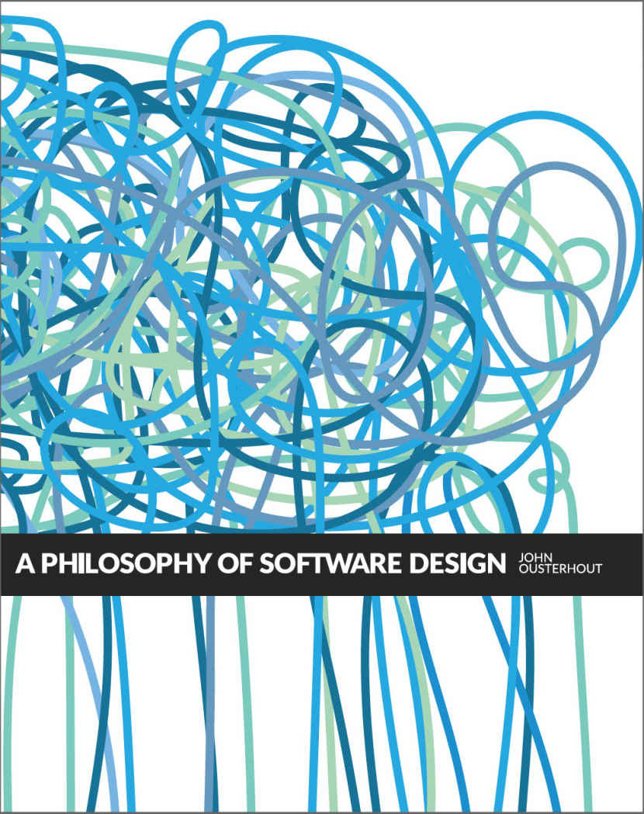

# LỜI MỞ ĐẦU: Triết Lý Thiết Kế Phần Mềm (A Philosophy of Software Design)

---

## Trang Bìa Trong (Title Page)

**Triết Lý Thiết Kế Phần Mềm** *(A Philosophy of Software Design)*

**John Ousterhout**

Đại học Stanford *(Stanford University)*

---

## Thông Tin Bản Quyền (Copyright)

**Triết Lý Thiết Kế Phần Mềm** *(A Philosophy of Software Design)*
Tác giả: **John Ousterhout**

Bản quyền © 2018 John K. Ousterhout.
Bảo lưu mọi quyền. Không phần nào của cuốn sách này được phép sao chép, dưới bất kỳ hình thức hoặc phương tiện nào, nếu không có sự cho phép bằng văn bản từ tác giả. *(All rights reserved. No part of this book may be reproduced, in any form or by any means, without permission in writing from the author.)*

Nhà xuất bản: Yaknyam Press, Palo Alto, CA.
Thiết kế bìa: Pete Nguyen và Shirin Oreizy (www.hellonextstep.com).

Lịch sử in ấn *(Printing History)*:
- Tháng 4 năm 2018 *(April 2018)*: Ấn bản đầu tiên *(First Edition, v1.0)*
- Tháng 11 năm 2018 *(November 2018)*: Ấn bản đầu tiên *(First Edition, v1.01)*

ISBN 978-1-7321022-0-0

Sách điện tử *(epub và mobi)* được sản xuất bởi Booknook.biz.

---

## Mục Lục (Contents)

- **Lời tựa (Preface)**
- **1. Giới thiệu (1 Introduction)**
  - 1.1 Cách sử dụng cuốn sách này *(How to use this book)*
- **2. Bản chất của sự phức tạp (2 The Nature of Complexity)**
  - 2.1 Định nghĩa sự phức tạp *(Complexity defined)*
  - 2.2 Các triệu chứng của sự phức tạp *(Symptoms of complexity)*
  - 2.3 Nguyên nhân gây ra sự phức tạp *(Causes of complexity)*
  - 2.4 Sự phức tạp mang tính tích lũy *(Complexity is incremental)*
  - 2.5 Kết luận *(Conclusion)*
- **3. Mã nguồn chạy được là chưa đủ (3 Working Code Isn’t Enough)**
  - 3.1 Lập trình chiến thuật *(Tactical programming)*
  - 3.2 Lập trình chiến lược *(Strategic programming)*
  - 3.3 Đầu tư bao nhiêu là đủ? *(How much to invest?)*
  - 3.4 Các công ty khởi nghiệp và việc đầu tư *(Startups and investment)*
  - 3.5 Kết luận *(Conclusion)*
- **4. Module nên có chiều sâu (4 Modules Should Be Deep)**
  - 4.1 Thiết kế theo module *(Modular design)*
  - 4.2 Giao diện chứa những gì? *(What’s in an interface?)*
  - 4.3 Trừu tượng hóa *(Abstractions)*
  - 4.4 Các module sâu *(Deep modules)*
  - 4.5 Các module nông *(Shallow modules)*
  - 4.6 Bệnh cuồng lớp *(Classitis)*
  - 4.7 Ví dụ: Java và Unix I/O *(Examples: Java and Unix I/O)*
  - 4.8 Kết luận *(Conclusion)*
- **5. Che giấu thông tin (và Rò rỉ thông tin) (5 Information Hiding (and Leakage))**
  - 5.1 Che giấu thông tin *(Information hiding)*
  - 5.2 Rò rỉ thông tin *(Information leakage)*
  - 5.3 Phân rã theo thời gian *(Temporal decomposition)*
  - 5.4 Ví dụ: máy chủ HTTP *(Example: HTTP server)*
  - 5.5 Ví dụ: quá nhiều lớp *(Example: too many classes)*
  - 5.6 Ví dụ: xử lý tham số HTTP *(Example: HTTP parameter handling)*
  - 5.7 Ví dụ: giá trị mặc định trong phản hồi HTTP *(Example: defaults in HTTP responses)*
  - 5.8 Che giấu thông tin bên trong một lớp *(Information hiding within a class)*
  - 5.9 Đi quá xa *(Taking it too far)*
  - 5.10 Kết luận *(Conclusion)*
- **6. Các module đa dụng có chiều sâu hơn (6 General-Purpose Modules are Deeper)**
  - 6.1 Hãy làm cho các lớp có tính đa dụng ở mức độ nhất định *(Make classes somewhat general-purpose)*
  - 6.2 Ví dụ: lưu trữ văn bản cho trình soạn thảo *(Example: storing text for an editor)*
  - 6.3 Một API đa dụng hơn *(A more general-purpose API)*
  - 6.4 Tính đa dụng dẫn đến khả năng che giấu thông tin tốt hơn *(Generality leads to better information hiding)*
  - 6.5 Những câu hỏi cần tự đặt ra cho bản thân *(Questions to ask yourself)*
  - 6.6 Kết luận *(Conclusion)*
- **7. Tầng khác nhau, Trừu tượng khác nhau (7 Different Layer, Different Abstraction)**
  - 7.1 Các phương thức chuyển tiếp *(Pass-through methods)*
  - 7.2 Khi nào việc trùng lặp giao diện là chấp nhận được? *(When is interface duplication OK?)*
  - 7.3 Decorator *(Decorators)*
  - 7.4 Giao diện so với phần cài đặt *(Interface versus implementation)*
  - 7.5 Các biến chuyển tiếp *(Pass-through variables)*
  - 7.6 Kết luận *(Conclusion)*
- **8. Kéo sự phức tạp xuống dưới (8 Pull Complexity Downwards)**
  - 8.1 Ví dụ: lớp văn bản trong trình soạn thảo *(Example: editor text class)*
  - 8.2 Ví dụ: các tham số cấu hình *(Example: configuration parameters)*
  - 8.3 Đi quá xa *(Taking it too far)*
  - 8.4 Kết luận *(Conclusion)*
- **9. Gộp lại tốt hơn hay Tách ra tốt hơn? (9 Better Together Or Better Apart?)**
  - 9.1 Gộp lại nếu thông tin được chia sẻ *(Bring together if information is shared)*
  - 9.2 Gộp lại nếu việc đó giúp đơn giản hóa giao diện *(Bring together if it will simplify the interface)*
  - 9.3 Gộp lại để loại bỏ sự trùng lặp *(Bring together to eliminate duplication)*
  - 9.4 Tách biệt mã đa dụng và mã chuyên biệt *(Separate general-purpose and special-purpose code)*
  - 9.5 Ví dụ: con trỏ chèn và vùng chọn *(Example: insertion cursor and selection)*
  - 9.6 Ví dụ: tách lớp riêng cho việc ghi log *(Example: separate class for logging)*
  - 9.7 Ví dụ: cơ chế hoàn tác (undo) của trình soạn thảo *(Example: editor undo mechanism)*
  - 9.8 Tách và gộp các phương thức *(Splitting and joining methods)*
  - 9.9 Kết luận *(Conclusion)*
- **10. Thiết kế để lỗi không còn tồn tại (10 Define Errors Out Of Existence)**
  - 10.1 Tại sao ngoại lệ làm tăng sự phức tạp *(Why exceptions add complexity)*
  - 10.2 Quá nhiều ngoại lệ *(Too many exceptions)*
  - 10.3 Thiết kế để lỗi không còn tồn tại *(Define errors out of existence)*
  - 10.4 Ví dụ: xóa tệp trong Windows *(Example: file deletion in Windows)*
  - 10.5 Ví dụ: phương thức `substring` trong Java *(Example: Java substring method)*
  - 10.6 Che chắn ngoại lệ *(Mask exceptions)*
  - 10.7 Gom nhóm ngoại lệ *(Exception aggregation)*
  - 10.8 Cứ để chương trình sập? *(Just crash?)*
  - 10.9 Thiết kế để các trường hợp đặc biệt không còn tồn tại *(Design special cases out of existence)*
  - 10.10 Đi quá xa *(Taking it too far)*
  - 10.11 Kết luận *(Conclusion)*
- **11. Thiết kế hai lần (11 Design it Twice)**
- **12. Tại sao phải viết chú thích? Bốn lời bào chữa (12 Why Write Comments? The Four Excuses)**
  - 12.1 Mã tốt tự nó đã là tài liệu *(Good code is self-documenting)*
  - 12.2 Tôi không có thời gian để viết chú thích *(I don’t have time to write comments)*
  - 12.3 Chú thích bị lỗi thời và trở nên gây hiểu nhầm *(Comments get out of date and become misleading)*
  - 12.4 Tất cả các chú thích tôi từng thấy đều vô giá trị *(All the comments I have seen are worthless)*
  - 12.5 Lợi ích của những chú thích được viết tốt *(Benefits of well-written comments)*
- **13. Chú thích nên mô tả những điều không hiển nhiên từ mã nguồn (13 Comments Should Describe Things that Aren’t Obvious from the Code)**
  - 13.1 Chọn quy ước *(Pick conventions)*
  - 13.2 Đừng lặp lại mã nguồn *(Don’t repeat the code)*
  - 13.3 Chú thích cấp thấp bổ sung độ chính xác *(Lower-level comments add precision)*
  - 13.4 Chú thích cấp cao nâng cao trực giác *(Higher-level comments enhance intuition)*
  - 13.5 Tài liệu hóa giao diện *(Interface documentation)*
  - 13.6 Chú thích phần cài đặt: cái gì và tại sao, không phải như thế nào *(Implementation comments: what and why, not how)*
  - 13.7 Các quyết định thiết kế xuyên module *(Cross-module design decisions)*
  - 13.8 Kết luận *(Conclusion)*
  - 13.9 Đáp án cho các câu hỏi ở Mục 13.5 *(Answers to questions from Section 13.5)*
- **14. Chọn tên gọi (14 Choosing Names)**
  - 14.1 Ví dụ: tên tệ gây ra lỗi *(Example: bad names cause bugs)*
  - 14.2 Tạo dựng một hình ảnh *(Create an image)*
  - 14.3 Tên gọi phải chính xác *(Names should be precise)*
  - 14.4 Sử dụng tên gọi một cách nhất quán *(Use names consistently)*
  - 14.5 Một quan điểm khác: cẩm nang phong cách Go *(A different opinion: Go style guide)*
  - 14.6 Kết luận *(Conclusion)*
- **15. Viết chú thích trước (15 Write The Comments First)**
  - 15.1 Chú thích viết muộn là chú thích tệ *(Delayed comments are bad comments)*
  - 15.2 Viết chú thích trước *(Write the comments first)*
  - 15.3 Chú thích là một công cụ thiết kế *(Comments are a design tool)*
  - 15.4 Chú thích viết sớm là chú thích thú vị *(Early comments are fun comments)*
  - 15.5 Viết chú thích sớm có tốn kém không? *(Are early comments expensive?)*
  - 15.6 Kết luận *(Conclusion)*
- **16. Chỉnh sửa mã nguồn hiện có (16 Modifying Existing Code)**
  - 16.1 Luôn giữ tư duy chiến lược *(Stay strategic)*
  - 16.2 Duy trì chú thích: giữ chú thích gần với mã nguồn *(Maintaining comments: keep the comments near the code)*
  - 16.3 Chú thích thuộc về mã nguồn, không phải nhật ký commit *(Comments belong in the code, not the commit log)*
  - 16.4 Duy trì chú thích: tránh trùng lặp *(Maintaining comments: avoid duplication)*
  - 16.5 Duy trì chú thích: kiểm tra các diff *(Maintaining comments: check the diffs)*
  - 16.6 Chú thích cấp cao dễ bảo trì hơn *(Higher-level comments are easier to maintain)*
- **17. Tính nhất quán (17 Consistency)**
  - 17.1 Các ví dụ về tính nhất quán *(Examples of consistency)*
  - 17.2 Đảm bảo tính nhất quán *(Ensuring consistency)*
  - 17.3 Đi quá xa *(Taking it too far)*
  - 17.4 Kết luận *(Conclusion)*
- **18. Mã nguồn nên rõ ràng hiển nhiên (18 Code Should be Obvious)**
  - 18.1 Những điều giúp mã nguồn trở nên hiển nhiên hơn *(Things that make code more obvious)*
  - 18.2 Những điều khiến mã nguồn trở nên kém hiển nhiên hơn *(Things that make code less obvious)*
  - 18.3 Kết luận *(Conclusion)*
- **19. Các xu hướng phần mềm (19 Software Trends)**
  - 19.1 Lập trình hướng đối tượng và kế thừa *(Object-oriented programming and inheritance)*
  - 19.2 Phát triển linh hoạt Agile *(Agile development)*
  - 19.3 Kiểm thử đơn vị *(Unit tests)*
  - 19.4 Phát triển hướng kiểm thử *(Test-driven development)*
  - 19.5 Các mẫu thiết kế *(Design patterns)*
  - 19.6 Getter và setter *(Getters and setters)*
  - 19.7 Kết luận *(Conclusion)*
- **20. Thiết kế cho hiệu năng (20 Designing for Performance)**
  - 20.1 Cách tư duy về hiệu năng *(How to think about performance)*
  - 20.2 Đo lường trước khi chỉnh sửa *(Measure before modifying)*
  - 20.3 Thiết kế xoay quanh đường găng *(Design around the critical path)*
  - 20.4 Một ví dụ: Bộ đệm RAMCloud *(An example: RAMCloud Buffers)*
  - 20.5 Kết luận *(Conclusion)*
- **21. Kết luận (21 Conclusion)**
- **Bảng chỉ mục (Index)**
- **Tóm tắt các Nguyên tắc Thiết kế (Summary of Design Principles)**
- **Tóm tắt các Cờ Đỏ (Summary of Red Flags)**

---

## Lời Tựa (Preface)

Con người đã viết chương trình cho máy tính điện tử hơn 80 năm qua, nhưng điều đáng ngạc nhiên là lại có rất ít cuộc thảo luận về cách thiết kế các chương trình đó hoặc một chương trình tốt trông như thế nào. Đã có rất nhiều thảo luận về các quy trình phát triển phần mềm như phát triển linh hoạt (agile development) và về các công cụ phát triển như trình gỡ lỗi (debuggers), hệ thống quản lý phiên bản (version control systems), và công cụ đo độ phủ kiểm thử (test coverage tools). Cũng đã có những phân tích sâu rộng về các kỹ thuật lập trình như lập trình hướng đối tượng và lập trình hàm, cũng như về các mẫu thiết kế (design patterns) và thuật toán. Tất cả những cuộc thảo luận đó đều có giá trị, nhưng vấn đề cốt lõi của thiết kế phần mềm vẫn còn hầu như chưa được chạm tới. Bài báo kinh điển của David Parnas mang tên *"On the Criteria to be used in Decomposing Systems into Modules"* (Về các tiêu chí sử dụng khi phân rã hệ thống thành các module) xuất hiện vào năm 1971, nhưng trình độ phát triển của lĩnh vực thiết kế phần mềm vẫn chưa tiến xa hơn bài báo đó là bao trong suốt 45 năm tiếp theo.

Vấn đề nền tảng nhất trong khoa học máy tính là *phân rã bài toán* (*problem decomposition*): làm thế nào để chia một bài toán phức tạp thành những phần nhỏ có thể giải quyết một cách độc lập. Phân rã bài toán là nhiệm vụ thiết kế trung tâm mà các lập trình viên đối mặt mỗi ngày, vậy mà ngoài công việc được mô tả ở đây, tôi chưa từng thấy một môn học nào ở bất kỳ trường đại học nào lấy phân rã bài toán làm chủ đề trọng tâm. Chúng ta dạy vòng lặp `for` và lập trình hướng đối tượng, chứ không dạy thiết kế phần mềm.

Ngoài ra, có một sự chênh lệch khổng lồ về chất lượng và năng suất giữa các lập trình viên, nhưng chúng ta lại ít nỗ lực tìm hiểu điều gì khiến những lập trình viên xuất sắc nhất giỏi hơn nhiều đến thế, hoặc truyền đạt những kỹ năng đó trong các lớp học của mình. Tôi đã trò chuyện với một số người mà tôi coi là những lập trình viên vĩ đại, nhưng hầu hết họ đều gặp khó khăn khi diễn đạt thành lời các kỹ thuật cụ thể mang lại lợi thế cho họ. Nhiều người cho rằng kỹ năng thiết kế phần mềm là một năng khiếu bẩm sinh không thể dạy được. Tuy nhiên, có khá nhiều bằng chứng khoa học cho thấy hiệu suất vượt trội trong nhiều lĩnh vực liên quan đến việc luyện tập chất lượng cao hơn là khả năng bẩm sinh (xem, ví dụ, cuốn *Talent is Overrated* của Geoff Colvin).

Trong nhiều năm, những vấn đề này đã khiến tôi trăn trở và bức bối. Tôi tự hỏi liệu thiết kế phần mềm có thể dạy được hay không, và tôi đặt giả thuyết rằng kỹ năng thiết kế chính là thứ phân biệt những lập trình viên vĩ đại với những người bình thường. Cuối cùng, tôi quyết định rằng cách duy nhất để trả lời những câu hỏi này là thử giảng dạy một khóa học về thiết kế phần mềm. Kết quả là môn CS 190 tại Đại học Stanford. Trong lớp học này, tôi đưa ra một bộ các nguyên tắc thiết kế phần mềm. Sau đó, sinh viên thực hiện một loạt dự án để tiếp thu và thực hành các nguyên tắc đó. Lớp học được giảng dạy theo cách tương tự như một lớp viết tiếng Anh truyền thống. Trong một lớp viết văn tiếng Anh, sinh viên sử dụng quy trình lặp đi lặp lại: họ viết bản nháp, nhận phản hồi, rồi viết lại để cải thiện. Trong môn CS 190, sinh viên phát triển một phần mềm tương đối lớn từ con số không. Sau đó, chúng tôi tiến hành đánh giá mã nguồn (code reviews) kỹ lưỡng để phát hiện các vấn đề thiết kế, và sinh viên chỉnh sửa dự án của mình để khắc phục các vấn đề đó. Điều này giúp sinh viên thấy được mã nguồn của họ có thể cải thiện như thế nào bằng cách áp dụng các nguyên tắc thiết kế.

Đến nay tôi đã dạy lớp thiết kế phần mềm được ba lần, và cuốn sách này dựa trên các nguyên tắc thiết kế hình thành từ lớp học đó. Các nguyên tắc này ở mức khá cao và tiệm cận triết lý (*"Thiết kế để lỗi không còn tồn tại"* — *"Define errors out of existence"*), nên sinh viên khó có thể hiểu các ý tưởng đó một cách trừu tượng. Sinh viên học tốt nhất bằng cách viết mã, mắc sai lầm, và rồi thấy được sai lầm của mình cùng các bản sửa lỗi tiếp theo liên hệ như thế nào với các nguyên tắc.

Đến đây, hẳn bạn sẽ tự hỏi: điều gì khiến tôi nghĩ mình biết mọi câu trả lời về thiết kế phần mềm? Thành thật mà nói, tôi không biết hết đâu. Khi tôi học lập trình thì không có lớp học nào về thiết kế phần mềm, và tôi cũng chưa từng có người hướng dẫn nào dạy cho mình các nguyên tắc thiết kế. Vào thời điểm tôi học lập trình, việc đánh giá mã nguồn (code reviews) hầu như không tồn tại. Những ý tưởng của tôi về thiết kế phần mềm đến từ trải nghiệm cá nhân khi viết và đọc mã nguồn. Trong sự nghiệp của mình, tôi đã viết khoảng 250.000 dòng mã bằng nhiều ngôn ngữ khác nhau. Tôi từng làm việc trong các nhóm tạo ra ba hệ điều hành từ con số không, nhiều hệ thống tệp và lưu trữ, các công cụ hạ tầng như trình gỡ lỗi, hệ thống build, và bộ công cụ giao diện đồ họa (GUI toolkits), một ngôn ngữ kịch bản (scripting language), cùng các trình soạn thảo tương tác cho văn bản, bản vẽ, bài thuyết trình và mạch tích hợp. Trên chặng đường đó, tôi đã trực tiếp trải nghiệm những vấn đề của các hệ thống lớn và thử nghiệm nhiều kỹ thuật thiết kế khác nhau. Ngoài ra, tôi đã đọc một lượng lớn mã nguồn do người khác viết, giúp tôi tiếp xúc với nhiều cách tiếp cận đa dạng, cả tốt lẫn xấu.

Từ tất cả những trải nghiệm này, tôi đã cố gắng đúc kết những điểm chung, cả về những sai lầm cần tránh lẫn những kỹ thuật nên sử dụng. Cuốn sách này là sự phản ánh những trải nghiệm của tôi: mọi vấn đề được mô tả ở đây đều là điều tôi đã từng trực tiếp trải qua, và mọi kỹ thuật được đề xuất đều là thứ tôi đã sử dụng thành công trong quá trình viết mã của chính mình.

Tôi không kỳ vọng cuốn sách này sẽ là lời phán quyết cuối cùng về thiết kế phần mềm; tôi chắc chắn vẫn còn những kỹ thuật quý giá mà tôi đã bỏ sót, và một số đề xuất của tôi có thể hóa ra là ý tưởng tồi về lâu dài. Tuy nhiên, tôi hy vọng cuốn sách sẽ khởi đầu một cuộc đối thoại về thiết kế phần mềm. Hãy so sánh các ý tưởng trong cuốn sách này với trải nghiệm của chính bạn và tự quyết định xem các cách tiếp cận được mô tả ở đây có thực sự làm giảm sự phức tạp của phần mềm hay không. Cuốn sách này là một bài viết mang tính quan điểm cá nhân, nên một số độc giả sẽ không đồng ý với một vài đề xuất của tôi. Nếu bạn không đồng ý, hãy cố gắng tìm hiểu lý do tại sao. Tôi rất muốn lắng nghe về những điều hiệu quả với bạn, những điều không hiệu quả, và bất kỳ ý tưởng nào khác mà bạn có về thiết kế phần mềm. Tôi hy vọng những cuộc trò chuyện tiếp nối sẽ cải thiện sự hiểu biết chung của chúng ta về thiết kế phần mềm. Tôi sẽ đưa những gì học được vào các ấn bản tương lai của cuốn sách này.

Cách tốt nhất để liên lạc với tôi về cuốn sách là gửi email tới địa chỉ sau:
`software-design-book@googlegroups.com`

Tôi rất mong nhận được các phản hồi cụ thể về cuốn sách, chẳng hạn như lỗi sai hoặc đề xuất cải thiện, cũng như các suy nghĩ và trải nghiệm chung liên quan đến thiết kế phần mềm. Tôi đặc biệt quan tâm đến những ví dụ thuyết phục mà tôi có thể sử dụng trong các ấn bản tương lai của cuốn sách. Những ví dụ tốt nhất minh họa được một nguyên tắc thiết kế quan trọng và đủ đơn giản để giải thích trong một hoặc hai đoạn văn. Nếu bạn muốn xem mọi người khác đang trao đổi gì trên địa chỉ email này và tham gia thảo luận, bạn có thể tham gia Google Group `software-design-book`. Nếu vì lý do nào đó Google Group `software-design-book` biến mất trong tương lai, hãy tìm kiếm trên Web trang chủ của tôi; trang đó sẽ có hướng dẫn cập nhật về cách liên lạc liên quan đến cuốn sách. Xin vui lòng không gửi email liên quan đến sách tới địa chỉ email cá nhân của tôi.

Tôi khuyên bạn nên tiếp nhận các đề xuất trong cuốn sách này một cách có chọn lọc *(with a grain of salt)*. Mục tiêu tổng thể là giảm sự phức tạp; điều này quan trọng hơn bất kỳ nguyên tắc hay ý tưởng cụ thể nào bạn đọc được ở đây. Nếu bạn thử một ý tưởng từ cuốn sách này và thấy nó thực sự không làm giảm sự phức tạp, thì đừng cảm thấy bắt buộc phải tiếp tục sử dụng nó (nhưng hãy cho tôi biết về trải nghiệm của bạn nhé; tôi muốn nhận phản hồi về những gì hiệu quả và những gì không).

Nhiều người đã đưa ra những lời phê bình hoặc góp ý giúp cải thiện chất lượng của cuốn sách. Những người sau đây đã đóng góp các nhận xét hữu ích cho nhiều bản nháp khác nhau của cuốn sách: Jeff Dean, Sanjay Ghemawat, John Hartman, Brian Kernighan, James Koppel, Amy Ousterhout, Kay Ousterhout, Rob Pike, Partha Ranganathan, Keith Schwartz, và Alex Snaps. Christos Kozyrakis đã gợi ý hai thuật ngữ *"sâu"* (*"deep"*) và *"nông"* (*"shallow"*) cho các lớp và giao diện, thay thế cho các thuật ngữ trước đó là *"dày"* (*"thick"*) và *"mỏng"* (*"thin"*) vốn có phần mơ hồ. Tôi mang ơn các sinh viên trong lớp CS 190; quá trình đọc mã nguồn của họ và thảo luận cùng họ đã giúp kết tinh những suy nghĩ của tôi về thiết kế.
