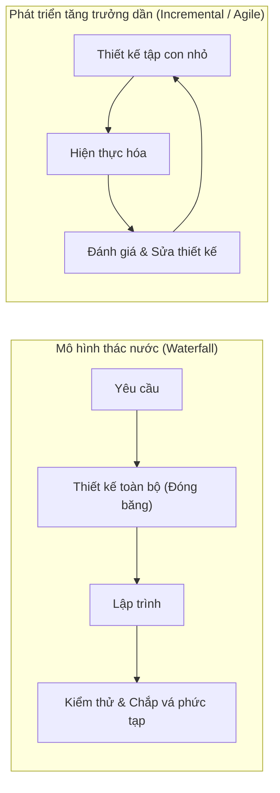

# CHƯƠNG 1: Giới thiệu (Tất cả đều là về sự phức tạp) (Chapter 1: Introduction — It’s All About Complexity)

Viết phần mềm máy tính là một trong những hoạt động sáng tạo thuần khiết nhất trong lịch sử loài người. Lập trình viên không bị ràng buộc bởi những giới hạn thực tế như các định luật vật lý; chúng ta có thể tạo ra những thế giới ảo đầy thú vị với những hành vi không bao giờ có thể tồn tại trong thế giới thực. Lập trình không đòi hỏi kỹ năng thể chất hay sự phối hợp vận động điêu luyện như múa ba lê hay bóng rổ. Tất cả những gì lập trình đòi hỏi là một bộ óc sáng tạo và khả năng sắp xếp suy nghĩ của bạn. Nếu bạn có thể hình dung ra một hệ thống, nhiều khả năng bạn có thể hiện thực hóa nó trong một chương trình máy tính.

Điều này có nghĩa là giới hạn lớn nhất khi viết phần mềm chính là khả năng thấu hiểu những hệ thống mà chúng ta đang tạo ra. Khi một chương trình tiến hóa và tích lũy thêm nhiều tính năng, nó trở nên phức tạp hơn, với những mối phụ thuộc tinh vi giữa các thành phần. Theo thời gian, sự phức tạp tích tụ dần, và lập trình viên ngày càng khó giữ được tất cả các yếu tố liên quan trong đầu mỗi khi chỉnh sửa hệ thống. Điều này làm chậm quá trình phát triển và dẫn đến lỗi (bugs), từ đó lại càng làm chậm quá trình phát triển hơn nữa và đội chi phí lên cao. Sự phức tạp tăng lên là điều tất yếu trong suốt vòng đời của bất kỳ chương trình nào. Chương trình càng lớn, và càng nhiều người cùng làm việc trên đó, thì việc quản lý sự phức tạp lại càng khó khăn hơn.

Các công cụ phát triển tốt có thể giúp chúng ta đối phó với sự phức tạp, và rất nhiều công cụ tuyệt vời đã được tạo ra trong vài thập kỷ qua. Nhưng những gì chúng ta có thể làm chỉ bằng công cụ thôi là có giới hạn. Nếu muốn việc viết phần mềm trở nên dễ dàng hơn, để có thể xây dựng những hệ thống mạnh mẽ hơn với chi phí rẻ hơn, chúng ta phải tìm cách làm cho phần mềm trở nên đơn giản hơn. Sự phức tạp vẫn sẽ tăng lên theo thời gian bất chấp mọi nỗ lực tốt nhất của chúng ta, nhưng những thiết kế đơn giản hơn sẽ cho phép chúng ta xây dựng các hệ thống lớn hơn và mạnh mẽ hơn trước khi sự phức tạp trở nên quá tải.

Có hai hướng tiếp cận tổng quát để chống lại sự phức tạp, cả hai đều sẽ được thảo luận trong cuốn sách này. Hướng tiếp cận thứ nhất là **loại bỏ sự phức tạp** bằng cách làm cho mã nguồn trở nên đơn giản hơn và rõ ràng hơn. Ví dụ, có thể giảm bớt sự phức tạp bằng cách loại bỏ các trường hợp đặc biệt (special cases) hoặc sử dụng các định danh (identifiers) một cách nhất quán.

Hướng tiếp cận thứ hai đối với sự phức tạp là **đóng gói nó lại (encapsulate)**, sao cho lập trình viên có thể làm việc trên một hệ thống mà không bị phơi bày trước toàn bộ sự phức tạp của hệ thống đó cùng một lúc. Hướng tiếp cận này được gọi là **thiết kế mô-đun (modular design)**. Trong thiết kế mô-đun, một hệ thống phần mềm được chia thành các mô-đun, chẳng hạn như các lớp (classes) trong ngôn ngữ hướng đối tượng. Các mô-đun được thiết kế sao cho tương đối độc lập với nhau, để một lập trình viên có thể làm việc trên một mô-đun mà không cần phải hiểu chi tiết của các mô-đun khác.

> 💡 **Ví dụ bổ sung (không có trong sách):** Minh họa hai hướng tiếp cận chống lại sự phức tạp:
> 1. **Loại bỏ sự phức tạp:** Thay vì viết hàm `tinhPhiVanChuyen(loaiKhachHang, khoangCach, ngayLe)` với hàng loạt câu lệnh `if/else` xử lý riêng từng trường hợp đặc biệt (khách VIP ngày lễ, khách thường cuối tuần, đơn hàng 0 đồng...), bạn chuẩn hóa quy tắc tính phí bằng một bảng cấu hình hoặc công thức thống nhất không có ngoại lệ rườm rà.
> 2. **Đóng gói sự phức tạp (Thiết kế mô-đun):** Khi bạn gọi hàm `paymentGateway.charge(order)` để thanh toán, bạn không cần biết bên trong `PaymentGateway` phải giao tiếp qua HTTP, ký chữ ký số HMAC, xử lý retry khi mạng chập chờn hay chuyển đổi định dạng JSON/XML ra sao. Toàn bộ sự phức tạp đó được gói gọn sau một giao diện đơn giản.

Vì phần mềm rất dễ uốn nắn (malleable), thiết kế phần mềm là một quá trình liên tục kéo dài suốt toàn bộ vòng đời của hệ thống phần mềm; điều này khiến thiết kế phần mềm khác với thiết kế các hệ thống vật lý như tòa nhà, tàu thủy hay cầu cống. Tuy nhiên, thiết kế phần mềm không phải lúc nào cũng được nhìn nhận theo cách này. Trong phần lớn lịch sử ngành lập trình, hoạt động thiết kế thường tập trung ở giai đoạn đầu của dự án, giống như trong các ngành kỹ thuật khác. Hình thái cực đoan của cách tiếp cận này được gọi là **mô hình thác nước (waterfall model)**, trong đó một dự án được chia thành các giai đoạn rời rạc như xác định yêu cầu, thiết kế, lập trình, kiểm thử và bảo trì. Trong mô hình thác nước, mỗi giai đoạn phải hoàn tất trước khi giai đoạn tiếp theo bắt đầu; trong nhiều trường hợp, những người khác nhau sẽ chịu trách nhiệm cho từng giai đoạn. Toàn bộ hệ thống được thiết kế cùng một lúc trong giai đoạn thiết kế. Bản thiết kế được "đóng băng" vào cuối giai đoạn này, và vai trò của các giai đoạn tiếp theo là cụ thể hóa và hiện thực hóa bản thiết kế đó.

Đáng tiếc là mô hình thác nước hiếm khi hoạt động hiệu quả đối với phần mềm. Các hệ thống phần mềm về bản chất phức tạp hơn các hệ thống vật lý; ta không thể hình dung trước bản thiết kế cho một hệ thống phần mềm lớn đủ rõ để hiểu hết mọi hệ quả của nó trước khi bắt tay vào xây dựng bất cứ thứ gì. Hệ quả là bản thiết kế ban đầu sẽ tồn tại rất nhiều vấn đề. Những vấn đề này không bộc lộ rõ cho đến khi việc lập trình đã đi được một chặng đường dài. Tuy nhiên, mô hình thác nước lại không có cấu trúc phù hợp để tiếp nhận những thay đổi thiết kế lớn tại thời điểm đó (ví dụ, những người thiết kế ban đầu có thể đã chuyển sang dự án khác). Do vậy, các lập trình viên đành phải chắp vá xung quanh các vấn đề mà không thay đổi thiết kế tổng thể. Điều này dẫn đến một sự bùng nổ về độ phức tạp.

Chính vì những vấn đề này, hầu hết các dự án phát triển phần mềm ngày nay sử dụng một hướng tiếp cận **tăng trưởng dần (incremental approach)** như phát triển linh hoạt (**agile development**), trong đó thiết kế ban đầu chỉ tập trung vào một tập con nhỏ của toàn bộ chức năng. Tập con này được thiết kế, hiện thực hóa và sau đó được đánh giá. Các vấn đề với thiết kế ban đầu được phát hiện và khắc phục, rồi một vài tính năng nữa lại được thiết kế, hiện thực hóa và đánh giá. Mỗi vòng lặp (iteration) phơi bày những vấn đề trong thiết kế hiện tại, và chúng được sửa chữa trước khi nhóm tính năng tiếp theo được thiết kế. Bằng cách dàn trải hoạt động thiết kế theo cách này, các vấn đề với thiết kế ban đầu có thể được khắc phục khi hệ thống còn nhỏ; các tính năng về sau được hưởng lợi từ kinh nghiệm tích lũy trong quá trình triển khai các tính năng trước đó, nên chúng ít gặp vấn đề hơn.

Hướng tiếp cận tăng trưởng dần hiệu quả đối với phần mềm bởi vì phần mềm đủ linh hoạt để cho phép những thay đổi thiết kế đáng kể ngay giữa quá trình triển khai. Ngược lại, những thay đổi thiết kế lớn khó khăn hơn nhiều đối với các hệ thống vật lý: ví dụ, sẽ không thực tế nếu muốn thay đổi số lượng trụ tháp nâng đỡ một cây cầu khi đang xây dựng dở dang.

Phát triển tăng trưởng dần đồng nghĩa với việc thiết kế phần mềm không bao giờ kết thúc. Thiết kế diễn ra liên tục trong suốt vòng đời của một hệ thống: lập trình viên phải luôn suy nghĩ về các vấn đề thiết kế. Phát triển tăng trưởng dần cũng đồng nghĩa với việc **tái thiết kế liên tục (continuous redesign)**. Thiết kế ban đầu cho một hệ thống hay một thành phần hầu như không bao giờ là thiết kế tốt nhất; kinh nghiệm thực tế chắc chắn sẽ chỉ ra những cách làm tốt hơn. Là một nhà phát triển phần mềm, bạn nên luôn để mắt tìm kiếm cơ hội cải thiện thiết kế của hệ thống mình đang làm việc, và bạn nên lên kế hoạch dành một phần thời gian của mình cho việc cải thiện thiết kế.

Nếu các nhà phát triển phần mềm phải luôn suy nghĩ về các vấn đề thiết kế, và việc giảm thiểu sự phức tạp là yếu tố quan trọng nhất của thiết kế phần mềm, thì các nhà phát triển phần mềm phải luôn suy nghĩ về sự phức tạp. Cuốn sách này viết về cách sử dụng sự phức tạp làm kim chỉ nam dẫn dắt thiết kế phần mềm trong suốt vòng đời của nó.

Cuốn sách này có hai mục tiêu tổng quát. Mục tiêu thứ nhất là mô tả bản chất của sự phức tạp trong phần mềm: "sự phức tạp" nghĩa là gì, tại sao nó lại quan trọng, và làm thế nào bạn nhận ra khi nào một chương trình đang có sự phức tạp không cần thiết? Mục tiêu thứ hai của cuốn sách, và cũng là mục tiêu thách thức hơn, là trình bày các kỹ thuật bạn có thể sử dụng trong suốt quá trình phát triển phần mềm để giảm thiểu sự phức tạp. Tiếc thay, không có một công thức đơn giản nào đảm bảo tạo ra những thiết kế phần mềm xuất sắc. Thay vào đó, tôi sẽ trình bày một tập hợp các khái niệm ở tầm cao hơn, mang tính triết lý, chẳng hạn như *"các lớp nên sâu" (classes should be deep)* hay *"định nghĩa lỗi ra khỏi sự tồn tại" (define errors out of existence)*. Những khái niệm này có thể không chỉ ra ngay lập tức đâu là thiết kế tốt nhất, nhưng bạn có thể dùng chúng để so sánh các phương án thiết kế và định hướng quá trình khám phá không gian thiết kế của mình.

## 1.1 Cách sử dụng cuốn sách này (How to use this book)

Nhiều nguyên lý thiết kế được mô tả ở đây khá trừu tượng, nên có thể sẽ khó cảm nhận trọn vẹn nếu không nhìn vào mã nguồn thực tế. Việc tìm ra những ví dụ đủ nhỏ để đưa vào sách, nhưng đồng thời đủ lớn để minh họa cho các vấn đề trong hệ thống thực tế là một thách thức không nhỏ (nếu bạn bắt gặp những ví dụ hay, xin hãy gửi cho tôi). Vì vậy, chỉ riêng cuốn sách này có thể chưa đủ để bạn học cách áp dụng các nguyên lý.

Cách tốt nhất để sử dụng cuốn sách này là kết hợp với hoạt động **duyệt mã nguồn (code reviews)**. Khi đọc mã của người khác, hãy suy nghĩ xem nó có tuân thủ các khái niệm được thảo luận ở đây hay không và điều đó liên quan thế nào đến độ phức tạp của mã nguồn. Nhận ra vấn đề thiết kế trong mã của người khác luôn dễ hơn trong mã của chính mình. Bạn có thể sử dụng các **cờ đỏ (red flags)** được mô tả trong sách để nhận diện vấn đề và đề xuất cải tiến. Việc duyệt mã cũng sẽ giúp bạn tiếp xúc với những hướng tiếp cận thiết kế và kỹ thuật lập trình mới.

Một trong những cách tốt nhất để nâng cao kỹ năng thiết kế là học cách nhận biết các cờ đỏ: những dấu hiệu cho thấy một đoạn mã có lẽ đang phức tạp hơn mức cần thiết. Xuyên suốt cuốn sách này, tôi sẽ chỉ ra các cờ đỏ gợi ý những vấn đề liên quan đến từng chủ đề thiết kế lớn; những cờ đỏ quan trọng nhất được tóm tắt ở phần cuối sách. Sau đó, bạn có thể sử dụng chúng khi đang viết mã: mỗi khi thấy một cờ đỏ, hãy dừng lại và tìm một thiết kế thay thế giúp loại bỏ vấn đề đó. Khi mới thử cách tiếp cận này, bạn có thể phải thử qua vài phương án thiết kế khác nhau trước khi tìm được phương án xóa bỏ được cờ đỏ. Đừng dễ dàng bỏ cuộc: bạn càng thử nhiều phương án trước khi khắc phục được vấn đề, bạn sẽ càng học được nhiều hơn. Theo thời gian, bạn sẽ thấy mã nguồn của mình có ngày càng ít cờ đỏ hơn, và các thiết kế của bạn trở nên gọn gàng, sạch sẽ hơn. Kinh nghiệm của chính bạn cũng sẽ chỉ cho bạn thêm những cờ đỏ khác để nhận diện các vấn đề thiết kế (tôi rất vui lòng được lắng nghe về những điều đó).

> 📝 **Giải thích thêm (không có trong sách):** Trong thực tế, khi review Pull Request (PR), thay vì chỉ bình luận kiểu cảm tính như *"Đoạn này trông hơi rối"*, bạn có thể chỉ rõ cờ đỏ cụ thể — ví dụ: *"Hàm này chỉ gọi thẳng qua một hàm khác mà không thêm giá trị gì (Pass-Through Method), khiến người đọc phải nhảy qua nhiều lớp không cần thiết. Liệu chúng ta có thể gộp hoặc thiết kế lại giao diện không?"*. Cách giao tiếp dựa trên nguyên lý thiết kế giúp đội ngũ thảo luận khách quan và học hỏi lẫn nhau hiệu quả hơn nhiều.

Khi áp dụng các ý tưởng từ cuốn sách này, điều quan trọng là phải biết **chừng mực và cân nhắc thận trọng**. Mọi quy tắc đều có ngoại lệ, và mọi nguyên lý đều có giới hạn của nó. Nếu bạn đẩy bất kỳ ý tưởng thiết kế nào đến thái cực, nhiều khả năng bạn sẽ rơi vào một tình trạng tồi tệ. Những thiết kế đẹp phản ánh sự cân bằng giữa các ý tưởng và hướng tiếp cận cạnh tranh lẫn nhau. Một số chương trong sách có các mục mang tên *"Đi quá xa" (Taking it too far)*, mô tả cách nhận biết khi nào bạn đang lạm dụng một điều tốt.

Hầu hết các ví dụ trong cuốn sách này được viết bằng Java hoặc C++, và phần lớn nội dung thảo luận xoay quanh việc thiết kế các lớp trong ngôn ngữ hướng đối tượng. Tuy nhiên, các ý tưởng này cũng áp dụng được trong những lĩnh vực khác. Hầu như mọi ý tưởng liên quan đến phương thức (methods) đều có thể áp dụng cho các hàm (functions) trong một ngôn ngữ không có tính năng hướng đối tượng, chẳng hạn như C. Các ý tưởng thiết kế cũng áp dụng được cho những mô-đun khác ngoài lớp, chẳng hạn như các hệ thống con (subsystems) hoặc các dịch vụ mạng (network services).

Với nền tảng đó, hãy cùng đi sâu hơn vào việc tìm hiểu điều gì gây ra sự phức tạp, và làm thế nào để giúp các hệ thống phần mềm trở nên đơn giản hơn.

## Bảng thuật ngữ chương (Chapter Glossary)

| Thuật ngữ (English) | Tiếng Việt | Giải thích ngắn gọn |
| :--- | :--- | :--- |
| Complexity | Sự phức tạp | Yếu tố khiến phần mềm khó hiểu và khó chỉnh sửa; tích tụ tất yếu theo thời gian. |
| Modular design | Thiết kế mô-đun | Chia hệ thống thành các phần (mô-đun) tương đối độc lập để đóng gói sự phức tạp. |
| Encapsulate | Đóng gói | Che giấu chi tiết phức tạp bên trong một mô-đun sau một giao diện đơn giản. |
| Waterfall model | Mô hình thác nước | Quy trình phát triển tuần tự từng giai đoạn rời rạc, đóng băng thiết kế từ sớm. |
| Incremental approach | Hướng tiếp cận tăng trưởng dần | Phát triển và thiết kế theo từng phần nhỏ, đánh giá và sửa đổi liên tục qua từng vòng lặp. |
| Agile development | Phát triển linh hoạt | Phương pháp phát triển phần mềm theo hướng tăng trưởng dần và thích ứng liên tục. |
| Continuous redesign | Tái thiết kế liên tục | Liên tục cải thiện và điều chỉnh thiết kế trong suốt vòng đời hệ thống. |
| Red flag | Cờ đỏ | Dấu hiệu cảnh báo một đoạn mã hoặc thiết kế đang phức tạp hơn mức cần thiết. |
| Code review | Duyệt mã nguồn | Hoạt động đọc và đánh giá mã nguồn của đồng nghiệp để phát hiện lỗi và cải thiện thiết kế. |
