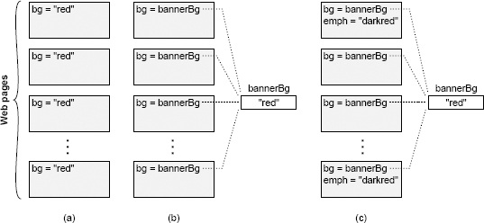
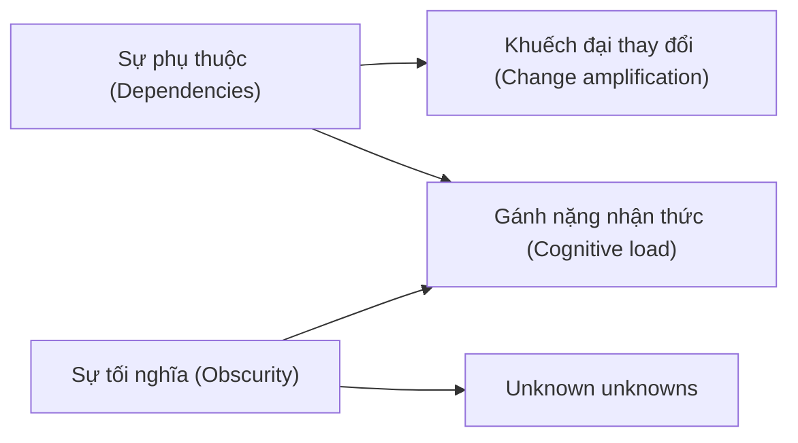

# CHƯƠNG 2: Bản Chất Của Độ Phức Tạp (Chapter 2: The Nature of Complexity)

Cuốn sách này bàn về cách thiết kế các hệ thống phần mềm để giảm thiểu độ phức tạp của chúng. Bước đầu tiên là phải hiểu rõ "kẻ thù". Chính xác thì "độ phức tạp" (complexity) là gì? Làm thế nào để nhận biết một hệ thống đang phức tạp một cách không cần thiết? Điều gì khiến các hệ thống trở nên phức tạp? Chương này sẽ giải đáp những câu hỏi đó ở mức tổng quan; các chương tiếp theo sẽ chỉ cho bạn cách nhận diện độ phức tạp ở mức chi tiết hơn, thông qua những đặc điểm cấu trúc cụ thể.

Khả năng nhận biết độ phức tạp là một kỹ năng thiết kế tối quan trọng. Nó giúp bạn phát hiện vấn đề trước khi đầu tư quá nhiều công sức vào chúng, đồng thời giúp bạn đưa ra lựa chọn sáng suốt giữa các phương án thay thế. Việc nhận xét một thiết kế có đơn giản hay không thường dễ hơn việc tự tay tạo ra một thiết kế đơn giản; nhưng một khi bạn đã có khả năng nhận ra khi nào một hệ thống trở nên quá rắc rối, bạn có thể dùng chính khả năng đó để dẫn dắt triết lý thiết kế của mình hướng tới sự đơn giản. Nếu một thiết kế có vẻ phức tạp, hãy thử một cách tiếp cận khác và xem nó có đơn giản hơn không. Theo thời gian, bạn sẽ nhận thấy một số kỹ thuật nhất định có xu hướng tạo ra các thiết kế đơn giản hơn, trong khi những kỹ thuật khác lại gắn liền với sự phức tạp. Điều này sẽ giúp bạn tạo ra các thiết kế đơn giản nhanh chóng hơn.

Chương này cũng đặt ra một số giả định cơ bản làm nền tảng cho phần còn lại của cuốn sách. Các chương sau sẽ xem nội dung của chương này như một tiền đề hiển nhiên và dùng nó để chứng minh cho nhiều tinh chỉnh cũng như kết luận khác nhau.

## 2.1 Định nghĩa độ phức tạp (Complexity defined)

Trong phạm vi cuốn sách này, tôi định nghĩa "độ phức tạp" theo một cách thực tế:

> **Độ phức tạp là bất kỳ điều gì liên quan đến cấu trúc của một hệ thống phần mềm khiến việc hiểu và chỉnh sửa hệ thống đó trở nên khó khăn.**

Độ phức tạp có thể biểu hiện dưới nhiều hình thức. Chẳng hạn, có thể rất khó để hiểu một đoạn mã hoạt động như thế nào; có thể mất rất nhiều công sức để triển khai một cải tiến nhỏ, hoặc không rõ phải sửa những phần nào của hệ thống để thực hiện cải tiến đó; hoặc có thể rất khó để sửa một lỗi mà không vô tình tạo ra một lỗi khác. Nếu một hệ thống phần mềm khó hiểu và khó sửa đổi, thì nó phức tạp (complicated); nếu nó dễ hiểu và dễ sửa đổi, thì nó đơn giản (simple).

Bạn cũng có thể hình dung độ phức tạp dưới góc độ chi phí và lợi ích. Trong một hệ thống phức tạp, bạn phải bỏ ra rất nhiều công sức chỉ để triển khai những cải tiến nhỏ. Ngược lại, trong một hệ thống đơn giản, những cải tiến lớn hơn có thể được thực hiện với ít nỗ lực hơn.

Độ phức tạp là thứ mà một lập trình viên trải nghiệm tại một thời điểm cụ thể khi cố gắng đạt được một mục tiêu cụ thể. Nó không nhất thiết liên quan đến quy mô tổng thể hay số lượng tính năng của hệ thống. Mọi người thường dùng từ "phức tạp" để mô tả những hệ thống lớn với các tính năng tinh vi, nhưng nếu một hệ thống như vậy vẫn dễ làm việc cùng, thì theo định nghĩa của cuốn sách này, nó không hề phức tạp. Tất nhiên, hầu hết các hệ thống phần mềm lớn và tinh vi trên thực tế đều khó làm việc cùng, nên chúng cũng thỏa mãn định nghĩa về độ phức tạp của tôi, nhưng điều đó không phải lúc nào cũng đúng. Hoàn toàn có khả năng một hệ thống nhỏ và ít tính năng lại rất phức tạp.

Độ phức tạp được quyết định bởi những hoạt động diễn ra thường xuyên nhất. Nếu một hệ thống có vài phần rất rắc rối, nhưng những phần đó hầu như không bao giờ cần phải đụng tới, thì chúng không ảnh hưởng nhiều đến độ phức tạp tổng thể của hệ thống. Để mô tả điều này theo một cách toán học sơ khai:

Độ phức tạp tổng thể của một hệ thống ($C$) được xác định bởi độ phức tạp của từng phần $p$ ($c_p$) nhân với trọng số là tỷ lệ thời gian các lập trình viên dành để làm việc trên phần đó ($t_p$). Việc cô lập độ phức tạp vào một nơi mà không ai phải nhìn thấy nó gần như tốt ngang bằng với việc loại bỏ hoàn toàn độ phức tạp đó.

> 📝 **Giải thích thêm (không có trong sách):** Công thức mà tác giả mô tả bằng lời có thể viết thành:
> $$C = \sum_{p} c_p \cdot t_p$$
> Ví dụ: Một module xử lý thuật toán nén dữ liệu cũ rất khó hiểu ($c_p$ rất cao), nhưng nó đã ổn định và suốt 3 năm qua không ai phải sửa ($t_p \approx 0$). Khi đó đóng góp của nó vào độ phức tạp hằng ngày của đội ngũ gần như bằng 0. Ngược lại, một hàm tiện ích định dạng đơn hàng có độ phức tạp trung bình nhưng ngày nào lập trình viên cũng phải đọc và sửa ($t_p$ rất lớn) sẽ gây ra gánh nặng lớn hơn nhiều cho toàn dự án.

Độ phức tạp dễ nhận thấy hơn đối với *người đọc* so với *người viết*. Nếu bạn viết một đoạn mã và thấy nó đơn giản, nhưng những người khác lại nghĩ nó phức tạp, thì tức là nó **thực sự phức tạp**. Khi gặp tình huống như vậy, bạn nên hỏi thăm các lập trình viên khác để tìm hiểu xem tại sao đoạn mã đó lại có vẻ phức tạp đối với họ; rất có thể có những bài học thú vị để rút ra từ sự khác biệt giữa quan điểm của bạn và họ. Công việc của bạn với tư cách là một lập trình viên không chỉ là tạo ra mã nguồn mà *bạn* có thể làm việc dễ dàng, mà là tạo ra mã nguồn mà *những người khác* cũng có thể làm việc dễ dàng.

## 2.2 Các triệu chứng của độ phức tạp (Symptoms of complexity)

Độ phức tạp biểu hiện ra bên ngoài theo ba cách phổ biến, được mô tả trong các đoạn dưới đây. Mỗi biểu hiện này đều khiến việc thực hiện các tác vụ phát triển phần mềm trở nên khó khăn hơn.

### Khuếch đại thay đổi (Change amplification)

Triệu chứng đầu tiên của độ phức tạp là một thay đổi tưởng chừng đơn giản lại đòi hỏi phải sửa mã ở nhiều nơi khác nhau. Ví dụ, hãy xét một trang web gồm nhiều trang con, mỗi trang đều hiển thị một biểu ngữ (banner) có màu nền. Trong nhiều trang web đời đầu, màu sắc được chỉ định trực tiếp (explicitly) trên từng trang, như minh họa ở Hình 2.1(a). Để thay đổi màu nền cho một trang web như vậy, lập trình viên có thể phải sửa thủ công từng trang hiện có; điều này gần như bất khả thi đối với một trang web lớn có hàng nghìn trang. May mắn thay, các trang web hiện đại sử dụng cách tiếp cận như trong Hình 2.1(b), trong đó màu nền banner được khai báo một lần ở một nơi tập trung, và tất cả các trang riêng lẻ đều tham chiếu đến giá trị dùng chung đó. Với cách tiếp cận này, màu nền banner của toàn bộ trang web có thể được thay đổi chỉ bằng một lần sửa duy nhất. Một trong những mục tiêu của thiết kế tốt là giảm lượng mã nguồn bị ảnh hưởng bởi mỗi quyết định thiết kế, để các thay đổi về thiết kế không đòi hỏi quá nhiều chỉnh sửa trong mã nguồn.

### Gánh nặng nhận thức (Cognitive load)

Triệu chứng thứ hai của độ phức tạp là *gánh nặng nhận thức* (cognitive load), tức là lượng kiến thức mà một lập trình viên cần phải biết để hoàn thành một tác vụ. Gánh nặng nhận thức cao hơn đồng nghĩa với việc lập trình viên phải tốn nhiều thời gian hơn để tìm hiểu các thông tin cần thiết, và nguy cơ phát sinh lỗi cũng cao hơn vì họ rất dễ bỏ sót một chi tiết quan trọng nào đó.

Ví dụ, giả sử một hàm trong ngôn ngữ C cấp phát bộ nhớ, trả về một con trỏ trỏ tới vùng nhớ đó, và mặc định rằng bên gọi (caller) sẽ tự giải phóng vùng nhớ ấy. Điều này làm tăng gánh nặng nhận thức cho các lập trình viên sử dụng hàm; nếu một lập trình viên quên giải phóng bộ nhớ, hiện tượng rò rỉ bộ nhớ (memory leak) sẽ xảy ra. Nếu hệ thống có thể được tái cấu trúc sao cho bên gọi không cần phải lo lắng về việc giải phóng bộ nhớ (chính module cấp phát bộ nhớ cũng đảm nhận luôn trách nhiệm giải phóng nó), thì gánh nặng nhận thức sẽ giảm xuống. Gánh nặng nhận thức phát sinh theo nhiều cách, chẳng hạn như các API có quá nhiều phương thức (methods), biến toàn cục (global variables), sự thiếu nhất quán (inconsistencies), và sự phụ thuộc (dependencies) giữa các module.

Các nhà thiết kế hệ thống đôi khi cho rằng độ phức tạp có thể đo bằng số dòng mã (lines of code). Họ mặc định rằng nếu một cách triển khai ngắn hơn cách khác, thì nó hẳn phải đơn giản hơn; nếu chỉ mất vài dòng mã để thực hiện một thay đổi, thì thay đổi đó hẳn phải dễ dàng. Tuy nhiên, quan điểm này bỏ qua chi phí liên quan đến gánh nặng nhận thức. Tôi từng thấy những framework cho phép viết ứng dụng chỉ với vài dòng mã, nhưng việc tìm ra chính xác cần viết vài dòng mã nào lại cực kỳ khó khăn. Đôi khi một cách tiếp cận đòi hỏi nhiều dòng mã hơn thực chất lại đơn giản hơn, bởi vì nó làm giảm gánh nặng nhận thức.

> 💡 **Ví dụ bổ sung (không có trong sách):** Hãy so sánh hai cách gọi hàm tạo người dùng:
> ```python
> # Ngắn gọn hơn (ít dòng hơn), nhưng gánh nặng nhận thức cao:
> # Người gọi phải nhớ đúng thứ tự của 6 tham số, rất dễ truyền nhầm giữa is_active và is_admin.
> create_user("An", "an@example.com", True, False, 30, "vi")
>
> # Dài dòng hơn một chút, nhưng rõ ràng và giảm gánh nặng nhận thức:
> create_user(
>     name="An",
>     email="an@example.com",
>     is_active=True,
>     is_admin=False,
>     timeout_seconds=30,
>     locale="vi",
> )
> ```
> Ngoài ra, các đoạn mã "viết gộp một dòng" (one-liner) quá thông minh với nhiều toán tử lồng nhau tuy ít dòng hơn nhưng lại bắt người đọc phải chạy mô phỏng trong đầu từng bước — làm tăng gánh nặng nhận thức một cách không cần thiết.



**Hình 2.1 – Mỗi trang trong một trang web hiển thị một banner có màu. Trong (a), màu nền cho banner được chỉ định trực tiếp trên từng trang. Trong (b), một biến dùng chung lưu giữ màu nền và mỗi trang tham chiếu tới biến đó. Trong (c), một số trang hiển thị thêm một màu để nhấn mạnh (emphasis), vốn là một sắc độ tối hơn của màu nền banner; nếu màu nền thay đổi, màu nhấn cũng phải thay đổi theo. (Figure 2.1. Each page in a Web site displays a colored banner...)**

### Những điều không biết mà cũng chẳng hay mình không biết (Unknown unknowns)

Triệu chứng thứ ba của độ phức tạp là việc không rõ những đoạn mã nào cần phải sửa để hoàn thành một tác vụ, hoặc lập trình viên cần nắm thông tin gì để thực hiện tác vụ đó thành công. Hình 2.1(c) minh họa vấn đề này. Trang web sử dụng một biến tập trung để xác định màu nền banner, nên thoạt nhìn việc thay đổi có vẻ dễ dàng. Tuy nhiên, một vài trang web lại dùng một sắc độ tối hơn của màu nền để làm màu nhấn, và màu tối hơn đó lại được gán cứng (specified explicitly) trực tiếp trong từng trang riêng lẻ. Nếu màu nền thay đổi, thì màu nhấn cũng phải thay đổi cho tương xứng. Thật không may, lập trình viên rất khó nhận ra điều này, nên họ có thể chỉ sửa biến tập trung `bannerBg` mà không cập nhật màu nhấn. Ngay cả khi một lập trình viên nhận thức được vấn đề, cũng không rõ những trang nào có sử dụng màu nhấn, nên họ có thể phải tìm kiếm trên mọi trang của trang web.

Trong ba biểu hiện của độ phức tạp, *unknown unknowns* (những điều không biết mà cũng chẳng hay mình không biết) là tệ hại nhất. Một "unknown unknown" có nghĩa là có một thứ bạn cần phải biết, nhưng bạn chẳng có cách nào để phát hiện ra nó là gì, hay thậm chí là có tồn tại vấn đề đó hay không. Bạn sẽ không hề hay biết về nó cho đến khi lỗi xuất hiện sau khi bạn đã thực hiện thay đổi. Khuếch đại thay đổi tuy gây khó chịu, nhưng miễn là bạn biết rõ những đoạn mã nào cần sửa, hệ thống sẽ hoạt động đúng sau khi sửa xong. Tương tự, gánh nặng nhận thức cao sẽ làm tăng chi phí cho một thay đổi, nhưng nếu biết rõ cần đọc thông tin nào, thay đổi đó vẫn có khả năng đúng cao. Với *unknown unknowns*, bạn không rõ phải làm gì hoặc liệu giải pháp đề xuất có hoạt động hay không. Cách duy nhất để chắc chắn là đọc từng dòng mã trong toàn bộ hệ thống, điều bất khả thi đối với các hệ thống có quy mô đáng kể. Ngay cả việc đó đôi khi cũng chưa đủ, vì một thay đổi có thể phụ thuộc vào một quyết định thiết kế tinh vi chưa từng được ghi chép lại ở đâu cả.

Một trong những mục tiêu quan trọng nhất của thiết kế tốt là làm cho hệ thống trở nên **hiển nhiên (obvious)**. Điều này trái ngược với gánh nặng nhận thức cao và *unknown unknowns*. Trong một hệ thống hiển nhiên, lập trình viên có thể nhanh chóng hiểu được mã hiện tại hoạt động ra sao và cần làm gì để thực hiện một thay đổi. Một hệ thống hiển nhiên là nơi mà lập trình viên có thể đưa ra một phỏng đoán nhanh về việc cần làm, mà không cần suy nghĩ quá vất vả, nhưng vẫn tự tin rằng phỏng đoán đó là chính xác. Chương 18 sẽ thảo luận các kỹ thuật giúp mã nguồn trở nên hiển nhiên hơn.

> 💡 **Ví dụ bổ sung (không có trong sách):** Một ví dụ điển hình của *unknown unknowns* trong thực tế:
> Giả sử bạn thêm một trạng thái đơn hàng mới `REFUND_PENDING` vào enum `OrderStatus` trong backend. Code biên dịch thành công, unit test chạy qua hết. Nhưng sau khi deploy, hệ thống xuất hóa đơn lại bị sập hoặc hiển thị sai vì ở một service khác (hoặc một file cấu hình tách biệt hoàn toàn) có một bảng ánh xạ thủ công theo thứ tự số nguyên của enum, hoặc một job dọn dữ liệu ngầm xóa mọi đơn hàng không thuộc danh sách trạng thái cũ được hardcode bằng chuỗi. Bạn không hề biết sự tồn tại của đoạn logic đó cho đến khi sự cố xảy ra trên môi trường thật.

## 2.3 Nguyên nhân gây ra độ phức tạp (Causes of complexity)

Giờ bạn đã biết các triệu chứng ở mức cao của độ phức tạp và lý do tại sao độ phức tạp khiến việc phát triển phần mềm trở nên khó khăn; bước tiếp theo là hiểu điều gì *gây ra* độ phức tạp, để chúng ta có thể thiết kế hệ thống nhằm tránh những vấn đề này. Độ phức tạp được gây ra bởi hai yếu tố: **sự phụ thuộc (dependencies)** và **sự tối nghĩa / thiếu rõ ràng (obscurity)**. Phần này thảo luận hai yếu tố đó ở mức tổng quan; các chương tiếp theo sẽ phân tích mối liên hệ của chúng với các quyết định thiết kế ở mức chi tiết hơn.



### Sự phụ thuộc (Dependencies)

Trong phạm vi cuốn sách này, một *sự phụ thuộc* tồn tại khi một đoạn mã nhất định không thể được hiểu và sửa đổi một cách độc lập; đoạn mã đó có mối liên hệ nào đó với mã nguồn khác, và phần mã khác đó phải được cân nhắc và/hoặc sửa đổi nếu đoạn mã hiện tại bị thay đổi. Trong ví dụ trang web ở Hình 2.1(a), màu nền tạo ra sự phụ thuộc giữa tất cả các trang với nhau. Mọi trang đều cần có cùng màu nền, nên nếu màu nền được thay đổi ở một trang, nó cũng phải được thay đổi ở tất cả các trang còn lại. Một ví dụ khác về sự phụ thuộc xảy ra trong các giao thức mạng (network protocols). Thông thường có mã nguồn riêng cho bên gửi (sender) và bên nhận (receiver) của giao thức, nhưng cả hai đều phải tuân thủ giao thức đó; việc thay đổi mã của bên gửi hầu như luôn đòi hỏi các thay đổi tương ứng ở bên nhận, và ngược lại. Chữ ký của một phương thức (method signature) cũng tạo ra sự phụ thuộc giữa phần cài đặt (implementation) của phương thức đó và đoạn mã gọi nó: nếu một tham số mới được thêm vào phương thức, mọi lời gọi tới phương thức đó đều phải được sửa lại để truyền thêm tham số mới.

Sự phụ thuộc là một phần căn bản của phần mềm và không thể bị loại bỏ hoàn toàn. Thực tế là chúng ta chủ động tạo ra sự phụ thuộc như một phần của quá trình thiết kế phần mềm. Mỗi khi bạn viết một lớp (class) mới, bạn đang tạo ra các sự phụ thuộc xoay quanh API của lớp đó. Tuy nhiên, một trong những mục tiêu của thiết kế phần mềm là giảm số lượng các sự phụ thuộc và làm cho những sự phụ thuộc còn lại trở nên đơn giản và hiển nhiên nhất có thể.

Hãy xét lại ví dụ trang web. Trong trang web cũ với màu nền được khai báo riêng lẻ trên từng trang, tất cả các trang web đều phụ thuộc lẫn nhau. Trang web mới đã khắc phục vấn đề này bằng cách khai báo màu nền ở một nơi tập trung và cung cấp một API để từng trang truy xuất màu đó khi hiển thị. Trang web mới đã loại bỏ sự phụ thuộc trực tiếp giữa các trang với nhau, nhưng nó tạo ra một sự phụ thuộc mới xoay quanh API lấy màu nền. May mắn thay, sự phụ thuộc mới này hiển nhiên hơn: rõ ràng là mỗi trang web đều phụ thuộc vào màu `bannerBg`, và lập trình viên có thể dễ dàng tìm thấy tất cả những nơi biến này được sử dụng bằng cách tìm kiếm tên của nó. Hơn nữa, trình biên dịch (compiler) cũng hỗ trợ quản lý các sự phụ thuộc vào API: nếu tên của biến dùng chung thay đổi, lỗi biên dịch sẽ lập tức xuất hiện ở bất kỳ đoạn mã nào vẫn dùng tên cũ. Trang web mới đã thay thế một sự phụ thuộc khó nhận biết và khó quản lý bằng một sự phụ thuộc đơn giản và hiển nhiên hơn.

### Sự tối nghĩa (Obscurity)

Nguyên nhân thứ hai gây ra độ phức tạp là *sự tối nghĩa* (obscurity). Sự tối nghĩa xảy ra khi những thông tin quan trọng không hiển nhiên. Một ví dụ đơn giản là tên biến quá chung chung đến mức không mang nhiều thông tin hữu ích (ví dụ: `time`). Hoặc, tài liệu mô tả cho một biến không ghi rõ đơn vị tính của nó, khiến cách duy nhất để biết là phải dò khắp mã nguồn tìm những nơi biến đó được sử dụng. Sự tối nghĩa thường gắn liền với sự phụ thuộc, khi mà việc tồn tại một sự phụ thuộc không hề rõ ràng. Ví dụ, nếu một mã trạng thái lỗi (error status) mới được thêm vào hệ thống, có thể cần phải thêm một mục tương ứng vào bảng chứa chuỗi thông báo cho từng trạng thái, nhưng sự tồn tại của bảng thông báo đó có thể không hề hiển nhiên đối với một lập trình viên đang nhìn vào chỗ khai báo trạng thái. Sự thiếu nhất quán (inconsistency) cũng là một tác nhân lớn gây ra sự tối nghĩa: nếu cùng một tên biến được dùng cho hai mục đích khác nhau, lập trình viên sẽ không rõ biến đó đang phục vụ cho mục đích nào.

Trong nhiều trường hợp, sự tối nghĩa xuất phát từ việc thiếu tài liệu đầy đủ; Chương 13 sẽ bàn về chủ đề này. Tuy nhiên, sự tối nghĩa cũng là một vấn đề về thiết kế. Nếu một hệ thống có thiết kế sạch sẽ và hiển nhiên, nó sẽ cần ít tài liệu hơn. Nhu cầu phải viết tài liệu đồ sộ thường là một dấu hiệu cảnh báo (cờ đỏ) cho thấy thiết kế chưa thực sự ổn. Cách tốt nhất để giảm sự tối nghĩa là đơn giản hóa thiết kế của hệ thống.

Kết hợp lại, sự phụ thuộc và sự tối nghĩa lý giải cho cả ba biểu hiện của độ phức tạp được mô tả ở Mục 2.2. Sự phụ thuộc dẫn đến khuếch đại thay đổi và gánh nặng nhận thức cao. Sự tối nghĩa tạo ra *unknown unknowns*, đồng thời cũng góp phần làm tăng gánh nặng nhận thức. Nếu chúng ta tìm được các kỹ thuật thiết kế giúp giảm thiểu sự phụ thuộc và sự tối nghĩa, chúng ta có thể giảm bớt độ phức tạp của phần mềm.

> 💡 **Ví dụ bổ sung (không có trong sách):** Sự tối nghĩa từ tên biến thiếu đơn vị:
> ```java
> // Tối nghĩa: 5000 là giây, mili-giây, hay số lần thử?
> client.setTimeout(5000);
>
> // Hiển nhiên hơn nhiều:
> client.setTimeoutMs(5000);
> // Hoặc dùng kiểu dữ liệu mang ngữ nghĩa rõ ràng (trong Java/Kotlin/Go):
> client.setTimeout(Duration.ofSeconds(5));
> ```
> Tương tự, đặt tên biến là `data`, `info`, `flag`, hay `time` buộc người đọc phải lần theo toàn bộ luồng dữ liệu mới hiểu biến đó thực sự chứa gì.

## 2.4 Độ phức tạp mang tính tích lũy (Complexity is incremental)

Độ phức tạp không sinh ra từ một sai lầm thảm khốc duy nhất; nó tích tụ dần qua rất nhiều mảnh nhỏ. Một sự phụ thuộc đơn lẻ hay một chỗ tối nghĩa đơn lẻ, tự thân nó, khó có thể ảnh hưởng đáng kể đến khả năng bảo trì của một hệ thống phần mềm. Độ phức tạp hình thành bởi vì hàng trăm hoặc hàng nghìn sự phụ thuộc và điểm tối nghĩa nhỏ bé tích tụ lại theo thời gian. Cuối cùng, có quá nhiều vấn đề nhỏ như vậy đến nỗi mọi thay đổi có thể thực hiện trên hệ thống đều bị ảnh hưởng bởi nhiều vấn đề cùng lúc.

Bản chất tích lũy của độ phức tạp khiến nó rất khó kiểm soát. Rất dễ để bạn tự thuyết phục bản thân rằng một chút phức tạp mà thay đổi hiện tại của bạn đưa vào chẳng phải chuyện gì to tát. Tuy nhiên, nếu mọi lập trình viên đều áp dụng tư duy đó cho mọi thay đổi, độ phức tạp sẽ tăng lên nhanh chóng. Một khi độ phức tạp đã tích tụ, rất khó để loại bỏ nó, vì việc sửa một sự phụ thuộc hay một điểm tối nghĩa riêng lẻ tự nó sẽ không tạo ra khác biệt lớn. Để làm chậm tốc độ gia tăng của độ phức tạp, bạn phải áp dụng triết lý "không khoan nhượng" (zero tolerance), như sẽ được thảo luận ở Chương 3.

> 📝 **Giải thích thêm (không có trong sách):** Đây là lý do vì sao các câu nói quen thuộc trong dự án như *"tạm thời thêm một biến cờ `isSpecialCase` cho kịp sprint này, sau này dọn sau"* lại nguy hiểm đến vậy. Mỗi `if (isSpecialCase)` thêm một nhánh phụ thuộc và một mảnh tối nghĩa. Sau 50 lần "tạm thời" như thế, không còn ai dám chạm vào hàm đó nữa vì sửa chỗ này sẽ gãy chỗ kia.

## 2.5 Kết luận (Conclusion)

Độ phức tạp đến từ sự tích tụ của các sự phụ thuộc (dependencies) và những điểm tối nghĩa (obscurities). Khi độ phức tạp tăng lên, nó dẫn đến khuếch đại thay đổi, gánh nặng nhận thức cao, và những điều *unknown unknowns*. Hệ quả là bạn phải sửa nhiều mã hơn để triển khai mỗi tính năng mới. Ngoài ra, các lập trình viên phải tốn nhiều thời gian hơn để thu thập đủ thông tin nhằm thực hiện thay đổi một cách an toàn, và trong trường hợp tệ nhất, họ thậm chí không thể tìm thấy toàn bộ thông tin mình cần. Tóm lại, độ phức tạp khiến việc chỉnh sửa một mã nguồn hiện có trở nên khó khăn và đầy rủi ro.

## Bảng thuật ngữ chương (Chapter Glossary)

| Thuật ngữ (English) | Tiếng Việt | Giải thích ngắn gọn |
| --- | --- | --- |
| Complexity | Độ phức tạp | Bất kỳ yếu tố nào trong cấu trúc phần mềm khiến việc hiểu và chỉnh sửa hệ thống trở nên khó khăn. |
| Change amplification | Khuếch đại thay đổi | Triệu chứng mà một thay đổi tưởng chừng đơn giản đòi hỏi phải sửa mã ở nhiều nơi khác nhau. |
| Cognitive load | Gánh nặng nhận thức | Lượng kiến thức và thông tin mà lập trình viên cần ghi nhớ hoặc tìm hiểu để hoàn thành một tác vụ. |
| Unknown unknowns | Những điều không biết mà cũng chẳng hay mình không biết | Tình huống có thông tin quan trọng cần biết để sửa mã đúng, nhưng lập trình viên không có cách nào nhận ra sự tồn tại của nó cho đến khi lỗi xảy ra. |
| Obvious | Hiển nhiên / Rõ ràng | Tính chất của hệ thống giúp lập trình viên nhanh chóng hiểu cách mã hoạt động và tự tin biết cần làm gì để thay đổi. |
| Dependency | Sự phụ thuộc | Mối liên hệ khiến một đoạn mã không thể được hiểu hoặc sửa đổi độc lập mà phải cân nhắc hoặc sửa mã khác cùng lúc. |
| Obscurity | Sự tối nghĩa / Thiếu rõ ràng | Tình trạng thông tin quan trọng bị che khuất hoặc không hiển nhiên (do đặt tên kém, thiếu nhất quán, thiết kế rối hoặc thiếu tài liệu). |
| Incremental | Mang tính tích lũy / Tăng dần | Tính chất của độ phức tạp: không đến từ một lỗi lớn duy nhất mà cộng dồn từ rất nhiều quyết định nhỏ theo thời gian. |
