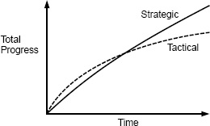
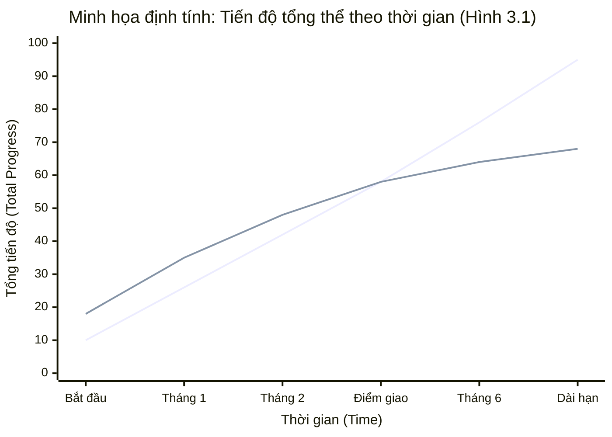

# CHƯƠNG 3: Code Chạy Được Là Chưa Đủ (Chapter 3: Working Code Isn’t Enough)

*(Lập trình Chiến lược so với Lập trình Chiến thuật — Strategic vs. Tactical Programming)*

Một trong những yếu tố quan trọng nhất của thiết kế phần mềm tốt là tư duy mà bạn áp dụng khi tiếp cận một nhiệm vụ lập trình. Nhiều tổ chức khuyến khích tư duy chiến thuật (tactical mindset), tập trung vào việc làm sao để các tính năng chạy được càng nhanh càng tốt. Tuy nhiên, nếu muốn có một thiết kế tốt, bạn phải áp dụng một cách tiếp cận mang tính chiến lược hơn, nơi bạn đầu tư thời gian để tạo ra các thiết kế gọn gàng, sạch sẽ và giải quyết triệt để các vấn đề. Chương này thảo luận lý do tại sao cách tiếp cận chiến lược tạo ra thiết kế tốt hơn và thực tế lại tiết kiệm chi phí hơn so với cách tiếp cận chiến thuật về lâu dài.

## 3.1 Lập trình chiến thuật (Tactical programming)

Hầu hết các lập trình viên tiếp cận việc phát triển phần mềm với một tư duy mà tôi gọi là **lập trình chiến thuật** (*tactical programming*). Trong cách tiếp cận chiến thuật, trọng tâm chính của bạn là làm cho một thứ gì đó chạy được, chẳng hạn như một tính năng mới hoặc một bản vá lỗi. Thoạt nhìn, điều này có vẻ hoàn toàn hợp lý: còn gì quan trọng hơn việc viết ra đoạn code chạy được chứ? Tuy nhiên, lập trình chiến thuật khiến việc tạo ra một thiết kế hệ thống tốt gần như là bất khả thi.

Vấn đề của lập trình chiến thuật nằm ở chỗ nó thiển cận. Nếu bạn đang lập trình theo kiểu chiến thuật, bạn đang cố gắng hoàn thành một nhiệm vụ càng nhanh càng tốt. Có thể bạn đang phải đối mặt với một hạn chót (deadline) gắt gao. Hệ quả là việc lập kế hoạch cho tương lai không phải là ưu tiên hàng đầu. Bạn không dành nhiều thời gian để tìm kiếm thiết kế tốt nhất; bạn chỉ muốn sớm có thứ gì đó chạy được. Bạn tự nhủ rằng việc thêm một chút phức tạp hoặc đưa vào một vài giải pháp chắp vá (*kludge*) nhỏ là chấp nhận được, miễn là điều đó giúp nhiệm vụ hiện tại hoàn thành nhanh hơn.

Đây chính là cách mà các hệ thống trở nên phức tạp. Như đã thảo luận ở chương trước, sự phức tạp mang tính tích lũy dần (*incremental*). Không phải một thứ cụ thể nào đó làm cho hệ thống trở nên phức tạp, mà là sự tích tụ của hàng chục hoặc hàng trăm thứ nhỏ nhặt. Nếu bạn lập trình theo kiểu chiến thuật, mỗi nhiệm vụ lập trình sẽ đóng góp thêm một vài phần phức tạp như vậy. Mỗi phần trong số đó có lẽ đều có vẻ là một sự đánh đổi hợp lý để hoàn thành nhiệm vụ hiện tại một cách nhanh chóng. Tuy nhiên, các yếu tố phức tạp tích tụ rất nhanh, đặc biệt nếu mọi người trong nhóm đều lập trình theo kiểu chiến thuật.

Chẳng bao lâu sau, một số yếu tố phức tạp sẽ bắt đầu gây ra vấn đề, và bạn sẽ bắt đầu ước rằng mình đã không đi những lối tắt ban đầu đó. Thế nhưng, bạn lại tự nhủ rằng việc làm cho tính năng tiếp theo chạy được quan trọng hơn là quay lại tái cấu trúc (*refactor*) code hiện có. Việc tái cấu trúc có thể giúp ích về lâu dài, nhưng nó chắc chắn sẽ làm chậm nhiệm vụ hiện tại. Vì vậy, bạn tìm kiếm các bản vá nhanh (*quick patches*) để đi vòng qua bất kỳ vấn đề nào bạn gặp phải. Điều này lại tạo ra thêm nhiều phức tạp hơn, rồi tiếp tục đòi hỏi thêm nhiều bản vá hơn nữa. Chẳng mấy chốc, mã nguồn trở thành một mớ hỗn độn, nhưng đến lúc này mọi thứ đã tệ đến mức phải mất hàng tháng trời làm việc mới dọn dẹp nổi. Không đời nào lịch trình của bạn chịu nổi sự chậm trễ như vậy, và việc sửa một hoặc hai vấn đề dường như cũng chẳng tạo ra nhiều khác biệt, nên bạn cứ thế tiếp tục lập trình chiến thuật.

Nếu bạn từng làm việc trong một dự án phần mềm lớn đủ lâu, tôi tin rằng bạn đã từng chứng kiến lập trình chiến thuật diễn ra và đã nếm trải những vấn đề phát sinh từ nó. Một khi bạn đã bước vào con đường chiến thuật, rất khó để thay đổi.

Hầu như mọi tổ chức phát triển phần mềm đều có ít nhất một lập trình viên đẩy lập trình chiến thuật lên mức cực đoan: một **cơn lốc chiến thuật** (*tactical tornado*). Cơn lốc chiến thuật là một lập trình viên năng suất cao, người tuôn ra code nhanh hơn nhiều so với những người khác nhưng làm việc hoàn toàn theo lối chiến thuật. Khi cần triển khai một tính năng nhanh chóng, không ai làm xong nhanh hơn cơn lốc chiến thuật. Ở một số tổ chức, ban quản lý coi những cơn lốc chiến thuật như những người hùng. Tuy nhiên, cơn lốc chiến thuật để lại sau lưng một vệt tàn phá. Họ hiếm khi được coi là anh hùng trong mắt các kỹ sư phải làm việc với code của họ sau này. Thông thường, các kỹ sư khác phải đi dọn dẹp đống hỗn độn do cơn lốc chiến thuật để lại, điều này khiến những kỹ sư đó (những người anh hùng thực sự) trông có vẻ như đang tiến triển chậm hơn so với cơn lốc chiến thuật.

> 💡 **Ví dụ bổ sung (không có trong sách):**
> Giả sử bạn cần thêm chức năng "giảm giá 10% cho đơn hàng trên 500k" vào một hệ thống thương mại điện tử.
> - **Cách làm chiến thuật:** Bạn tìm đúng hàm `calculateTotal()` ở trang thanh toán, viết thẳng một câu `if (total > 500000) total *= 0.9;` vào đó, rồi copy-paste đoạn `if` tương tự vào hàm gửi email hóa đơn và hàm hiển thị giỏ hàng. Xong trong 15 phút!
> - **Hệ quả tích lũy:** Vài tuần sau, có thêm mã giảm giá theo hạng thành viên, giảm giá ngày lễ, thuế VAT tính trước hay sau giảm giá... Mỗi lần như vậy, một lập trình viên khác lại nhét thêm `if/else` vào cả 3 chỗ. Sau 6 tháng, không ai dám đụng vào logic tính tiền vì sửa một chỗ là chỗ kia sai lệch.

## 3.2 Lập trình chiến lược (Strategic programming)

Bước đầu tiên để trở thành một nhà thiết kế phần mềm giỏi là nhận ra rằng **code chạy được thôi là chưa đủ**. Việc đưa vào những phức tạp không cần thiết chỉ để hoàn thành nhiệm vụ hiện tại nhanh hơn là điều không thể chấp nhận được. Điều quan trọng nhất là **cấu trúc dài hạn của hệ thống**. Hầu hết mã nguồn trong bất kỳ hệ thống nào đều được viết bằng cách mở rộng cơ sở mã nguồn (*code base*) hiện có, vì vậy công việc quan trọng nhất của bạn với tư cách là một lập trình viên là tạo điều kiện thuận lợi cho những lần mở rộng trong tương lai đó. Do đó, bạn không nên coi "code chạy được" là mục tiêu chính của mình, mặc dù dĩ nhiên code của bạn phải chạy được. Mục tiêu chính của bạn phải là tạo ra một **thiết kế tuyệt vời**, mà thiết kế đó đồng thời cũng chạy được. Đây chính là **lập trình chiến lược** (*strategic programming*).

Lập trình chiến lược đòi hỏi một **tư duy đầu tư** (*investment mindset*). Thay vì chọn con đường nhanh nhất để hoàn thành dự án hiện tại, bạn phải đầu tư thời gian để cải thiện thiết kế của hệ thống. Những khoản đầu tư này sẽ làm bạn chậm lại một chút trong ngắn hạn, nhưng chúng sẽ giúp bạn tăng tốc trong dài hạn, như được minh họa trong **Hình 3.1**.

Một số khoản đầu tư sẽ mang tính **chủ động** (*proactive*). Ví dụ, rất đáng để dành thêm một chút thời gian nhằm tìm ra một thiết kế đơn giản cho mỗi lớp (*class*) mới; thay vì triển khai ngay ý tưởng đầu tiên nảy ra trong đầu, hãy thử một vài thiết kế thay thế và chọn ra phương án gọn gàng nhất. Hãy cố gắng hình dung một vài cách mà hệ thống có thể cần phải thay đổi trong tương lai và đảm bảo rằng điều đó sẽ dễ dàng thực hiện với thiết kế của bạn. Viết tài liệu hướng dẫn (*documentation*) tốt cũng là một ví dụ khác của đầu tư chủ động.

Những khoản đầu tư khác sẽ mang tính **phản ứng** (*reactive* — phản hồi lại vấn đề phát sinh). Dù bạn có đầu tư trước nhiều đến đâu, chắc chắn vẫn sẽ có những sai lầm trong các quyết định thiết kế của mình. Theo thời gian, những sai lầm này sẽ trở nên rõ ràng. Khi bạn phát hiện ra một vấn đề về thiết kế, đừng chỉ phớt lờ nó hoặc vá víu xung quanh nó; hãy dành thêm một chút thời gian để sửa chữa nó. Nếu bạn lập trình một cách chiến lược, bạn sẽ liên tục thực hiện những cải tiến nhỏ đối với thiết kế hệ thống. Điều này hoàn toàn trái ngược với lập trình chiến thuật, nơi bạn liên tục thêm vào những mẩu phức tạp nhỏ gây ra vấn đề trong tương lai.

> 📝 **Giải thích thêm (không có trong sách):**
> Điểm khác biệt cốt lõi giữa **đầu tư chủ động** và **đầu tư phản ứng** trong lập trình chiến lược:
> - **Chủ động (Proactive):** Làm tốt ngay từ lúc thiết kế tính năng mới — suy nghĩ 2–3 phương án API/class, chọn phương án đơn giản và dễ mở rộng nhất, viết comment/tài liệu rõ ràng.
> - **Phản ứng (Reactive):** Áp dụng "Quy tắc Hướng đạo sinh" (*Boy Scout Rule*) — khi chạm vào một đoạn code cũ để sửa lỗi hoặc thêm tính năng và thấy thiết kế của nó bộc lộ điểm yếu, bạn chủ động tái cấu trúc gọn gàng lại thay vì đắp thêm bản vá lên trên.

## 3.3 Đầu tư bao nhiêu là đủ? (How much to invest?)

Vậy, mức đầu tư bao nhiêu là hợp lý? Một khoản đầu tư khổng lồ ngay từ đầu, chẳng hạn như cố gắng thiết kế toàn bộ hệ thống từ A đến Z, sẽ không hiệu quả. Đó là phương pháp thác nước (*waterfall method*), và chúng ta đều biết nó không hiệu quả. Thiết kế lý tưởng có xu hướng hình thành từng chút một, khi bạn tích lũy được kinh nghiệm thực tế với hệ thống. Do đó, cách tiếp cận tốt nhất là thực hiện **nhiều khoản đầu tư nhỏ một cách liên tục**. Tôi đề xuất dành khoảng **10–20%** tổng thời gian phát triển của bạn cho các khoản đầu tư này. Mức này đủ nhỏ để không ảnh hưởng đáng kể đến lịch trình của bạn, nhưng đủ lớn để tạo ra những lợi ích đáng kể theo thời gian.

Do đó, các dự án ban đầu của bạn sẽ mất thời gian lâu hơn 10–20% so với khi bạn làm theo cách tiếp cận thuần túy chiến thuật. Khoảng thời gian thêm đó sẽ mang lại một thiết kế phần mềm tốt hơn, và bạn sẽ bắt đầu cảm nhận được lợi ích chỉ trong vòng vài tháng. Sẽ không lâu trước khi bạn phát triển nhanh hơn ít nhất 10–20% so với trường hợp bạn lập trình chiến thuật. Tại thời điểm này, các khoản đầu tư của bạn trở nên **miễn phí**: lợi ích từ những khoản đầu tư trong quá khứ sẽ tiết kiệm đủ thời gian để bù đắp cho chi phí của các khoản đầu tư trong tương lai. Bạn sẽ nhanh chóng thu hồi được chi phí của khoản đầu tư ban đầu. **Hình 3.1** minh họa hiện tượng này.

**Hình 3.1 – Ở giai đoạn đầu, cách tiếp cận lập trình chiến thuật sẽ đạt tiến độ nhanh hơn so với cách tiếp cận chiến lược. Tuy nhiên, sự phức tạp tích tụ nhanh hơn dưới cách tiếp cận chiến thuật, làm giảm năng suất. Theo thời gian, cách tiếp cận chiến lược mang lại tiến độ lớn hơn. Lưu ý: hình này chỉ nhằm mục đích minh họa định tính; tôi không biết có bất kỳ phép đo thực nghiệm nào về hình dạng chính xác của các đường cong này. (Figure 3.1. At the beginning, a tactical approach to programming will make progress more quickly than a strategic approach. However, complexity accumulates more rapidly under the tactical approach, which reduces productivity. Over time, the strategic approach results in greater progress. Note: this figure is intended only as a qualitative illustration; I am not aware of any empirical measurements of the precise shapes of the curves.)**

Ngược lại, nếu bạn lập trình chiến thuật, bạn sẽ hoàn thành các dự án đầu tiên nhanh hơn 10–20%, nhưng theo thời gian tốc độ phát triển của bạn sẽ chậm lại khi sự phức tạp tích tụ. Chẳng bao lâu sau, bạn sẽ lập trình chậm hơn ít nhất 10–20%. Bạn sẽ nhanh chóng trả lại toàn bộ thời gian mình đã tiết kiệm được lúc ban đầu, và trong suốt phần đời còn lại của hệ thống, bạn sẽ phát triển chậm hơn so với việc áp dụng cách tiếp cận chiến lược. Nếu bạn chưa từng làm việc trong một cơ sở mã nguồn bị xuống cấp nghiêm trọng, hãy hỏi một người đã từng trải qua; họ sẽ nói với bạn rằng chất lượng code kém làm chậm quá trình phát triển đi ít nhất 20%.

## 3.4 Startup và việc đầu tư (Startups and investment)

Trong một số môi trường, có những lực lượng mạnh mẽ chống lại cách tiếp cận chiến lược. Ví dụ, các công ty khởi nghiệp (*startup*) giai đoạn đầu cảm thấy áp lực cực lớn trong việc tung ra các phiên bản đầu tiên một cách nhanh chóng. Ở những công ty này, có vẻ như ngay cả mức đầu tư 10–20% cũng là điều không thể chi trả được. Kết quả là nhiều startup chọn cách tiếp cận chiến thuật, dành rất ít công sức cho thiết kế và thậm chí còn ít hơn cho việc dọn dẹp khi vấn đề phát sinh. Họ tự biện minh cho điều này bằng suy nghĩ rằng: nếu thành công, họ sẽ có đủ tiền để thuê thêm kỹ sư về dọn dẹp mọi thứ.

Nếu bạn đang ở trong một công ty có xu hướng đi theo hướng này, bạn nên nhận ra rằng **một khi cơ sở mã nguồn đã biến thành "mì Ý" (*spaghetti code*), gần như không thể sửa chữa được nữa**. Nhiều khả năng bạn sẽ phải trả chi phí phát triển cao trong suốt vòng đời của sản phẩm. Hơn nữa, phần thưởng cho thiết kế tốt (hoặc cái giá của thiết kế tồi) đến khá nhanh, vì vậy rất có khả năng cách tiếp cận chiến thuật thậm chí còn chẳng giúp bạn đẩy nhanh được lần phát hành sản phẩm đầu tiên.

Một điều khác cần cân nhắc là một trong những yếu tố quan trọng nhất quyết định sự thành công của một công ty chính là **chất lượng đội ngũ kỹ sư**. Cách tốt nhất để giảm chi phí phát triển là thuê những kỹ sư xuất sắc: chi phí trả cho họ không cao hơn nhiều so với những kỹ sư tầm trung nhưng năng suất của họ lại cao hơn gấp bội. Tuy nhiên, những kỹ sư giỏi nhất lại quan tâm sâu sắc đến thiết kế tốt. Nếu cơ sở mã nguồn của bạn là một đống đổ nát, tiếng xấu sẽ đồn xa và điều này sẽ khiến bạn khó tuyển dụng hơn. Hệ quả là bạn có khả năng sẽ phải nhận những kỹ sư tầm trung. Điều này sẽ làm tăng chi phí trong tương lai của bạn và có thể khiến cấu trúc hệ thống xuống cấp nặng nề hơn nữa.

Facebook là một ví dụ về một startup đã khuyến khích lập trình chiến thuật. Trong nhiều năm, phương châm của công ty là *"Move fast and break things"* (Đi nhanh và phá vỡ mọi thứ). Các kỹ sư mới tốt nghiệp đại học được khuyến khích lao ngay vào cơ sở mã nguồn của công ty; việc các kỹ sư đẩy commit lên môi trường sản xuất (*production*) ngay trong tuần đầu tiên đi làm là chuyện bình thường. Ở mặt tích cực, Facebook đã xây dựng được danh tiếng là một công ty trao quyền cho nhân viên. Các kỹ sư có quyền tự do rất lớn, và có rất ít quy tắc hay rào cản ngáng đường họ.

Facebook đã thành công rực rỡ trên phương diện một công ty, nhưng cơ sở mã nguồn của họ đã phải gánh chịu hậu quả từ cách tiếp cận chiến thuật của công ty; phần lớn mã nguồn thiếu ổn định và khó hiểu, có rất ít chú thích (*comment*) hay bài kiểm thử (*test*), và rất đau đầu khi phải làm việc cùng. Theo thời gian, công ty nhận ra rằng văn hóa đó không bền vững. Cuối cùng, Facebook đã đổi phương châm thành *"Move fast with solid infrastructure"* (Đi nhanh với hạ tầng vững chắc) để khuyến khích các kỹ sư đầu tư nhiều hơn vào thiết kế tốt. Vẫn còn phải chờ xem liệu Facebook có thể dọn dẹp thành công những vấn đề đã tích tụ qua nhiều năm lập trình chiến thuật hay không.

Để công bằng với Facebook, tôi nên chỉ ra rằng code của Facebook có lẽ cũng không tệ hơn nhiều so với mức trung bình của các startup. Lập trình chiến thuật là chuyện phổ biến ở các startup; Facebook chỉ tình cờ là một ví dụ đặc biệt dễ thấy mà thôi.

May mắn thay, người ta cũng hoàn toàn có thể thành công ở Thung lũng Silicon với cách tiếp cận chiến lược. Google và VMware phát triển lớn mạnh vào cùng thời điểm với Facebook, nhưng cả hai công ty này đều theo đuổi cách tiếp cận mang tính chiến lược hơn. Cả hai công ty đều đặt trọng tâm lớn vào mã nguồn chất lượng cao và thiết kế tốt, và cả hai đều xây dựng được những sản phẩm tinh vi giúp giải quyết các bài toán phức tạp bằng những hệ thống phần mềm đáng tin cậy. Văn hóa kỹ thuật vững mạnh của các công ty này trở nên nổi tiếng khắp Thung lũng Silicon. Rất ít công ty khác có thể cạnh tranh được với họ trong việc thu hút những nhân tài kỹ thuật hàng đầu.

Những ví dụ này cho thấy một công ty có thể thành công với bất kỳ cách tiếp cận nào trong hai cách trên. Tuy nhiên, làm việc trong một công ty coi trọng thiết kế phần mềm và có một cơ sở mã nguồn sạch sẽ mang lại nhiều niềm vui hơn rất nhiều.

> 💡 **Ví dụ bổ sung (không có trong sách):**
> Khi một startup gọi được vốn vòng Series A và muốn "thuê người về viết lại từ đầu" (*rewrite*) hệ thống cũ đầy nợ kỹ thuật, họ thường rơi vào cái bẫy: đội ngũ mới vừa phải duy trì và thêm tính năng cho hệ thống cũ (vì khách hàng đang dùng), vừa phải xây hệ thống mới chạy đuổi theo. Kết quả là cả hai hệ thống đều chậm tiến độ, tốn gấp đôi chi phí mà hệ thống mới chưa chắc đã kịp bắt kịp tính năng của hệ thống cũ.

## 3.5 Kết luận (Conclusion)

Thiết kế tốt không tự nhiên mà có. Nó phải là thứ bạn đầu tư vào một cách liên tục, để những vấn đề nhỏ không tích tụ thành những vấn đề lớn. May mắn thay, thiết kế tốt cuối cùng sẽ tự hoàn vốn, và sớm hơn bạn nghĩ đấy.

Điều tối quan trọng là phải **nhất quán** trong việc áp dụng cách tiếp cận chiến lược và coi việc đầu tư là thứ phải làm **hôm nay, chứ không phải ngày mai**. Khi bạn rơi vào giai đoạn nước rút (*crunch*), bạn sẽ rất dễ bị cám dỗ trì hoãn việc dọn dẹp cho đến khi giai đoạn căng thẳng qua đi. Tuy nhiên, đây là một con dốc trơn trượt (*slippery slope*); sau đợt nước rút hiện tại gần như chắc chắn sẽ có một đợt khác, rồi một đợt nữa sau đó. Một khi bạn bắt đầu trì hoãn các cải tiến thiết kế, những sự trì hoãn đó rất dễ trở thành vĩnh viễn và văn hóa của bạn sẽ trượt dài vào cách tiếp cận chiến thuật. Bạn càng chờ đợi lâu để giải quyết các vấn đề thiết kế, chúng càng trở nên to lớn hơn; các giải pháp trở nên đáng sợ hơn, điều này càng khiến bạn dễ trì hoãn thêm nữa. Cách tiếp cận hiệu quả nhất là nơi mỗi kỹ sư đều thực hiện những khoản đầu tư nhỏ nhưng liên tục vào thiết kế tốt.

---

## Bảng thuật ngữ chương (Chapter Glossary)

| Thuật ngữ (English) | Tiếng Việt | Giải thích ngắn gọn |
| :--- | :--- | :--- |
| **Tactical programming** | Lập trình chiến thuật | Cách tiếp cận tập trung vào việc làm cho tính năng/bản vá chạy được càng nhanh càng tốt, chấp nhận đánh đổi bằng sự phức tạp và giải pháp tạm bợ. |
| **Strategic programming** | Lập trình chiến lược | Cách tiếp cận coi trọng cấu trúc dài hạn và thiết kế tốt của hệ thống, xem việc code chạy được chỉ là điều kiện cần chứ chưa đủ. |
| **Tactical tornado** | Cơn lốc chiến thuật | Lập trình viên viết code cực nhanh nhưng hoàn toàn theo lối chiến thuật, để lại đống code hỗn độn bắt người khác phải dọn dẹp. |
| **Kludge** | Giải pháp chắp vá | Đoạn code hoặc cách xử lý tạm bợ, thiếu gọn gàng, chỉ cốt để chạy được trước mắt. |
| **Investment mindset** | Tư duy đầu tư | Sẵn sàng bỏ thêm 10–20% thời gian hiện tại cho thiết kế và tái cấu trúc để tăng tốc độ phát triển về lâu dài. |
| **Proactive investment** | Đầu tư chủ động | Đầu tư vào thiết kế ngay từ đầu (thử nhiều phương án, thiết kế class sạch sẽ, viết tài liệu) trước khi vấn đề xảy ra. |
| **Reactive investment** | Đầu tư phản ứng | Chủ động sửa chữa ngay khi phát hiện sai lầm hoặc vấn đề thiết kế thay vì vá víu đi vòng qua nó. |
| **Spaghetti code** | Mã nguồn "mì Ý" | Mã nguồn rối rắm, chằng chịt, khó đọc và gần như không thể sửa chữa hoặc mở rộng an toàn. |
| **Crunch** | Giai đoạn nước rút | Khoảng thời gian áp lực cao để kịp hạn chót phát hành sản phẩm. |
