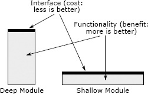
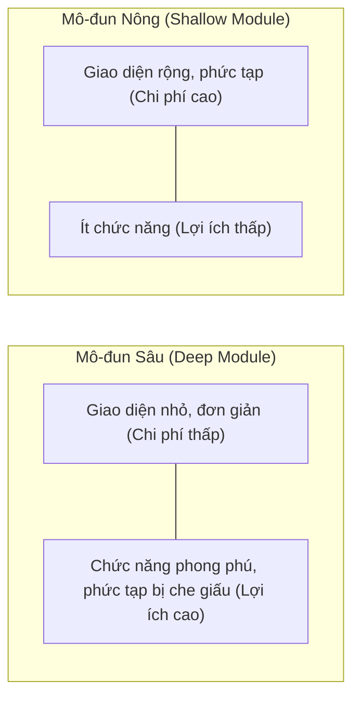

# CHƯƠNG 4: Mô-đun Nên Sâu (Chapter 4: Modules Should Be Deep)

Một trong những kỹ thuật quan trọng nhất để kiểm soát sự phức tạp của phần mềm là thiết kế hệ thống sao cho các lập trình viên chỉ cần đối mặt với một phần nhỏ của tổng thể sự phức tạp tại bất kỳ thời điểm nào. Cách tiếp cận này được gọi là *thiết kế mô-đun* (modular design), và chương này trình bày các nguyên lý cơ bản của nó.

## 4.1 Thiết kế mô-đun (Modular design)

Trong thiết kế mô-đun, một hệ thống phần mềm được phân tách thành một tập hợp các *mô-đun* (module) tương đối độc lập với nhau. Mô-đun có thể tồn tại dưới nhiều hình thức, chẳng hạn như lớp (class), hệ thống con (subsystem), hoặc dịch vụ (service). Trong một thế giới lý tưởng, mỗi mô-đun sẽ hoàn toàn độc lập với các mô-đun khác: một lập trình viên có thể làm việc trên bất kỳ mô-đun nào mà không cần biết bất cứ điều gì về các mô-đun còn lại. Trong thế giới đó, độ phức tạp của cả hệ thống sẽ chỉ bằng độ phức tạp của mô-đun tệ nhất.

Đáng tiếc là lý tưởng này không thể đạt được. Các mô-đun phải phối hợp với nhau bằng cách gọi các hàm hoặc phương thức của nhau. Do đó, các mô-đun buộc phải biết một số thông tin về nhau. Sẽ luôn tồn tại các *sự phụ thuộc* (dependency) giữa các mô-đun: nếu một mô-đun thay đổi, các mô-đun khác có thể phải thay đổi theo để khớp. Ví dụ, các tham số của một phương thức tạo ra sự phụ thuộc giữa phương thức đó và bất kỳ đoạn mã nào gọi đến nó. Nếu các tham số bắt buộc thay đổi, mọi lời gọi phương thức đều phải được sửa đổi để tuân theo chữ ký (signature) mới. Sự phụ thuộc có thể mang nhiều hình thức khác nhau và có thể rất tinh vi. Mục tiêu của thiết kế mô-đun là giảm thiểu sự phụ thuộc giữa các mô-đun.

Để quản lý các sự phụ thuộc, chúng ta hình dung mỗi mô-đun gồm hai phần: một *giao diện* (interface) và một *phần hiện thực* (implementation). Giao diện bao gồm mọi thứ mà một lập trình viên làm việc ở mô-đun khác cần biết để có thể sử dụng mô-đun này. Thông thường, giao diện mô tả mô-đun *làm gì* (what) chứ không mô tả nó *làm như thế nào* (how). Phần hiện thực bao gồm mã nguồn thực thi những lời hứa được đưa ra bởi giao diện. Một lập trình viên làm việc trên một mô-đun cụ thể phải hiểu giao diện và phần hiện thực của chính mô-đun đó, cộng thêm giao diện của bất kỳ mô-đun nào khác được mô-đun này gọi tới. Lập trình viên không cần phải hiểu phần hiện thực của các mô-đun khác ngoài mô-đun mà họ đang trực tiếp làm việc.

Hãy xem xét một mô-đun cài đặt cấu trúc cây cân bằng (balanced tree). Mô-đun này có thể chứa những đoạn mã rất tinh vi để đảm bảo cây luôn giữ trạng thái cân bằng. Tuy nhiên, sự phức tạp này không hề lộ ra với người dùng mô-đun. Người dùng chỉ nhìn thấy một giao diện tương đối đơn giản để gọi các thao tác chèn (insert), xóa (remove) và lấy (fetch) nút trong cây. Để gọi thao tác chèn, bên gọi chỉ cần cung cấp khóa (key) và giá trị (value) cho nút mới; các cơ chế duyệt cây và tách nút hoàn toàn không hiển thị trong giao diện.

Trong phạm vi cuốn sách này, một mô-đun là bất kỳ đơn vị mã nguồn nào có giao diện và phần hiện thực. Mỗi lớp trong một ngôn ngữ lập trình hướng đối tượng là một mô-đun. Các phương thức bên trong một lớp, hoặc các hàm trong một ngôn ngữ không hướng đối tượng, cũng có thể được xem là mô-đun: mỗi đơn vị này đều có giao diện và phần hiện thực, và các kỹ thuật thiết kế mô-đun đều có thể áp dụng cho chúng. Các hệ thống con và dịch vụ ở tầng cao hơn cũng là mô-đun; giao diện của chúng có thể mang những hình thức khác, chẳng hạn như lời gọi hạt nhân (kernel call) hoặc yêu cầu HTTP (HTTP request). Phần lớn thảo luận về thiết kế mô-đun trong cuốn sách này tập trung vào việc thiết kế lớp, nhưng các kỹ thuật và khái niệm đó cũng áp dụng được cho những loại mô-đun khác.

Những mô-đun tốt nhất là những mô-đun có giao diện đơn giản hơn nhiều so với phần hiện thực của chúng. Những mô-đun như vậy có hai lợi thế. Thứ nhất, một giao diện đơn giản sẽ giảm thiểu sự phức tạp mà mô-đun đó áp đặt lên phần còn lại của hệ thống. Thứ hai, nếu một mô-đun được sửa đổi theo cách không làm thay đổi giao diện của nó, thì không có mô-đun nào khác bị ảnh hưởng bởi sự sửa đổi đó. Nếu giao diện của một mô-đun đơn giản hơn nhiều so với phần hiện thực, sẽ có rất nhiều khía cạnh của mô-đun có thể thay đổi mà không làm ảnh hưởng đến các mô-đun khác.

## 4.2 Giao diện bao gồm những gì? (What’s in an interface?)

Giao diện của một mô-đun chứa hai loại thông tin: *chính thức* (formal) và *phi chính thức* (informal). Các phần chính thức của giao diện được chỉ định rõ ràng trong mã nguồn, và một số phần trong đó có thể được ngôn ngữ lập trình kiểm tra tính đúng đắn. Ví dụ, giao diện chính thức của một phương thức là chữ ký (signature) của nó, bao gồm tên và kiểu dữ liệu của các tham số, kiểu giá trị trả về, cùng thông tin về các ngoại lệ (exception) do phương thức ném ra. Hầu hết các ngôn ngữ lập trình đều đảm bảo rằng mỗi lời gọi phương thức cung cấp đúng số lượng và kiểu đối số khớp với chữ ký của nó. Giao diện chính thức của một lớp bao gồm chữ ký của tất cả các phương thức công khai (public method), cộng với tên và kiểu của bất kỳ biến công khai (public variable) nào.

Mỗi giao diện cũng bao gồm các yếu tố phi chính thức. Đây là những yếu tố không được đặc tả theo cách mà ngôn ngữ lập trình có thể hiểu hoặc cưỡng chế được. Các phần phi chính thức của một giao diện bao gồm hành vi ở mức cao của nó, chẳng hạn như việc một hàm sẽ xóa tệp được đặt tên bởi một trong các đối số của nó. Nếu có những ràng buộc về cách sử dụng một lớp (chẳng hạn như một phương thức phải được gọi trước một phương thức khác), những ràng buộc đó cũng là một phần của giao diện lớp. Nói chung, nếu một lập trình viên cần biết một mẩu thông tin cụ thể để sử dụng một mô-đun, thì thông tin đó chính là một phần của giao diện mô-đun. Các khía cạnh phi chính thức của giao diện chỉ có thể được mô tả bằng chú thích (comment), và ngôn ngữ lập trình không thể đảm bảo rằng phần mô tả đó đầy đủ hay chính xác[^1]. Đối với hầu hết các giao diện, các khía cạnh phi chính thức thường lớn hơn và phức tạp hơn các khía cạnh chính thức.

Một trong những lợi ích của một giao diện được đặc tả rõ ràng là nó chỉ ra chính xác những gì lập trình viên cần biết để sử dụng mô-đun tương ứng. Điều này giúp loại bỏ vấn đề “những điều không biết mà ta không hề hay biết” (*unknown unknowns*) đã được mô tả trong Mục 2.2.

> 💡 **Ví dụ bổ sung (không có trong sách):** Hãy xét một phương thức Java `void transfer(Account from, Account to, BigDecimal amount)`.
> - **Giao diện chính thức (Formal interface):** Tên hàm `transfer`, 2 tham số kiểu `Account`, 1 tham số kiểu `BigDecimal`, trả về `void`. Trình biên dịch kiểm tra được đúng kiểu dữ liệu khi gọi.
> - **Giao diện phi chính thức (Informal interface):** `amount` phải lớn hơn `0`; `from` và `to` không được là cùng một tài khoản; phương thức có đảm bảo tính nguyên tử (atomic) và an toàn luồng (thread-safe) hay không; nếu số dư không đủ thì ném `InsufficientFundsException` hay trả về âm thầm? Tất cả những điều này trình biên dịch không kiểm tra được, nhưng lập trình viên gọi hàm *bắt buộc phải biết* — nên chúng đều thuộc về giao diện.

## 4.3 Trừu tượng hóa (Abstractions)

Thuật ngữ *trừu tượng* (abstraction) có mối liên hệ chặt chẽ với ý tưởng thiết kế mô-đun. Một trừu tượng là một góc nhìn được đơn giản hóa về một thực thể, trong đó lược bỏ những chi tiết không quan trọng. Trừu tượng hữu ích bởi vì chúng giúp chúng ta dễ dàng suy nghĩ và thao tác với những thứ phức tạp hơn.

Trong lập trình mô-đun, mỗi mô-đun cung cấp một trừu tượng dưới dạng giao diện của nó. Giao diện trình bày một góc nhìn đơn giản hóa về chức năng của mô-đun; các chi tiết của phần hiện thực là không quan trọng xét từ góc độ trừu tượng của mô-đun, vì vậy chúng được lược bỏ khỏi giao diện.

Trong định nghĩa về trừu tượng, từ **“không quan trọng”** (unimportant) mang tính then chốt. Càng nhiều chi tiết không quan trọng được lược bỏ khỏi một trừu tượng thì càng tốt. Tuy nhiên, một chi tiết chỉ có thể được lược bỏ khỏi trừu tượng nếu nó thực sự không quan trọng. Một trừu tượng có thể bị sai theo hai cách:
1. Thứ nhất, nó có thể **bao gồm những chi tiết thực ra không quan trọng**; khi điều này xảy ra, nó làm cho trừu tượng trở nên phức tạp hơn mức cần thiết, làm tăng tải nhận thức (cognitive load) lên các lập trình viên sử dụng trừu tượng đó.
2. Sai lầm thứ hai là khi một trừu tượng **lược bỏ những chi tiết thực sự quan trọng**. Điều này dẫn đến sự *mơ hồ* (obscurity): lập trình viên chỉ nhìn vào trừu tượng sẽ không có đủ thông tin cần thiết để sử dụng trừu tượng đó một cách chính xác. Một trừu tượng lược bỏ các chi tiết quan trọng là một *trừu tượng giả tạo* (false abstraction): thoạt nhìn nó có vẻ đơn giản, nhưng thực tế lại không phải vậy. Chìa khóa để thiết kế trừu tượng là hiểu rõ điều gì là quan trọng, và tìm kiếm những thiết kế giúp giảm thiểu lượng thông tin quan trọng đó.

Ví dụ, hãy xem xét một hệ thống tệp (file system). Trừu tượng do hệ thống tệp cung cấp lược bỏ nhiều chi tiết, chẳng hạn như cơ chế chọn các khối (block) nào trên thiết bị lưu trữ để chứa dữ liệu của một tệp cụ thể. Những chi tiết này không quan trọng đối với người dùng hệ thống tệp (miễn là hệ thống đạt hiệu năng thỏa đáng). Tuy nhiên, một số chi tiết trong phần hiện thực của hệ thống tệp lại rất quan trọng đối với người dùng. Hầu hết các hệ thống tệp lưu đệm (cache) dữ liệu trong bộ nhớ chính, và có thể trì hoãn việc ghi dữ liệu mới xuống thiết bị lưu trữ nhằm cải thiện hiệu năng. Một số ứng dụng, chẳng hạn như cơ sở dữ liệu (database), cần biết chính xác khi nào dữ liệu được ghi thẳng xuống thiết bị lưu trữ để có thể đảm bảo dữ liệu được bảo toàn sau khi hệ thống gặp sự cố (crash). Do đó, các quy tắc về việc đẩy dữ liệu (flush) xuống bộ nhớ thứ cấp phải được hiển thị trong giao diện của hệ thống tệp.

Chúng ta dựa vào trừu tượng để kiểm soát sự phức tạp không chỉ trong lập trình, mà ở khắp mọi nơi trong đời sống hằng ngày. Một lò vi sóng chứa các mạch điện tử phức tạp để chuyển đổi dòng điện xoay chiều thành bức xạ vi sóng và phân phối bức xạ đó khắp khoang nấu. May mắn thay, người dùng chỉ thấy một trừu tượng đơn giản hơn nhiều, gồm vài nút bấm để điều chỉnh thời gian và cường độ vi sóng. Ô tô cung cấp một trừu tượng đơn giản cho phép chúng ta lái xe mà không cần hiểu cơ chế của động cơ điện, quản lý năng lượng pin, phanh chống bó cứng ABS, hệ thống kiểm soát hành trình (cruise control), v.v.

> 📝 **Giải thích thêm (không có trong sách):** Hai lỗi phổ biến khi thiết kế trừu tượng (API/lớp) thường gặp trong thực tế:
> - **Rò rỉ chi tiết thừa (Over-exposure):** Một hàm `sendEmail(String smtpHost, int smtpPort, boolean useTls, String from, String to, String body)` bắt mọi nơi gọi phải biết cấu hình SMTP. Thông tin hạ tầng này không quan trọng với người chỉ muốn gửi email nghiệp vụ.
> - **Trừu tượng giả tạo (False abstraction):** Một hàm `saveUser(User u)` giấu luôn việc nó thực hiện bất đồng bộ (async) và có thể âm thầm thất bại sau khi hàm đã trả về. Chi tiết "lưu bất đồng bộ hay đồng bộ" là *cực kỳ quan trọng* với bên gọi nếu bước tiếp theo phụ thuộc vào việc `User` đã nằm trong DB hay chưa.

## 4.4 Mô-đun sâu (Deep modules)

Những mô-đun tốt nhất là những mô-đun cung cấp chức năng mạnh mẽ nhưng lại có giao diện đơn giản. Tôi dùng thuật ngữ *sâu* (deep) để mô tả những mô-đun như vậy. Để hình dung khái niệm chiều sâu, hãy tưởng tượng mỗi mô-đun được biểu diễn bằng một hình chữ nhật, như minh họa trong Hình 4.1. Diện tích của mỗi hình chữ nhật tỷ lệ thuận với lượng chức năng mà mô-đun đó hiện thực. Cạnh trên của hình chữ nhật đại diện cho giao diện của mô-đun; độ dài của cạnh đó biểu thị độ phức tạp của giao diện. Những mô-đun tốt nhất là những mô-đun sâu: chúng có rất nhiều chức năng được ẩn giấu đằng sau một giao diện đơn giản. Một mô-đun sâu là một trừu tượng tốt bởi vì chỉ một phần rất nhỏ sự phức tạp bên trong của nó bị lộ ra cho người dùng.



**Hình 4.1 – Mô-đun sâu và mô-đun nông (Figure 4.1. Deep and shallow modules):** Những mô-đun tốt nhất là những mô-đun sâu: chúng cho phép truy cập rất nhiều chức năng thông qua một giao diện đơn giản. Một mô-đun nông là mô-đun có giao diện tương đối phức tạp, nhưng chức năng lại không nhiều: nó không che giấu được bao nhiêu sự phức tạp.



Chiều sâu của mô-đun là một cách tư duy về *chi phí so với lợi ích* (cost versus benefit). Lợi ích mà một mô-đun mang lại chính là chức năng của nó. Chi phí của một mô-đun (xét theo độ phức tạp hệ thống) chính là giao diện của nó. Giao diện của một mô-đun đại diện cho sự phức tạp mà mô-đun đó áp đặt lên phần còn lại của hệ thống: giao diện càng nhỏ và càng đơn giản thì nó càng đưa ít sự phức tạp vào hệ thống. Những mô-đun tốt nhất là những mô-đun mang lại lợi ích lớn nhất với chi phí nhỏ nhất. Giao diện là thứ tốt, nhưng giao diện nhiều hơn hoặc lớn hơn không nhất thiết là tốt hơn!

Cơ chế nhập/xuất tệp (file I/O) do hệ điều hành Unix và các hậu duệ của nó như Linux cung cấp là một ví dụ tuyệt đẹp về một giao diện sâu. Chỉ có năm lời gọi hệ thống (system call) cơ bản cho I/O, với các chữ ký rất đơn giản:

```c
int open(const char* path, int flags, mode_t permissions);
ssize_t read(int fd, void* buffer, size_t count);
ssize_t write(int fd, const void* buffer, size_t count);
off_t lseek(int fd, off_t offset, int referencePosition);
int close(int fd);
```

Lời gọi hệ thống `open` nhận vào một tên tệp phân cấp như `/a/b/c` và trả về một bộ mô tả tệp (file descriptor) kiểu số nguyên, được dùng để tham chiếu đến tệp đang mở. Các đối số khác của `open` cung cấp thông tin tùy chọn chẳng hạn như tệp được mở để đọc hay ghi, có tạo tệp mới nếu chưa tồn tại hay không, và quyền truy cập của tệp nếu tệp mới được tạo. Các lời gọi hệ thống `read` và `write` truyền thông tin qua lại giữa các vùng đệm (buffer) trong bộ nhớ của ứng dụng và tệp; `close` kết thúc việc truy cập tệp. Hầu hết các tệp được truy cập tuần tự, nên đó là hành vi mặc định; tuy nhiên, việc truy cập ngẫu nhiên (random access) có thể thực hiện được bằng cách gọi lời gọi hệ thống `lseek` để thay đổi vị trí truy cập hiện tại.

Một bản hiện thực hiện đại của giao diện Unix I/O đòi hỏi hàng trăm nghìn dòng mã, giải quyết hàng loạt vấn đề phức tạp như:
- Làm thế nào để biểu diễn tệp trên đĩa nhằm cho phép truy cập hiệu quả?
- Làm thế nào để lưu trữ các thư mục, và xử lý tên đường dẫn phân cấp ra sao để tìm thấy các tệp mà chúng tham chiếu tới?
- Làm thế nào để cưỡng chế quyền truy cập, sao cho người dùng này không thể sửa đổi hoặc xóa tệp của người dùng khác?
- Các thao tác truy cập tệp được hiện thực như thế nào? Ví dụ, chức năng được phân chia ra sao giữa trình xử lý ngắt (interrupt handler) và mã chạy nền (background code), và hai thành phần này giao tiếp an toàn với nhau bằng cách nào?
- Những chính sách lập lịch (scheduling policy) nào được sử dụng khi có nhiều truy cập đồng thời vào nhiều tệp?
- Làm thế nào để lưu đệm dữ liệu tệp vừa truy cập vào bộ nhớ nhằm giảm số lần truy cập đĩa?
- Làm thế nào để tích hợp nhiều loại thiết bị lưu trữ thứ cấp khác nhau, như ổ đĩa cứng và ổ flash, vào cùng một hệ thống tệp?

Tất cả những vấn đề này, và nhiều vấn đề khác nữa, đều được xử lý bởi phần hiện thực của hệ thống tệp Unix; chúng hoàn toàn vô hình đối với các lập trình viên gọi các lời gọi hệ thống. Các bản hiện thực của giao diện Unix I/O đã tiến hóa một cách triệt để qua nhiều năm, nhưng năm lời gọi hạt nhân cơ bản đó thì vẫn không hề thay đổi.

Một ví dụ khác về mô-đun sâu là bộ thu gom rác (garbage collector) trong một ngôn ngữ như Go hoặc Java. Mô-đun này thậm chí không có giao diện nào cả; nó hoạt động âm thầm đằng sau hậu trường để thu hồi bộ nhớ không còn sử dụng. Việc bổ sung bộ thu gom rác vào một hệ thống thực chất còn làm *thu hẹp* giao diện tổng thể của hệ thống đó, vì nó loại bỏ giao diện dành cho việc giải phóng đối tượng. Phần hiện thực của một bộ thu gom rác khá phức tạp, nhưng sự phức tạp đó được che giấu hoàn toàn khỏi các lập trình viên sử dụng ngôn ngữ.

Những mô-đun sâu như Unix I/O và bộ thu gom rác mang lại các trừu tượng mạnh mẽ bởi vì chúng dễ sử dụng, đồng thời che giấu được lượng lớn sự phức tạp trong phần hiện thực.

## 4.5 Mô-đun nông (Shallow modules)

Ngược lại, một *mô-đun nông* (shallow module) là mô-đun có giao diện tương đối phức tạp so với chức năng mà nó cung cấp. Ví dụ, một lớp cài đặt danh sách liên kết (linked list) là một mô-đun nông. Không tốn nhiều mã nguồn để thao tác với danh sách liên kết (việc chèn hoặc xóa một phần tử chỉ mất vài dòng), vì vậy trừu tượng danh sách liên kết không che giấu được bao nhiêu chi tiết. Độ phức tạp của giao diện danh sách liên kết gần như tương đương với độ phức tạp của phần hiện thực nó. Các lớp nông đôi khi là điều không thể tránh khỏi, nhưng chúng không giúp ích nhiều trong việc kiểm soát sự phức tạp.

Dưới đây là một ví dụ cực đoan về một phương thức nông, lấy từ một đồ án trong lớp thiết kế phần mềm:

```java
private void addNullValueForAttribute(String attribute) {
    data.put(attribute, null);
}
```

Xét từ góc độ kiểm soát sự phức tạp, phương thức này làm mọi thứ tệ hơn chứ không tốt hơn. Phương thức không hề mang lại trừu tượng nào, vì toàn bộ chức năng của nó đã lộ hết qua giao diện. Ví dụ, bên gọi có lẽ vẫn cần biết rằng thuộc tính đó sẽ được lưu vào biến `data`. Việc suy nghĩ về giao diện chẳng hề đơn giản hơn so với việc suy nghĩ về toàn bộ phần hiện thực. Nếu phương thức được viết tài liệu (document) một cách tử tế, phần tài liệu sẽ còn dài hơn cả mã nguồn của chính phương thức đó. Thậm chí số lần gõ phím để gọi phương thức này còn nhiều hơn so với việc để bên gọi tự thao tác trực tiếp với biến `data`. Phương thức này làm tăng thêm sự phức tạp (dưới dạng một giao diện mới để lập trình viên phải học) nhưng lại không mang lại lợi ích bù đắp nào.

> 🚩 **Cờ Đỏ (Red Flag — Mô-đun Nông / Shallow Module):** Một mô-đun nông là mô-đun có giao diện phức tạp so với chức năng mà nó cung cấp. Các mô-đun nông không giúp ích nhiều trong cuộc chiến chống lại sự phức tạp, bởi vì lợi ích mà chúng mang lại (không phải tìm hiểu cách chúng hoạt động bên trong) bị triệt tiêu bởi chi phí phải học và sử dụng giao diện của chúng. Các mô-đun nhỏ có xu hướng trở nên nông.

## 4.6 Bệnh cuồng chia nhỏ lớp (Classitis)

Đáng tiếc là giá trị của các lớp sâu ngày nay chưa được đánh giá đúng mức. Quan niệm thông thường trong giới lập trình cho rằng các lớp nên *nhỏ*, chứ không phải *sâu*. Sinh viên thường được dạy rằng điều quan trọng nhất trong thiết kế lớp là chia nhỏ các lớp lớn thành nhiều lớp nhỏ hơn. Lời khuyên tương tự cũng thường được đưa ra đối với các phương thức: “Bất kỳ phương thức nào dài hơn $N$ dòng đều nên được chia thành nhiều phương thức” ($N$ có thể thấp tới mức 10). Cách tiếp cận này tạo ra một số lượng lớn các lớp và phương thức nông, làm tăng thêm độ phức tạp tổng thể của hệ thống.

Thái cực của cách tiếp cận “các lớp nên nhỏ” là một hội chứng mà tôi gọi là *bệnh cuồng chia nhỏ lớp* (classitis), bắt nguồn từ quan điểm sai lầm rằng “lớp là tốt, nên càng nhiều lớp càng tốt”. Trong các hệ thống mắc bệnh classitis, lập trình viên được khuyến khích tối thiểu hóa lượng chức năng trong mỗi lớp mới: nếu bạn muốn thêm chức năng, hãy tạo thêm lớp mới. Classitis có thể tạo ra những lớp nhìn riêng lẻ thì đơn giản, nhưng nó làm tăng độ phức tạp của toàn hệ thống. Các lớp nhỏ không đóng góp được nhiều chức năng, nên buộc phải có rất nhiều lớp như vậy, mỗi lớp lại mang theo một giao diện riêng. Những giao diện này tích tụ lại tạo thành một sự phức tạp khổng lồ ở cấp độ hệ thống. Các lớp nhỏ cũng dẫn đến một phong cách lập trình rườm rà, do phần mã khung (boilerplate) bắt buộc phải có cho mỗi lớp.

> 💡 **Ví dụ bổ sung (không có trong sách):** Trong nhiều dự án doanh nghiệp (enterprise), người ta tách một thao tác đơn giản thành 5–6 lớp: `UserController` -> `UserFacade` -> `UserService` -> `UserServiceImpl` -> `UserRepository` -> `UserMapper`, trong khi hầu hết các lớp ở giữa chỉ chuyển tiếp lời gọi (pass-through) mà không thêm giá trị hay che giấu độ phức tạp nào. Mỗi lớp đều là một mô-đun nông buộc lập trình viên phải nhảy qua 6 tệp chỉ để đọc hoặc sửa một luồng nghiệp vụ đơn giản.

## 4.7 Ví dụ: Java và Unix I/O (Examples: Java and Unix I/O)

Một trong những ví dụ dễ thấy nhất về bệnh classitis ngày nay là thư viện lớp chuẩn của Java. Bản thân ngôn ngữ Java không hề bắt buộc phải có hàng loạt lớp nhỏ, nhưng một văn hóa classitis dường như đã bén rễ trong cộng đồng lập trình Java. Chẳng hạn, để mở một tệp nhằm đọc các đối tượng đã tuần tự hóa (serialized object) từ đó, bạn phải tạo ra ba đối tượng khác nhau:

```java
FileInputStream fileStream =
    new FileInputStream(fileName);
BufferedInputStream bufferedStream =
    new BufferedInputStream(fileStream);
ObjectInputStream objectStream =
    new ObjectInputStream(bufferedStream);
```

Một đối tượng `FileInputStream` chỉ cung cấp khả năng I/O thô sơ: nó không thể thực hiện I/O có bộ đệm (buffered I/O), cũng không thể đọc hay ghi các đối tượng tuần tự hóa. Đối tượng `BufferedInputStream` bổ sung tính năng đệm cho `FileInputStream`, còn `ObjectInputStream` bổ sung khả năng đọc và ghi các đối tượng tuần tự hóa. Hai đối tượng đầu tiên trong đoạn mã trên, `fileStream` và `bufferedStream`, không bao giờ được dùng tới nữa sau khi tệp đã được mở; mọi thao tác về sau đều sử dụng `objectStream`.

Điều đặc biệt phiền phức (và dễ gây lỗi) là việc dùng bộ đệm phải được yêu cầu một cách tường minh bằng cách tạo một đối tượng `BufferedInputStream` riêng biệt; nếu một lập trình viên quên tạo đối tượng này, hệ thống sẽ không có bộ đệm và tốc độ I/O sẽ rất chậm. Có lẽ các tác giả Java sẽ lập luận rằng không phải ai cũng muốn dùng bộ đệm cho file I/O, nên không nên tích hợp sẵn nó vào cơ chế nền tảng. Họ có thể lý giải rằng tốt hơn là tách riêng phần đệm ra để mọi người tự chọn có dùng hay không. Việc cung cấp sự lựa chọn là tốt, nhưng các giao diện nên được thiết kế sao cho *trường hợp phổ biến* (common case) trở nên đơn giản nhất có thể (xem công thức ở trang 6). Hầu hết mọi người dùng file I/O đều muốn có bộ đệm, vì vậy nó nên được cung cấp mặc định. Đối với số ít tình huống không mong muốn dùng bộ đệm, thư viện có thể cung cấp một cơ chế để tắt nó đi. Bất kỳ cơ chế nào dùng để tắt bộ đệm nên được tách bạch gọn gàng trong giao diện (ví dụ, bằng cách cung cấp một hàm khởi tạo khác cho `FileInputStream`, hoặc thông qua một phương thức để tắt hay thay thế cơ chế đệm), sao cho đa số lập trình viên thậm chí không cần biết đến sự tồn tại của nó.

Ngược lại, các nhà thiết kế lời gọi hệ thống Unix đã làm cho trường hợp phổ biến trở nên đơn giản. Ví dụ, họ nhận thấy rằng I/O tuần tự là phổ biến nhất, nên họ biến đó thành hành vi mặc định. Truy cập ngẫu nhiên vẫn tương đối dễ thực hiện bằng lời gọi hệ thống `lseek`, nhưng một lập trình viên chỉ thực hiện truy cập tuần tự thì không cần phải biết đến cơ chế đó. Nếu một giao diện có nhiều tính năng, nhưng hầu hết lập trình viên chỉ cần biết đến một vài tính năng trong số đó, thì độ phức tạp thực tế (effective complexity) của giao diện đó chỉ ngang với độ phức tạp của những tính năng thường dùng mà thôi.

## 4.8 Kết luận (Conclusion)

Bằng cách tách biệt giao diện của một mô-đun khỏi phần hiện thực của nó, chúng ta có thể che giấu sự phức tạp của phần hiện thực khỏi phần còn lại của hệ thống. Người dùng một mô-đun chỉ cần hiểu trừu tượng do giao diện của nó cung cấp. Vấn đề quan trọng nhất khi thiết kế các lớp và những mô-đun khác là làm cho chúng *sâu*, sao cho chúng có giao diện đơn giản cho các trường hợp sử dụng phổ biến, nhưng vẫn cung cấp lượng chức năng đáng kể. Điều này giúp tối đa hóa lượng sự phức tạp được che giấu.

---

[^1]: Có tồn tại những ngôn ngữ, chủ yếu trong cộng đồng nghiên cứu, nơi hành vi tổng thể của một phương thức hoặc hàm có thể được mô tả một cách hình thức bằng một ngôn ngữ đặc tả (specification language). Bản đặc tả này có thể được kiểm tra tự động để đảm bảo nó khớp với phần hiện thực. Một câu hỏi thú vị là liệu một bản đặc tả hình thức như vậy có thể thay thế được các phần phi chính thức của một giao diện hay không. Quan điểm hiện tại của tôi là một giao diện được mô tả bằng tiếng Anh (ngôn ngữ tự nhiên) nhiều khả năng vẫn sẽ trực quan và dễ hiểu hơn đối với các lập trình viên so với một giao diện được viết bằng ngôn ngữ đặc tả hình thức.

## Bảng thuật ngữ chương (Chapter Glossary)

| Thuật ngữ (English) | Tiếng Việt | Giải thích ngắn gọn |
| --- | --- | --- |
| Modular design | Thiết kế mô-đun | Cách tiếp cận phân tách hệ thống thành các mô-đun tương đối độc lập để kiểm soát sự phức tạp. |
| Module | Mô-đun | Bất kỳ đơn vị mã nguồn nào có giao diện và phần hiện thực (lớp, hàm, hệ thống con, dịch vụ). |
| Interface | Giao diện | Toàn bộ thông tin (chính thức và phi chính thức) mà lập trình viên khác cần biết để sử dụng mô-đun. |
| Implementation | Phần hiện thực | Mã nguồn bên trong thực thi những cam kết mà giao diện đưa ra. |
| Formal interface | Giao diện chính thức | Phần giao diện được đặc tả tường minh trong mã nguồn (chữ ký hàm, kiểu dữ liệu, ngoại lệ) và có thể được ngôn ngữ kiểm tra. |
| Informal interface | Giao diện phi chính thức | Hành vi mức cao và các ràng buộc sử dụng không thể được ngôn ngữ lập trình kiểm tra, chỉ mô tả qua chú thích. |
| Abstraction | Trừu tượng | Góc nhìn đơn giản hóa về một thực thể bằng cách lược bỏ các chi tiết không quan trọng. |
| False abstraction | Trừu tượng giả tạo | Trừu tượng thoạt nhìn đơn giản nhưng lại lược bỏ những chi tiết thực sự quan trọng, gây mơ hồ cho người dùng. |
| Deep module | Mô-đun sâu | Mô-đun cung cấp nhiều chức năng mạnh mẽ ẩn sau một giao diện đơn giản. |
| Shallow module | Mô-đun nông | Mô-đun có giao diện tương đối phức tạp so với lượng chức năng ít ỏi mà nó cung cấp. |
| Classitis | Bệnh cuồng chia nhỏ lớp | Hội chứng chia hệ thống thành quá nhiều lớp nhỏ và nông, làm tăng tổng độ phức tạp giao diện và mã khung. |
