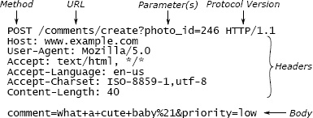

# CHƯƠNG 5: Ẩn giấu thông tin (và Rò rỉ thông tin) (Chapter 5: Information Hiding (and Leakage))

Chương 4 đã lập luận rằng các module nên sâu (*deep*). Chương này, cùng với một vài chương tiếp theo, sẽ thảo luận về các kỹ thuật để tạo ra những module sâu.

---

## 5.1 Ẩn giấu thông tin (Information hiding)

Kỹ thuật quan trọng nhất để đạt được các module sâu là **ẩn giấu thông tin** (*information hiding*). Kỹ thuật này được David Parnas mô tả lần đầu tiên.[^1] Ý tưởng cơ bản là mỗi module nên đóng gói (*encapsulate*) một vài mẩu tri thức (*pieces of knowledge*), đại diện cho các quyết định thiết kế (*design decisions*). Tri thức đó được nhúng trong phần triển khai (*implementation*) của module nhưng không xuất hiện trong giao diện (*interface*) của nó, do đó các module khác không thể nhìn thấy được.

Thông tin được ẩn giấu bên trong một module thường bao gồm các chi tiết về cách triển khai một cơ chế nào đó. Dưới đây là một số ví dụ về thông tin có thể được ẩn giấu bên trong một module:

- Cách lưu trữ thông tin trong một cây B-tree, và cách truy cập nó một cách hiệu quả.
- Cách xác định khối đĩa vật lý (*physical disk block*) tương ứng với mỗi khối logic (*logical block*) bên trong một tệp.
- Cách triển khai giao thức mạng TCP.
- Cách lập lịch các luồng (*threads*) trên một bộ xử lý đa nhân (*multi-core processor*).
- Cách phân tích cú pháp (*parse*) các tài liệu JSON.

Thông tin được ẩn giấu bao gồm các cấu trúc dữ liệu và thuật toán liên quan đến cơ chế đó. Nó cũng có thể bao gồm các chi tiết ở tầng thấp hơn như kích thước của một trang (*page*), và có thể bao gồm cả các khái niệm ở tầng cao hơn, trừu tượng hơn, chẳng hạn như giả định rằng hầu hết các tệp đều nhỏ.

Ẩn giấu thông tin làm giảm độ phức tạp theo hai cách. Thứ nhất, nó đơn giản hóa giao diện của một module. Giao diện phản ánh một góc nhìn đơn giản hơn, trừu tượng hơn về chức năng của module và che giấu đi các chi tiết; điều này làm giảm tải nhận thức (*cognitive load*) cho các lập trình viên sử dụng module đó. Chẳng hạn, một lập trình viên sử dụng lớp B-tree không cần phải lo lắng về hệ số phân nhánh (*fanout*) lý tưởng cho các nút trong cây hay cách giữ cho cây luôn cân bằng. Thứ hai, ẩn giấu thông tin giúp việc phát triển và tiến hóa hệ thống trở nên dễ dàng hơn. Nếu một mẩu thông tin được ẩn giấu, sẽ không có sự phụ thuộc nào vào thông tin đó bên ngoài module chứa nó, vì vậy một thay đổi thiết kế liên quan đến thông tin đó sẽ chỉ ảnh hưởng đến duy nhất một module. Ví dụ, nếu giao thức TCP thay đổi (chẳng hạn để đưa vào một cơ chế mới cho việc kiểm soát tắc nghẽn), phần triển khai của giao thức sẽ phải được sửa đổi, nhưng không cần bất kỳ thay đổi nào trong mã nguồn ở tầng cao hơn vốn sử dụng TCP để gửi và nhận dữ liệu.

Khi thiết kế một module mới, bạn nên suy nghĩ cẩn thận về những thông tin nào có thể được ẩn giấu trong module đó. Nếu bạn có thể ẩn giấu nhiều thông tin hơn, bạn cũng sẽ có thể đơn giản hóa giao diện của module, và điều này làm cho module trở nên sâu hơn.

**Lưu ý:** Việc che giấu các biến và phương thức trong một lớp bằng cách khai báo chúng là `private` không đồng nghĩa với ẩn giấu thông tin. Các phần tử `private` có thể hỗ trợ cho việc ẩn giấu thông tin, vì chúng khiến các thành phần đó không thể bị truy cập trực tiếp từ bên ngoài lớp. Tuy nhiên, thông tin về các thành phần `private` vẫn có thể bị phơi bày thông qua các phương thức `public` như các phương thức *getter* và *setter*. Khi điều này xảy ra, bản chất và cách sử dụng của các biến đó cũng bị phơi bày chẳng khác gì khi chúng được khai báo là `public`.

> 💡 **Ví dụ bổ sung (không có trong sách):**
> Giả sử bạn có lớp `UserSession` lưu trữ thời điểm hết hạn bằng một biến `private long expiresAtEpochMs`. Nếu bạn viết:
> ```java
> public class UserSession {
>     private long expiresAtEpochMs;
>     public long getExpiresAtEpochMs() { return expiresAtEpochMs; }
>     public void setExpiresAtEpochMs(long ts) { this.expiresAtEpochMs = ts; }
> }
> ```
> Mặc dù biến là `private`, nhưng cả tên gọi lẫn kiểu biểu diễn (`EpochMs`) đều bị lộ ra ngoài qua getter/setter. Mọi nơi gọi đều phải tự biết cách lấy thời gian hiện tại theo mili-giây để so sánh, và nếu sau này bạn muốn đổi sang `Instant` hoặc cơ chế gia hạn tự động (*sliding expiration*), toàn bộ code gọi sẽ vỡ. Ngược lại, một thiết kế ẩn giấu thông tin thực sự sẽ chỉ cung cấp các phương thức ở mức trừu tượng cao hơn như `isExpired()` hoặc `extendSession()`.

Hình thức ẩn giấu thông tin tốt nhất là khi thông tin được giấu kín hoàn toàn bên trong một module, sao cho nó trở nên không liên quan và vô hình đối với người dùng của module. Tuy nhiên, ẩn giấu thông tin một phần (*partial information hiding*) cũng có giá trị. Ví dụ, nếu một tính năng hoặc mẩu thông tin cụ thể chỉ cần thiết cho một số ít người dùng của lớp, và nó được truy cập thông qua các phương thức riêng biệt để không xuất hiện trong các trường hợp sử dụng phổ biến nhất, thì thông tin đó coi như đã được ẩn giấu phần lớn. Những thông tin như vậy sẽ tạo ra ít sự phụ thuộc hơn so với thông tin hiển thị với mọi người dùng của lớp.

---

## 5.2 Rò rỉ thông tin (Information leakage)

Mặt đối lập của ẩn giấu thông tin là **rò rỉ thông tin** (*information leakage*). Rò rỉ thông tin xảy ra khi một quyết định thiết kế bị phản ánh ở nhiều module khác nhau. Điều này tạo ra sự phụ thuộc giữa các module: bất kỳ thay đổi nào đối với quyết định thiết kế đó đều đòi hỏi phải sửa đổi tất cả các module liên quan. Nếu một mẩu thông tin bị phản ánh trong giao diện của một module, thì theo định nghĩa, nó đã bị rò rỉ; do đó, giao diện càng đơn giản thường tương quan với việc ẩn giấu thông tin càng tốt. Tuy nhiên, thông tin vẫn có thể bị rò rỉ ngay cả khi nó không xuất hiện trong giao diện của module. Giả sử hai lớp đều có hiểu biết về một định dạng tệp cụ thể (có thể một lớp đọc các tệp theo định dạng đó và lớp kia ghi chúng). Ngay cả khi không lớp nào phơi bày thông tin đó trong giao diện của mình, cả hai đều phụ thuộc vào định dạng tệp: nếu định dạng thay đổi, cả hai lớp đều sẽ cần được sửa đổi. Sự rò rỉ đi "cửa sau" (*back-door leakage*) như thế này còn nguy hiểm hơn cả rò rỉ qua giao diện, vì nó không hề lộ rõ.

Rò rỉ thông tin là một trong những "cờ đỏ" (*red flags*) quan trọng nhất trong thiết kế phần mềm. Một trong những kỹ năng tốt nhất bạn có thể học với tư cách là một nhà thiết kế phần mềm là sự nhạy bén cao độ đối với rò rỉ thông tin. Nếu bạn bắt gặp sự rò rỉ thông tin giữa các lớp, hãy tự hỏi: *"Làm thế nào tôi có thể tổ chức lại các lớp này để mẩu tri thức cụ thể này chỉ ảnh hưởng đến một lớp duy nhất?"* Nếu các lớp bị ảnh hưởng tương đối nhỏ và gắn bó chặt chẽ với thông tin bị rò rỉ, có lẽ sẽ hợp lý hơn nếu gộp chúng lại thành một lớp duy nhất. Một cách tiếp cận khả dĩ khác là rút thông tin đó ra khỏi tất cả các lớp bị ảnh hưởng và tạo một lớp mới chỉ để đóng gói thông tin đó. Tuy nhiên, cách tiếp cận này sẽ chỉ hiệu quả nếu bạn tìm được một giao diện đơn giản giúp trừu tượng hóa khỏi các chi tiết; nếu lớp mới lại phơi bày phần lớn tri thức thông qua giao diện của nó, thì nó sẽ không mang lại nhiều giá trị (bạn chỉ đơn thuần thay thế rò rỉ "cửa sau" bằng rò rỉ qua giao diện mà thôi).

> 🚩 **Cờ Đỏ (Red Flag — Rò rỉ thông tin / Information Leakage):** Rò rỉ thông tin xảy ra khi cùng một tri thức được sử dụng ở nhiều nơi, chẳng hạn như hai lớp khác nhau đều cùng hiểu định dạng của một loại tệp cụ thể.

---

## 5.3 Phân rã theo trình tự thời gian (Temporal decomposition)

Một nguyên nhân phổ biến gây ra rò rỉ thông tin là một phong cách thiết kế mà tôi gọi là **phân rã theo trình tự thời gian** (*temporal decomposition*). Trong phân rã theo trình tự thời gian, cấu trúc của một hệ thống tương ứng với thứ tự thời gian mà các thao tác sẽ diễn ra. Hãy xem xét một ứng dụng đọc một tệp theo một định dạng cụ thể, chỉnh sửa nội dung của tệp đó, rồi ghi tệp ra lại. Với phân rã theo trình tự thời gian, ứng dụng này có thể bị chia thành ba lớp: một lớp để đọc tệp, một lớp khác để thực hiện các chỉnh sửa, và lớp thứ ba để ghi ra phiên bản mới. Cả bước đọc tệp và bước ghi tệp đều có tri thức về định dạng tệp, dẫn đến rò rỉ thông tin. Giải pháp là kết hợp các cơ chế cốt lõi cho việc đọc và ghi tệp vào một lớp duy nhất. Lớp này sẽ được sử dụng trong cả hai giai đoạn đọc và ghi của ứng dụng. Thật dễ rơi vào cái bẫy của phân rã theo trình tự thời gian, bởi vì thứ tự các thao tác phải diễn ra thường là điều hiện hữu trong tâm trí bạn khi lập trình. Tuy nhiên, hầu hết các quyết định thiết kế đều tự bộc lộ ở nhiều thời điểm khác nhau trong suốt vòng đời của ứng dụng; kết quả là, phân rã theo trình tự thời gian thường dẫn đến rò rỉ thông tin.

Thứ tự thực thi thường có vai trò quan trọng, vì vậy nó sẽ được phản ánh ở đâu đó trong ứng dụng. Tuy nhiên, nó không nên được phản ánh trong cấu trúc module trừ khi cấu trúc đó nhất quán với việc ẩn giấu thông tin (chẳng hạn các giai đoạn khác nhau sử dụng những thông tin hoàn toàn khác nhau). Khi thiết kế các module, hãy tập trung vào **tri thức cần thiết để thực hiện mỗi tác vụ**, chứ không phải thứ tự mà các tác vụ diễn ra.

> 🚩 **Cờ Đỏ (Red Flag — Phân rã theo trình tự thời gian / Temporal Decomposition):** Trong phân rã theo trình tự thời gian, thứ tự thực thi được phản ánh trong cấu trúc mã nguồn: các thao tác xảy ra vào những thời điểm khác nhau nằm trong các phương thức hoặc lớp khác nhau. Nếu cùng một tri thức được sử dụng tại các thời điểm thực thi khác nhau, nó sẽ bị mã hóa ở nhiều nơi, dẫn đến rò rỉ thông tin.

> 📝 **Giải thích thêm (không có trong sách):**
> Sơ đồ dưới đây minh họa sự khác biệt giữa phân rã theo trình tự thời gian (gây rò rỉ thông tin) và phân rã dựa trên tri thức (ẩn giấu thông tin):
>
> ```mermaid
> flowchart LR
>     subgraph Bad ["❌ Phân rã theo thời gian (Rò rỉ thông tin)"]
>         A1["FileReader<br/>(Biết định dạng tệp)"] --> A2["DataModifier"]
>         A2 --> A3["FileWriter<br/>(Cũng biết định dạng tệp!)"]
>     end
>
>     subgraph Good ["✅ Phân rã theo tri thức (Ẩn giấu thông tin)"]
>         B1["AppWorkflow<br/>(Điều phối thứ tự: đọc -> sửa -> ghi)"] --> B2["DocumentStorage<br/>(Đóng gói duy nhất định dạng tệp:<br/>read() và write())"]
>     end
> ```
>
> Trong cách thiết kế tốt, `AppWorkflow` vẫn kiểm soát đúng thứ tự thời gian (đọc trước, sửa sau, ghi cuối), nhưng toàn bộ tri thức về định dạng tệp chỉ nằm gọn trong `DocumentStorage`.

---

## 5.4 Ví dụ: Máy chủ HTTP (Example: HTTP server)

Để minh họa các vấn đề trong việc ẩn giấu thông tin, hãy xem xét các quyết định thiết kế được đưa ra bởi các sinh viên khi triển khai giao thức HTTP trong một khóa học về thiết kế phần mềm. Sẽ rất hữu ích khi nhìn vào cả những điều họ đã làm tốt lẫn những chỗ họ gặp vấn đề.

HTTP là một cơ chế được các trình duyệt Web sử dụng để giao tiếp với các máy chủ Web (*Web servers*). Khi người dùng nhấp vào một liên kết trong trình duyệt Web hoặc gửi một biểu mẫu (*form*), trình duyệt sử dụng HTTP để gửi một yêu cầu (*request*) qua mạng tới máy chủ Web. Sau khi máy chủ đã xử lý yêu cầu, nó gửi lại một phản hồi (*response*) cho trình duyệt; phản hồi này thường chứa một trang Web mới để hiển thị. Giao thức HTTP quy định định dạng của các yêu cầu và phản hồi, cả hai đều được biểu diễn dưới dạng văn bản. **Hình 5.1** hiển thị một yêu cầu HTTP mẫu mô tả việc gửi một biểu mẫu. Các sinh viên trong khóa học được yêu cầu triển khai một hoặc nhiều lớp để giúp các máy chủ Web dễ dàng nhận các yêu cầu HTTP đến và gửi phản hồi đi.



> **Hình 5.1 – Một yêu cầu POST trong giao thức HTTP (Figure 5.1. A POST request in the HTTP protocol):** Một yêu cầu POST trong giao thức HTTP bao gồm văn bản được gửi qua một TCP socket. Mỗi yêu cầu chứa một dòng mở đầu (*initial line*), một tập hợp các tiêu đề (*headers*) kết thúc bằng một dòng trống, và một phần thân (*body*) tùy chọn. Dòng mở đầu chứa loại yêu cầu (`POST` được dùng để gửi dữ liệu biểu mẫu), một URL chỉ định một thao tác (`/comments/create`) cùng các tham số tùy chọn (`photo_id` có giá trị `246`), và phiên bản giao thức HTTP được bên gửi sử dụng. Mỗi dòng tiêu đề bao gồm một tên như `Content-Length` theo sau là giá trị của nó. Đối với yêu cầu này, phần thân chứa các tham số bổ sung (`comment` và `priority`).

---

## 5.5 Ví dụ: Quá nhiều lớp (Example: too many classes)

Sai lầm phổ biến nhất của các sinh viên là chia mã nguồn của họ thành một số lượng lớn các lớp nông (*shallow classes*), điều này dẫn đến rò rỉ thông tin giữa các lớp. Một nhóm đã sử dụng hai lớp khác nhau để tiếp nhận các yêu cầu HTTP: lớp thứ nhất đọc yêu cầu từ kết nối mạng vào một chuỗi (*string*), và lớp thứ hai phân tích cú pháp (*parse*) chuỗi đó. Đây là một ví dụ về phân rã theo trình tự thời gian ("đầu tiên chúng ta đọc yêu cầu, sau đó chúng ta phân tích nó"). Rò rỉ thông tin đã xảy ra bởi vì một yêu cầu HTTP không thể được đọc xong mà không phân tích phần lớn thông điệp; ví dụ, tiêu đề `Content-Length` chỉ định độ dài của phần thân yêu cầu, vì vậy các tiêu đề phải được phân tích để tính toán tổng độ dài của yêu cầu. Kết quả là, cả hai lớp đều cần phải hiểu hầu hết cấu trúc của các yêu cầu HTTP, và mã phân tích cú pháp bị trùng lặp ở cả hai lớp. Cách tiếp cận này cũng tạo ra thêm sự phức tạp cho bên gọi (*callers*), những người phải gọi hai phương thức ở hai lớp khác nhau, theo một thứ tự nhất định, mới nhận được một yêu cầu.

Bởi vì hai lớp chia sẻ quá nhiều thông tin với nhau, lẽ ra sẽ tốt hơn nếu gộp chúng thành một lớp duy nhất xử lý cả việc đọc và phân tích cú pháp yêu cầu. Điều này mang lại khả năng ẩn giấu thông tin tốt hơn, vì nó cô lập toàn bộ tri thức về định dạng yêu cầu vào trong một lớp, và nó cũng cung cấp một giao diện đơn giản hơn cho bên gọi (chỉ một phương thức để gọi).

Ví dụ này minh họa một chủ đề chung trong thiết kế phần mềm: việc ẩn giấu thông tin thường có thể được cải thiện bằng cách **làm cho một lớp lớn hơn một chút**. Một lý do để làm điều này là nhằm gom tất cả mã nguồn liên quan đến một năng lực cụ thể (chẳng hạn như phân tích cú pháp một yêu cầu HTTP) lại với nhau, để lớp kết quả chứa mọi thứ liên quan đến năng lực đó. Lý do thứ hai để tăng kích thước của một lớp là nhằm nâng tầm mức độ trừu tượng của giao diện (*raise the level of the interface*); ví dụ, thay vì có các phương thức riêng biệt cho mỗi bước trong ba bước của một phép tính, hãy có một phương thức duy nhất thực hiện toàn bộ phép tính. Điều này có thể mang lại một giao diện đơn giản hơn. Cả hai lợi ích này đều áp dụng trong ví dụ ở đoạn trước: việc kết hợp các lớp lại gom toàn bộ mã liên quan đến việc phân tích cú pháp yêu cầu HTTP vào một chỗ, và nó thay thế hai phương thức lộ ra bên ngoài bằng một phương thức duy nhất. Lớp sau khi gộp sâu hơn so với các lớp ban đầu.

Tất nhiên, hoàn toàn có thể đẩy quan niệm về các lớp lớn đi quá xa (chẳng hạn như một lớp duy nhất cho toàn bộ ứng dụng). Chương 9 sẽ thảo luận về các điều kiện mà tại đó việc tách mã thành nhiều lớp nhỏ hơn trở nên hợp lý.

---

## 5.6 Ví dụ: Xử lý tham số HTTP (Example: HTTP parameter handling)

Sau khi một yêu cầu HTTP đã được máy chủ tiếp nhận, máy chủ cần truy cập một số thông tin từ yêu cầu đó. Đoạn mã xử lý yêu cầu trong **Hình 5.1** có thể cần biết giá trị của tham số `photo_id`. Các tham số có thể được chỉ định ở dòng đầu tiên của yêu cầu (`photo_id` trong **Hình 5.1**) hoặc đôi khi ở phần thân (`comment` và `priority` trong **Hình 5.1**). Mỗi tham số có một tên và một giá trị. Giá trị của các tham số sử dụng một kiểu mã hóa đặc biệt gọi là mã hóa URL (*URL encoding*); ví dụ, trong giá trị của `comment` ở **Hình 5.1**, dấu "`+`" được dùng để biểu diễn ký tự khoảng trắng, và "`%21`" được dùng thay cho dấu "`!`". Để xử lý yêu cầu, máy chủ sẽ cần giá trị của một số tham số, và nó muốn nhận các giá trị đó ở dạng đã giải mã (*unencoded form*).

Hầu hết các đồ án của sinh viên đã đưa ra hai lựa chọn đúng đắn liên quan đến việc xử lý tham số. Thứ nhất, họ nhận ra rằng các ứng dụng máy chủ không quan tâm liệu một tham số được chỉ định trong dòng tiêu đề hay phần thân của yêu cầu, vì vậy họ ẩn sự phân biệt này khỏi bên gọi và gộp các tham số từ cả hai vị trí lại với nhau. Thứ hai, họ ẩn giấu tri thức về mã hóa URL: bộ phân tích HTTP giải mã các giá trị tham số trước khi trả về cho máy chủ Web, sao cho giá trị của tham số `comment` trong **Hình 5.1** sẽ được trả về là `"What a cute baby!"`, chứ không phải `"What+a+cute+baby%21"`. Trong cả hai trường hợp này, việc ẩn giấu thông tin đã mang lại các API đơn giản hơn cho mã nguồn sử dụng module HTTP.

Tuy nhiên, hầu hết các sinh viên đã sử dụng một giao diện quá nông để trả về các tham số, và điều này dẫn đến việc đánh mất cơ hội ẩn giấu thông tin. Đa số các đồ án sử dụng một đối tượng thuộc kiểu `HTTPRequest` để lưu giữ yêu cầu HTTP đã được phân tích, và lớp `HTTPRequest` có một phương thức duy nhất như sau để trả về các tham số:

```java
public Map<String, String> getParams() {
      return this.params;
}
```

Thay vì trả về một tham số đơn lẻ, phương thức này lại trả về một tham chiếu tới `Map` được sử dụng nội bộ để lưu trữ tất cả các tham số. Phương thức này nông (*shallow*), và nó phơi bày cấu trúc biểu diễn nội bộ mà lớp `HTTPRequest` dùng để lưu trữ tham số. Bất kỳ thay đổi nào đối với cách biểu diễn đó đều sẽ dẫn đến thay đổi giao diện, đòi hỏi phải sửa đổi toàn bộ các nơi gọi (*callers*). Khi các phần triển khai được sửa đổi, các thay đổi thường liên quan đến việc thay đổi cách biểu diễn của các cấu trúc dữ liệu cốt lõi (chẳng hạn để cải thiện hiệu năng). Do đó, điều quan trọng là phải tránh phơi bày các cấu trúc dữ liệu nội bộ càng nhiều càng tốt. Cách tiếp cận này cũng tạo ra nhiều việc hơn cho bên gọi: bên gọi trước tiên phải gọi `getParams`, sau đó phải gọi một phương thức khác để lấy một tham số cụ thể từ `Map`. Cuối cùng, các bên gọi phải tự nhận thức được rằng họ không nên sửa đổi `Map` do `getParams` trả về, vì làm vậy sẽ ảnh hưởng đến trạng thái nội bộ của `HTTPRequest`.

Dưới đây là một giao diện tốt hơn để truy xuất các giá trị tham số:

```java
public String getParameter(String name) { ... }
public int getIntParameter(String name) { ... }
```

`getParameter` trả về giá trị một tham số dưới dạng chuỗi. Nó cung cấp một giao diện sâu hơn một chút so với `getParams` ở trên; quan trọng hơn, nó ẩn giấu cách biểu diễn nội bộ của các tham số. `getIntParameter` chuyển đổi giá trị của một tham số từ dạng chuỗi trong yêu cầu HTTP sang một số nguyên (ví dụ: tham số `photo_id` trong **Hình 5.1**). Điều này giúp bên gọi không phải tự yêu cầu chuyển đổi từ chuỗi sang số nguyên một cách riêng lẻ, đồng thời ẩn giấu cơ chế đó khỏi bên gọi. Các phương thức bổ sung cho các kiểu dữ liệu khác, chẳng hạn như `getDoubleParameter`, có thể được định nghĩa nếu cần. (Tất cả các phương thức này sẽ ném ra ngoại lệ nếu tham số mong muốn không tồn tại, hoặc nếu nó không thể chuyển đổi sang kiểu được yêu cầu; các khai báo ngoại lệ đã được lược bỏ trong đoạn mã trên).

> 💡 **Ví dụ bổ sung (không có trong sách):**
> Hãy tưởng tượng trong code sử dụng `getParams()`, một lập trình viên nào đó vô tình viết `request.getParams().remove("debug")` để dọn dẹp dữ liệu trước khi log. Vì `getParams()` trả về tham chiếu trực tiếp đến `this.params`, hành động này âm thầm xóa mất tham số `"debug"` khỏi chính đối tượng `HTTPRequest`, gây ra lỗi cực kỳ khó tìm ở các bước xử lý phía sau! Còn với `getParameter("debug")`, trạng thái nội bộ của `HTTPRequest` được bảo vệ hoàn toàn, và sau này nếu bạn muốn đổi `Map<String, String>` sang một cấu trúc tối ưu bộ nhớ hơn (như mảng cặp key-value cho các request ít tham số), không một dòng code gọi nào phải sửa.

---

## 5.7 Ví dụ: Giá trị mặc định trong phản hồi HTTP (Example: defaults in HTTP responses)

Các đồ án HTTP cũng phải cung cấp hỗ trợ để tạo ra các phản hồi HTTP (*HTTP responses*). Sai lầm phổ biến nhất mà các sinh viên mắc phải ở phần này là thiếu các giá trị mặc định hợp lý (*inadequate defaults*). Mỗi phản hồi HTTP phải chỉ định một phiên bản giao thức HTTP; một nhóm đã yêu cầu bên gọi phải chỉ định rõ phiên bản này khi tạo một đối tượng phản hồi. Tuy nhiên, phiên bản của phản hồi phải tương ứng với phiên bản trong đối tượng yêu cầu, và đối tượng yêu cầu thì vốn dĩ đã phải được truyền vào như một tham số khi gửi phản hồi rồi (nó cho biết nơi cần gửi phản hồi tới). Vì vậy, sẽ hợp lý hơn nhiều nếu các lớp HTTP tự động cung cấp phiên bản phản hồi. Bên gọi khó có thể biết nên chỉ định phiên bản nào, và nếu bên gọi thực sự chỉ định một giá trị, điều đó có thể dẫn đến rò rỉ thông tin giữa thư viện HTTP và bên gọi. Các phản hồi HTTP cũng bao gồm một tiêu đề `Date` chỉ định thời điểm phản hồi được gửi; thư viện HTTP cũng nên cung cấp một giá trị mặc định hợp lý cho tiêu đề này.

Các giá trị mặc định minh họa cho nguyên lý rằng giao diện nên được thiết kế để làm cho **trường hợp phổ biến trở nên đơn giản nhất có thể**. Chúng cũng là một ví dụ về ẩn giấu thông tin một phần: trong trường hợp bình thường, bên gọi không cần phải nhận biết sự tồn tại của mục được đặt mặc định đó. Trong những trường hợp hiếm hoi khi bên gọi cần ghi đè một giá trị mặc định, nó sẽ phải biết về giá trị đó và có thể gọi một phương thức đặc biệt để sửa đổi.

Bất cứ khi nào có thể, các lớp nên **"làm điều đúng đắn" mà không cần phải bị yêu cầu một cách tường minh** (*"do the right thing" without being explicitly asked*). Giá trị mặc định là một ví dụ cho điều này. Ví dụ về Java I/O ở trang 26 (Chương 4) đã minh họa điểm này theo một cách tiêu cực. Việc tạo bộ đệm (*buffering*) trong I/O tệp là điều được mong muốn một cách phổ quát đến mức không ai đáng lẽ phải yêu cầu tường minh cho nó, hay thậm chí phải nhận biết sự tồn tại của nó; các lớp I/O nên làm điều đúng đắn và tự động cung cấp tính năng đó. Những tính năng tuyệt vời nhất là những tính năng bạn có được mà thậm chí không cần biết chúng tồn tại.

> 🚩 **Cờ Đỏ (Red Flag — Phơi bày quá mức / Overexposure):** Nếu API của một tính năng thường xuyên được sử dụng buộc người dùng phải tìm hiểu về các tính năng khác vốn hiếm khi được dùng, điều này sẽ làm tăng tải nhận thức đối với những người dùng không cần đến các tính năng hiếm dùng đó.

---

## 5.8 Ẩn giấu thông tin bên trong một lớp (Information hiding within a class)

Các ví dụ trong chương này tập trung vào việc ẩn giấu thông tin liên quan đến các API lộ ra bên ngoài của các lớp, nhưng ẩn giấu thông tin cũng có thể được áp dụng ở các cấp độ khác trong hệ thống, chẳng hạn như bên trong một lớp. Hãy cố gắng thiết kế các phương thức `private` bên trong một lớp sao cho mỗi phương thức đóng gói một thông tin hoặc năng lực nào đó và ẩn giấu nó khỏi phần còn lại của lớp. Ngoài ra, hãy cố gắng giảm thiểu số nơi mà mỗi biến thực thể (*instance variable*) được sử dụng. Một số biến có thể cần được truy cập rộng rãi trong khắp lớp, nhưng những biến khác có thể chỉ cần ở một vài nơi; nếu bạn có thể giảm số lượng vị trí sử dụng một biến, bạn sẽ loại bỏ được các sự phụ thuộc bên trong lớp và giảm độ phức tạp của nó.

---

## 5.9 Đi quá xa (Taking it too far)

Ẩn giấu thông tin chỉ có ý nghĩa khi thông tin được ẩn giấu **không cần thiết ở bên ngoài module của nó**. Nếu thông tin đó cần thiết ở bên ngoài module, thì bạn không được phép ẩn giấu nó. Giả sử hiệu năng của một module bị ảnh hưởng bởi một số tham số cấu hình nhất định, và các cách sử dụng khác nhau của module sẽ đòi hỏi các thiết lập khác nhau cho các tham số đó. Trong trường hợp này, điều quan trọng là các tham số đó phải được phơi bày trong giao diện của module, để chúng có thể được tinh chỉnh một cách phù hợp. Với tư cách là một nhà thiết kế phần mềm, mục tiêu của bạn nên là giảm thiểu lượng thông tin cần thiết bên ngoài một module; ví dụ, nếu một module có thể tự động điều chỉnh cấu hình của nó, thì điều đó tốt hơn là phơi bày các tham số cấu hình. Nhưng điều quan trọng là phải nhận ra thông tin nào thực sự cần thiết bên ngoài một module và đảm bảo rằng nó được phơi bày.

---

## 5.10 Kết luận (Conclusion)

Ẩn giấu thông tin và các module sâu có mối liên hệ mật thiết với nhau. Nếu một module ẩn giấu được nhiều thông tin, điều đó có xu hướng làm tăng lượng chức năng mà module cung cấp đồng thời thu gọn giao diện của nó. Điều này làm cho module sâu hơn. Ngược lại, nếu một module không ẩn giấu được nhiều thông tin, thì hoặc là nó không có nhiều chức năng, hoặc là nó có một giao diện phức tạp; dù theo cách nào thì module đó cũng nông.

Khi phân rã một hệ thống thành các module, hãy cố gắng đừng để bị chi phối bởi thứ tự mà các thao tác sẽ diễn ra lúc chạy (*runtime*); điều đó sẽ dẫn bạn đi theo con đường phân rã theo trình tự thời gian, dẫn đến rò rỉ thông tin và các module nông. Thay vào đó, hãy suy nghĩ về các mẩu tri thức khác nhau cần thiết để thực hiện các tác vụ của ứng dụng, và thiết kế mỗi module để đóng gói một hoặc một vài mẩu tri thức đó. Điều này sẽ tạo ra một thiết kế sạch sẽ, đơn giản với các module sâu.

---

## Bảng thuật ngữ chương (Chapter Glossary)

| Thuật ngữ (English) | Tiếng Việt | Giải thích ngắn gọn |
| :--- | :--- | :--- |
| **Information hiding** | Ẩn giấu thông tin | Kỹ thuật đóng gói các quyết định thiết kế (cấu trúc dữ liệu, thuật toán, chi tiết cơ chế) vào bên trong phần triển khai của module và không phơi bày ra giao diện. |
| **Information leakage** | Rò rỉ thông tin | Hiện tượng một quyết định thiết kế hoặc tri thức bị phản ánh ở nhiều module khác nhau, tạo ra sự phụ thuộc chéo khiến việc thay đổi phải sửa nhiều nơi. |
| **Back-door leakage** | Rò rỉ "cửa sau" | Sự rò rỉ thông tin ngầm (không xuất hiện trên giao diện công khai), ví dụ hai lớp cùng ngầm hiểu một định dạng tệp. |
| **Partial information hiding** | Ẩn giấu thông tin một phần | Kỹ thuật ẩn thông tin khỏi các trường hợp sử dụng phổ biến (ví dụ dùng giá trị mặc định), chỉ phơi bày qua phương thức riêng cho các trường hợp hiếm gặp. |
| **Temporal decomposition** | Phân rã theo trình tự thời gian | Phong cách thiết kế chia cấu trúc mã nguồn theo thứ tự thực thi các bước (ví dụ: đọc -> sửa -> ghi), dễ gây rò rỉ thông tin giữa các bước. |
| **Overexposure** | Phơi bày quá mức | Cờ đỏ xảy ra khi API của một tính năng phổ biến buộc người dùng phải tìm hiểu các tính năng hiếm dùng khác, làm tăng tải nhận thức. |
| **Cognitive load** | Tải nhận thức | Lượng thông tin và sự phức tạp mà lập trình viên phải ghi nhớ và xử lý trong đầu khi sử dụng hoặc chỉnh sửa một module. |
| **URL encoding** | Mã hóa URL | Cơ chế mã hóa các ký tự đặc biệt trong tham số URL/HTTP (ví dụ khoảng trắng thành `+`, `!` thành `%21`). |

---

[^1]: David Parnas, “On the Criteria to be Used in Decomposing Systems into Modules,” *Communications of the ACM*, tháng 12 năm 1972.
