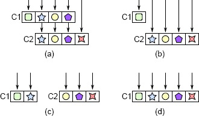
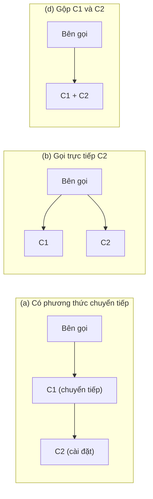
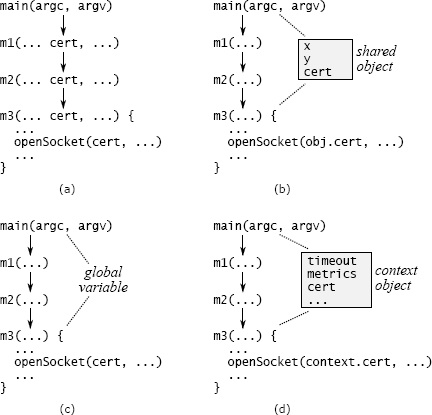

# CHƯƠNG 7: Tầng khác nhau, Trừu tượng khác nhau (Chapter 7: Different Layer, Different Abstraction)

Các hệ thống phần mềm được cấu tạo theo từng tầng (layers), trong đó các tầng cao hơn sử dụng những tiện ích do các tầng thấp hơn cung cấp. Trong một hệ thống được thiết kế tốt, mỗi tầng cung cấp một mức trừu tượng (abstraction) khác với các tầng ở trên và ở dưới nó; nếu bạn lần theo một thao tác đơn lẻ khi nó di chuyển lên xuống qua các tầng thông qua việc gọi phương thức, thì các mức trừu tượng sẽ thay đổi theo từng lời gọi phương thức. Ví dụ:

* Trong một hệ thống tệp (file system), tầng trên cùng cài đặt trừu tượng tệp (file). Một tệp bao gồm một mảng byte có độ dài thay đổi, có thể được cập nhật bằng cách đọc và ghi các khoảng byte có độ dài thay đổi. Tầng thấp hơn kế tiếp trong hệ thống tệp cài đặt một bộ nhớ đệm (cache) trong bộ nhớ chính cho các khối đĩa (disk blocks) có kích thước cố định; các bên gọi có thể giả định rằng những khối được sử dụng thường xuyên sẽ nằm lại trong bộ nhớ để có thể truy cập nhanh chóng. Tầng thấp nhất bao gồm các trình điều khiển thiết bị (device drivers), giúp di chuyển các khối giữa thiết bị lưu trữ thứ cấp và bộ nhớ.
* Trong một giao thức truyền tải mạng như TCP, mức trừu tượng do tầng trên cùng cung cấp là một luồng byte được truyền đi một cách đáng tin cậy từ máy này sang máy khác. Tầng này được xây dựng dựa trên một tầng thấp hơn chuyên truyền các gói tin (packets) có kích thước giới hạn giữa các máy theo cơ chế nỗ lực tối đa (best-effort): phần lớn gói tin sẽ được giao thành công, nhưng một số gói tin có thể bị mất hoặc đến sai thứ tự.

Nếu một hệ thống chứa các tầng liền kề có mức trừu tượng tương tự nhau, đây là một cờ đỏ (red flag) cho thấy có vấn đề trong việc phân rã lớp (class decomposition). Chương này thảo luận về những tình huống xảy ra hiện tượng đó, các vấn đề phát sinh, và cách tái cấu trúc (refactor) để loại bỏ chúng.

---

## 7.1 Phương thức chuyển tiếp (Pass-through methods)

Khi các tầng liền kề có mức trừu tượng tương tự nhau, vấn đề thường biểu hiện dưới dạng các phương thức chuyển tiếp (pass-through methods). Một phương thức chuyển tiếp là phương thức hầu như không làm gì ngoài việc gọi một phương thức khác có chữ ký (signature) tương tự hoặc giống hệt chữ ký của chính nó. Ví dụ, một đồ án sinh viên cài đặt trình soạn thảo văn bản giao diện đồ họa (GUI) chứa một lớp bao gồm gần như toàn bộ là các phương thức chuyển tiếp. Dưới đây là một đoạn trích từ lớp đó:

```java
public class TextDocument ... {
       private TextArea textArea;
       private TextDocumentListener listener;
       ...
       public Character getLastTypedCharacter() {
               return textArea.getLastTypedCharacter();
       }
       public int getCursorOffset() {
               return textArea.getCursorOffset();
       }
       public void insertString(String textToInsert, int offset) {
               textArea.insertString(textToInsert, offset);
       }
       public void willInsertString(String stringToInsert, int offset) {
               if (listener != null) {
                    listener.willInsertString(this, stringToInsert, offset);
               }
       }
       ...
}
```

Trong lớp đó, 13 trên tổng số 15 phương thức công khai (public methods) là phương thức chuyển tiếp.

> 🚩 **Cờ Đỏ (Red Flag — Phương thức chuyển tiếp / Pass-Through Method):**
> Một phương thức chuyển tiếp là phương thức không làm gì ngoài việc truyền các tham số của nó sang cho một phương thức khác, thường có cùng API với phương thức chuyển tiếp. Điều này thường cho thấy không có sự phân chia trách nhiệm rành mạch giữa các lớp.

Các phương thức chuyển tiếp làm cho lớp trở nên nông (shallower) hơn: chúng làm tăng độ phức tạp giao diện của lớp — tức là tăng thêm độ phức tạp — nhưng lại không làm tăng tổng chức năng của hệ thống. Trong bốn phương thức ở trên, chỉ có phương thức cuối cùng là có một chút chức năng, và ngay cả ở đó chức năng cũng rất tầm thường: phương thức chỉ kiểm tra tính hợp lệ của một biến. Các phương thức chuyển tiếp cũng tạo ra sự phụ thuộc (dependencies) giữa các lớp: nếu chữ ký của phương thức `insertString` trong `TextArea` thay đổi, thì phương thức `insertString` trong `TextDocument` cũng sẽ phải thay đổi theo cho khớp.

Các phương thức chuyển tiếp cho thấy có sự nhầm lẫn về việc phân chia trách nhiệm giữa các lớp. Trong ví dụ trên, lớp `TextDocument` cung cấp phương thức `insertString`, nhưng toàn bộ chức năng chèn văn bản lại được cài đặt hoàn toàn bên trong `TextArea`. Đây thường là một ý tưởng tồi: giao diện của một phần chức năng nên nằm trong cùng lớp cài đặt chức năng đó. Khi bạn thấy các phương thức chuyển tiếp đi từ lớp này sang lớp khác, hãy xem xét hai lớp đó và tự hỏi: “Chính xác thì mỗi lớp này chịu trách nhiệm cho những tính năng và mức trừu tượng nào?” Rất có thể bạn sẽ nhận ra có sự chồng chéo trách nhiệm giữa các lớp.

Giải pháp là tái cấu trúc các lớp sao cho mỗi lớp có một tập hợp trách nhiệm tách biệt và nhất quán. Hình 7.1 minh họa một số cách để làm điều này. Một hướng tiếp cận, như trong Hình 7.1(b), là để lộ trực tiếp lớp ở tầng thấp hơn cho các bên gọi của lớp tầng cao hơn, loại bỏ hoàn toàn trách nhiệm về tính năng đó khỏi lớp tầng cao hơn. Một hướng khác là phân phối lại chức năng giữa các lớp, như trong Hình 7.1(c). Cuối cùng, nếu không thể gỡ rối các lớp ra khỏi nhau, giải pháp tốt nhất có thể là gộp chúng lại thành một như trong Hình 7.1(d).

Trong ví dụ ở trên, có ba lớp với trách nhiệm đan xen vào nhau: `TextDocument`, `TextArea`, và `TextDocumentListener`. Sinh viên đó đã loại bỏ các phương thức chuyển tiếp bằng cách di chuyển các phương thức giữa các lớp và thu gọn ba lớp thành chỉ còn hai lớp, với trách nhiệm được phân biệt rõ ràng hơn.

---

## 7.2 Khi nào việc trùng lặp giao diện là chấp nhận được? (When is interface duplication OK?)

Việc có các phương thức cùng chữ ký không phải lúc nào cũng xấu. Điều quan trọng là mỗi phương thức mới phải đóng góp được chức năng đáng kể. Các phương thức chuyển tiếp là xấu vì chúng không đóng góp thêm chức năng mới nào.

Một ví dụ mà việc một phương thức gọi phương thức khác có cùng chữ ký lại hữu ích là bộ điều phối (dispatcher). Bộ điều phối là một phương thức sử dụng các tham số của nó để chọn một trong nhiều phương thức khác cần gọi; sau đó nó truyền hầu hết hoặc toàn bộ tham số của mình cho phương thức được chọn. Chữ ký của bộ điều phối thường giống với chữ ký của các phương thức mà nó gọi. Dù vậy, bộ điều phối vẫn cung cấp chức năng hữu ích: nó quyết định xem phương thức nào trong số nhiều phương thức khác nên thực hiện từng tác vụ.



**Hình 7.1 – Phương thức chuyển tiếp (Figure 7.1. Pass-through methods):** Trong (a), lớp C1 chứa ba phương thức chuyển tiếp, không làm gì ngoài việc gọi các phương thức có cùng chữ ký trong C2 (mỗi ký hiệu đại diện cho một chữ ký phương thức cụ thể). Các phương thức chuyển tiếp có thể được loại bỏ bằng cách cho các bên gọi của C1 gọi trực tiếp C2 như trong (b), bằng cách phân phối lại chức năng giữa C1 và C2 để tránh các lời gọi giữa hai lớp như trong (c), hoặc bằng cách gộp hai lớp lại như trong (d).



Ví dụ, khi một máy chủ Web nhận được một yêu cầu HTTP đến từ trình duyệt Web, nó sẽ gọi một bộ điều phối để kiểm tra URL trong yêu cầu đó và chọn một phương thức cụ thể để xử lý yêu cầu. Một số URL có thể được xử lý bằng cách trả về nội dung của một tệp trên đĩa; những URL khác có thể được xử lý bằng cách gọi một thủ tục trong một ngôn ngữ như PHP hoặc JavaScript. Quá trình điều phối có thể khá phức tạp, và thường được dẫn dắt bởi một tập hợp các quy tắc khớp với URL đến.

Việc nhiều phương thức có cùng chữ ký là hoàn toàn ổn miễn là mỗi phương thức cung cấp một chức năng hữu ích và riêng biệt. Các phương thức được gọi bởi bộ điều phối có tính chất này. Một ví dụ khác là các giao diện (interfaces) có nhiều bản cài đặt (implementations), chẳng hạn như các trình điều khiển đĩa (disk drivers) trong hệ điều hành. Mỗi trình điều khiển hỗ trợ một loại đĩa khác nhau, nhưng tất cả đều có cùng một giao diện. Khi nhiều phương thức cung cấp các bản cài đặt khác nhau cho cùng một giao diện, điều đó giúp giảm tải nhận thức (cognitive load). Một khi bạn đã làm việc với một trong những phương thức này, việc làm việc với các phương thức còn lại trở nên dễ dàng hơn vì bạn không cần phải học một giao diện mới. Những phương thức như vậy thường nằm ở cùng một tầng và chúng không gọi lẫn nhau.

> 💡 **Ví dụ bổ sung (không có trong sách):**
> Trong một ứng dụng thương mại điện tử, giao diện `PaymentGateway` có phương thức `charge(Order order, Money amount)`. Các lớp `StripeGateway`, `VNPayGateway`, và `MomoGateway` đều cài đặt cùng chữ ký phương thức này ở cùng một tầng, mỗi lớp xử lý kết nối với một nhà cung cấp khác nhau. Bên cạnh đó, `PaymentRouter.charge(order, amount)` đóng vai trò bộ điều phối (dispatcher) chọn đúng cổng thanh toán dựa trên quốc gia hoặc loại thẻ của người dùng. Cả hai trường hợp đều có trùng lặp chữ ký nhưng hoàn toàn hợp lý vì mỗi thành phần đều đóng góp logic thực sự, không phải chuyển tiếp vô ích.

---

## 7.3 Decorator (Decorators)

Mẫu thiết kế decorator (còn được gọi là “wrapper” — lớp bọc) là một mẫu thiết kế khuyến khích việc trùng lặp API qua các tầng. Một đối tượng decorator nhận vào một đối tượng có sẵn và mở rộng chức năng của nó; nó cung cấp một API tương tự hoặc giống hệt đối tượng bên dưới, và các phương thức của nó gọi các phương thức của đối tượng bên dưới. Trong ví dụ về I/O của Java ở Chương 4, lớp `BufferedInputStream` là một decorator: khi được cung cấp một đối tượng `InputStream`, nó cung cấp cùng một API nhưng bổ sung thêm cơ chế đệm (buffering). Ví dụ, khi phương thức `read` của nó được gọi để đọc một ký tự đơn lẻ, nó gọi `read` trên `InputStream` bên dưới để đọc một khối lớn hơn nhiều, và lưu các ký tự dư ra để đáp ứng các lời gọi `read` trong tương lai. Một ví dụ khác xuất hiện trong các hệ thống cửa sổ giao diện (windowing systems): lớp `Window` cài đặt một dạng cửa sổ đơn giản không cuộn được, còn lớp `ScrollableWindow` bọc (decorate) lớp `Window` bằng cách thêm các thanh cuộn ngang và dọc.

Động lực của decorator là tách biệt các phần mở rộng chuyên biệt của một lớp khỏi phần lõi tổng quát hơn. Tuy nhiên, các lớp decorator có xu hướng bị nông: chúng đưa vào một lượng lớn mã khung sườn lặp đi lặp lại (boilerplate) chỉ để đổi lấy một lượng nhỏ chức năng mới. Các lớp decorator thường chứa nhiều phương thức chuyển tiếp. Rất dễ lạm dụng mẫu decorator, tạo ra một lớp mới cho mỗi tính năng nhỏ mới. Điều này dẫn đến sự bùng nổ các lớp nông, giống như ví dụ Java I/O.

Trước khi tạo một lớp decorator, hãy cân nhắc các phương án thay thế như sau:

* **Bạn có thể thêm trực tiếp chức năng mới vào lớp bên dưới thay vì tạo lớp decorator không?** Điều này hợp lý nếu chức năng mới tương đối tổng quát, hoặc có liên quan mật thiết về mặt logic với lớp bên dưới, hoặc nếu phần lớn các trường hợp sử dụng lớp bên dưới cũng sẽ dùng chức năng mới đó. Ví dụ, hầu như ai tạo một `InputStream` trong Java cũng sẽ tạo thêm một `BufferedInputStream`, và việc đệm là một phần tự nhiên của I/O, nên hai lớp này đáng lẽ phải được gộp lại với nhau.
* **Nếu chức năng mới được chuyên biệt hóa cho một trường hợp sử dụng (use case) cụ thể, liệu có hợp lý hơn nếu gộp nó vào ngay trong trường hợp sử dụng đó thay vì tạo một lớp riêng không?**
* **Bạn có thể gộp chức năng mới vào một decorator hiện có thay vì tạo một decorator mới không?** Điều này sẽ tạo ra một lớp decorator duy nhất sâu hơn thay vì nhiều lớp nông.
* **Cuối cùng, hãy tự hỏi liệu chức năng mới có thực sự cần bọc lấy chức năng hiện có hay không:** bạn có thể cài đặt nó như một lớp độc lập tách rời khỏi lớp cơ sở không? Trong ví dụ về hệ thống cửa sổ, các thanh cuộn có lẽ có thể được cài đặt tách biệt với cửa sổ chính, mà không cần phải bọc lấy toàn bộ chức năng hiện có của cửa sổ đó.

Đôi khi decorator là hợp lý, nhưng thường thì sẽ có một giải pháp thay thế tốt hơn.

---

## 7.4 Giao diện và Cài đặt (Interface versus implementation)

Một ứng dụng khác của quy tắc “tầng khác nhau, trừu tượng khác nhau” là giao diện của một lớp thông thường nên khác với bản cài đặt của nó: các biểu diễn (representations) được sử dụng bên trong nên khác với các mức trừu tượng xuất hiện trên giao diện. Nếu cả hai có mức trừu tượng tương tự nhau, thì lớp đó có lẽ không sâu lắm.

Ví dụ, trong dự án trình soạn thảo văn bản được thảo luận ở Chương 6, hầu hết các nhóm đều cài đặt mô-đun văn bản theo từng dòng văn bản, với mỗi dòng được lưu trữ riêng biệt. Một số nhóm cũng thiết kế API của lớp văn bản xoay quanh khái niệm dòng, với các phương thức như `getLine` và `putLine`. Tuy nhiên, điều này khiến lớp văn bản trở nên nông và bất tiện khi sử dụng. Trong mã giao diện người dùng (UI) ở tầng cao hơn, người ta thường phải chèn văn bản vào giữa một dòng (chẳng hạn khi người dùng đang gõ) hoặc xóa một đoạn văn bản trải dài qua nhiều dòng. Với một API hướng dòng (line-oriented) cho lớp văn bản, các bên gọi bị buộc phải tự tách dòng và ghép dòng để cài đặt các thao tác giao diện người dùng. Đoạn mã này không hề tầm thường và bị trùng lặp, nằm rải rác khắp phần cài đặt của giao diện người dùng.

Các lớp văn bản trở nên dễ sử dụng hơn nhiều khi chúng cung cấp một giao diện hướng ký tự (character-oriented), chẳng hạn như phương thức `insert` chèn một chuỗi văn bản bất kỳ (có thể bao gồm cả ký tự xuống dòng) tại một vị trí bất kỳ trong văn bản và phương thức `delete` xóa văn bản giữa hai vị trí bất kỳ. Ở bên trong, văn bản vẫn được biểu diễn theo từng dòng. Một giao diện hướng ký tự giúp đóng gói độ phức tạp của việc tách và ghép dòng vào bên trong lớp văn bản, giúp lớp văn bản sâu hơn và đơn giản hóa mã ở tầng cao hơn sử dụng lớp này. Với cách tiếp cận đó, API của văn bản khác hẳn với cơ chế lưu trữ theo dòng; sự khác biệt này đại diện cho chức năng giá trị mà lớp đó mang lại.

> 📝 **Giải thích thêm (không có trong sách):**
> Một lớp tốt giống như một bộ chuyển đổi trừu tượng: bên trong nó nói ngôn ngữ của cấu trúc dữ liệu tối ưu (ví dụ: mảng các dòng, B-tree, rope, bảng băm), còn bên ngoài nó nói ngôn ngữ của bài toán nghiệp vụ mà người gọi quan tâm (ví dụ: chèn/xóa theo vị trí ký tự). Nếu bên ngoài chỉ lặp lại đúng cấu trúc dữ liệu bên trong, người gọi sẽ phải tự gánh phần chuyển đổi đó.

---

## 7.5 Biến chuyển tiếp (Pass-through variables)

Một dạng trùng lặp API khác qua các tầng là biến chuyển tiếp (pass-through variable), tức là một biến được truyền xuống qua một chuỗi dài các phương thức. Hình 7.2(a) minh họa một ví dụ từ một dịch vụ trung tâm dữ liệu (datacenter service). Một tham số dòng lệnh mô tả các chứng chỉ (certificates) dùng cho giao tiếp bảo mật. Thông tin này chỉ cần thiết cho một phương thức tầng thấp `m3` — phương thức gọi đến thư viện để mở socket — nhưng nó lại bị truyền qua tất cả các phương thức nằm trên đường đi giữa `main` và `m3`. Biến `cert` xuất hiện trong chữ ký của từng phương thức trung gian.

Các biến chuyển tiếp làm tăng độ phức tạp vì chúng buộc tất cả các phương thức trung gian phải nhận biết sự tồn tại của chúng, mặc dù các phương thức đó chẳng dùng gì đến các biến này. Hơn nữa, nếu một biến mới xuất hiện (ví dụ, một hệ thống ban đầu được xây dựng không có hỗ trợ chứng chỉ, nhưng sau này bạn quyết định bổ sung tính năng đó), bạn có thể phải sửa đổi một số lượng lớn giao diện và phương thức để truyền biến đó đi qua tất cả các đường dẫn liên quan.

Việc loại bỏ biến chuyển tiếp có thể khá thách thức. Một hướng tiếp cận là xem liệu đã có sẵn một đối tượng nào được chia sẻ giữa phương thức ở tầng trên cùng và phương thức ở tầng dưới cùng hay chưa. Trong ví dụ dịch vụ trung tâm dữ liệu ở Hình 7.2, có thể đã tồn tại một đối tượng chứa các thông tin khác về giao tiếp mạng mà cả `main` và `m3` đều tiếp cận được. Nếu vậy, `main` có thể lưu thông tin chứng chỉ vào đối tượng đó, nhờ vậy không cần truyền nó qua tất cả các phương thức trung gian trên đường tới `m3` (xem Hình 7.2(b)). Tuy nhiên, nếu có một đối tượng như vậy, bản thân nó lại có thể chính là một biến chuyển tiếp (nếu không thì làm sao `m3` truy cập được vào nó?).

Một hướng tiếp cận khác là lưu thông tin trong một biến toàn cục (global variable), như trong Hình 7.2(c). Cách này tránh được việc phải truyền thông tin từ phương thức này sang phương thức khác, nhưng biến toàn cục hầu như luôn tạo ra những vấn đề khác. Chẳng hạn, biến toàn cục khiến ta không thể tạo hai thực thể (instances) độc lập của cùng một hệ thống trong cùng một tiến trình (process), vì các truy cập vào biến toàn cục sẽ xung đột với nhau. Có thể bạn thấy việc cần nhiều thực thể trong môi trường sản xuất (production) là khó xảy ra, nhưng chúng lại thường xuyên hữu ích trong kiểm thử (testing).

Giải pháp mà tôi sử dụng thường xuyên nhất là đưa vào một đối tượng ngữ cảnh (context object) như trong Hình 7.2(d). Một `context` lưu trữ toàn bộ trạng thái toàn cục của ứng dụng (bất cứ thứ gì nếu không làm vậy sẽ trở thành biến chuyển tiếp hoặc biến toàn cục). Hầu hết các ứng dụng đều có nhiều biến trong trạng thái toàn cục của mình, đại diện cho những thứ như tùy chọn cấu hình, các hệ thống con dùng chung, và bộ đếm hiệu năng (performance counters). Có một đối tượng `context` cho mỗi thực thể của hệ thống. Đối tượng ngữ cảnh cho phép nhiều thực thể của hệ thống cùng tồn tại trong một tiến trình duy nhất, mỗi thực thể có `context` riêng của mình.

Không may là `context` có lẽ sẽ cần thiết ở nhiều nơi, nên bản thân nó có nguy cơ trở thành một biến chuyển tiếp. Để giảm số lượng phương thức phải biết đến nó, một tham chiếu tới `context` có thể được lưu lại trong hầu hết các đối tượng chính của hệ thống. Trong ví dụ của Hình 7.2(d), lớp chứa `m3` lưu một tham chiếu đến `context` dưới dạng biến thực thể (instance variable) trong các đối tượng của nó. Khi một đối tượng mới được tạo ra, phương thức khởi tạo lấy tham chiếu `context` từ đối tượng hiện tại và truyền nó vào hàm dựng (constructor) cho đối tượng mới. Với cách tiếp cận này, `context` có mặt ở khắp mọi nơi, nhưng nó chỉ xuất hiện như một tham số tường minh trong các hàm dựng.



**Hình 7.2 – Các kỹ thuật có thể dùng để xử lý biến chuyển tiếp (Figure 7.2. Possible techniques for dealing with a pass-through variable):** Trong (a), `cert` được truyền qua các phương thức `m1` và `m2` mặc dù chúng không sử dụng nó. Trong (b), `main` và `m3` có quyền truy cập chung vào một đối tượng, nên biến có thể được lưu ở đó thay vì truyền qua `m1` và `m2`. Trong (c), `cert` được lưu như một biến toàn cục. Trong (d), `cert` được lưu trong một đối tượng `context` cùng với các thông tin toàn hệ thống khác như giá trị timeout và bộ đếm hiệu năng; một tham chiếu đến `context` được lưu trong tất cả các đối tượng có phương thức cần truy cập nó.

Đối tượng `context` thống nhất việc xử lý mọi thông tin toàn cục của hệ thống và loại bỏ nhu cầu dùng biến chuyển tiếp. Nếu cần thêm một biến mới, ta có thể thêm nó vào đối tượng `context`; không có mã nguồn hiện có nào bị ảnh hưởng ngoại trừ hàm dựng và hàm hủy (destructor) của `context`. Đối tượng `context` giúp dễ dàng nhận diện và quản lý trạng thái toàn cục của hệ thống, vì tất cả đều được lưu ở một nơi. `Context` cũng rất tiện lợi cho việc kiểm thử: mã kiểm thử có thể thay đổi cấu hình toàn cục của ứng dụng bằng cách sửa các trường trong `context`. Việc thực hiện những thay đổi như vậy sẽ khó khăn hơn nhiều nếu hệ thống dùng các biến chuyển tiếp.

Tuy nhiên, các đối tượng `context` còn lâu mới là một giải pháp lý tưởng. Các biến được lưu trong `context` mang hầu hết nhược điểm của biến toàn cục; ví dụ, có thể không rõ tại sao một biến cụ thể lại có mặt ở đó, hoặc nó được dùng ở đâu. Nếu thiếu kỷ luật, một `context` có thể biến thành một cái túi hổ lốn khổng lồ chứa dữ liệu, tạo ra những sự phụ thuộc ngầm không rõ ràng xuyên suốt hệ thống. Các đối tượng `context` cũng có thể gây ra vấn đề về an toàn luồng (thread-safety); cách tốt nhất để tránh rắc rối là giữ cho các biến trong `context` bất biến (immutable). Đáng tiếc là tôi vẫn chưa tìm ra giải pháp nào tốt hơn `context`.

---

## 7.6 Kết luận (Conclusion)

Mỗi thành phần hạ tầng thiết kế được thêm vào hệ thống — chẳng hạn như một giao diện, tham số, hàm, lớp, hoặc định nghĩa — đều làm tăng thêm độ phức tạp, bởi các lập trình viên phải học về thành phần đó. Để một thành phần mang lại lợi ích ròng trong cuộc chiến chống lại độ phức tạp, nó phải loại bỏ được một phần độ phức tạp vốn sẽ tồn tại nếu thiếu thành phần thiết kế đó. Nếu không, tốt hơn hết là bạn nên cài đặt hệ thống mà không có thành phần đó. Chẳng hạn, một lớp có thể giảm độ phức tạp bằng cách đóng gói chức năng sao cho người dùng của lớp không cần phải bận tâm đến nó.

Quy tắc “tầng khác nhau, trừu tượng khác nhau” chỉ là một ứng dụng của ý tưởng này: nếu các tầng khác nhau lại có cùng mức trừu tượng, như các phương thức chuyển tiếp hoặc các decorator, thì nhiều khả năng chúng chưa mang lại đủ lợi ích để bù đắp cho phần hạ tầng bổ sung mà chúng đại diện. Tương tự, các tham số chuyển tiếp buộc từng phương thức trong một chuỗi nhiều phương thức phải nhận biết sự tồn tại của chúng (làm tăng độ phức tạp) mà không đóng góp thêm chức năng nào.

---

## Bảng thuật ngữ chương (Chapter Glossary)

| Thuật ngữ (English) | Tiếng Việt | Giải thích ngắn gọn |
| --- | --- | --- |
| **Layer** | Tầng | Mức phân cấp trong cấu trúc phần mềm, nơi tầng trên sử dụng tiện ích của tầng dưới. |
| **Abstraction** | Trừu tượng / Mức trừu tượng | Góc nhìn đơn giản hóa che giấu chi tiết cài đặt bên dưới. |
| **Pass-through method** | Phương thức chuyển tiếp | Phương thức chỉ truyền tham số sang một phương thức khác có chữ ký tương tự hoặc giống hệt mà không thêm chức năng đáng kể. |
| **Dispatcher** | Bộ điều phối | Phương thức nhận đầu vào để chọn và gọi đúng phương thức xử lý phù hợp trong số nhiều lựa chọn. |
| **Decorator / Wrapper** | Lớp trang trí / Lớp bọc | Mẫu thiết kế bọc một đối tượng có sẵn để mở rộng hành vi trong khi giữ nguyên hoặc tương tự API gốc. |
| **Boilerplate** | Mã khung sườn lặp lại | Đoạn mã bắt buộc phải viết lặp đi lặp lại với ít giá trị nghiệp vụ mới. |
| **Pass-through variable** | Biến chuyển tiếp | Biến phải truyền qua nhiều phương thức trung gian chỉ để tới được phương thức tầng thấp thực sự cần dùng nó. |
| **Context object** | Đối tượng ngữ cảnh | Đối tượng tập trung trạng thái cấu hình và tài nguyên dùng chung cho một thực thể của hệ thống. |
| **Immutable** | Bất biến | Trạng thái không thể bị thay đổi sau khi khởi tạo, giúp tránh lỗi đồng bộ đa luồng. |
