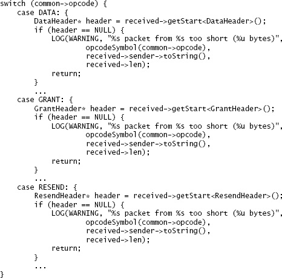
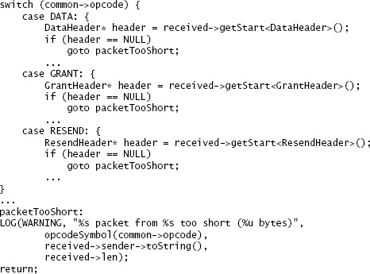
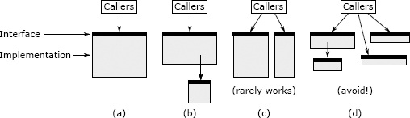
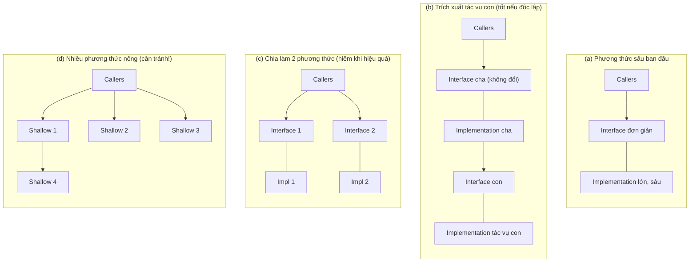

# CHƯƠNG 9: Gộp Lại Hay Tách Ra? (Chapter 9: Better Together Or Better Apart?)

Một trong những câu hỏi nền tảng nhất trong thiết kế phần mềm là: khi có hai phần chức năng (two pieces of functionality), chúng ta nên cài đặt chúng cùng nhau ở một chỗ, hay tách phần cài đặt của chúng ra riêng biệt? Câu hỏi này áp dụng ở mọi cấp độ trong một hệ thống, chẳng hạn như hàm (functions), phương thức (methods), lớp (classes), và dịch vụ (services). Ví dụ: cơ chế đệm (buffering) có nên được đưa vào trong lớp cung cấp I/O tệp hướng luồng (stream-oriented file I/O) hay nên nằm trong một lớp riêng? Việc phân tích cú pháp (parsing) một yêu cầu HTTP (HTTP request) nên được cài đặt hoàn toàn trong một phương thức, hay nên chia nhỏ ra nhiều phương thức (hoặc thậm chí nhiều lớp)? Chương này thảo luận các yếu tố cần cân nhắc khi đưa ra những quyết định như vậy. Một số yếu tố trong đó đã được bàn đến ở các chương trước, nhưng sẽ được nhắc lại ở đây để đảm bảo tính trọn vẹn.

Khi quyết định nên gộp lại hay tách ra, mục tiêu là giảm độ phức tạp của toàn bộ hệ thống và cải thiện tính mô-đun (modularity) của nó. Thoạt nhìn, có vẻ như cách tốt nhất để đạt được mục tiêu này là chia hệ thống thành một số lượng lớn các thành phần nhỏ: thành phần càng nhỏ thì từng thành phần riêng lẻ càng có khả năng đơn giản hơn. Tuy nhiên, bản thân hành động chia nhỏ (subdividing) lại tạo ra thêm độ phức tạp vốn không hề tồn tại trước khi chia:

- Một phần độ phức tạp đến từ chính số lượng thành phần: càng nhiều thành phần thì càng khó theo dõi tất cả chúng và càng khó tìm ra thành phần mình cần trong một tập hợp lớn. Việc chia nhỏ thường dẫn đến nhiều giao diện (interfaces) hơn, và mỗi giao diện mới đều làm tăng thêm độ phức tạp.
- Việc chia nhỏ có thể dẫn đến phải viết thêm mã để quản lý các thành phần đó. Chẳng hạn, một đoạn mã trước khi chia chỉ sử dụng một đối tượng duy nhất thì sau khi chia có thể phải quản lý nhiều đối tượng.
- Việc chia nhỏ tạo ra sự tách biệt (separation): các thành phần bị chia nhỏ sẽ nằm cách xa nhau hơn so với trước khi chia. Ví dụ, các phương thức vốn nằm cùng nhau trong một lớp trước khi chia có thể sẽ nằm ở các lớp khác nhau sau khi chia, và thậm chí ở các tệp khác nhau. Sự tách biệt khiến lập trình viên khó nhìn thấy các thành phần cùng một lúc, hoặc thậm chí không nhận ra sự tồn tại của chúng. Nếu các thành phần thực sự độc lập với nhau, thì tách biệt là tốt: nó cho phép lập trình viên tập trung vào từng thành phần một mà không bị phân tâm bởi các thành phần khác. Ngược lại, nếu có sự phụ thuộc (dependencies) giữa các thành phần, thì tách biệt lại là xấu: lập trình viên sẽ phải lật qua lật lại giữa các thành phần. Tệ hơn nữa, họ có thể không nhận ra các sự phụ thuộc đó, dẫn đến phát sinh lỗi (bugs).
- Việc chia nhỏ có thể dẫn đến trùng lặp (duplication): đoạn mã vốn chỉ xuất hiện một lần trước khi chia có thể sẽ phải xuất hiện ở từng thành phần sau khi chia nhỏ.

Việc gộp các đoạn mã lại với nhau sẽ mang lại lợi ích cao nhất nếu chúng có mối liên hệ chặt chẽ. Nếu các phần không liên quan đến nhau, chúng thường nên được tách riêng. Dưới đây là một vài dấu hiệu cho thấy hai đoạn mã có liên quan với nhau:

- **Chúng chia sẻ thông tin (share information):** ví dụ, cả hai đoạn mã đều phụ thuộc vào cú pháp của một loại tài liệu cụ thể nào đó.
- **Chúng được sử dụng cùng nhau (used together):** bất kỳ ai dùng đoạn mã này đều có khả năng cao sẽ dùng cả đoạn mã kia. Dạng quan hệ này chỉ thực sự thuyết phục nếu nó mang tính hai chiều (bidirectional). Để lấy phản ví dụ, một bộ đệm khối đĩa (disk block cache) hầu như luôn sử dụng bảng băm (hash table), nhưng bảng băm lại có thể được dùng trong rất nhiều tình huống không liên quan gì đến bộ đệm khối đĩa; do đó, hai mô-đun này nên được tách riêng.
- **Chúng chồng lấn về mặt khái niệm (overlap conceptually):** tức là có một danh mục ở mức cao hơn, đơn giản bao trùm cả hai đoạn mã. Ví dụ, tìm kiếm chuỗi con (searching for a substring) và chuyển đổi chữ hoa/thường (case conversion) đều thuộc danh mục thao tác chuỗi (string manipulation); điều khiển luồng (flow control) và truyền tải tin cậy (reliable delivery) đều thuộc danh mục truyền thông mạng (network communication).
- **Rất khó để hiểu một đoạn mã nếu không nhìn vào đoạn mã kia.**

Phần còn lại của chương này sẽ sử dụng các quy tắc cụ thể hơn cũng như các ví dụ minh họa để chỉ ra khi nào nên gộp các đoạn mã lại với nhau và khi nào nên tách chúng ra.

> 📝 **Giải thích thêm (không có trong sách):**
> Một sai lầm rất phổ biến của lập trình viên theo chủ nghĩa "chia nhỏ cực đoan" (over-decomposition) là tin rằng cứ tách hàm hoặc tách lớp càng nhỏ thì code càng sạch. Thực tế, mỗi đường ranh giới mới (new boundary) giữa các mô-đun đều đòi hỏi người đọc phải nhớ thêm một tên gọi, một chữ ký hàm, và cách chúng phối hợp với nhau. Quy tắc cốt lõi của Ousterhout không phải là "hàm ngắn" hay "lớp nhỏ", mà là **tổng độ phức tạp của toàn hệ thống phải giảm xuống**.

---

## 9.1 Gộp lại nếu thông tin được chia sẻ (Bring together if information is shared)

Mục 5.4 đã giới thiệu nguyên tắc này trong bối cảnh một dự án cài đặt máy chủ HTTP (HTTP server). Ở bản cài đặt đầu tiên, dự án sử dụng hai phương thức khác nhau trong hai lớp khác nhau để đọc và phân tích cú pháp (parse) các yêu cầu HTTP. Phương thức thứ nhất đọc văn bản của yêu cầu gửi đến từ một socket mạng và đặt nó vào một đối tượng chuỗi (string object). Phương thức thứ hai phân tích chuỗi đó để trích xuất các thành phần khác nhau của yêu cầu. Với cách phân rã (decomposition) này, cả hai phương thức đều phải nắm giữ một lượng lớn kiến thức về định dạng của yêu cầu HTTP: phương thức thứ nhất chỉ cố gắng đọc yêu cầu chứ không phân tích nó, nhưng nó không thể xác định được điểm kết thúc của yêu cầu nếu không thực hiện phần lớn công việc phân tích (ví dụ, nó phải phân tích các dòng tiêu đề — header lines — để tìm ra tiêu đề chứa tổng độ dài của yêu cầu). Vì có sự chia sẻ thông tin này, tốt hơn hết là thực hiện cả việc đọc và phân tích cú pháp yêu cầu ở cùng một chỗ; khi hai lớp đó được gộp lại thành một, mã nguồn trở nên ngắn gọn và đơn giản hơn.

---

## 9.2 Gộp lại nếu điều đó làm đơn giản hóa giao diện (Bring together if it will simplify the interface)

Khi hai hoặc nhiều mô-đun được gộp lại thành một mô-đun duy nhất, ta có thể định nghĩa một giao diện (interface) cho mô-đun mới đơn giản hơn hoặc dễ sử dụng hơn so với các giao diện ban đầu. Điều này thường xảy ra khi mỗi mô-đun ban đầu chỉ cài đặt một phần của lời giải cho một bài toán. Trong ví dụ máy chủ HTTP ở mục trước, các phương thức ban đầu đòi hỏi một giao diện để trả về chuỗi yêu cầu HTTP từ phương thức thứ nhất và truyền nó sang cho phương thức thứ hai. Khi các phương thức được gộp lại, những giao diện trung gian này đã bị loại bỏ.

Ngoài ra, khi chức năng của hai hay nhiều lớp được gộp lại, ta có thể thực hiện một số tác vụ một cách tự động, sao cho đa số người dùng thậm chí không cần phải biết đến sự tồn tại của chúng. Thư viện I/O của Java (Java I/O library) là một minh họa cho cơ hội này. Nếu các lớp `FileInputStream` và `BufferedInputStream` được gộp lại và cơ chế đệm (buffering) được cung cấp mặc định, thì đại đa số người dùng sẽ không bao giờ cần phải biết đến sự tồn tại của việc đệm nữa. Một lớp `FileInputStream` gộp chung có thể cung cấp các phương thức để tắt hoặc thay thế cơ chế đệm mặc định, nhưng hầu hết người dùng sẽ không cần phải tìm hiểu về chúng.

> 💡 **Ví dụ bổ sung (không có trong sách):**
> Khi gửi HTTP request trong một số thư viện cũ, bạn phải tự tạo `Connection`, rồi bọc vào `RequestBuilder`, rồi bọc tiếp vào `RetryHandler`. Nếu gộp lại thành một lớp `HttpClient` có sẵn cơ chế retry và connection pooling mặc định (nhưng vẫn cho phép tùy chỉnh qua options nếu cần), 95% người dùng chỉ cần gọi `client.get(url)` mà không cần bận tâm đến các lớp phụ trợ bên dưới.

---

## 9.3 Gộp lại để loại bỏ trùng lặp (Bring together to eliminate duplication)

Nếu bạn thấy cùng một mẫu mã (pattern of code) lặp đi lặp lại hết lần này đến lần khác, hãy xem liệu bạn có thể tổ chức lại mã nguồn để loại bỏ sự lặp lại đó hay không. Một cách tiếp cận là tách phần mã lặp lại đó ra thành một phương thức riêng và thay thế các đoạn mã lặp bằng lời gọi tới phương thức đó. Cách này hiệu quả nhất nếu đoạn mã lặp lại đủ dài và phương thức thay thế có một chữ ký (signature) đơn giản. Nếu đoạn mã chỉ dài một hoặc hai dòng, việc thay thế nó bằng một lời gọi phương thức có thể không mang lại nhiều lợi ích. Nếu đoạn mã tương tác theo những cách phức tạp với môi trường xung quanh nó (chẳng hạn như truy cập rất nhiều biến cục bộ — local variables), thì phương thức thay thế có thể sẽ đòi hỏi một chữ ký phức tạp (ví dụ như truyền nhiều tham số theo tham chiếu — pass-by-reference), điều này làm giảm giá trị của nó.

Một cách khác để loại bỏ trùng lặp là tái cấu trúc (refactor) mã nguồn sao cho đoạn mã đang xét chỉ cần được thực thi ở một chỗ duy nhất. Giả sử bạn đang viết một phương thức cần trả về lỗi tại nhiều điểm khác nhau, và cùng một loạt thao tác dọn dẹp (cleanup actions) cần được thực hiện tại mỗi điểm đó trước khi thoát (xem **Hình 9.1** để biết ví dụ). Nếu ngôn ngữ lập trình hỗ trợ `goto`, bạn có thể chuyển phần mã dọn dẹp xuống cuối cùng của phương thức rồi dùng `goto` nhảy tới đoạn mã đó tại mỗi điểm cần thoát do lỗi, như trong **Hình 9.2**. Câu lệnh `goto` nhìn chung bị coi là một ý tưởng tồi, và chúng có thể tạo ra mã nguồn khó hiểu nếu bị lạm dụng bừa bãi, nhưng chúng lại rất hữu ích trong những tình huống như thế này khi được dùng để thoát khỏi các đoạn mã lồng nhau (nested code).

---

## 9.4 Tách riêng mã mục đích chung và mã mục đích đặc thù (Separate general-purpose and special-purpose code)

Nếu một mô-đun chứa một cơ chế (mechanism) có thể được sử dụng cho nhiều mục đích khác nhau, thì nó chỉ nên cung cấp duy nhất cơ chế mục đích chung (general-purpose) đó. Nó không nên chứa mã nguồn chuyên biệt hóa cơ chế đó cho một mục đích sử dụng cụ thể nào, cũng không nên chứa các cơ chế mục đích chung khác. Mã mục đích đặc thù (special-purpose) gắn với một cơ chế mục đích chung thông thường nên nằm ở một mô-đun khác (thường là mô-đun gắn với mục đích cụ thể đó). Cuộc thảo luận về trình soạn thảo giao diện đồ họa (GUI editor) ở Chương 6 đã minh họa nguyên tắc này: thiết kế tốt nhất là thiết kế trong đó lớp văn bản (text class) cung cấp các thao tác văn bản mục đích chung, còn các thao tác đặc thù của giao diện người dùng (như xóa vùng chọn — deleting the selection) được cài đặt trong mô-đun giao diện người dùng (user interface module). Cách tiếp cận này đã loại bỏ sự rò rỉ thông tin (information leakage) và các giao diện dư thừa từng xuất hiện trong thiết kế trước đó khi các thao tác giao diện người dùng chuyên biệt bị đặt nhầm vào trong lớp văn bản.

> 🚩 **Cờ Đỏ (Red Flag — Trùng lặp / Repetition):**
> Nếu cùng một đoạn mã (hoặc đoạn mã gần như giống hệt nhau) xuất hiện lặp đi lặp lại hết lần này đến lần khác, đó là một cờ đỏ báo hiệu rằng bạn chưa tìm ra được các trừu tượng (abstractions) phù hợp.



**Hình 9.1 – Đoạn mã xử lý gói tin với câu lệnh `LOG` bị trùng lặp (Figure 9.1: This code processes incoming network packets of different types; for each type, if the packet is too short for that type, a message gets logged. In this version of the code, the LOG statement is duplicated for several different packet types.)**

```cpp
switch (common->opcode) {
    case DATA: {
        DataHeader* header = received->getStart<DataHeader>();
        if (header == NULL) {
            LOG(WARNING, "%s packet from %s too short (%u bytes)",
                    opcodeSymbol(common->opcode),
                    received->sender->toString(),
                    received->len);
            return;
        }
        ...
    }
    case GRANT: {
        GrantHeader* header = received->getStart<GrantHeader>();
        if (header == NULL) {
            LOG(WARNING, "%s packet from %s too short (%u bytes)",
                    opcodeSymbol(common->opcode),
                    received->sender->toString(),
                    received->len);
            return;
        }
        ...
    }
    case RESEND: {
        ResendHeader* header = received->getStart<ResendHeader>();
        if (header == NULL) {
            LOG(WARNING, "%s packet from %s too short (%u bytes)",
                    opcodeSymbol(common->opcode),
                    received->sender->toString(),
                    received->len);
            return;
        }
        ...
    }
}
```



**Hình 9.2 – Tổ chức lại đoạn mã từ Hình 9.1 bằng `goto` để chỉ còn một câu lệnh `LOG` duy nhất (Figure 9.2: A reorganization of the code from Figure 9.1 so that there is only one copy of the LOG statement.)**

```cpp
switch (common->opcode) {
    case DATA: {
        DataHeader* header = received->getStart<DataHeader>();
        if (header == NULL)
            goto packetTooShort;
        ...
    }
    case GRANT: {
        GrantHeader* header = received->getStart<GrantHeader>();
        if (header == NULL)
            goto packetTooShort;
        ...
    }
    case RESEND: {
        ResendHeader* header = received->getStart<ResendHeader>();
        if (header == NULL)
            goto packetTooShort;
        ...
    }
}
...
packetTooShort:
LOG(WARNING, "%s packet from %s too short (%u bytes)",
        opcodeSymbol(common->opcode),
        received->sender->toString(),
        received->len);
return;
```

Nhìn chung, các tầng thấp hơn của một hệ thống có xu hướng mang tính mục đích chung nhiều hơn và các tầng cao hơn mang tính mục đích đặc thù nhiều hơn. Ví dụ, tầng trên cùng của một ứng dụng bao gồm các tính năng hoàn toàn đặc thù cho ứng dụng đó. Cách để tách mã mục đích đặc thù ra khỏi mã mục đích chung là kéo phần mã mục đích đặc thù lên trên, vào các tầng cao hơn, để lại các tầng thấp hơn ở dạng mục đích chung. Khi bạn bắt gặp một lớp bao gồm cả các tính năng mục đích chung lẫn mục đích đặc thù cho cùng một trừu tượng, hãy xem liệu lớp đó có thể được tách thành hai lớp hay không: một lớp chứa các tính năng mục đích chung, và lớp còn lại xếp chồng lên trên nó để cung cấp các tính năng mục đích đặc thù.

---

## 9.5 Ví dụ: con trỏ chèn và vùng chọn (Example: insertion cursor and selection)

Các mục tiếp theo sẽ đi qua ba ví dụ minh họa cho các nguyên tắc vừa thảo luận. Ở hai ví dụ đầu, cách tiếp cận tốt nhất là tách các đoạn mã liên quan ra; ở ví dụ thứ ba, gộp chúng lại với nhau lại tốt hơn.

Ví dụ đầu tiên là con trỏ chèn (insertion cursor) và vùng chọn (selection) trong dự án trình soạn thảo GUI ở Chương 6. Trình soạn thảo hiển thị một vạch dọc nhấp nháy cho biết vị trí văn bản do người dùng gõ sẽ xuất hiện trong tài liệu. Nó cũng hiển thị một dải ký tự được tô sáng gọi là vùng chọn (selection), dùng cho việc sao chép hoặc xóa văn bản. Con trỏ chèn luôn hiển thị, nhưng có những lúc không có văn bản nào được chọn. Nếu vùng chọn tồn tại, con trỏ chèn luôn nằm ở một trong hai đầu của vùng chọn đó.

Vùng chọn và con trỏ chèn có liên quan với nhau ở một số khía cạnh. Ví dụ, con trỏ luôn nằm ở một đầu của vùng chọn, và con trỏ cùng vùng chọn có xu hướng bị thao tác cùng lúc: nhấp và kéo chuột sẽ thiết lập cả hai, và việc chèn văn bản trước tiên sẽ xóa văn bản đang được chọn (nếu có) rồi mới chèn văn bản mới vào vị trí con trỏ. Vì thế, thoạt nhìn có vẻ hợp lý khi dùng một đối tượng duy nhất để quản lý cả vùng chọn lẫn con trỏ, và một nhóm dự án đã đi theo hướng này. Đối tượng đó lưu hai vị trí trong tệp, cùng với các biến boolean cho biết đầu nào là con trỏ và liệu vùng chọn có đang tồn tại hay không.

Tuy nhiên, đối tượng gộp chung này tỏ ra rất gượng gạo. Nó không mang lại lợi ích nào cho mã ở tầng cao hơn, vì mã ở tầng cao hơn vẫn cần nhận thức vùng chọn và con trỏ là hai thực thể tách biệt, và thao tác với chúng một cách riêng rẽ (trong lúc chèn văn bản, trước tiên nó gọi một phương thức trên đối tượng gộp để xóa văn bản đang chọn; sau đó nó gọi một phương thức khác để lấy vị trí con trỏ nhằm chèn văn bản mới). Bản thân đối tượng gộp lại còn phức tạp hơn khi cài đặt so với các đối tượng tách rời. Nó tránh được việc lưu vị trí con trỏ như một thực thể riêng, nhưng thay vào đó lại phải lưu một biến boolean chỉ ra đầu nào của vùng chọn là con trỏ. Để lấy ra vị trí con trỏ, đối tượng gộp phải kiểm tra biến boolean trước rồi mới chọn đầu tương ứng của vùng chọn.

> 🚩 **Cờ Đỏ (Red Flag — Pha trộn Đặc thù - Chung / Special-General Mixture):**
> Cờ đỏ này xuất hiện khi một cơ chế mục đích chung lại chứa cả mã nguồn chuyên biệt hóa cho một mục đích sử dụng cụ thể của cơ chế đó. Điều này làm cơ chế trở nên phức tạp hơn và tạo ra sự rò rỉ thông tin giữa cơ chế và trường hợp sử dụng cụ thể: những sửa đổi trong tương lai đối với trường hợp sử dụng đó nhiều khả năng cũng sẽ đòi hỏi phải sửa đổi cả cơ chế bên dưới.

Trong trường hợp này, vùng chọn và con trỏ không đủ liên quan chặt chẽ để gộp chung lại. Khi mã nguồn được sửa lại để tách rời vùng chọn và con trỏ, cả cách sử dụng lẫn phần cài đặt đều trở nên đơn giản hơn. Các đối tượng tách biệt cung cấp một giao diện đơn giản hơn so với một đối tượng gộp mà người dùng phải trích xuất thông tin vùng chọn và con trỏ ra từ đó. Phần cài đặt con trỏ cũng đơn giản hơn vì vị trí con trỏ được biểu diễn trực tiếp, thay vì gián tiếp thông qua một vùng chọn và một biến boolean. Thực tế, trong phiên bản sửa đổi, không có lớp đặc biệt nào được tạo ra cho vùng chọn hay con trỏ cả. Thay vào đó, một lớp `Position` mới được đưa vào để biểu diễn một vị trí trong tệp (gồm số dòng và vị trí ký tự trong dòng). Vùng chọn được biểu diễn bằng hai đối tượng `Position` và con trỏ được biểu diễn bằng một đối tượng `Position`. Lớp `Position` cũng tìm được nhiều công dụng khác trong dự án. Ví dụ này đồng thời chứng minh lợi ích của một giao diện ở mức thấp hơn nhưng mang tính mục đích chung hơn, như đã thảo luận ở Chương 6.

---

## 9.6 Ví dụ: lớp riêng cho việc ghi log (Example: separate class for logging)

Ví dụ thứ hai liên quan đến việc ghi log lỗi (error logging) trong một dự án sinh viên. Một lớp chứa nhiều đoạn mã tương tự như sau:

```java
try {
     rpcConn = connectionPool.getConnection(dest);
} catch (IOException e) {
     NetworkErrorLogger.logRpcOpenError(req, dest, e);
     return null;
}
```

Thay vì ghi log lỗi ngay tại điểm phát hiện lỗi, đoạn mã lại gọi một phương thức riêng nằm trong một lớp ghi log lỗi chuyên biệt. Lớp ghi log lỗi được định nghĩa ở cuối cùng của chính tệp mã nguồn đó:

```java
private static class NetworkErrorLogger {
    /**
     *  Output information relevant to an error that occurs when trying
     *  to open a connection to send an RPC.
     *
     *  @param req
     *       The RPC request that would have been sent through the connection
     *  @param dest
     *       The destination of the RPC
     *  @param e
     *       The caught error
     */
    public static void logRpcOpenError(RpcRequest req, AddrPortTuple dest,
            Exception e) {
        logger.log(Level.WARNING, "Cannot send message: " + req + ". \n" +
                "Unable to find or open connection to " + dest + " :" + e);
    }
    ...
}
```

Lớp `NetworkErrorLogger` chứa nhiều phương thức như `logRpcSendError` và `logRpcReceiveError`, mỗi phương thức ghi log một loại lỗi khác nhau.

Sự tách biệt này chỉ làm tăng thêm độ phức tạp mà không mang lại lợi ích nào. Các phương thức ghi log rất nông (shallow): hầu hết chỉ gồm một dòng mã duy nhất, nhưng lại đòi hỏi một lượng lớn tài liệu chú thích (documentation). Mỗi phương thức chỉ được gọi ở đúng một nơi. Các phương thức ghi log phụ thuộc rất chặt chẽ vào nơi gọi chúng: người đọc ở chỗ gọi rất có thể phải lật xuống phương thức ghi log để chắc chắn rằng đúng thông tin đang được ghi lại; tương tự, người đọc phương thức ghi log có lẽ cũng phải lật lên chỗ gọi để hiểu mục đích của phương thức đó.

Trong ví dụ này, tốt hơn hết là loại bỏ các phương thức ghi log đó đi và đặt thẳng các câu lệnh ghi log ngay tại vị trí phát hiện lỗi. Việc này sẽ làm cho mã nguồn dễ đọc hơn và loại bỏ được các giao diện không cần thiết dành cho các phương thức ghi log.

---

## 9.7 Ví dụ: cơ chế hoàn tác của trình soạn thảo (Example: editor undo mechanism)

Trong dự án trình soạn thảo GUI ở Mục 6.2, một trong những yêu cầu đặt ra là phải hỗ trợ hoàn tác/làm lại nhiều cấp (multi-level undo/redo), không chỉ cho các thay đổi đối với bản thân văn bản, mà còn cho các thay đổi ở vùng chọn, con trỏ chèn, và khung nhìn (view). Chẳng hạn, nếu người dùng chọn một đoạn văn bản, xóa nó đi, cuộn đến một vị trí khác trong tệp, rồi nhấn hoàn tác (undo), thì trình soạn thảo phải khôi phục trạng thái về đúng lúc ngay trước khi xóa. Việc này bao gồm khôi phục đoạn văn bản đã xóa, chọn lại đoạn văn bản đó, và đồng thời đưa đoạn văn bản được chọn hiển thị trở lại trong cửa sổ.

Một số dự án sinh viên đã cài đặt toàn bộ cơ chế hoàn tác như một phần của lớp văn bản (text class). Lớp văn bản duy trì một danh sách tất cả các thay đổi có thể hoàn tác. Nó tự động thêm các mục vào danh sách này bất cứ khi nào văn bản bị thay đổi. Đối với các thay đổi về vùng chọn, con trỏ chèn, và khung nhìn, mã giao diện người dùng gọi các phương thức bổ sung trong lớp văn bản, để lớp văn bản thêm các mục cho những thay đổi đó vào danh sách hoàn tác. Khi người dùng yêu cầu hoàn tác hoặc làm lại, mã giao diện người dùng gọi một phương thức trong lớp văn bản, sau đó phương thức này xử lý các mục trong danh sách hoàn tác. Với các mục liên quan đến văn bản, nó tự cập nhật cấu trúc bên trong của lớp văn bản; còn với các mục liên quan đến những thứ khác như vùng chọn, lớp văn bản gọi ngược lại (call back) vào mã giao diện người dùng để thực hiện việc hoàn tác hoặc làm lại.

Cách tiếp cận này tạo ra một tập hợp các tính năng gượng gạo bên trong lớp văn bản. Phần lõi của undo/redo bao gồm một cơ chế mục đích chung để quản lý danh sách các hành động đã được thực thi và duyệt tiến/lùi qua chúng trong quá trình hoàn tác và làm lại. Phần lõi đó bị đặt trong lớp văn bản cùng với các bộ xử lý mục đích đặc thù thực hiện undo và redo cho từng thứ cụ thể như văn bản và vùng chọn. Các bộ xử lý undo đặc thù cho vùng chọn và con trỏ không liên quan gì đến bất kỳ phần nào khác trong lớp văn bản; chúng gây ra sự rò rỉ thông tin giữa lớp văn bản và giao diện người dùng, cũng như tạo ra các phương thức dư thừa ở mỗi mô-đun để truyền thông tin undo qua lại. Nếu trong tương lai có thêm một loại thực thể có thể hoàn tác mới được bổ sung vào hệ thống, nó sẽ đòi hỏi phải sửa đổi lớp văn bản, bao gồm cả việc thêm các phương thức mới đặc thù cho thực thể đó. Ngoài ra, phần lõi undo mục đích chung cũng chẳng liên quan gì nhiều đến các tiện ích xử lý văn bản mục đích chung trong lớp.

Những vấn đề này có thể được giải quyết bằng cách trích xuất phần lõi mục đích chung của cơ chế undo/redo ra và đặt nó vào một lớp riêng biệt:

```java
public class History {
    public interface Action {
        public void redo();
        public void undo();
    }
    History() {...}
    void addAction(Action action) {...}
    void addFence() {...}
    void undo() {...}
    void redo() {...}
}
```

Trong thiết kế này, lớp `History` quản lý một tập hợp các đối tượng cài đặt giao diện `History.Action`. Mỗi `History.Action` mô tả một thao tác đơn lẻ, chẳng hạn như chèn văn bản hoặc thay đổi vị trí con trỏ, và cung cấp các phương thức có thể hoàn tác (`undo`) hoặc làm lại (`redo`) thao tác đó. Lớp `History` không biết bất cứ điều gì về thông tin được lưu bên trong các action hay cách chúng cài đặt các phương thức `undo` và `redo` của mình. `History` duy trì một danh sách lịch sử mô tả tất cả các action đã được thực thi trong suốt vòng đời của ứng dụng, và cung cấp các phương thức `undo` và `redo` để duyệt ngược và duyệt xuôi qua danh sách nhằm đáp ứng các yêu cầu hoàn tác/làm lại từ người dùng, đồng thời gọi các phương thức `undo` và `redo` trên các `History.Action`.

Các `History.Action` là những đối tượng mục đích đặc thù: mỗi đối tượng hiểu một loại thao tác có thể hoàn tác cụ thể. Chúng được cài đặt bên ngoài lớp `History`, nằm trong các mô-đun hiểu từng loại hành động có thể hoàn tác tương ứng. Lớp văn bản có thể cài đặt các đối tượng `UndoableInsert` và `UndoableDelete` để mô tả các thao tác chèn và xóa văn bản. Mỗi khi chèn văn bản, lớp văn bản tạo một đối tượng `UndoableInsert` mới mô tả thao tác chèn đó và gọi `History.addAction` để thêm nó vào danh sách lịch sử. Mã giao diện người dùng của trình soạn thảo có thể tạo các đối tượng `UndoableSelection` và `UndoableCursor` để mô tả các thay đổi đối với vùng chọn và con trỏ chèn.

Lớp `History` cũng cho phép nhóm các action lại với nhau để, chẳng hạn, một yêu cầu undo duy nhất từ người dùng có thể khôi phục văn bản đã xóa, chọn lại văn bản đó, và đặt lại vị trí con trỏ chèn. Có nhiều cách để nhóm các action; lớp `History` sử dụng các *hàng rào* (fences), tức là các dấu mốc được đặt vào trong danh sách lịch sử để phân tách các nhóm action liên quan. Mỗi lần gọi `History.redo` (hoặc `undo`) sẽ duyệt qua danh sách lịch sử, thực hiện các action cho đến khi chạm tới hàng rào kế tiếp. Việc đặt các hàng rào ở đâu được quyết định bởi mã ở tầng cao hơn thông qua lời gọi `History.addFence`.

Cách tiếp cận này chia chức năng hoàn tác thành ba hạng mục, mỗi hạng mục được cài đặt ở một nơi khác nhau:

- **Một cơ chế mục đích chung** để quản lý và nhóm các action cũng như kích hoạt các thao tác undo/redo (được cài đặt bởi lớp `History`).
- **Chi tiết cụ thể của từng action riêng lẻ** (được cài đặt bởi nhiều lớp khác nhau, mỗi lớp chỉ hiểu một số lượng nhỏ các loại action).
- **Chính sách nhóm các action** (được cài đặt bởi mã giao diện người dùng ở tầng cao nhằm mang lại hành vi tổng thể đúng đắn cho ứng dụng).

Mỗi hạng mục trong số này có thể được cài đặt mà không cần hiểu biết gì về các hạng mục còn lại. Lớp `History` không biết loại action nào đang được hoàn tác; nó có thể được sử dụng trong nhiều ứng dụng khác nhau. Mỗi lớp action chỉ hiểu duy nhất một loại action, và cả lớp `History` lẫn các lớp action đều không cần biết về chính sách nhóm các action.

Quyết định thiết kế then chốt ở đây chính là việc tách phần mục đích chung của cơ chế undo ra khỏi các phần mục đích đặc thù và đặt phần mục đích chung vào một lớp đứng độc lập. Một khi điều đó đã được thực hiện, phần còn lại của thiết kế tự nhiên hình thành một cách trôi chảy.

**Lưu ý:** Lời khuyên tách mã mục đích chung ra khỏi mã mục đích đặc thù là nói về mã nguồn **liên quan đến cùng một cơ chế**. Chẳng hạn, mã undo mục đích đặc thù (như mã hoàn tác một lần chèn văn bản) nên được tách khỏi mã undo mục đích chung (như mã quản lý danh sách lịch sử). Tuy nhiên, việc kết hợp mã mục đích đặc thù của cơ chế này với mã mục đích chung của một cơ chế khác thường lại rất hợp lý. Lớp văn bản là một ví dụ cho điều này: nó cài đặt một cơ chế mục đích chung để quản lý văn bản, nhưng lại bao gồm mã mục đích đặc thù liên quan đến việc hoàn tác. Mã undo đó mang tính mục đích đặc thù vì nó chỉ xử lý các thao tác undo cho việc chỉnh sửa văn bản. Sẽ không hợp lý nếu gộp đoạn mã này vào hạ tầng undo mục đích chung trong lớp `History`, nhưng lại rất hợp lý khi đặt nó trong lớp văn bản, bởi vì nó có mối liên hệ mật thiết với các chức năng văn bản khác.

---

## 9.8 Tách và gộp các phương thức (Splitting and joining methods)

Vấn đề khi nào nên chia nhỏ không chỉ áp dụng cho các lớp, mà còn áp dụng cho các phương thức: có những lúc nào nên chia một phương thức hiện có thành nhiều phương thức nhỏ hơn không? Hoặc có nên gộp hai phương thức nhỏ lại thành một phương thức lớn hơn không? Các phương thức dài thường khó hiểu hơn các phương thức ngắn, nên nhiều người lập luận rằng chỉ riêng độ dài đã là lý do chính đáng để chia nhỏ một phương thức. Sinh viên trong các lớp học thường được giao những tiêu chí cứng nhắc, chẳng hạn như: "Hãy tách bất kỳ phương thức nào dài quá 20 dòng!"

Tuy nhiên, bản thân độ dài hiếm khi là lý do tốt để tách một phương thức. Nhìn chung, các lập trình viên có xu hướng chia nhỏ phương thức quá mức. Việc tách một phương thức sẽ tạo ra thêm các giao diện mới, làm tăng độ phức tạp. Nó cũng tách rời các phần của phương thức ban đầu ra xa nhau, khiến mã nguồn khó đọc hơn nếu các phần đó thực chất có liên quan với nhau. Bạn không nên chia nhỏ một phương thức trừ phi việc đó làm cho toàn bộ hệ thống trở nên đơn giản hơn; tôi sẽ trình bày cách điều này có thể xảy ra ở bên dưới.

Phương thức dài không phải lúc nào cũng xấu. Ví dụ, giả sử một phương thức chứa năm khối mã dài 20 dòng được thực thi tuần tự. Nếu các khối này tương đối độc lập với nhau, thì người đọc có thể đọc và hiểu phương thức đó từng khối một; chẳng có mấy lợi ích khi chuyển mỗi khối ra thành một phương thức riêng. Nếu các khối có tương tác phức tạp với nhau, thì việc giữ chúng ở cùng một chỗ lại càng quan trọng hơn để người đọc có thể nhìn thấy toàn bộ mã nguồn cùng lúc; nếu mỗi khối nằm ở một phương thức riêng, người đọc sẽ phải lật qua lật lại giữa các phương thức nằm rải rác đó để hiểu cách chúng phối hợp với nhau. Những phương thức chứa hàng trăm dòng mã vẫn ổn nếu chúng có một chữ ký đơn giản và dễ đọc. Những phương thức như vậy là những phương thức sâu (deep — nhiều chức năng, giao diện đơn giản), và đó là điều tốt.



**Hình 9.3 – Các cách tách một phương thức (Figure 9.3: A method (a) can be split either by extracting a subtask (b) or by dividing its functionality into two separate methods (c). A method should not be split if it results in shallow methods, as in (d).)**



Khi thiết kế các phương thức, mục tiêu quan trọng nhất là cung cấp các trừu tượng sạch sẽ và đơn giản. Mỗi phương thức nên làm một việc và làm trọn vẹn việc đó. Phương thức cần có một giao diện sạch sẽ và đơn giản, sao cho người dùng không cần phải giữ quá nhiều thông tin trong đầu để sử dụng đúng. Phương thức nên có độ sâu (deep): giao diện của nó phải đơn giản hơn nhiều so với phần cài đặt. Nếu một phương thức có đầy đủ các tính chất này, thì việc nó có dài hay không có lẽ chẳng thành vấn đề.

Việc tách nhỏ một phương thức chỉ có ý nghĩa nếu nó tạo ra các trừu tượng sạch sẽ hơn về tổng thể. Có hai cách để làm điều này, được minh họa trong **Hình 9.3**. Cách tốt nhất là tách một tác vụ con (subtask) ra thành một phương thức riêng, như minh họa trong **Hình 9.3(b)**. Việc chia nhỏ tạo ra một phương thức con chứa tác vụ con đó và một phương thức cha chứa phần còn lại của phương thức ban đầu; phương thức cha sẽ gọi phương thức con. Giao diện của phương thức cha mới giống hệt giao diện ban đầu. Dạng chia nhỏ này có ý nghĩa nếu có một tác vụ con có thể tách bạch rõ ràng khỏi phần còn lại của phương thức gốc, nghĩa là (a) người đọc phương thức con không cần biết gì về phương thức cha và (b) người đọc phương thức cha không cần hiểu phần cài đặt của phương thức con. Thông thường điều này đồng nghĩa với việc phương thức con mang tính mục đích chung tương đối: người ta có thể hình dung ra việc nó được sử dụng bởi các phương thức khác ngoài phương thức cha. Nếu bạn thực hiện một phép tách theo dạng này và sau đó thấy mình phải lật qua lật lại giữa phương thức cha và phương thức con để hiểu cách chúng phối hợp với nhau, thì đó là một cờ đỏ ("Phương thức dính liền — Conjoined Methods") cho thấy phép tách đó có lẽ là một ý tưởng tồi.

Cách thứ hai để chia nhỏ một phương thức là tách nó thành hai phương thức riêng biệt, mỗi phương thức đều hiển thị trực tiếp với các bên gọi (callers) của phương thức ban đầu, như trong **Hình 9.3(c)**. Cách này hợp lý nếu phương thức ban đầu có một giao diện quá phức tạp vì nó cố gắng làm nhiều việc không liên quan chặt chẽ với nhau. Nếu rơi vào trường hợp này, ta có thể chia chức năng của phương thức thành hai hoặc nhiều phương thức nhỏ hơn, mỗi phương thức chỉ đảm nhận một phần chức năng của phương thức gốc. Nếu bạn thực hiện một phép tách như vậy, giao diện của từng phương thức kết quả phải đơn giản hơn giao diện của phương thức gốc. Lý tưởng nhất là hầu hết các bên gọi chỉ cần gọi một trong hai phương thức mới; nếu các bên gọi phải gọi cả hai phương thức mới, điều đó làm tăng độ phức tạp, khiến phép tách ít có khả năng là một ý tưởng hay. Các phương thức mới sẽ tập trung hơn vào việc chúng làm. Một dấu hiệu tốt là các phương thức mới mang tính mục đích chung hơn so với phương thức ban đầu (tức là bạn có thể hình dung việc dùng riêng chúng trong các tình huống khác).

Các phép tách theo dạng **Hình 9.3(c)** không thường xuyên hợp lý, bởi vì chúng khiến các bên gọi phải làm việc với nhiều phương thức thay vì một. Khi tách theo cách này, bạn có nguy cơ kết thúc với nhiều phương thức nông (shallow methods), như trong **Hình 9.3(d)**. Nếu bên gọi phải gọi từng phương thức riêng lẻ, truyền trạng thái qua lại giữa chúng, thì việc tách là không nên. Nếu bạn đang cân nhắc một phép tách giống như **Hình 9.3(c)**, hãy đánh giá nó dựa trên việc liệu nó có làm mọi thứ trở nên đơn giản hơn cho các bên gọi hay không.

Cũng có những tình huống mà một hệ thống có thể trở nên đơn giản hơn bằng cách **gộp các phương thức lại với nhau**. Ví dụ, gộp phương thức có thể thay thế hai phương thức nông bằng một phương thức sâu hơn; có thể loại bỏ sự trùng lặp mã nguồn; có thể loại bỏ các phụ thuộc giữa các phương thức ban đầu, hoặc các cấu trúc dữ liệu trung gian; có thể mang lại khả năng đóng gói (encapsulation) tốt hơn, để kiến thức vốn trước đây nằm ở nhiều nơi nay được cô lập tại một nơi duy nhất; hoặc có thể tạo ra một giao diện đơn giản hơn, như đã thảo luận ở Mục 9.2.

> 🚩 **Cờ Đỏ (Red Flag — Phương thức dính liền / Conjoined Methods):**
> Mỗi phương thức phải có thể được hiểu một cách độc lập. Nếu bạn không thể hiểu phần cài đặt của một phương thức mà không phải hiểu thêm phần cài đặt của một phương thức khác, đó là một cờ đỏ. Cờ đỏ này cũng có thể xuất hiện trong các bối cảnh khác: nếu hai đoạn mã bị tách rời về mặt vật lý, nhưng mỗi đoạn chỉ có thể được hiểu khi nhìn vào đoạn kia, thì đó chính là một cờ đỏ.

---

## 9.9 Kết luận (Conclusion)

Quyết định tách hay gộp các mô-đun phải dựa trên độ phức tạp. Hãy chọn cấu trúc mang lại khả năng che giấu thông tin (information hiding) tốt nhất, ít sự phụ thuộc (dependencies) nhất, và các giao diện sâu (deepest interfaces) nhất.

---

## Bảng thuật ngữ chương (Chapter Glossary)

| Thuật ngữ (English) | Tiếng Việt | Giải thích ngắn gọn |
| :--- | :--- | :--- |
| Subdivision / Decomposition | Chia nhỏ / Phân rã | Hành động tách một mô-đun, lớp hoặc phương thức lớn thành nhiều thành phần nhỏ hơn. |
| Duplication | Trùng lặp mã nguồn | Tình trạng cùng một mẫu logic xuất hiện ở nhiều nơi, gây khó bảo trì và là dấu hiệu chưa tìm ra trừu tượng đúng. |
| General-purpose mechanism | Cơ chế mục đích chung | Thành phần cung cấp chức năng tổng quát, có thể tái sử dụng cho nhiều ngữ cảnh khác nhau. |
| Special-purpose code | Mã mục đích đặc thù | Mã gắn chặt với một tình huống sử dụng hoặc nghiệp vụ cụ thể; nên tách khỏi cơ chế chung và đẩy lên tầng cao hơn. |
| Special-General Mixture | Pha trộn Đặc thù - Chung | Cờ đỏ khi một cơ chế chung bị nhồi nhét thêm mã chuyên biệt cho một trường hợp dùng cụ thể, gây rò rỉ thông tin. |
| Fence (in History) | Hàng rào (trong lịch sử Undo) | Dấu mốc đặt trong danh sách lịch sử hành động để nhóm nhiều thao tác nhỏ thành một lần undo/redo logic. |
| Conjoined Methods | Phương thức dính liền | Cờ đỏ khi hai phương thức (hoặc đoạn mã tách rời) phụ thuộc chặt chẽ đến mức không thể hiểu cái này nếu không đọc cái kia. |
| Shallow methods | Phương thức nông | Các phương thức có giao diện phức tạp gần bằng (hoặc hơn) phần cài đặt ít ỏi bên trong, không giúp giảm độ phức tạp tổng thể. |
