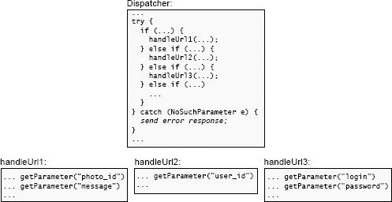

# CHƯƠNG 10: Định nghĩa lỗi ra khỏi sự tồn tại (Chapter 10: Define Errors Out Of Existence)

Xử lý ngoại lệ (exception handling) là một trong những nguồn gây ra độ phức tạp tồi tệ nhất trong các hệ thống phần mềm. Mã xử lý các điều kiện đặc biệt về bản chất khó viết hơn mã xử lý các trường hợp bình thường, và các lập trình viên thường định nghĩa ngoại lệ mà không cân nhắc xem chúng sẽ được xử lý như thế nào. Chương này thảo luận lý do tại sao ngoại lệ lại đóng góp một phần quá lớn vào độ phức tạp, sau đó chỉ ra cách đơn giản hóa việc xử lý ngoại lệ. Bài học tổng quát quan trọng nhất của chương này là giảm số lượng nơi mà ngoại lệ phải được xử lý; trong nhiều trường hợp, ngữ nghĩa (semantics) của các thao tác có thể được điều chỉnh sao cho hành vi bình thường xử lý được mọi tình huống và không còn điều kiện ngoại lệ nào cần báo cáo nữa (đó chính là lý do cho tiêu đề của chương này).

---

## 10.1 Tại sao ngoại lệ làm tăng độ phức tạp (Why exceptions add complexity)

Tôi sử dụng thuật ngữ *ngoại lệ (exception)* để chỉ bất kỳ điều kiện bất thường nào làm thay đổi luồng điều khiển bình thường trong chương trình. Nhiều ngôn ngữ lập trình cung cấp một cơ chế ngoại lệ chính thức cho phép ngoại lệ được ném (throw) bởi mã ở tầng thấp hơn và được bắt (catch) bởi mã bao bọc bên ngoài. Tuy nhiên, ngoại lệ vẫn có thể xảy ra ngay cả khi không sử dụng cơ chế báo cáo ngoại lệ chính thức, chẳng hạn như khi một phương thức trả về một giá trị đặc biệt để chỉ ra rằng nó đã không hoàn thành hành vi bình thường. Tất cả các hình thức ngoại lệ này đều làm tăng độ phức tạp.

Một đoạn mã cụ thể có thể gặp phải ngoại lệ theo nhiều cách khác nhau:

- Bên gọi (caller) có thể cung cấp các đối số hoặc thông tin cấu hình không hợp lệ.
- Một phương thức được gọi có thể không hoàn thành được thao tác được yêu cầu. Ví dụ, một thao tác I/O có thể thất bại, hoặc một tài nguyên cần thiết có thể không khả dụng.
- Trong một hệ thống phân tán (distributed system), các gói tin mạng có thể bị mất hoặc bị trễ, các máy chủ có thể không phản hồi kịp thời, hoặc các nút ngang hàng (peers) có thể giao tiếp theo những cách không mong đợi.
- Mã nguồn có thể phát hiện ra lỗi (bugs), sự không nhất quán nội bộ, hoặc những tình huống mà nó chưa được chuẩn bị để xử lý.

Các hệ thống lớn phải đối phó với rất nhiều điều kiện ngoại lệ, đặc biệt nếu chúng là hệ thống phân tán hoặc cần khả năng chịu lỗi (fault-tolerant). Mã xử lý ngoại lệ có thể chiếm một tỷ lệ đáng kể trong toàn bộ mã nguồn của một hệ thống.

Mã xử lý ngoại lệ về bản chất khó viết hơn mã cho trường hợp bình thường. Một ngoại lệ làm gián đoạn luồng chạy bình thường của mã; nó thường có nghĩa là một điều gì đó đã không diễn ra như mong đợi. Khi một ngoại lệ xảy ra, lập trình viên có thể xử lý theo hai cách, và mỗi cách đều có thể rất phức tạp. Cách thứ nhất là tiến về phía trước và hoàn thành công việc đang dở dang bất chấp ngoại lệ. Ví dụ, nếu một gói tin mạng bị mất, nó có thể được gửi lại; nếu dữ liệu bị hỏng, có lẽ nó có thể được khôi phục từ một bản sao dự phòng (redundant copy). Cách thứ hai là hủy bỏ (abort) thao tác đang thực hiện và báo cáo ngoại lệ lên tầng trên. Tuy nhiên, việc hủy bỏ có thể rất phức tạp vì ngoại lệ có thể đã xảy ra tại thời điểm mà trạng thái hệ thống không nhất quán (một cấu trúc dữ liệu có thể mới được khởi tạo một phần); mã xử lý ngoại lệ phải khôi phục lại tính nhất quán, chẳng hạn bằng cách hoàn tác (unwind) bất kỳ thay đổi nào đã thực hiện trước khi ngoại lệ xảy ra.

Hơn nữa, mã xử lý ngoại lệ còn tạo ra cơ hội cho nhiều ngoại lệ hơn nữa. Hãy xem xét trường hợp gửi lại một gói tin mạng bị mất. Có thể gói tin đó thực sự không bị mất, mà chỉ bị trễ. Trong trường hợp này, việc gửi lại gói tin sẽ dẫn đến các gói tin trùng lặp đến nơi nhận; điều này tạo ra một điều kiện ngoại lệ mới mà bên nhận phải xử lý. Hoặc hãy xem xét trường hợp khôi phục dữ liệu bị mất từ một bản sao dự phòng: điều gì xảy ra nếu bản sao dự phòng đó cũng bị mất? Các ngoại lệ thứ cấp (secondary exceptions) xảy ra trong quá trình khôi phục thường tinh vi và phức tạp hơn nhiều so với các ngoại lệ sơ cấp ban đầu. Nếu một ngoại lệ được xử lý bằng cách hủy bỏ thao tác đang diễn ra, thì điều này lại phải được báo cáo cho bên gọi như một ngoại lệ khác. Để ngăn chặn một chuỗi ngoại lệ nối tiếp nhau không hồi kết, lập trình viên cuối cùng phải tìm cách xử lý ngoại lệ mà không sinh thêm ngoại lệ mới.

Sự hỗ trợ của ngôn ngữ lập trình dành cho ngoại lệ thường dài dòng và cồng kềnh, khiến mã xử lý ngoại lệ trở nên khó đọc. Ví dụ, hãy xem xét đoạn mã sau đây, đọc một tập hợp các tweet từ một tệp bằng cơ chế tuần tự hóa (serialization) và giải tuần tự hóa (deserialization) đối tượng của Java:

```java
try (
     FileInputStream fileStream =
                  new FileInputStream(fileName);
     BufferedInputStream bufferedStream =
                  new BufferedInputStream(fileStream);
     ObjectInputStream objectStream =
                  new ObjectInputStream(bufferedStream);
) {
     for (int i = 0; i < tweetsPerFile; i++) {
           tweets.add((Tweet) objectStream.readObject());
     }
}
catch (FileNotFoundException e) {
     ...
}
catch (ClassNotFoundException e) {
     ...
}
catch (EOFException e) {
     // Not a problem: not all tweet files have full
     // set of tweets.
}
catch (IOException e) {
     ...
}
catch (ClassCastException e) {
     ...
}
```

Chỉ riêng phần khung `try-catch` cơ bản đã chiếm nhiều dòng mã hơn cả phần mã cho thao tác thông thường, chưa kể đến phần mã thực sự xử lý các ngoại lệ bên trong các khối `catch`. Rất khó để liên kết mã xử lý ngoại lệ với mã trường hợp bình thường: ví dụ, không dễ nhìn ra mỗi ngoại lệ được phát sinh từ đâu. Một cách tiếp cận thay thế là chia nhỏ đoạn mã thành nhiều khối `try` riêng biệt; ở mức cực đoan, có thể có một khối `try` cho mỗi dòng mã có khả năng sinh ra ngoại lệ. Cách này sẽ làm rõ nơi ngoại lệ xảy ra, nhưng bản thân các khối `try` lại phá vỡ luồng đọc của mã và làm mã khó đọc hơn; ngoài ra, một số mã xử lý ngoại lệ có thể bị lặp lại ở nhiều khối `try` khác nhau.

Thật khó để đảm bảo rằng mã xử lý ngoại lệ thực sự hoạt động đúng. Một số ngoại lệ, chẳng hạn như lỗi I/O, không thể dễ dàng tạo ra trong môi trường kiểm thử (test environment), vì vậy rất khó kiểm thử đoạn mã xử lý chúng. Ngoại lệ không xảy ra thường xuyên trong các hệ thống đang chạy, nên mã xử lý ngoại lệ hiếm khi được thực thi. Các lỗi (bugs) có thể ẩn mình không bị phát hiện trong một thời gian dài, và khi cuối cùng mã xử lý ngoại lệ được cần đến, rất có khả năng nó sẽ không hoạt động (một trong những câu nói yêu thích của tôi là: *"mã chưa từng được thực thi thì không hoạt động"* — *"code that hasn't been executed doesn't work"*). Một nghiên cứu gần đây cho thấy hơn 90% các sự cố nghiêm trọng (catastrophic failures) trong các hệ thống phân tán chuyên xử lý dữ liệu bắt nguồn từ việc xử lý lỗi không đúng cách[^1]. Khi mã xử lý ngoại lệ gặp sự cố, việc gỡ lỗi (debug) vấn đề cũng rất khó khăn vì nó xảy ra quá ít thường xuyên.

[^1]: Ding Yuan et. al., “Simple Testing Can Prevent Most Critical Failures: An Analysis of Production Failures in Distributed Data-Intensive Systems,” *2014 USENIX Conference on Operating System Design and Implementation*.

> 📝 **Giải thích thêm (không có trong sách):** Nghiên cứu nổi tiếng của Ding Yuan và cộng sự (OSDI 2014) đã phân tích hàng trăm sự cố thực tế trên các hệ thống phân tán lớn như Cassandra, HBase, HDFS và Redis. Họ phát hiện phần lớn các lỗi thảm khốc không đến từ logic chính, mà đến từ các khối `catch` rỗng, ghi log qua loa rồi bỏ qua, hoặc xử lý sai trạng thái khi lỗi xảy ra — đúng như cảnh báo của Ousterhout rằng mã xử lý lỗi ít được chạy và rất dễ sai.

---

## 10.2 Quá nhiều ngoại lệ (Too many exceptions)

Các lập trình viên làm trầm trọng thêm các vấn đề liên quan đến xử lý ngoại lệ bằng cách định nghĩa ra những ngoại lệ không cần thiết. Hầu hết lập trình viên được dạy rằng việc phát hiện và báo cáo lỗi là rất quan trọng; họ thường diễn giải điều này thành *"phát hiện được càng nhiều lỗi càng tốt"*. Điều này dẫn đến một phong cách phòng thủ thái quá (over-defensive style), nơi bất cứ thứ gì trông hơi đáng ngờ một chút đều bị từ chối bằng một ngoại lệ, dẫn đến sự bùng phát của những ngoại lệ không cần thiết làm tăng độ phức tạp của hệ thống.

Chính tôi cũng đã mắc sai lầm này khi thiết kế ngôn ngữ kịch bản Tcl. Tcl có lệnh `unset` dùng để xóa một biến. Tôi đã định nghĩa `unset` sao cho nó ném ra lỗi nếu biến đó không tồn tại. Vào thời điểm đó, tôi nghĩ rằng hẳn phải là một lỗi (bug) nếu ai đó cố xóa một biến không tồn tại, vì vậy Tcl nên báo lỗi. Tuy nhiên, một trong những cách sử dụng phổ biến nhất của `unset` là để dọn dẹp trạng thái tạm thời được tạo ra bởi một thao tác trước đó. Thường rất khó dự đoán chính xác trạng thái nào đã được tạo, đặc biệt nếu thao tác đó bị hủy bỏ giữa chừng. Do đó, cách đơn giản nhất là xóa tất cả các biến có khả năng đã được tạo ra. Định nghĩa của `unset` khiến việc này trở nên rắc rối: các lập trình viên cuối cùng phải bọc các lời gọi `unset` trong các câu lệnh `catch` để bắt và bỏ qua các lỗi do `unset` ném ra. Nhìn lại, định nghĩa của lệnh `unset` là một trong những sai lầm lớn nhất mà tôi đã mắc phải khi thiết kế Tcl.

Người ta rất dễ bị cám dỗ sử dụng ngoại lệ để trốn tránh việc xử lý các tình huống khó: thay vì tìm ra một cách sạch sẽ để xử lý nó, chỉ việc ném một ngoại lệ và đá quả bóng trách nhiệm sang cho bên gọi. Một số người có thể lập luận rằng cách tiếp cận này trao quyền cho bên gọi, vì nó cho phép mỗi bên gọi xử lý ngoại lệ theo một cách khác nhau. Tuy nhiên, nếu chính bạn còn gặp khó khăn trong việc tìm ra phải làm gì cho tình huống cụ thể đó, thì rất có khả năng bên gọi cũng không biết phải làm gì. Việc tạo ra một ngoại lệ trong tình huống như vậy chỉ đẩy vấn đề sang cho người khác và làm tăng thêm độ phức tạp của hệ thống.

Các ngoại lệ được ném ra bởi một lớp là một phần trong giao diện (interface) của nó; những lớp có nhiều ngoại lệ sẽ có giao diện phức tạp, và chúng nông (shallower) hơn so với các lớp có ít ngoại lệ hơn. Một ngoại lệ là một thành phần đặc biệt phức tạp của giao diện. Nó có thể lan truyền ngược lên qua nhiều tầng ngăn xếp lời gọi (stack levels) trước khi được bắt, vì vậy nó ảnh hưởng không chỉ đến bên gọi trực tiếp của phương thức, mà còn có thể ảnh hưởng đến các bên gọi ở tầng cao hơn (và giao diện của họ).

Ném ngoại lệ thì dễ; xử lý chúng mới khó. Do đó, độ phức tạp của ngoại lệ đến từ mã xử lý ngoại lệ. Cách tốt nhất để giảm thiểu thiệt hại về độ phức tạp do việc xử lý ngoại lệ gây ra là giảm số lượng nơi mà ngoại lệ phải được xử lý. Phần còn lại của chương này sẽ thảo luận bốn kỹ thuật để giảm số lượng trình xử lý ngoại lệ (exception handlers).

---

## 10.3 Định nghĩa lỗi ra khỏi sự tồn tại (Define errors out of existence)

Cách tốt nhất để loại bỏ độ phức tạp của việc xử lý ngoại lệ là định nghĩa các API của bạn sao cho không có ngoại lệ nào cần phải xử lý: *định nghĩa lỗi ra khỏi sự tồn tại* (define errors out of existence). Điều này nghe có vẻ nghịch lý (sacrilegious), nhưng nó lại cực kỳ hiệu quả trong thực tế. Hãy xem xét lệnh `unset` của Tcl đã thảo luận ở trên. Thay vì ném ra lỗi khi `unset` được yêu cầu xóa một biến không tồn tại, lẽ ra nó chỉ cần trả về mà không làm gì cả. Lẽ ra tôi nên thay đổi nhẹ định nghĩa của `unset`: thay vì *"xóa một biến"*, `unset` nên là *"đảm bảo rằng một biến không còn tồn tại nữa"*. Với định nghĩa đầu tiên, `unset` không thể hoàn thành công việc nếu biến không tồn tại, nên việc phát sinh ngoại lệ là hợp lý. Với định nghĩa thứ hai, việc gọi `unset` với tên một biến không tồn tại là hoàn toàn tự nhiên. Trong trường hợp này, công việc của nó đã xong sẵn rồi, nên nó chỉ việc trả về. Không còn trường hợp lỗi nào cần báo cáo nữa.

> 💡 **Ví dụ bổ sung (không có trong sách):** Trong cơ sở dữ liệu SQL, câu lệnh `DROP TABLE users;` sẽ báo lỗi nếu bảng `users` chưa tồn tại, buộc các script triển khai phải kiểm tra sự tồn tại trước hoặc bắt lỗi. Ngược lại, `DROP TABLE IF EXISTS users;` định nghĩa lỗi đó ra khỏi sự tồn tại: mục tiêu là đảm bảo bảng `users` không còn tồn tại sau khi lệnh chạy xong — nếu nó vốn đã không có thì coi như thành công. Tương tự trong Python, `dict.pop(key, None)` hoặc `set.discard(item)` (thay vì `set.remove(item)`) giúp tránh `KeyError` không cần thiết khi mục đích chỉ là "đảm bảo phần tử không còn trong tập hợp".

---

## 10.4 Ví dụ: xóa tệp trong Windows (Example: file deletion in Windows)

Việc xóa tệp cung cấp một ví dụ khác về cách các lỗi có thể được định nghĩa để biến mất. Hệ điều hành Windows không cho phép xóa một tệp nếu tệp đó đang được mở bởi một tiến trình (process). Đây là một nguồn gây bực bội liên tục cho cả lập trình viên và người dùng. Để xóa một tệp đang được sử dụng, người dùng phải tìm kiếm khắp hệ thống để xem tiến trình nào đang mở tệp đó, rồi tắt (kill) tiến trình ấy đi. Đôi khi người dùng bỏ cuộc và khởi động lại cả máy tính chỉ để có thể xóa một tệp.

Hệ điều hành Unix định nghĩa việc xóa tệp một cách thanh thoát hơn nhiều. Trong Unix, nếu một tệp đang được mở khi bị xóa, Unix không xóa tệp ngay lập tức. Thay vào đó, nó đánh dấu tệp là sẽ bị xóa, rồi thao tác xóa trả về thành công. Tên tệp đã bị gỡ bỏ khỏi thư mục chứa nó, nên không có tiến trình nào khác có thể mở tệp cũ nữa và một tệp mới trùng tên có thể được tạo ra, nhưng dữ liệu của tệp hiện tại vẫn còn đó. Các tiến trình vốn đã mở tệp từ trước vẫn có thể tiếp tục đọc và ghi vào tệp một cách bình thường. Một khi tệp đã được đóng bởi tất cả các tiến trình đang truy cập nó, dữ liệu của tệp mới được giải phóng.

Cách tiếp cận của Unix định nghĩa hai loại lỗi khác nhau ra khỏi sự tồn tại. Thứ nhất, thao tác xóa không còn trả về lỗi nếu tệp đang được sử dụng; lệnh xóa thành công, và tệp cuối cùng sẽ bị xóa. Thứ hai, việc xóa một tệp đang được sử dụng không tạo ra ngoại lệ cho các tiến trình đang dùng tệp đó. Một hướng giải quyết khả dĩ cho bài toán này lẽ ra có thể là xóa tệp ngay lập tức và đánh dấu tất cả các phiên mở của tệp là bị vô hiệu hóa; bất kỳ nỗ lực nào của các tiến trình khác nhằm đọc hoặc ghi vào tệp đã xóa sẽ thất bại. Tuy nhiên, cách tiếp cận đó sẽ tạo ra những lỗi mới để các tiến trình kia phải xử lý. Thay vào đó, Unix cho phép chúng tiếp tục truy cập tệp bình thường; việc trì hoãn xóa tệp đã định nghĩa các lỗi ra khỏi sự tồn tại.

Có vẻ hơi lạ khi Unix cho phép một tiến trình tiếp tục đọc và ghi vào một tệp "đã định sẵn sẽ bị hủy" (doomed file), nhưng tôi chưa từng gặp tình huống nào mà điều này gây ra vấn đề nghiêm trọng. Định nghĩa xóa tệp của Unix dễ làm việc hơn nhiều, cho cả lập trình viên lẫn người dùng, so với định nghĩa của Windows.

---

## 10.5 Ví dụ: phương thức substring trong Java (Example: Java substring method)

Như một ví dụ cuối cùng, hãy xem xét lớp `String` của Java và phương thức `substring` của nó. Khi nhận vào hai chỉ số (index) trong một chuỗi, `substring` trả về chuỗi con bắt đầu từ ký tự tại chỉ số thứ nhất và kết thúc ở ký tự ngay trước chỉ số thứ hai. Tuy nhiên, nếu một trong hai chỉ số nằm ngoài phạm vi của chuỗi, `substring` sẽ ném ra `IndexOutOfBoundsException`. Ngoại lệ này là không cần thiết và làm phức tạp việc sử dụng phương thức. Tôi thường rơi vào tình huống mà một hoặc cả hai chỉ số có thể nằm ngoài phạm vi của chuỗi, và tôi muốn trích xuất tất cả các ký tự trong chuỗi giao với khoảng chỉ số đã chỉ định. Không may là điều này buộc tôi phải tự kiểm tra từng chỉ số và làm tròn lên `0` hoặc làm tròn xuống độ dài cuối của chuỗi; một lời gọi phương thức dài một dòng giờ đây trở thành 5–10 dòng mã.

Phương thức `substring` của Java sẽ dễ sử dụng hơn nhiều nếu nó tự động thực hiện sự điều chỉnh này, tức là triển khai API như sau: *"trả về các ký tự của chuỗi (nếu có) với chỉ số lớn hơn hoặc bằng `beginIndex` và nhỏ hơn `endIndex`."* Đây là một API đơn giản và tự nhiên, và nó định nghĩa ngoại lệ `IndexOutOfBoundsException` ra khỏi sự tồn tại. Hành vi của phương thức giờ đây được xác định rõ ràng ngay cả khi một hoặc cả hai chỉ số bị âm, hoặc khi `beginIndex` lớn hơn `endIndex`. Cách tiếp cận này đơn giản hóa API cho phương thức đồng thời tăng cường chức năng của nó, vì vậy nó làm cho phương thức trở nên sâu (deeper) hơn. Nhiều ngôn ngữ khác đã chọn cách tiếp cận không lỗi này; ví dụ, Python trả về một kết quả rỗng đối với các phép cắt danh sách (list slices) vượt ngoài phạm vi.

Khi tôi lập luận ủng hộ việc định nghĩa lỗi ra khỏi sự tồn tại, mọi người đôi khi phản biện rằng việc ném lỗi sẽ giúp bắt được bug; nếu lỗi bị định nghĩa biến mất hết, chẳng phải điều đó sẽ dẫn đến phần mềm nhiều lỗi hơn sao? Có lẽ đây chính là lý do các nhà phát triển Java quyết định rằng `substring` nên ném ngoại lệ. Cách tiếp cận "đầy lỗi" (error-ful) có thể bắt được một số bug, nhưng nó cũng làm tăng độ phức tạp, từ đó dẫn đến những bug khác. Trong cách tiếp cận đầy lỗi, lập trình viên phải viết thêm mã để né tránh hoặc bỏ qua lỗi, và điều này làm tăng khả năng phát sinh bug; hoặc họ có thể quên viết phần mã bổ sung đó, trong trường hợp ấy các lỗi bất ngờ có thể bị ném ra lúc chạy (runtime). Ngược lại, việc định nghĩa lỗi ra khỏi sự tồn tại giúp đơn giản hóa các API và giảm lượng mã phải viết.

Nhìn chung, cách tốt nhất để giảm số lượng bug là làm cho phần mềm đơn giản hơn.

---

## 10.6 Che giấu ngoại lệ (Mask exceptions)

Kỹ thuật thứ hai để giảm số nơi phải xử lý ngoại lệ là *che giấu ngoại lệ (exception masking)*. Với cách tiếp cận này, một điều kiện ngoại lệ được phát hiện và xử lý ở tầng thấp trong hệ thống, sao cho các phần mềm ở tầng cao hơn không cần phải biết đến điều kiện đó. Che giấu ngoại lệ đặc biệt phổ biến trong các hệ thống phân tán. Chẳng hạn, trong một giao thức truyền tải mạng như TCP, các gói tin có thể bị rơi vì nhiều lý do như hỏng dữ liệu hay tắc nghẽn. TCP che giấu việc mất gói tin bằng cách tự động gửi lại các gói tin bị mất bên trong phần triển khai của nó, nhờ vậy toàn bộ dữ liệu cuối cùng đều tới đích và phía ứng dụng khách hoàn toàn không hay biết về các gói tin đã bị rơi.

Một ví dụ gây tranh cãi hơn về việc che giấu ngoại lệ xảy ra trong hệ thống tệp mạng NFS (Network File System). Nếu một máy chủ tệp NFS bị sập (crash) hoặc không phản hồi vì bất kỳ lý do gì, các máy khách sẽ gửi lại yêu cầu của chúng tới máy chủ lặp đi lặp lại cho đến khi vấn đề cuối cùng được giải quyết. Mã hệ thống tệp ở tầng thấp trên máy khách không báo cáo bất kỳ ngoại lệ nào cho ứng dụng đang gọi. Thao tác đang diễn ra (và do đó là cả ứng dụng) chỉ đơn giản là bị treo (hang) cho đến khi thao tác có thể hoàn thành thành công. Nếu tình trạng treo kéo dài quá một khoảng thời gian ngắn, trình khách NFS sẽ in thông báo lên bảng điều khiển của người dùng có dạng: *"NFS server xyzzy not responding still trying."*

Người dùng NFS thường phàn nàn về việc ứng dụng của họ bị treo trong lúc chờ máy chủ NFS hoạt động bình thường trở lại. Nhiều người đề xuất rằng NFS nên hủy bỏ thao tác bằng một ngoại lệ thay vì bị treo. Tuy nhiên, việc báo cáo ngoại lệ sẽ khiến mọi thứ tệ hơn chứ không tốt lên. Không có nhiều việc mà một ứng dụng có thể làm nếu nó mất quyền truy cập vào các tệp của mình. Một khả năng là ứng dụng tự thử lại thao tác tệp, nhưng điều này vẫn khiến ứng dụng bị treo, và việc thực hiện thử lại ở một nơi duy nhất trong tầng NFS dễ dàng hơn nhiều so với việc làm điều đó ở mọi lời gọi hệ thống tệp trong mọi ứng dụng (một trình biên dịch không nên phải bận tâm đến chuyện này!). Lựa chọn thay thế khác là các ứng dụng tự hủy bỏ và trả lỗi về cho bên gọi của chúng. Rất khó có khả năng các bên gọi đó cũng biết phải làm gì, nên chúng cũng sẽ hủy bỏ theo, dẫn đến sự sụp đổ của toàn bộ môi trường làm việc của người dùng. Người dùng vẫn chẳng thể làm được việc gì trong lúc máy chủ tệp ngừng hoạt động, và họ sẽ phải khởi động lại tất cả ứng dụng của mình một khi máy chủ tệp sống lại.

Do đó, giải pháp tốt nhất là NFS che giấu các lỗi đó và tạm treo các ứng dụng. Với cách tiếp cận này, các ứng dụng không cần bất kỳ đoạn mã nào để đối phó với sự cố máy chủ, và chúng có thể tiếp tục chạy mượt mà ngay khi máy chủ hoạt động trở lại. Nếu người dùng mất kiên nhẫn khi chờ đợi, họ luôn có thể chủ động tắt ứng dụng theo cách thủ công.

Che giấu ngoại lệ không hiệu quả trong mọi tình huống, nhưng nó là một công cụ mạnh mẽ trong những tình huống phù hợp. Nó tạo ra các lớp sâu hơn (deeper classes), vì nó thu hẹp giao diện của lớp (ít ngoại lệ hơn để người dùng phải quan tâm) và bổ sung thêm chức năng dưới dạng phần mã thực hiện việc che giấu ngoại lệ. Che giấu ngoại lệ là một ví dụ của việc *kéo độ phức tạp xuống dưới (pulling complexity downward)*.

---

## 10.7 Gom nhóm ngoại lệ (Exception aggregation)

Kỹ thuật thứ ba để giảm độ phức tạp liên quan đến ngoại lệ là *gom nhóm ngoại lệ (exception aggregation)*. Ý tưởng đằng sau việc gom nhóm ngoại lệ là xử lý nhiều ngoại lệ bằng một đoạn mã duy nhất; thay vì viết các trình xử lý riêng biệt cho nhiều ngoại lệ đơn lẻ, hãy xử lý tất cả chúng tại một nơi bằng một trình xử lý duy nhất.

Hãy xem xét cách xử lý các tham số bị thiếu trong một Web server. Một Web server triển khai một tập hợp các URL. Khi máy chủ nhận được một URL gửi tới, nó điều phối (dispatch) tới một phương thức dịch vụ (service method) dành riêng cho URL đó để xử lý và tạo phản hồi. URL chứa nhiều tham số khác nhau dùng để tạo phản hồi. Mỗi phương thức dịch vụ sẽ gọi một phương thức tầng thấp hơn (hãy gọi nó là `getParameter`) để trích xuất các tham số nó cần từ URL. Nếu URL không chứa tham số mong muốn, `getParameter` sẽ ném ra một ngoại lệ.

Khi sinh viên trong một lớp học thiết kế phần mềm tự xây dựng một máy chủ như vậy, nhiều bạn đã bọc từng lời gọi `getParameter` riêng rẽ trong một trình xử lý ngoại lệ tách biệt để bắt các ngoại lệ `NoSuchParameter`, như trong Hình 10.1. Điều này dẫn đến một số lượng lớn các trình xử lý, mà tất cả chúng về cơ bản đều làm cùng một việc (tạo ra một phản hồi lỗi).


**Hình 10.1 – Gom nhóm ngoại lệ chưa được áp dụng: trình xử lý ngoại lệ lặp lại ở từng lời gọi `getParameter` (Figure 10.1. The code at the top dispatches to one of several methods in a Web server, each of which handles a particular URL. Each of those methods (bottom) uses parameters from the incoming HTTP request. In this figure, there is a separate exception handler for each call to `getParameter`; this results in duplicated code.)**

Một cách tiếp cận tốt hơn là gom nhóm các ngoại lệ lại. Thay vì bắt các ngoại lệ bên trong từng phương thức dịch vụ riêng lẻ, hãy để chúng lan truyền lên phương thức điều phối (dispatch method) ở tầng cao nhất của Web server, như trong Hình 10.2. Một trình xử lý duy nhất trong phương thức này có thể bắt tất cả các ngoại lệ và tạo ra một phản hồi lỗi phù hợp cho các tham số bị thiếu.



**Hình 10.2 – Gom nhóm ngoại lệ: một trình xử lý duy nhất ở tầng điều phối (Figure 10.2. This code is functionally equivalent to Figure 10.1, but exception handling has been aggregated: a single exception handler in the dispatcher catches all of the `NoSuchParameter` exceptions from all of the URL-specific methods.)**

> 📝 **Giải thích thêm (không có trong sách):** Sơ đồ dưới đây minh họa sự khác biệt về luồng bắt ngoại lệ giữa Hình 10.1 (phân tán) và Hình 10.2 (gom nhóm):
>
> ```mermaid
> flowchart TD
>     subgraph "Trước: Phân tán (Hình 10.1)"
>         D1["Dispatcher"] --> H1["handleUrl1()"]
>         D1 --> H2["handleUrl2()"]
>         H1 --> T1["try/catch getParameter('photo_id')"]
>         H1 --> T2["try/catch getParameter('message')"]
>         H2 --> T3["try/catch getParameter('user_id')"]
>     end
>     subgraph "Sau: Gom nhóm (Hình 10.2)"
>         D2["Dispatcher: try { ... } catch (NoSuchParameter e)"] --> U1["handleUrl1() -> getParameter(...)"]
>         D2 --> U2["handleUrl2() -> getParameter(...)"]
>     end
> ```

Cách tiếp cận gom nhóm còn có thể được đẩy đi xa hơn nữa trong ví dụ Web server này. Có rất nhiều lỗi khác ngoài việc thiếu tham số có thể xảy ra khi xử lý một trang web; ví dụ, một tham số có thể không đúng cú pháp (phương thức dịch vụ kỳ vọng một số nguyên, nhưng giá trị lại là `"xyz"`), hoặc người dùng có thể không có quyền thực hiện thao tác được yêu cầu. Trong mỗi trường hợp, lỗi đều nên dẫn đến một phản hồi lỗi; các lỗi chỉ khác nhau ở thông điệp lỗi cần đưa vào phản hồi (`"parameter 'quantity' not present in URL"` hoặc `"bad value 'xyz' for 'quantity' parameter; must be positive integer"`). Do đó, tất cả các điều kiện dẫn đến một phản hồi lỗi đều có thể được xử lý bằng một trình xử lý ngoại lệ duy nhất ở tầng cao nhất. Thông điệp lỗi có thể được tạo ngay tại thời điểm ngoại lệ được ném ra và đưa vào như một biến trong bản ghi ngoại lệ; ví dụ, `getParameter` sẽ tạo thông điệp `"parameter 'quantity' not present in URL"`. Trình xử lý ở tầng cao nhất chỉ việc trích xuất thông điệp từ ngoại lệ và đưa nó vào phản hồi lỗi.

Sự gom nhóm được mô tả trong đoạn trên có những đặc tính rất tốt xét từ góc độ đóng gói (encapsulation) và che giấu thông tin (information hiding). Trình xử lý ngoại lệ ở tầng cao nhất đóng gói tri thức về cách tạo ra các phản hồi lỗi HTTP, nhưng nó không biết gì về các lỗi cụ thể; nó chỉ sử dụng thông điệp lỗi được cung cấp bên trong ngoại lệ. Phương thức `getParameter` đóng gói tri thức về cách trích xuất một tham số từ URL, và nó cũng biết cách mô tả các lỗi trích xuất dưới dạng dễ đọc cho con người. Hai mẩu thông tin này có quan hệ mật thiết với nhau, nên việc đặt chúng ở cùng một nơi là hoàn toàn hợp lý. Tuy nhiên, `getParameter` không biết gì về cú pháp của một phản hồi lỗi HTTP. Khi chức năng mới được thêm vào Web server, các phương thức mới giống như `getParameter` có thể được tạo ra với các lỗi riêng của chúng. Nếu các phương thức mới này ném ngoại lệ theo cùng cách như `getParameter` (bằng cách tạo ra các ngoại lệ kế thừa từ cùng một lớp cha và đính kèm một thông điệp lỗi trong mỗi ngoại lệ), chúng có thể gắn vào hệ thống hiện có mà không cần bất kỳ thay đổi nào khác: trình xử lý ở tầng cao nhất sẽ tự động tạo phản hồi lỗi cho chúng.

Ví dụ này minh họa một mẫu thiết kế (design pattern) hữu ích nói chung cho việc xử lý ngoại lệ. Nếu một hệ thống xử lý một chuỗi các yêu cầu (requests), sẽ rất hữu ích nếu định nghĩa một ngoại lệ chuyên dùng để hủy bỏ yêu cầu hiện tại, dọn dẹp trạng thái của hệ thống và tiếp tục với yêu cầu tiếp theo. Ngoại lệ này được bắt tại một nơi duy nhất gần đỉnh của vòng lặp xử lý yêu cầu của hệ thống. Ngoại lệ này có thể được ném ra tại bất kỳ điểm nào trong quá trình xử lý một yêu cầu để hủy bỏ yêu cầu đó; các lớp con khác nhau của ngoại lệ có thể được định nghĩa cho các điều kiện khác nhau. Các ngoại lệ thuộc loại này cần được phân biệt rõ ràng với các ngoại lệ gây chết toàn bộ hệ thống.

Gom nhóm ngoại lệ phát huy hiệu quả tốt nhất nếu một ngoại lệ lan truyền ngược lên qua nhiều tầng ngăn xếp trước khi được xử lý; điều này cho phép nhiều ngoại lệ hơn từ nhiều phương thức hơn được xử lý tại cùng một nơi. Điều này trái ngược với che giấu ngoại lệ: việc che giấu thường hiệu quả nhất nếu một ngoại lệ được xử lý ở một phương thức tầng thấp. Đối với che giấu, phương thức tầng thấp thường là một phương thức thư viện được nhiều phương thức khác sử dụng, nên việc để ngoại lệ lan truyền ra ngoài sẽ làm tăng số nơi phải xử lý nó. Che giấu và gom nhóm giống nhau ở chỗ cả hai cách tiếp cận đều đặt trình xử lý ngoại lệ ở vị trí mà nó có thể bắt được nhiều ngoại lệ nhất, loại bỏ nhiều trình xử lý lẽ ra phải tạo ra.

Một ví dụ khác về gom nhóm ngoại lệ xuất hiện trong hệ thống lưu trữ RAMCloud cho cơ chế khôi phục sau sự cố (crash recovery). Một hệ thống RAMCloud bao gồm một tập hợp các máy chủ lưu trữ giữ nhiều bản sao của mỗi đối tượng, nhờ đó hệ thống có thể khôi phục từ nhiều loại lỗi khác nhau. Ví dụ, nếu một máy chủ bị sập và mất toàn bộ dữ liệu, RAMCloud tái tạo lại dữ liệu bị mất bằng cách sử dụng các bản sao lưu trữ trên các máy chủ khác. Lỗi cũng có thể xảy ra ở quy mô nhỏ hơn; ví dụ, một máy chủ có thể phát hiện ra rằng một đối tượng đơn lẻ bị hỏng dữ liệu.

RAMCloud không có các cơ chế khôi phục riêng biệt cho từng loại lỗi khác nhau. Thay vào đó, RAMCloud "thăng cấp" (promotes) nhiều lỗi nhỏ hơn thành các lỗi lớn hơn. Về nguyên tắc, RAMCloud có thể xử lý một đối tượng bị hỏng bằng cách khôi phục riêng đối tượng đó từ một bản sao dự phòng. Tuy nhiên, nó không làm vậy. Thay vào đó, nếu phát hiện một đối tượng bị hỏng, nó chủ động làm sập (crash) cả máy chủ chứa đối tượng đó. RAMCloud sử dụng cách tiếp cận này vì cơ chế khôi phục sau khi sập máy chủ vốn đã rất phức tạp và cách làm này giảm thiểu số lượng cơ chế khôi phục khác nhau phải xây dựng. Việc tạo ra một cơ chế khôi phục cho các máy chủ bị sập là điều không thể tránh khỏi, vì vậy RAMCloud dùng chính cơ chế đó cho các loại khôi phục khác luôn. Điều này làm giảm lượng mã phải viết, và nó cũng đồng nghĩa với việc cơ chế khôi phục sau sự cố máy chủ được kích hoạt thường xuyên hơn. Kết quả là các lỗi (bugs) trong phần khôi phục có nhiều khả năng được phát hiện và sửa chữa hơn.

Một nhược điểm của việc thăng cấp một đối tượng bị hỏng thành một vụ sập máy chủ là nó làm tăng đáng kể chi phí khôi phục. Đây không phải là vấn đề trong RAMCloud, vì tình trạng hỏng đối tượng rất hiếm khi xảy ra. Tuy nhiên, việc thăng cấp lỗi có thể không hợp lý đối với những lỗi xảy ra thường xuyên. Ví dụ, sẽ không thực tế chút nào nếu làm sập một máy chủ bất cứ khi nào một trong các gói tin mạng của nó bị mất.

Một cách để tư duy về gom nhóm ngoại lệ là nó thay thế nhiều cơ chế chuyên dụng (special-purpose), mỗi cơ chế được may đo cho một tình huống cụ thể, bằng một cơ chế đa dụng (general-purpose) duy nhất có thể xử lý nhiều tình huống. Điều này cung cấp thêm một minh họa nữa cho lợi ích của các cơ chế đa dụng.

---

## 10.8 Cứ cho crash luôn? (Just crash?)

Kỹ thuật thứ tư để giảm độ phức tạp liên quan đến xử lý ngoại lệ là làm cho ứng dụng sập luôn (crash the application). Trong hầu hết các ứng dụng, sẽ có những lỗi nhất định mà không đáng để cố gắng xử lý. Thông thường, những lỗi này rất khó hoặc không thể xử lý và không xảy ra thường xuyên. Điều đơn giản nhất cần làm để phản ứng lại những lỗi này là in ra thông tin chẩn đoán (diagnostic information) và sau đó hủy bỏ (abort) ứng dụng.

Một ví dụ là các lỗi "hết bộ nhớ" (out of memory) xảy ra trong quá trình cấp phát lưu trữ. Hãy xem xét hàm `malloc` trong ngôn ngữ C, hàm này trả về `NULL` nếu không thể cấp phát được khối bộ nhớ mong muốn. Đây là một hành vi không may, bởi vì nó giả định rằng mọi bên gọi `malloc` đều sẽ kiểm tra giá trị trả về và có hành động thích hợp nếu hết bộ nhớ. Các ứng dụng chứa vô số lời gọi tới `malloc`, vì vậy việc kiểm tra kết quả sau mỗi lời gọi sẽ làm tăng thêm độ phức tạp đáng kể. Nếu một lập trình viên quên kiểm tra (điều rất dễ xảy ra), thì ứng dụng sẽ giải tham chiếu một con trỏ null (dereference a null pointer) nếu hết bộ nhớ, dẫn đến một vụ crash che giấu mất vấn đề thực sự.

Hơn nữa, cũng chẳng có nhiều việc mà một ứng dụng có thể làm khi nó phát hiện bộ nhớ đã cạn kiệt. Về nguyên tắc, ứng dụng có thể tìm kiếm phần bộ nhớ không dùng đến để giải phóng, nhưng nếu ứng dụng có phần bộ nhớ không dùng đến thì lẽ ra nó đã có thể giải phóng từ trước rồi, điều đó đã ngăn chặn được lỗi hết bộ nhớ ngay từ đầu. Các hệ thống ngày nay có quá nhiều bộ nhớ đến mức bộ nhớ hầu như không bao giờ cạn kiệt; nếu điều đó xảy ra, nó thường chỉ ra một lỗi (bug) trong ứng dụng (như rò rỉ bộ nhớ). Vì vậy, hiếm khi có lý do chính đáng để cố gắng xử lý lỗi hết bộ nhớ; việc này tạo ra quá nhiều độ phức tạp cho một lợi ích quá nhỏ bé.

Một cách tiếp cận tốt hơn là định nghĩa một phương thức mới tên là `ckalloc`, phương thức này gọi `malloc`, kiểm tra kết quả, và hủy bỏ ứng dụng với một thông báo lỗi nếu bộ nhớ bị cạn kiệt. Ứng dụng không bao giờ gọi `malloc` trực tiếp; nó luôn gọi `ckalloc`.

Trong các ngôn ngữ mới hơn như C++ và Java, toán tử `new` ném ra một ngoại lệ nếu bộ nhớ bị cạn kiệt. Cũng chẳng có nhiều ý nghĩa khi bắt ngoại lệ này, vì rất có khả năng chính trình xử lý ngoại lệ cũng sẽ cố gắng cấp phát thêm bộ nhớ, và thao tác đó cũng sẽ thất bại nốt. Bộ nhớ được cấp phát động là một thành phần nền tảng đến mức đối với bất kỳ ứng dụng hiện đại nào, việc tiếp tục chạy khi bộ nhớ đã cạn kiệt là vô nghĩa; tốt hơn hết là crash ngay lập tức khi lỗi được phát hiện.

Có nhiều ví dụ khác về các lỗi mà việc cho ứng dụng crash là hợp lý. Đối với hầu hết các chương trình, nếu một lỗi I/O xảy ra khi đang đọc hoặc ghi một tệp đang mở (chẳng hạn như lỗi phần cứng đĩa), hoặc nếu một socket mạng không thể mở được, ứng dụng không có nhiều cách để tự phục hồi, vì vậy việc hủy bỏ với một thông báo lỗi rõ ràng là một cách tiếp cận hợp lý. Những lỗi này ít xảy ra, nên chúng khó có thể ảnh hưởng đến tính khả dụng tổng thể của ứng dụng. Việc hủy bỏ kèm thông báo lỗi cũng phù hợp nếu một ứng dụng gặp phải một lỗi nội bộ như cấu trúc dữ liệu không nhất quán. Những điều kiện như thế có lẽ chỉ ra các lỗi (bugs) trong chương trình.

Việc có chấp nhận crash khi gặp một lỗi cụ thể hay không phụ thuộc vào từng ứng dụng. Đối với một hệ thống lưu trữ nhân bản (replicated storage system), việc hủy bỏ khi gặp lỗi I/O là không phù hợp. Thay vào đó, hệ thống phải sử dụng dữ liệu được nhân bản để khôi phục bất kỳ thông tin nào bị mất. Các cơ chế khôi phục sẽ làm tăng đáng kể độ phức tạp cho chương trình, nhưng việc khôi phục dữ liệu bị mất là một phần thiết yếu trong giá trị mà hệ thống mang lại cho người dùng của nó.

---

## 10.9 Thiết kế các trường hợp đặc biệt ra khỏi sự tồn tại (Design special cases out of existence)

Cùng một lý do khiến việc định nghĩa lỗi ra khỏi sự tồn tại trở nên hợp lý, việc định nghĩa các *trường hợp đặc biệt (special cases)* khác ra khỏi sự tồn tại cũng hợp lý tương tự. Các trường hợp đặc biệt có thể dẫn đến mã nguồn chằng chịt các câu lệnh `if`, làm cho mã khó hiểu và dễ dẫn đến bug. Do đó, các trường hợp đặc biệt nên được loại bỏ bất cứ khi nào có thể. Cách tốt nhất để làm điều này là thiết kế trường hợp bình thường theo một cách mà nó tự động xử lý được luôn các trường hợp đặc biệt mà không cần thêm bất kỳ dòng mã nào.

Trong dự án trình soạn thảo văn bản được mô tả ở Chương 6, sinh viên phải triển khai cơ chế chọn văn bản (selection) và sao chép hoặc xóa vùng chọn đó. Hầu hết sinh viên đều đưa vào một biến trạng thái trong phần triển khai vùng chọn của mình để cho biết vùng chọn có tồn tại hay không. Họ có lẽ chọn cách này vì có những lúc không có vùng chọn nào hiển thị trên màn hình, nên việc biểu diễn khái niệm này trong phần triển khai có vẻ tự nhiên. Tuy nhiên, cách tiếp cận này dẫn đến vô số lần kiểm tra để phát hiện điều kiện "không có vùng chọn" và xử lý nó một cách đặc biệt.

Mã xử lý vùng chọn có thể được đơn giản hóa bằng cách loại bỏ trường hợp đặc biệt "không có vùng chọn", sao cho vùng chọn *luôn luôn tồn tại*. Khi không có vùng chọn nào hiển thị trên màn hình, nó có thể được biểu diễn ở bên trong bằng một *vùng chọn rỗng (empty selection)*, mà vị trí bắt đầu và vị trí kết thúc là giống hệt nhau. Với cách tiếp cận này, mã quản lý vùng chọn có thể được viết mà không cần bất kỳ lệnh kiểm tra nào cho trạng thái "không có vùng chọn". Khi sao chép vùng chọn, nếu vùng chọn rỗng thì 0 byte sẽ được chèn vào vị trí mới (nếu triển khai đúng, sẽ không cần kiểm tra 0 byte như một trường hợp đặc biệt). Tương tự, có thể thiết kế mã xóa vùng chọn sao cho trường hợp rỗng được xử lý mà không cần bất kỳ lệnh kiểm tra đặc biệt nào. Hãy xem xét một vùng chọn nằm hoàn toàn trên một dòng. Để xóa vùng chọn, hãy trích xuất phần dòng đứng trước vùng chọn và nối nó với phần dòng đứng sau vùng chọn để tạo thành dòng mới. Nếu vùng chọn rỗng, cách tiếp cận này sẽ tái tạo lại chính xác dòng ban đầu.

Ví dụ này cũng minh họa cho ý tưởng *"khác tầng, khác trừu tượng" (different layer, different abstraction)* từ Chương 7. Khái niệm "không có vùng chọn" có ý nghĩa xét theo cách người dùng suy nghĩ về giao diện của ứng dụng, nhưng điều đó không có nghĩa là nó phải được biểu diễn một cách tường minh bên trong ứng dụng. Việc có một vùng chọn luôn tồn tại, nhưng đôi khi bị rỗng và do đó vô hình, tạo ra một phần triển khai đơn giản hơn nhiều.

> 💡 **Ví dụ bổ sung (không có trong sách):** Mẫu thiết kế **Null Object Pattern** (Đối tượng Rỗng) là một ứng dụng kinh điển của tư duy này. Thay vì một hàm trả về `null` khi không tìm thấy cấu hình logger hoặc danh sách quyền (buộc mọi nơi gọi phải viết `if (logger != null) logger.log(...)`), ta trả về một `NoOpLogger` có phương thức `log()` không làm gì cả. Nhờ đó, trường hợp đặc biệt "không có logger" bị loại bỏ hoàn toàn khỏi toàn bộ mã nguồn gọi hàm.

---

## 10.10 Đi quá xa (Taking it too far)

Việc định nghĩa để ngoại lệ biến mất, hoặc che giấu chúng bên trong một mô-đun, chỉ có ý nghĩa nếu thông tin về ngoại lệ đó không cần thiết ở bên ngoài mô-đun. Điều này đúng với các ví dụ trong chương này, chẳng hạn như lệnh `unset` của Tcl và phương thức `substring` của Java; trong những tình huống hiếm hoi mà bên gọi thực sự quan tâm đến các trường hợp đặc biệt vốn bị phát hiện bởi các ngoại lệ đó, luôn có những cách khác để nó lấy được thông tin này (ví dụ như kiểm tra biến có tồn tại không trước khi `unset`, hoặc kiểm tra độ dài chuỗi).

Tuy nhiên, hoàn toàn có khả năng đi quá xa với ý tưởng này. Trong một mô-đun giao tiếp mạng, một nhóm sinh viên đã che giấu toàn bộ các ngoại lệ mạng: nếu một lỗi mạng xảy ra, mô-đun đó bắt lấy nó, vứt bỏ đi, và tiếp tục chạy như thể chẳng có vấn đề gì. Điều này khiến các ứng dụng sử dụng mô-đun đó không có cách nào biết được liệu tin nhắn có bị mất hay một máy chủ ngang hàng có bị sập hay không; thiếu thông tin này, việc xây dựng các ứng dụng đáng tin cậy (robust applications) là điều bất khả thi. Trong trường hợp này, việc mô-đun phơi bày các ngoại lệ là điều thiết yếu, mặc dù chúng làm tăng thêm độ phức tạp cho giao diện của mô-đun.

Đối với ngoại lệ, cũng như với nhiều khía cạnh khác trong thiết kế phần mềm, bạn phải xác định xem điều gì là quan trọng và điều gì là không quan trọng. Những thứ không quan trọng nên được giấu đi, và giấu được càng nhiều càng tốt. Nhưng khi một điều gì đó là quan trọng, nó bắt buộc phải được phơi bày ra ngoài.

---

## 10.11 Kết luận (Conclusion)

Các trường hợp đặc biệt dưới bất kỳ hình thức nào đều làm mã nguồn khó hiểu hơn và làm tăng khả năng phát sinh lỗi. Chương này tập trung vào ngoại lệ — một trong những nguồn sinh ra mã xử lý trường hợp đặc biệt đáng kể nhất — và thảo luận cách giảm số lượng nơi mà ngoại lệ phải được xử lý. Cách tốt nhất để làm điều này là định nghĩa lại ngữ nghĩa để loại bỏ các điều kiện lỗi. Đối với những ngoại lệ không thể định nghĩa để biến mất được, bạn nên tìm kiếm cơ hội để che giấu chúng ở tầng thấp nhằm giới hạn tác động của chúng, hoặc gom nhóm nhiều trình xử lý trường hợp đặc biệt thành một trình xử lý tổng quát duy nhất. Khi kết hợp lại, các kỹ thuật này có thể tạo ra tác động đáng kể đến độ phức tạp tổng thể của hệ thống.

---

## Bảng thuật ngữ chương (Chapter Glossary)

| Thuật ngữ (English) | Tiếng Việt | Giải thích ngắn gọn |
| :--- | :--- | :--- |
| Exception | Ngoại lệ | Bất kỳ điều kiện bất thường nào làm thay đổi luồng điều khiển bình thường của chương trình (bao gồm cả ngoại lệ ngôn ngữ và giá trị trả về báo lỗi). |
| Exception handling | Xử lý ngoại lệ | Mã nguồn dùng để phát hiện, phục hồi hoặc báo cáo các điều kiện ngoại lệ. |
| Define errors out of existence | Định nghĩa lỗi ra khỏi sự tồn tại | Thay đổi ngữ nghĩa của API/thao tác sao cho hành vi bình thường bao quát luôn các trường hợp từng bị coi là lỗi. |
| Exception masking | Che giấu ngoại lệ | Phát hiện và xử lý ngoại lệ ngay ở tầng thấp để các tầng cao hơn không cần biết đến nó. |
| Exception aggregation | Gom nhóm ngoại lệ | Để ngoại lệ lan truyền lên tầng cao hơn và xử lý nhiều loại ngoại lệ tại một trình xử lý tập trung duy nhất. |
| Error promotion | Thăng cấp lỗi | Biến một lỗi nhỏ, khó xử lý riêng lẻ thành một lỗi lớn hơn đã có sẵn cơ chế phục hồi tổng quát (ví dụ: hỏng đối tượng -> khởi động lại server trong RAMCloud). |
| Special case | Trường hợp đặc biệt | Tình huống ngoại lệ hoặc ranh giới (như "không có vùng chọn") đòi hỏi nhánh `if` xử lý riêng, dễ gây rối và lỗi. |
| Over-defensive style | Phong cách phòng thủ thái quá | Xu hướng kiểm tra và ném ngoại lệ cho mọi thứ hơi bất thường, làm phình to giao diện và tăng độ phức tạp. |
