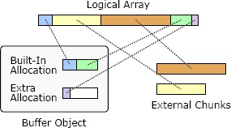
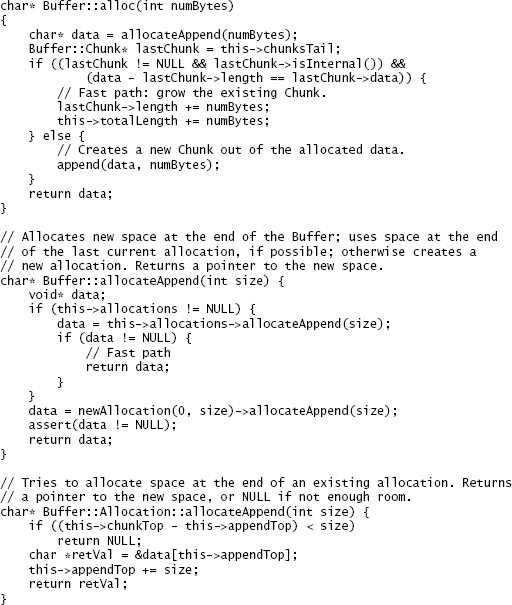
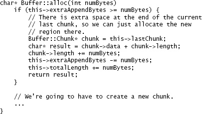

# CHƯƠNG 20: Thiết kế cho hiệu năng (Chapter 20: Designing for Performance)

Cho đến thời điểm này, toàn bộ cuộc thảo luận về thiết kế phần mềm đều xoay quanh sự phức tạp (*complexity*); mục tiêu là làm cho phần mềm trở nên đơn giản và dễ hiểu nhất có thể. Nhưng nếu bạn đang làm việc trên một hệ thống cần phải chạy thật nhanh thì sao? Những cân nhắc về hiệu năng (*performance*) nên tác động đến quá trình thiết kế như thế nào? Chương này bàn về cách đạt được hiệu năng cao mà không phải hy sinh một thiết kế sạch đẹp. Ý tưởng quan trọng nhất vẫn là sự đơn giản: sự đơn giản không chỉ cải thiện thiết kế của hệ thống, mà thường còn giúp hệ thống chạy nhanh hơn.

## 20.1 Cách tư duy về hiệu năng (How to think about performance)

Câu hỏi đầu tiên cần giải quyết là: "Trong quá trình phát triển thông thường, bạn nên lo lắng về hiệu năng đến mức nào?" Nếu bạn cố gắng tối ưu từng câu lệnh một để đạt tốc độ tối đa, điều đó sẽ làm chậm tiến độ phát triển và tạo ra rất nhiều sự phức tạp không cần thiết. Hơn nữa, nhiều "tối ưu hóa" trong số đó thực chất sẽ chẳng giúp ích gì cho hiệu năng. Mặt khác, nếu bạn hoàn toàn phớt lờ các vấn đề hiệu năng, bạn rất dễ kết thúc với một số lượng lớn các điểm kém hiệu năng đáng kể nằm rải rác khắp mã nguồn; hệ thống kết quả có thể dễ dàng chậm hơn 5–10 lần so với mức cần thiết. Trong kịch bản "chết vì ngàn nhát cắt" (*death by a thousand cuts*) này, rất khó để quay lại sau này và cải thiện hiệu năng, bởi vì không có một cải tiến đơn lẻ nào tạo ra tác động đủ lớn.

Cách tiếp cận tốt nhất nằm ở khoảng giữa hai thái cực đó: bạn sử dụng kiến thức cơ bản về hiệu năng để chọn những phương án thiết kế "tự nhiên đã hiệu quả" (*naturally efficient*) mà vẫn sạch sẽ và đơn giản. Chìa khóa là rèn luyện nhận thức về việc những thao tác nào về bản chất là tốn kém (*fundamentally expensive*). Dưới đây là một vài ví dụ về các thao tác tương đối tốn kém hiện nay:

- **Giao tiếp mạng (Network communication):** ngay cả bên trong một trung tâm dữ liệu (*datacenter*), một lượt trao đổi thông điệp khứ hồi (*round-trip message exchange*) có thể mất 10–50 µs, tương đương hàng chục nghìn chu kỳ lệnh (*instruction times*). Các lượt khứ hồi trên mạng diện rộng (*wide-area round-trips*) có thể mất 10–100 ms.
- **Nhập/xuất tới bộ nhớ thứ cấp (I/O to secondary storage):** các thao tác I/O trên đĩa cứng (*disk*) thường mất 5–10 ms, tương đương hàng triệu chu kỳ lệnh. Bộ nhớ flash (*flash storage*) mất 10–100 µs. Các loại bộ nhớ không bay hơi (*nonvolatile memories*) mới nổi có thể nhanh tới 1 µs, nhưng con số này vẫn vào khoảng 2000 chu kỳ lệnh.
- **Cấp phát bộ nhớ động (Dynamic memory allocation):** (`malloc` trong C, `new` trong C++ hoặc Java) thường kéo theo chi phí phụ trợ (*overhead*) đáng kể cho việc cấp phát, giải phóng và thu gom rác (*garbage collection*).
- **Lỗi bộ nhớ đệm (Cache misses):** việc nạp dữ liệu từ DRAM vào bộ nhớ đệm trên chip (*on-chip processor cache*) của bộ xử lý mất vài trăm chu kỳ lệnh; trong nhiều chương trình, hiệu năng tổng thể bị quyết định bởi các lỗi bộ nhớ đệm nhiều ngang bằng với chi phí tính toán.

Cách tốt nhất để học xem thứ gì tốn kém và thứ gì rẻ là chạy các bài đo vi mô (*micro-benchmarks* — những chương trình nhỏ đo chi phí của một thao tác đơn lẻ một cách cô lập). Trong dự án RAMCloud, chúng tôi đã tạo ra một chương trình đơn giản đóng vai trò là khung làm việc (*framework*) cho các micro-benchmark. Việc xây dựng khung làm việc đó mất vài ngày, nhưng nó cho phép thêm các micro-benchmark mới chỉ trong năm hoặc mười phút. Điều này đã giúp chúng tôi tích lũy được hàng chục micro-benchmark. Chúng tôi sử dụng chúng vừa để hiểu hiệu năng của các thư viện hiện có đang dùng trong RAMCloud, vừa để đo hiệu năng của các lớp mới được viết cho RAMCloud.

> 💡 **Ví dụ bổ sung (không có trong sách):** Để hình dung sự chênh lệch chi phí giữa các thao tác mà tác giả nêu trên, hãy quy đổi theo tỉ lệ thời gian quen thuộc của con người (nếu 1 chu kỳ CPU ~ 0,5 ns tương đương 1 giây):
> - Đọc dữ liệu từ L1 cache (~1 ns): ~2 giây.
> - Lỗi bộ nhớ đệm – đọc từ DRAM (~100 ns): ~3 phút.
> - Cấp phát động `new`/`malloc` hoặc khóa mutex không tranh chấp (~25–100 ns): ~1–3 phút.
> - Đọc SSD / Flash (~50 µs): ~1 ngày.
> - Giao tiếp mạng nội bộ datacenter (~25 µs): ~14 giờ.
> - Đọc đĩa cứng HDD (~10 ms): ~8 tháng.
> - Giao tiếp mạng diện rộng WAN (~50 ms): ~3 năm.
>
> Khi nắm được "cảm giác về tỉ lệ" này, bạn sẽ tự nhiên tránh việc gọi RPC hoặc truy vấn DB bên trong một vòng lặp, hay tránh cấp phát đối tượng tạm liên tục trên đường dẫn nóng (*hot path*).

Một khi đã có cảm nhận chung về thứ gì đắt và thứ gì rẻ, bạn có thể dùng thông tin đó để chọn các thao tác rẻ bất cứ khi nào có thể. Trong nhiều trường hợp, một cách tiếp cận hiệu quả hơn cũng đơn giản y hệt như cách tiếp cận chậm hơn. Ví dụ, khi lưu trữ một tập hợp lớn các đối tượng sẽ được tra cứu bằng một giá trị khóa (*key value*), bạn có thể dùng bảng băm (*hash table*) hoặc ánh xạ có thứ tự (*ordered map*). Cả hai đều phổ biến trong các gói thư viện, và cả hai đều đơn giản, sạch sẽ khi sử dụng. Tuy nhiên, bảng băm có thể dễ dàng nhanh hơn 5–10 lần. Do đó, bạn nên luôn dùng bảng băm trừ khi bạn cần các tính chất sắp xếp thứ tự mà ordered map cung cấp.

Một ví dụ khác, hãy xem xét việc cấp phát một mảng các cấu trúc (*array of structures*) trong một ngôn ngữ như C hoặc C++. Có hai cách để làm việc này. Một cách là mảng chỉ chứa các con trỏ trỏ tới các cấu trúc (*pointers to structures*), trong trường hợp đó bạn phải cấp phát vùng nhớ cho mảng trước, rồi sau đó cấp phát vùng nhớ cho từng cấu trúc riêng lẻ. Sẽ hiệu quả hơn nhiều nếu lưu trữ trực tiếp các cấu trúc ngay bên trong mảng đó, nhờ vậy bạn chỉ phải cấp phát một khối lớn duy nhất cho tất cả mọi thứ.

> 💡 **Ví dụ bổ sung (không có trong sách):** Minh họa bằng C++ cho hai ví dụ của tác giả:
> ```cpp
> // 1. Chọn cấu trúc dữ liệu: dùng unordered_map (hash table) thay vì map (red-black tree)
> // nếu không cần duyệt theo thứ tự khóa:
> std::unordered_map<std::string, User> users; // O(1) trung bình, nhanh hơn 5-10x
>
> // 2. Bố cục bộ nhớ (Memory layout):
> // Cách chậm: mảng con trỏ -> N+1 lần cấp phát + nhiều cache miss khi duyệt
> std::vector<Record*> recordsPtrs;
>
> // Cách nhanh & cũng đơn giản: lưu trực tiếp struct trong vector -> 1 vùng nhớ liên tục,
> // tận dụng tốt CPU cache prefetching (data locality)
> std::vector<Record> records;
> ```

Nếu cách duy nhất để cải thiện hiệu năng là thêm sự phức tạp, thì sự lựa chọn sẽ khó khăn hơn. Nếu thiết kế hiệu quả hơn chỉ thêm vào một lượng nhỏ sự phức tạp, và nếu sự phức tạp đó được che giấu để không ảnh hưởng đến bất kỳ giao diện (*interface*) nào, thì điều đó có thể đáng giá (nhưng hãy cẩn thận: sự phức tạp mang tính tích lũy dần — *complexity is incremental*). Nếu thiết kế nhanh hơn làm tăng nhiều sự phức tạp trong phần cài đặt (*implementation complexity*), hoặc nếu nó dẫn đến các giao diện phức tạp hơn, thì có lẽ tốt hơn là bắt đầu với cách tiếp cận đơn giản hơn và tối ưu sau nếu hiệu năng thực sự trở thành vấn đề. Tuy nhiên, nếu bạn có bằng chứng rõ ràng rằng hiệu năng sẽ đóng vai trò quan trọng trong một tình huống cụ thể, thì bạn cũng có thể cài đặt ngay cách tiếp cận nhanh hơn từ đầu.

Trong dự án RAMCloud, một trong những mục tiêu tổng thể của chúng tôi là cung cấp độ trễ (*latency*) thấp nhất có thể cho các máy khách truy cập hệ thống lưu trữ qua mạng trong trung tâm dữ liệu. Kết quả là, chúng tôi quyết định sử dụng phần cứng chuyên dụng cho mạng, cho phép RAMCloud đi vòng qua nhân hệ điều hành (*bypass the kernel*) và giao tiếp trực tiếp với bộ điều khiển giao diện mạng (*network interface controller — NIC*) để gửi và nhận các gói tin. Chúng tôi đã đưa ra quyết định này mặc dù nó làm tăng sự phức tạp, bởi vì từ các phép đo trước đó chúng tôi biết rằng mạng dựa trên nhân hệ điều hành (*kernel-based networking*) sẽ quá chậm để đáp ứng nhu cầu của mình. Ở hầu hết phần còn lại của hệ thống RAMCloud, chúng tôi có thể thiết kế hướng tới sự đơn giản; việc giải quyết "đúng" một vấn đề lớn này đã làm cho nhiều thứ khác trở nên dễ dàng hơn.

Nhìn chung, mã nguồn đơn giản hơn có xu hướng chạy nhanh hơn mã nguồn phức tạp. Nếu bạn đã định nghĩa để loại bỏ các trường hợp đặc biệt (*special cases*) và ngoại lệ (*exceptions*), thì sẽ không cần mã nguồn nào để kiểm tra các trường hợp đó và hệ thống chạy nhanh hơn. Các lớp sâu (*deep classes*) hiệu quả hơn các lớp nông (*shallow classes*), vì chúng hoàn thành được nhiều công việc hơn cho mỗi lần gọi phương thức. Các lớp nông dẫn đến nhiều lần vượt qua ranh giới tầng (*layer crossings*) hơn, và mỗi lần vượt tầng đều cộng thêm chi phí phụ trợ (*overhead*).

## 20.2 Đo lường trước khi sửa đổi (Measure before modifying)

Nhưng giả sử hệ thống của bạn vẫn quá chậm, mặc dù bạn đã thiết kế nó như mô tả ở trên. Rất dễ bị cám dỗ lao vào và bắt đầu thực hiện các tinh chỉnh hiệu năng dựa trên trực giác của bạn về việc chỗ nào đang chậm. Đừng làm vậy! Trực giác của lập trình viên về hiệu năng là không đáng tin cậy. Điều này đúng ngay cả với những nhà phát triển giàu kinh nghiệm. Nếu bạn bắt đầu thực hiện các thay đổi dựa trên trực giác, bạn sẽ lãng phí thời gian vào những thứ thực sự không cải thiện hiệu năng, và rất có thể bạn sẽ làm hệ thống trở nên phức tạp hơn trong quá trình đó.

Trước khi thực hiện bất kỳ thay đổi nào, hãy đo lường hành vi hiện tại của hệ thống. Việc này phục vụ hai mục đích. Thứ nhất, các phép đo sẽ xác định chính xác những nơi mà việc tinh chỉnh hiệu năng sẽ mang lại tác động lớn nhất. Chỉ đo hiệu năng ở cấp độ cao nhất của hệ thống là không đủ. Điều đó có thể cho bạn biết rằng hệ thống đang quá chậm, nhưng nó sẽ không cho bạn biết *tại sao*. Bạn sẽ cần đo sâu hơn để xác định chi tiết các yếu tố đóng góp vào hiệu năng tổng thể; mục tiêu là tìm ra một số lượng nhỏ các vị trí rất cụ thể nơi hệ thống hiện đang tiêu tốn nhiều thời gian, và nơi bạn có ý tưởng để cải thiện. Mục đích thứ hai của việc đo lường là cung cấp một đường cơ sở (*baseline*), để bạn có thể đo lại hiệu năng sau khi thực hiện các thay đổi nhằm đảm bảo rằng hiệu năng thực sự đã được cải thiện. Nếu các thay đổi không tạo ra sự khác biệt đo được về hiệu năng, hãy hoàn tác chúng (trừ khi chúng làm cho hệ thống đơn giản hơn). Không có lý do gì để giữ lại sự phức tạp trừ khi nó mang lại sự tăng tốc đáng kể.

> 📝 **Giải thích thêm (không có trong sách):** Quy trình tối ưu hiệu năng kỷ luật gồm 4 bước:
> 1. **Đo tổng thể & thiết lập baseline** (ví dụ: P99 latency, throughput).
> 2. **Profile sâu** bằng công cụ chuyên dụng (`perf`, `pprof`, `async-profiler`, flame graph) để tìm đúng điểm nghẽn (bottleneck) chiếm 70–90% thời gian thực thi, thay vì đoán mò.
> 3. **Thay đổi có mục tiêu** tại đúng điểm nghẽn đó.
> 4. **Đo lại và so sánh với baseline** trong cùng điều kiện tải; nếu không nhanh hơn rõ rệt, mạnh dạn `git revert` để giữ mã nguồn sạch sẽ.

## 20.3 Thiết kế xoay quanh đường dẫn tới hạn (Design around the critical path)

Đến lúc này, hãy giả sử rằng bạn đã phân tích kỹ lưỡng hiệu năng và xác định được một đoạn mã đủ chậm để ảnh hưởng đến hiệu năng tổng thể của hệ thống. Cách tốt nhất để cải thiện hiệu năng của nó là bằng một thay đổi mang tính "nền tảng" (*"fundamental" change*), chẳng hạn như đưa vào một bộ nhớ đệm (*cache*), hoặc sử dụng một cách tiếp cận thuật toán khác (ví dụ: cây cân bằng so với danh sách). Quyết định đi vòng qua nhân hệ điều hành cho giao tiếp mạng trong RAMCloud của chúng tôi là một ví dụ về giải pháp nền tảng (*fundamental fix*). Nếu bạn có thể xác định một giải pháp nền tảng, thì bạn có thể triển khai nó bằng các kỹ thuật thiết kế đã thảo luận trong các chương trước.

Không may là đôi khi sẽ phát sinh những tình huống mà không có giải pháp nền tảng nào. Điều này đưa chúng ta đến vấn đề cốt lõi của chương này: làm thế nào để thiết kế lại một đoạn mã hiện có sao cho nó chạy nhanh hơn. Đây nên là phương sách cuối cùng của bạn, và nó không nên xảy ra thường xuyên, nhưng có những trường hợp nó có thể tạo ra sự khác biệt lớn. Ý tưởng then chốt là thiết kế mã nguồn xoay quanh đường dẫn tới hạn (*critical path*).

Hãy bắt đầu bằng cách tự hỏi: đâu là lượng mã nhỏ nhất bắt buộc phải được thực thi để thực hiện tác vụ mong muốn trong trường hợp phổ biến (*common case*)? Hãy tạm gác lại mọi cấu trúc mã hiện có. Thay vào đó, hãy tưởng tượng rằng bạn đang viết một phương thức mới chỉ cài đặt đúng đường dẫn tới hạn — tức là lượng mã tối thiểu phải chạy trong trường hợp phổ biến nhất. Mã hiện tại có lẽ đang rối rắm với hàng loạt trường hợp đặc biệt; hãy bỏ qua chúng trong bài tập tư duy này. Mã hiện tại có thể đi qua nhiều lời gọi phương thức trên đường dẫn tới hạn; thay vào đó, hãy tưởng tượng bạn có thể đặt toàn bộ mã liên quan vào trong một phương thức duy nhất. Mã hiện tại cũng có thể sử dụng nhiều biến và cấu trúc dữ liệu khác nhau; chỉ xem xét những dữ liệu cần thiết cho đường dẫn tới hạn, và giả định bất kỳ cấu trúc dữ liệu nào thuận tiện nhất cho đường dẫn tới hạn. Ví dụ, có thể sẽ hợp lý khi gộp nhiều biến lại thành một giá trị duy nhất. Hãy giả định rằng bạn có thể thiết kế lại hoàn toàn hệ thống để giảm thiểu lượng mã phải thực thi cho đường dẫn tới hạn. Hãy gọi đoạn mã này là "bản lý tưởng" (*"the ideal"*).

Đoạn mã lý tưởng có lẽ sẽ xung đột với cấu trúc lớp hiện có của bạn, và nó có thể không thực tế, nhưng nó cung cấp một mục tiêu tốt: nó đại diện cho trạng thái đơn giản nhất và nhanh nhất mà đoạn mã có thể đạt tới. Bước tiếp theo là tìm một thiết kế mới tiến càng gần đến bản lý tưởng càng tốt mà vẫn giữ được một cấu trúc sạch sẽ. Bạn có thể áp dụng tất cả các ý tưởng thiết kế từ các chương trước của cuốn sách này, nhưng với ràng buộc bổ sung là giữ cho đoạn mã lý tưởng (hầu như) nguyên vẹn. Có thể bạn sẽ phải thêm một chút mã phụ vào bản lý tưởng để cho phép các lớp trừu tượng (*abstractions*) sạch sẽ; ví dụ, nếu đoạn mã có liên quan đến việc tra cứu bảng băm, việc đưa thêm một lời gọi phương thức tới lớp bảng băm dùng chung là hoàn toàn ổn. Theo kinh nghiệm của tôi, hầu như lúc nào cũng có thể tìm ra một thiết kế vừa sạch sẽ, đơn giản, lại vừa tiến rất gần đến bản lý tưởng.

Một trong những điều quan trọng nhất diễn ra trong quá trình này là loại bỏ các trường hợp đặc biệt khỏi đường dẫn tới hạn. Khi mã nguồn chạy chậm, nguyên nhân thường là vì nó phải xử lý nhiều tình huống khác nhau, và mã nguồn bị cấu trúc theo hướng làm đơn giản hóa việc xử lý tất cả các trường hợp khác nhau đó. Mỗi trường hợp đặc biệt lại thêm một chút mã vào đường dẫn tới hạn, dưới dạng các câu lệnh điều kiện (*conditional statements*) bổ sung và/hoặc các lời gọi phương thức. Mỗi sự bổ sung như vậy làm mã chạy chậm đi một chút. Khi thiết kế lại cho hiệu năng, hãy cố gắng giảm thiểu số lượng trường hợp đặc biệt bạn phải kiểm tra. Lý tưởng nhất là chỉ có một câu lệnh `if` duy nhất ở đầu, giúp phát hiện tất cả các trường hợp đặc biệt chỉ bằng một phép kiểm tra. Trong trường hợp bình thường, chỉ cần thực hiện đúng một phép kiểm tra này, sau đó đường dẫn tới hạn có thể được thực thi mà không cần thêm bất kỳ phép kiểm tra nào cho các trường hợp đặc biệt. Nếu phép kiểm tra ban đầu thất bại (nghĩa là một trường hợp đặc biệt đã xảy ra), mã nguồn có thể rẽ nhánh sang một nơi riêng biệt nằm ngoài đường dẫn tới hạn để xử lý nó. Hiệu năng không quá quan trọng đối với các trường hợp đặc biệt, nên bạn có thể cấu trúc mã xử lý trường hợp đặc biệt theo hướng đơn giản thay vì hiệu năng.

> 💡 **Ví dụ bổ sung (không có trong sách):** Trong một trình phân tích gói tin mạng hoặc bộ đệm đọc tuần tự (buffered reader), thay vì ở mỗi byte đều kiểm tra EOF, kiểm tra cờ nén, kiểm tra lỗi, kiểm tra biên bộ đệm, ta chỉ cần giữ một biến đếm `remainingFastBytes` (số byte còn lại có thể đọc thẳng):
> ```cpp
> // Đường dẫn tới hạn (fast path): chỉ 1 phép kiểm tra duy nhất
> if (remainingFastBytes >= needed) {
>     // Xử lý trực tiếp trên con trỏ hiện tại, không kiểm tra gì thêm
>     return readFast(needed);
> }
> // Đường dẫn chậm (slow path): xử lý nạp thêm buffer, EOF, lỗi, v.v.
> return readSlow(needed);
> ```
> Tất cả các điều kiện đặc biệt (hết buffer, chạm EOF, cần giải nén...) đều tự động làm cho `remainingFastBytes == 0`, nhờ đó đường dẫn tới hạn chỉ tốn đúng 1 lệnh rẽ nhánh `if`.

## 20.4 Một ví dụ: Bộ đệm RAMCloud (An example: RAMCloud Buffers)

Hãy xem xét một ví dụ, trong đó lớp `Buffer` của hệ thống lưu trữ RAMCloud đã được tối ưu hóa để đạt mức tăng tốc khoảng 2 lần cho các thao tác phổ biến nhất.

RAMCloud sử dụng các đối tượng `Buffer` để quản lý các mảng bộ nhớ có độ dài thay đổi, chẳng hạn như các thông điệp yêu cầu và phản hồi cho lời gọi thủ tục từ xa (*remote procedure calls — RPC*). Các `Buffer` được thiết kế để giảm chi phí phụ trợ từ việc sao chép bộ nhớ và cấp phát bộ nhớ động. Một `Buffer` lưu trữ thứ trông giống như một mảng byte tuyến tính (*linear array of bytes*), nhưng để đạt hiệu quả cao, nó cho phép vùng lưu trữ bên dưới được chia thành nhiều khúc bộ nhớ không liên tục (*discontiguous chunks*), như minh họa trong Hình 20.1. Một `Buffer` được tạo ra bằng cách nối thêm (*appending*) các khúc dữ liệu (*chunks*). Mỗi chunk có thể là ngoại bộ (*external*) hoặc nội bộ (*internal*). Nếu một chunk là ngoại bộ, vùng lưu trữ của nó thuộc quyền sở hữu của bên gọi (*caller*); `Buffer` chỉ giữ một tham chiếu tới vùng lưu trữ này. Các external chunk thường được dùng cho các khối dữ liệu lớn nhằm tránh việc sao chép bộ nhớ. Nếu một chunk là nội bộ, `Buffer` sở hữu vùng lưu trữ của chunk đó; dữ liệu do bên gọi cung cấp được sao chép vào vùng lưu trữ nội bộ của `Buffer`. Mỗi `Buffer` chứa sẵn một vùng cấp phát tích hợp nhỏ (*built-in allocation*), là một khối bộ nhớ sẵn có để lưu trữ các internal chunk. Nếu không gian này bị dùng hết, `Buffer` sẽ tạo thêm các vùng cấp phát bổ sung (*additional allocations*), và chúng phải được giải phóng khi `Buffer` bị hủy. Các internal chunk rất tiện lợi cho các khối dữ liệu nhỏ, nơi mà chi phí sao chép bộ nhớ là không đáng kể. Hình 20.1 cho thấy một `Buffer` gồm 5 chunk: chunk đầu tiên là nội bộ, hai chunk tiếp theo là ngoại bộ, và hai chunk cuối cùng là nội bộ.



**Hình 20.1 – Một đối tượng `Buffer` sử dụng tập hợp các chunk bộ nhớ để lưu trữ thứ trông giống một mảng byte tuyến tính. Các internal chunk thuộc sở hữu của `Buffer` và được giải phóng khi `Buffer` bị hủy; các external chunk không thuộc sở hữu của `Buffer`. (Figure 20.1. A Buffer object uses a collection of memory chunks to store what appears to be a linear array of bytes. Internal chunks are owned by the Buffer and freed when the Buffer is destroyed; external chunks are not owned by the Buffer.)**

> 📝 **Giải thích thêm (không có trong sách):** Sơ đồ dưới đây minh họa rõ hơn cấu trúc ánh xạ từ mảng logic liên tục sang các vùng nhớ vật lý trong Hình 20.1:
> ```mermaid
> flowchart LR
>     subgraph LA["Mảng logic (Logical Array)"]
>         direction LR
>         C1["Chunk 1 (Internal)"] --> C2["Chunk 2 (External)"] --> C3["Chunk 3 (External)"] --> C4["Chunk 4 (Internal)"] --> C5["Chunk 5 (Internal)"]
>     end
>     subgraph BO["Đối tượng Buffer (Buffer Object)"]
>         BI["Built-In Allocation\n[Chunk 1 | Chunk 4]"]
>         EA["Extra Allocation\n[Chunk 5 | trống]"]
>     end
>     subgraph EXT["External Chunks (Do caller sở hữu)"]
>         E2["Vùng nhớ Chunk 2"]
>         E3["Vùng nhớ Chunk 3"]
>     end
>     C1 -.-> BI
>     C4 -.-> BI
>     C5 -.-> EA
>     C2 -.-> E2
>     C3 -.-> E3
> ```

Bản thân lớp `Buffer` đã đại diện cho một "giải pháp nền tảng", ở chỗ nó loại bỏ các thao tác sao chép bộ nhớ tốn kém vốn bắt buộc phải có nếu không dùng nó. Ví dụ, khi lắp ghép một thông điệp phản hồi chứa một tiêu đề (*header*) ngắn và nội dung của một đối tượng lớn trong hệ thống lưu trữ RAMCloud, RAMCloud sử dụng một `Buffer` với hai chunk. Chunk đầu tiên là một internal chunk chứa phần header; chunk thứ hai là một external chunk trỏ tới nội dung đối tượng trong hệ thống lưu trữ RAMCloud. Phản hồi có thể được gom vào trong `Buffer` mà không cần sao chép đối tượng lớn đó.

Ngoài cách tiếp cận nền tảng là cho phép các chunk không liên tục, trong bản cài đặt ban đầu chúng tôi không cố gắng tối ưu hóa mã nguồn của lớp `Buffer`. Tuy nhiên, theo thời gian, chúng tôi nhận thấy `Buffer` được sử dụng trong ngày càng nhiều tình huống; ví dụ, có ít nhất bốn đối tượng `Buffer` được tạo ra trong quá trình thực thi mỗi lời gọi RPC. Cuối cùng, trở nên rõ ràng rằng việc tăng tốc bản cài đặt của `Buffer` có thể tạo ra tác động đáng kể lên hiệu năng tổng thể của hệ thống. Chúng tôi quyết định xem xét liệu mình có thể cải thiện hiệu năng của lớp `Buffer` hay không.

Thao tác phổ biến nhất đối với `Buffer` là cấp phát chỗ cho một lượng nhỏ dữ liệu mới bằng cách sử dụng một internal chunk. Điều này xảy ra, chẳng hạn, khi tạo header cho các thông điệp yêu cầu và phản hồi. Chúng tôi quyết định chọn thao tác này làm đường dẫn tới hạn để tối ưu hóa. Trong trường hợp đơn giản nhất có thể, vùng nhớ có thể được cấp phát bằng cách mở rộng chunk cuối cùng hiện có trong `Buffer`. Tuy nhiên, điều này chỉ khả thi nếu chunk cuối cùng hiện có là một internal chunk, và nếu vùng cấp phát của nó còn đủ chỗ trống để chứa dữ liệu mới. Đoạn mã lý tưởng sẽ chỉ thực hiện một phép kiểm tra duy nhất để xác nhận cách tiếp cận đơn giản này là khả thi, sau đó điều chỉnh kích thước của chunk hiện có.

Hình 20.2 cho thấy mã nguồn ban đầu cho đường dẫn tới hạn, bắt đầu bằng phương thức `Buffer::alloc`. Trong trường hợp nhanh nhất có thể, `Buffer::alloc` gọi `Buffer::allocateAppend`, rồi phương thức này lại gọi `Buffer::Allocation::allocateAppend`. Xét trên góc độ hiệu năng, đoạn mã này có hai vấn đề. Vấn đề thứ nhất là có quá nhiều trường hợp đặc biệt được kiểm tra một cách riêng lẻ:

- `Buffer::allocateAppend` kiểm tra xem `Buffer` hiện tại có bất kỳ vùng cấp phát (*allocations*) nào hay không.
- Mã nguồn kiểm tra hai lần xem vùng cấp phát hiện tại có đủ chỗ cho dữ liệu mới hay không: một lần trong `Buffer::Allocation::allocateAppend`, và một lần nữa khi giá trị trả về của nó được kiểm tra bởi `Buffer::allocateAppend`.
- `Buffer::alloc` kiểm tra giá trị trả về từ `Buffer::allocateAppend` (*ghi chú: trong sách viết nhầm tên là `Buffer::allocAppend`*) để xác nhận thêm một lần nữa rằng việc cấp phát đã thành công.

Hơn nữa, thay vì thử mở rộng trực tiếp chunk cuối cùng, đoạn mã lại cấp phát vùng nhớ mới mà không hề xét đến chunk cuối cùng. Sau đó `Buffer::alloc` kiểm tra xem vùng nhớ mới đó có tình cờ nằm liền kề với chunk cuối cùng hay không, nếu có thì gộp vùng nhớ mới vào chunk hiện có. Điều này dẫn đến các phép kiểm tra bổ sung. Tổng cộng, đoạn mã này kiểm tra tới 6 điều kiện riêng biệt ngay trên đường dẫn tới hạn.

Vấn đề thứ hai với mã nguồn ban đầu là nó có quá nhiều tầng (*layers*), và tất cả các tầng đó đều nông (*shallow*). Đây vừa là vấn đề hiệu năng vừa là vấn đề thiết kế. Đường dẫn tới hạn thực hiện thêm hai lời gọi phương thức nữa ngoài lời gọi `Buffer::alloc` ban đầu. Mỗi lời gọi phương thức tốn thêm thời gian, và kết quả của mỗi lời gọi lại phải được bên gọi kiểm tra, dẫn đến thêm nhiều trường hợp đặc biệt phải xét. Chương 7 đã thảo luận rằng các lớp trừu tượng thường phải thay đổi khi bạn đi từ tầng này sang tầng khác, nhưng cả ba phương thức trong Hình 20.2 đều có chữ ký (*signatures*) giống hệt nhau và về cơ bản chúng cung cấp cùng một lớp trừu tượng; đây là một cờ đỏ. `Buffer::allocateAppend` gần như là một phương thức truyền qua (*pass-through method* — *trong sách viết `pass-though`*); đóng góp duy nhất của nó là tạo một vùng cấp phát mới nếu cần. Các tầng thừa thãi này làm cho mã nguồn vừa chậm hơn vừa phức tạp hơn.

> 🚩 **Cờ Đỏ (Red Flag — Nhiều tầng nông có cùng chữ ký và cung cấp cùng một lớp trừu tượng):** Trong Hình 20.2, cả ba phương thức `Buffer::alloc`, `Buffer::allocateAppend` và `Buffer::Allocation::allocateAppend` đều có chữ ký gần như giống hệt nhau và cung cấp cùng một lớp trừu tượng; trong đó `Buffer::allocateAppend` gần như là một phương thức truyền qua (*pass-through method*). Như đã bàn ở Chương 7, khi các tầng kế tiếp nhau không thay đổi mức độ trừu tượng, chúng tạo ra các tầng nông thừa thãi làm mã nguồn vừa phức tạp hơn vừa chậm hơn do chi phí gọi hàm và kiểm tra lặp lại.



**Hình 20.2 – Mã nguồn ban đầu để cấp phát vùng nhớ mới ở cuối `Buffer`, sử dụng một internal chunk. (Figure 20.2. The original code for allocating new space at the end of a Buffer, using an internal chunk.)**

> 📝 **Giải thích thêm (không có trong sách):** Dưới đây là phần mã nguồn C++ được chép lại từ Hình 20.2 để bạn dễ đối chiếu từng phép kiểm tra trên đường dẫn tới hạn:
> ```cpp
> char* Buffer::alloc(int numBytes)
> {
>     char* data = allocateAppend(numBytes);
>     Buffer::Chunk* lastChunk = this->chunksTail;
>     if ((lastChunk != NULL && lastChunk->isInternal()) &&
>             (data - lastChunk->length == lastChunk->data)) {
>         // Fast path: mở rộng Chunk hiện có.
>         lastChunk->length += numBytes;
>         this->totalLength += numBytes;
>     } else {
>         // Tạo một Chunk mới từ dữ liệu vừa cấp phát.
>         append(data, numBytes);
>     }
>     return data;
> }
>
> // Cấp phát vùng nhớ mới ở cuối Buffer; dùng chỗ trống ở cuối vùng cấp phát
> // gần nhất nếu có thể; nếu không thì tạo vùng cấp phát mới.
> char* Buffer::allocateAppend(int size) {
>     void* data;
>     if (this->allocations != NULL) {
>         data = this->allocations->allocateAppend(size);
>         if (data != NULL) {
>             // Fast path
>             return data;
>         }
>     }
>     data = newAllocation(0, size)->allocateAppend(size);
>     assert(data != NULL);
>     return data;
> }
>
> // Thử cấp phát vùng nhớ ở cuối một vùng cấp phát hiện có.
> // Trả về con trỏ tới vùng mới, hoặc NULL nếu không đủ chỗ.
> char* Buffer::Allocation::allocateAppend(int size) {
>     if ((this->chunkTop - this->appendTop) < size)
>         return NULL;
>     char *retVal = &data[this->appendTop];
>     this->appendTop += size;
>     return retVal;
> }
> ```

Để khắc phục những vấn đề này, chúng tôi đã tái cấu trúc (*refactored*) lớp `Buffer` sao cho thiết kế của nó xoay quanh các đường dẫn quan trọng nhất về mặt hiệu năng. Chúng tôi không chỉ xem xét đoạn mã cấp phát ở trên mà còn xem xét một vài đường dẫn thường xuyên được thực thi khác, chẳng hạn như lấy tổng số byte dữ liệu hiện đang lưu trữ trong một `Buffer`. Với mỗi đường dẫn tới hạn đó, chúng tôi cố gắng xác định lượng mã nhỏ nhất phải được thực thi trong trường hợp phổ biến. Sau đó chúng tôi thiết kế phần còn lại của lớp xoay quanh các đường dẫn tới hạn này. Chúng tôi cũng áp dụng các nguyên lý thiết kế từ cuốn sách này để đơn giản hóa lớp nói chung. Chẳng hạn, chúng tôi loại bỏ các tầng nông và tạo ra các lớp trừu tượng nội bộ sâu hơn (*deeper internal abstractions*). Lớp sau khi tái cấu trúc nhỏ hơn 20% so với phiên bản ban đầu (1476 dòng mã, so với 1886 dòng ở bản gốc).



**Hình 20.3 – Mã nguồn mới để cấp phát vùng nhớ mới trong một internal chunk của `Buffer`. (Figure 20.3. The new code for allocating new space in an internal chunk of a Buffer.)**

> 📝 **Giải thích thêm (không có trong sách):** Mã nguồn C++ được chép lại từ Hình 20.3:
> ```cpp
> char* Buffer::alloc(int numBytes) {
>     if (this->extraAppendBytes >= numBytes) {
>         // Có sẵn khoảng trống phụ ở cuối chunk cuối cùng hiện tại,
>         // nên ta có thể cấp phát ngay vùng mới ở đó.
>         Buffer::Chunk* chunk = this->lastChunk;
>         char* result = chunk->data + chunk->length;
>         chunk->length += numBytes;
>         this->extraAppendBytes -= numBytes;
>         this->totalLength += numBytes;
>         return result;
>     }
>
>     // Sẽ phải tạo một chunk mới.
>     ...
> }
> ```

Hình 20.3 cho thấy đường dẫn tới hạn mới để cấp phát vùng nhớ nội bộ trong một `Buffer`. Mã nguồn mới không chỉ nhanh hơn mà còn dễ đọc hơn, vì nó tránh được các lớp trừu tượng nông. Toàn bộ đường dẫn được xử lý trong một phương thức duy nhất, và nó chỉ sử dụng một phép kiểm tra duy nhất để loại trừ tất cả các trường hợp đặc biệt. Mã nguồn mới đưa vào một biến thực thể (*instance variable*) mới là `extraAppendBytes` nhằm đơn giản hóa đường dẫn tới hạn. Biến này theo dõi lượng không gian chưa sử dụng hiện có ngay phía sau chunk cuối cùng trong `Buffer`. Nếu không còn chỗ trống, hoặc nếu chunk cuối cùng trong `Buffer` không phải là internal chunk, hoặc nếu `Buffer` không chứa chunk nào cả, thì `extraAppendBytes` bằng 0. Đoạn mã trong Hình 20.3 đại diện cho lượng mã ít nhất có thể để xử lý trường hợp phổ biến này.

Lưu ý: thao tác cập nhật `totalLength` đáng lẽ có thể được loại bỏ bằng cách tính lại tổng độ dài `Buffer` từ các chunk riêng lẻ bất cứ khi nào cần. Tuy nhiên, cách tiếp cận đó sẽ rất tốn kém đối với một `Buffer` lớn có nhiều chunk, và việc lấy tổng độ dài `Buffer` lại là một thao tác phổ biến khác. Do đó, chúng tôi chọn cộng thêm một lượng chi phí phụ trợ nhỏ vào `alloc` để đảm bảo rằng độ dài của `Buffer` luôn sẵn sàng ngay lập tức.

Mã nguồn mới nhanh hơn khoảng gấp đôi so với mã nguồn cũ: tổng thời gian để nối thêm một chuỗi 1-byte vào `Buffer` sử dụng bộ nhớ nội bộ đã giảm từ 8,8 ns xuống còn 4,75 ns. Nhiều thao tác `Buffer` khác cũng tăng tốc nhờ các sửa đổi này. Ví dụ, thời gian để khởi tạo một `Buffer` mới, nối thêm một chunk nhỏ trong bộ nhớ nội bộ, và hủy `Buffer` đó đã giảm từ 24 ns xuống còn 12 ns.

## 20.5 Kết luận (Conclusion)

Bài học tổng quát quan trọng nhất từ chương này là thiết kế sạch đẹp và hiệu năng cao hoàn toàn tương thích với nhau. Việc viết lại lớp `Buffer` đã cải thiện hiệu năng của nó lên hệ số 2 lần trong khi vẫn đơn giản hóa thiết kế và giảm 20% kích thước mã nguồn. Mã nguồn phức tạp có xu hướng chạy chậm vì nó thực hiện những công việc thừa thãi hoặc dư thừa. Mặt khác, nếu bạn viết mã nguồn sạch sẽ, đơn giản, hệ thống của bạn rất có thể sẽ đủ nhanh đến mức ngay từ đầu bạn chẳng phải lo lắng nhiều về hiệu năng. Trong số ít trường hợp mà bạn thực sự cần tối ưu hóa hiệu năng, chìa khóa một lần nữa vẫn là sự đơn giản: tìm ra những đường dẫn tới hạn quan trọng nhất đối với hiệu năng và làm cho chúng đơn giản nhất có thể.

---

## Bảng thuật ngữ chương (Chapter Glossary)

| Thuật ngữ (English) | Tiếng Việt | Giải thích ngắn gọn |
| :--- | :--- | :--- |
| **Performance** | Hiệu năng | Tốc độ xử lý, độ trễ và mức sử dụng tài nguyên của hệ thống phần mềm. |
| **Death by a thousand cuts** | Chết vì ngàn nhát cắt | Tình trạng hệ thống chậm đi đáng kể do vô số điểm kém hiệu năng nhỏ tích tụ khắp nơi, khiến không có một chỗ sửa đơn lẻ nào tạo ra cải thiện lớn. |
| **Micro-benchmark** | Bài đo vi mô | Chương trình nhỏ đo chi phí thời gian của một thao tác đơn lẻ trong điều kiện cô lập. |
| **Cache miss** | Lỗi bộ nhớ đệm | Tình huống dữ liệu cần truy xuất không có sẵn trong CPU cache, buộc phải nạp từ DRAM và tốn hàng trăm chu kỳ lệnh. |
| **Kernel bypass** | Đi vòng qua nhân hệ điều hành | Kỹ thuật giao tiếp trực tiếp với phần cứng (như NIC) mà không qua tầng nhân OS để giảm độ trễ. |
| **Baseline** | Đường cơ sở | Số liệu hiệu năng đo được trước khi sửa đổi, dùng làm mốc đối chiếu sau khi tối ưu. |
| **Critical path** | Đường dẫn tới hạn | Chuỗi mã tối thiểu bắt buộc phải thực thi trong trường hợp phổ biến nhất, quyết định trực tiếp tốc độ thao tác. |
| **Fundamental fix** | Giải pháp nền tảng | Thay đổi lớn về kiến trúc hoặc thuật toán (như thêm cache, đổi cấu trúc dữ liệu, kernel bypass) giúp giải quyết tận gốc nút thắt hiệu năng. |
| **Discontiguous chunks** | Các khúc bộ nhớ không liên tục | Các khối bộ nhớ nằm rải rác trong RAM nhưng được lớp `Buffer` ghép lại thành một mảng byte logic liên tục. |
| **Internal / External chunk** | Khúc bộ nhớ nội bộ / ngoại bộ | Chunk do `Buffer` tự sở hữu và giải phóng (internal) so với chunk chỉ tham chiếu tới vùng nhớ do bên gọi quản lý (external). |
| **Pass-through method** | Phương thức truyền qua | Phương thức hầu như không làm thêm việc gì đáng kể mà chỉ chuyển tiếp lời gọi xuống tầng dưới cùng chữ ký tương tự — dấu hiệu của lớp nông. |
