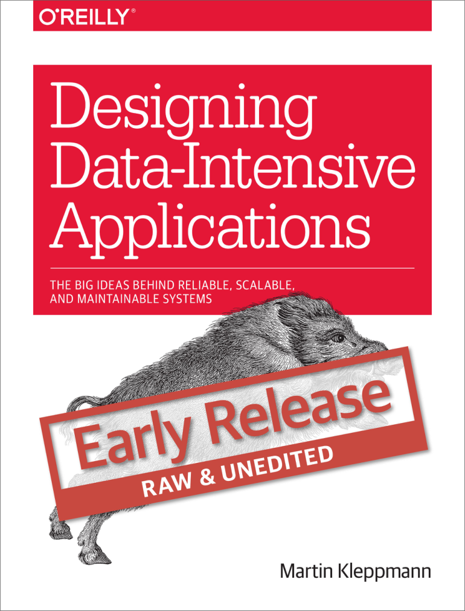
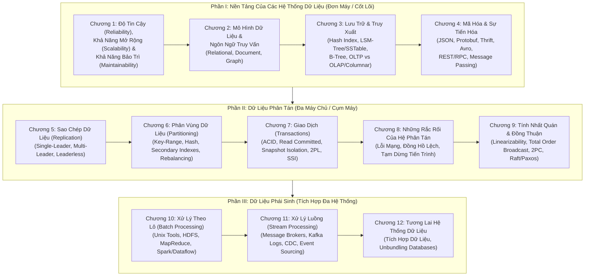

# Lời Mở Đầu & Giới Thiệu Sách — Thiết Kế Các Ứng Dụng Chuyên Sâu Về Dữ Liệu (Preface & Front Matter — Designing Data-Intensive Applications)

> **Tác giả:** Martin Kleppmann  
> **Nhà xuất bản:** O'Reilly Media, Inc.  
> **Tên gốc:** *Designing Data-Intensive Applications: The Big Ideas Behind Reliable, Scalable, and Maintainable Systems*

---

## Trang Bìa (Cover)

**Martin Kleppmann**  
*Boston*  
**Thiết Kế Các Ứng Dụng Chuyên Sâu Về Dữ Liệu (Designing Data-Intensive Applications)**  
*(Những Ý Tưởng Lớn Đằng Sau Các Hệ Thống Đáng Tin Cậy, Có Khả Năng Mở Rộng và Dễ Bảo Trì — The Big Ideas Behind Reliable, Scalable, and Maintainable Systems)*

> 📝 **Giải thích thêm về hình minh họa trên bìa sách (không có trong sách):**  
> Linh vật trên trang bìa cuốn *Designing Data-Intensive Applications* của O'Reilly là loài **lợn rừng Ấn Độ (Indian wild boar — *Sus scrofa cristatus*)**, được vẽ theo phong cách khắc gỗ thế kỷ 19 bởi họa sĩ Karen Montgomery và Rebecca Demarest. Trong truyền thống xuất bản của O'Reilly Media, mỗi cuốn sách kỹ thuật kinh điển đều gắn liền với hình ảnh một loài động vật đặc trưng. Cuốn sách này thường được cộng đồng kỹ sư phần mềm toàn cầu gọi thân mật là **"Cuốn sách Con Lợn Rừng" (The Boar Book)** hoặc viết tắt là **DDIA** — một trong những tài liệu gối đầu giường quan trọng nhất về kiến trúc hệ thống phân tán (distributed systems) và kỹ thuật dữ liệu (data engineering) hiện đại.

---

## Bản Quyền và Thông Tin Xuất Bản (Copyright)

* **Mã số sách quốc tế (ISBN):** `978-1-491-90309-4` *(Bản phát hành sớm / Early Release)* — `[FILL IN]` *(Bản in chính thức: `978-1-449-37332-0`)*
* **Tên sách:** *Designing Data-Intensive Applications* (Thiết kế các ứng dụng chuyên sâu về dữ liệu)
* **Tác giả:** bởi Martin Kleppmann (by Martin Kleppmann)
* **Bản quyền:** Copyright © 2016 Martin Kleppmann. Bảo lưu mọi quyền (All rights reserved). *(Bản chính thức phát hành năm 2017: Copyright © 2017 Martin Kleppmann).*
* **Nơi in:** In tại Hợp chủng quốc Hoa Kỳ (Printed in the United States of America).
* **Nhà xuất bản:** Xuất bản bởi **O’Reilly Media, Inc.**, 1005 Gravenstein Highway North, Sebastopol, CA 95472.

Sách của O’Reilly có thể được đặt mua phục vụ cho mục đích giáo dục (educational), kinh doanh (business), hoặc xúc tiến bán hàng (sales promotional use). Các ấn bản trực tuyến (online editions) cũng có sẵn cho hầu hết các đầu sách tại địa chỉ [http://safaribooksonline.com](http://safaribooksonline.com). Để biết thêm thông tin chi tiết, vui lòng liên hệ bộ phận bán hàng doanh nghiệp/tổ chức (corporate/institutional sales department) của chúng tôi qua số điện thoại: `800-998-9938` hoặc địa chỉ email: `corporate@oreilly.com`.

### Đội Ngũ Biên Tập và Sản Xuất (Editorial and Production Credits)

* **Biên tập viên nội dung (Editors):** Mike Loukides và Ann Spencer *(cùng Marie Beaugureau trong ấn bản hoàn chỉnh)*
* **Biên tập viên sản xuất (Production Editor):** FILL IN PRODUCTION EDITOR *(Nicholas Adams)*
* **Biên tập viên bản thảo (Copyeditor):** FILL IN COPYEDITOR *(Rachel Head)*
* **Hiệu đính (Proofreader):** FILL IN PROOFREADER *(Marta Justak)*
* **Lập chỉ mục (Indexer):** FILL IN INDEXER *(Ellen Troutman-Zaig)*
* **Thiết kế nội thất sách (Interior Designer):** David Futato
* **Thiết kế bìa sách (Cover Designer):** Karen Montgomery
* **Họa sĩ minh họa (Illustrator):** Rebecca Demarest

### Lịch Sử Phát Hành và Sửa Đổi cho Ấn Bản Đầu Tiên (Revision History for the First Edition)

* **Tháng 01/-4712 *(mốc giữ chỗ bản nháp)* / Tháng 03/2017:** Ấn bản đầu tiên (First Edition)
* `2015-03-06`: Bản phát hành sớm lần thứ nhất (First Early Release)
* `2015-04-01`: Bản phát hành sớm lần thứ hai (Second Early Release)
* `2015-06-18`: Bản phát hành sớm lần thứ ba (Third Early Release)
* `2016-01-26`: Bản phát hành sớm lần thứ tư (Fourth Early Release)
* `2016-05-05`: Bản phát hành sớm lần thứ năm (Fifth Early Release)
* `2016-07-11`: Bản phát hành sớm lần thứ sáu (Sixth Early Release)

Xem chi tiết phát hành và danh sách đính chính (errata) tại: [http://oreilly.com/catalog/errata.csp?isbn=9781491903094](http://oreilly.com/catalog/errata.csp?isbn=9781491903094) *(hoặc `http://oreilly.com/catalog/errata.csp?isbn=0636920032175`)*.

### Tuyên Bố Thương Hiệu và Miễn Trừ Trách Nhiệm Pháp Lý (Trademarks and Disclaimer)

Logo O’Reilly là nhãn hiệu đã đăng ký (registered trademark) của O’Reilly Media, Inc. Tên sách *Designing Data-Intensive Applications*, hình ảnh trang bìa (cover image), và hình thức nhận diện thương mại liên quan (related trade dress) là các nhãn hiệu thương mại (trademarks) của O’Reilly Media, Inc.

Mặc dù nhà xuất bản và (các) tác giả đã nỗ lực hết sức trên tinh thần thiện chí (good faith efforts) để đảm bảo rằng các thông tin và hướng dẫn chứa đựng trong tác phẩm này là chính xác, nhà xuất bản và (các) tác giả từ chối mọi trách nhiệm pháp lý đối với các lỗi hoặc thiếu sót (errors or omissions), bao gồm nhưng không giới hạn ở trách nhiệm đối với các thiệt hại phát sinh từ việc sử dụng hoặc dựa vào tác phẩm này. Việc sử dụng thông tin và hướng dẫn trong tác phẩm này hoàn toàn do bạn tự chịu rủi ro (at your own risk). Nếu bất kỳ mẫu mã nguồn (code samples) hoặc công nghệ nào khác mà tác phẩm này chứa đựng hoặc mô tả phải tuân theo các giấy phép mã nguồn mở (open source licenses) hoặc quyền sở hữu trí tuệ (intellectual property rights) của bên thứ ba, bạn có trách nhiệm đảm bảo rằng việc sử dụng của mình tuân thủ đầy đủ các giấy phép và/hoặc quyền hạn đó.

---

## Mục Lục Toàn Tập (Table of Contents)

* **Giới thiệu về cuốn sách này (About this Book)** . . . . . . . . . . . . . . . . . . . . . . . . . . . . . . . . . . . . . . . . . *trang xiii*

### Phần I. Nền Tảng của Các Hệ Thống Dữ Liệu (Part I. Foundations of Data Systems)

#### Chương 1. Các Ứng Dụng Đáng Tin Cậy, Có Khả Năng Mở Rộng và Dễ Bảo Trì (1. Reliable, Scalable and Maintainable Applications) — *trang 1*
* **Suy ngẫm về các hệ thống dữ liệu (Thinking About Data Systems)** — *trang 2*
* **Độ tin cậy (Reliability)** — *trang 4*
  * Lỗi phần cứng (Hardware faults) — *trang 5*
  * Lỗi phần mềm (Software errors) — *trang 6*
  * Lỗi con người (Human errors) — *trang 7*
  * Độ tin cậy quan trọng đến mức nào? (How important is reliability?) — *trang 8*
* **Khả năng mở rộng (Scalability)** — *trang 8*
  * Mô tả tải (Describing load) — *trang 9*
  * Mô tả hiệu năng (Describing performance) — *trang 11*
  * Các phương pháp đối phó với tải (Approaches for coping with load) — *trang 15*
* **Khả năng bảo trì (Maintainability)** — *trang 16*
  * Khả năng vận hành: giúp công việc của đội ngũ vận hành dễ dàng hơn (Operability: making life easy for operations) — *trang 17*
  * Tính đơn giản: quản lý sự phức tạp (Simplicity: managing complexity) — *trang 18*
  * Khả năng tiến hóa: giúp việc thay đổi trở nên dễ dàng (Evolvability: making change easy) — *trang 19*
* **Tóm tắt (Summary)** — *trang 20*

#### Chương 2. Các Mô Hình Dữ Liệu và Ngôn Ngữ Truy Vấn (2. Data Models and Query Languages) — *trang 25*
* **Mô hình Quan hệ đối đầu với Mô hình Tài liệu (Relational Model vs. Document Model)** — *trang 26*
  * Sự ra đời của NoSQL (The birth of NoSQL) — *trang 27*
  * Sự lệch pha giữa hướng đối tượng và quan hệ (The object-relational mismatch) — *trang 28*
  * Các mối quan hệ nhiều-một và nhiều-nhiều (Many-to-one and many-to-many relationships) — *trang 31*
  * Phải chăng các cơ sở dữ liệu tài liệu đang lặp lại lịch sử? (Are document databases repeating history?) — *trang 35*
  * Cơ sở dữ liệu quan hệ đối đầu với cơ sở dữ liệu tài liệu ngày nay (Relational vs. document databases today) — *trang 38*
* **Các Ngôn Ngữ Truy Vấn cho Dữ Liệu (Query Languages for Data)** — *trang 42*
  * Truy vấn khai báo trên nền tảng web (Declarative queries on the web) — *trang 43*
  * Truy vấn bằng MapReduce (MapReduce querying) — *trang 45*
* **Các Mô Hình Dữ Liệu Dạng Đồ Thị (Graph-like Data Models)** — *trang 48*
  * Đồ thị thuộc tính (Property graphs) — *trang 49*
  * Ngôn ngữ truy vấn Cypher (The Cypher query language) — *trang 51*
  * Truy vấn đồ thị trong SQL (Graph queries in SQL) — *trang 52*
  * Kho lưu trữ bộ ba và ngôn ngữ SPARQL (Triple-stores and SPARQL) — *trang 55*
  * Nền tảng gốc rễ: Datalog (The foundation: Datalog) — *trang 59*
* **Tóm tắt (Summary)** — *trang 62*

#### Chương 3. Lưu Trữ và Truy Xuất (3. Storage and Retrieval) — *trang 67*
* **Các Cấu Trúc Dữ Liệu Vận Hành Cơ Sở Dữ Liệu của Bạn (Data Structures that Power Your Database)** — *trang 68*
  * Chỉ mục băm (Hash indexes) — *trang 70*
  * SSTables và Cây LSM (SSTables and LSM-trees) — *trang 74*
  * Cây B-tree (B-trees) — *trang 77*
  * Các cấu trúc đánh chỉ mục khác (Other indexing structures) — *trang 82*
  * Giữ mọi thứ trong bộ nhớ RAM (Keeping everything in memory) — *trang 85*
* **Xử Lý Giao Dịch hay Phân Tích Dữ Liệu? (Transaction Processing or Analytics?)** — *trang 87*
  * Kho dữ liệu (Data warehousing) — *trang 88*
  * Lược đồ hình sao và hình bông tuyết: các lược đồ cho phân tích (Stars and snowflakes: schemas for analytics) — *trang 90*
* **Lưu Trữ Định Hướng Cột (Column-oriented storage)** — *trang 93*
  * Nén dữ liệu theo cột (Column compression) — *trang 94*
  * Thứ tự sắp xếp trong lưu trữ cột (Sort order in column storage) — *trang 96*
  * Ghi dữ liệu vào kho lưu trữ định hướng cột (Writing to column-oriented storage) — *trang 98*
  * Tổng hợp dữ liệu: Khối dữ liệu đa chiều và khung nhìn vật lý hóa (Aggregation: Data cubes and materialized views) — *trang 98*
* **Tóm tắt (Summary)** — *trang 100*

#### Chương 4. Mã Hóa và Sự Tiến Hóa Dữ Liệu (4. Encoding and Evolution) — *trang 107*
* **Các Định Dạng để Mã Hóa Dữ Liệu (Formats for Encoding Data)** — *trang 108*
  * Các định dạng đặc thù theo ngôn ngữ lập trình (Language-specific formats) — *trang 109*
  * JSON, XML và các biến thể nhị phân (JSON, XML and binary variants) — *trang 110*
  * Thrift và Protocol Buffers (Thrift and Protocol Buffers) — *trang 113*
  * Avro (Avro) — *trang 118*
  * Giá trị ưu việt của các lược đồ (The merits of schemas) — *trang 123*
* **Các Phương Thức Luân Chuyển Dữ Liệu (Modes of Data Flow)** — *trang 124*
  * Luồng dữ liệu đi qua cơ sở dữ liệu (Data flow through databases) — *trang 125*
  * Luồng dữ liệu đi qua các dịch vụ: REST và RPC (Data flow through services: REST and RPC) — *trang 127*
  * Luồng dữ liệu truyền thông điệp (Message passing data flow) — *trang 132*
* **Tóm tắt (Summary)** — *trang 135*

---

### Phần II. Dữ Liệu Phân Tán (Part II. Distributed Data)

#### Chương 5. Sao Chép Dữ Liệu (5. Replication) — *trang 145*
* **Nút Dẫn Đầu và Các Nút Theo Sau (Leaders and Followers)** — *trang 146*
  * Sao chép đồng bộ đối đầu với sao chép bất đồng bộ (Synchronous vs. asynchronous replication) — *trang 147*
  * Thiết lập các nút theo sau mới (Setting up new followers) — *trang 149*
  * Xử lý sự cố ngừng hoạt động của nút (Handling node outages) — *trang 150*
  * Triển khai nhật ký sao chép (Implementation of replication logs) — *trang 152*
* **Các Vấn Đề Với Độ Trễ Sao Chép (Problems With Replication Lag)** — *trang 155*
  * Đọc chính những gì bạn vừa ghi (Reading your own writes) — *trang 156*
  * Đọc đơn điệu (Monotonic reads) — *trang 158*
  * Đọc tiền tố nhất quán (Consistent prefix reads) — *trang 159*
  * Các giải pháp cho độ trễ sao chép (Solutions for replication lag) — *trang 160*
* **Sao Chép Đa Nút Dẫn Đầu (Multi-leader replication)** — *trang 161*
  * Các trường hợp sử dụng cho sao chép đa nút dẫn đầu (Use cases for multi-leader replication) — *trang 161*
  * Xử lý xung đột ghi (Handling write conflicts) — *trang 164*
  * Các cấu trúc liên kết sao chép đa nút dẫn đầu (Multi-leader replication topologies) — *trang 168*
* **Sao Chép Không Nút Dẫn Đầu (Leaderless replication)** — *trang 171*
  * Ghi vào cơ sở dữ liệu khi một nút bị sập (Writing to the database when a node is down) — *trang 171*
  * Những hạn chế của tính nhất quán dựa trên túc số (Limitations of quorum consistency) — *trang 175*
  * Túc số lỏng lẻo và chuyển giao gợi ý (Sloppy quorums and hinted handoff) — *trang 177*
  * Phát hiện các thao tác ghi đồng thời (Detecting concurrent writes) — *trang 178*
* **Tóm tắt (Summary)** — *trang 186*

#### Chương 6. Phân Vùng Dữ Liệu (6. Partitioning) — *trang 191*
* **Phân vùng kết hợp với sao chép (Partitioning and replication)** — *trang 192*
* **Phân vùng dữ liệu khóa-giá trị (Partitioning of key-value data)** — *trang 193*
  * Phân vùng theo dải khóa (Partitioning by key range) — *trang 194*
  * Phân vùng theo hàm băm của khóa (Partitioning by hash of key) — *trang 195*
  * Tải lệch và giảm tải cho các điểm nóng (Skewed workloads and relieving hot spots) — *trang 196*
* **Phân vùng và chỉ mục thứ cấp (Partitioning and secondary indexes)** — *trang 197*
  * Phân vùng chỉ mục thứ cấp theo tài liệu (Partitioning secondary indexes by document) — *trang 198*
  * Phân vùng chỉ mục thứ cấp theo thuật ngữ/từ khóa (Partitioning secondary indexes by term) — *trang 200*
* **Tái cân bằng các phân vùng (Rebalancing partitions)** — *trang 201*
  * Các chiến lược tái cân bằng (Strategies for rebalancing) — *trang 201*
  * Vận hành: tái cân bằng tự động hay thủ công (Operations: automatic or manual rebalancing) — *trang 204*
* **Định tuyến yêu cầu (Request routing)** — *trang 205*
  * Thực thi truy vấn song song (Parallel query execution) — *trang 207*
* **Tóm tắt (Summary)** — *trang 208*

#### Chương 7. Giao Dịch (7. Transactions) — *trang 213*
* **Khái niệm dễ gây nhầm lẫn về giao dịch (The slippery concept of a transaction)** — *trang 214*
  * Ý nghĩa thực sự của ACID (The meaning of ACID) — *trang 215*
  * Thao tác đơn đối tượng và đa đối tượng (Single-object and multi-object operations) — *trang 219*
* **Các mức cô lập yếu (Weak isolation levels)** — *trang 224*
  * Đọc dữ liệu đã cam kết (Read committed) — *trang 225*
  * Cô lập theo bản chụp nhanh và đọc lặp lại (Snapshot isolation and repeatable read) — *trang 228*
  * Ngăn chặn lỗi mất bản cập nhật (Preventing lost updates) — *trang 233*
  * Ngăn chặn lỗi lệch ghi và bản ghi ma (Preventing write skew and phantoms) — *trang 237*
* **Tính khả tuần tự (Serializability)** — *trang 242*
  * Thực thi tuần tự thực sự (Actual serial execution) — *trang 243*
  * Khóa hai pha (Two-phase locking (2PL)) — *trang 248*
  * Cô lập bản chụp nhanh khả tuần tự (Serializable snapshot isolation (SSI)) — *trang 252*
* **Tóm tắt (Summary)** — *trang 257*

#### Chương 8. Những Rắc Rối Với Hệ Thống Phân Tán (8. The Trouble with Distributed Systems) — *trang 265*
* **Lỗi và Sự Cố Một Phần (Faults and Partial Failures)** — *trang 266*
  * Điện toán đám mây và siêu máy tính (Cloud computing and supercomputing) — *trang 267*
* **Mạng Không Đáng Tin Cậy (Unreliable Networks)** — *trang 269*
  * Lỗi mạng trong thực tế (Network faults in practice) — *trang 271*
  * Phát hiện lỗi (Detecting faults) — *trang 272*
  * Thời gian chờ và độ trễ không giới hạn (Timeouts and unbounded delays) — *trang 273*
  * Mạng đồng bộ đối đầu với mạng bất đồng bộ (Synchronous vs. asynchronous networks) — *trang 276*
* **Đồng Hồ Không Đáng Tin Cậy (Unreliable Clocks)** — *trang 278*
  * Đồng hồ đơn điệu đối đầu với đồng hồ thời gian trong ngày (Monotonic vs. time-of-day clocks) — *trang 279*
  * Đồng bộ hóa đồng hồ và độ chính xác (Clock synchronization and accuracy) — *trang 281*
  * Phụ thuộc vào đồng hồ được đồng bộ hóa (Relying on synchronized clocks) — *trang 282*
  * Sự tạm dừng của tiến trình (Process pauses) — *trang 287*
* **Tri Thức, Sự Thật và Những Lời Nói Dối (Knowledge, Truth and Lies)** — *trang 291*
  * Sự thật được định nghĩa bởi đa số (The truth is defined by the majority) — *trang 292*
  * Lỗi Byzantine (Byzantine faults) — *trang 295*
  * Mô hình hệ thống và thực tế (System model and reality) — *trang 298*
* **Tóm tắt (Summary)** — *trang 302*

#### Chương 9. Tính Nhất Quán và Sự Đồng Thuận (9. Consistency and Consensus) — *trang 311*
* **Các Đảm Bảo Về Tính Nhất Quán (Consistency Guarantees)** — *trang 312*
* **Tính Khả Tuyến Tính (Linearizability)** — *trang 314*
  * Điều gì làm cho một hệ thống có tính khả tuyến tính? (What makes a system linearizable?) — *trang 315*
  * Dựa vào tính khả tuyến tính (Relying on linearizability) — *trang 320*
  * Triển khai các hệ thống khả tuyến tính (Implementing linearizable systems) — *trang 323*
  * Cái giá của tính khả tuyến tính (The cost of linearizability) — *trang 326*
* **Các Đảm Bảo Về Thứ Tự (Ordering Guarantees)** — *trang 329*
  * Thứ tự và quan hệ nhân quả (Ordering and causality) — *trang 330*
  * Sắp xếp thứ tự bằng số thứ tự (Sequence number ordering) — *trang 334*
  * Phát quảng bá toàn thứ tự (Total order broadcast) — *trang 338*
* **Giao Dịch Phân Tán và Sự Đồng Thuận (Distributed Transactions and Consensus)** — *trang 343*
  * Cam kết nguyên tử và cam kết hai pha (Atomic commit and two-phase commit (2PC)) — *trang 344*
  * Giao dịch phân tán trong thực tế (Distributed transactions in practice) — *trang 350*
  * Đồng thuận chịu lỗi (Fault-tolerant consensus) — *trang 355*
  * Dịch vụ quản lý thành viên và điều phối (Membership and coordination services) — *trang 360*
* **Tóm tắt (Summary)** — *trang 363*

---

### Phần III. Dữ Liệu Phái Sinh (Part III. Derived Data)

#### Chương 10. Xử Lý Theo Lô (10. Batch Processing) — *trang 377*
* **Xử Lý Theo Lô Với Các Công Cụ Unix (Batch Processing with Unix Tools)** — *trang 379*
  * Phân tích nhật ký đơn giản (Simple log analysis) — *trang 379*
  * Triết lý Unix (The Unix philosophy) — *trang 382*
* **MapReduce và Các Hệ Thống Tệp Phân Tán (MapReduce and Distributed Filesystems)** — *trang 385*
  * Thực thi tác vụ MapReduce (MapReduce job execution) — *trang 387*
  * Phép nối phía Reduce và gom nhóm (Reduce-side joins and grouping) — *trang 391*
  * Phép nối phía Map (Map-side joins) — *trang 396*
  * Đầu ra của các luồng công việc xử lý lô (The output of batch workflows) — *trang 398*
  * So sánh MapReduce với các cơ sở dữ liệu phân tán (Comparing MapReduce to distributed databases) — *trang 402*
* **Vượt Ra Ngoài MapReduce (Beyond MapReduce)** — *trang 406*
  * Vật lý hóa trạng thái trung gian (Materialization of intermediate state) — *trang 407*
  * Đồ thị và xử lý lặp (Graphs and iterative processing) — *trang 411*
  * Các API và ngôn ngữ bậc cao (High-level APIs and languages) — *trang 414*
* **Tóm tắt (Summary)** — *trang 416*

#### Chương 11. Xử Lý Luồng (11. Stream Processing) — *trang 425*
* **Truyền Tải Các Luồng Sự Kiện (Transmitting Event Streams)** — *trang 426*
  * Các hệ thống truyền thông điệp (Messaging systems) — *trang 427*
  * Nhật ký phân vùng (Partitioned logs) — *trang 432*
* **Cơ Sở Dữ Liệu và Các Luồng Dữ Liệu (Databases and streams)** — *trang 436*
  * Giữ cho các hệ thống luôn đồng bộ (Keeping systems in sync) — *trang 437*
  * Bắt dữ liệu thay đổi (Change data capture) — *trang 439*
  * Lưu trữ nguồn sự kiện (Event sourcing) — *trang 442*
  * Trạng thái, luồng và tính bất biến (State, streams, and immutability) — *trang 444*
* **Xử Lý Các Luồng Dữ Liệu (Processing Streams)** — *trang 448*
  * Các ứng dụng của xử lý luồng (Uses of stream processing) — *trang 449*
  * Suy luận về thời gian (Reasoning about time) — *trang 452*
  * Phép nối trên luồng (Stream joins) — *trang 457*
  * Khả năng chịu lỗi (Fault tolerance) — *trang 460*
* **Tóm tắt (Summary)** — *trang 462*

> 📝 **Giải thích thêm về Chương 12 trong ấn bản hoàn chỉnh (không có trong bản Early Release thứ 6):**  
> Ở thời điểm xuất bản bản *Sixth Early Release* (PDF trang 7–12), Mục lục dừng lại ở Chương 11 và nhắc đến chương cuối bằng ký hiệu giữ chỗ `???` trong phần Đề cương sách. Trong ấn bản hoàn chỉnh phát hành tháng 03/2017, Martin Kleppmann đã hoàn thiện **Chương 12: Tương Lai của Các Hệ Thống Dữ Liệu (Chapter 12. The Future of Data Systems)** bao gồm các mục: *Tích hợp dữ liệu (Data Integration)*, *Tháo gỡ cấu trúc cơ sở dữ liệu (Unbundling Databases)*, *Hướng tới sự đúng đắn toàn diện (Aiming for Correctness)*, và *Làm điều đúng đắn / Đạo đức dữ liệu (Doing the Right Thing)*.

---

## Lời Đề Tặng và Trích Dẫn Mở Đầu (Dedication and Epigraph)

> *"Công nghệ là một sức mạnh to lớn trong xã hội của chúng ta. Dữ liệu, phần mềm và truyền thông có thể bị sử dụng cho mục đích xấu: nhằm củng cố các cấu trúc quyền lực bất công, làm suy yếu nhân quyền, và bảo vệ các nhóm lợi ích cục bộ. Nhưng chúng cũng có thể được sử dụng cho mục đích tốt đẹp: giúp tiếng nói của những người yếu thế được lắng nghe, tạo ra cơ hội cho tất cả mọi người, và ngăn chặn các thảm họa. Cuốn sách này được dành tặng cho tất cả những ai đang nỗ lực làm việc vì những điều tốt đẹp đó."*
>
> *(Nguyên văn: Technology is a powerful force in our society. Data, software and communication can be used for bad: to entrench unfair power structures, to undermine human rights, and to protect vested interests. But they can also be used for good: to make underrepresented people’s voices heard, to create opportunities for everyone, and to avert disasters. This book is dedicated to everyone working towards the good.)*

---

> *"Điện toán đã trở thành văn hóa đại chúng (pop culture). […] Văn hóa đại chúng vốn coi thường lịch sử. Văn hóa đại chúng chỉ xoay quanh bản sắc cá nhân và cảm giác rằng bạn đang góp mặt vào trào lưu. Nó chẳng liên quan gì đến sự hợp tác, quá khứ hay tương lai — nó chỉ sống trong hiện tại. Tôi nghĩ điều tương tự cũng đúng với hầu hết những người viết mã để kiếm tiền. Họ hoàn toàn không có khái niệm gì về việc [văn hóa kỹ thuật của họ bắt nguồn từ đâu]…"*  
> — **Alan Kay**, trả lời phỏng vấn trên *Dr Dobb’s Journal* (2012)
>
> *(Nguyên văn: Computing is pop culture. […] Pop culture holds a disdain for history. Pop culture is all about identity and feeling like you’re participating. It has nothing to do with cooperation, the past or the future — it’s living in the present. I think the same is true of most people who write code for money. They have no idea where [their culture came from]… — Alan Kay, Dr Dobb’s Journal (2012))*

> 💡 **Ví dụ bổ sung về thông điệp của Alan Kay (không có trong sách):**  
> Câu nói nổi tiếng của Alan Kay (nhà tiên phong về lập trình hướng đối tượng và giao diện đồ họa, chủ nhân giải thưởng Turing) là lý do cốt lõi khiến Martin Kleppmann luôn đào sâu vào **lịch sử phát triển của hệ thống dữ liệu** trong suốt cuốn sách. Chẳng hạn:
> - Khi các hệ quản trị cơ sở dữ liệu tài liệu (Document Databases như MongoDB) nổi lên vào cuối thập niên 2000, nhiều lập trình viên tưởng đó là phát minh hoàn toàn mới, mà không biết rằng nó lặp lại rất nhiều bài toán của **Mô hình Phân cấp (Hierarchical Model — tiêu biểu là IBM IMS phát triển cho chương trình tàu vũ trụ Apollo năm 1968)**.
> - Hay khi xu hướng NoSQL từ bỏ giao dịch ACID để rồi vài năm sau các hệ thống NewSQL (Google Spanner, CockroachDB, TiDB) và ngay cả MongoDB 4.0+ phải bổ sung lại giao dịch ACID đa tài liệu — việc hiểu rõ *tại sao* các thế hệ đi trước đưa ra những thiết kế đó giúp kỹ sư không phải "phát minh lại bánh xe" một cách đầy lỗi lầm.

---

## Giới Thiệu Về Cuốn Sách Này (About this Book)

Nếu bạn làm việc trong lĩnh vực kỹ thuật phần mềm (software engineering) trong những năm gần đây, đặc biệt là ở mảng hệ thống phía máy chủ (server-side) và hậu đài (backend systems), chắc hẳn bạn đã bị "dội bom" bởi vô số các từ khóa thời thượng (buzzwords) liên quan đến việc lưu trữ và xử lý dữ liệu: **NoSQL! Big Data! Web-scale! Sharding! Eventual consistency (Tính nhất quán cuối cùng)! ACID! CAP theorem (Định lý CAP)! Cloud services (Dịch vụ đám mây)! MapReduce! Real-time (Thời gian thực)!**

Trong thập kỷ vừa qua, chúng ta đã chứng kiến rất nhiều bước tiến thú vị trong lĩnh vực cơ sở dữ liệu (databases), hệ thống phân tán (distributed systems), cũng như trong cách chúng ta xây dựng các ứng dụng trên nền tảng của chúng. Có nhiều động lực thúc đẩy (driving forces) đằng sau những bước phát triển này, bao gồm:

* **Quy mô dữ liệu và lưu lượng khổng lồ của các công ty Internet:** Các công ty Internet như Google, Yahoo!, Amazon, Facebook, LinkedIn và Twitter đang phải xử lý khối lượng dữ liệu (volumes of data) và lưu lượng truy cập (traffic) khổng lồ, buộc họ phải tạo ra những công cụ mới cho phép xử lý quy mô lớn như vậy một cách hiệu quả.
* **Nhu cầu linh hoạt trong kinh doanh (Business agility):** Các doanh nghiệp cần phải linh hoạt (agile), thử nghiệm các giả thuyết với chi phí thấp, và phản ứng nhanh chóng trước những thông tin chi tiết mới từ thị trường (market insights), bằng cách giữ cho chu kỳ phát triển phần mềm ngắn gọn và các mô hình dữ liệu (data models) mềm dẻo.
* **Sự trỗi dậy của phần mềm tự do và mã nguồn mở (Free and open source software - FOSS):** Phần mềm tự do và mã nguồn mở đã trở nên cực kỳ thành công, và hiện nay được ưu tiên lựa chọn hơn nhiều so với phần mềm thương mại đắt đỏ hoặc phần mềm tự phát triển nội bộ chuyên biệt (bespoke in-house software) trong nhiều môi trường.
* **Sự dịch chuyển sang xử lý song song và đa lõi:** Tốc độ xung nhịp CPU (CPU clock speeds) hầu như không còn tăng lên nữa, nhưng các bộ vi xử lý đa lõi (multi-core processors) đã trở thành tiêu chuẩn, và mạng máy tính (networks) ngày càng nhanh hơn. Điều này có nghĩa là mức độ xử lý song song (parallelism) sẽ chỉ ngày càng gia tăng.
* **Sự phổ cập của Hạ tầng như một Dịch vụ (IaaS):** Ngay cả khi bạn làm việc trong một nhóm nhỏ, giờ đây bạn vẫn có thể xây dựng các hệ thống phân tán trải rộng trên nhiều máy chủ và thậm chí qua nhiều khu vực địa lý (multiple geographic regions), nhờ vào hạ tầng dưới dạng dịch vụ (Infrastructure as a Service — IaaS) chẳng hạn như Amazon Web Services (AWS).
* **Kỳ vọng khắt khe về tính sẵn sàng cao (High availability):** Nhiều dịch vụ hiện nay được kỳ vọng phải có tính sẵn sàng cao; thời gian ngừng hoạt động kéo dài (extended downtime) do sự cố mất dịch vụ (outages) hoặc bảo trì hệ thống (maintenance) ngày càng trở nên không thể chấp nhận được.

Các **ứng dụng chuyên sâu về dữ liệu (data-intensive applications)** đang đẩy lùi những giới hạn của những gì có thể thực hiện được bằng cách tận dụng các tiến bộ công nghệ này. Chúng ta gọi một ứng dụng là *chuyên sâu về dữ liệu (data-intensive)* nếu **dữ liệu là thách thức chính yếu của nó**: số lượng dữ liệu (quantity of data), độ phức tạp của dữ liệu (complexity of data), hoặc tốc độ thay đổi của dữ liệu (speed at which it is changing) — đối lập với *chuyên sâu về tính toán (compute-intensive)*, nơi các chu kỳ xử lý của CPU (CPU cycles) mới là nút thắt cổ chai (bottleneck).

> 📝 **Giải thích thêm: Phân biệt Data-Intensive và Compute-Intensive (không có trong sách):**
>
> | Tiêu chí so sánh | Ứng dụng chuyên sâu về dữ liệu (Data-Intensive) | Ứng dụng chuyên sâu về tính toán (Compute-Intensive) |
> | :--- | :--- | :--- |
> | **Nút thắt cổ chai chính (Bottleneck)** | Dung lượng đĩa I/O, băng thông mạng (Network I/O), độ trễ truy xuất bộ nhớ, sự toàn vẹn và đồng bộ dữ liệu giữa các nút. | Tốc độ xung nhịp CPU/GPU, số phép tính dấu phẩy động mỗi giây (FLOPS), thuật toán số học nặng. |
> | **Đặc trưng bài toán (3V)** | **Volume** (Khối lượng lớn), **Complexity/Variety** (Cấu trúc & quan hệ phức tạp), **Velocity** (Tốc độ đọc/ghi/thay đổi liên tục). | Mô phỏng vật lý, dự báo khí tượng, kết xuất đồ họa 3D (ray tracing), bẻ khóa mật mã, huấn luyện mô hình số học thuần túy. |
> | **Ví dụ thực tế điển hình** | Mạng xã hội (Facebook, Twitter/X), sàn thương mại điện tử (Shopee, Amazon), hệ thống thanh toán ngân hàng, nền tảng đặt xe (Grab, Uber). | Mô phỏng động lực học chất lưu, tính toán lượng tử, nén video 8K ngoại tuyến. |

Các công cụ và công nghệ giúp những ứng dụng chuyên sâu về dữ liệu lưu trữ và xử lý dữ liệu đã và đang thích nghi nhanh chóng với những thay đổi này. Các loại hệ quản trị cơ sở dữ liệu mới (“NoSQL”) đã nhận được rất nhiều sự chú ý, nhưng hàng đợi thông điệp (message queues), bộ nhớ đệm (caches), chỉ mục tìm kiếm (search indexes), các khung làm việc cho xử lý theo lô (batch processing) và xử lý luồng (stream processing), cùng các công nghệ liên quan khác cũng đóng vai trò vô cùng quan trọng. Nhiều ứng dụng thực tế sử dụng một sự kết hợp của nhiều công cụ trong số này.

Những từ khóa thời thượng (buzzwords) tràn ngập trong không gian công nghệ này là một dấu hiệu của sự hào hứng trước những khả năng mới — đó là một điều tuyệt vời. Tuy nhiên, với tư cách là những kỹ sư phần mềm (software engineers) và kiến trúc sư hệ thống (software architects), chúng ta cũng cần phải có một **sự hiểu biết chính xác và chuẩn mực về mặt kỹ thuật** đối với các công nghệ khác nhau cùng những **sự đánh đổi (trade-offs)** của chúng nếu chúng ta muốn xây dựng được các ứng dụng tốt. Để có được sự thấu hiểu đó, chúng ta phải đào sâu hơn lớp vỏ của những từ khóa quảng cáo.

May mắn thay, đằng sau những biến đổi nhanh chóng của công nghệ, luôn tồn tại **những nguyên lý bền vững (enduring principles)** vẫn giữ nguyên giá trị đúng đắn, bất kể bạn đang sử dụng phiên bản nào của một công cụ cụ thể. Nếu bạn nắm vững những nguyên lý đó, bạn sẽ có đủ khả năng để nhìn ra mỗi công cụ phù hợp ở vị trí nào, làm thế nào để khai thác tối đa sức mạnh của nó, và làm thế nào để tránh được những cạm bẫy (pitfalls) của nó. Đó chính là lý do cuốn sách này ra đời.

Mục tiêu của cuốn sách này là giúp bạn định hướng trong bức tranh toàn cảnh đa dạng và biến đổi nhanh chóng của các công nghệ xử lý và lưu trữ dữ liệu. Cuốn sách này **không phải là một tài liệu hướng dẫn từng bước (tutorial)** cho một công cụ cụ thể nào, và cũng **không phải là một cuốn giáo trình đại học khô khan đầy lý thuyết suông**. Thay vào đó, chúng ta sẽ xem xét các ví dụ về những hệ thống dữ liệu thành công trong thực tế: những công nghệ tạo nên nền tảng của hàng loạt ứng dụng phổ biến, và phải đáp ứng các yêu cầu khắt khe về khả năng mở rộng (scalability), hiệu năng (performance) và độ tin cậy (reliability) trên môi trường vận hành thực tế (production) mỗi ngày.

Chúng ta sẽ mổ xẻ cấu trúc bên trong (internals) của những hệ thống đó, bóc tách các thuật toán cốt lõi của chúng, thảo luận về các nguyên lý nền tảng cũng như những sự đánh đổi (trade-offs) mà chúng buộc phải thực hiện. Trên hành trình này, chúng ta sẽ cố gắng tìm ra những cách tư duy hữu ích về các hệ thống dữ liệu — không chỉ là *chúng hoạt động như thế nào*, mà còn là *tại sao chúng lại hoạt động theo cách đó*, và *chúng ta cần phải đặt ra những câu hỏi gì*.

Sau khi đọc xong cuốn sách này, bạn sẽ ở một vị thế tuyệt vời để quyết định loại công nghệ nào là phù hợp cho mục đích nào, và hiểu được cách kết hợp các công cụ lại với nhau để tạo nên nền tảng của một kiến trúc ứng dụng tốt. Bạn sẽ chưa thể bắt tay vào tự viết một bộ máy lưu trữ cơ sở dữ liệu (database storage engine) từ con số không ngay lập tức, nhưng may mắn là điều đó hiếm khi cần thiết trong thực tế. Tuy nhiên, bạn sẽ phát triển được một **trực giác nhạy bén (good intuition)** về những gì hệ thống của bạn đang thực sự làm bên dưới nắp máy (under the hood), để từ đó bạn có thể suy luận về hành vi của chúng, đưa ra các quyết định thiết kế đúng đắn, và truy vết bất kỳ sự cố nào có thể phát sinh.

---

## Ai Nên Đọc Cuốn Sách Này? (Who Should Read this Book?)

Nếu bạn phát triển các ứng dụng có một phần máy chủ/hậu đài (server/backend) nào đó để lưu trữ hoặc xử lý dữ liệu, và các ứng dụng của bạn sử dụng mạng Internet (ví dụ: các ứng dụng web, ứng dụng di động, hoặc các cảm biến kết nối Internet / IoT), thì cuốn sách này dành cho bạn.

Cuốn sách này được viết cho **các kỹ sư phần mềm (software engineers), các kiến trúc sư phần mềm (software architects) và các nhà quản lý kỹ thuật (technical managers) yêu thích việc lập trình**. Nó đặc biệt thiết thực nếu bạn cần đưa ra các quyết định về kiến trúc của những hệ thống mà bạn đang làm việc — chẳng hạn như khi bạn cần lựa chọn công cụ để giải quyết một bài toán cho trước, và tìm ra cách áp dụng chúng một cách tối ưu nhất. Nhưng ngay cả khi bạn không có quyền tự chọn công cụ trong dự án hiện tại, cuốn sách này vẫn sẽ giúp bạn hiểu rõ hơn về điểm mạnh và điểm yếu của những công cụ mà mình đang sử dụng.

Bạn nên có một số kinh nghiệm xây dựng các ứng dụng nền tảng web hoặc các dịch vụ mạng (network services), và bạn nên quen thuộc với cơ sở dữ liệu quan hệ (relational databases) cùng ngôn ngữ SQL. Bất kỳ cơ sở dữ liệu phi quan hệ (non-relational databases) và các công cụ liên quan đến dữ liệu nào khác mà bạn biết sẽ là một điểm cộng, nhưng không bắt buộc. Sự hiểu biết tổng quát về các giao thức mạng phổ biến như TCP và HTTP là rất hữu ích. Việc bạn lựa chọn ngôn ngữ lập trình hay khung làm việc (framework) nào hoàn toàn không tạo ra sự khác biệt khi đọc cuốn sách này.

Nếu bất kỳ điều nào sau đây đúng với bạn, bạn sẽ thấy cuốn sách này vô cùng giá trị:

* Bạn muốn học cách làm cho các hệ thống dữ liệu **có khả năng mở rộng (scalable)**, chẳng hạn để hỗ trợ các ứng dụng web hoặc di động với hàng triệu người dùng.
* Bạn cần làm cho các ứng dụng có **tính sẵn sàng cao (highly available — giảm thiểu tối đa thời gian chết / downtime)** và vững chắc trong vận hành (operationally robust).
* Bạn đang tìm kiếm các phương pháp giúp hệ thống **dễ bảo trì hơn trong dài hạn (easier to maintain in the long run)**, ngay cả khi chúng phình to ra và khi các yêu cầu nghiệp vụ cũng như công nghệ thay đổi.
* Bạn có một **sự tò mò tự nhiên** về cách mọi thứ vận hành, và muốn biết điều gì thực sự diễn ra bên trong các trang web lớn và các dịch vụ trực tuyến hàng đầu. Cuốn sách này phân tích chi tiết cấu trúc nội tại của nhiều cơ sở dữ liệu và hệ thống xử lý dữ liệu khác nhau, và việc khám phá những tư duy xuất sắc đằng sau thiết kế của chúng thực sự vô cùng thú vị.

Đôi khi, khi thảo luận về các hệ thống dữ liệu có khả năng mở rộng, người ta thường đưa ra những nhận xét đại loại như: *"Bạn đâu phải là Google hay Amazon, hãy ngừng lo lắng về quy mô mở rộng đi và cứ dùng một cơ sở dữ liệu quan hệ là được rồi"*. Có một phần sự thật trong nhận định đó: việc xây dựng hệ thống cho một quy mô mà bạn không hề cần đến là sự lãng phí công sức, và có thể trói buộc bạn vào một thiết kế cứng nhắc, kém linh hoạt. Về bản chất, đó là một dạng **tối ưu hóa sớm (premature optimization)**. Tuy nhiên, việc **chọn đúng công cụ cho đúng công việc (choosing the right tool for the job)** cũng quan trọng không kém, và mỗi công nghệ khác nhau đều có những thế mạnh và điểm yếu riêng. Như chúng ta sẽ thấy, cơ sở dữ liệu quan hệ rất quan trọng, nhưng chúng không phải là lời giải cuối cùng cho mọi bài toán dữ liệu.

> 💡 **Ví dụ bổ sung thực tế (không có trong sách):**  
> Hãy tưởng tượng một startup thương mại điện tử chỉ có 50.000 đơn hàng/ngày. Đối với dữ liệu đơn hàng và thanh toán, một cụm **PostgreSQL** hoặc **MySQL** là lựa chọn hoàn hảo (không cần tới Cassandra hay HBase). Thế nhưng, ngay cả ở quy mô vừa phải đó, nếu người dùng cần tính năng **tìm kiếm sản phẩm toàn văn (full-text search)** có xử lý lỗi chính tả tiếng Việt và xếp hạng độ liên quan, việc dùng `WHERE name LIKE '%...%'` trong SQL sẽ sớm làm nghẽn資料庫; lúc này tích hợp thêm **Elasticsearch** là "chọn đúng công cụ cho đúng việc". Tương tự, việc đẩy các tác vụ gửi email, thông báo đẩy (push notification) qua **RabbitMQ** hoặc **Apache Kafka** giúp giảm độ trễ phản hồi API cho người dùng mà không hề là "tối ưu hóa sớm".

---

## Phạm Vi Của Cuốn Sách Này (Scope of this Book)

Cuốn sách này không cố gắng đưa ra các hướng dẫn chi tiết về cách cài đặt hay sử dụng các gói phần mềm hoặc API cụ thể, bởi vì đã có quá nhiều tài liệu hướng dẫn (documentation) cho những việc đó rồi. Thay vào đó, chúng ta thảo luận về **các nguyên lý và sự đánh đổi (principles and trade-offs)** mang tính nền tảng đối với các hệ thống dữ liệu, đồng thời khám phá những quyết định thiết kế khác nhau được đưa ra bởi các sản phẩm khác nhau.

Hầu hết những gì chúng ta thảo luận trong cuốn sách này đều đã từng được đề cập ở đâu đó dưới hình thức này hay hình thức khác — trong các bài thuyết trình hội nghị, các bài báo nghiên cứu khoa học (research papers), các bài viết blog kỹ thuật, mã nguồn, hệ thống theo dõi lỗi (bug trackers), và kinh nghiệm truyền miệng trong giới kỹ sư (engineering folklore). Cuốn sách này tổng hợp những ý tưởng quan trọng nhất từ nhiều nguồn khác nhau, và cung cấp các chỉ dẫn tham chiếu trực tiếp đến tài liệu gốc xuyên suốt văn bản. Danh mục **Tài liệu tham khảo (References)** ở cuối mỗi chương là một nguồn tài nguyên tuyệt vời nếu bạn muốn khám phá sâu hơn về một lĩnh vực cụ thể.

Chúng ta tập trung chủ yếu vào **kiến trúc của các hệ thống dữ liệu (architecture of data systems)** và cách thức chúng được tích hợp vào các ứng dụng chuyên sâu về dữ liệu. Cuốn sách này không có đủ không gian để bao quát các chủ đề như triển khai (deployment), vận hành (operations), bảo mật (security), đạo đức (ethics), quản lý (management) và các lĩnh vực khác — đó đều là những chủ đề phức tạp và quan trọng, và chúng ta sẽ không công bằng với chúng nếu chỉ biến chúng thành những ghi chú bên lề hời hợt trong cuốn sách này. Chúng xứng đáng có những cuốn sách riêng biệt.

Nhiều công nghệ được mô tả trong cuốn sách này nằm trong phạm vi của từ khóa thời thượng **Dữ liệu lớn (Big Data)**. Tuy nhiên, thuật ngữ *Big Data* đã bị lạm dụng quá mức và định nghĩa quá mơ hồ đến nỗi nó không còn hữu ích trong một cuộc thảo luận kỹ thuật nghiêm túc. Cuốn sách này sử dụng các thuật ngữ ít nhập nhằng hơn nhiều, chẳng hạn như **hệ thống đơn nút (single-node systems)** đối lập với **hệ thống phân tán (distributed systems)**, hoặc **hệ thống xử lý trực tuyến/tương tác (online/interactive processing systems)** đối lập với **hệ thống xử lý ngoại tuyến/theo lô (offline/batch processing systems)**.

Cuốn sách này có sự ưu ái nhất định đối với **phần mềm tự do và mã nguồn mở (Free and Open Source Software — FOSS)**, bởi vì việc đọc, chỉnh sửa và thực thi mã nguồn là một cách tuyệt vời để hiểu tường tận cách một hệ thống hoạt động bên trong. Các nền tảng mở cũng làm giảm rủi ro bị phụ thuộc chặt vào nhà cung cấp (vendor lock-in). Tuy nhiên, ở những chỗ phù hợp, chúng ta cũng thảo luận về **phần mềm độc quyền (proprietary software)** — bao gồm phần mềm mã nguồn đóng (closed-source software), phần mềm dưới dạng dịch vụ (Software as a Service — SaaS), hoặc phần mềm nội bộ của các công ty vốn chỉ được mô tả trong các ấn phẩm nghiên cứu học thuật (chẳng hạn Google Bigtable, Google Spanner, Amazon Dynamo) chứ không được phát hành công khai.

---

## Đề Cương Của Cuốn Sách Này (Outline of this Book)

Cuốn sách này được bố cục thành ba phần chính:

1. **Trong Phần I (Part I — Nền tảng của các hệ thống dữ liệu):** Chúng ta sẽ thảo luận về những ý tưởng nền tảng cốt lõi mà chúng ta cần nắm vững để thiết kế các ứng dụng chuyên sâu về dữ liệu. Chúng ta sẽ bắt đầu ở **Chương 1** bằng việc thảo luận xem chúng ta thực sự đang cố gắng đạt được điều gì: **độ tin cậy (reliability), khả năng mở rộng (scalability) và khả năng bảo trì (maintainability)** — chúng ta cần tư duy về chúng như thế nào, và làm sao để đạt được chúng. Ở **Chương 2**, chúng ta sẽ so sánh một số mô hình dữ liệu (data models) và ngôn ngữ truy vấn (query languages) khác nhau, đồng thời xem xét cách chúng phù hợp với từng tình huống cụ thể. Ở **Chương 3**, chúng ta sẽ nói về các **bộ máy lưu trữ (storage engines)**: cách cơ sở dữ liệu sắp xếp dữ liệu trên ổ đĩa để bạn có thể tìm lại chúng một cách hiệu quả. **Chương 4** chuyển sang các định dạng **mã hóa dữ liệu (data encoding / serialization)** và sự tiến hóa của các lược đồ (evolution of schemas) theo thời gian.
2. **Trong Phần II (Part II — Dữ liệu phân tán):** Chúng ta sẽ chuyển từ dữ liệu được lưu trữ trên một máy đơn lẻ sang dữ liệu được **phân tán trên nhiều máy chủ (distributed across multiple machines)**. Điều này thường là cần thiết để đạt được khả năng mở rộng và chịu lỗi, nhưng lại kéo theo hàng loạt thách thức đặc thù. Trước tiên, chúng ta sẽ thảo luận về **sao chép dữ liệu (replication — Chương 5)**, **phân vùng/phân mảnh dữ liệu (partitioning/sharding — Chương 6)**, và **giao dịch (transactions — Chương 7)**. Sau đó, chúng ta sẽ đi sâu hơn vào **những rắc rối thực tế với hệ thống phân tán (the problems with distributed systems — Chương 8)** và ý nghĩa thực sự của việc đạt được **tính nhất quán và sự đồng thuận (consistency and consensus — Chương 9)** trong một hệ thống phân tán.
3. **Trong Phần III (Part III — Dữ liệu phái sinh):** Chúng ta tiến lên một bậc cao hơn nữa và thảo luận về việc xây dựng các **hệ thống không đồng nhất (heterogeneous systems)** bao gồm nhiều thành phần khác nhau phối hợp cùng nhau. Bởi vì không có một cơ sở dữ liệu duy nhất nào có thể giải quyết trọn vẹn mọi trường hợp sử dụng (use cases), các ứng dụng thường phải tích hợp nhiều cơ sở dữ liệu, bộ nhớ đệm (caches), chỉ mục tìm kiếm (indexes), v.v. khác nhau. Ở **Chương 10**, chúng ta sẽ bắt đầu với phương pháp **xử lý theo lô (batch processing)**, và xây dựng tiếp trên nền tảng đó ở **Chương 11** để mô tả **xử lý luồng (stream processing)**. Cuối cùng, ở **??? *(Chương 12: Tương lai của các hệ thống dữ liệu — The Future of Data Systems)***, chúng ta sẽ ghép nối tất cả mọi thứ lại với nhau và thảo luận về cách tích hợp các hệ thống dữ liệu khác nhau thành những ứng dụng đáng tin cậy, có khả năng mở rộng và dễ bảo trì.

---

## Trạng Thái Phát Hành Sớm và Phản Hồi Độc Giả (Early Release Status and Feedback)

Đây là bản sao phát hành sớm (early release copy) của cuốn sách *Designing Data-Intensive Applications*. Phần văn bản, hình vẽ minh họa và các ví dụ vẫn đang trong quá trình hoàn thiện (work in progress), và một số chương vẫn chưa được viết xong ở thời điểm bản nháp này. Chúng tôi phát hành cuốn sách trước khi nó hoàn tất bởi vì chúng tôi hy vọng rằng nó đã mang lại giá trị hữu ích ngay trong hình hài hiện tại, và bởi vì chúng tôi rất mong nhận được ý kiến phản hồi của bạn nhằm tạo ra sản phẩm hoàn chỉnh tốt nhất có thể.

Nếu bạn phát hiện bất kỳ lỗi sai hay thiếu sót rõ rệt nào, nếu bạn thấy bất kỳ điểm nào gây khó hiểu, hoặc nếu bạn có bất kỳ ý tưởng nào để cải thiện cuốn sách, xin vui lòng gửi email cho tác giả và nhóm biên tập tại địa chỉ: `feedback@dataintensive.net`.

---

## Phần Bổ Sung Từ Ấn Bản Chính Thức (Supplementary Preface Sections from the Final First Edition)

> 📝 **Ghi chú biên dịch:** Trong bản *Sixth Early Release* (PDF trang 15–19), Lời nói đầu dừng ở mục *Early Release Status and Feedback*. Khi cuốn sách chính thức xuất bản bản in lần thứ nhất (First Edition, tháng 03/2017), tác giả Martin Kleppmann và nhà xuất bản O'Reilly Media đã bổ sung thêm các mục tiêu chuẩn của Lời nói đầu bao gồm: *Các quy ước sử dụng trong sách (Conventions Used in This Book)*, *Sử dụng mã nguồn ví dụ (Using Code Examples)*, *Safari® Books Online*, *Cách liên hệ với chúng tôi (How to Contact Us)*, *Lời cảm ơn (Acknowledgments)* và *Tài liệu tham khảo `[1]`–`[4]` (References)*. Dưới đây là bản dịch đầy đủ của toàn bộ các mục này để độc giả có trải nghiệm trọn vẹn nhất.

### Các Quy Ước Sử Dụng Trong Cuốn Sách Này (Conventions Used in This Book)

Các quy ước kiểu chữ (typographical conventions) sau đây được sử dụng xuyên suốt cuốn sách này:

* *Chữ in nghiêng (Italic)*: Biểu thị các thuật ngữ mới (new terms), đường dẫn URL, địa chỉ email, tên tệp (filenames), và phần mở rộng tệp (file extensions).
* `Chữ có độ rộng cố định (Constant width)`: Được sử dụng cho các đoạn mã chương trình (program listings), cũng như bên trong các đoạn văn bản để chỉ các phần tử chương trình như tên biến hoặc tên hàm, cơ sở dữ liệu, kiểu dữ liệu, biến môi trường, câu lệnh và từ khóa (keywords).
* **`Chữ in đậm có độ rộng cố định (Constant width bold)`**: Hiển thị các lệnh hoặc văn bản khác mà người dùng cần gõ vào theo đúng nguyên văn.
* *`Chữ in nghiêng có độ rộng cố định (Constant width italic)`*: Hiển thị phần văn bản cần được thay thế bằng các giá trị do người dùng cung cấp hoặc bằng các giá trị được xác định theo ngữ cảnh thực tế.

### Sử Dụng Các Ví Dụ Mã Nguồn (Using Code Examples)

Cuốn sách này ra đời nhằm giúp bạn hoàn thành công việc của mình. Nhìn chung, nếu có bất kỳ đoạn mã ví dụ nào được cung cấp kèm theo cuốn sách này, bạn có thể sử dụng chúng trong các chương trình và tài liệu của mình. Bạn không cần phải liên hệ với chúng tôi để xin phép trừ khi bạn đang sao chép một phần đáng kể mã nguồn. Ví dụ, việc viết một chương trình sử dụng vài đoạn mã nhỏ từ cuốn sách này không cần xin phép. Ngược lại, việc bán hoặc phân phối đĩa CD-ROM chứa các ví dụ từ sách của O’Reilly thì cần phải xin phép. Việc trả lời một câu hỏi bằng cách trích dẫn cuốn sách này và dẫn lại mã ví dụ không cần xin phép. Tuy nhiên, việc đưa một lượng lớn mã ví dụ từ cuốn sách này vào tài liệu sản phẩm thương mại của bạn thì cần phải có sự cho phép.

Chúng tôi rất trân trọng, nhưng không bắt buộc, việc ghi nhận nguồn trích dẫn (attribution). Một ghi nhận nguồn thường bao gồm tên sách, tác giả, nhà xuất bản và mã số ISBN. Ví dụ: *"Designing Data-Intensive Applications bởi Martin Kleppmann (O’Reilly). Copyright 2017 Martin Kleppmann, 978-1-449-37332-0."*

Nếu bạn cảm thấy việc sử dụng các ví dụ mã nguồn của mình vượt quá phạm vi sử dụng hợp lý (fair use) hoặc quyền hạn được nêu ở trên, vui lòng liên hệ với chúng tôi tại địa chỉ `permissions@oreilly.com`.

### Thư Viện Trực Tuyến Safari® Books Online (Safari Books Online)

*Safari Books Online* ([http://www.safaribooksonline.com](http://www.safaribooksonline.com)) là một nền tảng thư viện số theo yêu cầu (on-demand digital library) cung cấp cả định dạng sách (book) và video chuyên sâu từ các tác giả hàng đầu thế giới trong lĩnh vực công nghệ và kinh doanh.

Các chuyên gia công nghệ, nhà phát triển phần mềm, nhà thiết kế web, cùng các nhà quản lý kinh doanh và sáng tạo sử dụng Safari Books Online làm nguồn tài nguyên chính yếu để nghiên cứu, giải quyết vấn đề, học tập và đào tạo chứng chỉ.

Safari Books Online cung cấp một loạt các gói sản phẩm và mức giá linh hoạt cho các tổ chức doanh nghiệp (enterprise), cơ quan chính phủ (government), cơ sở giáo dục (education), cũng như các cá nhân. Hội viên có quyền truy cập vào hàng chục ngàn đầu sách, video đào tạo và bản thảo trước khi xuất bản (prepublication manuscripts) trong một cơ sở dữ liệu có thể tìm kiếm toàn diện từ các nhà xuất bản uy tín như O’Reilly Media, Prentice Hall Professional, Addison-Wesley Professional, Microsoft Press, Sams, Que, Peachpit Press, Focal Press, Cisco Press, John Wiley & Sons, Syngress, Morgan Kaufmann, IBM Redbooks, Packt, Adobe Press, FT Press, Apress, Manning, New Riders, McGraw-Hill, Jones & Bartlett, Course Technology, và hàng trăm nhà xuất bản khác. Để biết thêm thông tin về Safari Books Online, vui lòng truy cập trang web trực tuyến của chúng tôi.

### Cách Liên Hệ Với Chúng Tôi (How to Contact Us)

Vui lòng gửi các nhận xét và câu hỏi liên quan đến cuốn sách này tới nhà xuất bản theo địa chỉ:

* **O’Reilly Media, Inc.**
* 1005 Gravenstein Highway North
* Sebastopol, CA 95472
* `800-998-9938` (tại Hoa Kỳ hoặc Canada)
* `707-829-0515` (quốc tế hoặc nội hạt)
* `707-829-0104` (số fax)

Chúng tôi có một trang web riêng cho cuốn sách này, nơi chúng tôi liệt kê danh sách đính chính (errata), các ví dụ và bất kỳ thông tin bổ sung nào. Bạn có thể truy cập trang này tại:
* [http://bit.ly/designing-data-intensive-apps](http://bit.ly/designing-data-intensive-apps) *(hoặc trang web của tác giả tại [https://dataintensive.net](https://dataintensive.net))*

Để bình luận hoặc đặt câu hỏi kỹ thuật về cuốn sách này, vui lòng gửi email tới `bookquestions@oreilly.com`.

Để biết thêm thông tin về các đầu sách, khóa học, hội nghị và tin tức của chúng tôi, hãy truy cập trang web tại [http://www.oreilly.com](http://www.oreilly.com).
* Tìm chúng tôi trên Facebook: [http://facebook.com/oreilly](http://facebook.com/oreilly)
* Theo dõi chúng tôi trên Twitter: [http://twitter.com/oreillymedia](http://twitter.com/oreillymedia)
* Xem chúng tôi trên YouTube: [http://www.youtube.com/oreillymedia](http://www.youtube.com/oreillymedia)

### Lời Cảm Ơn (Acknowledgments)

Cuốn sách này là sự đúc kết và tổng hợp từ công trình của rất nhiều nhà nghiên cứu và kỹ sư đi trước. Nó sẽ không thể ra đời nếu thiếu vắng sự sẵn lòng chia sẻ kiến thức và kinh nghiệm một cách hào phóng của các học giả cũng như những người làm nghề thực tế thông qua các bài báo nghiên cứu, các bài thuyết trình, các bài viết blog và mã nguồn mở.

Tôi xin gửi lời cảm ơn sâu sắc tới rất nhiều người đã đọc các bản thảo sớm của cuốn sách này và cung cấp những phản hồi vô cùng quý báu — đặc biệt là các chuyên gia phản biện kỹ thuật (technical reviewers): **Tyler Akidau,avar, Jay Kreps, Neha Narkhede, Chris Riccomini, Alexey Khrabrov, Peter Alvaro,Peter Bailis, Camille Fournier, Kyle Kingsbury (Aphyr), Милан (Milan), Benjamin Black, Charity Majors, Evanchan, Sam Newman, Gwen Shapira, Baron Schwartz**, cùng hàng trăm độc giả của bản *Early Release* đã kiên nhẫn gửi báo cáo lỗi và góp ý qua email.

Tôi cũng vô cùng biết ơn các biên tập viên của mình tại O’Reilly — **Marie Beaugureau, Ann Spencer, và Mike Loukides** — vì sự kiên nhẫn, định hướng sắc sảo và sự ủng hộ không ngừng nghỉ trong suốt hơn hai năm rưỡi tôi thực hiện dự án viết sách này; cảm ơn **Rachel Head, Marta Justak, Nicholas Adams, Rebecca Demarest**, và toàn bộ đội ngũ sản xuất tại O’Reilly đã chăm chút từng câu chữ và từng sơ đồ minh họa.

Cảm ơn các đồng nghiệp cũ của tôi tại **LinkedIn** (nơi tôi làm việc trên các hệ thống dữ liệu quy mô lớn như Apache Kafka và Apache Samza) và tại **Đại học Cambridge (University of Cambridge Computer Laboratory)** vì đã mang đến một môi trường học thuật và kỹ thuật tuyệt vời để tôi rèn giũa những tư tưởng trong cuốn sách này. Cuối cùng, xin gửi trọn tình yêu và lòng biết ơn tới gia đình, bạn bè và người bạn đời của tôi vì đã luôn ở bên cạnh động viên tôi trong suốt hành trình dài hơi này.

### Tài Liệu Tham Khảo Của Lời Mở Đầu (References)

* **`[1]`** Alan Kay: “An Interview with Alan Kay,” *Dr. Dobb’s Journal*, ngày 23 tháng 10 năm 2012. Trực tuyến tại: `http://www.drdobbs.com/architecture-and-design/interview-with-alan-kay/240003442`
* **`[2]`** Donald E. Knuth: “Structured Programming with go to Statements,” *ACM Computing Surveys*, tập 6, số 4, trang 261–301, tháng 12 năm 1974. `doi:10.1145/356635.356640` *(Trích dẫn kinh điển: "Premature optimization is the root of all evil" — Tối ưu hóa sớm là nguồn gốc của mọi tai họa).*
* **`[3]`** Martin Fowler: “PolyglotPersistence,” *martinfowler.com*, ngày 16 tháng 11 năm 2011. *(Thuật ngữ mô tả việc sử dụng kết hợp nhiều công nghệ lưu trữ dữ liệu khác nhau trong cùng một hệ thống ứng dụng).*
* **`[4]`** Nathan Marz và James Warren: *Big Data: Principles and best practices of scalable realtime data systems*. Nhà xuất bản Manning Publications, tháng 4 năm 2015. ISBN: `978-1-617-29034-3`.

---

## Bản Đồ Kiến Thức Toàn Diện & Ánh Xạ Hệ Thống Thực Tế (Comprehensive Roadmap & Real-World System Mapping)

> 📝 **Giải thích thêm (không có trong sách):**  
> Để giúp bạn hình dung bức tranh tổng thể trước khi bước vào Chương 1, bảng dưới đây tóm tắt câu hỏi cốt lõi của từng chương trong *Designing Data-Intensive Applications* và ánh xạ trực tiếp sang các công nghệ/hệ thống thực tế được phân tích trong chương đó.

| Phần | Chương | Câu hỏi kỹ thuật trọng tâm | Các khái niệm & thuật toán cốt lõi | Hệ thống thực tế tiêu biểu được phân tích |
| :--- | :--- | :--- | :--- | :--- |
| **Phần I: Nền tảng (Foundations)** | **Chương 1:** Độ tin cậy, Khả năng mở rộng & Khả năng bảo trì | Một hệ thống dữ liệu "tốt" cần thỏa mãn những thuộc tính phi chức năng nào? | Fault vs Failure, Chaos Engineering, Fan-out, Latency vs Response Time, Percentiles ($p_{50}, p_{95}, p_{99}, p_{99.9}$), Tail Latency Amplification, Operability, Simplicity, Evolvability. | Kiến trúc dòng thời gian (Home Timeline) của **Twitter**, **Netflix Chaos Monkey**, **Amazon S3/AWS**. |
| **Phần I: Nền tảng (Foundations)** | **Chương 2:** Mô hình dữ liệu & Ngôn ngữ truy vấn | Chúng ta biểu diễn dữ liệu và đặt câu hỏi cho dữ liệu bằng những mô hình toán học nào? | Mô hình quan hệ (Relational), Mô hình tài liệu (Document), Object-Relational Impedance Mismatch, Schema-on-read vs Schema-on-write, Truy vấn khai báo (Declarative) vs Mệnh lệnh (Imperative), Property Graph, Triple-Store, Cypher, SPARQL, Datalog. | **PostgreSQL, MySQL, IBM IMS, MongoDB, RethinkDB, CouchDB, Neo4j, Apache TinkerPop, Datomic**. |
| **Phần I: Nền tảng (Foundations)** | **Chương 3:** Lưu trữ & Truy xuất | Cơ sở dữ liệu ghi dữ liệu xuống đĩa cứng/RAM và tìm lại dữ liệu nhanh bằng cấu trúc gì? | Append-only Log, Hash Index, SSTable, LSM-Tree (Memtable, Compaction, Bloom Filter), B-Tree (Write-Ahead Log / WAL, Copy-on-Write), OLTP vs OLAP, Star/Snowflake Schema, Lưu trữ hướng cột (Columnar Storage), Bitmap Compression, Materialized Views. | **Bitcask (Riak), LevelDB, RocksDB, Apache Cassandra, HBase, Lucene/Elasticsearch, PostgreSQL, MySQL InnoDB, VoltDB, Redis, Amazon Redshift, Apache Parquet, Vertica**. |
| **Phần I: Nền tảng (Foundations)** | **Chương 4:** Mã hóa & Sự tiến hóa dữ liệu | Làm sao để dữ liệu đi qua mạng/đĩa và tương thích giữa code cũ - code mới khi nâng cấp không ngừng (rolling upgrade)? | Tương thích ngược (Backward compatibility) & Tương thích xuôi (Forward compatibility), Text formats (JSON, XML, CSV), Binary Schema-driven formats (Field tags vs Schema resolution), REST vs RPC, Message Brokers & Actor Model. | **Protocol Buffers (Protobuf), Apache Thrift, Apache Avro, gRPC, Finagle, REST/OpenAPI, RabbitMQ, Akka, Erlang OTP**. |
| **Phần II: Phân tán (Distributed Data)** | **Chương 5:** Sao chép dữ liệu (Replication) | Làm sao để giữ bản sao dữ liệu trên nhiều máy nhằm chịu lỗi và giảm độ trễ đọc? | Single-Leader, Multi-Leader, Leaderless (Dynamo-style), Sync vs Async Replication, Replication Lag, Read-after-write, Monotonic Reads, Consistent Prefix, CRDTs, LWW, Sloppy Quorums, Hinted Handoff, Read Repair, Version Vectors. | **PostgreSQL, MySQL, Oracle GoldenGate, CouchDB, Amazon DynamoDB, Riak, Apache Cassandra, Voldemort**. |
| **Phần II: Phân tán (Distributed Data)** | **Chương 6:** Phân vùng dữ liệu (Partitioning) | Khi dữ liệu quá lớn cho 1 máy, làm sao chia nhỏ (shard) mà không tạo điểm nghẽn (hot spot)? | Key-Range Partitioning, Hash Partitioning (Consistent Hashing), Skewed Workloads, Local Index (Document-partitioned / Scatter-Gather) vs Global Index (Term-partitioned), Rebalancing Strategies, Request Routing. | **Apache HBase, RethinkDB, MongoDB, Apache Cassandra, Riak, Elasticsearch, Apache SolrCloud, Apache ZooKeeper**. |
| **Phần II: Phân tán (Distributed Data)** | **Chương 7:** Giao dịch (Transactions) | Khi nhiều client đọc/ghi đồng thời và máy có thể sập giữa chừng, làm sao bảo toàn tính đúng đắn? | ACID thực chất vs маркетинg, Read Committed, Snapshot Isolation (MVCC), Dirty Read, Dirty Write, Read Skew, Lost Update, Write Skew, Phantoms, Thực thi tuần tự (Serial Execution), Two-Phase Locking (2PL), Predicate/Index-Range Locks, Serializable Snapshot Isolation (SSI). | **PostgreSQL (SSI), MySQL InnoDB (MVCC + Next-Key Locking), Oracle, SQL Server, VoltDB, Redis, FoundationDB**. |
| **Phần II: Phân tán (Distributed Data)** | **Chương 8:** Những rắc rối với hệ thống phân tán | Những giả định nào đúng trên 1 máy nhưng sụp đổ hoàn toàn trên mạng máy tính vật lý? | Partial Failures, Unreliable Networks, Unbounded Delays, TCP vs UDP, Time-of-day Clock (NTP) vs Monotonic Clock, Clock Skew/Drift, TrueTime confidence interval, Process Pauses (GC, VM suspension), Fencing Tokens, Byzantine Faults. | **Google Spanner (TrueTime API), NTP, JVM Garbage Collection, Apache ZooKeeper, HBase Lease/Fencing**. |
| **Phần II: Phân tán (Distributed Data)** | **Chương 9:** Tính nhất quán & Sự đồng thuận | Làm sao để các nút phân tán thống nhất được một giá trị duy nhất và hành xử như thể chỉ có một bản sao? | Linearizability vs Serializability, CAP Theorem (và hạn chế của nó), Causal Consistency, Lamport Timestamps, Total Order Broadcast, Two-Phase Commit (2PC / XA), Fault-Tolerant Consensus (Viewstamped Replication, Paxos, Raft, Zab). | **Apache ZooKeeper (Zab), etcd (Raft), Consul, Google Chubby, Google Spanner, CockroachDB**. |
| **Phần III: Phái sinh (Derived Data)** | **Chương 10:** Xử lý theo lô (Batch Processing) | Làm sao xử lý lượng dữ liệu lịch sử khổng lồ (TBs/PBs) một cách tin cậy và hiệu quả? | Triết lý Unix (`awk`, `sort`, `uniq`, pipes), HDFS, MapReduce, Sort-Merge Join (Reduce-side), Broadcast/Map-side Hash Join, xử lý Skew, Materialization vs Pipelined Execution (DAG), Pregel (Graph batch). | **GNU Coreutils, Hadoop MapReduce, HDFS, Apache Spark, Apache Flink, Apache Tez, Google Cloud Dataflow, Dryad**. |
| **Phần III: Phái sinh (Derived Data)** | **Chương 11:** Xử lý luồng (Stream Processing) | Khi dữ liệu là dòng sự kiện vô tận theo thời gian thực, làm sao truyền tải, đồng bộ và tính toán? | AMQP/JMS Message Brokers vs Partitioned Logs, Change Data Capture (CDC), Event Sourcing, Log Compaction, Event Time vs Processing Time, Tumbling/Hopping/Sliding/Session Windows, Stream-Stream / Stream-Table / Table-Table Joins, Exactly-once semantics (Idempotence, Atomic commit). | **Apache Kafka, RabbitMQ, ActiveMQ, Debezium, LinkedIn Databus, Apache Samza, Apache Flink, Apache Storm, Kafka Streams**. |
| **Phần III: Phái sinh (Derived Data)** | **Chương 12:** Tương lai hệ thống dữ liệu | Làm sao kết hợp Batch, Stream và OLTP thành một kiến trúc dữ liệu thống nhất, đúng đắn và có đạo đức? | System of Record vs Derived Data, Lambda Architecture vs Unification, Unbundling Databases (Log-centric dataflow), End-to-End Correctness / Idempotence, Timeliness vs Integrity, Data Privacy & Ethics. | **Kiến trúc Event-Driven hiện đại (Kafka + Flink + RocksDB + Elasticsearch + PostgreSQL)**. |

---

## Bảng Thuật Ngữ Cốt Lõi Trong Lời Mở Đầu (Core Terminology Glossary)

| Thuật ngữ tiếng Anh (English Term) | Dịch nghĩa tiếng Việt chuẩn trong sách | Giải thích ngắn gọn & Ngữ cảnh sử dụng |
| :--- | :--- | :--- |
| **Data-Intensive Application** | Ứng dụng chuyên sâu về dữ liệu | Ứng dụng mà thách thức chính nằm ở khối lượng (volume), độ phức tạp (complexity) hoặc tốc độ biến thiên (velocity) của dữ liệu. |
| **Compute-Intensive Application** | Ứng dụng chuyên sâu về tính toán | Ứng dụng mà nút thắt cổ chai chính nằm ở năng lực xử lý của CPU/GPU (số chu kỳ lệnh). |
| **Reliability** | Độ tin cậy | Khả năng hệ thống tiếp tục hoạt động đúng đắn (đạt mức hiệu năng mong muốn) ngay cả khi xảy ra lỗi phần cứng, phần mềm hoặc lỗi con người. |
| **Scalability** | Khả năng mở rộng | Khả năng hệ thống có những phương án hợp lý để xử lý sự gia tăng của tải (load) như lưu lượng truy cập hay dung lượng dữ liệu. |
| **Maintainability** | Khả năng bảo trì | Khả năng giúp nhiều thế hệ kỹ sư vận hành, hiểu, sửa lỗi và mở rộng tính năng của hệ thống một cách năng suất theo thời gian. |
| **Storage Engine** | Bộ máy lưu trữ | Thành phần cốt lõi bên trong cơ sở dữ liệu chịu trách nhiệm ghi dữ liệu xuống đĩa/bộ nhớ và truy xuất dữ liệu thông qua các cấu trúc chỉ mục (như B-Tree hoặc LSM-Tree). |
| **Data Encoding / Serialization** | Mã hóa / Tuần tự hóa dữ liệu | Quá trình chuyển đổi cấu trúc dữ liệu trong bộ nhớ RAM (objects/structs) thành chuỗi byte để lưu xuống đĩa hoặc truyền qua mạng. |
| **Replication** | Sao chép dữ liệu | Việc duy trì bản sao của cùng một tập dữ liệu trên nhiều nút máy chủ nối mạng nhằm tăng tính sẵn sàng và giảm độ trễ đọc. |
| **Partitioning / Sharding** | Phân vùng / Phân mảnh dữ liệu | Việc chia nhỏ một cơ sở dữ liệu quá lớn thành các tập con độc lập (partitions/shards) để phân bổ trên nhiều máy chủ khác nhau. |
| **Transaction** | Giao dịch | Việc gom nhóm nhiều thao tác đọc và ghi thành một đơn vị thực thi logic duy nhất (thường gắn liền với các đảm bảo ACID). |
| **Consistency** | Tính nhất quán | Khái niệm chỉ sự đồng bộ giữa các bản sao dữ liệu phân tán (ví dụ: Linearizability, Eventual Consistency) hoặc tính bất biến của dữ liệu ứng dụng (trong ACID). |
| **Consensus** | Sự đồng thuận | Bài toán cơ bản trong hệ thống phân tán nhằm giúp nhiều nút máy chủ đi đến thống nhất chắc chắn về một giá trị hoặc quyết định dù có nút bị lỗi hoặc mạng bị trễ. |
| **Batch Processing** | Xử lý theo lô | Phương thức xử lý một lượng lớn dữ liệu đầu vào hữu hạn (bounded dataset) theo định kỳ, ưu tiên thông lượng (throughput) cao. |
| **Stream Processing** | Xử lý luồng | Phương thức xử lý các sự kiện dữ liệu liên tục, không giới hạn (unbounded data streams) ngay khi chúng vừa phát sinh với độ trễ thấp. |
| **Derived Data** | Dữ liệu phái sinh | Dữ liệu được tạo ra bằng cách biến đổi, đánh chỉ mục hoặc tổng hợp từ một nguồn dữ liệu gốc (System of Record), có thể tái tạo lại từ nguồn gốc nếu bị mất. |
| **Trade-off** | Sự đánh đổi | Nguyên lý cốt lõi trong kỹ thuật hệ thống: không có công cụ nào tối ưu cho mọi mặt; đạt được ưu điểm này (ví dụ: nhất quán tuyệt đối) thường phải hy sinh yếu tố khác (ví dụ: độ trễ hoặc khả năng chịu phân tách mạng). |
| **Premature Optimization** | Tối ưu hóa sớm | Việc thiết kế hệ thống quá phức tạp cho một quy mô tải giả định chưa từng tồn tại, gây lãng phí nguồn lực và làm cứng nhắc kiến trúc. |
| **Free and Open Source Software (FOSS)** | Phần mềm tự do và mã nguồn mở | Phần mềm cho phép người dùng tự do đọc, sửa đổi, thực thi và phân phối mã nguồn, giúp tránh phụ thuộc vào nhà cung cấp (vendor lock-in). |
