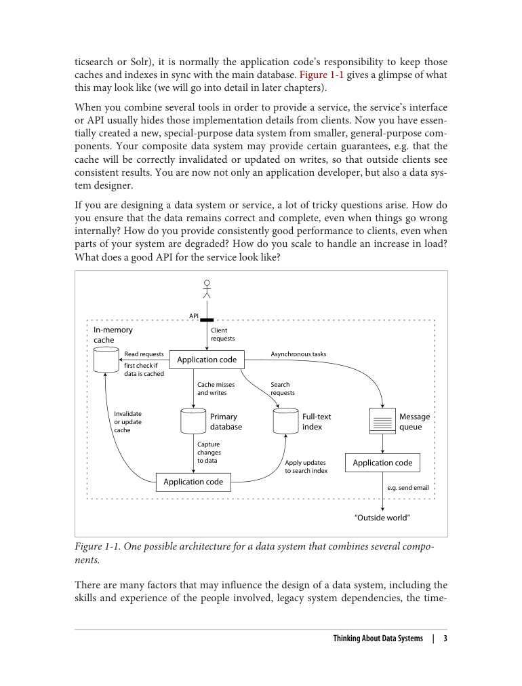
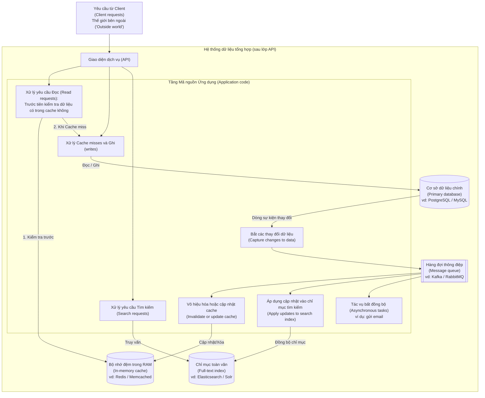
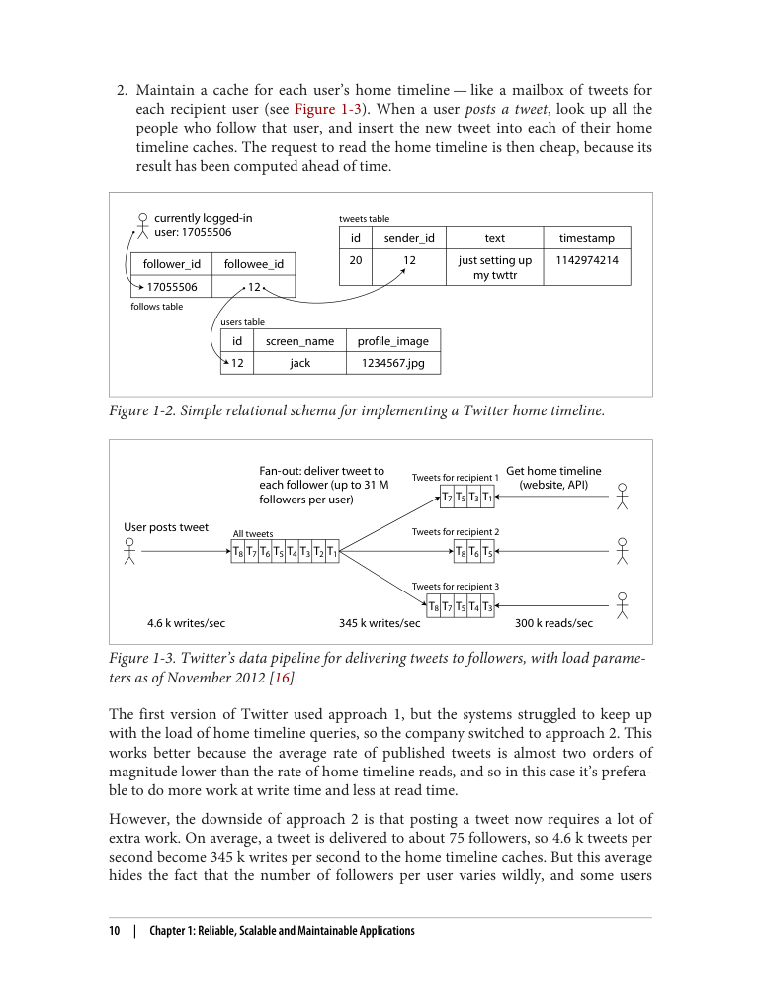
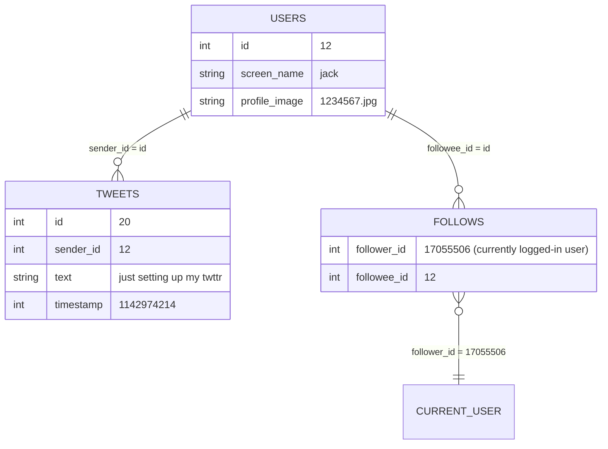
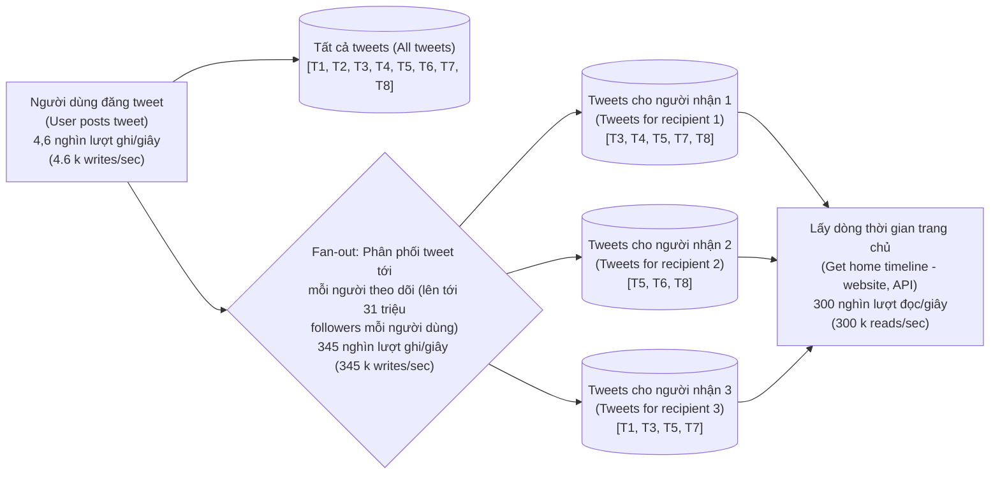
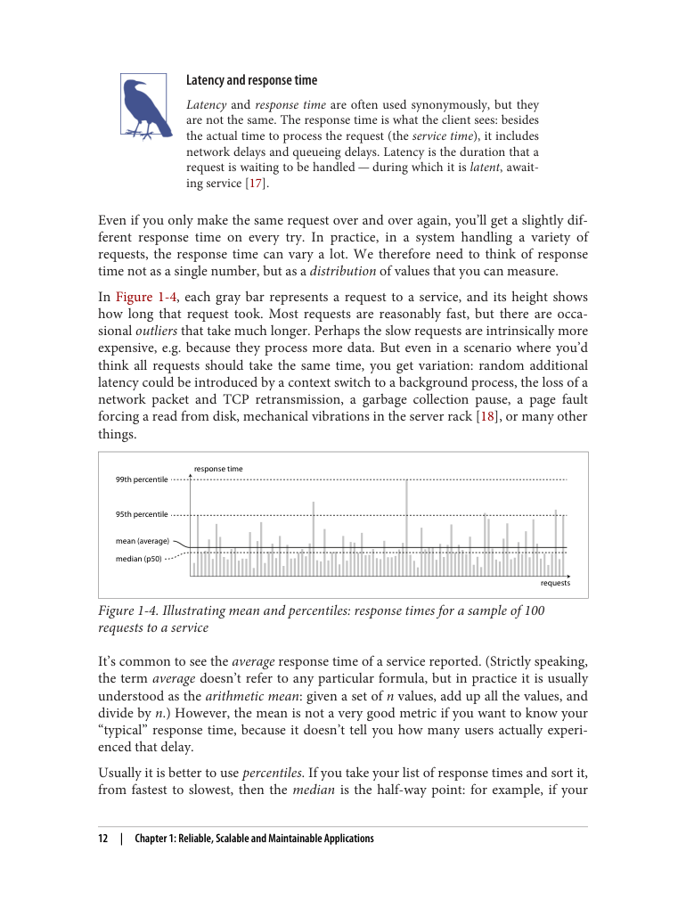
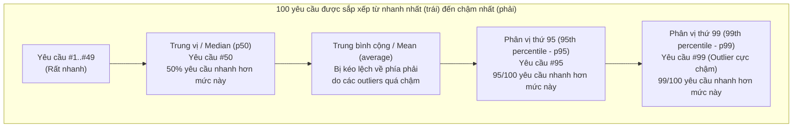
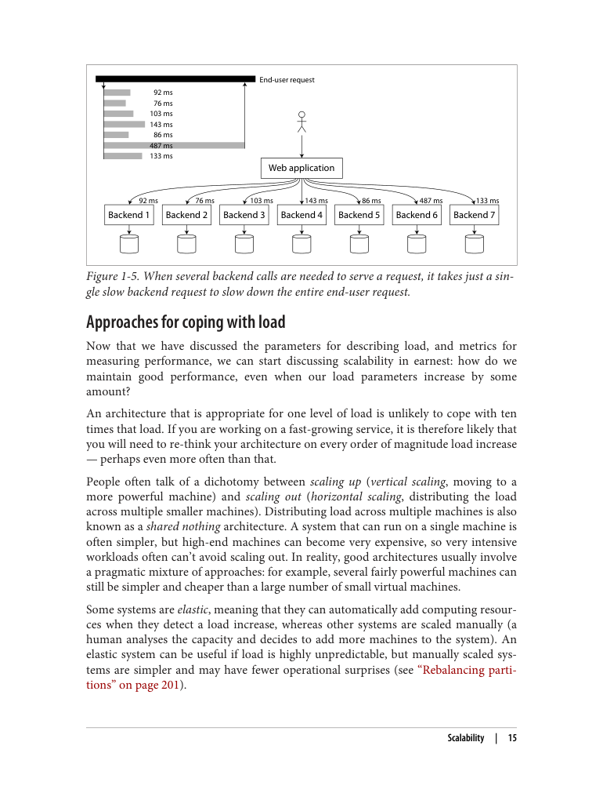
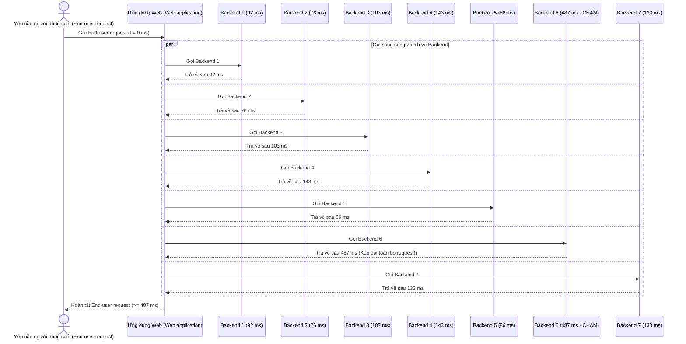

# PHẦN I: Nền tảng của các Hệ thống Dữ liệu (PART I: Foundations of Data Systems)

Bốn chương đầu tiên sẽ đi qua những ý tưởng nền tảng áp dụng cho tất cả các hệ thống dữ liệu (data systems), cho dù chúng chạy trên một máy đơn lẻ hay được phân tán trên một cụm (cluster) gồm nhiều máy tính:

1. **Chương 1** giới thiệu các thuật ngữ và phương pháp tiếp cận mà chúng ta sẽ sử dụng xuyên suốt cuốn sách này. Chương này xem xét thực chất chúng ta muốn nói gì khi dùng các từ như *độ tin cậy (reliability)*, *khả năng mở rộng (scalability)* và *khả năng bảo trì (maintainability)*, cũng như làm thế nào chúng ta có thể nỗ lực đạt được chúng.
2. **Chương 2** so sánh một số mô hình dữ liệu (data models) và ngôn ngữ truy vấn (query languages) khác nhau — sự khác biệt dễ thấy nhất giữa các cơ sở dữ liệu dưới góc nhìn của một lập trình viên. Chúng ta sẽ thấy các mô hình khác nhau phù hợp với những tình huống khác nhau như thế nào.
3. **Chương 3** đi sâu vào cấu trúc bên trong của các bộ máy lưu trữ (storage engines) và xem xét cách các cơ sở dữ liệu sắp xếp dữ liệu trên ổ đĩa. Các bộ máy lưu trữ khác nhau được tối ưu hóa cho các khối lượng công việc (workloads) khác nhau, và việc chọn đúng công cụ có thể tạo ra tác động khổng lồ đến hiệu năng.
4. **Chương 4** so sánh các định dạng mã hóa dữ liệu (data encoding / serialization) khác nhau, và đặc biệt khảo sát cách chúng hoạt động trong một môi trường nơi các yêu cầu ứng dụng thay đổi và các lược đồ (schemas) cần thích ứng theo thời gian.

Sau đó, **Phần II** sẽ chuyển sang các vấn đề đặc thù của những hệ thống dữ liệu phân tán (distributed data systems).

---

# CHƯƠNG 1: Các Ứng dụng Đáng tin cậy, Có khả năng Mở rộng và Dễ bảo trì (Chapter 1: Reliable, Scalable and Maintainable Applications)

> *"Internet được tạo ra tốt đến mức hầu hết mọi người nghĩ về nó như một nguồn tài nguyên thiên nhiên giống như Thái Bình Dương, hơn là một thứ gì đó do con người tạo ra. Lần cuối cùng có một công nghệ ở quy mô như thế mà lại ít lỗi đến vậy là khi nào?"*
> — **Alan Kay**, phỏng vấn trên *Dr Dobb’s Journal* (2012)

Ngày nay, nhiều ứng dụng thuộc loại **chuyên sâu về dữ liệu (data-intensive)**, trái ngược với **chuyên sâu về tính toán (compute-intensive)**. Sức mạnh xử lý thô của CPU hiếm khi là yếu tố giới hạn đối với các ứng dụng này — những vấn đề lớn hơn thường nằm ở khối lượng dữ liệu, độ phức tạp của dữ liệu, và tốc độ thay đổi của chúng.

Một ứng dụng chuyên sâu về dữ liệu thường được xây dựng từ các khối lắp ghép tiêu chuẩn (standard building blocks) nhằm cung cấp những chức năng thường xuyên cần đến. Ví dụ, nhiều ứng dụng cần:

* Lưu trữ dữ liệu để chính chúng, hoặc một ứng dụng khác, có thể tìm lại sau này (**cơ sở dữ liệu — databases**),
* Ghi nhớ kết quả của một thao tác tốn kém tài nguyên để tăng tốc độ đọc (**bộ nhớ đệm — caches**),
* Cho phép người dùng tìm kiếm dữ liệu theo từ khóa hoặc lọc dữ liệu theo nhiều cách khác nhau (**chỉ mục tìm kiếm — search indexes**),
* Gửi một thông điệp đến một tiến trình khác để xử lý bất đồng bộ (**xử lý luồng — stream processing**),
* Định kỳ xử lý và nghiền ngẫm một lượng lớn dữ liệu tích lũy được (**xử lý hàng loạt — batch processing**).

Nếu những điều đó nghe có vẻ quá hiển nhiên, thì đó chỉ là bởi vì các hệ thống dữ liệu này là một tầng trừu tượng (abstraction) cực kỳ thành công: chúng ta sử dụng chúng mọi lúc mà không cần suy nghĩ quá nhiều. Khi xây dựng một ứng dụng, hầu hết các kỹ sư sẽ không bao giờ mơ tới việc tự viết mới một bộ máy lưu trữ dữ liệu từ con số không (from scratch), bởi vì các cơ sở dữ liệu hiện có đã là những công cụ hoàn hảo cho công việc đó.

Nhưng thực tế không đơn giản như vậy. Có rất nhiều hệ thống cơ sở dữ liệu với các đặc tính khác nhau, bởi vì các ứng dụng khác nhau có những yêu cầu khác nhau. Có nhiều phương pháp tiếp cận đối với bộ nhớ đệm (caching), nhiều cách xây dựng chỉ mục tìm kiếm (search indexes), và cứ thế. Khi xây dựng một ứng dụng, chúng ta vẫn cần phải tìm ra công cụ nào và cách tiếp cận nào là phù hợp nhất cho bài toán trước mắt. Đôi khi, việc kết hợp nhiều công cụ với nhau có thể rất khó khăn khi bạn cần thực hiện một việc mà một công cụ đơn lẻ không thể tự mình đảm đương được.

Cuốn sách này là một cuộc hành trình đi qua cả những nguyên lý lẫn tính thực tiễn của các hệ thống dữ liệu, cũng như cách bạn có thể sử dụng chúng để xây dựng các ứng dụng chuyên sâu về dữ liệu. Chúng ta sẽ khám phá xem các công cụ khác nhau có điểm gì chung, điều gì làm nên sự khác biệt giữa chúng, và làm thế nào chúng đạt được các đặc tính đó.

Trong Chương 1 này, chúng ta sẽ bắt đầu bằng việc khám phá những nền tảng cốt lõi của mục tiêu mà chúng ta đang cố gắng đạt tới: các hệ thống dữ liệu **đáng tin cậy (reliable)**, **có khả năng mở rộng (scalable)** và **dễ bảo trì (maintainable)**. Chúng ta sẽ làm rõ ý nghĩa thực sự của những khái niệm đó, phác thảo một số cách tư duy về chúng, và điểm qua những kiến thức cơ bản cần thiết cho các chương sau. Trong các chương tiếp theo, chúng ta sẽ tiếp tục đi từng lớp một (layer by layer), xem xét các quyết định thiết kế khác nhau cần được cân nhắc khi làm việc trên một ứng dụng chuyên sâu về dữ liệu.

> 📝 **Giải thích thêm (không có trong sách):**
> Sự phân biệt giữa **compute-intensive** (bị giới hạn bởi tốc độ tính toán của CPU, như mô phỏng vật lý, huấn luyện mô hình học sâu, render đồ họa 3D) và **data-intensive** (bị giới hạn bởi I/O, băng thông mạng, dung lượng đĩa, tính nhất quán và độ trễ truy xuất dữ liệu) là kim chỉ nam của kiến trúc hệ thống hiện đại. Trong phần lớn các hệ thống backend (thương mại điện tử, ngân hàng, mạng xã hội, SaaS), CPU thường ngồi chờ I/O từ ổ đĩa hoặc mạng (network/disk wait), nên cách tổ chức, lưu trữ và luân chuyển dữ liệu mới là yếu tố quyết định sự sống còn của hệ thống.

---

## Suy ngẫm về các hệ thống dữ liệu (Thinking About Data Systems)

Chúng ta thường nghĩ về cơ sở dữ liệu (databases), hàng đợi (queues), bộ nhớ đệm (caches), v.v. như những danh mục công cụ hoàn toàn tách biệt nhau. Mặc dù một cơ sở dữ liệu và một hàng đợi thông điệp (message queue) có một số điểm tương đồng bề ngoài — cả hai đều lưu trữ dữ liệu trong một khoảng thời gian — nhưng chúng có các mẫu truy cập (access patterns) rất khác nhau, kéo theo các đặc tính hiệu năng khác nhau, và do đó có cách hiện thực hóa (implementations) hoàn toàn khác nhau.

Vậy tại sao chúng ta lại gom tất cả chúng lại dưới một thuật ngữ chung là **hệ thống dữ liệu (data systems)**?

Thứ nhất, nhiều công cụ mới phục vụ việc lưu trữ và xử lý dữ liệu đã xuất hiện trong những năm gần đây. Chúng được tối ưu hóa cho nhiều trường hợp sử dụng (use cases) đa dạng và không còn nằm gọn gàng trong các danh mục truyền thống nữa [1]. Ví dụ, có những kho lưu trữ dữ liệu (data stores) đồng thời được sử dụng như hàng đợi thông điệp (**Redis**), và có những hàng đợi thông điệp mang lại các cam kết về độ bền vững (durability guarantees) giống hệt như cơ sở dữ liệu (**Apache Kafka**). Ranh giới giữa các danh mục đang ngày càng trở nên mờ nhạt.

Thứ hai, ngày càng có nhiều ứng dụng đặt ra những yêu cầu khắt khe hoặc bao quát đến mức một công cụ đơn lẻ không còn khả năng đáp ứng toàn bộ nhu cầu lưu trữ và xử lý dữ liệu của nó nữa. Thay vào đó, công việc được chia nhỏ thành các tác vụ có thể được thực thi hiệu quả trên từng công cụ riêng lẻ, rồi những công cụ khác nhau đó được khâu nối lại với nhau bằng mã nguồn ứng dụng (application code).

Ví dụ, nếu bạn có một tầng bộ nhớ đệm do ứng dụng tự quản lý (sử dụng **Memcached** hoặc công cụ tương tự), hoặc một máy chủ tìm kiếm toàn văn (full-text search server) tách biệt khỏi cơ sở dữ liệu chính (chẳng hạn như **Elasticsearch** hoặc **Solr**), thì thông thường mã nguồn ứng dụng phải chịu trách nhiệm giữ cho các bộ nhớ đệm và chỉ mục đó luôn đồng bộ (in sync) với cơ sở dữ liệu chính. **Hình 1-1** mang lại một cái nhìn thoáng qua về việc kiến trúc này trông như thế nào (chúng ta sẽ đi vào chi tiết trong các chương sau).

Khi bạn kết hợp nhiều công cụ để cung cấp một dịch vụ, giao diện của dịch vụ đó hoặc API thường che giấu các chi tiết hiện thực hóa khỏi phía máy khách (clients). Lúc này, về bản chất bạn đã tạo ra một hệ thống dữ liệu mới, chuyên biệt (special-purpose data system) từ những thành phần nhỏ hơn, đa dụng (general-purpose components). Hệ thống dữ liệu tổng hợp (composite data system) của bạn có thể cung cấp những cam kết nhất định, ví dụ như đảm bảo bộ nhớ đệm sẽ được vô hiệu hóa (invalidated) hoặc cập nhật chính xác khi có thao tác ghi, để các client bên ngoài luôn nhìn thấy kết quả nhất quán. Giờ đây, bạn không chỉ là một nhà phát triển ứng dụng (application developer), mà còn là một **nhà thiết kế hệ thống dữ liệu (data system designer)**.

Nếu bạn đang thiết kế một hệ thống dữ liệu hoặc một dịch vụ, hàng loạt câu hỏi hóc búa sẽ nảy sinh:
* Làm thế nào để bạn đảm bảo dữ liệu luôn đúng đắn và đầy đủ, ngay cả khi có sự cố xảy ra ở bên trong?
* Làm thế nào để bạn cung cấp hiệu năng tốt một cách nhất quán cho các client, ngay cả khi một số bộ phận trong hệ thống của bạn đang bị suy giảm hiệu năng (degraded)?
* Làm thế nào để bạn mở rộng quy mô (scale) nhằm xử lý sự gia tăng về tải (load)?
* Một API tốt cho dịch vụ đó sẽ trông như thế nào?

**Hình 1-1 – Một kiến trúc khả dĩ cho một hệ thống dữ liệu kết hợp nhiều thành phần (Figure 1-1. One possible architecture for a data system that combines several components.)**





> 💡 **Ví dụ bổ sung (không có trong sách):**
> Trong thực tế sản xuất hiện nay, luồng *"Capture changes to data"* (Bắt các thay đổi dữ liệu) ở **Hình 1-1** thường được hiện thực hóa bằng kỹ thuật **Change Data Capture (CDC)**, ví dụ như dùng **Debezium** đọc trực tiếp Write-Ahead Log (WAL) của PostgreSQL hoặc Binlog của MySQL rồi đẩy vào **Apache Kafka**. Từ Kafka, các consumer sẽ cập nhật **Redis** (cache) và **Elasticsearch** (full-text search). Cách làm này tránh được lỗi "dual writes" (ghi trực tiếp vào DB và Elasticsearch cùng lúc trong code ứng dụng nhưng một trong hai bị lỗi mạng hoặc ghi lệch thứ tự gây mất nhất quán dữ liệu).

Có rất nhiều yếu tố có thể ảnh hưởng đến việc thiết kế một hệ thống dữ liệu, bao gồm kỹ năng và kinh nghiệm của những người tham gia, sự phụ thuộc vào các hệ thống cũ (legacy system dependencies), khung thời gian bàn giao (timescale for delivery), mức độ chấp nhận các loại rủi ro khác nhau của tổ chức bạn, các ràng buộc pháp lý (regulatory constraints), v.v. Những yếu tố đó phụ thuộc rất nhiều vào từng hoàn cảnh cụ thể.

Trong cuốn sách này, chúng ta tập trung vào ba mối quan tâm có tầm quan trọng cốt lõi trong hầu hết các hệ thống phần mềm:

* **Độ tin cậy (Reliability):** Hệ thống phải tiếp tục hoạt động chính xác (thực hiện đúng chức năng ở mức hiệu năng mong muốn) ngay cả khi đối mặt với nghịch cảnh (lỗi phần cứng hoặc phần mềm, và thậm chí cả lỗi của con người). Xem phần *"Độ tin cậy (Reliability)"* bên dưới.
* **Khả năng mở rộng (Scalability):** Khi hệ thống phát triển lớn lên (về dung lượng dữ liệu, lưu lượng truy cập hoặc độ phức tạp), phải có những cách thức hợp lý để đối phó với sự tăng trưởng đó. Xem phần *"Khả năng mở rộng (Scalability)"* ở phần tiếp theo.
* **Khả năng bảo trì (Maintainability):** Theo thời gian, sẽ có nhiều người khác nhau làm việc trên hệ thống (cả đội ngũ kỹ sư phát triển lẫn đội ngũ vận hành, vừa duy trì hành vi hiện tại vừa điều chỉnh hệ thống cho các trường hợp sử dụng mới), và tất cả họ đều phải có khả năng làm việc trên hệ thống đó một cách năng suất. Xem phần *"Khả năng bảo trì (Maintainability)"* ở cuối chương.

Những từ ngữ này thường được tung hứng khắp nơi mà không có sự thấu hiểu rõ ràng về ý nghĩa thực sự của chúng. Vì lợi ích của một nền kỹ thuật thấu đáo (thoughtful engineering), chúng ta sẽ dành phần còn lại của chương này để khám phá các cách tư duy về độ tin cậy, khả năng mở rộng và khả năng bảo trì. Sau đó, trong các chương tiếp theo, chúng ta sẽ xem xét hàng loạt kỹ thuật, kiến trúc và thuật toán được sử dụng nhằm đạt được những mục tiêu đó.

---

## Độ tin cậy (Reliability)

Ai cũng có một ý niệm trực giác về việc một phần mềm thế nào là đáng tin cậy hay không đáng tin cậy. Đối với phần mềm, những kỳ vọng điển hình bao gồm:

* Ứng dụng thực hiện đúng chức năng mà người dùng mong đợi.
* Nó có thể chịu đựng (tolerate) được việc người dùng mắc sai lầm, hoặc sử dụng phần mềm theo những cách không ngờ tới.
* Hiệu năng của nó đủ tốt cho trường hợp sử dụng được yêu cầu, dưới mức tải và dung lượng dữ liệu dự kiến.
* Hệ thống ngăn chặn mọi truy cập trái phép và hành vi lạm dụng.

Nếu tất cả những điều đó cộng lại có nghĩa là *"hoạt động chính xác (working correctly)"*, thì chúng ta có thể hiểu **độ tin cậy (reliability)** đại khái là **"tiếp tục hoạt động chính xác, ngay cả khi có sự cố xảy ra (continuing to work correctly, even when things go wrong)"**.

Những thứ có thể trục trặc được gọi là **lỗi bộ phận / sự cố cục bộ (faults)**, và các hệ thống lường trước được các lỗi này cũng như có thể đối phó với chúng được gọi là có **khả năng chịu lỗi (fault-tolerant)** hoặc **có sức bật / khả năng phục hồi (resilient)**. Thuật ngữ này hơi dễ gây hiểu lầm: nó gợi ý rằng chúng ta có thể làm cho một hệ thống chịu đựng được mọi loại lỗi có thể xảy ra, điều mà trên thực tế là bất khả thi. Nếu toàn bộ hành tinh Trái Đất (cùng tất cả các máy chủ trên đó) bị nuốt chửng bởi một hố đen vũ trụ, thì việc chịu đựng lỗi đó đòi hỏi phải đặt máy chủ web ngoài không gian — chúc bạn may mắn khi xin phê duyệt khoản ngân sách đó! Vì vậy, chỉ có ý nghĩa khi chúng ta nói về việc chịu đựng *một số loại lỗi nhất định*.

Lưu ý rằng **lỗi bộ phận (fault)** không giống với **sự cố ngừng hoạt động toàn hệ thống (failure)** [2]. Một *fault* thường được định nghĩa là việc một thành phần của hệ thống hoạt động chệch khỏi đặc tả kỹ thuật (spec) của nó, trong khi một *failure* là khi toàn bộ hệ thống ngừng cung cấp dịch vụ được yêu cầu cho người dùng. Không thể giảm xác suất xảy ra của một *fault* xuống bằng không; do đó, cách tốt nhất thường là thiết kế các cơ chế chịu lỗi (fault tolerance mechanisms) nhằm ngăn chặn các *fault* dẫn đến *failure*. Trong cuốn sách này, chúng ta sẽ đề cập đến nhiều kỹ thuật để xây dựng các hệ thống đáng tin cậy từ những bộ phận không đáng tin cậy.

> 📝 **Giải thích thêm (không có trong sách):**
> Trong tiếng Việt, cả **fault**, **error** và **failure** đôi khi đều được dịch chung là "lỗi" hoặc "sự cố", nhưng trong kỹ thuật hệ thống phân tán (theo chuẩn phân loại CMU/SEI và IEEE), chúng tạo thành một chuỗi nhân quả rõ rệt:
> * **Fault (Lỗi bộ phận / Khiếm khuyết cục bộ):** Nguyên nhân gốc rễ khi một thành phần lệch chuẩn (ví dụ: 1 ổ cứng trong cụm RAID bị hỏng cơ học, hoặc 1 dòng code chia cho 0).
> * **Error (Trạng thái lỗi nội tại):** Biểu hiện sai lệch trạng thái bên trong hệ thống do *fault* gây ra (ví dụ: khối dữ liệu đọc lên bị sai checksum).
> * **Failure (Sự cố sập dịch vụ / Thất bại hệ thống):** Khi hệ thống không thể che giấu *error* đó nữa và ngừng trả kết quả đúng cho người dùng cuối (ví dụ: API trả về HTTP 500 hoặc toàn bộ website không truy cập được).
> Mục tiêu của **Fault Tolerance** là chặn đứng chuỗi `Fault -> Failure`: cho phép `Fault` xảy ra nhưng hệ thống tự xử lý để không biến thành `Failure`.

Ngược với trực giác thông thường, trong các hệ thống chịu lỗi như vậy, việc chủ động làm tăng tần suất xảy ra lỗi (faults) bằng cách cố tình kích hoạt chúng lại rất có ý nghĩa — ví dụ, bằng cách ngẫu nhiên giết chết (kill) các tiến trình riêng lẻ mà không báo trước. Nhiều lỗi nghiêm trọng (critical bugs) thực chất là do việc xử lý ngoại lệ kém (poor error handling) [3]; bằng cách cố tình gây ra lỗi, bạn đảm bảo rằng bộ máy chịu lỗi luôn được rèn luyện và kiểm thử liên tục, từ đó củng cố niềm tin rằng các lỗi sẽ được xử lý chính xác khi chúng xảy ra một cách tự nhiên. Công cụ **Chaos Monkey** của Netflix [4] là một ví dụ điển hình cho phương pháp tiếp cận này.

Mặc dù chúng ta thường ưu tiên việc chịu lỗi (tolerating faults) hơn là ngăn ngừa lỗi (preventing faults), vẫn có những trường hợp mà "phòng bệnh hơn chữa bệnh" (ví dụ: vì không hề có thuốc chữa). Đây chính là trường hợp của các vấn đề bảo mật: nếu một kẻ tấn công đã xâm nhập được vào hệ thống và giành quyền truy cập vào dữ liệu nhạy cảm, sự kiện đó không thể hoàn tác (undone) được. Tuy nhiên, cuốn sách này chủ yếu giải quyết các loại lỗi có thể "chữa trị" được, như được mô tả trong các mục tiếp theo.

### Lỗi phần cứng (Hardware faults)

Khi chúng ta nghĩ về các nguyên nhân gây ra sự cố hệ thống, lỗi phần cứng nhanh chóng xuất hiện trong đầu. Ổ cứng bị hỏng (crash), thanh RAM bị lỗi, lưới điện bị mất điện diện rộng (blackout), ai đó rút nhầm dây cáp mạng. Bất kỳ ai từng làm việc với các trung tâm dữ liệu (data centers) lớn đều có thể nói với bạn rằng những chuyện này xảy ra như cơm bữa khi bạn có rất nhiều máy móc.

Ổ cứng cơ học (hard disks) được báo cáo là có thời gian trung bình dẫn đến hỏng hóc (**MTTF — Mean Time To Failure**) vào khoảng 10 đến 50 năm [5, 6]. Như vậy, trên một cụm lưu trữ gồm 10.000 ổ cứng, chúng ta nên kỳ vọng trung bình mỗi ngày sẽ có một ổ cứng "chết".

Phản ứng đầu tiên của chúng ta thường là bổ sung **tính dự phòng (redundancy)** cho từng thành phần phần cứng riêng lẻ nhằm giảm tỷ lệ hỏng hóc của hệ thống. Các ổ đĩa có thể được thiết lập theo cấu hình RAID, các máy chủ có thể trang bị bộ nguồn kép (dual power supplies) và CPU hỗ trợ thay nóng (hot-swappable CPUs), còn các trung tâm dữ liệu có thể có hệ thống ắc quy và máy phát điện chạy dầu diesel làm nguồn điện dự phòng. Khi một linh kiện chết, linh kiện dự phòng có thể lập tức thế chỗ trong lúc linh kiện hỏng được thay mới. Cách tiếp cận này không thể ngăn chặn hoàn toàn các sự cố phần cứng gây ra sự cố hệ thống, nhưng nó đã được hiểu rất rõ và thường có thể giữ cho một cỗ máy chạy liên tục không gián đoạn trong nhiều năm liền.

Cho đến gần đây, việc dự phòng các linh kiện phần cứng là đã đủ cho hầu hết các ứng dụng, vì nó làm cho việc một máy đơn lẻ bị sập hoàn toàn trở nên khá hiếm hoi. Miễn là bạn có thể khôi phục bản sao lưu (restore a backup) lên một máy mới đủ nhanh, thì thời gian ngừng hoạt động (downtime) trong trường hợp xảy ra sự cố không phải là thảm họa đối với đa số ứng dụng. Do đó, việc dự phòng đa máy chủ (multi-machine redundancy) chỉ được yêu cầu bởi một số lượng nhỏ các ứng dụng mà tính sẵn sàng cao (high availability) là tối quan trọng.

Tuy nhiên, khi dung lượng dữ liệu và nhu cầu tính toán của các ứng dụng ngày càng tăng, ngày càng có nhiều ứng dụng sử dụng số lượng máy chủ lớn hơn, làm tăng tỷ lệ lỗi phần cứng lên tương ứng. Hơn nữa, trên một số nền tảng "đám mây" (cloud) như Amazon Web Services (AWS), việc các máy ảo (virtual machine instances) trở nên không khả dụng mà không có cảnh báo trước là điều khá phổ biến [7], bởi vì nền tảng này được thiết kế để ưu tiên tính linh hoạt (flexibility) và tính co giãn (elasticity)$^{\text{i}}$ hơn là độ tin cậy của từng máy đơn lẻ.

*(Chú thích chân trang i: Được định nghĩa trong mục "Các phương pháp đối phó với tải (Approaches for coping with load)" ở phần sau.)*

Do đó, đang có một sự dịch chuyển hướng tới các hệ thống có thể chịu đựng được việc mất đi toàn bộ các cỗ máy (entire machines), bằng cách sử dụng các kỹ thuật chịu lỗi bằng phần mềm (software fault-tolerance techniques) ưu tiên hơn hoặc kết hợp cùng với dự phòng phần cứng. Các hệ thống như vậy cũng mang lại những lợi thế lớn về mặt vận hành: một hệ thống chạy trên máy chủ đơn lẻ đòi hỏi phải có thời gian ngừng hoạt động theo kế hoạch (planned downtime) nếu bạn cần khởi động lại máy (ví dụ: để áp dụng các bản vá bảo mật cho hệ điều hành), trong khi một hệ thống có thể chịu được sự cố sập máy chủ có thể được cập nhật bản vá từng nút (node) một (rolling upgrade), mà không gây ra bất kỳ thời gian ngừng hoạt động nào cho toàn hệ thống.

### Lỗi phần mềm (Software errors)

Chúng ta thường nghĩ về các lỗi phần cứng như những sự kiện ngẫu nhiên và độc lập với nhau: việc ổ đĩa của máy này bị hỏng không hàm ý rằng ổ đĩa của máy khác cũng sắp hỏng. Có thể có những mối tương quan yếu (ví dụ: do một nguyên nhân chung, chẳng hạn như nhiệt độ trong tủ rack máy chủ tăng cao), nhưng ngoài điều đó ra thì rất khó có khả năng một số lượng lớn các linh kiện phần cứng lại hỏng cùng một lúc.

Một nhóm lỗi khác là **lỗi mang tính hệ thống (systematic error)** nằm bên trong hệ thống [8]. Những lỗi như vậy khó lường trước hơn nhiều, và bởi vì chúng có tính tương quan (correlated) xuyên suốt các nút mạng (nodes), chúng có xu hướng gây ra nhiều sự cố sập toàn hệ thống (system failures) hơn so với các lỗi phần cứng không tương quan [5]. Các ví dụ bao gồm:

* Một lỗi phần mềm (software bug) khiến mọi thực thể (instance) của một máy chủ ứng dụng đều bị sập (crash) khi nhận phải một dữ liệu đầu vào xấu cụ thể nào đó. Ví dụ, hãy xem xét sự kiện giây nhuận (leap second) vào ngày 30 tháng 6 năm 2012 đã khiến nhiều ứng dụng bị treo đồng loạt, do một lỗi trong nhân hệ điều hành Linux (Linux kernel) [9].
* Một tiến trình mất kiểm soát (runaway process) chiếm dụng hết một số tài nguyên dùng chung — thời gian CPU, bộ nhớ RAM, dung lượng ổ đĩa hoặc băng thông mạng.
* Một dịch vụ mà hệ thống phụ thuộc vào bị chậm lại, trở nên không phản hồi (unresponsive) hoặc bắt đầu trả về các phản hồi bị hỏng/sai lệch (corrupted responses).
* **Sự cố dây chuyền (Cascading failures)**, nơi một lỗi nhỏ ở một thành phần kích hoạt một lỗi ở thành phần khác, và đến lượt nó lại kích hoạt thêm nhiều lỗi tiếp theo [10].

Những lỗi (bugs) gây ra các loại sự cố phần mềm này thường nằm im (dormant) trong một thời gian dài cho đến khi chúng bị kích hoạt bởi một tập hợp các hoàn cảnh bất thường. Trong những hoàn cảnh đó, người ta mới phát hiện ra rằng phần mềm đang đưa ra một giả định ngầm nào đó về môi trường của nó — và mặc dù giả định đó thường đúng, nhưng cuối cùng nó lại ngừng đúng vì một lý do nào đó [11].

Không có giải pháp thần tốc nào cho bài toán lỗi mang tính hệ thống trong phần mềm. Rất nhiều biện pháp nhỏ kết hợp lại có thể giúp ích: suy nghĩ cẩn trọng về các giả định và tương tác trong hệ thống, kiểm thử kỹ lưỡng, cô lập tiến trình (process isolation), cho phép các tiến trình bị sập và tự khởi động lại, đo lường, giám sát và phân tích hành vi của hệ thống trên môi trường thực tế (production). Nếu một hệ thống được kỳ vọng sẽ cung cấp một sự đảm bảo nào đó (ví dụ, trong một hàng đợi thông điệp, số lượng thông điệp đi vào phải bằng số lượng thông điệp đi ra), nó có thể liên tục tự kiểm tra chính mình trong khi đang chạy, và phát cảnh báo (alert) nếu phát hiện thấy sự sai lệch [12].

### Lỗi do con người (Human errors)

Con người thiết kế và xây dựng các hệ thống phần mềm, và những người vận hành (operators) giữ cho hệ thống chạy liên tục cũng là con người. Ngay cả khi họ có những ý định tốt đẹp nhất, con người vốn dĩ vẫn được biết đến là không đáng tin cậy. Ví dụ, một nghiên cứu về các dịch vụ internet lớn đã chỉ ra rằng lỗi cấu hình (configuration errors) do người vận hành gây ra là nguyên nhân hàng đầu dẫn đến các vụ sập dịch vụ (outages), trong khi lỗi phần cứng (máy chủ hoặc mạng) chỉ đóng vai trò trong khoảng 10–25% các vụ sập dịch vụ [13].

Làm thế nào để chúng ta làm cho hệ thống của mình đáng tin cậy, bất chấp sự không đáng tin cậy của con người? Các hệ thống tốt nhất kết hợp nhiều cách tiếp cận với nhau:

* **Thiết kế hệ thống theo cách giảm thiểu cơ hội mắc sai lầm.** Ví dụ, các tầng trừu tượng (abstractions), API và giao diện quản trị được thiết kế tốt sẽ giúp việc thực hiện "điều đúng đắn" trở nên dễ dàng, và ngăn cản việc làm "điều sai trái". Tuy nhiên, nếu các giao diện quá gò bó, mọi người sẽ tìm cách lách qua chúng (work around), làm mất đi lợi ích ban đầu, vì vậy đây là một sự cân bằng tinh tế cần phải đạt được.
* **Tách biệt (decouple) những nơi con người hay mắc lỗi nhất khỏi những nơi có thể gây ra sự cố sập hệ thống.** Cụ thể, hãy cung cấp các môi trường thử nghiệm phi sản xuất (non-production sandbox environments) có đầy đủ tính năng, nơi mọi người có thể khám phá và thử nghiệm một cách an toàn bằng dữ liệu thực tế mà không làm ảnh hưởng đến người dùng thật.
* **Kiểm thử kỹ lưỡng ở mọi cấp độ**, từ kiểm thử đơn vị (unit tests) đến kiểm thử tích hợp toàn hệ thống (whole-system integration tests) và kiểm thử thủ công [3]. Kiểm thử tự động được sử dụng rộng rãi, được hiểu rõ và đặc biệt có giá trị trong việc bao phủ các trường hợp biên (corner cases) hiếm khi phát sinh trong quá trình vận hành bình thường.
* **Cho phép khôi phục nhanh chóng và dễ dàng từ các lỗi của con người**, nhằm giảm thiểu tác động trong trường hợp xảy ra sự cố. Ví dụ, làm cho việc quay lui (roll back) các thay đổi cấu hình diễn ra thật nhanh, triển khai mã nguồn mới một cách từ từ theo từng đợt (gradual rollout / canary release — để bất kỳ lỗi không mong muốn nào cũng chỉ ảnh hưởng đến một tập nhỏ người dùng), và cung cấp các công cụ để tính toán lại dữ liệu (trong trường hợp phát hiện ra rằng phép tính cũ bị sai).
* **Thiết lập hệ thống giám sát (monitoring) chi tiết và rõ ràng**, chẳng hạn như các chỉ số hiệu năng (performance metrics) và tỷ lệ lỗi (error rates). Trong các ngành kỹ thuật khác, điều này được gọi là **đo xa (telemetry)**. (Một khi tên lửa đã rời bệ phóng, telemetry là yếu tố sống còn để theo dõi những gì đang diễn ra và để tìm hiểu nguyên nhân các vụ tai nạn [14].) Giám sát có thể cho chúng ta thấy các tín hiệu cảnh báo sớm, và cho phép chúng ta kiểm tra xem có bất kỳ giả định hay ràng buộc nào đang bị vi phạm hay không. Khi sự cố xảy ra, các chỉ số (metrics) là vô giá trong việc chẩn đoán vấn đề.
* **Thực hành quản lý tốt và đào tạo bài bản** — một khía cạnh phức tạp và quan trọng, nhưng nằm ngoài phạm vi của cuốn sách này.

### Độ tin cậy quan trọng đến mức nào? (How important is reliability?)

Độ tin cậy không chỉ dành riêng cho các nhà máy điện hạt nhân hay phần mềm kiểm soát không lưu — những ứng dụng đời thường hơn cũng được kỳ vọng phải hoạt động một cách đáng tin cậy. Các lỗi (bugs) trong ứng dụng doanh nghiệp gây mất năng suất lao động (và dẫn đến rủi ro pháp lý nếu các con số tài chính bị báo cáo sai), và việc sập các trang web thương mại điện tử có thể gây ra thiệt hại khổng lồ về doanh thu bị mất cũng như uy tín thương hiệu.

Ngay cả trong các ứng dụng "không trọng yếu (non-critical)", chúng ta vẫn có trách nhiệm đối với người dùng của mình. Hãy nghĩ về một bậc phụ huynh lưu trữ toàn bộ hình ảnh và video của con cái họ trong ứng dụng lưu trữ ảnh của bạn [15]. Họ sẽ cảm thấy thế nào nếu cơ sở dữ liệu đó đột nhiên bị hỏng (corrupted)? Liệu họ có biết cách khôi phục nó từ một bản sao lưu hay không?

Có những tình huống mà chúng ta có thể chủ động chọn hy sinh độ tin cậy để giảm chi phí phát triển (ví dụ: khi phát triển một sản phẩm nguyên mẫu — prototype — cho một thị trường chưa được kiểm chứng) hoặc giảm chi phí vận hành (ví dụ: cho một dịch vụ có biên lợi nhuận cực kỳ mỏng) — nhưng chúng ta phải hết sức tỉnh táo và ý thức rõ ràng về thời điểm mà mình đang cắt giảm chất lượng (cutting corners).

> 💡 **Ví dụ bổ sung (không có trong sách): Tổng hợp 3 nhóm lỗi và chiến lược phòng thủ thực tế**
>
> | Loại lỗi (Fault Category) | Đặc điểm nhận diện | Ví dụ thực tế trong Production | Chiến lược chịu lỗi & Khắc phục (Fault-Tolerance Strategies) |
> | :--- | :--- | :--- | :--- |
> | **Lỗi phần cứng (Hardware faults)** | Ngẫu nhiên, độc lập giữa các máy (uncorrelated), tần suất tỷ lệ thuận với quy mô cụm máy chủ. | Ổ cứng hỏng cơ học, RAM bit-flip, đứt cáp mạng, cháy nguồn, mất VM đột ngột trên AWS EC2. | Dự phòng phần cứng (RAID, dual PSU, UPS) kết hợp **nhân bản dữ liệu bằng phần mềm (Software Replication)** qua nhiều Availability Zones (như trong PostgreSQL Patroni, Kafka ISR, Cassandra, Raft/etcd) và cơ chế **Rolling Upgrade**. |
> | **Lỗi phần mềm (Software errors)** | Mang tính hệ thống (systematic), có tương quan cao giữa các nút (correlated), dễ gây sập dây chuyền (cascading failure). | Bug giây nhuận Linux, tiến trình rò rỉ bộ nhớ (OOM), query độc hại (poison pill) làm sập mọi node nhận nó, deadlock. | Cô lập tiến trình/tài nguyên (containers/cgroups), giới hạn tốc độ (**Rate Limiting**), ngắt mạch (**Circuit Breaker**), cơ chế tự khởi động lại nhanh (crash-only software), kiểm tra bất biến lúc chạy (runtime invariant assertions) và **Chaos Engineering**. |
> | **Lỗi con người (Human errors)** | Nguyên nhân gây sập hệ thống lớn nhất (chiếm 50–75% các vụ outages lớn). | Chạy nhầm `DROP TABLE` trên DB production, đẩy sai file cấu hình mạng/BGP, cấu hình sai connection pool. | Thiết kế API/UI an toàn, tách biệt môi trường **Sandbox/Staging**, tự động hóa CI/CD kèm **Canary Deployment / Feature Flags**, khả năng **Rollback** trong vài giây, hệ thống **Observability / Telemetry** (Metrics, Logs, Traces) và văn hóa **Blameless Post-mortem**. |

---

## Khả năng mở rộng (Scalability)

Ngay cả khi một hệ thống đang hoạt động đáng tin cậy ngày hôm nay, điều đó không có nghĩa là nó sẽ đương nhiên hoạt động đáng tin cậy trong tương lai. Một nguyên nhân phổ biến dẫn đến sự suy giảm hiệu năng (degradation) là sự gia tăng về **tải (load)**: có lẽ hệ thống đã tăng từ 10.000 người dùng đồng thời (concurrent users) lên 100.000 người dùng đồng thời, hoặc từ 1 triệu lên 10 triệu. Hoặc có lẽ nó đang phải xử lý khối lượng dữ liệu lớn hơn rất nhiều so với trước đây.

**Khả năng mở rộng (Scalability)** là thuật ngữ chúng ta sử dụng để mô tả khả năng của một hệ thống trong việc đối phó với sự gia tăng tải. Tuy nhiên, hãy lưu ý rằng đây không phải là một nhãn mác một chiều (one-dimensional label) mà chúng ta có thể dán lên một hệ thống: thật vô nghĩa khi nói *"hệ thống X có khả năng mở rộng (X is scalable)"* hay *"hệ thống Y không mở rộng được (Y doesn't scale)"*. Đúng hơn, thảo luận về khả năng mở rộng có nghĩa là thảo luận những câu hỏi: *Nếu hệ thống tăng trưởng theo một cách thức cụ thể nào đó, các lựa chọn của chúng ta để đối phó với sự tăng trưởng đó là gì? Làm thế nào chúng ta có thể bổ sung thêm tài nguyên tính toán để xử lý lượng tải tăng thêm?*

### Mô tả tải (Describing load)

Trước hết, chúng ta cần mô tả một cách ngắn gọn và súc tích lượng tải hiện tại trên hệ thống; chỉ khi đó chúng ta mới có thể thảo luận các câu hỏi về tăng trưởng (*điều gì sẽ xảy ra nếu lượng tải của chúng ta tăng gấp đôi?*). Tải có thể được mô tả bằng một vài con số mà chúng ta gọi là **các tham số tải (load parameters)**. Sự lựa chọn tham số tốt nhất phụ thuộc vào kiến trúc hệ thống của bạn: có thể đó là số lượng yêu cầu mỗi giây (requests per second) gửi tới một máy chủ web, tỷ lệ giữa thao tác đọc và thao tác ghi (ratio of reads to writes) trong cơ sở dữ liệu, số lượng người dùng đang hoạt động đồng thời trong một phòng chat, tỷ lệ trúng bộ nhớ đệm (hit rate on a cache), hoặc một chỉ số nào khác. Có thể trường hợp trung bình (average case) là thứ quan trọng đối với bạn, hoặc có thể điểm nghẽn cổ chai (bottleneck) của bạn lại bị chi phối bởi một số lượng nhỏ các trường hợp cực đoan (extreme cases).

Để làm cho ý tưởng này trở nên cụ thể hơn, hãy xem xét **Twitter** làm ví dụ, sử dụng dữ liệu được công bố vào tháng 11 năm 2012 [16]. Hai trong số các thao tác chính của Twitter là:

* **Đăng tweet (Post tweet):** Một người dùng có thể xuất bản một tin nhắn mới tới những người theo dõi (followers) của họ (trung bình **4,6 nghìn yêu cầu/giây**, đạt đỉnh trên **12 nghìn yêu cầu/giây**).
* **Dòng thời gian trang chủ (Home timeline):** Một người dùng có thể xem các tweet vừa được xuất bản gần đây bởi những người mà họ đang theo dõi (**300 nghìn yêu cầu/giây**).

Nếu chỉ đơn thuần xử lý 12.000 thao tác ghi mỗi giây (tốc độ đỉnh khi đăng tweet) thì sẽ khá dễ dàng. Tuy nhiên, thách thức mở rộng quy mô (scaling challenge) của Twitter không chủ yếu nằm ở khối lượng tweet, mà là do **hệ số khuếch đại / phân nhánh đầu ra (fan-out)**$^{\text{ii}}$ — mỗi người dùng theo dõi nhiều người, và mỗi người dùng lại được theo dõi bởi rất nhiều người. Nhìn chung, có hai hướng tiếp cận để hiện thực hóa hai thao tác này:

*(Chú thích chân trang ii: **Fan-out** là một thuật ngữ mượn từ ngành kỹ thuật điện tử, nơi nó mô tả số lượng đầu vào của cổng logic được gắn vào đầu ra của một cổng khác. Đầu ra cần cung cấp đủ dòng điện để điều khiển tất cả các đầu vào được kết nối. Trong các hệ thống xử lý giao dịch, chúng ta sử dụng thuật ngữ này để mô tả số lượng yêu cầu gửi tới các dịch vụ khác mà chúng ta cần thực hiện nhằm phục vụ một yêu cầu đến duy nhất.)*

1. **Hướng tiếp cận 1 (Kéo dữ liệu lúc đọc — Pull on read):** Việc đăng một tweet chỉ đơn giản là chèn (insert) tweet mới đó vào một tập hợp tweet toàn cục (global collection of tweets). Khi một người dùng yêu cầu xem *home timeline*, hệ thống sẽ tra cứu tất cả những người mà họ đang theo dõi, tìm tất cả các tweet gần đây của từng người trong số đó, và trộn (merge) chúng lại (được sắp xếp theo thời gian). Trong một cơ sở dữ liệu quan hệ giống như minh họa ở **Hình 1-2**, thao tác này sẽ là một câu truy vấn đại loại như sau:

```sql
SELECT tweets.*, users.* FROM tweets
  JOIN users   ON tweets.sender_id    = users.id
  JOIN follows ON follows.followee_id = users.id
  WHERE follows.follower_id = current_user
```

2. **Hướng tiếp cận 2 (Đẩy dữ liệu lúc ghi — Push / Fan-out on write):** Duy trì một bộ nhớ đệm (cache) cho *home timeline* của mỗi người dùng — giống như một hộp thư đến (mailbox) chứa các tweet dành riêng cho từng người nhận (xem **Hình 1-3**). Khi một người dùng đăng một tweet, hệ thống tra cứu tất cả những người đang theo dõi người dùng đó, và chèn tweet mới vào từng bộ nhớ đệm *home timeline* của mỗi người theo dõi. Khi đó, yêu cầu đọc *home timeline* sẽ cực kỳ rẻ và nhanh (cheap), bởi vì kết quả của nó đã được tính toán sẵn từ trước (computed ahead of time).

**Hình 1-2 – Lược đồ quan hệ đơn giản để hiện thực hóa dòng thời gian trang chủ của Twitter (Figure 1-2. Simple relational schema for implementing a Twitter home timeline.)**





**Hình 1-3 – Đường ống dữ liệu (data pipeline) của Twitter để phân phối tweet tới người theo dõi, với các tham số tải tính đến tháng 11 năm 2012 [16] (Figure 1-3. Twitter’s data pipeline for delivering tweets to followers, with load parameters as of November 2012 [16].)**




Phiên bản đầu tiên của Twitter đã sử dụng **hướng tiếp cận 1**, nhưng các hệ thống đã phải vật lộn để theo kịp lượng tải của các truy vấn *home timeline*, vì vậy công ty đã chuyển sang **hướng tiếp cận 2**. Hướng tiếp cận 2 hoạt động tốt hơn bởi vì tốc độ trung bình của các tweet được xuất bản thấp hơn gần hai bậc độ lớn (almost two orders of magnitude lower — tức gần 100 lần: 4,6k so với 300k) so với tốc độ đọc *home timeline*; do đó trong trường hợp này, việc thực hiện nhiều công việc hơn tại thời điểm ghi (write time) và ít công việc hơn tại thời điểm đọc (read time) là lựa chọn tối ưu hơn.

Tuy nhiên, nhược điểm của **hướng tiếp cận 2** là việc đăng một tweet giờ đây đòi hỏi rất nhiều công việc phụ thêm. Trung bình, một tweet được gửi tới khoảng 75 người theo dõi, vì vậy **4,6 nghìn tweet mỗi giây** sẽ biến thành **345 nghìn thao tác ghi mỗi giây** vào các bộ nhớ đệm *home timeline*. Nhưng con số trung bình này lại che khuất một sự thật rằng số lượng người theo dõi của mỗi người dùng biến thiên cực kỳ lớn, và một số người dùng (người nổi tiếng) có tới hơn **30 triệu người theo dõi**. Điều này có nghĩa là chỉ một tweet đơn lẻ cũng có thể dẫn đến hơn 30 triệu thao tác ghi vào các *home timeline*! Thực hiện việc này một cách kịp thời — Twitter cố gắng phân phối các tweet tới người theo dõi trong vòng 5 giây — là một thách thức vô cùng lớn.

Trong ví dụ của Twitter, sự phân phối số lượng người theo dõi trên mỗi người dùng (có thể được tính trọng số theo tần suất đăng tweet của những người dùng đó) là một **tham số tải (load parameter)** then chốt khi thảo luận về khả năng mở rộng, vì nó quyết định trực tiếp lượng tải *fan-out*. Ứng dụng của bạn có thể có những đặc tính rất khác, nhưng bạn hoàn toàn có thể áp dụng các nguyên lý tương tự để suy luận về lượng tải của nó.

Cú ngoặt cuối cùng trong câu chuyện của Twitter: giờ đây khi hướng tiếp cận 2 đã được hiện thực hóa một cách vững chắc, Twitter lại chuyển sang một **phương pháp lai (hybrid)** kết hợp cả hai hướng tiếp cận. Các tweet của đa số người dùng thông thường vẫn tiếp tục được *fan-out* (đẩy) vào các *home timeline* ngay tại thời điểm chúng được đăng, nhưng một số lượng nhỏ người dùng có lượng người theo dõi khổng lồ (celebrities) sẽ được miễn trừ khỏi quá trình *fan-out* này. Thay vào đó, đối với bất kỳ người nổi tiếng nào mà một người dùng đang theo dõi, các tweet của họ sẽ được lấy riêng rẽ và trộn (merged) vào *home timeline* ngay tại thời điểm đọc, giống như trong **hướng tiếp cận 1**. Phương pháp lai này có khả năng mang lại hiệu năng tốt một cách nhất quán.

> 💡 **Ví dụ bổ sung (không có trong sách):**
> Bài toán kinh điển của Twitter (nay là X), Facebook News Feed hay TikTok/Instagram Feed chính là sự đánh đổi giữa **Fan-out-on-write (Push model)** và **Fan-out-on-read (Pull model)**:
>
> | Tiêu chí | Hướng tiếp cận 1: Fan-out-on-read (Pull) | Hướng tiếp cận 2: Fan-out-on-write (Push) | Mô hình Lai (Hybrid) |
> | :--- | :--- | :--- | :--- |
> | **Chi phí lúc Ghi (Post)** | Rất thấp: $O(1)$ — chỉ ghi 1 bản ghi vào bảng `tweets`. | Cao: $O(N)$ với $N$ là số followers — ghi vào $N$ danh sách Redis cache. | $O(N)$ cho user thường ($N$ nhỏ); $O(1)$ cho celebrity ($N$ cực lớn). |
> | **Chi phí lúc Đọc (Timeline)** | Rất cao: Phải `JOIN` và sắp xếp từ hàng trăm/nghìn người đang follow. | Cực thấp: $O(1)$ — đọc thẳng từ danh sách cache đã dựng sẵn trong RAM. | Đọc cache sẵn có + trộn thêm một vài danh sách của celebrity lúc đọc. |
> | **Điểm yếu chí mạng** | DB bị quá tải khi lượng đọc lớn (300k reads/s). | **Hiệu ứng "Justin Bieber / Lady Gaga"**: 1 tweet gây ra 30 triệu lệnh ghi làm nghẽn hàng đợi fan-out. | Phức tạp hơn ở tầng logic ứng dụng nhưng giải quyết triệt để cả hai cực. |

### Mô tả hiệu năng (Describing performance)

Một khi bạn đã mô tả được lượng tải trên hệ thống của mình, bạn có thể khảo sát điều gì sẽ xảy ra khi lượng tải đó tăng lên. Bạn có thể xem xét vấn đề này theo hai cách:

* Khi bạn tăng một tham số tải và giữ nguyên các tài nguyên hệ thống (CPU, bộ nhớ RAM, băng thông mạng, v.v.), hiệu năng của hệ thống sẽ bị ảnh hưởng như thế nào?
* Khi bạn tăng một tham số tải, bạn cần phải tăng thêm bao nhiêu tài nguyên nếu muốn giữ cho hiệu năng không thay đổi?

Cả hai câu hỏi đều đòi hỏi các con số đo lường hiệu năng, vì vậy hãy cùng xem xét ngắn gọn cách mô tả hiệu năng của một hệ thống.

Trong một hệ thống xử lý hàng loạt (batch-processing system) chẳng hạn như **Hadoop**, chúng ta thường quan tâm đến **thông lượng (throughput)** — số lượng bản ghi (records) mà chúng ta có thể xử lý mỗi giây, hoặc tổng thời gian cần thiết để chạy xong một công việc (job) trên một tập dữ liệu có kích thước nhất định.$^{\text{iii}}$ Trong các hệ thống trực tuyến (online systems), **thời gian phản hồi (response time)** của một dịch vụ thường quan trọng hơn — đó là khoảng thời gian tính từ lúc một client gửi một yêu cầu đi cho đến khi nhận lại được câu trả lời.

*(Chú thích chân trang iii: Trong một thế giới lý tưởng, thời gian chạy của một tác vụ xử lý hàng loạt (batch job) bằng kích thước của tập dữ liệu chia cho thông lượng (throughput). Tuy nhiên trên thực tế, thời gian chạy thường dài hơn, do hiện tượng **lệch dữ liệu (skew)** — dữ liệu không được phân bổ đồng đều giữa các tiến trình xử lý (worker processes) — hoặc do phải chờ tác vụ chậm nhất hoàn thành.)*

> 📌 **Độ trễ (Latency) và Thời gian phản hồi (Response time)** *(Hộp thông tin trong sách)*
>
> *Độ trễ (Latency)* và *thời gian phản hồi (response time)* thường được sử dụng như hai từ đồng nghĩa, nhưng thực chất chúng không giống nhau. **Thời gian phản hồi (response time)** là những gì phía client nhìn thấy: bên cạnh thời gian thực tế để máy chủ xử lý yêu cầu (**thời gian phục vụ — service time**), nó còn bao gồm cả độ trễ truyền mạng (network delays) và độ trễ xếp hàng đợi (queueing delays). **Độ trễ (latency)** là khoảng thời gian mà một yêu cầu phải nằm chờ để được xử lý — khoảng thời gian mà nó ở trạng thái tiềm ẩn (latent), đang chờ được phục vụ [17].

Ngay cả khi bạn chỉ gửi đi gửi lại cùng một yêu cầu giống hệt nhau, bạn vẫn sẽ nhận được một thời gian phản hồi hơi khác nhau ở mỗi lần thử. Trên thực tế, trong một hệ thống xử lý đa dạng các loại yêu cầu, thời gian phản hồi có thể biến thiên rất lớn. Do đó, chúng ta cần nghĩ về thời gian phản hồi không phải như một con số đơn lẻ, mà như một **phân phối các giá trị (distribution of values)** mà bạn có thể đo lường được.

Trong **Hình 1-4**, mỗi thanh màu xám đại diện cho một yêu cầu gửi tới dịch vụ, và chiều cao của nó thể hiện yêu cầu đó mất bao lâu để hoàn thành. Hầu hết các yêu cầu đều khá nhanh, nhưng thỉnh thoảng lại có những **giá trị ngoại lai (outliers)** mất nhiều thời gian hơn hẳn. Có lẽ những yêu cầu chậm đó bản chất đã tốn kém hơn, ví dụ vì chúng phải xử lý nhiều dữ liệu hơn. Nhưng ngay cả trong một kịch bản mà bạn nghĩ rằng mọi yêu cầu đều phải mất lượng thời gian như nhau, bạn vẫn sẽ gặp sự biến thiên: độ trễ ngẫu nhiên tăng thêm có thể xuất phát từ việc chuyển ngữ cảnh (context switch) sang một tiến trình chạy nền, việc mất một gói tin mạng (network packet loss) và truyền lại TCP (TCP retransmission), một khoảng dừng thu gom rác bộ nhớ (garbage collection pause), một lỗi trang bộ nhớ (page fault) buộc phải đọc từ ổ đĩa, những rung động cơ học trong tủ rack máy chủ [18], hoặc vô số nguyên nhân khác.

**Hình 1-4 – Minh họa giá trị trung bình cộng (mean) và các phân vị (percentiles): thời gian phản hồi của một mẫu gồm 100 yêu cầu gửi tới một dịch vụ (Figure 1-4. Illustrating mean and percentiles: response times for a sample of 100 requests to a service)**






Người ta thường thấy **thời gian phản hồi trung bình (average response time)** của một dịch vụ được đem ra báo cáo. (Nói một cách chặt chẽ, thuật ngữ *trung bình (average)* không ám chỉ một công thức cụ thể nào, nhưng trong thực tế nó thường được hiểu là **trung bình cộng số học — arithmetic mean**: cho một tập gồm $n$ giá trị, cộng tất cả các giá trị lại rồi chia cho $n$.) Tuy nhiên, trung bình cộng (mean) không phải là một thước đo tốt nếu bạn muốn biết thời gian phản hồi "điển hình" của hệ thống, bởi vì nó không cho bạn biết có bao nhiêu người dùng thực sự phải trải qua độ trễ đó.

Thông thường, việc sử dụng **các phân vị (percentiles)** sẽ tốt hơn nhiều. Nếu bạn lấy danh sách thời gian phản hồi của mình và sắp xếp nó theo thứ tự từ nhanh nhất đến chậm nhất, thì **trung vị (median)** chính là điểm nằm ngay chính giữa: ví dụ, nếu thời gian phản hồi trung vị của bạn là 200 ms, điều đó có nghĩa là một nửa số yêu cầu của bạn trả về trong thời gian chưa đầy 200 ms, và một nửa số yêu cầu còn lại mất nhiều thời gian hơn mức đó.

Điều này làm cho trung vị trở thành một thước đo tuyệt vời nếu bạn muốn biết người dùng thường phải chờ bao lâu: một nửa số yêu cầu của người dùng được phục vụ trong thời gian ngắn hơn thời gian phản hồi trung vị, và nửa còn lại mất nhiều thời gian hơn trung vị. Trung vị còn được gọi là **phân vị thứ 50 (50th percentile)**, và đôi khi được viết tắt là **p50**. Lưu ý rằng trung vị là điểm chính giữa xét trên một yêu cầu đơn lẻ; nếu người dùng thực hiện nhiều yêu cầu (trong suốt một phiên làm việc, hoặc bởi vì có nhiều tài nguyên được nhúng trong cùng một trang web), thì xác suất để ít nhất một trong số các yêu cầu đó chậm hơn mức trung vị sẽ lớn hơn 50% rất nhiều.

Để tìm hiểu xem các giá trị ngoại lai (outliers) của bạn tệ đến mức nào, bạn có thể nhìn vào các phân vị cao hơn: **phân vị thứ 95, 99 và 99,9 (95th, 99th and 99.9th percentile)** là những chỉ số phổ biến (được viết tắt là **p95**, **p99** và **p999**). Chúng là các ngưỡng thời gian phản hồi mà tại đó 95%, 99% hoặc 99,9% số yêu cầu được xử lý nhanh hơn ngưỡng cụ thể đó. Ví dụ, nếu thời gian phản hồi ở phân vị thứ 95 (p95) là 1,5 giây, điều đó có nghĩa là 95 trên 100 yêu cầu mất ít hơn 1,5 giây, và 5 trên 100 yêu cầu mất từ 1,5 giây trở lên. Điều này được minh họa rõ trong **Hình 1-4**.

Các phân vị cao (high percentiles — thường được gọi là **độ trễ đuôi / tail latencies**) đặc biệt quan trọng vì chúng ảnh hưởng trực tiếp đến trải nghiệm dịch vụ của người dùng. Ví dụ, **Amazon** mô tả các yêu cầu về thời gian phản hồi cho các dịch vụ nội bộ của mình theo **phân vị thứ 99,9 (p999)**, mặc dù nó chỉ ảnh hưởng đến 1 trong số 1.000 yêu cầu. Lý do là bởi những khách hàng có yêu cầu chậm nhất thường chính là những người đã thực hiện nhiều giao dịch mua hàng nhất — tức là những khách hàng giá trị nhất (VIP) bởi tài khoản của họ chứa nhiều dữ liệu lịch sử nhất [19]. Việc giữ cho những khách hàng đó hài lòng bằng cách đảm bảo trang web luôn nhanh đối với họ là vô cùng quan trọng: Amazon cũng đã quan sát thấy rằng thời gian phản hồi cứ tăng thêm 100 ms sẽ làm giảm doanh số bán hàng đi 1% [20], và các nghiên cứu khác báo cáo rằng việc chậm đi 1 giây sẽ làm giảm chỉ số hài lòng của khách hàng đi 16% [21, 22].

Mặt khác, việc tối ưu hóa **phân vị thứ 99,99 (p9999)** (1 yêu cầu chậm nhất trong số 10.000 yêu cầu) lại bị đánh giá là quá đắt đỏ và không mang lại đủ lợi ích cho các mục đích của Amazon. Việc giảm thời gian phản hồi ở các phân vị cực cao là rất khó khăn bởi vì chúng dễ dàng bị tác động bởi các sự kiện ngẫu nhiên nằm ngoài tầm kiểm soát của bạn, và lợi ích thu lại sẽ giảm dần (diminishing returns).

Các phân vị thường được sử dụng trong **Mục tiêu Mức Dịch vụ (Service Level Objectives — SLOs)** và **Thỏa thuận Mức Dịch vụ (Service Level Agreements — SLAs)** — những bản hợp đồng định nghĩa hiệu năng và tính sẵn sàng được kỳ vọng của một dịch vụ. Ví dụ, một SLA có thể quy định rằng dịch vụ được coi là đang hoạt động tốt (up) nếu nó có thời gian phản hồi trung vị (p50) nhỏ hơn 200 ms và phân vị thứ 99 (p99) dưới 1 giây (nếu thời gian phản hồi lâu hơn thế, dịch vụ coi như bị sập), và dịch vụ có thể được yêu cầu phải hoạt động tốt ít nhất 99,9% tổng thời gian. Điều này thiết lập kỳ vọng rõ ràng cho các client sử dụng dịch vụ, và cho phép khách hàng yêu cầu hoàn tiền (refund) nếu SLA không được đáp ứng.

**Độ trễ xếp hàng đợi (Queueing delays)** thường chiếm một phần rất lớn trong thời gian phản hồi ở các phân vị cao. Bởi vì một máy chủ chỉ có thể xử lý song song một số lượng nhỏ tác vụ (bị giới hạn chẳng hạn bởi số lượng nhân CPU của nó), nên chỉ cần một số lượng nhỏ các yêu cầu chậm cũng đủ làm tắc nghẽn quá trình xử lý các yêu cầu đến sau — một hiệu ứng đôi khi được gọi là **chặn đầu hàng đợi (head-of-line blocking)**. Ngay cả khi những yêu cầu đến sau đó vốn dĩ được xử lý rất nhanh trên máy chủ, phía client vẫn sẽ nhìn thấy tổng thời gian phản hồi bị chậm do phải mất thời gian nằm chờ yêu cầu trước đó hoàn tất. Do hiệu ứng này, việc đo lường thời gian phản hồi **ở phía máy khách (client side)** là cực kỳ quan trọng.

Khi tạo tải giả lập (generating load artificially) nhằm kiểm thử khả năng mở rộng của một hệ thống, công cụ client sinh tải cần phải tiếp tục gửi các yêu cầu đi **một cách độc lập với thời gian phản hồi**. Nếu client cứ chờ yêu cầu trước đó hoàn thành rồi mới gửi yêu cầu tiếp theo, hành vi đó sẽ vô tình giữ cho các hàng đợi trong bài kiểm thử luôn ngắn hơn giả tạo so với thực tế, làm sai lệch hoàn toàn kết quả đo lường [23].

> 📝 **Giải thích thêm (không có trong sách):**
> Sai lầm khi đo kiểm thử tải (load testing) vừa được tác giả nhắc đến được Gil Tene đặt tên nổi tiếng là **Coordinated Omission (Sự bỏ sót có phối hợp)**. Nhiều công cụ benchmark truyền thống tạo $N$ luồng (threads), mỗi luồng gửi 1 request, đợi response trả về rồi mới gửi request tiếp theo. Nếu server bị khựng lại (ví dụ do GC pause) mất 5 giây, các luồng client cũng lịch sự "đứng chờ" 5 giây mà không bắn thêm request mới, khiến hàng đợi không bị dồn ứ và chỉ có đúng $N$ request bị ghi nhận là chậm 5s. Các công cụ hiện đại như `wrk2`, `Vegeta` hay `k6` (chế độ arrival-rate) khắc phục lỗi này bằng cách bắn request theo tốc độ cố định bất chấp server đã trả lời hay chưa.

---

### Các phân vị trong thực tế (Percentiles in Practice) *(Khung chuyên đề)*

Các phân vị cao trở nên đặc biệt quan trọng trong các dịch vụ phụ trợ (backend services) vốn được gọi nhiều lần như một phần của việc phục vụ một yêu cầu duy nhất từ người dùng cuối (end-user request). Ngay cả khi bạn thực hiện các lời gọi đó song song (in parallel), yêu cầu của người dùng cuối vẫn phải chờ **lời gọi chậm nhất** trong số các lời gọi song song đó hoàn tất. Chỉ cần một lời gọi chậm duy nhất cũng đủ làm cho toàn bộ yêu cầu của người dùng cuối bị chậm theo, như được minh họa trong **Hình 1-5**. Ngay cả khi chỉ có một tỷ lệ phần trăm rất nhỏ các lời gọi backend bị chậm, cơ hội gặp phải một lời gọi chậm sẽ tăng lên đáng kể nếu một yêu cầu của người dùng cuối đòi hỏi nhiều lời gọi backend, và do đó một tỷ lệ lớn hơn nhiều các yêu cầu của người dùng cuối rốt cuộc lại trở nên chậm chạp (hiện tượng này được gọi là **khuếch đại độ trễ đuôi — tail latency amplification**) [24].

Nếu bạn muốn thêm các chỉ số phân vị thời gian phản hồi vào bảng điều khiển giám sát (monitoring dashboards) cho các dịch vụ của mình, bạn cần tính toán chúng một cách hiệu quả và liên tục. Ví dụ, bạn có thể muốn duy trì một cửa sổ trượt (rolling window) chứa thời gian phản hồi của các yêu cầu trong 10 phút gần nhất. Cứ mỗi phút, bạn tính toán giá trị trung vị và các phân vị khác nhau trên tập giá trị trong cửa sổ đó, rồi vẽ các chỉ số đó lên biểu đồ.

Cách hiện thực hóa ngây thơ (naïve implementation) là lưu giữ một danh sách thời gian phản hồi của tất cả các yêu cầu nằm trong cửa sổ thời gian đó, và sắp xếp (sort) lại toàn bộ danh sách đó mỗi phút một lần. Nếu cách đó quá kém hiệu quả đối với hệ thống của bạn, có những thuật toán có thể tính toán giá trị xấp xỉ rất tốt của các phân vị với chi phí CPU và bộ nhớ tối thiểu, chẳng hạn như **forward decay** [25], **t-digest** [26] hoặc **HdrHistogram** [27]. Hãy hết sức cảnh giác rằng việc **lấy trung bình cộng các phân vị (averaging percentiles)** — ví dụ để giảm độ phân giải thời gian hoặc để gộp dữ liệu từ nhiều máy chủ lại với nhau — là **hoàn toàn vô nghĩa về mặt toán học**; cách đúng đắn để tổng hợp dữ liệu thời gian phản hồi là phải cộng gộp các biểu đồ tần suất (**add the histograms**) [28].

**Hình 1-5 – Khi cần nhiều lời gọi backend để phục vụ một yêu cầu, chỉ cần một yêu cầu backend chậm duy nhất cũng đủ làm chậm toàn bộ yêu cầu của người dùng cuối (Figure 1-5. When several backend calls are needed to serve a request, it takes just a single slow backend request to slow down the entire end-user request.)**





> 💡 **Ví dụ bổ sung (không có trong sách):**
> Hãy làm một phép tính xác suất đơn giản để thấy sự đáng sợ của **Tail Latency Amplification** trong kiến trúc Microservices (**Hình 1-5**):
> Giả sử mỗi dịch vụ Backend có hiệu năng rất tốt: **p99 = 1 giây** (tức là 99% số lần gọi mất dưới 1 giây, chỉ có 1% xác suất bị chậm trên 1 giây).
> * Nếu 1 request của người dùng chỉ gọi **1 backend**: xác suất nhanh (< 1s) là $0{,}99 = 99\%$ (chỉ 1% người dùng bị chậm).
> * Nếu 1 trang web phải gọi song song tới **100 microservices** khác nhau để dựng trang: xác suất để cả 100 lời gọi đều nhanh (< 1s) là $0{,}99^{100} \approx 0{,}366 = 36{,}6\%$.
> Nghĩa là có tới **$1 - 36{,}6\% = 63{,}4\%$ người dùng cuối** phải chịu thời gian phản hồi chậm trên 1 giây! Trong hệ thống **Prometheus**, đây cũng là lý do bạn không bao giờ được lấy `avg()` của các `Summary` quantiles giữa các pod, mà bắt buộc phải dùng kiểu dữ liệu `Histogram` rồi dùng hàm `histogram_quantile(0.99, sum(rate(http_request_duration_seconds_bucket[5m])) by (le))` để cộng gộp các thùng (buckets) tần suất lại trước khi tính phân vị.

---

### Các phương pháp đối phó với tải (Approaches for coping with load)

Bây giờ, sau khi đã thảo luận về các tham số để mô tả tải và các chỉ số để đo lường hiệu năng, chúng ta có thể bắt đầu thảo luận nghiêm túc về khả năng mở rộng: *làm thế nào để chúng ta duy trì được hiệu năng tốt ngay cả khi các tham số tải tăng lên một mức độ nào đó?*

Một kiến trúc phù hợp cho một mức tải hiện tại rất khó có khả năng chịu đựng được mức tải gấp 10 lần như thế. Do đó, nếu bạn đang làm việc trên một dịch vụ tăng trưởng nhanh, rất có khả năng bạn sẽ phải suy nghĩ và thiết kế lại kiến trúc của mình sau mỗi lần lượng tải tăng lên một bậc độ lớn (order of magnitude — gấp 10 lần) — thậm chí có thể còn thường xuyên hơn thế.

Mọi người thường nói về sự phân đôi (dichotomy) giữa **mở rộng theo chiều dọc (scaling up / vertical scaling** — chuyển sang một cỗ máy mạnh hơn) và **mở rộng theo chiều ngang (scaling out / horizontal scaling** — phân phối tải ra nhiều cỗ máy nhỏ hơn). Việc phân phối tải qua nhiều máy tính còn được gọi là **kiến trúc không chia sẻ (shared-nothing architecture)**. Một hệ thống có thể chạy trên một máy đơn lẻ thường đơn giản hơn nhiều, nhưng những cỗ máy cao cấp (high-end machines) có thể trở nên cực kỳ đắt đỏ, vì vậy các khối lượng công việc rất nặng thường không thể tránh khỏi việc phải mở rộng theo chiều ngang (scaling out). Trên thực tế, các kiến trúc tốt thường bao gồm sự pha trộn thực dụng (pragmatic mixture) của cả hai hướng tiếp cận: ví dụ, việc dùng một vài máy chủ khá mạnh vẫn có thể đơn giản hơn và rẻ hơn nhiều so với việc quản lý một số lượng lớn các máy ảo nhỏ bé.

Một số hệ thống có **tính co giãn (elastic)**, nghĩa là chúng có thể tự động bổ sung tài nguyên tính toán khi phát hiện thấy mức tải tăng lên, trong khi các hệ thống khác được mở rộng một cách thủ công (một con người phân tích dung lượng và quyết định bổ sung thêm máy móc vào hệ thống). Một hệ thống có tính co giãn có thể rất hữu ích nếu lượng tải cực kỳ khó dự đoán, nhưng các hệ thống mở rộng thủ công lại đơn giản hơn và có thể ít gặp phải những bất ngờ về mặt vận hành hơn (xem phần *"Tái cân bằng các phân vùng — Rebalancing partitions"* ở Chương 6, trang 201 bản gốc).

Trong khi việc phân phối các dịch vụ không trạng thái (**stateless services**) qua nhiều máy tính là khá đơn giản và trực tiếp, thì việc đưa các hệ thống dữ liệu có trạng thái (**stateful data systems**) từ một nút đơn lẻ (single node) sang một thiết lập phân tán (distributed setup) lại có thể mang tới vô vàn sự phức tạp bổ sung. Vì lý do này, kinh nghiệm phổ biến (common wisdom) cho đến gần đây vẫn là hãy giữ cơ sở dữ liệu của bạn trên một nút đơn lẻ (mở rộng theo chiều dọc — scale up) cho đến khi chi phí nâng cấp hoặc các yêu cầu về tính sẵn sàng cao (high-availability) buộc bạn phải biến nó thành hệ thống phân tán.

Khi các công cụ và tầng trừu tượng dành cho hệ thống phân tán ngày càng tốt hơn, kinh nghiệm phổ biến này có thể sẽ thay đổi, ít nhất là đối với một số loại ứng dụng nhất định. Hoàn toàn có thể hình dung rằng các hệ thống dữ liệu phân tán sẽ trở thành lựa chọn mặc định trong tương lai, ngay cả đối với những trường hợp sử dụng không phải xử lý khối lượng dữ liệu hay lưu lượng truy cập quá lớn. Trong suốt phần còn lại của cuốn sách này, chúng ta sẽ tìm hiểu nhiều loại hệ thống dữ liệu phân tán khác nhau, và thảo luận xem chúng hoạt động ra sao không chỉ về mặt khả năng mở rộng, mà còn về sự dễ sử dụng và khả năng bảo trì.

Kiến trúc của các hệ thống vận hành ở quy mô lớn thường mang tính đặc thù rất cao đối với từng ứng dụng — không hề tồn tại một thứ gọi là kiến trúc mở rộng quy mô chung chung, vừa vặn cho mọi bài toán (one-size-fits-all scalable architecture — thường được gọi vui là *"nước sốt mở rộng thần kỳ" / magic scaling sauce*). Vấn đề cốt lõi có thể nằm ở khối lượng đọc, khối lượng ghi, dung lượng dữ liệu cần lưu trữ, độ phức tạp của dữ liệu, các yêu cầu về thời gian phản hồi, các mẫu truy cập (access patterns), hoặc (thường gặp nhất) một sự pha trộn của tất cả những yếu tố này cộng thêm nhiều vấn đề khác nữa.

Ví dụ, một hệ thống được thiết kế để xử lý **100.000 yêu cầu mỗi giây**, mỗi yêu cầu có kích thước **1 kB**, sẽ trông hoàn toàn khác biệt so với một hệ thống được thiết kế cho **3 yêu cầu mỗi phút**, mỗi yêu cầu có kích thước **2 GB** — mặc dù cả hai hệ thống này có cùng một mức thông lượng dữ liệu (data throughput = 100 MB/s).

Một kiến trúc mở rộng tốt cho một ứng dụng cụ thể luôn được xây dựng xoay quanh các giả định về việc thao tác nào sẽ diễn ra phổ biến và thao tác nào sẽ hiếm gặp — tức là **các tham số tải (load parameters)**. Nếu những giả định đó hóa ra lại sai lầm, thì nỗ lực kỹ thuật bỏ ra để mở rộng quy mô trong trường hợp tốt nhất là sự lãng phí, còn trong trường hợp tệ nhất sẽ là phản tác dụng (counter-productive). Trong một công ty khởi nghiệp giai đoạn đầu (early-stage startup) hoặc một sản phẩm chưa được kiểm chứng, khả năng lặp lại và cải tiến nhanh chóng (iterate quickly) các tính năng sản phẩm thường quan trọng hơn nhiều so với việc mở rộng quy mô để đón đầu một lượng tải giả định nào đó trong tương lai.

Mặc dù mang tính đặc thù đối với từng ứng dụng cụ thể, các kiến trúc có khả năng mở rộng tuy vậy vẫn thường được xây dựng từ những khối lắp ghép đa dụng (general-purpose building blocks), được sắp xếp theo những mẫu thiết kế quen thuộc (familiar patterns). Trong cuốn sách này, chúng ta sẽ thảo luận chi tiết về các khối lắp ghép và các mẫu thiết kế đó.

---

## Khả năng bảo trì (Maintainability)

Một sự thật ai cũng biết là phần lớn chi phí của phần mềm không nằm ở giai đoạn phát triển ban đầu, mà nằm ở quá trình **bảo trì liên tục (ongoing maintenance)** — sửa lỗi (fixing bugs), giữ cho hệ thống hoạt động ổn định, điều tra các sự cố, điều chỉnh nó cho các nền tảng mới, sửa đổi nó cho các trường hợp sử dụng mới, trả nợ kỹ thuật (repaying technical debt), và bổ sung các tính năng mới.

Thế nhưng, thật không may, nhiều người làm việc trên các hệ thống phần mềm lại chán ghét việc bảo trì những thứ được gọi là **hệ thống di sản / hệ thống cũ (legacy systems)** — có lẽ vì công việc đó bao gồm việc đi dọn dẹp sai lầm của người khác, hoặc phải làm việc với những nền tảng nay đã lỗi thời, hoặc những hệ thống bị ép buộc phải làm những việc mà chúng chưa bao giờ được thiết kế để đảm nhận. Mỗi hệ thống legacy đều gây khó chịu theo một cách riêng của nó, và vì vậy rất khó để đưa ra những khuyến nghị chung chung để xử lý chúng.

Tuy nhiên, chúng ta có thể và nên thiết kế phần mềm theo cách sao cho hy vọng sẽ giảm thiểu được nỗi đau trong quá trình bảo trì, và nhờ đó tránh được việc tự tay tạo ra phần mềm legacy cho chính mình. Để đạt được mục đích này, chúng ta sẽ đặc biệt chú ý đến ba nguyên lý thiết kế cho các hệ thống phần mềm:

* **Khả năng vận hành (Operability):** Làm cho đội ngũ vận hành (operations teams) có thể dễ dàng giữ cho hệ thống chạy trơn tru.
* **Tính đơn giản (Simplicity):** Làm cho các kỹ sư mới có thể dễ dàng hiểu được hệ thống, bằng cách loại bỏ càng nhiều sự phức tạp càng tốt ra khỏi hệ thống. *(Lưu ý rằng điều này không giống với sự đơn giản của giao diện người dùng.)*
* **Khả năng tiến hóa (Evolvability):** Làm cho các kỹ sư trong tương lai có thể dễ dàng thực hiện các thay đổi đối với hệ thống, điều chỉnh nó cho những trường hợp sử dụng chưa từng được lường trước khi các yêu cầu thay đổi. Khái niệm này còn được biết đến với các tên gọi như **khả năng mở rộng tính năng (extensibility)**, **khả năng sửa đổi (modifiability)** hoặc **tính mềm dẻo (plasticity)**.

Cũng giống như với độ tin cậy và khả năng mở rộng trước đó, không có câu trả lời dễ dàng hay tức thời nào để đạt được những mục tiêu này. Thay vào đó, chúng ta sẽ cố gắng tư duy về các hệ thống với *khả năng vận hành*, *tính đơn giản* và *khả năng tiến hóa* luôn thường trực trong tâm trí.

### Khả năng vận hành: làm cho cuộc sống của đội vận hành trở nên dễ dàng (Operability: making life easy for operations)

Người ta từng nhận định rằng: *"vận hành tốt thường có thể khắc phục được những hạn chế của phần mềm tồi (hoặc chưa hoàn thiện), nhưng phần mềm tốt không thể chạy đáng tin cậy nếu việc vận hành tồi"* [12]. Mặc dù một số khía cạnh của công việc vận hành có thể và nên được tự động hóa, nhưng trách nhiệm thiết lập hệ thống tự động hóa đó ngay từ đầu và đảm bảo nó hoạt động chính xác vẫn thuộc về con người.

Các đội ngũ vận hành (Operations teams / SRE / DevOps) đóng vai trò sống còn trong việc giữ cho một hệ thống phần mềm chạy trơn tru. Một đội ngũ vận hành tốt thường thực hiện những công việc sau đây, và còn nhiều hơn thế nữa [29]:

* Giám sát sức khỏe (health) của hệ thống, và nhanh chóng khôi phục dịch vụ nếu nó rơi vào trạng thái xấu;
* Truy tìm nguyên nhân gốc rễ của các vấn đề, chẳng hạn như sự cố sập hệ thống hoặc suy giảm hiệu năng;
* Giữ cho phần mềm và các nền tảng luôn được cập nhật mới nhất, bao gồm cả các bản vá bảo mật (security patches);
* Theo dõi sát sao cách các hệ thống khác nhau ảnh hưởng lẫn nhau, để có thể tránh được một thay đổi có vấn đề trước khi nó kịp gây ra thiệt hại;
* Dự đoán các vấn đề trong tương lai và giải quyết chúng trước khi chúng xảy ra, ví dụ như lập kế hoạch dung lượng (capacity planning);
* Thiết lập các quy trình thực hành tốt (good practices) và bộ công cụ cho việc triển khai (deployment), quản lý cấu hình (configuration management) và nhiều hơn nữa;
* Thực hiện các tác vụ bảo trì phức tạp, chẳng hạn như di chuyển (migrate) một ứng dụng từ nền tảng này sang nền tảng khác;
* Duy trì tính bảo mật của hệ thống khi các thay đổi cấu hình được thực hiện;
* Định nghĩa các quy trình giúp cho hoạt động vận hành có thể dự đoán được (predictable) và giúp giữ cho môi trường sản xuất (production environment) luôn ổn định;
* Bảo tồn tri thức của tổ chức về hệ thống, ngay cả khi từng cá nhân đến rồi đi.

**Khả năng vận hành tốt (Good operability)** có nghĩa là làm cho các công việc thường nhật (routine tasks) trở nên dễ dàng, cho phép đội ngũ vận hành tập trung nỗ lực của họ vào các hoạt động mang lại giá trị cao. Các hệ thống dữ liệu có thể thực hiện nhiều việc khác nhau để giúp các tác vụ thường nhật trở nên dễ dàng, bao gồm:

* Cung cấp khả năng quan sát (visibility) rõ ràng vào hành vi lúc chạy (runtime behavior) và trạng thái bên trong (internals) của hệ thống, thông qua hệ thống giám sát tốt;
* Hỗ trợ tốt cho việc tự động hóa và tích hợp với các công cụ tiêu chuẩn;
* Tránh sự phụ thuộc cứng vào từng máy chủ riêng lẻ (cho phép đưa các máy chủ ra khỏi cụm để bảo trì trong khi toàn bộ hệ thống vẫn tiếp tục chạy không gián đoạn);
* Cung cấp tài liệu tốt và một mô hình vận hành dễ hiểu (*"nếu tôi làm X, thì Y sẽ xảy ra"*);
* Cung cấp hành vi mặc định tốt (good default behavior), nhưng đồng thời cũng trao cho người quản trị quyền tự do ghi đè (override) các giá trị mặc định khi cần thiết;
* Tự phục hồi (self-healing) ở những nơi thích hợp, nhưng đồng thời vẫn trao cho người quản trị quyền kiểm soát thủ công đối với trạng thái của hệ thống khi cần thiết;
* Hành vi có thể dự đoán được (predictable behavior), giảm thiểu những điều bất ngờ.

### Tính đơn giản: quản lý sự phức tạp (Simplicity: managing complexity)

Các dự án phần mềm nhỏ có thể sở hữu những dòng mã nguồn cực kỳ đơn giản và giàu sức biểu đạt (expressive), nhưng khi các dự án phình to ra, chúng thường trở nên vô cùng phức tạp và khó hiểu. Sự phức tạp này làm chậm bước tiến của tất cả những ai cần làm việc trên hệ thống, làm tăng thêm nữa chi phí bảo trì. Một dự án phần mềm bị sa lầy trong sự phức tạp đôi khi được mô tả như một **quả cầu bùn khổng lồ (big ball of mud)** [30].

Có rất nhiều triệu chứng khả dĩ của sự phức tạp: sự bùng nổ của không gian trạng thái (explosion of the state space), sự gắn kết chặt chẽ (tight coupling) giữa các mô-đun, các mối phụ thuộc rối rắm như tơ vò (tangled dependencies), cách đặt tên và thuật ngữ thiếu nhất quán, những đoạn mã chắp vá (hacks) nhằm giải quyết tạm bợ các vấn đề hiệu năng, việc xử lý ngoại lệ đặc thù (special-casing) để lách qua các lỗi ở nơi khác, và vô số triệu chứng khác. Đã có rất nhiều công trình bàn luận sâu sắc về chủ đề này [31, 32, 33].

Khi sự phức tạp làm cho việc bảo trì trở nên khó khăn, ngân sách và tiến độ thường xuyên bị vượt quá giới hạn. Trong một phần mềm phức tạp, rủi ro sinh ra lỗi mới (bugs) khi thực hiện một thay đổi cũng lớn hơn nhiều: khi hệ thống trở nên khó hiểu và khó suy luận đối với các nhà phát triển, những giả định ẩn giấu (hidden assumptions), các hệ quả ngoài ý muốn và những tương tác bất ngờ rất dễ bị bỏ sót. Ngược lại, việc giảm thiểu sự phức tạp sẽ cải thiện đáng kể khả năng bảo trì của phần mềm, và do đó **tính đơn giản (simplicity)** phải là một mục tiêu then chốt đối với các hệ thống mà chúng ta xây dựng.

Làm cho một hệ thống trở nên đơn giản hơn không nhất thiết có nghĩa là cắt giảm chức năng của nó; điều đó còn có nghĩa là loại bỏ **sự phức tạp phát sinh / ngẫu nhiên (accidental complexity)**. Moseley và Marks [32] định nghĩa sự phức tạp là *ngẫu nhiên / phát sinh (accidental)* nếu nó không vốn có (inherent) trong bản thân bài toán mà phần mềm giải quyết (như cách người dùng nhìn nhận), mà chỉ nảy sinh từ chính cách thức hiện thực hóa (implementation).

> 📝 **Giải thích thêm (không có trong sách):**
> Khái niệm **Essential Complexity (Sự phức tạp bản chất)** và **Accidental Complexity (Sự phức tạp phát sinh)** bắt nguồn từ bài tiểu luận kinh điển *"No Silver Bullet"* (1986) của Fred Brooks [31] và được đào sâu trong *"Out of the Tar Pit"* (2006) [32]:
> * **Essential complexity:** Độ phức tạp nằm ở chính nghiệp vụ bài toán (ví dụ: luật thuế có 50 điều khoản ngoại lệ, hoặc quy trình hoàn vé máy bay liên kết 3 hãng hàng không). Bạn không thể xóa bỏ nó nếu không thay đổi yêu cầu nghiệp vụ.
> * **Accidental complexity:** Độ phức tạp do công cụ, kiến trúc hoặc cách viết code gây ra (ví dụ: phải tự quản lý con trỏ bộ nhớ, tự viết logic đồng bộ hóa khóa phức tạp, hoặc chia nhỏ 1 ứng dụng đơn giản thành 50 microservices khiến việc debug một request trở thành ác mộng).

Một trong những công cụ tốt nhất mà chúng ta có để loại bỏ sự phức tạp phát sinh là **sự trừu tượng hóa (abstraction)**. Một tầng trừu tượng tốt có thể che giấu rất nhiều chi tiết hiện thực hóa đằng sau một mặt tiền (façade) sạch sẽ, đơn giản và dễ hiểu. Một tầng trừu tượng tốt cũng có thể được tái sử dụng cho một phạm vi rộng lớn các ứng dụng khác nhau. Việc tái sử dụng này không chỉ hiệu quả hơn so với việc viết đi viết lại một thứ tương tự nhiều lần, mà còn dẫn đến phần mềm có chất lượng cao hơn, bởi vì những cải tiến về chất lượng trong thành phần được trừu tượng hóa sẽ mang lại lợi ích cho tất cả các ứng dụng sử dụng nó.

Ví dụ, các ngôn ngữ lập trình bậc cao là những tầng trừu tượng che giấu đi mã máy (machine code), các thanh ghi CPU (CPU registers) và các lời gọi hệ thống (syscalls). **SQL** là một tầng trừu tượng che giấu các cấu trúc dữ liệu phức tạp trên đĩa và trong bộ nhớ, các yêu cầu đồng thời (concurrent requests) từ những client khác, và các trạng thái thiếu nhất quán sau khi hệ thống bị sập (crashes). Tất nhiên, khi lập trình bằng một ngôn ngữ bậc cao, chúng ta vẫn đang sử dụng mã máy; chỉ là chúng ta không sử dụng nó một cách trực tiếp, bởi vì tầng trừu tượng của ngôn ngữ lập trình đã giải phóng chúng ta khỏi việc phải suy nghĩ về nó.

Tuy nhiên, việc tìm ra những tầng trừu tượng tốt là cực kỳ khó khăn. Trong lĩnh vực hệ thống phân tán, mặc dù có rất nhiều thuật toán tốt, nhưng việc chúng ta nên đóng gói chúng như thế nào thành các tầng trừu tượng để giúp giữ độ phức tạp của hệ thống ở mức có thể quản lý được lại chưa rõ ràng bằng.

Xuyên suốt cuốn sách này, chúng ta sẽ luôn mở rộng tầm mắt để tìm kiếm những tầng trừu tượng tốt cho phép chúng ta trích xuất các phần của một hệ thống lớn thành những thành phần được định nghĩa rõ ràng và có thể tái sử dụng.

### Khả năng tiến hóa: làm cho việc thay đổi trở nên dễ dàng (Evolvability: making change easy)

Cực kỳ khó có khả năng các yêu cầu đối với hệ thống của bạn sẽ giữ nguyên không đổi mãi mãi. Khả năng cao hơn rất nhiều là chúng luôn ở trong trạng thái biến động không ngừng (constant flux): bạn khám phá ra những sự thật mới, các trường hợp sử dụng chưa từng được lường trước nảy sinh, các ưu tiên kinh doanh thay đổi, người dùng yêu cầu các tính năng mới, các nền tảng mới thay thế những nền tảng cũ, các yêu cầu pháp lý hoặc quy định quản lý thay đổi, sự tăng trưởng của hệ thống buộc phải thay đổi kiến trúc, v.v.

Xét về các quy trình tổ chức, các mô hình làm việc linh hoạt (**Agile** working patterns) cung cấp một bộ khung (framework) để thích ứng với sự thay đổi. Cộng đồng Agile cũng đã phát triển các công cụ và mẫu kỹ thuật hữu ích khi phát triển phần mềm trong một môi trường thường xuyên thay đổi, chẳng hạn như **Phát triển hướng kiểm thử (Test-Driven Development — TDD)** và **Tái cấu trúc mã nguồn (Refactoring)**.

Hầu hết các cuộc thảo luận về những kỹ thuật Agile này đều tập trung vào một quy mô khá nhỏ và cục bộ (một vài tệp mã nguồn bên trong cùng một ứng dụng). Trong cuốn sách này, chúng ta tìm kiếm các cách thức để gia tăng tính linh hoạt (agility) ở cấp độ của một **hệ thống dữ liệu lớn hơn**, có thể bao gồm nhiều ứng dụng hoặc dịch vụ khác nhau với những đặc tính khác nhau. Ví dụ, làm thế nào bạn có thể "tái cấu trúc (refactor)" kiến trúc của Twitter dùng để lắp ghép các *home timeline* (mục *"Mô tả tải — Describing load"* ở trên) từ **hướng tiếp cận 1** sang **hướng tiếp cận 2**?

Mức độ dễ dàng mà bạn có thể sửa đổi một hệ thống dữ liệu và điều chỉnh nó theo các yêu cầu đang thay đổi có mối liên hệ mật thiết với **tính đơn giản** và **các tầng trừu tượng** của nó: những hệ thống đơn giản và dễ hiểu thường dễ sửa đổi hơn nhiều so với những hệ thống phức tạp. Nhưng bởi vì đây là một ý tưởng vô cùng quan trọng, chúng ta sẽ sử dụng một từ khác để chỉ tính linh hoạt ở cấp độ hệ thống dữ liệu: **khả năng tiến hóa (evolvability)** [34].

> 📝 **Giải thích thêm (không có trong sách): Ba trụ cột của Khả năng bảo trì (Maintainability) trong thực tế**
>
> * **Operability (Khả năng vận hành):** Trong kỷ nguyên Cloud-Native và SRE hiện đại, *operability* được hiện thực hóa qua 3 trụ cột của **Observability** (Metrics với Prometheus/Grafana, Structured Logs với ELK/Loki, Distributed Tracing với OpenTelemetry/Jaeger) cùng với **Infrastructure as Code (IaC)** như Terraform/Kubernetes. Một cơ sở dữ liệu có *operability* tốt (như PostgreSQL hay CockroachDB) cung cấp các bảng hệ thống (`pg_stat_activity`, `pg_stat_statements`, `EXPLAIN ANALYZE`) giúp DBA biết chính xác chuyện gì đang xảy ra bên trong mà không cần đoán mò.
> * **Simplicity (Tính đơn giản) vs. Easy (Sự tiện lợi ban đầu):** Trong bài diễn thuyết kinh điển *"Simple Made Easy"* [33] được trích dẫn ở trên, Rich Hickey phân biệt rõ: *Simple* (đơn giản) nghĩa là không bị bện xoắn (un-braided / decoupled), mỗi thành phần chỉ đảm nhiệm một vai trò rõ ràng; còn *Easy* (dễ dãi) là thứ quen tay, cài đặt nhanh trong 5 phút nhưng có thể tạo ra sự phụ thuộc ngầm chằng chịt về sau.
> * **Evolvability (Khả năng tiến hóa ở quy mô dữ liệu):** Làm sao để "refactor" một kiến trúc dữ liệu đang chạy hàng trăm triệu bản ghi (như chuyển Twitter từ Pull sang Push) mà không làm gián đoạn dịch vụ? Trong các chương sau (Chương 4, Chương 11, Chương 12), chúng ta sẽ học các kỹ thuật cốt lõi cho *evolvability* như: tiến hóa lược đồ tương thích ngược/xuôi (**Forward/Backward Schema Compatibility** với Avro/Protobuf), triển khai song song và đối chiếu dữ liệu (**Shadow Writes / Dual Reads**), và sử dụng nhật ký sự kiện bất biến (**Immutable Event Log / Kafka**) để có thể tính toán lại (recompute) toàn bộ các góc nhìn dữ liệu (materialized views / caches) bất cứ khi nào logic nghiệp vụ thay đổi.

---

## Tóm tắt (Summary)

Trong chương này, chúng ta đã khám phá một số cách tư duy nền tảng về các ứng dụng chuyên sâu về dữ liệu (data-intensive applications). Những nguyên lý này sẽ dẫn đường cho chúng ta đi qua phần còn lại của cuốn sách, khi chúng ta lặn sâu vào các chi tiết kỹ thuật chuyên sâu.

Một ứng dụng phải đáp ứng nhiều yêu cầu khác nhau để trở nên hữu ích. Có **các yêu cầu chức năng (functional requirements)** (nó phải làm gì, ví dụ: cho phép lưu trữ, truy xuất, tìm kiếm và xử lý dữ liệu theo nhiều cách khác nhau), và một số **yêu cầu phi chức năng (non-functional requirements)** (các thuộc tính tổng quát như tính bảo mật, độ tin cậy, tính tuân thủ pháp lý, khả năng mở rộng, khả năng tương thích và khả năng bảo trì). Trong chương này, chúng ta đã thảo luận chi tiết về **độ tin cậy (reliability)**, **khả năng mở rộng (scalability)** và **khả năng bảo trì (maintainability)**.

* **Độ tin cậy (Reliability)** có nghĩa là làm cho các hệ thống hoạt động chính xác, ngay cả khi có lỗi (faults) xảy ra. Lỗi có thể nằm ở phần cứng (thường mang tính ngẫu nhiên và không tương quan), phần mềm (các lỗi bug thường mang tính hệ thống và rất khó xử lý), và con người (những người không tránh khỏi việc mắc sai lầm theo thời gian). Các kỹ thuật chịu lỗi (fault tolerance techniques) có thể che giấu một số loại lỗi nhất định khỏi người dùng cuối.
* **Khả năng mở rộng (Scalability)** có nghĩa là có các chiến lược để giữ cho hiệu năng luôn tốt, ngay cả khi lượng tải (load) tăng lên. Để thảo luận về khả năng mở rộng, trước tiên chúng ta cần những cách thức để mô tả tải và hiệu năng một cách định lượng (quantitatively). Chúng ta đã xem xét ngắn gọn dòng thời gian trang chủ (*home timelines*) của Twitter như một ví dụ về việc mô tả tải, và các phân vị thời gian phản hồi (*response time percentiles*) như một cách đo lường hiệu năng. Trong một hệ thống có khả năng mở rộng, bạn có thể bổ sung thêm năng lực xử lý (processing capacity) để duy trì độ tin cậy dưới mức tải cao.
* **Khả năng bảo trì (Maintainability)** có nhiều khía cạnh, nhưng về bản chất, đó là việc làm cho cuộc sống của các đội ngũ kỹ sư phát triển và vận hành — những người cần làm việc với hệ thống — trở nên tốt đẹp hơn. Các tầng trừu tượng tốt có thể giúp giảm thiểu sự phức tạp và làm cho hệ thống dễ dàng sửa đổi cũng như thích ứng hơn với các trường hợp sử dụng mới. Khả năng vận hành tốt có nghĩa là có khả năng quan sát tốt đối với sức khỏe của hệ thống, và có những cách thức hiệu quả để quản lý nó.

Thật không may là không có câu trả lời thần tốc nào để biến các ứng dụng trở nên đáng tin cậy, có khả năng mở rộng hay dễ bảo trì. Tuy nhiên, có những mẫu thiết kế (patterns) và kỹ thuật nhất định cứ xuất hiện lặp đi lặp lại trong nhiều loại ứng dụng khác nhau. Trong một vài chương tới, chúng ta sẽ xem xét một số ví dụ về các hệ thống dữ liệu và phân tích cách chúng vận hành để hướng tới những mục tiêu đó.

Sau đó trong cuốn sách, ở **Phần III**, chúng ta sẽ xem xét các mẫu thiết kế cho những hệ thống bao gồm nhiều thành phần phối hợp hoạt động cùng nhau, chẳng hạn như hệ thống trong **Hình 1-1**.

---

## Bảng thuật ngữ Chương 1 (Glossary)

| Thuật ngữ tiếng Anh | Thuật ngữ tiếng Việt | Giải thích ngắn gọn |
| :--- | :--- | :--- |
| **Data-intensive** | Chuyên sâu về dữ liệu | Hệ thống mà giới hạn chính nằm ở khối lượng, độ phức tạp và tốc độ biến đổi của dữ liệu chứ không phải tốc độ CPU. |
| **Compute-intensive** | Chuyên sâu về tính toán | Hệ thống mà giới hạn chính nằm ở năng lực xử lý của CPU/GPU. |
| **Reliability** | Độ tin cậy | Khả năng hệ thống tiếp tục hoạt động đúng đắn ngay cả khi xảy ra sự cố (faults). |
| **Fault** | Lỗi bộ phận / Khiếm khuyết cục bộ | Một thành phần của hệ thống hoạt động lệch khỏi đặc tả kỹ thuật. |
| **Failure** | Sự cố ngừng hoạt động / Thất bại hệ thống | Toàn bộ hệ thống ngừng cung cấp dịch vụ được yêu cầu cho người dùng cuối. |
| **Fault-tolerant / Resilient** | Chịu lỗi / Có khả năng phục hồi | Khả năng dự đoán và xử lý các *fault* để ngăn chúng biến thành *failure*. |
| **MTTF (Mean Time To Failure)** | Thời gian trung bình dẫn đến hỏng hóc | Chỉ số thống kê tuổi thọ trung bình của linh kiện phần cứng trước khi hỏng. |
| **Cascading failure** | Sự cố dây chuyền | Lỗi nhỏ ở một thành phần làm quá tải hoặc kích hoạt lỗi lan truyền sang các thành phần khác. |
| **Scalability** | Khả năng mở rộng | Khả năng của hệ thống trong việc duy trì hiệu năng hợp lý khi lượng tải tăng lên. |
| **Load parameters** | Tham số tải | Các con số định lượng đặc trưng cho tải của hệ thống (RPS, tỷ lệ đọc/ghi, fan-out, cache hit rate...). |
| **Fan-out** | Hệ số khuếch đại / Phân nhánh đầu ra | Số lượng yêu cầu hoặc thao tác ghi/đọc nội bộ cần thực hiện để phục vụ 1 yêu cầu từ phía ngoài. |
| **Throughput** | Thông lượng | Số lượng bản ghi hoặc khối lượng dữ liệu xử lý được trên một đơn vị thời gian. |
| **Response time** | Thời gian phản hồi | Tổng thời gian client phải chờ từ lúc gửi yêu cầu đến khi nhận xong phản hồi (gồm service time + network delay + queueing delay). |
| **Latency** | Độ trễ (chờ phục vụ) | Thời gian một yêu cầu ở trạng thái tiềm ẩn (latent), nằm chờ được xử lý. |
| **Percentile (p50, p95, p99, p999)** | Phân vị (trung vị, phân vị thứ 95, 99, 99.9) | Ngưỡng giá trị mà tại đó $X\%$ số lượng yêu cầu có thời gian phản hồi nhanh hơn ngưỡng đó. |
| **Tail latency** | Độ trễ đuôi | Thời gian phản hồi ở các phân vị rất cao (như p99, p999). |
| **Head-of-line blocking** | Chặn đầu hàng đợi | Hiện tượng một vài yêu cầu xử lý chậm chiếm giữ tài nguyên làm toàn bộ các yêu cầu đến sau phải xếp hàng chờ. |
| **SLO / SLA** | Mục tiêu / Thỏa thuận Mức Dịch vụ | Các chỉ tiêu kỹ thuật (SLO) và hợp đồng cam kết pháp lý (SLA) về hiệu năng và độ sẵn sàng của dịch vụ. |
| **Scaling up (Vertical scaling)** | Mở rộng theo chiều dọc | Nâng cấp lên một máy chủ đơn lẻ mạnh hơn (nhiều CPU, RAM, Disk hơn). |
| **Scaling out (Horizontal scaling)** | Mở rộng theo chiều ngang | Phân tán tải ra nhiều máy chủ độc lập (shared-nothing architecture). |
| **Elasticity** | Tính co giãn | Khả năng tự động thêm/bớt tài nguyên tính toán theo sự biến thiên của tải. |
| **Maintainability** | Khả năng bảo trì | Mức độ dễ dàng để vận hành, hiểu và sửa đổi/nâng cấp hệ thống theo thời gian. |
| **Operability** | Khả năng vận hành | Mức độ thuận tiện để đội ngũ vận hành giữ cho hệ thống hoạt động ổn định, dễ giám sát và tự động hóa. |
| **Accidental complexity** | Sự phức tạp phát sinh / ngẫu nhiên | Sự phức tạp nảy sinh từ cách hiện thực hóa kỹ thuật chứ không nằm ở bản chất bài toán nghiệp vụ. |
| **Evolvability** | Khả năng tiến hóa | Mức độ dễ dàng khi thay đổi, mở rộng và thích ứng kiến trúc hệ thống dữ liệu với các yêu cầu mới. |

---

## Tài liệu tham khảo (References)

[1] Michael Stonebraker and Uğur Çetintemel: “One Size Fits All: An Idea Whose Time Has Come and Gone,” at *21st International Conference on Data Engineering (ICDE)*, April 2005.

[2] Walter L Heimerdinger and Charles B Weinstock: “A Conceptual Framework for System Fault Tolerance,” Technical Report CMU/SEI-92-TR-033, Software Engineering Institute, Carnegie Mellon University, October 1992.

[3] Ding Yuan, Yu Luo, Xin Zhuang, et al.: “Simple Testing Can Prevent Most Critical Failures: An Analysis of Production Failures in Distributed Data-Intensive Systems,” at *11th USENIX Symposium on Operating Systems Design and Implementation (OSDI)*, October 2014.

[4] Yury Izrailevsky and Ariel Tseitlin: “The Netflix Simian Army,” *techblog.netflix.com*, 19 July 2011.

[5] Daniel Ford, François Labelle, Florentina I Popovici, et al.: “Availability in Globally Distributed Storage Systems,” at *9th USENIX conference on Operating Systems Design and Implementation (OSDI)*, October 2010.

[6] Brian Beach: “Hard Drive Reliability Update – Sep 2014,” *backblaze.com*, 23 September 2014.

[7] Laurie Voss: “AWS: The Good, the Bad and the Ugly,” *blog.awe.sm*, 18 December 2012.

[8] Haryadi S Gunawi, Mingzhe Hao, Tanakorn Leesatapornwongsa, et al.: “What Bugs Live in the Cloud?,” at *5th ACM Symposium on Cloud Computing (SoCC)*, November 2014. doi:10.1145/2670979.2670986

[9] Nelson Minar: “Leap Second crashes half the internet,” *somebits.com*, 3 July 2012.

[10] Amazon Web Services: “Summary of the Amazon EC2 and Amazon RDS Service Disruption in the US East Region,” *aws.amazon.com*, 29 April 2011.

[11] Richard I Cook: “How Complex Systems Fail,” Cognitive Technologies Laboratory, April 2000.

[12] Jay Kreps: “Getting Real About Distributed System Reliability,” *blog.empathybox.com*, 19 March 2012.

[13] David Oppenheimer, Archana Ganapathi, and David A Patterson: “Why do internet services fail, and what can be done about it?,” at *4th USENIX Symposium on Internet Technologies and Systems (USITS)*, March 2003.

[14] Nathan Marz: “Principles of Software Engineering, Part 1,” *nathanmarz.com*, 2 April 2013.

[15] Michael Jurewitz: “The Human Impact of Bugs,” *jury.me*, 15 March 2013.

[16] Raffi Krikorian: “Timelines at Scale,” at *QCon San Francisco*, November 2012.

[17] Martin Fowler: *Patterns of Enterprise Application Architecture*. Addison Wesley, November 2002. ISBN: 978-0321127426

[18] Kelly Sommers: “After all that run around, what caused 500ms disk latency even when we replaced physical server? Slight unbalance in rack causing vibration.” *twitter.com*, 13 November 2014.

[19] Giuseppe DeCandia, Deniz Hastorun, Madan Jampani, et al.: “Dynamo: Amazon’s Highly Available Key-Value Store,” at *21st ACM Symposium on Operating Systems Principles (SOSP)*, October 2007.

[20] Greg Linden: “Make Data Useful,” at *Stanford University Data Mining Class (CS345)*, December 2006.

[21] Tammy Everts: “The Real Cost of Slow Time vs Downtime,” *webperformancetoday.com*, 12 November 2014.

[22] Jake Brutlag: “Speed matters for Google web search,” *googleresearch.blogspot.co.uk*, 22 June 2009.

[23] Tyler Treat: “Everything You Know About Latency Is Wrong,” *bravenewgeek.com*, 12 December 2015.

[24] Jeffrey Dean and Luiz André Barroso: “The Tail at Scale,” *Communications of the ACM*, volume 56, number 2, pages 74–80, February 2013. doi:10.1145/2408776.2408794

[25] Graham Cormode, Vladislav Shkapenyuk, Divesh Srivastava, and Bojian Xu: “Forward Decay: A Practical Time Decay Model for Streaming Systems,” at *25th IEEE International Conference on Data Engineering (ICDE)*, pages 138–149, March 2009.

[26] Ted Dunning and Otmar Ertl: “Computing extremely accurate quantiles using t-digests,” *github.com*, March 2014.

[27] Gil Tene: “HdrHistogram,” *hdrhistogram.org*.

[28] Baron Schwartz: “Why Percentiles Don’t Work the Way you Think,” *vividcortex.com*, 7 December 2015.

[29] James Hamilton: “On Designing and Deploying Internet-Scale Services,” at *21st Large Installation System Administration Conference (LISA)*, November 2007.

[30] Brian Foote and Joseph Yoder: “Big Ball of Mud,” at *4th Conference on Pattern Languages of Programs (PLoP)*, September 1997.

[31] Frederick P Brooks: “No Silver Bullet – Essence and Accident in Software Engineering,” in *The Mythical Man-Month*, Anniversary edition, Addison-Wesley, 1995. ISBN: 9780201835953

[32] Ben Moseley and Peter Marks: “Out of the Tar Pit,” at *BCS Software Practice Advancement (SPA)*, 2006.

[33] Rich Hickey: “Simple Made Easy,” at *Strange Loop*, September 2011.

[34] Hongyu Pei Breivold, Ivica Crnkovic, and Peter J Eriksson: “Analyzing Software Evolvability,” at *32nd Annual IEEE International Computer Software and Applications Conference (COMPSAC)*, pages 327–330, July 2008. doi:10.1109/COMPSAC.2008.50
