# CHƯƠNG 2: Các Mô hình Dữ liệu và Ngôn ngữ Truy vấn (Data Models and Query Languages)

> *"Giới hạn của ngôn ngữ của tôi chính là giới hạn của thế giới của tôi."*
> *("The limits of my language mean the limits of my world.")*
> — **Ludwig Wittgenstein**, *Tractatus Logico-Philosophicus* (1922)

Mô hình dữ liệu (*data models*) có lẽ là phần quan trọng nhất của quá trình phát triển phần mềm, bởi vì chúng có tác động vô cùng sâu sắc: không chỉ lên cách phần mềm được viết ra, mà còn cả lên cách chúng ta tư duy về bài toán mà mình đang giải quyết.

Hầu hết các ứng dụng được xây dựng bằng cách xếp chồng (*layering*) một mô hình dữ liệu này lên trên một mô hình dữ liệu khác. Đối với mỗi tầng (*layer*), câu hỏi cốt lõi luôn là: làm thế nào để tầng này được biểu diễn dưới dạng của tầng ngay bên dưới nó? Ví dụ:

1. Với tư cách là một nhà phát triển ứng dụng (*application developer*), bạn nhìn vào thế giới thực (nơi có con người, tổ chức, hàng hóa, hành động, dòng tiền, các cảm biến, v.v.) và mô hình hóa nó dưới dạng các đối tượng (*objects*) hoặc các cấu trúc dữ liệu (*data structures*), cùng với các API dùng để thao tác trên những cấu trúc dữ liệu đó. Các cấu trúc này thường mang tính đặc thù riêng cho ứng dụng của bạn.
2. Khi muốn lưu trữ những cấu trúc dữ liệu đó, bạn biểu diễn chúng bằng một mô hình dữ liệu đa dụng (*general-purpose data model*), chẳng hạn như các tài liệu JSON hoặc XML (*JSON or XML documents*), các bảng (*tables*) trong một cơ sở dữ liệu quan hệ (*relational database*), hoặc một mô hình đồ thị (*graph model*).
3. Các kỹ sư xây dựng phần mềm cơ sở dữ liệu của bạn đã quyết định một cách thức để biểu diễn dữ liệu JSON/XML/quan hệ/đồ thị đó dưới dạng các byte trong bộ nhớ (*in memory*), trên ổ đĩa (*on disk*), hoặc trên mạng (*on a network*). Cách biểu diễn này có thể cho phép dữ liệu được truy vấn (*queried*), tìm kiếm (*searched*), thao tác (*manipulated*) và xử lý (*processed*) theo nhiều cách khác nhau.
4. Ở những tầng thấp hơn nữa, các kỹ sư phần cứng đã tìm ra cách biểu diễn các byte dưới dạng dòng điện (*electrical currents*), xung ánh sáng (*pulses of light*), từ trường (*magnetic fields*), và nhiều dạng vật lý khác.

Trong một ứng dụng phức tạp, có thể có nhiều tầng trung gian hơn nữa, chẳng hạn như các API được xây dựng chồng lên các API khác, nhưng ý tưởng cơ bản vẫn không thay đổi: mỗi tầng che giấu sự phức tạp của các tầng bên dưới nó bằng cách cung cấp một mô hình dữ liệu rõ ràng, gọn gàng (*clean data model*). Những lớp trừu tượng hóa (*abstractions*) này cho phép các nhóm người khác nhau — ví dụ như các kỹ sư tại hãng cung cấp cơ sở dữ liệu và các lập trình viên ứng dụng đang sử dụng cơ sở dữ liệu của họ — làm việc cùng nhau một cách hiệu quả.

Có rất nhiều loại mô hình dữ liệu khác nhau, và mỗi mô hình dữ liệu đều hàm chứa những giả định (*assumptions*) về cách thức nó sẽ được sử dụng. Một số kiểu sử dụng trở nên dễ dàng và một số khác lại không được hỗ trợ; một số thao tác chạy rất nhanh và một số lại có hiệu năng tồi tệ; một số phép biến đổi dữ liệu (*data transformations*) mang lại cảm giác tự nhiên trong khi một số khác lại rất gượng gạo, cồng kềnh.

Chỉ riêng việc làm chủ một mô hình dữ liệu thôi cũng có thể tốn rất nhiều công sức (hãy nghĩ xem có biết bao nhiêu cuốn sách chỉ viết về mô hình hóa dữ liệu quan hệ - *relational data modeling*). Việc xây dựng phần mềm vốn đã đủ khó khăn, ngay cả khi chỉ làm việc với duy nhất một mô hình dữ liệu và không cần bận tâm đến cơ chế hoạt động bên trong của nó. Nhưng bởi vì mô hình dữ liệu có tác động quá sâu sắc đến những gì phần mềm bên trên nó có thể và không thể làm được, nên việc lựa chọn một mô hình phù hợp với ứng dụng là vô cùng quan trọng.

Trong chương này, chúng ta sẽ khảo sát một loạt các mô hình dữ liệu đa dụng phục vụ cho việc lưu trữ và truy vấn dữ liệu (điểm số 2 trong danh sách các tầng ở trên). Cụ thể, chúng ta sẽ so sánh mô hình quan hệ (*relational model*), mô hình tài liệu (*document model*), và một vài mô hình dữ liệu dựa trên đồ thị (*graph-based data models*). Chúng ta cũng sẽ xem xét các ngôn ngữ truy vấn (*query languages*) khác nhau và so sánh các trường hợp sử dụng (*use cases*) của chúng. Sang Chương 3, chúng ta sẽ thảo luận về cách các bộ máy lưu trữ (*storage engines*) hoạt động — tức là cách những mô hình dữ liệu này thực sự được hiện thực hóa ở bên dưới (điểm số 3 trong danh sách các tầng ở trên).

> 📝 **Giải thích thêm (không có trong sách):**
> Hãy hình dung 4 tầng trừu tượng hóa (*layers of abstraction*) mà tác giả Martin Kleppmann nêu ở trên thông qua một hệ thống Thương mại điện tử thực tế sử dụng **PostgreSQL**:
> - **Tầng 1 (Domain/Application Model):** Trong mã nguồn TypeScript/Java/Go, bạn định nghĩa class `Order` gồm thuộc tính `items: OrderItem[]`, phương thức `calculateTotal()`, `applyDiscount()`. Đây là mô hình gắn liền với nghiệp vụ (*domain logic*).
> - **Tầng 2 (General-Purpose Data Model):** Khi lưu xuống PostgreSQL, `Order` được ánh xạ thành các dòng (*rows*) trong bảng `orders` và `order_items` (mô hình quan hệ), hoặc một tài liệu JSONB trong cột `payload` (mô hình tài liệu).
> - **Tầng 3 (Storage Engine Representation):** Bên trong PostgreSQL, mỗi bảng được lưu thành các tệp 8KB page (`heap files`) trên ổ đĩa, các chỉ mục B-Tree lưu khóa và con trỏ `ctid` trỏ tới vị trí vật lý của tuple trong trang 8KB, cùng với bộ đệm *shared buffers* trong RAM và nhật ký *Write-Ahead Log (WAL)*.
> - **Tầng 4 (Hardware Physics):** Ổ cứng NVMe SSD biểu diễn các khối 8KB đó dưới dạng điện tích bị giữ trong các cổng nổi (*floating-gate transistors* / NAND flash cells), và truyền qua bus PCIe dưới dạng tín hiệu điện cao tần.
>
> Việc trích dẫn câu nói nổi tiếng của nhà triết học ngôn ngữ Ludwig Wittgenstein ở đầu chương mang một thông điệp kỹ thuật rất sâu sắc: nếu bạn chỉ biết đến mô hình bảng và câu lệnh `SELECT ... JOIN` của SQL, bạn sẽ nhìn mọi bài toán trên đời dưới dạng các bảng phẳng nối với nhau; ngược lại, khi bạn nắm vững cả *Document Model* và *Graph Model*, "thế giới quan thiết kế hệ thống" của bạn sẽ mở rộng ra để nhận diện ngay đâu là dữ liệu hình cây tự chứa (*self-contained tree*) và đâu là dữ liệu mạng lưới liên kết phức tạp (*highly interconnected graph*).

---

## Mô hình Quan hệ và Mô hình Tài liệu (Relational Model vs. Document Model)

Mô hình dữ liệu nổi tiếng nhất hiện nay có lẽ là mô hình của SQL, dựa trên mô hình quan hệ (*relational model*) do Edgar Codd đề xuất vào năm 1970 [1]: dữ liệu được tổ chức thành các *quan hệ* (*relations* — trong SQL gọi là các *bảng* / *tables*), trong đó mỗi quan hệ là một tập hợp không có thứ tự (*unordered collection*) của các *bộ* (*tuples* — trong SQL gọi là các *hàng* hay *dòng* / *rows*).

Mô hình quan hệ ban đầu là một đề xuất mang tính lý thuyết, và nhiều người vào thời điểm đó đã hoài nghi liệu nó có thể được hiện thực hóa một cách hiệu quả hay không. Tuy nhiên, đến giữa những năm 1980, các hệ quản trị cơ sở dữ liệu quan hệ (*relational database management systems* — RDBMS) và SQL đã trở thành công cụ được lựa chọn hàng đầu cho hầu hết những ai cần lưu trữ và truy vấn dữ liệu có một cấu trúc đều đặn nhất định. Sự thống trị của cơ sở dữ liệu quan hệ đã kéo dài khoảng 25–30 năm — một khoảng thời gian dài như cả một sự vĩnh cửu trong lịch sử ngành máy tính.

Nguồn gốc của cơ sở dữ liệu quan hệ nằm ở lĩnh vực xử lý dữ liệu kinh doanh (*business data processing*), vốn được thực hiện trên các máy tính lớn (*mainframe computers*) vào những năm 1960 và 1970. Các trường hợp sử dụng đó có vẻ bình thường và quen thuộc dưới góc nhìn ngày nay: điển hình là xử lý giao dịch (*transaction processing* — nhập các giao dịch bán hàng hoặc ngân hàng, đặt vé máy bay, quản lý kho hàng) và xử lý theo lô (*batch processing* — lập hóa đơn khách hàng, tính bảng lương, xuất báo cáo).

Các cơ sở dữ liệu khác vào thời điểm đó buộc các nhà phát triển ứng dụng phải suy nghĩ rất nhiều về cách biểu diễn nội tại (*internal representation*) của dữ liệu bên trong cơ sở dữ liệu. Mục tiêu của mô hình quan hệ là che giấu chi tiết hiện thực hóa đó đằng sau một giao diện gọn gàng, sạch sẽ hơn.

Qua nhiều năm, đã có rất nhiều hướng tiếp cận cạnh tranh nhau trong việc lưu trữ và truy vấn dữ liệu. Vào những năm 1970 và đầu những năm 1980, mô hình mạng (*network model*) và mô hình phân cấp (*hierarchical model*) là những lựa chọn thay thế chính, nhưng mô hình quan hệ đã vươn lên thống trị tất cả. Cơ sở dữ liệu hướng đối tượng (*object databases*) xuất hiện rồi lại biến mất vào cuối những năm 1980 và đầu những năm 1990. Cơ sở dữ liệu XML (*XML databases*) xuất hiện vào đầu những năm 2000, nhưng chỉ được áp dụng trong những thị trường ngách nhỏ hẹp. Mỗi đối thủ cạnh tranh của mô hình quan hệ đều từng tạo ra một làn sóng thổi phồng (*hype*) lớn trong thời kỳ của nó, nhưng không có cái nào trụ vững được lâu dài [2].

Khi máy tính trở nên mạnh mẽ hơn gấp bội và được kết nối mạng rộng rãi, chúng bắt đầu được sử dụng cho những mục đích ngày càng đa dạng. Và đáng kinh ngạc thay, cơ sở dữ liệu quan hệ hóa ra lại có khả năng tổng quát hóa (*generalize*) cực kỳ tốt, vượt xa khỏi phạm vi xử lý dữ liệu kinh doanh ban đầu của chúng để đáp ứng một loạt các trường hợp sử dụng rộng lớn. Phần lớn những gì bạn thấy trên mạng web ngày nay vẫn đang được vận hành bởi các cơ sở dữ liệu quan hệ — cho dù đó là xuất bản trực tuyến, diễn đàn thảo luận, mạng xã hội, thương mại điện tử, trò chơi điện tử, các ứng dụng năng suất dạng phần mềm như một dịch vụ (*Software-as-a-Service* — SaaS), hay nhiều thứ khác nữa.

---

### Sự ra đời của NoSQL (The birth of NoSQL)

Giờ đây, vào thập niên 2010, NoSQL là nỗ lực mới nhất nhằm lật đổ sự thống trị của mô hình quan hệ. Thuật ngữ *NoSQL* thực sự là một cách đặt tên không mấy may mắn, bởi vì nó không thực sự chỉ bất kỳ một công nghệ cụ thể nào — ban đầu nó chỉ đơn thuần được dùng làm một hashtag Twitter bắt tai cho một buổi gặp mặt (*meetup*) về các cơ sở dữ liệu phi quan hệ, phân tán, mã nguồn mở vào năm 2009 [3]. Tuy nhiên, thuật ngữ này đã chạm đúng tâm lý chung và nhanh chóng lan truyền khắp cộng đồng các công ty khởi nghiệp web cũng như xa hơn nữa. Một số hệ thống cơ sở dữ liệu thú vị hiện nay được gắn liền với hashtag `#NoSQL`, và thuật ngữ này đã được diễn giải lại một cách hồi tố thành **Not Only SQL** (*Không chỉ có SQL*) [4].

Có một số động lực chính thúc đẩy việc áp dụng các cơ sở dữ liệu NoSQL, bao gồm:

* Nhu cầu về khả năng mở rộng (*scalability*) lớn hơn mức mà các cơ sở dữ liệu quan hệ có thể dễ dàng đạt được, bao gồm các tập dữ liệu khổng lồ (*very large datasets*) hoặc thông lượng ghi cực cao (*very high write throughput*);
* Sự ưa chuộng rộng rãi đối với phần mềm tự do và mã nguồn mở (*free and open source software*) hơn là các sản phẩm cơ sở dữ liệu thương mại đắt đỏ;
* Các thao tác truy vấn chuyên biệt (*specialized query operations*) vốn không được hỗ trợ tốt bởi mô hình quan hệ;
* Sự bức bối trước tính cứng nhắc, gò bó của các lược đồ quan hệ (*relational schemas*), cùng với mong muốn có một mô hình dữ liệu năng động (*dynamic*) và giàu sức biểu đạt (*expressive*) hơn [5].

Các ứng dụng khác nhau có những yêu cầu khác nhau, và lựa chọn công nghệ tốt nhất cho một trường hợp sử dụng này rất có thể sẽ khác với lựa chọn tốt nhất cho một trường hợp sử dụng khác. Do đó, có vẻ như trong tương lai gần có thể nhìn thấy trước, các cơ sở dữ liệu quan hệ sẽ tiếp tục được sử dụng song hành cùng với một loạt các kho lưu trữ dữ liệu phi quan hệ đa dạng — một ý tưởng đôi khi được gọi là **lưu trữ đa mô hình / đa ngôn ngữ** (*polyglot persistence*) [3].

> 📝 **Giải thích thêm (không có trong sách):**
> Khái niệm **Polyglot Persistence** (do Neal Ford và Martin Fowler phổ biến, cũng được nhắc đến bởi Johan Oskarsson trong sự kiện NoSQL 2009) là nền tảng của kiến trúc Microservices hiện đại. Thay vì ép mọi bài toán vào một RDBMS duy nhất (như Oracle hay SQL Server trong thập niên 1990–2000), một hệ thống lớn ngày nay thường kết hợp:
> - **PostgreSQL / MySQL (Relational):** Lưu trữ giao dịch tài chính, đơn hàng, số dư tài khoản cần tính toàn vẹn ACID nghiêm ngặt.
> - **MongoDB / Couchbase (Document):** Lưu trữ danh mục sản phẩm đa hình (*product catalog*), cấu hình người dùng, hoặc nội dung CMS có cấu trúc linh hoạt.
> - **Elasticsearch / OpenSearch (Full-text Search Engine):** Phục vụ tìm kiếm văn bản toàn cục, lọc đa chiều (*faceted search*) và phân tích log.
> - **Redis (In-memory Key-Value / Data Structures):** Làm bộ nhớ đệm (*cache*), quản lý phiên đăng nhập (*session store*), bảng xếp hạng (*leaderboard*).
> - **Apache Cassandra / ScyllaDB (Wide-Column):** Lưu trữ lịch sử tin nhắn chat, dữ liệu chuỗi thời gian (*time-series*) hoặc nhật ký sự kiện IoT với thông lượng ghi (*write throughput*) hàng triệu bản ghi mỗi giây.
> - **Neo4j (Graph Database):** Phát hiện gian lận tài chính (*fraud detection*), gợi ý kết bạn hoặc mạng lưới quan hệ xã hội.

---

### Sự lệch pha giữa Hướng đối tượng và Quan hệ (The object-relational mismatch)

Hầu hết việc phát triển ứng dụng ngày nay được thực hiện bằng các ngôn ngữ lập trình hướng đối tượng (*object-oriented programming languages*), điều này dẫn đến một lời chỉ trích phổ biến nhắm vào mô hình dữ liệu SQL: nếu dữ liệu được lưu trữ trong các bảng quan hệ, sẽ cần phải có một tầng chuyển đổi (*translation layer*) cồng kềnh, gượng gạo giữa các đối tượng (*objects*) trong mã nguồn ứng dụng và mô hình cơ sở dữ liệu gồm các bảng (*tables*), hàng (*rows*) và cột (*columns*). Sự đứt gãy giữa hai mô hình này đôi khi được gọi là **sự lệch pha trở kháng** (*impedance mismatch*)<sup>i</sup>.

> <sup>i</sup> *Một thuật ngữ mượn từ ngành điện tử học. Mỗi mạch điện đều có một trở kháng (impedance — sức cản đối với dòng điện xoay chiều) nhất định ở đầu vào và đầu ra của nó. Khi bạn kết nối đầu ra của một mạch điện với đầu vào của một mạch điện khác, công suất truyền qua điểm kết nối sẽ đạt mức tối đa nếu trở kháng đầu ra và đầu vào của hai mạch khớp nhau (matched). Sự lệch pha trở kháng (impedance mismatch) có thể dẫn đến hiện tượng phản xạ tín hiệu và các sự cố khác.*

Các khung làm việc ánh xạ đối tượng - quan hệ (*Object-Relational Mapping* — **ORM** frameworks) như ActiveRecord và Hibernate giúp giảm bớt lượng mã khuôn mẫu lặp đi lặp lại (*boilerplate code*) cần thiết cho tầng chuyển đổi này, nhưng chúng không thể che giấu hoàn toàn sự khác biệt giữa hai mô hình.

Ví dụ, **Hình 2-1** minh họa cách một hồ sơ năng lực / sơ yếu lý lịch (*résumé* — chẳng hạn như một hồ sơ LinkedIn) có thể được biểu diễn trong một lược đồ quan hệ (*relational schema*). Toàn bộ hồ sơ có thể được định danh bằng một mã định danh duy nhất là `user_id`. Các trường như `first_name` (tên) và `last_name` (họ) xuất hiện đúng một lần cho mỗi người dùng, vì vậy chúng có thể được mô hình hóa thành các cột trên bảng `users`.

Tuy nhiên, hầu hết mọi người đều từng làm nhiều hơn một công việc trong sự nghiệp của họ (`positions` — các vị trí công việc), có số lượng giai đoạn học vấn (`education`) khác nhau, và bất kỳ số lượng thông tin liên hệ (`contact_info`) nào. Có một mối quan hệ một-nhiều (*one-to-many relationship*) từ người dùng đến các mục này, và mối quan hệ đó có thể được biểu diễn theo nhiều cách khác nhau:

* Trong mô hình SQL truyền thống (trước chuẩn SQL:1999), cách biểu diễn chuẩn hóa (*normalized representation*) phổ biến nhất là đặt các vị trí công việc (`positions`), học vấn (`education`) và thông tin liên hệ (`contact_info`) vào các bảng riêng biệt, với một tham chiếu khóa ngoại (*foreign key reference*) trỏ về bảng `users`, như trong **Hình 2-1**.
* Các phiên bản sau này của chuẩn SQL đã bổ sung hỗ trợ cho các kiểu dữ liệu có cấu trúc (*structured datatypes*) và dữ liệu XML, cho phép dữ liệu đa trị (*multi-valued data*) được lưu trữ ngay bên trong một hàng duy nhất, kèm theo khả năng hỗ trợ truy vấn và đánh chỉ mục (*indexing*) bên trong các tài liệu đó. Những tính năng này được hỗ trợ ở các mức độ khác nhau bởi Oracle, IBM DB2, MS SQL Server và PostgreSQL [6, 7]. PostgreSQL còn có các phần mở rộng riêng của nhà cung cấp (*vendor-specific extensions*) dành cho JSON, kiểu dữ liệu mảng (*array datatypes*), và nhiều thứ khác [8].
* Mã hóa các công việc, học vấn và thông tin liên hệ thành một tài liệu JSON hoặc XML, lưu trữ nó vào một cột văn bản (*text column*) trong cơ sở dữ liệu, và để cho ứng dụng tự diễn giải cấu trúc cũng như nội dung của nó. Trong cách thiết lập này, bạn thường không thể sử dụng cơ sở dữ liệu để truy vấn các giá trị nằm bên trong cột đã được mã hóa đó.

Đối với một cấu trúc dữ liệu như sơ yếu lý lịch (*résumé*), vốn phần lớn là một tài liệu tự chứa (*self-contained document*), cách biểu diễn bằng JSON có thể khá phù hợp: hãy xem **Ví dụ 2-1**. JSON có sức hấp dẫn ở chỗ đơn giản hơn XML rất nhiều. Các cơ sở dữ liệu hướng tài liệu (*document-oriented databases*) như MongoDB [9], RethinkDB [10], CouchDB [11] và Espresso [12] hỗ trợ mô hình dữ liệu này.

Một số nhà phát triển cảm thấy rằng mô hình JSON làm giảm sự lệch pha trở kháng (*impedance mismatch*) giữa mã nguồn ứng dụng và tầng lưu trữ. Tuy nhiên, như chúng ta sẽ thấy ở Chương 4, cũng có những vấn đề với JSON khi dùng làm định dạng mã hóa dữ liệu. Việc thiếu vắng một lược đồ (*lack of a schema*) thường được viện dẫn như một ưu điểm; chúng ta sẽ thảo luận về điều này trong mục “Tính linh hoạt của lược đồ trong mô hình tài liệu (Schema flexibility in the document model)” ở trang 39.

Cách biểu diễn JSON có **tính cục bộ** (*locality*) tốt hơn so với lược đồ đa bảng (*multi-table schema*) trong **Hình 2-1**. Nếu bạn muốn lấy ra một hồ sơ trong ví dụ quan hệ, bạn cần phải thực hiện nhiều truy vấn (truy vấn từng bảng theo `user_id`) hoặc thực hiện một phép kết nối đa chiều (*multi-way join*) rắc rối giữa bảng `users` và các bảng phụ thuộc của nó. Trong cách biểu diễn JSON, toàn bộ thông tin liên quan đều nằm ở cùng một nơi, và chỉ một truy vấn là đủ.

Các mối quan hệ một-nhiều (*one-to-many relationships*) từ hồ sơ người dùng đến các vị trí công việc, lịch sử học vấn và thông tin liên hệ của người đó hàm ý một cấu trúc hình cây (*tree structure*) trong dữ liệu, và cách biểu diễn JSON làm cho cấu trúc cây này trở nên tường minh (xem **Hình 2-2**).

---

**Hình 2-1 – Biểu diễn một hồ sơ LinkedIn bằng lược đồ quan hệ (Figure 2-1. Representing a LinkedIn profile using a relational schema.)**

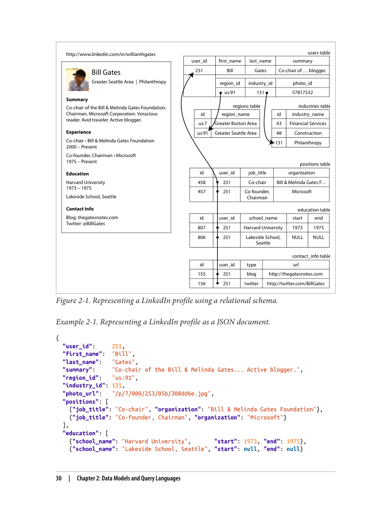


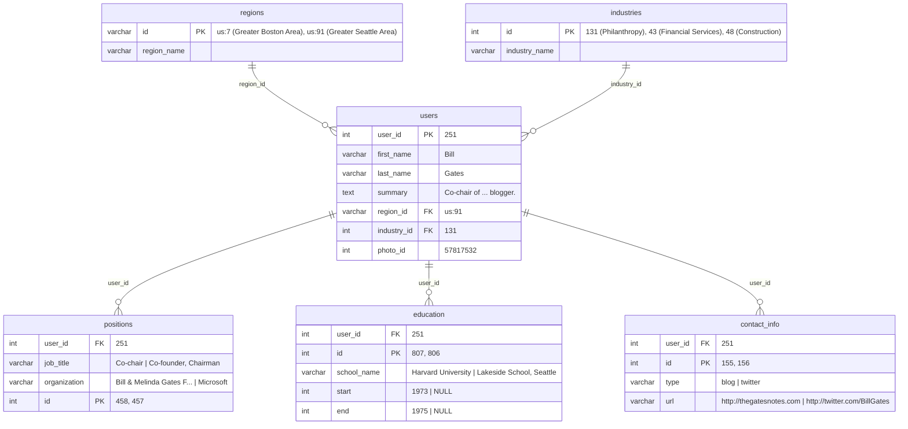

**Chi tiết dữ liệu trong Hình 2-1 (Hồ sơ LinkedIn của Bill Gates và các bảng quan hệ tương ứng):**

* **Giao diện hiển thị hồ sơ LinkedIn:**
  * **Họ tên:** Bill Gates
  * **Khu vực & Ngành nghề:** Greater Seattle Area | Philanthropy
  * **Tóm tắt (Summary):** Co-chair of the Bill & Melinda Gates Foundation. Chairman, Microsoft Corporation. Voracious reader. Avid traveler. Active blogger.
  * **Kinh nghiệm (Experience):**
    * Co-chair • Bill & Melinda Gates Foundation (2000 – Present)
    * Co-founder, Chairman • Microsoft (1975 – Present)
  * **Học vấn (Education):**
    * Harvard University (1973 – 1975)
    * Lakeside School, Seattle
  * **Thông tin liên hệ (Contact Info):**
    * Blog: `thegatesnotes.com`
    * Twitter: `@BillGates`
    * URL: `http://www.linkedin.com/in/williamhgates`

* **Các bảng trong lược đồ quan hệ:**
  * **Bảng `regions`:** `(id: 'us:7', region_name: 'Greater Boston Area')`, `(id: 'us:91', region_name: 'Greater Seattle Area')`
  * **Bảng `industries`:** `(id: 131, industry_name: 'Philanthropy')`, `(id: 43, industry_name: 'Financial Services')`, `(id: 48, industry_name: 'Construction')`
  * **Bảng `users`:** `(user_id: 251, first_name: 'Bill', last_name: 'Gates', summary: 'Co-chair of … blogger.', region_id: 'us:91', industry_id: 131, photo_id: 57817532)`
  * **Bảng `positions`:**
    * `(user_id: 251, job_title: 'Co-chair', organization: 'Bill & Melinda Gates F…', id: 458)`
    * `(user_id: 251, job_title: 'Co-founder, Chairman', organization: 'Microsoft', id: 457)`
  * **Bảng `education`:**
    * `(user_id: 251, id: 807, school_name: 'Harvard University', start: 1973, end: 1975)`
    * `(user_id: 251, id: 806, school_name: 'Lakeside School, Seattle', start: NULL, end: NULL)`
  * **Bảng `contact_info`:**
    * `(user_id: 251, id: 155, type: 'blog', url: 'http://thegatesnotes.com')`
    * `(user_id: 251, id: 156, type: 'twitter', url: 'http://twitter.com/BillGates')`

---

**Ví dụ 2-1 – Biểu diễn một hồ sơ LinkedIn dưới dạng một tài liệu JSON (Example 2-1. Representing a LinkedIn profile as a JSON document.)**

```json
{
  "user_id":     251,
  "first_name":  "Bill",
  "last_name":   "Gates",
  "summary":     "Co-chair of the Bill & Melinda Gates... Active blogger.",
  "region_id":   "us:91",
  "industry_id": 131,
  "photo_url":   "/p/7/000/253/05b/308dd6e.jpg",
  "positions": [
    {"job_title": "Co-chair", "organization": "Bill & Melinda Gates Foundation"},
    {"job_title": "Co-founder, Chairman", "organization": "Microsoft"}
  ],
  "education": [
    {"school_name": "Harvard University",       "start": 1973, "end": 1975},
    {"school_name": "Lakeside School, Seattle", "start": null, "end": null}
  ],
  "contact_info": {
    "blog":    "http://thegatesnotes.com",
    "twitter": "http://twitter.com/BillGates"
  }
}
```

> 💡 **Ví dụ bổ sung (không có trong sách):**
> Hãy so sánh cách ứng dụng lấy toàn bộ hồ sơ của `user_id = 251` trong hai cách tiếp cận:
>
> **Cách 1: Lược đồ quan hệ chuẩn hóa (Hình 2-1)**
> Nếu dùng `LEFT JOIN` trong một câu truy vấn duy nhất:
> ```sql
> SELECT u.*, p.job_title, p.organization, e.school_name, c.type, c.url
> FROM users u
> LEFT JOIN positions p    ON p.user_id = u.user_id
> LEFT JOIN education e    ON e.user_id = u.user_id
> LEFT JOIN contact_info c ON c.user_id = u.user_id
> WHERE u.user_id = 251;
> ```
> Truy vấn này tạo ra tích Đề-các (*Cartesian product*) giữa các bảng con: 2 `positions` × 2 `education` × 2 `contact_info` = **8 dòng kết quả** bị lặp lại dữ liệu của Bill Gates, buộc ORM (như Hibernate/Prisma) phải khử trùng lặp (*de-duplicate*) trong bộ nhớ ứng dụng, hoặc phải tách thành 4 câu lệnh `SELECT` riêng biệt.
>
> **Cách 2: Tài liệu JSON trong MongoDB hoặc PostgreSQL `JSONB` (Ví dụ 2-1)**
> Trong MongoDB:
> ```javascript
> db.users.findOne({ user_id: 251 })
> ```
> Toàn bộ cấu trúc cây gồm thông tin cá nhân, mảng `positions`, mảng `education` và đối tượng `contact_info` được trả về nguyên vẹn trong đúng 1 lần đọc, khớp trực tiếp 1-1 với đối tượng trong bộ nhớ của ngôn ngữ lập trình.

---

**Hình 2-2 – Các mối quan hệ một-nhiều tạo thành một cấu trúc hình cây (Figure 2-2. One-to-many relationships forming a tree structure.)**

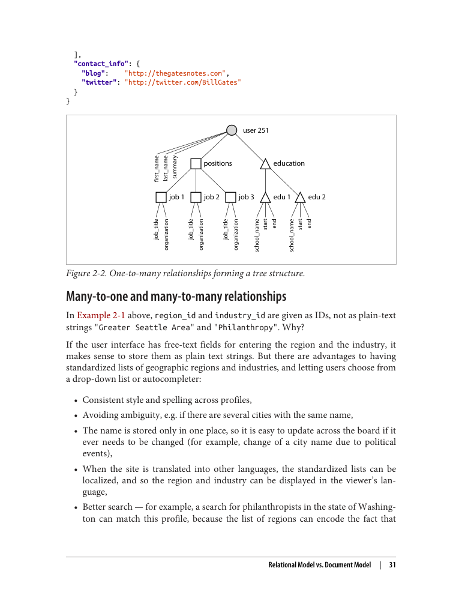

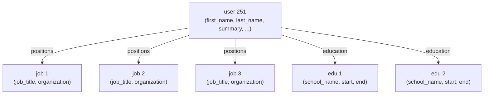

---

### Các mối quan hệ nhiều-một và nhiều-nhiều (Many-to-one and many-to-many relationships)

Trong **Ví dụ 2-1** ở trên, `region_id` và `industry_id` được đưa vào dưới dạng các mã định danh (ID), chứ không phải là các chuỗi văn bản thuần túy (*plain-text strings*) `"Greater Seattle Area"` và `"Philanthropy"`. Tại sao lại như vậy?

Nếu giao diện người dùng có các trường nhập văn bản tự do (*free-text fields*) để nhập khu vực địa lý và ngành nghề, thì việc lưu trữ chúng dưới dạng các chuỗi văn bản thuần túy là hoàn toàn hợp lý. Nhưng có rất nhiều lợi thế khi duy trì các danh sách chuẩn hóa (*standardized lists*) cho các khu vực địa lý và ngành nghề, đồng thời cho phép người dùng chọn từ một danh sách thả xuống (*drop-down list*) hoặc trình tự động hoàn thành (*autocompleter*):

* Kiểu cách và chính tả nhất quán (*consistent style and spelling*) trên toàn bộ các hồ sơ;
* Tránh sự nhập nhằng, mơ hồ (*avoiding ambiguity*), ví dụ như khi có nhiều thành phố trùng tên nhau;
* Tên chỉ được lưu trữ ở một nơi duy nhất, vì vậy rất dễ cập nhật đồng loạt trên toàn hệ thống nếu có lúc nào đó nó cần phải thay đổi (ví dụ: đổi tên thành phố do các sự kiện chính trị);
* Khi trang web được dịch sang các ngôn ngữ khác, các danh sách chuẩn hóa này có thể được bản địa hóa (*localized*), và nhờ đó khu vực cũng như ngành nghề có thể được hiển thị theo ngôn ngữ của người xem;
* Tìm kiếm tốt hơn (*better search*) — ví dụ, một cuộc tìm kiếm những nhà từ thiện (*philanthropists*) tại bang Washington có thể khớp với hồ sơ này, bởi vì danh sách các khu vực có thể mã hóa thực tế rằng Seattle nằm trong bang Washington (điều vốn không hề hiển nhiên nếu chỉ nhìn vào chuỗi văn bản `"Greater Seattle Area"`).

Việc bạn lưu trữ một mã ID hay một chuỗi văn bản thực chất là câu chuyện về **sự trùng lặp dữ liệu** (*duplication*). Khi bạn sử dụng một mã ID, thông tin có ý nghĩa đối với con người (chẳng hạn như từ *Philanthropy*) chỉ được lưu trữ ở một nơi duy nhất, và mọi thứ tham chiếu đến nó đều sử dụng một mã ID (thứ vốn chỉ có ý nghĩa bên trong cơ sở dữ liệu). Khi bạn lưu trữ văn bản trực tiếp, bạn đang nhân bản thông tin có ý nghĩa với con người đó vào trong mọi bản ghi có sử dụng nó.

Ưu điểm của việc sử dụng một mã ID là bởi vì nó không mang ý nghĩa gì đối với con người, nên nó không bao giờ cần phải thay đổi: mã ID có thể giữ nguyên y hệt, ngay cả khi thông tin mà nó định danh bị thay đổi. Bất kỳ thứ gì có ý nghĩa đối với con người đều có thể cần phải thay đổi vào một lúc nào đó trong tương lai — và nếu thông tin đó bị nhân bản ở nhiều nơi, tất cả các bản sao dư thừa (*redundant copies*) đều cần phải được cập nhật. Điều đó gây ra chi phí phụ trội khi ghi (*overhead on writes*), và tiềm ẩn nguy cơ mất nhất quán dữ liệu (*inconsistencies* — một số bản sao của thông tin được cập nhật nhưng những bản sao khác thì không). Việc loại bỏ sự trùng lặp như vậy chính là ý tưởng cốt lõi đằng sau **chuẩn hóa** (*normalization*) trong cơ sở dữ liệu.<sup>ii</sup>

> <sup>ii</sup> *Các tài liệu lý thuyết về mô hình quan hệ phân biệt nhiều dạng chuẩn (normal forms — như 1NF, 2NF, 3NF, BCNF, ...) khác nhau, nhưng những sự phân biệt đó ít có ý nghĩa thực tiễn. Theo nguyên tắc kinh nghiệm (rule of thumb), nếu bạn đang nhân bản các giá trị mà lẽ ra có thể chỉ cần lưu trữ ở một nơi duy nhất, thì lược đồ đó chưa được chuẩn hóa.*


> **Lưu ý của tác giả:** Các quản trị viên cơ sở dữ liệu (*database administrators* — DBA) và các lập trình viên rất thích tranh cãi về chuẩn hóa (*normalization*) và phi chuẩn hóa (*denormalization*), nhưng chúng ta sẽ tạm gác lại việc phán xét ở đây. Trong Phần III của cuốn sách này, chúng ta sẽ quay trở lại chủ đề này và khám phá các phương pháp có hệ thống để xử lý bộ nhớ đệm (*caching*), phi chuẩn hóa (*denormalization*) và dữ liệu dẫn xuất (*derived data*).

Thật không may, việc chuẩn hóa dữ liệu này đòi hỏi các **mối quan hệ nhiều-một** (*many-to-one relationships* — nhiều người sống trong cùng một khu vực cụ thể, nhiều người làm việc trong cùng một ngành nghề cụ thể), vốn không khớp một cách tự nhiên vào mô hình tài liệu. Trong các cơ sở dữ liệu quan hệ, việc tham chiếu đến các hàng ở các bảng khác thông qua mã ID là chuyện hết sức bình thường, bởi vì các phép kết nối (*joins*) được thực hiện rất dễ dàng. Trong các cơ sở dữ liệu tài liệu, các phép `join` không cần thiết đối với các cấu trúc cây một-nhiều (*one-to-many tree structures*), và sự hỗ trợ cho các phép `join` thường rất yếu.<sup>iii</sup>

> <sup>iii</sup> *Tại thời điểm viết sách, phép kết nối (joins) được hỗ trợ trong RethinkDB, không được hỗ trợ trong MongoDB, và chỉ được hỗ trợ trong các khung nhìn khai báo trước (pre-declared views) trong CouchDB.*

Nếu bản thân cơ sở dữ liệu không hỗ trợ các phép `join`, bạn buộc phải mô phỏng một phép `join` ở trong mã nguồn ứng dụng (*emulate a join in application code*) bằng cách thực hiện nhiều truy vấn đến cơ sở dữ liệu. (Trong trường hợp này, danh sách các khu vực và ngành nghề có lẽ đủ nhỏ và ít thay đổi đến mức ứng dụng có thể chỉ cần giữ thẳng chúng trong bộ nhớ RAM. Nhưng dẫu sao đi nữa, công việc thực hiện phép kết nối vẫn bị đẩy từ cơ sở dữ liệu sang cho mã nguồn ứng dụng.)

Hơn thế nữa, ngay cả khi phiên bản đầu tiên của một ứng dụng khớp rất tốt với một mô hình tài liệu không cần `join`, dữ liệu vẫn có xu hướng ngày càng trở nên gắn kết chằng chịt với nhau hơn (*more interconnected*) khi các tính năng mới được bổ sung vào ứng dụng. Ví dụ, hãy xem xét một số thay đổi mà chúng ta có thể thực hiện đối với ví dụ về hồ sơ năng lực (*résumé*):

* **Các tổ chức và trường học dưới dạng các thực thể (Organizations and schools as entities):**
  Trong phần mô tả ở trên, `organization` (công ty nơi người dùng từng làm việc) và `school_name` (nơi họ từng theo học) chỉ là các chuỗi văn bản. Có lẽ thay vào đó chúng nên là các tham chiếu đến các thực thể (*references to entities*)? Khi đó, mỗi tổ chức, trường phổ thông hoặc trường đại học có thể có trang web riêng của mình (với biểu trưng / logo, bảng tin / news feed, v.v.); mỗi sơ yếu lý lịch có thể liên kết đến các tổ chức và trường học mà nó đề cập tới, đồng thời hiển thị kèm logo và các thông tin khác của chúng (xem **Hình 2-3** làm ví dụ).
* **Lời giới thiệu / Đánh giá nhận xét (Recommendations):**
  Giả sử bạn muốn thêm một tính năng mới: một người dùng có thể viết một lời giới thiệu (*recommendation*) cho một người dùng khác. Lời giới thiệu đó được hiển thị trên sơ yếu lý lịch của người dùng được giới thiệu, cùng với tên và ảnh đại diện của người dùng đã viết lời giới thiệu đó. Nếu người viết lời giới thiệu cập nhật ảnh đại diện của họ, bất kỳ lời giới thiệu nào họ từng viết đều cần phải phản ánh bức ảnh mới này. Do đó, lời giới thiệu phải có một tham chiếu trỏ tới hồ sơ của tác giả viết ra nó.

**Hình 2-4** minh họa cách mà những tính năng mới này đòi hỏi các **mối quan hệ nhiều-nhiều** (*many-to-many relationships*). Dữ liệu nằm bên trong mỗi hình chữ nhật nét đứt có thể được gom nhóm vào thành một tài liệu (*document*), nhưng các tham chiếu đến các tổ chức, trường học và những người dùng khác cần phải được biểu diễn dưới dạng các tham chiếu (*references*), và đòi hỏi các phép kết nối (*joins*) khi được truy vấn.

---

**Hình 2-3 – Tên công ty không chỉ là một chuỗi văn bản, mà là một liên kết đến một thực thể công ty (Figure 2-3. The company name is not just a string, but a link to a company entity.)**

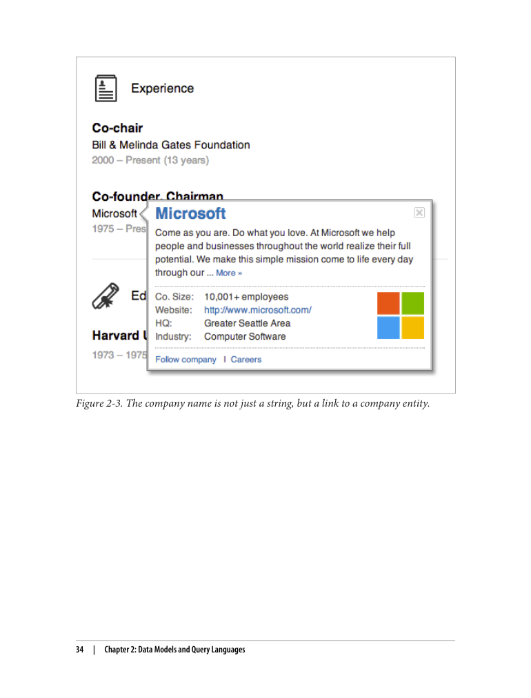


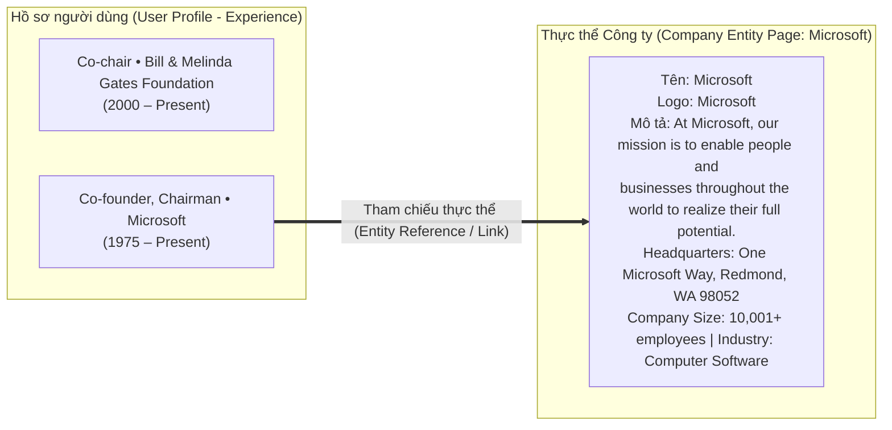

---

**Hình 2-4 – Mở rộng sơ yếu lý lịch với các mối quan hệ nhiều-nhiều (Figure 2-4. Extending résumés with many-to-many relationships.)**

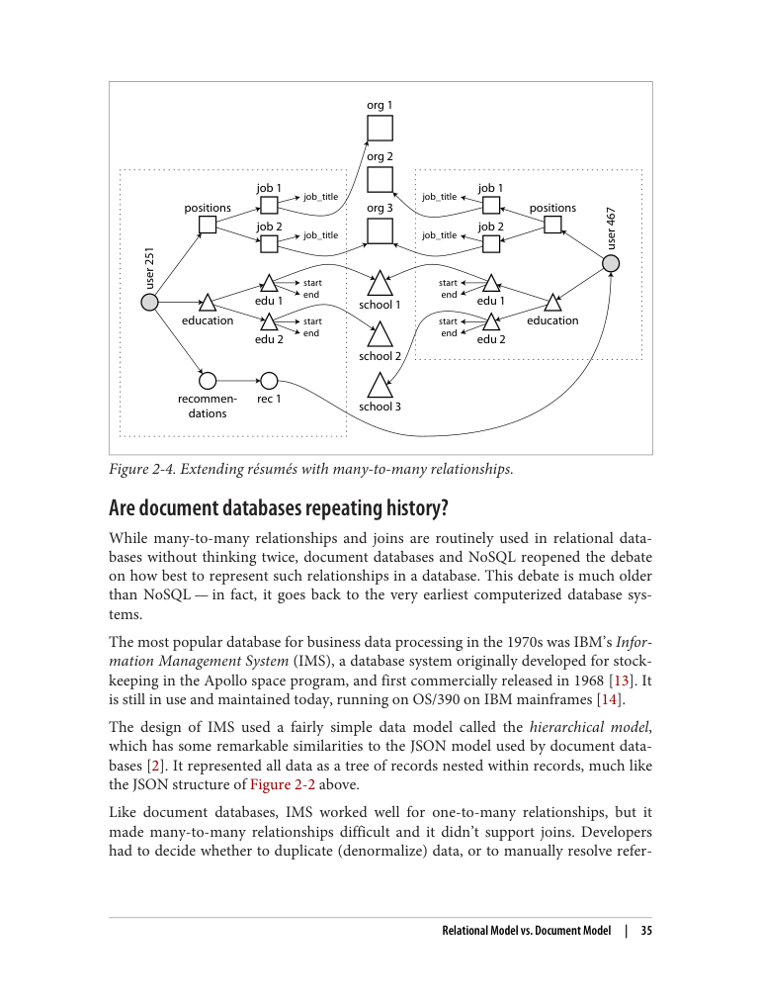

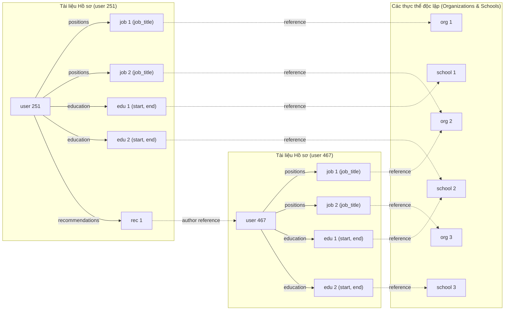

> 📝 **Giải thích thêm (không có trong sách):**
> Hãy quan sát kỹ **Hình 2-4**:
> - Ban đầu ở **Hình 2-2**, hồ sơ của mỗi người dùng là một cây phân cấp độc lập (*strict tree*): `user 251` chứa các nút con `positions` và `education`.
> - Nhưng ngay khi `org 2` (ví dụ: Microsoft) được tham chiếu bởi cả `job 2` của `user 251` lẫn `job 1` của `user 467`, và `school 2` (ví dụ: Harvard University) được tham chiếu bởi cả `edu 2` của `user 251` lẫn `edu 1` của `user 467`, kèm theo `rec 1` của `user 251` trỏ sang tác giả là `user 467`, cấu trúc dữ liệu tổng thể **không còn là một cái cây (tree) nữa mà đã biến thành một đồ thị (graph) có các mối quan hệ nhiều-nhiều**.
> - Đáng chú ý về chú thích `iii` của tác giả: Khi cuốn sách viết những dòng này (khoảng 2014–2016), MongoDB chưa hỗ trợ hoặc mới bắt đầu giới thiệu toán tử `$lookup` (ra mắt ở MongoDB 3.2 vào cuối năm 2015 cho phép `LEFT OUTER JOIN` cơ bản trong *aggregation pipeline*). Tuy nhiên, ngay cả với `$lookup` trong các phiên bản MongoDB hiện đại, việc thực hiện `join` qua nhiều *collections* đã được phân mảnh (*sharded collections*) vẫn tốn kém hơn đáng kể và bị hạn chế hơn nhiều so với bộ tối ưu hóa truy vấn (*cost-based query optimizer*) của các RDBMS như PostgreSQL hay Oracle.

---

### Phải chăng các cơ sở dữ liệu tài liệu đang lặp lại lịch sử? (Are document databases repeating history?)

Trong khi các mối quan hệ nhiều-nhiều và các phép kết nối (*joins*) được sử dụng thường xuyên như cơm bữa trong các cơ sở dữ liệu quan hệ mà không cần phải đắn đo suy nghĩ lần thứ hai, thì các cơ sở dữ liệu tài liệu và phong trào NoSQL đã khơi lại cuộc tranh luận về cách tốt nhất để biểu diễn những mối quan hệ như vậy trong một cơ sở dữ liệu. Cuộc tranh luận này lâu đời hơn NoSQL rất nhiều — trên thực tế, nó bắt nguồn từ chính những hệ thống cơ sở dữ liệu máy tính sơ khai nhất.

Cơ sở dữ liệu phổ biến nhất cho việc xử lý dữ liệu kinh doanh vào những năm 1970 là **Information Management System (IMS)** của IBM, một hệ thống cơ sở dữ liệu ban đầu được phát triển để quản lý kho vật tư trong chương trình không gian Apollo, và được phát hành thương mại lần đầu tiên vào năm 1968 [13]. Ngày nay nó vẫn còn đang được sử dụng và bảo trì, chạy trên hệ điều hành OS/390 trên các máy tính lớn (*mainframes*) của IBM [14].

Thiết kế của IMS sử dụng một mô hình dữ liệu khá đơn giản được gọi là **mô hình phân cấp** (*hierarchical model*), vốn có những điểm tương đồng đáng kinh ngạc với mô hình JSON được sử dụng bởi các cơ sở dữ liệu tài liệu ngày nay [2]. Nó biểu diễn toàn bộ dữ liệu dưới dạng một cây gồm các bản ghi lồng bên trong các bản ghi khác (*a tree of records nested within records*), rất giống với cấu trúc JSON của **Hình 2-2** ở trên.

Giống như các cơ sở dữ liệu tài liệu, IMS hoạt động rất tốt đối với các mối quan hệ một-nhiều (*one-to-many relationships*), nhưng nó lại làm cho các mối quan hệ nhiều-nhiều (*many-to-many relationships*) trở nên khó khăn và nó không hỗ trợ các phép kết nối (*joins*). Các nhà phát triển đã phải đứng trước quyết định: hoặc là nhân bản (phi chuẩn hóa — *denormalize*) dữ liệu, hoặc là phải tự mình phân giải thủ công các tham chiếu (*manually resolve references*) từ bản ghi này sang bản ghi khác. Những vấn đề của thập niên 1960 này giống hệt một cách kỳ lạ với những vấn đề mà các nhà phát triển đang vấp phải với các cơ sở dữ liệu tài liệu ngày nay [15].

Nhiều giải pháp khác nhau đã được đề xuất để giải quyết những hạn chế của mô hình phân cấp. Hai giải pháp nổi bật nhất là **mô hình quan hệ** (*relational model* — thứ sau này trở thành SQL và thống trị thế giới), và **mô hình mạng** (*network model* — thứ ban đầu có một lượng lớn người ủng hộ nhưng cuối cùng lại chìm vào quên lãng). “Cuộc đại tranh luận” (*The “great debate”*) giữa hai phe này đã kéo dài suốt phần lớn thập niên 1970 [2].

Bởi vì bài toán mà hai mô hình này tìm cách giải quyết vẫn còn nguyên tính thời sự cho đến tận ngày nay, nên rất đáng để chúng ta cùng nhìn lại cuộc tranh luận lịch sử này một cách ngắn gọn dưới ánh sáng của hiện tại.

---

#### Mô hình mạng (The network model)

Mô hình mạng được chuẩn hóa bởi một ủy ban có tên là **Conference on Data Systems Languages (CODASYL)** (Hội nghị về Ngôn ngữ các Hệ thống Dữ liệu), và được hiện thực hóa bởi nhiều nhà cung cấp cơ sở dữ liệu khác nhau; vì vậy nó còn được biết đến với tên gọi **mô hình CODASYL** (*CODASYL model*) [16].

Mô hình CODASYL là một sự tổng quát hóa của mô hình phân cấp. Trong cấu trúc hình cây của mô hình phân cấp, mỗi bản ghi có đúng một bản ghi cha duy nhất (*exactly one parent*); còn trong mô hình mạng, một bản ghi có thể có nhiều bản ghi cha (*multiple parents*). Ví dụ, có thể có một bản ghi duy nhất cho khu vực `"Greater Seattle Area"`, và mọi người dùng sống trong khu vực đó đều có thể được liên kết tới bản ghi này. Điều này cho phép mô hình hóa được cả các mối quan hệ nhiều-một (*many-to-one*) lẫn nhiều-nhiều (*many-to-many*).

Các liên kết giữa các bản ghi trong mô hình mạng không phải là các khóa ngoại (*foreign keys*), mà giống với các **con trỏ** (*pointers*) trong một ngôn ngữ lập trình hơn (dù vẫn được lưu trữ trên ổ đĩa). Cách duy nhất để truy cập vào một bản ghi là đi dọc theo một đường dẫn bắt đầu từ một bản ghi gốc (*root record*) men theo các chuỗi liên kết này. Đường dẫn đó được gọi là một **đường dẫn truy cập** (*access path*).

Trong trường hợp đơn giản nhất, một đường dẫn truy cập có thể giống như việc duyệt qua một danh sách liên kết (*traversal of a linked list*): bắt đầu tại phần tử đầu danh sách (*head of the list*), và xem xét từng bản ghi một cho đến khi tìm thấy bản ghi mà bạn muốn. Nhưng trong một thế giới của các mối quan hệ nhiều-nhiều, có nhiều đường dẫn khác nhau có thể cùng dẫn đến một bản ghi, và một lập trình viên làm việc với mô hình mạng buộc phải tự theo dõi và ghi nhớ các đường dẫn truy cập khác nhau này ở trong đầu của mình.

Một truy vấn trong CODASYL được thực hiện bằng cách di chuyển một con trỏ vị trí (*cursor*) xuyên qua cơ sở dữ liệu thông qua việc lặp qua các danh sách bản ghi và đi theo các đường dẫn truy cập. Nếu một bản ghi có nhiều bản ghi cha (tức là có nhiều con trỏ từ các bản ghi khác trỏ tới nó), mã nguồn ứng dụng phải tự theo dõi tất cả các mối quan hệ khác nhau đó. Ngay cả các thành viên của ủy ban CODASYL cũng phải thừa nhận rằng công việc này giống như việc tự điều hướng quanh một không gian dữ liệu $n$-chiều (*navigating around an n-dimensional data space*) [17].

Mặc dù việc lựa chọn đường dẫn truy cập thủ công có thể tận dụng hiệu quả nhất năng lực phần cứng vô cùng hạn chế vào những năm 1970 (chẳng hạn như các ổ băng từ — *tape drives*, vốn có thao tác tìm kiếm vị trí *seek* cực kỳ chậm), nhưng vấn đề nằm ở chỗ chúng làm cho mã nguồn dùng để truy vấn và cập nhật cơ sở dữ liệu trở nên vô cùng phức tạp và cứng nhắc (*complicated and inflexible*). Với cả mô hình phân cấp lẫn mô hình mạng, nếu bạn không có sẵn một đường dẫn tới dữ liệu mà bạn muốn, bạn sẽ rơi vào một tình thế vô cùng bế tắc. Bạn có thể thay đổi các đường dẫn truy cập, nhưng sau đó bạn sẽ phải rà soát lại hàng đống mã truy vấn cơ sở dữ liệu viết tay và viết lại chúng để xử lý các đường dẫn truy cập mới. Việc thực hiện các thay đổi đối với mô hình dữ liệu của một ứng dụng là cực kỳ khó khăn.

---

#### Mô hình quan hệ (The relational model)

Ngược lại, những gì mà mô hình quan hệ đã làm là trải phẳng toàn bộ dữ liệu ra một cách minh bạch (*lay out all the data in the open*): một quan hệ (*relation* / bảng — *table*) chỉ đơn giản là một tập hợp các bộ (*tuples* / hàng — *rows*), và chỉ có vậy mà thôi. Không hề có những cấu trúc lồng nhau rối rắm như mê cung (*labyrinthine nested structures*), cũng không có những đường dẫn truy cập phức tạp nào phải lần theo nếu bạn muốn nhìn vào dữ liệu. Bạn có thể đọc bất kỳ hàng nào hoặc tất cả các hàng trong một bảng, chọn ra những hàng khớp với một điều kiện tùy ý (*arbitrary condition*). Bạn có thể đọc một hàng cụ thể bằng cách chỉ định một số cột làm khóa (*key*) và so khớp trên những cột đó. Bạn có thể chèn một hàng mới vào bất kỳ bảng nào mà không cần phải lo lắng về các mối quan hệ khóa ngoại đi tới và đi từ các bảng khác.<sup>iv</sup>

> <sup>iv</sup> *Các ràng buộc khóa ngoại (foreign key constraints) cho phép bạn hạn chế các thao tác sửa đổi không hợp lệ, nhưng những ràng buộc như vậy không phải là điều kiện bắt buộc của mô hình quan hệ. Ngay cả khi có các ràng buộc, các phép kết nối (joins) trên khóa ngoại vẫn được thực hiện tại thời điểm truy vấn (at query time), trong khi ở CODASYL, phép kết nối thực chất đã được đóng cứng ngay tại thời điểm chèn dữ liệu (at insert time).*

Trong một cơ sở dữ liệu quan hệ, **bộ tối ưu hóa truy vấn** (*query optimizer*) tự động quyết định những phần nào của câu truy vấn sẽ được thực thi theo thứ tự nào, và những chỉ mục (*indexes*) nào sẽ được sử dụng. Những lựa chọn đó về bản chất chính là “đường dẫn truy cập” (*access path*), nhưng sự khác biệt to lớn nằm ở chỗ chúng được đưa ra một cách hoàn toàn tự động bởi bộ tối ưu hóa truy vấn chứ không phải bởi lập trình viên ứng dụng, vì vậy chúng ta hiếm khi cần phải bận tâm suy nghĩ về chúng.

Nếu bạn muốn truy vấn dữ liệu của mình theo những cách mới, bạn chỉ cần khai báo một chỉ mục mới (*declare a new index*), và các câu truy vấn sẽ tự động sử dụng bất kỳ chỉ mục nào phù hợp nhất. Bạn không cần phải sửa đổi các câu truy vấn của mình để tận dụng một chỉ mục mới. (Xem thêm mục “Các Ngôn ngữ Truy vấn cho Dữ liệu (Query Languages for Data)” ở trang 42.) Nhờ vậy, mô hình quan hệ đã làm cho việc bổ sung các tính năng mới vào ứng dụng trở nên dễ dàng hơn rất nhiều.

Các bộ tối ưu hóa truy vấn cho cơ sở dữ liệu quan hệ là những cỗ máy vô cùng phức tạp (*complicated beasts*), và chúng đã tiêu tốn hàng chục năm nỗ lực nghiên cứu và phát triển [18]. Nhưng một nhận thức cốt lõi (*key insight*) của mô hình quan hệ chính là điều này: **bạn chỉ cần xây dựng một bộ tối ưu hóa truy vấn một lần duy nhất, và sau đó tất cả các ứng dụng sử dụng cơ sở dữ liệu đó đều có thể hưởng lợi từ nó**. Nếu bạn không có một bộ tối ưu hóa truy vấn, việc tự viết mã thủ công (*hand-code*) các đường dẫn truy cập cho một truy vấn cụ thể sẽ dễ hơn nhiều so với việc viết một bộ tối ưu hóa đa dụng — nhưng giải pháp đa dụng (*general-purpose solution*) luôn giành chiến thắng về lâu dài.

---

#### So sánh với các cơ sở dữ liệu tài liệu (Comparison to document databases)

Các cơ sở dữ liệu tài liệu đã quay trở lại với mô hình phân cấp ở một khía cạnh: lưu trữ các bản ghi lồng nhau (*nested records* — các mối quan hệ một-nhiều, như `positions`, `education` và `contact_info` trong **Hình 2-1**) ngay bên trong bản ghi cha của chúng thay vì đặt ở một bảng riêng biệt.

Tuy nhiên, khi xét đến việc biểu diễn các mối quan hệ nhiều-một và nhiều-nhiều, các cơ sở dữ liệu quan hệ và cơ sở dữ liệu tài liệu về cơ bản không hề khác nhau: trong cả hai trường hợp, mục dữ liệu có liên quan đều được tham chiếu bằng một mã định danh duy nhất (*unique identifier*), thứ được gọi là một **khóa ngoại** (*foreign key*) trong mô hình quan hệ, và được gọi là một **tham chiếu tài liệu** (*document reference*) trong mô hình tài liệu [9]. Mã định danh đó được phân giải tại thời điểm đọc (*resolved at read time*), bằng cách sử dụng một phép kết nối (*join*) hoặc các truy vấn nối tiếp theo sau (*follow-up queries*). Cho đến nay, các cơ sở dữ liệu tài liệu đã không đi vào vết xe đổ của CODASYL.

> 📝 **Giải thích thêm (không có trong sách):**
> Bảng tổng hợp dưới đây giúp bạn đối chiếu nhanh 4 mô hình dữ liệu qua lăng kính lịch sử mà tác giả vừa phân tích:
>
> | Tiêu chí | Mô hình Phân cấp (IBM IMS - 1968) | Mô hình Mạng (CODASYL - 1970s) | Mô hình Quan hệ (RDBMS / SQL - 1970+) | Mô hình Tài liệu (MongoDB, CouchDB - 2009+) |
> | :--- | :--- | :--- | :--- | :--- |
> | **Cấu trúc cốt lõi** | Cây phân cấp nghiêm ngặt (*strict tree*) các bản ghi lồng nhau | Đồ thị con trỏ vật lý trên đĩa (1 bản ghi có nhiều cha) | Các bảng (*relations*) chứa các dòng (*tuples*) phẳng | Tài liệu JSON/BSON tự chứa (cây lồng nhau cho quan hệ 1-N) |
> | **Quan hệ 1-Nhiều (1:N)** | Tự nhiên (lồng trực tiếp vào bản ghi cha) | Duyệt qua danh sách con trỏ (*set pointers*) | Tách bảng con + Khóa ngoại (`FOREIGN KEY`) | Tự nhiên (mảng con lồng trong tài liệu cha) |
> | **Quan hệ Nhiều-Nhiều (M:N)** | Rất khó (phải nhân bản dữ liệu hoặc tự quản lý tham chiếu ngoài) | Hỗ trợ qua con trỏ đa chiều nhưng lập trình viên phải tự điều hướng *access path* | Rất mạnh thông qua bảng trung gian (*join table*) và phép `JOIN` | Dùng *document reference* (ID), phân giải lúc đọc qua truy vấn phụ hoặc `$lookup` |
> | **Ai quyết định Đường dẫn truy cập (*Access Path*)?** | Lập trình viên ứng dụng | Lập trình viên ứng dụng (dùng con trỏ *cursor* duyệt từng bước) | **Bộ tối ưu hóa truy vấn (*Query Optimizer*)** tự động quyết định | Bộ tối ưu hóa chỉ mục cho truy vấn đơn tài liệu; lập trình viên thường phải tự tối ưu nếu nối nhiều tài liệu |

---

### Cơ sở dữ liệu quan hệ và cơ sở dữ liệu tài liệu ngày nay (Relational vs. document databases today)

Có rất nhiều điểm khác biệt cần cân nhắc khi so sánh cơ sở dữ liệu quan hệ với cơ sở dữ liệu tài liệu, bao gồm các đặc tính chịu lỗi của chúng (*fault-tolerance properties* — xem Chương 5) và cách xử lý đồng thời (*handling of concurrency* — xem Chương 7). Trong chương này, chúng ta sẽ chỉ tập trung vào những sự khác biệt về mặt mô hình dữ liệu.

Những lập luận chính ủng hộ mô hình dữ liệu tài liệu là: đối với một số ứng dụng, nó gần gũi hơn với các cấu trúc dữ liệu được sử dụng bởi ứng dụng, tính linh hoạt của lược đồ (*schema flexibility*), và hiệu năng tốt hơn nhờ tính cục bộ dữ liệu (*locality*). Mô hình quan hệ phản biện lại bằng cách cung cấp sự hỗ trợ tốt hơn cho các phép kết nối (*joins*), cũng như các mối quan hệ nhiều-một và nhiều-nhiều.

---

#### Mô hình dữ liệu nào dẫn đến mã nguồn ứng dụng đơn giản hơn? (Which data model leads to simpler application code?)

Nếu dữ liệu trong ứng dụng của bạn có cấu trúc giống như một tài liệu (tức là một hình cây của các mối quan hệ một-nhiều, nơi mà thông thường toàn bộ cái cây đó được nạp lên cùng một lúc), thì có lẽ việc sử dụng một mô hình tài liệu là một ý tưởng hay. Kỹ thuật quan hệ gọi là **xé nhỏ dữ liệu** (*shredding*) — tức là chia tách một cấu trúc giống như tài liệu ra thành nhiều bảng khác nhau (như `positions`, `education` và `contact_info` trong **Hình 2-1**) — có thể dẫn đến những lược đồ rườm rà và mã nguồn ứng dụng phức tạp một cách không cần thiết.

Mô hình tài liệu cũng có những hạn chế — ví dụ, bạn không thể tham chiếu trực tiếp đến một mục nằm lồng sâu bên trong một tài liệu (*nested item within a document*), mà thay vào đó bạn cần phải diễn đạt đại loại như “mục thứ hai trong danh sách các vị trí công việc của người dùng 251” (rất giống với một đường dẫn truy cập *access path* trong mô hình phân cấp). Tuy nhiên, miễn là các tài liệu không bị lồng nhau quá sâu, điều đó thường không phải là một vấn đề lớn.

Sự hỗ trợ yếu kém cho các phép `join` trong các cơ sở dữ liệu tài liệu có thể là một vấn đề hoặc không, tùy thuộc vào từng ứng dụng. Ví dụ, các mối quan hệ nhiều-nhiều có thể sẽ không bao giờ cần đến trong một ứng dụng phân tích (*analytics application*) vốn sử dụng một cơ sở dữ liệu tài liệu chỉ để ghi nhận lại những sự kiện nào đã xảy ra vào thời điểm nào [19].

Tuy nhiên, nếu ứng dụng của bạn thực sự có sử dụng các mối quan hệ nhiều-nhiều, thì mô hình tài liệu sẽ trở nên kém hấp dẫn hơn. Bạn có thể giảm bớt nhu cầu phải thực hiện `join` bằng cách phi chuẩn hóa (*denormalizing*), nhưng khi đó mã nguồn ứng dụng lại cần phải làm thêm việc để giữ cho dữ liệu đã bị phi chuẩn hóa đó luôn ở trạng thái nhất quán (*consistent*). Các phép `join` có thể được mô phỏng trong mã nguồn ứng dụng bằng cách thực hiện nhiều yêu cầu (*requests*) tới cơ sở dữ liệu, nhưng cách làm đó cũng đẩy sự phức tạp về phía ứng dụng, và thường chạy chậm hơn so với một phép `join` được thực hiện bởi đoạn mã chuyên biệt nằm ngay bên trong cơ sở dữ liệu. Trong những trường hợp như vậy, việc sử dụng một mô hình tài liệu có thể dẫn đến mã nguồn ứng dụng phức tạp hơn đáng kể và hiệu năng tồi tệ hơn [15].

Không thể khẳng định một cách chung chung rằng mô hình dữ liệu nào sẽ dẫn đến mã nguồn ứng dụng đơn giản hơn; điều đó phụ thuộc vào các kiểu mối quan hệ tồn tại giữa các mục dữ liệu. Đối với dữ liệu có mức độ liên kết chằng chịt cao (*highly interconnected data*), mô hình tài liệu trở nên rất gượng gạo, mô hình quan hệ ở mức chấp nhận được, và các **mô hình đồ thị** (*graph models* — xem mục “Các Mô hình Dữ liệu dạng Đồ thị (Graph-like Data Models)” ở trang 48) là tự nhiên nhất.

---

#### Tính linh hoạt của lược đồ trong mô hình tài liệu (Schema flexibility in the document model)

Hầu hết các cơ sở dữ liệu tài liệu, cũng như tính năng hỗ trợ JSON trong các cơ sở dữ liệu quan hệ, không áp đặt bất kỳ lược đồ (*schema*) nào lên dữ liệu nằm trong các tài liệu. Tính năng hỗ trợ XML trong các cơ sở dữ liệu quan hệ thường đi kèm với việc kiểm tra tính hợp lệ của lược đồ tùy chọn (*optional schema validation*). Không có lược đồ (*no schema*) có nghĩa là các khóa (*keys*) và giá trị (*values*) tùy ý có thể được thêm vào một tài liệu, và khi đọc dữ liệu ra, các trình khách (*clients*) không có bất kỳ sự đảm bảo nào về việc các tài liệu đó có thể chứa những trường (*fields*) gì.

Các cơ sở dữ liệu tài liệu đôi khi được gọi là **không có lược đồ** (*schemaless*), nhưng cách gọi đó dễ gây hiểu lầm, bởi vì đoạn mã đọc dữ liệu thường vẫn giả định một kiểu cấu trúc nào đó — tức là vẫn có một lược đồ ngầm định (*implicit schema*), chỉ có điều nó không được cưỡng chế thực thi (*enforced*) bởi cơ sở dữ liệu mà thôi [20]. Một thuật ngữ chính xác hơn là **lược đồ khi đọc** (*schema-on-read* — cấu trúc của dữ liệu là ngầm định, và chỉ được diễn giải khi dữ liệu được đọc lên), đối lập với **lược đồ khi ghi** (*schema-on-write* — cách tiếp cận truyền thống của các cơ sở dữ liệu quan hệ, nơi lược đồ được khai báo tường minh và cơ sở dữ liệu đảm bảo mọi dữ liệu được ghi vào đều phải tuân thủ đúng lược đồ đó) [21].

*Schema-on-read* tương tự như việc kiểm tra kiểu động tại thời điểm chạy (*dynamic / run-time type-checking*) trong các ngôn ngữ lập trình, trong khi *schema-on-write* tương tự như việc kiểm tra kiểu tĩnh tại thời điểm biên dịch (*static / compile-time type-checking*). Cũng giống như việc những người ủng hộ kiểm tra kiểu tĩnh và kiểm tra kiểu động luôn có những cuộc tranh luận nảy lửa về ưu nhược điểm tương đối của chúng [22], việc cưỡng chế thực thi lược đồ trong cơ sở dữ liệu cũng là một chủ đề gây nhiều tranh cãi, và nhìn chung không có câu trả lời nào là hoàn toàn đúng hay hoàn toàn sai.

Sự khác biệt giữa hai cách tiếp cận này thể hiện rõ rệt nhất trong những tình huống khi một ứng dụng muốn thay đổi định dạng dữ liệu của nó. Ví dụ, giả sử hiện tại bạn đang lưu trữ họ tên đầy đủ của mỗi người dùng trong một trường duy nhất (`name`), và bạn muốn thay đổi nó để lưu trữ tên (`first_name`) và họ (`last_name`) tách biệt nhau [23]. Trong một cơ sở dữ liệu tài liệu, bạn sẽ chỉ cần bắt đầu ghi các tài liệu mới với các trường mới đó, đồng thời có một đoạn mã ở trong ứng dụng để xử lý trường hợp khi các tài liệu cũ được đọc lên, chẳng hạn như:

```javascript
if (user && user.name && !user.first_name) {
    // Các tài liệu được ghi trước ngày 8 tháng 12 năm 2013 không có trường first_name
    // Documents written before Dec 8, 2013 don't have first_name
    user.first_name = user.name.split(" ")[0];
}
```

Mặt khác, trong một lược đồ cơ sở dữ liệu ‘được định kiểu tĩnh’ (*‘statically typed’ database schema*), thông thường bạn sẽ thực hiện một quá trình di trú lược đồ (*migration*) theo kiểu như sau:

```sql
ALTER TABLE users ADD COLUMN first_name text;
UPDATE users SET first_name = split_part(name, ' ', 1);           -- PostgreSQL
UPDATE users SET first_name = substring_index(name, ' ', 1);      -- MySQL
```

Các thay đổi lược đồ (*schema changes*) thường mang tiếng xấu là chạy chậm và đòi hỏi thời gian ngừng hoạt động hệ thống (*downtime*). Tiếng xấu này không hoàn toàn xác đáng: hầu hết các hệ quản trị cơ sở dữ liệu quan hệ đều thực thi câu lệnh `ALTER TABLE` chỉ trong vài mili-giây — ngoại trừ MySQL, hệ thống vốn sao chép lại toàn bộ bảng (*copies the entire table*) khi thực hiện `ALTER TABLE`, điều có thể đồng nghĩa với hàng phút hoặc thậm chí hàng giờ ngừng hoạt động khi sửa đổi cấu trúc một bảng lớn. Có nhiều công cụ khác nhau tồn tại để lách qua hạn chế này của MySQL [24, 25].

Việc chạy câu lệnh `UPDATE` trên một bảng lớn có khả năng sẽ chậm trên bất kỳ cơ sở dữ liệu nào, bởi vì mọi hàng (*row*) đều cần phải được ghi lại (*re-written*). Nếu điều đó là không thể chấp nhận được, ứng dụng có thể cứ để `first_name` nhận giá trị mặc định là `NULL`, và điền giá trị cho nó tại thời điểm đọc (*at read time*), giống hệt như cách mà nó sẽ làm với một cơ sở dữ liệu tài liệu.

Cách tiếp cận *schema-on-read* rất có lợi nếu dữ liệu mang tính **không đồng nhất** (*heterogeneous*), tức là các mục dữ liệu nằm trong cùng một tập hợp (*collection*) không có cùng một cấu trúc vì một lý do nào đó, chẳng hạn bởi vì:

* Có quá nhiều loại đối tượng khác nhau, và việc đặt mỗi loại đối tượng vào một bảng riêng của nó là điều không thực tế; hoặc
* Cấu trúc của dữ liệu được quyết định bởi các hệ thống bên ngoài mà bạn không có quyền kiểm soát, và cấu trúc đó có thể thay đổi bất cứ lúc nào.

Trong những tình huống như thế này, một lược đồ cố định có thể gây hại nhiều hơn là có lợi, và các tài liệu không lược đồ (*schemaless documents*) có thể là một mô hình dữ liệu tự nhiên hơn rất nhiều. Nhưng trong những trường hợp mà tất cả các bản ghi đều được kỳ vọng là có cùng một cấu trúc, thì các lược đồ lại là một cơ chế vô cùng hữu ích để ghi nhận tài liệu hóa (*documenting*) và cưỡng chế thực thi (*enforcing*) cấu trúc đó. Chúng ta sẽ thảo luận chi tiết hơn về các lược đồ và sự tiến hóa của lược đồ (*schema evolution*) trong Chương 4.

> 📝 **Giải thích thêm (không có trong sách):**
> Về chi tiết kỹ thuật của lệnh `ALTER TABLE` trong các RDBMS hiện đại (cập nhật so với thời điểm sách xuất bản):
> - Trong **PostgreSQL**, lệnh `ALTER TABLE users ADD COLUMN first_name text;` (khi mặc định là `NULL`) chỉ cập nhật danh mục siêu dữ liệu hệ thống (*system catalog* `pg_attribute`) mà không hề chạm vào các tệp dữ liệu vật lý trên đĩa, nên hoàn tất chỉ trong vài mili-giây. Thậm chí từ **PostgreSQL 11** trở đi, ngay cả lệnh `ALTER TABLE ... ADD COLUMN ... DEFAULT 'giá_trị_hằng_số' NOT NULL` cũng được thực hiện tức thời (*instant metadata-only operation*) nhờ việc lưu giá trị mặc định trong bảng hệ thống `pg_attribute.attmissingval` và tự động điền giá trị đó khi đọc các tuple cũ!
> - Trong **MySQL (InnoDB)**, ở các phiên bản cũ (trước 5.6), `ALTER TABLE` thực sự khóa bảng và tạo bản sao vật lý mới. Tuy nhiên, từ MySQL 5.6/5.7 đã có *Online DDL* (`ALGORITHM=INPLACE`), và từ **MySQL 8.0.12** trở đi đã hỗ trợ `ALGORITHM=INSTANT` (do đội ngũ Tencent Games đóng góp), cho phép thêm cột chỉ bằng cách sửa đổi metadata trong từ điển dữ liệu mà không cần sao chép lại bảng hay dùng các công cụ bên ngoài như `pt-online-schema-change` (Percona Toolkit) hay `gh-ost` (GitHub) cho các thao tác thêm cột đơn giản.

---

#### Tính cục bộ dữ liệu cho các truy vấn (Data locality for queries)

Một tài liệu (*document*) thường được lưu trữ dưới dạng một chuỗi byte liên tục duy nhất (*a single continuous string*), được mã hóa dưới dạng JSON, XML, hoặc một biến thể nhị phân của chúng (chẳng hạn như **BSON** của MongoDB). Nếu ứng dụng của bạn thường xuyên cần truy cập vào toàn bộ tài liệu (ví dụ: để kết xuất hiển thị nó lên một trang web), thì sẽ có một lợi thế về hiệu năng nhờ **tính cục bộ lưu trữ** (*storage locality*) này. Nếu dữ liệu bị chia tách ra trên nhiều bảng, giống như trong **Hình 2-1**, sẽ cần phải thực hiện nhiều lần tra cứu chỉ mục (*multiple index lookups*) để thu thập đầy đủ toàn bộ dữ liệu, điều này có thể đòi hỏi nhiều thao tác di chuyển đầu đọc ổ đĩa (*disk seeks*) hơn và tốn nhiều thời gian hơn.

Lợi thế về tính cục bộ chỉ phát huy tác dụng nếu bạn cần đến những phần lớn của tài liệu vào cùng một thời điểm. Cơ sở dữ liệu thường cần phải nạp toàn bộ tài liệu lên, ngay cả khi bạn chỉ truy cập vào một phần nhỏ của nó, điều này có thể gây lãng phí lớn đối với những tài liệu có kích thước lớn. Khi thực hiện các cập nhật (*updates*) lên một tài liệu, toàn bộ tài liệu đó thường cần phải được ghi lại từ đầu — chỉ những sửa đổi nào không làm thay đổi kích thước đã mã hóa của một tài liệu mới có thể dễ dàng được thực hiện tại chỗ (*performed in-place*) [19]. Vì những lý do này, người ta thường khuyến nghị rằng bạn nên giữ cho các tài liệu có kích thước tương đối nhỏ, và tránh các thao tác ghi làm tăng kích thước của một tài liệu [9].

Những hạn chế về mặt hiệu năng này làm thu hẹp đáng kể tập hợp các tình huống mà trong đó các cơ sở dữ liệu tài liệu thực sự phát huy tác dụng hữu ích.

Cũng rất đáng để chỉ ra rằng ý tưởng gom nhóm các dữ liệu có liên quan lại gần nhau nhằm đạt được tính cục bộ (*locality*) không hề bị giới hạn riêng trong mô hình tài liệu. Ví dụ, cơ sở dữ liệu **Spanner** của Google cung cấp các đặc tính cục bộ tương tự ngay trong một mô hình dữ liệu quan hệ, bằng cách cho phép lược đồ khai báo rằng các hàng của một bảng con nên được **đan xen / lồng ghép** (*interleaved / nested*) vật lý ngay bên trong một bảng cha [26]. **Oracle** cũng cho phép làm điều tương tự, bằng cách sử dụng một tính năng được gọi là **các bảng cụm chỉ mục đa bảng** (*multi-table index cluster tables*) [27]. Khái niệm **họ cột** (*column-family*) trong mô hình dữ liệu **Bigtable** (được sử dụng trong **Cassandra** và **HBase**) cũng có một mục đích tương tự trong việc quản lý tính cục bộ lưu trữ [28].

Chúng ta sẽ còn tìm hiểu sâu hơn nữa về tính cục bộ trong Chương 3.

---

#### Sự hội tụ của cơ sở dữ liệu tài liệu và cơ sở dữ liệu quan hệ (Convergence of document and relational databases)

Hầu hết các hệ quản trị cơ sở dữ liệu quan hệ (ngoại trừ MySQL) đều đã hỗ trợ XML kể từ giữa những năm 2000. Điều này bao gồm các hàm để thực hiện các sửa đổi cục bộ (*local modifications*) đối với các tài liệu XML, cũng như khả năng đánh chỉ mục (*index*) và truy vấn (*query*) bên trong các tài liệu XML, qua đó cho phép các ứng dụng sử dụng những mô hình dữ liệu rất giống với những gì họ sẽ làm khi sử dụng một cơ sở dữ liệu tài liệu.

**PostgreSQL** kể từ phiên bản 9.3 [8] và **IBM DB2** kể từ phiên bản 10.5 [29] cũng có một mức độ hỗ trợ tương tự dành cho các tài liệu JSON. Trước sự phổ biến rộng rãi của JSON đối với các Web API, nhiều khả năng các cơ sở dữ liệu quan hệ khác cũng sẽ nối bước theo sau và bổ sung khả năng hỗ trợ JSON.

Ở phía cơ sở dữ liệu tài liệu, **RethinkDB** hỗ trợ các phép kết nối giống như quan hệ (*relational-like joins*) ngay trong ngôn ngữ truy vấn của nó, và một số trình điều khiển (*drivers*) của **MongoDB** tự động phân giải các tham chiếu cơ sở dữ liệu (trên thực tế là thực hiện một phép kết nối ở phía trình khách — *client-side join*, mặc dù cách này có khả năng sẽ chậm hơn so với một phép kết nối được thực hiện bên trong cơ sở dữ liệu, bởi vì nó đòi hỏi thêm các vòng lặp truyền thông qua mạng — *network round-trips* — và ít được tối ưu hóa hơn).

Có vẻ như các cơ sở dữ liệu quan hệ và cơ sở dữ liệu tài liệu đang ngày càng trở nên giống nhau hơn theo thời gian, và đó là một điều tốt: các mô hình dữ liệu này bổ trợ lẫn nhau.<sup>v</sup> Nếu một cơ sở dữ liệu vừa có khả năng xử lý dữ liệu dạng tài liệu lại vừa có thể thực hiện các truy vấn quan hệ trên dữ liệu đó, thì các ứng dụng có thể sử dụng sự kết hợp các tính năng nào phù hợp nhất với nhu cầu của mình.

Một sự lai ghép (*hybrid*) giữa mô hình quan hệ và mô hình tài liệu là một hướng đi tốt cho các cơ sở dữ liệu trong tương lai.

> <sup>v</sup> *Mô tả nguyên bản của Codd về mô hình quan hệ [1] thực ra đã cho phép một thứ khá giống với các tài liệu JSON nằm bên trong một lược đồ quan hệ. Ông gọi đó là các miền không đơn giản (nonsimple domains). Ý tưởng là: một giá trị nằm trong một hàng không nhất thiết chỉ phải là một kiểu dữ liệu nguyên thủy (primitive datatype) như một con số hay một chuỗi ký tự, mà nó còn có thể là một quan hệ (bảng) lồng bên trong (nested relation / table) — và nhờ vậy bạn có thể có một cấu trúc hình cây lồng nhau tùy ý làm một giá trị, rất giống với sự hỗ trợ JSON hoặc XML vốn được bổ sung vào SQL hơn 30 năm sau đó.*

> 💡 **Ví dụ bổ sung (không có trong sách): Mô hình Lai (Hybrid Relational + Document) với PostgreSQL `JSONB` và GIN Index so với MongoDB**
>
> Dự đoán của Martin Kleppmann về sự hội tụ giữa RDBMS và Document Database đã trở thành hiện thực rõ nét. Kể từ PostgreSQL 9.4+, kiểu dữ liệu nhị phân `JSONB` (lưu trữ JSON đã phân tích cú pháp dưới dạng cây nhị phân có hỗ trợ đánh chỉ mục **GIN — Generalized Inverted Index**) và chuẩn **SQL/JSON** (trong SQL:2016 / PostgreSQL 12+ / MySQL 5.7 & 8.0) cho phép kết hợp sức mạnh của cả hai thế giới trong cùng một bảng:
>
> ```sql
> -- 1. Tạo bảng kết hợp các cột quan hệ có ràng buộc chặt chẽ (schema-on-write)
> --    với cột tài liệu linh hoạt JSONB (schema-on-read)
> CREATE TABLE user_profiles (
>     user_id     BIGINT PRIMARY KEY,
>     first_name  TEXT NOT NULL,
>     last_name   TEXT NOT NULL,
>     region_id   TEXT NOT NULL REFERENCES regions(id),
>     industry_id INT  NOT NULL REFERENCES industries(id),
>     resume_doc  JSONB NOT NULL
> );
>
> -- 2. Tạo chỉ mục GIN trên cột JSONB để truy vấn nhanh bất kỳ trường lồng nhau nào
> CREATE INDEX idx_user_profiles_resume_gin ON user_profiles USING GIN (resume_doc);
>
> -- 3. Truy vấn kết hợp: vừa JOIN chuẩn quan hệ với bảng regions/industries,
> --    vừa lọc sâu bên trong mảng JSONB (toán tử @> containment) sử dụng GIN Index!
> SELECT u.user_id, u.first_name, u.last_name, r.region_name, i.industry_name
> FROM user_profiles u
> JOIN regions r    ON r.id = u.region_id
> JOIN industries i ON i.id = u.industry_id
> WHERE u.resume_doc @> '{"positions": [{"organization": "Microsoft"}]}';
> ```
>
> Với thiết kế lai (*hybrid*) này:
> - Bạn giữ được **tính toàn vẹn tham chiếu (`FOREIGN KEY`)** và khả năng **`JOIN` tối ưu** cho các trường cốt lõi (`region_id`, `industry_id`).
> - Đồng thời bạn đạt được **tính cục bộ dữ liệu (*data locality*)** và **tính linh hoạt lược đồ (*schema-on-read*)** cho phần dữ liệu hình cây một-nhiều (`positions`, `education`, `contact_info`) nằm gọn trong cột `resume_doc` mà không cần phải "xé nhỏ" (*shredding*) ra thành 3–4 bảng phụ.

## Ngôn ngữ truy vấn cho dữ liệu (Query Languages for Data)

Khi mô hình quan hệ (relational model) được giới thiệu, nó đi kèm với một cách thức hoàn toàn mới để truy vấn dữ liệu: SQL là một *ngôn ngữ truy vấn khai báo* (*declarative query language*), trong khi IMS và CODASYL truy vấn cơ sở dữ liệu bằng *mã lệnh mệnh lệnh* (*imperative code*). Điều đó có ý nghĩa là gì?

Nhiều ngôn ngữ lập trình thông dụng hiện nay là ngôn ngữ mệnh lệnh (imperative). Ví dụ, nếu bạn có một danh sách các loài động vật, bạn có thể viết một đoạn mã như sau để chỉ trả về các loài cá mập (sharks) có trong danh sách:

```javascript
function getSharks() {
    var sharks = [];
    for (var i = 0; i < animals.length; i++) {
        if (animals[i].family === "Sharks") {
            sharks.push(animals[i]);
        }
    }
    return sharks;
}
```

Ngược lại, trong đại số quan hệ (relational algebra), bạn sẽ viết như sau:

$$\text{sharks} = \sigma_{\text{family} = \text{“Sharks”}}(\text{animals})$$

trong đó $\sigma$ (chữ cái Hy Lạp sigma) là toán tử chọn (selection operator), chỉ trả về những cá thể động vật khớp với điều kiện `family = “Sharks”`.

Khi SQL được định nghĩa, nó bám sát cấu trúc của đại số quan hệ một cách khá chặt chẽ:

```sql
SELECT * FROM animals WHERE family = 'Sharks';
```

Một ngôn ngữ mệnh lệnh (imperative language) ra lệnh cho máy tính thực hiện những phép toán nhất định theo một trình tự nhất định. Bạn có thể hình dung việc đi qua từng dòng mã (stepping through the code, line by line), đánh giá các điều kiện, cập nhật các biến, và quyết định xem có tiếp tục lặp lại vòng lặp thêm một lần nữa hay không.

Trong một ngôn ngữ truy vấn khai báo (declarative query language), chẳng hạn như SQL hoặc đại số quan hệ, bạn chỉ cần chỉ định khuôn mẫu (pattern) của dữ liệu mà bạn mong muốn — các kết quả phải thỏa mãn những điều kiện gì, và bạn muốn dữ liệu được biến đổi như thế nào (ví dụ: sắp xếp, gom nhóm và tổng hợp / sorted, grouped and aggregated) — chứ không cần chỉ định *làm thế nào* để đạt được mục tiêu đó. Việc quyết định sử dụng chỉ mục (index) nào, phương pháp kết nối (join method) nào, và thực thi các phần khác nhau của câu truy vấn theo thứ tự nào hoàn toàn thuộc về *bộ tối ưu hóa truy vấn* (*query optimizer*) của hệ quản trị cơ sở dữ liệu.

Một ngôn ngữ truy vấn khai báo rất hấp dẫn vì nó thường ngắn gọn hơn và dễ làm việc hơn so với một API mệnh lệnh. Nhưng quan trọng hơn cả, nó che giấu các chi tiết cài đặt bên dưới của database engine, nhờ đó hệ thống cơ sở dữ liệu có thể đưa vào các cải tiến về hiệu năng mà không đòi hỏi phải thay đổi bất kỳ câu truy vấn nào của ứng dụng.

Ví dụ, trong đoạn mã mệnh lệnh ở trên, danh sách các loài động vật xuất hiện theo một thứ tự cụ thể. Nếu cơ sở dữ liệu muốn thu hồi không gian đĩa chưa sử dụng (reclaim unused disk space) ở chế độ nền (behind the scenes), nó có thể cần phải di chuyển các bản ghi qua lại, làm thay đổi thứ tự xuất hiện của các loài động vật. Liệu cơ sở dữ liệu có thể thực hiện điều đó một cách an toàn mà không làm hỏng các truy vấn hay không?

Ví dụ SQL không đảm bảo bất kỳ thứ tự cụ thể nào (trừ khi có `ORDER BY`), và do đó nó không bận tâm nếu thứ tự vật lý của dữ liệu bị thay đổi. Nhưng nếu câu truy vấn được viết dưới dạng mã mệnh lệnh, cơ sở dữ liệu không bao giờ có thể chắc chắn liệu đoạn mã đó có đang phụ thuộc vào thứ tự bản ghi hay không. Chính việc SQL bị giới hạn hơn về mặt chức năng (so với một ngôn ngữ lập trình đa dụng) lại mang đến cho cơ sở dữ liệu nhiều không gian hơn để thực hiện các phép tối ưu hóa tự động (automatic optimizations).

Cuối cùng, các ngôn ngữ khai báo thường rất phù hợp để thực thi song song (parallel execution). Ngày nay, CPU trở nên nhanh hơn bằng cách bổ sung thêm nhiều nhân (cores), chứ không phải bằng cách chạy ở xung nhịp (clock speeds) cao hơn đáng kể so với trước đây [30]. Mã mệnh lệnh rất khó để song song hóa trên nhiều nhân và nhiều máy chủ, bởi vì nó chỉ định các chỉ thị phải được thực hiện theo một trình tự cụ thể. Các ngôn ngữ khai báo có cơ hội chạy nhanh hơn nhiều khi thực thi song song, vì chúng chỉ đặc tả khuôn mẫu của kết quả mong muốn chứ không đặc tả thuật toán được dùng để xác định kết quả đó. Cơ sở dữ liệu hoàn toàn tự do sử dụng một bản cài đặt song song của ngôn ngữ truy vấn nếu thấy phù hợp [31].

> 📝 **Giải thích thêm (không có trong sách):**
> Sự khác biệt giữa **Imperative (Mệnh lệnh - "HOW")** và **Declarative (Khai báo - "WHAT")** là một trong những nguyên lý nền tảng quan trọng nhất trong kỹ thuật dữ liệu hiện đại:
>
> | Tiêu chí | Imperative (Mệnh lệnh) | Declarative (Khai báo) |
> | :--- | :--- | :--- |
> | **Trọng tâm** | Chỉ định từng bước thuật toán thực thi (*Làm thế nào - How*) | Chỉ định đặc tả của kết quả đầu ra (*Cái gì - What*) |
> | **Ví dụ điển hình** | Vòng lặp `for`/`while` trong JS/Java/C++, con trỏ CODASYL, RDD API mức thấp | SQL, Cypher, SPARQL, Datalog, CSS, Spark SQL / DataFrame API |
> | **Tối ưu hóa vật lý** | Lập trình viên phải tự viết lại code khi thêm index hoặc đổi cấu trúc lưu trữ | **Query Optimizer** (Cost-Based Optimizer - CBO) tự động chọn B-Tree Index Scan, Bitmap Heap Scan hay Seq Scan; tự động chọn Hash Join, Merge Join hay Nested Loop Join |
> | **Khả năng song song hóa** | Rất khó vì có trạng thái biến đổi (mutable state) và phụ thuộc thứ tự từng bước | Dễ dàng chia nhỏ tác vụ chạy song song trên nhiều luồng CPU (ví dụ Parallel Query trong PostgreSQL) hoặc nhiều node trong cụm (như Presto/Trino, Apache Spark, BigQuery) |
>
> 💡 **Ví dụ bổ sung (không có trong sách):**
> Trong PostgreSQL, khi bạn viết câu truy vấn khai báo `SELECT * FROM orders JOIN customers ON ... WHERE orders.created_at > '2025-01-01'`, lúc bảng `orders` chỉ có 100 dòng, bộ tối ưu hóa (planner) có thể chọn quét tuần tự (`Seq Scan`) và `Nested Loop`. Một năm sau, bảng `orders` tăng lên 100 triệu dòng và DBA đánh thêm một B-tree index trên cột `created_at` hoặc gom cụm bảng (`VACUUM FULL` / `CLUSTER`) làm đảo lộn vị trí vật lý các tuple trên đĩa. Nhờ SQL là ngôn ngữ khai báo, ứng dụng của bạn **không cần sửa một dòng code nào**: PostgreSQL tự động chuyển sang dùng `Index Scan` kết hợp `Hash Join` và chạy bằng 8 worker song song (`Parallel Hash Join`), đồng thời việc đổi vị trí vật lý của bản ghi trên đĩa hoàn toàn trong suốt với ứng dụng.

---

### Truy vấn khai báo trên Web (Declarative queries on the web)

Những ưu điểm của các ngôn ngữ truy vấn khai báo không chỉ giới hạn trong phạm vi các cơ sở dữ liệu. Để minh họa rõ hơn điểm này, chúng ta hãy so sánh cách tiếp cận khai báo và mệnh lệnh trong một môi trường hoàn toàn khác: trình duyệt web (web browser).

Giả sử bạn có một trang web về các loài động vật dưới đại dương. Người dùng hiện đang xem trang về cá mập (sharks), vì vậy bạn đánh dấu mục điều hướng (navigation item) cá mập là đang được chọn (`selected`), giống như sau:

```html
<ul>
    <li class="selected">
        <p>Sharks</p>
        <ul>
            <li>Great White Shark</li>
            <li>Tiger Shark</li>
            <li>Hammerhead Shark</li>
        </ul>
    </li>
    <li>
        <p>Whales</p>
        <ul>
            <li>Blue Whale</li>
            <li>Humpback Whale</li>
            <li>Fin Whale</li>
        </ul>
    </li>
</ul>
```

Trong đoạn HTML trên:
- Mục đang được chọn được đánh dấu bằng class CSS `"selected"` (`<li class="selected">`).
- `<p>Sharks</p>` là tiêu đề của trang hiện đang được chọn.

Bây giờ, giả sử bạn muốn tiêu đề của trang hiện đang được chọn có màu nền xanh dương (blue background) để làm nổi bật nó về mặt thị giác. Điều này cực kỳ dễ dàng khi sử dụng CSS:

```css
li.selected > p {
    background-color: blue;
}
```

Ở đây, bộ chọn CSS (CSS selector) `li.selected > p` khai báo khuôn mẫu (pattern) của các phần tử mà chúng ta muốn áp dụng kiểu màu xanh dương: cụ thể là tất cả các phần tử `<p>` có phần tử cha trực tiếp (direct parent) là một phần tử `<li>` mang class CSS là `selected`. Phần tử `<p>Sharks</p>` trong ví dụ khớp với khuôn mẫu này, nhưng `<p>Whales</p>` thì không khớp bởi vì phần tử cha `<li>` của nó không có `class="selected"`.

Nếu bạn sử dụng XSL thay vì CSS, bạn có thể làm điều gì đó tương tự:

```xml
<xsl:template match="li[@class='selected']/p">
    <fo:block background-color="blue">
        <xsl:apply-templates/>
    </fo:block>
</xsl:template>
```

Ở đây, biểu thức XPath `li[@class='selected']/p` tương đương với bộ chọn CSS `li.selected > p` ở trên. Điểm chung giữa CSS và XSL là cả hai đều là các ngôn ngữ khai báo dùng để chỉ định kiểu dáng (styling) của một tài liệu.

Hãy thử tưởng tượng cuộc sống sẽ ra sao nếu bạn buộc phải sử dụng một cách tiếp cận mệnh lệnh (imperative approach). Trong JavaScript, khi sử dụng Document Object Model (DOM) API cốt lõi, kết quả có thể trông giống như thế này:

```javascript
var liElements = document.getElementsByTagName("li");
for (var i = 0; i < liElements.length; i++) {
    if (liElements[i].className === "selected") {
        var children = liElements[i].childNodes;
        for (var j = 0; j < children.length; j++) {
            var child = children[j];
            if (child.nodeType === Node.ELEMENT_NODE && child.tagName === "P") {
                child.setAttribute("style", "background-color: blue");
            }
        }
    }
}
```

Đoạn mã này thiết lập một cách mệnh lệnh cho phần tử `<p>Sharks</p>` có nền màu xanh dương, nhưng đoạn mã này thực sự rất tệ. Nó không chỉ dài hơn nhiều và khó hiểu hơn nhiều so với các cách viết tương đương trong CSS và XSL, mà còn gặp phải một số vấn đề nghiêm trọng:

- Nếu class `selected` bị gỡ bỏ (ví dụ: vì người dùng nhấp chuột vào một trang khác), màu xanh dương sẽ không được gỡ bỏ, ngay cả khi đoạn mã này được chạy lại — và do đó mục này sẽ vẫn giữ nguyên trạng thái được tô sáng cho đến khi toàn bộ trang được tải lại (reloaded). Với CSS, trình duyệt tự động phát hiện khi nào quy tắc `li.selected > p` không còn áp dụng nữa và lập tức xóa bỏ màu nền xanh dương ngay khi class `selected` bị gỡ bỏ.
- Nếu bạn muốn tận dụng một API mới, chẳng hạn như `document.getElementsByClassName("selected")` hoặc thậm chí `document.evaluate()` — vốn có thể cải thiện hiệu năng — bạn buộc phải viết lại đoạn mã. Ngược lại, các nhà phát triển trình duyệt có thể liên tục cải thiện hiệu năng của CSS và XPath mà không làm phá vỡ tính tương thích (without breaking compatibility) với các trang web hiện có.

Trên trình duyệt web, việc định kiểu bằng CSS khai báo tốt hơn rất nhiều so với việc thao tác kiểu dáng một cách mệnh lệnh trong JavaScript. Tương tự như vậy, trong cơ sở dữ liệu, các ngôn ngữ truy vấn khai báo như SQL đã chứng minh là vượt trội hơn hẳn so với các API truy vấn mệnh lệnh.[^vi]

[^vi]: Cả IMS và CODASYL đều sử dụng các API truy vấn mệnh lệnh. Các ứng dụng thường dùng mã COBOL để duyệt qua các bản ghi trong cơ sở dữ liệu, từng bản ghi một (one record at a time) [2, 16].

> 💡 **Ví dụ bổ sung (không có trong sách):**
> Sự tiến hóa trên chính hệ sinh thái Frontend Web hiện đại cũng lặp lại bài học này: thời kỳ đầu với jQuery/DOM API thuần túy, lập trình viên phải viết code mệnh lệnh để tìm thẻ DOM và cập nhật từng thuộc tính mỗi khi dữ liệu thay đổi (rất dễ dẫn đến lỗi lệch trạng thái giao diện như ví dụ xóa class `selected` ở trên). Sau đó, các thư viện như **React**, **Vue**, hay **Svelte** ra đời với triết lý **Declarative UI**: bạn chỉ cần khai báo giao diện trông như thế nào ứng với một `state` nhất định (`UI = f(state)`), còn việc tính toán sự khác biệt (diffing/reconciliation) và cập nhật DOM sao cho tối ưu nhất do engine bên dưới tự động đảm nhận — hoàn toàn tương đồng với vai trò của Query Optimizer trong SQL!

---

### Truy vấn bằng MapReduce (MapReduce querying)

*MapReduce* là một mô hình lập trình (programming model) dùng để xử lý hàng loạt khối lượng dữ liệu khổng lồ (processing large amounts of data in bulk) trên nhiều máy chủ, được phổ biến rộng rãi bởi Google [32]. Một dạng giới hạn của MapReduce được hỗ trợ bởi một số hệ lưu trữ dữ liệu NoSQL, bao gồm MongoDB và CouchDB, như một cơ chế để thực hiện các truy vấn chỉ đọc (read-only queries) trên nhiều tài liệu (documents).

MapReduce nói chung sẽ được mô tả chi tiết hơn trong Chương 10. Hiện tại, chúng ta sẽ chỉ thảo luận ngắn gọn về cách MongoDB sử dụng mô hình này.

MapReduce không phải là một ngôn ngữ truy vấn khai báo, cũng không phải là một API truy vấn mệnh lệnh hoàn toàn, mà nằm ở đâu đó giữa hai thái cực này: logic của truy vấn được biểu diễn bằng các đoạn mã ngắn (snippets of code), và những đoạn mã này sẽ được framework xử lý gọi lặp đi lặp lại. Nó dựa trên hai hàm `map` (còn được gọi là `collect`) và `reduce` (còn được gọi là `fold` hoặc `inject`) vốn tồn tại trong nhiều ngôn ngữ lập trình hàm (functional programming languages).

Để đưa ra một ví dụ, hãy tưởng tượng bạn là một nhà sinh vật học biển, và bạn thêm một bản ghi quan sát (observation record) vào cơ sở dữ liệu của mình mỗi khi bạn nhìn thấy các loài động vật dưới đại dương. Bây giờ bạn muốn tạo một báo cáo cho biết có bao nhiêu cá thể cá mập đã được nhìn thấy trong mỗi tháng.

Trong PostgreSQL, bạn có thể biểu diễn câu truy vấn đó như sau:

```sql
SELECT date_trunc('month', observation_timestamp) AS observation_month,
       sum(num_animals) AS total_animals
FROM observations
WHERE family = 'Sharks'
GROUP BY observation_month;
```

Hàm `date_trunc('month', timestamp)` nhận vào một dấu thời gian (timestamp) và làm tròn nó xuống thời điểm bắt đầu của tháng dương lịch gần nhất.

Câu truy vấn này trước tiên lọc các bản ghi quan sát (`observations`) để chỉ hiển thị các loài thuộc họ Cá mập (`family = 'Sharks'`), sau đó gom nhóm các bản ghi quan sát theo tháng dương lịch mà chúng diễn ra, và cuối cùng cộng tổng số lượng cá thể động vật được nhìn thấy trong tất cả các lần quan sát của tháng đó.

Cùng một yêu cầu đó có thể được biểu diễn bằng tính năng MapReduce của MongoDB như sau:

```javascript
db.observations.mapReduce(
    function map() {
        var year  = this.observationTimestamp.getFullYear();
        var month = this.observationTimestamp.getMonth() + 1;
        emit(year + "-" + month, this.numAnimals);
    },
    function reduce(key, values) {
        return Array.sum(values);
    },
    {
        query: { family: "Sharks" },
        out: "monthlySharkReport"
    }
);
```

Quy trình hoạt động của đoạn mã MapReduce trên diễn ra theo các bước sau:
1. Bộ lọc để chỉ xem xét các loài cá mập (`query: { family: "Sharks" }`) có thể được chỉ định một cách khai báo (đây là một phần mở rộng dành riêng cho MongoDB đối với MapReduce).
2. Hàm JavaScript `map` được gọi một lần cho mỗi tài liệu (document) khớp với điều kiện `query`, trong đó từ khóa `this` được gán bằng đối tượng tài liệu hiện tại.
3. Hàm `map` phát ra (`emit`) một khóa (`key` — một chuỗi ký tự bao gồm năm và tháng, chẳng hạn như `"2013-12"` hoặc `"2014-1"`) và một giá trị (`value` — số lượng cá thể động vật trong lần quan sát đó).
4. Các cặp key-value được phát ra bởi hàm `map` sẽ được gom nhóm theo khóa (grouped by key). Đối với tất cả các cặp key-value có cùng khóa (tức là cùng tháng và năm), hàm `reduce` sẽ được gọi một lần.
5. Hàm `reduce` cộng tổng số lượng cá thể động vật từ tất cả các lần quan sát trong một tháng cụ thể.
6. Kết quả đầu ra cuối cùng được ghi vào collection `monthlySharkReport`.

Ví dụ, giả sử collection `observations` chứa hai tài liệu sau đây:

```javascript
{
    observationTimestamp: Date.parse("Mon, 25 Dec 1995 12:34:56 GMT"),
    family:     "Sharks",
    species:    "Carcharodon carcharias",
    numAnimals: 3
}
{
    observationTimestamp: Date.parse("Tue, 12 Dec 1995 16:17:18 GMT"),
    family:     "Sharks",
    species:    "Carcharias taurus",
    numAnimals: 4
}
```

Hàm `map` sẽ được gọi một lần cho mỗi tài liệu, dẫn đến kết quả là hai lệnh gọi `emit("1995-12", 3)` và `emit("1995-12", 4)`. Tiếp theo đó, hàm `reduce` sẽ được gọi với `reduce("1995-12", [3, 4])`, và trả về kết quả là `7`.

Hai hàm `map` và `reduce` bị hạn chế phần nào về những gì chúng được phép thực hiện. Chúng bắt buộc phải là các *hàm thuần khiết* (*pure functions*), có nghĩa là: chúng chỉ được sử dụng dữ liệu được truyền vào làm đầu vào, không được thực hiện thêm các truy vấn cơ sở dữ liệu bổ sung, và không được gây ra bất kỳ tác dụng phụ nào (side-effects). Những hạn chế này cho phép cơ sở dữ liệu chạy các hàm đó ở bất kỳ đâu, theo bất kỳ thứ tự nào, và chạy lại chúng khi xảy ra lỗi (re-run them on failure). Tuy nhiên, chúng vẫn rất mạnh mẽ: chúng có thể phân tích cú pháp chuỗi (parse strings), gọi các hàm thư viện, thực hiện các phép tính toán phức tạp và nhiều việc khác nữa.

MapReduce là một mô hình lập trình ở mức khá thấp (fairly low-level programming model) để thực thi phân tán trên một cụm máy chủ (cluster of machines). Các ngôn ngữ truy vấn bậc cao hơn như SQL hoàn toàn có thể được cài đặt thành một đường ống (pipeline) gồm các phép toán MapReduce nối tiếp nhau (xem Chương 10), nhưng cũng có rất nhiều bản cài đặt SQL phân tán không hề sử dụng MapReduce. Lưu ý rằng không có bất kỳ điều gì trong bản chất của SQL giới hạn nó chỉ được chạy trên một máy đơn lẻ, và MapReduce cũng không hề độc quyền trong việc thực thi truy vấn phân tán.

Việc có thể sử dụng mã JavaScript ngay giữa một câu truy vấn là một tính năng tuyệt vời cho các truy vấn nâng cao, nhưng điều đó không chỉ giới hạn ở MapReduce — một số cơ sở dữ liệu SQL cũng có thể được mở rộng bằng các hàm viết bằng JavaScript [33] (chẳng hạn như tiện ích mở rộng PLV8 trong PostgreSQL).

Một vấn đề về tính khả dụng (usability problem) của MapReduce là bạn phải viết hai hàm JavaScript phối hợp chặt chẽ và cẩn thận với nhau, điều này thường khó hơn nhiều so với việc viết một câu truy vấn duy nhất. Hơn thế nữa, một ngôn ngữ truy vấn khai báo mang lại nhiều cơ hội hơn cho bộ tối ưu hóa truy vấn (query optimizer) để cải thiện hiệu năng của truy vấn. Vì những lý do này, MongoDB 2.2 đã bổ sung sự hỗ trợ cho một ngôn ngữ truy vấn khai báo có tên là *đường ống tổng hợp* (*aggregation pipeline*) [9]. Trong ngôn ngữ này, cùng câu truy vấn đếm số lượng cá mập ở trên sẽ trông như sau:

```javascript
db.observations.aggregate([
    { $match: { family: "Sharks" } },
    { $group: {
        _id: {
            year:  { $year:  "$observationTimestamp" },
            month: { $month: "$observationTimestamp" }
        },
        totalAnimals: { $sum: "$numAnimals" }
    } }
]);
```

Khả năng biểu đạt (expressiveness) của ngôn ngữ aggregation pipeline tương tự như một tập con của SQL, nhưng nó sử dụng cú pháp dựa trên JSON thay vì cú pháp giống câu tiếng Anh của SQL; sự khác biệt này có lẽ chỉ là vấn đề sở thích cá nhân (matter of taste). Bài học rút ra từ câu chuyện này là một hệ thống NoSQL đôi khi lại vô tình tự phát minh lại SQL, chỉ có điều là dưới một lớp ngụy trang khác mà thôi (accidentally reinventing SQL, albeit in disguise).

> 📝 **Giải thích thêm (không có trong sách):**
> Thực tế lịch sử đã chứng minh nhận định của tác giả Martin Kleppmann hoàn toàn chính xác:
> - Từ phiên bản **MongoDB 5.0**, phương thức `db.collection.mapReduce()` đã chính thức bị đánh dấu **deprecated (ngừng khuyến khích sử dụng)** và được thay thế hoàn toàn bởi **Aggregation Pipeline** (vốn nhanh hơn gấp nhiều lần vì chạy trực tiếp trên engine C++ có Query Optimizer thay vì phải khởi chạy trình thông dịch JavaScript cho từng document).
> - Trong thế giới xử lý dữ liệu lớn (Big Data), bản thân mô hình MapReduce nguyên bản trên Apache Hadoop cũng dần nhường chỗ cho các engine hỗ trợ SQL/Declarative API như **Apache Spark (Spark SQL / DataFrame)**, **Apache Flink**, **Presto/Trino**, và **Google BigQuery**.

---

## Các mô hình dữ liệu dạng đồ thị (Graph-like Data Models)

Ở phần trước, chúng ta đã thấy rằng các mối quan hệ nhiều-nhiều (many-to-many relationships) là một đặc trưng phân biệt quan trọng giữa các mô hình dữ liệu khác nhau. Nếu ứng dụng của bạn chủ yếu có các mối quan hệ một-nhiều (dữ liệu có cấu trúc hình cây - tree-structured data) hoặc không có mối quan hệ nào giữa các bản ghi, thì mô hình tài liệu (document model) là sự lựa chọn thích hợp.

Nhưng điều gì sẽ xảy ra nếu các mối quan hệ nhiều-nhiều xuất hiện cực kỳ phổ biến trong dữ liệu của bạn? Mô hình quan hệ (relational model) có thể xử lý các trường hợp quan hệ nhiều-nhiều đơn giản, nhưng khi các kết nối bên trong dữ liệu của bạn trở nên phức tạp hơn, việc bắt đầu mô hình hóa dữ liệu của bạn dưới dạng một *đồ thị* (*graph*) sẽ trở nên tự nhiên hơn rất nhiều.

Một đồ thị bao gồm hai loại đối tượng:
- **Các đỉnh (*vertices*)**: còn được gọi là các *nút* (*nodes*) hoặc các *thực thể* (*entities*).
- **Các cạnh (*edges*)**: còn được gọi là các *mối quan hệ* (*relationships*) hoặc các *cung* (*arcs*).

Rất nhiều loại dữ liệu trong thực tế có thể được mô hình hóa dưới dạng một đồ thị. Các ví dụ điển hình bao gồm:

- **Đồ thị xã hội (*Social graphs*)**: Các đỉnh là con người, và các cạnh chỉ ra những người nào quen biết nhau.
- **Đồ thị web (*The web graph*)**: Các đỉnh là các trang web (web pages), và các cạnh chỉ ra các liên kết HTML (HTML links) trỏ tới các trang khác.
- **Mạng lưới đường bộ hoặc đường sắt (*Road or rail networks*)**: Các đỉnh là các nút giao thông (junctions), và các cạnh biểu diễn các tuyến đường bộ hoặc đường sắt nối giữa chúng.

Các thuật toán nổi tiếng có thể vận hành trên những đồ thị này: ví dụ, thuật toán tìm đường đi ngắn nhất (shortest path, như thuật toán Dijkstra hoặc A*) trên mạng lưới đường bộ rất hữu ích cho việc định tuyến dẫn đường (routing), và thuật toán PageRank trên đồ thị web có thể được sử dụng để xác định mức độ phổ biến của một trang web, từ đó quyết định thứ hạng của nó trong kết quả tìm kiếm.

Trong các ví dụ vừa nêu, tất cả các đỉnh trong một đồ thị đều biểu diễn cùng một loại đối tượng (lần lượt là con người, trang web, hoặc nút giao thông). Tuy nhiên, đồ thị không hề bị giới hạn ở những dữ liệu đồng nhất (homogeneous data) như vậy: một ứng dụng mạnh mẽ không kém của đồ thị là cung cấp một cách thức nhất quán để lưu trữ những loại đối tượng hoàn toàn khác nhau trong cùng một kho dữ liệu duy nhất. Ví dụ, Facebook duy trì một đồ thị duy nhất với nhiều loại đỉnh và cạnh khác nhau: các đỉnh biểu diễn con người, địa điểm (locations), sự kiện (events), lượt check-in và bình luận (comments) do người dùng tạo ra; các cạnh chỉ ra những người nào là bạn bè của nhau, lượt check-in nào diễn ra tại địa điểm nào, ai đã bình luận vào bài đăng nào, ai đã tham dự sự kiện nào, v.v. [34].

Trong phần này, chúng ta sẽ sử dụng ví dụ được trình bày trong **Hình 2-5**. Ví dụ này có thể được trích ra từ một mạng xã hội hoặc một cơ sở dữ liệu phả hệ (genealogical database): nó thể hiện hai người là Lucy đến từ bang Idaho (Mỹ) và Alain đến từ thành phố Beaune (Pháp). Họ đã kết hôn với nhau và hiện đang sinh sống tại London (Anh).

Có một số cách thức khác nhau, nhưng có liên hệ mật thiết với nhau, để cấu trúc hóa và truy vấn dữ liệu trong đồ thị. Trong phần này, chúng ta sẽ thảo luận về *mô hình đồ thị thuộc tính* (*property graph model* — được cài đặt bởi Neo4j, Titan, InfiniteGraph) và *mô hình kho bộ ba* (*triple-store model* — được cài đặt bởi Datomic, AllegroGraph và các hệ thống khác). Chúng ta sẽ xem xét ba ngôn ngữ truy vấn khai báo dành cho đồ thị: Cypher, SPARQL, và Datalog. Bên cạnh đó, còn có các ngôn ngữ truy vấn đồ thị mệnh lệnh (imperative graph query languages) chẳng hạn như Gremlin [35] và các framework xử lý đồ thị phân tán như Pregel (xem Chương 10).

**Hình 2-5 – Ví dụ về dữ liệu có cấu trúc đồ thị (các hộp chữ nhật biểu diễn các đỉnh, các mũi tên biểu diễn các cạnh) (Figure 2-5. Example of graph-structured data (boxes represent vertices, arrows represent edges).)**

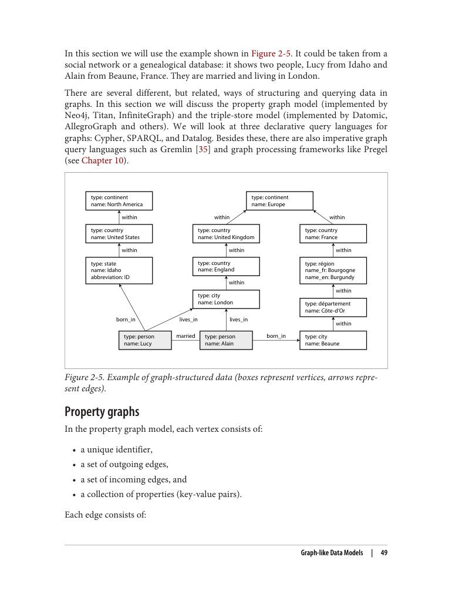

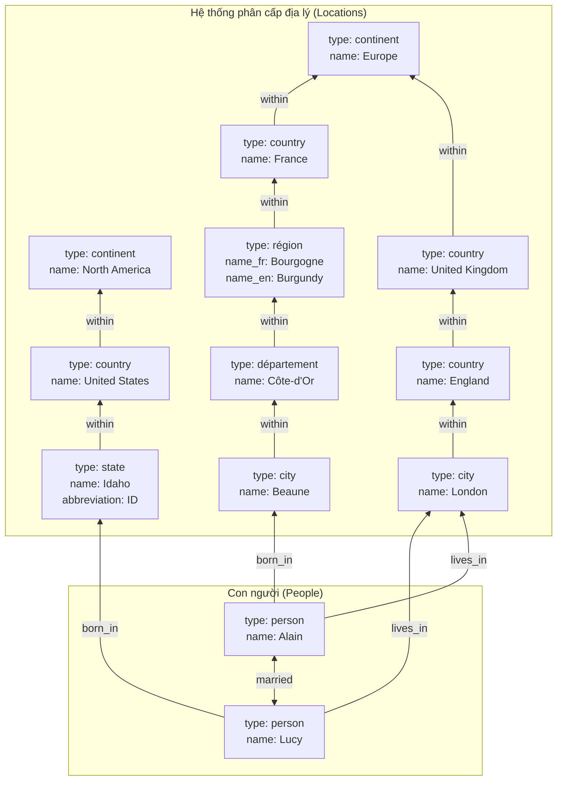

---

### Đồ thị thuộc tính (Property graphs)

Trong mô hình đồ thị thuộc tính (property graph model), mỗi **đỉnh (vertex)** bao gồm:
- Một định danh duy nhất (a unique identifier),
- Một tập hợp các cạnh đi ra (a set of outgoing edges),
- Một tập hợp các cạnh đi vào (a set of incoming edges), và
- Một tập hợp các thuộc tính (a collection of properties — các cặp key-value).

Mỗi **cạnh (edge)** bao gồm:
- Một định danh duy nhất (a unique identifier),
- Đỉnh mà tại đó cạnh bắt đầu (*đỉnh đuôi* — *the tail vertex*),
- Đỉnh mà tại đó cạnh kết thúc (*đỉnh đầu* — *the head vertex*),
- Một nhãn (label) để mô tả loại mối quan hệ giữa hai đỉnh, và
- Một tập hợp các thuộc tính (a collection of properties — các cặp key-value).

Bạn có thể hình dung một kho lưu trữ đồ thị (graph store) như thể nó bao gồm hai bảng quan hệ: một bảng dành cho các đỉnh (`vertices`) và một bảng dành cho các cạnh (`edges`), như được minh họa trong **Ví dụ 2-2** (lược đồ này sử dụng kiểu dữ liệu `json` của PostgreSQL để lưu trữ các thuộc tính của mỗi đỉnh hoặc cạnh). Đỉnh đầu (`head_vertex`) và đỉnh đuôi (`tail_vertex`) được lưu trên mỗi cạnh; nếu bạn muốn lấy tập hợp các cạnh đi vào hoặc đi ra của một đỉnh, bạn có thể truy vấn bảng `edges` lần lượt theo cột `head_vertex` hoặc `tail_vertex`.

**Ví dụ 2-2 – Biểu diễn một đồ thị thuộc tính bằng một lược đồ quan hệ (Example 2-2. Representing a property graph using a relational schema.)**

```sql
CREATE TABLE vertices (
    vertex_id   integer PRIMARY KEY,
    properties  json
);

CREATE TABLE edges (
    edge_id     integer PRIMARY KEY,
    tail_vertex integer REFERENCES vertices (vertex_id),
    head_vertex integer REFERENCES vertices (vertex_id),
    label       text,
    properties  json
);

CREATE INDEX edges_tails ON edges (tail_vertex);
CREATE INDEX edges_heads ON edges (head_vertex);
```

Một số khía cạnh quan trọng của mô hình này là:

1. **Bất kỳ đỉnh nào cũng có thể có một cạnh kết nối nó với bất kỳ đỉnh nào khác.** Không có lược đồ (schema) nào hạn chế việc những loại đối tượng nào có thể hoặc không thể được liên kết với nhau.
2. **Với bất kỳ đỉnh nào cho trước, bạn đều có thể tìm thấy cả các cạnh đi vào lẫn các cạnh đi ra của nó một cách hiệu quả**, và nhờ đó có thể duyệt qua đồ thị (traverse the graph) — đi theo một đường dẫn qua một chuỗi các đỉnh — theo cả chiều xuôi (forwards) lẫn chiều ngược (backwards). (Đó chính là lý do tại sao **Ví dụ 2-2** đánh chỉ mục trên cả hai cột `tail_vertex` và `head_vertex`.)
3. **Bằng cách sử dụng các nhãn (labels) khác nhau cho các loại mối quan hệ khác nhau, bạn có thể lưu trữ nhiều loại thông tin khác nhau trong một đồ thị duy nhất**, trong khi vẫn duy trì được một mô hình dữ liệu gọn gàng, rõ ràng.

Những tính năng đó mang lại cho đồ thị sự linh hoạt rất lớn trong việc mô hình hóa dữ liệu, như được minh họa trong **Hình 2-5**. Hình vẽ này thể hiện một số điều vốn sẽ rất khó để biểu diễn trong một lược đồ quan hệ truyền thống, chẳng hạn như:
- Các cấu trúc phân cấp hành chính vùng miền khác nhau ở các quốc gia khác nhau (Pháp có *départements* và *régions*, trong khi Mỹ có *counties* và *states*).
- Những đặc thù lịch sử (quirks of history) chẳng hạn như một quốc gia nằm trong một quốc gia (England là một `country` nằm `within` United Kingdom cũng là một `country` — tạm bỏ qua những rắc rối chính trị phức tạp về quốc gia có chủ quyền và dân tộc).
- Độ mịn dữ liệu (granularity of data) không đồng đều: nơi cư trú hiện tại của Lucy được chỉ định ở cấp thành phố (`London`), trong khi nơi sinh của cô ấy chỉ được chỉ định ở cấp tiểu bang (`Idaho`).

Bạn có thể hình dung việc mở rộng đồ thị này để bao gồm thêm nhiều thông tin thực tế (facts) khác về Lucy và Alain, hoặc về những người khác. Chẳng hạn, bạn có thể sử dụng nó để chỉ ra bất kỳ chứng dị ứng thực phẩm nào mà họ mắc phải (bằng cách đưa thêm một đỉnh cho mỗi chất gây dị ứng / allergen, và một cạnh nối giữa một người với một chất gây dị ứng để biểu thị tình trạng dị ứng), đồng thời liên kết các chất gây dị ứng đó với một tập hợp các đỉnh cho biết loại thực phẩm nào chứa chất nào. Sau đó, bạn có thể viết một câu truy vấn để tìm ra những món ăn nào là an toàn cho mỗi người. Đồ thị rất mạnh về *khả năng tiến hóa* (*evolvability*): khi bạn thêm các tính năng mới vào ứng dụng của mình, một đồ thị có thể dễ dàng được mở rộng để thích ứng với những thay đổi trong cấu trúc dữ liệu của ứng dụng.

---

### Ngôn ngữ truy vấn Cypher (The Cypher query language)

*Cypher* là một ngôn ngữ truy vấn khai báo dành cho đồ thị thuộc tính (property graphs), được tạo ra cho cơ sở dữ liệu đồ thị Neo4j [36]. (Nó được đặt theo tên của một nhân vật trong bộ phim *Ma Trận - The Matrix*, và không liên quan đến từ *cipher* có nghĩa là mật mã trong mật mã học [37].)

**Ví dụ 2-3** trình bày câu truy vấn Cypher để chèn phần bên trái của **Hình 2-5** vào một cơ sở dữ liệu đồ thị. Phần còn lại của đồ thị có thể được thêm vào theo cách tương tự và được lược bỏ ở đây cho dễ đọc. Mỗi đỉnh được đặt một tên biểu trưng (symbolic name) như `USA` hoặc `Idaho`, và các phần khác của câu truy vấn có thể sử dụng những tên đó để tạo các cạnh nối giữa các đỉnh bằng ký pháp mũi tên (arrow notation): `(Idaho) -[:WITHIN]-> (USA)` tạo ra một cạnh có nhãn `WITHIN`, với `Idaho` là nút đuôi (tail node) và `USA` là nút đầu (head node).

**Ví dụ 2-3 – Một tập con dữ liệu trong Hình 2-5, được biểu diễn dưới dạng một câu truy vấn Cypher (Example 2-3. A subset of the data in Figure 2-5, represented as a Cypher query.)**

```cypher
CREATE
  (NAmerica:Location {name:'North America', type:'continent'}),
  (USA:Location      {name:'United States', type:'country'  }),
  (Idaho:Location    {name:'Idaho',         type:'state'    }),
  (Lucy:Person       {name:'Lucy' }),
  (Idaho) -[:WITHIN]->  (USA)  -[:WITHIN]-> (NAmerica),
  (Lucy)  -[:BORN_IN]-> (Idaho)
```

Khi tất cả các đỉnh và các cạnh của **Hình 2-5** đã được thêm vào cơ sở dữ liệu, chúng ta có thể bắt đầu đặt ra những câu hỏi thú vị. Ví dụ, hãy tìm tên của tất cả những người đã di cư từ Hoa Kỳ sang Châu Âu. Nói một cách chính xác hơn: hãy tìm tất cả các đỉnh có một cạnh `BORN_IN` trỏ tới một địa điểm nằm trong Hoa Kỳ, và đồng thời có một cạnh `LIVES_IN` (hoặc `LIVING_IN`) trỏ tới một địa điểm nằm trong Châu Âu, rồi trả về thuộc tính `name` của những đỉnh đó.

**Ví dụ 2-4** minh họa cách biểu diễn câu truy vấn đó trong Cypher. Cùng ký pháp mũi tên như trên được sử dụng trong mệnh đề `MATCH` để tìm các khuôn mẫu (patterns) trong đồ thị: `(person) -[:BORN_IN]-> ()` khớp với bất kỳ hai đỉnh nào có liên hệ với nhau bởi một cạnh mang nhãn `BORN_IN`. Đỉnh đuôi của cạnh đó được gắn (bound) với biến `person`, và đỉnh đầu được để trống không đặt tên (`()`).

**Ví dụ 2-4 – Truy vấn Cypher để tìm những người đã di cư từ Mỹ sang Châu Âu (Example 2-4. Cypher query to find people who emigrated from the US to Europe.)**

```cypher
MATCH
  (person) -[:BORN_IN]->  () -[:WITHIN*0..]-> (us:Location {name:'United States'}),
  (person) -[:LIVES_IN]-> () -[:WITHIN*0..]-> (eu:Location {name:'Europe'})
RETURN person.name
```

Câu truy vấn này có thể được đọc diễn giải như sau:

> "Hãy tìm bất kỳ đỉnh nào (gọi nó là `person`) thỏa mãn đồng thời cả hai điều kiện sau đây:
> 1. `person` có một cạnh đi ra `BORN_IN` trỏ tới một đỉnh nào đó. Từ đỉnh đó, bạn có thể đi theo một chuỗi các cạnh đi ra `WITHIN` (từ 0 lần trở lên: `*0..`) cho đến khi cuối cùng chạm tới một đỉnh thuộc kiểu `Location` có thuộc tính `name` bằng `"United States"`.
> 2. Cùng đỉnh `person` đó cũng có một cạnh đi ra `LIVES_IN`. Đi theo cạnh đó, và tiếp tục đi theo một chuỗi các cạnh đi ra `WITHIN` (từ 0 lần trở lên), cuối cùng bạn chạm tới một đỉnh thuộc kiểu `Location` có thuộc tính `name` bằng `"Europe"`.
>
> Đối với mỗi đỉnh `person` như vậy, hãy trả về thuộc tính `name`."

Có một số cách khả dĩ để thực thi câu truy vấn này. Cách mô tả ở trên gợi ý rằng bạn bắt đầu bằng việc quét qua tất cả những người có trong cơ sở dữ liệu, kiểm tra nơi sinh và nơi cư trú của từng người, rồi chỉ trả về những người thỏa mãn tiêu chí.

Nhưng một cách tương đương khác là bạn có thể bắt đầu từ hai đỉnh `Location` và lần ngược lại (work backwards). Nếu có một chỉ mục (index) trên thuộc tính `name`, rất có thể bạn sẽ tìm thấy hai đỉnh biểu diễn Hoa Kỳ và Châu Âu một cách cực kỳ hiệu quả. Sau đó, bạn có thể tiếp tục tìm tất cả các địa điểm (các tiểu bang, vùng, thành phố, v.v.) nằm trong Hoa Kỳ và Châu Âu tương ứng bằng cách đi ngược theo tất cả các cạnh đi vào `WITHIN` (incoming `WITHIN` edges). Cuối cùng, bạn có thể tìm kiếm những người có thể được tìm thấy thông qua một cạnh đi vào `BORN_IN` hoặc `LIVES_IN` tại một trong số các địa điểm đó.

Đúng như đặc trưng điển hình của một ngôn ngữ truy vấn khai báo, bạn không cần phải chỉ định những chi tiết thực thi như vậy khi viết câu truy vấn: bộ tối ưu hóa truy vấn (query optimizer) sẽ tự động lựa chọn chiến lược được dự đoán là hiệu quả nhất, và bạn có thể yên tâm tiếp tục viết phần còn lại của ứng dụng.

---

### Truy vấn đồ thị trong SQL (Graph queries in SQL)

**Ví dụ 2-2** đã gợi ý rằng dữ liệu đồ thị hoàn toàn có thể được biểu diễn trong một cơ sở dữ liệu quan hệ. Nhưng nếu chúng ta đưa dữ liệu đồ thị vào một cấu trúc quan hệ, liệu chúng ta có thể truy vấn nó bằng SQL hay không?

Câu trả lời là: có, nhưng sẽ gặp một số khó khăn. Trong một cơ sở dữ liệu quan hệ, thông thường bạn biết trước mình cần những phép kết nối (`JOIN`) nào trong câu truy vấn. Ngược lại, trong một câu truy vấn đồ thị, bạn có thể cần phải duyệt qua một số lượng cạnh không cố định (variable number of edges) trước khi tìm thấy đỉnh mà bạn đang tìm kiếm — nghĩa là số lượng phép `JOIN` không được ấn định trước.

Trong ví dụ của chúng ta, điều đó xảy ra ở quy tắc `() -[:WITHIN*0..]-> ()` trong câu truy vấn Cypher. Cạnh `LIVES_IN` của một người có thể trỏ tới bất kỳ loại địa điểm nào: một con phố, một thành phố, một quận, một vùng, một tiểu bang, v.v. Một thành phố có thể nằm trong (`WITHIN`) một vùng, một vùng nằm trong (`WITHIN`) một tiểu bang, một tiểu bang nằm trong (`WITHIN`) một quốc gia, v.v. Cạnh `LIVES_IN` có thể trỏ trực tiếp tới đỉnh địa điểm mà bạn đang tìm kiếm, hoặc nó có thể cách đó nhiều cấp trong cây phân cấp địa lý.

Trong Cypher, `:WITHIN*0..` biểu đạt thực tế đó một cách hết sức ngắn gọn: nó có nghĩa là "đi theo một cạnh `WITHIN`, không lần hoặc nhiều lần (zero or more times)". Nó giống hệt như toán tử `*` trong một biểu thức chính quy (regular expression).

Ý tưởng về các đường dẫn duyệt có độ dài biến thiên (variable-length traversal paths) trong một câu truy vấn có thể được biểu diễn kể từ chuẩn SQL:1999 bằng cách sử dụng một tính năng gọi là *biểu thức bảng chung đệ quy* (*recursive common table expressions* — cú pháp `WITH RECURSIVE`). **Ví dụ 2-5** trình bày cùng câu truy vấn đó — tìm tên của những người đã di cư từ Mỹ sang Châu Âu — được biểu diễn bằng SQL sử dụng kỹ thuật này (được hỗ trợ trong PostgreSQL, IBM DB2, Oracle và SQL Server, và từ MySQL 8.0+ / SQLite 3.8.3+). Tuy nhiên, cú pháp của nó cực kỳ rườm rà và cồng kềnh khi đem so sánh với Cypher.

**Ví dụ 2-5 – Cùng câu truy vấn như Ví dụ 2-4, được biểu diễn trong SQL bằng các biểu thức bảng chung đệ quy (Example 2-5. The same query as Example 2-4, expressed in SQL using recursive common table expressions.)**

```sql
WITH RECURSIVE
  -- in_usa là tập hợp các vertex ID của tất cả các địa điểm nằm trong United States
  in_usa(vertex_id) AS (
      SELECT vertex_id FROM vertices WHERE properties->>'name' = 'United States'
    UNION
      SELECT edges.tail_vertex FROM edges
        JOIN in_usa ON edges.head_vertex = in_usa.vertex_id
        WHERE edges.label = 'within'
  ),
  -- in_europe là tập hợp các vertex ID của tất cả các địa điểm nằm trong Europe
  in_europe(vertex_id) AS (
      SELECT vertex_id FROM vertices WHERE properties->>'name' = 'Europe'
    UNION
      SELECT edges.tail_vertex FROM edges
        JOIN in_europe ON edges.head_vertex = in_europe.vertex_id
        WHERE edges.label = 'within'
  ),
  -- born_in_usa là tập hợp các vertex ID của tất cả những người sinh ra tại Mỹ
  born_in_usa(vertex_id) AS (
    SELECT edges.tail_vertex FROM edges
      JOIN in_usa ON edges.head_vertex = in_usa.vertex_id
      WHERE edges.label = 'born_in'
  ),
  -- lives_in_europe là tập hợp các vertex ID của tất cả những người đang sống tại Châu Âu
  lives_in_europe(vertex_id) AS (
    SELECT edges.tail_vertex FROM edges
      JOIN in_europe ON edges.head_vertex = in_europe.vertex_id
      WHERE label = 'lives_in'
  )
SELECT vertices.properties->>'name'
FROM vertices
-- join để tìm những người vừa sinh ra ở Mỹ *vừa* sống ở Châu Âu
JOIN born_in_usa     ON vertices.vertex_id = born_in_usa.vertex_id
JOIN lives_in_europe ON vertices.vertex_id = lives_in_europe.vertex_id;
```

Giải thích chi tiết từng bước của câu truy vấn SQL trong **Ví dụ 2-5**:
1. Trước tiên, tìm đỉnh có thuộc tính `name` mang giá trị `"United States"` (`WHERE properties->>'name' = 'United States'`), và thêm nó vào tập hợp các đỉnh `in_usa` (đây là phần cơ sở / non-recursive term của CTE đệ quy).
2. Đi ngược theo tất cả các cạnh đi vào `within` từ các đỉnh hiện có trong tập hợp `in_usa` (`JOIN in_usa ON edges.head_vertex = in_usa.vertex_id WHERE edges.label = 'within'`), và thêm các đỉnh đuôi (`tail_vertex`) đó vào cùng tập hợp `in_usa`, lặp lại cho đến khi tất cả các cạnh đi vào `within` đều đã được ghé thăm.
3. Thực hiện tương tự bắt đầu từ đỉnh có thuộc tính `name` mang giá trị `"Europe"`, và xây dựng nên tập hợp các đỉnh `in_europe`.
4. Đối với mỗi đỉnh trong tập hợp `in_usa`, đi ngược theo các cạnh đi vào `born_in` để tìm tất cả những người được sinh ra tại một địa điểm nào đó nằm trong Hoa Kỳ (tạo thành tập `born_in_usa`).
5. Tương tự, đối với mỗi đỉnh trong tập hợp `in_europe`, đi ngược theo các cạnh đi vào `lives_in` để tìm những người đang sống tại Châu Âu (tạo thành tập `lives_in_europe`).
6. Cuối cùng, lấy giao (intersect) của tập hợp những người sinh ra ở Mỹ với tập hợp những người đang sống ở Châu Âu bằng cách thực hiện phép kết nối (`JOIN`) chúng với bảng `vertices`.

Nếu cùng một câu truy vấn có thể được viết chỉ bằng 4 dòng trong một ngôn ngữ truy vấn này (Cypher), nhưng lại đòi hỏi tới 29 dòng trong một ngôn ngữ khác (SQL), thì điều đó cho thấy rõ ràng rằng các mô hình dữ liệu khác nhau được thiết kế để thỏa mãn các trường hợp sử dụng (use cases) khác nhau. Việc lựa chọn một mô hình dữ liệu phù hợp với ứng dụng của bạn là vô cùng quan trọng.

> 📝 **Giải thích thêm (không có trong sách):**
> Đáng chú ý là vào năm 2023, ủy ban tiêu chuẩn ISO/IEC đã chính thức ban hành phần mở rộng mới cho chuẩn **SQL:2023** có tên là **SQL/PGQ (Property Graph Queries)**, cùng với ngôn ngữ truy vấn đồ thị chuẩn hóa quốc tế **GQL (ISO/IEC 39075:2024)** lấy cảm hứng trực tiếp từ Cypher! Với SQL/PGQ (đã được hỗ trợ trong Oracle Database 23ai, DuckDB PGQ extension, v.v.), lập trình viên có thể định nghĩa một góc nhìn đồ thị (`CREATE PROPERTY GRAPH`) ngay trên các bảng quan hệ và sử dụng cú pháp khớp mẫu ASCII-art `(a)-[:WITHIN]->*(b)` trong mệnh đề `GRAPH_TABLE` của SQL mà không cần phải viết hàng chục dòng `WITH RECURSIVE` phức tạp như trong **Ví dụ 2-5** nữa.

---

#### So sánh cơ sở dữ liệu đồ thị với mô hình mạng (Graph databases compared to the network model)

Trong mục "Liệu các cơ sở dữ liệu tài liệu có đang lặp lại lịch sử?" ở phần trước (trang 35 bản gốc), chúng ta đã thảo luận về việc CODASYL và mô hình quan hệ đã cạnh tranh với nhau như thế nào để giải quyết bài toán quan hệ nhiều-nhiều trong IMS. Thoạt nhìn, mô hình mạng (network model) của CODASYL trông khá giống với mô hình đồ thị. Phải chăng các cơ sở dữ liệu đồ thị chính là sự tái림 (second coming) của CODASYL dưới một lớp ngụy trang?

Không phải vậy. Chúng khác nhau ở một số điểm cốt yếu sau đây:

- Trong CODASYL, cơ sở dữ liệu có một lược đồ (schema) chỉ định cứng nhắc loại bản ghi (record type) nào có thể được lồng bên trong loại bản ghi nào khác. Trong một cơ sở dữ liệu đồ thị, không hề có sự hạn chế như vậy: bất kỳ đỉnh nào cũng có thể có một cạnh nối tới bất kỳ đỉnh nào khác. Điều này mang lại sự linh hoạt lớn hơn rất nhiều để các ứng dụng thích ứng với những yêu cầu thay đổi liên tục.
- Trong CODASYL, cách duy nhất để đi tới một bản ghi cụ thể là phải duyệt qua một trong các đường dẫn truy cập (access paths) dẫn tới nó. Trong một cơ sở dữ liệu đồ thị, bạn có thể tham chiếu trực tiếp tới bất kỳ đỉnh nào thông qua ID duy nhất của nó, hoặc bạn có thể sử dụng một chỉ mục thuộc tính (property index) để tìm ngay các đỉnh có một giá trị cụ thể.
- Trong CODASYL, các bản ghi con (children) của một bản ghi là một tập hợp có thứ tự (ordered set), vì vậy cơ sở dữ liệu phải duy trì thứ tự đó (điều này gây ra những hệ lụy nặng nề đối với bố cục lưu trữ trên đĩa) và các ứng dụng khi chèn bản ghi mới vào cơ sở dữ liệu phải lo lắng về vị trí của bản ghi mới trong các tập hợp này. Trong một cơ sở dữ liệu đồ thị, các đỉnh và các cạnh không có bất kỳ thứ tự định sẵn nào (bạn chỉ có thể sắp xếp các kết quả khi thực hiện truy vấn).
- Trong CODASYL, tất cả các truy vấn đều mang tính mệnh lệnh (imperative), rất khó viết và dễ dàng bị gãy vỡ khi có những thay đổi trong lược đồ. Trong một cơ sở dữ liệu đồ thị, bạn có thể viết phép duyệt đồ thị (traversal) bằng mã mệnh lệnh nếu muốn, nhưng hầu hết các cơ sở dữ liệu đồ thị đều hỗ trợ các ngôn ngữ truy vấn khai báo bậc cao (high-level, declarative query languages) chẳng hạn như Cypher hoặc SPARQL.

---

### Kho bộ ba và SPARQL (Triple-stores and SPARQL)

Mô hình kho bộ ba (triple-store model) về cơ bản là tương đương với mô hình đồ thị thuộc tính (property graph model), chỉ khác ở chỗ nó sử dụng những từ ngữ khác nhau để mô tả cùng những ý tưởng đó. Tuy nhiên, mô hình này vẫn rất đáng để thảo luận, bởi vì có nhiều công cụ và ngôn ngữ dành cho các kho bộ ba có thể trở thành những sự bổ sung giá trị cho bộ công cụ xây dựng ứng dụng của bạn.

Trong một kho bộ ba (triple-store), mọi thông tin đều được lưu trữ dưới dạng những mệnh đề ba phần (three-part statements) hết sức đơn giản: *(chủ ngữ, vị ngữ, tân ngữ)* — *(subject, predicate, object)*. Ví dụ, trong bộ ba `(Jim, likes, bananas)`, `Jim` là chủ ngữ (subject), `likes` là vị ngữ / động từ (predicate / verb), và `bananas` là tân ngữ (object).

Chủ ngữ (subject) của một bộ ba tương đương với một đỉnh (vertex) trong đồ thị. Tân ngữ (object) là một trong hai trường hợp sau đây:

1. **Tân ngữ có thể là một giá trị thuộc kiểu dữ liệu nguyên thủy (primitive datatype), chẳng hạn như một chuỗi ký tự hoặc một con số.** Trong trường hợp đó, vị ngữ (predicate) và tân ngữ (object) của bộ ba tương đương với khóa (key) và giá trị (value) của một thuộc tính (property) nằm trên đỉnh chủ ngữ (subject vertex). Ví dụ, bộ ba `(lucy, age, 33)` giống như một đỉnh `lucy` có thuộc tính `{"age": 33}`.
2. **Tân ngữ có thể là một đỉnh khác trong đồ thị.** Trong trường hợp đó, vị ngữ (predicate) là một cạnh (edge) trong đồ thị, chủ ngữ (subject) là đỉnh đuôi (tail vertex) và tân ngữ (object) là đỉnh đầu (head vertex). Ví dụ, trong bộ ba `(lucy, marriedTo, alain)`, chủ ngữ `lucy` và tân ngữ `alain` đều là các đỉnh, và vị ngữ `marriedTo` là nhãn (label) của cạnh kết nối hai đỉnh đó với nhau.

Ví dụ, **Ví dụ 2-6** trình bày cùng tập dữ liệu như trong **Ví dụ 2-3**, nhưng được viết dưới dạng các bộ ba (triples) theo một định dạng có tên là *Turtle*, vốn là một tập con của *Notation3 (N3)* [38].

**Ví dụ 2-6 – Một tập con dữ liệu trong Hình 2-5, được biểu diễn dưới dạng các bộ ba Turtle (Example 2-6. A subset of the data in Figure 2-5, represented as Turtle triples.)**

```turtle
@prefix : <urn:example:>.
_:lucy     a       :Person.
_:lucy     :name   "Lucy".
_:lucy     :bornIn _:idaho.
_:idaho    a       :Location.
_:idaho    :name   "Idaho".
_:idaho    :type   "state".
_:idaho    :within _:usa.
_:usa      a       :Location.
_:usa      :name   "United States".
_:usa      :type   "country".
_:usa      :within _:namerica.
_:namerica a       :Location.
_:namerica :name   "North America".
_:namerica :type   "continent".
```

Trong ví dụ này, các đỉnh của đồ thị được viết dưới dạng `_:someName` (trong thuật ngữ RDF gọi là *blank node*) — cái tên này không mang bất kỳ ý nghĩa nào ở bên ngoài tệp tin này; nó tồn tại chỉ bởi vì nếu không có nó thì chúng ta sẽ không biết được những bộ ba nào đang cùng tham chiếu đến một đỉnh. Khi vị ngữ (predicate) biểu diễn một cạnh, tân ngữ (object) là một đỉnh, như trong `_:idaho :within _:usa`. Khi vị ngữ là một thuộc tính, tân ngữ là một giá trị chuỗi hằng (string literal), như trong `_:usa :name "United States"`. (Từ khóa `a` trong Turtle là cách viết tắt chuẩn cho vị ngữ `rdf:type`, dùng để chỉ định kiểu/lớp của chủ ngữ, ví dụ `_:lucy a :Person` có nghĩa là `lucy` có kiểu là `Person`.)

Việc phải lặp đi lặp lại cùng một chủ ngữ hết lần này đến lần khác trông khá nhàm chán, nhưng may mắn thay, bạn có thể sử dụng dấu chấm phẩy (`;`) để nói nhiều điều khác nhau về cùng một chủ ngữ. Điều này giúp cho định dạng Turtle trở nên rất gọn gàng và dễ đọc: hãy xem **Ví dụ 2-7**.

**Ví dụ 2-7 – Một cách viết ngắn gọn hơn cho dữ liệu trong Ví dụ 2-6 (Example 2-7. A more concise way of writing the data in Example 2-6.)**

```turtle
@prefix : <urn:example:>.
_:lucy     a :Person;   :name "Lucy";          :bornIn _:idaho.
_:idaho    a :Location; :name "Idaho";         :type "state";   :within _:usa.
_:usa      a :Location; :name "United States"; :type "country"; :within _:namerica.
_:namerica a :Location; :name "North America"; :type "continent".
```

---

#### Web ngữ nghĩa (The semantic web)

Nếu bạn đọc thêm tài liệu về các kho bộ ba (triple-stores), bạn rất có thể sẽ bị cuốn vào một cơn lốc các bài viết bàn về *Web ngữ nghĩa* (*semantic web*). Mô hình dữ liệu kho bộ ba hoàn toàn độc lập với Web ngữ nghĩa — ví dụ, Datomic [39] là một kho bộ ba không hề tuyên bố có bất kỳ sự liên hệ nào với Web ngữ nghĩa.[^vii] Nhưng bởi vì hai khái niệm này gắn liền với nhau quá chặt chẽ trong tâm trí của nhiều người, chúng ta nên thảo luận ngắn gọn về chúng.

[^vii]: Về mặt kỹ thuật, Datomic sử dụng các bộ năm (*5-tuples* — thường gọi là *datoms*: `(entity, attribute, value, transaction, added)`) thay vì các bộ ba (triples); hai trường bổ sung là siêu dữ liệu (metadata) phục vụ cho việc quản lý phiên bản theo thời gian (versioning / time-travel queries).

Web ngữ nghĩa về bản chất là một ý tưởng đơn giản và hợp lý: các trang web vốn dĩ đã xuất bản thông tin dưới dạng văn bản và hình ảnh để con người đọc — vậy tại sao chúng lại không xuất bản cả thông tin dưới dạng dữ liệu mà máy tính có thể đọc hiểu được (machine-readable data) để các máy tính cùng đọc? *Resource Description Framework (RDF)* [40] được構 tưởng như một cơ chế giúp các trang web khác nhau xuất bản dữ liệu theo một định dạng nhất quán, cho phép dữ liệu từ các trang web khác nhau có thể được kết hợp tự động thành một *mạng lưới dữ liệu* (*web of data*) — một kiểu "cơ sở dữ liệu của vạn vật" trên phạm vi toàn cầu (internet-wide ‘database of everything’).

Đáng tiếc là Web ngữ nghĩa đã bị thổi phồng quá mức (over-hyped) vào đầu những năm 2000, nhưng cho đến nay vẫn chưa cho thấy bất kỳ dấu hiệu nào là sẽ trở thành hiện thực trong thực tế theo đúng tầm nhìn ban đầu đó, điều này khiến nhiều người trở nên hoài nghi và bi quan (cynical) về nó. Nó cũng phải gánh chịu một rừng các từ viết tắt gây chóng mặt (dizzying plethora of acronyms — như RDF, RDFS, OWL, SPARQL, URI, IRI, XMLNS...), những đề xuất tiêu chuẩn phức tạp thái quá, và cả sự kiêu ngạo (hubris).

Tuy nhiên, nếu bạn nhìn vượt qua những thất bại đó, thì cũng có rất nhiều thành quả tốt đẹp đã ra đời từ dự án Web ngữ nghĩa. Các bộ ba (triples) có thể là một mô hình dữ liệu nội bộ (internal data model) rất tốt cho các ứng dụng, ngay cả khi bạn không hề có chút hứng thú nào với việc xuất bản dữ liệu RDF lên Web ngữ nghĩa.

> 📝 **Giải thích thêm (không có trong sách):**
> Dù giấc mơ biến toàn bộ Internet thành một cơ sở dữ liệu RDF khổng lồ duy nhất không diễn ra như kỳ vọng đầu thập niên 2000, di sản của Semantic Web và RDF đã tìm thấy những ứng dụng thực tế cực kỳ thành công:
> 1. **Schema.org và JSON-LD**: Hàng chục triệu trang web hiện nay nhúng dữ liệu có cấu trúc theo chuẩn JSON-LD (vốn là một cách tuần tự hóa RDF bằng JSON) để Google, Bing và các công cụ AI hiểu được nội dung trang web (sản phẩm, đánh giá, công thức nấu ăn, sự kiện).
> 2. **Đồ thị tri thức (Knowledge Graphs)**: **Wikidata**, **DBpedia**, và **Google Knowledge Graph** sử dụng mô hình bộ ba RDF/SPARQL làm xương sống để lưu trữ hàng chục tỷ sự kiện kết nối thực thể thế giới thực, đóng vai trò nền tảng cho tìm kiếm ngữ nghĩa và RAG (Retrieval-Augmented Generation) kết hợp với các mô hình ngôn ngữ lớn (LLMs) hiện nay.

---

#### Mô hình dữ liệu RDF (The RDF data model)

Ngôn ngữ Turtle mà chúng ta đã sử dụng trong **Ví dụ 2-7** là một định dạng dễ đọc đối với con người (human-readable format) dành cho dữ liệu RDF. Đôi khi RDF cũng được viết dưới định dạng XML, định dạng này thực hiện cùng một công việc nhưng dài dòng và rườm rà hơn rất nhiều — hãy xem **Ví dụ 2-8**. Định dạng Turtle/N3 được ưa chuộng hơn hẳn vì nó dịu mắt hơn rất nhiều, và các công cụ như Apache Jena [41] có thể tự động chuyển đổi qua lại giữa các định dạng RDF khác nhau nếu cần thiết.

**Ví dụ 2-8 – Dữ liệu của Ví dụ 2-7, được biểu diễn bằng cú pháp RDF/XML (Example 2-8. The data of Example 2-7, expressed using RDF/XML syntax.)**

```xml
<rdf:RDF xmlns="urn:example:"
    xmlns:rdf="http://www.w3.org/1999/02/22-rdf-syntax-ns#">
  <Location rdf:nodeID="idaho">
    <name>Idaho</name>
    <type>state</type>
    <within>
      <Location rdf:nodeID="usa">
        <name>United States</name>
        <type>country</type>
        <within>
          <Location rdf:nodeID="namerica">
            <name>North America</name>
            <type>continent</type>
          </Location>
        </within>
      </Location>
    </within>
  </Location>
  <Person rdf:nodeID="lucy">
    <name>Lucy</name>
    <bornIn rdf:nodeID="idaho"/>
  </Person>
</rdf:RDF>
```

RDF có một vài điểm kỳặc (quirks) do thực tế là nó được thiết kế để trao đổi dữ liệu trên phạm vi toàn mạng Internet. Chủ ngữ (subject), vị ngữ (predicate) và tân ngữ (object) của một bộ ba thường là các URI (Uniform Resource Identifiers): thay vì một vị ngữ chỉ đơn giản là `WITHIN` hoặc `LIVES_IN`, nó thực chất là một chuỗi giống như `<http://my-company.com/namespace#within>` hoặc `<http://my-company.com/namespace#lives_in>`. Ý tưởng đằng sau thiết kế này là: bạn có thể kết hợp dữ liệu của mình với dữ liệu của một người khác, và nếu họ gán một ý nghĩa khác cho từ `within` hoặc `lives_in`, bạn sẽ không gặp phải xung đột tên (conflict) bởi vì các vị ngữ của họ thực chất là `<http://other.org/foo#within>` và `<http://other.org/foo#lives_in>`.

URL `<http://my-company.com/namespace>` không nhất thiết phải phân giải (resolve) tới bất kỳ trang web thực tế nào trên mạng — dưới góc nhìn của RDF, nó đơn giản chỉ là một không gian tên (namespace). Để tránh bị nhầm lẫn bởi các URL có dạng `http://`, chúng ta đã sử dụng các URI như `urn:example:within` trong các ví dụ ở trên. May mắn thay, bạn chỉ cần chỉ định tiền tố (prefix) này một lần duy nhất ở đầu tệp tin (`@prefix : <urn:example:>.`), và sau đó có thể quên nó đi.

---

#### Ngôn ngữ truy vấn SPARQL (The SPARQL query language)

*SPARQL* là một ngôn ngữ truy vấn dành cho các kho bộ ba sử dụng mô hình dữ liệu RDF [42]. (Đây là từ viết tắt đệ quy của *SPARQL Protocol and RDF Query Language*, và được phát âm là "sparkle" /ˈspɑːrkəl/.) Nó ra đời trước Cypher, và bởi vì cơ chế khớp mẫu (pattern-matching) của Cypher được vay mượn từ SPARQL, nên trông chúng khá giống nhau [36].

Cùng câu truy vấn như trước — tìm những người đã chuyển từ Hoa Kỳ sang Châu Âu — khi viết bằng SPARQL thậm chí còn ngắn gọn và súc tích hơn cả trong Cypher: hãy xem **Ví dụ 2-9**.

**Ví dụ 2-9 – Cùng câu truy vấn như Ví dụ 2-4, được biểu diễn trong SPARQL (Example 2-9. The same query as Example 2-4, expressed in SPARQL.)**

```sparql
PREFIX : <urn:example:>
SELECT ?personName WHERE {
  ?person :name ?personName.
  ?person :bornIn  / :within* / :name "United States".
  ?person :livesIn / :within* / :name "Europe".
}
```

Cấu trúc của nó rất giống với Cypher. Hai biểu thức dưới đây là hoàn toàn tương đương nhau (trong SPARQL, các biến bắt đầu bằng một dấu chấm hỏi `?`):

```text
(person) -[:BORN_IN]-> () -[:WITHIN*0..]-> (location)   # Cypher
?person :bornIn / :within* ?location.                   # SPARQL
```

Bởi vì RDF không phân biệt giữa các thuộc tính (properties) và các cạnh (edges) mà chỉ sử dụng các vị ngữ (predicates) cho cả hai, nên bạn có thể sử dụng cùng một cú pháp thống nhất để khớp các thuộc tính. Trong biểu thức dưới đây, biến `usa` được gắn (bound) với bất kỳ đỉnh nào có thuộc tính `name` được đặt bằng giá trị `"United States"`:

```text
(usa {name:'United States'})   # Cypher
?usa :name "United States".    # SPARQL
```

SPARQL là một ngôn ngữ truy vấn rất tốt — ngay cả khi Web ngữ nghĩa không bao giờ trở thành hiện thực trên toàn cầu, nó vẫn có thể là một công cụ vô cùng mạnh mẽ để các ứng dụng sử dụng ở bên trong nội bộ.

---

### Nền tảng: Datalog (The foundation: Datalog)

*Datalog* là một ngôn ngữ lâu đời hơn rất nhiều so với SPARQL hay Cypher, từng được giới học thuật nghiên cứu sâu rộng vào những năm 1980 [43, 44]. Nó ít được biết đến hơn trong giới kỹ sư phần mềm, nhưng dù vậy nó vẫn vô cùng quan trọng, bởi vì nó cung cấp nền tảng lý thuyết mà các ngôn ngữ truy vấn thế hệ sau xây dựng dựa trên đó.

Mỗi năm trôi qua, chúng ta lại có thêm nhiều nhân (cores) hơn bên trong mỗi CPU, nhiều CPU hơn trong mỗi máy chủ, và nhiều máy chủ hơn trong một cụm mạng (networked cluster). Với tư cách là những lập trình viên, chúng ta vẫn chưa tìm ra được một câu trả lời thực sự thỏa đáng cho bài toán làm thế nào để làm việc tốt nhất với tất cả sự song song đó. Tuy nhiên, đã có những đề xuất cho rằng các ngôn ngữ khai báo dựa trên Datalog có thể chính là tương lai của lập trình song song, điều này đã thổi bùng lại sự quan tâm đối với Datalog trong thời gian gần đây [31]. Cũng đã có rất nhiều công trình nghiên cứu về việc đánh giá và thực thi các truy vấn Datalog một cách hiệu quả [43].

Trong thực tế, Datalog được sử dụng trong một số hệ thống dữ liệu: ví dụ, nó là ngôn ngữ truy vấn của Datomic [39], và Cascalog [45] là một bản cài đặt Datalog dùng để truy vấn các tập dữ liệu lớn trong Hadoop.[^viii]

[^viii]: Datomic và Cascalog sử dụng cú pháp biểu thức S (S-expression syntax) của ngôn ngữ Clojure cho Datalog. Trong các ví dụ tiếp theo dưới đây, chúng ta sử dụng cú pháp Prolog, cú pháp này dễ đọc hơn một chút nhưng không có sự khác biệt nào về mặt chức năng.

Mô hình dữ liệu của Datalog tương tự như mô hình kho bộ ba (triple-store model), nhưng được tổng quát hóa thêm một chút. Thay vì viết một bộ ba dưới dạng `(subject, predicate, object)`, chúng ta viết nó dưới dạng vị từ hàm `predicate(subject, object)`. **Ví dụ 2-10** trình bày cách viết dữ liệu từ ví dụ của chúng ta bằng Datalog.

**Ví dụ 2-10 – Một tập con dữ liệu trong Hình 2-5, được biểu diễn dưới dạng các sự kiện Datalog (Example 2-10. A subset of the data in Figure 2-5, represented as Datalog facts.)**

```prolog
name(namerica, 'North America').
type(namerica, continent).
name(usa, 'United States').
type(usa, country).
within(usa, namerica).
name(idaho, 'Idaho').
type(idaho, state).
within(idaho, usa).
name(lucy, 'Lucy').
born_in(lucy, idaho).
```

Bây giờ, sau khi đã định nghĩa xong dữ liệu (trong Datalog gọi là các *sự kiện* / *facts*), chúng ta có thể viết cùng câu truy vấn như trước, như được minh họa trong **Ví dụ 2-11**. Trông nó có vẻ hơi khác so với câu truy vấn tương đương trong Cypher hoặc SPARQL, nhưng đừng để điều đó làm bạn nản lòng. Datalog là một tập con của *Prolog*, một ngôn ngữ lập trình logic mà bạn có thể đã từng bắt gặp trước đây nếu bạn từng theo học ngành khoa học máy tính.

**Ví dụ 2-11 – Cùng câu truy vấn như Ví dụ 2-4, được biểu diễn trong Datalog (Example 2-11. The same query as Example 2-4, expressed in Datalog.)**

```prolog
within_recursive(Location, Name) :- name(Location, Name).     /* Rule 1 */
within_recursive(Location, Name) :- within(Location, Via),    /* Rule 2 */
                                    within_recursive(Via, Name).

migrated(Name, BornIn, LivingIn) :- name(Person, Name),       /* Rule 3 */
                                    born_in(Person, BornLoc),
                                    within_recursive(BornLoc, BornIn),
                                    lives_in(Person, LivingLoc),
                                    within_recursive(LivingLoc, LivingIn).

?- migrated(Who, 'United States', 'Europe').
/* Who = 'Lucy'. */
```

Cypher và SPARQL nhảy thẳng vào câu truy vấn ngay lập tức bằng từ khóa `MATCH` hay `SELECT`, nhưng Datalog lại tiến từng bước nhỏ một (takes a small step at a time). Chúng ta định nghĩa các *quy tắc* (*rules*) để dạy cho cơ sở dữ liệu biết về các vị ngữ (predicates) mới: ở đây, chúng ta định nghĩa hai vị ngữ mới là `within_recursive` và `migrated`. Những vị ngữ này không phải là các bộ ba được lưu trữ trực tiếp trong cơ sở dữ liệu, mà thay vào đó, chúng được *suy dẫn* (*derived*) từ dữ liệu gốc hoặc từ các quy tắc khác. Các quy tắc có thể tham chiếu đến các quy tắc khác, giống hệt như các hàm (functions) có thể gọi các hàm khác hoặc gọi đệ quy chính nó. Bằng cách này, những câu truy vấn phức tạp có thể được xây dựng dần lên từ từng mảnh nhỏ một.

Trong các quy tắc, những từ bắt đầu bằng một chữ cái viết hoa (uppercase letter, như `Location`, `Name`, `Via`, `Person`) là các *biến* (*variables*), và các vị ngữ được khớp (matched) giống như trong Cypher và SPARQL. Ví dụ, `name(Location, Name)` khớp với bộ ba `name(namerica, 'North America')` với các phép gán biến (variable bindings) là `Location = namerica` và `Name = 'North America'`.

Một quy tắc sẽ được áp dụng nếu hệ thống có thể tìm thấy kết quả khớp cho tất cả các vị ngữ nằm ở vế bên phải của toán tử `:-` (trong đó dấu phẩy `,` giữa các vị ngữ có nghĩa là phép hội logic `AND`, và toán tử `:-` được đọc là *"nếu" / "if"*). Khi quy tắc được áp dụng, kết quả giống như thể vế bên trái của toán tử `:-` vừa được thêm vào cơ sở dữ liệu (với các biến đã được thay thế bằng các giá trị mà chúng khớp được).

Do đó, một cách khả dĩ để áp dụng các quy tắc trên là như sau:

1. `name(namerica, 'North America')` tồn tại trong cơ sở dữ liệu, vì vậy **Quy tắc 1 (`Rule 1`)** được áp dụng, và sinh ra sự kiện mới `within_recursive(namerica, 'North America')`. (Đồng thời Quy tắc 1 cũng sinh ra `within_recursive(usa, 'United States')` và `within_recursive(idaho, 'Idaho')`.)
2. `within(usa, namerica)` tồn tại trong cơ sở dữ liệu, và `within_recursive(namerica, 'North America')` đã được sinh ra ở bước trước đó (với `Location = usa`, `Via = namerica`, `Name = 'North America'`), vì vậy **Quy tắc 2 (`Rule 2`)** được áp dụng, và sinh ra `within_recursive(usa, 'North America')`. (Tương tự, từ `within(idaho, usa)` và `within_recursive(usa, 'United States')`, Quy tắc 2 cũng sinh ra `within_recursive(idaho, 'United States')`.)
3. `within(idaho, usa)` tồn tại trong cơ sở dữ liệu, và `within_recursive(usa, 'North America')` đã được sinh ra ở bước thứ hai (với `Location = idaho`, `Via = usa`, `Name = 'North America'`), vì vậy **Quy tắc 2 (`Rule 2`)** tiếp tục được áp dụng lần nữa, và sinh ra `within_recursive(idaho, 'North America')`.

Bằng việc áp dụng lặp đi lặp lại Quy tắc 1 và Quy tắc 2, vị ngữ `within_recursive` có thể cho chúng ta biết tất cả các địa điểm nằm trong Bắc Mỹ (hoặc bất kỳ tên địa điểm nào khác) có trong cơ sở dữ liệu của chúng ta. Quá trình này được minh họa trực quan trong **Hình 2-6**.

**Hình 2-6 – Xác định rằng Idaho nằm trong Bắc Mỹ (North America) bằng cách sử dụng các quy tắc Datalog từ Ví dụ 2-11 (Figure 2-6. Determining that Idaho is in North America, using the Datalog rules from Example 2-11.)**

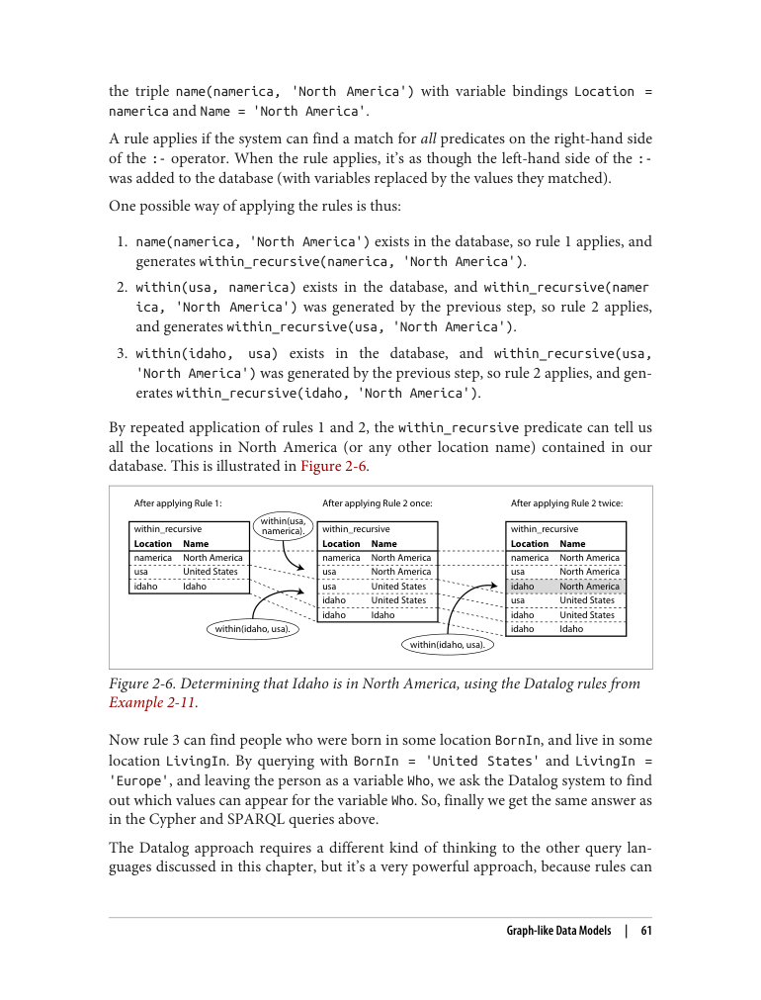

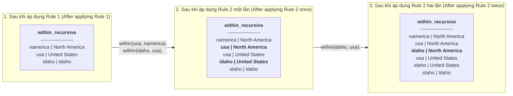

Bảng chi tiết các bộ giá trị của vị ngữ `within_recursive(Location, Name)` qua từng bước trong **Hình 2-6**:

| Bước suy dẫn | `Location` | `Name` | Nguồn gốc suy dẫn |
| :--- | :--- | :--- | :--- |
| **Sau khi áp dụng Rule 1** | `namerica`<br/>`usa`<br/>`idaho` | `North America`<br/>`United States`<br/>`Idaho` | Từ `name(namerica, 'North America')`<br/>Từ `name(usa, 'United States')`<br/>Từ `name(idaho, 'Idaho')` |
| **Sau khi áp dụng Rule 2 lần 1** | `namerica`<br/>**`usa`**<br/>`usa`<br/>**`idaho`**<br/>`idaho` | `North America`<br/>**`North America`**<br/>`United States`<br/>**`United States`**<br/>`Idaho` | Giữ nguyên từ bước 1<br/>**Mới:** `within(usa, namerica)` + `within_recursive(namerica, 'North America')`<br/>Giữ nguyên từ bước 1<br/>**Mới:** `within(idaho, usa)` + `within_recursive(usa, 'United States')`<br/>Giữ nguyên từ bước 1 |
| **Sau khi áp dụng Rule 2 lần 2** | `namerica`<br/>`usa`<br/>**`idaho`**<br/>`usa`<br/>`idaho`<br/>`idaho` | `North America`<br/>`North America`<br/>**`North America`**<br/>`United States`<br/>`United States`<br/>`Idaho` | Giữ nguyên<br/>Giữ nguyên<br/>**Mới:** `within(idaho, usa)` + `within_recursive(usa, 'North America')`<br/>Giữ nguyên<br/>Giữ nguyên<br/>Giữ nguyên |

Bây giờ, **Quy tắc 3 (`Rule 3`)** có thể tìm thấy những người được sinh ra tại một địa điểm `BornIn` nào đó, và đang sinh sống tại một địa điểm `LivingIn` nào đó. Bằng cách truy vấn với `BornIn = 'United States'` và `LivingIn = 'Europe'`, đồng thời để trống người cần tìm dưới dạng một biến `Who` (`?- migrated(Who, 'United States', 'Europe').`), chúng ta yêu cầu hệ thống Datalog tìm ra những giá trị nào có thể xuất hiện cho biến `Who`. Nhờ vậy, cuối cùng chúng ta nhận được cùng một câu trả lời (`Who = 'Lucy'`) giống hệt như trong các câu truy vấn Cypher và SPARQL ở trên.

Cách tiếp cận của Datalog đòi hỏi một lối tư duy khác biệt so với các ngôn ngữ truy vấn khác được thảo luận trong chương này, nhưng đó là một cách tiếp cận vô cùng mạnh mẽ, bởi vì các quy tắc (rules) có thể được kết hợp và tái sử dụng (combined and reused) trong nhiều câu truy vấn khác nhau. Nó kém thuận tiện hơn đối với những câu truy vấn đơn giản chỉ chạy một lần (simple one-off queries), nhưng nó lại có khả năng đối phó tốt hơn nhiều nếu dữ liệu và logic nghiệp vụ của bạn rất phức tạp.

> 📝 **Giải thích thêm (không có trong sách):**
> Tại sao Datalog lại thu hút sự chú ý mạnh mẽ trong các hệ thống hiện đại?
> - **Mối liên hệ với SQL `WITH RECURSIVE`**: Thực tế, tính năng `WITH RECURSIVE` trong chuẩn SQL:1999 (mà chúng ta đã thấy trong **Ví dụ 2-5**) chính là sự chuyển thể trực tiếp của Datalog tuyến tính (Linear Datalog) vào SQL! Trong **Ví dụ 2-5**, nhánh trước `UNION` chính là **Rule 1 (Base case)**, còn nhánh sau `UNION` có `JOIN` đệ quy chính là **Rule 2 (Recursive step)**.
> - **Ứng dụng thực tế hiện đại của Datalog**:
>   1. **Datomic / DataScript / XTDB**: Các cơ sở dữ liệu bất biến (immutable databases) dùng Datalog làm ngôn ngữ truy vấn chính.
>   2. **Phân tích tĩnh mã nguồn (Static Code Analysis) & Bảo mật**: Công cụ **CodeQL** (của GitHub) và **Soufflé** sử dụng biến thể của Datalog để truy vấn cây cú pháp trừu tượng (AST) và đồ thị luồng dữ liệu (dataflow graph) của hàng triệu dòng code nhằm tự động phát hiện lỗ hổng bảo mật (SQL injection, XSS, buffer overflow).
>   3. **Hệ thống phân quyền (Authorization)**: Các ngôn ngữ chính sách bảo mật hiện đại (như **Oso / Polar**, hay **Biscuit tokens**) dựa trên Datalog để biểu diễn các quy tắc phân quyền đệ quy phức tạp (RBAC/ReBAC).
>   4. **Differential Dataflow / Materialize**: Hệ thống xử lý luồng dữ liệu thời gian thực (streaming database) xây dựng trên nền tảng đánh giá gia tăng (incremental evaluation) của Datalog.

---

## Tóm tắt (Summary)

Mô hình dữ liệu (data models) là một chủ đề vô cùng rộng lớn, và trong chương này chúng ta đã cùng nhau điểm qua một cách nhanh chóng nhiều mô hình dữ liệu đa dạng khác nhau. Chúng ta không có đủ không gian để đi sâu vào tất cả mọi chi tiết của từng mô hình, nhưng hy vọng rằng bức tranh tổng quan này đã đủ để khơi gợi sự hứng thú của bạn nhằm tìm hiểu sâu hơn về mô hình phù hợp nhất với các yêu cầu ứng dụng của mình.

Xét về mặt lịch sử, dữ liệu khởi đầu bằng việc được biểu diễn dưới dạng một cái cây lớn duy nhất (*mô hình phân cấp* — *the hierarchical model*, như IMS), nhưng mô hình đó không tốt cho việc biểu diễn các mối quan hệ nhiều-nhiều, vì vậy *mô hình quan hệ* (*the relational model*) đã được phát minh để giải quyết bài toán đó. Gần đây hơn, các nhà phát triển nhận thấy rằng một số ứng dụng cũng không vừa vặn một cách tự nhiên với mô hình quan hệ. Các kho lưu trữ dữ liệu phi quan hệ "NoSQL" mới đã rẽ nhánh theo hai hướng chính:

1. **Cơ sở dữ liệu tài liệu (*Document databases*)** nhắm tới các trường hợp sử dụng mà ở đó dữ liệu đi theo từng tài liệu khép kín (self-contained documents), và các mối quan hệ giữa tài liệu này với tài liệu khác là rất hiếm gặp.
2. **Cơ sở dữ liệu đồ thị (*Graph databases*)** đi theo hướng hoàn toàn ngược lại, nhắm tới các trường hợp sử dụng mà ở đó bất kỳ thứ gì cũng đều có khả năng liên hệ với mọi thứ khác (anything is potentially related to everything).

Cả ba mô hình (tài liệu, quan hệ và đồ thị) đều được sử dụng rộng rãi hiện nay, và mỗi mô hình đều phát huy thế mạnh vượt trội trong miền bài toán (domain) tương ứng của nó. Một mô hình hoàn toàn có thể được mô phỏng (emulated) bằng một mô hình khác — chẳng hạn như biểu diễn dữ liệu đồ thị trong cơ sở dữ liệu quan hệ (**Ví dụ 2-2** và **Ví dụ 2-5**) hay thực hiện join ở tầng ứng dụng trên cơ sở dữ liệu tài liệu — nhưng kết quả thường rất gượng gạo và cồng kềnh (awkward). Đó chính là lý do tại sao chúng ta có những hệ thống khác nhau phục vụ cho những mục đích khác nhau, chứ không phải một giải pháp vạn năng duy nhất cho mọi bài toán (not a single one-size-fits-all solution).

Một điểm chung giữa cơ sở dữ liệu tài liệu và cơ sở dữ liệu đồ thị là chúng thường không áp đặt một lược đồ cứng nhắc (don’t enforce a schema) cho dữ liệu mà chúng lưu trữ (tức là theo hướng *schema-on-read*), điều này có thể giúp việc điều chỉnh ứng dụng để thích ứng với các yêu cầu thay đổi liên tục trở nên dễ dàng hơn. Tuy nhiên, ứng dụng của bạn rất có thể vẫn ngầm giả định rằng dữ liệu có một cấu trúc nhất định; câu hỏi chỉ đơn thuần là liệu lược đồ đó được khai báo tường minh (explicit — *schema-on-write*) hay ngầm định (implicit — *schema-on-read*).

Mỗi mô hình dữ liệu đều đi kèm với ngôn ngữ truy vấn hoặc framework xử lý của riêng nó, và chúng ta đã thảo luận về một số ví dụ tiêu biểu: SQL, MapReduce, đường ống tổng hợp (aggregation pipeline) của MongoDB, Cypher, SPARQL và Datalog. Chúng ta cũng đã chạm qua CSS và XSL/XPath, những ngôn ngữ tuy không phải là ngôn ngữ truy vấn cơ sở dữ liệu nhưng lại có những nét tương đồng vô cùng thú vị về tính chất khai báo (declarative).

Mặc dù chúng ta đã đi qua một chặng đường dài với rất nhiều kiến thức, vẫn còn nhiều mô hình dữ liệu khác chưa được đề cập tới. Để đưa ra một vài ví dụ ngắn gọn:

- **Dữ liệu hệ gen (*Genome data*)**: Các nhà nghiên cứu làm việc với dữ liệu hệ gen thường xuyên cần thực hiện các phép *tìm kiếm tương đồng chuỗi* (*sequence-similarity searches*), có nghĩa là lấy một chuỗi cực kỳ dài (biểu diễn một phân tử DNA) và so khớp nó với một cơ sở dữ liệu khổng lồ chứa các chuỗi tương tự nhưng không giống hệt hoàn toàn. Không có cơ sở dữ liệu nào được mô tả ở trên có thể xử lý tốt kiểu sử dụng này, đó là lý do tại sao các nhà nghiên cứu đã viết ra những phần mềm cơ sở dữ liệu hệ gen chuyên dụng như GenBank [46] (cùng các thuật toán chuyên biệt như BLAST / FASTA).
- **Vật lý hạt (*Particle physics*)**: Các nhà vật lý hạt đã thực hiện việc phân tích dữ liệu quy mô lớn theo kiểu Big Data trong suốt nhiều thập kỷ qua, và các dự án như Máy gia tốc hạt lớn (*Large Hadron Collider — LHC* tại CERN) hiện đang làm việc với hàng trăm petabyte dữ liệu! Ở quy mô khổng lồ như vậy, các giải pháp tùy chỉnh chuyên biệt (như framework ROOT) là bắt buộc để ngăn chi phí phần cứng vượt khỏi tầm kiểm soát [47].
- **Tìm kiếm toàn văn (*Full-text search*)**: Có thể coi tìm kiếm toàn văn là một dạng mô hình dữ liệu thường xuyên được sử dụng song hành cùng với các cơ sở dữ liệu. *Truy hồi thông tin* (*Information Retrieval*) là một lĩnh vực chuyên sâu rất lớn mà chúng ta sẽ không trình bày quá chi tiết trong cuốn sách này, nhưng chúng ta sẽ đề cập đến các chỉ mục tìm kiếm (search indexes, như Lucene/Elasticsearch) trong Chương 3 và Phần III.

Chúng ta sẽ tạm dừng chủ đề này tại đây. Trong chương tiếp theo (Chương 3), chúng ta sẽ thảo luận về một số sự đánh đổi (trade-offs) xuất hiện ở tầng vật lý khi hiện thực hóa (implementing) các mô hình dữ liệu đã được mô tả trong chương này.

> 📝 **Giải thích thêm (không có trong sách) – Bảng tổng hợp so sánh các Mô hình dữ liệu và Ngôn ngữ truy vấn trong Chương 2:**
>
> #### 1. So sánh 3 nhóm Mô hình dữ liệu chủ đạo
>
> | Tiêu chí | Mô hình Tài liệu (Document Model) | Mô hình Quan hệ (Relational Model) | Mô hình Đồ thị (Graph Model) |
> | :--- | :--- | :--- | :--- |
> | **Đơn vị lưu trữ cơ bản** | Tài liệu tự chứa (JSON, BSON, XML document) | Quan hệ / Bảng (Relation / Table) gồm các bộ / hàng (tuples / rows) | Đỉnh (Vertices / Nodes) và Cạnh (Edges / Relationships) hoặc Bộ ba (Triples) |
> | **Cấu trúc mối quan hệ phù hợp nhất** | Quan hệ một-nhiều (1:N) dạng cây phân cấp (tree-structured), ít liên kết chéo | Quan hệ một-nhiều (1:N) và nhiều-nhiều (M:N) có cấu trúc ổn định, số bước join biết trước | Quan hệ nhiều-nhiều (M:N) phức tạp, độ sâu duyệt biến thiên (`*0..`), dữ liệu không đồng nhất |
> | **Triết lý Lược đồ (Schema)** | Thường là **Schema-on-read** (kiểm tra lúc đọc tại tầng ứng dụng) | Thường là **Schema-on-write** (cơ sở dữ liệu cưỡng chế khi ghi) | Thường là **Schema-free / Schema-on-read** (mọi đỉnh có thể nối với mọi đỉnh khác) |
> | **Tính cục bộ dữ liệu (Data Locality)** | Rất cao nếu đọc/ghi toàn bộ cây tài liệu cùng lúc; bất lợi nếu chỉ cập nhật một nhánh nhỏ của tài liệu quá lớn | Thường phải tách thành nhiều bảng chuẩn hóa và nối lại khi đọc (trừ khi dùng cột JSONB hoặc bảng gom cụm trung gian) | Tối ưu cho việc duyệt (traversal) từ đỉnh qua các cạnh liền kề theo cả hai chiều xuôi/ngược |
> | **Hệ quản trị tiêu biểu** | MongoDB, CouchDB, Couchbase, RethinkDB, Amazon DocumentDB | PostgreSQL, MySQL, Oracle, SQL Server, CockroachDB, Google Spanner | Neo4j, Amazon Neptune, JanusGraph (Titan), Datomic, AllegroGraph |
>
> #### 2. So sánh các Ngôn ngữ truy vấn trong Chương 2
>
> | Ngôn ngữ / Mô hình | Phân loại | Mô hình dữ liệu mục tiêu | Đặc điểm kỹ thuật cốt lõi |
> | :--- | :--- | :--- | :--- |
> | **SQL** | Khai báo (Declarative) | Quan hệ (Relational) | Dựa trên đại số quan hệ (Relational Algebra); có Query Optimizer mạnh mẽ; hỗ trợ truy vấn đệ quy qua `WITH RECURSIVE` (và `SQL/PGQ` từ SQL:2023) |
> | **CODASYL / IMS API** | Mệnh lệnh (Imperative) | Mạng / Phân cấp (Network / Hierarchical) | Duyệt từng bản ghi một (record-at-a-time) theo đường dẫn truy cập vật lý bằng con trỏ; hiệu năng cao nếu biết trước đường dẫn nhưng cực kỳ dễ gãy vỡ khi đổi yêu cầu |
> | **CSS / XPath / XSL** | Khai báo (Declarative) | Cây DOM / XML | Khớp mẫu (pattern matching) trên cấu trúc cây HTML/XML; trình duyệt tự động đánh giá lại và tối ưu hóa khi cây DOM thay đổi |
> | **MapReduce** | Lai (Hybrid: hàm thuần khiết trong khung xử lý) | Tài liệu / Key-Value phân tán | Lập trình viên viết hàm `map(doc)` và `reduce(key, values)` thuần khiết (không tác dụng phụ); dễ phân tán nhưng dài dòng và hạn chế khả năng tối ưu hóa tự động |
> | **MongoDB Aggregation Pipeline** | Khai báo (Declarative) | Tài liệu (Document) | Biểu diễn truy vấn dưới dạng chuỗi các chặng biến đổi JSON (`$match`, `$group`, `$project`, `$lookup`, `$sort`); tương đương chức năng với một tập con của SQL |
> | **Cypher** | Khai báo (Declarative) | Đồ thị thuộc tính (Property Graph) | Sử dụng cú pháp mũi tên trực quan `(a)-[:REL*0..]->(b)` để khớp mẫu đỉnh và cạnh có độ dài đường đi cố định hoặc biến thiên |
> | **SPARQL** | Khai báo (Declarative) | Kho bộ ba RDF (Triple-store) | Khớp mẫu trên các bộ ba `(subject, predicate, object)` với cú pháp đường dẫn vị ngữ súc tích (`?person :bornIn / :within* / :name "United States"`) |
> | **Datalog** | Khai báo dựa trên quy tắc logic (Declarative Logic Rules) | Quan hệ / Kho bộ ba / Đồ thị | Xây dựng các vị ngữ suy dẫn (derived predicates) qua các quy tắc đệ quy `head :- body`; cực kỳ mạnh mẽ khi kết hợp, tái sử dụng quy tắc và đánh giá song song |

---

## Tài liệu tham khảo (References)

1. **[1]** Edgar F Codd: “A Relational Model of Data for Large Shared Data Banks,” *Communications of the ACM*, volume 13, number 6, pages 377–387, June 1970. doi:10.1145/362384.362685 — *(Bài báo lịch sử năm 1970 của Edgar F. Codd đặt nền móng toán học cho mô hình cơ sở dữ liệu quan hệ, giải phóng ứng dụng khỏi sự phụ thuộc vào biểu diễn vật lý của dữ liệu).*
2. **[2]** Michael Stonebraker and Joseph M Hellerstein: “What Goes Around Comes Around,” in *Readings in Database Systems*, Fourth Edition, MIT Press, pages 2–41, 2005. ISBN: 9780262693141 — *(Bài tổng quan kinh điển phân tích lịch sử tiến hóa các mô hình dữ liệu từ IMS, CODASYL, Relational, Object-Relational đến XML và chỉ ra chu kỳ lặp lại của các ý tưởng thiết kế cơ sở dữ liệu).*
3. **[3]** Pramod J Sadalage and Martin Fowler: *NoSQL Distilled*. Addison-Wesley, August 2012. ISBN: 9780321826626 — *(Cuốn sách giới thiệu tổng quan về các hệ quản trị NoSQL, khái niệm Impedance Mismatch, Aggregate Data Models — Key-Value, Document, Column-Family — và Graph Databases).*
4. **[4]** Eric Evans: “NoSQL: What’s in a name?,” `blog.sym-link.com`, 30 October 2009. — *(Bài viết giải thích nguồn gốc cái tên #NoSQL được chọn cho buổi gặp mặt năm 2009 tại San Francisco và cách nó được tái định nghĩa thành "Not Only SQL").*
5. **[5]** James Phillips: “Surprises in our NoSQL adoption survey,” `blog.couchbase.com`, 8 February 2012. — *(Khảo sát của Couchbase cho thấy sự linh hoạt về lược đồ - schema flexibility - chứ không chỉ riêng khả năng mở rộng quy mô mới là động lực hàng đầu khiến các nhà phát triển chọn NoSQL).*
6. **[6]** Michael Wagner: *SQL/XML:2006 – Evaluierung der Standardkonformität ausgewählter Datenbanksysteme*. Diplomica Verlag, Hamburg, 2010. ISBN: 978-3-8366-4609-3 — *(Đánh giá mức độ tuân thủ chuẩn SQL/XML:2006 của các hệ quản trị cơ sở dữ liệu quan hệ phổ biến).*
7. **[7]** “XML Data in SQL Server,” SQL Server 2012 documentation, `technet.microsoft.com`, 2013. — *(Tài liệu chính thức của Microsoft SQL Server về việc lưu trữ, đánh chỉ mục và truy vấn kiểu dữ liệu XML bên trong bảng quan hệ).*
8. **[8]** “PostgreSQL 9.3.1 Documentation,” The PostgreSQL Global Development Group, 2013. — *(Tài liệu chính thức của PostgreSQL giới thiệu các tính năng xử lý kiểu dữ liệu JSON và XML ngay trong hệ quản trị quan hệ).*
9. **[9]** “The MongoDB 2.4 Manual,” MongoDB, Inc., 2013. — *(Tài liệu chính thức của MongoDB 2.4 mô tả mô hình dữ liệu BSON document, MapReduce và tính năng Aggregation Pipeline).*
10. **[10]** “RethinkDB 1.11 Documentation,” `www.rethinkdb.com`, 2013. — *(Tài liệu của cơ sở dữ liệu tài liệu phân tán RethinkDB, hệ thống hỗ trợ các phép kết nối relational-style joins giữa các JSON documents).*
11. **[11]** “Apache CouchDB 1.6 Documentation,” `docs.couchdb.org`, 2014. — *(Tài liệu của Apache CouchDB về mô hình lưu trữ JSON document và cơ chế tạo view bằng hàm MapReduce).*
12. **[12]** Lin Qiao, Kapil Surlaker, Shirshanka Das, et al.: “On Brewing Fresh Espresso: LinkedIn’s Distributed Data Serving Platform,” at *ACM International Conference on Management of Data (SIGMOD)*, June 2013. — *(Bài báo trình bày kiến trúc hệ thống Espresso tại LinkedIn, sử dụng mô hình phân cấp các bảng quan hệ để phục vụ dữ liệu hồ sơ người dùng dưới dạng tài liệu JSON).*
13. **[13]** Rick Long, Mark Harrington, Robert Hain, and Geoff Nicholls: *IMS Primer*. IBM Redbook SG24-5352-00, IBM International Technical Support Organization, January 2000. — *(Tài liệu kỹ thuật toàn diện của IBM về kiến trúc và mô hình phân cấp của hệ quản trị cơ sở dữ liệu Information Management System - IMS).*
14. **[14]** Stephen D Bartlett: “IBM’s IMS — Myths, Realities, and Opportunities,” *The Clipper Group Navigator*, TCG2013015LI, July 2013. — *(Báo cáo phân tích sự tồn tại bền bỉ và vai trò của hệ thống IBM IMS trong các hệ thống giao dịch tài chính ngân hàng cốt lõi hiện đại).*
15. **[15]** Sarah Mei: “Why you should never use MongoDB,” `sarahmei.com`, 11 November 2013. — *(Bài phân tích thực tế nổi tiếng về những khó khăn phát sinh khi mô hình hóa dữ liệu có nhiều mối quan hệ kết nối chéo như mạng xã hội Diaspora trên cơ sở dữ liệu tài liệu MongoDB).*
16. **[16]** J S Knowles and D M R Bell: “The CODASYL Model,” in *Databases - Role and Structure: an advanced course*, edited by P M Stocker, P M D Gray, and M P Atkinson, Cambridge University Press, pages 19–56, 1984. ISBN: 0521254302 — *(Chương sách phân tích chi tiết cấu trúc mô hình mạng CODASYL, các tập hợp bản ghi có thứ tự và API duyệt mệnh lệnh).*
17. **[17]** Charles W Bachman: “The Programmer as Navigator,” *Communications of the ACM*, volume 16, number 11, pages 653–658, November 1973. doi:10.1145/355611.362534 — *(Bài diễn văn nhận giải thưởng Turing năm 1973 của Charles Bachman, người tiên phong thiết kế mô hình mạng CODASYL, mô tả lập trình viên như một "hoa tiêu" điều hướng qua không gian dữ liệu n chiều).*
18. **[18]** Joseph M Hellerstein, Michael Stonebraker, and James Hamilton: “Architecture of a Database System,” *Foundations and Trends in Databases*, volume 1, number 2, pages 141–259, November 2007. doi:10.1561/1900000002 — *(Chuyên khảo nền tảng giải thích toàn bộ kiến trúc bên trong của một hệ quản trị cơ sở dữ liệu quan hệ hiện đại, từ bộ phân tích cú pháp, bộ tối ưu hóa truy vấn đến bộ quản lý lưu trữ và giao dịch).*
19. **[19]** Sandeep Parikh and Kelly Stirman: “Schema design for time series data in MongoDB,” `blog.mongodb.org`, 30 October 2013. — *(Hướng dẫn thiết kế lược đồ cho dữ liệu chuỗi thời gian trong MongoDB, minh họa kỹ thuật chia tách tài liệu để tránh việc tài liệu phình to quá mức làm giảm hiệu năng ghi).*
20. **[20]** Martin Fowler: “Schemaless data structures,” `martinfowler.com`, 7 January 2013. — *(Bài viết của Martin Fowler làm rõ rằng các cơ sở dữ liệu "schemaless" thực chất luôn có một lược đồ ngầm định - implicit schema - nằm trong mã nguồn đọc dữ liệu của ứng dụng).*
21. **[21]** Amr Awadallah: “Schema-on-Read vs. Schema-on-Write,” at *Berkeley EECS RAD Lab retreat*, Santa Cruz, CA, May 2009. — *(Bài trình bày đặt ra và phân biệt rõ hai thuật ngữ Schema-on-Read và Schema-on-Write trong các hệ thống lưu trữ dữ liệu).*
22. **[22]** Martin Odersky: “The Trouble With Types,” at *Strange Loop*, September 2013. — *(Bài nói chuyện của Martin Odersky - tác giả ngôn ngữ Scala - về những ưu nhược điểm và sự đánh đổi giữa kiểm tra kiểu tĩnh và kiểm tra kiểu động).*
23. **[23]** Conrad Irwin: “MongoDB — confessions of a PostgreSQL lover,” at *HTML5DevConf*, October 2013. — *(Chia sẻ kinh nghiệm thực tế khi chuyển đổi tư duy thiết kế dữ liệu và quản lý lược đồ giữa PostgreSQL và MongoDB).*
24. **[24]** “Percona Toolkit Documentation: pt-online-schema-change,” Percona Ireland Ltd., 2013. — *(Tài liệu công cụ `pt-online-schema-change` của Percona, cho phép thay đổi cấu trúc bảng `ALTER TABLE` trên MySQL mà không làm khóa bảng gây gián đoạn dịch vụ).*
25. **[25]** Rany Keddo, Tobias Bielohlawek, and Tobias Schmidt: “Large Hadron Migrator,” SoundCloud, 2013. — *(Công cụ mã nguồn mở của SoundCloud hỗ trợ di trú lược đồ cơ sở dữ liệu MySQL trực tuyến trên các bảng có kích thước lớn mà không cần downtime).*
26. **[26]** James C Corbett, Jeffrey Dean, Michael Epstein, et al.: “Spanner: Google’s Globally-Distributed Database,” at *10th USENIX Symposium on Operating System Design and Implementation (OSDI)*, October 2012. — *(Bài báo về Google Spanner, trong đó giới thiệu tính năng `INTERLEAVE IN PARENT` cho phép lưu trữ vật lý các dòng của bảng con xen kẽ ngay bên trong bảng cha để đảm bảo tính cục bộ dữ liệu).*
27. **[27]** Donald K Burleson: “Reduce I/O with Oracle cluster tables,” `dba-oracle.com`. — *(Bài viết kỹ thuật giải thích tính năng Multi-table Index Cluster Tables trong Oracle Database nhằm gom các bản ghi liên quan từ nhiều bảng vào cùng một khối đĩa để giảm thao tác I/O).*
28. **[28]** Fay Chang, Jeffrey Dean, Sanjay Ghemawat, et al.: “Bigtable: A Distributed Storage System for Structured Data,” at *7th USENIX Symposium on Operating System Design and Implementation (OSDI)*, November 2006. — *(Bài báo kinh điển của Google về hệ thống lưu trữ phân tán Bigtable, nơi giới thiệu khái niệm họ cột - column-family - và nhóm định vị - locality group).*
29. **[29]** Bobbie J Cochrane and Kathy A McKnight: “DB2 JSON capabilities, Part 1: Introduction to DB2 JSON,” *IBM developerWorks*, 20 June 2013. — *(Giới thiệu khả năng lưu trữ và truy vấn dữ liệu định dạng JSON trực tiếp bên trong hệ quản trị cơ sở dữ liệu quan hệ IBM DB2).*
30. **[30]** Herb Sutter: “The Free Lunch Is Over: A Fundamental Turn Toward Concurrency in Software,” *Dr. Dobb’s Journal*, volume 30, number 3, March 2005. — *(Bài báo nổi tiếng chỉ ra giới hạn vật lý khiến xung nhịp đơn nhân của CPU không thể tiếp tục tăng nhanh như trước, buộc ngành phần mềm phải chuyển dịch sang xử lý đa nhân và song song).*
31. **[31]** Joseph M Hellerstein: “The Declarative Imperative: Experiences and Conjectures in Distributed Logic,” Electrical Engineering and Computer Sciences, University of California at Berkeley, Tech report UCB/EECS-2010-90, June 2010. — *(Báo cáo nghiên cứu từ Đại học UC Berkeley về tiềm năng sử dụng các ngôn ngữ logic khai báo dựa trên Datalog như Dedalus/Bloom để giải quyết bài toán lập trình song song và hệ thống phân tán).*
32. **[32]** Jeffrey Dean and Sanjay Ghemawat: “MapReduce: Simplified Data Processing on Large Clusters,” at *6th USENIX Symposium on Operating System Design and Implementation (OSDI)*, December 2004. — *(Bài báo nền tảng năm 2004 của Google giới thiệu mô hình lập trình MapReduce để xử lý dữ liệu hàng loạt quy mô lớn trên cụm hàng ngàn máy chủ).*
33. **[33]** Craig Kerstiens: “JavaScript in your Postgres,” `postgres.heroku.com`, 5 June 2013. — *(Bài viết giới thiệu tiện ích mở rộng PLV8 cho phép chạy động cơ JavaScript V8 trực tiếp bên trong các hàm và truy vấn của PostgreSQL).*
34. **[34]** Nathan Bronson, Zach Amsden, George Cabrera, et al.: “TAO: Facebook’s Distributed Data Store for the Social Graph,” at *USENIX Annual Technical Conference (USENIX ATC)*, June 2013. — *(Bài báo trình bày hệ thống TAO - The Associations and Objects - kho dữ liệu đồ thị phân tán của Facebook phục vụ hàng tỷ truy vấn mỗi giây trên đồ thị xã hội không đồng nhất).*
35. **[35]** “Gremlin graph traversal language,” TinkerPop, `gremlin.tinkerpop.com`, 2013. — *(Tài liệu về ngôn ngữ duyệt đồ thị Gremlin thuộc dự án Apache TinkerPop).*
36. **[36]** “The Neo4j Manual v2.0.0,” Neo Technology, 2013. — *(Tài liệu chính thức của hệ quản trị cơ sở dữ liệu đồ thị Neo4j 2.0 và ngôn ngữ truy vấn khai báo Cypher).*
37. **[37]** Emil Eifrem: Twitter correspondence, 3 January 2014. — *(Trao đổi trực tiếp của tác giả với Emil Eifrem - đồng sáng lập kiêm CEO của Neo4j - xác nhận nguồn gốc tên gọi ngôn ngữ Cypher lấy từ nhân vật trong phim The Matrix).*
38. **[38]** David Beckett and Tim Berners-Lee: “Turtle – Terse RDF Triple Language,” W3C Team Submission, 28 March 2011. — *(Đặc tả kỹ thuật của W3C cho định dạng văn bản Turtle dùng để biểu diễn các bộ ba RDF một cách ngắn gọn và dễ đọc).*
39. **[39]** “Datomic Development Resources,” Metadata Partners, LLC, 2013. — *(Tài liệu phát triển của cơ sở dữ liệu bất biến Datomic, hệ thống lưu trữ dữ liệu dưới dạng các bộ năm datoms và sử dụng Datalog làm ngôn ngữ truy vấn).*
40. **[40]** W3C RDF Working Group: “Resource Description Framework (RDF),” `www.w3.org`, 10 February 2004. — *(Tiêu chuẩn W3C định nghĩa mô hình dữ liệu RDF phục vụ trao đổi dữ liệu ngữ nghĩa trên Web).*
41. **[41]** “Apache Jena,” Apache Software Foundation. — *(Framework mã nguồn mở Java phổ biến dùng để xây dựng các ứng dụng Semantic Web, xử lý dữ liệu RDF và thực thi truy vấn SPARQL).*
42. **[42]** Steve Harris, Andy Seaborne, and Eric Prud’hommeaux: “SPARQL 1.1 Query Language,” W3C Recommendation, March 2013. — *(Khuyến nghị chuẩn W3C cho ngôn ngữ truy vấn SPARQL 1.1 dành cho mô hình dữ liệu RDF, bao gồm tính năng Property Paths như `:within*`).*
43. **[43]** Todd J Green, Shan Shan Huang, Boon Thau Loo, and Wenchao Zhou: “Datalog and Recursive Query Processing,” *Foundations and Trends in Databases*, volume 5, number 2, pages 105–195, November 2013. doi:10.1561/1900000017 — *(Chuyên khảo học thuật toàn diện về lý thuyết, các thuật toán đánh giá tối ưu như Semi-naive Evaluation và Magic Sets, cùng các ứng dụng hiện đại của Datalog).*
44. **[44]** Stefano Ceri, Georg Gottlob, and Letizia Tanca: “What You Always Wanted to Know About Datalog (And Never Dared to Ask),” *IEEE Transactions on Knowledge and Data Engineering*, volume 1, number 1, pages 146–166, March 1989. doi:10.1109/69.43410 — *(Bài báo kinh điển năm 1989 giới thiệu nền tảng toán học, cú pháp và ngữ nghĩa của ngôn ngữ truy vấn logic Datalog).*
45. **[45]** Nathan Marz: “Cascalog,” `cascalog.org`. — *(Thư viện xử lý dữ liệu phân tán trên Hadoop và Clojure sử dụng ngôn ngữ truy vấn theo phong cách Datalog).*
46. **[46]** Dennis A Benson, Ilene Karsch-Mizrachi, David J Lipman, James Ostell, and David L Wheeler: “GenBank,” *Nucleic Acids Research*, volume 36, Database issue, pages D25–D30, December 2007. doi:10.1093/nar/gkm929 — *(Bài báo giới thiệu GenBank, cơ sở dữ liệu trình tự chuỗi DNA quốc gia hỗ trợ tìm kiếm tương đồng sinh học quy mô lớn).*
47. **[47]** Fons Rademakers: “ROOT for Big Data Analysis,” at *Workshop on the future of Big Data management*, London, UK, June 2013. — *(Bài trình bày về framework ROOT được thiết kế chuyên biệt tại CERN để lưu trữ và phân tích hàng trăm petabyte dữ liệu va chạm hạt từ máy gia tốc LHC).*

---

## Bảng thuật ngữ của chương

| Thuật ngữ tiếng Anh | Thuật ngữ tiếng Việt trong sách | Giải thích ngắn gọn |
| :--- | :--- | :--- |
| **Relational Model** | Mô hình quan hệ | Mô hình dữ liệu do Edgar F. Codd đề xuất năm 1970, tổ chức dữ liệu thành các quan hệ (relations / tables), trong đó mỗi quan hệ là một tập hợp không có thứ tự của các bộ (tuples / rows). |
| **Document Model** | Mô hình tài liệu | Mô hình dữ liệu hướng tới các bản ghi khép kín dưới dạng tài liệu phân cấp (như JSON, BSON, XML), rất phù hợp với các mối quan hệ một-nhiều (1:N) dạng cây và ít có mối quan hệ nhiều-nhiều. |
| **Graph-like Data Model** | Mô hình dữ liệu dạng đồ thị | Mô hình dữ liệu bao gồm các đỉnh (vertices / nodes) và các cạnh (edges / relationships), được thiết kế cho những miền dữ liệu có mật độ mối quan hệ nhiều-nhiều (M:N) dày đặc và phức tạp. |
| **Object-Relational Impedance Mismatch** | Sự lệch pha (không tương thích) giữa đối tượng và quan hệ | Sự bất tương xứng giữa các đối tượng trong bộ nhớ của ngôn ngữ lập trình hướng đối tượng (OOP) và các bảng/hàng trong cơ sở dữ liệu quan hệ, đòi hỏi một tầng chuyển đổi trung gian (như ORM). |
| **Hierarchical Model** | Mô hình phân cấp | Mô hình dữ liệu thế hệ đầu (tiêu biểu là IBM IMS), biểu diễn toàn bộ dữ liệu dưới dạng một cây các bản ghi lồng nhau theo quan hệ một-nhiều, gây nhiều khó khăn khi xử lý quan hệ nhiều-nhiều. |
| **Network Model (CODASYL)** | Mô hình mạng (CODASYL) | Mô hình mở rộng từ mô hình phân cấp cho phép một bản ghi có nhiều bản ghi cha, nhưng yêu cầu lập trình viên phải điều hướng thủ công bằng mã mệnh lệnh qua các đường dẫn truy cập (access paths) phức tạp. |
| **Schema-on-write** | Lược đồ khi ghi | Cơ chế trong đó lược đồ dữ liệu được định nghĩa tường minh và được cơ sở dữ liệu kiểm tra, cưỡng chế ngay tại thời điểm dữ liệu được ghi vào (tương tự kiểm tra kiểu tĩnh - static typing). |
| **Schema-on-read** | Lược đồ khi đọc | Cơ chế trong đó dữ liệu lưu trữ không bị ràng buộc bởi lược đồ cứng nhắc từ phía cơ sở dữ liệu, mà cấu trúc của nó chỉ được diễn giải bởi mã nguồn ứng dụng khi đọc dữ liệu ra (tương tự kiểm tra kiểu động - dynamic typing). |
| **Data Locality** | Tính cục bộ của dữ liệu | Nguyên lý lưu trữ các phần dữ liệu thường xuyên được truy cập cùng nhau nằm liền kề nhau trên đĩa (ví dụ trong cùng một chuỗi byte JSON hoặc bảng gom cụm) để giảm thiểu số lần nhảy đầu đọc đĩa (disk seeks). |
| **Imperative Query Language** | Ngôn ngữ truy vấn mệnh lệnh | Cách thức truy vấn trong đó lập trình viên phải chỉ định từng bước thuật toán và thứ tự các câu lệnh mà máy tính phải thực hiện để lấy được kết quả. |
| **Declarative Query Language** | Ngôn ngữ truy vấn khai báo | Ngôn ngữ truy vấn (như SQL, Cypher, SPARQL, Datalog) trong đó người dùng chỉ cần mô tả khuôn mẫu và điều kiện của kết quả mong muốn (*cái gì*), còn cách thức thực thi vật lý (*làm thế nào*) do bộ tối ưu hóa truy vấn quyết định. |
| **Query Optimizer** | Bộ tối ưu hóa truy vấn | Thành phần cốt lõi trong hệ quản trị cơ sở dữ liệu có nhiệm vụ phân tích câu truy vấn khai báo và tự động lựa chọn kế hoạch thực thi (execution plan), chỉ mục và thuật toán join hiệu quả nhất. |
| **MapReduce** | Mô hình truy vấn MapReduce | Mô hình lập trình xử lý dữ liệu hàng loạt trên nhiều máy chủ dựa trên hai hàm thuần khiết `map` (trích xuất cặp key-value từ từng bản ghi) và `reduce` (tổng hợp các giá trị có cùng key). |
| **Aggregation Pipeline** | Đường ống tổng hợp | Ngôn ngữ truy vấn khai báo dựa trên JSON của MongoDB, cho phép xử lý dữ liệu qua một chuỗi các chặng biến đổi liên tiếp (như `$match`, `$group`, `$sort`). |
| **Property Graph** | Đồ thị thuộc tính | Mô hình đồ thị (như trong Neo4j) trong đó mỗi đỉnh và mỗi cạnh có hướng đều có định danh duy nhất, nhãn phân loại và một tập hợp các thuộc tính dạng key-value. |
| **Cypher** | Ngôn ngữ truy vấn Cypher | Ngôn ngữ truy vấn khai báo dành cho đồ thị thuộc tính (khởi nguồn từ Neo4j), nổi bật với cú pháp mũi tên ASCII-art như `(person)-[:BORN_IN]->(location)` để khớp mẫu đồ thị. |
| **Recursive CTE (`WITH RECURSIVE`)** | Biểu thức bảng chung đệ quy | Tính năng trong chuẩn SQL:1999 cho phép một câu truy vấn tự tham chiếu đến kết quả của chính nó, giúp biểu diễn các phép duyệt đồ thị hoặc cây có độ sâu biến thiên trong SQL. |
| **Triple-store** | Kho bộ ba | Mô hình lưu trữ dữ liệu đồ thị dưới dạng các mệnh đề ba thành phần `(subject, predicate, object)` (chủ ngữ, vị ngữ, tân ngữ), ví dụ như `(Lucy, bornIn, Idaho)`. |
| **RDF (Resource Description Framework)** | Khung mô tả tài nguyên (RDF) | Tiêu chuẩn của W3C dùng để biểu diễn dữ liệu dưới dạng các bộ ba (triples) với các định danh URI chuẩn hóa nhằm phục vụ trao đổi dữ liệu trên Web ngữ nghĩa (Semantic Web). |
| **Turtle (Terse RDF Triple Language)** | Định dạng văn bản Turtle | Định dạng tuần tự hóa văn bản ngắn gọn, dễ đọc cho con người dùng để biểu diễn dữ liệu RDF dưới dạng các bộ ba chủ ngữ - vị ngữ - tân ngữ. |
| **SPARQL** | Ngôn ngữ truy vấn SPARQL | Ngôn ngữ truy vấn khai báo chuẩn của W3C dành cho các kho bộ ba sử dụng mô hình dữ liệu RDF, có cú pháp khớp mẫu đường dẫn vị ngữ rất ngắn gọn. |
| **Datalog** | Ngôn ngữ truy vấn logic Datalog | Ngôn ngữ truy vấn khai báo dựa trên lập trình logic (một tập con của Prolog), biểu diễn dữ liệu dưới dạng các sự kiện `predicate(subject, object)` và xây dựng truy vấn phức tạp bằng cách kết hợp các quy tắc suy dẫn đệ quy (`:-`). |
