# Chương 3: Lưu trữ và Truy xuất Dữ liệu (Storage and Retrieval)

> *"Wer Ordnung hält, ist nur zu faul zum Suchen."*
> *(Nếu bạn giữ mọi thứ ngăn nắp theo trật tự, chẳng qua là bạn quá lười để đi tìm kiếm mà thôi.)*
> — Tục ngữ Đức (German proverb)

---

## Mục lục Chương 3 (Chapter 3 Outline)

1. **Các cấu trúc dữ liệu vận hành cơ sở dữ liệu của bạn (Data Structures that Power Your Database)**
   - Chỉ mục băm (Hash indexes)
   - SSTables và LSM-trees (SSTables and LSM-trees)
   - B-trees (B-trees)
   - Các cấu trúc chỉ mục khác (Other indexing structures)
   - Lưu trữ mọi thứ trong bộ nhớ (Keeping everything in memory)
2. **Xử lý Giao dịch hay Phân tích? (Transaction Processing or Analytics?)**
   - Kho dữ liệu (Data Warehousing)
   - Mô hình hình sao và bông tuyết: Các lược đồ cho phân tích (Stars and Snowflakes: Schemas for Analytics)
3. **Lưu trữ định hướng cột (Column-Oriented Storage)**
   - Nén cột (Column Compression)
   - Thứ tự sắp xếp trong lưu trữ cột (Sort Order in Column Storage)
   - Ghi dữ liệu vào lưu trữ định hướng cột (Writing to Column-Oriented Storage)
   - Tổng hợp: Khối dữ liệu và Khung nhìn vật chất hóa (Aggregation: Data Cubes and Materialized Views)
4. **Tóm tắt (Summary) & Tài liệu tham khảo (References)**

---

Ở cấp độ nền tảng nhất, một cơ sở dữ liệu (database) cần thực hiện hai việc: khi bạn đưa cho nó một số dữ liệu, nó phải lưu trữ dữ liệu đó — và khi bạn hỏi lại nó sau đó, nó phải trả lại dữ liệu đó cho bạn.

Trong Chương 2, chúng ta đã thảo luận về các mô hình dữ liệu (data models) và ngôn ngữ truy vấn (query languages), tức là định dạng mà theo đó bạn (nhà phát triển ứng dụng) đưa dữ liệu của mình cho cơ sở dữ liệu, và cơ chế mà qua đó bạn có thể yêu cầu lấy lại dữ liệu sau này. Trong chương này, chúng ta thảo luận về cùng vấn đề đó nhưng từ góc nhìn của cơ sở dữ liệu: làm thế nào chúng ta có thể lưu trữ dữ liệu được giao, và làm thế nào chúng ta có thể tìm lại nó khi được yêu cầu.

Tại sao bạn, với tư cách là một nhà phát triển ứng dụng, lại phải quan tâm đến việc cơ sở dữ liệu xử lý việc lưu trữ và truy xuất bên trong (internally) như thế nào? Có lẽ bạn sẽ không tự mình hiện thực hóa (implement) một bộ máy lưu trữ (storage engine) mới hoàn toàn từ con số không, nhưng bạn *thực sự* cần phải lựa chọn một bộ máy lưu trữ phù hợp với ứng dụng của mình, từ rất nhiều lựa chọn hiện có. Để tinh chỉnh (tune) một bộ máy lưu trữ nhằm đạt hiệu năng tốt trên loại tải công việc (workload) của bạn, bạn cần có một hình dung khái quát về những gì bộ máy lưu trữ đang thực sự làm bên dưới nắp máy (under the hood).

Đặc biệt, có một sự khác biệt rất lớn giữa các bộ máy lưu trữ được tối ưu hóa cho các tải công việc giao dịch (transactional workloads) và những bộ máy lưu trữ được tối ưu hóa cho phân tích dữ liệu (analytics). Chúng ta sẽ khám phá sự khác biệt đó ở phần sau của chương này, trong mục *"Xử lý Giao dịch hay Phân tích? (Transaction Processing or Analytics?)"* (trang 87 sách gốc), và trong mục *"Lưu trữ định hướng cột (Column-Oriented Storage)"* (trang 93 sách gốc), chúng ta sẽ thảo luận về một họ các bộ máy lưu trữ được tối ưu hóa cho phân tích.

Tuy nhiên, trước hết chúng ta sẽ bắt đầu chương này bằng cách nói về các bộ máy lưu trữ được sử dụng trong những loại cơ sở dữ liệu mà có lẽ bạn đã quen thuộc: các cơ sở dữ liệu quan hệ truyền thống (traditional relational databases), và cả hầu hết các cơ sở dữ liệu thường được gọi là NoSQL. Chúng ta sẽ khảo sát hai họ bộ máy lưu trữ chính: các bộ máy lưu trữ có cấu trúc nhật ký (**log-structured storage engines**), và các bộ máy lưu trữ định hướng trang (**page-oriented storage engines**) chẳng hạn như **B-trees**.

> 📝 **Giải thích thêm (không có trong sách):**
> Trong kiến trúc của một Hệ quản trị Cơ sở dữ liệu (DBMS) hiện đại như MySQL, PostgreSQL, MongoDB hay Cassandra, hệ thống thường được tách thành nhiều tầng (layers) rõ rệt:
> 1. **Tầng giao tiếp & phân tích truy vấn (Transport & Query Layer):** Nhận kết nối từ client, phân tích cú pháp SQL/NoSQL query (Parser), tối ưu hóa kế hoạch thực thi (Query Optimizer) và điều phối việc chạy truy vấn (Execution Engine).
> 2. **Tầng bộ máy lưu trữ (Storage Engine Layer):** Chịu trách nhiệm trực tiếp quản lý cách dữ liệu và chỉ mục (indexes) được biểu diễn trên đĩa (disk) và trong bộ nhớ (RAM/buffer pool), quản lý giao dịch (transactions/locks), và khôi phục sau sự cố (crash recovery).
>
> Ví dụ điển hình:
> - **MySQL** cho phép cắm (plug-in) nhiều storage engine khác nhau: **InnoDB** (dựa trên B-tree, mặc định cho OLTP), **MyRocks** (tích hợp RocksDB dựa trên LSM-tree do Facebook phát triển để tiết kiệm không gian lưu trữ và giảm hao mòn SSD), hay **Memory** (lưu hoàn toàn trong RAM).
> - **MongoDB** trước phiên bản 3.2 dùng MMAPv1, sau đó chuyển sang mặc định là **WiredTiger** (hỗ trợ cả B-tree và LSM-tree, mặc định dùng B-tree).
> - Khi bạn hiểu rõ bản chất vật lý của **Log-structured (LSM-tree)** và **Page-oriented (B-tree)** trong chương này, bạn sẽ hiểu ngay vì sao một bảng có hàng trăm triệu bản ghi với khóa chính dạng UUID ngẫu nhiên lại làm giảm hiệu năng ghi thê thảm trên B-tree (PostgreSQL/InnoDB), nhưng lại chạy cực kỳ mượt mà trên LSM-tree (Cassandra/RocksDB).

---

## Các cấu trúc dữ liệu vận hành cơ sở dữ liệu của bạn (Data Structures that Power Your Database)

Hãy xem xét cơ sở dữ liệu đơn giản nhất thế giới, được hiện thực hóa chỉ bằng hai hàm Bash như sau:

```bash
#!/bin/bash

db_set () {
    echo "$1,$2" >> database
}

db_get () {
    grep "^$1," database | sed -e "s/^$1,//" | tail -n 1
}
```

Hai hàm này hiện thực hóa một kho lưu trữ khóa-giá trị (key-value store). Bạn có thể gọi `db_set key value`, hàm này sẽ lưu trữ `key` (khóa) và `value` (giá trị) vào trong cơ sở dữ liệu. Khóa và giá trị có thể là (hầu như) bất cứ thứ gì bạn muốn — ví dụ, giá trị có thể là một tài liệu JSON (JSON document). Sau đó bạn có thể gọi `db_get key`, hàm này sẽ tra cứu giá trị gần đây nhất được liên kết với khóa cụ thể đó và trả về nó.

Và nó hoạt động thật:

```bash
$ db_set 123456 '{"name":"London","attractions":["Big Ben","London Eye"]}'

$ db_set 42 '{"name":"San Francisco","attractions":["Golden Gate Bridge"]}'

$ db_get 42
{"name":"San Francisco","attractions":["Golden Gate Bridge"]}
```

Định dạng lưu trữ bên dưới cực kỳ đơn giản: một tệp văn bản (text file) trong đó mỗi dòng chứa một cặp khóa-giá trị (key-value pair), được phân tách bằng dấu phẩy (tương tự như một tệp CSV, tạm bỏ qua các vấn đề về ký tự thoát - escaping). Mỗi lời gọi đến `db_set` sẽ nối thêm (append) vào cuối tệp, vì vậy nếu bạn cập nhật một khóa nhiều lần, các phiên bản cũ của giá trị đó sẽ không bị ghi đè (overwritten) — bạn cần nhìn vào lần xuất hiện cuối cùng của một khóa trong tệp để tìm ra giá trị mới nhất (đó là lý do có lệnh `tail -n 1` trong `db_get`):

```bash
$ db_set 42 '{"name":"San Francisco","attractions":["Exploratorium"]}'

$ db_get 42
{"name":"San Francisco","attractions":["Exploratorium"]}

$ cat database
123456,{"name":"London","attractions":["Big Ben","London Eye"]}
42,{"name":"San Francisco","attractions":["Golden Gate Bridge"]}
42,{"name":"San Francisco","attractions":["Exploratorium"]}
```

Hàm `db_set` của chúng ta thực tế có hiệu năng khá tốt đối với một thứ đơn giản đến vậy, bởi vì việc nối thêm vào cuối một tệp (appending to a file) nhìn chung là cực kỳ hiệu quả. Nhiều cơ sở dữ liệu bên trong cũng sử dụng một **nhật ký (log)**<sup>i</sup> — một tệp dữ liệu chỉ cho phép nối thêm (append-only data file), khá giống với những gì `db_set` thực hiện. Các cơ sở dữ liệu thực tế có nhiều vấn đề hơn phải giải quyết (chẳng hạn như kiểm soát đồng thời - concurrency control, thu hồi không gian đĩa để nhật ký không phình to mãi mãi, xử lý lỗi, các bản ghi bị ghi dở dang một phần, v.v.), nhưng nguyên lý cơ bản thì vẫn giống hệt. Nhật ký (logs) vô cùng hữu ích, và chúng ta sẽ quay lại với chúng nhiều lần trong cuốn sách này.

> <sup>i</sup> Từ *log* thường được dùng để chỉ *nhật ký ứng dụng (application logs)*, nơi một ứng dụng xuất ra văn bản mô tả những gì đang diễn ra. Trong cuốn sách này, từ *log* được sử dụng theo nghĩa tổng quát hơn: một chuỗi các bản ghi chỉ được phép nối thêm vào cuối (an append-only sequence of records). Nó không nhất thiết phải đọc được bằng mắt người (human-readable); nó có thể ở dạng nhị phân (binary) và chỉ dành cho các chương trình khác đọc.

Mặt khác, hàm `db_get` của chúng ta lại có hiệu năng cực kỳ tệ hại nếu bạn có một số lượng lớn bản ghi trong cơ sở dữ liệu. Mỗi lần bạn muốn tra cứu một khóa, `db_get` phải quét toàn bộ tệp cơ sở dữ liệu từ đầu đến cuối để tìm các lần xuất hiện của khóa đó. Xét theo thuật ngữ giải thuật, chi phí của một lần tra cứu là $O(n)$: nếu bạn nhân đôi số lượng bản ghi $n$ trong cơ sở dữ liệu của mình, một lần tra cứu sẽ mất thời gian gấp đôi. Điều đó hoàn toàn không ổn chút nào.

Để tìm kiếm hiệu quả giá trị cho một khóa cụ thể trong cơ sở dữ liệu, chúng ta cần một cấu trúc dữ liệu khác: một **chỉ mục (index)**. Trong chương này, chúng ta sẽ xem xét một loạt các cấu trúc đánh chỉ mục (indexing structures) và xem chúng so sánh với nhau như thế nào. Nhưng ý tưởng chung đằng sau tất cả chúng là: giữ thêm một số siêu dữ liệu (metadata) phụ ở bên cạnh, đóng vai trò như một biển chỉ đường (signpost) và giúp bạn định vị được dữ liệu mà bạn muốn. Nếu bạn muốn tìm kiếm cùng một dữ liệu theo nhiều cách khác nhau, bạn có thể cần nhiều chỉ mục khác nhau trên các phần khác nhau của dữ liệu.

Một chỉ mục là một cấu trúc bổ sung được dẫn xuất (derived) từ dữ liệu chính (primary data) — nhiều cơ sở dữ liệu cho phép bạn thêm và xóa các chỉ mục, và việc này không làm ảnh hưởng đến nội dung của cơ sở dữ liệu, nó chỉ ảnh hưởng đến hiệu năng của các truy vấn. Việc duy trì các cấu trúc bổ sung sẽ gây ra chi phí phụ trội (overhead), đặc biệt là trên các thao tác ghi (writes). Đối với các thao tác ghi, rất khó để đánh bại hiệu năng của việc chỉ đơn thuần nối thêm vào cuối một tệp, bởi vì đó là thao tác ghi đơn giản nhất có thể. Bất kỳ loại chỉ mục nào thường cũng làm chậm các thao tác ghi, bởi vì chỉ mục đó cũng cần phải được cập nhật mỗi khi dữ liệu được ghi vào.

Đây là một sự đánh đổi (trade-off) cực kỳ quan trọng trong các hệ thống lưu trữ: **các chỉ mục được lựa chọn tốt sẽ tăng tốc các truy vấn đọc (read queries), nhưng mỗi chỉ mục lại làm chậm các thao tác ghi (writes)**. Vì lý do này, các cơ sở dữ liệu thường không mặc định đánh chỉ mục cho mọi thứ, mà yêu cầu bạn — nhà phát triển ứng dụng hoặc quản trị viên cơ sở dữ liệu (DBA) — phải tự chọn các chỉ mục một cách thủ công, sử dụng hiểu biết của bạn về các mẫu truy vấn điển hình (typical query patterns) của ứng dụng. Khi đó, bạn có thể chọn những chỉ mục mang lại lợi ích lớn nhất cho ứng dụng của mình, mà không đưa vào nhiều chi phí phụ trội hơn mức cần thiết.

> 💡 **Ví dụ bổ sung (không có trong sách): Sự đánh đổi Đọc/Ghi khi tạo Index trong thực tế**
> Hãy tưởng tượng bảng `orders` trong PostgreSQL hoặc MySQL lưu trữ đơn hàng thương mại điện tử.
> - Nếu bảng không có secondary index nào ngoài khóa chính `id`, một lệnh `INSERT INTO orders ...` chỉ cần ghi vào WAL và cập nhật cấu trúc dữ liệu chính.
> - Nhưng nếu vì muốn phục vụ đủ loại bộ lọc tìm kiếm trên trang Admin, lập trình viên tạo thêm 8 chỉ mục (`idx_user_id`, `idx_status`, `idx_created_at`, `idx_merchant_id`, `idx_coupon_code`, `idx_shipping_city`, `idx_payment_method`, `idx_updated_at`), thì **mỗi một câu lệnh `INSERT` đơn lẻ** giờ đây phải cập nhật thêm 8 cấu trúc cây B-tree riêng biệt!
> - Không những thế, mỗi cấu trúc B-tree đó có thể nằm ở các trang đĩa (disk pages) hoàn toàn rời rạc nhau, biến 1 thao tác ghi logic thành hàng chục thao tác I/O ngẫu nhiên và làm tăng kích thước Write-Ahead Log (WAL) lên gấp nhiều lần. Đó chính là lý do trong các hệ thống có tải ghi cao (write-heavy), việc rà soát và xóa bỏ các chỉ mục không sử dụng (`unused indexes`) là một trong những kỹ thuật tối ưu hóa quan trọng nhất.

---

### Chỉ mục băm (Hash indexes)

Hãy bắt đầu với các chỉ mục dành cho dữ liệu khóa-giá trị (key-value data). Đây không phải là loại dữ liệu duy nhất bạn có thể đánh chỉ mục, nhưng nó rất phổ biến, và nó là một viên gạch nền tảng (building block) hữu ích cho các chỉ mục phức tạp hơn.

Các kho lưu trữ khóa-giá trị khá giống với kiểu dữ liệu từ điển (*dictionary* / *map* / *associative array*) mà bạn có thể tìm thấy trong hầu hết các ngôn ngữ lập trình, và thường được hiện thực hóa dưới dạng một **bảng băm (hash map / hash table)**. Bảng băm đã được mô tả trong nhiều giáo trình giải thuật [1, 2], vì vậy chúng ta sẽ không đi sâu vào chi tiết cách chúng hoạt động ở đây. Vì chúng ta đã có sẵn bảng băm cho các cấu trúc dữ liệu trong bộ nhớ (in-memory), tại sao không sử dụng chúng để đánh chỉ mục cho dữ liệu của chúng ta trên đĩa (on disk)?

Giả sử việc lưu trữ dữ liệu của chúng ta chỉ bao gồm việc nối thêm vào một tệp (appending to a file), giống như trong ví dụ ở phần trước. Khi đó, chiến lược đánh chỉ mục đơn giản nhất có thể là như sau: giữ một bảng băm trong bộ nhớ (in-memory hash map), trong đó mỗi khóa được ánh xạ tới một **độ lệch byte (byte offset)** trong tệp dữ liệu — tức là vị trí chính xác mà tại đó giá trị của khóa có thể được tìm thấy. Điều này được minh họa trong **Hình 3-1 (Figure 3-1)**.

Khi nào bạn nối thêm một cặp khóa-giá trị mới vào tệp, bạn cũng đồng thời cập nhật bảng băm để phản ánh vị trí offset của dữ liệu mà bạn vừa ghi (cách này hoạt động cho cả việc chèn các khóa mới lẫn việc cập nhật các khóa đã tồn tại). Khi bạn muốn tra cứu một giá trị, hãy sử dụng bảng băm để tìm offset trong tệp dữ liệu, dịch chuyển đầu đọc đến vị trí đó (`seek` to that location), và đọc giá trị ra.

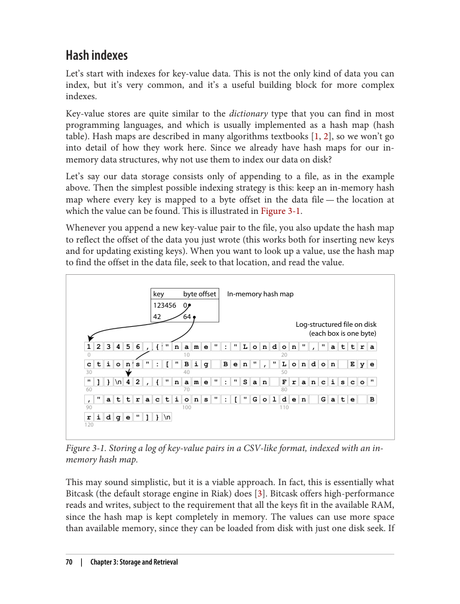

**Hình 3-1 – Lưu trữ một nhật ký các cặp khóa-giá trị theo định dạng giống CSV, được đánh chỉ mục bằng một bảng băm trong bộ nhớ (Figure 3-1. Storing a log of key-value pairs in a CSV-like format, indexed with an in-memory hash map).**

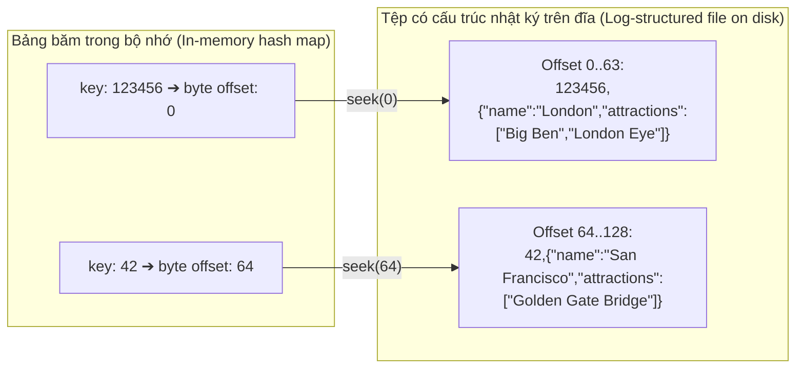

| Khóa (`key`) trong Hash Map (RAM) | Độ lệch byte (`byte offset`) | Nội dung tại vị trí tương ứng trên tệp đĩa (Disk Log File) |
| :--- | :--- | :--- |
| `123456` | `0` | `123456,{"name":"London","attractions":["Big Ben","London Eye"]}\n` (từ byte 0 đến byte 63) |
| `42` | `64` | `42,{"name":"San Francisco","attractions":["Golden Gate Bridge"]}\n` (bắt đầu từ byte 64) |

Nghe có vẻ đơn giản thái quá, nhưng đây lại là một cách tiếp cận hoàn toàn khả thi. Trên thực tế, về cơ bản đây chính là những gì **Bitcask** (bộ máy lưu trữ mặc định trong cơ sở dữ liệu phân tán **Riak**) thực hiện [3]. Bitcask cung cấp hiệu năng đọc và ghi rất cao, với điều kiện là **tất cả các khóa (keys) phải nằm gọn được trong dung lượng RAM hiện có**, bởi vì bảng băm được giữ hoàn toàn trong bộ nhớ. Các giá trị (values) thì có thể sử dụng nhiều không gian hơn bộ nhớ hiện có, vì chúng có thể được nạp từ đĩa chỉ với một thao tác dịch chuyển đầu đọc đĩa (disk seek) duy nhất. Nếu phần đó của tệp dữ liệu đã nằm sẵn trong bộ nhớ đệm của hệ thống tệp (filesystem cache / OS page cache), thì một thao tác đọc thậm chí không đòi hỏi bất kỳ thao tác vào/ra đĩa (disk I/O) nào cả.

Một bộ máy lưu trữ như Bitcask cực kỳ phù hợp trong những tình huống mà giá trị của mỗi khóa được cập nhật thường xuyên. Ví dụ, khóa có thể là URL của một video mèo, và giá trị có thể là số lần video đó đã được phát (tăng thêm 1 mỗi khi có ai đó nhấn nút play). Trong loại tải công việc (workload) này, có rất nhiều thao tác ghi, nhưng lại không có quá nhiều khóa phân biệt (distinct keys) (nhờ đó việc giữ toàn bộ các khóa trong bộ nhớ là hoàn toàn khả thi), nói cách khác là bạn có một số lượng lớn thao tác ghi trên mỗi khóa.

Theo như mô tả cho đến nay, chúng ta chỉ luôn nối thêm (append) vào một tệp — vậy làm thế nào để chúng ta tránh việc cuối cùng sẽ bị cạn kiệt không gian đĩa? Một giải pháp tốt là chia nhỏ nhật ký (log) thành các **phân đoạn (segments)** có kích thước nhất định bằng cách đóng tệp phân đoạn khi nó đạt đến một kích thước nhất định (ví dụ vài megabyte hoặc vài gigabyte) và thực hiện các lần ghi tiếp theo vào một tệp phân đoạn mới. Sau đó, chúng ta có thể thực hiện **nén gọn (compaction)** trên các phân đoạn này, như được minh họa trong **Hình 3-2 (Figure 3-2)**. Nén gọn (compaction) có nghĩa là loại bỏ các khóa trùng lặp trong nhật ký, và chỉ giữ lại bản cập nhật gần đây nhất cho mỗi khóa.

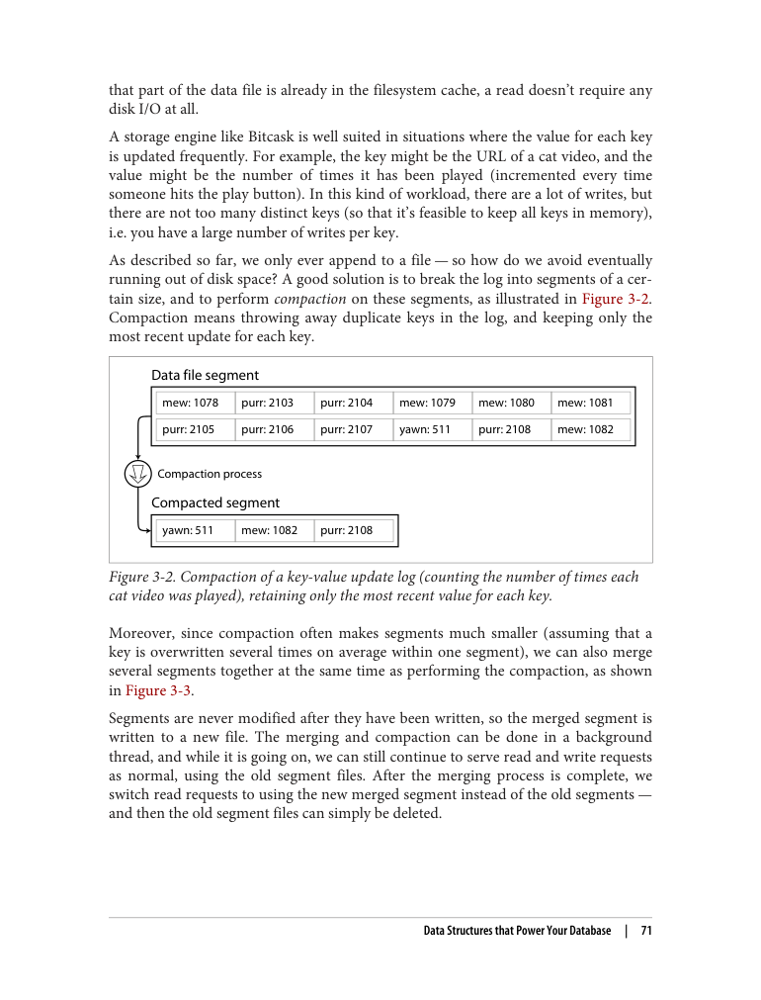

**Hình 3-2 – Nén gọn (compaction) một nhật ký cập nhật khóa-giá trị (đếm số lần mỗi video mèo được phát), chỉ giữ lại giá trị mới nhất cho mỗi khóa (Figure 3-2. Compaction of a key-value update log (counting the number of times each cat video was played), retaining only the most recent value for each key).**

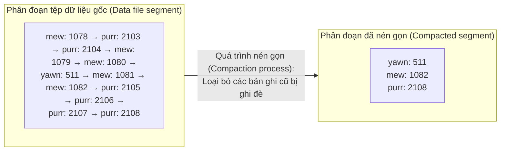

Hơn nữa, vì quá trình nén gọn thường làm cho các phân đoạn trở nên nhỏ hơn rất nhiều (giả sử rằng trung bình một khóa bị ghi đè nhiều lần bên trong một phân đoạn), chúng ta cũng có thể **hợp nhất (merge)** nhiều phân đoạn lại với nhau cùng lúc với việc thực hiện nén gọn, như được hiển thị trong **Hình 3-3 (Figure 3-3)**.

Các phân đoạn không bao giờ bị sửa đổi sau khi chúng đã được ghi xong (chúng là bất biến - immutable), vì vậy phân đoạn đã hợp nhất sẽ được ghi ra một tệp hoàn toàn mới. Việc hợp nhất và nén gọn (merging and compaction) các phân đoạn đã đóng băng có thể được thực hiện trong một luồng chạy nền (background thread), và trong khi quá trình đó đang diễn ra, chúng ta vẫn có thể tiếp tục phục vụ các yêu cầu đọc và ghi như bình thường bằng cách sử dụng các tệp phân đoạn cũ. Sau khi quá trình hợp nhất hoàn tất, chúng ta chuyển hướng các yêu cầu đọc sang sử dụng phân đoạn mới đã được hợp nhất thay vì các phân đoạn cũ — và sau đó các tệp phân đoạn cũ có thể đơn giản là được xóa bỏ hoàn toàn.

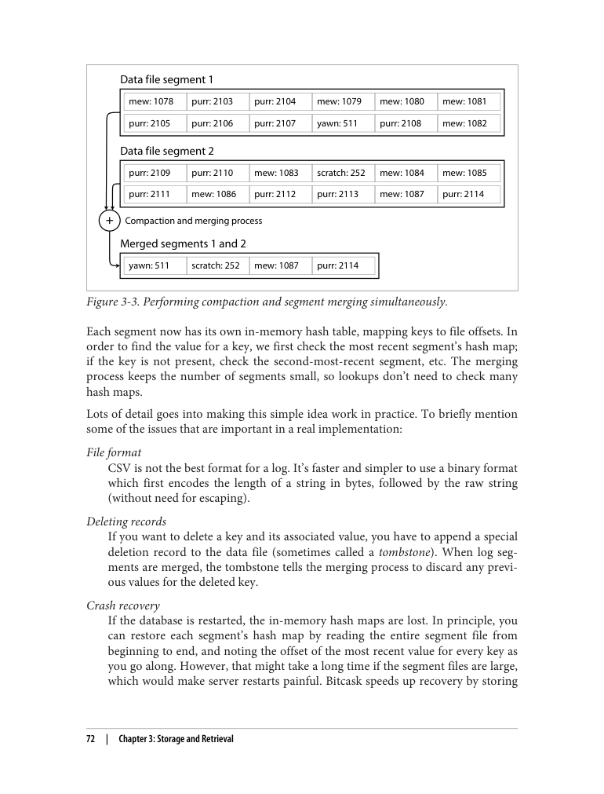

**Hình 3-3 – Thực hiện đồng thời quá trình nén gọn và hợp nhất các phân đoạn (Figure 3-3. Performing compaction and segment merging simultaneously).**

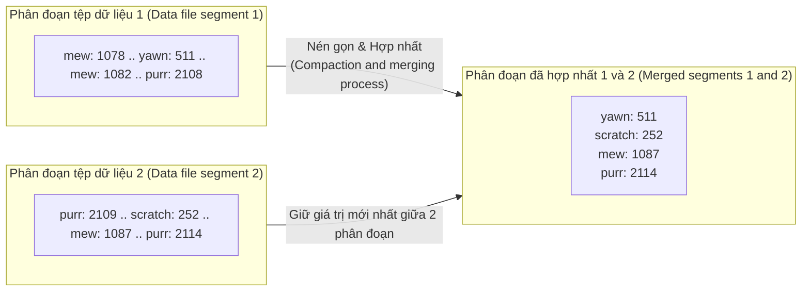

Giờ đây, mỗi phân đoạn có bảng băm trong bộ nhớ (in-memory hash table) của riêng nó, ánh xạ các khóa tới các vị trí offset trong tệp của phân đoạn đó. Để tìm giá trị cho một khóa, trước tiên chúng ta kiểm tra bảng băm của phân đoạn gần đây nhất; nếu khóa đó không có mặt ở đó, chúng ta kiểm tra phân đoạn gần đây thứ hai, v.v. Quá trình hợp nhất giữ cho số lượng phân đoạn luôn ở mức nhỏ, do đó các thao tác tra cứu không cần phải kiểm tra quá nhiều bảng băm.

Có rất nhiều chi tiết kỹ thuật cần được giải quyết để biến ý tưởng đơn giản này hoạt động trơn tru trong thực tế. Hãy điểm qua ngắn gọn một số vấn đề quan trọng trong một bản hiện thực hóa thực tế:

- **Định dạng tệp (File format):**
  CSV không phải là định dạng tốt nhất cho một nhật ký (log). Việc sử dụng một định dạng nhị phân (binary format) mà trước hết mã hóa độ dài của một chuỗi tính bằng byte, theo sau là chuỗi thô (raw string) (mà không cần phải xử lý ký tự thoát - escaping) sẽ nhanh hơn và đơn giản hơn nhiều.
- **Xóa bản ghi (Deleting records):**
  Nếu bạn muốn xóa một khóa và giá trị liên kết với nó, bạn phải nối thêm một bản ghi xóa đặc biệt vào tệp dữ liệu (đôi khi được gọi là một **bia mộ - tombstone**). Khi các phân đoạn nhật ký được hợp nhất, bản ghi bia mộ này sẽ báo cho quá trình hợp nhất biết để loại bỏ bất kỳ giá trị nào trước đó của khóa đã bị xóa.
- **Khôi phục sau sự cố (Crash recovery):**
  Nếu cơ sở dữ liệu bị khởi động lại, các bảng băm trong bộ nhớ sẽ bị mất sạch. Về nguyên tắc, bạn có thể khôi phục lại bảng băm của mỗi phân đoạn bằng cách đọc toàn bộ tệp phân đoạn từ đầu đến cuối, và ghi nhận lại vị trí offset của giá trị gần đây nhất cho mỗi khóa trong quá trình đọc. Tuy nhiên, việc đó có thể mất rất nhiều thời gian nếu các tệp phân đoạn có kích thước lớn, làm cho việc khởi động lại máy chủ trở nên vô cùng nặng nề. Bitcask tăng tốc quá trình khôi phục bằng cách lưu trữ một bản chụp nhanh (snapshot / hint file) của bảng băm thuộc mỗi phân đoạn trên đĩa, giúp nạp lại vào bộ nhớ nhanh hơn rất nhiều.
- **Các bản ghi bị ghi dở dang một phần (Partially written records):**
  Cơ sở dữ liệu có thể gặp sự cố sập nguồn (crash) bất kỳ lúc nào, kể cả khi đang ghi dở một nửa bản ghi vào nhật ký. Các tệp của Bitcask bao gồm các mã kiểm tra tổng (**checksums**, ví dụ CRC32), cho phép phát hiện và bỏ qua những phần bị hỏng (corrupted) như vậy của nhật ký.
- **Kiểm soát đồng thời (Concurrency control):**
  Vì các thao tác ghi được nối thêm vào nhật ký theo một trình tự tuần tự nghiêm ngặt (strictly sequential order), một lựa chọn hiện thực hóa phổ biến là chỉ sử dụng duy nhất một luồng ghi (single writer thread). Các phân đoạn tệp dữ liệu chỉ cho phép nối thêm (append-only) và ngoài ra là hoàn toàn bất biến (immutable), vì vậy chúng có thể được đọc đồng thời bởi nhiều luồng (multiple reader threads) mà không cần cơ chế khóa phức tạp.

Thoạt nhìn, một nhật ký chỉ cho phép nối thêm (append-only log) có vẻ lãng phí: tại sao bạn không cập nhật tệp ngay tại chỗ (update in place), ghi đè giá trị mới lên trên giá trị cũ? Nhưng thiết kế chỉ nối thêm hóa ra lại rất tốt vì nhiều lý do:

- **Ghi tuần tự nhanh hơn nhiều so với ghi ngẫu nhiên:** Việc nối thêm (appending) và hợp nhất phân đoạn (segment merging) đều là các thao tác ghi tuần tự (sequential write operations), nhìn chung nhanh hơn rất nhiều so với các thao tác ghi ngẫu nhiên (random writes). Sự chênh lệch hiệu năng này áp dụng cho cả ổ cứng đĩa từ quay truyền thống (magnetic spinning-disk hard drives - HDD) lẫn ổ cứng thể rắn dựa trên bộ nhớ flash (flash-based solid state drives - SSD) [4].
- **Đơn giản hóa việc xử lý đồng thời và khôi phục sau sự cố:** Kiểm soát đồng thời (concurrency) và khôi phục sau sự cố (crash recovery) đơn giản hơn rất nhiều nếu các tệp phân đoạn là chỉ nối thêm (append-only) hoặc bất biến (immutable). Ví dụ, bạn không phải lo lắng về trường hợp sự cố sập nguồn xảy ra ngay trong khi một giá trị đang bị ghi đè tại chỗ, để lại cho bạn một tệp chứa một phần của giá trị cũ và một phần của giá trị mới bị chắp vá lẫn lộn vào nhau.
- **Tránh phân mảnh tệp:** Việc hợp nhất các phân đoạn cũ giúp tránh được vấn đề các tệp dữ liệu bị phân mảnh (fragmented) theo thời gian.

Tuy nhiên, chỉ mục bảng băm (hash table index) cũng có những hạn chế lớn:

- **Bảng băm phải nằm vừa trong bộ nhớ (RAM):** Bảng băm bắt buộc phải nằm gọn trong bộ nhớ, vì vậy nếu bạn có một số lượng khóa cực kỳ lớn, bạn sẽ gặp bế tắc. Về nguyên tắc, bạn có thể duy trì một bảng băm trên đĩa, nhưng đáng tiếc là rất khó để làm cho một bảng băm trên đĩa (on-disk hash map) đạt hiệu năng tốt. Nó đòi hỏi rất nhiều thao tác I/O truy cập ngẫu nhiên (random access I/O), rất tốn kém để mở rộng kích thước (resize/rehash) khi nó bị đầy, và việc xử lý đụng độ băm (hash collisions) đòi hỏi logic vô cùng rắc rối [5].
- **Các truy vấn khoảng (Range queries) không hiệu quả:** Ví dụ, bạn không thể dễ dàng lấy ra tất cả các giá trị cho các khóa nằm trong khoảng từ `kitty00000` đến `kitty99999` — bạn sẽ buộc phải tra cứu riêng lẻ từng khóa một trong các bảng băm.

Trong mục tiếp theo, chúng ta sẽ xem xét một cấu trúc đánh chỉ mục không mắc phải những hạn chế đó.

> 📝 **Giải thích thêm (không có trong sách): Cấu trúc một bản ghi nhị phân trong Bitcask**
> Trong tài liệu thiết kế gốc của Bitcask (Riak), mỗi bản ghi được nối thêm (append) vào tệp phân đoạn có bố cục nhị phân cực kỳ gọn gàng như sau:
>
> ```
> +-----------+-----------+----------+------------+---------+---------+
> | CRC (4B)  | Tstamp(4B)| KeySz(2B)| ValSz (4B) |   Key   |  Value  |
> +-----------+-----------+----------+------------+---------+---------+
> ```
>
> Và trong RAM, bảng băm của Bitcask (gọi là `KeyDir`) ánh xạ `Key ➔ (file_id, value_size, value_pos, timestamp)`. Khi client gọi `GET(key)`, Bitcask chỉ cần tra `KeyDir` trong RAM với độ phức tạp $O(1)$ để lấy được chính xác tệp `file_id`, vị trí byte `value_pos` và độ dài `value_size`, sau đó gọi một lệnh hệ thống `pread(fd, buf, value_size, value_pos)` duy nhất để đọc thẳng dữ liệu từ đĩa!

---

### SSTables và LSM-trees (SSTables and LSM-trees)

Trong **Hình 3-3 (Figure 3-3)**, mỗi phân đoạn lưu trữ có cấu trúc nhật ký (log-structured storage segment) là một chuỗi các cặp khóa-giá trị. Các cặp này xuất hiện theo đúng thứ tự mà chúng đã được ghi vào, và các giá trị nằm ở phần sau của nhật ký sẽ có quyền ưu tiên cao hơn (ghi đè) các giá trị của cùng khóa đó nằm ở phần trước của nhật ký. Ngoài quy tắc đó ra, thứ tự của các cặp khóa-giá trị trong tệp không có ý nghĩa gì khác.

Bây giờ, chúng ta có thể thực hiện một thay đổi đơn giản đối với định dạng của các tệp phân đoạn: chúng ta yêu cầu rằng **chuỗi các cặp khóa-giá trị phải được sắp xếp theo khóa (sorted by key)**. Thoạt nhìn, yêu cầu đó dường như phá vỡ khả năng sử dụng các thao tác ghi tuần tự (sequential writes) của chúng ta, nhưng chúng ta sẽ giải quyết điểm đó ngay sau đây.

Chúng ta gọi định dạng này là **Bảng Chuỗi Đã Sắp Xếp (Sorted String Table)**, hay viết tắt là **SSTable**. Chúng ta cũng yêu cầu rằng mỗi khóa chỉ xuất hiện duy nhất một lần bên trong mỗi tệp phân đoạn đã được hợp nhất (quá trình hợp nhất vốn dĩ đã đảm bảo điều đó). SSTables có một số lợi thế rất lớn so với các phân đoạn nhật ký sử dụng chỉ mục băm:

1. **Việc hợp nhất các phân đoạn (merging segments) rất đơn giản và hiệu quả**, ngay cả khi các tệp có kích thước lớn hơn bộ nhớ (RAM) hiện có. Cách tiếp cận này giống hệt như cách được sử dụng trong giải thuật sắp xếp trộn (**mergesort**), và được minh họa trong **Hình 3-4 (Figure 3-4)**: bạn bắt đầu đọc các tệp đầu vào song song cạnh nhau (side-by-side), nhìn vào khóa đầu tiên trong mỗi tệp, sao chép khóa nhỏ nhất (theo thứ tự sắp xếp) sang tệp đầu ra, và lặp lại quá trình đó. Điều này tạo ra một tệp phân đoạn mới đã được hợp nhất, và cũng được sắp xếp theo khóa.

   Điều gì xảy ra nếu cùng một khóa xuất hiện trong nhiều phân đoạn đầu vào? Hãy nhớ rằng mỗi phân đoạn chứa tất cả các giá trị được ghi vào cơ sở dữ liệu trong một khoảng thời gian nào đó. Điều này có nghĩa là tất cả các giá trị trong một phân đoạn đầu vào chắc chắn phải mới hơn tất cả các giá trị trong phân đoạn kia (giả sử rằng chúng ta luôn hợp nhất các phân đoạn liền kề nhau về mặt thời gian). Khi nhiều phân đoạn chứa cùng một khóa, chúng ta có thể giữ lại giá trị từ phân đoạn gần đây nhất, và loại bỏ các giá trị nằm trong các phân đoạn cũ hơn.

2. **Để tìm một khóa cụ thể trong tệp, bạn không còn cần phải giữ một chỉ mục của tất cả các khóa trong bộ nhớ nữa.** Hãy xem **Hình 3-5 (Figure 3-5)** làm ví dụ: giả sử bạn đang tìm kiếm khóa `handiwork`, nhưng bạn không biết chính xác vị trí offset của khóa đó trong tệp phân đoạn. Tuy nhiên, bạn lại biết vị trí offset của hai khóa `handbag` và `handsome`, và nhờ có tính chất đã được sắp xếp, bạn biết chắc chắn rằng `handiwork` phải xuất hiện ở đâu đó nằm giữa hai khóa này (vì theo thứ tự từ điển: `"handbag" < "handiwork" < "handsome"`). Vì vậy, bạn có thể nhảy tới vị trí offset của `handbag` và quét tuần tự từ đó cho đến khi bạn tìm thấy `handiwork` (hoặc không tìm thấy, nếu khóa đó không tồn tại trong tệp).

   Bạn vẫn cần một chỉ mục trong bộ nhớ (in-memory index) để cho bạn biết vị trí offset của một số khóa, nhưng chỉ mục này có thể là **chỉ mục thưa (sparse index)**: chỉ cần lưu một khóa cho mỗi vài kilobyte của tệp phân đoạn là đủ, bởi vì vài kilobyte dữ liệu có thể được quét qua cực kỳ nhanh chóng.<sup>ii</sup>

> <sup>ii</sup> Nếu tất cả các khóa và giá trị đều có kích thước cố định (fixed size), bạn có thể sử dụng tìm kiếm nhị phân (binary search) trực tiếp trên một tệp phân đoạn và loại bỏ hoàn toàn chỉ mục trong bộ nhớ. Tuy nhiên, trong thực tế chúng thường có độ dài thay đổi (variable-length), khiến cho việc xác định nơi một bản ghi kết thúc và bản ghi tiếp theo bắt đầu trở nên bất khả thi nếu bạn không có một chỉ mục.

3. **Vì các yêu cầu đọc đằng nào cũng cần phải quét qua một số cặp khóa-giá trị trong khoảng được yêu cầu, nên ta có thể gom nhóm các bản ghi đó lại thành một khối (block) và nén nó lại (compress) trước khi ghi xuống đĩa** (được biểu thị bằng vùng tô xám trong **Hình 3-5 (Figure 3-5)**). Khi đó, mỗi mục (entry) của chỉ mục thưa trong bộ nhớ sẽ trỏ tới điểm bắt đầu của một khối đã nén (compressed block). Bên cạnh việc tiết kiệm không gian đĩa, việc nén còn làm giảm lượng dữ liệu cần truyền qua bus I/O. Ngày nay, băng thông đĩa (disk bandwidth) thường là nút thắt cổ chai (bottleneck) tệ hơn nhiều so với CPU, vì vậy việc bỏ ra thêm một vài chu kỳ CPU để giảm lượng dữ liệu bạn cần ghi xuống và đọc lên từ đĩa là hoàn toàn xứng đáng.

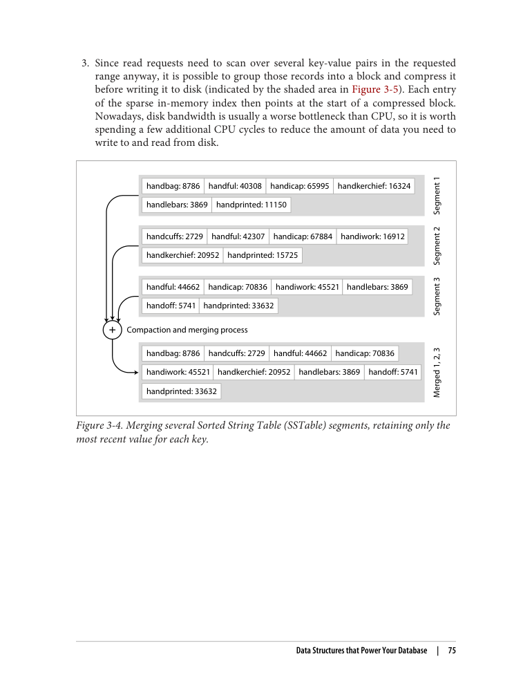

**Hình 3-4 – Hợp nhất nhiều phân đoạn Bảng Chuỗi Đã Sắp Xếp (SSTable), chỉ giữ lại giá trị gần đây nhất cho mỗi khóa (Figure 3-4. Merging several Sorted String Table (SSTable) segments, retaining only the most recent value for each key).**

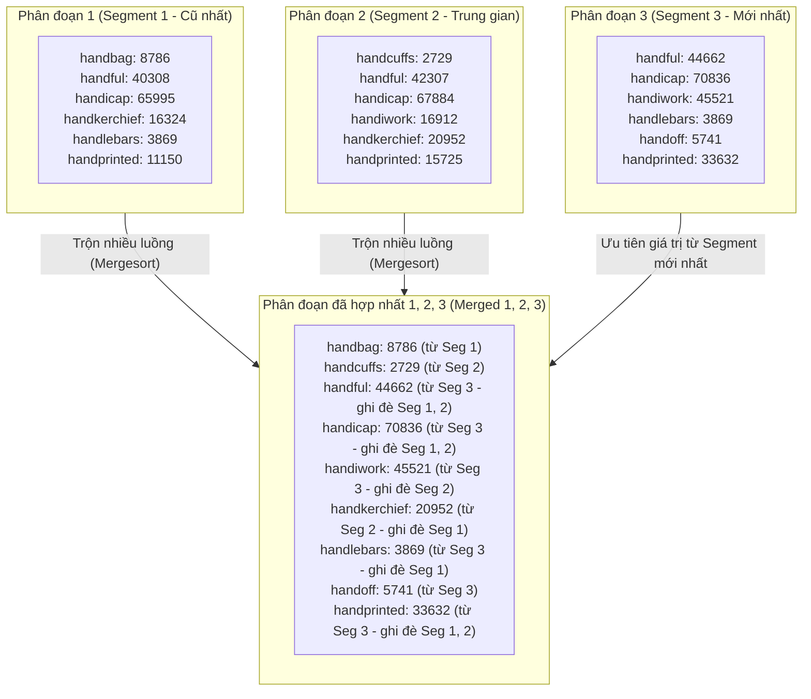

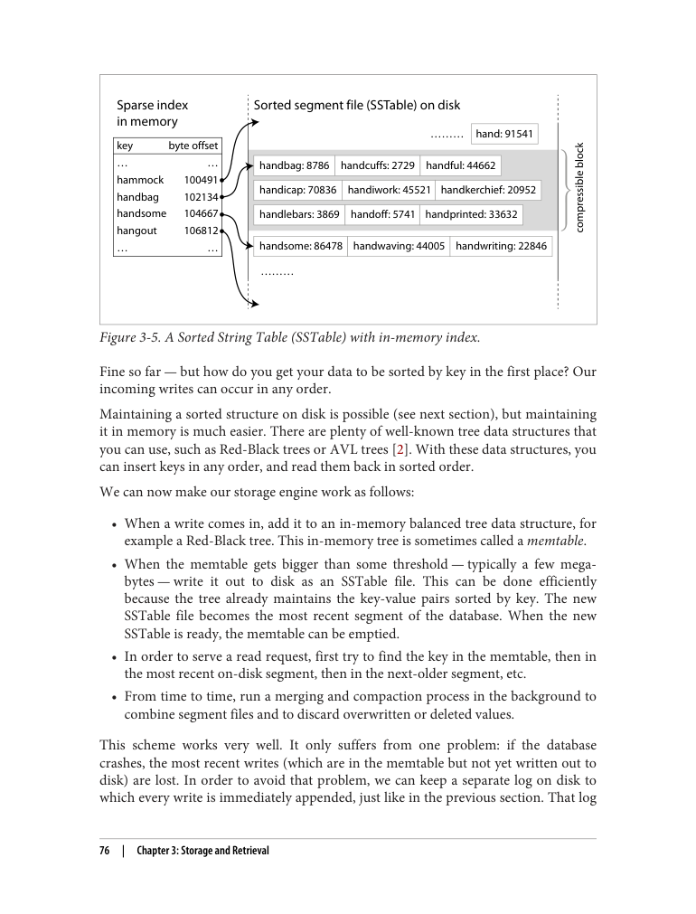

**Hình 3-5 – Một Bảng Chuỗi Đã Sắp Xếp (SSTable) với chỉ mục thưa trong bộ nhớ (Figure 3-5. A Sorted String Table (SSTable) with in-memory index).**

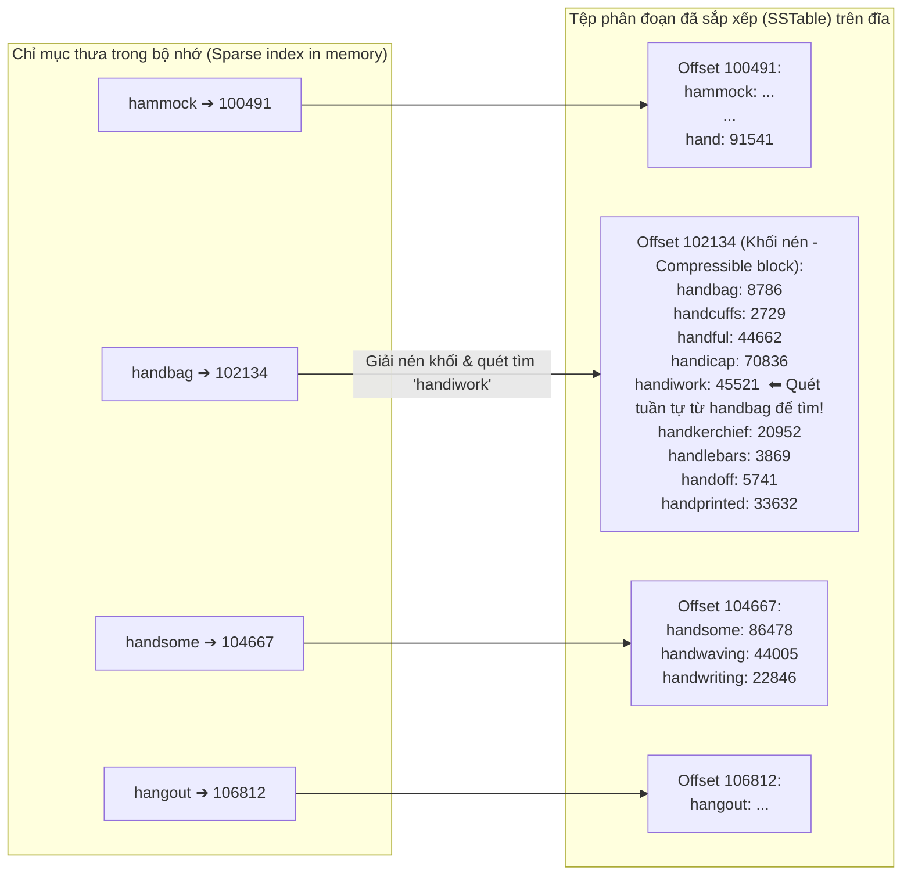

#### Xây dựng và duy trì SSTables (Constructing and maintaining SSTables)

Cho đến đây mọi thứ đều rất tuyệt — nhưng làm thế nào để bạn làm cho dữ liệu của mình được sắp xếp theo khóa ngay từ đầu? Các thao tác ghi đi vào hệ thống của chúng ta có thể xảy ra theo bất kỳ thứ tự ngẫu nhiên nào.

Việc duy trì một cấu trúc đã sắp xếp trực tiếp trên đĩa là hoàn toàn có thể (xem mục *B-trees* tiếp theo), nhưng việc duy trì nó trong bộ nhớ (in memory) lại dễ dàng hơn rất nhiều. Có rất nhiều cấu trúc dữ liệu cây đã được biết đến rộng rãi mà bạn có thể sử dụng, chẳng hạn như **cây Đỏ-Đen (Red-Black trees)** hoặc **cây AVL (AVL trees)** [2] (hoặc **Skip List** trong LevelDB/RocksDB). Với những cấu trúc dữ liệu này, bạn có thể chèn các khóa vào theo bất kỳ thứ tự nào, và đọc chúng ra theo đúng thứ tự đã được sắp xếp.

Giờ đây, chúng ta có thể làm cho bộ máy lưu trữ của mình hoạt động theo quy trình như sau:

- **Khi có một thao tác ghi (write) đi vào:** Hãy thêm nó vào một cấu trúc dữ liệu cây cân bằng trong bộ nhớ (in-memory balanced tree data structure), ví dụ như một cây Đỏ-Đen. Cây trong bộ nhớ này đôi khi được gọi là một **memtable** (bảng bộ nhớ).
- **Khi memtable phình to vượt quá một ngưỡng nhất định (threshold) — thường là vài megabyte:** Hãy ghi toàn bộ nó xuống đĩa dưới dạng một tệp **SSTable**. Việc này có thể được thực hiện cực kỳ hiệu quả bởi vì cây trong bộ nhớ đã duy trì sẵn các cặp khóa-giá trị theo thứ tự sắp xếp của khóa rồi (do đó chỉ cần duyệt cây theo thứ tự trung thứ tự - in-order traversal và ghi tuần tự một mạch xuống đĩa). Tệp SSTable mới này sẽ trở thành phân đoạn gần đây nhất (most recent segment) của cơ sở dữ liệu. Trong khi SSTable đang được ghi xuống đĩa, các thao tác ghi mới có thể tiếp tục được ghi vào một thực thể memtable mới.
- **Để phục vụ một yêu cầu đọc (read request):** Trước tiên hãy thử tìm khóa đó trong **memtable** hiện tại; nếu không thấy, hãy tìm trong phân đoạn trên đĩa gần đây nhất (most recent on-disk segment); nếu vẫn không thấy, tìm tiếp trong phân đoạn cũ hơn kế tiếp (next-older segment), v.v.
- **Định kỳ theo thời gian:** Chạy một tiến trình hợp nhất và nén gọn (merging and compaction process) ở chế độ nền (background) để kết hợp các tệp phân đoạn lại với nhau và loại bỏ các giá trị đã bị ghi đè hoặc đã bị xóa (tombstones).

Cơ chế này hoạt động rất tốt. Nó chỉ gặp phải một vấn đề duy nhất: nếu cơ sở dữ liệu bị sập nguồn (crash), những thao tác ghi gần đây nhất (vốn đang nằm trong memtable trên RAM nhưng chưa kịp được ghi ra đĩa thành tệp SSTable) sẽ bị mất sạch. Để tránh vấn đề đó, chúng ta có thể duy trì một **nhật ký riêng biệt trên đĩa (separate log on disk — thường gọi là Write-Ahead Log / Commit Log)** mà mọi thao tác ghi đều được nối thêm (append) vào ngay lập tức, giống hệt như trong phần chỉ mục băm trước đó. Nhật ký đó không có thứ tự sắp xếp, nhưng điều đó không quan trọng, bởi vì mục đích duy nhất của nó là để khôi phục lại memtable sau khi xảy ra sự cố sập nguồn. Mỗi khi một memtable được ghi xong ra thành một tệp SSTable trên đĩa, tệp nhật ký tương ứng với nó có thể được xóa bỏ (discarded).

#### Tạo thành LSM-tree từ SSTables (Making an LSM-tree out of SSTables)

Giải thuật được mô tả ở đây về cơ bản chính là những gì được sử dụng trong **LevelDB** [6] và **RocksDB** [7] — các thư viện bộ máy lưu trữ khóa-giá trị (key-value storage engine libraries) được thiết kế để nhúng (embedded) vào bên trong các ứng dụng khác. Ngoài nhiều ứng dụng khác, LevelDB có thể được cấu hình để sử dụng trong Riak như một sự thay thế cho Bitcask. Các bộ máy lưu trữ tương tự cũng được sử dụng trong **Apache Cassandra** và **Apache HBase** [8], cả hai hệ thống này đều được lấy cảm hứng từ bài báo **Bigtable** nổi tiếng của Google [9] (bài báo đã giới thiệu hai thuật ngữ *SSTable* và *memtable*). Ban đầu, cấu trúc đánh chỉ mục này được mô tả bởi Patrick O’Neil và các cộng sự dưới tên gọi **Log-Structured Merge-Tree** (hay **LSM-Tree** — Cây Hợp Nhất Có Cấu Trúc Nhật Ký) [10], xây dựng dựa trên các công trình nghiên cứu trước đó về hệ thống tệp có cấu trúc nhật ký (log-structured file systems) [11]. Do đó, các bộ máy lưu trữ dựa trên nguyên lý hợp nhất và nén gọn các tệp đã sắp xếp này thường được gọi chung là các bộ máy lưu trữ **LSM** (LSM storage engines).

**Lucene**, một bộ máy đánh chỉ mục cho tìm kiếm toàn văn (full-text search) được sử dụng bởi **Elasticsearch** và **Solr**, cũng sử dụng một phương pháp tương tự để lưu trữ từ điển thuật ngữ (term dictionary) của nó [12, 13]. Một chỉ mục toàn văn phức tạp hơn nhiều so với một chỉ mục khóa-giá trị thông thường, nhưng ở phần lõi của nó vẫn là một ý tưởng tương tự: cho trước một từ (word) trong một truy vấn tìm kiếm, hãy tìm tất cả các tài liệu (trang web, mô tả sản phẩm, v.v.) có nhắc đến từ đó. Điều này được hiện thực hóa bằng một cấu trúc khóa-giá trị trong đó khóa (key) là một từ (một *thuật ngữ - term*), và giá trị (value) là danh sách các ID của tất cả các tài liệu có chứa từ đó (được gọi là *danh sách bài đăng - postings list*). Trong Lucene, ánh xạ từ thuật ngữ (term) tới danh sách bài đăng (postings list) này được lưu giữ trong các tệp đã sắp xếp giống như SSTable, và các tệp này được hợp nhất ở chế độ nền khi cần thiết [14].

#### Tối ưu hóa hiệu năng và Bộ lọc Bloom (Performance optimizations)

Như mọi khi, có rất nhiều chi tiết tinh vi cần được chăm chút để làm cho một bộ máy lưu trữ đạt hiệu năng cao trong thực tế. Ví dụ, giải thuật LSM-tree có thể bị chậm khi tra cứu **các khóa không tồn tại** trong cơ sở dữ liệu: bạn buộc phải kiểm tra memtable, sau đó kiểm tra lần lượt từng phân đoạn SSTable lùi dần về tận phân đoạn cũ nhất (có khả năng phải đọc từ đĩa cho mỗi phân đoạn) trước khi bạn có thể chắc chắn rằng khóa đó thực sự không tồn tại.

Để tối ưu hóa trường hợp này, các bộ máy lưu trữ (như LevelDB, RocksDB, Cassandra) thường sử dụng thêm **bộ lọc Bloom (Bloom filters)** [15]. (Bộ lọc Bloom là một cấu trúc dữ liệu tiết kiệm bộ nhớ dùng để xấp xỉ nội dung của một tập hợp. Nó có thể cho bạn biết chắc chắn nếu một khóa **không xuất hiện** trong cơ sở dữ liệu, và nhờ đó tiết kiệm được rất nhiều lần đọc đĩa không cần thiết đối với các khóa không tồn tại.)

Tuy nhiên, ý tưởng cơ bản — giữ một chuỗi thác nước các tệp SSTable được hợp nhất ở chế độ nền — là vô cùng đơn giản và hiệu quả. Ngay cả khi tập dữ liệu (dataset) lớn hơn bộ nhớ RAM rất nhiều, nó vẫn tiếp tục hoạt động tốt. Vì dữ liệu được lưu trữ theo thứ tự đã sắp xếp, bạn có thể thực hiện hiệu quả các truy vấn khoảng (range queries — quét tất cả các khóa lớn hơn một giá trị tối thiểu nào đó và nhỏ hơn hoặc bằng một giá trị tối đa nào đó). Và bởi vì các thao tác ghi xuống đĩa đều là ghi tuần tự (sequential writes), LSM-tree có thể hỗ trợ thông lượng ghi (write throughput) cao đến mức đáng kinh ngạc.

> 📝 **Giải thích thêm (không có trong sách): Kiến trúc chi tiết của LSM-Tree (RocksDB / Cassandra) và Chiến lược Compaction**
> Để hình dung rõ hơn luồng đọc/ghi hoàn chỉnh của một LSM-tree trong thực tế (như RocksDB hoặc Apache Cassandra), hãy quan sát sơ đồ kiến trúc dưới đây:
>
> ```mermaid
> flowchart TD
>     Write["Yêu cầu GHI: PUT(k, v)"] --> WAL["1. Ghi nối thêm vào Write-Ahead Log (WAL) trên Đĩa (Tuần tự)"]
>     Write --> Mem["2. Chèn vào Memtable trên RAM (SkipList / Red-Black Tree)"]
>     Mem -->|"Khi đầy (~64MB): Đóng băng thành Immutable Memtable"| Flush["Flush tuần tự xuống Đĩa"]
>     Flush --> L0["SSTable Level 0 (L0) trên Đĩa"]
>     L0 -->|"Compaction & Merge"| L1["SSTable Level 1 (L1 - Các dải khóa không chồng lấn)"]
>     L1 -->|"Compaction & Merge"| L2["SSTable Level 2 (L2 - Lớn gấp 10 lần L1)"]
>
>     Read["Yêu cầu ĐỌC: GET(k)"] --> RMem["1. Tìm trong Memtable (RAM)"]
>     RMem -->|"Không thấy"| RBloom["2. Kiểm tra Bloom Filter (RAM) của từng SSTable"]
>     RBloom -->|"Có thể tồn tại"| RSparse["3. Tra Sparse Index (RAM) ➔ Đọc Block từ SSTable (Đĩa)"]
> ```
>
> Có hai chiến lược nén gọn (Compaction strategies) nổi tiếng nhất trong thế giới LSM-tree:
> 1. **Size-Tiered Compaction Strategy (STCS — mặc định trong Cassandra, HBase):** Khi có đủ một số lượng SSTable nhỏ có kích thước tương đương nhau (ví dụ 4 tệp 100MB), hệ thống sẽ gộp chúng lại thành một tệp SSTable lớn hơn (400MB). Khi có đủ 4 tệp 400MB, lại gộp thành tệp 1.6GB. STCS tối ưu cho tải **ghi cực nặng (write-intensive)** nhưng có nhược điểm là tốn nhiều dung lượng đĩa tạm thời (cần tới ~50% dung lượng đĩa trống để gộp các tệp khổng lồ).
> 2. **Leveled Compaction Strategy (LCS — mặc định trong LevelDB, RocksDB):** Chia đĩa thành các tầng $L_0, L_1, L_2, \dots, L_k$. Tầng $L_1$ giới hạn 10MB, $L_2$ là 100MB, $L_3$ là 1GB (mỗi tầng lớn gấp 10 lần tầng trước). Điểm đặc biệt là từ tầng $L_1$ trở đi, các tệp SSTable trong cùng một tầng được chia nhỏ và **không bao giờ có khoảng khóa chồng lấn nhau (non-overlapping key ranges)**. Nhờ vậy, khi đọc dữ liệu ở tầng $L_1, L_2, \dots$, bạn chỉ cần kiểm tra tối đa 1 tệp SSTable trên mỗi tầng và tiết kiệm không gian đĩa vượt trội (chỉ tốn khoảng ~10% dung lượng dư thừa).


---

### B-trees

Các chỉ mục có cấu trúc nhật ký (log-structured indexes) mà chúng ta đã thảo luận cho đến nay đang ngày càng được chấp nhận rộng rãi, nhưng chúng không phải là loại chỉ mục phổ biến nhất. Cấu trúc đánh chỉ mục được sử dụng rộng rãi nhất lại hoàn toàn khác biệt: đó là **B-tree** (Cây B).

Được giới thiệu vào năm 1970 [16] và được gọi là "có mặt ở khắp mọi nơi (ubiquitous)" chỉ chưa đầy 10 năm sau đó [17], B-trees đã vượt qua thử thách của thời gian một cách xuất sắc. Chúng vẫn là cách hiện thực hóa chỉ mục tiêu chuẩn trong hầu hết tất cả các cơ sở dữ liệu quan hệ (relational databases), và rất nhiều cơ sở dữ liệu phi quan hệ (non-relational databases) cũng sử dụng chúng.

Giống như SSTables, B-trees giữ các cặp khóa-giá trị được sắp xếp theo khóa (sorted by key), điều này cho phép thực hiện hiệu quả các thao tác tra cứu khóa-giá trị (key-value lookups) cũng như các truy vấn khoảng (range queries). Nhưng sự tương đồng chỉ dừng lại ở đó: B-trees có một triết lý thiết kế hoàn toàn khác biệt.

Các chỉ mục có cấu trúc nhật ký mà chúng ta đã thấy trước đó chia nhỏ cơ sở dữ liệu thành các phân đoạn có kích thước thay đổi (variable-size segments), thường có kích thước từ vài megabyte trở lên, và luôn luôn ghi một phân đoạn một cách tuần tự (sequentially). Ngược lại, **B-trees chia nhỏ cơ sở dữ liệu thành các khối (blocks) hoặc các trang (pages) có kích thước cố định (fixed-size)**, theo truyền thống thường có kích thước **4 kB** (hoặc 8 kB trong PostgreSQL, 16 kB trong MySQL InnoDB), và đọc hoặc ghi từng trang một tại một thời điểm. Thiết kế này tương ứng sát hơn với phần cứng bên dưới, bởi vì các ổ đĩa cũng được bố trí thành các khối có kích thước cố định.

Mỗi trang (page) có thể được định danh bằng một địa chỉ hoặc vị trí (address or location), cho phép một trang tham chiếu tới một trang khác — tương tự như một con trỏ (pointer), nhưng nằm trên đĩa thay vì trong bộ nhớ RAM. Chúng ta có thể sử dụng các tham chiếu trang này để xây dựng nên một cây gồm các trang (a tree of pages), như được minh họa trong **Hình 3-6 (Figure 3-6)**.

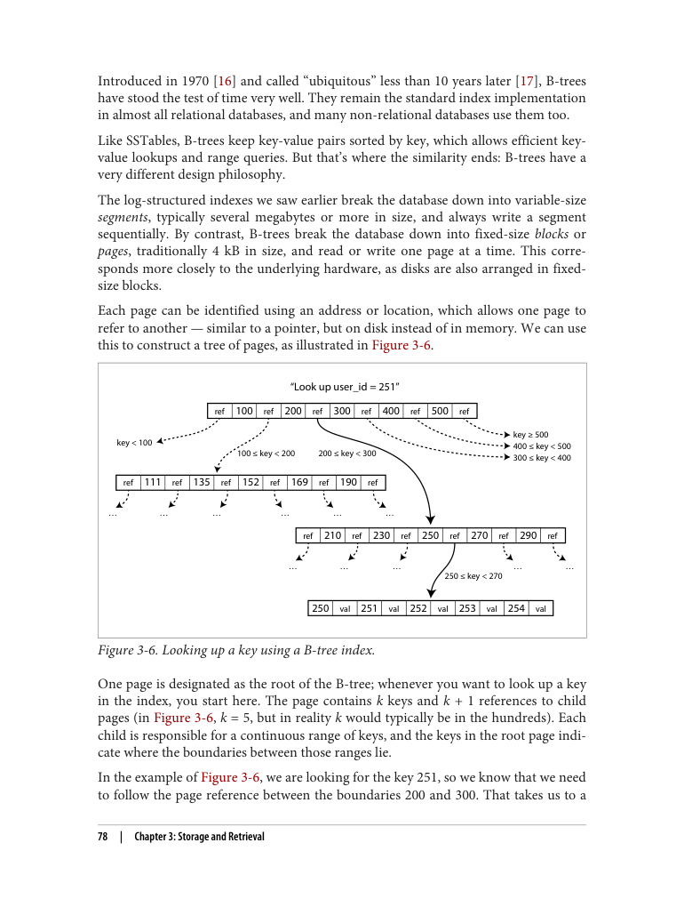

**Hình 3-6 – Tra cứu một khóa bằng cách sử dụng chỉ mục B-tree (Figure 3-6. Looking up a key using a B-tree index).**

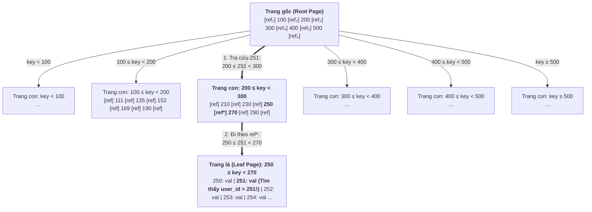

Một trang được chỉ định làm **gốc của cây B-tree (root of the B-tree)**; bất cứ khi nào bạn muốn tra cứu một khóa trong chỉ mục, bạn luôn bắt đầu từ đây. Trang này chứa $k$ khóa và $k + 1$ tham chiếu (references) tới các trang con (child pages) (trong **Hình 3-6 (Figure 3-6)**, $k = 5$, nhưng trong thực tế $k$ thường lên tới hàng trăm). Mỗi trang con chịu trách nhiệm cho một khoảng khóa liên tục (continuous range of keys), và các khóa nằm trong trang gốc cho biết ranh giới (boundaries) giữa các khoảng khóa đó nằm ở đâu.

Trong ví dụ ở **Hình 3-6 (Figure 3-6)**, chúng ta đang tìm kiếm khóa `251` (`"Look up user_id = 251"`), vì vậy chúng ta biết rằng mình cần phải đi theo tham chiếu trang nằm giữa hai ranh giới `200` và `300`. Tham chiếu đó đưa chúng ta đến một trang có hình dạng tương tự, trang này tiếp tục chia nhỏ khoảng `200–300` thành các khoảng con nhỏ hơn (`200–210`, `210–230`, `230–250`, `250–270`, `270–290`, `290–300`). Cuối cùng, chúng ta đi xuống tới một trang chứa từng khóa riêng lẻ (được gọi là một **trang lá - leaf page**), trang lá này hoặc chứa trực tiếp giá trị (value) cho mỗi khóa ngay bên trong nó (inline), hoặc chứa các tham chiếu tới những trang lưu trữ nơi có thể tìm thấy từng giá trị đó.

Số lượng các tham chiếu tới các trang con trong một trang của B-tree được gọi là **hệ số phân nhánh (branching factor)**. Ví dụ, trong **Hình 3-6 (Figure 3-6)**, hệ số phân nhánh là 6. Trong thực tế, hệ số phân nhánh phụ thuộc vào lượng không gian cần thiết để lưu trữ các tham chiếu trang và các ranh giới khoảng khóa, nhưng thông thường nó lên tới vài trăm (several hundred).

Nếu bạn muốn **cập nhật giá trị cho một khóa đã tồn tại** trong B-tree, bạn tìm kiếm trang lá có chứa khóa đó, thay đổi giá trị trong trang đó, và ghi trang đó ngược trở lại đĩa (mọi tham chiếu trỏ tới trang đó vẫn giữ nguyên giá trị hợp lệ). Nếu bạn muốn **thêm một khóa mới**, bạn cần tìm trang có khoảng khóa bao trùm khóa mới đó, và thêm khóa mới vào trang đó. Nếu không còn đủ không gian trống (free space / spare space) trong trang để chứa khóa mới, trang đó sẽ bị **tách (split)** thành hai trang đầy một nửa (half-full pages), và trang cha (parent page) sẽ được cập nhật để ghi nhận sự phân chia mới của các khoảng khóa — xem **Hình 3-7 (Figure 3-7)**.<sup>iii</sup>

> <sup>iii</sup> Việc chèn một khóa mới vào B-tree khá trực quan và dễ hiểu, nhưng việc xóa một khóa (trong khi vẫn giữ cho cây cân bằng, ví dụ bằng cách gộp các trang anh em hoặc phân phối lại khóa) thì phức tạp hơn đôi chút [2].

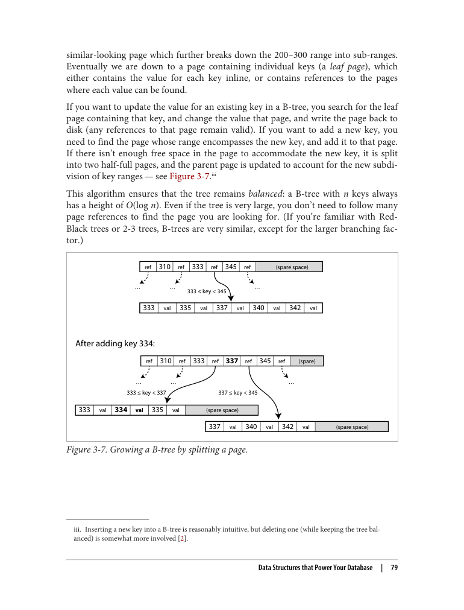

**Hình 3-7 – Mở rộng một cây B-tree bằng cách tách một trang (Figure 3-7. Growing a B-tree by splitting a page).**

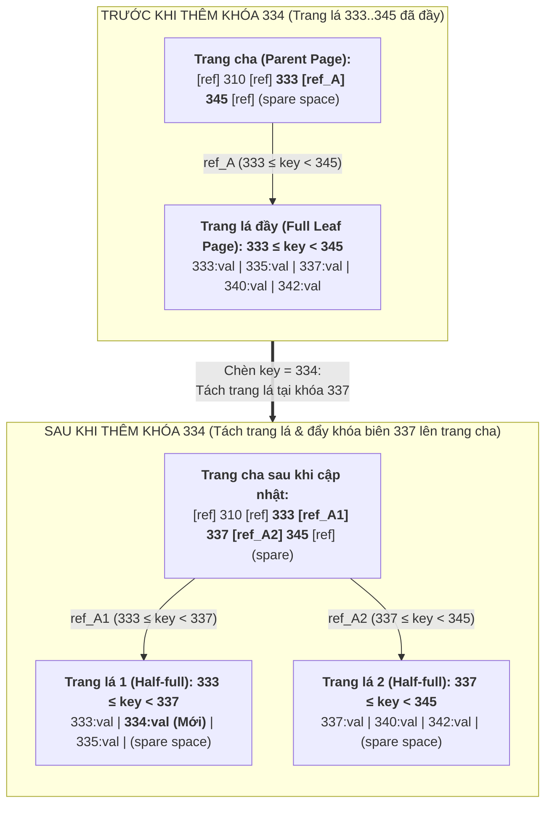

Giải thuật này đảm bảo rằng cây luôn luôn giữ được trạng thái **cân bằng (balanced)**: một cây B-tree với $n$ khóa luôn luôn có chiều cao (height / depth) là $O(\log n)$. Ngay cả khi cây có kích thước rất lớn, bạn cũng không cần phải đi theo quá nhiều tham chiếu trang để tìm ra trang mà bạn đang tìm kiếm. (Nếu bạn đã quen thuộc với cây Đỏ-Đen hoặc cây 2-3, thì B-trees rất giống với chúng, ngoại trừ việc B-trees có hệ số phân nhánh lớn hơn rất nhiều). Hầu hết các cơ sở dữ liệu có thể nằm gọn trong một cây B-tree có độ sâu chỉ từ 3 đến 4 tầng (levels), vì vậy bạn không cần phải đi theo nhiều tham chiếu trang để tìm được trang mình cần tra cứu. (Một cây 4 tầng gồm các trang kích thước 4 kB với hệ số phân nhánh là 500 có thể lưu trữ tới $500^4 \times 4\text{ kB} = 250\text{ TB}$ dữ liệu!).

#### Cập nhật tại chỗ so với ghi nhật ký chỉ nối thêm — Làm cho B-tree trở nên tin cậy (Update-in-place vs. append-only logging / Making B-trees reliable)

Thao tác ghi cơ bản bên dưới của một B-tree là **ghi đè một trang trên đĩa (overwrite a page on disk)** bằng dữ liệu mới. Người ta giả định rằng thao tác ghi đè này không làm thay đổi vị trí vật lý của trang đó trên đĩa; nghĩa là tất cả các tham chiếu trỏ tới trang đó vẫn hoàn toàn nguyên vẹn khi trang được ghi đè. Điều này hoàn toàn đối lập với các chỉ mục có cấu trúc nhật ký như LSM-trees, vốn chỉ nối thêm vào cuối các tệp (và cuối cùng xóa bỏ các tệp đã lỗi thời), chứ không bao giờ sửa đổi các tệp ngay tại chỗ (never modify files in place).

Bạn có thể hình dung việc ghi đè một trang trên đĩa như một thao tác phần cứng thực sự. Trên một ổ cứng từ tính (magnetic hard drive - HDD), điều này có nghĩa là di chuyển đầu từ đọc/ghi (disk head) đến đúng vị trí rãnh (track), chờ cho đúng vị trí cung từ (sector) trên đĩa quay (spinning platter) xoay đến dưới đầu đọc, và sau đó ghi đè lên sector thích hợp bằng dữ liệu mới. Trên các ổ cứng thể rắn (SSDs), những gì diễn ra bên trong phức tạp hơn đôi chút (do chip nhớ flash NAND không thể ghi đè trực tiếp từng trang mà phải xóa cả một khối lớn *erase block* thông qua bộ điều khiển Flash Translation Layer - FTL), nhưng nó cũng chậm chạp tương tự [18].

Hơn thế nữa, một số thao tác đòi hỏi phải ghi đè nhiều trang khác nhau cùng lúc. Ví dụ, nếu bạn tách một trang (split a page) do một thao tác chèn làm cho nó bị tràn (over-full), bạn cần phải ghi hai trang vừa được tách ra, và đồng thời cũng phải ghi đè lên trang cha của chúng để cập nhật các tham chiếu tới hai trang con mới đó. Đây là một thao tác **cực kỳ nguy hiểm**, bởi vì nếu cơ sở dữ liệu bị sập nguồn (crash) sau khi mới chỉ ghi được một số trang trong số đó xuống đĩa, bạn sẽ rơi vào tình trạng có một **chỉ mục bị hỏng (corrupted index)** (ví dụ: có thể xuất hiện một trang mồ côi - *orphan page* không phải là con của bất kỳ trang cha nào, hoặc một con trỏ trỏ tới dữ liệu rác).

Để làm cho cơ sở dữ liệu có khả năng chống chịu được các sự cố sập nguồn (resilient to crashes), các bản hiện thực hóa B-tree thông thường sẽ bao gồm thêm một cấu trúc dữ liệu bổ sung trên đĩa: một **nhật ký ghi trước (write-ahead log — viết tắt là WAL, còn được gọi là nhật ký làm lại - redo log)**. Đây là một tệp chỉ cho phép nối thêm (append-only file) mà mọi sửa đổi đối với B-tree bắt buộc phải được ghi vào đó **trước khi** nó có thể được áp dụng vào chính các trang của cây. Khi cơ sở dữ liệu khởi động trở lại sau một sự cố sập nguồn, nhật ký WAL này sẽ được sử dụng để khôi phục B-tree quay trở lại trạng thái nhất quán (consistent state) [5, 19].

Do đó, một chỉ mục B-tree phải ghi mỗi mẩu dữ liệu ít nhất hai lần: một lần vào nhật ký ghi trước (WAL), và một lần vào chính trang của cây (và có thể thêm lần nữa khi các trang bị tách). Mặt khác, các chỉ mục có cấu trúc nhật ký (log-structured indexes) cũng ghi lại dữ liệu nhiều lần do quá trình hợp nhất và nén gọn lặp đi lặp lại ở chế độ nền (repeated background merging).<sup>iv</sup> Không thể khẳng định một cách tuyệt đối rằng B-trees hay LSM-trees tốt hơn ở khía cạnh này — điều đó phụ thuộc vào tải công việc (workload) và cách tinh chỉnh của bộ máy lưu trữ. Suy cho cùng, không có gì có thể thay thế được việc chạy thử nghiệm đánh giá hiệu năng (benchmarking) các hệ thống với chính tải công việc cụ thể của bạn.

> <sup>iv</sup> Hiệu ứng này — một lần ghi logic vào cơ sở dữ liệu dẫn đến nhiều lần ghi vật lý xuống đĩa trong suốt vòng đời của cơ sở dữ liệu — được gọi là **hệ số khuếch đại ghi (write amplification)**. Đây là mối quan tâm đặc biệt đối với các ổ cứng SSD, vốn chỉ có thể ghi đè lên các khối nhớ (blocks) một số lần giới hạn (P/E cycles) trước khi bị hao mòn và hỏng hoàn toàn (wearing out).

Một sự phức tạp bổ sung của việc cập nhật các trang ngay tại chỗ (updating pages in-place) là cần phải có cơ chế **kiểm soát đồng thời (concurrency control)** hết sức cẩn thận nếu có nhiều luồng (multiple threads) cùng truy cập vào B-tree tại cùng một thời điểm — nếu không, một luồng đọc có thể nhìn thấy cây đang ở trong một trạng thái không nhất quán (ví dụ đang tách trang dở dang). Việc này thông thường được thực hiện bằng cách bảo vệ các cấu trúc dữ liệu của cây bằng các **chốt (latches)** (các khóa hạng nhẹ - lightweight locks). Các cách tiếp cận có cấu trúc nhật ký (log-structured approaches) đơn giản hơn nhiều ở khía cạnh này, bởi vì chúng thực hiện toàn bộ việc hợp nhất ở chế độ nền mà không làm gián đoạn các truy vấn đang đi tới, và thỉnh thoảng chỉ cần hoán đổi một cách nguyên tử (atomically swap) các phân đoạn cũ lấy các phân đoạn mới.

#### Các tối ưu hóa của B-tree (B-tree optimizations)

Vì B-trees đã tồn tại trong một khoảng thời gian rất dài, không có gì đáng ngạc nhiên khi rất nhiều kỹ thuật tối ưu hóa đã được phát triển qua nhiều thập kỷ. Chỉ xin kể ra một vài tối ưu hóa tiêu biểu:

- **Cơ chế Sao chép khi ghi (Copy-on-Write / Shadow Paging):** Thay vì ghi đè lên các trang tại chỗ và duy trì một tệp WAL để khôi phục sau sự cố, một số cơ sở dữ liệu (như **LMDB**, hay hệ thống tệp Btrfs/ZFS) sử dụng sơ đồ **sao chép khi ghi (copy-on-write scheme)** [20]. Một trang bị sửa đổi sẽ được ghi ra một vị trí hoàn toàn khác trên đĩa, và một phiên bản mới của các trang cha trong cây sẽ được tạo ra, trỏ tới vị trí mới đó. Cách tiếp cận này cũng cực kỳ hữu ích cho việc kiểm soát đồng thời (vì các luồng đọc vẫn có thể đọc cây gốc cũ trong khi luồng ghi đang tạo nhánh mới), như chúng ta sẽ thấy trong mục *"Cô lập bản chụp nhanh và đọc lặp lại (Snapshot Isolation and Repeatable Read)"* ở Chương 7 (trang 228 sách gốc).
- **Viết tắt khóa (Key abbreviation / Prefix compression):** Chúng ta có thể tiết kiệm không gian bên trong các trang bằng cách không lưu trữ toàn bộ khóa, mà chỉ lưu dạng viết tắt (abbreviating it) của nó. Đặc biệt là trong các trang nằm ở phần bên trong của cây (interior pages / internal nodes), các khóa chỉ cần cung cấp vừa đủ thông tin để đóng vai trò làm ranh giới phân cách (boundaries) giữa các khoảng khóa. Việc nhồi nhét được nhiều khóa hơn vào trong một trang cho phép cây có hệ số phân nhánh (branching factor) cao hơn, và nhờ đó có ít tầng (fewer levels) hơn.<sup>v</sup>
- **Bố trí các trang lá tuần tự trên đĩa:** Nhìn chung, các trang có thể được đặt ở bất kỳ đâu trên đĩa; không có điều gì bắt buộc các trang có khoảng khóa gần nhau phải nằm gần nhau về mặt vật lý trên đĩa. Nếu một truy vấn cần quét qua một phần lớn của khoảng khóa theo thứ tự đã sắp xếp, bố cục từng trang rời rạc (page-by-page layout) đó có thể rất kém hiệu quả, bởi vì có thể cần một thao tác dịch chuyển đầu đọc đĩa (disk seek) cho mỗi trang được đọc. Do đó, nhiều bản hiện thực hóa B-tree cố gắng bố trí cây sao cho các trang lá (leaf pages) xuất hiện theo thứ tự tuần tự trên đĩa. Tuy nhiên, rất khó để duy trì thứ tự tuần tự đó khi cây ngày càng phát triển và bị tách trang. Ngược lại, vì LSM-trees ghi lại các phân đoạn lớn của bộ lưu trữ trong một lần chạy khi hợp nhất (merging), nên chúng dễ dàng giữ cho các khóa tuần tự nằm gần nhau trên đĩa hơn rất nhiều.
- **Con trỏ anh em giữa các trang lá (Sibling pointers):** Các con trỏ bổ sung đã được thêm vào cây. Ví dụ, mỗi trang lá có thể có các tham chiếu trỏ trực tiếp tới các trang anh em liền kề bên trái và bên phải của nó (left and right sibling pages), cho phép quét các khóa theo thứ tự một cách mượt mà mà không cần phải nhảy ngược lên các trang cha (parent pages).
- **Các biến thể B-tree lai cấu trúc nhật ký:** Các biến thể của B-tree chẳng hạn như **cây phân dạng (fractal trees)** [21] (hay **Bw-Tree**) mượn một số ý tưởng của cấu trúc nhật ký (log-structured ideas, như việc đặt bộ đệm cập nhật tại các nút trung gian) để giảm thiểu số lần dịch chuyển đầu đọc đĩa (và tên gọi của chúng thực chất không liên quan gì đến hình học phân dạng - fractals cả).

> <sup>v</sup> Cấu trúc trong đó dữ liệu thực tế chỉ nằm ở các trang lá và các trang lá liên kết với nhau (trong khi các nút nội bộ chỉ lưu khóa phân tách) thường được gọi là **cây B+ (B+ tree)**, mặc dù tối ưu hóa này phổ biến đến mức trong thực tế người ta thường không phân biệt nó với các biến thể B-tree khác mà gọi chung là B-tree.

#### So sánh B-trees với LSM-trees (Comparing B-trees to LSM-trees)

Mặc dù các bản hiện thực hóa B-tree nhìn chung đã trưởng thành (mature) hơn so với các bản hiện thực hóa LSM-tree, nhưng LSM-trees lại cực kỳ hứa hẹn nhờ các đặc tính hiệu năng của chúng.

LSM-trees thường có khả năng duy trì thông lượng ghi ngẫu nhiên (random writes throughput) cao hơn rất nhiều so với B-trees, bởi vì chúng biến mọi thao tác ghi ngẫu nhiên thành các thao tác ghi tuần tự trên thiết bị lưu trữ bên dưới (và vì chúng đôi khi có hệ số khuếch đại ghi thấp hơn). Điều này làm cho chúng trở nên vô cùng hấp dẫn đối với các ứng dụng có thông lượng ghi cao. Theo một quy tắc kinh nghiệm (rule of thumb), **LSM-trees thường nhanh hơn đối với các thao tác ghi (writes), trong khi B-trees được cho là nhanh hơn đối với các thao tác đọc (reads)** [22]. Các thao tác đọc trên LSM-trees thường chậm hơn bởi vì chúng phải kiểm tra nhiều cấu trúc dữ liệu và nhiều tệp SSTables khác nhau ở các giai đoạn nén gọn khác nhau. Tuy nhiên, các kết quả đo kiểm thực tế (benchmarks) thường không đưa ra kết luận tuyệt đối một chiều và rất nhạy cảm với các chi tiết của tải công việc [23].

Hãy cùng phân tích chi tiết các ưu điểm và nhược điểm của LSM-trees so với B-trees:

**Ưu điểm của LSM-trees:**
- Một chỉ mục B-tree phải ghi mỗi mẩu dữ liệu ít nhất hai lần: một lần vào nhật ký ghi trước (WAL), và một lần vào chính trang của cây (và có thể thêm lần nữa khi các trang bị tách). Ngay cả khi chỉ có vài byte trong một trang thay đổi, toàn bộ trang (ví dụ 4 kB hoặc 16 kB) vẫn phải được ghi đè hoàn toàn. Một số bộ máy lưu trữ thậm chí còn ghi đè cùng một trang hai lần để tránh trường hợp trang bị ghi dở dang nếu mất điện giữa chừng (ví dụ cơ chế *Doublewrite Buffer* trong MySQL InnoDB).
- Các chỉ mục có cấu trúc nhật ký cũng ghi lại dữ liệu nhiều lần do việc nén gọn và hợp nhất các SSTables lặp đi lặp lại. Tuy nhiên, đối với các tải công việc ghi nặng, LSM-trees thường có hệ số khuếch đại ghi (write amplification) thấp hơn và tận dụng băng thông ghi tuần tự của đĩa tốt hơn nhiều so với việc ghi đè ngẫu nhiên các trang trong B-tree.
- Hơn nữa, LSM-trees có thể được nén (compressed) tốt hơn, và do đó thường tạo ra các tệp nhỏ hơn rất nhiều trên đĩa so với B-trees. Các bộ máy lưu trữ B-tree có xu hướng để lại một phần không gian đĩa không được sử dụng do sự phân mảnh nội bộ (internal fragmentation): khi một trang bị tách hoặc khi một hàng không thể nhét vừa vào một trang hiện có, một phần không gian trong trang sẽ bị bỏ trống không dùng tới. Do LSM-trees không định hướng theo trang cố định và định kỳ ghi lại các tệp SSTables để loại bỏ sự phân mảnh, chúng có chi phí phụ trội lưu trữ (storage overhead) thấp hơn nhiều, đặc biệt là khi sử dụng chiến lược nén gọn phân tầng (leveled compaction).
- Trên nhiều ổ cứng SSD, bộ điều khiển phần cứng bên trong cũng sử dụng một giải thuật có cấu trúc nhật ký (trong tầng *Flash Translation Layer - FTL*) để biến các lần ghi ngẫu nhiên thành các lần ghi tuần tự trên các chip lưu trữ NAND bên dưới, vì vậy mẫu hình ghi tuần tự của bộ máy lưu trữ LSM cực kỳ phù hợp với cơ chế phần cứng của SSD. Hệ số khuếch đại ghi thấp hơn và mức độ phân mảnh giảm đi vẫn rất có lợi trên SSD: việc biểu diễn dữ liệu gọn nhẹ hơn cho phép thực hiện được nhiều thao tác đọc và ghi hơn trong cùng một giới hạn băng thông I/O.

**Nhược điểm của LSM-trees:**
- Một nhược điểm lớn của lưu trữ có cấu trúc nhật ký là **quá trình nén gọn (compaction process) đôi khi có thể gây nhiễu và cản trở hiệu năng của các thao tác đọc và ghi đang diễn ra**. Mặc dù các bộ máy lưu trữ cố gắng thực hiện việc nén gọn một cách tăng dần (incrementally) và không làm ảnh hưởng đến các truy cập đồng thời, nhưng các ổ đĩa chỉ có tài nguyên băng thông giới hạn, vì vậy rất dễ xảy ra tình huống một yêu cầu từ client phải xếp hàng chờ trong khi ổ đĩa đang bận hoàn tất một thao tác nén gọn đắt đỏ. Tác động lên thông lượng trung bình (throughput) và thời gian phản hồi trung bình (average response time) thường nhỏ, nhưng ở các **phân vị cao (higher percentiles — như p99, p999**, xem mục *"Mô tả hiệu năng (Describing Performance)"* ở Chương 1, trang 11 sách gốc), thời gian phản hồi của các truy vấn gửi tới bộ máy lưu trữ có cấu trúc nhật ký đôi khi có thể vọt lên khá cao (tail latency spikes), và **B-trees có thể có độ trễ dự đoán được ổn định hơn (more predictable)** [24].
- Một vấn đề khác với việc nén gọn phát sinh ở mức thông lượng ghi cao: băng thông ghi của đĩa là hữu hạn, và băng thông đó phải được chia sẻ giữa các thao tác ghi ban đầu (ghi vào memtable/WAL và xả tệp SSTable đầu tiên xuống đĩa) và các luồng nén gọn đang chạy ở chế độ nền. Khi cơ sở dữ liệu còn trống rỗng, toàn bộ băng thông đĩa có sẵn có thể được dùng cho các thao tác ghi ban đầu, nhưng cơ sở dữ liệu càng lớn thì càng cần nhiều băng thông đĩa hơn cho việc nén gọn.
- Nếu thông lượng ghi quá cao và việc nén gọn không được cấu hình cẩn thận, có thể xảy ra tình trạng **nén gọn không bắt kịp tốc độ của các thao tác ghi mới đi vào (compaction cannot keep up with the rate of incoming writes)**. Trong trường hợp đó, số lượng các phân đoạn chưa được hợp nhất trên đĩa sẽ tiếp tục tăng lên không ngừng cho đến khi bạn cạn sạch không gian đĩa, và các thao tác đọc cũng chậm dần đi vì chúng phải kiểm tra ngày càng nhiều tệp phân đoạn. Thông thường, các bộ máy lưu trữ dựa trên SSTable không tự động điều tiết (throttle) tốc độ của các thao tác ghi đi vào ngay cả khi việc nén gọn không bắt kịp, vì vậy bạn cần phải có hệ thống giám sát rõ ràng (explicit monitoring) để phát hiện tình trạng này [23, 24] (mặc dù RocksDB có cơ chế *write stall* sẽ chủ động làm chậm hoặc chặn tạm thời luồng ghi của client nếu số lượng tệp L0 vượt quá ngưỡng an toàn).
- **Một lợi thế quan trọng của B-trees là mỗi khóa tồn tại ở chính xác một nơi duy nhất trong chỉ mục**, trong khi một bộ máy lưu trữ có cấu trúc nhật ký có thể có nhiều bản sao của cùng một khóa nằm rải rác trong các phân đoạn khác nhau. Điều này làm cho B-trees trở nên rất hấp dẫn trong các cơ sở dữ liệu muốn cung cấp **ngữ nghĩa giao dịch mạnh mẽ (strong transactional semantics)**: trong nhiều cơ sở dữ liệu quan hệ, tính cô lập giao dịch (transaction isolation) được hiện thực hóa bằng cách sử dụng các khóa (locks) trên các khoảng giá trị của khóa (ranges of keys — ví dụ *predicate locks* hoặc *next-key locks* trong InnoDB), và trong một chỉ mục B-tree, những chiếc khóa đó có thể được gắn trực tiếp vào cấu trúc cây [5]. Trong Chương 7, chúng ta sẽ thảo luận chi tiết về điều này.

B-trees đã ăn sâu vào kiến trúc của các hệ cơ sở dữ liệu trong nhiều thập kỷ và cung cấp hiệu năng tốt một cách nhất quán cho rất nhiều loại tải công việc, vì vậy rất khó có khả năng chúng sẽ biến mất trong tương lai gần. Trong các kho dữ liệu thế hệ mới (new datastores), các chỉ mục có cấu trúc nhật ký (log-structured indexes) đang ngày càng trở nên phổ biến. Không có một quy tắc nhanh chóng và dễ dàng nào để xác định loại bộ máy lưu trữ nào tốt hơn cho trường hợp sử dụng của bạn, vì vậy việc kiểm thử thực nghiệm (testing empirically) là vô cùng xứng đáng.

> 📝 **Giải thích thêm (không có trong sách): Bảng so sánh toàn diện giữa B-Tree (PostgreSQL / MySQL InnoDB) và LSM-Tree (RocksDB / Apache Cassandra)**
>
> | Tiêu chí so sánh | B-Tree / B+ Tree (PostgreSQL, MySQL InnoDB, SQLite, Oracle) | LSM-Tree (RocksDB, LevelDB, Apache Cassandra, HBase, ScyllaDB) |
> | :--- | :--- | :--- |
> | **Đơn vị lưu trữ cơ bản** | Trang kích thước cố định (**Fixed-size pages**: 4KB, 8KB, 16KB), có thể sửa đổi tại chỗ (*mutable*). | Phân đoạn **SSTable bất biến (Immutable segments)** kích thước vài MB đến hàng trăm MB, sắp xếp theo khóa. |
> | **Mẫu hình I/O khi Ghi (Write)** | **Ghi ngẫu nhiên (Random I/O)** vào các trang B-tree + Ghi tuần tự vào WAL (và Doublewrite buffer trên InnoDB). | **100% Ghi tuần tự (Sequential I/O)**: Ghi vào WAL + Chèn vào Memtable (RAM) ➔ Xả (Flush) tuần tự thành SSTable. |
> | **Hiệu năng Đọc (Read)** | **Rất nhanh và độ trễ ổn định (Low & predictable p99 latency)**: Mỗi khóa chỉ nằm ở duy nhất 1 trang lá, đi qua 3–4 tầng cây. | **Chậm hơn B-Tree**: Có thể phải kiểm tra Memtable và nhiều tầng SSTable khác nhau (dùng Bloom filter để giảm thiểu). |
> | **Hệ số khuếch đại ghi (Write Amplification)** | Cao khi cập nhật/chèn khóa ngẫu nhiên (sửa 100 bytes vẫn phải ghi lại cả trang 16KB + WAL). | Thấp hơn đáng kể đối với các tải ghi ngẫu nhiên quy mô lớn (dữ liệu được gom lô và nén khi Compaction). |
> | **Dung lượng đĩa & Nén (Space Amplification)** | Tốn dung lượng hơn do phân mảnh trang nội bộ (trung bình trang B-tree chỉ đầy ~67%–75%) và khó nén theo khối lớn. | **Tiết kiệm dung lượng đĩa vượt trội**: Không bị phân mảnh trang, nén theo khối (block compression với Zstd/LZ4) cực kỳ hiệu quả. |
> | **Hiện tượng giật cục độ trễ (Tail Latency Spikes)** | Ít bị ảnh hưởng bởi tác vụ nền (trừ khi chạy `VACUUM` lớn trong PostgreSQL hoặc checkpoint nặng). | Tiến trình **Compaction** chạy nền dễ gây tranh chấp băng thông đĩa/CPU, làm tăng vọt độ trễ p99 hoặc gây *Write Stall*. |
> | **Khóa giao dịch (Transactional Locking)** | Rất thuận lợi: Gắn trực tiếp khóa dòng / khóa khoảng (*Next-Key Locks*, *Gap Locks*) lên các nút/trang của cây B-Tree. | Phức tạp hơn vì một khóa có thể xuất hiện ở nhiều tệp SSTable bất biến cùng lúc. |
>
> 💡 **Ví dụ thực tế điển hình: Cuộc di cư của Facebook từ InnoDB (B-Tree) sang MyRocks (LSM-Tree)**
> Tại Facebook (Meta), hệ thống cơ sở dữ liệu xã hội khổng lồ **UDB (User Database)** trước đây chạy trên MySQL với bộ máy lưu trữ **InnoDB (B-tree)**. Các kỹ sư Facebook nhận thấy hai vấn đề lớn trên các máy chủ dùng ổ cứng Flash/SSD đắt tiền:
> 1. **Phân mảnh và lãng phí dung lượng:** Các trang 16KB của InnoDB bị phân mảnh sau các đợt tách trang (page splits), cộng với việc nén trang B-tree kém hiệu quả khiến dung lượng đĩa bị tiêu tốn gấp đôi mức cần thiết.
> 2. **Khuếch đại ghi làm giảm tuổi thọ SSD:** Việc ghi đè trang 16KB liên tục cùng với *Doublewrite Buffer* của InnoDB tạo ra hệ số khuếch đại ghi rất lớn, làm mòn các chip nhớ Flash SSD quá nhanh.
>
> Giải pháp của Facebook là tích hợp **RocksDB (LSM-Tree)** làm storage engine bên dưới lớp SQL của MySQL, tạo ra **MyRocks**. Kết quả thực nghiệm trong môi trường Production của Facebook cho thấy: MyRocks **giảm 50% dung lượng lưu trữ trên đĩa** so với InnoDB đã nén, đồng thời giảm mạnh hệ số khuếch đại ghi trên SSD mà vẫn giữ nguyên toàn bộ giao diện SQL và giao dịch ACID của MySQL!

---

### Các cấu trúc chỉ mục khác (Other indexing structures)

Cho đến thời điểm này, chúng ta mới chỉ thảo luận về các chỉ mục khóa-giá trị (key-value indexes), vốn giống như một **chỉ mục khóa chính (primary key index)** trong mô hình quan hệ (relational model). Một khóa chính định danh duy nhất (uniquely identifies) một hàng (row) trong một bảng quan hệ, hoặc một tài liệu (document) trong một cơ sở dữ liệu tài liệu, hoặc một đỉnh (vertex) trong một cơ sở dữ liệu đồ thị. Các bản ghi khác trong cơ sở dữ liệu có thể tham chiếu tới hàng/tài liệu/đỉnh đó thông qua khóa chính (hoặc ID) của nó, và chỉ mục được sử dụng để phân giải các tham chiếu như vậy.

Việc có thêm các **chỉ mục phụ (secondary indexes)** cũng cực kỳ phổ biến. Trong các cơ sở dữ liệu quan hệ, bạn có thể tạo nhiều chỉ mục phụ trên cùng một bảng bằng cách sử dụng câu lệnh `CREATE INDEX`, và chúng thường đóng vai trò sống còn để thực hiện các phép nối (joins) một cách hiệu quả. Ví dụ, trong **Hình 2-1 (Figure 2-1)** ở Chương 2, rất có khả năng bạn sẽ có một chỉ mục phụ trên các cột `user_id`, để bạn có thể tìm thấy tất cả các hàng thuộc về cùng một người dùng trong mỗi bảng (chẳng hạn như tất cả các vị trí làm việc, học vấn, thông tin liên hệ của `user_id = 251`).

Một chỉ mục phụ có thể dễ dàng được xây dựng từ một chỉ mục khóa-giá trị. Sự khác biệt chính là trong chỉ mục phụ, **các khóa không phải là duy nhất (keys are not unique)**; nghĩa là có thể có rất nhiều hàng (tài liệu, đỉnh) có cùng một giá trị khóa được đánh chỉ mục. Vấn đề này có thể được giải quyết theo hai cách:
1. **Cách 1:** Làm cho mỗi giá trị (value) trong chỉ mục là một **danh sách các định danh hàng khớp với khóa đó** (a list of matching row identifiers — giống như một danh sách bài đăng *postings list* trong chỉ mục tìm kiếm toàn văn).
2. **Cách 2:** Làm cho mỗi mục khóa trong chỉ mục trở nên duy nhất bằng cách **nối thêm một định danh hàng (row identifier / primary key / tuple ID) vào đuôi của khóa đó**.

Dù theo cách nào đi nữa, cả B-trees lẫn các chỉ mục có cấu trúc nhật ký (LSM-trees) đều có thể được sử dụng làm các chỉ mục phụ.

#### Lưu trữ giá trị bên trong chỉ mục (Storing values within the index)

Trong một chỉ mục, khóa (key) là thứ mà các truy vấn dùng để tìm kiếm, nhưng giá trị (value) có thể là một trong hai thứ sau: nó có thể là **chính hàng dữ liệu thực sự (actual row / document / vertex)** đang được xét, hoặc nó có thể chỉ là một **tham chiếu trỏ tới hàng dữ liệu được lưu trữ ở một nơi khác** (reference to the row stored elsewhere).

Trong trường hợp thứ hai, nơi mà các hàng dữ liệu thực tế được lưu trữ được gọi là một **tệp đống (heap file)**, và nó lưu trữ dữ liệu mà không theo bất kỳ thứ tự cụ thể nào (nó có thể là chỉ nối thêm - append-only, hoặc nó có thể theo dõi các hàng đã bị xóa để ghi đè dữ liệu mới lên những chỗ trống đó sau này, ví dụ sử dụng *Free Space Map - FSM* trong PostgreSQL). Cách tiếp cận sử dụng tệp đống (heap file approach) rất phổ biến bởi vì nó tránh được việc phải nhân bản dữ liệu (duplicating data) khi có nhiều chỉ mục phụ cùng tồn tại: mỗi chỉ mục chỉ việc lưu tham chiếu tới một vị trí (location / tuple ID) trong tệp đống, và dữ liệu thực sự chỉ được lưu giữ ở một nơi duy nhất.

Khi cập nhật một giá trị mà không làm thay đổi khóa (updating a value without changing the key), cách tiếp cận tệp đống có thể khá hiệu quả: bản ghi có thể được ghi đè ngay tại chỗ (overwritten in-place) trong tệp đống, miễn là giá trị mới không có kích thước lớn hơn giá trị cũ. Tình huống sẽ trở nên phức tạp hơn nếu giá trị mới có kích thước lớn hơn, vì khi đó bản ghi có lẽ cần phải được di chuyển sang một vị trí mới trong tệp đống nơi có đủ không gian trống. Trong trường hợp đó, hoặc là tất cả các chỉ mục đều phải được cập nhật để trỏ tới vị trí mới trong tệp đống của bản ghi đó, hoặc là một **con trỏ chuyển tiếp (forwarding pointer)** sẽ được để lại tại vị trí cũ trong tệp đống [5].

Trong một số tình huống, bước nhảy phụ trội (extra hop) từ chỉ mục sang tệp đống gây ra sự suy giảm hiệu năng quá lớn đối với các thao tác đọc (reads), vì vậy người ta có thể muốn lưu trữ trực tiếp hàng dữ liệu được đánh chỉ mục ngay bên trong chỉ mục. Cấu trúc này được gọi là một **chỉ mục cụm (clustered index)**. Ví dụ, trong bộ máy lưu trữ **InnoDB của MySQL**, khóa chính (primary key) của một bảng luôn luôn là một chỉ mục cụm (clustered index — dữ liệu của toàn bộ các cột trong hàng được lưu ngay tại các trang lá của cây B+ tree khóa chính), và các chỉ mục phụ (secondary indexes) sẽ tham chiếu tới giá trị của **khóa chính (primary key)** (thay vì tham chiếu tới một vị trí vật lý trong tệp đống) [25]. Trong **Microsoft SQL Server**, bạn có thể chỉ định một chỉ mục cụm cho mỗi bảng (và có thể chọn cột bất kỳ làm clustered index chứ không nhất thiết phải là khóa chính) [26].

Một sự thỏa hiệp nằm giữa một chỉ mục cụm (lưu trữ toàn bộ dữ liệu của hàng bên trong chỉ mục) và một chỉ mục phi cụm (nonclustered index — chỉ lưu trữ các tham chiếu tới dữ liệu bên trong chỉ mục) được gọi là một **chỉ mục bao phủ (covering index)** hoặc **chỉ mục có các cột đi kèm (index with included columns)**, vốn lưu trữ thêm một số cột của bảng ngay bên trong chỉ mục [27] (ví dụ cú pháp `CREATE INDEX idx ON table (col1) INCLUDE (col2, col3)` trong PostgreSQL và SQL Server). Điều này cho phép một số truy vấn có thể được trả lời bằng cách chỉ sử dụng duy nhất chỉ mục đó mà không cần tra cứu bảng gốc (trong trường hợp đó, chỉ mục được gọi là *bao phủ - cover* truy vấn, thực hiện *Index-Only Scan*) [26].

Giống như bất kỳ hình thức nhân bản dữ liệu nào khác, chỉ mục cụm (clustered index) và chỉ mục bao phủ (covering index) có thể làm tăng tốc các thao tác đọc, nhưng chúng đòi hỏi thêm không gian lưu trữ và có thể làm tăng chi phí phụ trội trên các thao tác ghi. Cơ sở dữ liệu cũng cần phải nỗ lực nhiều hơn để thực thi các đảm bảo giao dịch (transactional guarantees), bởi vì các ứng dụng không được phép nhìn thấy sự thiếu nhất quán do việc nhân bản dữ liệu gây ra.

> 📝 **Giải thích thêm (không có trong sách): So sánh kiến trúc Index giữa PostgreSQL (Heap File) và MySQL InnoDB (Clustered Index)**
> Đây là một trong những điểm khác biệt kiến trúc sâu sắc nhất giữa **PostgreSQL** và **MySQL (InnoDB)** mà mọi kỹ sư Backend nên nắm vững:
>
> ```mermaid
> flowchart TD
>     subgraph PG["PostgreSQL: Chỉ mục phi cụm + Tệp đống (Heap File)"]
>         PG_PK["Primary Key B-Tree<br/>(id = 42 ➔ ctid: Page 10, Slot 3)"]
>         PG_Sec["Secondary Index B-Tree<br/>(email = 'a@b.com' ➔ ctid: Page 10, Slot 3)"]
>         PG_Heap["Heap File (Table Data Pages)<br/>Page 10, Slot 3: {id: 42, email: 'a@b.com', name: 'An'}"]
>         PG_PK -->|"Trỏ thẳng tới ctid"| PG_Heap
>         PG_Sec -->|"Trỏ thẳng tới ctid"| PG_Heap
>     end
>
>     subgraph Inno["MySQL InnoDB: Chỉ mục cụm (Clustered Index)"]
>         IN_Sec["Secondary Index B-Tree<br/>(email = 'a@b.com' ➔ PK: id = 42)"]
>         IN_PK["Clustered Index (Primary Key B-Tree)<br/>Trang lá chứa toàn bộ dòng:<br/>id = 42 ➔ {email: 'a@b.com', name: 'An'}"]
>         IN_Sec -->|"1. Lấy giá trị PK (id = 42)"| IN_PK
>     end
> ```
>
> - **Trong PostgreSQL:** Mọi bảng đều là **Heap File**. Cả Primary Key lẫn tất cả Secondary Indexes đều là **Non-clustered B-Tree** trỏ trực tiếp tới địa chỉ vật lý `ctid = (block_number, tuple_index)` trong Heap File.
>   - *Ưu điểm:* Khi truy vấn qua Secondary Index, PostgreSQL chỉ cần duyệt 1 cây B-tree rồi nhảy thẳng 1 bước vào Heap File.
>   - *Nhược điểm:* Vì PostgreSQL dùng MVCC bằng cách tạo một bản ghi (tuple) mới trong Heap File mỗi khi có lệnh `UPDATE`, nếu bản ghi mới sang trang khác hoặc không dùng được tối ưu hóa *HOT (Heap-Only Tuple)*, mọi Secondary Index trên bảng đều phải cập nhật theo!
> - **Trong MySQL InnoDB:** Bảng chính **chính là cây B+ Tree của Primary Key (Clustered Index)**. Secondary Index **không** lưu địa chỉ vật lý của dòng mà lưu **giá trị của Primary Key**.
>   - *Ưu điểm:* Truy vấn theo khóa chính (hoặc khoảng khóa chính) cực nhanh vì dữ liệu nằm ngay ở trang lá khóa chính; khi dòng dữ liệu di chuyển do tách trang, các Secondary Index không bị ảnh hưởng vì giá trị khóa chính không đổi.
>   - *Nhược điểm:* Một truy vấn qua Secondary Index (không phải covering index) phải duyệt **2 cây B-tree**: duyệt cây Secondary Index để lấy `id`, rồi dùng `id` đó duyệt tiếp từ gốc cây Primary Key để lấy toàn bộ dòng dữ liệu! Ngoài ra, nếu bạn chọn Primary Key trong InnoDB có kích thước lớn (ví dụ `VARCHAR(255)` thay vì `BIGINT` 8 bytes), toàn bộ các Secondary Index sẽ bị phình to theo vì mỗi lá của Secondary Index đều phải lưu kèm bản sao của Primary Key!

#### Chỉ mục đa cột (Multi-column indexes)

Các chỉ mục được thảo luận cho đến nay chỉ ánh xạ một khóa đơn lẻ (a single key) tới một giá trị. Điều đó là không đủ nếu chúng ta cần truy vấn đồng thời nhiều cột của một bảng (hoặc nhiều trường trong một tài liệu).

Loại chỉ mục đa cột phổ biến nhất được gọi là một **chỉ mục ghép nối (concatenated index / composite index)**, vốn đơn giản là kết hợp nhiều trường lại thành một khóa duy nhất bằng cách nối cột này vào sau cột khác (định nghĩa của chỉ mục sẽ quy định rõ các trường được nối với nhau theo thứ tự nào). Cấu trúc này giống hệt như một cuốn danh bạ điện thoại bằng giấy kiểu cũ, cung cấp một chỉ mục ánh xạ từ cặp `(họ, tên)` (`(lastname, firstname)`) tới số điện thoại. Nhờ thứ tự sắp xếp, chỉ mục này có thể được sử dụng để tìm tất cả những người có một `họ (lastname)` cụ thể, hoặc tất cả những người có một tổ hợp `họ-tên (lastname-firstname)` cụ thể. Tuy nhiên, **chỉ mục này hoàn toàn vô dụng nếu bạn muốn tìm tất cả những người có một `tên (firstname)` cụ thể** (mà không biết trước họ của người đó).

**Các chỉ mục đa chiều (Multi-dimensional indexes)** là một cách tổng quát hơn để truy vấn nhiều cột cùng एक lúc, điều này đặc biệt quan trọng đối với dữ liệu không gian địa lý (geospatial data). Ví dụ, một trang web tìm kiếm nhà hàng có thể có một cơ sở dữ liệu chứa vĩ độ (`latitude`) và kinh độ (`longitude`) của mỗi nhà hàng. Khi một người dùng đang xem các nhà hàng trên bản đồ, trang web cần tìm kiếm tất cả các nhà hàng nằm bên trong vùng bản đồ hình chữ nhật mà người dùng hiện đang xem. Việc này đòi hỏi một truy vấn khoảng hai chiều (two-dimensional range query) giống như sau:

```sql
SELECT * FROM restaurants WHERE latitude  > 51.4946 AND latitude  < 51.5079
                            AND longitude > -0.1162 AND longitude < -0.1004;
```

Một chỉ mục B-tree hoặc LSM-tree tiêu chuẩn không có khả năng trả lời loại truy vấn đó một cách hiệu quả: nó chỉ có thể trả về cho bạn hoặc là tất cả các nhà hàng nằm trong một dải vĩ độ (nhưng ở bất kỳ kinh độ nào vòng quanh Trái Đất), hoặc là tất cả các nhà hàng nằm trong một dải kinh độ (nhưng ở bất kỳ đâu tính từ Bắc Cực xuống Nam Cực), chứ không thể lọc đồng thời cả hai chiều một cách hiệu quả.

Một lựa chọn là chuyển đổi một vị trí hai chiều thành một con số một chiều duy nhất bằng cách sử dụng một **đường cong lấp đầy không gian (space-filling curve — chẳng hạn như đường cong Hilbert hoặc Geohash / Z-order curve)**, và sau đó sử dụng một chỉ mục B-tree thông thường [28]. Phổ biến hơn, các chỉ mục không gian chuyên biệt (specialized spatial indexes) chẳng hạn như **cây R (R-trees)** được sử dụng. Ví dụ, **PostGIS** hiện thực hóa các chỉ mục không gian địa lý dưới dạng các cây R-trees bằng cách sử dụng cơ sở hạ tầng đánh chỉ mục **Cây Tìm Kiếm Tổng Quát (Generalized Search Tree — GiST)** của PostgreSQL [29]. Chúng ta không có đủ không gian để mô tả chi tiết về R-trees ở đây, nhưng có rất nhiều tài liệu chuyên khảo viết về chúng.

Một ý tưởng vô cùng thú vị là các chỉ mục đa chiều không chỉ dành riêng cho các vị trí địa lý. Ví dụ, trên một trang web thương mại điện tử, bạn có thể sử dụng một chỉ mục ba chiều trên các chiều `(đỏ, lục, lam)` — `(red, green, blue)` để tìm kiếm các sản phẩm nằm trong một dải màu sắc nhất định. Hoặc trong một cơ sở dữ liệu về các quan trắc thời tiết, bạn có thể có một chỉ mục hai chiều trên cặp `(ngày, nhiệt độ)` — `(date, temperature)` để tìm kiếm hiệu quả tất cả các quan trắc trong suốt năm 2013 mà ở đó nhiệt độ nằm trong khoảng từ 25 đến 30°C. Với một chỉ mục một chiều (one-dimensional index), bạn sẽ buộc phải hoặc là quét qua toàn bộ các bản ghi của năm 2013 (bất kể nhiệt độ là bao nhiêu) rồi mới lọc chúng theo nhiệt độ, hoặc là ngược lại. Một chỉ mục 2 chiều (2D index) có thể thu hẹp phạm vi tìm kiếm theo cả nhãn thời gian (timestamp) và nhiệt độ một cách đồng thời. Kỹ thuật này được sử dụng bởi cơ sở dữ liệu **HyperDex** [30].

#### Chỉ mục tìm kiếm toàn văn và chỉ mục mờ (Full-text search and fuzzy indexes)

Tất cả các chỉ mục được thảo luận cho đến nay đều giả định rằng bạn có dữ liệu chính xác (exact data), và cho phép bạn truy vấn các giá trị chính xác của một khóa, hoặc một khoảng giá trị của một khóa có thứ tự sắp xếp. Điều mà chúng không cho phép bạn làm là tìm kiếm các **khóa tương tự (similar keys)**, chẳng hạn như các từ bị viết sai chính tả (misspelled words). Việc truy vấn mờ (fuzzy querying) như vậy đòi hỏi những kỹ thuật khác biệt.

Ví dụ, các bộ máy tìm kiếm toàn văn (full-text search engines) thường cho phép tìm kiếm một từ ngay cả khi nó được chia ở dạng ngữ pháp khác, bằng cách mở rộng tìm kiếm sang bao gồm các từ đồng nghĩa (synonyms) của từ đó, bỏ qua các biến thể ngữ pháp của từ (stemming / lemmatization), và tìm kiếm các lần xuất hiện của các từ nằm gần nhau trong cùng một tài liệu, cùng nhiều tính năng khác phụ thuộc vào sự phân tích ngôn ngữ học của văn bản. Để đối phó với lỗi đánh máy trong tài liệu hoặc trong truy vấn, **Lucene** có khả năng tìm kiếm văn bản cho các từ nằm trong một **khoảng cách chỉnh sửa (edit distance / Levenshtein distance)** nhất định (khoảng cách chỉnh sửa bằng 1 có nghĩa là có một chữ cái đã bị thêm vào, bị xóa đi, hoặc bị thay thế bằng chữ cái khác) [31].

Như đã đề cập trong mục *"SSTables và LSM-trees"* (trang 74 sách gốc), Lucene sử dụng một cấu trúc giống như SSTable cho từ điển thuật ngữ (term dictionary) của nó. Cấu trúc này đòi hỏi một chỉ mục nhỏ trong bộ nhớ (in-memory index) để cho các truy vấn biết chúng cần tìm kiếm một khóa tại vị trí offset nào trong tệp đã sắp xếp. Trong LevelDB, chỉ mục trong bộ nhớ này là một tập hợp thưa (sparse collection) gồm một số khóa; nhưng trong Lucene, chỉ mục trong bộ nhớ là một **ô-tô-mát hữu hạn trạng thái (finite state automaton — FSA / FST)** xây dựng trên các ký tự trong các khóa, tương tự như một **cây tiền tố (trie / radix tree)** [32]. Ô-tô-mát này có thể được biến đổi thành một **ô-tô-mát Levenshtein (Levenshtein automaton)**, hỗ trợ việc tìm kiếm cực kỳ hiệu quả các từ nằm trong một khoảng cách chỉnh sửa cho trước [33].

Các kỹ thuật tìm kiếm mờ khác đi theo hướng phân loại tài liệu (document classification) và học máy (machine learning). Hãy xem thêm một giáo trình về truy xuất thông tin (information retrieval textbook) để biết thêm chi tiết [34].

---

### Lưu trữ mọi thứ trong bộ nhớ (Keeping everything in memory)

Các cấu trúc dữ liệu được thảo luận cho đến nay trong chương này đều là những câu trả lời cho các **hạn chế của ổ đĩa (limitations of disks)**. So với bộ nhớ chính (main memory / RAM), ổ đĩa cực kỳ cồng kềnh và khó xử lý. Với cả đĩa từ tính (magnetic disks - HDD) lẫn ổ cứng thể rắn (SSDs), dữ liệu trên đĩa cần phải được bố trí hết sức cẩn thận nếu bạn muốn có hiệu năng tốt trên các thao tác đọc và ghi. Tuy nhiên, chúng ta chấp nhận sự bất tiện này bởi vì ổ đĩa có hai lợi thế vô cùng quan trọng: **chúng có tính bền vững (durable)** (nội dung của chúng không bị mất đi nếu nguồn điện bị tắt), và **chúng có chi phí trên mỗi gigabyte (cost per gigabyte) thấp hơn so với RAM**.

Khi bộ nhớ RAM ngày càng trở nên rẻ hơn, lập luận về chi phí trên mỗi gigabyte đang dần bị bào mòn. Nhiều tập dữ liệu (datasets) đơn giản là không lớn đến mức đó, vì vậy việc giữ toàn bộ chúng trong bộ nhớ (entirely in memory), có thể được phân tán trên nhiều máy chủ khác nhau, là hoàn toàn khả thi. Điều này đã dẫn đến sự phát triển của các **cơ sở dữ liệu trong bộ nhớ (in-memory databases)**.

Một số kho lưu trữ khóa-giá trị trong bộ nhớ, chẳng hạn như **Memcached**, chỉ được thiết kế cho mục đích làm bộ nhớ đệm (caching use only), nơi việc dữ liệu bị mất sạch nếu một máy chủ bị khởi động lại là hoàn toàn chấp nhận được. Nhưng các cơ sở dữ liệu trong bộ nhớ khác lại hướng tới **tính bền vững (durability)**, điều có thể đạt được bằng phần cứng đặc biệt (chẳng hạn như bộ nhớ RAM có pin dự phòng - *battery-powered RAM / NVRAM*, vốn vẫn còn khá hiếm gặp), bằng cách ghi một nhật ký các thay đổi (append-only log / AOF) xuống đĩa, bằng cách ghi các bản chụp nhanh định kỳ (periodic snapshots / RDB) xuống đĩa, hoặc bằng cách nhân bản (replicating) trạng thái trong bộ nhớ sang các máy chủ khác qua mạng.

Khi một cơ sở dữ liệu trong bộ nhớ được khởi động lại, nó cần phải nạp lại trạng thái của mình, hoặc là từ đĩa hoặc là qua mạng từ một bản sao (replica) (trừ khi sử dụng phần cứng bộ nhớ đặc biệt). Mặc dù vẫn có thao tác ghi xuống đĩa, nó vẫn là một cơ sở dữ liệu trong bộ nhớ (in-memory database), bởi vì ổ đĩa chỉ đơn thuần được sử dụng như một nhật ký chỉ nối thêm (append-only log) để đảm bảo tính bền vững, còn **mọi thao tác đọc (reads) đều được phục vụ hoàn toàn từ bộ nhớ RAM**. Việc ghi xuống đĩa cũng mang lại những lợi thế lớn về mặt vận hành (operational advantages): các tệp trên đĩa có thể dễ dàng được sao lưu (backed up), kiểm tra và phân tích bởi các công cụ tiện ích bên ngoài.

Các sản phẩm như **VoltDB**, **MemSQL** (nay là SingleStore) và **Oracle TimesTen** là các cơ sở dữ liệu trong bộ nhớ với mô hình quan hệ (relational model), và các nhà cung cấp này tuyên bố rằng họ có thể mang lại những cải thiện hiệu năng khổng lồ bằng cách loại bỏ toàn bộ các chi phí phụ trội (overheads) gắn liền với việc quản lý các cấu trúc dữ liệu trên đĩa [35, 36]. **RAMCloud** là một kho lưu trữ khóa-giá trị trong bộ nhớ mã nguồn mở có tính bền vững (sử dụng cách tiếp cận có cấu trúc nhật ký cho cả dữ liệu trong bộ nhớ lẫn dữ liệu trên đĩa) [37]. **Redis** và **Couchbase** cung cấp tính bền vững yếu (weak durability) bằng cách ghi xuống đĩa một cách bất đồng bộ (asynchronously).

Một điều **ngược với trực giác thông thường (counter-intuitively)** là: lợi thế về hiệu năng của các cơ sở dữ liệu trong bộ nhớ **không phải** xuất phát từ việc chúng không cần phải đọc từ đĩa! Ngay cả một bộ máy lưu trữ dựa trên đĩa (disk-based storage engine) cũng có thể không bao giờ cần phải đọc từ đĩa nếu bạn có đủ bộ nhớ RAM, bởi vì hệ điều hành đằng nào cũng lưu đệm (caches) các khối đĩa vừa được sử dụng gần đây ở trong bộ nhớ chính (OS page cache / buffer pool). Đúng hơn, các cơ sở dữ liệu trong bộ nhớ có thể nhanh hơn vượt trội bởi vì **chúng tránh được các chi phí phụ trội của việc mã hóa (encoding / serializing) các cấu trúc dữ liệu trong bộ nhớ sang một định dạng có thể ghi xuống đĩa** [38] (cùng với chi phí quản lý bộ đệm trang, khóa chốt trang, thu gom rác và tuần tự hóa/giải tuần tự hóa con trỏ).

Bên cạnh hiệu năng, một lĩnh vực thú vị khác của các cơ sở dữ liệu trong bộ nhớ là việc **cung cấp các mô hình dữ liệu vốn rất khó để hiện thực hóa bằng các chỉ mục dựa trên đĩa**. Ví dụ, **Redis** cung cấp một giao diện giống như cơ sở dữ liệu cho nhiều cấu trúc dữ liệu đa dạng chẳng hạn như hàng đợi ưu tiên (priority queues / sorted sets), tập hợp (sets), danh sách (lists), bảng băm (hashes)... Bằng cách giữ toàn bộ dữ liệu trong bộ nhớ, việc hiện thực hóa các cấu trúc này trong Redis trở nên đơn giản hơn rất nhiều.

Các nghiên cứu gần đây chỉ ra rằng kiến trúc cơ sở dữ liệu trong bộ nhớ có thể được mở rộng để hỗ trợ các tập dữ liệu lớn hơn bộ nhớ RAM hiện có, mà không mang quay trở lại các chi phí phụ trội của một kiến trúc lấy đĩa làm trung tâm (disk-centric architecture) [39]. Cách tiếp cận được gọi là **chống lưu đệm (anti-caching)** hoạt động bằng cách trục xuất (evicting) các dữ liệu ít được sử dụng gần đây nhất (least-recently used - LRU) từ bộ nhớ xuống đĩa khi không còn đủ bộ nhớ RAM, và nạp nó ngược trở lại vào bộ nhớ khi nó được truy cập lại trong tương lai. Cơ chế này tương tự như những gì hệ điều hành thực hiện với bộ nhớ ảo (virtual memory) và các tệp hoán đổi (swap files), nhưng cơ sở dữ liệu có thể quản lý bộ nhớ hiệu quả hơn hệ điều hành rất nhiều, vì nó có thể làm việc ở mức độ chi tiết của **từng bản ghi riêng lẻ (individual records)** thay vì toàn bộ các trang bộ nhớ (memory pages) kích thước lớn. Dù vậy, cách tiếp cận này vẫn đòi hỏi toàn bộ các chỉ mục (indexes) phải nằm gọn hoàn toàn trong bộ nhớ (giống như ví dụ về Bitcask ở đầu chương).

Ở thời điểm hiện tại, các cơ sở dữ liệu trong bộ nhớ vẫn là một công nghệ tương đối mới mẻ, nhưng chúng rất đáng để chúng ta theo dõi sát sao trong tương lai (đặc biệt với sự phát triển của bộ nhớ bất biến - *non-volatile memory / NVM*).

> 📝 **Giải thích thêm (không có trong sách): Tại sao Redis nhanh đến vậy và cách Redis hiện thực hóa cấu trúc dữ liệu trong RAM & tính bền vững**
> Nhiều người lầm tưởng Redis nhanh chỉ vì "RAM nhanh hơn đĩa". Nhưng như tác giả Martin Kleppmann vừa phân tích dựa trên nghiên cứu nổi tiếng từ MIT/CMU (*"Through the Looking Glass, and What We Found There: An Analysis of a Million-TPS In-Memory DBMS"* [38]), trong một CSDL truyền thống dựa trên đĩa (như RDBMS), ngay cả khi 100% dữ liệu đã nằm sẵn trong RAM (Buffer Pool), **hơn 90% thời gian CPU** vẫn bị tiêu tốn cho:
> 1. Quản lý Buffer Pool (tra cứu bảng trang, ghim trang - page pinning/unpinning).
> 2. Quản lý khóa (Locking & Latching) cho đa luồng.
> 3. Ghi nhật ký WAL và đóng gói/giải nén định dạng trang đĩa (Serialization / Deserialization).
>
> **Redis** loại bỏ gần như toàn bộ các chi phí đó nhờ:
> - **Mô hình đơn luồng xử lý lệnh (Single-threaded event loop với I/O multiplexing `epoll`/`kqueue`):** Không tốn chi phí context switch hay tranh chấp khóa (mutex/latch) trên cấu trúc dữ liệu.
> - **Cấu trúc dữ liệu con trỏ trực tiếp trong RAM:**
>   - `String`: Dùng `SDS` (*Simple Dynamic String* — lưu sẵn độ dài $O(1)$ và cấp phát dư để tránh cấp phát lại bộ nhớ).
>   - `Sorted Set (ZSET)`: Kết hợp giữa một **Bảng băm (Hash Table)** (để tra điểm số của một phần tử trong $O(1)$) và một **Danh sách nhảy (Skip List)** (để truy vấn khoảng theo điểm số hoặc xếp hạng `ZRANGE` trong $O(\log n)$) — một cấu trúc cực kỳ tự nhiên trên RAM nhưng rất khó biểu diễn hiệu quả trên đĩa.
> - **Hai cơ chế bền vững (Durability) của Redis:**
>   1. **RDB (Redis Database Snapshot):** Dùng lệnh hệ thống `fork()` tạo tiến trình con để ghi bản chụp bộ nhớ xuống đĩa nhờ cơ chế *Copy-on-Write* của nhân hệ điều hành mà không chặn luồng chính.
>   2. **AOF (Append-Only File):** Ghi nối thêm từng lệnh làm thay đổi dữ liệu vào tệp log trên đĩa (với tùy chọn `appendfsync everysec` — đồng bộ xuống đĩa mỗi giây một lần ở luồng nền, cân bằng giữa hiệu năng và việc chỉ mất tối đa 1 giây dữ liệu nếu mất điện).

## Xử lý giao dịch hay Phân tích dữ liệu? (Transaction Processing or Analytics?)

Trong những ngày đầu của lĩnh vực xử lý dữ liệu doanh nghiệp, một thao tác ghi vào cơ sở dữ liệu thường tương ứng với một giao dịch thương mại đang diễn ra trên thực tế: thực hiện một đơn bán hàng, đặt hàng với nhà cung cấp, trả lương cho nhân viên, v.v. Khi các cơ sở dữ liệu mở rộng sang những lĩnh vực không liên quan đến việc trao đổi tiền bạc, thuật ngữ *giao dịch* (*transaction*) vẫn được giữ lại, dùng để chỉ một nhóm các thao tác đọc và ghi hợp thành một đơn vị logic (logical unit).


> **Lưu ý về thuật ngữ Giao dịch (Transaction):**
> Một giao dịch không nhất thiết phải có các thuộc tính ACID — tính nguyên tử (*atomicity*), tính nhất quán (*consistency*), tính cô lập (*isolation*) và tính bền vững (*durability*). *Xử lý giao dịch* (*transaction processing*) đơn giản chỉ có nghĩa là cho phép các client thực hiện các thao tác đọc và ghi với độ trễ thấp (low-latency) — trái ngược với các tác vụ *xử lý theo lô* (*batch processing*), vốn chỉ chạy định kỳ, chẳng hạn như mỗi ngày một lần. Chúng ta sẽ thảo luận về ACID trong Chương 7 và xử lý theo lô trong Chương 10.

Mặc dù các cơ sở dữ liệu bắt đầu được sử dụng cho nhiều loại dữ liệu khác nhau — các bình luận trên bài viết blog, các hành động trong một trò chơi điện tử, hay danh bạ liên lạc trong sổ địa chỉ, v.v. — khuôn mẫu truy cập cơ bản vẫn tương tự như việc xử lý các giao dịch kinh doanh. Một ứng dụng thường tra cứu một số lượng nhỏ các bản ghi theo một khóa nào đó bằng cách sử dụng chỉ mục (index). Các bản ghi được chèn mới hoặc cập nhật dựa trên dữ liệu đầu vào của người dùng. Bởi vì những ứng dụng này có tính tương tác trực tiếp, khuôn mẫu truy cập này được gọi là **xử lý giao dịch trực tuyến** (**online transaction processing** — **OLTP**).

Tuy nhiên, các cơ sở dữ liệu cũng ngày càng được sử dụng nhiều hơn cho mục đích phân tích dữ liệu (data analytics), một lĩnh vực có các khuôn mẫu truy cập hoàn toàn khác biệt. Thông thường, một truy vấn phân tích cần phải quét qua một số lượng bản ghi khổng lồ, chỉ đọc một vài cột trên mỗi bản ghi, và tính toán các số liệu thống kê tổng hợp (chẳng hạn như đếm `COUNT`, tính tổng `SUM`, hoặc tính trung bình `AVG`) thay vì trả về dữ liệu thô nguyên bản cho người dùng. Ví dụ, nếu dữ liệu của bạn là một bảng chứa các giao dịch bán hàng, thì các truy vấn phân tích có thể là:

* Tổng doanh thu của từng cửa hàng trong tháng Một là bao nhiêu?
* Chúng ta đã bán được nhiều chuối hơn bình thường bao nhiêu trong đợt khuyến mãi gần đây nhất?
* Nhãn hiệu thức ăn trẻ em nào thường được mua kèm nhiều nhất với tã lót nhãn hiệu X?

Những truy vấn này thường được viết bởi các chuyên viên phân tích kinh doanh (business analysts), và kết quả của chúng được đưa vào các báo cáo giúp ban lãnh đạo công ty đưa ra các quyết định tốt hơn (*kinh doanh thông minh* — *business intelligence* / BI). Để phân biệt khuôn mẫu sử dụng cơ sở dữ liệu này với xử lý giao dịch, nó đã được gọi là **xử lý phân tích trực tuyến** (**online analytic processing** — **OLAP**) [40].[^vi] Sự khác biệt giữa OLTP và OLAP không phải lúc nào cũng rạch ròi tuyệt đối, nhưng một số đặc điểm điển hình của chúng được liệt kê trong **Bảng 3-1**.

[^vi]: Ý nghĩa của từ *trực tuyến* (*online*) trong OLAP không thực sự rõ ràng; có lẽ nó ám chỉ thực tế rằng các truy vấn không chỉ phục vụ cho các báo cáo được định nghĩa cứng từ trước, mà các chuyên viên phân tích sử dụng hệ thống OLAP một cách tương tác để thực hiện các truy vấn khám phá dữ liệu (explorative queries).

**Bảng 3-1 – So sánh các đặc điểm của hệ thống xử lý giao dịch với hệ thống phân tích (Table 3-1. Comparing characteristics of transaction-processing versus analytic systems.)**

| Thuộc tính (Property) | Hệ thống xử lý giao dịch (Transaction processing systems - OLTP) | Hệ thống phân tích (Analytic systems - OLAP) |
| :--- | :--- | :--- |
| **Khuôn mẫu đọc chính (Main read pattern)** | Số lượng nhỏ bản ghi trên mỗi truy vấn, được lấy theo khóa (fetched by key) | Tổng hợp (aggregate) trên một số lượng lớn bản ghi |
| **Khuôn mẫu ghi chính (Main write pattern)** | Ghi truy cập ngẫu nhiên (random-access), độ trễ thấp từ đầu vào của người dùng | Nhập dữ liệu hàng loạt (bulk import - ETL) hoặc luồng sự kiện (event stream) |
| **Đối tượng sử dụng chính (Primarily used by)** | Người dùng cuối / khách hàng, thông qua ứng dụng web | Chuyên viên phân tích nội bộ, nhằm hỗ trợ ra quyết định (decision support) |
| **Ý nghĩa đại diện của dữ liệu (What data represents)** | Trạng thái mới nhất của dữ liệu (tại thời điểm hiện tại) | Lịch sử các sự kiện đã diễn ra theo thời gian |
| **Kích thước tập dữ liệu (Dataset size)** | Từ Gigabyte (GB) đến Terabyte (TB) | Từ Terabyte (TB) đến Petabyte (PB) |

> 📝 **Giải thích thêm (không có trong sách):**
> Hãy hình dung một nền tảng thương mại điện tử như Shopee hoặc Tiki:
> - **OLTP (PostgreSQL / MySQL / TiDB):** Khi bạn bấm nút "Đặt hàng", hệ thống kiểm tra tồn kho của đúng 1 mã sản phẩm (`WHERE product_id = 12345`), trừ đi 1 đơn vị và chèn 1 dòng vào bảng `orders`. Thao tác này chạm vào rất ít dòng nhưng đòi hỏi phản hồi trong vài mili-giây cho hàng trăm nghìn người dùng đồng thời.
> - **OLAP (ClickHouse / Google BigQuery / Snowflake):** Cuối quý, giám đốc tài chính muốn biết tổng giá trị giao dịch (GMV) theo từng ngành hàng và tỉnh thành trong 3 năm qua, so sánh tỷ lệ áp mã giảm giá giữa ngày thường và ngày đôi (11/11, 12/12). Truy vấn này phải đọc qua hàng tỷ dòng đơn hàng lịch sử nhưng chỉ chạy vài lần mỗi ngày bởi đội ngũ Data Analyst.

Ban đầu, cùng một cơ sở dữ liệu được sử dụng cho cả việc xử lý giao dịch lẫn các truy vấn phân tích. SQL hóa ra lại khá linh hoạt ở khía cạnh này: nó hoạt động tốt cho các truy vấn kiểu OLTP cũng như các truy vấn kiểu OLAP. Tuy nhiên, vào cuối những năm 1980 và đầu những năm 1990, đã xuất hiện một xu hướng trong đó các công ty ngừng sử dụng các hệ thống OLTP của họ cho mục đích phân tích, và thay vào đó chạy các tác vụ phân tích trên một cơ sở dữ liệu riêng biệt. Cơ sở dữ liệu riêng biệt này được gọi là một **kho dữ liệu** (**data warehouse**).

### Kho dữ liệu (Data warehousing)

Một doanh nghiệp có thể có hàng chục hệ thống xử lý giao dịch khác nhau: ví dụ như các hệ thống vận hành trang web hướng tới khách hàng, kiểm soát hệ thống điểm bán hàng (point of sale / thanh toán quầy thu ngân) tại các cửa hàng vật lý, theo dõi hàng tồn kho trong các nhà kho, lập kế hoạch lộ trình cho phương tiện vận chuyển, quản lý nhà cung cấp, quản trị nhân sự, v.v. Mỗi hệ thống này đều phức tạp và cần một đội ngũ nhân sự riêng để duy trì, vì vậy các hệ thống này rốt cuộc hoạt động hầu như độc lập (autonomously) với nhau.

Những hệ thống OLTP này thường được kỳ vọng phải có tính sẵn sàng cao (highly available) và xử lý các giao dịch với độ trễ thấp, bởi vì chúng thường đóng vai trò sống còn đối với hoạt động vận hành của doanh nghiệp. Do đó, các quản trị viên cơ sở dữ liệu (DBA) bảo vệ rất nghiêm ngặt các cơ sở dữ liệu OLTP của họ. Họ thường miễn cưỡng trong việc cho phép các chuyên viên phân tích kinh doanh chạy các truy vấn phân tích tùy biến (ad-hoc analytic queries) trực tiếp trên một cơ sở dữ liệu OLTP, bởi vì những truy vấn đó thường rất tốn kém tài nguyên, quét qua những phần lớn của tập dữ liệu, điều có thể làm tổn hại đến hiệu năng của các giao dịch đang thực thi đồng thời.

Ngược lại, một kho dữ liệu (data warehouse) là một cơ sở dữ liệu riêng biệt mà các chuyên viên phân tích có thể truy vấn thỏa thích mà không làm ảnh hưởng đến các hoạt động OLTP [41]. Kho dữ liệu chứa một bản sao chỉ đọc (read-only copy) của dữ liệu từ tất cả các hệ thống OLTP khác nhau trong công ty. Dữ liệu được trích xuất từ các cơ sở dữ liệu OLTP (bằng cách sử dụng một bản kết xuất dữ liệu định kỳ — periodic data dump — hoặc một luồng cập nhật liên tục — continuous stream of updates), được chuyển đổi sang một lược đồ thân thiện với việc phân tích (analysis-friendly schema), được làm sạch (cleaned up), và sau đó được nạp vào kho dữ liệu. Quá trình đưa dữ liệu vào kho này được gọi là **Trích xuất–Chuyển đổi–Nạp** (**Extract–Transform–Load** — **ETL**), và được minh họa trong **Hình 3-8**.

**Hình 3-8 – Phác thảo giản lược quy trình ETL đưa dữ liệu vào kho dữ liệu (Figure 3-8. Simplified outline of ETL into a data warehouse.)**

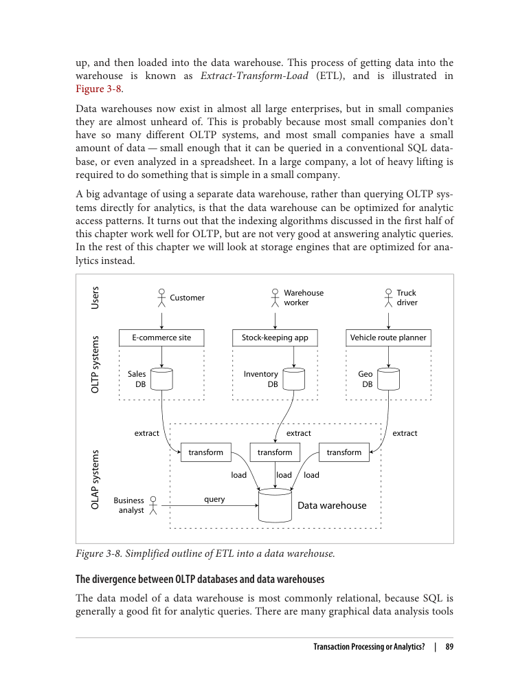

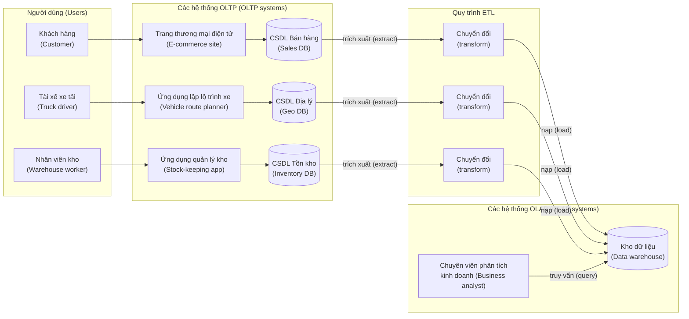

Kho dữ liệu hiện nay tồn tại ở hầu hết mọi doanh nghiệp lớn, nhưng ở các công ty nhỏ thì gần như chưa từng nghe tới. Điều này có lẽ là do hầu hết các công ty nhỏ không có quá nhiều hệ thống OLTP khác nhau, và đa số các công ty nhỏ chỉ có một lượng dữ liệu nhỏ — đủ nhỏ để có thể truy vấn trực tiếp trong một cơ sở dữ liệu SQL thông thường, hoặc thậm chí phân tích ngay trong một bảng tính (spreadsheet). Trong một công ty lớn, cần phải thực hiện rất nhiều công việc nặng nhọc (heavy lifting) để làm một điều vốn rất đơn giản ở một công ty nhỏ.

Một lợi thế lớn của việc sử dụng một kho dữ liệu riêng biệt, thay vì truy vấn trực tiếp các hệ thống OLTP để phân tích, đó là kho dữ liệu có thể được tối ưu hóa riêng cho các khuôn mẫu truy cập phân tích. Hóa ra các thuật toán đánh chỉ mục được thảo luận trong nửa đầu của chương này hoạt động rất tốt cho OLTP, nhưng lại không mấy hiệu quả trong việc trả lời các truy vấn phân tích. Trong phần còn lại của chương này, chúng ta sẽ xem xét các bộ máy lưu trữ (storage engines) được tối ưu hóa chuyên biệt cho mục đích phân tích.

#### Sự phân kỳ giữa cơ sở dữ liệu OLTP và kho dữ liệu (The divergence between OLTP databases and data warehouses)

Mô hình dữ liệu của một kho dữ liệu phổ biến nhất vẫn là mô hình quan hệ (relational), bởi vì SQL nhìn chung rất phù hợp cho các truy vấn phân tích. Có rất nhiều công cụ phân tích dữ liệu đồ họa (graphical data analysis tools) giúp sinh ra các truy vấn SQL, trực quan hóa kết quả, và cho phép các chuyên viên phân tích khám phá dữ liệu (thông qua các thao tác như *khoan sâu chi tiết* — *drill-down* và *cắt lát dữ liệu* — *slicing and dicing*).

Nhìn bề ngoài, một kho dữ liệu và một cơ sở dữ liệu OLTP quan hệ trông có vẻ giống nhau, bởi vì cả hai đều có giao diện truy vấn SQL. Tuy nhiên, cấu trúc bên trong (internals) của hai hệ thống này có thể trông hoàn toàn khác biệt, vì chúng được tối ưu hóa cho các khuôn mẫu truy vấn rất khác nhau. Nhiều nhà cung cấp cơ sở dữ liệu hiện nay chỉ tập trung vào việc hỗ trợ hoặc tải công việc xử lý giao dịch, hoặc tải công việc phân tích, chứ không ôm đồm cả hai.

Một số cơ sở dữ liệu, chẳng hạn như Microsoft SQL Server và SAP HANA, hỗ trợ cả xử lý giao dịch lẫn kho dữ liệu trong cùng một sản phẩm. Tuy nhiên, chúng đang ngày càng trở thành hai bộ máy lưu trữ và truy vấn tách biệt nhau, chỉ là tình cờ có thể truy cập được thông qua một giao diện SQL chung mà thôi [42, 43, 44].

Các nhà cung cấp kho dữ liệu như Teradata, Vertica, SAP HANA và ParAccel thường bán hệ thống của họ dưới các giấy phép thương mại đắt đỏ. Amazon RedShift là một phiên bản dịch vụ đám mây (hosted version) của ParAccel. Gần đây hơn, hàng loạt các dự án mã nguồn mở SQL-trên-Hadoop (SQL-on-Hadoop) đã nổi lên; chúng còn non trẻ, nhưng đang hướng tới mục tiêu cạnh tranh với các hệ thống kho dữ liệu thương mại. Những dự án này bao gồm Apache Hive, Shark của AMPLab, Cloudera Impala, Hortonworks Stinger, Facebook Presto, Apache Tajo và Apache Drill [45, 46]. Một số dự án trong số đó được dựa trên các ý tưởng từ hệ thống Dremel của Google [47].

> 💡 **Ví dụ bổ sung (không có trong sách):**
> Kể từ khi cuốn sách xuất bản, hệ sinh thái Data Warehouse và OLAP đã phát triển cực kỳ mạnh mẽ:
> - **Cloud Data Warehouses:** Snowflake, Google BigQuery (hậu duệ trực tiếp của Dremel), Amazon Redshift và Databricks Lakehouse (dựa trên Apache Spark + Delta Lake) đã trở thành tiêu chuẩn trong các doanh nghiệp hiện đại.
> - **Hệ thống OLAP thời gian thực mã nguồn mở:** ClickHouse, Apache Doris, StarRocks và Apache Druid có khả năng quét hàng tỷ dòng dữ liệu chỉ trong vài trăm mili-giây. Facebook Presto (nay được đổi tên thành **Trino**) cùng với **DuckDB** (một bộ máy OLAP nhúng chạy trong tiến trình giống như SQLite nhưng lưu trữ theo cột) cũng là những đại diện tiêu biểu áp dụng chính xác các kỹ thuật lưu trữ cột và xử lý vector hóa mà tác giả trình bày dưới đây.

### Lược đồ hình sao và bông tuyết: các lược đồ cho phân tích (Stars and snowflakes: schemas for analytics)

Như đã khám phá trong Chương 2, một phạm vi rộng lớn các mô hình dữ liệu khác nhau được sử dụng trong lĩnh vực xử lý giao dịch, tùy thuộc vào nhu cầu của ứng dụng. Mặt khác, trong lĩnh vực phân tích dữ liệu, sự đa dạng của các mô hình dữ liệu ít hơn rất nhiều. Nhiều kho dữ liệu được sử dụng theo một phong cách khá khuôn mẫu, được gọi là **lược đồ hình sao** (**star schema**, còn được biết đến với tên gọi *mô hình hóa đa chiều* — *dimensional modeling* [48]).

Lược đồ ví dụ trong **Hình 3-9** cho thấy một kho dữ liệu có thể được tìm thấy tại một nhà bán lẻ tạp hóa. Ở trung tâm của lược đồ là một bảng được gọi là **bảng sự kiện** (**fact table** — ở đây là bảng `fact_sales`). Mỗi hàng của bảng fact đại diện cho một sự kiện đã xảy ra tại một thời điểm cụ thể (ở đây, mỗi hàng đại diện cho một sản phẩm đã được khách hàng mua). Nếu chúng ta đang phân tích lưu lượng truy cập trang web thay vì doanh số bán lẻ, mỗi hàng có thể đại diện cho một lượt xem trang (page view) hoặc một lượt nhấp chuột (click) của người dùng.

Thông thường, các sự kiện (facts) được thu thập dưới dạng các sự kiện riêng lẻ từng cái một, bởi vì điều này cho phép sự linh hoạt tối đa trong việc phân tích về sau. Tuy nhiên, điều này có nghĩa là bảng fact có thể trở nên cực kỳ lớn. Một doanh nghiệp lớn như Apple, Walmart hay eBay có thể có hàng chục petabyte lịch sử giao dịch trong kho dữ liệu của mình, mà phần lớn trong số đó nằm ở các bảng fact [49].

Một số cột trong bảng fact là các thuộc tính số liệu (attributes), chẳng hạn như mức giá mà sản phẩm được bán ra (`net_price`, `discount_price`) và chi phí mua sản phẩm đó từ nhà cung cấp (cho phép tính toán biên lợi nhuận). Các cột khác trong bảng fact là các tham chiếu khóa ngoại (foreign key references) trỏ tới các bảng khác, được gọi là các **bảng chiều** (**dimension tables**). Khi mỗi hàng trong bảng fact đại diện cho một sự kiện, thì các chiều (dimensions) đại diện cho *ai* (*who*), *cái gì* (*what*), *ở đâu* (*where*), *khi nào* (*when*), *như thế nào* (*how*) và *tại sao* (*why*) của sự kiện đó.

Ví dụ trong **Hình 3-9**, một trong các chiều là sản phẩm đã được bán. Mỗi hàng trong bảng `dim_product` đại diện cho một loại sản phẩm đang được bày bán, bao gồm mã lưu kho (stock-keeping unit — SKU), mô tả (`description`), tên thương hiệu (`brand`), danh mục (`category`), hàm lượng chất béo, kích cỡ đóng gói, v.v. Mỗi hàng trong bảng `fact_sales` sử dụng một khóa ngoại (`product_sk`) để chỉ ra sản phẩm nào đã được bán trong giao dịch cụ thể đó. (Để đơn giản, nếu khách hàng mua nhiều sản phẩm khác nhau cùng một lúc, chúng sẽ được biểu diễn thành các hàng riêng biệt trong bảng fact.)

Ngay cả ngày tháng và thời gian cũng thường được biểu diễn bằng các bảng chiều (như `dim_date`), bởi vì điều này cho phép mã hóa thêm các thông tin bổ sung về ngày tháng (chẳng hạn như các ngày nghỉ lễ công cộng — `is_holiday`), giúp các truy vấn có thể phân biệt giữa doanh số bán hàng vào ngày lễ và ngày thường.

Tên gọi *lược đồ hình sao* (*star schema*) bắt nguồn từ thực tế là khi các mối quan hệ giữa các bảng được trực quan hóa, bảng fact nằm ở chính giữa, được bao quanh bởi các khóa ngoại của nó trỏ tới các bảng chiều giống như những cánh của một ngôi sao.

**Hình 3-9 – Ví dụ về một lược đồ hình sao được sử dụng trong kho dữ liệu (Figure 3-9. Example of a star schema for use in a data warehouse.)**

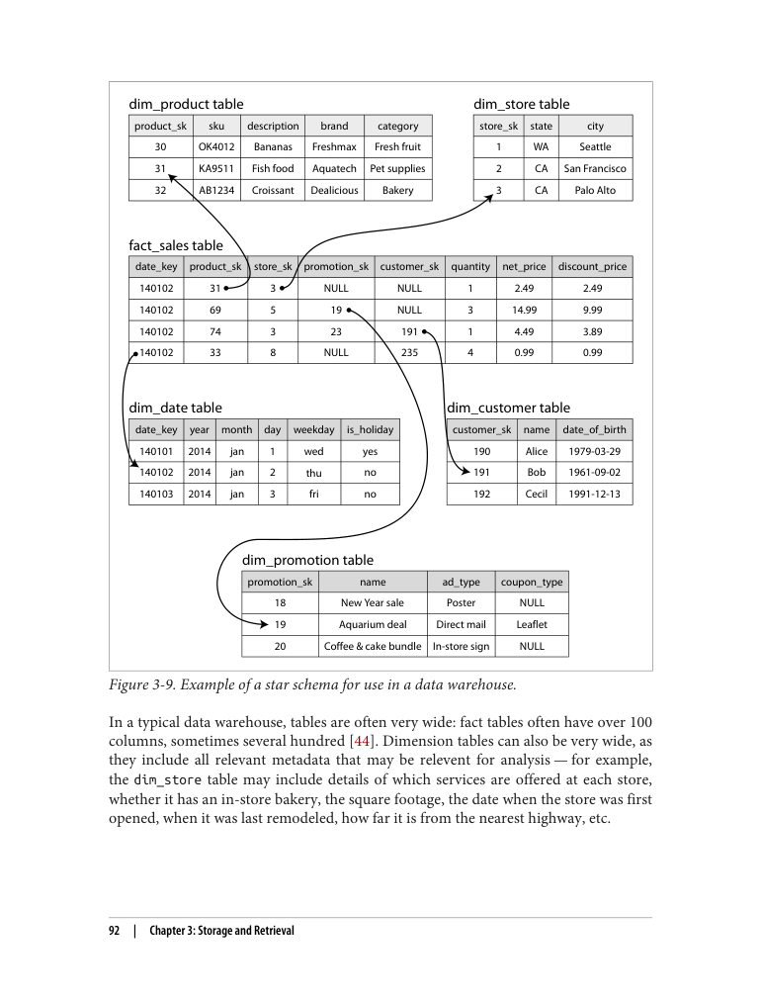

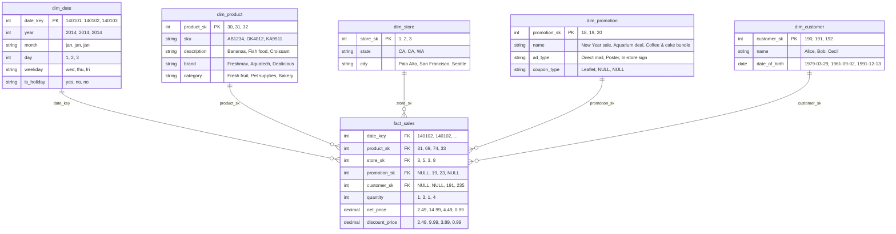

Một biến thể của khuôn mẫu này được gọi là **lược đồ bông tuyết** (**snowflake schema**), nơi các chiều được chia nhỏ hơn nữa thành các chiều con (sub-dimensions). Ví dụ, có thể có các bảng chiều riêng biệt cho thương hiệu (`brands`) và danh mục sản phẩm (`product categories`), và mỗi hàng trong bảng `dim_product` có thể tham chiếu đến thương hiệu và danh mục dưới dạng các khóa ngoại, thay vì lưu trữ chúng trực tiếp dưới dạng các chuỗi ký tự trong bảng `dim_product`. Lược đồ bông tuyết được chuẩn hóa (normalized) cao hơn so với lược đồ hình sao, nhưng trong trường hợp này, lược đồ hình sao thường được ưa chuộng hơn bởi vì chúng đơn giản hơn cho các chuyên viên phân tích khi làm việc [48].

Trong một kho dữ liệu điển hình, các bảng thường rất rộng (wide): các bảng fact thường có hơn 100 cột, đôi khi lên tới vài trăm cột [44]. Các bảng chiều cũng có thể rất rộng, vì chúng bao gồm tất cả các siêu dữ liệu (metadata) liên quan có thể hữu ích cho việc phân tích — ví dụ, bảng `dim_store` có thể bao gồm chi tiết về việc những dịch vụ nào được cung cấp tại mỗi cửa hàng, liệu cửa hàng đó có quầy bánh nướng tại chỗ hay không, diện tích mặt bằng (square footage), ngày cửa hàng khai trương lần đầu tiên, lần gần nhất nó được tu sửa là khi nào, khoảng cách từ cửa hàng đến đường cao tốc gần nhất là bao xa, v.v.

---

## Lưu trữ định hướng cột (Column-oriented storage)

Nếu bạn có hàng nghìn tỷ (trillions) hàng và hàng petabyte dữ liệu trong các bảng fact của mình, việc lưu trữ và truy vấn chúng một cách hiệu quả sẽ trở thành một bài toán đầy thách thức. Các bảng chiều thường nhỏ hơn rất nhiều (chỉ vài triệu hàng), vì vậy trong phần này chúng ta sẽ tập trung chủ yếu vào việc lưu trữ các bảng fact.

Mặc dù các bảng fact thường rộng hơn 100 cột, một truy vấn kho dữ liệu điển hình chỉ truy cập 4 hoặc 5 cột trong số đó tại một thời điểm (các truy vấn `"SELECT *"` hiếm khi cần thiết cho mục đích phân tích) [44]. Hãy xem xét truy vấn trong **Ví dụ 3-1**: nó truy cập một số lượng lớn các hàng (mọi trường hợp có người mua trái cây tươi hoặc kẹo trong suốt năm dương lịch 2013), nhưng nó chỉ cần truy cập ba cột của bảng `fact_sales`: `date_key`, `product_sk` và `quantity`. Tất cả các cột khác đều bị truy vấn này bỏ qua.

**Ví dụ 3-1 – Phân tích xem mọi người có xu hướng mua trái cây tươi hay kẹo nhiều hơn tùy thuộc vào ngày trong tuần (Example 3-1. Analyzing whether people are more inclined to buy fresh fruit or candy, depending on the day of the week.)**

```sql
SELECT
  dim_date.weekday, dim_product.category,
  SUM(fact_sales.quantity) AS quantity_sold
FROM fact_sales
  JOIN dim_date    ON fact_sales.date_key   = dim_date.date_key
  JOIN dim_product ON fact_sales.product_sk = dim_product.product_sk
WHERE
  dim_date.year = 2013 AND
  dim_product.category IN ('Fresh fruit', 'Candy')
GROUP BY
  dim_date.weekday, dim_product.category;
```

Làm thế nào chúng ta có thể thực thi truy vấn này một cách hiệu quả?

Trong hầu hết các cơ sở dữ liệu OLTP, bộ lưu trữ được bố trí theo **định hướng hàng** (**row-oriented**): tất cả các giá trị thuộc cùng một hàng của bảng được lưu trữ nằm cạnh nhau. Các cơ sở dữ liệu tài liệu (document databases) cũng tương tự: toàn bộ một tài liệu thường được lưu trữ dưới dạng một chuỗi byte liền kề (contiguous sequence of bytes). Bạn có thể thấy điều này trong ví dụ CSV ở Hình 3-1.

Để xử lý một truy vấn như **Ví dụ 3-1**, bạn có thể có các chỉ mục trên `fact_sales.date_key` và/hoặc `fact_sales.product_sk`, giúp cho bộ máy lưu trữ biết nơi tìm tất cả các giao dịch bán hàng cho một ngày cụ thể hoặc cho một sản phẩm cụ thể. Nhưng sau đó, một bộ máy lưu trữ định hướng hàng vẫn cần phải nạp toàn bộ các hàng đó (mỗi hàng bao gồm hơn 100 thuộc tính) từ ổ đĩa vào bộ nhớ, phân tích cú pháp (parse) chúng, và lọc bỏ những hàng không thỏa mãn các điều kiện yêu cầu. Việc đó có thể mất rất nhiều thời gian.

Ý tưởng đằng sau **lưu trữ định hướng cột** (**column-oriented storage**) rất đơn giản: đừng lưu trữ tất cả các giá trị từ một hàng cùng nhau, mà thay vào đó hãy lưu trữ tất cả các giá trị từ mỗi *cột* cùng với nhau. Nếu mỗi cột được lưu trữ trong một tệp riêng biệt, một truy vấn chỉ cần đọc và phân tích cú pháp những cột nào thực sự được sử dụng trong truy vấn đó, điều này có thể tiết kiệm được một khối lượng lớn công việc. Nguyên lý này được minh họa trong **Hình 3-10**.

**Hình 3-10 – Lưu trữ dữ liệu quan hệ theo cột thay vì theo hàng (Figure 3-10. Storing relational data by column, rather than by row.)**

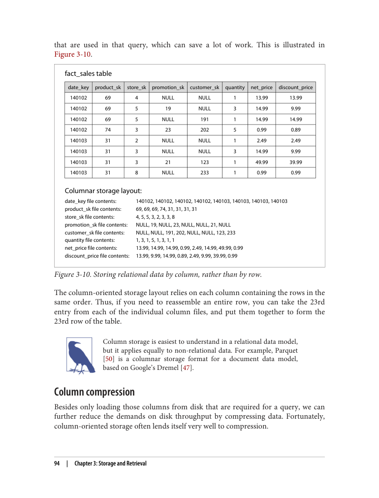

| Cột (Column File) | Nội dung tệp lưu trữ theo cột (Columnar storage layout — giữ đúng thứ tự hàng từ 1 đến 8) |
| :--- | :--- |
| **`date_key` file contents** | `140102, 140102, 140102, 140102, 140103, 140103, 140103, 140103` |
| **`product_sk` file contents** | `69, 69, 69, 74, 31, 31, 31, 31` |
| **`store_sk` file contents** | `4, 5, 5, 3, 2, 3, 3, 8` |
| **`promotion_sk` file contents** | `NULL, 19, NULL, 23, NULL, NULL, 21, NULL` |
| **`customer_sk` file contents** | `NULL, NULL, 191, 202, NULL, NULL, 123, 233` |
| **`quantity` file contents** | `1, 3, 1, 5, 1, 3, 1, 1` |
| **`net_price` file contents** | `13.99, 14.99, 14.99, 0.99, 2.49, 14.99, 49.99, 0.99` |
| **`discount_price` file contents** | `13.99, 9.99, 14.99, 0.89, 2.49, 9.99, 39.99, 0.99` |

Cách bố trí lưu trữ định hướng cột dựa trên nguyên tắc là mỗi tệp cột chứa các hàng theo cùng một thứ tự giống hệt nhau. Do đó, nếu bạn cần lắp ghép lại toàn bộ một hàng, bạn có thể lấy phần tử thứ 23 từ mỗi tệp cột riêng lẻ, và ghép chúng lại với nhau để tạo thành hàng thứ 23 của bảng.


> **Lưu trữ cột cho dữ liệu phi quan hệ:**
> Lưu trữ theo cột dễ hiểu nhất khi đặt trong một mô hình dữ liệu quan hệ, nhưng nó cũng áp dụng tương tự cho dữ liệu phi quan hệ (non-relational data). Ví dụ, **Parquet** [50] là một định dạng lưu trữ dạng cột (columnar storage format) hỗ trợ mô hình dữ liệu tài liệu lồng nhau (document data model), được phát triển dựa trên hệ thống Dremel của Google [47].

### Nén cột (Column compression)

Bên cạnh việc chỉ nạp từ ổ đĩa những cột thực sự cần thiết cho một truy vấn, chúng ta có thể giảm thiểu hơn nữa nhu cầu về thông lượng ổ đĩa (disk throughput) bằng cách nén dữ liệu. May mắn thay, lưu trữ định hướng cột thường cực kỳ thuận lợi cho việc nén dữ liệu.

Trong **Hình 3-10**, hãy quan sát chuỗi các giá trị của từng cột: chúng thường trông khá lặp đi lặp lại, và đây là một dấu hiệu rất tốt cho việc nén. Tùy thuộc vào dữ liệu trong cột, các kỹ thuật nén khác nhau có thể được sử dụng. Một kỹ thuật đặc biệt hiệu quả trong các kho dữ liệu là **mã hóa bitmap** (**bitmap encoding**), được minh họa trong **Hình 3-11**.

**Hình 3-11 – Lưu trữ một cột đơn lẻ đã được nén và đánh chỉ mục bằng bitmap (Figure 3-11. Compressed, bitmap-indexed storage of a single column.)**

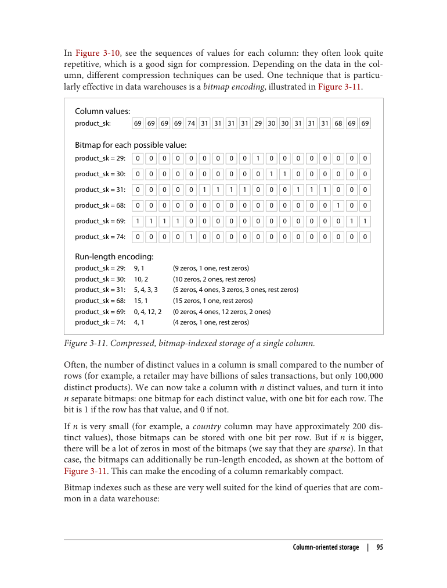

| Giá trị cột `product_sk` (18 hàng) | `69, 69, 69, 69, 74, 31, 31, 31, 31, 29, 30, 30, 31, 31, 31, 68, 69, 69` |
| :--- | :--- |
| **Bitmap cho `product_sk = 29`** | `0, 0, 0, 0, 0, 0, 0, 0, 0, 1, 0, 0, 0, 0, 0, 0, 0, 0` → **RLE:** `9, 1` *(9 số 0, 1 số 1, phần còn lại là số 0)* |
| **Bitmap cho `product_sk = 30`** | `0, 0, 0, 0, 0, 0, 0, 0, 0, 0, 1, 1, 0, 0, 0, 0, 0, 0` → **RLE:** `10, 2` *(10 số 0, 2 số 1, phần còn lại là số 0)* |
| **Bitmap cho `product_sk = 31`** | `0, 0, 0, 0, 0, 1, 1, 1, 1, 0, 0, 0, 1, 1, 1, 0, 0, 0` → **RLE:** `5, 4, 3, 3` *(5 số 0, 4 số 1, 3 số 0, 3 số 1, phần còn lại là số 0)* |
| **Bitmap cho `product_sk = 68`** | `0, 0, 0, 0, 0, 0, 0, 0, 0, 0, 0, 0, 0, 0, 0, 1, 0, 0` → **RLE:** `15, 1` *(15 số 0, 1 số 1, phần còn lại là số 0)* |
| **Bitmap cho `product_sk = 69`** | `1, 1, 1, 1, 0, 0, 0, 0, 0, 0, 0, 0, 0, 0, 0, 0, 1, 1` → **RLE:** `0, 4, 12, 2` *(0 số 0, 4 số 1, 12 số 0, 2 số 1)* |
| **Bitmap cho `product_sk = 74`** | `0, 0, 0, 0, 1, 0, 0, 0, 0, 0, 0, 0, 0, 0, 0, 0, 0, 0` → **RLE:** `4, 1` *(4 số 0, 1 số 1, phần còn lại là số 0)* |

Thông thường, số lượng các giá trị phân biệt (distinct values — còn gọi là *cardinality*) trong một cột là nhỏ so với tổng số hàng (ví dụ, một nhà bán lẻ có thể có hàng tỷ giao dịch bán hàng, nhưng chỉ có 100.000 sản phẩm riêng biệt). Bây giờ chúng ta có thể lấy một cột có *n* giá trị phân biệt và biến nó thành *n* bitmap riêng biệt: một bitmap cho mỗi giá trị phân biệt, với một bit cho mỗi hàng. Bit này mang giá trị `1` nếu hàng đó chứa giá trị tương ứng, và `0` nếu không phải.

Nếu *n* rất nhỏ (ví dụ, một cột `country` — quốc gia — có thể chỉ có khoảng 200 giá trị phân biệt), những bitmap đó có thể được lưu trữ trực tiếp với một bit cho mỗi hàng. Nhưng nếu *n* lớn hơn, sẽ có rất nhiều số `0` trong hầu hết các bitmap (chúng ta nói rằng chúng bị *thưa* — *sparse*). Trong trường hợp đó, các bitmap có thể được áp dụng thêm kỹ thuật **mã hóa độ dài loạt** (**run-length encoding** — **RLE**), như được hiển thị ở phần dưới của **Hình 3-11**. Điều này có thể làm cho việc mã hóa một cột trở nên cực kỳ nhỏ gọn.

Các chỉ mục bitmap (bitmap indexes) như thế này cực kỳ phù hợp cho các loại truy vấn phổ biến trong kho dữ liệu:

* `WHERE product_sk IN (30, 68, 69)`:
  Nạp ba bitmap dành cho `product_sk = 30`, `product_sk = 68` và `product_sk = 69`, sau đó tính toán phép toán thao tác bit `OR` (**bitwise OR**) của ba bitmap này, một việc có thể được thực hiện cực kỳ hiệu quả.
* `WHERE product_sk = 31 AND store_sk = 3`:
  Nạp các bitmap dành cho `product_sk = 31` và `store_sk = 3`, sau đó tính toán phép toán thao tác bit `AND` (**bitwise AND**). Điều này hoạt động được là nhờ các cột chứa các hàng theo cùng một thứ tự y hệt nhau, vì vậy bit thứ *k* trong bitmap của cột này tương ứng với cùng một hàng như bit thứ *k* trong bitmap của cột khác.

Ngoài ra còn có nhiều lược đồ nén khác nhau dành cho các loại dữ liệu khác nhau, nhưng chúng ta sẽ không đi sâu vào chi tiết — hãy xem [51] để có cái nhìn tổng quan.

> 📝 **Giải thích thêm (không có trong sách):**
> **Chỉ mục Bitmap trong Cassandra vs. Kho dữ liệu cột:**
> Đôi khi có sự nhầm lẫn giữa **column-family database** (như Apache Cassandra, HBase) và **column-oriented storage** (như ClickHouse, Vertica, Parquet):
> - **Cassandra / HBase (Wide-column store):** Vẫn là bộ máy lưu trữ hướng **hàng** (row-oriented) ở mức cơ bản trong mỗi column family: các cột gắn với một row key được lưu cạnh nhau và thích hợp cho truy cập OLTP theo khóa chính.
> - **Parquet / ORC / ClickHouse / Redshift:** Thực sự tách riêng từng cột ra các vùng nhớ/tệp độc lập, dùng các thuật toán nén chuyên biệt theo kiểu dữ liệu của cột như **Dictionary Encoding** (thay chuỗi lặp lại bằng số nguyên nhỏ), **Delta Encoding** (lưu hiệu số giữa hai giá trị thời gian liên tiếp), **Bit-packing** và **Roaring Bitmaps** (phiên bản nâng cấp hiện đại của RLE bitmap).

#### Băng thông bộ nhớ và thực thi đường ống (Memory bandwidth and pipelined execution)

Đối với các truy vấn kho dữ liệu cần phải quét qua hàng triệu hàng, một nút cổ chai (bottleneck) lớn là băng thông để đưa dữ liệu từ ổ đĩa vào bộ nhớ. Tuy nhiên, đó không phải là nút cổ chai duy nhất. Các nhà phát triển cơ sở dữ liệu phân tích cũng trăn trở rất nhiều về việc sử dụng các chu kỳ CPU (CPU cycles) sao cho hiệu quả: băng thông truyền từ bộ nhớ chính (main memory / RAM) vào bộ nhớ đệm của CPU (CPU cache), tránh việc dự đoán rẽ nhánh sai (branch mispredictions) và các khoảng trống ngưng trệ (bubbles) trong đường ống xử lý tập lệnh của CPU (CPU instruction processing pipeline), đồng thời tận dụng các tập lệnh **một-lệnh-nhiều-dữ-liệu** (**single-instruction-multi-data** — **SIMD**) trong các CPU hiện đại [52, 53].

Bên cạnh việc làm giảm khối lượng dữ liệu cần phải nạp từ ổ đĩa, các cách bố trí lưu trữ định hướng cột còn rất tốt cho việc tận dụng hiệu quả các chu kỳ CPU. Ví dụ, bộ máy truy vấn (query engine) có thể lấy một khối (chunk) dữ liệu cột đã nén vừa vặn thoải mái trong bộ nhớ đệm L1 (L1 cache) của CPU, và duyệt qua nó trong một vòng lặp chặt (tight loop). Cách này nhanh hơn rất nhiều so với đoạn mã đòi hỏi hàng loạt lệnh gọi hàm (function calls) và các câu lệnh điều kiện (`if/else`) cho từng bản ghi được xử lý. Việc nén cột cho phép nhét được nhiều hàng của một cột hơn vào cùng một dung lượng bộ nhớ đệm L1. Các toán tử, chẳng hạn như phép toán bitwise `AND` và `OR` được mô tả ở trên, có thể được thiết kế để thao tác trực tiếp ngay trên các khối dữ liệu cột đang ở dạng nén đó. Kỹ thuật này được gọi là **xử lý vector hóa** (**vectorized processing**) [51, 42].

### Thứ tự sắp xếp trong lưu trữ cột (Sort order in column storage)

Trong một kho lưu trữ cột (column store), thứ tự mà các hàng được lưu trữ không nhất thiết phải quan trọng. Cách dễ nhất là lưu trữ chúng theo đúng thứ tự mà chúng được chèn vào, bởi vì khi đó việc chèn một hàng mới chỉ đơn giản là ghi nối tiếp (appending) vào cuối mỗi tệp cột. Tuy nhiên, chúng ta có thể chọn áp đặt một thứ tự sắp xếp, giống như cách chúng ta đã làm với SSTables trước đó, và sử dụng thứ tự đó như một cơ chế đánh chỉ mục.

Lưu ý rằng sẽ hoàn toàn vô nghĩa nếu sắp xếp từng cột một cách độc lập với nhau, bởi vì khi đó chúng ta sẽ không còn biết những phần tử nào trong các cột thuộc về cùng một hàng nữa. Chúng ta chỉ có thể tái tạo lại một hàng bởi vì chúng ta biết rằng phần tử thứ *k* trong cột này thuộc về cùng một hàng với phần tử thứ *k* trong một cột khác.

Thay vào đó, dữ liệu cần phải được sắp xếp theo toàn bộ từng hàng một (an entire row at a time), mặc dù nó được lưu trữ theo cột. Quản trị viên của cơ sở dữ liệu có thể chọn các cột làm tiêu chí sắp xếp bảng, dựa trên hiểu biết của họ về các truy vấn phổ biến. Ví dụ, nếu các truy vấn thường nhắm vào các khoảng ngày tháng (date ranges), chẳng hạn như tháng trước, thì việc chọn `date_key` làm khóa sắp xếp đầu tiên (*first sort key*) là rất hợp lý. Khi đó, bộ tối ưu hóa truy vấn (query optimizer) có thể chỉ cần quét những hàng thuộc tháng trước, nhanh hơn rất nhiều so với việc quét toàn bộ các hàng.

Một cột thứ hai có thể xác định thứ tự sắp xếp của bất kỳ hàng nào có cùng giá trị ở cột đầu tiên. Ví dụ, nếu `date_key` là khóa sắp xếp đầu tiên trong **Hình 3-10**, thì việc chọn `product_sk` làm khóa sắp xếp thứ hai (*second sort key*) sẽ rất hợp lý, để tất cả các giao dịch bán hàng của cùng một sản phẩm trong cùng một ngày được nhóm lại cạnh nhau trong bộ lưu trữ. Điều đó sẽ giúp ích cho các truy vấn cần nhóm (`GROUP BY`) hoặc lọc (`WHERE`) doanh số theo sản phẩm trong một khoảng ngày tháng nhất định.

Một lợi thế khác của thứ tự được sắp xếp là nó có thể hỗ trợ đắc lực cho việc nén các cột. Nếu cột sắp xếp chính (primary sort column) không có nhiều giá trị phân biệt, thì sau khi sắp xếp, nó sẽ có những chuỗi dài trong đó cùng một giá trị được lặp đi lặp lại nhiều lần liên tiếp. Một thuật toán mã hóa độ dài loạt (run-length encoding) đơn giản, giống như cách chúng ta đã sử dụng cho các bitmap trong **Hình 3-11**, có thể nén cột đó xuống chỉ còn vài kilobyte — ngay cả khi bảng có hàng tỷ hàng.

Hiệu ứng nén đó mạnh nhất ở khóa sắp xếp đầu tiên. Khóa sắp xếp thứ hai và thứ ba sẽ bị xáo trộn nhiều hơn, và do đó sẽ không có những chuỗi giá trị lặp lại dài như vậy. Các cột nằm sâu hơn bên dưới trong thứ tự ưu tiên sắp xếp xuất hiện theo thứ tự gần như ngẫu nhiên, vì vậy chúng có lẽ sẽ không nén tốt bằng. Nhưng việc có một vài cột đầu tiên được sắp xếp nhìn chung vẫn là một thắng lợi lớn.

#### Nhiều thứ tự sắp xếp khác nhau (Several different sort orders)

Một phần mở rộng thông minh của ý tưởng này đã được giới thiệu trong C-Store, và được áp dụng trong kho dữ liệu thương mại Vertica [54, 55]. Các truy vấn khác nhau được hưởng lợi từ các thứ tự sắp xếp khác nhau, vậy tại sao không lưu trữ cùng một dữ liệu đó nhưng được sắp xếp theo nhiều cách khác nhau? Đằng nào dữ liệu cũng cần phải được sao chép (replicated) sang nhiều máy chủ để bạn không bị mất dữ liệu nếu một máy chủ gặp sự cố. Vậy thì bạn hoàn toàn có thể lưu trữ dữ liệu dư thừa (redundant data) đó theo các thứ tự sắp xếp khác nhau, để khi xử lý một truy vấn, bạn có thể sử dụng phiên bản nào phù hợp nhất với khuôn mẫu của truy vấn đó.

Việc có nhiều thứ tự sắp xếp trong một kho lưu trữ định hướng cột có nét tương đồng với việc có nhiều chỉ mục phụ (secondary indexes) trong một kho lưu trữ định hướng hàng. Nhưng sự khác biệt lớn là kho lưu trữ định hướng hàng giữ mọi hàng ở một nơi duy nhất (trong tệp heap hoặc trong một chỉ mục cụm — clustered index), và các chỉ mục phụ chỉ chứa các con trỏ (pointers) trỏ tới các hàng khớp điều kiện. Ngược lại, trong một kho lưu trữ cột, thông thường không hề có bất kỳ con trỏ nào trỏ tới dữ liệu ở nơi khác, mà chỉ có các cột chứa trực tiếp các giá trị.

### Ghi vào bộ lưu trữ định hướng cột (Writing to column-oriented storage)

Những tối ưu hóa này rất hợp lý trong các kho dữ liệu, bởi vì phần lớn tải công việc bao gồm các truy vấn lớn chỉ đọc (read-only queries) do các chuyên viên phân tích chạy. Lưu trữ định hướng cột, nén dữ liệu và sắp xếp đều giúp làm cho các truy vấn đọc đó nhanh hơn. Tuy nhiên, chúng có mặt trái là làm cho việc ghi dữ liệu trở nên khó khăn hơn.

Cách tiếp cận cập nhật tại chỗ (update-in-place), giống như cách B-tree sử dụng, là bất khả thi đối với các cột đã được nén. Nếu bạn muốn chèn một hàng vào chính giữa một bảng đã được sắp xếp, rất có thể bạn sẽ phải ghi lại toàn bộ tất cả các tệp cột. Bởi vì các hàng được định danh bằng vị trí thứ tự của chúng bên trong một cột, thao tác chèn bắt buộc phải cập nhật tất cả các cột một cách nhất quán.

May mắn thay, chúng ta đã thấy một giải pháp tốt ở phần trước của chương này: **cây LSM** (**LSM-trees**). Tất cả các thao tác ghi trước tiên sẽ đi vào một kho lưu trữ trong bộ nhớ (in-memory store), nơi chúng được thêm vào một cấu trúc đã được sắp xếp và chuẩn bị để ghi xuống ổ đĩa. Việc kho lưu trữ trong bộ nhớ đó được tổ chức theo định hướng hàng hay định hướng cột không quan trọng. Khi đã tích lũy đủ một lượng thao tác ghi, chúng sẽ được trộn (merged) với các tệp cột trên ổ đĩa và được ghi ra các tệp mới theo từng lô lớn (in bulk). Đây về cơ bản chính là cách mà Vertica thực hiện [55].

Các truy vấn cần phải kiểm tra cả dữ liệu cột trên ổ đĩa lẫn các thao tác ghi gần đây trong bộ nhớ, và kết hợp cả hai lại. Tuy nhiên, bộ tối ưu hóa truy vấn sẽ che giấu sự phân biệt này khỏi người dùng. Dưới góc nhìn của một chuyên viên phân tích, dữ liệu đã được sửa đổi bằng các lệnh chèn (inserts), cập nhật (updates) hoặc xóa (deletes) sẽ được phản ánh ngay lập tức trong các truy vấn tiếp theo.

### Tổng hợp dữ liệu: Khối dữ liệu và khung nhìn vật lý hóa (Aggregation: Data cubes and materialized views)

Không phải mọi kho dữ liệu đều nhất thiết phải là một kho lưu trữ cột: các cơ sở dữ liệu định hướng hàng truyền thống và một vài kiến trúc khác cũng được sử dụng. Tuy nhiên, lưu trữ dạng cột có thể nhanh hơn đáng kể đối với các truy vấn phân tích tùy biến (ad-hoc analytical queries), vì vậy nó đang nhanh chóng trở nên phổ biến [44, 56].

Một khía cạnh khác của kho dữ liệu đáng được đề cập ngắn gọn là các **tổng hợp được vật lý hóa** (**materialized aggregates**). Như đã thảo luận ở trên, các truy vấn kho dữ liệu thường liên quan đến một hàm tổng hợp (aggregate function), chẳng hạn như `COUNT`, `SUM`, `AVG`, `MIN` hoặc `MAX` trong SQL. Nếu cùng những số liệu tổng hợp đó được sử dụng bởi nhiều truy vấn khác nhau, việc phải nghiền ngẫm qua toàn bộ dữ liệu thô mỗi lần sẽ rất lãng phí. Tại sao không lưu vào bộ nhớ đệm (cache) một số kết quả đếm hoặc tổng thường xuyên được các truy vấn sử dụng nhất?

Một cách để tạo ra bộ nhớ đệm như vậy là một **khung nhìn vật lý hóa** (**materialized view**). Trong mô hình dữ liệu quan hệ, nó thường được định nghĩa giống như một khung nhìn chuẩn (khung nhìn ảo — *virtual view*): một đối tượng giống như bảng mà nội dung của nó là kết quả của một truy vấn nào đó. Sự khác biệt là một khung nhìn vật lý hóa là một bản sao thực sự của kết quả truy vấn, được ghi xuống ổ đĩa, trong khi một khung nhìn ảo chỉ là một lối tắt (shortcut) để viết truy vấn. Khi bạn đọc từ một khung nhìn ảo, bộ máy SQL sẽ bung (expand) nó thành truy vấn nền tảng của khung nhìn đó ngay lúc chạy (on the fly), rồi sau đó xử lý truy vấn đã được bung ra.

Khi dữ liệu nền tảng thay đổi, một khung nhìn vật lý hóa cần phải được cập nhật, bởi vì nó là một bản sao phi chuẩn hóa (denormalized copy) của dữ liệu. Cơ sở dữ liệu có thể thực hiện việc đó một cách tự động, nhưng những cập nhật như vậy làm cho các thao tác ghi trở nên đắt đỏ hơn, đó là lý do tại sao các khung nhìn vật lý hóa không thường được sử dụng trong các cơ sở dữ liệu OLTP. Trong các kho dữ liệu nặng về đọc (read-heavy data warehouses), chúng có thể hợp lý hơn (việc chúng có thực sự cải thiện hiệu năng đọc hay không còn tùy thuộc vào từng trường hợp cụ thể).

Một trường hợp đặc biệt phổ biến của khung nhìn vật lý hóa được gọi là **khối dữ liệu** (**data cube** hoặc **OLAP cube**) [57]. Nó là một lưới (grid) chứa các giá trị tổng hợp được nhóm theo các chiều khác nhau. **Hình 3-12** cho thấy một ví dụ.

**Hình 3-12 – Hai chiều của một khối dữ liệu, tổng hợp dữ liệu bằng phép tính tổng (Figure 3-12. Two dimensions of a data cube, aggregating data by summing.)**

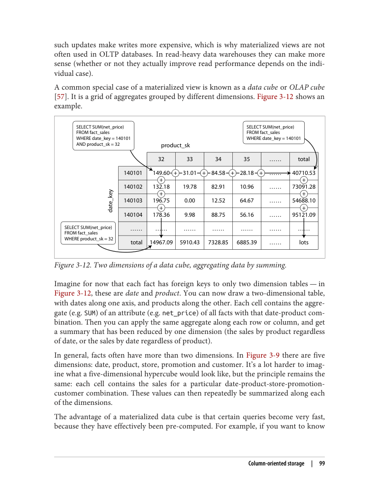

| `date_key` \ `product_sk` | `32` | `33` | `34` | `35` | `...` | **`total` (Tổng theo ngày)** |
| :--- | :---: | :---: | :---: | :---: | :---: | :---: |
| **`140101`** | `149.60` *(1)* | `31.01` | `84.58` | `28.18` | `...` | **`40710.53`** *(2)* |
| **`140102`** | `132.18` | `19.78` | `82.91` | `10.96` | `...` | **`73091.28`** |
| **`140103`** | `196.75` | `0.00` | `12.52` | `64.67` | `...` | **`54688.10`** |
| **`140104`** | `178.36` | `9.98` | `88.75` | `56.16` | `...` | **`95121.09`** |
| **`...`** | `...` | `...` | `...` | `...` | `...` | **`...`** |
| **`total` (Tổng theo sản phẩm)** | **`14967.09`** *(3)* | **`5910.43`** | **`7328.85`** | **`6885.39`** | **`...`** | **`lots`** |

*Chú thích các ô tính toán trong **Hình 3-12**:*
* *(1) Ô `(date_key = 140101, product_sk = 32)` = `149.60`:* Tương ứng với truy vấn `SELECT SUM(net_price) FROM fact_sales WHERE date_key = 140101 AND product_sk = 32`.
* *(2) Ô tổng ngang cuối hàng `140101` = `40710.53` (cộng tất cả các cột sản phẩm trên cùng hàng):* Tương ứng với truy vấn `SELECT SUM(net_price) FROM fact_sales WHERE date_key = 140101`.
* *(3) Ô tổng dọc cuối cột `32` = `14967.09` (cộng tất cả các hàng ngày trên cùng cột):* Tương ứng với truy vấn `SELECT SUM(net_price) FROM fact_sales WHERE product_sk = 32`.

Hãy tưởng tượng tạm thời rằng mỗi bản ghi fact chỉ có khóa ngoại trỏ tới hai bảng chiều — trong **Hình 3-12**, đó là ngày (`date_key`) và sản phẩm (`product_sk`). Bây giờ bạn có thể vẽ một bảng hai chiều, với ngày tháng nằm dọc theo một trục và sản phẩm nằm dọc theo trục kia. Mỗi ô chứa giá trị tổng hợp (ví dụ: `SUM`) của một thuộc tính (ví dụ: `net_price`) của tất cả các bản ghi fact có tổ hợp ngày-sản phẩm đó. Sau đó, bạn có thể áp dụng cùng phép tổng hợp đó dọc theo từng hàng hoặc từng cột, và nhận được một bản tóm tắt đã được rút gọn bớt một chiều (doanh số theo sản phẩm bất kể ngày nào, hoặc doanh số theo ngày bất kể sản phẩm nào).

Tổng quát hơn, các bản ghi fact thường có nhiều hơn hai chiều. Trong **Hình 3-9** có năm chiều: ngày tháng (`date`), sản phẩm (`product`), cửa hàng (`store`), khuyến mãi (`promotion`) và khách hàng (`customer`). Rất khó để hình dung một siêu khối năm chiều (five-dimensional hypercube) trông sẽ như thế nào, nhưng nguyên lý thì vẫn giữ nguyên: mỗi ô chứa doanh số cho một tổ hợp ngày–sản phẩm–cửa hàng–khuyến mãi–khách hàng cụ thể. Những giá trị này sau đó có thể được tổng hợp lặp đi lặp lại dọc theo từng chiều.

Ưu điểm của một khối dữ liệu được vật lý hóa (materialized data cube) là một số truy vấn nhất định trở nên cực kỳ nhanh, bởi vì về bản chất chúng đã được tính toán trước (pre-computed). Ví dụ, nếu bạn muốn biết tổng doanh số theo từng cửa hàng ngày hôm qua, bạn chỉ cần nhìn vào các con số tổng dọc theo chiều tương ứng — không cần phải quét qua hàng triệu hàng.

Nhược điểm là khối dữ liệu không có được sự linh hoạt như khi truy vấn trực tiếp dữ liệu thô. Ví dụ, không có cách nào để tính toán tỷ lệ doanh số đến từ các mặt hàng có giá trên 100 đô la, bởi vì giá bán không phải là một trong các chiều. Do đó, hầu hết các kho dữ liệu cố gắng giữ lại càng nhiều dữ liệu thô càng tốt, và chỉ sử dụng các bảng tổng hợp như khối dữ liệu như một công cụ tăng tốc hiệu năng (performance boost) cho một số truy vấn nhất định.

> 💡 **Ví dụ bổ sung (không có trong sách):**
> Trong thực tế hiện đại, khái niệm Materialized View và Data Cube được ứng dụng rộng rãi trong các hệ thống phân tích thời gian thực:
> - **ClickHouse Materialized Views:** Cho phép định nghĩa các bảng tổng hợp dùng engine `SummingMergeTree` hoặc `AggregatingMergeTree`. Ngay khi dữ liệu sự kiện thô (`fact_events`) được chèn vào, ClickHouse tự động tính tổng số lượt xem, tổng doanh thu theo từng khung giờ (`toStartOfHour(timestamp)`) và mã chiến dịch quảng cáo, lưu xuống đĩa dưới dạng đã tổng hợp sẵn. Khi hiển thị Dashboard cho khách hàng, truy vấn chỉ cần đọc bảng tổng hợp này trong vài mili-giây thay vì quét hàng chục tỷ sự kiện thô.
> - **Apache Pinot & Apache Druid:** Thực hiện kỹ thuật **Roll-up** (tổng hợp trước các dòng có cùng tập chiều ngay trong quá trình nạp dữ liệu từ Kafka) kết hợp với **Star-Tree Index** — một biến thể hiện đại của OLAP Data Cube tự động tạo trước các nút tổng hợp cho các tổ hợp chiều có tần suất truy vấn cao.

---

## Tóm tắt (Summary)

Trong chương này, chúng ta đã cố gắng đi sâu vào tận gốc rễ của các câu hỏi về lưu trữ và truy xuất dữ liệu (data storage and retrieval). Điều gì xảy ra khi bạn lưu trữ một số dữ liệu vào trong cơ sở dữ liệu, và cơ sở dữ liệu làm gì khi bạn truy vấn lại dữ liệu đó về sau?

Ở mức độ tổng quan, chúng ta đã thấy rằng các bộ máy lưu trữ (storage engines) rơi vào hai danh mục lớn: những bộ máy được tối ưu hóa cho **xử lý giao dịch** (**transaction processing** — **OLTP**), và những bộ máy được tối ưu hóa cho **phân tích dữ liệu** (**analytics** — **OLAP**). Có những sự khác biệt rất lớn giữa các khuôn mẫu truy cập trong hai trường hợp sử dụng đó:

* **Các hệ thống OLTP** thường hướng trực tiếp tới người dùng (user-facing), điều này có nghĩa là chúng có thể phải tiếp nhận một khối lượng yêu cầu (requests) khổng lồ. Để xử lý được tải lượng đó, các ứng dụng thường chỉ chạm vào một số lượng nhỏ các bản ghi trong mỗi truy vấn. Ứng dụng yêu cầu các bản ghi bằng cách sử dụng một loại khóa (key) nào đó, và bộ máy lưu trữ sử dụng một **chỉ mục** (**index**) để tìm dữ liệu cho khóa được yêu cầu. Thời gian tìm kiếm trên ổ đĩa (disk seek time) thường là nút cổ chai ở đây.
* **Các kho dữ liệu (data warehouses) và các hệ thống phân tích tương tự** ít được biết đến rộng rãi hơn, bởi vì chúng chủ yếu được sử dụng bởi các chuyên viên phân tích kinh doanh chứ không phải bởi người dùng cuối. Chúng xử lý một khối lượng truy vấn thấp hơn nhiều so với các hệ thống OLTP, nhưng mỗi truy vấn thường đòi hỏi rất nhiều tài nguyên, yêu cầu phải quét qua hàng triệu bản ghi trong một khoảng thời gian ngắn. Băng thông ổ đĩa (disk bandwidth — chứ không phải thời gian seek) thường là nút cổ chai ở đây, và **lưu trữ định hướng cột** (**column-oriented storage**) là một giải pháp ngày càng phổ biến cho loại tải công việc này.

Về phía OLTP, chúng ta đã thấy các bộ máy lưu trữ thuộc hai trường phái tư tưởng chính:

* **Trường phái cấu trúc nhật ký (log-structured school):** chỉ cho phép ghi nối tiếp (appending) vào các tệp và xóa các tệp đã lỗi thời, nhưng không bao giờ cập nhật đè lên một tệp đã được ghi. Bitcask, SSTables, LSM-Trees, LevelDB, RocksDB, Cassandra, HBase, Lucene và các hệ thống khác thuộc về nhóm này.
* **Trường phái cập nhật tại chỗ (update-in-place school):** coi ổ đĩa như một tập hợp các trang có kích thước cố định (fixed-size pages) có thể được ghi đè lên (overwritten). **B-trees** là ví dụ lớn nhất của triết lý này, được sử dụng trong tất cả các cơ sở dữ liệu quan hệ lớn và cả nhiều cơ sở dữ liệu phi quan hệ.

Các bộ máy lưu trữ cấu trúc nhật ký là một bước phát triển tương đối gần đây. Ý tưởng cốt lõi của chúng là biến đổi một cách có hệ thống các thao tác ghi truy cập ngẫu nhiên (random-access writes) thành các thao tác ghi tuần tự (sequential writes) trên ổ đĩa, điều này cho phép đạt được thông lượng ghi cao hơn nhờ các đặc tính hiệu năng vật lý của cả ổ cứng từ (hard drives) lẫn ổ cứng thể rắn (SSDs).

Khép lại phía OLTP, chúng ta đã thực hiện một chuyến tham quan ngắn qua một số cấu trúc đánh chỉ mục phức tạp hơn (chỉ mục phụ, chỉ mục ghép, chỉ mục đa chiều R-tree, chỉ mục toàn văn và tìm kiếm mờ), cũng như các cơ sở dữ liệu được tối ưu hóa cho việc lưu giữ toàn bộ dữ liệu trong bộ nhớ (in-memory databases).

Sau đó, chúng ta đã rẽ sang một nhánh khác tách khỏi cấu trúc bên trong của các bộ máy lưu trữ OLTP để xem xét kiến trúc mức cao của một kho dữ liệu (data warehouse) điển hình. Bối cảnh này đã minh họa lý do tại sao các tải công việc phân tích lại khác biệt đến vậy so với OLTP: khi các truy vấn của bạn đòi hỏi phải quét tuần tự qua một số lượng lớn các hàng, các chỉ mục truyền thống trở nên ít liên quan hơn rất nhiều. Thay vào đó, việc mã hóa dữ liệu sao cho thật nhỏ gọn để giảm thiểu lượng dữ liệu mà truy vấn cần phải đọc từ ổ đĩa trở nên vô cùng quan trọng. Chúng ta đã thảo luận về cách mà lưu trữ định hướng cột (column-oriented storage), nén cột (bitmap encoding, run-length encoding), sắp xếp thứ tự cột và xử lý vector hóa giúp đạt được mục tiêu này.

Là một nhà phát triển ứng dụng, nếu bạn được trang bị kiến thức này về cơ chế hoạt động bên trong của các bộ máy lưu trữ, bạn sẽ ở một vị thế tốt hơn rất nhiều để biết công cụ nào là phù hợp nhất cho ứng dụng cụ thể của mình. Nếu bạn cần điều chỉnh các tham số tinh chỉnh (tuning parameters) của một cơ sở dữ liệu, sự thấu hiểu này cho phép bạn hình dung được việc tăng hay giảm một giá trị tham số sẽ mang lại tác động gì.

Mặc dù chương này không thể biến bạn thành một chuyên gia tinh chỉnh bất kỳ một bộ máy lưu trữ cụ thể nào, nhưng hy vọng nó đã trang bị cho bạn đủ vốn từ vựng và các ý tưởng nền tảng để bạn có thể đọc hiểu tường tận tài liệu kỹ thuật của hệ cơ sở dữ liệu mà bạn lựa chọn.

> 📝 **Giải thích thêm (không có trong sách) – Bảng tổng kết chọn lựa Storage Engine trong thực tế:**
>
> | Nhu cầu bài toán thực tế | Kiến trúc Storage Engine phù hợp | Hệ thống tiêu biểu | Lý do lựa chọn cốt lõi |
> | :--- | :--- | :--- | :--- |
> | **Giao dịch tài chính, đơn hàng, đọc/ghi điểm theo khóa, cần nhất quán cao & độ trễ đọc ổn định** | **B-Tree** (Update-in-place, Page-oriented + WAL) | PostgreSQL, MySQL (InnoDB), Oracle, SQL Server | Mỗi khóa chỉ tồn tại ở đúng 1 vị trí trong cây B-tree; không bị hiện tượng đọc qua nhiều tệp SSTable; hỗ trợ khóa giao dịch (locking) cấp độ dòng/khoảng rất tốt. |
> | **Ghi nhật ký sự kiện IoT, chuỗi thời gian, chat message, khối lượng ghi khổng lồ (Write-heavy)** | **LSM-Tree + SSTables** (Log-structured + Compaction + Bloom filter) | Apache Cassandra, ScyllaDB, RocksDB, HBase, TiKV | Biến đổi toàn bộ thao tác ghi ngẫu nhiên thành ghi tuần tự vào Memtable + WAL; hệ số khuếch đại ghi (write amplification) trên SSD thấp hơn B-tree khi ghi ngẫu nhiên cường độ cao. |
> | **Bộ nhớ đệm tốc độ cực cao, bảng xếp hạng (Leaderboard), quản lý phiên (Session), hàng đợi nhẹ** | **In-Memory Data Structures** (+ Append-only log / Snapshot) | Redis, Memcached, VoltDB | Tránh hoàn toàn chi phí mã hóa/giải mã (serialization) cấu trúc dữ liệu sang định dạng trang đĩa; hỗ trợ trực tiếp cấu trúc Set, Sorted Set, List trong RAM. |
> | **Tìm kiếm văn bản toàn văn (Full-text search), tự động hoàn thành, lọc theo nhiều thuộc tính (Faceted search)** | **Inverted Index + Finite State Transducers (FST) / Levenshtein Automata** | Elasticsearch, OpenSearch, Apache Solr (dựa trên Apache Lucene) | Tách từ (tokenize) và lập danh sách bài viết chứa từng từ (posting list); dùng cây trie / automaton trong bộ nhớ để tìm kiếm tiền tố và sửa lỗi chính tả cực nhanh. |
> | **Báo cáo BI, phân tích hành vi người dùng, tổng hợp số liệu trên hàng tỷ bản ghi lịch sử (OLAP)** | **Column-Oriented Storage** (+ Bitmap/RLE Compression + Vectorized Execution) | ClickHouse, Apache Parquet, Amazon Redshift, Google BigQuery, Snowflake, DuckDB | Chỉ đọc đúng vài cột cần thiết trong bảng hàng trăm cột; nén dữ liệu cùng kiểu cực tốt; tận dụng tối đa băng thông đĩa và bộ nhớ đệm L1/SIMD của CPU. |

---

## Tài liệu tham khảo (References)

* **[1]** Alfred V Aho, John E Hopcroft, and Jeffrey D Ullman: *Data Structures and Algorithms*. Addison-Wesley, 1983. ISBN: 0-201-00023-7 *(Cấu trúc dữ liệu và Giải thuật — sách giáo khoa kinh điển về các cấu trúc dữ liệu nền tảng).*
* **[2]** Thomas H Cormen, Charles E Leiserson, Ronald L Rivest, and Clifford Stein: *Introduction to Algorithms*, 3rd edition. MIT Press, 2009. ISBN: 978-0-262-53305-8 *(Nhập môn Giải thuật — cuốn CLRS nổi tiếng phân tích độ phức tạp thuật toán, cây tìm kiếm nhị phân và B-tree).*
* **[3]** Justin Sheehy and David Smith: “Bitcask: A Log-Structured Hash Table for Fast Key/Value Data,” Basho Technologies, April 2010. *(Bài báo giới thiệu Bitcask — bộ máy lưu trữ bảng băm cấu trúc nhật ký trong bộ nhớ của Riak).*
* **[4]** Yinan Li, Bingsheng He, Robin Jun Yang, Qiong Luo, and Ke Yi: “Tree Indexing on Solid State Drives,” *Proceedings of the VLDB Endowment*, volume 3, number 1, pages 1195–1206, September 2010. *(Nghiên cứu về kỹ thuật đánh chỉ mục dạng cây trên ổ cứng thể rắn SSD).*
* **[5]** Goetz Graefe: “Modern B-Tree Techniques,” *Foundations and Trends in Databases*, volume 3, number 4, pages 203–402, August 2011. doi:10.1561/1900000028 *(Tổng quan toàn diện về các kỹ thuật tối ưu hóa B-tree hiện đại trong hệ quản trị cơ sở dữ liệu).*
* **[6]** Jeffrey Dean and Sanjay Ghemawat: “LevelDB implementation notes,” `leveldb.googlecode.com`. *(Ghi chú thiết kế và triển khai bộ máy lưu trữ LSM-tree LevelDB của Google).*
* **[7]** Dhruba Borthakur: “The History of RocksDB,” `hivedata.com`, 26 November 2013. *(Lịch sử ra đời của RocksDB tại Facebook như một nhánh tối ưu hóa từ LevelDB cho ổ SSD).*
* **[8]** Matteo Bertozzi: “Apache HBase I/O – HFile,” `blog.cloudera.com`, 29 June 2012. *(Phân tích cấu trúc tệp SSTable HFile và cơ chế I/O trong Apache HBase).*
* **[9]** Fay Chang, Jeffrey Dean, Sanjay Ghemawat, et al.: “Bigtable: A Distributed Storage System for Structured Data,” at *7th USENIX Symposium on Operating System Design and Implementation* (OSDI), November 2006. *(Bài báo kinh điển của Google về Bigtable, nơi giới thiệu thuật ngữ SSTable và memtable).*
* **[10]** Patrick O’Neil, Edward Cheng, Dieter Gawlick, and Elizabeth O’Neil: “The Log-Structured Merge-Tree (LSM-Tree),” *Acta Informatica*, volume 33, number 4, pages 351–385, June 1996. doi:10.1007/s002360050048 *(Bài báo gốc năm 1996 khai sinh ra cấu trúc dữ liệu cây trộn cấu trúc nhật ký LSM-Tree).*
* **[11]** Mendel Rosenblum and John K Ousterhout: “The Design and Implementation of a Log-Structured File System,” *ACM Transactions on Computer Systems*, volume 10, number 1, pages 26–52, February 1992. doi:10.1145/146941.146943 *(Bài báo nền tảng về hệ thống tệp cấu trúc nhật ký — Log-Structured File System).*
* **[12]** Adrien Grand: “What is in a Lucene index?,” at *Lucene/Solr Revolution*, November 2013. *(Trình bày chi tiết về các thành phần bên trong một chỉ mục của Apache Lucene).*
* **[13]** Deepak Kandepet: “Hacking Lucene - the Index Format,” `hackerlabs.org`, 1 October 2011. *(Giải phẫu định dạng tệp chỉ mục trên đĩa của Lucene).*
* **[14]** Michael McCandless: “Visualizing Lucene’s segment merges,” `blog.mikemccandless.com`, 11 February 2011. *(Trực quan hóa quá trình trộn các phân đoạn — segment merging — trong Lucene).*
* **[15]** Burton H Bloom: “Space/Time Trade-offs in Hash Coding with Allowable Errors,” *Communications of the ACM*, volume 13, number 7, pages 422–426, July 1970. doi:10.1145/362686.362692 *(Bài báo gốc năm 1970 giới thiệu bộ lọc Bloom — Bloom filter).*
* **[16]** Rudolf Bayer and Edward M McCreight: “Organization and Maintenance of Large Ordered Indices,” Boeing Scientific Research Laboratories, Mathematical and Information Sciences Laboratory, report no. 20, July 1970. *(Báo cáo khoa học năm 1970 phát minh ra cấu trúc chỉ mục B-tree).*
* **[17]** Douglas Comer: “The Ubiquitous B-tree,” *ACM Computing Surveys*, volume 11, number 2, pages 121–137, June 1979. doi:10.1145/356770.356776 *(Bài khảo sát kinh điển giải thích sự phổ biến của B-tree và các biến thể như B+ tree).*
* **[18]** Emmanuel Goossaert: “Coding for SSDs,” `codecapsule.com`, 12 February 2014. *(Chuỗi bài viết kỹ thuật sâu sắc về kiến trúc phần cứng SSD, bộ chuyển đổi FTL, xóa khối và khuếch đại ghi).*
* **[19]** C Mohan and Frank Levine: “ARIES/IM: An efficient and high concurrency index management method using write-ahead logging,” at *ACM International Conference on Management of Data* (SIGMOD), pages 371–380, June 1992. doi:10.1145/130283.130338 *(Phương pháp quản lý chỉ mục độ đồng thời cao sử dụng nhật ký ghi trước WAL và chốt latches).*
* **[20]** Howard Chu: “LDAP at Lightning Speed,” at *BuildStuffLT*, Vilnius, Lithuania, November 2014. *(Giới thiệu kiến trúc B-tree copy-on-write trong bộ máy lưu trữ LMDB).*
* **[21]** Bradley C Kuszmaul: “A Comparison of Fractal Trees to Log-Structured Merge (LSM) Trees,” `tokutek.com`, 22 April 2014. *(So sánh cấu trúc Fractal Trees của TokuDB với cây LSM).*
* **[22]** Manos Athanassoulis, Michael S Kester, Lukas M Maas, et al.: “Designing Access Methods: The RUM Conjecture,” at *19th International Conference on Extending Database Technology* (EDBT), March 2016. doi:10.5441/002/edbt.2016.42 *(Giả thuyết RUM về sự đánh đổi giữa Đọc — Read, Cập nhật — Update và Bộ nhớ — Memory trong các phương pháp truy cập dữ liệu).*
* **[23]** Kevin Tseng: “LevelDB Benchmarks,” `leveldb.googlecode.com`, July 2011. *(Kết quả đo kiểm hiệu năng của LevelDB).*
* **[24]** Michi Mutsuzaki: “MySQL vs. LevelDB,” `github.com`, August 2011. *(So sánh thực nghiệm hiệu năng giữa MySQL InnoDB và LevelDB).*
* **[25]** *MySQL 5.7 Reference Manual*. Oracle, 2014. *(Tài liệu tham khảo chính thức của MySQL 5.7 về InnoDB và chỉ mục cụm).*
* **[26]** *Books Online for SQL Server 2012*. Microsoft, 2012. *(Tài liệu kỹ thuật của Microsoft SQL Server 2012 về clustered index, nonclustered index và included columns).*
* **[27]** Joe Webb: “Using Covering Indexes to Improve Query Performance,” `simple-talk.com`, 29 September 2008. *(Hướng dẫn sử dụng chỉ mục bao phủ — covering indexes — để tối ưu hóa hiệu năng truy vấn).*
* **[28]** Frank Ramsak, Volker Markl, Robert Fenk, et al.: “Integrating the UB-Tree into a Database System Kernel,” at *26th International Conference on Very Large Data Bases* (VLDB), September 2000. *(Tích hợp UB-Tree và đường cong lấp đầy không gian vào nhân hệ quản trị cơ sở dữ liệu).*
* **[29]** The PostGIS Development Group: “PostGIS 2.1.2dev Manual,” `postgis.net`, 2014. *(Tài liệu hướng dẫn PostGIS về chỉ mục không gian R-tree trên nền GiST của PostgreSQL).*
* **[30]** Robert Escriva, Bernard Wong, and Emin Gün Sirer: “HyperDex: A Distributed, Searchable Key-Value Store,” at *ACM SIGCOMM Conference*, August 2012. doi:10.1145/2377677.2377681 *(Kho lưu trữ khóa-giá trị phân tán hỗ trợ tìm kiếm đa chiều HyperDex).*
* **[31]** Michael McCandless: “Lucene’s FuzzyQuery is 100 times faster in 4.0,” `blog.mikemccandless.com`, 24 March 2011. *(Giải thích cách Lucene 4.0 tăng tốc truy vấn mờ lên gấp 100 lần nhờ Levenshtein automata).*
* **[32]** Steffen Heinz, Justin Zobel, and Hugh E Williams: “Burst Tries: A Fast, Efficient Data Structure for String Keys,” *ACM Transactions on Information Systems*, volume 20, number 2, pages 192–223, April 2002. doi:10.1145/506309.506312 *(Cấu trúc dữ liệu Burst Tries cho các khóa kiểu chuỗi ký tự).*
* **[33]** Klaus U Schulz and Stoyan Mihov: “Fast string correction with Levenshtein automata,” *International Journal on Document Analysis and Recognition*, volume 5, number 1, pages 67–85, November 2002. doi:10.1007/s10032-002-0082-8 *(Bài báo toán học nền tảng về việc sửa lỗi chuỗi nhanh bằng ôtômat Levenshtein).*
* **[34]** Christopher D Manning, Prabhakar Raghavan, and Hinrich Schütze: *Introduction to Information Retrieval*. Cambridge University Press, 2008. ISBN: 0521865719 *(Nhập môn Truy xuất Thông tin — sách giáo khoa tiêu chuẩn về chỉ mục đảo, tìm kiếm toàn văn và xếp hạng văn bản).*
* **[35]** Michael Stonebraker, Samuel Madden, Daniel J Abadi, et al.: “The End of an Architectural Era (It’s Time for a Complete Rewrite),” at *33rd International Conference on Very Large Data Bases* (VLDB), pages 1150–1160, September 2007. *(Bài báo nổi tiếng lập luận về việc thiết kế lại hoàn toàn kiến trúc RDBMS truyền thống cho kỷ nguyên bộ nhớ lớn và tải công việc chuyên biệt, dẫn tới H-Store/VoltDB).*
* **[36]** “VoltDB Technical Overview White Paper,” VoltDB, 2014. *(Sách trắng tổng quan kỹ thuật về cơ sở dữ liệu OLTP trong bộ nhớ VoltDB).*
* **[37]** Stephen M Rumble, Ankita Kejriwal, and John K Ousterhout: “Log-structured Memory for DRAM-based Storage,” at *12th USENIX Conference on File and Storage Technologies* (FAST), February 2014. *(Quản lý bộ nhớ cấu trúc nhật ký cho hệ thống lưu trữ dựa trên DRAM — RAMCloud).*
* **[38]** Stavros Harizopoulos, Daniel J Abadi, Samuel Madden, and Michael Stonebraker: “OLTP Through the Looking Glass, and What We Found There,” at *ACM International Conference on Management of Data* (SIGMOD), June 2008. doi:10.1145/1376616.1376713 *(Phân tích thực nghiệm chỉ ra các chi phí phụ trội về quản lý buffer pool, khóa, chốt và nhật ký trong các hệ thống OLTP truyền thống).*
* **[39]** Justin DeBrabant, Andrew Pavlo, Stephen Tu, Michael Stonebraker, and Stan Zdonik: “Anti-Caching: A New Approach to Database Management System Architecture,” *Proceedings of the VLDB Endowment*, volume 6, number 14, pages 1942–1953, September 2013. *(Cách tiếp cận Anti-Caching đẩy dữ liệu ít dùng từ RAM xuống đĩa cho cơ sở dữ liệu trong bộ nhớ).*
* **[40]** Edgar F Codd, S B Codd, and C T Salley: “Providing OLAP to User-Analysts: An IT Mandate,” E.F. Codd Associates, 1993. *(Tài liệu đặt ra thuật ngữ OLAP — xử lý phân tích trực tuyến — của tác giả mô hình quan hệ E.F. Codd).*
* **[41]** Surajit Chaudhuri and Umeshwar Dayal: “An Overview of Data Warehousing and OLAP Technology,” *ACM SIGMOD Record*, volume 26, number 1, pages 65–74, March 1997. doi:10.1145/248603.248616 *(Tổng quan về công nghệ kho dữ liệu và OLAP).*
* **[42]** Per-Åke Larson, Cipri Clinciu, Campbell Fraser, et al.: “Enhancements to SQL Server Column Stores,” at *ACM International Conference on Management of Data* (SIGMOD), June 2013. *(Các cải tiến đối với kho lưu trữ cột Columnstore trong Microsoft SQL Server).*
* **[43]** Franz Färber, Norman May, Wolfgang Lehner, et al.: “The SAP HANA Database – An Architecture Overview,” *IEEE Data Engineering Bulletin*, volume 35, number 1, pages 28–33, March 2012. *(Tổng quan kiến trúc cơ sở dữ liệu SAP HANA).*
* **[44]** Michael Stonebraker: “The Traditional RDBMS Wisdom is (Almost Certainly) All Wrong,” presentation at EPFL, May 2013. *(Bài thuyết trình của Michael Stonebraker phân tích tại sao kiến trúc RDBMS định hướng hàng truyền thống không còn phù hợp cho mọi bài toán như kho dữ liệu cột hay OLTP trong bộ nhớ).*
* **[45]** Daniel J Abadi: “Classifying the SQL-on-Hadoop Solutions,” `hadapt.com`, 2 October 2013. *(Phân loại các giải pháp truy vấn SQL trên nền Hadoop).*
* **[46]** Marcel Kornacker, Alexander Behm, Victor Bittorf, et al.: “Impala: A Modern, Open-Source SQL Engine for Hadoop,” at *7th Biennial Conference on Innovative Data Systems Research* (CIDR), January 2015. *(Kiến trúc của Apache Impala — bộ máy truy vấn SQL MPP mã nguồn mở trên Hadoop).*
* **[47]** Sergey Melnik, Andrey Gubarev, Jing Jing Long, et al.: “Dremel: Interactive Analysis of Web-Scale Datasets,” at *36th International Conference on Very Large Data Bases* (VLDB), pages 330–339, September 2010. *(Bài báo về Google Dremel — nền tảng của BigQuery và định dạng cột Parquet).*
* **[48]** Ralph Kimball and Margy Ross: *The Data Warehouse Toolkit: The Definitive Guide to Dimensional Modeling*, 3rd edition. John Wiley & Sons, July 2013. ISBN: 978-1118530801 *(Cuốn sách gối đầu giường của Ralph Kimball về thiết kế kho dữ liệu, mô hình hóa đa chiều, bảng fact, bảng dimension và lược đồ hình sao).*
* **[49]** Derrick Harris: “Why Apple, eBay, and Walmart have some of the biggest data warehouses you’ve ever seen,” `gigaom.com`, 27 March 2013. *(Bài viết về quy mô hàng chục petabyte của các kho dữ liệu tại Apple, eBay và Walmart).*
* **[50]** Julien Le Dem: “Dremel made simple with Parquet,” `blog.twitter.com`, 11 September 2013. *(Giới thiệu cách định dạng lưu trữ cột Apache Parquet hiện thực hóa thuật toán mã hóa dữ liệu lồng nhau của Google Dremel).*
* **[51]** Daniel J Abadi, Peter Boncz, Stavros Harizopoulos, Stratos Idreos, and Samuel Madden: “The Design and Implementation of Modern Column-Oriented Database Systems,” *Foundations and Trends in Databases*, volume 5, number 3, pages 197–280, December 2013. doi:10.1561/1900000024 *(Khảo sát chuyên sâu về thiết kế và triển khai các hệ thống cơ sở dữ liệu định hướng cột hiện đại, nén dữ liệu và xử lý vector hóa).*
* **[52]** Peter Boncz, Marcin Zukowski, and Niels Nes: “MonetDB/X100: Hyper-Pipelining Query Execution,” at *2nd Biennial Conference on Innovative Data Systems Research* (CIDR), January 2005. *(Bài báo đột phá về MonetDB/X100 giới thiệu kỹ thuật thực thi truy vấn vector hóa tận dụng bộ nhớ đệm CPU).*
* **[53]** Jingren Zhou and Kenneth A Ross: “Implementing Database Operations Using SIMD Instructions,” at *ACM International Conference on Management of Data* (SIGMOD), pages 145–156, June 2002. doi:10.1145/564691.564709 *(Triển khai các toán tử cơ sở dữ liệu sử dụng tập lệnh SIMD của CPU).*
* **[54]** Michael Stonebraker, Daniel J Abadi, Adam Batkin, et al.: “C-Store: A Column-oriented DBMS,” at *31st International Conference on Very Large Data Bases* (VLDB), pages 553–564, September 2005. *(Bài báo học thuật về hệ quản trị cơ sở dữ liệu định hướng cột C-Store — tiền thân của Vertica).*
* **[55]** Andrew Lamb, Matt Fuller, Ramakrishna Varadarajan, et al.: “The Vertica Analytic Database: C-Store 7 Years Later,” *Proceedings of the VLDB Endowment*, volume 5, number 12, pages 1790–1801, August 2012. *(Kiến trúc thực tế của cơ sở dữ liệu phân tích thương mại Vertica sau 7 năm phát triển từ C-Store).*
* **[56]** Julien Le Dem and Nong Li: “Efficient data storage for analytics with Apache Parquet 2.0,” at *Hadoop Summit*, San Jose, June 2014. *(Các cải tiến về mã hóa và lưu trữ dữ liệu phân tích hiệu quả trong Apache Parquet 2.0).*
* **[57]** Jim Gray, Surajit Chaudhuri, Adam Bosworth, et al.: “Data Cube: A Relational Aggregation Operator Generalizing Group-By, Cross-Tab, and Sub-Totals,” *Data Mining and Knowledge Discovery*, volume 1, number 1, pages 29–53, March 2007. doi:10.1023/A:1009726021843 *(Bài báo kinh điển của Jim Gray và cộng sự định nghĩa toán tử tổng hợp Data Cube mở rộng từ GROUP BY).*

---

## Bảng thuật ngữ của chương

| Thuật ngữ tiếng Anh | Thuật ngữ tiếng Việt | Giải thích ngắn gọn trong ngữ cảnh Chương 3 |
| :--- | :--- | :--- |
| **Storage engine** | Bộ máy lưu trữ | Thành phần phần mềm bên dưới cơ sở dữ liệu chịu trách nhiệm lưu trữ dữ liệu xuống đĩa/bộ nhớ và truy xuất lại khi có yêu cầu. |
| **Log-structured storage engine** | Bộ máy lưu trữ cấu trúc nhật ký | Trường phái lưu trữ chỉ ghi nối tiếp (append-only) vào các tệp bất biến và dùng quá trình nén gọn (compaction) nền để dọn dẹp dữ liệu cũ (ví dụ: Bitcask, LSM-tree). |
| **Page-oriented / Update-in-place** | Định hướng trang / Cập nhật tại chỗ | Trường phái lưu trữ chia đĩa thành các trang kích thước cố định (ví dụ 4 KB) và ghi đè trực tiếp lên trang khi cập nhật (ví dụ: B-tree). |
| **Append-only log** | Nhật ký chỉ ghi nối tiếp | Tệp dữ liệu mà mọi thao tác ghi mới đều được nối vào cuối tệp, không bao giờ sửa đổi dữ liệu ở giữa tệp. |
| **Index** | Chỉ mục | Cấu trúc dữ liệu bổ sung (phái sinh từ dữ liệu chính) giúp tăng tốc độ tìm kiếm bản ghi nhưng làm tăng chi phí khi ghi. |
| **Hash index** | Chỉ mục băm | Chỉ mục dùng bảng băm (hash table) ánh xạ khóa tới vị trí byte (offset) của giá trị trong tệp dữ liệu trên đĩa; không hỗ trợ tốt truy vấn khoảng (range query). |
| **Compaction** | Nén gọn / Gom gọn | Quá trình loại bỏ các khóa trùng lặp hoặc đã bị xóa (tombstone) trong các tệp phân đoạn nhật ký, chỉ giữ lại giá trị mới nhất của mỗi khóa. |
| **Tombstone** | Bản ghi bia mộ | Bản ghi đánh dấu đặc biệt được ghi vào nhật ký để biểu thị rằng một khóa đã bị xóa; dữ liệu thực sự sẽ được dọn khi chạy compaction. |
| **SSTable (Sorted String Table)** | Bảng chuỗi đã sắp xếp | Định dạng tệp phân đoạn bất biến trong đó các cặp khóa–giá trị được sắp xếp theo thứ tự khóa và mỗi khóa chỉ xuất hiện một lần. |
| **LSM-Tree (Log-Structured Merge-Tree)** | Cây trộn cấu trúc nhật ký | Cấu trúc lưu trữ kết hợp memtable trong bộ nhớ với các tệp SSTable trên đĩa được trộn và nén gọn định kỳ ở chế độ nền (dùng trong LevelDB, RocksDB, Cassandra). |
| **Memtable** | Bảng bộ nhớ (Memtable) | Cấu trúc cây cân bằng trong RAM (như red-black tree hoặc AVL tree) nhận các thao tác ghi mới nhất trước khi xả (flush) xuống đĩa thành SSTable. |
| **Bloom filter** | Bộ lọc Bloom | Cấu trúc dữ liệu xác suất tiết kiệm bộ nhớ giúp kiểm tra nhanh một khóa có chắc chắn *không* tồn tại trong tập hợp hay không, tránh phải đọc đĩa vô ích. |
| **Size-tiered compaction** | Nén gọn phân tầng theo kích thước | Chiến lược nén gọn trong đó các SSTable nhỏ và mới hơn được trộn liên tiếp thành các SSTable lớn và cũ hơn (dùng trong Cassandra, HBase). |
| **Leveled compaction** | Nén gọn theo cấp độ | Chiến lược nén gọn chia phạm vi khóa thành các SSTable nhỏ không chồng lấn ở từng cấp độ (level), giúp giảm dung lượng đĩa dư thừa (dùng trong LevelDB, RocksDB). |
| **B-Tree** | Cây B (B-Tree) | Cấu trúc chỉ mục cây cân bằng phân nhánh cao (branching factor lớn), lưu trữ dữ liệu theo các trang cố định trên đĩa và cập nhật tại chỗ. |
| **Write-Ahead Log (WAL) / Redo log** | Nhật ký ghi trước | Tệp nhật ký chỉ ghi nối tiếp trên đĩa dùng để ghi lại mọi sửa đổi trước khi cập nhật vào trang B-tree hoặc memtable nhằm phục hồi sau sự cố sập nguồn (crash recovery). |
| **Latch** | Chốt (Latch) | Cơ chế khóa nhẹ (lightweight lock) ở mức cấu trúc dữ liệu nội bộ (như trang B-tree) để bảo vệ khỏi xung đột giữa nhiều luồng thực thi đồng thời. |
| **Write amplification** | Khuếch đại ghi | Tỷ số giữa tổng số byte thực tế bị ghi xuống ổ đĩa (do ghi WAL, xả memtable, trộn SSTable hoặc ghi cả trang B-tree) trên số byte logic mà ứng dụng yêu cầu ghi. |
| **Clustered index** | Chỉ mục cụm | Chỉ mục lưu trữ trực tiếp toàn bộ dữ liệu của hàng ngay bên trong cấu trúc chỉ mục (ví dụ khóa chính của InnoDB trong MySQL). |
| **Nonclustered / Secondary index** | Chỉ mục phi cụm / Chỉ mục phụ | Chỉ mục chỉ lưu tham chiếu (con trỏ tới heap file hoặc khóa chính) thay vì lưu toàn bộ dữ liệu hàng; cho phép một bảng có nhiều chỉ mục phụ. |
| **Covering index (Index with included columns)** | Chỉ mục bao phủ | Chỉ mục lưu trữ thêm một số cột của bảng ngay trong chỉ mục, giúp trả lời truy vấn hoàn toàn từ chỉ mục (index-only scan) mà không cần đọc tệp heap. |
| **Heap file** | Tệp đống (Heap file) | Tệp lưu trữ các hàng dữ liệu không theo thứ tự khóa cụ thể nào; các chỉ mục sẽ chứa con trỏ trỏ tới vị trí hàng trong tệp heap này. |
| **Concatenated index** | Chỉ mục ghép | Chỉ mục kết hợp nhiều cột lại thành một khóa duy nhất bằng cách nối cột này sau cột kia theo thứ tự cố định. |
| **Multi-dimensional index (R-tree)** | Chỉ mục đa chiều (Cây R) | Chỉ mục cho phép truy vấn đồng thời trên nhiều cột/tọa độ không gian (ví dụ: tìm các điểm trong hình chữ nhật vĩ độ–kinh độ với PostGIS). |
| **Full-text search & Fuzzy query** | Tìm kiếm toàn văn & Truy vấn mờ | Kỹ thuật tìm kiếm từ khóa trong văn bản tự nhiên, hỗ trợ từ đồng nghĩa, biến thể ngữ pháp và tìm các từ viết sai chính tả trong khoảng cách chỉnh sửa (edit distance) nhất định. |
| **Inverted index** | Chỉ mục đảo | Cấu trúc chỉ mục ánh xạ từ mỗi từ vựng (term) sang danh sách định danh các tài liệu (posting list) có chứa từ đó. |
| **In-memory database** | Cơ sở dữ liệu trong bộ nhớ | Cơ sở dữ liệu giữ toàn bộ (hoặc phần lớn) dữ liệu trong RAM để loại bỏ chi phí mã hóa dữ liệu sang định dạng đĩa (ví dụ: Redis, VoltDB, MemSQL). |
| **Anti-caching** | Chống bộ nhớ đệm (Anti-caching) | Kiến trúc cơ sở dữ liệu trong bộ nhớ đẩy các bản ghi ít được truy cập nhất (LRU) từ RAM xuống đĩa khi thiếu bộ nhớ và nạp lại khi cần. |
| **OLTP (Online Transaction Processing)** | Xử lý giao dịch trực tuyến | Hệ thống cơ sở dữ liệu tương tác phục vụ người dùng cuối với khối lượng lớn các truy vấn đọc/ghi nhỏ theo khóa và yêu cầu độ trễ thấp. |
| **OLAP (Online Analytic Processing)** | Xử lý phân tích trực tuyến | Hệ thống cơ sở dữ liệu phục vụ phân tích kinh doanh (BI) với các truy vấn quét qua hàng triệu/tỷ bản ghi để tính toán số liệu thống kê tổng hợp. |
| **Data warehouse** | Kho dữ liệu | Cơ sở dữ liệu tách biệt chuyên dụng cho phân tích (OLAP), chứa bản sao chỉ đọc của dữ liệu tổng hợp từ nhiều hệ thống OLTP trong doanh nghiệp. |
| **ETL (Extract–Transform–Load)** | Trích xuất – Chuyển đổi – Nạp | Quy trình rút trích dữ liệu từ các nguồn OLTP, làm sạch/chuyển đổi sang lược đồ phân tích và nạp vào kho dữ liệu. |
| **Star schema & Snowflake schema** | Lược đồ hình sao & Lược đồ bông tuyết | Mô hình thiết kế kho dữ liệu gồm một bảng sự kiện (fact table) ở trung tâm liên kết với các bảng chiều (dimension tables) xung quanh (trong lược đồ bông tuyết, các bảng chiều được chuẩn hóa sâu hơn thành các chiều con). |
| **Fact table & Dimension table** | Bảng sự kiện & Bảng chiều | Bảng sự kiện lưu các sự kiện phát sinh riêng lẻ cùng các số liệu đo lường; bảng chiều lưu ngữ cảnh (ai, cái gì, ở đâu, khi nào, như thế nào, tại sao) của sự kiện. |
| **Column-oriented storage (Column store)** | Lưu trữ định hướng cột | Cách bố trí lưu trữ tất cả các giá trị của cùng một cột nằm cạnh nhau trong tệp riêng biệt thay vì lưu theo từng hàng, giúp chỉ đọc đúng các cột cần thiết và nén cực tốt. |
| **Bitmap encoding & Run-length encoding (RLE)** | Mã hóa bitmap & Mã hóa độ dài loạt | Kỹ thuật nén cột bằng cách tạo mảng bit (0/1) cho từng giá trị phân biệt và nén các chuỗi bit 0/1 lặp lại liên tiếp thành số đếm độ dài loạt. |
| **Vectorized processing** | Xử lý vector hóa | Kỹ thuật thực thi truy vấn nạp từng khối dữ liệu cột đã nén vào bộ nhớ đệm L1 của CPU và xử lý hàng loạt bằng vòng lặp chặt cùng tập lệnh SIMD. |
| **Materialized view & Data cube (OLAP cube)** | Khung nhìn vật lý hóa & Khối dữ liệu | Bảng kết quả truy vấn (hoặc lưới tổng hợp đa chiều `SUM`/`COUNT`/`AVG` theo các tổ hợp chiều) được tính toán trước và lưu thực sự xuống đĩa để tăng tốc truy vấn phân tích. |
