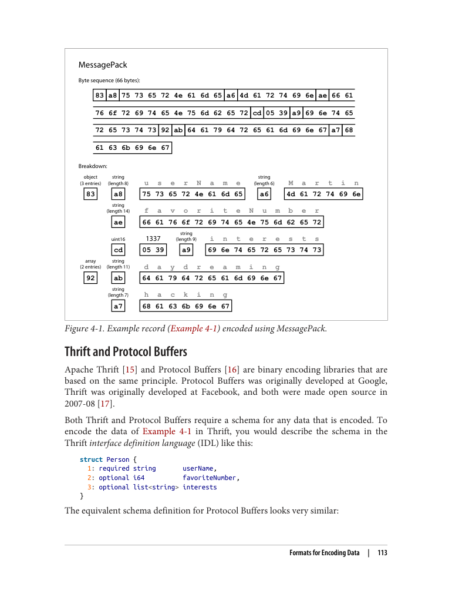
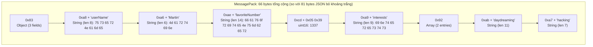
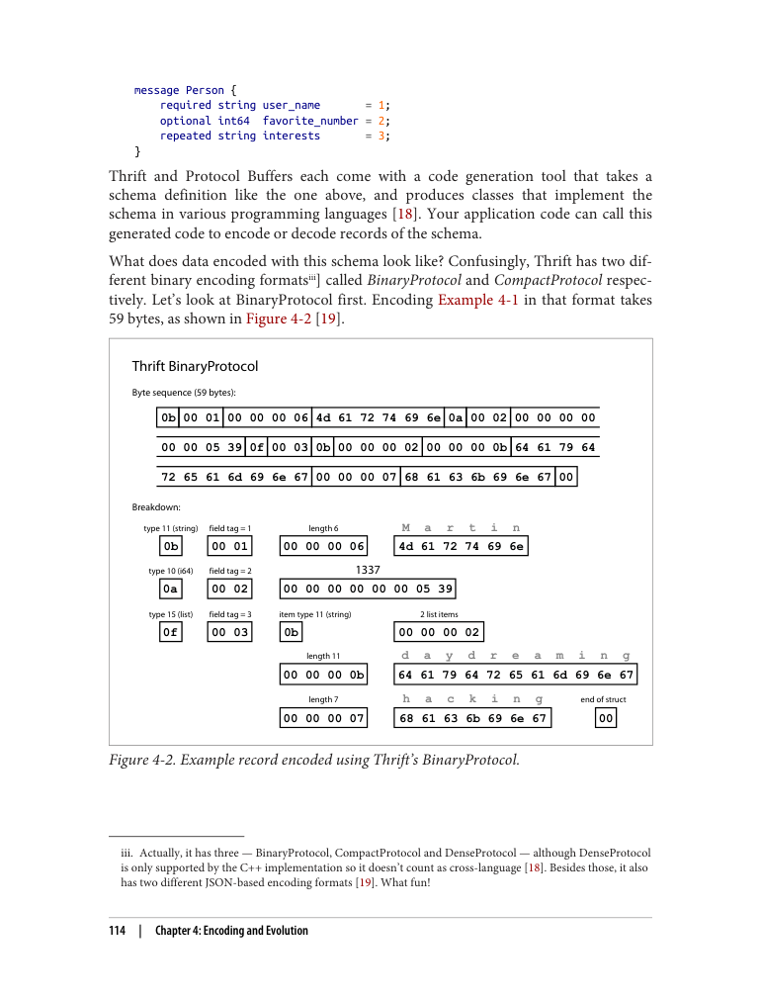
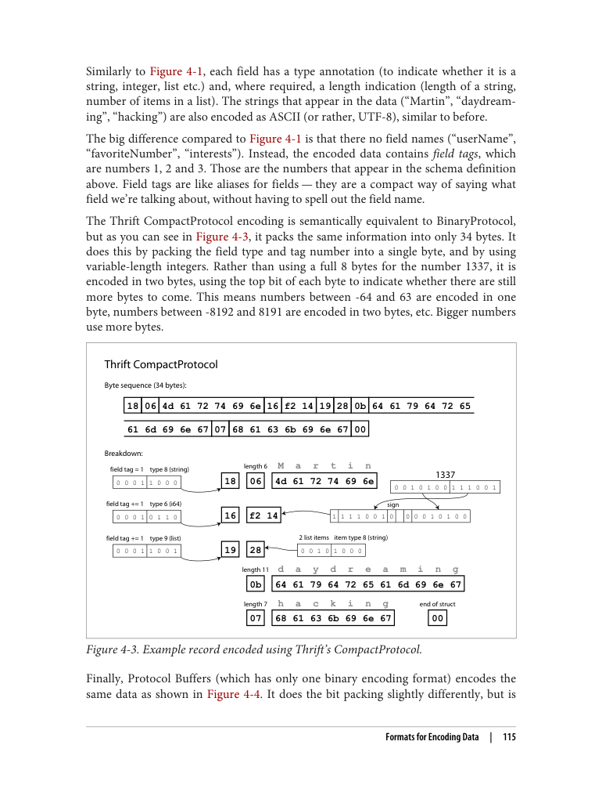
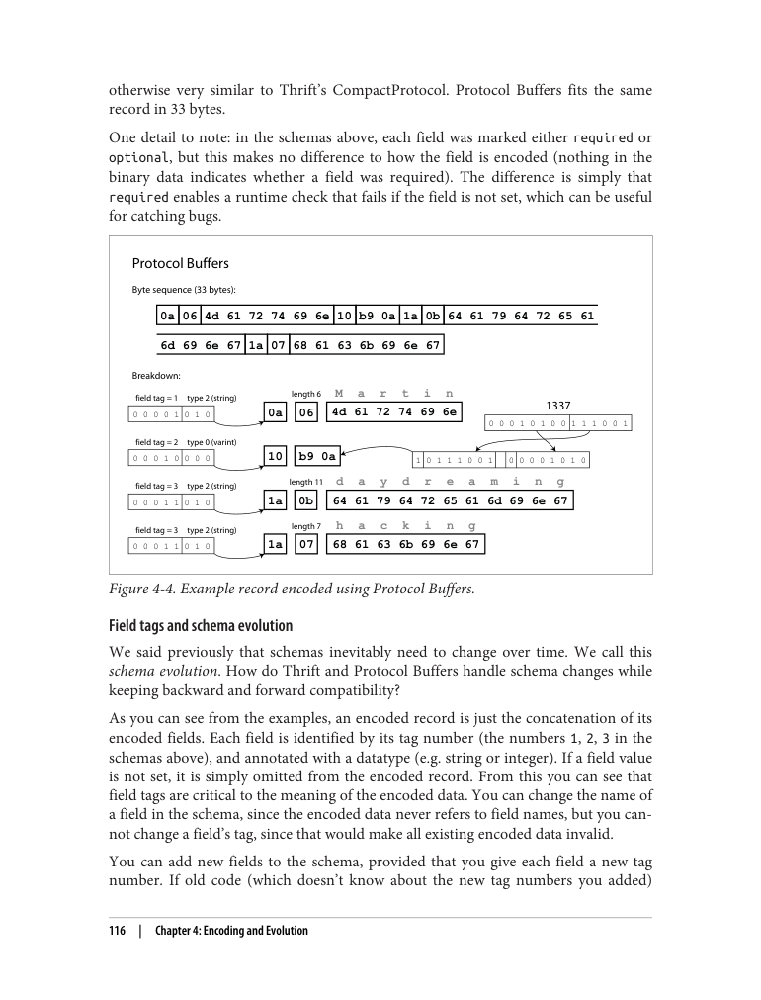
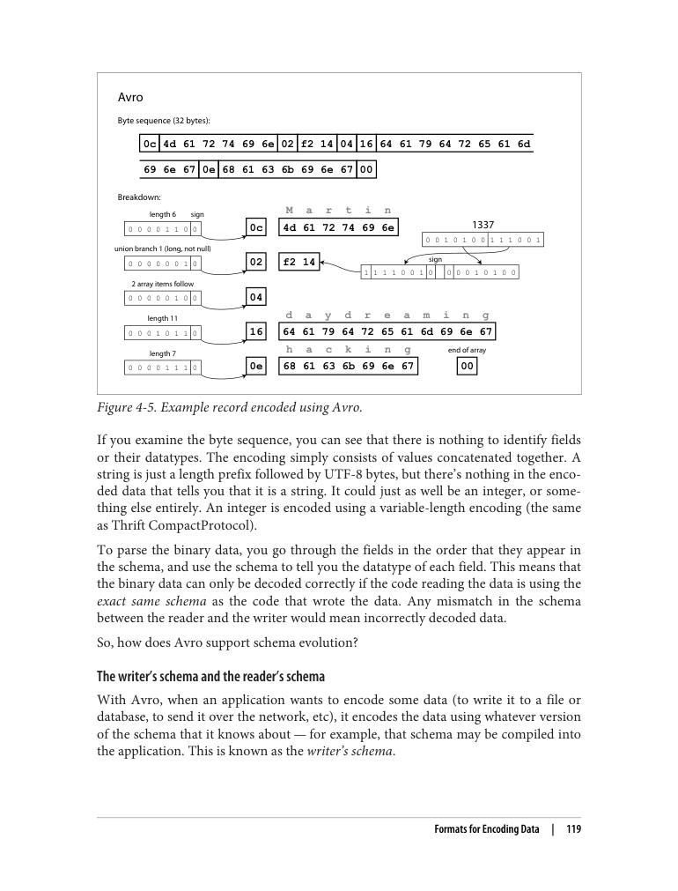
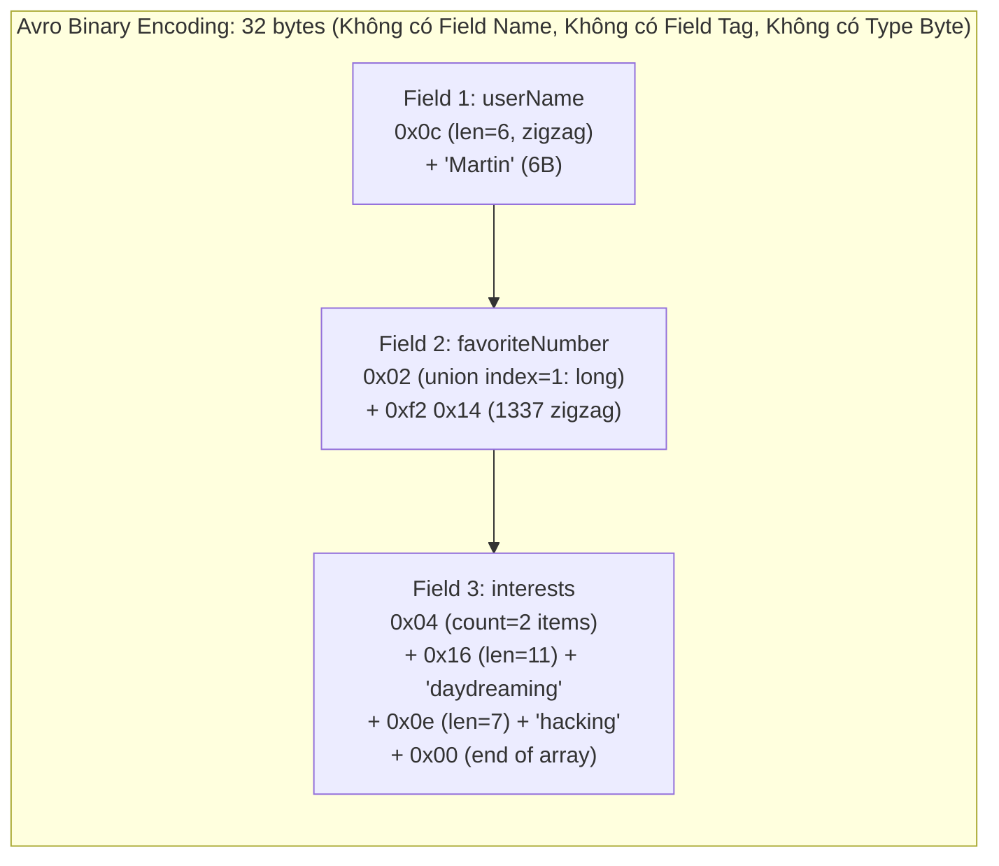
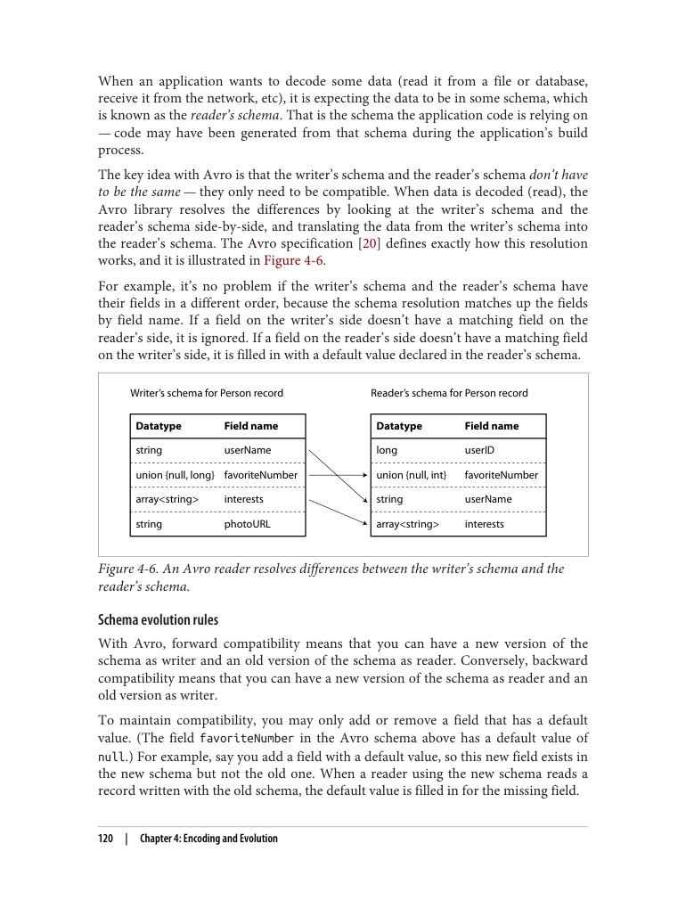
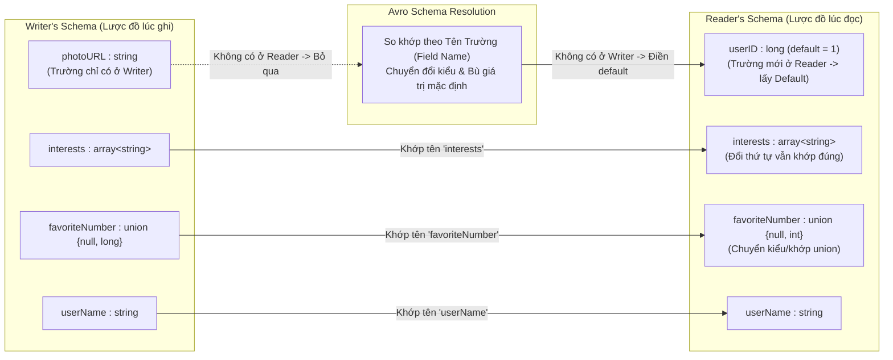
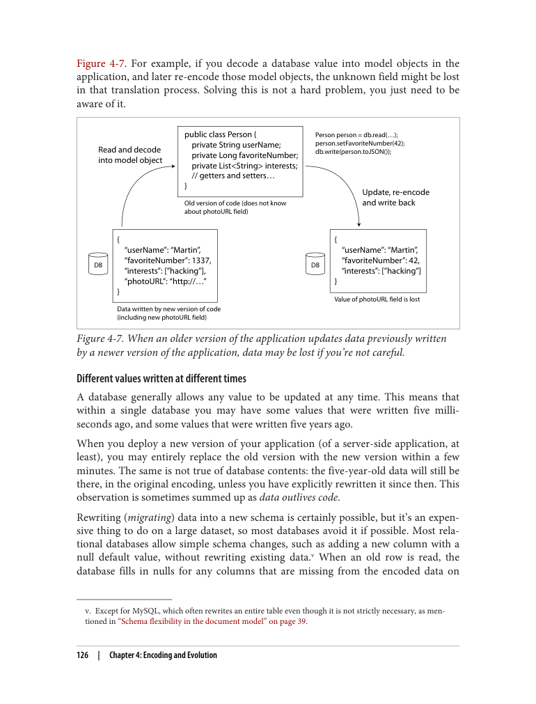

# Chương 4: Mã hóa và Tiến hóa dữ liệu (Encoding and Evolution)

> *"Vạn vật biến đổi và không gì đứng yên."*  
> — **Heraclitus xứ Ephesus**, được trích dẫn bởi Plato trong tác phẩm *Cratylus* (360 TCN)

Các hệ thống phần mềm và ứng dụng không bao giờ đứng yên mà luôn biến đổi theo thời gian. Khi sản phẩm mới ra mắt, khi nhu cầu của người dùng được thấu hiểu rõ hơn, hoặc khi bối cảnh kinh doanh thay đổi, các tính năng mới sẽ liên tục được bổ sung hoặc chỉnh sửa. Ở Chương 1, chúng ta đã làm quen với khái niệm **khả năng tiến hóa (evolvability)**: mục tiêu thiết kế hệ thống sao cho việc thích ứng với các thay đổi diễn ra dễ dàng và an toàn nhất (xem mục *"Evolvability: making change easy"* ở trang 19).

Trong hầu hết các trường hợp, khi tính năng ứng dụng thay đổi, dữ liệu mà ứng dụng lưu trữ cũng phải thay đổi theo. Có thể hệ thống cần ghi nhận thêm một trường dữ liệu (field) mới, một kiểu bản ghi (record type) mới, hoặc dữ liệu hiện có cần được trình bày và cấu trúc lại theo một cách thức khác.

Các mô hình dữ liệu mà chúng ta đã thảo luận ở Chương 2 có những cách tiếp cận rất khác nhau để đối phó với sự thay đổi này:

- **Cơ sở dữ liệu quan hệ (Relational databases):** Nhìn chung giả định rằng toàn bộ dữ liệu trong cơ sở dữ liệu đều tuân theo một lược đồ (schema) duy nhất. Mặc dù lược đồ đó có thể được thay đổi (thông qua quá trình di trú lược đồ — *schema migrations*, tức là các câu lệnh `ALTER`), nhưng tại bất kỳ thời điểm nào cũng chỉ có duy nhất một lược đồ đang có hiệu lực.
- **Cơ sở dữ liệu kiểm tra lược đồ khi đọc (*schema-on-read* hay thường gọi là *"schemaless"*):** Không áp đặt một lược đồ cứng nhắc khi ghi, nhờ đó cơ sở dữ liệu có thể chứa một tập hợp pha trộn giữa các định dạng dữ liệu cũ và mới được ghi vào ở nhiều thời điểm khác nhau (xem mục *"Schema flexibility in the document model"* ở trang 39).

Khi định dạng dữ liệu hoặc lược đồ thay đổi, mã nguồn ứng dụng (application code) thường cũng phải thay đổi tương ứng (ví dụ: bạn thêm một trường mới vào bản ghi, và mã nguồn ứng dụng bắt đầu đọc cũng như ghi trường dữ liệu đó). Tuy nhiên, trong một hệ thống ứng dụng quy mô lớn, việc cập nhật mã nguồn hiếm khi có thể diễn ra tức thời trên toàn bộ hệ thống cùng một lúc:

- **Đối với các ứng dụng phía máy chủ (Server-side applications):** Bạn thường thực hiện **nâng cấp cuốn chiếu (rolling upgrade)** — còn gọi là *triển khai theo giai đoạn (staged rollout)*. Nghĩa là bạn triển khai phiên bản mới lên một vài nút (node) trước, kiểm tra xem phiên bản mới có hoạt động ổn định không, rồi mới dần dần triển khai tiếp qua toàn bộ các nút còn lại. Cách làm này cho phép triển khai phiên bản mới mà không gây gián đoạn dịch vụ (zero downtime), từ đó khuyến khích việc phát hành thường xuyên hơn và nâng cao khả năng tiến hóa của hệ thống.
- **Đối với các ứng dụng phía máy khách (Client-side applications):** Bạn phụ thuộc hoàn toàn vào người dùng cuối — những người có thể mất một khoảng thời gian khá dài mới chịu tải về và cài đặt bản cập nhật mới trên thiết bị của họ.

Điều này dẫn đến một thực tế quan trọng: **các phiên bản mã nguồn cũ và mới, cùng với các định dạng dữ liệu cũ và mới, có thể cùng tồn tại song song trong hệ thống tại cùng một thời điểm.** Để hệ thống tiếp tục vận hành trơn tru mà không gặp sự cố, chúng ta cần duy trì tính tương thích theo cả hai chiều:

- **Tương thích ngược (Backward compatibility):** Mã nguồn mới hơn (newer code) có thể đọc được dữ liệu được ghi bởi mã nguồn cũ hơn (older code).
- **Tương thích xuôi / tương thích tiến (Forward compatibility):** Mã nguồn cũ hơn (older code) có thể đọc được dữ liệu được ghi bởi mã nguồn mới hơn (newer code).

Tính tương thích ngược thường không quá khó để đạt được: vì bạn là người viết ra mã nguồn mới, bạn đã biết rõ định dạng dữ liệu do mã nguồn cũ tạo ra, nên bạn có thể chủ động viết logic xử lý nó (thậm chí trong trường hợp cần thiết, chỉ cần giữ lại nhánh mã nguồn cũ để đọc dữ liệu cũ). Ngược lại, **tính tương thích xuôi (forward compatibility)** lại phức tạp và tinh vi hơn nhiều, bởi vì nó đòi hỏi mã nguồn cũ — vốn được viết ra trước khi các thay đổi xuất hiện — phải biết cách bỏ qua một cách an toàn những phần bổ sung do phiên bản mã nguồn mới tạo ra.

Trong chương này, chúng ta sẽ khảo sát nhiều định dạng mã hóa dữ liệu khác nhau, bao gồm **JSON, XML, Protocol Buffers, Thrift và Avro**. Đặc biệt, chúng ta sẽ phân tích cách chúng xử lý sự thay đổi lược đồ (*schema evolution*) và cách chúng hỗ trợ những hệ thống nơi dữ liệu lẫn mã nguồn cũ và mới phải cùng tồn tại. Sau đó, chúng ta sẽ thảo luận về cách các định dạng này được ứng dụng trong lưu trữ dữ liệu và truyền thông mạng: từ các dịch vụ web (web services), REST, RPC cho đến các hệ thống truyền thông điệp (message-passing systems) như mô hình Actor và hàng đợi thông điệp (message queues).

> 📝 **Giải thích thêm (không có trong sách):**  
> Để dễ nhớ sự khác biệt giữa **Backward Compatibility** và **Forward Compatibility**, bạn hãy luôn lấy **phiên bản mã nguồn đang đọc dữ liệu (Reader)** làm gốc quy chiếu:
> - **Backward Compatibility (Tương thích ngược — nhìn về quá khứ):** Code **mới** nhìn ngược về quá khứ để đọc dữ liệu **cũ** (ví dụ: dịch vụ v2 đọc bản ghi trong DB được lưu từ thời v1 năm ngoái).
> - **Forward Compatibility (Tương thích xuôi/tiến — nhìn về tương lai):** Code **cũ** nhìn về tương lai để đọc dữ liệu **mới** (ví dụ: trong quá trình rolling upgrade trên Kubernetes, một Pod đang chạy v1 nhận được message từ Kafka hoặc kết quả trả về từ Redis cache do một Pod v2 vừa ghi vào).
> 
> ```mermaid
> flowchart LR
>     subgraph BC ["Tương thích ngược (Backward Compatibility)"]
>         W_Old["Code Cũ (v1)<br/>Ghi dữ liệu định dạng v1"] -->|Dữ liệu v1| R_New["Code Mới (v2)<br/>Đọc và hiểu được v1"]
>     end
>     subgraph FC ["Tương thích xuôi (Forward Compatibility)"]
>         W_New["Code Mới (v2)<br/>Ghi dữ liệu định dạng v2"] -->|Dữ liệu v2| R_Old["Code Cũ (v1)<br/>Đọc phần v1, bỏ qua trường mới của v2"]
>     end
> ```

---

## Các định dạng mã hóa dữ liệu (Formats for Encoding Data)

Các chương trình máy tính thường làm việc với dữ liệu dưới (ít nhất) hai dạng biểu diễn hoàn toàn khác nhau:

1. **Trong bộ nhớ (In memory):** Dữ liệu được lưu giữ trong các đối tượng (objects), cấu trúc (structs), danh sách (lists), mảng (arrays), bảng băm (hash tables), cây (trees), v.v. Các cấu trúc dữ liệu này được tối ưu hóa để CPU có thể truy cập và thao tác một cách hiệu quả nhất (thường sử dụng các con trỏ bộ nhớ — *pointers*).
2. **Khi lưu trữ hoặc truyền qua mạng (On disk / over the network):** Khi bạn muốn ghi dữ liệu ra tệp (file) hoặc gửi nó qua mạng (network), bạn bắt buộc phải mã hóa nó thành một chuỗi các byte độc lập, tự chứa (*self-contained sequence of bytes* — chẳng hạn như một tài liệu JSON). Bởi vì địa chỉ con trỏ bộ nhớ của tiến trình này sẽ hoàn toàn vô nghĩa đối với bất kỳ tiến trình nào khác, dạng biểu diễn chuỗi byte này có cấu trúc rất khác biệt so với các cấu trúc dữ liệu được sử dụng trong bộ nhớ RAM.[^i]

[^i]: Ngoại trừ một số trường hợp đặc biệt, chẳng hạn như các tệp ánh xạ bộ nhớ (*memory-mapped files*), hoặc khi thao tác trực tiếp trên dữ liệu nén (như đã bàn trong mục *"Column compression"* ở trang 94).

Do đó, chúng ta cần một cơ chế chuyển đổi qua lại giữa hai dạng biểu diễn này:
- Quá trình dịch từ dạng biểu diễn trong bộ nhớ sang chuỗi byte được gọi là **mã hóa (encoding)** — còn được biết đến với các thuật ngữ **tuần tự hóa (serialization)** hoặc **marshalling**.
- Quá trình ngược lại, chuyển từ chuỗi byte về cấu trúc dữ liệu trong bộ nhớ, được gọi là **giải mã (decoding)** — còn gọi là **phân tích cú pháp (parsing)**, **giải tuần tự hóa (deserialization)**, hoặc **unmarshalling**.[^ii]

[^ii]: Lưu ý rằng *encoding* (mã hóa định dạng dữ liệu) không liên quan gì đến *encryption* (mã hóa bảo mật/mật mã học). Chúng ta không thảo luận về mật mã học trong cuốn sách này.

> **Xung đột thuật ngữ (Terminology clash)**  
> Đáng tiếc là thuật ngữ *serialization* (tuần tự hóa) cũng được sử dụng trong ngữ cảnh của các giao dịch cơ sở dữ liệu (transactions — xem Chương 7, *serializability*) với một ý nghĩa hoàn toàn khác biệt. Để tránh việc một từ mang quá nhiều nghĩa gây nhầm lẫn, chúng ta sẽ thống nhất sử dụng thuật ngữ **encoding (mã hóa)** trong cuốn sách này, mặc dù *serialization* có lẽ là từ phổ biến hơn trong cộng đồng lập trình viên.

Vì đây là một bài toán vô cùng phổ biến trong khoa học máy tính, có vô số thư viện và định dạng mã hóa khác nhau để lựa chọn. Hãy cùng điểm qua một bức tranh tổng quan.

---

### Các định dạng đặc thù theo ngôn ngữ lập trình (Language-specific formats)

Nhiều ngôn ngữ lập trình đi kèm sẵn các công cụ tích hợp để mã hóa các đối tượng trong bộ nhớ thành chuỗi byte. Ví dụ:
- **Java** có `java.io.Serializable` [1]
- **Ruby** có `Marshal` [2]
- **Python** có `pickle` [3]
- Cùng nhiều thư viện bên thứ ba khác, chẳng hạn như **Kryo** cho Java [4].


Những thư viện mã hóa tích hợp sẵn này rất tiện lợi vì chúng cho phép lưu trữ và khôi phục các đối tượng trong bộ nhớ chỉ với vài dòng mã tối thiểu. Tuy nhiên, chúng lại tiềm ẩn hàng loạt vấn đề nghiêm trọng và sâu sắc:

- **Sự trói buộc vào một ngôn ngữ duy nhất:** Định dạng mã hóa thường gắn chặt với một ngôn ngữ lập trình cụ thể, khiến việc đọc dữ liệu đó từ một ngôn ngữ khác trở nên cực kỳ khó khăn hoặc bất khả thi. Nếu bạn lưu trữ hoặc truyền dữ liệu bằng định dạng như vậy, bạn đang tự trói buộc hệ thống của mình vào ngôn ngữ lập trình hiện tại trong một thời gian rất dài, đồng thời tự chặn đứng khả năng tích hợp hệ thống của mình với hệ thống của các tổ chức khác (hoặc các nhóm khác sử dụng ngôn ngữ khác).
- **Lỗ hổng bảo mật nghiêm trọng (Remote Code Execution - RCE):** Để khôi phục dữ liệu về đúng các kiểu đối tượng ban đầu, quá trình giải mã (decoding) cần có khả năng khởi tạo các lớp (classes) tùy ý trong runtime. Đây thường xuyên là nguồn gốc của các lỗ hổng bảo mật chí mạng [5]: nếu kẻ tấn công có thể lừa ứng dụng của bạn giải mã một chuỗi byte độc hại do chúng tự tạo ra, chúng có thể khởi tạo các lớp tùy ý, từ đó dẫn đến những hậu quả khủng khiếp như thực thi mã tùy ý từ xa (*Remote Code Execution* — RCE) [6, 7].
- **Xem nhẹ bài toán quản lý phiên bản dữ liệu (Versioning):** Việc tiến hóa và quản lý phiên bản dữ liệu thường chỉ được nghĩ đến sau cùng trong các thư viện này. Vì mục tiêu chính của chúng là mã hóa dữ liệu nhanh và tiện lợi nhất trong ngắn hạn, chúng thường bỏ qua các bài toán phức tạp về tính tương thích xuôi (forward compatibility) và tương thích ngược (backward compatibility).
- **Hiệu năng kém và kích thước cồng kềnh:** Hiệu quả hoạt động (thời gian CPU cần để mã hóa/giải mã và kích thước của cấu trúc dữ liệu sau khi mã hóa) cũng thường không được tối ưu. Chẳng hạn, cơ chế `Serializable` tích hợp sẵn của Java vốn khét tiếng vì hiệu năng tồi tệ và tạo ra dữ liệu mã hóa cực kỳ phình đại (bloated) [8].

Vì những lý do trên, nhìn chung **việc sử dụng cơ chế mã hóa tích hợp sẵn của ngôn ngữ lập trình cho bất kỳ mục đích nào khác ngoài các tác vụ tạm thời ngắn hạn (transient purposes) đều là một ý tưởng tồi.**

> 💡 **Ví dụ bổ sung (không có trong sách):**  
> Trong thực tế vận hành các hệ thống lớn:
> 1. **Lỗ hổng Java Deserialization & Python Pickle:** Nhiều vụ tấn công mạng lịch sử (như lỗ hổng trên Apache Commons Collections, WebLogic, JBoss) khai thác chính cơ chế `ObjectInputStream.readObject()` của `java.io.Serializable` thông qua các chuỗi *"gadget chains"*. Tương tự trong Python, việc dùng `pickle.loads()` trên dữ liệu nhận từ người dùng hoặc từ Redis cache không đáng tin cậy cho phép kẻ tấn công dùng hàm `__reduce__()` để gọi trực tiếp `os.system("rm -rf /")`.
> 2. **Sự cố khi nâng cấp lớp (Class evolution) với `serialVersionUID`:** Trong Java, nếu bạn lưu đối tượng `UserSession` vào Redis bằng `Serializable` rồi cập nhật code thêm/sửa kiểu một trường mà không quản lý chặt chẽ `serialVersionUID`, toàn bộ các phiên đăng nhập đang lưu trong Redis sẽ lập tức ném lỗi `InvalidClassException` khi hệ thống đọc ra.

---

### JSON, XML và các biến thể nhị phân (JSON, XML and binary variants)

Khi chuyển sang các định dạng mã hóa chuẩn hóa có thể được đọc và ghi bởi nhiều ngôn ngữ lập trình khác nhau, **JSON** và **XML** là hai ứng cử viên hiển nhiên nhất. Chúng được biết đến rộng rãi, được hỗ trợ ở khắp mọi nơi, và cũng bị... ghét bỏ rộng rãi không kém:
- **XML** thường bị chỉ trích vì quá dài dòng (verbose) và phức tạp một cách không cần thiết [9].
- **JSON** trở nên phổ biến chủ yếu nhờ được hỗ trợ sẵn trong các trình duyệt web (vì bản chất nó là một tập con của JavaScript) và nhờ sự đơn giản hơn hẳn so với XML.
- **CSV** là một định dạng độc lập ngôn ngữ phổ biến khác, mặc dù kém mạnh mẽ hơn (không hỗ trợ cấu trúc lồng nhau).

JSON, XML và CSV đều là các **định dạng văn bản (textual formats)**, do đó con người có thể đọc hiểu trực tiếp ở một mức độ nhất định (mặc dù cú pháp đẹp hay xấu vẫn luôn là chủ đề tranh cãi sôi nổi). Bên cạnh những vấn đề bề nổi về mặt cú pháp, chúng còn có một số nhược điểm tinh vi nhưng rất đáng lưu tâm:

1. **Sự nhập nhằng trong việc mã hóa các con số (Ambiguity around numbers):**
   - Trong **XML** và **CSV**, bạn không thể phân biệt được giữa một con số thực sự và một chuỗi văn bản tình cờ chỉ chứa các chữ số (trừ khi tham chiếu đến một lược đồ bên ngoài).
   - **JSON** có phân biệt giữa chuỗi (strings) và số (numbers), nhưng nó lại **không phân biệt giữa số nguyên (integers) và số thực dấu phẩy động (floating-point)**, đồng thời không quy định độ chính xác (precision).
   - Đây là một vấn đề lớn khi xử lý các số nguyên lớn. Cụ thể, các số nguyên lớn hơn $2^{53}$ không thể được biểu diễn chính xác tuyệt đối trong kiểu số thực dấu phẩy động độ chính xác kép chuẩn IEEE 754 (*double-precision floating-point* — 64-bit float dùng 53 bit cho phần định trị mantissa). Do đó, những con số như vậy sẽ bị sai lệch (mất độ chính xác ở các chữ số cuối) khi được phân tích cú pháp (parse) trong một ngôn ngữ sử dụng số thực IEEE 754 cho mọi kiểu số (điển hình là **JavaScript**).
   - Một ví dụ kinh điển về các con số lớn hơn $2^{53}$ xuất hiện trên **Twitter** (nay là X), nơi sử dụng số nguyên 64-bit (Snowflake ID) để định danh cho mỗi bài đăng (tweet). Dữ liệu JSON trả về từ API của Twitter phải bao gồm ID của tweet **hai lần**: một lần dưới dạng số JSON (`id`) và một lần dưới dạng chuỗi thập phân (`id_str`), nhằm lách qua thực tế là các ứng dụng JavaScript không thể parse chính xác số nguyên 64-bit từ JSON [10].

> 💡 **Ví dụ bổ sung (không có trong sách):**  
> Bạn có thể kiểm chứng ngay lỗi mất độ chính xác của số nguyên $> 2^{53}$ trong trình duyệt hoặc Node.js:
> ```javascript
> // Số lớn nhất biểu diễn chính xác trong IEEE 754 float64 là 2^53 - 1 = 9007199254740991
> const jsonResponse = '{"id": 1069838473928374659, "id_str": "1069838473928374659"}';
> const parsed = JSON.parse(jsonResponse);
> console.log(parsed.id);     // In ra: 1069838473928374700 (BỊ SAI LỆCH!)
> console.log(parsed.id_str); // In ra: "1069838473928374659" (CHÍNH XÁC)
> ```
> Nếu ứng dụng frontend lấy `parsed.id` để gọi tiếp API `DELETE /tweets/1069838473928374700`, nó sẽ xóa nhầm hoặc báo lỗi `404 Not Found`!

2. **Không hỗ trợ chuỗi nhị phân (Binary strings):**
   - JSON và XML hỗ trợ rất tốt cho các chuỗi ký tự Unicode (tức là văn bản cho con người đọc), nhưng chúng không hỗ trợ trực tiếp các **chuỗi nhị phân (binary strings)** — tức là một dãy các byte thô không mang bảng mã ký tự (chẳng hạn dữ liệu ảnh thu nhỏ, khóa mật mã, hoặc dữ liệu nén).
   - Chuỗi nhị phân là một tính năng rất hữu ích, nên các lập trình viên thường phải lách qua giới hạn này bằng cách mã hóa dữ liệu nhị phân thành văn bản ASCII bằng thuật toán **Base64**. Khi đó, lược đồ (hoặc quy ước ngầm) được dùng để chỉ dẫn rằng giá trị này cần được giải mã từ Base64. Cách này hoạt động được, nhưng khá chắp vá (hacky) và làm tăng kích thước dữ liệu lên thêm 33%.

3. **Sự phức tạp của ngôn ngữ lược đồ (Schema support):**
   - Cả XML (với XML Schema / XSD [11]) và JSON (với JSON Schema [12]) đều có hỗ trợ lược đồ tùy chọn. Những ngôn ngữ lược đồ này rất mạnh mẽ, nhưng cũng vì thế mà khá phức tạp để học và cài đặt.
   - Việc sử dụng XML Schema khá phổ biến, nhưng rất nhiều công cụ dựa trên JSON lại chẳng bận tâm đến việc dùng schema. Vì việc diễn giải đúng đắn dữ liệu (như phân biệt số nguyên 64-bit hay chuỗi Base64 nêu trên) phụ thuộc vào thông tin trong lược đồ, các ứng dụng không dùng XML/JSON schema thường phải viết cứng (hardcode) thêm logic mã hóa/giải mã riêng lẻ ở tầng ứng dụng.

4. **Sự mơ hồ của CSV:**
   - **CSV** hoàn toàn không có bất kỳ lược đồ nào, do đó ứng dụng phải tự định nghĩa ý nghĩa của từng hàng và từng cột. Nếu ứng dụng thay đổi dẫn đến việc thêm một hàng hoặc một cột mới, bạn phải tự xử lý thay đổi đó một cách thủ công.
   - CSV cũng là một định dạng khá mơ hồ (điều gì sẽ xảy ra nếu một giá trị bên trong ô chứa dấu phẩy `,`, dấu ngoặc kép `"` hoặc ký tự xuống dòng `\n`?). Mặc dù các quy tắc thoát ký tự (*escaping rules*) của CSV đã được đặc tả chính thức trong RFC 4180 [13], nhưng không phải bộ phân tích cú pháp (parser) nào cũng cài đặt đúng chuẩn.

Bất chấp tất cả những khiếm khuyết trên, JSON, XML và CSV vẫn đủ tốt cho rất nhiều mục đích sử dụng. Nhiều khả năng chúng sẽ tiếp tục giữ vững sự phổ biến của mình, đặc biệt là trong vai trò **định dạng trao đổi dữ liệu (data interchange formats)** — tức là gửi dữ liệu từ tổ chức này sang tổ chức khác. Trong những tình huống như vậy, miễn là các bên thống nhất được với nhau về định dạng dữ liệu, thì việc định dạng đó đẹp đẽ hay hiệu quả đến đâu thường không quá quan trọng. Sự khó khăn trong việc thuyết phục các tổ chức khác nhau đi đến thống nhất về bất kỳ tiêu chuẩn chung nào luôn lớn hơn gấp bội so với hầu hết các mối bận tâm kỹ thuật khác.

---

#### Mã hóa nhị phân cho JSON/XML (Binary encoding)

Đối với dữ liệu chỉ được sử dụng nội bộ bên trong tổ chức của bạn, áp lực phải sử dụng một định dạng "mẫu số chung nhỏ nhất" như JSON văn bản sẽ giảm đi rất nhiều. Thay vào đó, bạn có thể lựa chọn một định dạng nhỏ gọn hơn (compact) hoặc phân tích cú pháp nhanh hơn (faster to parse). Với một tập dữ liệu nhỏ, lợi ích thu được là không đáng kể; nhưng một khi quy mô dữ liệu chạm ngưỡng hàng terabyte hoặc hàng tỷ thông điệp mỗi ngày, việc lựa chọn định dạng dữ liệu sẽ tạo ra tác động vô cùng to lớn.

JSON ít dài dòng hơn XML, nhưng cả hai vẫn tiêu tốn rất nhiều dung lượng nếu đem so sánh với các định dạng nhị phân. Nhận thức này đã thúc đẩy sự ra đời của hàng loạt biến thể mã hóa nhị phân cho JSON (như **MessagePack, BSON, BJSON, UBJSON, BISON, và Smile**) cũng như cho XML (như **WBXML** và **Fast Infoset**). Các định dạng này đã được ứng dụng trong nhiều phân khúc ngách khác nhau (ví dụ: BSON là định dạng lưu trữ và truyền tải cốt lõi của MongoDB), nhưng không định dạng nào đạt được mức độ phổ biến rộng khắp như phiên bản văn bản thuần túy của JSON và XML.

Một số định dạng trong nhóm này mở rộng thêm tập hợp các kiểu dữ liệu (chẳng hạn như phân biệt rõ số nguyên và số thực dấu phẩy động, hoặc bổ sung hỗ trợ cho chuỗi nhị phân), nhưng nhìn chung chúng vẫn **giữ nguyên mô hình dữ liệu của JSON/XML**. Đặc biệt, vì chúng **không quy định một lược đồ (schema)**, chúng bắt buộc phải lưu kèm toàn bộ tên của các trường đối tượng (object field names) ngay bên trong dữ liệu đã mã hóa. Nghĩa là, trong bất kỳ bản mã hóa nhị phân nào của tài liệu JSON ở **Ví dụ 4-1**, chuỗi nhị phân vẫn phải chứa các chuỗi ký tự `"userName"`, `"favoriteNumber"` và `"interests"` ở đâu đó.

**Ví dụ 4-1 – Bản ghi mẫu mà chúng ta sẽ lần lượt mã hóa bằng nhiều định dạng nhị phân khác nhau trong chương này (Example 4-1. Example record which we will encode in several binary formats in this chapter.)**

```json
{
    "userName": "Martin",
    "favoriteNumber": 1337,
    "interests": ["daydreaming", "hacking"]
}
```

Hãy cùng xem xét một ví dụ với **MessagePack** — một định dạng mã hóa nhị phân phổ biến cho JSON. **Hình 4-1** cho thấy chuỗi byte thu được khi bạn mã hóa tài liệu JSON ở **Ví dụ 4-1** bằng MessagePack [14]. Một vài byte đầu tiên mang ý nghĩa như sau:

1. **Byte đầu tiên `0x83`** chỉ ra rằng phần theo sau là một đối tượng (*object / fixmap*, được biểu thị bởi 4 bit cao = `0x80`) có chứa **3 trường** (4 bit thấp = `0x03`). *(Phòng khi bạn thắc mắc điều gì sẽ xảy ra nếu một đối tượng có nhiều hơn 15 trường khiến số lượng trường không thể chứa vừa trong 4 bit: khi đó nó sẽ nhận một mã chỉ báo kiểu — type indicator — khác như `map16` hoặc `map32`, và số lượng trường sẽ được mã hóa trong 2 hoặc 4 byte).*
2. **Byte thứ hai `0xa8`** chỉ ra rằng phần theo sau là một chuỗi ký tự (*string / fixstr*, 4 bit cao = `0xa0`) có độ dài **8 byte** (4 bit thấp = `0x08`).
3. **8 byte tiếp theo** là tên trường `userName` được mã hóa theo bảng mã ASCII (`75 73 65 72 4e 61 6d 65`). Vì độ dài chuỗi đã được báo trước ở byte liền kề, nên không cần bất kỳ ký tự đánh dấu kết thúc chuỗi nào (như null-terminator `\0` trong C hay dấu ngoặc kép `"` trong JSON), cũng không cần bất kỳ quy tắc thoát ký tự (escaping) nào.
4. Tiếp tục tương tự cho giá trị `"Martin"`, trường `"favoriteNumber"` (với số nguyên `1337` được mã hóa dạng `uint16` gồm byte chỉ kiểu `0xcd` theo sau bởi 2 byte big-endian `0x05 0x39`, vì $5 \times 256 + 57 = 1337$), và trường mảng `"interests"` (`0x92` báo hiệu mảng 2 phần tử).

**Hình 4-1 – Bản ghi mẫu (Ví dụ 4-1) được mã hóa bằng MessagePack (Figure 4-1. Example record (Example 4-1) encoded using MessagePack.)**





| Byte (Hex) | Giải thích chi tiết trong MessagePack | Số byte |
| :--- | :--- | :---: |
| `83` | `fixmap` (`0x80`) với `3` trường (`0x03`) | 1 |
| `a8` + `75 73 65 72 4e 61 6d 65` | `fixstr` độ dài 8 (`0xa8`) + chuỗi `"userName"` | 9 |
| `a6` + `4d 61 72 74 69 6e` | `fixstr` độ dài 6 (`0xa6`) + chuỗi `"Martin"` | 7 |
| `ae` + `66 61 76 6f 72 69 74 65 4e 75 6d 62 65 72` | `fixstr` độ dài 14 (`0xae`) + chuỗi `"favoriteNumber"` | 15 |
| `cd` + `05 39` | Kiểu `uint16` (`0xcd`) + giá trị `1337` (`0x0539`) | 3 |
| `a9` + `69 6e 74 65 72 65 73 74 73` | `fixstr` độ dài 9 (`0xa9`) + chuỗi `"interests"` | 10 |
| `92` | `fixarray` (`0x90`) với `2` phần tử (`0x02`) | 1 |
| `ab` + `64 61 79 64 72 65 61 6d 69 6e 67` | `fixstr` độ dài 11 (`0xab`) + chuỗi `"daydreaming"` | 12 |
| `a7` + `68 61 63 6b 69 6e 67` | `fixstr` độ dài 7 (`0xa7`) + chuỗi `"hacking"` | 8 |
| **Tổng cộng** | **Bao gồm toàn bộ tên trường và giá trị** | **66 bytes** |

Bản mã hóa nhị phân bằng MessagePack này dài **66 byte**, tức là chỉ nhỏ hơn một chút so với **81 byte** của bản mã hóa JSON văn bản thuần túy (đã loại bỏ khoảng trắng). Tất cả các biến thể mã hóa nhị phân không lược đồ của JSON đều có chung đặc điểm này. Thực sự không rõ liệu việc tiết kiệm được một chút dung lượng nhỏ nhoi như vậy (cùng với việc tăng tốc độ phân tích cú pháp lên đôi chút) có đáng để đánh đổi lấy việc mất đi khả năng đọc hiểu trực tiếp bằng mắt thường của con người hay không.

Trong các phần tiếp theo, chúng ta sẽ thấy làm thế nào để làm tốt hơn thế rất nhiều, và mã hóa cùng bản ghi trên chỉ trong vỏn vẹn **32 byte**.

---

### Thrift và Protocol Buffers (Thrift and Protocol Buffers)

**Apache Thrift** [15] và **Protocol Buffers (Protobuf)** [16] là hai thư viện mã hóa nhị phân được xây dựng dựa trên cùng một nguyên lý cốt lõi. Protocol Buffers ban đầu được phát triển tại Google, còn Thrift ban đầu được phát triển tại Facebook, và cả hai đều được công bố mã nguồn mở vào giai đoạn 2007–2008 [17].

Cả Thrift lẫn Protocol Buffers đều **đòi hỏi phải có một lược đồ (schema)** cho bất kỳ dữ liệu nào được mã hóa. Để mã hóa dữ liệu của **Ví dụ 4-1** trong Thrift, bạn sẽ mô tả lược đồ bằng ngôn ngữ định nghĩa giao diện của Thrift (*Thrift Interface Definition Language* — IDL) như sau:

```thrift
struct Person {
  1: required string       userName,
  2: optional i64          favoriteNumber,
  3: optional list<string> interests
}
```

Định nghĩa lược đồ tương đương cho Protocol Buffers (phiên bản `proto2`) trông rất giống với Thrift:

```protobuf
message Person {
    required string user_name       = 1;
    optional int64  favorite_number = 2;
    repeated string interests       = 3;
}
```

Thrift và Protocol Buffers đều đi kèm với một công cụ sinh mã nguồn (*code generation tool*). Công cụ này nhận đầu vào là một tệp định nghĩa lược đồ như trên và sinh ra các lớp (classes) cài đặt lược đồ đó trong nhiều ngôn ngữ lập trình khác nhau (Java, C++, Python, Go, C#, Ruby, v.v.) [18]. Mã nguồn ứng dụng của bạn sẽ gọi trực tiếp đoạn mã được sinh tự động này để mã hóa hoặc giải mã các bản ghi tuân theo lược đồ.

Vậy dữ liệu được mã hóa bằng lược đồ này trông như thế nào ở cấp độ byte? Khá rắc rối là Thrift có tới hai định dạng mã hóa nhị phân khác nhau[^iii] được gọi lần lượt là **BinaryProtocol** và **CompactProtocol**. Hãy cùng xem xét **BinaryProtocol** trước. Việc mã hóa **Ví dụ 4-1** theo định dạng này tiêu tốn **59 byte**, như được minh họa trong **Hình 4-2** [19].

[^iii]: Thực chất, Thrift có tới ba định dạng nhị phân — `BinaryProtocol`, `CompactProtocol` và `DenseProtocol` — mặc dù `DenseProtocol` chỉ được hỗ trợ bởi bản cài đặt C++ nên không được tính là định dạng đa ngôn ngữ [18]. Bên cạnh đó, nó còn có hai định dạng mã hóa dựa trên JSON khác nhau nữa [19]. Thật thú vị!

**Hình 4-2 – Bản ghi mẫu được mã hóa bằng BinaryProtocol của Thrift (Figure 4-2. Example record encoded using Thrift’s BinaryProtocol.)**



| Trường dữ liệu | Chuỗi Byte (Hex) | Giải thích cấu trúc trong Thrift BinaryProtocol | Số byte |
| :--- | :--- | :--- | :---: |
| **Field 1 (`userName`)** | `0b` | Kiểu dữ liệu `11` (`string`) | 1 |
| | `00 01` | Thẻ trường (`field tag = 1`, 2-byte big-endian) | 2 |
| | `00 00 00 06` | Độ dài chuỗi = `6` (4-byte int32) | 4 |
| | `4d 61 72 74 69 6e` | Chuỗi UTF-8 `"Martin"` | 6 |
| **Field 2 (`favoriteNumber`)** | `0a` | Kiểu dữ liệu `10` (`i64`) | 1 |
| | `00 02` | Thẻ trường (`field tag = 2`) | 2 |
| | `00 00 00 00 00 00 05 39` | Giá trị int64 cố định 8 byte = `1337` | 8 |
| **Field 3 (`interests`)** | `0f` | Kiểu dữ liệu `15` (`list`) | 1 |
| | `00 03` | Thẻ trường (`field tag = 3`) | 2 |
| | `0b` | Kiểu phần tử trong danh sách = `11` (`string`) | 1 |
| | `00 00 00 02` | Số lượng phần tử trong danh sách = `2` (4-byte int32) | 4 |
| *Phần tử 1* | `00 00 00 0b` + `64 61...67` | Độ dài `11` (4 byte) + chuỗi `"daydreaming"` (11 byte) | 15 |
| *Phần tử 2* | `00 00 00 07` + `68 61...67` | Độ dài `7` (4 byte) + chuỗi `"hacking"` (7 byte) | 11 |
| **Kết thúc Struct** | `00` | Byte đánh dấu kết thúc struct (`STOP` field) | 1 |
| **Tổng cộng** | | | **59 bytes** |

Tương tự như **Hình 4-1**, mỗi trường trong `BinaryProtocol` đều có một byte chú thích kiểu dữ liệu (*type annotation* — để cho biết nó là chuỗi, số nguyên, danh sách, v.v.) và, ở những nơi cần thiết, một chỉ báo độ dài (độ dài của chuỗi, số lượng phần tử trong danh sách). Các chuỗi xuất hiện trong dữ liệu (`"Martin"`, `"daydreaming"`, `"hacking"`) cũng được mã hóa dưới dạng ASCII (hay chính xác hơn là UTF-8), giống như trước.

Điểm khác biệt lớn nhất so với **Hình 4-1** (MessagePack) là **hoàn toàn không có tên trường (`"userName"`, `"favoriteNumber"`, `"interests"`) trong dữ liệu nhị phân**. Thay vào đó, dữ liệu đã mã hóa chỉ chứa các **thẻ trường (field tags)** — chính là các con số `1`, `2` và `3`. Đây là những con số xuất hiện trong định nghĩa lược đồ ở trên. Thẻ trường đóng vai trò như những bí danh (aliases) rút gọn cho các trường — chúng là một cách thức cực kỳ nhỏ gọn để chỉ định chính xác chúng ta đang nói tới trường nào mà không cần phải đánh vần từng chữ cái của tên trường đó ra.

Tuy nhiên, `BinaryProtocol` của Thrift vẫn còn lãng phí khá nhiều byte (dùng 2 byte cố định cho field tag, 4 byte cố định cho độ dài chuỗi/danh sách, và 8 byte cố định cho số `i64` dù giá trị chỉ là `1337`). Đó là lý do **Thrift CompactProtocol** ra đời.

Định dạng **Thrift CompactProtocol** hoàn toàn tương đương về mặt ngữ nghĩa với `BinaryProtocol`, nhưng như bạn có thể thấy trong **Hình 4-3**, nó nén cùng một lượng thông tin đó vào chỉ **34 byte**. Nó làm được điều này nhờ hai kỹ thuật tối ưu quan trọng:
1. **Đóng gói kiểu trường và số thẻ vào chung một byte duy nhất (Bit packing):** Thay vì tốn 3 byte cho `type` + `field tag`, nó dùng 4 bit cao cho độ chênh lệch của thẻ trường (`field tag delta` — chẳng hạn `field tag += 1`) và 4 bit thấp cho kiểu dữ liệu (`type`).
2. **Sử dụng số nguyên có độ dài biến thiên (Variable-length integers — Varints):** Thay vì dùng trọn 8 byte cho con số `1337`, nó chỉ mã hóa số này trong **2 byte** (`f2 14`), sử dụng bit cao nhất (MSB — top bit) của mỗi byte làm cờ báo hiệu xem có còn byte tiếp theo thuộc về con số này hay không (cùng với phép mã hóa *ZigZag* cho số âm). Nhờ cơ chế này, các số nằm trong khoảng từ `-64` đến `63` chỉ tốn **1 byte**, các số từ `-8192` đến `8191` chỉ tốn **2 byte**, v.v. Chỉ những con số thực sự lớn mới phải dùng đến nhiều byte hơn.

**Hình 4-3 – Bản ghi mẫu được mã hóa bằng CompactProtocol của Thrift (Figure 4-3. Example record encoded using Thrift’s CompactProtocol.)**



> 📝 **Giải thích thêm (không có trong sách) — Cách hoạt động của Varint và ZigZag Encoding trên số `1337`:**  
> Tại sao số `1337` trong **Hình 4-3** (Thrift CompactProtocol) và **Hình 4-5** (Avro) lại thành `f2 14`, trong khi ở **Hình 4-4** (Protocol Buffers) lại thành `b9 0a`?
> - **1. Biểu diễn nhị phân của `1337`:**  
>   $1337 = 1024 + 256 + 32 + 16 + 8 + 1 = \text{0b10100111001}$ (11 bits).
> - **2. Trong Protocol Buffers (`int64` không dùng ZigZag):**  
>   Protobuf tách 7 bit một từ phải sang trái (little-endian base-128):
>   - Nhóm 7 bit thấp: `0111001`. Vì vẫn còn bit phía trước nên bật bit thứ 8 (MSB = `1`) $\rightarrow$ `10111001` = **`0xb9`**.
>   - Nhóm bit cao còn lại: `0001010` (thêm các số 0 ở đầu cho đủ 7 bit). Vì đây là byte cuối cùng của số nên MSB = `0` $\rightarrow$ `00001010` = **`0x0a`**.
>   - Kết quả trong Protobuf (**Hình 4-4**): **`b9 0a`**.
> - **3. Trong Thrift CompactProtocol & Avro (sử dụng ZigZag encoding cho số có dấu):**  
>   Nếu dùng Varint thông thường cho số âm (ví dụ `-1` trong biểu diễn bù 2 64-bit là toàn bộ 64 bit `1`), nó sẽ tốn tới 10 byte! Để số âm nhỏ cũng chỉ tốn 1 byte, ZigZag ánh xạ xen kẽ: $0 \to 0$, $-1 \to 1$, $1 \to 2$, $-2 \to 3$, ..., tổng quát số dương $n \to 2n$ (dịch trái 1 bit, bit cuối cùng là bit dấu `0`).
>   - Với $n = 1337$: sau khi nhân 2 (thêm bit dấu `0` vào cuối) ta được $2674 = \text{0b101001110010}$.
>   - Tách thành từng cụm 7 bit từ phải sang trái:
>     - 7 bit thấp: `1110010`, bật MSB = `1` $\rightarrow$ `11110010` = **`0xf2`**.
>     - Phần còn lại: `0010100`, MSB = `0` $\rightarrow$ `00010100` = **`0x14`**.
>   - Kết quả trong Thrift CompactProtocol (**Hình 4-3**) và Avro (**Hình 4-5**): **`f2 14`**. (Trong Protobuf, nếu bạn khai báo kiểu `sint64` thay vì `int64`, nó cũng sẽ dùng ZigZag và ra đúng `f2 14`!).

Cuối cùng, **Protocol Buffers** (vốn chỉ có duy nhất một định dạng mã hóa nhị phân) mã hóa cùng bản ghi dữ liệu đó như minh họa trong **Hình 4-4**. Nó thực hiện việc đóng gói bit (bit packing) hơi khác một chút so với Thrift (5 bit cao trong byte đầu cho `field tag`, 3 bit thấp cho `wire type`; và mảng `repeated` được mã hóa bằng cách lặp lại cặp tag-value cho từng phần tử), nhưng về bản chất là cực kỳ tương đồng với `CompactProtocol` của Thrift. Protocol Buffers gói gọn bản ghi mẫu chỉ trong **33 byte**.

Một chi tiết đáng lưu ý: trong các lược đồ ở trên, mỗi trường đều được đánh dấu là `required` (bắt buộc) hoặc `optional` (tùy chọn), nhưng **điều này hoàn toàn không tạo ra bất kỳ sự khác biệt nào trong cách trường đó được mã hóa thành nhị phân** (không có bất kỳ bit nào trong dữ liệu nhị phân cho biết một trường có phải là `required` hay không). Sự khác biệt đơn giản nằm ở chỗ từ khóa `required` kích hoạt một bước kiểm tra lúc chạy (*runtime check*): nếu trường đó không được gán giá trị, quá trình mã hóa hoặc giải mã sẽ báo lỗi thất bại ngay lập tức — một cơ chế có thể hữu ích để phát hiện lỗi (bugs) sớm, nhưng lại gây ra nhiều hệ lụy cho quá trình tiến hóa lược đồ như chúng ta sẽ thấy ngay sau đây.

**Hình 4-4 – Bản ghi mẫu được mã hóa bằng Protocol Buffers (Figure 4-4. Example record encoded using Protocol Buffers.)**



| Trường dữ liệu | Chuỗi Byte (Hex) | Phân tích chi tiết các bit trong Protocol Buffers | Số byte |
| :--- | :--- | :--- | :---: |
| **Field 1 (`user_name`)** | `0a` (`00001 010`) | `field tag = 1` (`00001`), `type = 2` (`010`: length-delimited string) | 1 |
| | `06` + `4d 61 72 74 69 6e` | Độ dài `6` + chuỗi `"Martin"` | 7 |
| **Field 2 (`favorite_number`)** | `10` (`00010 000`) | `field tag = 2` (`00010`), `type = 0` (`000`: varint) | 1 |
| | `b9 0a` | Varint của số `1337` (`10111001 00001010`) | 2 |
| **Field 3 (`interests[0]`)** | `1a` (`00011 010`) | `field tag = 3` (`00011`), `type = 2` (`010`: string) | 1 |
| | `0b` + `64 61...6e 67` | Độ dài `11` + chuỗi `"daydreaming"` | 12 |
| **Field 3 (`interests[1]`)** | `1a` (`00011 010`) | Lặp lại `field tag = 3` (`00011`), `type = 2` (`010`: string) | 1 |
| | `07` + `68 61...6e 67` | Độ dài `7` + chuỗi `"hacking"` | 8 |
| **Tổng cộng** | | | **33 bytes** |

---

#### Thẻ trường và sự tiến hóa lược đồ (Field tags and schema evolution)

Trước đó chúng ta đã khẳng định rằng các lược đồ chắc chắn sẽ phải thay đổi theo thời gian — quá trình này được gọi là **sự tiến hóa lược đồ (schema evolution)**. Vậy Thrift và Protocol Buffers xử lý các thay đổi lược đồ như thế nào trong khi vẫn giữ vững tính tương thích ngược (backward compatibility) và tương thích xuôi (forward compatibility)?

Như bạn có thể quan sát từ các ví dụ trên, một bản ghi được mã hóa trong Thrift và Protobuf thực chất chỉ là sự ghép nối liên tiếp (concatenation) của các trường đã được mã hóa của nó. Mỗi trường được định danh bởi **số thẻ (tag number)** của nó (các số `1`, `2`, `3` trong các lược đồ mẫu), và đi kèm với chú thích kiểu dữ liệu (ví dụ: chuỗi hay số nguyên). Nếu một trường không được gán giá trị (null/unset), nó đơn giản là được bỏ qua hoàn toàn và không xuất hiện trong chuỗi byte đã mã hóa. Từ cơ chế này, bạn có thể rút ra ngay vai trò sống còn của các thẻ trường đối với ý nghĩa của dữ liệu nhị phân:
- **Bạn có thể thoải mái đổi tên của một trường trong lược đồ**, bởi vì dữ liệu nhị phân đã mã hóa không bao giờ tham chiếu đến tên trường.
- **Nhưng bạn tuyệt đối không được thay đổi số thẻ (tag) của một trường**, vì điều đó sẽ khiến toàn bộ dữ liệu đã mã hóa trước đó bị hiểu sai hoặc trở nên không hợp lệ.

Hãy phân tích các thao tác thay đổi lược đồ cụ thể:

1. **Thêm trường mới (Adding new fields):**
   - Bạn có thể thêm các trường mới vào lược đồ, với điều kiện bạn phải cấp cho mỗi trường mới một **số thẻ (tag number) mới chưa từng được sử dụng**.
   - **Về tính tương thích xuôi (Forward compatibility):** Nếu mã nguồn cũ (vốn không hề biết gì về các số thẻ mới mà bạn vừa thêm vào) cố gắng đọc dữ liệu được ghi bởi mã nguồn mới — trong đó có chứa một trường mới mang số thẻ mà nó không nhận diện được — mã nguồn cũ có thể đơn giản là **bỏ qua trường đó (ignore)**. Nhờ có thông tin chú thích kiểu dữ liệu (datatype annotation) đi kèm ngay trong byte tag, bộ phân tích cú pháp (parser) của mã nguồn cũ biết chính xác nó cần nhảy qua (skip) bao nhiêu byte để tới trường tiếp theo. Nhờ vậy, tính tương thích xuôi được duy trì hoàn hảo: code cũ đọc được bản ghi do code mới ghi.
   - **Về tính tương thích ngược (Backward compatibility):** Miễn là mỗi trường có một số thẻ duy nhất, mã nguồn mới luôn có thể đọc được dữ liệu cũ, bởi vì các số thẻ cũ vẫn giữ nguyên ý nghĩa như trước. Chi tiết duy nhất cần lưu ý là: **nếu bạn thêm một trường mới, bạn không được phép đánh dấu nó là `required`**. Nếu bạn thêm một trường mới và đặt nó là `required`, bước kiểm tra runtime sẽ thất bại khi mã nguồn mới đọc dữ liệu được ghi bởi mã nguồn cũ (bởi vì mã nguồn cũ tất nhiên chưa từng ghi trường mới đó). Do đó, để duy trì tính tương thích ngược, **mọi trường bạn thêm vào sau lần triển khai đầu tiên của lược đồ đều bắt buộc phải là `optional` hoặc phải có giá trị mặc định (default value).**

2. **Xóa trường hiện có (Removing fields):**
   - Việc xóa một trường cũng giống hệt như việc thêm một trường, chỉ là các mối bận tâm về tương thích ngược và tương thích xuôi bị đảo ngược lại.
   - Điều đó có nghĩa là **bạn chỉ có thể xóa một trường đang là `optional`** (một trường `required` không bao giờ có thể bị xóa nếu không phá vỡ tính tương thích xuôi với các node đang chạy code cũ), và **bạn không bao giờ được phép tái sử dụng lại số thẻ (tag number) đã xóa đó cho một trường khác** (bởi vì bạn có thể vẫn còn dữ liệu lịch sử lưu ở đâu đó chứa số thẻ cũ này, và trường cũ đó cần phải được mã nguồn mới bỏ qua một cách an toàn).

> 📝 **Giải thích thêm (không có trong sách) — Sự thay đổi từ Protobuf v2 sang Protobuf v3:**  
> Bài học xương máu về sự nguy hiểm của từ khóa `required` (một khi đã đặt `required` thì không bao giờ xóa được, khiến nhiều kỹ sư tại Google gọi thiết kế `required` là *"harmful"*) đã dẫn đến một quyết định lớn trong **Protocol Buffers v3 (proto3)**:
> - Google đã **loại bỏ hoàn toàn từ khóa `required`** khỏi cú pháp `proto3`! Mọi trường trong `proto3` mặc định đều mang tính chất tùy chọn (singular fields với default zero-value, và từ bản `proto3` 3.15+ hỗ trợ lại từ khóa `optional` để kiểm tra sự tồn tại của trường — *field presence*).
> - Ngoài ra, để ngăn chặn lập trình viên vô tình tái sử dụng lại tag number hoặc tên trường đã xóa, Protobuf cung cấp từ khóa **`reserved`**:
>   ```protobuf
>   message Person {
>       reserved 2, 15, 9 to 11;
>       reserved "favorite_number", "old_field";
>       string user_name = 1;
>       repeated string interests = 3;
>   }
>   ```
>   Nếu ai đó cố tình dùng lại số tag `2` trong tương lai, trình biên dịch `protoc` sẽ lập tức báo lỗi ngay lúc build!

---

#### Kiểu dữ liệu và sự tiến hóa lược đồ (Data types and schema evolution)

Thế còn việc **thay đổi kiểu dữ liệu (datatype)** của một trường hiện có thì sao? Điều đó có thể thực hiện được trong một số trường hợp — bạn cần kiểm tra tài liệu kỹ thuật của từng công cụ để biết chi tiết — nhưng luôn đi kèm rủi ro là các giá trị có thể bị mất độ chính xác hoặc bị cắt cụt (truncated).

Ví dụ, giả sử bạn nâng cấp một trường số nguyên 32-bit (`int32`) thành số nguyên 64-bit (`int64`):
- **Mã nguồn mới đọc dữ liệu cũ (Backward compatibility):** Dễ dàng xử lý mà không gặp vấn đề gì, bởi vì bộ phân tích cú pháp (parser) của code mới có thể tự động điền thêm các bit `0` (hoặc mở rộng bit dấu) vào phần bit còn thiếu khi chuyển từ 32-bit lên biến 64-bit.
- **Mã nguồn cũ đọc dữ liệu mới (Forward compatibility):** Code cũ vẫn đang sử dụng một biến 32-bit trong bộ nhớ để chứa giá trị giải mã được. Nếu giá trị 64-bit do code mới ghi vào quá lớn và không thể chứa vừa trong 32 bit, giá trị đó sẽ bị **cắt cụt (truncated)** làm sai lệch dữ liệu.

Một chi tiết rất thú vị của **Protocol Buffers** là nó không có kiểu dữ liệu danh sách (`list`) hay mảng (`array`) riêng biệt, mà thay vào đó sử dụng từ khóa đánh dấu **`repeated`** cho các trường (đây là tùy chọn thứ ba bên cạnh `required` và `optional` trong `proto2`). Như bạn có thể thấy rõ trong **Hình 4-4**, cách mã hóa của một trường `repeated` đúng theo nghĩa đen của từ này: cùng một thẻ trường (`field tag = 3`, byte `0x1a`) đơn giản là xuất hiện lặp đi lặp lại nhiều lần trong cùng một bản ghi. Thiết kế này mang lại một hệ quả vô cùng tuyệt vời cho sự tiến hóa lược đồ: **bạn hoàn toàn có thể đổi một trường `optional` (đơn giá trị — single-valued) thành một trường `repeated` (đa giá trị — multi-valued) mà không làm hỏng tính tương thích!**
- Khi **mã nguồn mới** (đang mong đợi kiểu `repeated`) đọc **dữ liệu cũ** (kiểu `optional`), nó sẽ nhìn thấy một danh sách có `0` hoặc `1` phần tử (tùy thuộc vào việc trường đó có mặt trong bản ghi cũ hay không).
- Khi **mã nguồn cũ** (đang mong đợi kiểu `optional` đơn lẻ) đọc **dữ liệu mới** (kiểu `repeated` có nhiều phần tử), khi đọc tuần tự qua các tag trùng nhau, nó sẽ ghi đè biến đơn và cuối cùng nhìn thấy **phần tử cuối cùng** của danh sách.

Ngược lại, **Thrift** sử dụng một kiểu dữ liệu danh sách (`list`) chuyên biệt, được tham số hóa với kiểu dữ liệu của các phần tử bên trong (như `list<string>` trong **Hình 4-2** và **Hình 4-3**). Cách tiếp cận này không cho phép chuyển đổi mượt mà từ trường đơn giá trị sang đa giá trị như Protocol Buffers, nhưng bù lại nó có ưu điểm là **hỗ trợ danh sách lồng nhau (nested lists)** — ví dụ `list<list<string>>` — một cách trực tiếp (trong khi với Protobuf bạn phải bọc danh sách bên trong một `message` trung gian).
---

### Avro (Avro)

**Apache Avro** [20] là một định dạng mã hóa nhị phân khác có triết lý thiết kế khác biệt một cách đầy thú vị so với Protocol Buffers và Thrift. Avro được khởi xướng vào năm 2009 như một dự án con của **Apache Hadoop**, xuất phát từ thực tế là Thrift tỏ ra không phù hợp với các kịch bản sử dụng đặc thù của hệ sinh thái Hadoop [21].

Avro cũng sử dụng một lược đồ (schema) để chỉ định cấu trúc của dữ liệu được mã hóa. Nó cung cấp hai ngôn ngữ lược đồ:
1. **Avro IDL:** Được thiết kế thân thiện để con người trực tiếp viết và chỉnh sửa.
2. **Định dạng dựa trên JSON:** Dễ dàng hơn cho máy tính đọc, phân tích và sinh tự động.

Lược đồ cho bản ghi mẫu của chúng ta, khi được viết bằng **Avro IDL**, sẽ trông như sau:

```avro
record Person {
    string               userName;
    union { null, long } favoriteNumber = null;
    array<string>        interests;
}
```

Và biểu diễn **JSON** tương đương của chính lược đồ đó là:

```json
{
    "type": "record",
    "name": "Person",
    "fields": [
        {"name": "userName",       "type": "string"},
        {"name": "favoriteNumber", "type": ["null", "long"], "default": null},
        {"name": "interests",      "type": {"type": "array", "items": "string"}}
    ]
}
```

Trước hết, hãy chú ý rằng **hoàn toàn không có bất kỳ số thẻ (tag numbers) nào trong lược đồ của Avro**. Nếu chúng ta mã hóa bản ghi mẫu (**Ví dụ 4-1**) bằng lược đồ này, bản mã hóa nhị phân của Avro chỉ dài đúng **32 byte** — nhỏ gọn nhất trong tất cả các định dạng mã hóa mà chúng ta đã khảo sát từ đầu chương tới giờ. Chi tiết phân rã từng byte của chuỗi nhị phân này được trình bày trong **Hình 4-5**.

**Hình 4-5 – Bản ghi mẫu được mã hóa bằng Avro (Figure 4-5. Example record encoded using Avro.)**





| Trường theo thứ tự Schema | Chuỗi Byte (Hex) | Giải thích cách mã hóa trong Avro | Số byte |
| :--- | :--- | :--- | :---: |
| **1. `userName` (`string`)** | `0c` | Độ dài chuỗi = `6` (mã hóa ZigZag varint: $6 \times 2 = 12 = \text{0x0c}$) | 1 |
| | `4d 61 72 74 69 6e` | Chuỗi UTF-8 `"Martin"` | 6 |
| **2. `favoriteNumber` (`union {null, long}`)** | `02` | Nhánh của `union` = nhánh số `1` (`long`, không phải `null` ở nhánh `0`). Mã hóa ZigZag của $1$ là $2 = \text{0x02}$ | 1 |
| | `f2 14` | Giá trị `1337` mã hóa bằng ZigZag varint ($1337 \times 2 = 2674 \to \text{0xf2 0x14}$) | 2 |
| **3. `interests` (`array<string>`)** | `04` | Số phần tử trong khối mảng = `2` (ZigZag của $2$ là $4 = \text{0x04}$) | 1 |
| *Phần tử 1* | `16` + `64 61...6e 67` | Độ dài chuỗi = `11` (ZigZag: $11 \times 2 = 22 = \text{0x16}$) + `"daydreaming"` | 12 |
| *Phần tử 2* | `0e` + `68 61...6e 67` | Độ dài chuỗi = `7` (ZigZag: $7 \times 2 = 14 = \text{0x0e}$) + `"hacking"` | 8 |
| *Kết thúc mảng* | `00` | Byte `0x00` đánh dấu kết thúc mảng (không còn khối phần tử nào tiếp theo) | 1 |
| **Tổng cộng** | | **Chỉ thuần túy các giá trị ghép nối liên tiếp!** | **32 bytes** |

Nếu kiểm tra kỹ chuỗi byte trên, bạn sẽ nhận thấy một điều đáng kinh ngạc: **không có bất kỳ thông tin nào trong chuỗi byte dùng để định danh các trường hay kiểu dữ liệu của chúng.** Bản mã hóa đơn giản chỉ bao gồm các giá trị được ghép nối liên tiếp với nhau. Một chuỗi ký tự chỉ là một tiền tố độ dài (length prefix) theo sau bởi các byte UTF-8, nhưng không có gì trong dữ liệu nhị phân cho bạn biết rằng đó là một chuỗi ký tự cả. Nhìn vào byte `0c`, bản thân nó hoàn toàn có thể là một số nguyên (giá trị `6`), hoặc là một phần của cấu trúc nào khác. Mọi số nguyên và độ dài đều được mã hóa bằng định dạng độ dài biến thiên ZigZag varint (giống như `CompactProtocol` của Thrift).

Để phân tích cú pháp (parse) dữ liệu nhị phân này, bạn bắt buộc phải duyệt qua danh sách các trường **theo đúng thứ tự mà chúng xuất hiện trong lược đồ**, và dùng chính lược đồ đó để biết kiểu dữ liệu của từng trường là gì. Điều này có nghĩa là **dữ liệu nhị phân của Avro chỉ có thể được giải mã chính xác nếu đoạn mã đọc dữ liệu đang sử dụng chính xác cùng một lược đồ mà đoạn mã ghi dữ liệu đã dùng.** Bất kỳ sự lệch pha nào về lược đồ giữa bên đọc (reader) và bên ghi (writer) đều sẽ dẫn đến việc đọc lệch byte và giải mã dữ liệu sai bét.

Vậy câu hỏi đặt ra là: **Làm thế nào Avro có thể hỗ trợ sự tiến hóa lược đồ (schema evolution)?**

---

#### Lược đồ của bên ghi và lược đồ của bên đọc (The writer’s schema and the reader’s schema)

Với Avro, khi một ứng dụng muốn mã hóa một số dữ liệu (để ghi vào tệp hoặc cơ sở dữ liệu, gửi qua mạng, v.v.), nó sẽ mã hóa dữ liệu bằng bất kỳ phiên bản lược đồ nào mà nó đang biết — ví dụ, lược đồ đó có thể đã được biên dịch sẵn vào bên trong ứng dụng. Lược đồ này được gọi là **lược đồ của bên ghi (writer's schema)**.

Khi một ứng dụng khác muốn giải mã một số dữ liệu (đọc từ tệp hoặc cơ sở dữ liệu, nhận từ mạng, v.v.), nó mong đợi dữ liệu trả về sẽ tuân theo một lược đồ nào đó mà mã nguồn ứng dụng đọc đang dựa vào — mã nguồn này có thể đã được sinh ra từ lược đồ đó trong quá trình build ứng dụng. Lược đồ này được gọi là **lược đồ của bên đọc (reader's schema)**.

Ý tưởng cốt lõi tạo nên sức mạnh của Avro nằm ở chỗ: **lược đồ của bên ghi (writer's schema) và lược đồ của bên đọc (reader's schema) không nhất thiết phải giống hệt nhau — chúng chỉ cần tương thích (compatible) với nhau là đủ.** Khi dữ liệu được giải mã (đọc), thư viện Avro sẽ tự động phân giải sự khác biệt bằng cách đặt *lược đồ của bên ghi* và *lược đồ của bên đọc* cạnh nhau (side-by-side), rồi dịch dữ liệu từ cấu trúc của *writer's schema* sang cấu trúc của *reader's schema*. Đặc tả kỹ thuật của Avro [20] định nghĩa rất rõ cơ chế phân giải lược đồ (*schema resolution*) này, và nguyên lý đó được minh họa trực quan trong **Hình 4-6**.

Ví dụ:
- Hoàn toàn không có vấn đề gì nếu *lược đồ của bên ghi* và *lược đồ của bên đọc* sắp xếp các trường theo **thứ tự khác nhau**, bởi vì cơ chế phân giải lược đồ sẽ đối chiếu và ghép cặp các trường dựa trên **tên trường (field name)**.
- Nếu dữ liệu đọc vào gặp một trường có mặt ở phía bên ghi (*writer's schema*, ví dụ `photoURL`) nhưng không có trường tương ứng ở phía bên đọc (*reader's schema*), trường đó sẽ được đọc qua (nhờ biết kiểu từ *writer's schema*) và **bỏ qua (ignored)**.
- Nếu phía bên đọc (*reader's schema*) cần một trường (ví dụ `userID`) nhưng trường đó không hề tồn tại ở phía bên ghi (*writer's schema*), thư viện Avro sẽ tự động điền vào đó **giá trị mặc định (default value)** đã được khai báo trong *reader's schema*.

**Hình 4-6 – Bộ đọc Avro phân giải sự khác biệt giữa lược đồ của bên ghi (writer’s schema) và lược đồ của bên đọc (reader’s schema) (Figure 4-6. An Avro reader resolves differences between the writer’s schema and the reader’s schema.)**





---

#### Các quy tắc tiến hóa lược đồ trong Avro (Schema evolution rules)

Với Avro:
- **Tính tương thích xuôi (Forward compatibility)** có nghĩa là bạn có thể dùng phiên bản lược đồ **mới** làm *writer* và phiên bản lược đồ **cũ** làm *reader*.
- Ngược lại, **tính tương thích ngược (Backward compatibility)** có nghĩa là bạn có thể dùng phiên bản lược đồ **mới** làm *reader* và phiên bản lược đồ **cũ** làm *writer*.

Để duy trì tính tương thích cả hai chiều, **bạn chỉ được phép thêm hoặc xóa một trường có khai báo giá trị mặc định (default value)**. (Chẳng hạn, trường `favoriteNumber` trong lược đồ Avro ở trên có giá trị mặc định là `null`).
- Ví dụ, giả sử bạn thêm một trường mới kèm theo giá trị mặc định, nghĩa là trường mới này tồn tại trong lược đồ mới nhưng không có trong lược đồ cũ. Khi một trình đọc (reader) sử dụng lược đồ mới đọc một bản ghi được ghi bằng lược đồ cũ, giá trị mặc định sẽ được điền vào cho trường bị thiếu đó.
- Nếu bạn thêm một trường mới mà **không có giá trị mặc định**, các trình đọc mới sẽ không biết lấy giá trị gì để điền vào khi đọc dữ liệu do các trình ghi cũ tạo ra, dẫn đến việc **phá vỡ tính tương thích ngược (breaks backward compatibility)**.
- Ngược lại, nếu bạn xóa một trường vốn **không có giá trị mặc định** trong lược đồ cũ, các trình đọc cũ sẽ không thể đọc được dữ liệu do các trình ghi mới tạo ra (vì trình đọc cũ đòi hỏi trường đó nhưng dữ liệu mới không có và trình đọc cũ cũng không có default value), dẫn đến việc **phá vỡ tính tương thích xuôi (breaks forward compatibility)**.

Trong một số ngôn ngữ lập trình, `null` là một giá trị mặc định được chấp nhận ngầm cho bất kỳ biến nào, nhưng **điều này không đúng trong Avro**: nếu bạn muốn cho phép một trường nhận giá trị `null`, bạn bắt buộc phải sử dụng một **kiểu hợp (union type)**. Ví dụ, `union { null, long, string } field;` chỉ ra rằng `field` có thể là một con số `long`, hoặc một chuỗi `string`, hoặc `null`. Bạn chỉ có thể sử dụng `null` làm giá trị mặc định nếu `null` là một trong các nhánh của kiểu `union` đó.[^iv] Cách viết này tuy hơi dài dòng hơn một chút so với việc cho phép mọi thứ mặc định đều có thể `null` (nullable by default), nhưng nó giúp ngăn ngừa rất nhiều lỗi (bugs) bằng cách buộc lập trình viên phải tường minh tuyệt đối về việc trường nào có thể và không thể nhận giá trị `null` [22].

[^iv]: Nói một cách chính xác tuyệt đối, trong Avro, giá trị mặc định của một trường kiểu `union` bắt buộc phải thuộc kiểu của **nhánh đầu tiên (first branch)** trong khai báo `union` đó (do đó khi muốn default là `null`, ta phải viết `union { null, long }` chứ không phải `union { long, null }`), mặc dù đây là một giới hạn cụ thể trong thiết kế của Avro chứ không phải là tính chất chung của các kiểu hợp (union types) trong khoa học máy tính.

Hệ quả là Avro không hề có các từ khóa đánh dấu `optional` và `required` theo cách của Protocol Buffers và Thrift; thay vào đó, nó sử dụng sự kết hợp giữa **kiểu hợp (`union` types)** và **giá trị mặc định (`default` values)**.

Việc thay đổi kiểu dữ liệu của một trường cũng có thể thực hiện được, miễn là Avro có thể chuyển đổi kiểu đó (ví dụ: nâng cấp từ `int` sang `long`, `float` hoặc `double` theo quy tắc *type promotion* của Avro). Việc **đổi tên một trường (changing the name of a field)** cũng khả thi nhưng hơi lắt léo hơn một chút: lược đồ của bên đọc (*reader's schema*) có thể chứa các bí danh (**`aliases`**) cho tên trường, nhờ đó nó có thể khớp tên trường trong *writer's schema* cũ với các bí danh này. Điều này có nghĩa là **việc đổi tên trường trong Avro có tính tương thích ngược (backward compatible), nhưng không có tính tương thích xuôi (not forward compatible)** (vì *reader's schema* cũ ở thời điểm trước khi đổi tên chưa hề biết tới tên mới hay alias mới). Tương tự như vậy, việc thêm một nhánh mới vào kiểu `union` có tính tương thích ngược nhưng không có tính tương thích xuôi.

---

#### Nhưng làm sao bên đọc biết được lược đồ của bên ghi? (But what is the writer’s schema?)

Có một câu hỏi vô cùng quan trọng mà chúng ta đã tạm lướt qua cho đến lúc này: **làm thế nào bên đọc (reader) biết được lược đồ của bên ghi (writer's schema) đã được dùng để mã hóa một mảnh dữ liệu cụ thể?** Chúng ta rõ ràng không thể đính kèm toàn bộ văn bản lược đồ vào mỗi bản ghi riêng lẻ được, bởi vì bản thân lược đồ JSON có thể lớn hơn gấp nhiều lần so với 32 byte dữ liệu đã mã hóa, khiến mọi nỗ lực tiết kiệm không gian nhờ mã hóa nhị phân trở nên vô nghĩa.

Câu trả lời phụ thuộc vào **ngữ cảnh (context)** mà Avro đang được sử dụng. Hãy điểm qua ba kịch bản tiêu biểu nhất:

1. **Tệp dữ liệu lớn chứa hàng triệu bản ghi (Large file with lots of records):**
   - Một kịch bản sử dụng rất phổ biến của Avro — đặc biệt là trong ngữ cảnh của hệ sinh thái Hadoop — là lưu trữ một tệp lớn chứa hàng triệu bản ghi, tất cả đều được mã hóa bằng cùng một lược đồ. (Chúng ta sẽ thảo luận sâu về tình huống xử lý lô này ở Chương 10).
   - Trong trường hợp này, trình ghi của tệp đó chỉ cần **đính kèm lược đồ của bên ghi (*writer's schema*) duy nhất một lần ở ngay phần đầu của tệp (file header)**. Avro định nghĩa một định dạng tệp chuẩn gọi là **tệp chứa đối tượng (Object Container Files)** để thực hiện việc này.

2. **Cơ sở dữ liệu với các bản ghi được ghi riêng lẻ (Database with individually written records):**
   - Trong một cơ sở dữ liệu, các bản ghi khác nhau có thể được ghi vào ở nhiều thời điểm khác nhau bằng các *writer's schema* khác nhau — bạn không thể giả định rằng toàn bộ các bản ghi trong bảng đều có chung một lược đồ.
   - Giải pháp đơn giản nhất là **đính kèm một mã số phiên bản (version number) ở ngay đầu mỗi bản ghi được mã hóa**, đồng thời duy trì một danh sách các phiên bản lược đồ trong cơ sở dữ liệu (hoặc một dịch vụ quản lý lược đồ). Khi trình đọc lấy một bản ghi ra, nó sẽ trích xuất mã số phiên bản ở đầu bản ghi trước, sau đó tra cứu *writer's schema* tương ứng với số phiên bản đó từ cơ sở dữ liệu (và cache lại trong bộ nhớ). Có được *writer's schema* rồi, nó có thể giải mã phần còn lại của bản ghi một cách chính xác. (Hệ cơ sở dữ liệu phân tán **Espresso** của LinkedIn [23] hoạt động theo đúng cơ chế này).

3. **Gửi các bản ghi qua kết nối mạng (Sending records over a network connection):**
   - Khi hai tiến trình giao tiếp với nhau qua một kết nối mạng hai chiều (bidirectional network connection), chúng có thể **thương lượng phiên bản lược đồ (negotiate the schema version) ngay lúc thiết lập kết nối (connection handshake)**, và sau đó tiếp tục sử dụng lược đồ đã thỏa thuận đó trong suốt vòng đời của kết nối. Giao thức **Avro RPC** (xem mục *"Data flow through services: REST and RPC"* ở trang 127) hoạt động theo cách này.

Trong mọi trường hợp, việc duy trì một cơ sở dữ liệu lưu trữ các phiên bản lược đồ (**Schema Registry**) luôn là một thiết kế cực kỳ hữu ích, bởi vì nó đóng vai trò như một nguồn tài liệu sống và mang lại cho bạn cơ hội kiểm tra tự động tính tương thích của lược đồ [24]. Để làm mã định danh phiên bản (version number), bạn có thể dùng một số nguyên tự tăng đơn giản, hoặc dùng giá trị băm (hash — như MD5/SHA-256) của chính lược đồ đó.

> 💡 **Ví dụ bổ sung (không có trong sách) — Confluent Schema Registry với Apache Kafka và Avro:**  
> Trong kiến trúc hướng sự kiện (Event-Driven Architecture) hiện đại với **Apache Kafka**, một topic Kafka chứa các thông điệp được gửi liên tục từ nhiều Producer ở các thời điểm khác nhau (giống hệt kịch bản số 2 ở trên). Vì vậy, hệ sinh thái Kafka sử dụng **Schema Registry** kết hợp với định dạng khung truyền nhị phân (Wire Format) cực kỳ gọn nhẹ cho mỗi Kafka message:
> ```
> +------------------+----------------------------------+----------------------------------+
> | Byte 0 (1 byte)  | Bytes 1..4 (4 bytes, Big-Endian) | Bytes 5..N                       |
> | Magic Byte: 0x00 | Schema ID (ví dụ: 0x0000002A)    | Dữ liệu Avro nhị phân (32 bytes) |
> +------------------+----------------------------------+----------------------------------+
> ```
> - **Khi Producer gửi message:** Nó hỏi Schema Registry xem schema hiện tại của nó có ID là bao nhiêu (hoặc đăng ký mới nếu chưa có, lúc này Schema Registry sẽ kiểm tra quy tắc tương thích `BACKWARD`, `FORWARD` hoặc `FULL`), sau đó gắn `0x00` + `4 byte Schema ID` vào trước chuỗi byte Avro.
> - **Khi Consumer đọc message:** Nó đọc 4 byte từ vị trí `1..4` để lấy `Schema ID` (chính là *writer's schema*), tải schema đó từ Schema Registry về (chỉ tải 1 lần rồi lưu vào bộ nhớ đệm local cache), và dùng nó kết hợp với *reader's schema* của Consumer để giải mã chuỗi byte từ byte thứ 5 trở đi!

---

#### Các lược đồ được sinh động (Dynamically generated schemas)

Một ưu điểm lớn trong cách tiếp cận của Avro, khi đặt cạnh Protocol Buffers và Thrift, là **lược đồ của Avro không chứa bất kỳ số thẻ (tag numbers) nào**. Nhưng tại sao chi tiết này lại quan trọng đến vậy? Việc giữ vài con số thứ tự trong lược đồ thì có vấn đề gì đâu?

Sự khác biệt cốt lõi nằm ở chỗ: **Avro thân thiện hơn rất nhiều với các lược đồ được sinh động (dynamically generated schemas).**

Hãy hình dung một ví dụ thực tế: giả sử bạn có một cơ sở dữ liệu quan hệ và bạn muốn kết xuất (dump) toàn bộ nội dung của nó ra một tệp để đưa vào hệ thống phân tích dữ liệu lớn (như Hadoop/Spark), đồng thời bạn muốn sử dụng định dạng nhị phân để tránh hàng loạt vấn đề đã nêu của các định dạng văn bản (JSON, CSV, SQL).
- **Nếu bạn sử dụng Avro:** Bạn có thể cực kỳ dễ dàng viết chương trình tự động sinh ra một lược đồ Avro (dưới dạng biểu diễn JSON đã xem ở trên) trực tiếp từ lược đồ bảng của cơ sở dữ liệu quan hệ, sau đó mã hóa nội dung bảng bằng lược đồ vừa sinh ra và xuất tất cả vào một tệp chứa đối tượng Avro (*Avro object container file*) [25]. Bạn sinh một record schema cho mỗi bảng trong DB, và mỗi cột trong bảng trở thành một trường (field) trong record đó. Tên cột trong cơ sở dữ liệu ánh xạ thẳng sang tên trường trong Avro.
- Bây giờ, **điều gì xảy ra nếu lược đồ cơ sở dữ liệu thay đổi** (ví dụ: một bảng vừa được `ALTER TABLE` thêm một cột mới và xóa đi một cột cũ)? Với Avro, bạn chỉ việc tự động sinh lại một lược đồ Avro mới từ lược đồ cơ sở dữ liệu vừa cập nhật, rồi xuất dữ liệu theo lược đồ Avro mới đó. Tiến trình xuất dữ liệu (data export pipeline) hoàn toàn không cần phải bận tâm hay theo dõi lịch sử thay đổi của lược đồ — nó cứ thế thực hiện bước chuyển đổi lược đồ tự động mỗi lần chạy. Bất kỳ ai đọc các tệp dữ liệu mới sẽ thấy các trường của bản ghi đã thay đổi, nhưng vì các trường được định danh bằng tên (field name), *writer's schema* mới vẫn có thể được đối chiếu và ghép cặp mượt mà với *reader's schema* cũ.
- **Ngược lại, nếu bạn sử dụng Thrift hoặc Protocol Buffers cho mục đích này:** Các thẻ trường (field tags) nhiều khả năng sẽ phải được gán bằng tay: mỗi khi lược đồ cơ sở dữ liệu thay đổi, một quản trị viên hoặc lập trình viên sẽ phải cập nhật thủ công bảng ánh xạ từ tên cột cơ sở dữ liệu sang số thẻ trường (field tags). (Về lý thuyết có thể tự động hóa việc này, nhưng trình sinh lược đồ sẽ phải lưu trạng thái lịch sử cực kỳ cẩn thận để không bao giờ gán trùng lại các field tags đã từng dùng trong quá khứ). Kiểu lược đồ sinh động này đơn giản không phải là mục tiêu thiết kế của Thrift hay Protocol Buffers, trong khi nó lại là mục tiêu thiết kế trọng tâm của Avro ngay từ đầu (phục vụ các công cụ nhập dữ liệu tự động như Apache Sqoop hay Kafka Connect JDBC Source).

---

#### Sinh mã nguồn và các ngôn ngữ kiểu động (Code generation and dynamically typed languages)

Thrift và Protocol Buffers dựa vào cơ chế **sinh mã nguồn (code generation)**: sau khi một lược đồ đã được định nghĩa, bạn chạy công cụ biên dịch để sinh ra mã nguồn cài đặt lược đồ đó bằng ngôn ngữ lập trình mà bạn chọn. Cơ chế này rất hữu ích trong các **ngôn ngữ lập trình kiểu tĩnh (statically typed languages)** như Java, C++ hoặc C#, bởi vì:
- Nó cho phép sử dụng các cấu trúc dữ liệu trong bộ nhớ cực kỳ hiệu quả cho dữ liệu đã giải mã (tránh chi phí boxing/unboxing hoặc tra cứu bảng băm).
- Nó cho phép kiểm tra kiểu ngay tại thời điểm biên dịch (compile-time type checking) và hỗ trợ tự động hoàn thành mã (autocompletion) trong các IDE khi viết chương trình truy cập vào các cấu trúc dữ liệu đó.

Tuy nhiên, trong các **ngôn ngữ lập trình kiểu động (dynamically typed programming languages)** như JavaScript, Ruby hoặc Python, việc sinh mã nguồn không mang lại nhiều ý nghĩa, bởi vì đằng nào cũng không có trình kiểm tra kiểu lúc biên dịch để thỏa mãn. Hơn nữa, cộng đồng sử dụng các ngôn ngữ này thường không mấy thiện cảm với bước sinh mã nguồn tự động, vì bản thân các ngôn ngữ kịch bản vốn tránh bước biên dịch tường minh. Đặc biệt, trong trường hợp lược đồ được sinh động (như lược đồ Avro được sinh tự động từ một bảng cơ sở dữ liệu), việc bắt buộc phải sinh mã nguồn và biên dịch lại ứng dụng sẽ trở thành một rào cản phiền toái không cần thiết để tiếp cận dữ liệu.

**Avro** cung cấp tính năng sinh mã nguồn **tùy chọn (optional)** cho các ngôn ngữ lập trình kiểu tĩnh, nhưng nó cũng có thể được sử dụng tốt không kém mà **hoàn toàn không cần bất kỳ bước sinh mã nguồn nào** (*GenericRecord*). Nếu bạn có trong tay một tệp chứa đối tượng (*object container file* — vốn đã nhúng sẵn *writer's schema* ở phần đầu tệp), bạn chỉ cần mở tệp đó bằng thư viện Avro và duyệt xem dữ liệu bên trong theo cách thuận tiện giống hệt như khi bạn mở xem một tệp JSON vậy. Tệp dữ liệu này có tính **tự mô tả (self-describing)** vì nó đã bao gồm đầy đủ mọi siêu dữ liệu (metadata) cần thiết.

Đặc tính này đặc biệt hữu ích khi kết hợp với các ngôn ngữ xử lý dữ liệu kiểu động như **Apache Pig** [26] (hoặc PySpark / Pandas hiện nay). Trong Pig, bạn có thể mở trực tiếp các tệp Avro và bắt đầu viết truy vấn phân tích chúng ngay lập tức mà thậm chí không cần phải suy nghĩ về việc định nghĩa lược đồ hay tạo lớp đối tượng trước.

---

### Giá trị của các lược đồ (The merits of schemas)

Như chúng ta đã thấy, **Protocol Buffers, Thrift và Avro** đều sử dụng một lược đồ (schema) để mô tả định dạng mã hóa nhị phân. Các ngôn ngữ lược đồ của chúng đơn giản hơn rất nhiều so với **XML Schema (XSD)** hay **JSON Schema** — những công cụ vốn hỗ trợ các quy tắc kiểm tra tính hợp lệ (validation rules) chi tiết và phức tạp hơn nhiều (ví dụ: *"giá trị chuỗi của trường này phải khớp với biểu thức chính quy (regex) này"* hoặc *"giá trị số nguyên của trường này phải nằm trong khoảng từ 0 đến 100"*). Chính nhờ việc Protocol Buffers, Thrift và Avro đơn giản hơn trong cả khâu cài đặt thư viện lẫn khâu sử dụng thực tế, chúng đã phát triển mạnh mẽ và hỗ trợ một dải rất rộng các ngôn ngữ lập trình.

Thực tế, những ý tưởng nền tảng đằng sau các định dạng mã hóa này hoàn toàn không phải là điều gì mới mẻ. Chẳng hạn, chúng có rất nhiều điểm tương đồng với **ASN.1** (*Abstract Syntax Notation One*) — một ngôn ngữ định nghĩa lược đồ đã được chuẩn hóa lần đầu tiên từ tận năm **1984** [27]. ASN.1 từng được sử dụng để định nghĩa nhiều giao thức mạng viễn thông và Internet, và định dạng mã hóa nhị phân của nó là **DER** (*Distinguished Encoding Rules*) ngày nay vẫn đang được sử dụng hàng ngày để mã hóa các chứng chỉ bảo mật SSL/TLS (**X.509**), v.v. [28]. ASN.1 cũng hỗ trợ sự tiến hóa lược đồ bằng cách sử dụng các số thẻ (tag numbers), rất giống với Protocol Buffers và Thrift [29]. Tuy nhiên, ASN.1 lại cực kỳ phức tạp và tài liệu đặc tả của nó rất khó tiếp cận, vì vậy ASN.1 có lẽ không phải là một lựa chọn tốt cho các ứng dụng viết mới ngày nay.

Nhiều hệ thống dữ liệu cũng tự cài đặt một số định dạng mã hóa nhị phân độc quyền (proprietary binary encoding) dựa trên lược đồ. Ví dụ, hầu hết các cơ sở dữ liệu quan hệ đều có một **giao thức mạng riêng (database network protocol)** — như PostgreSQL Wire Protocol hay MySQL Client/Server Protocol — qua đó ứng dụng gửi các câu truy vấn tới cơ sở dữ liệu và nhận về các bản ghi kết quả. Những giao thức này thường mang tính đặc thù cho từng hệ quản trị cơ sở dữ liệu cụ thể, và nhà cung cấp cơ sở dữ liệu sẽ cung cấp một trình điều khiển (**driver**, chẳng hạn tuân theo các chuẩn API như ODBC hoặc JDBC) làm nhiệm vụ giải mã các phản hồi từ giao thức mạng nhị phân của cơ sở dữ liệu thành các cấu trúc dữ liệu trong bộ nhớ cho ứng dụng.

Như vậy, chúng ta có thể đúc kết rằng mặc dù các định dạng dữ liệu văn bản như JSON, XML và CSV rất phổ biến, nhưng **các định dạng mã hóa nhị phân dựa trên lược đồ (binary encodings based on schemas)** cũng là một lựa chọn vô cùng sáng giá và thực tế. Chúng sở hữu hàng loạt ưu điểm vượt trội:

- **Cực kỳ nhỏ gọn (Compactness):** Chúng có thể nhỏ gọn hơn rất nhiều so với các biến thể *"JSON nhị phân"* (như MessagePack, BSON), bởi vì chúng có thể loại bỏ hoàn toàn tên của các trường (field names) ra khỏi dữ liệu đã mã hóa.
- **Tài liệu sống luôn cập nhật (Up-to-date documentation):** Bản thân lược đồ là một hình thức tài liệu kỹ thuật vô cùng giá trị. Hơn thế nữa, bởi vì lược đồ là thành phần bắt buộc phải có để giải mã dữ liệu, bạn có thể chắc chắn 100% rằng tài liệu lược đồ đó luôn được cập nhật sát với thực tế (trong khi các tài liệu API được duy trì thủ công bằng tay rất dễ bị lỗi thời và lệch pha so với mã nguồn thực tế).
- **Kiểm tra tính tương thích tự động trước khi triển khai (Compatibility checking):** Việc duy trì một cơ sở dữ liệu lưu trữ các lược đồ (Schema Registry) cho phép bạn kiểm tra tự động tính tương thích xuôi (forward compatibility) và tương thích ngược (backward compatibility) của mọi thay đổi lược đồ trong pipeline CI/CD, ngay trước khi bất kỳ đoạn mã mới nào được triển khai lên môi trường thực tế.
- **Hỗ trợ kiểm tra kiểu lúc biên dịch và công cụ IDE (Compile-time type checking & tooling):** Đối với những người sử dụng các ngôn ngữ lập trình kiểu tĩnh, khả năng sinh mã nguồn từ lược đồ mang lại giá trị rất lớn, vì nó cho phép trình biên dịch kiểm tra kiểu dữ liệu ngay tại thời điểm build và cung cấp gợi ý mã nguồn thông minh.

Tóm lại, **sự tiến hóa lược đồ (schema evolution)** mang lại cho các định dạng nhị phân dựa trên lược đồ **cùng một mức độ linh hoạt** như những gì mà các cơ sở dữ liệu JSON không lược đồ (*schemaless / schema-on-read*) cung cấp (xem mục *"Schema flexibility in the document model"* ở trang 39), trong khi lại cung cấp thêm những đảm bảo chặt chẽ hơn nhiều về tính toàn vẹn của dữ liệu cùng hệ thống công cụ hỗ trợ vượt trội hơn hẳn.

> 📝 **Giải thích thêm (không có trong sách) — Bảng tổng hợp so sánh các định dạng mã hóa dữ liệu:**
> 
> | Tiêu chí | JSON / XML / CSV | Binary JSON (MessagePack, BSON) | Thrift & Protocol Buffers | Apache Avro |
> | :--- | :--- | :--- | :--- | :--- |
> | **Đọc hiểu bởi con người** | Rất tốt (Textual) | Không (Binary) | Không (Binary) | Không (Binary) |
> | **Yêu cầu Schema** | Tùy chọn (thường bỏ qua) | Không có Schema | Bắt buộc (`.thrift`, `.proto`) | Bắt buộc (`.avsc`, `.avdl`) |
> | **Cách định danh trường trên byte** | Lưu tên trường đầy đủ (ASCII/UTF-8) | Lưu tên trường đầy đủ | Lưu số thẻ (**Field Tags**: `1, 2, 3`) | **Không lưu gì cả** (dựa vào thứ tự trong Schema) |
> | **Kích thước Ví dụ 4-1** | 81 bytes (JSON minified) | 66 bytes (MessagePack) | 59B (Thrift Binary)<br/>34B (Thrift Compact)<br/>33B (Protobuf) | **32 bytes** (Nhỏ gọn nhất) |
> | **Đổi tên trường (Rename field)** | Phá vỡ tương thích (trừ khi viết code hỗ trợ cả 2 tên) | Phá vỡ tương thích | **An toàn tuyệt đối** (vì byte chỉ chứa Field Tag) | Tương thích ngược (dùng `aliases`), không tương thích xuôi |
> | **Sinh Schema động từ DB** | Dễ dàng | Dễ dàng | Khó khăn (phải quản lý Field Tag thủ công) | **Rất xuất sắc** (không cần Field Tag) |
> | **Phù hợp nhất cho** | Public Web APIs, trao đổi dữ liệu liên tổ chức | Lưu trữ document nội bộ (MongoDB - BSON) | Microservices RPC (gRPC), hệ thống ngôn ngữ tĩnh | Big Data (Hadoop/Spark), Event Streaming (Kafka + Schema Registry) |


> 💡 **Ví dụ bổ sung (không có trong sách) — Thực hành tiến hóa lược đồ (Schema Evolution) trong thực tế:**  
> Để nắm vững cách **Protocol Buffers** và **Apache Avro** xử lý tiến hóa lược đồ khi hệ thống đang chạy Rolling Upgrade trên Production, hãy xét bài toán thực tế sau:
> 
> **Bối cảnh:** Hệ thống thanh toán (Payment Service) ban đầu gửi sự kiện `OrderCreated` qua Kafka / gRPC. Sau 6 tháng vận hành, đội sản phẩm yêu cầu:
> 1. Thêm trường `currency` (mặc định là `"VND"` nếu dữ liệu cũ chưa có).
> 2. Đổi tên trường `user_name` thành `customer_name` cho đúng thuật ngữ nghiệp vụ.
> 3. Nâng cấp trường `discount_code` từ việc chỉ cho phép áp dụng 1 mã giảm giá duy nhất sang cho phép áp dụng **danh sách nhiều mã giảm giá** cùng lúc.
> 
> #### Cách giải quyết 1: Sử dụng Protocol Buffers (`proto2` / `proto3`)
> ```protobuf
> // Phiên bản V1 (Đang chạy trên các node cũ)
> message OrderCreated {
>     optional string user_name     = 1;
>     optional int64  total_amount  = 2;
>     optional string discount_code = 3;
> }
> 
> // Phiên bản V2 (Triển khai lên các node mới)
> message OrderCreated {
>     // 1. Đổi tên user_name -> customer_name: HOÀN TOÀN AN TOÀN vì Field Tag = 1 giữ nguyên!
>     optional string customer_name  = 1;
>     optional int64  total_amount   = 2;
>     // 2. Đổi từ optional (đơn trị) sang repeated (đa trị) trên cùng Tag = 3:
>     //    - Node V2 đọc message V1: thấy mảng có 0 hoặc 1 phần tử.
>     //    - Node V1 đọc message V2: thấy phần tử cuối cùng trong mảng.
>     repeated string discount_codes = 3;
>     // 3. Thêm trường mới với Tag mới = 4 và có giá trị mặc định:
>     optional string currency       = 4 [default = "VND"];
> }
> ```
> 
> #### Cách giải quyết 2: Sử dụng Apache Avro (kèm Schema Registry)
> Trong Avro, chúng ta không có Field Tag nên việc đổi tên trường cần dùng thuộc tính `aliases`, và việc thêm trường mới bắt buộc phải có `default`:
> ```json
> {
>   "type": "record",
>   "name": "OrderCreated",
>   "fields": [
>     {
>       "name": "customer_name",
>       "type": "string",
>       "aliases": ["user_name"],
>       "doc": "Dùng aliases để Reader V2 đọc được trường user_name từ Writer V1 (Backward Compatible)"
>     },
>     {
>       "name": "total_amount",
>       "type": "long"
>     },
>     {
>       "name": " currency",
>       "type": "string",
>       "default": "VND",
>       "doc": "Trường mới có default value -> Đảm bảo cả Backward và Forward Compatibility"
>     }
>   ]
> }
> ```
> *Lưu ý quan trọng với Avro:* Khác với Protobuf, Avro **không cho phép** đổi trực tiếp kiểu của một trường từ `string` đơn lẻ sang `array<string>` (nếu muốn làm vậy trong Avro, bạn phải thêm một trường mới `discount_codes` có kiểu `array<string>` với `"default": []`, và giữ hoặc deprecate trường `discount_code` cũ). Hơn nữa, việc đổi tên bằng `aliases` trong Avro chỉ đảm bảo **Backward Compatibility** (Reader V2 hiểu được tên cũ `user_name` của Writer V1), chứ không đảm bảo **Forward Compatibility** (Reader V1 chưa hề có khai báo `aliases` nên sẽ không hiểu tên mới `customer_name` do Writer V2 ghi ra). Vì vậy, khi dùng `aliases` trong Avro, quy trình chuẩn là **nâng cấp toàn bộ Consumer (Reader) lên V2 trước, rồi mới nâng cấp Producer (Writer) lên V2 sau!**

> 📝 **Giải thích thêm (không có trong sách) — Phân tích chi tiết từng bit của các định dạng nhị phân đối với Ví dụ 4-1:**  
> Nhằm giúp bạn tra cứu và đối chiếu dễ dàng từng byte giữa 5 định dạng nhị phân đã xuất hiện từ **Hình 4-1** đến **Hình 4-5** cho cùng một bản ghi JSON:
> ```json
> {"userName": "Martin", "favoriteNumber": 1337, "interests": ["daydreaming", "hacking"]}
> ```
> Dưới đây là bảng so sánh cấu trúc byte từng phần tử của cả 5 định dạng:
> 
> | Thành phần dữ liệu | MessagePack (66B) | Thrift BinaryProtocol (59B) | Thrift CompactProtocol (34B) | Protocol Buffers (33B) | Apache Avro (32B) |
> | :--- | :--- | :--- | :--- | :--- | :--- |
> | **Mở đầu bản ghi** | `83` (map 3 fields) | *(Không có)* | *(Không có)* | *(Không có)* | *(Không có)* |
> | **Định danh trường 1 (`userName`)** | `a8` + `"userName"` (9B) | `0b` (type string) + `00 01` (tag 1) (3B) | `18` (delta tag +1, type string) (1B) | `0a` (tag 1, wire type 2) (1B) | *(Không tốn byte nào — tự hiểu từ Schema)* (0B) |
> | **Giá trị trường 1 (`"Martin"`)** | `a6` (len 6) + `"Martin"` (7B) | `00 00 00 06` (len 6) + `"Martin"` (10B) | `06` (len 6) + `"Martin"` (7B) | `06` (len 6) + `"Martin"` (7B) | `0c` (len 6 zigzag) + `"Martin"` (7B) |
> | **Định danh trường 2 (`favoriteNumber`)** | `ae` + `"favoriteNumber"` (15B) | `0a` (type i64) + `00 02` (tag 2) (3B) | `16` (delta tag +1, type i64) (1B) | `10` (tag 2, wire type 0) (1B) | `02` (chỉ số nhánh union = 1: `long`) (1B) |
> | **Giá trị trường 2 (`1337`)** | `cd` (uint16) + `05 39` (3B) | `00 00 00 00 00 00 05 39` (8B) | `f2 14` (zigzag varint) (2B) | `b9 0a` (varint) (2B) | `f2 14` (zigzag varint) (2B) |
> | **Định danh trường 3 (`interests`)** | `a9` + `"interests"` (10B) + `92` (array 2) (1B) | `0f` (list) + `00 03` (tag 3) + `0b` (elem string) + `00 00 00 02` (2 items) (8B) | `19` (delta +1, list) + `28` (2 items, elem string) (2B) | *(Lặp lại tag `1a` cho từng phần tử)* | `04` (2 phần tử trong block mảng, zigzag) (1B) |
> | **Phần tử mảng 1 (`"daydreaming"`)** | `ab` (len 11) + `"daydreaming"` (12B) | `00 00 00 0b` + `"daydreaming"` (15B) | `0b` + `"daydreaming"` (12B) | `1a` (tag 3) + `0b` + `"daydreaming"` (13B) | `16` (len 11 zigzag) + `"daydreaming"` (12B) |
> | **Phần tử mảng 2 (`"hacking"`)** | `a7` (len 7) + `"hacking"` (8B) | `00 00 00 07` + `"hacking"` (11B) | `07` + `"hacking"` (8B) | `1a` (tag 3) + `07` + `"hacking"` (9B) | `0e` (len 7 zigzag) + `"hacking"` (8B) |
> | **Kết thúc mảng / bản ghi** | *(Không có)* | `00` (end of struct) (1B) | `00` (end of struct) (1B) | *(Không có)* | `00` (end of array) (1B) |
> | **Tổng số Byte** | **66 bytes** | **59 bytes** | **34 bytes** | **33 bytes** | **32 bytes** |


> 💡 **Ví dụ bổ sung (không có trong sách) — Khi nào nên chọn định dạng mã hóa nào trong kiến trúc hệ thống thực tế?**  
> Để áp dụng trực tiếp kiến thức trong phần **Formats for Encoding Data** vào công việc thiết kế hệ thống (System Design), bạn có thể tham khảo bộ quy tắc quyết định dưới đây:
> 
> ```mermaid
> flowchart TD
>     Start["Cần chọn định dạng mã hóa dữ liệu (Encoding Format)"] --> Q1{"Giao tiếp với bên ngoài<br/>(Trình duyệt, Đối tác thứ 3)?"}
>     Q1 -->|Có| JSON["Dùng JSON (qua REST / GraphQL)<br/>Lưu ý: Chuyển số nguyên > 2^53 (64-bit ID) thành String!<br/>Dùng Base64 cho dữ liệu nhị phân nhỏ."]
>     Q1 -->|Không (Nội bộ hệ thống)| Q2{"Loại tác vụ nội bộ là gì?"}
>     Q2 -->|Giao tiếp đồng bộ RPC<br/>giữa các Microservices| Proto["Dùng Protocol Buffers (với gRPC) hoặc Thrift<br/>Ưu điểm: Sinh code tự động kiểu tĩnh, rất nhanh,<br/>tiến hóa lược đồ an toàn nhờ Field Tags."]
>     Q2 -->|Event Streaming (Kafka)<br/>hoặc Lưu trữ Big Data / Data Lake| Avro["Dùng Apache Avro + Schema Registry<br/>(hoặc Parquet/ORC cho lưu trữ cột)<br/>Ưu điểm: Không tốn byte cho Field Tag, hỗ trợ<br/>sinh Schema động từ DB và tách rời Writer/Reader Schema."]
>     Q2 -->|Cache tạm thời trong Redis| Cache["Tránh dùng Java Serializable / Python Pickle!<br/>Nên dùng Protobuf, MessagePack hoặc JSON<br/>để tránh lỗi RCE và lỗi nâng cấp phiên bản."]
> ```
> 
> 1. **Giao tiếp Client-Server (Web Browser / Mobile App $\leftrightarrow$ API Gateway):**
>    - **JSON** vẫn là vua nhờ sự hỗ trợ nguyên bản trên trình duyệt và tính dễ debug (dùng Chrome DevTools đọc được ngay).
>    - **Cạm bẫy cần tránh:** Mọi định danh 64-bit (`bigint` trong PostgreSQL/MySQL, Snowflake ID) bắt buộc phải trả về dưới dạng chuỗi (`"id": "9007199254740993"`) hoặc trả kèm trường `id_str` như Twitter để tránh lỗi làm tròn số của IEEE 754 `float64` trong JavaScript. Với các trường ngày tháng/thời gian, thống nhất dùng chuẩn chuỗi ISO-8601 (`"2026-11-01T14:30:00Z"`) hoặc Unix timestamp (miligiây).
> 
> 2. **Giao tiếp nội bộ giữa các Microservices (Service-to-Service synchronous RPC):**
>    - **Protocol Buffers (kết hợp cùng gRPC)** là tiêu chuẩn công nghiệp hiện nay. Việc có tệp `.proto` đóng vai trò là hợp đồng giao tiếp (contract-first development) giữa các team (ví dụ: Team Order và Team Payment).
>    - **Quy tắc sống còn khi sửa tệp `.proto`:**
>      - Không bao giờ đổi số Field Tag của một trường đang tồn tại.
>      - Khi xóa một trường, luôn đưa số tag và tên trường đó vào danh sách `reserved` để không lập trình viên nào vô tình dùng lại.
>      - Không bao giờ đổi kiểu dữ liệu không tương thích trên cùng một số tag.
> 
> 3. **Truyền thông điệp bất đồng bộ & Đường ống dữ liệu (Kafka Event Streaming, CDC Debezium, Data Lake):**
>    - **Apache Avro (đi kèm Confluent Schema Registry)** là lựa chọn hàng đầu khi dùng với **Debezium** (Change Data Capture từ PostgreSQL/MySQL vào Kafka) và **Apache Spark / Flink**.
>    - Lý do: Khi một bảng trong PostgreSQL thực hiện `ALTER TABLE ADD COLUMN`, Debezium có thể tự động sinh ngay một *Writer's Schema* Avro mới từ cấu trúc bảng mới, đăng ký lên Schema Registry và đẩy sự kiện vào Kafka mà không cần con người can thiệp gán Field Tag thủ công. Các Consumer phía sau sử dụng *Reader's Schema* cũ vẫn tiếp tục hoạt động bình thường nhờ cơ chế phân giải lược đồ (*Schema Resolution*) của Avro!
> 
> 4. **Lưu trữ phiên làm việc (Session Store) hoặc bộ nhớ đệm (Distributed Cache như Redis / Memcached):**
>    - Tuyệt đối tránh xa các công cụ tuần tự hóa gắn chặt với ngôn ngữ như `java.io.Serializable`, Python `pickle`, hay Ruby `Marshal`. Khi hệ thống thực hiện Rolling Upgrade trên Kubernetes (các Pod v1 và Pod v2 cùng đọc/ghi chung một cụm Redis), việc dùng `Serializable` sẽ gây lỗi giải mã ngay khi một lớp Java thay đổi cấu trúc, đồng thời mở ra nguy cơ bảo mật Remote Code Execution (RCE) nếu Redis bị truy cập trái phép. Thay vào đó, hãy mã hóa dữ liệu cache bằng **Protocol Buffers**, **Avro**, hoặc **JSON / MessagePack**.

## Các phương thức luân chuyển dữ liệu (Modes of Data Flow)

Ở đầu chương này, chúng ta đã nói rằng bất cứ khi nào bạn muốn gửi một số dữ liệu đến một tiến trình khác mà không chia sẻ chung bộ nhớ với tiến trình hiện tại — chẳng hạn như khi bạn muốn gửi dữ liệu qua mạng hoặc ghi dữ liệu đó vào một tệp tin — bạn cần phải mã hóa (encode) dữ liệu đó thành một chuỗi các byte (sequence of bytes). Sau đó, chúng ta đã thảo luận về nhiều định dạng mã hóa khác nhau để thực hiện việc này.

Chúng ta đã nói về tính tương thích xuôi (forward compatibility) và tính tương thích ngược (backward compatibility), hai thuộc tính đóng vai trò vô cùng quan trọng đối với khả năng tiến hóa (evolvability — giúp việc thay đổi trở nên dễ dàng bằng cách cho phép bạn nâng cấp từng phần khác nhau của hệ thống một cách độc lập, mà không cần phải thay đổi mọi thứ cùng một lúc). Tính tương thích là một mối quan hệ giữa một tiến trình thực hiện mã hóa dữ liệu và một tiến trình khác thực hiện giải mã (decode) dữ liệu đó.

Đó là một ý tưởng khá trừu tượng — trên thực tế có rất nhiều cách thức để dữ liệu có thể luân chuyển (flow) từ tiến trình này sang tiến trình khác. Ai là người mã hóa dữ liệu, và ai là người giải mã nó? Trong phần còn lại của chương này, chúng ta sẽ cùng mổ xẻ một số phương thức phổ biến nhất mà dữ liệu luân chuyển giữa các tiến trình:

* Thông qua các cơ sở dữ liệu (xem phần "Luân chuyển dữ liệu qua cơ sở dữ liệu (Data flow through databases)" bên dưới),
* Thông qua các lời gọi đến các dịch vụ (xem phần "Luân chuyển dữ liệu qua các dịch vụ: REST và RPC (Data flow through services: REST and RPC)"), và
* Thông qua cơ chế truyền thông điệp bất đồng bộ (xem phần "Luân chuyển dữ liệu qua truyền thông điệp (Message passing data flow)").

> 📝 **Giải thích thêm (không có trong sách):**
> Để dễ hình dung sự khác biệt cốt lõi giữa ba phương thức luân chuyển dữ liệu này, ta có thể phân loại chúng dựa trên **trục thời gian (Time)** và **mức độ gắn kết (Coupling)** giữa bên mã hóa (Encoder/Producer/Client) và bên giải mã (Decoder/Consumer/Server):
>
> | Phương thức luân chuyển | Bên mã hóa (Encoder) | Bên giải mã (Decoder) | Độ trễ truyền tải | Mức độ gắn kết về thời gian | Ví dụ công nghệ thực tế |
> | :--- | :--- | :--- | :--- | :--- | :--- |
> | **Qua Cơ sở dữ liệu (Databases)** | Tiến trình ghi (Writer process) | Tiến trình đọc (Reader process - có thể là chính nó trong tương lai) | Từ vài mili-giây đến nhiều năm | Tách biệt hoàn toàn (Decoupled in time) | PostgreSQL, MySQL, MongoDB, RocksDB, Cassandra |
> | **Qua Dịch vụ (REST / RPC)** | Trình khách (Client gửi Request) & Máy chủ (Server trả Response) | Máy chủ (Server đọc Request) & Trình khách (Client đọc Response) | Rất thấp (vài mili-giây đến vài giây - đồng bộ) | Gắn kết chặt chẽ (Cả hai phải cùng hoạt động lúc gọi) | REST/JSON qua HTTP, gRPC (Protobuf), Apache Thrift, Finagle |
> | **Qua Truyền thông điệp (Message Passing)** | Bên phát hành / Gửi (Publisher / Producer / Sender Actor) | Bên tiêu thụ / Nhận (Subscriber / Consumer / Receiver Actor) | Thấp (mili-giây đến vài phút/giờ nếu hàng đợi đang dồn ứ) | Tách biệt bất đồng bộ (Asynchronous decoupling) | Apache Kafka, RabbitMQ, NATS, Akka, Erlang OTP, Microsoft Orleans |

---

### Luân chuyển dữ liệu qua cơ sở dữ liệu (Data flow through databases)

Trong một cơ sở dữ liệu, tiến trình ghi vào cơ sở dữ liệu sẽ thực hiện mã hóa dữ liệu, và tiến trình đọc từ cơ sở dữ liệu sẽ thực hiện giải mã dữ liệu đó. Có thể chỉ có duy nhất một tiến trình truy cập vào cơ sở dữ liệu, trong trường hợp đó tiến trình đọc đơn giản chỉ là một phiên bản sau này của chính tiến trình đó — khi ấy, bạn có thể hình dung việc lưu trữ một thứ gì đó vào cơ sở dữ liệu giống như việc gửi một bức thư cho chính bản thân bạn trong tương lai (sending a message to your future self).

Tính tương thích ngược (backward compatibility) rõ ràng là điều bắt buộc ở đây; nếu không, phiên bản tương lai của chính bạn sẽ không thể giải mã được những gì bạn đã ghi vào trước đó.

Nhìn chung, việc có nhiều tiến trình khác nhau cùng truy cập vào một cơ sở dữ liệu tại cùng một thời điểm là điều hết sức phổ biến. Những tiến trình đó có thể là vài ứng dụng hoặc dịch vụ khác nhau, hoặc chúng đơn giản chỉ là nhiều thực thể (instances) của cùng một dịch vụ (chạy song song để đảm bảo khả năng mở rộng hoặc khả năng chịu lỗi). Dù là trường hợp nào đi nữa, trong một môi trường mà ứng dụng liên tục thay đổi, rất có khả năng một số tiến trình đang truy cập cơ sở dữ liệu sẽ chạy mã nguồn phiên bản mới hơn và một số tiến trình khác lại đang chạy mã nguồn phiên bản cũ hơn — chẳng hạn như bởi vì một phiên bản mới đang được triển khai theo phương thức nâng cấp cuốn chiếu (rolling upgrade), nên một số thực thể đã được cập nhật trong khi những thực thể khác thì chưa.

Điều này có nghĩa là một giá trị trong cơ sở dữ liệu có thể được ghi bởi một phiên bản mã nguồn mới hơn, và ngay sau đó lại được đọc bởi một phiên bản mã nguồn cũ hơn vẫn đang tiếp tục chạy. Do đó, tính tương thích xuôi (forward compatibility) cũng thường xuyên được yêu cầu đối với các cơ sở dữ liệu.

Tuy nhiên, có một cạm bẫy tinh vi khác cần lưu ý. Giả sử bạn thêm một trường mới vào lược đồ bản ghi (record schema), và mã nguồn mới hơn ghi một giá trị cho trường mới đó vào cơ sở dữ liệu. Tiếp theo, một phiên bản cũ hơn của mã nguồn (vốn chưa hề biết gì về trường mới này) đọc bản ghi đó lên, cập nhật nó, rồi ghi ngược trở lại cơ sở dữ liệu. Trong tình huống này, hành vi mong muốn thông thường là mã nguồn cũ phải giữ nguyên vẹn trường mới đó, mặc dù bản thân nó không thể thông dịch (interpret) được trường này.

Các định dạng mã hóa đã thảo luận ở phần trước đều hỗ trợ việc bảo toàn các trường chưa biết (unknown fields) như vậy ở tầng định dạng nhị phân, nhưng đôi khi bạn cần phải hết sức cẩn thận ở tầng ứng dụng (application level), như được minh họa trong **Hình 4-7**. Ví dụ, nếu bạn giải mã một giá trị từ cơ sở dữ liệu thành các đối tượng mô hình (model objects) trong ứng dụng, và sau đó mã hóa lại các đối tượng mô hình đó để lưu xuống, thì trường chưa biết kia rất có thể sẽ bị đánh mất trong quá trình chuyển đổi đó. Việc giải quyết vấn đề này không phải là một bài toán khó, bạn chỉ cần nhận thức rõ về sự tồn tại của nó.

**Hình 4-7 – Khi một phiên bản cũ hơn của ứng dụng cập nhật dữ liệu trước đó được ghi bởi một phiên bản mới hơn của ứng dụng, dữ liệu có thể bị mất nếu bạn không cẩn thận (Figure 4-7. When an older version of the application updates data previously written by a newer version of the application, data may be lost if you're not careful.)**



```mermaid
sequenceDiagram
    participant NewCode as Mã nguồn phiên bản MỚI
    participant DB as Cơ sở dữ liệu (DB)
    participant OldCode as Mã nguồn phiên bản CŨ<br/>(Class Person chưa có trường photoURL)

    NewCode->>DB: 1. Ghi bản ghi đã mã hóa<br/>{"userName": "Martin", "favoriteNumber": 1337,<br/>"interests": ["hacking"], "photoURL": "http://..."}
    Note over DB: Dữ liệu được ghi bởi phiên bản mới<br/>(bao gồm cả trường photoURL mới)

    DB->>OldCode: 2. Đọc và giải mã vào đối tượng mô hình (model object)<br/>Person person = db.read(...);
    Note over OldCode: Đối tượng Person trong bộ nhớ chỉ có:<br/>userName, favoriteNumber, interests<br/>(Trường photoURL bị bỏ qua khi ánh xạ vào class!)

    OldCode->>OldCode: 3. Cập nhật thuộc tính trong bộ nhớ:<br/>person.setFavoriteNumber(42);

    OldCode->>DB: 4. Mã hóa lại đối tượng và ghi đè vào DB:<br/>db.write(person.toJSON());<br/>{"userName": "Martin", "favoriteNumber": 42,<br/>"interests": ["hacking"]}
    Note over DB: ⚠️ Giá trị của trường photoURL đã bị MẤT!
```

Đoạn mã minh họa trong **Hình 4-7** (trong phiên bản mã nguồn cũ chưa biết về trường `photoURL`):

```java
public class Person {
    private String userName;
    private Long favoriteNumber;
    private List<String> interests;
    // các phương thức getters và setters...
}

// Quá trình đọc - sửa - ghi (Read-Modify-Write) ở phiên bản ứng dụng cũ:
Person person = db.read(...);
person.setFavoriteNumber(42);
db.write(person.toJSON());
```

Dữ liệu trong cơ sở dữ liệu trước và sau khi phiên bản cũ cập nhật:

| Trạng thái dữ liệu trong DB | Nội dung bản ghi JSON / Document | Giải thích |
| :--- | :--- | :--- |
| **Trước khi cập nhật** *(Dữ liệu được ghi bởi phiên bản mã nguồn mới)* | `{"userName": "Martin", "favoriteNumber": 1337, "interests": ["hacking"], "photoURL": "http://..."}` | Phiên bản mới đã thêm trường `"photoURL": "http://..."` vào bản ghi và lưu xuống DB. |
| **Sau khi cập nhật** *(Đọc, sửa và ghi lại bởi phiên bản mã nguồn cũ)* | `{"userName": "Martin", "favoriteNumber": 42, "interests": ["hacking"]}` | Phiên bản cũ đọc bản ghi lên, ánh xạ vào lớp `Person` (không có thuộc tính `photoURL`), đổi `favoriteNumber` thành `42`, rồi tuần tự hóa lại đối tượng `Person` ra JSON và ghi đè vào DB $\rightarrow$ **Giá trị của trường `photoURL` bị mất vĩnh viễn!** |

> 💡 **Ví dụ bổ sung (không có trong sách):**
> Hiện tượng mất dữ liệu trong chu trình **Đọc – Sửa – Ghi (Read-Modify-Write)** như trong **Hình 4-7** xảy ra cực kỳ phổ biến trong thực tế khi các lập trình viên sử dụng các thư viện ORM / ODM (như Hibernate/Jackson trong Java, Mongoose trong Node.js, hoặc SQLAlchemy/Pydantic trong Python) kết hợp với cơ sở dữ liệu tài liệu (như MongoDB) hoặc cột `JSONB` trong PostgreSQL:
>
> 1. **Nguyên nhân:** Khi dịch vụ chạy phiên bản `v1.0` dùng Jackson `objectMapper.readValue(jsonFromDb, Person.class)` với cấu hình `@JsonIgnoreProperties(ignoreUnknown = true)` (để đạt được tính tương thích xuôi nhằm không bị văng lỗi khi gặp trường mới `photoURL` do `v1.1` tạo ra), Jackson sẽ âm thầm vứt bỏ trường `photoURL` trong quá trình tạo đối tượng `Person` trên RAM. Ngay sau đó, khi `v1.0` gọi `objectMapper.writeValueAsString(person)` để lưu toàn bộ tài liệu (full-document replacement) trở lại MongoDB hoặc cột `JSONB`, JSON mới sinh ra chỉ chứa 3 trường của `v1.0`.
> 2. **Cách phòng tránh trong thực tế:**
>    * **Cách 1 (Cập nhật từng phần - Partial Update / Patch):** Thay vì ghi đè toàn bộ tài liệu (`db.write(person.toJSON())`), chỉ gửi câu lệnh cập nhật đúng trường bị thay đổi xuống cơ sở dữ liệu (ví dụ: dùng toán tử `$set: { favoriteNumber: 42 }` trong MongoDB hoặc `jsonb_set()` trong PostgreSQL).
>    * **Cách 2 (Lưu giữ các trường chưa biết trong Model Object):** Trong Jackson (Java), sử dụng cặp chú thích `@JsonAnySetter` và `@JsonAnyGetter` gắn vào một `Map<String, Object> unknownFields` bên trong class `Person`. Trong Protocol Buffers (proto2/proto3 bản mới), đối tượng `Message` tự động lưu các tag chưa nhận diện được vào một vùng đệm nội bộ gọi là `UnknownFieldSet` và tự động xuất (serialize) lại đầy đủ các byte đó khi ghi ngược ra mạng hoặc đĩa!

---

#### Các giá trị khác nhau được ghi vào những thời điểm khác nhau (Different values written at different times)

Một cơ sở dữ liệu nhìn chung cho phép bất kỳ giá trị nào cũng có thể được cập nhật vào bất kỳ thời điểm nào. Điều này có nghĩa là bên trong một cơ sở dữ liệu duy nhất, bạn có thể có một số giá trị vừa mới được ghi cách đây năm mili-giây, và một số giá trị khác đã được ghi từ năm năm trước.

Khi bạn triển khai một phiên bản mới của ứng dụng (ít nhất là đối với một ứng dụng phía máy chủ - server-side application), bạn có thể thay thế hoàn toàn phiên bản cũ bằng phiên bản mới chỉ trong vòng vài phút. Điều tương tự lại không đúng đối với nội dung của cơ sở dữ liệu: dữ liệu năm năm tuổi vẫn sẽ nằm ở đó, trong định dạng mã hóa ban đầu của nó, trừ khi bạn đã chủ động ghi lại (rewrite) nó kể từ thời điểm đó. Quan sát thực tế này đôi khi được đúc kết ngắn gọn bằng câu nói: **dữ liệu tồn tại lâu hơn mã nguồn (data outlives code)**.

Việc ghi lại (di trú / migrating) dữ liệu sang một lược đồ mới chắc chắn là điều khả thi, nhưng đó là một thao tác vô cùng tốn kém trên một tập dữ liệu lớn, vì vậy hầu hết các cơ sở dữ liệu đều tránh làm việc này nếu có thể. Hầu hết các cơ sở dữ liệu quan hệ đều cho phép thực hiện các thay đổi lược đồ đơn giản, chẳng hạn như thêm một cột mới với giá trị mặc định là `null`, mà không cần phải ghi lại dữ liệu hiện có.<sup>v</sup> Khi một hàng dữ liệu cũ được đọc lên, cơ sở dữ liệu sẽ tự động điền giá trị `null` vào bất kỳ cột nào bị thiếu trong dữ liệu đã mã hóa trên ổ đĩa. Cơ sở dữ liệu tài liệu Espresso của LinkedIn sử dụng Avro để lưu trữ, cho phép nó tận dụng trực tiếp các quy tắc tiến hóa lược đồ của Avro [23].

> <sup>v</sup> Ngoại trừ MySQL, hệ quản trị cơ sở dữ liệu này thường ghi lại (rewrite) toàn bộ bảng ngay cả khi việc đó không thực sự cần thiết, như đã được đề cập trong phần "Tính linh hoạt của lược đồ trong mô hình tài liệu (Schema flexibility in the document model)" ở trang 39 (Chương 2). *(Ghi chú bổ sung: Trong các phiên bản MySQL hiện đại hơn như MySQL 8.0.12+, tính năng `ALGORITHM=INSTANT` đã được bổ sung cho phép thêm cột vào bảng InnoDB gần như tức thời thông qua việc chỉ cập nhật siêu dữ liệu trong từ điển dữ liệu mà không cần ghi lại toàn bộ bảng, tương tự như PostgreSQL).*

Nhờ vậy, sự tiến hóa lược đồ (schema evolution) cho phép toàn bộ cơ sở dữ liệu trông như thể nó được mã hóa bằng một lược đồ duy nhất, mặc dù tầng lưu trữ bên dưới có thể đang chứa các bản ghi được mã hóa bằng nhiều phiên bản lịch sử khác nhau của lược đồ đó.

---

#### Lưu trữ lịch sử / lưu trữ dài hạn (Archival storage)

Có thể thỉnh thoảng bạn sẽ tạo một bản chụp nhanh (snapshot) cho cơ sở dữ liệu của mình, chẳng hạn như nhằm mục đích sao lưu (backup) hoặc để nạp vào một kho dữ liệu (data warehouse — xem phần "Kho dữ liệu (Data warehousing)" ở trang 88, Chương 3). Trong trường hợp này, bản kết xuất dữ liệu (data dump) thường sẽ được mã hóa bằng cách sử dụng lược đồ mới nhất, ngay cả khi định dạng mã hóa gốc trong cơ sở dữ liệu nguồn chứa một sự pha trộn của nhiều phiên bản lược đồ từ các thời kỳ khác nhau. Vì đằng nào bạn cũng đang sao chép dữ liệu ra, bạn hoàn toàn nên tiện thể mã hóa bản sao của dữ liệu đó một cách nhất quán.

Do bản kết xuất dữ liệu được ghi một lần duy nhất (written in one go) và sau đó là bất biến (immutable), các định dạng như tệp chứa đối tượng Avro (Avro object container files) là một sự lựa chọn vô cùng phù hợp. Đây cũng là một cơ hội tốt để mã hóa dữ liệu theo một định dạng định hướng cột (column-oriented format) thân thiện với tác vụ phân tích dữ liệu, chẳng hạn như Parquet (xem phần "Nén cột (Column compression)" ở trang 94, Chương 3).

Trong Chương 10, chúng ta sẽ thảo luận sâu hơn về việc sử dụng dữ liệu trong lưu trữ dài hạn (archival storage).

---

### Luân chuyển dữ liệu qua các dịch vụ: REST và RPC (Data flow through services: REST and RPC)

Khi bạn có các tiến trình cần giao tiếp với nhau qua mạng, có một vài cách thức khác nhau để sắp xếp việc giao tiếp đó. Cách sắp xếp phổ biến nhất là phân chia thành hai vai trò: **trình khách (clients)** và **máy chủ (servers)**. Các máy chủ phơi bày (expose) một giao diện lập trình ứng dụng (API) qua mạng, và các trình khách có thể kết nối tới các máy chủ để gửi các yêu cầu (requests) đến API đó. API được phơi bày bởi máy chủ được gọi là một **dịch vụ (service)**.

Mạng lưới Web hoạt động theo đúng cách này: các trình khách (trình duyệt web) gửi các yêu cầu đến các máy chủ web, thực hiện các yêu cầu `GET` để tải xuống HTML, CSS, JavaScript, hình ảnh, v.v., và thực hiện các yêu cầu `POST` để đệ trình (submit) dữ liệu lên máy chủ. API này bao gồm một tập hợp các giao thức và định dạng dữ liệu đã được chuẩn hóa (HTTP, URL, SSL/TLS, HTML, v.v.). Bởi vì các trình duyệt web, các máy chủ web và những người xây dựng trang web hầu hết đều đồng thuận tuân theo các tiêu chuẩn này, bạn có thể sử dụng bất kỳ trình duyệt web nào để truy cập vào bất kỳ trang web nào (ít nhất là về mặt lý thuyết!).

Trình duyệt web không phải là loại trình khách duy nhất. Ví dụ, một ứng dụng bản địa (native app) chạy trên thiết bị di động hoặc máy tính để bàn cũng có thể thực hiện các yêu cầu mạng tới một máy chủ, và một ứng dụng JavaScript phía trình khách (client-side) chạy bên trong trình duyệt web có thể sử dụng `XMLHttpRequest` để trở thành một trình khách HTTP (kỹ thuật này được gọi là Ajax [30]). Trong trường hợp này, phản hồi (response) của máy chủ thường không phải là mã HTML để hiển thị cho con người xem, mà là dữ liệu ở một định dạng mã hóa thuận tiện cho việc xử lý tiếp theo bởi mã nguồn ứng dụng phía trình khách (chẳng hạn như JSON). Mặc dù HTTP có thể được sử dụng làm giao thức truyền tải (transport protocol), nhưng API được triển khai bên trên nó lại mang tính đặc thù theo từng ứng dụng (application-specific), và trình khách cùng với máy chủ cần phải thống nhất với nhau về các chi tiết của API đó.

Hơn thế nữa, bản thân một máy chủ cũng có thể đóng vai trò là một trình khách đối với một dịch vụ khác (ví dụ, một máy chủ ứng dụng web điển hình đóng vai trò là trình khách đối với một cơ sở dữ liệu). Mô hình này thường được sử dụng để phân rã một ứng dụng lớn thành các dịch vụ nhỏ hơn theo từng mảng chức năng, sao cho một dịch vụ sẽ gửi một yêu cầu đến một dịch vụ khác khi nó cần một số chức năng hoặc dữ liệu từ dịch vụ kia. Cách tiếp cận này theo truyền thống được gọi là **kiến trúc hướng dịch vụ (service-oriented architecture — SOA)**, và gần đây hơn đã được tinh chỉnh và định danh lại dưới tên gọi **kiến trúc vi dịch vụ (microservices architecture)** [31, 32].

Một mục tiêu thiết kế cốt lõi của kiến trúc như vậy là làm cho ứng dụng trở nên dễ thay đổi và dễ bảo trì hơn bằng cách giúp các dịch vụ có thể được triển khai và tiến hóa một cách độc lập (independently deployable and evolvable). Ví dụ, mỗi dịch vụ nên thuộc quyền sở hữu của một nhóm (team) duy nhất, và nhóm đó phải có khả năng phát hành các phiên bản mới của dịch vụ một cách thường xuyên mà không cần phải phối hợp đồng bộ với các nhóm khác. Nói cách khác, chúng ta phải kỳ vọng rằng các phiên bản cũ và mới của cả máy chủ lẫn trình khách sẽ cùng chạy đồng thời tại một thời điểm, và do đó định dạng mã hóa dữ liệu được sử dụng bởi các máy chủ và trình khách bắt buộc phải tương thích qua nhiều phiên bản khác nhau của API dịch vụ — đây chính xác là những gì chúng ta đã và đang bàn luận xuyên suốt chương này.

---

#### Dịch vụ web (Web services)

Khi HTTP được sử dụng làm giao thức nền tảng bên dưới để giao tiếp với dịch vụ, dịch vụ đó được gọi là một **dịch vụ web (web service)**. Tên gọi này có lẽ hơi dễ gây hiểu lầm một chút, bởi vì các dịch vụ web không chỉ được sử dụng trên World Wide Web, mà còn được dùng trong nhiều ngữ cảnh hoàn toàn khác nhau:

1. Một ứng dụng trình khách chạy trên thiết bị của người dùng (ví dụ: ứng dụng bản địa trên thiết bị di động, hoặc ứng dụng web JavaScript sử dụng Ajax) thực hiện gửi các yêu cầu đến một dịch vụ qua HTTP. Những yêu cầu này thường đi qua mạng internet công cộng.
2. Một dịch vụ thực hiện gửi các yêu cầu đến một dịch vụ khác thuộc quyền sở hữu của cùng một tổ chức, thường được đặt bên trong cùng một trung tâm dữ liệu (datacenter), như một phần của kiến trúc SOA/microservices. (Phần mềm hỗ trợ loại trường hợp sử dụng này đôi khi được gọi là *phần mềm trung gian — middleware*.)
3. Một dịch vụ thực hiện gửi các yêu cầu đến một dịch vụ thuộc quyền sở hữu của một tổ chức khác, thông thường là qua mạng internet. Mô hình này được sử dụng để trao đổi dữ liệu giữa các hệ thống phụ trợ (backend systems) của các tổ chức khác nhau. Nhóm này bao gồm các API công khai (public APIs) được cung cấp bởi các dịch vụ trực tuyến, chẳng hạn như các hệ thống xử lý thẻ tín dụng, hoặc giao thức OAuth dùng để chia sẻ quyền truy cập vào dữ liệu người dùng.

Có hai cách tiếp cận phổ biến đối với các dịch vụ web: **REST** và **SOAP**. Chúng gần như đối lập nhau hoàn toàn về mặt triết lý, và thường là chủ đề của những cuộc tranh luận nảy lửa giữa những người ủng hộ của mỗi trường phái.<sup>vi</sup>

> <sup>vi</sup> Ngay cả trong nội bộ mỗi trường phái cũng có vô số cuộc tranh cãi. Ví dụ, nguyên lý HATEOAS (*hypermedia as the engine of application state* — siêu phương tiện làm động cơ cho trạng thái ứng dụng) thường xuyên châm ngòi cho các cuộc thảo luận sôi nổi [34].

**REST** không phải là một giao thức, mà đúng hơn là một triết lý thiết kế được xây dựng dựa trên các nguyên tắc của HTTP [33, 34]. Nó nhấn mạnh vào các định dạng dữ liệu đơn giản, sử dụng các đường dẫn URL để định danh các tài nguyên (resources), và tận dụng tối đa các tính năng sẵn có của HTTP để kiểm soát bộ nhớ đệm (cache control), xác thực (authentication), và thương lượng kiểu nội dung (content type negotiation). REST ngày càng trở nên phổ biến hơn so với SOAP, ít nhất là trong bối cảnh tích hợp dịch vụ xuyên tổ chức [35], và thường gắn liền với kiến trúc microservices [31]. Một API được thiết kế tuân theo các nguyên tắc của REST được gọi là **RESTful**.

Ngược lại, **SOAP** là một giao thức dựa trên XML dùng để thực hiện các yêu cầu API qua mạng.<sup>vii</sup> Mặc dù nó thường được sử dụng phổ biến nhất trên nền HTTP, nhưng mục tiêu của nó là trở nên độc lập khỏi HTTP và tránh sử dụng hầu hết các tính năng của HTTP. Thay vào đó, nó đi kèm với một hệ thống đồ sộ, dàn trải và vô cùng phức tạp gồm hàng loạt các tiêu chuẩn liên quan (khung làm việc dịch vụ web — web service framework, được biết đến với tên gọi **WS-\***) nhằm bổ sung thêm nhiều tính năng khác nhau [36].

> <sup>vii</sup> Mặc dù có từ viết tắt khá giống nhau, SOAP không phải là một yêu cầu bắt buộc đối với kiến trúc SOA. SOAP là một công nghệ cụ thể, trong khi SOA là một cách tiếp cận tổng quát hướng tới việc xây dựng các hệ thống.

API của một dịch vụ web SOAP được mô tả bằng một ngôn ngữ dựa trên XML có tên là **WSDL** (tương đương với WSDL trong thế giới RESTful là **Swagger** [37] — *nay được chuẩn hóa thành OpenAPI*). WSDL cho phép sinh mã tự động (code generation), nhờ đó một trình khách có thể truy cập vào một dịch vụ từ xa bằng cách sử dụng các lớp (classes) và các lời gọi phương thức (method calls) cục bộ (chúng sẽ được mã hóa thành các thông điệp XML và được giải mã ngược lại bởi framework). Tính năng này rất hữu ích trong các ngôn ngữ lập trình kiểu tĩnh (statically typed languages), nhưng lại ít có giá trị hơn trong các ngôn ngữ kiểu động (xem phần "Sinh mã tự động và các ngôn ngữ kiểu động (Code generation and dynamically typed languages)" ở trang 123).

Bởi vì WSDL không được thiết kế để con người có thể đọc hiểu trực tiếp, và vì các thông điệp SOAP thường quá phức tạp để có thể tự xây dựng theo cách thủ công, người dùng SOAP phải phụ thuộc rất nặng nề vào sự hỗ trợ của công cụ, trình sinh mã tự động và các môi trường phát triển tích hợp (IDE) [38]. Đối với những người sử dụng các ngôn ngữ lập trình không được các nhà cung cấp SOAP hỗ trợ chính thức, việc tích hợp với các dịch vụ SOAP là vô cùng khó khăn.

Mặc dù SOAP và các phần mở rộng khác nhau của nó bề ngoài có vẻ đã được chuẩn hóa, nhưng khả năng tương tác (interoperability) giữa các bản triển khai của các nhà cung cấp (vendors) khác nhau thường xuyên gây ra sự cố [39]. Vì tất cả những lý do này, mặc dù SOAP vẫn còn được sử dụng tại nhiều doanh nghiệp lớn, nhưng nó đã không còn được ưa chuộng ở hầu hết các công ty quy mô nhỏ hơn.

---

#### Lời gọi thủ tục từ xa — RPC (Remote procedure calls (RPC))

Các dịch vụ web thực chất chỉ là hiện thân mới nhất trong một dòng dõi lâu đời của các công nghệ dùng để thực hiện các yêu cầu API qua mạng, rất nhiều công nghệ trong số đó từng nhận được sự thổi phồng (hype) quá mức nhưng lại mang trong mình những vấn đề nghiêm trọng. Enterprise JavaBeans (EJB) và Java Remote Method Invocation (RMI) chỉ giới hạn trong ngôn ngữ Java. Giao thức DCOM lại bị giới hạn trong các nền tảng của Microsoft. Còn CORBA thì phức tạp đến mức thái quá, và không cung cấp tính tương thích ngược hay tương thích xuôi [40].

Tất cả những công nghệ này đều dựa trên ý tưởng về **Lời gọi thủ tục từ xa (Remote Procedure Call — RPC)**, một khái niệm đã xuất hiện từ những năm 1970 [41]. Mô hình RPC cố gắng làm cho một yêu cầu gửi tới một dịch vụ mạng từ xa trông giống hệt như việc gọi một hàm (function) hoặc một phương thức (method) trong ngôn ngữ lập trình của bạn, ngay bên trong cùng một tiến trình (đặc tính này được gọi là **tính trong suốt về vị trí — location transparency**). Mặc dù thoạt nhìn điều này có vẻ rất tiện lợi, nhưng cách tiếp cận này lại mang khiếm khuyết về mặt bản chất (fundamentally flawed) [42, 43]. Một yêu cầu qua mạng khác biệt một trời một vực so với một lời gọi hàm cục bộ:

* **Tính dự đoán được (Predictability):** Một lời gọi hàm cục bộ có thể dự đoán được, và nó hoặc là thành công hoặc là thất bại, chỉ phụ thuộc vào các tham số nằm dưới sự kiểm soát của bạn. Ngược lại, một yêu cầu mạng là không thể dự đoán trước: yêu cầu hoặc phản hồi có thể bị mất do sự cố mạng, hoặc máy tính ở xa có thể đang chạy chậm hoặc không phản hồi, và những sự cố như vậy nằm hoàn toàn ngoài tầm kiểm soát của bạn. Sự cố mạng là chuyện xảy ra như cơm bữa, vì vậy bạn buộc phải lường trước chúng, chẳng hạn như bằng cách thử gửi lại (retrying) một yêu cầu bị thất bại.
* **Kết quả trả về và Hết thời gian chờ (Timeout):** Một lời gọi hàm cục bộ hoặc sẽ trả về một kết quả, hoặc ném ra một ngoại lệ (exception), hoặc không bao giờ trả về (bởi vì nó rơi vào một vòng lặp vô hạn hoặc tiến trình bị sập). Một yêu cầu mạng lại có thêm một kết cục khả dĩ khác: nó có thể kết thúc mà không trả về bất kỳ kết quả nào do **hết thời gian chờ (timeout)**. Trong trường hợp đó, bạn đơn giản là không hề biết chuyện gì đã xảy ra: nếu bạn không nhận được phản hồi từ dịch vụ từ xa, bạn không có cách nào biết được liệu yêu cầu của mình đã tới được đích và được xử lý hay chưa. (Chúng ta sẽ thảo luận chi tiết hơn về vấn đề này trong Chương 8.)
* **Tính lũy đẳng khi thử lại (Idempotence / Deduplication):** Nếu bạn thử gửi lại một yêu cầu mạng bị thất bại, rất có thể chuyện đang thực sự xảy ra là các yêu cầu vẫn tới được máy chủ và được thực thi thành công, chỉ có các phản hồi trả về là bị rớt trên đường truyền mà thôi. Trong trường hợp đó, việc thử lại (retrying) sẽ khiến hành động đó bị thực hiện lặp lại nhiều lần, trừ khi bạn xây dựng một cơ chế khử trùng lặp (deduplication / **tính lũy đẳng — idempotence**) ngay bên trong giao thức. Các lời gọi hàm cục bộ hoàn toàn không gặp phải vấn đề này.
* **Độ trễ và sự biến thiên (Latency variability):** Mỗi lần bạn gọi một hàm cục bộ, nó thường mất khoảng thời gian xấp xỉ như nhau để thực thi. Một yêu cầu mạng chậm hơn rất nhiều so với một lời gọi hàm, và độ trễ (latency) của nó cũng biến động cực kỳ dữ dội: vào những lúc mạng tốt, nó có thể hoàn tất trong vòng chưa đầy một mili-giây, nhưng khi mạng bị tắc nghẽn hoặc dịch vụ từ xa đang bị quá tải, nó có thể mất đến hàng chục giây để làm chính xác cùng một công việc đó.
* **Đóng gói tham số (Parameter marshaling):** Khi bạn gọi một hàm cục bộ, bạn có thể truyền cho nó các tham chiếu (con trỏ — pointers) trỏ tới các đối tượng trong bộ nhớ cục bộ một cách cực kỳ hiệu quả. Khi bạn thực hiện một yêu cầu mạng, tất cả các tham số đó đều cần phải được mã hóa (encoded) thành một chuỗi các byte để có thể gửi đi qua mạng. Điều đó không thành vấn đề nếu các tham số chỉ là các kiểu nguyên thủy như số hoặc chuỗi ký tự, nhưng sẽ nhanh chóng trở thành gánh nặng lớn đối với các đối tượng có kích thước lớn hoặc đồ thị đối tượng phức tạp.
* **Chuyển đổi kiểu dữ liệu đa ngôn ngữ (Cross-language type translation):** Trình khách và dịch vụ có thể được triển khai bằng các ngôn ngữ lập trình khác nhau, vì vậy framework RPC phải dịch các kiểu dữ liệu từ ngôn ngữ này sang ngôn ngữ khác. Việc này có thể dẫn đến những tình huống rất tệ hại, bởi vì không phải mọi ngôn ngữ đều có cùng các kiểu dữ liệu như nhau — hãy nhớ lại vấn đề của JavaScript với các con số lớn hơn $2^{53}$ chẳng hạn (xem phần "JSON, XML và các biến thể nhị phân (JSON, XML and binary variants)" ở trang 110). Vấn đề này hoàn toàn không tồn tại trong một tiến trình đơn lẻ được viết bằng một ngôn ngữ duy nhất.

Tất cả những yếu tố này đồng nghĩa với việc chẳng có ích lợi gì khi cố gắng làm cho một dịch vụ từ xa trông quá giống với một đối tượng cục bộ trong ngôn ngữ lập trình của bạn, bởi vì về mặt bản chất nó là một thứ hoàn toàn khác biệt. Một phần sức hấp dẫn của REST nằm ở chỗ nó không hề cố gắng che giấu sự thật rằng nó là một giao thức mạng (mặc dù điều này dường như vẫn không ngăn cản được việc nhiều người tiếp tục xây dựng các thư viện RPC chồng lên trên REST).

---

#### Định hướng hiện tại của RPC (Current directions for RPC)

Bất chấp tất cả những vấn đề kể trên, RPC vẫn không hề biến mất. Nhiều framework RPC khác nhau đã được xây dựng dựa trên tất cả các định dạng mã hóa được đề cập trong chương này: ví dụ, Thrift và Avro đi kèm sẵn với khả năng hỗ trợ RPC được tích hợp bên trong, **gRPC** là một bản triển khai RPC sử dụng Protocol Buffers, **Finagle** cũng sử dụng Thrift, và **Rest.li** sử dụng JSON trên nền HTTP.

Thế hệ mới này của các framework RPC thể hiện rõ ràng và tường minh hơn nhiều về sự thật rằng một yêu cầu từ xa khác biệt với một lời gọi hàm cục bộ. Ví dụ, Finagle và Rest.li sử dụng các cấu trúc **futures (promises)** để đóng gói các hành động bất đồng bộ có khả năng bị thất bại. Cấu trúc Futures cũng giúp đơn giản hóa các tình huống mà bạn cần thực hiện các yêu cầu tới nhiều dịch vụ song song cùng lúc, rồi sau đó kết hợp các kết quả của chúng lại với nhau [44]. gRPC hỗ trợ các **luồng dữ liệu (streams)**, nơi một lời gọi không chỉ bao gồm một yêu cầu và một phản hồi duy nhất, mà là một chuỗi các yêu cầu và phản hồi liên tiếp nhau theo thời gian [45].

Một số framework trong số này cũng cung cấp tính năng **khám phá dịch vụ (service discovery)** — tức là cho phép một trình khách tìm ra được địa chỉ IP và số cổng (port number) nào mà tại đó nó có thể tìm thấy một dịch vụ cụ thể. Chúng ta sẽ quay trở lại chủ đề này trong phần "Định tuyến yêu cầu (Request routing)" ở trang 205 (Chương 6).

Các giao thức RPC tùy chỉnh sử dụng định dạng mã hóa nhị phân có thể đạt được hiệu năng vượt trội hơn so với một thứ chung chung như JSON qua REST. Tuy nhiên, một API RESTful lại sở hữu những ưu điểm to lớn khác: nó rất tuyệt vời cho việc thử nghiệm và gỡ lỗi (bạn có thể dễ dàng gửi yêu cầu đến nó chỉ bằng một trình duyệt web hoặc công cụ dòng lệnh `curl`, mà không cần bất kỳ quá trình sinh mã hay cài đặt phần mềm phức tạp nào), nó được hỗ trợ bởi tất cả các ngôn ngữ lập trình và nền tảng chính thống, và có một hệ sinh thái công cụ khổng lồ xoay quanh nó (máy chủ, bộ nhớ đệm, bộ cân bằng tải, proxy, tường lửa, công cụ giám sát, công cụ gỡ lỗi, công cụ kiểm thử, v.v.).

Vì những lý do này, REST dường như giữ vị thế là phong cách thống trị đối với các **API công khai (public APIs)**. Trọng tâm chính của các framework RPC là phục vụ các yêu cầu giao tiếp nội bộ giữa các dịch vụ thuộc quyền sở hữu của cùng một tổ chức, thông thường là nằm bên trong cùng một trung tâm dữ liệu.

> 📝 **Giải thích thêm (không có trong sách) — Kết nối với gRPC hiện đại:**
> Trong kiến trúc Microservices hiện nay, sự phân vai giữa **REST (JSON/HTTP)** và **gRPC (Protobuf/HTTP2)** diễn ra đúng như nhận định của tác giả Martin Kleppmann:
> * **Giao tiếp Bắc – Nam (North-South traffic / Public & Edge APIs):** Giữa trình duyệt web, ứng dụng di động hoặc đối tác bên ngoài với hệ thống API Gateway thường sử dụng **RESTful JSON** (hoặc GraphQL) vì tính phổ quát, dễ debug bằng `curl`/Postman và tương thích sẵn với mọi trình duyệt, CDN, WAF.
> * **Giao tiếp Đông – Tây (East-West traffic / Internal Service-to-Service):** Giữa hàng trăm microservices nội bộ trong cùng cụm Kubernetes/Datacenter thường sử dụng **gRPC**. Nhờ mã hóa nhị phân Protocol Buffers nhỏ gọn và chạy trên nền giao thức **HTTP/2**, gRPC mang lại các lợi thế lớn:
>   1. **Ghép kênh (Multiplexing):** Gửi nhiều request/response song song trên một kết nối TCP duy nhất, loại bỏ vấn đề *Head-of-Line blocking* ở tầng ứng dụng của HTTP/1.1.
>   2. **Truyền luồng hai chiều (Bidirectional Streaming):** Cho phép cả Client và Server mở một luồng liên tục để đẩy dữ liệu thời gian thực mà không cần đóng/mở request liên tục.
>   3. **Quản lý thời hạn (Deadlines/Timeouts propagation) & Hủy bỏ (Cancellation):** gRPC bắt buộc lập trình viên đối diện trực tiếp với thực tế mạng (như truyền `Context` có gắn `Deadline` xuyên qua chuỗi lời gọi A $\rightarrow$ B $\rightarrow$ C; nếu A hủy yêu cầu hoặc hết giờ, cả B và C đều tự động dừng xử lý ngay lập tức để tiết kiệm tài nguyên).

---

#### Mã hóa dữ liệu và tiến hóa lược đồ cho RPC (Data encoding and evolution for RPC)

Để đảm bảo khả năng tiến hóa (evolvability), điều quan trọng là các máy chủ và trình khách của một hệ thống RPC có thể được thay đổi và triển khai một cách độc lập với nhau. So với luồng dữ liệu đi qua các cơ sở dữ liệu (ở phần trước), chúng ta có thể đưa ra một giả định giúp đơn giản hóa vấn đề trong trường hợp luồng dữ liệu đi qua các dịch vụ: hoàn toàn hợp lý khi giả định rằng **tất cả các máy chủ sẽ được cập nhật trước, và tất cả các trình khách sẽ được cập nhật sau**. Do đó, bạn chỉ cần **tính tương thích ngược (backward compatibility) trên các yêu cầu (requests)**, và **tính tương thích xuôi (forward compatibility) trên các phản hồi (responses)**.

> 💡 **Ví dụ bổ sung (không có trong sách):**
> Tại sao khi nâng cấp Server trước, Client sau thì chỉ cần *Backward compatibility trên Request* và *Forward compatibility trên Response*? Hãy xét tình huống cụ thể:
> * **Server đã ở phiên bản mới (`v2`), nhưng Client vẫn đang ở phiên bản cũ (`v1`):**
>   * **Chiều Request (`Client v1` $\rightarrow$ `Server v2`):** Mã nguồn mới (`Server v2`) đang đọc dữ liệu Request được tạo ra bởi mã nguồn cũ (`Client v1`). Theo đúng định nghĩa, việc *mã mới đọc được dữ liệu cũ* chính là **Tính tương thích ngược (Backward compatibility)**.
>   * **Chiều Response (`Server v2` $\rightarrow$ `Client v1`):** Mã nguồn cũ (`Client v1`) đang đọc dữ liệu Response được tạo ra bởi mã nguồn mới (`Server v2`). Theo đúng định nghĩa, việc *mã cũ đọc được dữ liệu mới* chính là **Tính tương thích xuôi (Forward compatibility)**.

Các đặc tính tương thích ngược và tương thích xuôi của một cơ chế RPC được kế thừa trực tiếp từ bất kỳ định dạng mã hóa nào mà nó sử dụng:

* **Thrift, gRPC (Protocol Buffers) và Avro RPC** có thể được tiến hóa tuân theo các quy tắc tương thích của định dạng mã hóa tương ứng của chúng (như đã phân tích kỹ ở nửa đầu Chương 4).
* Trong **SOAP**, các yêu cầu và phản hồi được đặc tả bằng các lược đồ XML (XML Schemas). Chúng có thể được tiến hóa, nhưng có một số cạm bẫy khá tinh vi cần tránh [46].
* Các **API RESTful** phổ biến nhất là sử dụng JSON (mà không có một lược đồ được đặc tả chính thức) cho các phản hồi, và sử dụng JSON hoặc các tham số yêu cầu được mã hóa theo URI/biểu mẫu (URI-encoded/form-encoded) cho các yêu cầu. Việc thêm các tham số yêu cầu tùy chọn (optional request parameters), và thêm các trường mới vào các đối tượng phản hồi (response objects), thường được xem là những thay đổi duy trì được tính tương thích.

Tính tương thích của dịch vụ trở nên khó khăn hơn bởi thực tế là RPC (và các API dịch vụ nói chung) thường được sử dụng để giao tiếp vượt qua ranh giới giữa các tổ chức, vì vậy nhà cung cấp dịch vụ thường không có quyền kiểm soát đối với các trình khách của mình và không thể ép buộc chúng phải nâng cấp. Do đó, tính tương thích cần phải được duy trì trong một khoảng thời gian rất dài, thậm chí có thể là vô thời hạn. Nếu một sự thay đổi làm phá vỡ tính tương thích (compatibility-breaking change) là thực sự bắt buộc, nhà cung cấp dịch vụ thường phải chấp nhận việc duy trì song song nhiều phiên bản của cùng một API dịch vụ (side-by-side).

Hiện không có sự đồng thuận chung nào về việc **đánh phiên bản API (API versioning)** nên hoạt động như thế nào, tức là làm thế nào để một trình khách có thể chỉ định phiên bản API nào mà nó muốn sử dụng [47]. Đối với các API RESTful, các cách tiếp cận phổ biến là đưa số phiên bản vào trong đường dẫn URL (ví dụ: `/v1/users`), hoặc đặt trong tiêu đề `Accept` của HTTP (HTTP `Accept` header). Đối với các dịch vụ sử dụng khóa API (API keys) để định danh một trình khách cụ thể, một lựa chọn khác là lưu trữ phiên bản API mà trình khách đó yêu cầu ngay trên phía máy chủ, và cho phép việc lựa chọn phiên bản này được cập nhật thông qua một giao diện quản trị tách biệt [48] (cách tiếp cận nổi tiếng được cổng thanh toán Stripe áp dụng).

---

### Luân chuyển dữ liệu qua truyền thông điệp (Message passing data flow)

Chúng ta đã và đang xem xét các cách thức khác nhau mà dữ liệu đã mã hóa luân chuyển từ một tiến trình này sang một tiến trình khác. Cho đến lúc này, chúng ta đã thảo luận về REST và RPC (nơi một tiến trình gửi một yêu cầu qua mạng đến một tiến trình khác, và mong đợi nhận lại một phản hồi càng nhanh càng tốt), cũng như các cơ sở dữ liệu (nơi một tiến trình ghi dữ liệu đã mã hóa vào, và một tiến trình khác đọc lại dữ liệu đó vào một thời điểm nào đó trong tương lai).

Trong phần cuối cùng này, chúng ta sẽ điểm qua đôi nét về **các hệ thống truyền thông điệp bất đồng bộ (asynchronous message-passing systems)**, một mô hình nằm ở khoảng giữa RPC và cơ sở dữ liệu. Chúng tương tự như RPC ở điểm là yêu cầu của một trình khách (thường được gọi là một **thông điệp — message**) được chuyển giao đến một tiến trình khác với độ trễ thấp. Đồng thời, chúng lại tương tự như các cơ sở dữ liệu ở điểm là thông điệp đó không được gửi qua một kết nối mạng trực tiếp, mà đi qua một thành phần trung gian được gọi là **trình môi giới thông điệp (message broker)** (còn được gọi là **hàng đợi thông điệp — message queue** hoặc **phần mềm trung gian hướng thông điệp — message-oriented middleware**), nơi lưu trữ thông điệp đó một cách tạm thời.

Việc sử dụng một trình môi giới thông điệp mang lại nhiều ưu điểm vượt trội so với việc gọi RPC trực tiếp:

* Nó có thể đóng vai trò như một **bộ đệm (buffer)** nếu bên nhận hiện không khả dụng hoặc đang bị quá tải, và nhờ đó cải thiện độ tin cậy chung của toàn hệ thống;
* Nó có thể tự động **phát lại (redeliver)** các thông điệp tới một tiến trình vừa bị sập trước đó, và do vậy ngăn ngừa tình trạng các thông điệp bị thất lạc;
* Nó giúp bên gửi tránh được việc phải biết chính xác địa chỉ IP và số cổng (port number) của bên nhận (điều này đặc biệt hữu ích trong một môi trường triển khai trên "đám mây" nơi các máy ảo thường xuyên được khởi tạo và hủy bỏ liên tục);
* Nó cho phép **một thông điệp duy nhất được gửi tới nhiều bên nhận khác nhau** (fan-out / publish-subscribe);
* Nó **tách biệt về mặt logic (logically decouples)** bên gửi ra khỏi bên nhận (bên gửi chỉ việc xuất bản các thông điệp và hoàn toàn không cần quan tâm ai sẽ là người tiêu thụ chúng).

Tuy nhiên, một điểm khác biệt so với RPC là giao tiếp truyền thông điệp thường chỉ mang tính **một chiều (one-way)**: một bên gửi thông thường không mong đợi nhận lại một phản hồi (reply) cho các thông điệp của nó. Một tiến trình vẫn hoàn toàn có thể gửi lại một phản hồi, nhưng việc này thường sẽ được thực hiện trên một kênh (channel) tách biệt. Đây chính là yếu tố làm cho mô hình này mang tính **bất đồng bộ (asynchronous)**: bên gửi không ngồi chờ cho đến khi thông điệp được chuyển giao thành công, mà đơn giản chỉ gửi thông điệp đi rồi quên nó luôn (fire-and-forget).

---

#### Trình môi giới thông điệp (Message brokers)

Trong quá khứ, bức tranh toàn cảnh về các trình môi giới thông điệp từng bị thống trị bởi các phần mềm thương mại dành cho doanh nghiệp từ các công ty như TIBCO, IBM WebSphere và webMethods. Gần đây hơn, các bản triển khai mã nguồn mở như **RabbitMQ**, **ActiveMQ**, **HornetQ**, **NATS** và **Apache Kafka** đã trở nên vô cùng phổ biến. Chúng ta sẽ so sánh chi tiết hơn về chúng trong Chương 11.

Ngữ nghĩa chuyển giao (delivery semantics) chi tiết có sự khác nhau tùy thuộc vào bản triển khai cụ thể và cách cấu hình, nhưng nhìn chung, các trình môi giới thông điệp được sử dụng như sau: một tiến trình gửi một thông điệp đến một **hàng đợi (queue)** hoặc một **chủ đề (topic)** đã được đặt tên, và trình môi giới đảm bảo rằng thông điệp đó được chuyển giao đến một hoặc nhiều **trình tiêu thụ (consumers)** hoặc **người đăng ký nhận tin (subscribers)** của hàng đợi hoặc chủ đề đó. Có thể có nhiều **nhà sản xuất tin (producers)** và nhiều **trình tiêu thụ tin (consumers)** cùng tham gia trên một chủ đề duy nhất.

Một chủ đề (topic) chỉ cung cấp luồng dữ liệu một chiều. Tuy nhiên, bản thân một trình tiêu thụ lại có thể xuất bản các thông điệp sang một chủ đề khác (nhờ vậy bạn có thể xâu chuỗi chúng lại với nhau thành một đường ống xử lý, như chúng ta sẽ thấy trong Chương 11), hoặc gửi tới một hàng đợi phản hồi (reply queue) được lắng nghe và tiêu thụ bởi chính bên đã gửi thông điệp gốc ban đầu (cho phép tạo ra một luồng dữ liệu yêu cầu – phản hồi, tương tự như RPC).

Các trình môi giới thông điệp thường không áp đặt bất kỳ mô hình dữ liệu cụ thể nào — một thông điệp đơn thuần chỉ là một chuỗi các byte (sequence of bytes) đi kèm với một số siêu dữ liệu (metadata / headers), vì vậy bạn có thể sử dụng bất kỳ định dạng mã hóa nào mình muốn. Nếu định dạng mã hóa có cả tính tương thích ngược và tính tương thích xuôi, bạn sẽ có được sự linh hoạt tối đa để thay đổi các bên xuất bản (publishers) và các bên tiêu thụ (consumers) một cách độc lập, cũng như triển khai nâng cấp chúng theo bất kỳ thứ tự nào.

Nếu một trình tiêu thụ thực hiện việc giải mã rồi tái xuất bản (re-publishes) các thông điệp đó sang một chủ đề khác, bạn có thể cần phải cẩn thận để bảo toàn các trường chưa biết (preserve unknown fields), nhằm ngăn chặn sự cố mất mát dữ liệu đã được mô tả trước đó trong ngữ cảnh của cơ sở dữ liệu (**Hình 4-7**).

> 📝 **Giải thích thêm (không có trong sách) — So sánh chi tiết RabbitMQ, Apache Kafka và gRPC trong kiến trúc thực tế:**
>
> Khi thiết kế hệ thống phân tán hiện đại, câu hỏi *"Nên dùng gRPC, RabbitMQ hay Apache Kafka?"* xuất hiện hàng ngày. Cả ba đều vận chuyển dữ liệu đã mã hóa giữa các tiến trình, nhưng kiến trúc lưu trữ, mô hình phân phối và bài toán tiến hóa lược đồ của chúng rất khác nhau:
>
> ```mermaid
> flowchart TB
>     subgraph gRPC_Model["1. Mô hình RPC trực tiếp (gRPC / HTTP2)"]
>         C1["Client (Service A)"] -- "Protobuf Request (Đồng bộ / Stream)" --> S1["Server (Service B)"]
>         S1 -- "Protobuf Response" --> C1
>     end
>
>     subgraph RabbitMQ_Model["2. Mô hình Message Broker truyền thống (RabbitMQ / AMQP)"]
>         P1["Producer"] -- "Publish Message" --> EX["Exchange (Bộ định tuyến)"]
>         EX -- "Routing Key" --> Q1["Queue 1 (Xóa ngay khi ACK)"]
>         EX -- "Routing Key" --> Q2["Queue 2 (Xóa ngay khi ACK)"]
>         Q1 -- "Push tới Consumer" --> Con1["Consumer A"]
>         Q2 -- "Push tới Consumer" --> Con2["Consumer B"]
>     end
>
>     subgraph Kafka_Model["3. Mô hình Nhật ký phân tán (Apache Kafka)"]
>         KP["Producer"] -- "Append Event (Avro/Protobuf)" --> KT["Topic Partition (Lưu bền vững trên đĩa theo Offset)"]
>         KT -- "Pull từ Offset 105 (Thời gian thực)" --> KC1["Consumer Group 1 (Xử lý đơn hàng)"]
>         KT -- "Pull lại từ Offset 0 (Đọc lại lịch sử)" --> KC2["Consumer Group 2 (Phân tích / ML)"]
>     end
> ```
>
> | Tiêu chí so sánh | gRPC (Direct RPC) | RabbitMQ (Traditional Message Broker) | Apache Kafka (Distributed Commit Log) |
> | :--- | :--- | :--- | :--- |
> | **Bản chất giao tiếp** | Gọi thủ tục trực tiếp qua mạng (Đồng bộ Request-Response hoặc Streaming qua HTTP/2). | Hàng đợi trung gian hướng thông điệp (AMQP). Broker chủ động đẩy (push) tin tới Consumer và xóa tin ngay sau khi Consumer xác nhận (`ACK`). | Nhật ký sự kiện phân tán chỉ ghi nối thêm (Append-only Log). Consumer chủ động kéo (pull) dữ liệu bằng cách tự quản lý con trỏ vị trí (`offset`). |
> | **Thời gian sống của dữ liệu** | **Tức thời (Ephemeral):** Dữ liệu chỉ tồn tại trên đường truyền mạng trong vài mili-giây. | **Ngắn hạn (Transient):** Thông điệp thường bị xóa ngay khi được xử lý xong; chỉ tích tụ trên RAM/đĩa khi Consumer bị chậm hoặc chết. | **Dài hạn (Durable / Replayable):** Sự kiện được giữ lại trên đĩa nhiều ngày, nhiều tuần hoặc vĩnh viễn (compacted topics) — rất giống một **Cơ sở dữ liệu**! |
> | **Yêu cầu tiến hóa lược đồ (Schema Evolution)** | Giống mục RPC: nâng cấp Server trước, Client sau. Chỉ cần Backward compatibility cho Request và Forward compatibility cho Response. | Producers và Consumers có thể nâng cấp bất kỳ lúc nào. Cần cả **Backward** và **Forward compatibility**. | Vì Kafka cho phép **tua lại (replay)** các sự kiện cũ từ nhiều tháng trước để chạy lại pipeline hoặc huấn luyện mô hình mới, nên dữ liệu trong Kafka mang tính chất *"data outlives code"* giống hệt DB! Bắt buộc quản lý chặt chẽ cả **Backward & Forward (Full) compatibility**. |
> | **Quản lý Schema thực tế** | File `.proto` được quản lý chung trong Git repo (hoặc Buf Schema Registry) và biên dịch ra stub code lúc build. | Thường đóng gói JSON hoặc Protobuf kèm header `content-type` / `version` trong thuộc tính AMQP message. | Thường kết hợp với **Confluent Schema Registry**: Producer không gửi kèm toàn bộ Avro/Protobuf schema trong mỗi message, mà chỉ đính kèm **5 byte đầu tiên** (`1 Magic Byte` + `4-byte Schema ID`). Consumer dùng ID này tra cứu Schema Registry (có cache) để giải mã cực nhanh và tiết kiệm băng thông! |

> 💡 **Ví dụ bổ sung (không có trong sách) — Quy trình tiến hóa Schema với Kafka & Schema Registry:**
> Giả sử dịch vụ Thanh toán (`PaymentService`) bắn sự kiện `OrderPaid` vào topic Kafka `orders.paid` định dạng **Apache Avro**:
> 1. Ở phiên bản `v1`, schema có 2 trường: `orderId (string)` và `amount (long)`. Schema Registry cấp cho lược đồ này `Schema ID = 101`.
> 2. Sang tháng sau, nhóm phát triển muốn thêm trường `currency (string)` vào sự kiện `OrderPaid`. Nếu họ khai báo trường `currency` mà **không có giá trị mặc định (`default`)**, khi đăng ký lược đồ `v2` lên Schema Registry (đang cấu hình chế độ `FULL_TRANSITIVE`), Schema Registry sẽ **từ chối ngay lập tức** ở bước CI/CD! Lý do: Nếu một Consumer mới dùng schema `v2` tua lại (replay) các message cũ ở đầu topic Kafka (vốn được ghi bằng `Schema ID = 101` không có trường `currency`), quá trình giải mã sẽ thất bại vì thiếu giá trị mặc định.
> 3. Khi lập trình viên sửa lại trường mới thành `{"name": "currency", "type": "string", "default": "USD"}`, Schema Registry kiểm tra thấy thỏa mãn cả tính tương thích ngược lẫn tương thích xuôi nên cấp `Schema ID = 102`. Lúc này, dù trong cùng một partition của Kafka có trộn lẫn các message mang ID `101` và `102`, cả Consumer cũ (`v1`) lẫn Consumer mới (`v2`) đều đọc và giải mã trơn tru mà không cần dừng hệ thống (zero downtime)!

---

#### Các framework actor phân tán (Distributed actor frameworks)

**Mô hình actor (actor model)** là một mô hình lập trình dành cho việc xử lý đồng thời (concurrency) bên trong một tiến trình đơn lẻ. Thay vì phải làm việc trực tiếp với các luồng (threads — cùng những vấn đề đau đầu đi kèm như điều kiện tranh chấp *race conditions*, khóa *locking* và khóa chết *deadlock*), toàn bộ logic được đóng gói bên trong các thực thể gọi là **actors**. Mỗi actor giao tiếp với các actor khác bằng cách gửi và nhận các thông điệp bất đồng bộ. Việc chuyển giao thông điệp không được đảm bảo chắc chắn: trong một số kịch bản lỗi nhất định, các thông điệp sẽ bị mất. Bởi vì mỗi actor tại một thời điểm chỉ xử lý duy nhất một thông điệp (single-threaded execution per actor), nó không cần phải lo lắng về các luồng (threads), và mỗi actor có thể được lập lịch thực thi một cách độc lập bởi framework.

Trong **các framework actor phân tán (distributed actor frameworks)**, mô hình lập trình này được sử dụng để mở rộng quy mô (scale) một ứng dụng trải rộng trên nhiều nút (nodes) máy chủ khác nhau. Cùng một cơ chế truyền thông điệp như nhau được sử dụng, bất kể bên gửi và bên nhận đang nằm trên cùng một nút hay nằm trên các nút khác nhau. Nếu chúng nằm trên các nút khác nhau, thông điệp đó sẽ được mã hóa một cách trong suốt (transparently encoded) thành một chuỗi byte, gửi đi qua mạng, và được giải mã ở phía bên kia.

**Tính trong suốt về vị trí (location transparency)** hoạt động hiệu quả trong mô hình actor hơn nhiều so với trong RPC, bởi vì bản thân mô hình actor ngay từ đầu đã giả định rằng các thông điệp hoàn toàn có thể bị mất, ngay cả khi giao tiếp bên trong cùng một tiến trình đơn lẻ. Mặc dù độ trễ qua mạng chắc chắn sẽ cao hơn so với bên trong cùng một tiến trình, nhưng có ít sự lệch pha về mặt bản chất (fundamental mismatch) hơn giữa giao tiếp cục bộ và giao tiếp từ xa khi sử dụng mô hình actor.

Một framework actor phân tán về thực chất là sự tích hợp giữa một trình môi giới thông điệp (message broker) và mô hình lập trình actor vào chung trong một framework duy nhất. Tuy nhiên, nếu bạn muốn thực hiện việc nâng cấp cuốn chiếu (rolling upgrades) cho ứng dụng dựa trên actor của mình, bạn vẫn phải lo lắng về tính tương thích xuôi và tính tương thích ngược, bởi vì các thông điệp có thể được gửi từ một nút đang chạy phiên bản mới sang một nút đang chạy phiên bản cũ, và ngược lại.

Ba framework actor phân tán phổ biến hiện nay xử lý vấn đề này như sau:

* **Akka** mặc định sử dụng cơ chế tuần tự hóa tích hợp sẵn của Java (`java.io.Serializable`), vốn không cung cấp tính tương thích xuôi hay tương thích ngược. Tuy nhiên, bạn có thể thay thế nó bằng một định dạng như **Protocol Buffers**, và nhờ đó có được khả năng thực hiện nâng cấp cuốn chiếu (rolling upgrades) [49].
* **Orleans** mặc định sử dụng một định dạng mã hóa dữ liệu tùy chỉnh không hỗ trợ việc triển khai nâng cấp cuốn chiếu; để triển khai một phiên bản mới cho ứng dụng của bạn, bạn cần phải thiết lập một cụm máy chủ (cluster) mới, điều hướng lưu lượng truy cập (traffic) từ cụm cũ sang cụm mới, rồi sau đó tắt cụm cũ đi [50, 51]. Tương tự như với Akka, các plugin tuần tự hóa tùy chỉnh (custom serialization plugins) vẫn có thể được sử dụng. *(Ghi chú bổ sung: Các phiên bản Orleans hiện đại về sau đã bổ sung cơ chế chịu lỗi phiên bản - version tolerance và hỗ trợ tốt hơn cho việc nâng cấp trực tiếp trong cùng cluster).*
* Trong **Erlang OTP**, việc thực hiện các thay đổi đối với lược đồ bản ghi (record schemas — về bản chất là các bộ dữ liệu cố định *tuples* trong Erlang) lại khó khăn một cách đáng ngạc nhiên (mặc dù hệ thống này vốn nổi tiếng với rất nhiều tính năng được thiết kế cho tính sẵn sàng cao — high availability); việc nâng cấp cuốn chiếu là hoàn toàn khả thi nhưng cần phải được lên kế hoạch hết sức cẩn thận (thông qua các tập lệnh `appup`/`relup` và hàm chuyển đổi trạng thái `code_change`) [52]. Một kiểu dữ liệu `maps` mới mang tính thử nghiệm (một cấu trúc giống như JSON, được giới thiệu trong phiên bản Erlang R17 vào năm 2014 và nay đã trở thành tiêu chuẩn trong Erlang/Elixir hiện đại) có thể giúp việc này trở nên dễ dàng hơn nhiều trong tương lai [53].

---

## Tóm tắt (Summary)

Trong chương này, chúng ta đã xem xét nhiều cách thức khác nhau để biến đổi các cấu trúc dữ liệu trong bộ nhớ thành các chuỗi byte trên đường truyền mạng hoặc các chuỗi byte trên ổ đĩa. Chúng ta đã thấy các chi tiết kỹ thuật của những định dạng mã hóa này không chỉ ảnh hưởng đến hiệu suất của chúng, mà quan trọng hơn cả là còn tác động sâu sắc đến kiến trúc của các ứng dụng cũng như các phương án mà bạn có thể lựa chọn để triển khai (deploy) chúng.

Cụ thể, rất nhiều dịch vụ cần phải hỗ trợ **nâng cấp cuốn chiếu (rolling upgrades)**, nơi một phiên bản mới của dịch vụ được triển khai dần dần tới một vài nút tại một thời điểm, thay vì triển khai đồng loạt lên tất cả các nút cùng một lúc. Nâng cấp cuốn chiếu cho phép các phiên bản mới của một dịch vụ được phát hành mà không gây ra thời gian ngừng hoạt động (**zero downtime** — từ đó khuyến khích việc phát hành nhỏ và thường xuyên thay vì những đợt phát hành lớn nhưng hiếm hoi), đồng thời làm cho việc triển khai trở nên ít rủi ro hơn (cho phép phát hiện các bản phát hành bị lỗi và quay lui — *rollback* — trước khi chúng gây ảnh hưởng tới một lượng lớn người dùng). Những đặc tính này mang lại lợi ích vô cùng to lớn cho **khả năng tiến hóa (evolvability)** — tức mức độ dễ dàng trong việc thực hiện các thay đổi đối với một ứng dụng.

Trong suốt quá trình nâng cấp cuốn chiếu, hoặc vì nhiều lý do khác nhau, chúng ta bắt buộc phải giả định rằng các nút khác nhau trong hệ thống đang chạy các phiên bản mã nguồn khác nhau của ứng dụng. Do đó, điều tối quan trọng là tất cả dữ liệu luân chuyển xung quanh hệ thống phải được mã hóa theo một cách thức cung cấp cả **tính tương thích ngược (backward compatibility** — mã mới có thể đọc được dữ liệu cũ) lẫn **tính tương thích xuôi (forward compatibility** — mã cũ có thể đọc được dữ liệu mới).

Chúng ta đã thảo luận về một số định dạng mã hóa dữ liệu và phân tích các đặc tính tương thích của chúng:

* **Các định dạng mã hóa đặc thù theo ngôn ngữ lập trình (Programming-language-specific encodings)** bị giới hạn trong một ngôn ngữ lập trình duy nhất, và thường thất bại trong việc cung cấp tính tương thích xuôi và tương thích ngược (đồng thời tiềm ẩn rủi ro bảo mật nghiêm trọng và hiệu năng kém).
* **Các định dạng văn bản (Textual formats) như JSON, XML và CSV** được sử dụng rộng rãi khắp nơi, và tính tương thích của chúng phụ thuộc vào cách thức bạn sử dụng chúng. Chúng có các ngôn ngữ lược đồ tùy chọn (optional schema languages), đôi khi rất hữu ích nhưng đôi khi lại là một rào cản. Những định dạng này khá mơ hồ về các kiểu dữ liệu (datatypes), vì vậy bạn phải hết sức cẩn thận với những thứ như các con số (độ chính xác số nguyên lớn) và các chuỗi nhị phân (phải mã hóa Base64 gây phình kích thước).
* **Các định dạng nhị phân hướng lược đồ (Binary schema-driven formats) như Thrift, Protocol Buffers và Avro** cho phép mã hóa nhỏ gọn, hiệu quả với ngữ nghĩa tương thích xuôi và tương thích ngược được định nghĩa cực kỳ rõ ràng. Lược đồ (schema) có thể rất hữu ích cho việc làm tài liệu (documentation) và sinh mã tự động (code generation) trong các ngôn ngữ lập trình kiểu tĩnh. Tuy nhiên, chúng có một nhược điểm là dữ liệu cần phải được giải mã trước khi con người có thể đọc hiểu được.

Chúng ta cũng đã thảo luận về một số phương thức luân chuyển dữ liệu (modes of data flow), minh họa cho các kịch bản khác nhau mà trong đó việc mã hóa dữ liệu đóng vai trò then chốt:

* **Cơ sở dữ liệu (Databases)**, nơi tiến trình ghi vào cơ sở dữ liệu thực hiện mã hóa dữ liệu, và tiến trình đọc từ cơ sở dữ liệu thực hiện giải mã dữ liệu đó (nơi *"dữ liệu tồn tại lâu hơn mã nguồn"*).
* **Các API RPC và REST**, nơi trình khách mã hóa một yêu cầu (request), máy chủ giải mã yêu cầu đó và mã hóa một phản hồi (response), và cuối cùng trình khách giải mã phản hồi đó.
* **Truyền thông điệp bất đồng bộ (Asynchronous message-passing)** (sử dụng các trình môi giới thông điệp hoặc mô hình actors), nơi các nút giao tiếp với nhau bằng cách gửi các thông điệp được mã hóa bởi bên gửi và được giải mã bởi bên nhận.

Chúng ta có thể kết luận rằng chỉ cần một chút cẩn trọng, việc đạt được tính tương thích ngược/tương thích xuôi và nâng cấp cuốn chiếu là điều hoàn toàn nằm trong tầm tay. Chúc cho quá trình tiến hóa của ứng dụng bạn luôn diễn ra nhanh chóng và các đợt triển khai của bạn luôn được thực hiện thường xuyên!

---

## Tài liệu tham khảo (References)

1. `[1]` “Java Object Serialization Specification,” *docs.oracle.com*, 2010. (Đặc tả tuần tự hóa đối tượng Java).
2. `[2]` “Ruby 2.2.0 API Documentation,” *ruby-doc.org*, tháng 12 năm 2014. (Tài liệu API Ruby 2.2.0 — mô-đun `Marshal`).
3. `[3]` “The Python 3.4.3 Standard Library reference manual,” *docs.python.org*, tháng 2 năm 2015. (Sổ tay tham chiếu thư viện chuẩn Python 3.4.3 — mô-đun `pickle`).
4. `[4]` “EsotericSoftware/kryo,” *github.com*, tháng 10 năm 2014. (Thư viện tuần tự hóa đồ thị đối tượng nhanh cho JVM).
5. `[5]` “CWE-502: Deserialization of Untrusted Data,” Common Weakness Enumeration, *cwe.mitre.org*, ngày 30 tháng 7 năm 2014. (Lỗ hổng bảo mật CWE-502: Giải tuần tự hóa dữ liệu không đáng tin cậy).
6. `[6]` Steve Breen: “What Do WebLogic, WebSphere, JBoss, Jenkins, OpenNMS, and Your Application Have in Common? This Vulnerability,” *foxglovesecurity.com*, ngày 6 tháng 11 năm 2015. (Điểm chung về lỗ hổng bảo mật thực thi mã từ xa qua Java Deserialization trên các hệ thống lớn).
7. `[7]` Patrick McKenzie: “What The Rails Security Issue Means For Your Startup,” *kalzumeus.com*, ngày 31 tháng 1 năm 2013. (Phân tích hậu quả của lỗ hổng bảo mật giải tuần tự hóa YAML/XML trên Ruby on Rails).
8. `[8]` Eishay Smith: “jvm-serializers wiki,” *github.com*, tháng 11 năm 2014. (Bộ đo kiểm benchmark so sánh hiệu năng các thư viện tuần tự hóa trên JVM).
9. `[9]` “XML is a poor copy of S-expressions,” *c2.com wiki*. (Thảo luận kinh điển so sánh XML với biểu thức S-expressions của Lisp).
10. `[10]` Matt Harris: “Snowflake: An update and some very important information,” email gửi tới danh sách thư *Twitter Development Talk*, ngày 19 tháng 10 năm 2010. (Thông báo về sự cố số nguyên 64-bit của ID tweet Snowflake khi phân tích cú pháp JSON trên trình duyệt JavaScript).
11. `[11]` Shudi (Sandy) Gao, C M Sperberg-McQueen, và Henry S Thompson: “XML Schema 1.1,” *W3C Recommendation*, tháng 5 năm 2001.
12. `[12]` Francis Galiegue, Kris Zyp, và Gary Court: “JSON Schema,” *IETF Internet-Draft*, tháng 2 năm 2013.
13. `[13]` Yakov Shafranovich: “RFC 4180: Common Format and MIME Type for Comma-Separated Values (CSV) Files,” tháng 10 năm 2005.
14. `[14]` “MessagePack specification,” *msgpack.org*. (Đặc tả định dạng nhị phân MessagePack cho dữ liệu kiểu JSON).
15. `[15]` Mark Slee, Aditya Agarwal, và Marc Kwiatkowski: “Thrift: Scalable Cross-Language Services Implementation,” Báo cáo kỹ thuật của Facebook, tháng 4 năm 2007.
16. `[16]` “Protocol Buffers Developer Guide,” Google Inc., *developers.google.com*. (Hướng dẫn dành cho nhà phát triển về Protocol Buffers).
17. `[17]` Igor Anishchenko: “Thrift vs Protocol Buffers vs Avro - Biased Comparison,” *slideshare.net*, ngày 17 tháng 9 năm 2012.
18. `[18]` “A matrix of the features each individual language library supports,” *wiki.apache.org*. (Ma trận các tính năng được hỗ trợ trên từng thư viện ngôn ngữ của Apache Thrift).
19. `[19]` Martin Kleppmann: “Schema evolution in Avro, Protocol Buffers and Thrift,” *martin.kleppmann.com*, ngày 5 tháng 12 năm 2012.
20. `[20]` “Apache Avro 1.7.7 Documentation,” *avro.apache.org*, tháng 7 năm 2014.
21. `[21]` Doug Cutting, Chad Walters, Jim Kellerman, và cộng sự: “[PROPOSAL] new subproject: Avro,” chuỗi email trên danh sách thư *hadoop-general*, *mail-archives.apache.org*, tháng 4 năm 2009.
22. `[22]` Tony Hoare: “Null References: The Billion Dollar Mistake,” bài nói chuyện tại hội nghị *QCon London*, tháng 3 năm 2009. (Tham chiếu Null: Sai lầm trị giá hàng tỷ đô la).
23. `[23]` Aditya Auradkar và Tom Quiggle: “Introducing Espresso — LinkedIn’s hot new distributed document store,” *engineering.linkedin.com*, ngày 21 tháng 1 năm 2015.
24. `[24]` Jay Kreps: “Putting Apache Kafka to use: a practical guide to building a stream data platform (part 2),” *blog.confluent.io*, ngày 25 tháng 2 năm 2015.
25. `[25]` Gwen Shapira: “The problem of managing schemas,” *radar.oreilly.com*, ngày 4 tháng 11 năm 2014.
26. `[26]` “Apache Pig 0.14.0 Documentation,” *pig.apache.org*, tháng 11 năm 2014.
27. `[27]` John Larmouth: *ASN.1 Complete*. Nhà xuất bản Morgan Kaufmann, 1999. ISBN: 0-12233-435-3.
28. `[28]` Russell Housley, Warwick Ford, Tim Polk, và David Solo: “RFC 2459: Internet X.509 Public Key Infrastructure: Certificate and CRL Profile,” *IETF Network Working Group*, Standards Track, tháng 1 năm 1999.
29. `[29]` Lev Walkin: “Question: Extensibility and dropping fields,” *lionet.info*, ngày 21 tháng 9 năm 2010.
30. `[30]` Jesse James Garrett: “Ajax: A New Approach to Web Applications,” *adaptivepath.com*, ngày 18 tháng 2 năm 2005.
31. `[31]` Sam Newman: *Building Microservices*. Nhà xuất bản O’Reilly Media, tháng 2 năm 2015. ISBN: 978-1-4919-5035-7.
32. `[32]` Chris Richardson: “Microservices: Decomposing Applications for Deployability and Scalability,” *infoq.com*, ngày 25 tháng 5 năm 2014.
33. `[33]` Roy Thomas Fielding: “Architectural Styles and the Design of Network-based Software Architectures,” Luận án Tiến sĩ, Đại học California, Irvine, năm 2000. (Luận án khai sinh ra thuật ngữ và triết lý kiến trúc REST).
34. `[34]` Roy Thomas Fielding: “REST APIs must be hypertext-driven,” *roy.gbiv.com*, ngày 20 tháng 10 năm 2008.
35. `[35]` “REST in peace, SOAP,” *royal.pingdom.com*, ngày 15 tháng 10 năm 2010.
36. `[36]` “Web Services Standards as of Q1 2007,” *innoq.com*, tháng 2 năm 2007.
37. `[37]` “Swagger RESTful API documentation specification,” *swagger.io*, ngày 8 tháng 9 năm 2014.
38. `[38]` Pete Lacey: “The S stands for Simple,” *wanderingbarque.com*, ngày 15 tháng 11 năm 2006.
39. `[39]` Stefan Tilkov: “Interview: Pete Lacey Criticizes Web Services,” *infoq.com*, ngày 12 tháng 12 năm 2006.
40. `[40]` Michi Henning: “The Rise and Fall of CORBA,” tạp chí *ACM Queue*, tập 4, số 5, trang 28–34, tháng 6 năm 2006. doi:10.1145/1142031.1142044.
41. `[41]` Andrew D Birrell và Bruce Jay Nelson: “Implementing Remote Procedure Calls,” tạp chí *ACM Transactions on Computer Systems (TOCS)*, tập 2, số 1, trang 39–59, tháng 2 năm 1984. doi:10.1145/2080.357392.
42. `[42]` Jim Waldo, Geoff Wyant, Ann Wollrath, và Sam Kendall: “A Note on Distributed Computing,” Phòng thí nghiệm Sun Microsystems, Báo cáo kỹ thuật TR-94-29, tháng 11 năm 1994. (Bài báo kinh điển phân tích sự sai lầm khi cố đồng nhất lời gọi mạng từ xa với lời gọi đối tượng cục bộ).
43. `[43]` Steve Vinoski: “Convenience Over Correctness,” tạp chí *IEEE Internet Computing*, tập 12, số 4, trang 89–92, tháng 7 năm 2008. doi:10.1145/MIC.2008.75 (doi:10.1109/MIC.2008.75).
44. `[44]` Marius Eriksen: “Your Server as a Function,” tại *Hội thảo lần thứ 7 về Ngôn ngữ Lập trình và Hệ điều hành (PLOS)*, tháng 11 năm 2013. doi:10.1145/2525528.2525538. (Bài báo giới thiệu kiến trúc Finagle tại Twitter).
45. `[45]` “grpc-common Documentation,” Google Inc., *github.com*, tháng 2 năm 2015.
46. `[46]` Aditya Narayan và Irina Singh: “Designing and versioning compatible Web services,” *ibm.com*, ngày 28 tháng 3 năm 2007.
47. `[47]` Troy Hunt: “Your API versioning is wrong, which is why I decided to do it 3 different wrong ways,” *troyhunt.com*, ngày 10 tháng 2 năm 2014.
48. `[48]` “API upgrades,” Stripe, Inc., tháng 4 năm 2015. (Cơ chế quản lý và nâng cấp phiên bản API theo từng tài khoản khách hàng tại Stripe).
49. `[49]` Jonas Bonér: “Upgrade in an Akka Cluster,” email gửi tới danh sách thư *akka-user*, ngày 28 tháng 8 năm 2013.
50. `[50]` Philip A Bernstein, Sergey Bykov, Alan Geller, Gabriel Kliot, và Jorgen Thelin: “Orleans: Distributed Virtual Actors for Programmability and Scalability,” Báo cáo kỹ thuật của Microsoft Research MSR-TR-2014-41, tháng 3 năm 2014.
51. `[51]` “Microsoft Project Orleans Documentation,” Microsoft Research, *dotnet.github.io*, 2015.
52. `[52]` David Mercer, Sean Hinde, Yinso Chen, và Richard A O’Keefe: “beginner: Updating Data Structures,” chuỗi email trên danh sách thư *erlang-questions*, tháng 10 năm 2007.
53. `[53]` Fred Hebert: “Postscript: Maps,” *learnyousomeerlang.com*, ngày 9 tháng 4 năm 2014.

---

## Bảng thuật ngữ của chương (Chapter 4 Glossary)

| Thuật ngữ tiếng Anh | Thuật ngữ tiếng Việt trong sách | Giải thích ngắn gọn |
| :--- | :--- | :--- |
| **Encoding / Serialization / Marshalling** | Mã hóa / Tuần tự hóa / Đóng gói dữ liệu | Quá trình chuyển đổi cấu trúc dữ liệu từ biểu diễn trong bộ nhớ (RAM — với con trỏ, đối tượng) sang một chuỗi các byte (byte sequence) để gửi qua mạng hoặc ghi xuống đĩa. |
| **Decoding / Deserialization / Unmarshalling / Parsing** | Giải mã / Giải tuần tự hóa / Phân tích cú pháp | Quá trình ngược lại với mã hóa: chuyển đổi một chuỗi các byte nhận được từ mạng hoặc đọc từ đĩa trở lại thành cấu trúc dữ liệu trong bộ nhớ để chương trình thao tác. |
| **Evolvability** | Khả năng tiến hóa | Mức độ dễ dàng khi thực hiện các thay đổi, nâng cấp tính năng hoặc sửa đổi lược đồ dữ liệu trong một hệ thống phần mềm theo thời gian. |
| **Rolling upgrade (Staged rollout)** | Nâng cấp cuốn chiếu (Triển khai theo từng giai đoạn) | Phương pháp triển khai phiên bản mới lên từng nhóm nhỏ các nút máy chủ một cách tuần tự thay vì tắt và cập nhật toàn bộ hệ thống cùng lúc, giúp đạt *zero downtime*. |
| **Backward compatibility** | Tính tương thích ngược | Khả năng mà **mã nguồn mới (newer code)** có thể đọc và hiểu được dữ liệu được tạo ra bởi **mã nguồn cũ (older code)**. |
| **Forward compatibility** | Tính tương thích xuôi | Khả năng mà **mã nguồn cũ (older code)** có thể đọc và bỏ qua một cách an toàn các phần dữ liệu mới được tạo ra bởi **mã nguồn mới (newer code)**. |
| **Field tag (Tag number)** | Thẻ trường (Số thứ tự thẻ) | Con số nguyên định danh duy nhất cho mỗi trường trong lược đồ của Thrift và Protocol Buffers, được dùng để thay thế cho tên trường dạng chuỗi trong bản mã hóa nhị phân nhằm tiết kiệm dung lượng và cho phép đổi tên trường. |
| **Varint (Variable-length integer)** | Số nguyên có độ dài biến thiên | Kỹ thuật mã hóa số nguyên sử dụng từ 1 đến nhiều byte tùy thuộc vào độ lớn của con số (số nhỏ tốn ít byte, dùng bit thứ 8 của mỗi byte làm cờ báo hiệu còn byte tiếp theo hay không). |
| **Writer’s schema** | Lược đồ của bên ghi | Trong Apache Avro, đây là phiên bản lược đồ mà ứng dụng đã sử dụng tại thời điểm nó thực hiện mã hóa (encode) bản ghi dữ liệu. |
| **Reader’s schema** | Lược đồ của bên đọc | Trong Apache Avro, đây là phiên bản lược đồ mà mã nguồn của ứng dụng đọc đang kỳ vọng và dựa vào đó để giải mã dữ liệu. |
| **Schema resolution** | Phân giải lược đồ | Quá trình thư viện Avro đối chiếu *Writer's schema* và *Reader's schema* theo tên trường để ánh xạ dữ liệu, điền giá trị mặc định và bỏ qua các trường không còn dùng. |
| **Union type** | Kiểu hợp (Union) | Cấu trúc kiểu dữ liệu trong Avro cho phép một trường nhận một trong nhiều kiểu dữ liệu khác nhau (ví dụ `union { null, string }` để biểu diễn một chuỗi có thể nhận giá trị `null`). |
| **Object container file** | Tệp chứa đối tượng | Định dạng tệp lưu trữ của Avro, trong đó *Writer's schema* được nhúng một lần duy nhất ở phần đầu tệp (header) đi kèm hàng triệu bản ghi nhị phân phía sau (thường dùng cho Hadoop/Data Lake). |
| **Schema Registry** | Kho đăng ký lược đồ | Dịch vụ trung tâm lưu trữ các phiên bản lược đồ kèm theo ID định danh và kiểm tra tự động các quy tắc tương thích xuôi/ngược khi có lược đồ mới được đăng ký. |
| **Data outlives code** | Dữ liệu tồn tại lâu hơn mã nguồn | Quy luật thực tế trong cơ sở dữ liệu: mã nguồn ứng dụng có thể được thay mới trong vài phút, nhưng các bản ghi dữ liệu được ghi từ nhiều năm trước vẫn nằm trên ổ đĩa theo định dạng cũ. |
| **Service-Oriented Architecture (SOA) / Microservices** | Kiến trúc hướng dịch vụ / Kiến trúc vi dịch vụ | Phương pháp thiết kế phân rã một ứng dụng lớn thành nhiều dịch vụ nhỏ hơn theo mảng chức năng, giao tiếp với nhau qua mạng và có thể triển khai, tiến hóa độc lập. |
| **REST (Representational State Transfer)** | Triết lý thiết kế REST | Triết lý thiết kế API dựa trên các nguyên tắc và tính năng nguyên bản của giao thức HTTP (URL định danh tài nguyên, HTTP verbs, headers quản lý cache/xác thực, định dạng đơn giản). |
| **SOAP (Simple Object Access Protocol)** | Giao thức SOAP | Giao thức dựa trên XML để gọi API qua mạng, độc lập với HTTP, đi kèm bộ tiêu chuẩn đồ sộ `WS-*` và ngôn ngữ mô tả dịch vụ `WSDL`. |
| **Remote Procedure Call (RPC)** | Lời gọi thủ tục từ xa | Mô hình giao tiếp mạng cố gắng làm cho một yêu cầu gửi tới dịch vụ ở xa trông giống như một lời gọi hàm/phương thức cục bộ trong cùng tiến trình. |
| **Location transparency** | Tính trong suốt về vị trí | Đặc tính ẩn giấu vị trí vật lý của đối tượng/hàm được gọi, khiến mã nguồn gọi một thành phần ở nút mạng khác trông giống hệt như gọi thành phần trong bộ nhớ cục bộ. |
| **Idempotence (Deduplication)** | Tính lũy đẳng (Khử trùng lặp) | Tính chất của một thao tác mà khi được thực thi lặp lại nhiều lần (do cơ chế retry khi mạng lỗi) vẫn tạo ra kết quả giống hệt như khi chỉ thực thi đúng một lần duy nhất. |
| **Message broker (Message queue)** | Trình môi giới thông điệp (Hàng đợi thông điệp) | Hệ thống trung gian nhận, lưu trữ tạm thời và chuyển tiếp các thông điệp bất đồng bộ từ các tiến trình sản xuất (producers/publishers) đến các tiến trình tiêu thụ (consumers/subscribers). |
| **Actor model** | Mô hình Actor | Mô hình lập trình đồng thời và phân tán trong đó mỗi thực thể (*actor*) đóng gói trạng thái riêng, xử lý tuần tự từng thông điệp một và chỉ giao tiếp với các actor khác qua truyền thông điệp bất đồng bộ. |
