# PHẦN II: Dữ liệu Phân tán (PART II: Distributed Data)

> *"Đối với một công nghệ thành công, thực tế phải được đặt lên trên quan hệ công chúng, bởi vì tự nhiên không thể bị đánh lừa."*
> — **Richard Feynman**, *Báo cáo Ủy ban Rogers (Rogers Commission Report, 1986)*

Ở Phần I của cuốn sách này, chúng ta đã thảo luận về các khía cạnh của những hệ thống dữ liệu được áp dụng khi dữ liệu chỉ lưu trữ trên một máy tính duy nhất. Giờ đây, bước sang Phần II, chúng ta sẽ nâng lên một cấp độ cao hơn và đặt câu hỏi: chuyện gì sẽ xảy ra nếu có nhiều máy tính cùng tham gia vào quá trình lưu trữ và truy xuất dữ liệu?

Có nhiều lý do khác nhau khiến bạn muốn phân tán một cơ sở dữ liệu (database) trải rộng trên nhiều máy tính:

* **Khả năng mở rộng (Scalability)**
  Nếu khối lượng dữ liệu (data volume), tải đọc (read load) hoặc tải ghi (write load) của bạn phát triển lớn hơn mức mà một máy tính đơn lẻ có thể xử lý, bạn có tiềm năng phân bổ (spread) tải đó ra nhiều máy tính khác nhau.

* **Khả năng chịu lỗi / Tính sẵn sàng cao (Fault tolerance / high availability)**
  Nếu ứng dụng của bạn cần phải tiếp tục hoạt động ngay cả khi một máy tính (hoặc vài máy tính, hoặc mạng lưới, hay thậm chí toàn bộ một trung tâm dữ liệu — datacenter) gặp sự cố ngừng hoạt động, bạn có thể sử dụng nhiều máy tính để tạo ra sự dự phòng (redundancy). Khi một máy gặp lỗi, một máy khác có thể tiếp quản công việc.

* **Độ trễ (Latency)**
  Nếu bạn có người dùng ở khắp nơi trên thế giới, bạn có thể muốn đặt các máy chủ tại nhiều vị trí khác nhau trên toàn cầu, để mỗi người dùng có thể được phục vụ từ một trung tâm dữ liệu nằm gần họ về mặt địa lý. Điều đó giúp người dùng tránh phải chờ đợi các gói tin mạng (network packets) di chuyển qua nửa vòng trái đất.

---

## Mở rộng quy mô để đáp ứng tải cao hơn (Scaling to Higher Load)

Nếu tất cả những gì bạn cần chỉ là mở rộng quy mô để chịu được mức tải cao hơn, cách tiếp cận đơn giản nhất là mua một cỗ máy mạnh mẽ hơn (đôi khi được gọi là *mở rộng theo chiều dọc* — *vertical scaling* hay *scaling up*). Nhiều bộ vi xử lý (CPU), nhiều thanh chip RAM và nhiều ổ đĩa có thể được ghép nối lại với nhau dưới sự quản lý của một hệ điều hành duy nhất, và một kết nối nội bộ tốc độ cao (fast interconnect) cho phép bất kỳ CPU nào cũng có thể truy cập vào bất kỳ phần nào của bộ nhớ hoặc ổ đĩa. Trong kiểu *kiến trúc bộ nhớ dùng chung* (*shared-memory architecture*) này, tất cả các thành phần có thể được xem như một máy tính đơn lẻ duy nhất [1].[^i]

[^i]: Trong một cỗ máy cỡ lớn, mặc dù bất kỳ CPU nào cũng có thể truy cập vào bất kỳ phần nào của bộ nhớ, nhưng một số cụm bộ nhớ (memory banks) lại nằm gần một CPU cụ thể hơn so với các CPU khác (kiến trúc này được gọi là *truy cập bộ nhớ không đồng nhất* — *non-uniform memory access* hay *NUMA* [1]). Để tận dụng hiệu quả kiến trúc này, quá trình xử lý cần phải được chia nhỏ sao cho mỗi CPU chủ yếu chỉ truy cập vào vùng bộ nhớ nằm gần nó — điều này có nghĩa là việc phân vùng (partitioning) vẫn là bắt buộc, ngay cả khi bề ngoài hệ thống có vẻ như đang chạy trên một máy tính duy nhất.

Vấn đề với cách tiếp cận bộ nhớ dùng chung là chi phí của nó tăng trưởng *siêu tuyến tính* (*super-linear*): một cỗ máy có số lượng CPU gấp đôi, dung lượng RAM gấp đôi và dung lượng ổ đĩa gấp đôi thường có giá đắt hơn rất nhiều so với mức gấp đôi chi phí. Hơn nữa, do các điểm nghẽn cổ chai (bottlenecks), một cỗ máy có kích thước lớn gấp đôi không nhất thiết có thể xử lý được mức tải gấp đôi.

Một kiến trúc bộ nhớ dùng chung có thể cung cấp khả năng chịu lỗi ở mức độ hạn chế — những cỗ máy cao cấp có các linh kiện hỗ trợ thay thế nóng (*hot-swappable components*: bạn có thể thay thế ổ đĩa, mô-đun bộ nhớ và thậm chí cả CPU mà không cần tắt máy) — nhưng nó chắc chắn bị giới hạn trong phạm vi một vị trí địa lý duy nhất.

Một cách tiếp cận khác là *kiến trúc ổ đĩa dùng chung* (*shared-disk architecture*), sử dụng nhiều máy tính có CPU và RAM độc lập với nhau, nhưng lưu trữ dữ liệu trên một dãy ổ đĩa (array of disks) được chia sẻ chung giữa các máy tính đó, kết nối thông qua một mạng tốc độ cao.[^ii] Kiến trúc này được sử dụng cho một số khối lượng công việc kho dữ liệu (data warehousing workloads), nhưng tình trạng tranh chấp tài nguyên (contention) và chi phí phụ trội của việc khóa (locking overhead) đã làm hạn chế khả năng mở rộng của phương pháp ổ đĩa dùng chung [2].

[^ii]: Thiết bị lưu trữ gắn mạng (*Network Attached Storage* — *NAS*) hoặc Mạng khu vực lưu trữ (*Storage Area Network* — *SAN*).

> 📝 **Giải thích thêm (không có trong sách): So sánh ba kiến trúc phần cứng cho cơ sở dữ liệu**
>
> Trong lịch sử thiết kế hệ thống cơ sở dữ liệu (từ phân loại kinh điển của Michael Stonebraker năm 1986), ba mô hình kiến trúc phần cứng luôn được đặt lên bàn cân:
>
> 1. **Shared-Memory (Bộ nhớ dùng chung — SMP / NUMA):** Nhiều nhân CPU và bộ nhớ RAM nằm chung trên một bo mạch chủ lớn (ví dụ: máy chủ AWS `u-24tb1.112xlarge` với 448 vCPUs và 24 TB RAM chạy một instance PostgreSQL hoặc SAP HANA). Ưu điểm là ứng dụng không cần thay đổi gì về mặt phân tán, mọi giao dịch (transaction) đều diễn ra cục bộ trong RAM. Nhược điểm là giới hạn vật lý của phần cứng, chi phí đắt đỏ theo cấp số nhân, và rào cản NUMA (khi CPU socket 0 phải đọc RAM gắn ở CPU socket 3 qua bus liên kết UPI/Infinity Fabric sẽ bị trễ đáng kể).
> 2. **Shared-Disk (Ổ đĩa dùng chung — SAN/NAS hoặc Cloud Object Storage hiện đại):** Nhiều node tính toán độc lập (mỗi node có CPU và RAM riêng) cùng đọc/ghi vào một hệ thống lưu trữ chung. Ví dụ cổ điển là **Oracle RAC (Real Application Clusters)** hoặc **IBM Db2 pureScale** dùng mạng SAN Fiber Channel, nơi các node phải chạy giao thức *Distributed Lock Manager (DLM)* và đồng bộ bộ nhớ đệm (*Cache Fusion*) vô cùng phức tạp khi cùng sửa một trang dữ liệu. Tuy nhiên, trong kỷ nguyên đám mây hiện đại, biến thể của Shared-Disk đã hồi sinh mạnh mẽ dưới dạng **tách biệt tính toán và lưu trữ (Compute-Storage Disaggregation)** ở các hệ thống chỉ đọc hoặc có một node ghi duy nhất như **Amazon Aurora**, **Snowflake**, hoặc **Neon Serverless Postgres**, nơi tầng lưu trữ dùng chung tự bản thân nó đã là một hệ thống phân tán Shared-Nothing ẩn bên dưới!
> 3. **Shared-Nothing (Không chia sẻ tài nguyên vật lý):** Mỗi node tự quản lý CPU, RAM và ổ đĩa cục bộ (NVMe SSD) của riêng mình; mọi giao tiếp chỉ đi qua mạng TCP/IP tiêu chuẩn. Đây là nền tảng của hầu hết các cơ sở dữ liệu phân tán hiện đại như **Cassandra, ScyllaDB, CockroachDB, TiDB, MongoDB, Elasticsearch** và các cụm **PostgreSQL/MySQL** truyền thống.

### Kiến trúc không chia sẻ (Shared-Nothing Architectures)

Ngược lại, *kiến trúc không chia sẻ* (*shared-nothing architectures*) [3] (đôi khi được gọi là *mở rộng theo chiều ngang* — *horizontal scaling* hay *scaling out*) đã giành được rất nhiều sự phổ biến. Trong cách tiếp cận này, mỗi máy tính vật lý hoặc máy ảo (virtual machine) chạy phần mềm cơ sở dữ liệu được gọi là một *node* (nút). Mỗi node sử dụng CPU, RAM và các ổ đĩa của riêng nó một cách độc lập. Mọi sự phối hợp (coordination) giữa các node đều được thực hiện ở cấp độ phần mềm, thông qua một mạng máy tính thông thường.

Hệ thống không chia sẻ không đòi hỏi bất kỳ phần cứng đặc biệt nào, vì vậy bạn có thể sử dụng bất kỳ loại máy móc nào có tỷ lệ giá thành/hiệu năng (price/performance ratio) tốt nhất. Bạn có tiềm năng phân phối dữ liệu qua nhiều vùng địa lý (geographic regions) khác nhau, và nhờ đó giảm thiểu độ trễ cho người dùng cũng như có khả năng sống sót ngay cả khi mất toàn bộ một trung tâm dữ liệu. Với các mô hình triển khai máy ảo trên "đám mây" (cloud), bạn không cần phải vận hành ở quy mô của Google: ngay cả đối với các công ty nhỏ, một kiến trúc phân tán đa vùng (multi-region distributed architecture) hiện nay đã hoàn toàn khả thi.

Trong Phần II này, chúng ta tập trung vào các kiến trúc không chia sẻ — không phải vì chúng nhất thiết là lựa chọn tốt nhất cho mọi trường hợp sử dụng (use case), mà bởi vì chúng đòi hỏi sự thận trọng cao nhất từ phía bạn, người lập trình viên ứng dụng. Nếu dữ liệu của bạn được phân tán trên nhiều node, bạn cần phải nhận thức rõ về những ràng buộc (constraints) và sự đánh đổi (trade-offs) xuất hiện trong một hệ thống phân tán như vậy — cơ sở dữ liệu không thể dùng phép thuật để che giấu hoàn toàn những vấn đề này khỏi bạn.

Mặc dù kiến trúc không chia sẻ phân tán mang lại nhiều lợi thế, nó thường kéo theo sự phức tạp bổ sung cho các ứng dụng, và đôi khi làm giới hạn khả năng biểu đạt (expressiveness) của các mô hình dữ liệu mà bạn có thể sử dụng. Trong một số trường hợp, một chương trình đơn luồng (single-threaded program) đơn giản có thể hoạt động hiệu quả hơn đáng kể so với một cụm máy chủ (cluster) có hơn 100 nhân CPU [4]. Mặt khác, các hệ thống không chia sẻ có thể cực kỳ mạnh mẽ. Một vài chương tiếp theo sẽ đi sâu vào chi tiết của những vấn đề nảy sinh khi dữ liệu được phân tán.

> 💡 **Ví dụ bổ sung (không có trong sách): Bài báo "Scalability! But at what COST?" [4]**
>
> Tài liệu tham khảo [4] mà tác giả Martin Kleppmann nhắc tới ở trên là một nghiên cứu nổi tiếng của Frank McSherry và cộng sự (2015), đưa ra khái niệm **COST (Configuration that Outperforms a Single Thread)** — tức là số lượng máy chủ/nhân CPU mà một hệ thống phân tán cần dùng chỉ để chạy nhanh hơn một luồng (single thread) được viết tối ưu trên một máy laptop thông thường. Nghiên cứu chỉ ra rằng đối với nhiều thuật toán xử lý đồ thị (như PageRank hay Connected Components), các hệ thống phân tán lớn như Spark GraphX hay Hadoop lúc bấy giờ cần tới hàng trăm nhân CPU nhưng vẫn chạy chậm hơn một chương trình Rust/C++ đơn luồng chạy trên một laptop MacBook Pro tới 10 lần, do chi phí tuần tự hóa dữ liệu (serialization), truyền tải mạng và điều phối giữa các node quá lớn! Bài học rút ra là: **Đừng vội phân tán dữ liệu khi một máy đơn lẻ vẫn còn dư sức xử lý, nhưng một khi buộc phải phân tán (vì tính sẵn sàng cao, giới hạn dung lượng, hoặc độ trễ địa lý), hãy hiểu thật sâu sắc cơ chế bên dưới của nó.**

### Sao chép đối sánh với phân vùng (Replication vs. partitioning)

Có hai cách phổ biến để phân phối dữ liệu trên nhiều node:

* **Sao chép (Replication)**
  Giữ một bản sao của cùng một dữ liệu trên một vài node khác nhau, có thể đặt ở các vị trí khác nhau. Sao chép cung cấp sự dự phòng (redundancy): nếu một số node không khả dụng, dữ liệu vẫn có thể được phục vụ từ các node còn lại. Sao chép cũng có thể giúp cải thiện hiệu năng. Chúng ta sẽ thảo luận về sao chép trong Chương 5.

* **Phân vùng (Partitioning)**
  Chia nhỏ một cơ sở dữ liệu lớn thành các tập hợp con nhỏ hơn được gọi là các *phân vùng* (*partitions*), sao cho các phân vùng khác nhau có thể được gán cho các node khác nhau (còn được biết đến với tên gọi *sharding*). Chúng ta sẽ thảo luận về phân vùng trong Chương 6.

Đây là hai cơ chế tách biệt nhau, nhưng chúng thường song hành cùng nhau, như được minh họa trong **Hình II-1**.

**Hình II-1 – Một cơ sở dữ liệu được chia thành hai phân vùng, với hai bản sao cho mỗi phân vùng (Figure II-1. A database split into two partitions, with two replicas per partition).**


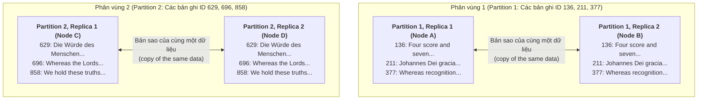

Một khi đã nắm vững hai cơ chế nền tảng đó, chúng ta có thể thảo luận về những sự đánh đổi khó khăn mà bạn cần phải thực hiện trong một hệ thống phân tán. Chúng ta sẽ bàn về *giao dịch* (*transactions*) trong Chương 7, vì điều đó sẽ giúp chúng ta hiểu được tất cả những trục trặc đa dạng có thể xảy ra trong một hệ thống dữ liệu, và chúng ta có thể làm gì để đối phó với chúng. Chúng ta sẽ khép lại phần này của cuốn sách bằng cách thảo luận về những giới hạn mang tính bản chất của các hệ thống phân tán trong Chương 8 và Chương 9.

Sau đó, ở Phần III của cuốn sách, chúng ta sẽ thảo luận về cách bạn có thể kết hợp nhiều kho lưu trữ dữ liệu (có thể bản thân chúng cũng là phân tán) và tích hợp chúng lại thành một hệ thống lớn hơn, đáp ứng nhu cầu của một ứng dụng phức tạp. Nhưng trước hết, hãy cùng nói về dữ liệu phân tán.

### Tài liệu tham khảo Phần II (References)

* **[1]** Ulrich Drepper: “What Every Programmer Should Know About Memory,” *akkadia.org*, 21 November 2007.
* **[2]** Ben Stopford: “Shared Nothing vs. Shared Disk Architectures: An Independent View,” *benstopford.com*, 24 November 2009.
* **[3]** Michael Stonebraker: “The Case for Shared Nothing,” *IEEE Database Engineering Bulletin*, volume 9, number 1, pages 4–9, March 1986.
* **[4]** Frank McSherry, Michael Isard, and Derek G Murray: “Scalability! But at what COST?,” at *15th USENIX Workshop on Hot Topics in Operating Systems (HotOS)*, May 2015.

---

# Chương 5: Sao chép dữ liệu (Chapter 5: Replication)

> *"Sự khác biệt chính yếu giữa một thứ có thể gặp trục trặc và một thứ tuyệt đối không thể nào gặp trục trặc nằm ở chỗ: khi một thứ tuyệt đối không thể nào gặp trục trặc lại thực sự gặp trục trặc, người ta thường phát hiện ra rằng không tài nào tiếp cận hay sửa chữa nổi nó."*
> — **Douglas Adams**, *Mostly Harmless (1992)*

*Sao chép* (*Replication*) có nghĩa là duy trì một bản sao của cùng một dữ liệu trên nhiều máy tính được kết nối với nhau thông qua mạng. Như đã thảo luận trong phần giới thiệu của Phần II, có một vài lý do khiến bạn muốn sao chép dữ liệu:

* Để giữ dữ liệu nằm gần người dùng của bạn về mặt địa lý (và do đó làm giảm độ trễ — *latency*);
* Để cho phép hệ thống tiếp tục làm việc ngay cả khi một số bộ phận của hệ thống đã gặp lỗi (và do đó làm tăng tính sẵn sàng — *availability*); hoặc
* Để mở rộng theo chiều ngang (scale out) số lượng máy tính có thể phục vụ các truy vấn đọc (và do đó làm tăng thông lượng đọc — *read throughput*).

Trong chương này, chúng ta sẽ giả định rằng tập dữ liệu (dataset) của bạn đủ nhỏ để mỗi máy tính có thể chứa trọn vẹn một bản sao của toàn bộ tập dữ liệu đó. Sang Chương 6, chúng ta sẽ nới lỏng giả định này và thảo luận về việc *phân vùng* (*partitioning/sharding*) đối với những tập dữ liệu quá lớn không thể chứa vừa trên một máy tính duy nhất. Trong các chương sau nữa, chúng ta sẽ thảo luận về nhiều loại lỗi khác nhau có thể xảy ra trong một hệ thống dữ liệu nhân bản, cũng như cách thức xử lý chúng.

Nếu dữ liệu mà bạn đang sao chép không hề thay đổi theo thời gian, thì việc sao chép vô cùng dễ dàng: bạn chỉ cần chép dữ liệu đó sang từng node một lần duy nhất là xong. Toàn bộ sự khó khăn trong việc sao chép đều nằm ở việc *xử lý các thay đổi đối với dữ liệu được sao chép*, và đó chính là nội dung cốt lõi của chương này. Chúng ta sẽ thảo luận về ba thuật toán phổ biến dùng để sao chép các thay đổi giữa các node: **sao chép một node dẫn đầu (single-leader)**, **sao chép đa node dẫn đầu (multi-leader)**, và **sao chép không có node dẫn đầu (leaderless replication)**. Hầu như tất cả các cơ sở dữ liệu phân tán đều sử dụng một trong ba phương pháp tiếp cận này. Tất cả chúng đều có những ưu điểm và nhược điểm khác nhau mà chúng ta sẽ xem xét chi tiết.

Có rất nhiều sự đánh đổi cần phải cân nhắc khi thực hiện sao chép: chẳng hạn như việc nên sử dụng sao chép đồng bộ (synchronous) hay bất đồng bộ (asynchronous), và làm thế nào để xử lý các bản sao bị lỗi (failed replicas). Đó thường là các tùy chọn cấu hình trong cơ sở dữ liệu, và mặc dù chi tiết cụ thể có khác nhau tùy theo từng hệ quản trị cơ sở dữ liệu, các nguyên lý chung vẫn tương tự nhau trên nhiều bản triển khai khác nhau. Chúng ta sẽ thảo luận về hệ quả của những lựa chọn như vậy trong chương này.

Sao chép cơ sở dữ liệu là một chủ đề đã cũ — các nguyên lý cốt lõi không thay đổi nhiều kể từ khi chúng được nghiên cứu vào những năm 1970 [1], bởi vì những ràng buộc cơ bản của mạng máy tính vẫn giữ nguyên như vậy. Tuy nhiên, bên ngoài giới nghiên cứu, trong một thời gian dài, nhiều lập trình viên vẫn tiếp tục giả định rằng một cơ sở dữ liệu chỉ bao gồm một node duy nhất. Việc sử dụng phổ biến các cơ sở dữ liệu phân tán trong dòng chính (mainstream) mới chỉ diễn ra gần đây hơn. Vì nhiều nhà phát triển ứng dụng còn mới mẻ với lĩnh vực này, đã có rất nhiều sự hiểu lầm xoay quanh các vấn đề như *tính nhất quán cuối cùng* (*eventual consistency*). Trong mục “Các vấn đề với độ trễ sao chép (Problems With Replication Lag)” ở phần sau của chương, chúng ta sẽ làm rõ một cách chính xác hơn về tính nhất quán cuối cùng, và thảo luận về những khái niệm như đảm bảo *đọc lại dữ liệu do chính mình ghi* (*read-your-writes*) và *đọc đơn điệu* (*monotonic reads*).

---

## Node dẫn đầu và các node theo sau (Leaders and Followers)

Mỗi node lưu trữ một bản sao của cơ sở dữ liệu được gọi là một *bản sao* (*replica*). Khi có nhiều bản sao, một câu hỏi tất yếu sẽ nảy sinh: làm thế nào để chúng ta đảm bảo rằng tất cả dữ liệu đều sẽ có mặt trên tất cả các bản sao?

Mọi thao tác ghi (write) vào cơ sở dữ liệu đều cần phải được xử lý bởi từng bản sao, nếu không thì các bản sao sẽ không còn chứa cùng một dữ liệu nữa. Giải pháp phổ biến nhất cho vấn đề này được gọi là *sao chép dựa trên node dẫn đầu* (*leader-based replication*, còn được biết đến với tên gọi sao chép *active/passive* hoặc *master-slave*) và được minh họa trong **Hình 5-1**. Nó hoạt động như sau:

1. Một trong số các bản sao được chỉ định làm *node dẫn đầu* (*leader*, còn được gọi là *master* hoặc *primary*). Khi các client muốn ghi vào cơ sở dữ liệu, chúng bắt buộc phải gửi yêu cầu của mình tới leader; đầu tiên leader sẽ ghi dữ liệu mới này vào bộ lưu trữ cục bộ (local storage) của chính nó.
2. Các bản sao khác được gọi là các *node theo sau* (*followers*, hay *read replicas*, *slaves*, hoặc *hot standbys*[^5_i]). Bất cứ khi nào leader ghi dữ liệu mới vào bộ lưu trữ cục bộ của nó, nó cũng đồng thời gửi thay đổi dữ liệu đó tới tất cả các follower của mình như một phần của *nhật ký sao chép* (*replication log*) hoặc *luồng thay đổi* (*change stream*). Mỗi follower nhận lấy nhật ký từ leader và cập nhật bản sao cơ sở dữ liệu cục bộ của mình một cách tương ứng, bằng cách áp dụng tất cả các thao tác ghi theo đúng thứ tự giống hệt như khi chúng được xử lý trên leader.
3. Khi một client muốn đọc từ cơ sở dữ liệu, nó có thể truy vấn trực tiếp từ leader hoặc từ bất kỳ follower nào. Tuy nhiên, các thao tác ghi chỉ được chấp nhận trên leader (dưới góc nhìn của client, các follower chỉ cho phép đọc — *read-only*).

[^5_i]: Những người khác nhau có những định nghĩa khác nhau cho các máy chủ dự phòng nóng (*hot*), ấm (*warm*) và lạnh (*cold standby*). Trong PostgreSQL, chẳng hạn, *hot standby* được dùng để chỉ một bản sao chấp nhận các truy vấn đọc từ client, trong khi *warm standby* vẫn xử lý các thay đổi gửi từ leader tới nhưng không xử lý bất kỳ truy vấn nào từ phía client. Đối với mục đích của cuốn sách này, sự khác biệt đó không quan trọng.

Chế độ sao chép này là một tính năng tích hợp sẵn của nhiều cơ sở dữ liệu quan hệ, chẳng hạn như PostgreSQL (kể từ phiên bản 9.0), MySQL, Oracle Data Guard [2], và AlwaysOn Availability Groups của SQL Server [3]. Nó cũng được sử dụng trong một số cơ sở dữ liệu phi quan hệ, bao gồm MongoDB, RethinkDB và Espresso [4]. Cuối cùng, sao chép dựa trên leader không chỉ giới hạn ở riêng các cơ sở dữ liệu: các hệ thống môi giới thông điệp phân tán (distributed message brokers) như Kafka [5] và các hàng đợi có tính sẵn sàng cao của RabbitMQ (RabbitMQ highly available queues) [6] cũng sử dụng mô hình này. Một số hệ thống tệp qua mạng (network file systems) và các thiết bị khối nhân bản (replicated block devices) như DRBD cũng hoạt động tương tự.

**Hình 5-1 – Sao chép dựa trên node dẫn đầu / master-slave (Figure 5-1. Leader-based (master-slave) replication).**

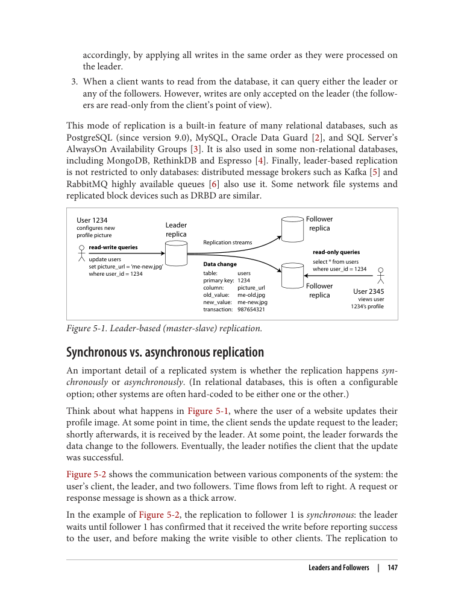

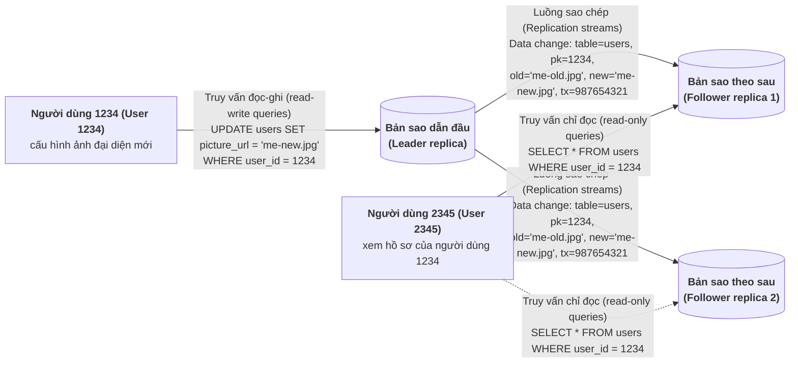

---

### Sao chép đồng bộ đối sánh với bất đồng bộ (Synchronous vs. asynchronous replication)

Một chi tiết quan trọng của hệ thống sao chép là việc quá trình sao chép diễn ra một cách *đồng bộ* (*synchronously*) hay *bất đồng bộ* (*asynchronously*). (Trong các cơ sở dữ liệu quan hệ, đây thường là một tùy chọn có thể cấu hình được; còn các hệ thống khác thường được lập trình cố định — hard-coded — để theo hẳn một trong hai cách).

Hãy nghĩ về những gì xảy ra trong **Hình 5-1**, nơi người dùng của một trang web cập nhật hình ảnh hồ sơ của họ. Tại một thời điểm nào đó, client gửi yêu cầu cập nhật tới leader; ngay sau đó, yêu cầu được leader tiếp nhận. Tại một thời điểm tiếp theo, leader chuyển tiếp (forward) thay đổi dữ liệu đó tới các follower. Cuối cùng, leader thông báo cho client rằng việc cập nhật đã thành công.

**Hình 5-2** cho thấy quá trình giao tiếp giữa các thành phần khác nhau của hệ thống: client của người dùng, leader, và hai follower. Thời gian trôi từ trái sang phải. Một thông điệp yêu cầu (request) hoặc phản hồi (response) được biểu diễn bằng một mũi tên đậm.

Trong ví dụ ở **Hình 5-2**, việc sao chép tới follower 1 là *đồng bộ*: leader chờ cho đến khi follower 1 xác nhận rằng nó đã nhận được thao tác ghi trước khi báo cáo thành công về cho người dùng, và trước khi làm cho thao tác ghi đó hiển thị (visible) đối với các client khác. Việc sao chép tới follower 2 là *bất đồng bộ*: leader gửi thông điệp đi, nhưng không chờ đợi phản hồi từ follower đó.

**Hình 5-2 – Sao chép dựa trên node dẫn đầu với một node theo sau đồng bộ và một node theo sau bất đồng bộ (Figure 5-2. Leader-based replication with one synchronous and one asynchronous follower).**

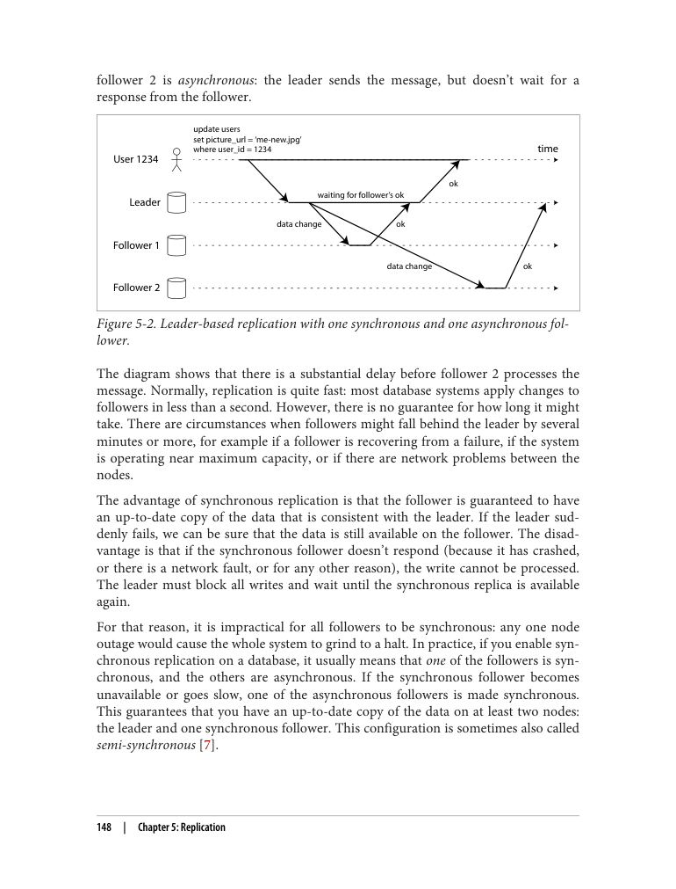

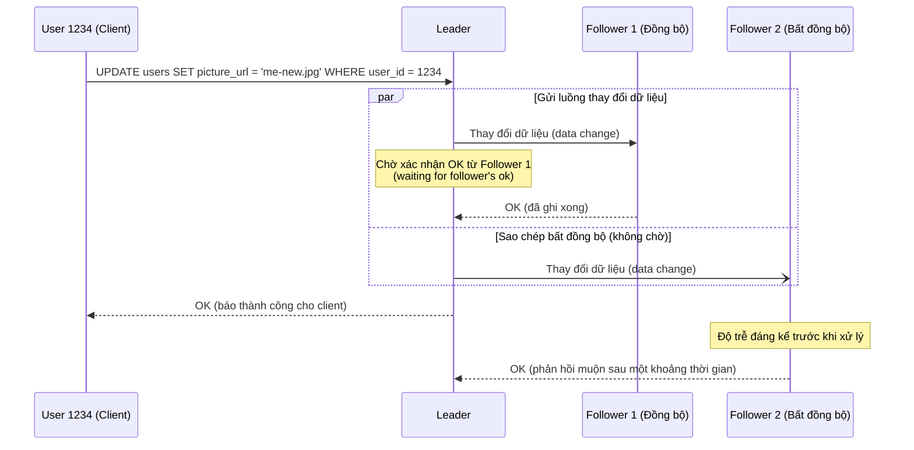

Sơ đồ trên cho thấy có một độ trễ đáng kể trước khi follower 2 xử lý thông điệp. Thông thường, quá trình sao chép diễn ra khá nhanh: hầu hết các hệ thống cơ sở dữ liệu đều áp dụng các thay đổi lên những follower trong vòng chưa đầy một giây. Tuy nhiên, không có bất kỳ sự đảm bảo nào về việc quá trình này có thể mất bao lâu. Có những hoàn cảnh mà các follower có thể bị tụt lại phía sau leader hàng mấy phút hoặc lâu hơn nữa, chẳng hạn như khi một follower đang trong quá trình phục hồi sau một sự cố, khi hệ thống đang vận hành gần mức công suất tối đa, hoặc khi có các sự cố mạng giữa các node.

Ưu điểm của sao chép đồng bộ là follower được đảm bảo luôn có một bản sao dữ liệu cập nhật mới nhất và nhất quán với leader. Nếu leader đột ngột gặp lỗi, chúng ta có thể chắc chắn rằng dữ liệu vẫn còn khả dụng trên follower đó. Nhược điểm là nếu follower đồng bộ không phản hồi (vì nó bị sập, hoặc có lỗi mạng, hoặc vì bất kỳ lý do nào khác), thao tác ghi sẽ không thể được xử lý. Leader buộc phải chặn (block) tất cả các thao tác ghi và chờ đợi cho đến khi bản sao đồng bộ khả dụng trở lại.

Vì lý do đó, việc cấu hình cho tất cả các follower đều là đồng bộ là điều bất khả thi trong thực tế: chỉ cần bất kỳ một node nào ngừng hoạt động cũng sẽ khiến toàn bộ hệ thống bị đình trệ hoàn toàn. Trên thực tế, nếu bạn bật tính năng sao chép đồng bộ trên một cơ sở dữ liệu, điều đó thường có nghĩa là *một* trong các follower là đồng bộ, còn những follower khác là bất đồng bộ. Nếu follower đồng bộ trở nên không khả dụng hoặc chạy chậm lại, một trong số các follower bất đồng bộ sẽ được chuyển thành đồng bộ. Điều này đảm bảo rằng bạn luôn có một bản sao dữ liệu cập nhật mới nhất trên ít nhất hai node: leader và một follower đồng bộ. Cấu hình này đôi khi còn được gọi là *bán đồng bộ* (*semi-synchronous*) [7].

Thường thì sao chép dựa trên leader được cấu hình để chạy hoàn toàn bất đồng bộ. Trong trường hợp này, nếu leader gặp sự cố và không thể phục hồi được, bất kỳ thao tác ghi nào chưa kịp sao chép sang các follower đều sẽ bị mất. Điều này có nghĩa là một thao tác ghi không được đảm bảo tính bền vững (durable), ngay cả khi nó đã được xác nhận thành công về cho phía client. Tuy nhiên, một cấu hình hoàn toàn bất đồng bộ có ưu điểm là leader vẫn có thể tiếp tục xử lý các thao tác ghi, ngay cả khi tất cả các follower của nó đều đã bị tụt lại phía sau.

Việc làm suy yếu tính bền vững nghe có vẻ như là một sự đánh đổi tồi tệ, nhưng sao chép bất đồng bộ gần như là điều không thể tránh khỏi nếu có nhiều follower, hoặc nếu chúng được phân bổ rộng khắp về mặt địa lý. Chúng ta sẽ quay lại vấn đề này trong mục “Các vấn đề với độ trễ sao chép (Problems With Replication Lag)” ở phần sau.

> 📝 **Giải thích thêm (không có trong sách): Cơ chế Semi-Synchronous và Quorum Commit trong PostgreSQL, MySQL và Redis**
>
> Trong các hệ quản trị cơ sở dữ liệu thực tế, "sao chép đồng bộ" có nhiều mức độ cam kết (commit levels) tinh vi hơn bạn tưởng:
>
> * **PostgreSQL (`synchronous_commit` & `synchronous_standby_names`):** PostgreSQL cho phép cấu hình `synchronous_standby_names = 'FIRST 1 (standby1, standby2)'` (hoặc `ANY 1 (...)`), tương ứng chính xác với mô hình **bán đồng bộ (semi-synchronous)** trong sách: chỉ cần 1 trong các standby xác nhận là leader trả lời OK cho client. Thú vị hơn, tham số `synchronous_commit` trong Postgres có nhiều mức:
>   * `remote_write`: Leader chỉ chờ follower nhận dữ liệu vào bộ nhớ OS kernel (nếu cả leader và follower cùng mất điện hoặc follower crash OS, dữ liệu vẫn mất).
>   * `on` (mặc định khi bật sync): Leader chờ follower ghi và `fsync` nhật ký WAL xuống đĩa cứng của follower, nhưng chưa cần chờ follower *apply* (áp dụng) WAL đó vào B-tree.
>   * `remote_apply`: Leader chờ tới khi follower không chỉ `fsync` xuống đĩa mà còn áp dụng xong vào bộ nhớ để truy vấn `SELECT` trên follower nhìn thấy ngay lập tức!
> * **MySQL Semi-Synchronous Replication (`rpl_semi_sync_master_wait_point`):** Có hai chế độ là `AFTER_SYNC` (mặc định từ MySQL 5.7+: leader ghi binlog, chờ ít nhất 1 replica nhận được binlog và flush xuống relay log, rồi leader mới commit vào storage engine InnoDB và trả kết quả cho client) và `AFTER_COMMIT`. Đặc biệt, trong MySQL सेमी-sync truyền thống, nếu replica không phản hồi sau một khoảng timeout (ví dụ `rpl_semi_sync_master_timeout = 10000` ms), MySQL leader sẽ **tự động hạ cấp (fallback) về sao chép bất đồng bộ** để không làm treo hệ thống ghi!
> * **Redis (`REPLICAOF` và lệnh `WAIT`):** Mặc định Redis sử dụng sao chép hoàn toàn bất đồng bộ. Khi muốn tăng mức độ an toàn cho một thao tác ghi quan trọng, client có thể gọi lệnh `WAIT <numreplicas> <timeout>` ngay sau lệnh ghi để chặn (block) cho tới khi có ít nhất `<numreplicas>` xác nhận đã nhận được dữ liệu trong khoảng thời gian `<timeout>`.

---

### Thiết lập các node theo sau mới (Setting up new followers)

Thỉnh thoảng, bạn cần phải thiết lập các follower mới — có thể là để tăng số lượng bản sao, hoặc để thay thế cho các node đã bị lỗi. Làm thế nào để bạn đảm bảo rằng follower mới có một bản sao chính xác của dữ liệu trên leader?

Việc chỉ đơn thuần sao chép các tệp dữ liệu (data files) từ node này sang node khác thường là không đủ: các client liên tục ghi vào cơ sở dữ liệu và dữ liệu luôn ở trạng thái biến động không ngừng, do đó một thao tác sao chép tệp tiêu chuẩn sẽ nhìn thấy các phần khác nhau của cơ sở dữ liệu ở những thời điểm khác nhau. Kết quả thu được có thể hoàn toàn vô nghĩa (bị hỏng cấu trúc dữ liệu).

Bạn có thể làm cho các tệp trên ổ đĩa trở nên nhất quán bằng cách khóa toàn bộ cơ sở dữ liệu (khiến nó không thể nhận các thao tác ghi), nhưng điều đó lại đi ngược lại mục tiêu tính sẵn sàng cao của chúng ta. May mắn thay, việc thiết lập một follower mới thường có thể được thực hiện mà không cần thời gian ngừng hoạt động (zero downtime). Về mặt khái niệm, quy trình này diễn ra như sau:

1. Chụp một bản *snapshot nhất quán* (*consistent snapshot*) của cơ sở dữ liệu trên leader tại một thời điểm xác định — nếu có thể, hãy thực hiện mà không cần đặt khóa lên toàn bộ cơ sở dữ liệu. Hầu hết các cơ sở dữ liệu đều có tính năng này, bởi vì nó cũng là yêu cầu bắt buộc đối với việc sao lưu (backup). Trong một số trường hợp, cần đến các công cụ của bên thứ ba, chẳng hạn như `innobackupex` (thuộc bộ Percona XtraBackup) cho MySQL [8].
2. Sao chép bản snapshot đó sang node follower mới.
3. Follower kết nối tới leader và yêu cầu tất cả các thay đổi dữ liệu đã diễn ra kể từ thời điểm bản snapshot được chụp. Điều này đòi hỏi bản snapshot phải được gắn liền với một vị trí chính xác trong nhật ký sao chép của leader. Vị trí đó có nhiều tên gọi khác nhau: ví dụ, PostgreSQL gọi nó là *số thứ tự nhật ký* (*log sequence number* — *LSN*), còn MySQL gọi nó là *tọa độ binlog* (*binlog coordinates*).
4. Khi follower đã xử lý xong lượng dữ liệu thay đổi tồn đọng (backlog) kể từ lúc chụp snapshot, chúng ta nói rằng nó đã *bắt kịp* (*caught up*) leader. Giờ đây nó có thể tiếp tục xử lý các thay đổi dữ liệu từ leader ngay khi chúng vừa diễn ra.

Các bước thực tế để thiết lập một follower có sự khác biệt đáng kể tùy thuộc vào từng loại cơ sở dữ liệu. Trong một số hệ thống, quy trình này được tự động hóa hoàn toàn, trong khi ở những hệ thống khác, nó có thể là một quy trình gồm nhiều bước khá rắc rối và khó hiểu mà người quản trị viên (administrator) phải tự tay thực hiện.

> 💡 **Ví dụ bổ sung (không có trong sách): Quy trình dựng Replica thực tế trong PostgreSQL và MySQL**
>
> * **Trong PostgreSQL:** Công cụ chuẩn được sử dụng là `pg_basebackup -h leader_host -D /var/lib/postgresql/data -Fp -Xs -P -R`. Khi chạy lệnh này, leader sẽ gọi hàm nội bộ `pg_backup_start()`, ghi dấu mốc **LSN** bắt đầu (ví dụ `0/16B3748`), sau đó truyền toàn bộ các file dữ liệu qua mạng tới follower. Khi hoàn tất, file `backup_label` và `standby.signal` được tạo ra trên follower, lưu rõ mốc LSN. Khi follower khởi động, tiến trình `walreceiver` sẽ kết nối lên leader và yêu cầu: *"Hãy gửi cho tôi luồng WAL bắt đầu từ mốc LSN `0/16B3748` trở đi"*. Lưu ý: Để tránh việc leader xóa mất các file WAL cũ trong lúc bản snapshot đang được copy qua mạng mất nhiều giờ đồng hồ, người ta thường sử dụng **Replication Slots** để giữ lại WAL trên leader cho tới khi follower mới bắt kịp.
> * **Trong MySQL (InnoDB):** Với công cụ **Percona XtraBackup** (hoặc MySQL Enterprise Backup / Clone Plugin trong MySQL 8.0.17+), quá trình sao chép file `.ibd` diễn ra nóng trong khi một luồng ngầm liên tục theo dõi và chép lại `redo log` của InnoDB. Khi kết thúc bước `prepare`, XtraBackup ghi lại tọa độ chính xác trong file `xtrabackup_binlog_info`, ví dụ: `mysql-bin.000042  154892` (hoặc tập hợp **GTID — Global Transaction Identifier** như `3E11FA47-71CA-11E1-9E33-C80AA9429562:1-5432`). Quản trị viên chỉ cần chạy lệnh `CHANGE REPLICATION SOURCE TO SOURCE_LOG_FILE='mysql-bin.000042', SOURCE_LOG_POS=154892;` (hoặc dùng `SOURCE_AUTO_POSITION=1` với GTID) trên follower để nó tự động kéo các sự kiện tiếp theo.

---

### Xử lý sự cố ngừng hoạt động của node (Handling node outages)

Bất kỳ node nào trong hệ thống cũng có thể ngừng hoạt động (go down), có thể là đột ngột ngoài dự kiến do một lỗi nào đó, nhưng cũng rất có khả năng là do hoạt động bảo trì có kế hoạch (chẳng hạn như khởi động lại máy chủ để cài đặt bản vá bảo mật nhân hệ điều hành — kernel security patch). Khả năng khởi động lại từng node riêng lẻ mà không gây ra thời gian ngừng hoạt động (downtime) cho toàn hệ thống là một lợi thế rất lớn cho công tác vận hành và bảo trì. Do đó, mục tiêu của chúng ta là giữ cho toàn bộ hệ thống tiếp tục chạy bất chấp việc các node riêng lẻ bị lỗi, và giữ cho tác động của sự cố ngừng hoạt động ở một node ở mức nhỏ nhất có thể.

Làm thế nào để bạn đạt được tính sẵn sàng cao với mô hình sao chép dựa trên leader?

#### Sự cố ở node theo sau: Phục hồi bắt kịp (Follower failure: catch-up recovery)

Trên ổ đĩa cục bộ của mình, mỗi follower đều lưu giữ một nhật ký ghi lại những thay đổi dữ liệu mà nó đã nhận được từ leader. Nếu một follower bị sập và được khởi động lại, hoặc nếu mạng kết nối giữa leader và follower tạm thời bị gián đoạn, follower đó có thể phục hồi khá dễ dàng: từ nhật ký của mình, nó biết được giao dịch cuối cùng đã được xử lý trước khi xảy ra sự cố là gì. Nhờ vậy, follower có thể kết nối lại với leader và yêu cầu tất cả các thay đổi dữ liệu đã diễn ra trong suốt khoảng thời gian mà follower bị mất kết nối. Khi đã áp dụng xong những thay đổi này, nó đã bắt kịp (caught up) với leader và có thể tiếp tục nhận luồng thay đổi dữ liệu như trước kia.

#### Sự cố ở node dẫn đầu: Chuyển đổi dự phòng (Leader failure: failover)

Việc xử lý sự cố sập node dẫn đầu (leader) phức tạp và hóc búa hơn nhiều: một trong các follower cần phải được thăng cấp (promoted) để trở thành leader mới, các client cần phải được cấu hình lại để gửi các thao tác ghi của chúng tới leader mới, và các follower khác cần phải bắt đầu tiêu thụ các thay đổi dữ liệu từ leader mới này. Quá trình này được gọi là *chuyển đổi dự phòng* (*failover*).

Quá trình failover có thể diễn ra thủ công (một quản trị viên nhận được thông báo rằng leader đã sập và thực hiện các bước cần thiết để tạo ra một leader mới) hoặc tự động. Một quy trình failover tự động thường bao gồm các bước sau đây:

1. **Xác định rằng leader đã gặp sự cố (Determining that the leader has failed).** Có rất nhiều thứ có khả năng gặp trục trặc: sập phần mềm, mất điện, sự cố mạng và nhiều nguyên nhân khác nữa. Không có một cách thức hoàn hảo không thể sai sót (foolproof) nào để phát hiện chính xác chuyện gì đã xảy ra, vì vậy hầu hết các hệ thống chỉ đơn giản là sử dụng một *khoảng thời gian chờ* (*timeout*): các node thường xuyên gửi qua lại các thông điệp kiểm tra (heartbeat/ping) với nhau, và nếu một node không phản hồi trong một khoảng thời gian nhất định — giả sử là 30 giây — thì nó được giả định là đã chết. (Nếu leader được chủ đích tắt đi để bảo trì theo kế hoạch thì điều này không áp dụng).
2. **Bầu chọn một leader mới (Choosing a new leader).** Việc này có thể được thực hiện thông qua một quy trình bầu cử (election process — nơi leader mới được chọn bởi đa số các bản sao còn lại), hoặc một leader mới có thể được chỉ định bởi một *node điều khiển* (*controller node*) đã được bầu chọn từ trước đó. Ứng cử viên tốt nhất cho vị trí dẫn đầu thường là bản sao có chứa các thay đổi dữ liệu cập nhật mới nhất từ leader cũ (nhằm giảm thiểu tối đa mọi sự mất mát dữ liệu). Việc làm sao để tất cả các node cùng đồng thuận về một leader mới là một *bài toán đồng thuận* (*consensus problem*), sẽ được thảo luận chi tiết trong Chương 9.
3. **Cấu hình lại hệ thống để sử dụng leader mới (Reconfiguring the system to use the new leader).** Giờ đây các client cần phải gửi yêu cầu ghi của chúng tới leader mới (chúng ta sẽ thảo luận về điều này trong phần “Định tuyến yêu cầu — Request routing” ở Chương 6). Nếu leader cũ quay trở lại hoạt động, nó có thể vẫn tin rằng mình đang là leader, mà không nhận ra rằng các bản sao khác đã buộc nó phải thoái vị (step down). Hệ thống cần phải đảm bảo rằng leader cũ sẽ trở thành một follower và công nhận leader mới.

Quá trình chuyển đổi dự phòng (failover) chứa đầy rẫy những thứ có thể gặp trục trặc:

* Nếu sử dụng sao chép bất đồng bộ, leader mới có thể chưa nhận được tất cả các thao tác ghi từ leader cũ trước khi nó gặp sự cố. Nếu leader cũ gia nhập lại cụm máy chủ (cluster) sau khi một leader mới đã được chọn, chuyện gì sẽ xảy ra với những thao tác ghi đó? Trong khoảng thời gian đó, leader mới có thể đã tiếp nhận những thao tác ghi khác gây xung đột. Giải pháp phổ biến nhất là các thao tác ghi chưa kịp sao chép của leader cũ sẽ chỉ đơn giản là bị hủy bỏ (discarded), điều này có thể vi phạm kỳ vọng của các client về tính bền vững của dữ liệu (durability).
* Việc hủy bỏ các thao tác ghi đặc biệt nguy hiểm nếu có các hệ thống lưu trữ khác bên ngoài cơ sở dữ liệu cần phải được phối hợp đồng bộ với nội dung bên trong cơ sở dữ liệu. Ví dụ, trong một sự cố nổi tiếng tại GitHub [9], một follower MySQL chưa cập nhật kịp dữ liệu (out-of-date) đã được thăng cấp lên làm leader. Cơ sở dữ liệu này sử dụng một bộ đếm tự động tăng (auto-incrementing counter) để gán khóa chính (primary keys) cho các dòng dữ liệu mới, nhưng bởi vì bộ đếm của leader mới bị tụt lại phía sau so với leader cũ, nó đã tái sử dụng một số khóa chính vốn đã được gán trước đó bởi leader cũ. Những khóa chính này đồng thời cũng được sử dụng trong một kho lưu trữ Redis, vì vậy việc tái sử dụng khóa chính đã dẫn đến sự thiếu nhất quán giữa MySQL và Redis, khiến cho một số dữ liệu riêng tư bị tiết lộ nhầm cho những người dùng khác.
* Trong một số kịch bản lỗi nhất định (xem Chương 8), có thể xảy ra tình huống cả hai node đều cùng tin rằng mình chính là leader. Tình huống này được gọi là *não phân đôi* (*split brain*), và nó cực kỳ nguy hiểm: nếu cả hai leader đều chấp nhận các thao tác ghi, và không có quy trình nào để giải quyết xung đột (xem mục “Sao chép đa node dẫn đầu — Multi-leader replication” ở phần sau), dữ liệu rất có khả năng bị mất mát hoặc bị hỏng (corrupted). Như một chốt chặn an toàn, một số hệ thống có cơ chế tự động tắt (shut down) một node nếu phát hiện có hai leader cùng tồn tại.[^5_ii] Tuy nhiên, nếu không may mắn, bạn có thể rơi vào cảnh cả hai node đều bị tắt cùng một lúc [10].
* Khoảng thời gian chờ (timeout) bao lâu là hợp lý trước khi tuyên bố rằng leader đã chết? Một khoảng timeout dài hơn đồng nghĩa với việc mất nhiều thời gian hơn để phục hồi trong trường hợp leader thực sự bị hỏng. Tuy nhiên, nếu khoảng timeout quá ngắn, có thể xảy ra những đợt failover không cần thiết. Ví dụ, một đợt tăng tải đột biến tạm thời (temporary load spike) có thể khiến thời gian phản hồi của một node tăng vượt quá ngưỡng timeout, hoặc một trục trặc mạng nhỏ (network glitch) có thể làm trễ các gói tin. Nếu hệ thống vốn đã đang phải vật lộn với mức tải cao hoặc các vấn đề về mạng, thì một cuộc chuyển đổi dự phòng không cần thiết rất có khả năng sẽ làm cho tình hình trở nên tồi tệ hơn chứ không phải tốt hơn.

[^5_ii]: Cơ chế này được biết đến với tên gọi *fencing* (cô lập/rào chắn) hoặc, một cách nhấn mạnh đầy hình tượng hơn, *Shoot The Other Node In The Head* (*STONITH* — "Bắn vào đầu node kia").

Không có những giải pháp dễ dàng nào cho các vấn đề này. Vì lý do đó, một số đội ngũ vận hành (operations teams) vẫn thích thực hiện failover một cách thủ công hơn, ngay cả khi phần mềm đã hỗ trợ tính năng failover tự động.

Những vấn đề này — lỗi node, mạng không đáng tin cậy, và những sự đánh đổi xoay quanh tính nhất quán của bản sao, tính bền vững, tính sẵn sàng và độ trễ — trên thực tế chính là những bài toán mang tính nền tảng trong các hệ thống phân tán. Trong Chương 8 và Chương 9, chúng ta sẽ thảo luận về chúng ở mức độ sâu sắc hơn.

> 📝 **Giải thích thêm (không có trong sách): Phân tích kỹ thuật sự cố GitHub (2012) và cách phòng chống Split-Brain hiện đại**
>
> Sự cố GitHub tháng 9/2012 [9] được nhắc tới ở trên là một bài học kinh điển về kiến trúc hệ thống:
> 1. **Kịch bản lỗi:** Cụm MySQL của GitHub dùng trình quản lý Pacemaker/Corosync để tự động failover. Khi xảy ra sự cố mạng chập chờn giữa hai trung tâm dữ liệu, follower `db2` được thăng cấp lên làm leader mới trong khi vẫn còn trễ (lag) một số giao dịch so với leader cũ `db1`. Giả sử trên `db1`, bảng `users` hoặc `ssh_keys` đã tăng `AUTO_INCREMENT` lên tới ID `1005` và ứng dụng đã ghi vào bộ nhớ đệm **Redis** cặp key-value `session:1005 -> user_A`.
> 2. **Hậu quả:** Vì `db2` mới chỉ nhận được binlog tới ID `1000`, khi trở thành leader mới, nó tiếp tục cấp phát ID `1001..1005` cho những người dùng hoàn toàn mới (ví dụ `user_B` nhận được ID `1005`). Khi `user_B` đăng nhập, ứng dụng đọc thông tin từ Redis theo khóa `1005` (vốn chưa từng bị xóa trên Redis) và trả về dữ liệu riêng tư của `user_A` cho `user_B`!
> 3. **Cách các hệ thống hiện đại giải quyết:**
>    * Trong **PostgreSQL (Patroni + etcd/Consul)** hoặc **MySQL (Orchestrator / MySQL InnoDB Cluster)**: Trước khi thăng cấp một follower, hệ thống kiểm tra độ trễ WAL/binlog (`maximum_lag_on_failover` trong Patroni) và sử dụng khóa phân tán có thời hạn (**distributed lease/lock** trong etcd/ZooKeeper). Nếu leader cũ không gia hạn được lease trong etcd, nó tự động hạ cấp bản thân thành read-only và đóng các kết nối ghi trước khi lease hết hạn.
>    * Ở tầng phần cứng/đám mây, cơ chế **STONITH / Fencing** có thể gọi trực tiếp API của bộ nguồn thông minh (IPMI/iLO) hoặc Cloud API (AWS EC2 Stop/Detach EBS, hoặc dùng *fencing token* như sẽ học ở Chương 8) để cắt đứt hoàn toàn quyền ghi của leader cũ.

---

### Triển khai nhật ký sao chép (Implementation of replication logs)

Sao chép dựa trên node dẫn đầu (leader-based replication) hoạt động như thế nào ở bên dưới (under the hood)? Trong thực tế, có một vài phương pháp sao chép khác nhau được sử dụng, vì vậy chúng ta hãy cùng điểm qua từng phương pháp một cách ngắn gọn.

#### Sao chép dựa trên câu lệnh (Statement-based replication)

Trong trường hợp đơn giản nhất, leader ghi nhận (log) mọi yêu cầu ghi (*câu lệnh* — *statement*) mà nó thực thi, rồi gửi nhật ký câu lệnh đó tới các follower của mình. Đối với một cơ sở dữ liệu quan hệ, điều này có nghĩa là mọi câu lệnh `INSERT`, `UPDATE` hoặc `DELETE` đều được chuyển tiếp tới các follower, và mỗi follower sẽ phân tích cú pháp (parse) rồi thực thi câu lệnh SQL đó hệt như thể nó vừa được nhận trực tiếp từ một client.

Mặc dù cách làm này nghe có vẻ hợp lý, nhưng có nhiều cách khác nhau khiến phương pháp tiếp cận sao chép này có thể bị đổ vỡ:

* Bất kỳ câu lệnh nào gọi tới một *hàm không tất định* (*non-deterministic function*), chẳng hạn như `NOW()` để lấy ngày và giờ hiện tại, hoặc `RAND()` để lấy một số ngẫu nhiên, đều rất có khả năng sẽ sinh ra một giá trị khác nhau trên từng bản sao.
* Nếu các câu lệnh sử dụng một cột tự động tăng (*auto-incrementing column*), hoặc nếu chúng phụ thuộc vào dữ liệu hiện có trong cơ sở dữ liệu (ví dụ: `UPDATE ... WHERE <một điều kiện nào đó>`), chúng bắt buộc phải được thực thi theo đúng thứ tự giống hệt nhau trên từng bản sao, nếu không chúng có thể tạo ra một tác động khác nhau. Điều này có thể gây ra sự hạn chế rất lớn khi có nhiều giao dịch (transactions) đang thực thi đồng thời (concurrently).
* Các câu lệnh có gây ra *tác dụng phụ* (*side-effects*, ví dụ như triggers, stored procedures, user-defined functions — các hàm tự định nghĩa bởi người dùng) có thể dẫn đến những tác dụng phụ khác nhau xảy ra trên mỗi bản sao, trừ khi các tác dụng phụ đó là hoàn toàn tất định (absolutely deterministic).

Người ta vẫn có thể tìm cách lách qua (work around) những vấn đề đó — chẳng hạn, leader có thể thay thế bất kỳ lời gọi hàm không tất định nào bằng một giá trị trả về cố định ngay tại thời điểm câu lệnh được ghi vào nhật ký, để tất cả các follower đều nhận được cùng một giá trị đó. Tuy nhiên, bởi vì có quá nhiều trường hợp biên (edge cases) phức tạp, các phương pháp sao chép khác hiện nay thường được ưu tiên sử dụng hơn.

Sao chép dựa trên câu lệnh từng được sử dụng trong MySQL trước phiên bản 5.1. Đôi khi nó vẫn còn được dùng cho đến ngày nay vì dung lượng nhật ký khá nhỏ gọn (compact), nhưng theo mặc định hiện nay MySQL sẽ tự động chuyển sang *sao chép dựa trên dòng* (*row-based replication*, xem phần dưới) nếu phát hiện có bất kỳ sự không tất định nào trong một câu lệnh (chế độ `MIXED` hoặc mặc định `ROW` từ MySQL 5.7.7+). VoltDB cũng sử dụng sao chép dựa trên câu lệnh, và đảm bảo tính an toàn cho cơ chế này bằng cách bắt buộc các giao dịch phải hoàn toàn tất định [11].

#### Vận chuyển nhật ký ghi trước (Write-ahead log (WAL) shipping)

Trong Chương 3, chúng ta đã thảo luận về cách các bộ máy lưu trữ (storage engines) biểu diễn dữ liệu trên ổ đĩa, và chúng ta đã thấy rằng thông thường mọi thao tác ghi đều được nối thêm (appended) vào một nhật ký:

* Trong trường hợp của một bộ máy lưu trữ có cấu trúc nhật ký (*log-structured storage engine*, xem phần “SSTables và LSM-trees” ở Chương 3), chính nhật ký này là nơi lưu trữ chính yếu. Các phân đoạn nhật ký (log segments) sẽ được nén gọn (compacted) và thu gom rác (garbage-collected) ở chế độ chạy ngầm.
* Trong trường hợp của một cây B-tree (xem phần “B-trees” ở Chương 3), vốn thực hiện ghi đè trực tiếp lên từng khối đĩa (disk blocks) riêng lẻ, mọi sự sửa đổi trước tiên đều được ghi vào một *nhật ký ghi trước* (*write-ahead log* — *WAL*) để chỉ mục có thể được khôi phục về một trạng thái nhất quán sau khi xảy ra sự cố sập hệ thống.

Dù ở trường hợp nào đi nữa, nhật ký đó cũng là một chuỗi byte chỉ cho phép nối thêm vào cuối (append-only sequence of bytes) chứa toàn bộ các thao tác ghi vào cơ sở dữ liệu. Chúng ta có thể sử dụng chính xác cùng một nhật ký đó để xây dựng nên một bản sao trên một node khác: bên cạnh việc ghi nhật ký xuống ổ đĩa cứng, leader còn gửi nó qua mạng tới các follower của mình. Khi follower xử lý nhật ký này, nó sẽ xây dựng được một bản sao của các cấu trúc dữ liệu giống hệt như những gì có mặt trên leader.

Phương pháp sao chép này được sử dụng trong PostgreSQL và Oracle, cùng với một số hệ thống khác [12]. Nhược điểm chính của nó là nhật ký mô tả dữ liệu ở một mức độ rất thấp (very low level): một nhật ký WAL chứa các chi tiết cụ thể về việc những byte nào đã bị thay đổi bên trong khối đĩa (disk block) nào. Điều này làm cho việc sao chép bị gắn kết chặt chẽ (closely coupled) với bộ máy lưu trữ. Nếu cơ sở dữ liệu thay đổi định dạng lưu trữ của nó từ phiên bản này sang phiên bản khác, thì thông thường không thể chạy các phiên bản phần mềm cơ sở dữ liệu khác nhau giữa leader và các follower.

Điều đó nghe có vẻ chỉ như một chi tiết triển khai nhỏ nhặt, nhưng nó có thể gây ra tác động rất lớn về mặt vận hành (operational impact). Nếu giao thức sao chép cho phép follower sử dụng một phiên bản phần mềm mới hơn so với leader, bạn có thể thực hiện nâng cấp phần mềm cơ sở dữ liệu mà không cần thời gian ngừng hoạt động (*zero-downtime upgrade*) bằng cách nâng cấp các follower trước, rồi sau đó thực hiện chuyển đổi dự phòng (failover) để biến một trong các node đã được nâng cấp thành leader mới. Ngược lại, nếu giao thức sao chép không cho phép sự lệch pha phiên bản này — điều thường thấy đối với phương pháp vận chuyển WAL (WAL shipping) — thì những đợt nâng cấp như vậy bắt buộc phải có thời gian ngừng hoạt động (downtime).

#### Sao chép dựa trên nhật ký logic (Logical log replication)

Một giải pháp thay thế là sử dụng các định dạng nhật ký khác nhau cho mục đích sao chép và cho bộ máy lưu trữ. Điều này cho phép nhật ký sao chép được tách rời (decoupled) khỏi các chi tiết nội bộ của bộ máy lưu trữ. Loại nhật ký này đôi khi được gọi là một *nhật ký logic* (*logical log*), nhằm phân biệt nó với cách biểu diễn dữ liệu (vật lý — *physical*) của bộ máy lưu trữ.

Một nhật ký logic cho cơ sở dữ liệu quan hệ thường là một chuỗi các bản ghi mô tả các thao tác ghi vào những bảng cơ sở dữ liệu ở mức độ chi tiết của từng dòng dữ liệu (*row granularity*):

* **Đối với một dòng được chèn mới (inserted row):** Nhật ký chứa các giá trị mới của tất cả các cột.
* **Đối với một dòng bị xóa (deleted row):** Nhật ký chứa đủ thông tin để định danh duy nhất (uniquely identify) dòng dữ liệu đã bị xóa. Thông thường đây sẽ là khóa chính (primary key), nhưng nếu trên bảng đó không có khóa chính, thì các giá trị cũ của tất cả các cột cần phải được ghi hết vào nhật ký.
* **Đối với một dòng được cập nhật (updated row):** Nhật ký chứa đủ thông tin để định danh duy nhất dòng dữ liệu được cập nhật, cùng với các giá trị mới của tất cả các cột (hoặc ít nhất là các giá trị mới của tất cả những cột đã thay đổi).

Một giao dịch sửa đổi nhiều dòng sẽ sinh ra nhiều bản ghi nhật ký như vậy, theo sau bởi một bản ghi cho biết rằng giao dịch đó đã được cam kết (committed). Nhật ký nhị phân (`binlog`) của MySQL (khi được cấu hình để sử dụng sao chép dựa trên dòng — *row-based replication*) sử dụng chính phương pháp tiếp cận này [13].

Bởi vì nhật ký logic được tách rời khỏi các chi tiết nội bộ của bộ máy lưu trữ, nó có thể dễ dàng duy trì tính tương thích ngược (backwards-compatible) hơn, cho phép leader và follower chạy các phiên bản phần mềm cơ sở dữ liệu khác nhau, hoặc thậm chí sử dụng các bộ máy lưu trữ (storage engines) hoàn toàn khác nhau.

Định dạng nhật ký logic cũng dễ dàng hơn cho các ứng dụng bên ngoài trong việc phân tích cú pháp (parse). Điều này rất hữu ích nếu bạn muốn gửi nội dung của một cơ sở dữ liệu sang một hệ thống bên ngoài, chẳng hạn như một kho dữ liệu (data warehouse) để phân tích ngoại tuyến, hoặc để xây dựng các chỉ mục tùy chỉnh và bộ nhớ đệm (caches) [14]. Kỹ thuật này được gọi là *bắt giữ dữ liệu thay đổi* (*change data capture* — *CDC*), và chúng ta sẽ quay trở lại với nó trong Chương 11.

> 📝 **Giải thích thêm (không có trong sách): So sánh chi tiết 4 cơ chế nhật ký sao chép trong PostgreSQL và MySQL**
>
> | Tiêu chí | Statement-based (SBR) | WAL Shipping (Physical) | Logical / Row-based (RBR) | Trigger-based |
> | :--- | :--- | :--- | :--- | :--- |
> | **Ví dụ hệ thống** | MySQL `binlog_format=STATEMENT`, VoltDB | PostgreSQL Streaming Replication (`walreceiver`), Oracle Data Guard Redo Apply | MySQL `binlog_format=ROW`, PostgreSQL Logical Replication (`pgoutput`, từ PG 10+) | Bucardo (Postgres), Oracle Databus, SymmetricDS |
> | **Đơn vị ghi log** | Câu lệnh SQL gốc (`UPDATE items SET price = price * 1.1`) | Thay đổi vật lý ở mức trang/khối đĩa (Page ID, Offset, Byte diff) | Từng dòng dữ liệu bị ảnh hưởng (Before-image & After-image của từng row) | Bản ghi do Trigger chèn vào một bảng phụ (`audit_changes`) |
> | **Kích thước băng thông mạng** | Rất nhỏ nếu 1 câu `UPDATE`/`DELETE` sửa hàng triệu dòng | Lớn (bao gồm cả thay đổi chỉ mục B-tree, Vacuum/Page split) | Lớn nếu 1 câu SQL sửa nhiều dòng, nhưng không chứa dữ liệu trang chỉ mục B-tree | Lớn + làm tăng gấp đôi I/O ghi ngay trong giao dịch gốc |
> | **Nâng cấp khác phiên bản (Major version upgrade)** | Hỗ trợ tốt | Không hỗ trợ (PostgreSQL physical replica phải cùng major version với primary) | Hỗ trợ rất tốt (dùng để nâng cấp PG 14 lên PG 16 gần như không downtime) | Hỗ trợ tốt (thậm chí khác hệ CSDL) |
> | **Phục vụ Change Data Capture (CDC)** | Rất khó (phải giả lập toàn bộ SQL parser + trạng thái bảng) | Không phù hợp cho hệ thống ngoài đọc trực tiếp | **Chuẩn mực vàng** cho Debezium, Kafka Connect, Maxwell, Flink CDC | Khá dễ đọc nhưng làm chậm giao dịch OLTP chính |
>
> 💡 **Lưu ý thực tế trong PostgreSQL (`REPLICA IDENTITY`):** Đúng như sách mô tả ở mục nhật ký logic cho thao tác `DELETE`/`UPDATE`, trong PostgreSQL Logical Replication hoặc khi dùng **Debezium CDC**, mỗi bảng được sao chép phải có `REPLICA IDENTITY`: mặc định là `DEFAULT` (dùng Primary Key). Nếu bảng không có Primary Key mà muốn sao chép lệnh `UPDATE`/`DELETE`, bạn buộc phải cấu hình `ALTER TABLE my_table REPLICA IDENTITY FULL;` để Postgres ghi toàn bộ giá trị cũ của tất cả các cột vào nhật ký WAL!

#### Sao chép dựa trên trigger (Trigger-based replication)

Các phương pháp sao chép được mô tả từ đầu đến giờ đều được triển khai bởi chính hệ thống cơ sở dữ liệu, mà không cần đến sự tham gia của bất kỳ đoạn mã ứng dụng (application code) nào. Trong nhiều trường hợp, đó chính là điều bạn mong muốn — nhưng có một số hoàn cảnh mà bạn cần đến sự linh hoạt cao hơn. Ví dụ, nếu bạn chỉ muốn sao chép một tập hợp con của dữ liệu (subset of the data), hoặc muốn sao chép từ loại cơ sở dữ liệu này sang một loại cơ sở dữ liệu khác, hoặc nếu bạn cần logic giải quyết xung đột tùy chỉnh (xem phần “Xử lý xung đột ghi — Handling write conflicts” ở phần sau của chương), thì bạn có thể cần phải đưa việc sao chép lên tầng ứng dụng (application layer).

Một số công cụ, chẳng hạn như Oracle GoldenGate [15], có thể thực hiện điều này bằng cách đọc nhật ký của cơ sở dữ liệu. Một cách tiếp cận thay thế là sử dụng các tính năng vốn có sẵn trong nhiều cơ sở dữ liệu quan hệ: *triggers* và *stored procedures* (thủ tục lưu trữ).

Một trigger cho phép bạn đăng ký mã ứng dụng tùy chỉnh bên trong hệ thống cơ sở dữ liệu để nó được tự động thực thi bất cứ khi nào có một sự thay đổi dữ liệu (giao dịch ghi) xảy ra. Trigger này có cơ hội ghi nhận sự thay đổi đó vào một bảng riêng biệt, nơi mà một tiến trình bên ngoài (external process) có thể đọc dữ liệu ra. Tiến trình bên ngoài đó sau đó có thể áp dụng bất kỳ logic ứng dụng cần thiết nào và sao chép thay đổi dữ liệu sang một hệ thống khác. Hệ thống Databus dành cho Oracle [16] và Bucardo dành cho Postgres [17] hoạt động theo cách này.

Sao chép dựa trên trigger thường có chi phí phụ trội (overhead) lớn hơn so với các phương pháp sao chép khác, đồng thời dễ phát sinh lỗi (bugs) và có nhiều hạn chế hơn so với cơ chế sao chép tích hợp sẵn của cơ sở dữ liệu. Tuy nhiên, nó vẫn có thể rất hữu ích nhờ vào tính linh hoạt cao của mình.

---

## Các vấn đề với độ trễ sao chép (Problems With Replication Lag)

Khả năng chịu đựng các lỗi sập node chỉ là một trong những lý do khiến người ta muốn sao chép dữ liệu. Như đã đề cập trước đó, các lý do khác bao gồm khả năng mở rộng (xử lý được nhiều yêu cầu hơn mức mà một máy tính đơn lẻ có thể gánh vác) và độ trễ (đặt các bản sao ở gần người dùng hơn về mặt địa lý).

Sao chép dựa trên leader đòi hỏi tất cả các thao tác ghi phải đi qua một node duy nhất, nhưng các truy vấn chỉ đọc (read-only queries) có thể đi tới bất kỳ bản sao nào. Đối với các khối lượng công việc bao gồm chủ yếu là thao tác đọc và chỉ có một tỷ lệ phần trăm nhỏ là thao tác ghi (một mô hình rất phổ biến trên mạng web), có một lựa chọn vô cùng hấp dẫn: tạo ra thật nhiều follower và phân phối các yêu cầu đọc trải đều qua những follower đó. Cách làm này giúp giảm tải cho leader và cho phép các yêu cầu đọc được phục vụ bởi các bản sao nằm ở gần người dùng.

Trong kiến trúc mở rộng quy mô đọc (*read-scaling architecture*) này, bạn có thể tăng năng lực phục vụ các yêu cầu chỉ đọc chỉ đơn giản bằng cách bổ sung thêm nhiều follower. Tuy nhiên, cách tiếp cận này trên thực tế chỉ hoạt động khả thi với *sao chép bất đồng bộ* (*asynchronous replication*) — bởi nếu bạn cố gắng sao chép đồng bộ tới tất cả các follower, chỉ cần một node duy nhất bị lỗi hoặc một sự cố gián đoạn mạng xảy ra cũng sẽ khiến toàn bộ hệ thống không thể thực hiện ghi được nữa. Và bạn càng có nhiều node thì xác suất có một node nào đó đang gặp sự cố lại càng cao, do đó một cấu hình hoàn toàn đồng bộ sẽ trở nên cực kỳ kém tin cậy.

Đáng tiếc là, nếu một ứng dụng đọc dữ liệu từ một follower bất đồng bộ, nó có thể nhìn thấy thông tin đã lỗi thời (outdated information) nếu follower đó bị tụt lại phía sau. Điều này dẫn đến những sự thiếu nhất quán biểu kiến (apparent inconsistencies) trong cơ sở dữ liệu: nếu bạn chạy cùng một truy vấn trên leader và trên một follower tại cùng một thời điểm, bạn có thể nhận được các kết quả khác nhau, bởi vì không phải tất cả các thao tác ghi đều đã kịp phản ánh trên follower. Sự thiếu nhất quán này chỉ là một trạng thái tạm thời — nếu bạn ngừng ghi vào cơ sở dữ liệu và chờ một lát, các follower cuối cùng sẽ bắt kịp và trở nên nhất quán với leader. Vì lý do đó, hiệu ứng này được biết đến với tên gọi *tính nhất quán cuối cùng* (*eventual consistency*) [18, 19].[^5_iii]

[^5_iii]: Thuật ngữ *tính nhất quán cuối cùng* (*eventual consistency*) được đặt ra bởi Douglas Terry và các cộng sự [20], được phổ biến rộng rãi bởi Werner Vogels [18], và đã trở thành khẩu hiệu xung trận của rất nhiều dự án NoSQL. Tuy nhiên, không chỉ có các cơ sở dữ liệu NoSQL mới mang tính nhất quán cuối cùng: các follower trong một cơ sở dữ liệu quan hệ được sao chép bất đồng bộ cũng có những đặc tính hoàn toàn tương tự.

Thuật ngữ "cuối cùng" (*eventually*) cố tình mang tính mơ hồ: nhìn chung, không có giới hạn nào cho việc một bản sao có thể bị tụt lại phía sau bao xa. Trong điều kiện vận hành bình thường, khoảng thời gian trễ giữa lúc một thao tác ghi diễn ra trên leader và lúc nó được phản ánh trên một follower — được gọi là *độ trễ sao chép* (*replication lag*) — có thể chỉ là một phần nhỏ của giây, và không thể nhận thấy được trong thực tế. Tuy nhiên, nếu hệ thống đang hoạt động gần mức công suất tối đa hoặc nếu có một trục trặc trong mạng, độ trễ này có thể dễ dàng tăng vọt lên tới vài giây hoặc thậm chí vài phút.

Khi độ trễ trở nên lớn như vậy, những sự thiếu nhất quán mà nó gây ra không còn chỉ là một vấn đề mang tính lý thuyết nữa, mà trở thành một bài toán thực sự đau đầu đối với các ứng dụng. Trong phần này, chúng ta sẽ làm nổi bật ba ví dụ về những vấn đề rất dễ xảy ra khi có độ trễ sao chép, đồng thời phác thảo một số phương pháp tiếp cận để giải quyết chúng.

---

### Đọc lại dữ liệu do chính mình ghi (Reading your own writes)

Rất nhiều ứng dụng cho phép người dùng gửi (submit) một số dữ liệu nào đó lên, và ngay sau đó xem lại những gì họ vừa gửi. Đó có thể là một bản ghi trong cơ sở dữ liệu khách hàng, hoặc một bình luận (comment) trên một luồng thảo luận, hoặc một thứ gì đó đại loại như vậy. Khi dữ liệu mới được gửi lên, nó bắt buộc phải được gửi tới leader, nhưng khi người dùng xem dữ liệu đó, nó lại có thể được đọc ra từ một follower. Cách làm này đặc biệt thích hợp nếu dữ liệu thường xuyên được xem nhưng chỉ thỉnh thoảng mới được ghi.

Với sao chép bất đồng bộ, có một vấn đề nảy sinh, được minh họa trong **Hình 5-3**: nếu người dùng xem dữ liệu ngay sau khi vừa thực hiện một thao tác ghi, dữ liệu mới đó có thể vẫn chưa kịp đến được bản sao (replica) mà họ đang đọc. Dưới góc nhìn của người dùng, trông cứ như thể dữ liệu mà họ vừa gửi lên đã bị mất sạch, vì vậy việc họ cảm thấy hoang mang và không hài lòng là điều hoàn toàn dễ hiểu.

**Hình 5-3 – Một người dùng thực hiện một thao tác ghi, theo sau bởi một thao tác đọc từ một bản sao cũ chưa cập nhật kịp (stale replica). Để ngăn chặn sự bất thường này, chúng ta cần tính nhất quán đọc-sau-khi-ghi (Figure 5-3. A user makes a write, followed by a read from a stale replica. To prevent this anomaly, we need read-after-write consistency).**

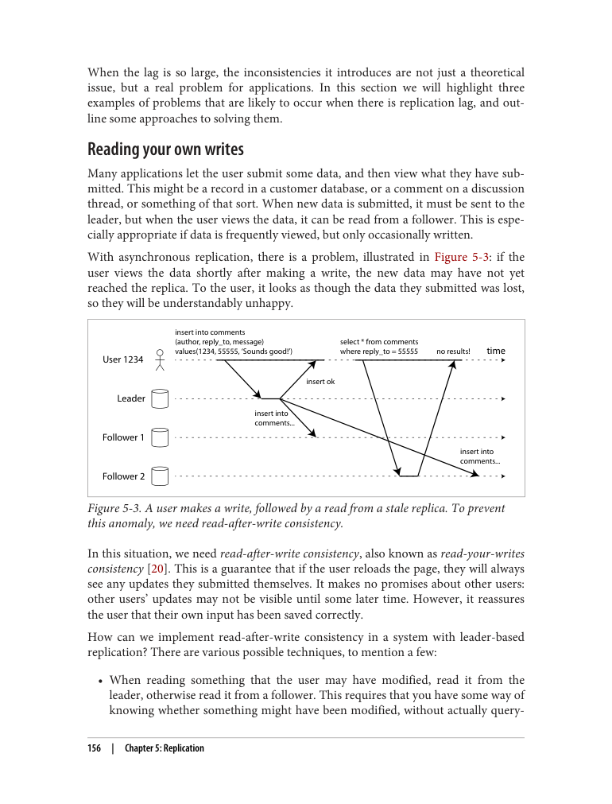

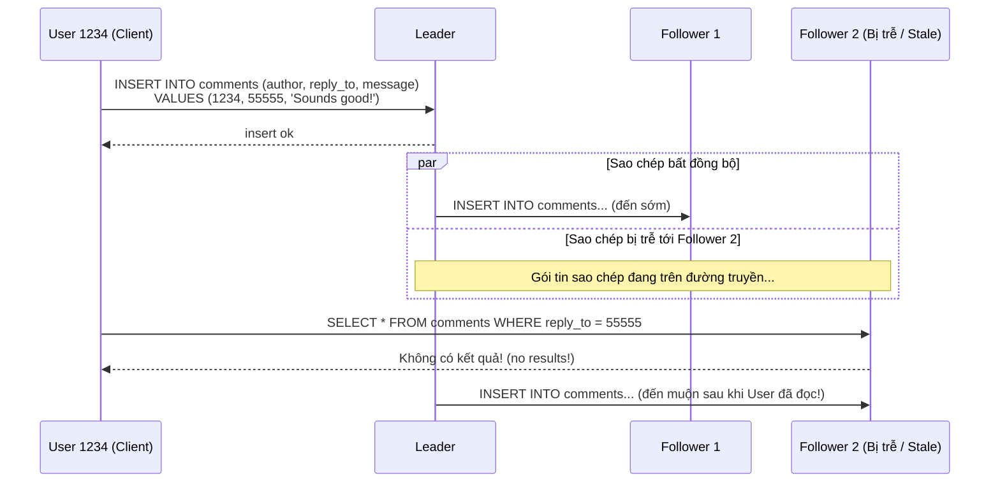

Trong tình huống này, chúng ta cần đến *tính nhất quán đọc-sau-khi-ghi* (*read-after-write consistency*), còn được biết đến với tên gọi *tính nhất quán đọc-những-gì-bạn-ghi* (*read-your-writes consistency*) [20]. Đây là một sự đảm bảo rằng nếu người dùng tải lại (reload) trang web, họ sẽ luôn luôn nhìn thấy bất kỳ cập nhật nào mà chính bản thân họ đã gửi lên. Nó không đưa ra lời hứa hẹn nào về những người dùng khác: các cập nhật của những người dùng khác có thể chưa hiển thị cho đến một thời điểm muộn hơn sau đó. Tuy nhiên, nó trấn an người dùng rằng dữ liệu đầu vào của chính họ đã được lưu lại một cách chính xác.

Làm thế nào để chúng ta triển khai tính nhất quán đọc-sau-khi-ghi trong một hệ thống sử dụng sao chép dựa trên leader? Có nhiều kỹ thuật khả dĩ khác nhau, dưới đây là một vài ví dụ tiêu biểu:

* Khi đọc một thứ gì đó mà người dùng *có khả năng đã sửa đổi*, hãy đọc nó từ leader; ngược lại, hãy đọc nó từ một follower. Điều này đòi hỏi bạn phải có một cách thức nào đó để biết được liệu một thứ gì đó có khả năng đã bị sửa đổi hay không, mà không cần phải thực sự truy vấn vào nó. Ví dụ, thông tin hồ sơ người dùng (user profile) trên một mạng xã hội thông thường chỉ có thể được chỉnh sửa bởi chính chủ sở hữu của hồ sơ đó, chứ không phải bởi bất kỳ ai khác. Do đó, một quy tắc rất đơn giản là: luôn luôn đọc hồ sơ của chính người dùng đó từ leader, và đọc hồ sơ của bất kỳ người dùng nào khác từ một follower.
* Nếu hầu hết mọi thứ trong ứng dụng đều có khả năng được chỉnh sửa bởi người dùng, thì cách tiếp cận trên sẽ không hiệu quả, bởi vì hầu hết mọi thứ đều sẽ phải đọc từ leader (làm triệt tiêu lợi ích của việc mở rộng quy mô đọc). Trong trường hợp đó, có thể sử dụng các tiêu chí khác để quyết định xem có nên đọc từ leader hay không. Chẳng hạn, bạn có thể theo dõi thời điểm cập nhật cuối cùng của người dùng; trong vòng một phút sau lần cập nhật cuối cùng đó, tất cả các thao tác đọc của người dùng đó đều được thực hiện từ leader. Bạn cũng có thể giám sát độ trễ sao chép trên các follower, và ngăn không cho thực hiện truy vấn trên bất kỳ follower nào đang bị trễ hơn một phút so với leader.
* Một cách tiếp cận khác: client có thể ghi nhớ *dấu thời gian* (*timestamp*) của thao tác ghi gần nhất của nó — sau đó hệ thống có thể đảm bảo rằng bản sao phục vụ bất kỳ thao tác đọc nào cho người dùng đó đều đã phản ánh các cập nhật ít nhất là cho đến dấu thời gian đó. Nếu một bản sao chưa đủ mới (not sufficiently up-to-date), thao tác đọc có thể được chuyển sang xử lý bởi một bản sao khác, hoặc truy vấn có thể tạm chờ (wait) cho đến khi bản sao đó bắt kịp. Dấu thời gian này có thể là một *dấu thời gian logic* (*logical timestamp* — một đại lượng chỉ ra thứ tự của các thao tác ghi, chẳng hạn như số thứ tự nhật ký *log sequence number* — LSN), hoặc đồng hồ hệ thống thực tế (trong trường hợp đó việc đồng bộ hóa đồng hồ trở nên cực kỳ quan trọng, xem mục “Đồng hồ không đáng tin cậy — Unreliable Clocks” ở Chương 8).
* Nếu các bản sao của bạn được phân tán qua nhiều trung tâm dữ liệu (nhằm đặt gần người dùng về mặt địa lý hoặc để tăng tính sẵn sàng), sẽ có thêm sự phức tạp phát sinh. Bất kỳ yêu cầu nào cần phải được phục vụ bởi leader đều phải được định tuyến (routed) tới đúng trung tâm dữ liệu đang chứa leader đó.

Một sự phức tạp khác nữa nảy sinh khi cùng một người dùng đang truy cập dịch vụ của bạn từ *nhiều thiết bị khác nhau*, ví dụ như trình duyệt web trên máy tính để bàn và ứng dụng trên điện thoại di động. Trong trường hợp này, bạn có thể muốn cung cấp *tính nhất quán đọc-sau-khi-ghi xuyên thiết bị* (*cross-device read-after-write consistency*): nếu người dùng nhập một số thông tin trên thiết bị này rồi sau đó xem nó trên một thiết bị khác, họ vẫn phải nhìn thấy thông tin mà mình vừa mới nhập vào.

Trong trường hợp này, có thêm một số vấn đề cần phải xem xét:

* Những phương pháp đòi hỏi việc ghi nhớ dấu thời gian của lần cập nhật cuối cùng của người dùng sẽ trở nên khó khăn hơn, bởi vì đoạn mã đang chạy trên thiết bị này không hề biết những cập nhật nào đã diễn ra trên thiết bị kia. Siêu dữ liệu (metadata) này sẽ cần phải được tập trung hóa (centralized).
* Nếu các bản sao của bạn được phân phối trên nhiều trung tâm dữ liệu khác nhau, không có gì đảm bảo rằng các kết nối từ những thiết bị khác nhau sẽ được định tuyến tới cùng một trung tâm dữ liệu. (Ví dụ: nếu máy tính để bàn của người dùng sử dụng kết nối cáp quang băng thông rộng tại nhà còn thiết bị di động lại sử dụng mạng dữ liệu di động 4G/5G, thì tuyến đường mạng của chúng có thể hoàn toàn khác nhau). Nếu phương pháp của bạn đòi hỏi phải đọc từ leader, trước tiên bạn có thể cần phải định tuyến các yêu cầu từ tất cả các thiết bị của cùng một người dùng về cùng một trung tâm dữ liệu.

> 💡 **Ví dụ bổ sung (không có trong sách): Triển khai Read-Your-Writes bằng LSN / GTID trong thực tế**
>
> Làm thế nào các hệ thống lớn triển khai kỹ thuật "dấu thời gian logic" (logical timestamp) mà không cần buộc người dùng luôn đọc từ Leader?
>
> * **Trong MySQL (`WAIT_FOR_EXECUTED_GTID_SET`):** Khi ứng dụng thực hiện một giao dịch ghi trên MySQL Leader, với tính năng `session_track_gtids = OWN_GTID`, MySQL trả về mã GTID vừa tạo ra trong gói tin phản hồi OK về cho драйвер ứng dụng (ví dụ: `3E11FA47-...:42`). Ứng dụng lưu mã GTID này vào HTTP Cookie / JWT hoặc Session. Ở request đọc ngay tiếp theo gửi tới một Read Replica bất kỳ, trước khi chạy câu lệnh `SELECT`, ứng dụng (hoặc tầng proxy như **ProxySQL**) sẽ gọi hàm `SELECT WAIT_FOR_EXECUTED_GTID_SET('3E11FA47-...:42', 1.0);`. Nếu Replica đã áp dụng tới giao dịch 42, hàm này trả về `0` ngay lập tức (0 ms) và câu `SELECT` chạy trên Replica. Nếu Replica đang ở giao dịch 40, hàm sẽ chờ tối đa 1 giây cho tới khi giao dịch 42 được apply xong rồi mới chạy `SELECT`!
> * **Trong PostgreSQL (Causal Reads với LSN):** Sau khi `INSERT`/`UPDATE` trên Primary, ứng dụng lấy vị trí WAL vừa commit thông qua `SELECT pg_current_wal_lsn();` (ví dụ `0/16B3748`). Khi đọc trên Standby, ứng dụng có thể kiểm tra `SELECT pg_last_wal_replay_lsn() >= '0/16B3748'::pg_lsn;`. Kể từ các công cụ pooler hiện đại hoặc tiện ích mở rộng, nếu Standby chưa replay tới LSN đó, proxy có thể tự động chuyển hướng câu truy vấn về Primary.

---

### Đọc đơn điệu (Monotonic reads)

Ví dụ thứ hai của chúng ta về một sự bất thường (anomaly) có thể xảy ra khi đọc từ các follower bất đồng bộ đó là: người dùng có thể nhìn thấy mọi thứ *di chuyển ngược chiều thời gian* (*moving backwards in time*).

Điều này có thể xảy ra nếu một người dùng thực hiện nhiều thao tác đọc từ các bản sao khác nhau. Ví dụ, **Hình 5-4** cho thấy người dùng 2345 thực hiện cùng một truy vấn hai lần, lần đầu tiên gửi tới một follower có độ trễ rất nhỏ, sau đó lần thứ hai lại gửi tới một follower có độ trễ lớn hơn. (Kịch bản này rất dễ xảy ra nếu người dùng nhấn làm mới — refresh — một trang web, và mỗi yêu cầu HTTP lại được bộ cân bằng tải định tuyến tới một máy chủ ngẫu nhiên). Truy vấn đầu tiên trả về một bình luận vừa mới được thêm vào bởi người dùng 1234, nhưng truy vấn thứ hai lại không trả về bất cứ thứ gì, bởi vì follower bị trễ đó vẫn chưa nhận được thao tác ghi kia.

Trên thực tế, truy vấn thứ hai đang quan sát hệ thống tại một thời điểm sớm hơn trong quá khứ so với truy vấn đầu tiên. Mọi chuyện sẽ không đến nỗi quá tệ nếu truy vấn đầu tiên chưa trả về gì cả, bởi vì người dùng 2345 có lẽ sẽ chẳng hề biết rằng người dùng 1234 vừa mới thêm một bình luận. Tuy nhiên, sẽ cực kỳ gây hoang mang và khó hiểu cho người dùng 2345 nếu ban đầu họ đã nhìn thấy bình luận của người dùng 1234 xuất hiện, rồi ngay sau đó lại thấy nó biến mất tăm.

*Đọc đơn điệu* (*Monotonic reads*) [19] là một sự đảm bảo rằng loại bất thường như thế này sẽ không xảy ra. Đây là một sự đảm bảo yếu hơn so với *tính nhất quán mạnh* (*strong consistency*), nhưng lại là một sự đảm bảo mạnh hơn so với *tính nhất quán cuối cùng* (*eventual consistency*). Khi bạn đọc dữ liệu, bạn vẫn có thể nhìn thấy một giá trị cũ; đọc đơn điệu chỉ có nghĩa là nếu một người dùng thực hiện nhiều thao tác đọc nối tiếp nhau theo trình tự, họ sẽ không bao giờ nhìn thấy thời gian quay ngược lại — tức là họ sẽ không bao giờ đọc phải dữ liệu cũ hơn sau khi đã từng đọc được dữ liệu mới hơn trước đó.

Một cách để đạt được tính chất đọc đơn điệu là đảm bảo rằng mỗi người dùng luôn luôn thực hiện các thao tác đọc của mình từ *cùng một bản sao duy nhất* (những người dùng khác nhau vẫn có thể đọc từ các bản sao khác nhau). Ví dụ, bản sao có thể được lựa chọn dựa trên hàm băm (hash) của ID người dùng đó, thay vì chọn một cách ngẫu nhiên. Tuy nhiên, nếu bản sao đó gặp sự cố ngừng hoạt động, các truy vấn của người dùng sẽ cần phải được định tuyến lại sang một bản sao khác.

**Hình 5-4 – Một người dùng ban đầu đọc từ một bản sao mới (fresh replica), sau đó lại đọc từ một bản sao cũ bị trễ (stale replica). Thời gian dường như quay ngược lại. Để ngăn chặn sự bất thường này, chúng ta cần đảm bảo đọc đơn điệu (Figure 5-4. A user first reads from a fresh replica, then from a stale replica. Time appears to go backwards. To prevent this anomaly, we need monotonic reads).**

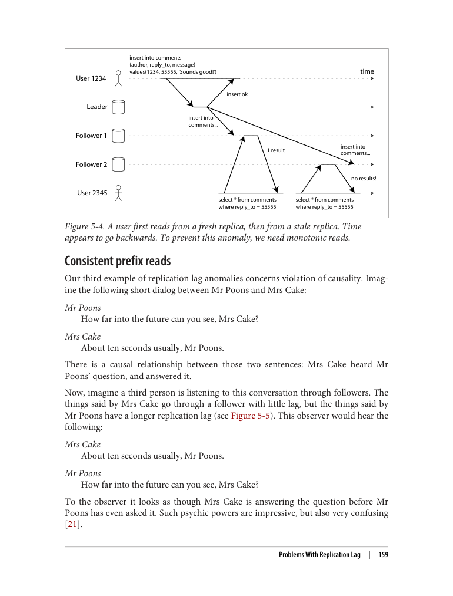

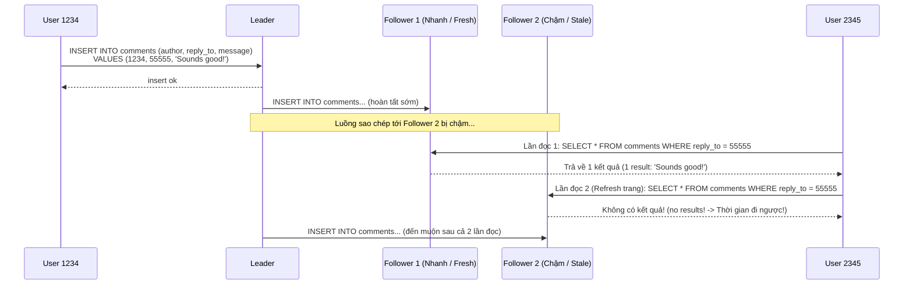

---

### Đọc tiền tố nhất quán (Consistent prefix reads)

Ví dụ thứ ba của chúng ta về những sự bất thường do độ trễ sao chép liên quan đến sự vi phạm *quan hệ nhân quả* (*violation of causality*). Hãy tưởng tượng đoạn hội thoại ngắn sau đây giữa Ông Poons (Mr Poons) và Bà Cake (Mrs Cake):

> **Mr Poons:** Bà có thể nhìn thấy bao xa vào trong tương lai vậy, Bà Cake? *(How far into the future can you see, Mrs Cake?)*
>
> **Mrs Cake:** Thường là khoảng mười giây thôi, Ông Poons ạ. *(About ten seconds usually, Mr Poons.)*

Có một mối quan hệ nhân quả (causal relationship) giữa hai câu nói đó: Bà Cake đã nghe thấy câu hỏi của Ông Poons, và trả lời lại câu hỏi đó.

Bây giờ, hãy tưởng tượng có một người thứ ba đang lắng nghe cuộc trò chuyện này thông qua các follower. Những điều do Bà Cake nói đi qua một follower có độ trễ rất nhỏ, nhưng những điều do Ông Poons nói lại phải đi qua một đường truyền có độ trễ sao chép dài hơn (xem **Hình 5-5**). Người quan sát này sẽ nghe thấy cuộc hội thoại theo thứ tự sau:

> **Mrs Cake:** Thường là khoảng mười giây thôi, Ông Poons ạ. *(About ten seconds usually, Mr Poons.)*
>
> **Mr Poons:** Bà có thể nhìn thấy bao xa vào trong tương lai vậy, Bà Cake? *(How far into the future can you see, Mrs Cake?)*

Dưới góc nhìn của người quan sát, trông cứ như thể Bà Cake đang trả lời câu hỏi trước cả khi Ông Poons kịp đặt câu hỏi đó. Năng lực ngoại cảm như vậy quả là ấn tượng, nhưng cũng cực kỳ gây bối rối và khó hiểu [21].

**Hình 5-5 – Nếu một số phân vùng được sao chép chậm hơn những phân vùng khác, một người quan sát có thể nhìn thấy câu trả lời trước khi họ nhìn thấy câu hỏi (Figure 5-5. If some partitions are replicated slower than others, an observer may see the answer before they see the question).**

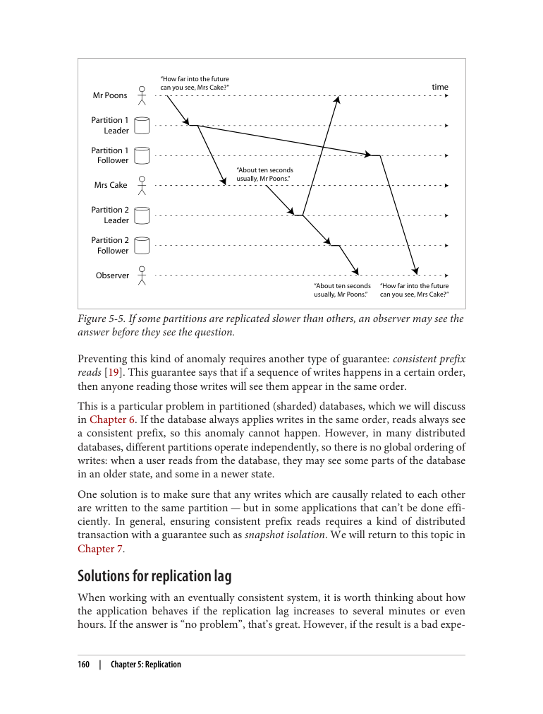

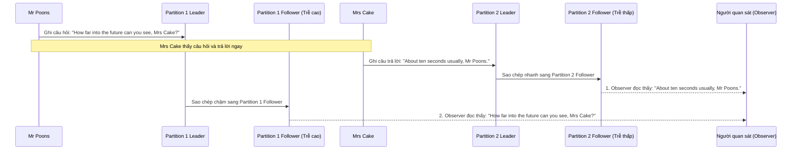

Việc ngăn chặn loại bất thường này đòi hỏi một kiểu đảm bảo khác: *đọc tiền tố nhất quán* (*consistent prefix reads*) [19]. Sự đảm bảo này phát biểu rằng nếu một chuỗi các thao tác ghi diễn ra theo một thứ tự nhất định nào đó, thì bất kỳ ai đọc những thao tác ghi đó cũng sẽ nhìn thấy chúng xuất hiện theo đúng thứ tự đó.

Đây là một vấn đề đặc thù trong các cơ sở dữ liệu được phân vùng (*partitioned / sharded databases*), mà chúng ta sẽ thảo luận trong Chương 6. Nếu cơ sở dữ liệu luôn luôn áp dụng các thao tác ghi theo cùng một thứ tự, thì các thao tác đọc sẽ luôn nhìn thấy một tiền tố nhất quán, vì vậy sự bất thường này không thể xảy ra. Tuy nhiên, trong nhiều cơ sở dữ liệu phân tán, các phân vùng (partitions) khác nhau lại vận hành hoàn toàn độc lập với nhau, do đó không hề có một thứ tự toàn cục (global ordering) nào cho các thao tác ghi: khi một người dùng đọc từ cơ sở dữ liệu, họ có thể nhìn thấy một số phần của cơ sở dữ liệu ở trạng thái cũ hơn và một số phần khác ở trạng thái mới hơn.

Một giải pháp là đảm bảo rằng bất kỳ thao tác ghi nào có liên quan về mặt nhân quả với nhau đều phải được ghi vào cùng một phân vùng — nhưng trong một số ứng dụng, điều đó không thể thực hiện một cách hiệu quả được. Ngoài ra cũng có những thuật toán theo dõi tường minh các sự phụ thuộc nhân quả (causal dependencies), một chủ đề mà chúng ta sẽ quay trở lại trong phần “Quan hệ xảy ra trước và tính đồng thời — The ‘happens-before’ relationship and concurrency” ở phần sau của chương này. (Và nhìn chung, việc đảm bảo tính chất đọc tiền tố nhất quán trên nhiều phân vùng đòi hỏi sự phối hợp của các giao dịch phân tán với mức cô lập snapshot — *snapshot isolation* — sẽ được thảo luận trong Chương 7).

---

### Giải pháp cho độ trễ sao chép (Solutions for replication lag)

Khi làm việc với một hệ thống mang tính nhất quán cuối cùng (eventually consistent system), rất đáng để suy ngẫm xem ứng dụng sẽ hành xử như thế nào nếu độ trễ sao chép tăng lên tới vài phút hoặc thậm chí vài giờ. Nếu câu trả lời là “không sao cả”, thì thật tuyệt vời. Tuy nhiên, nếu kết quả lại là một trải nghiệm tồi tệ cho người dùng, thì điều quan trọng là phải thiết kế hệ thống sao cho cung cấp được một sự đảm bảo mạnh mẽ hơn, chẳng hạn như tính nhất quán đọc-sau-khi-ghi (read-after-write). Việc tự huyễn hoặc rằng quá trình sao chép là đồng bộ trong khi thực chất nó là bất đồng bộ chính là công thức dẫn đến những thảm họa về sau.

Như đã thảo luận ở trên, có nhiều cách để một ứng dụng có thể cung cấp một sự đảm bảo mạnh hơn so với bản thân cơ sở dữ liệu bên dưới, ví dụ như bằng cách thực hiện một số loại thao tác đọc nhất định ngay trên leader. Tuy nhiên, việc đưa logic này vào mã nguồn ứng dụng sẽ làm tăng thêm độ phức tạp cho ứng dụng và rất dễ làm sai.

Sẽ tốt hơn rất nhiều nếu các nhà phát triển ứng dụng không phải lo lắng về những vấn đề sao chép tinh vi và hiểm hóc đó, mà chỉ cần tin tưởng rằng cơ sở dữ liệu của họ sẽ “làm điều đúng đắn”. Đây chính là lý do vì sao *các giao dịch* (*transactions*) tồn tại: chúng là cách thức để một cơ sở dữ liệu cung cấp những sự đảm bảo mạnh mẽ hơn, nhờ đó ứng dụng có thể trở nên đơn giản hơn.

Các giao dịch trên một node đơn lẻ (single-node transactions) đã tồn tại từ rất lâu. Tuy nhiên, trong bước chuyển dịch sang các cơ sở dữ liệu phân tán (được sao chép và phân vùng), nhiều hệ thống đã từ bỏ chúng, với lập luận rằng các giao dịch là quá đắt đỏ xét về mặt hiệu năng và tính sẵn sàng, đồng thời khẳng định rằng tính nhất quán cuối cùng là điều không thể tránh khỏi trong một hệ thống có khả năng mở rộng. Điều đó không nhất thiết đúng. Chúng ta sẽ quay trở lại với chủ đề giao dịch trong Chương 7.

> 📝 **Giải thích thêm (không có trong sách): Bảng tổng hợp 3 mô hình nhất quán phía Client (Session Guarantees)**
>
> Ba sự đảm bảo mà chúng ta vừa tìm hiểu (*Read-your-writes*, *Monotonic reads*, *Consistent prefix reads*) cùng với *Writes-follow-reads* chính là bộ **Bốn đảm bảo phiên làm việc (Session Guarantees / Bayou Guarantees)** nổi tiếng được đề xuất bởi Douglas Terry và cộng sự [19, 20]:
>
> | Mô hình đảm bảo | Hiện tượng bất thường cần ngăn chặn | Kỹ thuật triển khai phổ biến trong thực tế |
> | :--- | :--- | :--- |
> | **Read-your-writes (Read-after-write)** | Người dùng vừa tạo bài viết/bình luận xong, tải lại trang thì không thấy dữ liệu của chính mình đâu (tưởng bị mất dữ liệu). | • Đọc dữ liệu của chính chủ sở hữu từ Leader.<br/>• Dùng cửa sổ thời gian (đọc từ Leader trong 60s sau khi ghi).<br/>• Client giữ LSN / GTID của lần ghi cuối và yêu cầu Replica phải đạt tối thiểu LSN / GTID đó. |
> | **Monotonic reads (Đọc đơn điệu)** | Người dùng nhấn F5 hai lần liên tiếp: lần 1 thấy bình luận mới, lần 2 (rơi vào Replica bị trễ hơn) lại thấy bình luận đó biến mất ("thời gian trôi ngược"). | • **Sticky Routing:** Băm (hash) `user_id` hoặc `session_id` tại tầng Load Balancer / ProxySQL / Pgpool-II để cùng một người dùng luôn đọc từ cố định một Replica.<br/>• Client đính kèm mốc `last_seen_lsn` ở mọi lệnh đọc. |
> | **Consistent prefix reads (Đọc tiền tố nhất quán)** | Người quan sát đọc từ nhiều phân vùng (shards) có độ trễ khác nhau, dẫn tới việc thấy câu trả lời xuất hiện trước cả câu hỏi (vi phạm nhân quả). | • Ghi các dữ liệu có quan hệ nhân quả (cùng một `thread_id` hoặc `conversation_id`) vào cùng một Partition.<br/>• Sử dụng Vector Clocks / Hybrid Logical Clocks (HLC) hoặc Distributed Snapshot Isolation (như trong Google Spanner, CockroachDB, YugabyteDB). |

## Nhân bản đa nút dẫn đầu (Multi-leader replication)

Cho đến thời điểm này trong chương, chúng ta mới chỉ xem xét mô hình nhân bản dựa trên nút dẫn đầu (leader-based replication). Mặc dù đó là một mô hình nhân bản phổ biến, nhưng vẫn có những phương án thay thế thú vị khác.

Nhân bản dựa trên nút dẫn đầu có một nhược điểm lớn: chỉ có duy nhất một nút dẫn đầu (leader), và tất cả các thao tác ghi đều phải đi qua nó.^[iv] Nếu bạn không thể kết nối tới nút dẫn đầu vì bất kỳ lý do gì — chẳng hạn do sự cố gián đoạn mạng giữa bạn và nút dẫn đầu — bạn sẽ không thể ghi dữ liệu vào cơ sở dữ liệu.

> ^[iv] Nếu cơ sở dữ liệu được phân mảnh (*partitioned* — xem Chương 6), mỗi phân mảnh (partition) sẽ có một nút dẫn đầu riêng. Các phân mảnh khác nhau có thể đặt nút dẫn đầu của chúng trên các nút vật lý khác nhau, nhưng bản thân mỗi phân mảnh vẫn bắt buộc phải có duy nhất một nút dẫn đầu.

Một cách mở rộng tự nhiên của mô hình nhân bản dựa trên nút dẫn đầu là cho phép nhiều hơn một nút được phép chấp nhận các thao tác ghi. Quá trình nhân bản vẫn diễn ra theo cùng một cách thức: mỗi nút xử lý một thao tác ghi phải chuyển tiếp thay đổi dữ liệu đó tới tất cả các nút khác. Chúng ta gọi đây là cấu hình *đa nút dẫn đầu* (*multi-leader configuration* — còn được gọi là nhân bản *master–master* hoặc *active/active*). Trong cách thiết lập này, mỗi nút dẫn đầu đồng thời đóng vai trò là một nút theo sau (follower) đối với các nút dẫn đầu khác.

---

### Các trường hợp sử dụng nhân bản đa nút dẫn đầu (Use cases for multi-leader replication)

Hiếm khi nào việc sử dụng thiết lập đa nút dẫn đầu bên trong một trung tâm dữ liệu (datacenter) duy nhất lại hợp lý, bởi vì những lợi ích mang lại hiếm khi bù đắp được độ phức tạp tăng thêm. Tuy nhiên, có một số tình huống mà trong đó đây là một cấu hình hợp lý.

#### Vận hành đa trung tâm dữ liệu (Multi-datacenter operation)

Hãy tưởng tượng bạn có một cơ sở dữ liệu với các bản sao (replica) đặt tại một vài trung tâm dữ liệu khác nhau (có thể là để bạn chịu đựng được sự cố sập toàn bộ một trung tâm dữ liệu, hoặc có thể là để đặt dữ liệu gần hơn với người dùng của bạn). Với thiết lập nhân bản dựa trên nút dẫn đầu thông thường, nút dẫn đầu bắt buộc phải nằm ở một trong các trung tâm dữ liệu đó, và tất cả các thao tác ghi đều phải đi qua trung tâm dữ liệu ấy.

Trong một cấu hình đa nút dẫn đầu, bạn có thể đặt một nút dẫn đầu ở mỗi trung tâm dữ liệu. **Hình 5-6** cho thấy kiến trúc này có thể trông như thế nào. Bên trong mỗi trung tâm dữ liệu, cơ chế nhân bản leader–follower thông thường được sử dụng; giữa các trung tâm dữ liệu với nhau, nút dẫn đầu của mỗi trung tâm dữ liệu sẽ nhân bản các thay đổi của nó sang các nút dẫn đầu ở các trung tâm dữ liệu khác.

**Hình 5-6 – Nhân bản đa nút dẫn đầu qua nhiều trung tâm dữ liệu (Figure 5-6. Multi-leader replication across multiple datacenters.)**

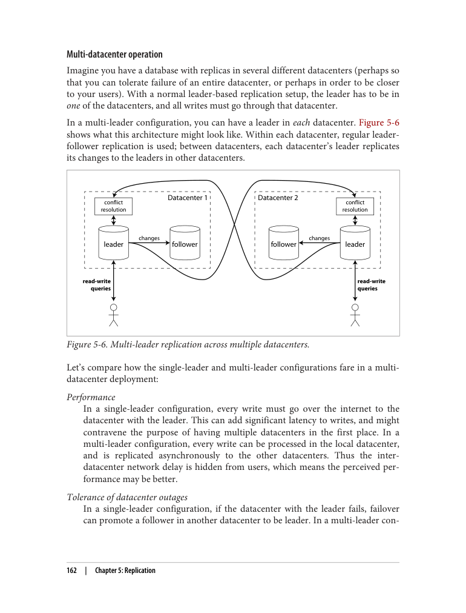

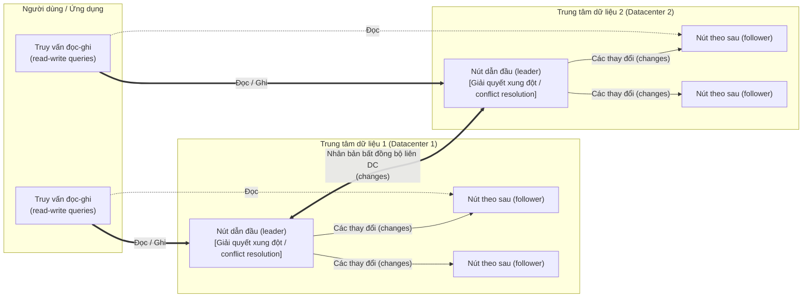

Hãy cùng so sánh cách thức hoạt động của cấu hình đơn nút dẫn đầu (single-leader) và đa nút dẫn đầu (multi-leader) khi triển khai trên nhiều trung tâm dữ liệu:

* **Hiệu năng (Performance):**
  Trong cấu hình đơn nút dẫn đầu, mọi thao tác ghi đều phải đi qua mạng internet tới trung tâm dữ liệu chứa nút dẫn đầu. Điều này có thể làm tăng đáng kể độ trễ (latency) cho các thao tác ghi, và có thể đi ngược lại mục đích ban đầu của việc thiết lập nhiều trung tâm dữ liệu. Trong cấu hình đa nút dẫn đầu, mọi thao tác ghi đều có thể được xử lý ngay tại trung tâm dữ liệu cục bộ, và được nhân bản bất đồng bộ (asynchronously) sang các trung tâm dữ liệu khác. Nhờ đó, độ trễ mạng liên trung tâm dữ liệu được che giấu khỏi người dùng, đồng nghĩa với việc hiệu năng cảm nhận được từ phía người dùng có thể tốt hơn nhiều.

* **Khả năng chịu lỗi sập trung tâm dữ liệu (Tolerance of datacenter outages):**
  Trong cấu hình đơn nút dẫn đầu, nếu trung tâm dữ liệu chứa nút dẫn đầu gặp sự cố, quá trình chuyển đổi dự phòng (failover) có thể thăng cấp một nút theo sau ở trung tâm dữ liệu khác lên làm nút dẫn đầu. Trong cấu hình đa nút dẫn đầu, mỗi trung tâm dữ liệu có thể tiếp tục hoạt động độc lập với các trung tâm dữ liệu khác, và quá trình nhân bản sẽ bắt kịp trở lại khi trung tâm dữ liệu bị lỗi hoạt động trực tuyến trở lại.

* **Khả năng chịu sự cố mạng (Tolerance of network problems):**
  Lưu lượng mạng giữa các trung tâm dữ liệu thường đi qua mạng internet công cộng — vốn có thể kém tin cậy hơn so với mạng nội bộ bên trong một trung tâm dữ liệu. Cấu hình đơn nút dẫn đầu rất nhạy cảm với các sự cố trên đường truyền liên trung tâm dữ liệu này, bởi vì các thao tác ghi được thực hiện một cách đồng bộ qua đường liên kết này. Một cấu hình đa nút dẫn đầu sử dụng nhân bản bất đồng bộ thường có thể chịu đựng các sự cố mạng tốt hơn: một sự gián đoạn mạng tạm thời không ngăn cản các thao tác ghi tiếp tục được xử lý.

Một số cơ sở dữ liệu hỗ trợ cấu hình đa nút dẫn đầu theo mặc định, nhưng nó cũng thường được triển khai bằng các công cụ bên ngoài, chẳng hạn như Tungsten Replicator cho MySQL [22], BDR (Bi-Directional Replication) cho PostgreSQL [23], và GoldenGate cho Oracle [15].

Mặc dù nhân bản đa nút dẫn đầu có nhiều ưu điểm, nó cũng có một nhược điểm rất lớn: cùng một dữ liệu có thể bị sửa đổi đồng thời ở hai trung tâm dữ liệu khác nhau, và những xung đột ghi (*write conflicts*) đó bắt buộc phải được giải quyết (được chỉ rõ là “conflict resolution” trong **Hình 5-6**). Chúng ta sẽ thảo luận chi tiết về vấn đề này trong mục [“Xử lý xung đột ghi (Handling write conflicts)”](#xử-lý-xung-đột-ghi-handling-write-conflicts) ngay sau đây.

Do nhân bản đa nút dẫn đầu là một tính năng có phần được "cấy ghép thêm" (retrofitted) trong nhiều cơ sở dữ liệu, nên thường tồn tại những cạm bẫy cấu hình tinh vi và những tương tác đáng ngạc nhiên với các tính năng khác của cơ sở dữ liệu. Ví dụ, các khóa tự động tăng (auto-incrementing keys), các trigger và các ràng buộc toàn vẹn (integrity constraints) có thể gây ra nhiều rắc rối. Vì lý do này, nhân bản đa nút dẫn đầu thường được coi là một vùng lãnh thổ nguy hiểm cần phải tránh nếu có thể [24].

> 📝 **Giải thích thêm (không có trong sách):**
> Tại sao khóa tự tăng (`AUTO_INCREMENT` trong MySQL hoặc `SERIAL` trong PostgreSQL) lại gặp sự cố trong cấu hình multi-leader? Nếu cả Leader 1 (ở Singapore) và Leader 2 (ở Tokyo) cùng tạo bản ghi mới và tự tăng ID từ `100` lên `101`, khi hai bản ghi này được nhân bản chéo sang nhau sẽ xảy ra đụng độ khóa chính (*Primary Key Collision*). Trong thực tế, các hệ thống MySQL multi-master thường phải cấu hình `auto_increment_increment = 2` và `auto_increment_offset = 1` (cho Leader 1 sinh số lẻ: 1, 3, 5...) và `auto_increment_offset = 2` (cho Leader 2 sinh số chẵn: 2, 4, 6...), hoặc chuyển hẳn sang dùng UUID / Snowflake ID ở tầng ứng dụng.

#### Các ứng dụng khách hoạt động ngoại tuyến (Clients with offline operation)

Một tình huống khác mà nhân bản đa nút dẫn đầu tỏ ra phù hợp là khi bạn có một ứng dụng cần phải tiếp tục hoạt động ngay cả khi nó bị ngắt kết nối khỏi internet.

Ví dụ, hãy xem xét các ứng dụng lịch (calendar) trên điện thoại di động, máy tính xách tay và các thiết bị khác của bạn. Bạn cần có khả năng xem các cuộc họp của mình (thực hiện các yêu cầu đọc) và tạo các cuộc họp mới (thực hiện các yêu cầu ghi) bất kỳ lúc nào, bất kể thiết bị của bạn hiện có kết nối internet hay không. Nếu bạn thực hiện bất kỳ thay đổi nào khi đang ngoại tuyến (offline), chúng cần được đồng bộ hóa (sync) với một máy chủ và các thiết bị khác của bạn khi thiết bị có kết nối trực tuyến trở lại.

Trong trường hợp này, mỗi thiết bị đều có một cơ sở dữ liệu cục bộ đóng vai trò như một nút dẫn đầu (nó chấp nhận các yêu cầu ghi), và có một tiến trình nhân bản đa nút dẫn đầu bất đồng bộ (quá trình đồng bộ - sync) giữa các bản sao lịch của bạn trên tất cả các thiết bị. Độ trễ nhân bản (replication lag) có thể lên tới hàng giờ hoặc thậm chí hàng ngày, tùy thuộc vào thời điểm bạn có quyền truy cập internet.

Từ góc độ kiến trúc, điều này về bản chất hoàn toàn giống với nhân bản đa nút dẫn đầu giữa các trung tâm dữ liệu, nhưng được đẩy lên mức cực đoan: mỗi thiết bị là một “trung tâm dữ liệu”, và kết nối mạng giữa chúng là cực kỳ không đáng tin cậy. Như lịch sử phong phú của các trình đồng bộ lịch bị lỗi đã chứng minh, nhân bản đa nút dẫn đầu là một bài toán cực kỳ khó để làm cho đúng.

Có những công cụ hướng tới việc làm cho kiểu cấu hình đa nút dẫn đầu này trở nên dễ dàng hơn. Ví dụ, CouchDB được thiết kế đặc biệt cho chế độ vận hành này [25] (cùng với PouchDB chạy ngay trên trình duyệt hoặc thiết bị di động).

#### Chỉnh sửa cộng tác (Collaborative editing)

Các ứng dụng chỉnh sửa cộng tác thời gian thực (*real-time collaborative editing*) cho phép nhiều người cùng chỉnh sửa một tài liệu đồng thời. Ví dụ, Etherpad [26] và Google Docs [27] cho phép nhiều người cùng lúc chỉnh sửa một tài liệu văn bản hoặc bảng tính (thuật toán đứng sau được thảo luận ngắn gọn trong mục “Giải quyết xung đột tự động (Automatic conflict resolution)” bên dưới).

Chúng ta thường không nghĩ về việc chỉnh sửa cộng tác như một bài toán nhân bản cơ sở dữ liệu, nhưng nó có rất nhiều điểm chung với trường hợp sử dụng chỉnh sửa ngoại tuyến đã đề cập trước đó. Khi một người dùng chỉnh sửa một tài liệu, các thay đổi sẽ được áp dụng ngay lập tức vào bản sao cục bộ của họ (trạng thái của tài liệu trong trình duyệt web hoặc ứng dụng khách của họ), và được nhân bản bất đồng bộ tới máy chủ cùng bất kỳ người dùng nào khác đang chỉnh sửa cùng tài liệu đó.

Nếu bạn muốn đảm bảo rằng sẽ không có xung đột chỉnh sửa nào xảy ra, ứng dụng phải lấy được một khóa (lock) trên tài liệu trước khi người dùng có thể chỉnh sửa nó. Nếu một người dùng khác muốn chỉnh sửa cùng tài liệu đó, trước tiên họ phải đợi cho đến khi người dùng thứ nhất đã cam kết (commit) các thay đổi của mình và giải phóng khóa. Mô hình cộng tác này tương đương với nhân bản đơn nút dẫn đầu với các giao dịch (transactions) chạy trên nút dẫn đầu.

Tuy nhiên, để việc cộng tác diễn ra nhanh hơn, bạn có thể muốn làm cho đơn vị thay đổi trở nên rất nhỏ (ví dụ: một lần nhấn phím duy nhất) và tránh việc khóa tài liệu. Điều này cho phép nhiều người dùng chỉnh sửa đồng thời, nhưng nó cũng kéo theo tất cả những thách thức của nhân bản đa nút dẫn đầu, bao gồm cả yêu cầu phải giải quyết xung đột.

---

### Xử lý xung đột ghi (Handling write conflicts)

Vấn đề lớn nhất của nhân bản đa nút dẫn đầu là các xung đột ghi (*write conflicts*) có thể xảy ra, đồng nghĩa với việc bắt buộc phải có cơ chế giải quyết xung đột (*conflict resolution*).

Ví dụ, hãy xem xét một trang wiki đang được chỉnh sửa đồng thời bởi hai người dùng, như được minh họa trong **Hình 5-7**. Người dùng 1 thay đổi tiêu đề của trang từ A sang B, và người dùng 2 cũng thay đổi tiêu đề từ A sang C vào cùng thời điểm đó. Thay đổi của mỗi người dùng đều được áp dụng thành công vào nút dẫn đầu cục bộ của họ. Tuy nhiên, khi các thay đổi được nhân bản bất đồng bộ sang nhau, một xung đột sẽ được phát hiện [28]. Vấn đề này không xảy ra trong một cơ sở dữ liệu đơn nút dẫn đầu.

**Hình 5-7 – Một xung đột ghi gây ra bởi hai nút dẫn đầu cập nhật đồng thời cùng một bản ghi (Figure 5-7. A write conflict caused by two leaders concurrently updating the same record.)**

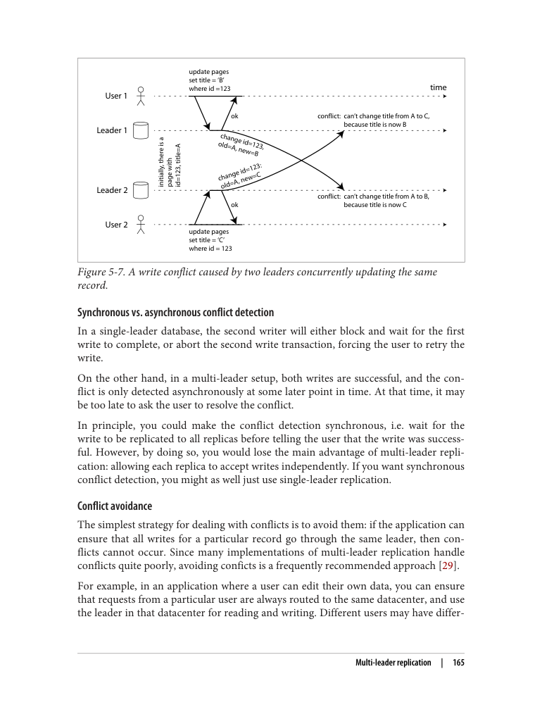

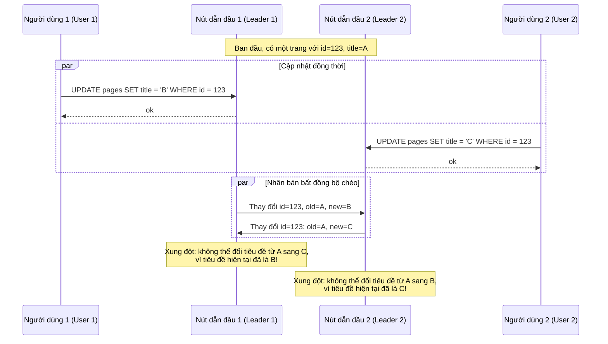

#### Phát hiện xung đột đồng bộ so với bất đồng bộ (Synchronous vs. asynchronous conflict detection)

Trong một cơ sở dữ liệu đơn nút dẫn đầu, tác vụ ghi thứ hai sẽ hoặc bị chặn (block) và phải đợi cho đến khi tác vụ ghi thứ nhất hoàn tất, hoặc giao dịch ghi thứ hai sẽ bị hủy bỏ (abort), buộc người dùng phải thử lại thao tác ghi đó.

Mặt khác, trong một thiết lập đa nút dẫn đầu, cả hai thao tác ghi đều thành công, và xung đột chỉ được phát hiện một cách bất đồng bộ tại một thời điểm nào đó về sau. Vào thời điểm đó, có thể đã quá muộn để yêu cầu người dùng giải quyết xung đột.

Về nguyên tắc, bạn có thể làm cho việc phát hiện xung đột trở nên đồng bộ — tức là đợi cho thao tác ghi được nhân bản tới tất cả các bản sao trước khi báo cho người dùng biết rằng thao tác ghi đã thành công. Tuy nhiên, nếu làm như vậy, bạn sẽ đánh mất ưu điểm chính của nhân bản đa nút dẫn đầu: cho phép mỗi bản sao chấp nhận các thao tác ghi một cách độc lập. Nếu bạn muốn phát hiện xung đột đồng bộ, bạn thà chỉ sử dụng nhân bản đơn nút dẫn đầu còn hơn.

#### Tránh xung đột (Conflict avoidance)

Chiến lược đơn giản nhất để đối phó với các xung đột là tránh chúng ngay từ đầu: nếu ứng dụng có thể đảm bảo rằng tất cả các thao tác ghi cho một bản ghi cụ thể luôn đi qua cùng một nút dẫn đầu, thì các xung đột sẽ không thể xảy ra. Do nhiều bản cài đặt nhân bản đa nút dẫn đầu xử lý xung đột khá kém, việc tránh xung đột là một cách tiếp cận thường xuyên được khuyến nghị [29].

Ví dụ, trong một ứng dụng nơi người dùng có thể chỉnh sửa dữ liệu của chính họ, bạn có thể đảm bảo rằng các yêu cầu từ một người dùng cụ thể luôn được định tuyến (route) tới cùng một trung tâm dữ liệu, và sử dụng nút dẫn đầu tại trung tâm dữ liệu đó để đọc và ghi. Những người dùng khác nhau có thể có các trung tâm dữ liệu “nhà” (home datacenters) khác nhau (có lẽ được chọn dựa trên khoảng cách địa lý gần với người dùng), nhưng dưới góc nhìn của bất kỳ một người dùng đơn lẻ nào thì cấu hình này về cơ bản vẫn là đơn nút dẫn đầu.

Tuy nhiên, đôi khi bạn có thể muốn thay đổi nút dẫn đầu được chỉ định cho một bản ghi — có thể vì một trung tâm dữ liệu đã gặp sự cố và bạn cần định tuyến lại lưu lượng truy cập sang một trung tâm dữ liệu khác, hoặc có thể vì người dùng đã di chuyển đến một địa điểm khác và hiện đang ở gần một trung tâm dữ liệu khác hơn. Trong tình huống này, cơ chế tránh xung đột sẽ bị phá vỡ, và bạn buộc phải đối mặt với khả năng xảy ra các thao tác ghi đồng thời trên các nút dẫn đầu khác nhau.

#### Hội tụ về một trạng thái nhất quán (Converging towards a consistent state)

Một cơ sở dữ liệu đơn nút dẫn đầu áp dụng các thao tác ghi theo một thứ tự tuần tự: nếu có nhiều cập nhật lên cùng một trường dữ liệu, thao tác ghi cuối cùng sẽ quyết định giá trị cuối cùng của trường đó.

Trong cấu hình đa nút dẫn đầu, không có một thứ tự ghi được định nghĩa sẵn, vì vậy không rõ giá trị cuối cùng nên là gì. Trong **Hình 5-7**, tại nút dẫn đầu 1, tiêu đề trước tiên được cập nhật thành B và sau đó thành C; tại nút dẫn đầu 2, nó trước tiên được cập nhật thành C và sau đó thành B. Không có thứ tự nào là “đúng đắn hơn” thứ tự còn lại.

Nếu mỗi bản sao chỉ đơn giản áp dụng các thao tác ghi theo thứ tự mà nó nhìn thấy các thao tác ghi đó, cơ sở dữ liệu sẽ rơi vào một trạng thái không nhất quán: giá trị cuối cùng sẽ là C tại nút dẫn đầu 1, và là B tại nút dẫn đầu 2. Điều đó là không thể chấp nhận được — mọi lược đồ nhân bản đều phải đảm bảo rằng dữ liệu cuối cùng phải giống hệt nhau trên tất cả các bản sao. Do đó, cơ sở dữ liệu phải giải quyết xung đột theo một cách thức *hội tụ* (*convergent*), có nghĩa là tất cả các bản sao phải đi đến cùng một giá trị cuối cùng khi tất cả các thay đổi đã được nhân bản xong.

Có nhiều cách khác nhau để đạt được việc giải quyết xung đột hội tụ:

* **Cấp cho mỗi thao tác ghi một ID duy nhất** (ví dụ: một nhãn thời gian - timestamp, một số ngẫu nhiên dài, một UUID, hoặc một giá trị băm của khóa và giá trị), chọn thao tác ghi có ID cao nhất làm người chiến thắng, và vứt bỏ các thao tác ghi khác. Nếu một nhãn thời gian được sử dụng, kỹ thuật này được gọi là *ghi sau cùng thắng* (*last write wins* — LWW). Mặc dù kỹ thuật này rất phổ biến, nhưng nó lại cực kỳ nguy hiểm vì dễ dẫn đến mất mát dữ liệu [30]. Chúng ta sẽ thảo luận chi tiết hơn về LWW ở cuối chương này ([“Phát hiện các thao tác ghi đồng thời (Detecting concurrent writes)”](#phát-hiện-các-thao-tác-ghi-đồng-thời-detecting-concurrent-writes)).
* **Cấp cho mỗi bản sao một ID duy nhất**, và để các thao tác ghi bắt nguồn từ bản sao có số thứ tự cao hơn luôn được ưu tiên hơn các thao tác ghi bắt nguồn từ bản sao có số thứ tự thấp hơn. Cách này cũng đồng nghĩa với việc mất mát dữ liệu.
* **Bằng cách nào đó hợp nhất (merge) các giá trị lại với nhau**, ví dụ: sắp xếp chúng theo thứ tự bảng chữ cái rồi nối chúng lại (trong **Hình 5-7**, tiêu đề được hợp nhất có thể là một thứ gì đó như `"B/C"`).
* **Ghi nhận xung đột vào một cấu trúc dữ liệu tường minh** giúp bảo toàn tất cả thông tin, và viết mã ứng dụng để giải quyết xung đột đó vào một thời điểm nào đó sau này (có thể bằng cách hiển thị thông báo hỏi người dùng).

#### Logic giải quyết xung đột tùy chỉnh (Custom conflict resolution logic)

Vì cách thức phù hợp nhất để giải quyết một xung đột có thể phụ thuộc vào từng ứng dụng, hầu hết các công cụ nhân bản đa nút dẫn đầu đều cho phép bạn viết logic giải quyết xung đột bằng mã ứng dụng. Đoạn mã đó có thể được thực thi *khi ghi (on write)* hoặc *khi đọc (on read)*:

* **Khi ghi (On write):**
  Ngay khi hệ thống cơ sở dữ liệu phát hiện ra một xung đột trong nhật ký các thay đổi được nhân bản, nó sẽ gọi trình xử lý xung đột (conflict handler). Ví dụ, Bucardo cho phép bạn viết một đoạn mã Perl cho mục đích này. Trình xử lý này thông thường không thể hiển thị hộp thoại hỏi người dùng — nó chạy trong một tiến trình nền (background process) và nó bắt buộc phải thực thi thật nhanh.

* **Khi đọc (On read):**
  Khi một xung đột được phát hiện, tất cả các thao tác ghi đang xung đột đều được lưu trữ lại. Trong lần tiếp theo dữ liệu đó được đọc, nhiều phiên bản dữ liệu này sẽ được trả về cho ứng dụng. Ứng dụng có thể hỏi người dùng hoặc tự động giải quyết xung đột, rồi ghi kết quả trở lại cơ sở dữ liệu. Ví dụ, CouchDB hoạt động theo cách này.

Lưu ý rằng việc giải quyết xung đột thường được áp dụng ở cấp độ của một hàng (row) hoặc một tài liệu (document) riêng lẻ, chứ không phải cho toàn bộ một giao dịch (transaction) [31]. Do đó, nếu bạn có một giao dịch thực hiện một cách nguyên tử (atomically) một vài thao tác ghi khác nhau (xem Chương 7), mỗi thao tác ghi vẫn được xem xét tách biệt nhau cho mục đích giải quyết xung đột.

#### Giải quyết xung đột tự động (Automatic conflict resolution)

Các quy tắc giải quyết xung đột có thể nhanh chóng trở nên phức tạp, và mã tùy chỉnh rất dễ phát sinh lỗi. Amazon là một ví dụ thường xuyên được trích dẫn về những hiệu ứng đáng ngạc nhiên do trình xử lý giải quyết xung đột gây ra: trong một khoảng thời gian, logic giải quyết xung đột trên giỏ hàng mua sắm (shopping cart) sẽ bảo toàn các món hàng được thêm vào giỏ, nhưng lại không bảo toàn việc các món hàng đã bị xóa khỏi giỏ. Do đó, khách hàng đôi khi sẽ thấy các món hàng xuất hiện trở lại trong giỏ hàng của họ mặc dù trước đó chúng đã bị xóa đi [32].

Đã có một số nghiên cứu thú vị về việc tự động giải quyết các xung đột gây ra bởi các sửa đổi dữ liệu đồng thời. Một vài hướng nghiên cứu đáng được nhắc đến bao gồm:

* **Các kiểu dữ liệu nhân bản không xung đột (Conflict-free replicated data types — CRDTs)** [33] là một họ các cấu trúc dữ liệu dành cho tập hợp (sets), ánh xạ (maps), danh sách có thứ tự (ordered lists), bộ đếm (counters), v.v., có thể được chỉnh sửa đồng thời bởi nhiều người dùng, và tự động giải quyết các xung đột theo những cách hợp lý. Một số CRDT đã được hiện thực hóa trong Riak 2.0 [34, 35] (và hiện nay có mặt trong Redis Enterprise, Azure Cosmos DB, thư viện Yjs/Automerge).
* **Các cấu trúc dữ liệu bền vững có thể hợp nhất (Mergeable persistent data structures)** [36] theo dõi lịch sử một cách tường minh, tương tự như hệ thống quản lý phiên bản Git, và sử dụng một hàm hợp nhất ba chiều (*three-way merge*) (trong khi CRDT sử dụng hợp nhất hai chiều - *two-way merges*).
* **Biến đổi thao tác (Operational transformation — OT)** [37] là thuật toán giải quyết xung đột đứng đằng sau các ứng dụng chỉnh sửa cộng tác như Etherpad [26] và Google Docs [27]. Nó được thiết kế đặc biệt cho việc chỉnh sửa đồng thời một danh sách các phần tử có thứ tự, chẳng hạn như danh sách các ký tự cấu thành nên một tài liệu văn bản.

Các bản cài đặt của những thuật toán này vẫn còn khá non trẻ (tại thời điểm viết sách), nhưng nhiều khả năng chúng sẽ được tích hợp vào nhiều hệ thống dữ liệu nhân bản hơn trong tương lai: việc giải quyết xung đột tự động có thể làm cho việc đồng bộ hóa dữ liệu đa nút dẫn đầu trở nên đơn giản hơn rất nhiều để các ứng dụng xử lý.

> 💡 **Ví dụ bổ sung (không có trong sách):**
> Hãy hình dung một bộ đếm lượt thích (Like counter) sử dụng cấu trúc **PN-Counter (Positive-Negative Counter)** thuộc họ CRDT trên 2 nút dẫn đầu `L1` và `L2`. Thay vì gửi lệnh `SET likes = 101` (dễ ghi đè mất dữ liệu của nhau), mỗi nút duy trì một vector đếm số lần tăng `P` và giảm `N` của riêng nó:
> - Ban đầu: `P = {L1: 0, L2: 0}`, `N = {L1: 0, L2: 0}`.
> - Tại `L1`, có 3 người bấm Like -> `P[L1] = 3`.
> - Đồng thời tại `L2`, có 5 người bấm Like và 1 người bỏ Like -> `P[L2] = 5, N[L2] = 1`.
> - Khi `L1` và `L2` đồng bộ với nhau, hàm hợp nhất CRDT chỉ cần lấy giá trị cực đại (`max`) theo từng nút: `P = {L1: 3, L2: 5}`, `N = {L1: 0, L2: 1}`. Tổng số Like trên cả hai nút tự động hội tụ về `(3 + 5) - (0 + 1) = 7` mà không hề mất bất kỳ thao tác nào!

#### Thế nào là một xung đột? (What is a conflict?)

Một số loại xung đột là rất hiển nhiên. Trong ví dụ ở **Hình 5-7**, hai thao tác ghi đã sửa đổi đồng thời cùng một trường trong cùng một bản ghi, đặt nó thành hai giá trị khác nhau. Không còn nghi ngờ gì nữa, đây chắc chắn là một xung đột.

Những loại xung đột khác có thể tinh vi hơn và khó phát hiện hơn. Ví dụ, hãy xem xét một hệ thống đặt phòng họp: nó theo dõi xem phòng nào được đặt bởi nhóm người nào vào một khoảng thời gian nhất định. Ứng dụng này cần đảm bảo rằng mỗi phòng chỉ được đặt bởi duy nhất một nhóm người tại bất kỳ thời điểm nào (tức là không được phép có bất kỳ lịch đặt phòng nào bị trùng lặp thời gian cho cùng một phòng).

Trong trường hợp này, một xung đột có thể phát sinh nếu hai lịch đặt phòng khác nhau được tạo ra cho cùng một phòng vào cùng một khoảng thời gian. Ngay cả khi ứng dụng kiểm tra tình trạng phòng trống trước khi cho phép người dùng thực hiện đặt phòng, xung đột vẫn có thể xảy ra nếu hai lượt đặt phòng được thực hiện trên hai nút dẫn đầu khác nhau.

Các giải pháp cho vấn đề này đã được đề xuất [38], nhưng có thể rất khó triển khai trong thực tế. Hiện tại, việc phát hiện xung đột là một câu hỏi cần suy ngẫm kỹ khi thiết kế một hệ thống nhân bản, nhưng chưa có một câu trả lời có sẵn nhanh gọn nào. (Chúng ta sẽ quay lại bài toán đặt phòng họp này dưới góc độ cô lập giao dịch *Serializable* và *Write Skew* trong Chương 7).

---

### Các cấu trúc liên kết nhân bản đa nút dẫn đầu (Multi-leader replication topologies)

Một *cấu trúc liên kết nhân bản* (*replication topology*) mô tả các đường truyền giao tiếp mà dọc theo đó các thao tác ghi được lan truyền từ nút này sang nút khác. Nếu bạn có hai nút dẫn đầu, giống như trong **Hình 5-7**, chỉ có duy nhất một cấu trúc liên kết hợp lý: nút dẫn đầu 1 phải gửi tất cả các thao tác ghi của nó tới nút dẫn đầu 2, và ngược lại. Với nhiều hơn hai nút dẫn đầu, nhiều cấu trúc liên kết khác nhau có thể được thiết lập. Một số ví dụ được minh họa trong **Hình 5-8**.

**Hình 5-8 – Ba ví dụ về cấu trúc liên kết có thể thiết lập cho nhân bản đa nút dẫn đầu (Figure 5-8. Three example topologies in which multi-leader replication can be set up.)**

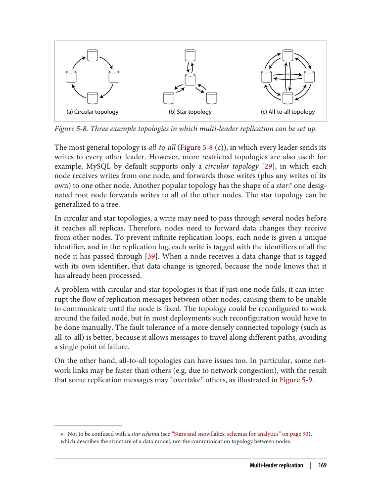

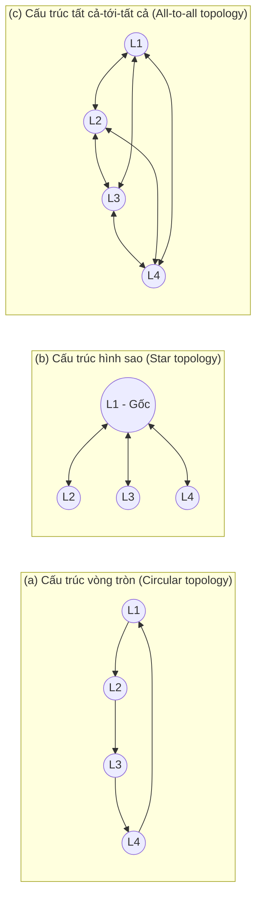

Cấu trúc liên kết tổng quát nhất là *tất cả-tới-tất cả* (*all-to-all* — **Hình 5-8 (c)**), trong đó mỗi nút dẫn đầu gửi các thao tác ghi của nó tới mọi nút dẫn đầu khác. Tuy nhiên, các cấu trúc liên kết hạn chế hơn cũng được sử dụng: ví dụ, theo mặc định MySQL chỉ hỗ trợ *cấu trúc liên kết vòng tròn* (*circular topology*) [29], trong đó mỗi nút nhận các thao tác ghi từ một nút, và chuyển tiếp những thao tác ghi đó (cộng với bất kỳ thao tác ghi nào của chính nó) tới một nút khác. Một cấu trúc liên kết phổ biến khác có hình dạng của một *ngôi sao* (*star topology*):^[v] một nút gốc (root node) được chỉ định sẽ chuyển tiếp các thao tác ghi tới tất cả các nút khác. Cấu trúc liên kết hình sao có thể được tổng quát hóa thành một cấu trúc cây (*tree*).

> ^[v] Đừng nhầm lẫn với *lược đồ hình sao* (*star schema* — xem mục “Stars and snowflakes: schemas for analytics” ở Chương 3, trang 90), vốn mô tả cấu trúc của một mô hình dữ liệu chứ không phải cấu trúc liên kết giao tiếp giữa các nút.

Trong các cấu trúc liên kết vòng tròn và hình sao, một thao tác ghi có thể cần phải đi qua một vài nút trước khi nó đến được tất cả các bản sao. Do đó, các nút cần phải chuyển tiếp những thay đổi dữ liệu mà chúng nhận được từ các nút khác. Để ngăn chặn các vòng lặp nhân bản vô hạn (infinite replication loops), mỗi nút được cấp một định danh duy nhất (unique identifier), và trong nhật ký nhân bản, mỗi thao tác ghi được gắn thẻ (tag) với định danh của tất cả các nút mà nó đã đi qua [39]. Khi một nút nhận được một thay đổi dữ liệu đã được gắn thẻ với định danh của chính nó, thay đổi dữ liệu đó sẽ bị bỏ qua, bởi vì nút đó biết rằng thay đổi này đã được xử lý rồi.

Một vấn đề với các cấu trúc liên kết vòng tròn và hình sao là nếu chỉ một nút bị lỗi, nó có thể làm gián đoạn luồng thông điệp nhân bản giữa các nút khác, khiến chúng không thể giao tiếp với nhau cho đến khi nút bị lỗi được sửa chữa. Cấu trúc liên kết có thể được cấu hình lại để đi vòng qua nút bị lỗi, nhưng trong hầu hết các hệ thống triển khai, việc cấu hình lại như vậy phải được thực hiện thủ công. Khả năng chịu lỗi của một cấu trúc liên kết được kết nối dày đặc hơn (chẳng hạn như all-to-all) là tốt hơn, bởi vì nó cho phép các thông điệp đi theo các đường dẫn khác nhau, tránh được điểm lỗi đơn lẻ (single point of failure).

Mặt khác, các cấu trúc liên kết tất cả-tới-tất cả (all-to-all) cũng có thể gặp phải những vấn đề riêng. Cụ thể, một số đường liên kết mạng có thể nhanh hơn những đường khác (ví dụ: do tắc nghẽn mạng), dẫn đến kết quả là một số thông điệp nhân bản có thể “vượt mặt” (overtake) các thông điệp khác, như được minh họa trong **Hình 5-9**.

**Hình 5-9 – Với nhân bản đa nút dẫn đầu, các thao tác ghi có thể đến sai thứ tự tại một số bản sao (Figure 5-9. With multi-leader replication, writes may arrive in the wrong order at some replicas.)**

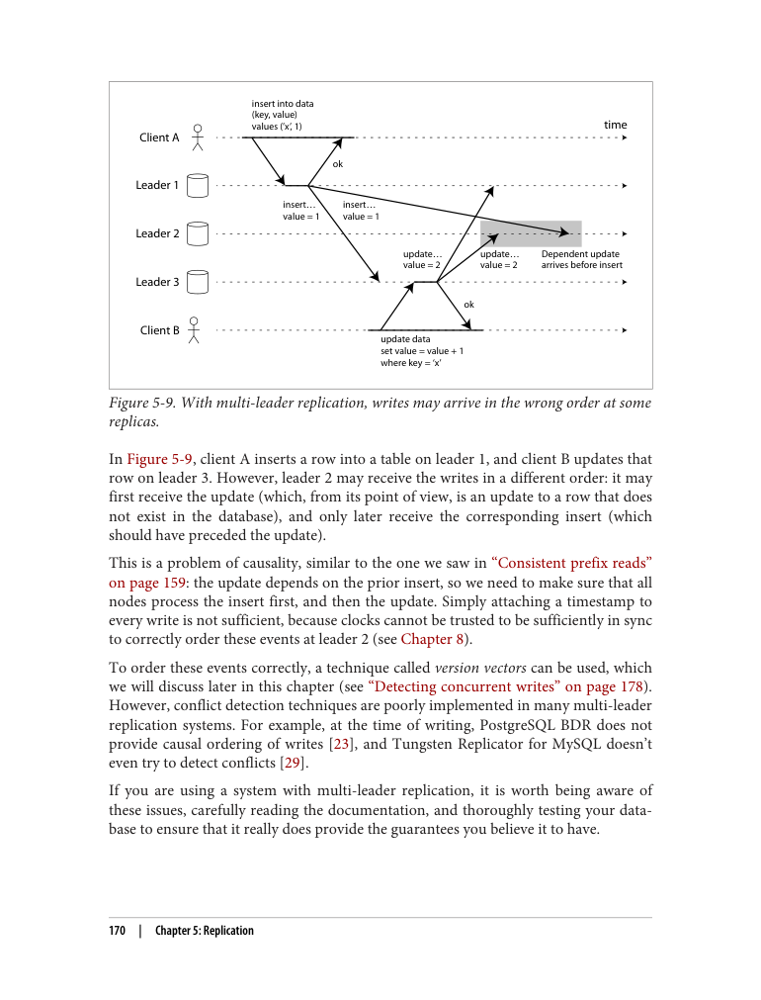

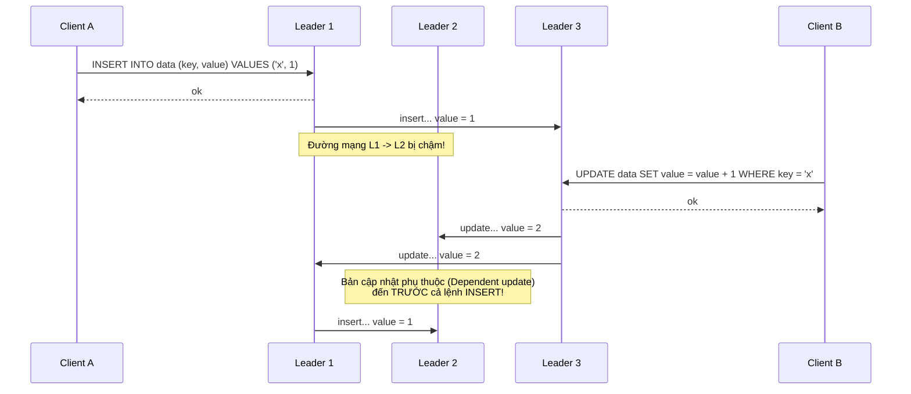

Trong **Hình 5-9**, Client A chèn (insert) một hàng vào bảng trên nút dẫn đầu 1 (`Leader 1`), và Client B cập nhật (update) hàng đó trên nút dẫn đầu 3 (`Leader 3`). Tuy nhiên, nút dẫn đầu 2 (`Leader 2`) có thể nhận được các thao tác ghi theo một thứ tự khác: trước tiên nó có thể nhận được lệnh cập nhật (mà dưới góc nhìn của nó, đây là một lệnh cập nhật lên một hàng chưa hề tồn tại trong cơ sở dữ liệu!), và chỉ sau đó mới nhận được lệnh chèn tương ứng (vốn lẽ ra phải đứng trước lệnh cập nhật).

Đây là một bài toán về *quan hệ nhân quả* (*causality*), tương tự như bài toán mà chúng ta đã thấy trong mục “Đọc tiền tố nhất quán (Consistent prefix reads)” ở trang 159: thao tác cập nhật phụ thuộc vào thao tác chèn trước đó, vì vậy chúng ta cần đảm bảo rằng tất cả các nút đều phải xử lý thao tác chèn trước, rồi mới đến thao tác cập nhật. Việc chỉ đơn thuần đính kèm một nhãn thời gian (timestamp) vào mỗi thao tác ghi là không đủ, bởi vì không thể tin tưởng rằng các đồng hồ vật lý được đồng bộ hóa đủ chính xác để sắp xếp đúng các sự kiện này tại nút dẫn đầu 2 (xem Chương 8).

Để sắp xếp đúng thứ tự các sự kiện này, một kỹ thuật có tên là *vectơ phiên bản* (*version vectors*) có thể được sử dụng — chúng ta sẽ thảo luận về kỹ thuật này ở phần sau của chương (xem mục [“Phát hiện các thao tác ghi đồng thời (Detecting concurrent writes)”](#phát-hiện-các-thao-tác-ghi-đồng-thời-detecting-concurrent-writes)). Tuy nhiên, các kỹ thuật phát hiện xung đột lại được cài đặt khá sơ sài trong nhiều hệ thống nhân bản đa nút dẫn đầu. Ví dụ, tại thời điểm viết cuốn sách này, PostgreSQL BDR không cung cấp thứ tự nhân quả cho các thao tác ghi [23], và Tungsten Replicator cho MySQL thậm chí còn không cố gắng phát hiện xung đột [29].

Nếu bạn đang sử dụng một hệ thống có nhân bản đa nút dẫn đầu, rất đáng để bạn nhận thức rõ về những vấn đề này, đọc thật kỹ tài liệu hướng dẫn, và kiểm thử cơ sở dữ liệu của mình một cách triệt để nhằm đảm bảo rằng nó thực sự cung cấp những cam kết mà bạn tin rằng nó có.

---

## Nhân bản không nút dẫn đầu (Leaderless replication)

Các phương pháp nhân bản mà chúng ta đã thảo luận cho đến thời điểm này trong chương — nhân bản đơn nút dẫn đầu (single-leader) và nhân bản đa nút dẫn đầu (multi-leader) — đều dựa trên ý tưởng rằng một ứng dụng khách (client) gửi một yêu cầu ghi tới một nút (nút dẫn đầu), và hệ thống cơ sở dữ liệu sẽ đảm nhận việc sao chép thao tác ghi đó sang các bản sao khác. Một nút dẫn đầu sẽ quyết định thứ tự mà các thao tác ghi cần được xử lý, và các nút theo sau (followers) sẽ áp dụng các thao tác ghi của nút dẫn đầu theo đúng thứ tự đó.

Một số hệ thống lưu trữ dữ liệu chọn một hướng tiếp cận khác hẳn: từ bỏ khái niệm về nút dẫn đầu, và cho phép bất kỳ bản sao nào cũng có thể trực tiếp chấp nhận các thao tác ghi từ phía ứng dụng khách. Một số hệ thống dữ liệu nhân bản đầu tiên trong lịch sử vốn dĩ không có nút dẫn đầu [1, 40], nhưng ý tưởng này phần lớn đã bị lãng quên trong kỷ nguyên thống trị của các cơ sở dữ liệu quan hệ. Nó một lần nữa trở thành một kiến trúc thời thượng cho các cơ sở dữ liệu sau khi Amazon sử dụng nó cho hệ thống Dynamo nội bộ của họ [32].^[vi] Riak, Cassandra và Voldemort là các kho lưu trữ dữ liệu mã nguồn mở với mô hình nhân bản không nút dẫn đầu lấy cảm hứng từ Dynamo, vì vậy loại cơ sở dữ liệu này còn được gọi là cơ sở dữ liệu *kiểu Dynamo* (*Dynamo-style*).

> ^[vi] Hệ thống Dynamo nguyên bản không được cung cấp cho người dùng bên ngoài Amazon. Điều dễ gây nhầm lẫn là AWS cung cấp một sản phẩm cơ sở dữ liệu được quản lý (hosted database) mang tên **DynamoDB**, nhưng sản phẩm này lại sử dụng một kiến trúc hoàn toàn khác: nó dựa trên mô hình nhân bản đơn nút dẫn đầu (single-leader replication) kết hợp với thuật toán đồng thuận Paxos cho từng phân mảnh.

Trong một số bản cài đặt không nút dẫn đầu, ứng dụng khách trực tiếp gửi các thao tác ghi của nó tới một vài bản sao, trong khi ở những bản cài đặt khác, một *nút điều phối* (*coordinator node*) sẽ thực hiện việc này thay mặt cho ứng dụng khách. Tuy nhiên, không giống như một cơ sở dữ liệu có nút dẫn đầu, nút điều phối đó không áp đặt một thứ tự cụ thể nào cho các thao tác ghi. Như chúng ta sẽ thấy, điều này có những hệ quả sâu sắc đối với cách thức cơ sở dữ liệu được sử dụng.

---

### Ghi vào cơ sở dữ liệu khi một nút bị sập (Writing to the database when a node is down)

Hãy tưởng tượng bạn có một cơ sở dữ liệu với ba bản sao, và một trong các bản sao hiện không khả dụng — có thể nó đang được khởi động lại để cài đặt một bản cập nhật hệ thống. Trong một cấu hình dựa trên nút dẫn đầu, nếu bạn muốn tiếp tục xử lý các thao tác ghi, bạn có thể cần phải thực hiện chuyển đổi dự phòng (failover — xem mục “Xử lý sự cố ngừng hoạt động của nút (Handling node outages)” ở trang 150).

Mặt khác, trong một cấu hình không nút dẫn đầu, khái niệm chuyển đổi dự phòng không tồn tại. **Hình 5-10** cho thấy những gì diễn ra: ứng dụng khách (`User 1234`) gửi thao tác ghi tới cả ba bản sao một cách song song, hai bản sao khả dụng chấp nhận thao tác ghi, nhưng bản sao không khả dụng (`Replica 3`) lại bỏ lỡ thao tác ghi đó. Giả sử rằng chỉ cần hai trong số ba bản sao xác nhận thao tác ghi là đủ: sau khi `User 1234` nhận được hai phản hồi `ok`, chúng ta coi thao tác ghi đó là đã thành công. Ứng dụng khách chỉ đơn giản phớt lờ thực tế là một trong các bản sao đã bỏ lỡ thao tác ghi.

**Hình 5-10 – Ghi túc số (quorum write), đọc túc số (quorum read) và sửa chữa khi đọc (read repair) sau khi một nút gặp sự cố ngừng hoạt động (Figure 5-10. A quorum write, quorum read, and read repair after a node outage.)**

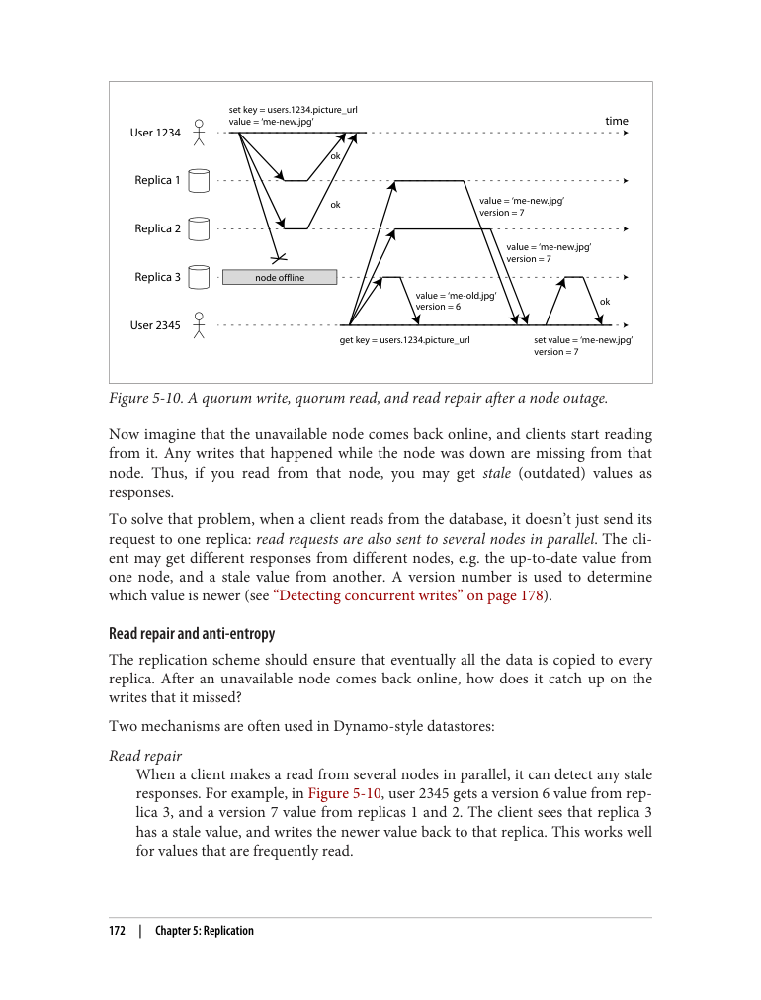

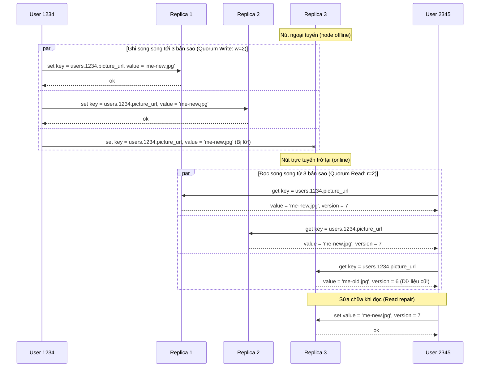

Bây giờ hãy tưởng tượng rằng nút không khả dụng đó hoạt động trực tuyến trở lại, và các ứng dụng khách bắt đầu đọc dữ liệu từ nó. Bất kỳ thao tác ghi nào đã diễn ra trong lúc nút đó đang sập đều bị thiếu trên nút đó. Do đó, nếu bạn đọc từ nút đó, bạn có thể nhận được các giá trị cũ (lỗi thời - *stale/outdated*) làm kết quả trả về.

Để giải quyết vấn đề đó, khi một ứng dụng khách đọc từ cơ sở dữ liệu, nó không chỉ gửi yêu cầu của mình tới một bản sao duy nhất: các yêu cầu đọc cũng được gửi tới một vài nút secara song song. Ứng dụng khách có thể nhận được các phản hồi khác nhau từ các nút khác nhau, ví dụ: giá trị mới cập nhật từ một nút, và một giá trị đã cũ từ một nút khác. Một số hiệu phiên bản (*version number*) được sử dụng để xác định xem giá trị nào là mới hơn (xem mục [“Phát hiện các thao tác ghi đồng thời (Detecting concurrent writes)”](#phát-hiện-các-thao-tác-ghi-đồng-thời-detecting-concurrent-writes) ở trang 178).

#### Sửa chữa khi đọc và tiến trình chống phân rã (Read repair and anti-entropy)

Lược đồ nhân bản cần phải đảm bảo rằng cuối cùng tất cả dữ liệu đều được sao chép tới mọi bản sao. Sau khi một nút không khả dụng hoạt động trực tuyến trở lại, làm thế nào để nó bắt kịp các thao tác ghi mà nó đã bỏ lỡ?

Hai cơ chế thường được sử dụng trong các kho dữ liệu kiểu Dynamo là:

* **Sửa chữa khi đọc (Read repair):**
  Khi một ứng dụng khách thực hiện thao tác đọc từ một vài nút song song, nó có thể phát hiện ra bất kỳ phản hồi cũ (lỗi thời) nào. Ví dụ, trong **Hình 5-10**, `User 2345` nhận được một giá trị có `version 6` từ `Replica 3`, và một giá trị có `version 7` từ `Replica 1` và `Replica 2`. Ứng dụng khách nhận thấy rằng `Replica 3` đang giữ một giá trị đã cũ, và ghi ngược giá trị mới hơn đó trở lại bản sao ấy. Cơ chế này hoạt động rất tốt đối với những giá trị thường xuyên được đọc.

* **Tiến trình chống phân rã (Anti-entropy process):**
  Ngoài ra, một số kho dữ liệu có một tiến trình chạy nền liên tục tìm kiếm những điểm khác biệt trong dữ liệu giữa các bản sao, và sao chép bất kỳ dữ liệu nào còn thiếu từ bản sao này sang bản sao khác. Không giống như nhật ký nhân bản (replication log) trong nhân bản dựa trên nút dẫn đầu, tiến trình chống phân rã này không sao chép các thao tác ghi theo bất kỳ thứ tự cụ thể nào, và có thể có một độ trễ đáng kể trước khi dữ liệu được sao chép.

Không phải tất cả các hệ thống đều cài đặt cả hai cơ chế này; ví dụ, Voldemort hiện không có tiến trình chống phân rã. Lưu ý rằng nếu không có tiến trình chống phân rã, những giá trị hiếm khi được đọc có thể bị thiếu trên một số bản sao và do đó bị giảm độ bền vững (durability), bởi vì việc sửa chữa khi đọc chỉ được thực hiện khi một giá trị được đọc bởi ứng dụng.

> 📝 **Giải thích thêm (không có trong sách):**
> Trong Apache Cassandra và Riak, tiến trình **Anti-entropy** thường sử dụng cấu trúc dữ liệu **Cây băm Merkle (Merkle Tree)** — một cây nhị phân trong đó mỗi nút lá là giá trị băm (hash) của một khóa dữ liệu, và mỗi nút cha là giá trị băm của tổ hợp các nút con của nó. Khi hai bản sao muốn kiểm tra xem dữ liệu của chúng có đồng bộ hay không, trước tiên chúng chỉ cần so sánh giá trị băm ở nút gốc (*root hash*). Nếu giống nhau, toàn bộ dữ liệu đã đồng nhất mà không cần truyền tải dữ liệu qua mạng! Nếu khác nhau, chúng mới duyệt xuống các nhánh con bị lệch để tìm ra chính xác những dải khóa (key ranges) nào cần đồng bộ bổ sung (trong Cassandra, quá trình này diễn ra khi chạy lệnh `nodetool repair`).

#### Túc số cho việc đọc và ghi (Quorums for reading and writing)

Trong ví dụ ở **Hình 5-10**, chúng ta đã coi thao tác ghi là thành công mặc dù nó mới chỉ được xử lý trên hai trong số ba bản sao. Điều gì sẽ xảy ra nếu chỉ có một trong số ba bản sao chấp nhận thao tác ghi? Chúng ta có thể đẩy giới hạn này đi xa đến đâu?

Nếu chúng ta biết rằng mọi thao tác ghi thành công đều được đảm bảo có mặt trên ít nhất hai trong số ba bản sao, điều đó có nghĩa là tối đa chỉ có một bản sao có thể chứa dữ liệu cũ. Do đó, nếu chúng ta đọc từ ít nhất hai bản sao, chúng ta có thể chắc chắn rằng ít nhất một trong hai bản sao đó có dữ liệu mới nhất. Nếu bản sao thứ ba bị sập hoặc phản hồi chậm, các thao tác đọc vẫn có thể tiếp tục trả về một giá trị được cập nhật mới nhất.

Tổng quát hơn, nếu có $n$ bản sao, mọi thao tác ghi phải được xác nhận bởi $w$ nút để được coi là thành công, và chúng ta phải truy vấn ít nhất $r$ nút cho mỗi thao tác đọc. (Trong ví dụ của chúng ta, $n = 3, w = 2, r = 2$.) Miễn là $w + r > n$, chúng ta kỳ vọng sẽ nhận được một giá trị mới nhất khi đọc, bởi vì ít nhất một trong số $r$ nút mà chúng ta đang đọc phải chứa dữ liệu mới nhất. Các thao tác đọc và ghi tuân theo những giá trị $r$ và $w$ này được gọi là *đọc và ghi theo túc số* (*quorum reads and writes*) [40].^[vii] Bạn có thể hình dung $r$ và $w$ như là số phiếu bầu tối thiểu cần thiết để thao tác đọc hoặc ghi được coi là hợp lệ.

> ^[vii] Đôi khi loại túc số này còn được gọi là *túc số nghiêm ngặt* (*strict quorum*), để đối lập với *túc số lỏng lẻo* (*sloppy quorums* — được thảo luận trong mục “Túc số lỏng lẻo và chuyển giao có gợi ý (Sloppy quorums and hinted handoff)” ở trang 177).

Trong các cơ sở dữ liệu kiểu Dynamo, các tham số $n, w$ và $r$ thường có thể cấu hình được. Một lựa chọn phổ biến là đặt $n$ thành một số lẻ (thường là 3 hoặc 5), và đặt $w = r = (n + 1) / 2$ (làm tròn lên). Tuy nhiên, bạn có thể thay đổi các con số này tùy theo nhu cầu. Ví dụ, một khối lượng công việc có ít thao tác ghi và nhiều thao tác đọc có thể hưởng lợi từ việc đặt $w = n$ và $r = 1$. Cách này giúp các thao tác đọc nhanh hơn, nhưng lại có nhược điểm là chỉ cần một nút bị lỗi cũng sẽ khiến tất cả các thao tác ghi vào cơ sở dữ liệu bị thất bại.

> 
>
> Có thể có nhiều hơn $n$ nút trong cụm (cluster), nhưng bất kỳ giá trị cụ thể nào cũng chỉ được lưu trữ trên đúng $n$ nút. Điều này cho phép tập dữ liệu được phân mảnh (partitioned), nhờ đó tập dữ liệu có thể lớn hơn dung lượng lưu trữ của một nút đơn lẻ. Chúng ta sẽ quay lại chủ đề phân mảnh trong Chương 6.

Điều kiện túc số, $w + r > n$, cho phép hệ thống chịu đựng được các nút không khả dụng như sau:

* Nếu $w < n$, chúng ta vẫn có thể xử lý các thao tác ghi nếu một nút không khả dụng.
* Nếu $r < n$, chúng ta vẫn có thể xử lý các thao tác đọc nếu một nút không khả dụng.
* Với $n = 3, w = 2, r = 2$, chúng ta có thể chịu đựng được 1 nút không khả dụng.
* Với $n = 5, w = 3, r = 3$, chúng ta có thể chịu đựng được 2 nút không khả dụng. Trường hợp này được minh họa trong **Hình 5-11**.
* Thông thường, các thao tác đọc và ghi luôn được gửi tới tất cả $n$ bản sao một cách song song. Các tham số $w$ và $r$ quyết định xem chúng ta cần đợi bao nhiêu nút, tức là bao nhiêu nút trong tổng số $n$ nút cần báo cáo thành công trước khi chúng ta coi thao tác đọc hoặc ghi đó là thành công.

Nếu số lượng nút khả dụng ít hơn mức $w$ hoặc $r$ yêu cầu, các thao tác ghi hoặc đọc sẽ trả về lỗi. Một nút có thể không khả dụng vì nhiều lý do: vì nút đó bị sập (crashed, mất nguồn), do lỗi khi thực thi thao tác (không thể ghi vì ổ đĩa đã đầy), do sự cố gián đoạn mạng giữa ứng dụng khách và nút, hoặc vì vô số lý do khác. Chúng ta chỉ quan tâm liệu nút đó có trả về một phản hồi thành công hay không, và không cần phải phân biệt giữa các loại lỗi khác nhau.

**Hình 5-11 – Nếu w + r > n, ít nhất một trong số r bản sao mà bạn đọc phải nhìn thấy thao tác ghi thành công gần nhất (Figure 5-11. If w + r > n, at least one of the r replicas you read from must have seen the most recent successful write.)**

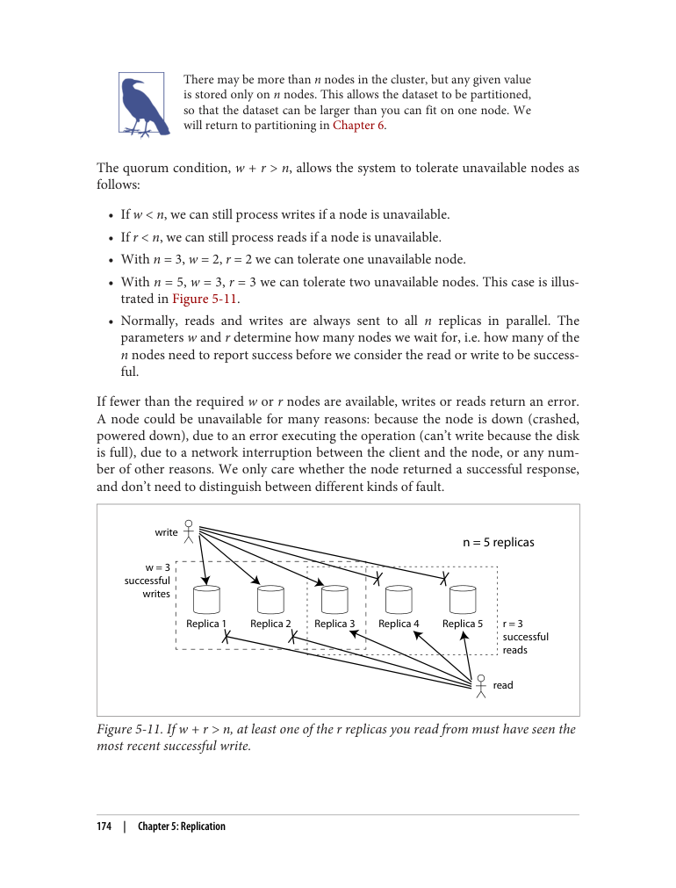

```mermaid
flowchart LR
    W["Thao tác ghi (write)<br/>w = 3 ghi thành công"]
    R["Thao tác đọc (read)<br/>r = 3 đọc thành công"]

    subgraph Replicas["n = 5 bản sao (replicas)"]
        R1["Replica 1<br/>(Nhận được Write)"]
        R2["Replica 2<br/>(Nhận được Write)"]
        R3["Replica 3<br/>(ĐIỂM GIAO NHAU:<br/>Có cả Write & Read mới nhất)"]
        R4["Replica 4<br/>(Chỉ có Read - Dữ liệu cũ)"]
        R5["Replica 5<br/>(Chỉ có Read - Dữ liệu cũ)"]
    end

    W ==> R1
    W ==> R2
    W ==> R3
    W -.->|"Lỗi / Chậm"| R4

    R3 <== R
    R4 <== R
    R5 <== R
    R2 -.-x|"Lỗi / Chậm"| R
```

---

### Những hạn chế của tính nhất quán theo túc số (Limitations of quorum consistency)

Nếu bạn có $n$ bản sao, và chọn $w$ cùng $r$ sao cho $w + r > n$, nhìn chung bạn có thể kỳ vọng mọi thao tác đọc đều trả về giá trị gần đây nhất được ghi cho một khóa. Điều này là bởi vì tập hợp các nút mà bạn đã ghi vào và tập hợp các nút mà bạn đọc từ đó bắt buộc phải giao nhau (overlap), tức là phải có ít nhất một nút chứa giá trị mới nhất (như được minh họa trong **Hình 5-11**). Tuy nhiên, như chúng ta sẽ thấy, vẫn có những trường hợp biên (edge cases) mà điều này không còn đúng nữa.

Bạn cũng có thể đặt $w$ và $r$ thành những con số nhỏ hơn, sao cho $w + r \le n$. Trong trường hợp này, các thao tác đọc và ghi vẫn sẽ được gửi tới $n$ nút, nhưng chỉ cần một số lượng phản hồi thành công nhỏ hơn để thao tác được coi là thành công.

Với $w$ và $r$ nhỏ hơn, bạn có nhiều khả năng đọc phải các giá trị cũ hơn, bởi vì có khả năng cao hơn là thao tác đọc của bạn không bao gồm nút đang giữ giá trị mới nhất. Ở mặt tích cực, cấu hình này cho phép đạt độ trễ thấp hơn và tính sẵn sàng (availability) cao hơn: nếu có sự cố gián đoạn mạng và nhiều bản sao trở nên không thể tiếp cận được, sẽ có cơ hội cao hơn để bạn tiếp tục xử lý được các thao tác đọc và ghi. Chỉ sau khi số lượng bản sao có thể tiếp cận được tụt xuống dưới mức $w$ hoặc $r$, cơ sở dữ liệu mới trở nên không khả dụng cho việc ghi hoặc đọc tương ứng.

Tuy nhiên, ngay cả khi $w + r > n$, vẫn có khả năng xảy ra các trường hợp biên mà trong đó các giá trị cũ bị trả về. Những trường hợp này phụ thuộc vào bản cài đặt cụ thể, nhưng các kịch bản có thể xảy ra bao gồm:

* Nếu một *túc số lỏng lẻo* (*sloppy quorum*) được sử dụng (xem mục [“Túc số lỏng lẻo và chuyển giao có gợi ý (Sloppy quorums and hinted handoff)”](#túc-số-lỏng-lẻo-và-chuyển-giao-có-gợi-ý-sloppy-quorums-and-hinted-handoff) ở trang 177), $w$ thao tác ghi có thể kết thúc trên các nút khác với $r$ thao tác đọc, vì vậy không còn sự đảm bảo giao nhau giữa $r$ nút đọc và $w$ nút ghi nữa [41].
* Nếu hai thao tác ghi xảy ra đồng thời, sẽ không rõ thao tác nào diễn ra trước. Trong trường hợp này, giải pháp an toàn duy nhất là hợp nhất các thao tác ghi đồng thời đó (xem mục [“Xử lý xung đột ghi (Handling write conflicts)”](#xử-lý-xung-đột-ghi-handling-write-conflicts) ở trang 164). Nếu người chiến thắng được chọn dựa trên một nhãn thời gian (*last write wins*), các thao tác ghi có thể bị mất do sự lệch đồng hồ (*clock skew*) [30]. Chúng ta sẽ quay lại chủ đề này trong mục [“Phát hiện các thao tác ghi đồng thời (Detecting concurrent writes)”](#phát-hiện-các-thao-tác-ghi-đồng-thời-detecting-concurrent-writes) ở trang 178.
* Nếu một thao tác ghi diễn ra đồng thời với một thao tác đọc, thao tác ghi đó có thể mới chỉ được phản ánh trên một số bản sao. Trong trường hợp này, việc thao tác đọc trả về giá trị cũ hay giá trị mới là không xác định (undetermined).
* Nếu một thao tác ghi thành công trên một số bản sao nhưng lại thất bại trên các bản sao khác (ví dụ vì ổ đĩa trên một số nút đã đầy), và tổng thể số bản sao ghi thành công ít hơn $w$, thao tác ghi đó *không* được hoàn tác (rolled back) trên những bản sao mà nó đã thành công. Điều này có nghĩa là ngay cả khi một thao tác ghi được báo cáo là thất bại cho ứng dụng khách, các thao tác đọc tiếp theo sau đó vẫn có thể trả về (hoặc không trả về) giá trị từ thao tác ghi thất bại đó [42].
* Nếu một nút đang mang giá trị mới bị sập, và dữ liệu của nó được khôi phục từ một bản sao đang mang giá trị cũ, số lượng bản sao lưu trữ giá trị mới có thể tụt xuống dưới mức $w$, làm phá vỡ điều kiện túc số.
* Ngay cả khi mọi thứ đều đang hoạt động hoàn toàn đúng đắn, vẫn có những trường hợp biên mà bạn có thể gặp xui xẻo về mặt thời điểm (timing), như chúng ta sẽ thấy trong mục “Tính khả tuần tự và túc số (Linearizability and quorums)” ở Chương 9, trang 324.

Do đó, mặc dù các túc số có vẻ như đảm bảo rằng một thao tác đọc sẽ trả về giá trị được ghi mới nhất, nhưng trong thực tế mọi chuyện không đơn giản như vậy. Các cơ sở dữ liệu kiểu Dynamo nhìn chung được tối ưu hóa cho các trường hợp sử dụng có thể chấp nhận sự nhất quán cuối cùng (eventual consistency). Các tham số $w$ và $r$ cho phép bạn điều chỉnh xác suất đọc phải các giá trị cũ, nhưng sẽ là khôn ngoan nếu không coi chúng là những cam kết tuyệt đối.

Cụ thể, bạn thường không nhận được các cam kết đã thảo luận trong mục “Các vấn đề với độ trễ nhân bản (Problems With Replication Lag)” ở trang 155 (đọc lại dữ liệu của chính mình - *reading your writes*, đọc đơn điệu - *monotonic reads*, hoặc đọc tiền tố nhất quán - *consistent prefix reads*), vì vậy các hiện tượng bất thường đã đề cập trước đó hoàn toàn có thể xảy ra trong các ứng dụng. Những cam kết mạnh mẽ hơn nhìn chung đòi hỏi phải có giao dịch (transactions) hoặc đồng thuận (consensus). Chúng ta sẽ quay lại các chủ đề này trong Chương 7 và Chương 9.

#### Giám sát độ lỗi thời của dữ liệu (Monitoring staleness)

Từ góc độ vận hành, việc giám sát xem cơ sở dữ liệu của bạn có đang trả về các kết quả được cập nhật mới nhất hay không là rất quan trọng. Ngay cả khi ứng dụng của bạn có thể chấp nhận việc đọc phải dữ liệu cũ (stale reads), bạn vẫn cần phải nắm được tình trạng sức khỏe của quá trình nhân bản. Nếu nó bị tụt lại phía sau đáng kể, hệ thống cần phải cảnh báo cho bạn để bạn có thể điều tra nguyên nhân (ví dụ: một sự cố trên mạng hoặc một nút đang bị quá tải).

Đối với nhân bản dựa trên nút dẫn đầu, cơ sở dữ liệu thường cung cấp các chỉ số đo lường (metrics) về độ trễ nhân bản, thứ mà bạn có thể đưa vào hệ thống giám sát. Điều này khả thi bởi vì các thao tác ghi được áp dụng vào nút dẫn đầu và các nút theo sau theo cùng một thứ tự, và mỗi nút đều có một vị trí (offset) trong nhật ký nhân bản (số lượng các thao tác ghi mà nó đã áp dụng cục bộ). Bằng cách lấy vị trí hiện tại của nút dẫn đầu trừ đi vị trí hiện tại của một nút theo sau, bạn có thể đo lường được mức độ trễ nhân bản.

Tuy nhiên, trong các hệ thống sử dụng nhân bản không nút dẫn đầu, không có một thứ tự cố định nào mà các thao tác ghi được áp dụng, điều này khiến việc giám sát trở nên khó khăn hơn nhiều. Hơn nữa, nếu cơ sở dữ liệu chỉ sử dụng cơ chế sửa chữa khi đọc (read repair) mà không có tiến trình chống phân rã (anti-entropy), sẽ không có giới hạn nào cho việc một giá trị có thể cũ đến mức nào — nếu một giá trị rất ít khi được đọc, giá trị được trả về bởi một bản sao lỗi thời có thể đã có từ thời "cổ đại".

Đã có một số nghiên cứu về việc đo lường độ lỗi thời của bản sao trong các cơ sở dữ liệu nhân bản không nút dẫn đầu, và dự đoán tỷ lệ phần trăm đọc phải dữ liệu cũ dự kiến phụ thuộc vào các tham số $n, w$ và $r$ [43] (chẳng hạn như mô hình **PBS — Probabilistically Bounded Staleness**). Đáng tiếc là điều này hiện vẫn chưa trở thành thông lệ phổ biến, nhưng sẽ rất tốt nếu đưa các phép đo độ lỗi thời vào bộ chỉ số tiêu chuẩn cho các cơ sở dữ liệu. Tính nhất quán cuối cùng (eventual consistency) là một sự đảm bảo cố tình được định nghĩa mơ hồ, nhưng để vận hành tốt hệ thống, việc có thể định lượng được chữ “cuối cùng” (eventual) đó là vô cùng quan trọng.

---

### Túc số lỏng lẻo và chuyển giao có gợi ý (Sloppy quorums and hinted handoff)

Các cơ sở dữ liệu với các túc số được cấu hình phù hợp có thể chịu đựng được sự cố của từng nút riêng lẻ mà không cần tới quá trình chuyển đổi dự phòng (failover). Chúng cũng có thể chịu đựng được việc từng nút riêng lẻ hoạt động chậm lại, bởi vì các yêu cầu không cần phải đợi tất cả $n$ nút phản hồi — chúng có thể trả về kết quả ngay khi có $w$ hoặc $r$ nút đã phản hồi. Những đặc tính này làm cho các cơ sở dữ liệu có nhân bản không nút dẫn đầu trở nên hấp dẫn đối với các trường hợp sử dụng đòi hỏi tính sẵn sàng cao, độ trễ thấp và có thể chấp nhận việc thỉnh thoảng đọc phải dữ liệu cũ.

Tuy nhiên, các túc số (như đã mô tả cho đến nay) vẫn chưa có khả năng chịu lỗi tốt nhất có thể. Một sự cố gián đoạn mạng có thể dễ dàng cắt đứt kết nối của một ứng dụng khách khỏi một số lượng lớn các nút cơ sở dữ liệu. Mặc dù những nút đó vẫn đang sống, và các ứng dụng khách khác vẫn có thể kết nối tới chúng, nhưng đối với một ứng dụng khách bị cắt đứt khỏi các nút cơ sở dữ liệu đó thì chúng chẳng khác nào đã chết. Trong tình huống này, rất có khả năng chỉ còn lại ít hơn $w$ hoặc $r$ nút có thể tiếp cận được, vì vậy ứng dụng khách không thể đạt được một túc số nữa.

Trong một cụm lớn (với số lượng nút lớn hơn đáng kể so với $n$), nhiều khả năng ứng dụng khách vẫn có thể kết nối tới *một số* nút cơ sở dữ liệu trong lúc xảy ra gián đoạn mạng, chỉ là không kết nối được tới những nút mà nó cần để tập hợp đủ một túc số cho một giá trị cụ thể. Trong trường hợp đó, những người thiết kế cơ sở dữ liệu phải đối mặt với một sự đánh đổi (trade-off):

* Sẽ tốt hơn nếu trả về lỗi cho tất cả các yêu cầu mà chúng ta không thể đạt được túc số gồm $w$ hoặc $r$ nút?
* Hay chúng ta cứ nên chấp nhận các thao tác ghi bằng mọi giá, và ghi chúng vào một số nút đang tiếp cận được nhưng không nằm trong số $n$ nút mà giá trị đó thường trú ngụ?

Phương án thứ hai được gọi là một *túc số lỏng lẻo* (*sloppy quorum*) [32]: các thao tác ghi và đọc vẫn yêu cầu $w$ và $r$ phản hồi thành công, nhưng những phản hồi đó có thể bao gồm các nút không nằm trong số $n$ nút “nhà” (home nodes) được chỉ định cho một giá trị. Để dễ hình dung bằng một phép ẩn dụ: nếu bạn vô tình tự nhốt mình bên ngoài ngôi nhà của bạn, bạn có thể gõ cửa nhà hàng xóm và hỏi xem liệu bạn có thể ngủ nhờ trên ghế sofa của họ tạm thời hay không.

Một khi sự cố gián đoạn mạng được khắc phục, bất kỳ thao tác ghi nào mà một nút đã tạm thời chấp nhận thay mặt cho một nút khác sẽ được gửi trả về các nút “nhà” thích hợp. Quá trình này được gọi là *chuyển giao có gợi ý* (*hinted handoff*). (Một khi bạn tìm lại được chìa khóa vào nhà của mình, người hàng xóm sẽ lịch sự đề nghị bạn rời khỏi ghế sofa của họ và trở về nhà của mình.)

Các túc số lỏng lẻo đặc biệt hữu ích để làm tăng tính sẵn sàng cho việc ghi (write availability): miễn là có bất kỳ $w$ nút nào khả dụng trong toàn cụm, cơ sở dữ liệu vẫn có thể chấp nhận các thao tác ghi. Tuy nhiên, điều này có nghĩa là ngay cả khi $w + r > n$, bạn cũng không thể chắc chắn rằng mình sẽ đọc được giá trị mới nhất cho một khóa, bởi vì giá trị mới nhất có thể đã được ghi tạm thời vào một số nút nằm ngoài tập $n$ nút chính thức [42].

Do đó, một túc số lỏng lẻo thực chất không phải là một túc số theo nghĩa truyền thống chút nào. Nó chỉ là một sự đảm bảo về độ bền vững (durability), cụ thể là dữ liệu đã được lưu trữ trên $w$ nút ở một nơi nào đó. Không có gì đảm bảo rằng một thao tác đọc trên $r$ nút sẽ nhìn thấy dữ liệu đó cho đến khi quá trình chuyển giao có gợi ý (hinted handoff) hoàn tất.

Túc số lỏng lẻo là tính năng tùy chọn trong tất cả các bản cài đặt Dynamo phổ biến. Trong Riak, chúng được bật theo mặc định, còn trong Cassandra và Voldemort thì chúng bị tắt theo mặc định [41, 44, 45]. (Lưu ý: Trong Cassandra, ngay cả khi không dùng sloppy quorum, cơ chế *hinted handoff* vẫn thường được bật để nút điều phối lưu tạm các bản ghi hộ cho nút bị sập trong vài giờ).

#### Vận hành đa trung tâm dữ liệu (Multi-datacenter operation)

Trước đó chúng ta đã thảo luận về việc nhân bản liên trung tâm dữ liệu như một trường hợp sử dụng cho nhân bản đa nút dẫn đầu (xem mục [“Nhân bản đa nút dẫn đầu (Multi-leader replication)”](#nhân-bản-đa-nút-dẫn-đầu-multi-leader-replication) ở trang 161). Nhân bản không nút dẫn đầu cũng rất phù hợp cho việc vận hành đa trung tâm dữ liệu, bởi vì ngay từ đầu nó đã được thiết kế để chịu đựng các thao tác ghi đồng thời xung đột nhau, các sự cố gián đoạn mạng và các đợt tăng vọt độ trễ.

Cassandra và Voldemort hiện thực hóa việc hỗ trợ đa trung tâm dữ liệu ngay bên trong mô hình không nút dẫn đầu thông thường: tổng số bản sao $n$ bao gồm các nút ở tất cả các trung tâm dữ liệu, và trong phần cấu hình bạn có thể chỉ định rõ bạn muốn có bao nhiêu bản sao trong tổng số $n$ bản sao đó được đặt tại mỗi trung tâm dữ liệu. Mỗi thao tác ghi từ một ứng dụng khách sẽ được gửi tới tất cả các bản sao bất kể trung tâm dữ liệu nào, nhưng ứng dụng khách thường chỉ đợi xác nhận từ một túc số các nút bên trong trung tâm dữ liệu cục bộ của chính nó (ví dụ `LOCAL_QUORUM` trong Cassandra), nhờ đó nó không bị ảnh hưởng bởi sự chậm trễ và gián đoạn trên đường liên kết liên trung tâm dữ liệu. Các thao tác ghi có độ trễ cao hơn tới các trung tâm dữ liệu khác thường được cấu hình để diễn ra một cách bất đồng bộ, mặc dù có một sự linh hoạt nhất định trong cách cấu hình [45, 46].

Riak giữ tất cả hoạt động giao tiếp giữa ứng dụng khách và các nút cơ sở dữ liệu diễn ra cục bộ trong phạm vi một trung tâm dữ liệu, vì vậy $n$ mô tả số lượng bản sao bên trong một trung tâm dữ liệu. Việc nhân bản liên trung tâm dữ liệu giữa các cụm cơ sở dữ liệu diễn ra bất đồng bộ ở chế độ nền, theo một phong cách tương tự như nhân bản đa nút dẫn đầu [47].

---

### Phát hiện các thao tác ghi đồng thời (Detecting concurrent writes)

Các cơ sở dữ liệu kiểu Dynamo cho phép nhiều ứng dụng khách ghi đồng thời vào cùng một khóa, đồng nghĩa với việc các xung đột chắc chắn sẽ xảy ra, ngay cả khi các túc số nghiêm ngặt (strict quorums) được sử dụng. Tình huống này tương tự như nhân bản đa nút dẫn đầu (xem mục [“Xử lý xung đột ghi (Handling write conflicts)”](#xử-lý-xung-đột-ghi-handling-write-conflicts) ở trang 164), mặc dù trong các cơ sở dữ liệu kiểu Dynamo, xung đột còn có thể phát sinh trong quá trình sửa chữa khi đọc (read repair) hoặc chuyển giao có gợi ý (hinted handoff).

Vấn đề nằm ở chỗ các sự kiện có thể đến theo một thứ tự khác nhau tại các nút khác nhau, do độ trễ mạng biến thiên và các lỗi cục bộ (partial failures). Ví dụ, **Hình 5-12** cho thấy hai ứng dụng khách, A và B, đồng thời ghi vào một khóa `X` trong một kho dữ liệu gồm ba nút:

* **Nút 1 (Node 1)** nhận được thao tác ghi từ A, nhưng không bao giờ nhận được thao tác ghi từ B do một sự cố mất kết nối thoáng qua (transient outage).
* **Nút 2 (Node 2)** trước tiên nhận được thao tác ghi từ A, sau đó nhận được thao tác ghi từ B.
* **Nút 3 (Node 3)** trước tiên nhận được thao tác ghi từ B, sau đó mới nhận được thao tác ghi từ A.

**Hình 5-12 – Các thao tác ghi đồng thời trong một kho dữ liệu kiểu Dynamo: không có một thứ tự được định nghĩa rõ ràng (Figure 5-12. Concurrent writes in a Dynamo-style datastore: there is no well-defined ordering.)**

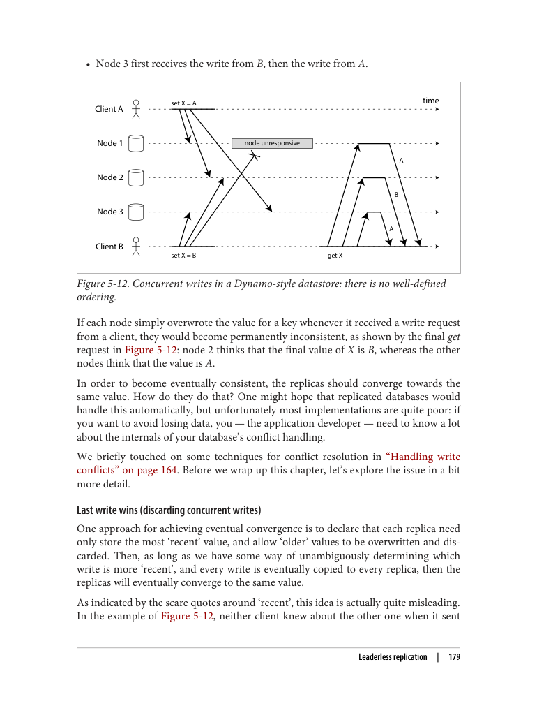

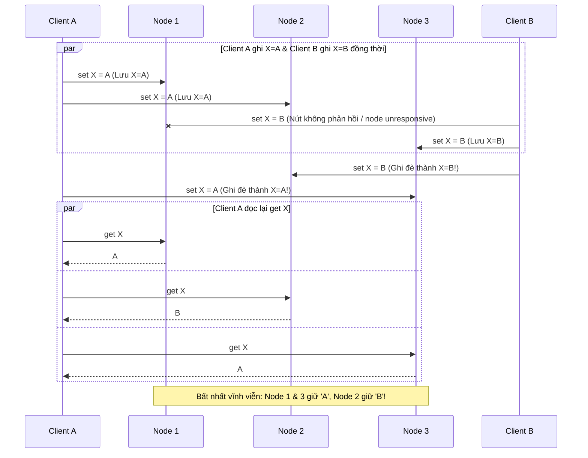

Nếu mỗi nút chỉ đơn giản ghi đè giá trị cho một khóa bất cứ khi nào nó nhận được một yêu cầu ghi từ ứng dụng khách, chúng sẽ trở nên không nhất quán vĩnh viễn, như được thể hiện bởi yêu cầu `get` cuối cùng trong **Hình 5-12**: nút 2 nghĩ rằng giá trị cuối cùng của `X` là `B`, trong khi các nút khác lại nghĩ rằng giá trị là `A`.

Để đạt được sự nhất quán cuối cùng (eventually consistent), các bản sao cần phải hội tụ về cùng một giá trị. Làm thế nào để chúng thực hiện được điều đó? Người ta có thể hy vọng rằng các cơ sở dữ liệu nhân bản sẽ tự động xử lý việc này, nhưng đáng tiếc là hầu hết các bản cài đặt đều làm khá tệ: nếu bạn muốn tránh mất mát dữ liệu, bạn — người lập trình viên ứng dụng — cần phải hiểu biết rất nhiều về cơ chế xử lý xung đột bên trong cơ sở dữ liệu của mình.

Chúng ta đã lướt qua một số kỹ thuật giải quyết xung đột trong mục [“Xử lý xung đột ghi (Handling write conflicts)”](#xử-lý-xung-đột-ghi-handling-write-conflicts) ở trang 164. Trước khi khép lại chương này, hãy cùng khám phá vấn đề này một cách chi tiết hơn.

#### Ghi sau cùng thắng — loại bỏ các thao tác ghi đồng thời (Last write wins — discarding concurrent writes)

Một cách tiếp cận để đạt được sự hội tụ cuối cùng là tuyên bố rằng mỗi bản sao chỉ cần lưu trữ giá trị ‘gần đây’ nhất, và cho phép các giá trị ‘cũ hơn’ bị ghi đè và loại bỏ. Khi đó, miễn là chúng ta có một cách thức rõ ràng, không nhập nhằng để xác định xem thao tác ghi nào là ‘gần đây’ hơn, và mọi thao tác ghi cuối cùng đều được sao chép tới mọi bản sao, thì các bản sao cuối cùng sẽ hội tụ về cùng một giá trị.

Như được ngụ ý bởi dấu ngoặc kép quanh chữ ‘gần đây’, ý tưởng này thực chất khá dễ gây hiểu lầm. Trong ví dụ ở **Hình 5-12**, không ứng dụng khách nào biết về ứng dụng khách kia khi nó gửi các yêu cầu ghi tới các nút cơ sở dữ liệu, vì vậy không rõ thao tác nào đã diễn ra trước. Trên thực tế, việc nói rằng một trong hai thao tác diễn ra “trước” là không thực sự có ý nghĩa: chúng ta nói rằng hai thao tác ghi này là *đồng thời* (*concurrent*), vì vậy thứ tự của chúng là không xác định.

Mặc dù các thao tác ghi không có một thứ tự tự nhiên, chúng ta vẫn có thể ép buộc một thứ tự tùy ý lên chúng. Ví dụ, chúng ta có thể đính kèm một nhãn thời gian (timestamp) vào mỗi thao tác ghi, chọn nhãn thời gian lớn nhất làm giá trị ‘gần đây’ nhất, và loại bỏ bất kỳ thao tác ghi nào có nhãn thời gian nhỏ hơn. Thuật toán giải quyết xung đột này, được gọi là *ghi sau cùng thắng* (*last write wins* — LWW), là phương pháp giải quyết xung đột duy nhất được hỗ trợ trong Cassandra [48], và là một tính năng tùy chọn trong Riak [30].

LWW đạt được mục tiêu hội tụ cuối cùng, nhưng phải trả giá bằng *độ bền vững* (*durability*): nếu có một vài thao tác ghi đồng thời vào cùng một khóa, ngay cả khi tất cả chúng đều được báo cáo là thành công cho ứng dụng khách (bởi vì chúng đã được ghi lên $w$ bản sao), thì chỉ duy nhất một trong các thao tác ghi đó sẽ sống sót và các thao tác ghi còn lại sẽ bị loại bỏ một cách âm thầm (silently discarded). Hơn nữa, LWW thậm chí có thể làm rơi rớt cả những thao tác ghi *không hề* diễn ra đồng thời, như chúng ta sẽ thảo luận trong mục “Sử dụng nhãn thời gian để sắp xếp thứ tự sự kiện (Timestamps for ordering events)” ở Chương 8, trang 283.

Có một số tình huống, chẳng hạn như lưu bộ nhớ đệm (caching), mà việc mất mát các thao tác ghi có lẽ là chấp nhận được. Nếu việc mất dữ liệu là không thể chấp nhận được, LWW là một lựa chọn tồi tệ để giải quyết xung đột.

Cách duy nhất an toàn để sử dụng một cơ sở dữ liệu dùng LWW là đảm bảo rằng một khóa chỉ được ghi duy nhất một lần, và sau đó được coi là bất biến (immutable), qua đó tránh được mọi cập nhật đồng thời lên cùng một khóa. Ví dụ, một cách sử dụng Cassandra được khuyến nghị là sử dụng một UUID làm khóa, nhờ đó cấp cho mỗi thao tác ghi một khóa hoàn toàn duy nhất [48].

#### Mối quan hệ “xảy-ra-trước” và tính đồng thời (The “happens-before” relationship and concurrency)

Làm thế nào để chúng ta quyết định xem hai thao tác có phải là đồng thời hay không? Để hình thành trực giác, hãy xem xét một số ví dụ:

* Trong **Hình 5-9**, hai thao tác ghi *không phải* là đồng thời: thao tác chèn (insert) của A *xảy ra trước* (*happens before*) thao tác tăng giá trị (increment) của B, bởi vì giá trị được tăng bởi B chính là giá trị đã được chèn bởi A. Nói cách khác, thao tác của B được xây dựng dựa trên thao tác của A, vì vậy thao tác của B chắc chắn phải diễn ra muộn hơn. Chúng ta cũng nói rằng B *phụ thuộc nhân quả* (*causally dependent*) vào A.
* Mặt khác, hai thao tác ghi trong **Hình 5-12** là *đồng thời* (*concurrent*): khi mỗi ứng dụng khách bắt đầu thao tác, nó hoàn toàn không biết rằng một ứng dụng khách khác cũng đang thực hiện một thao tác trên cùng khóa đó. Do đó, không có sự phụ thuộc nhân quả nào giữa hai thao tác này.

Một thao tác A *xảy ra trước* một thao tác B khác nếu B biết về A, hoặc phụ thuộc vào A, hoặc được xây dựng dựa trên A theo một cách nào đó. Việc một thao tác có xảy ra trước một thao tác khác hay không chính là chìa khóa để định nghĩa *tính đồng thời* (*concurrency*) có nghĩa là gì. Trên thực tế, chúng ta có thể nói một cách đơn giản rằng hai thao tác là *đồng thời* nếu không thao tác nào xảy ra trước thao tác kia (tức là không bên nào biết về bên nào) [49].

Do đó, bất cứ khi nào bạn có hai thao tác A và B, luôn có đúng ba khả năng: hoặc A xảy ra trước B, hoặc B xảy ra trước A, hoặc A và B là đồng thời với nhau. Thứ chúng ta cần là một thuật toán để cho chúng ta biết liệu hai thao tác có đồng thời hay không. Nếu một thao tác xảy ra trước một thao tác khác, thao tác diễn ra sau nên ghi đè lên thao tác diễn ra trước; nhưng nếu hai thao tác là đồng thời, chúng ta có một xung đột cần phải được giải quyết.

> **Tính đồng thời, thời gian và thuyết tương đối (Concurrency, time, and relativity)**
>
> Có vẻ như hai thao tác nên được gọi là đồng thời nếu chúng xảy ra “cùng một lúc” — nhưng trên thực tế, việc chúng có thực sự chồng lấp nhau về mặt thời gian vật lý hay không lại không hề quan trọng. Do những vấn đề với đồng hồ trong các hệ thống phân tán, thực sự rất khó để biết liệu hai sự việc có diễn ra vào cùng một thời điểm theo nghĩa đen hay không — một vấn đề mà chúng ta sẽ thảo luận chi tiết hơn trong Chương 8.
>
> Để định nghĩa tính đồng thời, thời gian chính xác không quan trọng: chúng ta chỉ đơn giản gọi hai thao tác là *đồng thời* nếu cả hai đều không hề hay biết về nhau, bất kể thời gian vật lý mà chúng xảy ra là lúc nào. Người ta đôi khi liên hệ nguyên lý này với thuyết tương đối hẹp (special theory of relativity) trong vật lý [49], vốn đưa ra ý tưởng rằng thông tin không thể di chuyển nhanh hơn tốc độ ánh sáng. Hệ quả là, hai sự kiện xảy ra cách nhau một khoảng cách nhất định không thể nào tác động lẫn nhau nếu khoảng thời gian giữa hai sự kiện ngắn hơn thời gian ánh sáng cần để đi hết khoảng cách giữa chúng.
>
> Trong các hệ thống máy tính, hai thao tác có thể là đồng thời ngay cả khi tốc độ ánh sáng về nguyên tắc đã cho phép thao tác này ảnh hưởng đến thao tác kia. Ví dụ, nếu mạng bị chậm hoặc bị gián đoạn vào thời điểm đó, hai thao tác có thể xảy ra cách nhau một khoảng thời gian đáng kể nhưng vẫn là đồng thời, bởi vì sự cố mạng đã ngăn cản thao tác này biết được về sự tồn tại của thao tác kia.

#### Theo dõi các mối quan hệ xảy-ra-trước (Tracking happens-before relationships)

Hãy cùng xem xét một thuật toán giúp xác định xem hai thao tác là đồng thời, hay thao tác này đã xảy ra trước thao tác kia. Để giữ cho mọi thứ đơn giản, hãy bắt đầu với một cơ sở dữ liệu chỉ có duy nhất một bản sao. Một khi chúng ta đã tìm ra cách thực hiện việc này trên một bản sao đơn lẻ, chúng ta có thể tổng quát hóa cách tiếp cận này cho một cơ sở dữ liệu không nút dẫn đầu với nhiều bản sao.

**Hình 5-13** cho thấy hai ứng dụng khách đồng thời thêm các món hàng vào một giỏ hàng mua sắm (shopping cart). Ban đầu, giỏ hàng trống rỗng. Giữa hai ứng dụng khách này, chúng thực hiện tổng cộng năm thao tác ghi vào cơ sở dữ liệu:

1. **Ứng dụng khách 1 (Client 1)** thêm `milk` (sữa) vào giỏ hàng. Đây là thao tác ghi đầu tiên vào khóa đó, vì vậy máy chủ lưu trữ nó thành công và gán cho nó phiên bản `1` (`version 1`). Máy chủ cũng phản hồi lại giá trị đó cho ứng dụng khách, kèm theo số hiệu phiên bản `1`.
2. **Ứng dụng khách 2 (Client 2)** thêm `eggs` (trứng) vào giỏ hàng, mà không hề biết rằng Client 1 đã đồng thời thêm `milk` (Client 2 nghĩ rằng món `eggs` của nó là món hàng duy nhất trong giỏ). Máy chủ gán `version 2` cho `eggs`, và lưu trữ `eggs` cùng `milk` như hai giá trị riêng biệt. Sau đó, nó trả về cả hai giá trị cho ứng dụng khách, kèm theo số hiệu phiên bản là `2`.
3. **Ứng dụng khách 1**, không hề hay biết về thao tác ghi của Client 2, muốn thêm `flour` (bột mì) vào giỏ hàng, vì vậy nó nghĩ rằng nội dung giỏ hàng hiện tại phải là `[milk, flour]`. Nó gửi giá trị này tới máy chủ, kèm theo số hiệu phiên bản `1` mà máy chủ đã cấp cho Client 1 trước đó. Máy chủ có thể nhận biết từ số hiệu phiên bản rằng thao tác ghi `[milk, flour]` thay thế cho giá trị `[milk]` trước đó, nhưng lại *đồng thời* với `[eggs]`. Do đó, máy chủ gán `version 3` cho `[milk, flour]`, ghi đè lên giá trị `version 1` là `[milk]`, nhưng vẫn giữ lại giá trị `version 2` là `[eggs]`, và trả về cả hai giá trị còn lại cho ứng dụng khách.
4. Trong lúc đó, **Ứng dụng khách 2** muốn thêm `ham` (thịt nguội) vào giỏ hàng, mà không biết rằng Client 1 vừa mới thêm `flour`. Client 2 đã nhận được hai giá trị `[milk]` và `[eggs]` từ máy chủ trong lần phản hồi trước, vì vậy ứng dụng khách bây giờ hợp nhất (merge) các giá trị đó lại và thêm `ham` vào để tạo thành một giá trị mới là `[eggs, milk, ham]`. Nó gửi giá trị đó tới máy chủ, kèm theo số hiệu phiên bản trước đó là `2`. Máy chủ phát hiện ra rằng thao tác dựa trên `version 2` này sẽ ghi đè lên `[eggs]`, nhưng lại đồng thời với `[milk, flour]`, vì vậy hai giá trị còn lại là `[milk, flour]` với `version 3`, và `[eggs, milk, ham]` với `version 4`.
5. Cuối cùng, **Ứng dụng khách 1** muốn thêm `bacon` (thịt xông khói). Trước đó nó đã nhận được `[milk, flour]` và `[eggs]` từ máy chủ ở `version 3`, vì vậy nó hợp nhất chúng lại, thêm `bacon`, và gửi giá trị cuối cùng `[milk, flour, eggs, bacon]` tới máy chủ, kèm theo số hiệu phiên bản trước đó là `3`. Thao tác này ghi đè lên `[milk, flour]` (lưu ý rằng `[eggs]` đã được ghi đè ở bước trước rồi), nhưng lại đồng thời với `[eggs, milk, ham]`, vì vậy máy chủ giữ lại hai giá trị đồng thời này.

**Hình 5-13 – Theo dõi các phụ thuộc nhân quả giữa hai ứng dụng khách cùng chỉnh sửa đồng thời một giỏ hàng (Figure 5-13. Tracking causal dependencies between two clients concurrently editing a shopping cart.)**

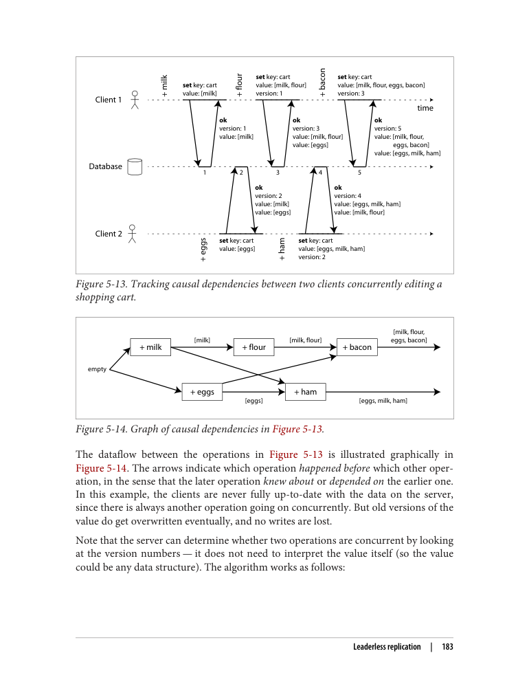

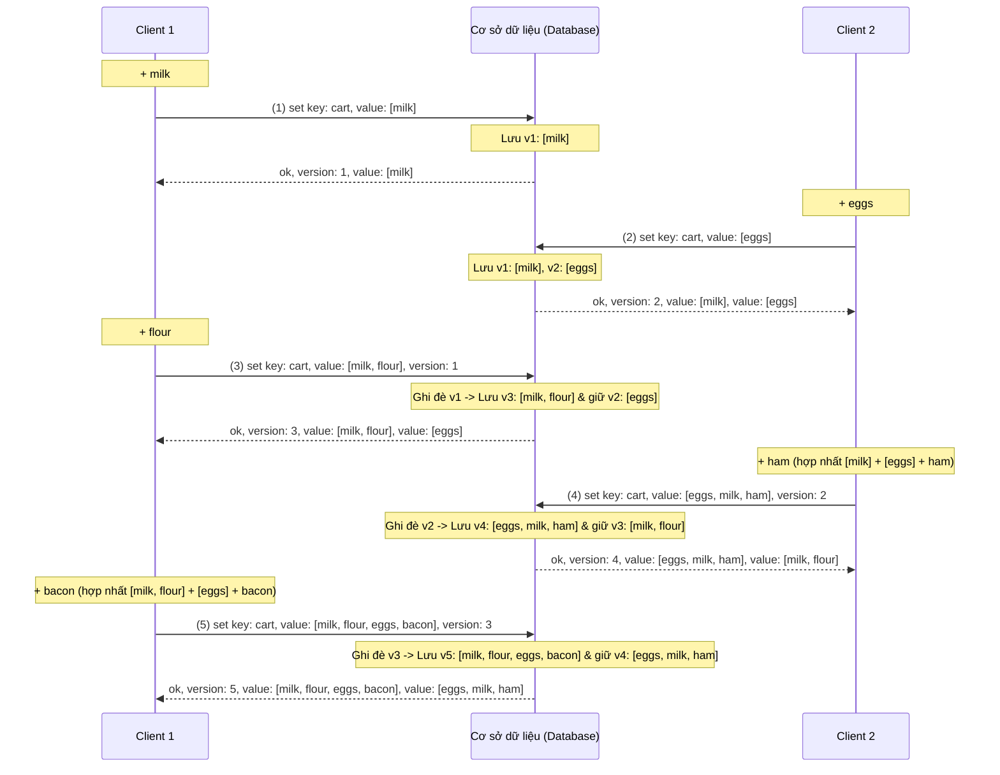

**Hình 5-14 – Đồ thị các sự phụ thuộc nhân quả trong Hình 5-13 (Figure 5-14. Graph of causal dependencies in Figure 5-13.)**


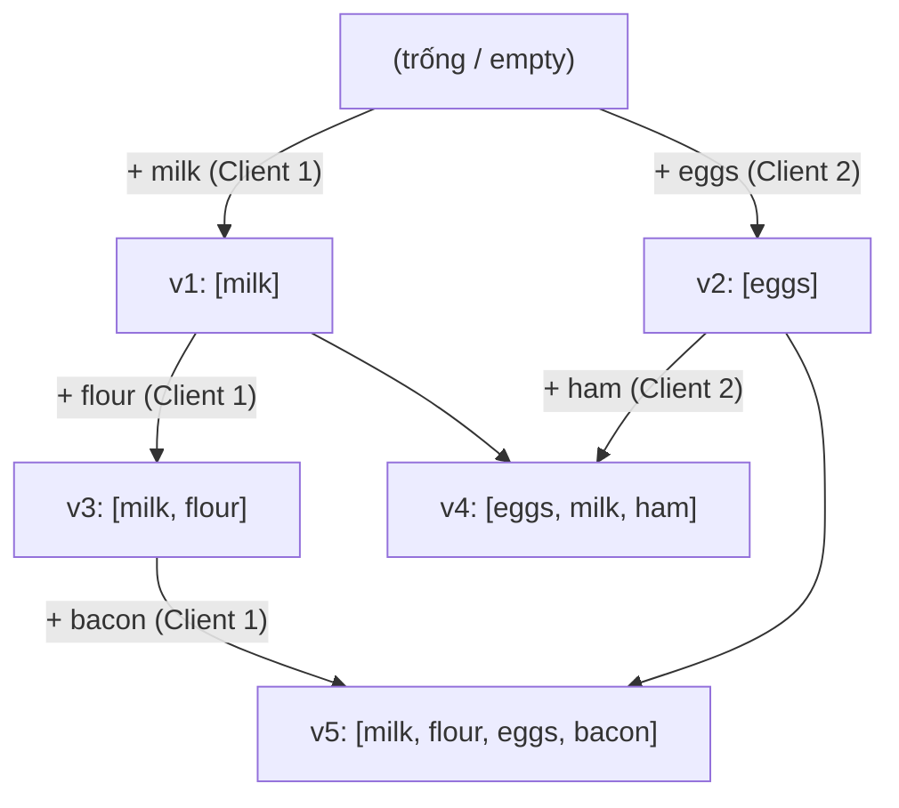

Luồng dữ liệu giữa các thao tác trong **Hình 5-13** được minh họa bằng đồ thị trong **Hình 5-14**. Các mũi tên chỉ ra thao tác nào đã xảy ra trước thao tác nào, theo nghĩa là thao tác diễn ra sau đã biết về hoặc phụ thuộc vào thao tác diễn ra trước. Trong ví dụ này, các ứng dụng khách không bao giờ bắt kịp hoàn toàn với dữ liệu trên máy chủ, bởi vì luôn có một thao tác khác đang diễn ra đồng thời. Nhưng các phiên bản cũ của giá trị cuối cùng đều được ghi đè, và không có thao tác ghi nào bị mất.

Lưu ý rằng máy chủ có thể xác định xem hai thao tác có đồng thời hay không chỉ bằng cách nhìn vào các số hiệu phiên bản — nó không cần phải diễn giải bản thân giá trị đó (vì vậy giá trị có thể là bất kỳ cấu trúc dữ liệu nào). Thuật toán hoạt động như sau:

* Máy chủ duy trì một số hiệu phiên bản cho mọi khóa, tăng số hiệu phiên bản lên mỗi khi khóa đó được ghi, và lưu số hiệu phiên bản mới cùng với giá trị được ghi.
* Khi một ứng dụng khách đọc một khóa, máy chủ trả về tất cả các giá trị chưa bị ghi đè, cũng như số hiệu phiên bản mới nhất. Một ứng dụng khách bắt buộc phải đọc một khóa trước khi ghi.
* Khi một ứng dụng khách ghi một khóa, nó phải đính kèm số hiệu phiên bản từ lần đọc trước đó, và nó phải hợp nhất tất cả các giá trị mà nó đã nhận được trong lần đọc trước đó lại với nhau. (Phản hồi từ một yêu cầu ghi có thể giống như một thao tác đọc, trả về tất cả các giá trị hiện tại, điều này cho phép chúng ta nối chuỗi nhiều thao tác ghi liên tiếp giống như trong ví dụ trên.)
* Khi máy chủ nhận được một thao tác ghi kèm theo một số hiệu phiên bản cụ thể, nó có thể ghi đè lên tất cả các giá trị có số hiệu phiên bản đó hoặc thấp hơn (vì nó biết rằng chúng đã được hợp nhất vào giá trị mới), nhưng nó bắt buộc phải giữ lại tất cả các giá trị có số hiệu phiên bản cao hơn (bởi vì những giá trị đó là đồng thời với thao tác ghi đang gửi tới).

Khi một thao tác ghi bao gồm số hiệu phiên bản từ một lần đọc trước đó, điều đó cho chúng ta biết thao tác ghi này được dựa trên trạng thái trước đó nào. Nếu bạn thực hiện một thao tác ghi mà không đính kèm số hiệu phiên bản, nó sẽ là đồng thời với tất cả các thao tác ghi khác, vì vậy nó sẽ không ghi đè lên bất cứ thứ gì — nó sẽ chỉ được trả về như một trong các phiên bản trong những lần đọc tiếp theo.

#### Hợp nhất các giá trị được ghi đồng thời (Merging concurrently written values)

Thuật toán này đảm bảo rằng không có dữ liệu nào bị rơi rớt một cách âm thầm, nhưng đáng tiếc là nó đòi hỏi các ứng dụng khách phải làm thêm một số công việc: nếu có một vài thao tác diễn ra đồng thời, các ứng dụng khách phải dọn dẹp sau đó bằng cách hợp nhất các giá trị được ghi đồng thời lại với nhau. Riak gọi các giá trị đồng thời này là các *anh chị em* (*siblings*).

Việc hợp nhất các giá trị anh chị em về bản chất giống hệt với bài toán giải quyết xung đột trong nhân bản đa nút dẫn đầu mà chúng ta đã thảo luận trước đó (xem mục [“Xử lý xung đột ghi (Handling write conflicts)”](#xử-lý-xung-đột-ghi-handling-write-conflicts) ở trang 164). Một cách tiếp cận đơn giản là chỉ chọn một trong các giá trị dựa trên số hiệu phiên bản hoặc nhãn thời gian (*last write wins*), nhưng điều đó đồng nghĩa với việc làm mất dữ liệu. Vì vậy, bạn có thể cần phải làm một điều gì đó thông minh hơn trong mã ứng dụng.

Với ví dụ về giỏ hàng mua sắm, một cách tiếp cận hợp lý để hợp nhất các giá trị anh chị em là chỉ cần lấy phép hợp (union) của tập hợp. Trong **Hình 5-14**, hai giá trị anh chị em cuối cùng là `[milk, flour, eggs, bacon]` và `[eggs, milk, ham]` — lưu ý rằng `milk` và `eggs` xuất hiện ở cả hai, mặc dù mỗi món chỉ được ghi một lần. Giá trị sau khi hợp nhất có thể là một thứ gì đó như `[milk, flour, eggs, bacon, ham]`, không có các phần tử trùng lặp.

Tuy nhiên, nếu bạn muốn cho phép mọi người có thể *xóa* các món hàng khỏi giỏ hàng của họ, chứ không chỉ thêm đồ vào, thì việc lấy phép hợp của các giá trị anh chị em có thể không mang lại kết quả đúng: nếu bạn hợp nhất hai giỏ hàng anh chị em, và một món hàng đã bị xóa chỉ ở một trong hai giỏ hàng đó, thì món hàng đã xóa sẽ xuất hiện trở lại trong kết quả phép hợp của hai giá trị anh chị em [32].

Để ngăn chặn điều này, một món hàng không thể chỉ đơn giản bị xóa hẳn khỏi cơ sở dữ liệu khi nó được gỡ bỏ; thay vào đó, hệ thống phải để lại một dấu hiệu đánh dấu (*marker*) với một số hiệu phiên bản thích hợp để chỉ ra rằng món hàng đó đã bị gỡ bỏ khi hợp nhất các giá trị anh chị em. Một dấu hiệu đánh dấu xóa như vậy được gọi là một *bia mộ* (*tombstone*).

Vì việc hợp nhất các giá trị anh chị em trong mã ứng dụng rất phức tạp và dễ xảy ra lỗi, nên có một số nỗ lực nhằm thiết kế các cấu trúc dữ liệu có thể thực hiện việc hợp nhất này một cách tự động, như đã thảo luận trong mục “Giải quyết xung đột tự động (Automatic conflict resolution)” ở trang 167. Ví dụ, tính năng hỗ trợ kiểu dữ liệu của Riak sử dụng một họ cấu trúc dữ liệu có tên là CRDTs [33, 34, 50] có thể tự động hợp nhất các giá trị anh chị em theo những cách hợp lý, bao gồm cả việc bảo toàn các thao tác xóa (chẳng hạn như cấu trúc *OR-Set — Observed-Remove Set*).

#### Vectơ phiên bản (Version vectors)

Ví dụ trong **Hình 5-13** chỉ sử dụng một bản sao duy nhất. Thuật toán sẽ thay đổi như thế nào khi có nhiều bản sao nhưng không có nút dẫn đầu?

**Hình 5-13** sử dụng một số hiệu phiên bản đơn lẻ để theo dõi các sự phụ thuộc giữa các thao tác, nhưng điều đó là không đủ khi có nhiều bản sao cùng chấp nhận các thao tác ghi đồng thời. Thay vào đó, chúng ta cần sử dụng một số hiệu phiên bản *cho mỗi bản sao* (per replica) cũng như *cho mỗi khóa* (per key). Mỗi bản sao sẽ tự tăng số hiệu phiên bản của chính nó khi xử lý một thao tác ghi, và cũng đồng thời theo dõi các số hiệu phiên bản mà nó đã nhìn thấy từ tất cả các bản sao khác. Thông tin này cho biết những giá trị nào cần được ghi đè và những giá trị nào cần được giữ lại dưới dạng các giá trị anh chị em (siblings).

Tập hợp các số hiệu phiên bản từ tất cả các bản sao được gọi là một *vectơ phiên bản* (*version vector*) [51]. Một vài biến thể của ý tưởng này đang được sử dụng, nhưng biến thể thú vị nhất có lẽ là *vectơ phiên bản có dấu chấm* (*dotted version vector*) [52], được sử dụng trong Riak 2.0 [53, 54]. Chúng ta sẽ không đi sâu vào chi tiết, nhưng cách thức nó hoạt động khá tương tự với những gì chúng ta đã thấy trong ví dụ ở trên.

> 
>
> **Vectơ phiên bản và đồng hồ vectơ (Version vectors and vector clocks)**
>
> Một vectơ phiên bản đôi khi còn được gọi là một *đồng hồ vectơ* (*vector clock*). Sự khác biệt giữa hai cấu trúc dữ liệu này khá tinh tế — một cách để nhìn nhận là vectơ phiên bản (version vectors) dùng để theo dõi trạng thái bản sao trong các hệ thống lưu trữ nhân bản, còn đồng hồ vectơ (vector clocks) dùng để sắp xếp thứ tự nhân quả của các sự kiện trong các hệ thống tính toán phân tán ngang hàng. Vui lòng xem tài liệu tham khảo để biết thêm chi tiết [52, 55, 56].

Giống như các số hiệu phiên bản trong **Hình 5-13**, các vectơ phiên bản được gửi từ các bản sao cơ sở dữ liệu tới các ứng dụng khách khi các giá trị được đọc, và cần phải được gửi ngược trở lại cơ sở dữ liệu khi một giá trị được ghi vào sau đó.(Trong Riak, vectơ phiên bản được mã hóa thành một chuỗi mà nó gọi là *ngữ cảnh nhân quả* - *causal context*). Điều này cho phép cơ sở dữ liệu phân biệt giữa các thao tác ghi đè (overwrites) và các thao tác ghi đồng thời (concurrent writes). Ngoài ra, giống như trong ví dụ một bản sao, ứng dụng có thể cần phải hợp nhất các giá trị anh chị em. Cấu trúc vectơ phiên bản đảm bảo rằng việc đọc từ một bản sao và sau đó ghi ngược trở lại một bản sao khác là hoàn toàn an toàn: việc này có thể dẫn đến việc tạo ra các giá trị anh chị em, nhưng sẽ không có dữ liệu nào bị mất miễn là các giá trị anh chị em được hợp nhất một cách chính xác.

> 💡 **Ví dụ bổ sung (không có trong sách):**
> Làm thế nào để so sánh hai Vectơ phiên bản (Version Vectors) $V_A$ và $V_B$ trên 3 bản sao $(R_1, R_2, R_3)$?
> - **Trường hợp 1 (Có quan hệ nhân quả $V_A \to V_B$):** Giả sử $V_A = \{R_1: 2, R_2: 1, R_3: 0\}$ và $V_B = \{R_1: 2, R_2: 2, R_3: 1\}$. Vì mọi phần tử trong $V_B$ đều lớn hơn hoặc bằng phần tử tương ứng trong $V_A$ (và có ít nhất 1 phần tử lớn hơn hẳn), cơ sở dữ liệu kết luận chắc chắn rằng $V_B$ biết về $V_A$ và xảy ra sau $V_A$, nên $V_B$ được phép **ghi đè** hoàn toàn lên $V_A$.
> - **Trường hợp 2 (Xung đột đồng thời $V_A \parallel V_B$):** Giả sử $V_A = \{R_1: \mathbf{3}, R_2: 1, R_3: 0\}$ nhưng $V_B = \{R_1: 2, R_2: \mathbf{2}, R_3: 0\}$. Ở đây $V_A$ có chỉ số tại $R_1$ lớn hơn ($3 > 2$), nhưng $V_B$ lại có chỉ số tại $R_2$ lớn hơn ($2 > 1$). Không vectơ nào lớn hơn hoàn toàn vectơ kia! Cơ sở dữ liệu ngay lập tức phát hiện đây là hai nhánh ghi đồng thời (concurrent writes), lưu giữ cả hai làm *siblings*, và khi hợp nhất sẽ tạo ra vectơ mới bao trùm cả hai: $V_{\text{merged}} = \{R_1: 3, R_2: 2, R_3: 0\}$ (sau đó cộng thêm 1 tại bản sao nhận lệnh ghi hợp nhất).

---

## Tóm tắt (Summary)

Trong chương này, chúng ta đã xem xét vấn đề nhân bản (*replication*), tức là: duy trì một bản sao của cùng một dữ liệu trên nhiều máy chủ khác nhau. Việc nhân bản có thể phục vụ một vài mục đích:

* **Tính sẵn sàng cao (High availability):** Giữ cho hệ thống tiếp tục hoạt động ngay cả khi một máy chủ (hoặc một vài máy chủ, hoặc toàn bộ một trung tâm dữ liệu) gặp sự cố ngừng hoạt động.
* **Hoạt động ngắt kết nối (Disconnected operation):** Cho phép một ứng dụng tiếp tục làm việc khi có sự cố gián đoạn mạng.
* **Độ trễ (Latency):** Đặt dữ liệu ở vị trí địa lý gần với người dùng, nhờ đó người dùng có thể tương tác với dữ liệu nhanh hơn.
* **Khả năng mở rộng (Scalability):** Có khả năng xử lý một khối lượng truy vấn đọc lớn hơn mức mà một máy chủ đơn lẻ có thể gánh vác, bằng cách thực hiện các thao tác đọc trên các bản sao.

Mặc dù có mục tiêu rất đơn giản — giữ một bản sao của cùng một dữ liệu trên một vài máy chủ — nhân bản hóa ra lại là một bài toán cực kỳ hóc búa. Nó đòi hỏi phải suy nghĩ cẩn thận về tính đồng thời (concurrency) cũng như về tất cả những thứ có thể trục trặc, và xử lý những hệ quả của các lỗi đó. Tối thiểu nhất, chúng ta cần phải đối phó với các nút không khả dụng và các sự cố gián đoạn mạng (và đó là còn chưa tính đến những loại lỗi âm ỉ, khó lường hơn, chẳng hạn như lỗi hỏng dữ liệu âm thầm do lỗi phần mềm).

Chúng ta đã thảo luận về ba cách tiếp cận chính đối với việc nhân bản:

1. **Nhân bản đơn nút dẫn đầu (Single-leader replication):** Các ứng dụng khách gửi tất cả các thao tác ghi tới một nút duy nhất (nút dẫn đầu - *leader*), nút này sẽ gửi một dòng sự kiện thay đổi dữ liệu tới các bản sao khác (các nút theo sau - *followers*). Các thao tác đọc có thể được thực hiện trên bất kỳ bản sao nào, nhưng kết quả đọc từ các nút theo sau có thể bị lỗi thời (stale).
2. **Nhân bản đa nút dẫn đầu (Multi-leader replication):** Các ứng dụng khách gửi mỗi thao tác ghi tới một trong số vài nút dẫn đầu, bất kỳ nút dẫn đầu nào cũng có thể chấp nhận các thao tác ghi. Các nút dẫn đầu gửi các dòng sự kiện thay đổi dữ liệu cho nhau, và cho bất kỳ nút theo sau nào.
3. **Nhân bản không nút dẫn đầu (Leaderless replication):** Các ứng dụng khách gửi mỗi thao tác ghi tới một vài nút, và đọc từ một vài nút một cách song song nhằm phát hiện và sửa chữa các nút đang giữ dữ liệu lỗi thời.

Mỗi cách tiếp cận đều có những ưu điểm và nhược điểm riêng. Nhân bản đơn nút dẫn đầu rất phổ biến bởi vì nó khá dễ hiểu và không phải lo lắng về việc giải quyết xung đột. Nhân bản đa nút dẫn đầu và không nút dẫn đầu có thể bền bỉ hơn trước sự hiện diện của các nút bị lỗi, các sự cố gián đoạn mạng và các đợt tăng vọt độ trễ — nhưng cái giá phải trả là khó suy luận hơn rất nhiều, và chỉ cung cấp những cam kết nhất quán rất yếu.

Nhân bản có thể là đồng bộ (synchronous) hoặc bất đồng bộ (asynchronous), điều này có tác động sâu sắc đến hành vi của hệ thống khi có lỗi xảy ra. Mặc dù nhân bản bất đồng bộ có thể rất nhanh khi hệ thống đang vận hành trơn tru, nhưng điều quan trọng là phải tính toán xem chuyện gì sẽ xảy ra khi độ trễ nhân bản (replication lag) tăng lên và các máy chủ bị sập. Nếu một nút dẫn đầu bị lỗi và bạn thăng cấp một nút theo sau được cập nhật bất đồng bộ lên làm nút dẫn đầu mới, dữ liệu vừa mới được cam kết gần đây có thể bị mất.

Chúng ta đã xem xét một số hiệu ứng kỳ lạ có thể gây ra bởi độ trễ nhân bản, và chúng ta đã thảo luận một vài mô hình tính nhất quán hữu ích cho việc quyết định xem một ứng dụng nên hành xử như thế nào dưới tác động của độ trễ nhân bản:

* **Tính nhất quán đọc-sau-khi-ghi (Read-after-write consistency):** Người dùng phải luôn nhìn thấy dữ liệu mà chính họ đã gửi lên.
* **Đọc đơn điệu (Monotonic reads):** Sau khi người dùng đã nhìn thấy dữ liệu tại một thời điểm, họ không bao giờ được phép nhìn thấy dữ liệu từ một thời điểm sớm hơn trước đó trong những lần đọc sau.
* **Đọc tiền tố nhất quán (Consistent prefix reads):** Người dùng phải nhìn thấy dữ liệu ở một trạng thái hợp lý về mặt nhân quả, ví dụ như nhìn thấy một câu hỏi và câu trả lời của nó theo đúng thứ tự.

Cuối cùng, chúng ta đã thảo luận về các vấn đề đồng thời vốn cố hữu trong các phương pháp nhân bản đa nút dẫn đầu và không nút dẫn đầu: bởi vì chúng cho phép nhiều thao tác ghi diễn ra đồng thời, các xung đột có thể xảy ra. Chúng ta đã khảo sát một thuật toán mà cơ sở dữ liệu có thể sử dụng để xác định xem một thao tác có xảy ra trước một thao tác khác hay không, hay chúng đã diễn ra đồng thời. Chúng ta cũng đã đề cập đến các phương pháp giải quyết xung đột bằng cách hợp nhất các bản cập nhật đồng thời lại với nhau.

Trong chương tiếp theo, chúng ta sẽ tiếp tục tìm hiểu về dữ liệu được phân tán trên nhiều máy chủ, thông qua người bạn đồng hành của nhân bản: chia nhỏ một tập dữ liệu khổng lồ thành các phân mảnh (*partitions*).

> 📝 **Giải thích thêm (không có trong sách) – Bảng tổng hợp so sánh 3 mô hình nhân bản:**
>
> | Tiêu chí so sánh | Đơn nút dẫn đầu (Single-Leader) | Đa nút dẫn đầu (Multi-Leader) | Không nút dẫn đầu (Leaderless / Dynamo-style) |
> | :--- | :--- | :--- | :--- |
> | **Điểm tiếp nhận ghi (Writes)** | Duy nhất 1 nút dẫn đầu (Leader). | Nhiều nút dẫn đầu (mỗi DC 1 Leader, hoặc mỗi thiết bị 1 Leader). | Bất kỳ bản sao nào (gửi song song tới $n$ bản sao, chờ $w$ xác nhận). |
> | **Điểm tiếp nhận đọc (Reads)** | Leader hoặc bất kỳ Follower nào. | Leader cục bộ hoặc Follower cục bộ. | Gửi song song tới $n$ bản sao, chờ $r$ bản sao phản hồi. |
> | **Xử lý khi 1 nút ghi bị sập** | Phải thực hiện chuyển đổi dự phòng (*Failover*) để bầu Leader mới. | Các Leader khác vẫn hoạt động bình thường; định tuyến lại nếu cần. | Không cần Failover; chỉ cần số bản sao sống $\ge w$ là ghi thành công. |
> | **Xung đột ghi đồng thời** | Không xảy ra (Leader tuần tự hóa mọi thao tác ghi hoặc dùng khóa giao dịch). | Xảy ra thường xuyên; phải giải quyết bằng LWW, CRDT, hoặc logic tùy chỉnh. | Xảy ra thường xuyên; phát hiện bằng Version Vectors, giải quyết bằng LWW hoặc hợp nhất *siblings*. |
> | **Cơ chế bắt kịp dữ liệu bị lỡ** | Đọc luồng nhật ký nhân bản (*Replication Log* / WAL / Binlog) theo đúng thứ tự. | Truyền luồng sự kiện thay đổi giữa các Leader (theo cấu trúc vòng, sao, hoặc all-to-all). | Sửa chữa khi đọc (*Read repair*), Tiến trình chống phân rã (*Anti-entropy* dùng Merkle tree), và *Hinted handoff*. |
> | **Hệ quản trị tiêu biểu** | PostgreSQL, MySQL, Oracle Data Guard, SQL Server AlwaysOn, MongoDB, Kafka, Raft/etcd. | MySQL Tungsten Replicator, PostgreSQL BDR, Oracle GoldenGate, CouchDB. | Amazon Dynamo, Apache Cassandra, ScyllaDB, Riak KV, Project Voldemort. |

---

## Tài liệu tham khảo (References)

* **[1]** Bruce G Lindsay, Patricia Griffiths Selinger, C Galtieri, et al.: “Notes on Distributed Databases,” IBM Research, Research Report RJ2571(33471), July 1979.
* **[2]** “Oracle Active Data Guard Real-Time Data Protection and Availability.” Oracle White Paper, June 2013.
* **[3]** “AlwaysOn Availability Groups.” In *SQL Server Books Online*, Microsoft, 2012.
* **[4]** Lin Qiao, Kapil Surlaker, Shirshanka Das, et al.: “On Brewing Fresh Espresso: LinkedIn’s Distributed Data Serving Platform,” at *ACM International Conference on Management of Data* (SIGMOD), June 2013.
* **[5]** Jun Rao: “Intra-cluster Replication for Apache Kafka,” at *ApacheCon North America*, February 2013.
* **[6]** “Highly Available Queues.” In *RabbitMQ Server Documentation*, Pivotal Software, Inc., 2014.
* **[7]** Yoshinori Matsunobu: “Semi-Synchronous Replication at Facebook,” *yoshinorimatsunobu.blogspot.co.uk*, 1 April 2014.
* **[8]** “Percona Xtrabackup - Documentation.” Percona LLC, 2014.
* **[9]** Jesse Newland: “GitHub availability this week,” *github.com*, 14 September 2012.
* **[10]** Mark Imbriaco: “Downtime last Saturday,” *github.com*, 26 December 2012.
* **[11]** John Hugg: “‘All in’ with determinism for performance and testing in distributed systems,” at *Strange Loop*, September 2015.
* **[12]** Amit Kapila: “WAL Internals Of PostgreSQL,” at *PostgreSQL Conference* (PGCon), May 2012.
* **[13]** *MySQL Internals Manual*. Oracle, 2014.
* **[14]** Yogeshwer Sharma, Philippe Ajoux, Petchean Ang, et al.: “Wormhole: Reliable Pub-Sub to Support Geo-replicated Internet Services,” at *12th USENIX Symposium on Networked Systems Design and Implementation* (NSDI), May 2015.
* **[15]** “Oracle GoldenGate 12c: Real-time access to real-time information.” Oracle White Paper, October 2013.
* **[16]** Shirshanka Das, Chavdar Botev, Kapil Surlaker, et al.: “All Aboard the Databus!,” at *ACM Symposium on Cloud Computing* (SoCC), October 2012.
* **[17]** Greg Sabino Mullane: “Version 5 of Bucardo database replication system,” *blog.endpoint.com*, 23 June 2014.
* **[18]** Werner Vogels: “Eventually Consistent,” *ACM Queue*, volume 6, number 6, pages 14–19, October 2008. doi:10.1145/1466443.1466448
* **[19]** Douglas B Terry: “Replicated Data Consistency Explained Through Baseball,” Microsoft Research, Technical Report MSR-TR-2011-137, October 2011.
* **[20]** Douglas B Terry, Alan J Demers, Karin Petersen, et al.: “Session Guarantees for Weakly Consistent Replicated Data,” at *3rd International Conference on Parallel and Distributed Information Systems* (PDIS), pages 140–149, September 1994. doi:10.1109/PDIS.1994.331722
* **[21]** Terry Pratchett: *Reaper Man: A Discworld Novel*. Victor Gollancz, 1991. ISBN: 0-575-04979-0
* **[22]** “Tungsten Replicator.” Continuent, Inc., 2014.
* **[23]** “BDR 0.10.0 Documentation,” The PostgreSQL Global Development Group, *bdr-project.org*, 2015.
* **[24]** Robert Hodges: “If You \*Must\* Deploy Multi-Master Replication, Read This First,” *scale-out-blog.blogspot.co.uk*, 30 March 2012.
* **[25]** J Chris Anderson, Jan Lehnardt, and Noah Slater: *CouchDB: The Definitive Guide*. O’Reilly Media, January 2010. ISBN: 978-0-596-15589-6
* **[26]** AppJet, Inc.: “Etherpad and EasySync Technical Manual,” *github.com*, 26 March 2011.
* **[27]** John Day-Richter: “What’s different about the new Google Docs: Making collaboration fast,” *googledrive.blogspot.com*, 23 September 2010.
* **[28]** Frazer Clement: “Eventual Consistency - detecting conflicts,” *messagepassing.blogspot.co.uk*, 20 October 2011.
* **[29]** Robert Hodges: “State of the Art for MySQL Multi-Master Replication,” at *Percona Live: MySQL Conference & Expo*, April 2013.
* **[30]** John Daily: “Clocks Are Bad, Or, Welcome to the Wonderful World of Distributed Systems,” *basho.com*, 12 November 2013.
* **[31]** Riley Berton: “Is Bi-Directional Replication (BDR) in Postgres Transactional?,” *sdf.org*, 4 January 2016.
* **[32]** Giuseppe DeCandia, Deniz Hastorun, Madan Jampani, et al.: “Dynamo: Amazon’s Highly Available Key-Value Store,” at *21st ACM Symposium on Operating Systems Principles* (SOSP), October 2007.
* **[33]** Marc Shapiro, Nuno Preguiça, Carlos Baquero, and Marek Zawirski: “A comprehensive study of Convergent and Commutative Replicated Data Types,” INRIA Research Report no. 7506, January 2011.
* **[34]** Sam Elliott: “CRDTs: An UPDATE (or maybe just a PUT),” at *RICON West*, October 2013.
* **[35]** Russell Brown: “A Bluffers Guide to CRDTs in Riak,” *gist.github.com*, 28 October 2013.
* **[36]** Benjamin Farinier, Thomas Gazagnaire, and Anil Madhavapeddy: “Mergeable persistent data structures,” at *26es Journées Francophones des Langages Applicatifs* (JFLA), January 2015.
* **[37]** Chengzheng Sun and Clarence Ellis: “Operational Transformation in Real-Time Group Editors: Issues, Algorithms, and Achievements,” at *ACM Conference on Computer Supported Cooperative Work* (CSCW), November 1998.
* **[38]** Douglas B Terry, Marvin M Theimer, Karin Petersen, et al.: “Managing update conflicts in Bayou, a weakly connected replicated storage system,” at *15th ACM Symposium on Operating Systems Principles* (SOSP), pages 172–182, December 1995. doi:10.1145/224056.224070
* **[39]** Lars Hofhansl: “HBASE-7709: Infinite loop possible in Master/Master replication,” *issues.apache.org*, 29 January 2013.
* **[40]** David K Gifford: “Weighted Voting for Replicated Data,” at *7th ACM Symposium on Operating Systems Principles* (SOSP), pages 150–162, December 1979. doi:10.1145/800215.806583
* **[41]** Joseph Blomstedt: “Re: Absolute consistency,” email to *riak-users* mailing list, *lists.basho.com*, 11 January 2012.
* **[42]** Joseph Blomstedt: “Bringing Consistency to Riak,” at *RICON West*, October 2012.
* **[43]** Peter Bailis, Shivaram Venkataraman, Michael J Franklin, Joseph M Hellerstein, and Ion Stoica: “Quantifying eventual consistency with PBS,” *Communications of the ACM*, volume 57, number 8, pages 93–102, August 2014. doi:10.1145/2632792
* **[44]** Jonathan Ellis: “Modern hinted handoff,” *datastax.com*, 11 December 2012.
* **[45]** “Project Voldemort wiki,” *github.com*, 2013.
* **[46]** “Apache Cassandra 2.0 Documentation,” DataStax, Inc., 2014.
* **[47]** “Riak Enterprise: Multi-Datacenter Replication.” Technical whitepaper, Basho Technologies Inc., September 2014.
* **[48]** Jonathan Ellis: “Why Cassandra doesn’t need vector clocks,” *datastax.com*, 2 September 2013.
* **[49]** Leslie Lamport: “Time, Clocks, and the Ordering of Events in a Distributed System,” *Communications of the ACM*, volume 21, number 7, pages 558–565, July 1978. doi:10.1145/359545.359563
* **[50]** Joel Jacobson: “Riak 2.0: Data Types,” *blog.joeljacobson.com*, 23 March 2014.
* **[51]** D Stott Parker Jr, Gerald J Popek, Gerard Rudisin, et al.: “Detection of Mutual Inconsistency in Distributed Systems,” *IEEE Transactions on Software Engineering*, volume 9, number 3, pages 240–247, May 1983. doi:10.1109/TSE.1983.236733
* **[52]** Nuno Preguiça, Carlos Baquero, Paulo Sérgio Almeida, Victor Fonte, and Ricardo Gonçalves: “Dotted Version Vectors: Logical Clocks for Optimistic Replication,” *arxiv:1011.5808*, 26 November 2010.
* **[53]** Sean Cribbs: “A brief history of time in Riak,” at *RICON*, October 2014.
* **[54]** Russell Brown: “Vector Clocks Revisited Part 2: Dotted Version Vectors,” *basho.com*, 10 November 2015.
* **[55]** Carlos Baquero: “Version Vectors are not Vector Clocks,” *haslab.wordpress.com*, 8 July 2011.
* **[56]** Reinhard Schwarz and Friedemann Mattern: “Detecting Causal Relationships in Distributed Computations: In Search of the Holy Grail,” *Distributed Computing*, volume 7, number 3, pages 149–174, March 1994. doi:10.1007/BF02277859

---

## Bảng thuật ngữ của chương

| Thuật ngữ tiếng Anh | Thuật ngữ tiếng Việt | Giải thích ngắn gọn |
| :--- | :--- | :--- |
| **Replica** | Bản sao | Một nút (máy chủ) lưu trữ một bản sao dữ liệu của hệ thống cơ sở dữ liệu phân tán. |
| **Leader (Master / Primary)** | Nút dẫn đầu | Nút duy nhất (trong mô hình đơn nút dẫn đầu) hoặc một trong các nút được phép nhận trực tiếp các yêu cầu ghi từ ứng dụng khách. |
| **Follower (Read replica / Slave / Secondary)** | Nút theo sau | Bản sao chỉ nhận luồng cập nhật dữ liệu từ nút dẫn đầu và phục vụ các yêu cầu đọc (không nhận lệnh ghi trực tiếp từ client). |
| **Synchronous replication** | Nhân bản đồng bộ | Nút dẫn đầu chờ cho đến khi bản sao theo sau xác nhận đã ghi xong dữ liệu rồi mới báo thành công cho ứng dụng khách. |
| **Asynchronous replication** | Nhân bản bất đồng bộ | Nút dẫn đầu gửi thông điệp thay đổi sang các bản sao theo sau nhưng trả kết quả thành công ngay cho client mà không chờ các bản sao xác nhận. |
| **Semi-synchronous replication** | Nhân bản bán đồng bộ | Cấu hình trong đó có một nút theo sau được đồng bộ hóa đồng bộ (synchronous) và các nút theo sau còn lại được nhân bản bất đồng bộ. |
| **Failover** | Chuyển đổi dự phòng | Quá trình xử lý khi nút dẫn đầu gặp sự cố bằng cách chọn và thăng cấp một nút theo sau lên làm nút dẫn đầu mới. |
| **Split brain** | Phân liệt não bộ | Tình trạng nguy hiểm khi hai nút trong cụm cùng tin rằng mình là nút dẫn đầu hợp lệ và cùng chấp nhận thao tác ghi độc lập, dẫn đến hỏng/mất dữ liệu. |
| **Statement-based replication** | Nhân bản dựa trên câu lệnh | Phương pháp nhân bản chuyển tiếp nguyên văn các câu lệnh truy vấn (như `INSERT`, `UPDATE`) từ leader sang follower để thực thi lại. |
| **Write-ahead log (WAL) shipping** | Chuyển phát nhật ký ghi trước | Phương pháp nhân bản gửi trực tiếp các khối dữ liệu mức thấp trong tệp WAL từ leader sang follower. |
| **Logical (row-based) log replication** | Nhân bản nhật ký logic (dựa trên hàng) | Phương pháp nhân bản sử dụng định dạng nhật ký mô tả chi tiết từng hàng dữ liệu bị thay đổi, tách biệt khỏi cấu trúc lưu trữ vật lý của storage engine. |
| **Change data capture (CDC)** | Thu thập dữ liệu thay đổi | Quy trình đọc luồng thay đổi từ nhật ký cơ sở dữ liệu để phát trực tuyến sang các hệ thống bên ngoài (kho dữ liệu, chỉ mục tìm kiếm, cache). |
| **Replication lag** | Độ trễ nhân bản | Khoảng thời gian chênh lệch từ khi một thao tác ghi được áp dụng trên nút dẫn đầu cho đến khi nó được phản ánh trên một nút theo sau. |
| **Eventual consistency** | Tính nhất quán cuối cùng | Cam kết rằng nếu ngừng ghi dữ liệu mới, sau một khoảng thời gian tất cả các bản sao cuối cùng sẽ hội tụ về cùng một trạng thái dữ liệu. |
| **Read-after-write consistency (Read-your-writes)** | Tính nhất quán đọc-sau-khi-ghi | Đảm bảo rằng khi người dùng cập nhật dữ liệu và tải lại trang ngay sau đó, họ luôn nhìn thấy bản cập nhật của chính mình. |
| **Monotonic reads** | Đọc đơn điệu | Đảm bảo rằng người dùng không bao giờ thấy dữ liệu bị "quay ngược thời gian" về trạng thái cũ hơn sau khi đã đọc được trạng thái mới hơn. |
| **Consistent prefix reads** | Đọc tiền tố nhất quán | Đảm bảo rằng nếu một chuỗi thao tác ghi có quan hệ nhân quả, bất kỳ ai đọc dữ liệu cũng sẽ thấy chúng xuất hiện theo đúng trình tự nhân quả đó. |
| **Multi-leader (Master-master / Active-active) replication** | Nhân bản đa nút dẫn đầu | Kiến trúc cho phép nhiều nút dẫn đầu cùng chấp nhận thao tác ghi và chuyển tiếp các thay đổi cho nhau. |
| **Write conflict** | Xung đột ghi | Tình huống xảy ra khi cùng một bản ghi bị sửa đổi đồng thời bởi hai thao tác ghi độc lập trên các bản sao khác nhau. |
| **Last write wins (LWW)** | Ghi sau cùng thắng | Chiến lược giải quyết xung đột chọn bản ghi có nhãn thời gian (timestamp) lớn nhất và âm thầm vứt bỏ các bản ghi đồng thời khác (dễ gây mất dữ liệu). |
| **Conflict-free replicated data types (CRDTs)** | Kiểu dữ liệu nhân bản không xung đột | Họ cấu trúc dữ liệu (tập hợp, bộ đếm, danh sách...) tự động hợp nhất các cập nhật đồng thời một cách hội tụ mà không làm mất dữ liệu. |
| **Operational transformation (OT)** | Biến đổi thao tác | Thuật toán giải quyết xung đột cho việc chỉnh sửa văn bản cộng tác thời gian thực trên danh sách có thứ tự. |
| **Leaderless (Dynamo-style) replication** | Nhân bản không nút dẫn đầu (kiểu Dynamo) | Kiến trúc bỏ hoàn toàn khái niệm leader, cho phép client gửi yêu cầu đọc và ghi trực tiếp tới nhiều bản sao song song. |
| **Read repair** | Sửa chữa khi đọc | Cơ chế trong đó client đọc song song từ nhiều bản sao, phát hiện bản sao có dữ liệu cũ (version thấp hơn) và ghi đè giá trị mới nhất ngược lại cho bản sao đó. |
| **Anti-entropy process** | Tiến trình chống phân rã | Tiến trình chạy nền liên tục rà soát sự khác biệt dữ liệu giữa các bản sao (thường dùng cây Merkle) và sao chép phần dữ liệu bị thiếu. |
| **Quorum reads and writes** | Đọc và ghi theo túc số | Quy tắc yêu cầu mỗi lệnh ghi phải được xác nhận bởi $w$ nút và mỗi lệnh đọc phải truy vấn $r$ nút trên tổng số $n$ bản sao (thường thiết lập $w + r > n$). |
| **Sloppy quorum** | Túc số lỏng lẻo | Cơ chế cho phép tạm thời ghi dữ liệu vào các nút khả dụng nằm ngoài tập $n$ nút "nhà" ban đầu khi xảy ra sự cố phân tách mạng. |
| **Hinted handoff** | Chuyển giao có gợi ý | Quá trình chuyển trả các bản ghi tạm thời (được giữ hộ trong lúc mạng lỗi) về lại đúng các nút "nhà" chính thức khi mạng khôi phục. |
| **Happens-before relationship** | Mối quan hệ xảy-ra-trước | Quan hệ nhân quả giữa hai thao tác: A xảy ra trước B nếu B biết về A hoặc được xây dựng dựa trên kết quả của A; nếu không thao tác nào xảy ra trước thao tác kia thì chúng là *đồng thời* (*concurrent*). |
| **Siblings** | Các giá trị anh chị em | Nhiều phiên bản giá trị cùng tồn tại song song cho một khóa do các thao tác ghi đồng thời tạo ra, cần được hợp nhất. |
| **Tombstone** | Bia mộ (Dấu hiệu đánh dấu xóa) | Bản ghi đánh dấu đặc biệt có kèm số phiên bản dùng để ghi nhận rằng một phần tử đã bị xóa, ngăn phần tử đó sống lại khi hợp nhất các giá trị anh chị em. |
| **Version vector** | Vectơ phiên bản | Tập hợp các bộ đếm phiên bản trên từng bản sao cho mỗi khóa, dùng để theo dõi lịch sử nhân quả và phân biệt giữa việc ghi đè hợp lệ với xung đột ghi đồng thời. |
