# Chương 6: Phân vùng dữ liệu (Partitioning)

> *"Rõ ràng là chúng ta phải thoát khỏi lối tư duy tuần tự và không được giới hạn khả năng của máy tính. Chúng ta phải nêu rõ các định nghĩa cũng như cung cấp các mức độ ưu tiên và mô tả về dữ liệu. Chúng ta phải phát biểu các mối quan hệ, chứ không phải các thủ tục."*
>
> — **Grace Murray Hopper**, *Management and the Computer of the Future* (1962)


Trong Chương 5, chúng ta đã thảo luận về *sao chép dữ liệu (replication)* — tức là việc duy trì nhiều bản sao của cùng một dữ liệu trên các nút (node) khác nhau. Tuy nhiên, đối với những tập dữ liệu cực kỳ lớn, hoặc có thông lượng truy vấn (query throughput) rất cao, chỉ sao chép thôi là chưa đủ: chúng ta còn cần phải chia nhỏ dữ liệu ra thành các *phân vùng (partitions)*.[^i]

[^i]: *Phân vùng (Partitioning)*, như được thảo luận trong chương này, là một cách thức chủ động chia nhỏ một cơ sở dữ liệu lớn thành các phần nhỏ hơn. Nó không liên quan gì đến *phân tách mạng (network partitions / netsplits)* — một loại sự cố lỗi trên đường truyền mạng giữa các nút. Chúng ta sẽ thảo luận về các lỗi mạng như vậy trong Chương 8.

> **Sự nhầm lẫn về mặt thuật ngữ (Terminological confusion)**
>
> Thứ mà chúng ta gọi là một *phân vùng (partition)* ở đây lại được gọi là một *shard* trong MongoDB, Elasticsearch và SolrCloud; được gọi là một *region* trong HBase, một *tablet* trong Bigtable, một *vnode* trong Cassandra và Riak, và một *vBucket* trong Couchbase. Tuy nhiên, *phân vùng (partitioning)* là thuật ngữ lâu đời và phổ biến nhất, vì vậy chúng ta sẽ thống nhất sử dụng thuật ngữ này xuyên suốt cuốn sách.

Thông thường, các phân vùng được định nghĩa sao cho mỗi mảnh dữ liệu (mỗi bản ghi, hàng hoặc tài liệu) thuộc về chính xác một phân vùng duy nhất. Có nhiều cách khác nhau để đạt được điều này, và chúng ta sẽ thảo luận sâu về chúng trong chương này. Về mặt hiệu quả hoạt động, mỗi phân vùng tự bản thân nó đã là một cơ sở dữ liệu nhỏ độc lập, mặc dù hệ quản trị cơ sở dữ liệu tổng thể vẫn có thể hỗ trợ các thao tác chạm tới nhiều phân vùng cùng một lúc.

Lý do chính của việc muốn phân vùng dữ liệu là khả năng mở rộng (*scalability*). Các phân vùng khác nhau có thể được đặt trên các nút khác nhau trong một cụm *không chia sẻ tài nguyên (shared-nothing cluster)* (xem phần giới thiệu của Phần II để biết định nghĩa về kiến trúc shared-nothing). Nhờ vậy, một tập dữ liệu lớn có thể được phân tán qua nhiều ổ đĩa, và tải truy vấn (query load) có thể được phân tán qua nhiều bộ vi xử lý (processors).

Đối với các truy vấn nhỏ chỉ thao tác trên một phân vùng đơn lẻ, mỗi nút có thể độc lập thực thi các truy vấn cho phân vùng của riêng mình, do đó thông lượng truy vấn có thể được mở rộng tuyến tính bằng cách bổ sung thêm nhiều nút hơn. Những truy vấn lớn và phức tạp tiềm năng có thể được thực thi song song (parallelized) trên nhiều nút, mặc dù việc này trở nên khó khăn hơn đáng kể.

Các cơ sở dữ liệu phân vùng đã được tiên phong từ những năm 1980 bởi các sản phẩm như Teradata và Tandem NonStop SQL [1], và gần đây hơn đã được tái khám phá bởi các cơ sở dữ liệu NoSQL cùng các kho dữ liệu (data warehouses) dựa trên nền tảng Hadoop. Một số hệ thống được thiết kế cho khối lượng công việc giao dịch (transactional workloads - OLTP), và một số khác dành cho phân tích (analytics - OLAP) (xem mục "Transaction Processing or Analytics?" ở trang 87): sự khác biệt này ảnh hưởng đến cách thức tinh chỉnh hệ thống, nhưng các nguyên lý nền tảng của việc phân vùng dữ liệu đều áp dụng chung cho cả hai loại khối lượng công việc.

Trong chương này, trước tiên chúng ta sẽ xem xét các cách tiếp cận khác nhau để phân vùng các tập dữ liệu lớn, đồng thời quan sát cách thức việc đánh chỉ mục (indexing) dữ liệu tương tác với việc phân vùng. Tiếp theo, chúng ta sẽ nói về *tái cân bằng (rebalancing)* — một quá trình tất yếu nếu bạn muốn thêm hoặc bớt các nút trong cụm của mình. Cuối cùng, chúng ta sẽ có cái nhìn tổng quan về cách các cơ sở dữ liệu định tuyến yêu cầu (route requests) tới đúng phân vùng và thực thi các truy vấn.

---

## Phân vùng và sao chép dữ liệu (Partitioning and replication)

Phân vùng thường được kết hợp cùng với sao chép dữ liệu (replication), sao cho các bản sao của mỗi phân vùng được lưu trữ trên nhiều nút khác nhau. Điều này có nghĩa là, mặc dù mỗi bản ghi thuộc về chính xác một phân vùng về mặt logic, nó vẫn có thể được lưu trữ vật lý trên vài nút khác nhau nhằm đảm bảo khả năng chịu lỗi (fault tolerance).

Một nút có thể lưu trữ nhiều hơn một phân vùng. Nếu mô hình sao chép *leader–follower* (chủ–tớ) được sử dụng, sự kết hợp giữa phân vùng và sao chép có thể trông giống như trong **Hình 6-1**. Leader của mỗi phân vùng được gán cho một nút, và các follower của nó được gán cho các nút khác. Mỗi nút có thể đóng vai trò là leader cho một số phân vùng này, đồng thời là follower cho một số phân vùng khác.

Mọi điều chúng ta đã thảo luận trong Chương 5 về việc sao chép cơ sở dữ liệu đều áp dụng tương tự cho việc sao chép các phân vùng. Việc lựa chọn lược đồ phân vùng (partitioning scheme) phần lớn độc lập với việc lựa chọn lược đồ sao chép (replication scheme), vì vậy để giữ cho mọi thứ đơn giản, chúng ta sẽ tạm bỏ qua phần sao chép trong chương này.

**Hình 6-1 – Kết hợp sao chép và phân vùng: mỗi nút đóng vai trò là leader cho một số phân vùng và là follower cho các phân vùng khác (Figure 6-1. Combining replication and partitioning: each node acts as leader for some partitions, and follower for other partitions.)**

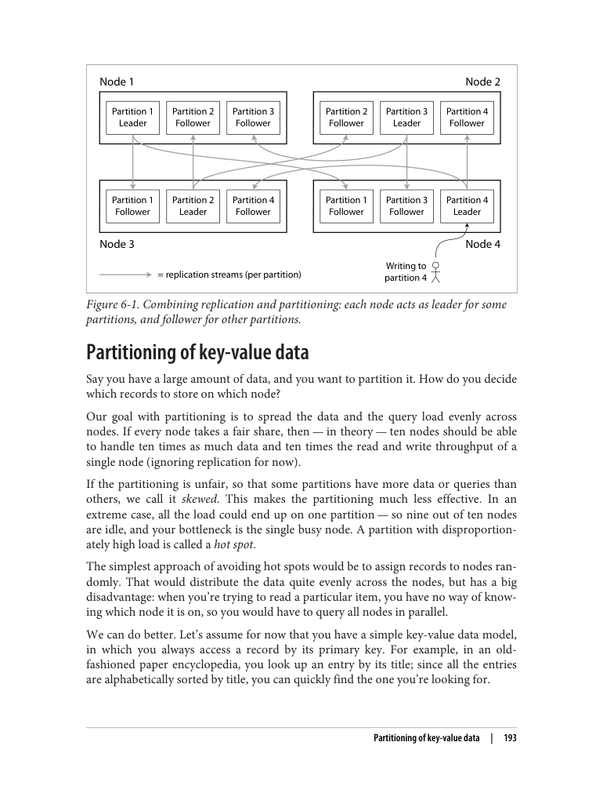

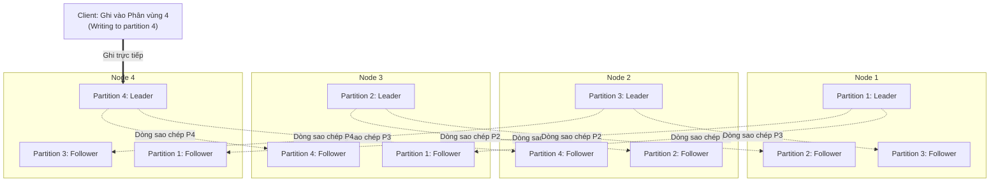

> 💡 **Ví dụ bổ sung (không có trong sách): Phân vùng và Sao chép trong Apache Kafka và CockroachDB**
>
> Mô hình trong **Hình 6-1** chính xác là cách **Apache Kafka** và các hệ quản trị cơ sở dữ liệu NewSQL hiện đại như **CockroachDB** hay **TiDB** vận hành:
> - Trong **Apache Kafka**, một *Topic* được chia thành nhiều *Partitions* (ví dụ: Partition 1, 2, 3, 4). Với hệ số sao chép `replication.factor = 3` trên cụm 4 Broker (Node 1..4), mỗi Partition sẽ bầu ra 1 Broker làm *Leader* (xử lý mọi đọc/ghi) và 2 Broker còn lại làm *Follower* (nằm trong danh sách *ISR - In-Sync Replicas* kéo dữ liệu từ Leader). Nhờ phân bổ đều vai trò Leader khắp các Broker, không một Broker nào bị quá tải đơn độc.
> - Trong **CockroachDB** / **TiDB**, dữ liệu được chia thành các *Ranges* / *Regions* (mặc định 64 MB – 512 MB). Mỗi Range là một nhóm đồng thuận **Raft** độc lập gồm 3 bản sao (1 Raft Leader / Leaseholder và 2 Followers).

---

## Phân vùng dữ liệu khóa-giá trị (Partitioning of key-value data)

Giả sử bạn có một lượng lớn dữ liệu và bạn muốn phân vùng nó. Làm thế nào để bạn quyết định bản ghi nào sẽ được lưu trữ trên nút nào?

Mục tiêu của chúng ta với việc phân vùng là trải đều dữ liệu và tải truy vấn qua các nút. Nếu mỗi nút nhận một phần công việc công bằng, thì — về mặt lý thuyết — mười nút sẽ có khả năng xử lý lượng dữ liệu gấp mười lần và thông lượng đọc/ghi gấp mười lần so với một nút đơn lẻ (tạm thời bỏ qua việc sao chép dữ liệu).

Nếu việc phân vùng không công bằng, khiến cho một số phân vùng chứa nhiều dữ liệu hoặc phải gánh nhiều truy vấn hơn các phân vùng khác, chúng ta gọi hiện tượng đó là *lệch tải (skewed)*. Sự lệch tải làm cho việc phân vùng kém hiệu quả đi rất nhiều. Trong một trường hợp cực đoan, toàn bộ tải có thể dồn hết vào một phân vùng duy nhất — khiến 9 trên 10 nút ngồi nhàn rỗi, và nút thắt cổ chai (bottleneck) của toàn hệ thống chính là cái nút duy nhất đang bận rộn kia. Một phân vùng chịu mức tải cao bất tương xứng như vậy được gọi là một *điểm nóng (hot spot)*.

Cách tiếp cận đơn giản nhất để tránh các điểm nóng là gán các bản ghi vào các nút một cách ngẫu nhiên. Điều đó sẽ phân phối dữ liệu khá đồng đều trên khắp các nút, nhưng lại mang một nhược điểm lớn: khi bạn cố gắng đọc một mục dữ liệu cụ thể, bạn không có cách nào biết được nó đang nằm ở nút nào, vì vậy bạn sẽ buộc phải gửi truy vấn tới tất cả các nút secara song song.

Chúng ta có thể làm tốt hơn thế. Trước mắt, hãy giả sử rằng bạn có một mô hình dữ liệu khóa-giá trị (key-value) đơn giản, trong đó bạn luôn truy cập một bản ghi thông qua khóa chính (primary key) của nó. Ví dụ, trong một bộ bách khoa toàn thư bằng giấy kiểu cổ điển, bạn tra cứu một mục từ theo tiêu đề của nó; bởi vì tất cả các mục từ đều được sắp xếp theo thứ tự bảng chữ cái của tiêu đề, bạn có thể nhanh chóng tìm thấy mục từ mà mình đang tìm kiếm.

### Phân vùng theo khoảng khóa (Partitioning by key range)

Một cách để phân vùng là gán một khoảng khóa liên tục (continuous range of keys — từ một giá trị tối thiểu nào đó đến một giá trị tối đa nào đó) cho mỗi phân vùng, giống như các tập (volumes) của một bộ bách khoa toàn thư bằng giấy (**Hình 6-2**). Nếu bạn biết ranh giới (boundaries) giữa các khoảng, bạn có thể dễ dàng xác định phân vùng nào đang chứa một khóa nhất định. Nếu bạn cũng biết phân vùng nào được gán cho nút nào, thì bạn có thể gửi yêu cầu của mình trực tiếp đến nút thích hợp (hoặc, trong trường hợp bộ bách khoa toàn thư, rút đúng cuốn sách đó ra khỏi kệ).

**Hình 6-2 – Một bộ bách khoa toàn thư in ấn được phân vùng theo khoảng khóa (Figure 6-2. A print encyclopedia is partitioned by key range.)**

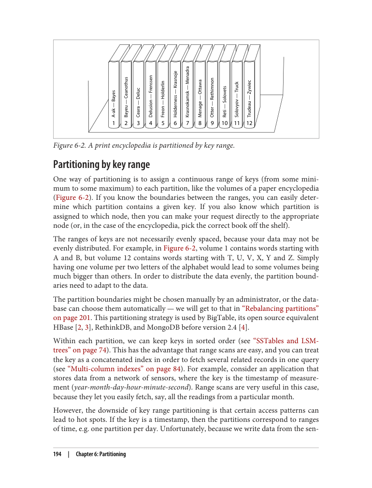

| Tập (Phân vùng) | Khoảng khóa từ đầu (Min Key) | Đến khóa cuối (Max Key) |
| :--- | :--- | :--- |
| **Tập 1** | `A-ak` | `Bayes` |
| **Tập 2** | `Bayeu` | `Ceanothus` |
| **Tập 3** | `Ceara` | `Deluc` |
| **Tập 4** | `Delusion` | `Frenssen` |
| **Tập 5** | `Freon` | `Holderlin` |
| **Tập 6** | `Holderness` | `Krasnoje` |
| **Tập 7** | `Krasnokamsk` | `Menadra` |
| **Tập 8** | `Menage` | `Ottawa` |
| **Tập 9** | `Otter` | `Rethimnon` |
| **Tập 10** | `Reti` | `Solovets` |
| **Tập 11** | `Solovyov` | `Truck` |
| **Tập 12** | `Trudeau` | `Zywiec` |

Các khoảng khóa không nhất thiết phải có độ rộng cách đều nhau, bởi vì dữ liệu của bạn có thể không được phân phối đồng đều. Ví dụ, trong **Hình 6-2**, tập 1 chỉ chứa các từ bắt đầu bằng chữ A và B, nhưng tập 12 lại chứa các từ bắt đầu bằng T, U, V, X, Y và Z. Nếu chỉ đơn thuần chia mỗi tập gồm hai chữ cái trong bảng chữ cái thì sẽ dẫn đến việc một số tập dày hơn rất nhiều so với các tập khác. Để phân phối dữ liệu đồng đều, ranh giới giữa các phân vùng cần phải thích ứng với chính dữ liệu đó.

Ranh giới các phân vùng có thể được chọn thủ công bởi người quản trị viên, hoặc cơ sở dữ liệu có thể tự động chọn chúng — chúng ta sẽ bàn kỹ vấn đề này trong mục "Tái cân bằng các phân vùng (Rebalancing partitions)" ở trang 201. Chiến lược phân vùng theo khoảng khóa này được sử dụng bởi Bigtable, bản tương đương mã nguồn mở của nó là HBase [2, 3], RethinkDB, và MongoDB trước phiên bản 2.4 [4].

Bên trong mỗi phân vùng, chúng ta có thể duy trì các khóa theo thứ tự đã sắp xếp (xem mục "SSTables and LSM-trees" ở trang 74). Điều này mang lại lợi thế là các thao tác quét theo khoảng (range scans) trở nên rất dễ dàng, và bạn có thể coi khóa như một chỉ mục ghép nối (concatenated index) nhằm lấy ra nhiều bản ghi có liên quan chỉ trong một truy vấn duy nhất (xem mục "Multi-column indexes" ở trang 84). Ví dụ, hãy xem xét một ứng dụng lưu trữ dữ liệu từ một mạng lưới các cảm biến (sensors), trong đó khóa là dấu thời gian (timestamp) của phép đo (`năm-tháng-ngày-giờ-phút-giây`). Việc quét theo khoảng cực kỳ hữu ích trong trường hợp này, vì chúng cho phép bạn dễ dàng lấy ra, chẳng hạn, tất cả các chỉ số đo được trong một tháng cụ thể.

Tuy nhiên, nhược điểm của phân vùng theo khoảng khóa là một số mẫu truy cập (access patterns) nhất định có thể dẫn đến các điểm nóng (hot spots). Nếu khóa là một dấu thời gian, thì các phân vùng sẽ tương ứng với các khoảng thời gian — ví dụ, mỗi ngày một phân vùng. Đáng tiếc là, bởi vì chúng ta ghi dữ liệu từ các cảm biến vào cơ sở dữ liệu ngay tại thời điểm sự việc diễn ra, toàn bộ các thao tác ghi đều sẽ đổ dồn vào cùng một phân vùng (phân vùng của ngày hôm nay), khiến phân vùng đó bị quá tải vì các lệnh ghi trong khi các phân vùng khác lại ngồi nhàn rỗi [5].

Để tránh vấn đề này trong cơ sở dữ liệu cảm biến, bạn cần sử dụng một yếu tố khác ngoài dấu thời gian làm thành phần đầu tiên của khóa. Chẳng hạn, bạn có thể gắn tiền tố (prefix) cho mỗi dấu thời gian bằng tên của cảm biến (ví dụ: `sensor_id + timestamp`), sao cho việc phân vùng diễn ra trước hết theo tên cảm biến và sau đó mới theo thời gian. Giả sử bạn có nhiều cảm biến hoạt động cùng một lúc, tải ghi sẽ được dàn trải đồng đều hơn nhiều qua các phân vùng. Bây giờ, khi bạn muốn lấy giá trị của nhiều cảm biến trong một khoảng thời gian, bạn sẽ cần thực hiện một truy vấn khoảng (range query) riêng biệt cho từng tên cảm biến.

### Phân vùng theo giá trị băm của khóa (Partitioning by hash of key)

Vì rủi ro xảy ra lệch tải (skew) và điểm nóng (hot spots) như trên, nhiều kho dữ liệu phân tán sử dụng một hàm băm (hash function) để xác định phân vùng cho một khóa nhất định.

Một hàm băm tốt sẽ nhận đầu vào là dữ liệu bị lệch và biến nó thành dữ liệu phân phối đồng đều (uniformly distributed). Giả sử bạn có một hàm băm 32-bit nhận đầu vào là một chuỗi ký tự. Bất cứ khi nào bạn đưa cho nó một chuỗi mới, nó sẽ trả về một con số có vẻ ngẫu nhiên nằm trong khoảng từ $0$ đến $2^{32} - 1$. Ngay cả khi các chuỗi đầu vào rất giống nhau, giá trị băm của chúng vẫn được phân phối đều khắp khoảng số đó.[^ii] Điều này được minh họa trong **Hình 6-3**.

[^ii]: Hàm băm này không cần phải là một hàm băm mật mã học (cryptographically strong hash function). Ví dụ, Cassandra và MongoDB sử dụng MD5, còn Voldemort sử dụng hàm Fowler–Noll–Vo (FNV).

**Hình 6-3 – Phân vùng theo giá trị băm của khóa (Figure 6-3. Partitioning by hash of key.)**

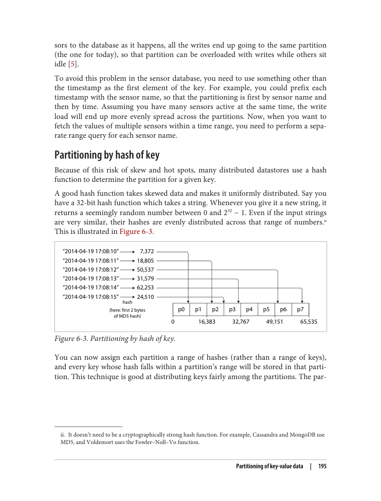

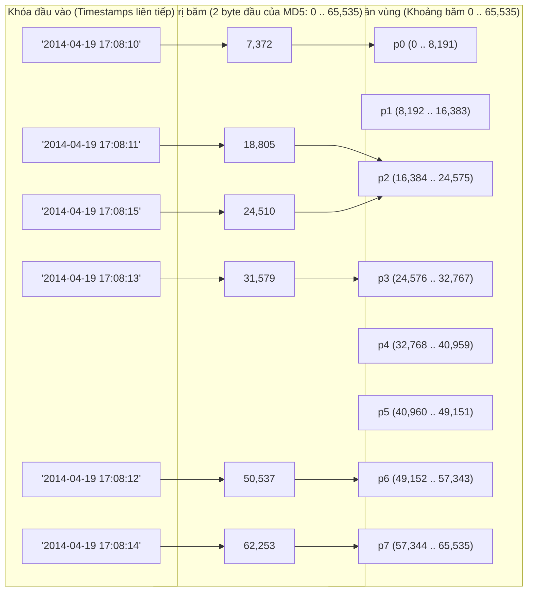

Giờ đây, bạn có thể gán cho mỗi phân vùng một *khoảng giá trị băm (range of hashes)* (thay vì một khoảng các khóa), và mọi khóa có giá trị băm rơi vào trong khoảng của phân vùng nào thì sẽ được lưu trữ trong phân vùng đó. Kỹ thuật này rất giỏi trong việc phân bổ các khóa một cách công bằng giữa các phân vùng. Ranh giới của các phân vùng có thể được chia cách đều nhau, hoặc chúng có thể được chọn theo kiểu giả ngẫu nhiên (pseudo-randomly — trong trường hợp đó, kỹ thuật này đôi khi được biết đến với tên gọi *băm nhất quán - consistent hashing*).

> **Băm nhất quán (Consistent hashing)**
>
> Băm nhất quán, như được định nghĩa bởi Karger và các cộng sự [6], là một phương pháp phân phối tải đồng đều trên một hệ thống bộ nhớ đệm (caches) quy mô toàn mạng Internet, chẳng hạn như mạng phân phối nội dung (CDN - Content Delivery Network). Nó sử dụng các ranh giới phân vùng được chọn ngẫu nhiên để tránh nhu cầu phải có một bộ điều khiển trung tâm hoặc sự đồng thuận phân tán (distributed consensus). Lưu ý rằng chữ *nhất quán (consistent)* ở đây không có bất kỳ mối liên hệ nào với tính nhất quán của bản sao (replica consistency, xem Chương 5) hay tính nhất quán ACID (xem Chương 7), mà đúng hơn là mô tả một cách tiếp cận cụ thể đối với việc tái cân bằng dữ liệu. Như chúng ta sẽ thấy trong mục "Tái cân bằng các phân vùng (Rebalancing partitions)" ở trang 201, cách tiếp cận cụ thể này thực ra hoạt động không mấy hiệu quả đối với các cơ sở dữ liệu [7], và do đó nó hiếm khi được sử dụng nguyên bản trong thực tế (tài liệu của một số cơ sở dữ liệu vẫn nhắc đến thuật ngữ consistent hashing, nhưng thường là không chính xác). Bởi vì điều này gây ra quá nhiều sự nhầm lẫn, tốt nhất là nên tránh dùng thuật ngữ *consistent hashing*, mà chỉ nên gọi đơn giản là *phân vùng bằng băm (hash partitioning)*.

Đáng tiếc là, bằng việc sử dụng giá trị băm của khóa để phân vùng, chúng ta cũng đánh mất một đặc tính tuyệt vời của phân vùng theo khoảng khóa: khả năng thực hiện các truy vấn khoảng (range queries) một cách hiệu quả. Các khóa vốn dĩ từng nằm liền kề nhau giờ đây bị phân tán rải rác khắp tất cả các phân vùng, do đó thứ tự sắp xếp của chúng đã bị mất. Trong MongoDB, nếu bạn bật chế độ sharding dựa trên hàm băm (hash-based sharding mode), bất kỳ truy vấn khoảng nào cũng đều phải được gửi tới tất cả các phân vùng [4]. Các truy vấn khoảng trên khóa chính thậm chí không được hỗ trợ bởi Riak [8], Couchbase [9] và Voldemort.

Cassandra đạt được một sự thỏa hiệp khéo léo giữa hai chiến lược phân vùng này [10, 11, 12]. Một bảng trong Cassandra có thể được khai báo với một *khóa chính phức hợp (compound primary key)* bao gồm nhiều cột. Chỉ có thành phần đầu tiên của khóa đó mới được đưa vào hàm băm để xác định phân vùng, còn các cột khác được sử dụng như một chỉ mục ghép nối (concatenated index) để sắp xếp dữ liệu trong các tập tin SSTable của Cassandra.

Điều này có nghĩa là một truy vấn không thể tìm kiếm một khoảng giá trị bên trong cột đầu tiên của khóa phức hợp, nhưng nếu nó chỉ định một giá trị cố định cho cột đầu tiên, nó hoàn toàn có thể thực hiện một thao tác quét khoảng (range scan) cực kỳ hiệu quả dựa trên các cột còn lại của khóa.

Cơ chế này cho phép xây dựng một mô hình dữ liệu vô cùng thanh lịch cho các mối quan hệ một-nhiều (one-to-many relationships). Ví dụ, trên một trang mạng xã hội, một người dùng có thể đăng rất nhiều trạng thái cập nhật (updates). Nếu khóa chính cho bảng cập nhật được chọn là `(user_id, update_timestamp)`, thì bạn có thể truy xuất hiệu quả tất cả các cập nhật được thực hiện bởi một người dùng cụ thể trong một khoảng thời gian nào đó, được sắp xếp theo dấu thời gian. Những người dùng khác nhau có thể được lưu trữ trên các phân vùng khác nhau, nhưng bên trong phạm vi của mỗi người dùng, các cập nhật của họ được lưu trữ theo đúng thứ tự dấu thời gian trên một phân vùng duy nhất.

> 💡 **Ví dụ bổ sung (không có trong sách): Khóa phân vùng trong Cassandra / ScyllaDB và DynamoDB**
>
> Trong **Cassandra / ScyllaDB**, khi bạn khai báo bảng như sau:
> ```sql
> CREATE TABLE user_updates (
>     user_id UUID,
>     update_timestamp TIMESTAMP,
>     status_text TEXT,
>     PRIMARY KEY ((user_id), update_timestamp)
> ) WITH CLUSTERING ORDER BY (update_timestamp DESC);
> ```
> - `user_id` được gọi là **Partition Key**: Cassandra dùng hàm băm `Murmur3Partitioner` trên `user_id` để định vị chính xác nút (node) chứa dữ liệu của user đó.
> - `update_timestamp` được gọi là **Clustering Column**: Bên trong phân vùng của `user_id` đó, các dòng được lưu trữ sắp xếp vật lý theo `update_timestamp` giảm dần ngay trong SSTable.
> - Tương tự, **Amazon DynamoDB** gọi thành phần đầu là *Partition Key (Hash Key)* và thành phần thứ hai là *Sort Key (Range Key)*. Truy vấn `WHERE user_id = 'u123' AND update_timestamp BETWEEN '2025-01-01' AND '2025-01-31'` chỉ cần đọc một dải liên tiếp trên đĩa của đúng 1 phân vùng duy nhất!

### Khối lượng công việc bị lệch và giảm thiểu điểm nóng (Skewed workloads and relieving hot spots)

Như đã thảo luận, việc băm một khóa để xác định phân vùng của nó có thể giúp giảm thiểu các điểm nóng (hot spots). Tuy nhiên, nó không thể loại bỏ hoàn toàn chúng: trong trường hợp cực đoan khi mà mọi thao tác đọc và ghi đều nhắm vào cùng một khóa duy nhất, bạn vẫn sẽ kết thúc với cảnh mọi yêu cầu đều bị định tuyến tới cùng một phân vùng.

Loại khối lượng công việc này có lẽ không phổ biến, nhưng không phải là không thể xảy ra: ví dụ, trên một trang mạng xã hội, một người dùng là người nổi tiếng (celebrity user) với hàng triệu người theo dõi có thể gây ra một cơn bão hoạt động khi họ làm điều gì đó [13]. Điều này có thể dẫn đến một lượng lớn thao tác ghi đổ dồn vào cùng một khóa (trong đó khóa có thể là ID người dùng của người nổi tiếng đó, hoặc ID của bài đăng/hành động mà mọi người đang bình luận vào). Việc băm khóa không giúp ích được gì trong tình huống này, bởi vì giá trị băm của hai ID giống hệt nhau thì vẫn luôn ra cùng một kết quả như nhau.

Ngày nay, hầu hết các hệ thống dữ liệu chưa thể tự động bù trừ cho một khối lượng công việc bị lệch nghiêm trọng như vậy, do đó trách nhiệm giảm thiểu độ lệch thuộc về tầng ứng dụng (application). Ví dụ, nếu một khóa được biết là đang rất "nóng" (hot key), một kỹ thuật đơn giản là cộng thêm một con số ngẫu nhiên vào đầu hoặc cuối của khóa đó (thường gọi là *key salting*). Chỉ cần một số ngẫu nhiên hệ thập phân có hai chữ số (`00` đến `99`) là đã có thể chia tách các thao tác ghi vào khóa đó một cách đồng đều ra thành 100 khóa khác nhau, cho phép 100 khóa này được phân phối sang các phân vùng khác nhau.

Tuy nhiên, sau khi đã chia tách các thao tác ghi ra nhiều khóa khác nhau, bất kỳ thao tác đọc nào giờ đây cũng phải làm thêm việc, vì chúng phải đọc dữ liệu từ tất cả 100 khóa rồi kết hợp (merge) kết quả lại. Kỹ thuật này cũng đòi hỏi công việc quản lý sổ sách (bookkeeping) bổ sung: việc nối thêm số ngẫu nhiên chỉ hợp lý đối với một số lượng nhỏ các khóa nóng; đối với đại đa số các khóa có thông lượng ghi thấp thì việc này sẽ gây ra chi phí phụ trội (overhead) không cần thiết. Do đó, bạn cũng cần một cơ chế nào đó để theo dõi xem những khóa nào đang được chia tách.

Có lẽ trong tương lai, các hệ thống dữ liệu sẽ có khả năng tự động phát hiện và bù trừ cho các khối lượng công việc bị lệch, nhưng ở thời điểm hiện tại, bạn cần phải tự suy tính thấu đáo các sự đánh đổi (trade-offs) cho chính ứng dụng của mình.

> 💡 **Ví dụ bổ sung (không có trong sách): Kỹ thuật Key Salting chống Hot Key trong thực tế**
>
> Giả sử bạn thiết kế hệ thống đếm lượt bình chọn trực tiếp (live voting) hoặc flash sale cho một sản phẩm cực "hot" có mã `product_id = "iphone_17"`. Nếu dùng khóa `iphone_17` trực tiếp, mọi yêu cầu cập nhật tồn kho hoặc đếm lượt mua sẽ dồn hết về 1 phân vùng duy nhất.
>
> **Cách xử lý tại tầng ứng dụng (Key Salting / Write Sharding):**
> 1. **Khi Ghi (Write):** Ứng dụng chọn ngẫu nhiên một hậu tố từ `0` đến `N-1` (ví dụ $N = 16$):
>    ```python
>    import random
>    shard_id = random.randint(0, 15)
>    salted_key = f"product:iphone_17:shard_{shard_id}"
>    db.increment(salted_key, delta=1)
>    ```
>    Lúc này, tải ghi được chia đều sang 16 khóa khác nhau, nằm rải rác trên nhiều nút trong cụm.
> 2. **Khi Đọc (Read Aggregation):** Để lấy tổng số lượng, ứng dụng đọc song song cả 16 khóa (`product:iphone_17:shard_0` .. `shard_15`) và cộng tổng lại (hoặc dùng một tiến trình chạy nền gom tổng định kỳ mỗi giây một lần vào bộ nhớ đệm).
> 3. **Hỗ trợ tự động trong các hệ thống hiện đại:** Ngày nay, các hệ thống như **Google Cloud Spanner**, **CockroachDB** và **TiDB** đã bắt đầu tích hợp bộ phát hiện điểm nóng tự động (*Load-based Splitting*): khi phát hiện một khoảng khóa chịu QPS quá cao, hệ thống tự động tách (split) khoảng khóa đó và di chuyển sang nút đang rảnh rỗi hơn (tuy nhiên với điểm nóng trên *một khóa đơn lẻ duy nhất*, kỹ thuật Key Salting ở tầng ứng dụng vẫn là giải pháp triệt để nhất).

---

## Phân vùng và chỉ mục phụ (Partitioning and secondary indexes)

Các lược đồ phân vùng mà chúng ta đã thảo luận từ đầu chương đến giờ đều dựa trên mô hình dữ liệu khóa-giá trị (key-value data model). Nếu các bản ghi chỉ luôn được truy cập thông qua khóa chính của chúng, chúng ta có thể xác định phân vùng từ chính khóa đó, và sử dụng nó để định tuyến các yêu cầu đọc và ghi tới phân vùng chịu trách nhiệm cho khóa đó.

Tình hình trở nên phức tạp hơn nhiều nếu có sự tham gia của các *chỉ mục phụ (secondary indexes)* (xem thêm mục "Other indexing structures" ở trang 82). Một chỉ mục phụ thường không định danh duy nhất một bản ghi, mà đúng hơn, nó là một phương tiện để tìm kiếm các lần xuất hiện của một giá trị cụ thể: tìm tất cả các hành động của người dùng `123`, tìm tất cả các bài viết có chứa từ `"hogwash"`, tìm tất cả những chiếc xe ô tô có màu là `"red"`, v.v.

Chỉ mục phụ là "cơm áo gạo tiền" (bread and butter — thành phần cốt lõi không thể thiếu) của các cơ sở dữ liệu quan hệ, và chúng cũng rất phổ biến trong các cơ sở dữ liệu tài liệu (document databases). Nhiều kho lưu trữ khóa-giá trị NoSQL (chẳng hạn như HBase và Voldemort) đã né tránh việc hỗ trợ chỉ mục phụ vì độ phức tạp tăng thêm khi triển khai, nhưng một số hệ thống (chẳng hạn như Riak) đã bắt đầu bổ sung chúng vì chúng quá hữu ích cho việc mô hình hóa dữ liệu. Và cuối cùng, chỉ mục phụ chính là lý do tồn tại (*raison d'être*) của các máy chủ tìm kiếm như Solr và Elasticsearch.

Vấn đề với các chỉ mục phụ là chúng không ánh xạ một cách gọn gàng vào các phân vùng. Có hai cách tiếp cận chính để phân vùng một cơ sở dữ liệu có chỉ mục phụ: *phân vùng dựa trên tài liệu (document-based partitioning)* và *phân vùng dựa trên thuật ngữ (term-based partitioning)*.

### Phân vùng chỉ mục phụ theo tài liệu (Partitioning secondary indexes by document)

Ví dụ, hãy tưởng tượng bạn đang vận hành một trang web bán xe ô tô cũ (được minh họa trong **Hình 6-4**). Mỗi tin đăng bán xe có một ID duy nhất — hãy gọi nó là ID tài liệu (*document ID*) — và bạn phân vùng cơ sở dữ liệu theo ID tài liệu đó (chẳng hạn, các ID từ `0` đến `499` nằm ở phân vùng 0, từ `500` đến `999` nằm ở phân vùng 1, v.v.).

Bây giờ bạn muốn cho phép người dùng tìm kiếm xe ô tô, cho phép họ lọc theo màu sắc (`color`) và theo hãng sản xuất (`make`), vì vậy bạn cần tạo một chỉ mục phụ trên `color` và `make` (trong cơ sở dữ liệu tài liệu thì đây là các trường/fields; trong cơ sở dữ liệu quan hệ thì chúng là các cột/columns). Nếu bạn đã khai báo chỉ mục, cơ sở dữ liệu có thể tự động thực hiện việc đánh chỉ mục.[^iii] Ví dụ, bất cứ khi nào một chiếc xe màu đỏ được thêm vào cơ sở dữ liệu, phân vùng cơ sở dữ liệu đó sẽ tự động thêm ID của nó vào danh sách các ID tài liệu cho mục chỉ mục `color:red`.

[^iii]: Nếu cơ sở dữ liệu của bạn chỉ hỗ trợ mô hình khóa-giá trị, bạn có thể bị cám dỗ tự mình triển khai một chỉ mục phụ bằng cách tạo một bảng ánh xạ từ giá trị sang ID tài liệu ngay trong mã nguồn ứng dụng (application code). Nếu đi theo con đường này, bạn cần phải hết sức cẩn trọng để đảm bảo các chỉ mục của mình luôn nhất quán với dữ liệu bên dưới. Các điều kiện tranh chấp (race conditions) và các lỗi ghi chập chờn (khi một số thay đổi đã được lưu nhưng những thay đổi khác thì chưa) có thể rất dễ dàng khiến dữ liệu bị lệch pha không đồng bộ — xem mục "The need for multi-object transactions" ở trang 222.

**Hình 6-4 – Phân vùng các chỉ mục phụ theo tài liệu (Figure 6-4. Partitioning secondary indexes by document.)**

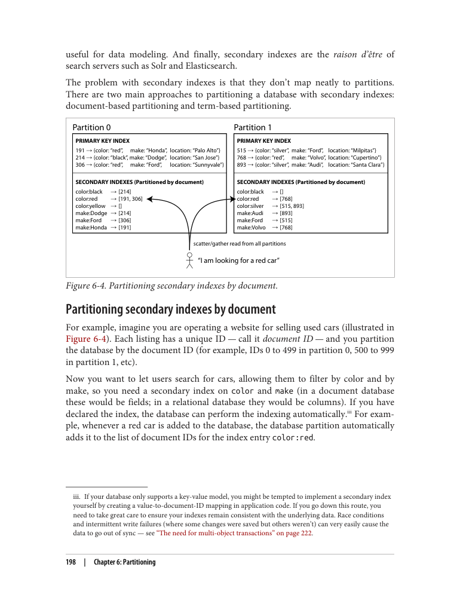

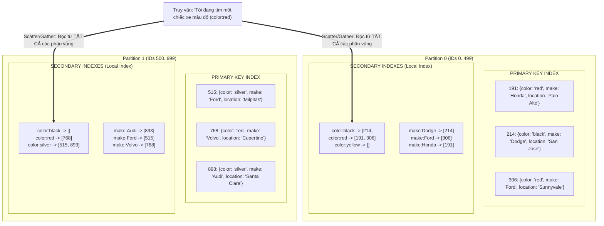

Trong cách tiếp cận đánh chỉ mục này, mỗi phân vùng là hoàn toàn tách biệt: mỗi phân vùng tự duy trì các chỉ mục phụ của riêng nó, chỉ bao phủ những tài liệu nằm bên trong phân vùng đó mà thôi. Nó không quan tâm dữ liệu nào đang được lưu trữ ở các phân vùng khác. Bất cứ khi nào bạn cần ghi vào cơ sở dữ liệu — để thêm, xóa hoặc cập nhật một tài liệu — bạn chỉ cần làm việc duy nhất với phân vùng đang chứa ID tài liệu mà bạn đang ghi. Vì lý do đó, một chỉ mục được phân vùng theo tài liệu còn được gọi là một *chỉ mục cục bộ (local index)* (đối lập với một *chỉ mục toàn cục - global index*, sẽ được mô tả trong mục tiếp theo).

Tuy nhiên, việc đọc từ một chỉ mục phân vùng theo tài liệu đòi hỏi sự cẩn trọng: trừ khi bạn đã thực hiện một thiết kế đặc biệt nào đó với các ID tài liệu, còn không thì chẳng có lý do gì đảm bảo tất cả những chiếc xe có cùng một màu sắc cụ thể hoặc cùng một hãng sản xuất cụ thể lại nằm chung trong một phân vùng cả. Trong **Hình 6-4**, những chiếc xe màu đỏ xuất hiện ở cả phân vùng 0 lẫn phân vùng 1. Do đó, nếu bạn muốn tìm kiếm xe màu đỏ, bạn cần phải gửi truy vấn tới *tất cả* các phân vùng, và kết hợp tất cả các kết quả mà bạn nhận về.

Cách tiếp cận truy vấn cơ sở dữ liệu phân vùng như thế này đôi khi được gọi là *phân tán/thu thập (scatter/gather)*, và nó có thể làm cho các truy vấn đọc trên chỉ mục phụ trở nên khá đắt đỏ. Ngay cả khi bạn truy vấn các phân vùng một cách song song, cơ chế scatter/gather vẫn rất dễ gặp phải hiện tượng *khuếch đại độ trễ đuôi (tail latency amplification)* (xem mục "Percentiles in Practice" ở trang 14 — tổng thời gian phản hồi bị quyết định bởi phân vùng chậm nhất). Mặc dù vậy, nó vẫn được sử dụng rộng rãi: MongoDB, Riak [14], Cassandra [15], Elasticsearch [16], SolrCloud [17], và VoltDB [18] đều sử dụng các chỉ mục phụ phân vùng theo tài liệu. Hầu hết các nhà cung cấp cơ sở dữ liệu đều khuyến nghị bạn nên cấu trúc lược đồ phân vùng của mình sao cho các truy vấn chỉ mục phụ có thể được phục vụ từ một phân vùng đơn lẻ, nhưng điều đó không phải lúc nào cũng khả thi, đặc biệt là khi bạn đang sử dụng nhiều chỉ mục phụ trong cùng một truy vấn (chẳng hạn như lọc xe ô tô theo cả màu sắc lẫn hãng sản xuất cùng một lúc).

### Phân vùng chỉ mục phụ theo thuật ngữ (Partitioning secondary indexes by term)

Thay vì mỗi phân vùng có chỉ mục phụ của riêng mình (một *chỉ mục cục bộ - local index*), chúng ta có thể xây dựng một *chỉ mục toàn cục (global index)* bao phủ dữ liệu trong tất cả các phân vùng. Tuy nhiên, chúng ta không thể chỉ lưu trữ toàn bộ chỉ mục đó trên một nút duy nhất, bởi vì nút đó nhiều khả năng sẽ trở thành nút thắt cổ chai và làm phá sản mục đích của việc phân vùng. Một chỉ mục toàn cục cũng phải được phân vùng, nhưng nó có thể được phân vùng theo cách khác với chỉ mục khóa chính.

**Hình 6-5** minh họa hình thái của phương pháp này: những chiếc xe màu đỏ từ tất cả các phân vùng đều xuất hiện dưới mục `color:red` trong chỉ mục, nhưng bản thân chỉ mục này lại được phân vùng sao cho các màu sắc bắt đầu bằng các chữ cái từ `a` đến `r` xuất hiện trong phân vùng 0, và các màu sắc bắt đầu bằng các chữ cái từ `s` đến `z` xuất hiện trong phân vùng 1. Chỉ mục trên hãng sản xuất xe (`make`) cũng được phân vùng tương tự (với ranh giới phân vùng nằm giữa chữ `f` và chữ `h`).

**Hình 6-5 – Phân vùng các chỉ mục phụ theo thuật ngữ (Figure 6-5. Partitioning secondary indexes by term.)**

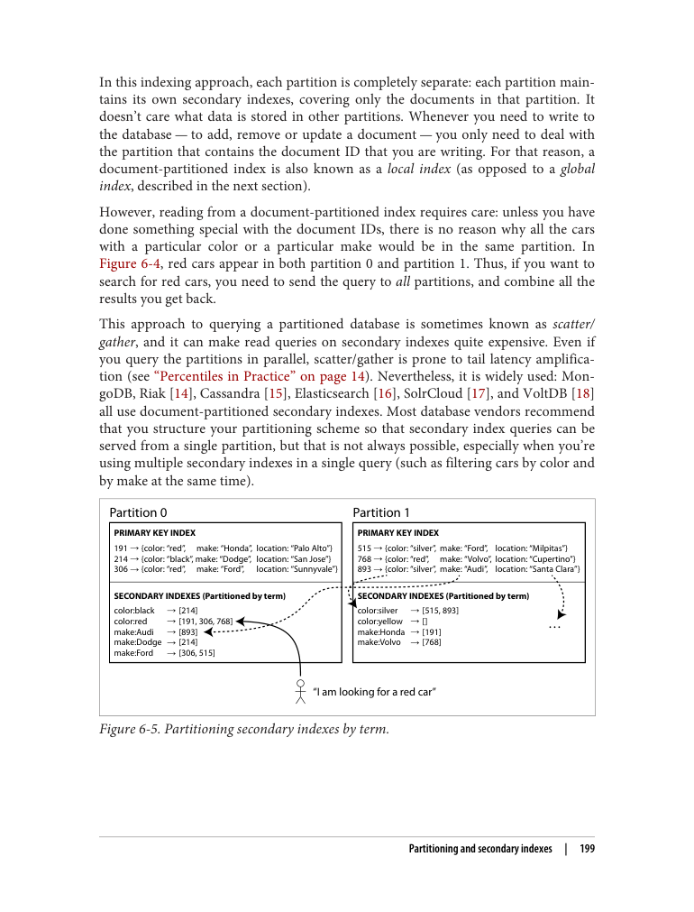

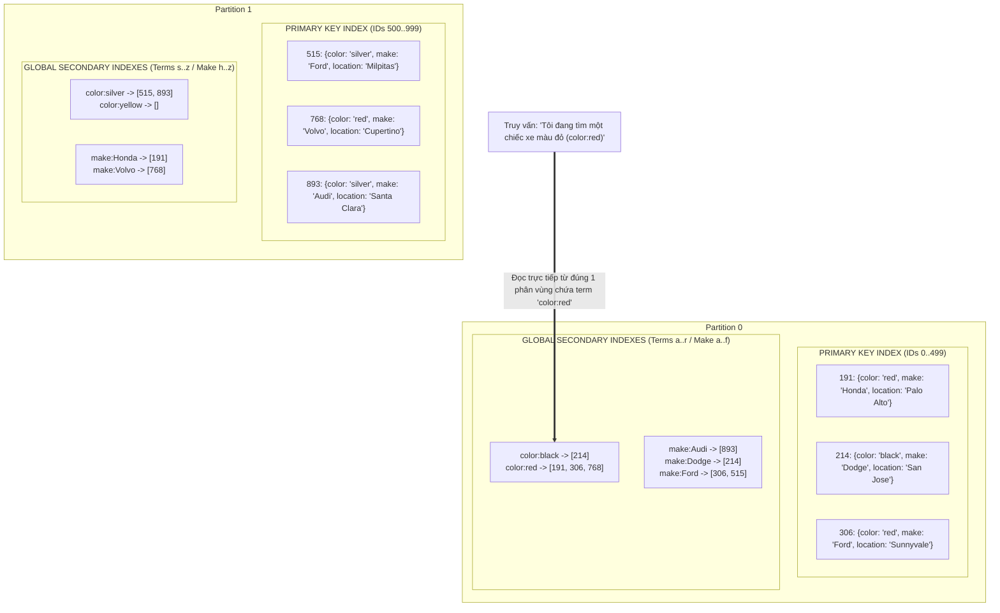

Chúng ta gọi đây là *phân vùng dựa trên thuật ngữ (term-based partitioning)*, bởi vì thuật ngữ (term) mà chúng ta đang tìm kiếm sẽ quyết định phân vùng của chỉ mục. Ở đây, một thuật ngữ sẽ là `color:red`, chẳng hạn. Tên gọi *term (thuật ngữ)* bắt nguồn từ các chỉ mục toàn văn (full-text indexes — một loại chỉ mục phụ đặc biệt), nơi các thuật ngữ là tất cả các từ xuất hiện trong một tài liệu.

Giống như trước đây, chúng ta có thể phân vùng chỉ mục theo bản thân thuật ngữ đó (theo khoảng khóa của term), hoặc sử dụng giá trị băm của thuật ngữ đó. Việc phân vùng theo bản thân thuật ngữ có thể hữu ích cho các thao tác quét khoảng (range scans — ví dụ trên một thuộc tính số như giá chào bán của chiếc xe), trong khi việc phân vùng dựa trên giá trị băm của thuật ngữ sẽ mang lại sự phân phối tải đồng đều hơn.

Ưu điểm của một chỉ mục toàn cục (phân vùng theo thuật ngữ) so với một chỉ mục phân vùng theo tài liệu là nó giúp cho việc đọc hiệu quả hơn: thay vì phải thực hiện scatter/gather qua tất cả các phân vùng, một client chỉ cần gửi yêu cầu tới đúng phân vùng đang chứa thuật ngữ mà nó muốn. Tuy nhiên, nhược điểm của một chỉ mục toàn cục là các thao tác ghi giờ đây trở nên chậm hơn và phức tạp hơn, bởi vì một thao tác ghi vào một tài liệu đơn lẻ bây giờ có thể làm ảnh hưởng đến nhiều phân vùng của chỉ mục (mỗi thuật ngữ trong tài liệu đó có thể nằm trên một phân vùng khác nhau, trên một nút khác nhau).

Trong một thế giới lý tưởng, chỉ mục sẽ luôn được cập nhật mới nhất (up-to-date), và mọi tài liệu được ghi vào cơ sở dữ liệu sẽ ngay lập tức được phản ánh vào trong chỉ mục. Tuy nhiên, trong một chỉ mục phân vùng theo thuật ngữ, điều đó đòi hỏi một giao dịch phân tán (distributed transaction) trải rộng qua tất cả các phân vùng bị ảnh hưởng bởi một thao tác ghi — điều mà không phải cơ sở dữ liệu nào cũng hỗ trợ (xem Chương 7 và Chương 9).

Trong thực tế, việc cập nhật các chỉ mục phụ toàn cục thường được thực hiện một cách *bất đồng bộ (asynchronous)* (nghĩa là, nếu bạn đọc chỉ mục ngay sau khi vừa thực hiện một thao tác ghi, thay đổi mà bạn vừa tạo ra có thể chưa kịp xuất hiện trong chỉ mục). Ví dụ, Amazon DynamoDB nêu rõ rằng các chỉ mục phụ toàn cục (*Global Secondary Indexes - GSI*) của họ được cập nhật trong vòng một phần nhỏ của giây trong điều kiện bình thường, nhưng có thể gặp phải độ trễ lan truyền lâu hơn trong trường hợp xảy ra sự cố ở tầng hạ tầng [19].

Các ứng dụng khác của chỉ mục phân vùng theo thuật ngữ toàn cục bao gồm tính năng tìm kiếm của Riak [20], và kho dữ liệu Oracle (Oracle data warehouse) — hệ thống cho phép bạn tự do lựa chọn giữa đánh chỉ mục cục bộ (local indexing) và đánh chỉ mục toàn cục (global indexing) [21].

> 📝 **Giải thích thêm (không có trong sách): So sánh Local Index (Theo Document) và Global Index (Theo Term)**
>
> | Tiêu chí | Local Secondary Index (Phân vùng theo Document) | Global Secondary Index (Phân vùng theo Term) |
> | :--- | :--- | :--- |
> | **Vị trí lưu trữ chỉ mục** | Nằm cùng phân vùng (node) với bản ghi gốc. | Tách rời trên các phân vùng riêng dựa theo giá trị của trường được đánh chỉ mục. |
> | **Chi phí Ghi (Write)** | **Nhanh & Đơn giản:** Chỉ cập nhật trên duy nhất 1 phân vùng chứa tài liệu đó. | **Chậm & Phức tạp:** Ghi 1 tài liệu phải cập nhật chỉ mục trên nhiều phân vùng khác nhau (cần giao dịch phân tán hoặc cập nhật bất đồng bộ). |
> | **Chi phí Đọc (Read)** | **Đắt đỏ (Scatter/Gather):** Phải hỏi tất cả các phân vùng rồi gom kết quả lại; dễ bị khuếch đại độ trễ đuôi (tail latency). | **Nhanh & Hiệu quả:** Chỉ cần định tuyến tới đúng phân vùng chứa giá trị term cần tìm. |
> | **Hệ thống tiêu biểu** | Elasticsearch, MongoDB, Cassandra Secondary Index, DynamoDB LSI. | DynamoDB GSI, CockroachDB / TiDB Secondary Index, Oracle Global Partitioned Index. |


---

## Tái cân bằng các phân vùng (Rebalancing partitions)

Theo thời gian, mọi thứ trong một cơ sở dữ liệu đều thay đổi:

* Thông lượng truy vấn tăng lên, vì vậy bạn muốn bổ sung thêm nhiều CPU hơn để xử lý tải.
* Quy mô tập dữ liệu tăng lên, vì vậy bạn muốn bổ sung thêm nhiều ổ đĩa và RAM hơn để lưu trữ nó.
* Một máy chủ gặp sự cố hỏng hóc, và các máy chủ khác cần phải tiếp quản các trách nhiệm của máy chủ bị hỏng đó.

Tất cả những tình huống này đều đòi hỏi dữ liệu phải được di chuyển từ nút này sang nút khác. Quá trình di chuyển dữ liệu qua lại giữa các nút trong cụm được gọi là *tái cân bằng (rebalancing)*.

Cho dù sử dụng lược đồ phân vùng nào đi chăng nữa, quá trình tái cân bằng thường được kỳ vọng phải đáp ứng một số yêu cầu tối thiểu sau đây:

* Sau khi tái cân bằng, tải công việc (dung lượng lưu trữ dữ liệu, các yêu cầu đọc và ghi) phải được chia sẻ một cách công bằng giữa các nút trong cụm.
* Trong khi quá trình tái cân bằng đang diễn ra, cơ sở dữ liệu vẫn phải tiếp tục chấp nhận và xử lý bình thường các yêu cầu đọc và ghi.
* Không được di chuyển lượng dữ liệu nhiều hơn mức cần thiết giữa các nút, nhằm giữ cho quá trình tái cân bằng diễn ra nhanh chóng và tránh làm quá tải mạng cũng như I/O ổ đĩa.

### Các chiến lược tái cân bằng (Strategies for rebalancing)

Có một vài cách khác nhau để gán các phân vùng cho các nút [22]. Chúng ta hãy lần lượt thảo luận ngắn gọn về từng cách.

#### Cách không nên làm: băm chia lấy dư cho N (How not to do it: hash mod N)

Khi phân vùng theo giá trị băm của một khóa, chúng ta đã nói ở phần trước (**Hình 6-3**) rằng tốt nhất là nên chia các giá trị băm có thể có thành các khoảng (ranges), và gán mỗi khoảng cho một phân vùng (ví dụ: gán khóa vào phân vùng 0 nếu $0 \le \text{hash}(\text{key}) < b_0$, gán vào phân vùng 1 nếu $b_0 \le \text{hash}(\text{key}) < b_1$, v.v.).

Có lẽ bạn từng thắc mắc tại sao chúng ta không chỉ đơn giản sử dụng phép chia lấy dư *mod* (toán tử `%` trong nhiều ngôn ngữ lập trình). Ví dụ, `hash(key) mod 10` sẽ trả về một con số nằm giữa 0 và 9 (nếu chúng ta viết giá trị băm dưới dạng một số thập phân, phép tính `hash mod 10` chính là chữ số cuối cùng của nó). Nếu chúng ta có 10 nút, được đánh số từ 0 đến 9, đó có vẻ là một cách cực kỳ dễ dàng để gán mỗi khóa vào một nút.

Vấn đề với cách tiếp cận `mod N` là nếu số lượng nút $N$ thay đổi, hầu hết các khóa sẽ cần phải được di chuyển từ nút này sang nút khác. Ví dụ, giả sử `hash(key) = 123456`. Nếu ban đầu bạn có 10 nút, khóa đó nằm ở nút 6 (vì $123456 \bmod 10 = 6$). Khi bạn mở rộng lên 11 nút, khóa đó cần phải di chuyển sang nút 3 ($123456 \bmod 11 = 3$), và khi bạn mở rộng lên 12 nút, nó lại cần phải di chuyển sang nút 0 ($123456 \bmod 12 = 0$). Việc di chuyển liên tục như vậy làm cho quá trình tái cân bằng trở nên đắt đỏ quá mức chịu đựng.

Do đó, chúng ta cần một cách tiếp cận không di chuyển dữ liệu qua lại nhiều hơn mức cần thiết.

#### Số lượng phân vùng cố định (Fixed number of partitions)

May mắn thay, có một giải pháp khá đơn giản: tạo ra số lượng phân vùng nhiều hơn rất nhiều so với số lượng nút, và gán nhiều phân vùng cho mỗi nút. Ví dụ, một cơ sở dữ liệu chạy trên một cụm gồm 10 nút có thể được chia nhỏ thành 1.000 phân vùng ngay từ lúc bắt đầu, sao cho có xấp xỉ 100 phân vùng được gán cho mỗi nút.

Bây giờ, nếu một nút mới được thêm vào cụm, nút mới đó có thể "đánh cắp" (nhận chuyển giao) một vài phân vùng từ mỗi nút hiện có, cho đến khi các phân vùng lại được phân phối công bằng một lần nữa. Quá trình này được minh họa trong **Hình 6-6**. Nếu một nút bị gỡ bỏ khỏi cụm, quá trình tương tự sẽ diễn ra theo chiều ngược lại.

**Hình 6-6 – Thêm một nút mới vào cụm cơ sở dữ liệu có nhiều phân vùng trên mỗi nút (Figure 6-6. Adding a new node to a database cluster with multiple partitions per node.)**

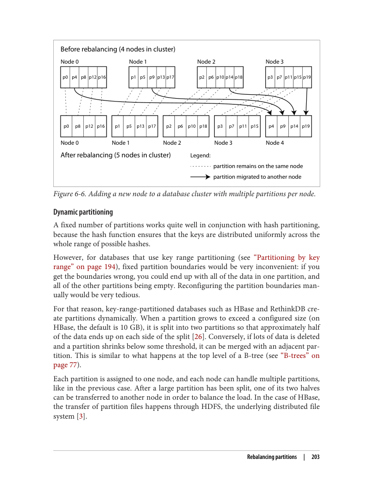

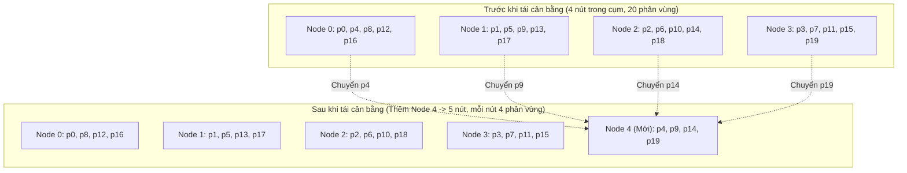

Chỉ có toàn bộ các phân vùng nguyên vẹn (entire partitions) mới được di chuyển giữa các nút. Tổng số lượng phân vùng không hề thay đổi, và việc gán khóa vào phân vùng nào cũng không thay đổi. Thứ duy nhất thay đổi là sự gán ghép giữa các phân vùng và các nút (assignment of partitions to nodes). Sự thay đổi gán ghép này không diễn ra tức thời — cần phải mất một khoảng thời gian để truyền tải một lượng lớn dữ liệu qua mạng — vì vậy sơ đồ gán phân vùng cũ vẫn được tiếp tục sử dụng cho bất kỳ thao tác đọc và ghi nào diễn ra trong lúc quá trình truyền dữ liệu đang được tiến hành.

Về nguyên tắc, bạn thậm chí có thể tính đến sự không đồng nhất về phần cứng (mismatched hardware) trong cụm của mình: bằng cách gán nhiều phân vùng hơn cho các nút có cấu hình mạnh hơn, bạn có thể buộc những nút đó gánh vác một phần tải lớn hơn.

Cách tiếp cận tái cân bằng này được sử dụng trong Riak [14], Cassandra kể từ phiên bản 1.2 [23], Elasticsearch [24], Couchbase [9] và Voldemort [25].

Trong cấu hình này, số lượng phân vùng thường được ấn định cố định ngay từ khi cơ sở dữ liệu được thiết lập lần đầu tiên, và không thay đổi về sau. Mặc dù về nguyên tắc hoàn toàn có thể tách (split) và gộp (merge) các phân vùng (xem mục tiếp theo), việc giữ cố định số lượng phân vùng giúp việc vận hành đơn giản hơn, và vì thế nhiều cơ sở dữ liệu phân vùng cố định chọn không triển khai tính năng tách phân vùng. Do đó, số lượng phân vùng được cấu hình ngay từ ban đầu cũng chính là số lượng nút tối đa mà bạn có thể có, vì vậy bạn cần phải chọn con số này đủ cao để đáp ứng sự tăng trưởng trong tương lai. Tuy nhiên, mỗi phân vùng cũng tiêu tốn chi phí phụ trội cho việc quản lý (management overhead), nên việc chọn một con số quá cao sẽ gây phản tác dụng.

> 💡 **Ví dụ bổ sung (không có trong sách): 16.384 Hash Slots trong Redis Cluster và vBuckets trong Couchbase**
>
> - **Redis Cluster** sử dụng chính xác chiến lược *Số lượng phân vùng cố định*: toàn bộ không gian khóa được chia thành cố định **16.384 hash slots** (đánh số từ `0` đến `16383`). Khi một khóa được gửi đến, Redis tính `CRC16(key) mod 16384` để biết khóa thuộc slot nào. Nếu cụm có 3 nút Master, nút A giữ các slot `0..5460`, nút B giữ `5461..10922`, nút C giữ `10923..16383`. Khi thêm nút D thứ 4, hệ thống chỉ cần di chuyển khoảng 4.096 slots từ A, B, C sang D mà công thức `CRC16(key) mod 16384` hoàn toàn không đổi!
> - **Couchbase** chia dữ liệu cố định thành **1.024 vBuckets** (hoặc 64 trên macOS). Bảng ánh xạ từ vBucket sang Node được gọi là *Cluster Map*, được chia sẻ trực tiếp cho các SDK của Client.

#### Phân vùng động (Dynamic partitioning)

Chiến lược số lượng phân vùng cố định hoạt động khá tốt khi kết hợp với phân vùng bằng hàm băm, bởi vì hàm băm đảm bảo rằng các khóa được phân phối đồng đều trên toàn bộ dải các giá trị băm có thể có.

Tuy nhiên, đối với các cơ sở dữ liệu sử dụng *phân vùng theo khoảng khóa* (xem mục "Phân vùng theo khoảng khóa (Partitioning by key range)" ở trang 194), một số lượng phân vùng cố định với các ranh giới cố định sẽ vô cùng bất tiện: nếu bạn xác định sai ranh giới, bạn có thể rơi vào cảnh toàn bộ dữ liệu dồn hết vào một phân vùng duy nhất, còn tất cả các phân vùng khác đều trống rỗng. Việc cấu hình lại ranh giới phân vùng một cách thủ công sẽ cực kỳ tẻ nhạt và tốn công sức.

Vì lý do đó, các cơ sở dữ liệu phân vùng theo khoảng khóa như HBase và RethinkDB tạo ra các phân vùng một cách *động (dynamically)*. Khi một phân vùng phình to vượt quá một kích thước đã cấu hình (trên HBase, mặc định là 10 GB), nó sẽ được tách (split) thành hai phân vùng sao cho xấp xỉ một nửa lượng dữ liệu nằm ở mỗi bên của điểm tách [26]. Ngược lại, nếu có nhiều dữ liệu bị xóa đi và một phân vùng co nhỏ lại xuống dưới một ngưỡng nào đó, nó có thể được gộp (merged) với một phân vùng liền kề. Quá trình này tương tự như những gì diễn ra ở cấp độ trên cùng của một cây B-tree (xem mục "B-trees" ở trang 77).

Mỗi phân vùng được gán cho một nút, và mỗi nút có thể xử lý nhiều phân vùng, giống như trong trường hợp số lượng phân vùng cố định ở trên. Sau khi một phân vùng lớn đã được tách đôi, một trong hai nửa của nó có thể được chuyển giao sang một nút khác nhằm cân bằng tải. Trong trường hợp của HBase, việc truyền tải các tập tin phân vùng được thực hiện thông qua HDFS — hệ thống tập tin phân tán nằm bên dưới nó [3].

Một ưu điểm của phân vùng động là số lượng phân vùng tự động thích ứng với tổng dung lượng dữ liệu. Nếu chỉ có một lượng nhỏ dữ liệu, một số lượng nhỏ phân vùng là đã đủ dùng, do đó chi phí phụ trội (overheads) là rất nhỏ; nếu có một lượng dữ liệu khổng lồ, kích thước của mỗi phân vùng riêng lẻ luôn được giới hạn ở một mức tối đa có thể cấu hình được [22].

Tuy nhiên, một điều cần lưu ý là một cơ sở dữ liệu trống rỗng ban đầu sẽ khởi đầu chỉ với một phân vùng duy nhất, bởi vì chưa có thông tin tiền nghiệm (*a priori*) nào về việc nên vạch ranh giới phân vùng ở đâu. Trong khi tập dữ liệu còn nhỏ — cho đến khi nó chạm tới ngưỡng mà phân vùng đầu tiên được tách ra — tất cả các thao tác ghi đều phải được xử lý bởi một nút duy nhất trong khi các nút khác ngồi nhàn rỗi. Để giảm thiểu vấn đề này, HBase và MongoDB cho phép cấu hình một tập hợp các phân vùng ban đầu ngay trên một cơ sở dữ liệu trống (kỹ thuật này được gọi là *tách trước - pre-splitting*). Trong trường hợp phân vùng theo khoảng khóa, việc tách trước đòi hỏi bạn phải biết trước phân phối của các khóa sẽ trông như thế nào [26, 4].

Phân vùng động không chỉ dành riêng cho dữ liệu được phân vùng theo khoảng khóa, mà hoàn toàn có thể được sử dụng tốt không kém với dữ liệu được phân vùng bằng hàm băm. MongoDB kể từ phiên bản 2.4 hỗ trợ cả phân vùng theo khoảng khóa lẫn phân vùng bằng hàm băm, và nó đều thực hiện tách phân vùng một cách tự động (dynamically) trong cả hai trường hợp.

#### Các chiến lược tái cân bằng khác (Other rebalancing strategies)

Trước phiên bản 1.2, Cassandra đã sử dụng kỹ thuật băm nhất quán (consistent hashing) với các ranh giới phân vùng giả ngẫu nhiên, đúng như mô tả nguyên bản của Karger và các cộng sự [6]. Thay vì gán nhiều phân vùng nhỏ cho mỗi nút, nó sử dụng một phân vùng lớn duy nhất cho mỗi nút, bao phủ một khoảng giá trị băm liên tục rộng lớn.

Tuy nhiên, cách tiếp cận này đã gặp phải tình trạng phân phối tải kém đồng đều, và gây ra nhiều khó khăn khi thêm các nút mới vào cụm: một nút hiện có buộc phải chia đôi khoảng băm của mình để nhường một nửa dữ liệu cho một nút mới. Thao tác đắt đỏ này rất khó thực hiện chạy ngầm (in the background) mà không làm ảnh hưởng tiêu cực đến hiệu năng truy vấn. Vì những lý do đó, chiến lược phân vùng của Cassandra đã được thay thế bằng cách tiếp cận số lượng phân vùng cố định (*virtual nodes - vnodes*) như đã mô tả ở trên [22].

Những vấn đề này thực ra có thể tránh được bằng cách sử dụng một hàm băm tốt hơn (hoặc phân bổ tỷ lệ thuận với số nút - *partitioning proportionally to nodes*) [7], nhưng trong thực tế, các mô hình phân vùng được sử dụng rộng rãi nhất hiện nay vẫn là băm với một số lượng phân vùng cố định, hoặc phân vùng động theo khoảng khóa (khi có nhu cầu truy vấn khoảng).

> 📝 **Giải thích thêm (không có trong sách): Tổng hợp so sánh các chiến lược Tái cân bằng (Rebalancing Strategies)**
>
> | Chiến lược | Cơ chế hoạt động | Ưu điểm | Nhược điểm | Hệ thống sử dụng |
> | :--- | :--- | :--- | :--- | :--- |
> | **Hash mod $N$** *(Không nên dùng)* | Gán trực tiếp `hash(key) % N` (với $N$ là số nút). | Cực kỳ dễ lập trình. | Khi $N$ thay đổi (thêm/bớt 1 nút), gần như **100% các khóa** bị đổi vị trí, gây bão mạng khi tái cân bằng. | Chỉ dùng trong các bài tập nhỏ hoặc cache tĩnh không bao giờ đổi số nút. |
> | **Số phân vùng cố định (Fixed partitions / vnodes)** | Tạo trước $P$ phân vùng cố định ($P \gg N$), mỗi nút giữ nhiều phân vùng. Khi thêm nút mới, chuyển một vài phân vùng nguyên vẹn sang nút mới. | Chỉ di chuyển đúng phần dữ liệu cần thiết ($1/N$); gán khóa vào phân vùng không bao giờ đổi; dễ chia tải theo cấu hình phần cứng mạnh/yếu. | Số phân vùng $P$ cố định từ đầu: chọn $P$ quá nhỏ thì giới hạn khả năng mở rộng số nút về sau; chọn $P$ quá lớn thì tốn chi phí quản lý metadata cho mỗi phân vùng. | Redis Cluster (16.384 slots), Couchbase (1.024 vBuckets), Elasticsearch, Riak, Voldemort, Cassandra (vnodes). |
> | **Phân vùng động (Dynamic partitioning)** | Tự động tách đôi (split) phân vùng khi vượt ngưỡng dung lượng (ví dụ 10 GB) và gộp (merge) khi co nhỏ. | Số lượng phân vùng tự động co giãn linh hoạt theo quy mô dữ liệu thực tế; hỗ trợ tốt cả phân vùng theo khoảng khóa lẫn hàm băm. | Lúc mới khởi tạo bảng trống chỉ có 1 phân vùng duy nhất nên mọi lệnh ghi dồn vào 1 nút (cần *pre-splitting* để khắc phục). | HBase, Bigtable, RethinkDB, MongoDB, CockroachDB, TiDB. |

### Vận hành: tái cân bằng tự động hay thủ công (Operations: automatic or manual rebalancing)

Có một câu hỏi quan trọng liên quan đến việc tái cân bằng mà chúng ta vừa lướt qua: quá trình tái cân bằng diễn ra tự động hay thủ công?

Có một dải chuyển tiếp (gradient) nằm giữa tái cân bằng tự động hoàn toàn (hệ thống tự động quyết định khi nào cần di chuyển các phân vùng từ nút này sang nút khác, mà không cần bất kỳ sự tương tác nào của người quản trị viên) và thủ công hoàn toàn (việc gán các phân vùng vào các nút được cấu hình tường minh bởi người quản trị viên, và chỉ thay đổi khi người quản trị viên chủ động cấu hình lại nó). Ví dụ, Couchbase, Riak và Voldemort tự động sinh ra một phương án gán phân vùng đề xuất, nhưng yêu cầu người quản trị viên phải xác nhận (commit) thì phương án đó mới có hiệu lực.

Tái cân bằng tự động hoàn toàn có thể rất tiện lợi, bởi vì có ít công việc vận hành phải làm hơn đối với các hoạt động bảo trì thông thường. Tuy nhiên, nó có thể trở nên khó lường (unpredictable). Tái cân bằng là một thao tác đắt đỏ, bởi vì nó đòi hỏi phải định tuyến lại các yêu cầu và di chuyển một lượng lớn dữ liệu từ nút này sang nút khác. Nếu việc này không được thực hiện một cách cẩn thận, nó có thể làm quá tải đường truyền mạng hoặc các nút, và gây ra các vấn đề suy giảm hiệu năng cho các yêu cầu khác đang chạy trên hệ thống.

Việc tự động hóa này có thể trở nên đặc biệt nguy hiểm khi kết hợp với cơ chế *phát hiện lỗi tự động (automatic failure detection)*. Ví dụ, giả sử một nút đang bị quá tải và tạm thời phản hồi chậm đối với các yêu cầu. Các nút khác kết luận rằng nút đang quá tải đó đã chết, và tự động tái cân bằng lại cụm để di chuyển tải ra khỏi nó. Việc sao chép dữ liệu tái cân bằng này lại chất thêm tải bổ sung lên chính nút đó, các nút khác và đường truyền mạng, từ đó tiềm ẩn nguy cơ làm quá tải thêm nhiều nút nữa và gây ra một *sự cố dây chuyền (cascading failure)*.

Vì lý do đó, việc giữ một con người trong vòng lặp quyết định (*human in the loop*) đối với quá trình tái cân bằng có thể là một điều tốt. Nó chậm hơn so với việc thực hiện tự động hoàn toàn, nhưng nó có thể giúp ngăn chặn những bất ngờ tai hại trong vận hành.

---

## Định tuyến yêu cầu (Request routing)

Giờ đây chúng ta đã phân vùng tập dữ liệu của mình qua nhiều nút đang chạy trên nhiều máy chủ khác nhau. Nhưng vẫn còn lại một câu hỏi bỏ ngỏ: khi một client muốn thực hiện một yêu cầu, làm thế nào nó biết được cần phải kết nối tới nút nào? Khi các phân vùng được tái cân bằng, sự gán ghép giữa các phân vùng và các nút sẽ thay đổi. Ai đó cần phải nắm bắt sát sao những thay đổi đó để trả lời cho câu hỏi: *Nếu tôi muốn đọc hoặc ghi khóa "foo", tôi cần phải kết nối tới địa chỉ IP và số hiệu cổng (port number) nào?*

Đây là một trường hợp cụ thể của một bài toán tổng quát hơn được gọi là *khám phá dịch vụ (service discovery)*, vốn không chỉ giới hạn ở riêng các cơ sở dữ liệu. Bất kỳ phần mềm nào có thể truy cập được qua mạng đều gặp phải bài toán này, đặc biệt là nếu nó hướng tới tính sẵn sàng cao (chạy trong một cấu hình dự phòng trên nhiều máy chủ). Nhiều công ty đã tự viết các công cụ khám phá dịch vụ nội bộ của riêng mình, và nhiều công cụ trong số đó đã được phát hành dưới dạng mã nguồn mở [27].

Ở mức độ tổng quan cao, có một vài cách tiếp cận khác nhau cho bài toán này (được minh họa trong **Hình 6-7**):

1. Cho phép các client liên hệ với *bất kỳ nút nào* (ví dụ: thông qua một bộ cân bằng tải xoay vòng - round-robin load balancer). Nếu nút đó tình cờ sở hữu phân vùng mà yêu cầu đang nhắm tới, nó có thể trực tiếp xử lý yêu cầu đó; ngược lại, nó sẽ chuyển tiếp (forward) yêu cầu tới nút thích hợp, nhận phản hồi và chuyển trả lại cho client.
2. Gửi tất cả các yêu cầu từ client tới một *tầng định tuyến (routing tier)* trước tiên; tầng này sẽ xác định nút nào cần xử lý yêu cầu và chuyển tiếp nó tương ứng. Bản thân tầng định tuyến này không trực tiếp lưu trữ hay xử lý bất kỳ dữ liệu nào, nó chỉ đóng vai trò như một bộ cân bằng tải nhận biết phân vùng (partition-aware load balancer).
3. Yêu cầu các *client phải tự nhận biết được cấu trúc phân vùng* cũng như việc gán các phân vùng vào các nút. Trong trường hợp này, một client có thể kết nối trực tiếp tới đúng nút thích hợp mà không cần bất kỳ thành phần trung gian nào.

**Hình 6-7 – Ba cách khác nhau để định tuyến một yêu cầu tới đúng nút (Figure 6-7. Three different ways of routing a request to the right node.)**

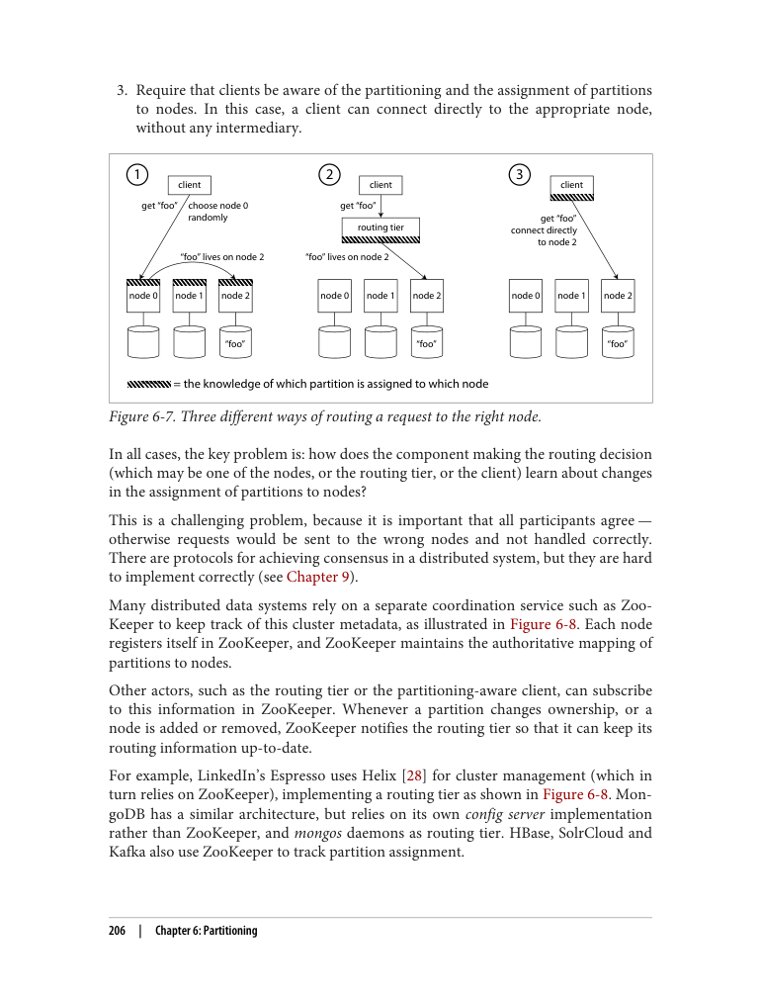

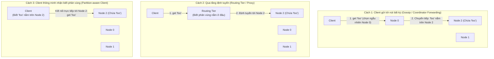

Trong tất cả mọi trường hợp, bài toán cốt lõi là: làm thế nào để thành phần đưa ra quyết định định tuyến (có thể là một trong các nút, hoặc tầng định tuyến, hoặc bản thân client) biết được về những thay đổi trong việc gán các phân vùng cho các nút?

Đây là một bài toán đầy thách thức, bởi vì điều quan trọng là tất cả các bên tham gia đều phải đồng thuận (agree) với nhau — nếu không các yêu cầu sẽ bị gửi tới sai nút và không được xử lý đúng đắn. Có những giao thức để đạt được sự đồng thuận trong một hệ thống phân tán, nhưng chúng rất khó để triển khai chính xác (xem Chương 9).

Nhiều hệ thống dữ liệu phân tán dựa vào một dịch vụ điều phối (coordination service) riêng biệt chẳng hạn như **ZooKeeper** để theo dõi siêu dữ liệu cụm (cluster metadata) này, như được minh họa trong **Hình 6-8**. Mỗi nút tự đăng ký bản thân nó vào ZooKeeper, và ZooKeeper duy trì bảng ánh xạ có thẩm quyền chuẩn xác nhất (authoritative mapping) giữa các phân vùng và các nút. Các tác nhân khác, chẳng hạn như tầng định tuyến hoặc client có nhận biết phân vùng, có thể đăng ký theo dõi (subscribe) thông tin này trong ZooKeeper. Bất cứ khi nào một phân vùng thay đổi quyền sở hữu, hoặc một nút được thêm vào hay gỡ bỏ, ZooKeeper sẽ thông báo cho tầng định tuyến để nó có thể cập nhật thông tin định tuyến của mình luôn mới nhất.

**Hình 6-8 – Sử dụng ZooKeeper để theo dõi việc gán các phân vùng vào các nút (Figure 6-8. Using ZooKeeper to keep track of assignment of partitions to nodes.)**

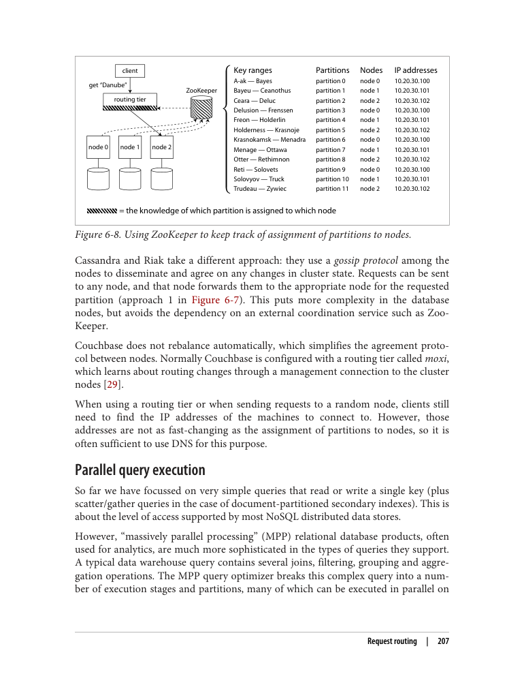

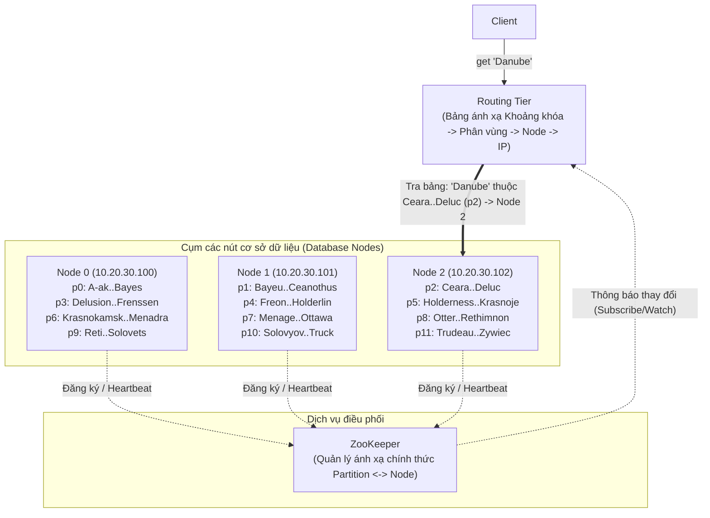

| Khoảng khóa (Key ranges) | Phân vùng (Partitions) | Nút (Nodes) | Địa chỉ IP (IP addresses) |
| :--- | :--- | :--- | :--- |
| `A-ak — Bayes` | partition 0 | node 0 | `10.20.30.100` |
| `Bayeu — Ceanothus` | partition 1 | node 1 | `10.20.30.101` |
| `Ceara — Deluc` *(chứa "Danube")* | partition 2 | node 2 | `10.20.30.102` |
| `Delusion — Frenssen` | partition 3 | node 0 | `10.20.30.100` |
| `Freon — Holderlin` | partition 4 | node 1 | `10.20.30.101` |
| `Holderness — Krasnoje` | partition 5 | node 2 | `10.20.30.102` |
| `Krasnokamsk — Menadra` | partition 6 | node 0 | `10.20.30.100` |
| `Menage — Ottawa` | partition 7 | node 1 | `10.20.30.101` |
| `Otter — Rethimnon` | partition 8 | node 2 | `10.20.30.102` |
| `Reti — Solovets` | partition 9 | node 0 | `10.20.30.100` |
| `Solovyov — Truck` | partition 10 | node 1 | `10.20.30.101` |
| `Trudeau — Zywiec` | partition 11 | node 2 | `10.20.30.102` |

Ví dụ, hệ thống Espresso của LinkedIn sử dụng Helix [28] để quản lý cụm (bản thân Helix lại dựa vào ZooKeeper), triển khai một tầng định tuyến đúng như hiển thị trong **Hình 6-8**. MongoDB có một kiến trúc tương tự, nhưng dựa vào triển khai máy chủ cấu hình (*config server*) của riêng nó thay vì ZooKeeper, và sử dụng các tiến trình ngầm `mongos` làm tầng định tuyến. HBase, SolrCloud và Kafka cũng sử dụng ZooKeeper để theo dõi việc gán phân vùng (lưu ý: các phiên bản Kafka hiện đại từ 3.3+ đã thay thế ZooKeeper bằng giao thức đồng thuận nội bộ KRaft).

Cassandra và Riak lại đi theo một hướng tiếp cận khác: chúng sử dụng một *giao thức tin đồn (gossip protocol)* giữa các nút để lan truyền và thống nhất về bất kỳ thay đổi nào trong trạng thái của cụm. Các yêu cầu có thể được gửi tới bất kỳ nút nào, và nút đó sẽ chuyển tiếp chúng tới nút thích hợp cho phân vùng được yêu cầu (cách tiếp cận số 1 trong **Hình 6-7**). Mô hình này đặt nhiều sự phức tạp hơn vào bên trong các nút cơ sở dữ liệu, nhưng tránh được sự phụ thuộc vào một dịch vụ điều phối bên ngoài như ZooKeeper.

Couchbase không thực hiện tái cân bằng tự động, điều này giúp đơn giản hóa giao thức đồng thuận giữa các nút. Thông thường Couchbase được cấu hình với một tầng định tuyến có tên là `moxi`, tầng này tìm hiểu về các thay đổi định tuyến thông qua một kết nối quản lý tới các nút trong cụm [29].

Khi sử dụng một tầng định tuyến hoặc khi gửi yêu cầu tới một nút ngẫu nhiên, các client vẫn cần phải tìm ra địa chỉ IP của các máy chủ để kết nối vào. Tuy nhiên, những địa chỉ này không thay đổi nhanh chóng và liên tục như việc gán các phân vùng cho các nút, vì vậy việc sử dụng DNS cho mục đích này thường là đã đủ đáp ứng.

> 📝 **Giải thích thêm (không có trong sách): Định tuyến yêu cầu thực tế trong Redis Cluster, Kafka, Cassandra và MongoDB**
>
> Ba mô hình định tuyến trong **Hình 6-7** xuất hiện rất rõ nét trong các hệ thống phổ biến hiện nay:
>
> 1. **Mô hình 1 (Contact any node) — Cassandra & ScyllaDB:**
>    Client có thể kết nối tới bất kỳ nút nào trong cụm; nút nhận kết nối được gọi là **Coordinator Node** cho yêu cầu đó. Tuy nhiên, các Driver hiện đại (như DataStax Java/Python Driver) thực chất kết hợp **Mô hình 3**: Driver lắng nghe thông tin topology qua kết nối điều khiển để tự tính toán `Murmur3Hash(partition_key)` và gửi thẳng request tới đúng nút chứa bản sao (*Token-Aware Routing*), giúp tiết kiệm 1 chặng chuyển tiếp mạng (network hop).
> 2. **Mô hình 2 (Routing tier) — MongoDB (`mongos`) & TiDB (`TiDB Server`):**
>    Ứng dụng kết nối tới các tiến trình stateless `mongos` giống như kết nối tới một MongoDB đơn lẻ. `mongos` lấy bản đồ phân vùng (chunk map) từ cụm *Config Servers* (chạy Raft) và định tuyến truy vấn tới đúng *Shard* chứa dữ liệu.
> 3. **Mô hình 3 kết hợp Mô hình 1 (Smart Client + Redirect) — Redis Cluster & Apache Kafka:**
>    - Trong **Redis Cluster**, SDK của Client tự lưu bộ nhớ đệm (cache) bảng ánh xạ `16.384 hash slots -> Node IP:Port` và kết nối trực tiếp tới nút đích. Nếu phân vùng vừa được di chuyển sang nút khác do tái cân bằng, nút cũ sẽ trả về lỗi chuyển hướng `-MOVED <slot> <new_ip>:<port>` (hoặc `-ASK` nếu đang trong quá trình di trú dở dang). Client lập tức gửi lại lệnh sang nút mới và cập nhật lại bảng ánh xạ trong bộ nhớ đệm.
>    - Trong **Apache Kafka**, Producer/Consumer gửi một `MetadataRequest` tới bất kỳ Broker nào (*Bootstrap Server*) để lấy danh sách toàn bộ các Partition và địa chỉ Broker đang làm Leader của từng Partition, sau đó kết nối TCP trực tiếp tới đúng Broker Leader đó để ghi/đọc dữ liệu với độ trễ thấp nhất.

### Thực thi truy vấn song song (Parallel query execution)

Cho đến nay, chúng ta mới chỉ tập trung vào những truy vấn rất đơn giản chỉ đọc hoặc ghi một khóa đơn lẻ (cộng thêm các truy vấn scatter/gather trong trường hợp chỉ mục phụ phân vùng theo tài liệu). Đây cũng là mức độ truy cập được hỗ trợ bởi hầu hết các kho dữ liệu phân tán NoSQL.

Tuy nhiên, các sản phẩm cơ sở dữ liệu quan hệ *xử lý song song hàng loạt (Massively Parallel Processing - MPP)*, thường được sử dụng cho mục đích phân tích (analytics), lại tinh vi và phức tạp hơn rất nhiều về các loại truy vấn mà chúng hỗ trợ. Một truy vấn kho dữ liệu (data warehouse) điển hình chứa nhiều phép nối (joins), lọc (filtering), gom nhóm (grouping) và tổng hợp (aggregation). Bộ tối ưu hóa truy vấn MPP (MPP query optimizer) sẽ bẻ nhỏ truy vấn phức tạp này thành một số giai đoạn thực thi (execution stages) và các phân vùng, mà nhiều phần trong số đó có thể được thực thi song song trên các nút khác nhau của cụm cơ sở dữ liệu. Những truy vấn liên quan đến việc quét qua những phần lớn của tập dữ liệu đặc biệt hưởng lợi rất nhiều từ khả năng thực thi song song như vậy.

Việc thực thi song song tốc độ cao các truy vấn kho dữ liệu là một chủ đề chuyên sâu, và với tầm quan trọng thương mại của mảng phân tích dữ liệu, nó nhận được rất nhiều sự quan tâm về mặt thương mại. Chúng ta sẽ chạm tới một số kỹ thuật thực thi truy vấn song song trong Chương 10. Để có cái nhìn tổng quan chi tiết hơn về các kỹ thuật được sử dụng trong các cơ sở dữ liệu song song, vui lòng xem các tài liệu tham khảo [1, 30].

---

## Tóm tắt (Summary)

Trong chương này, chúng ta đã khám phá những cách thức khác nhau để phân vùng một tập dữ liệu lớn thành các tập con nhỏ hơn. Việc này là cần thiết khi bạn có quá nhiều dữ liệu đến mức việc lưu trữ và xử lý nó trên một máy chủ đơn lẻ không còn khả thi nữa.

Mục tiêu chính của việc phân vùng là trải đều dữ liệu và tải truy vấn qua nhiều máy chủ, tránh tạo ra các điểm nóng (hot spots — những nút phải chịu tải cao bất tương xứng). Điều này đòi hỏi việc lựa chọn một lược đồ phân vùng phù hợp với dữ liệu của bạn, và tiến hành tái cân bằng các phân vùng theo thời gian khi có các nút được thêm vào hoặc gỡ bỏ khỏi cụm.

Chúng ta đã thảo luận về hai cách tiếp cận chính để phân vùng:

* **Phân vùng theo khoảng khóa (Key range partitioning):** trong đó các khóa được sắp xếp theo thứ tự, và một phân vùng sở hữu tất cả các khóa từ một giá trị tối thiểu nào đó cho đến một giá trị tối đa nào đó. Việc sắp xếp này có ưu điểm là cho phép thực hiện các truy vấn khoảng (range queries) hiệu quả, nhưng tiềm ẩn rủi ro xảy ra các điểm nóng nếu ứng dụng thường xuyên truy cập vào các khóa nằm gần nhau trong thứ tự đã sắp xếp (ví dụ: ghi theo dấu thời gian hiện tại).
  Trong cách tiếp cận này, các phân vùng thường được tái cân bằng một cách *động (dynamically)* bằng cách tách khoảng khóa thành hai khoảng con khi một phân vùng trở nên quá lớn.
* **Phân vùng bằng hàm băm (Hash partitioning):** trong đó một hàm băm được áp dụng lên mỗi khóa, và một phân vùng sở hữu một khoảng các giá trị băm. Phương pháp này phá hủy thứ tự tự nhiên của các khóa, làm cho các truy vấn khoảng trở nên kém hiệu quả, nhưng lại có thể phân phối tải đồng đều hơn nhiều.
  Khi phân vùng bằng hàm băm, thông lệ phổ biến là tạo trước một *số lượng phân vùng cố định (fixed number of partitions)*, gán nhiều phân vùng cho mỗi nút, và di chuyển toàn bộ các phân vùng nguyên vẹn từ nút này sang nút khác khi có các nút được thêm vào hoặc gỡ bỏ.

Các cách tiếp cận lai (hybrid approaches) cũng hoàn toàn khả thi, ví dụ như với một khóa phức hợp (compound key): sử dụng một phần của khóa để định danh phân vùng (bằng hàm băm), và một phần khác để duy trì thứ tự sắp xếp bên trong phân vùng đó.

Chúng ta cũng đã thảo luận về sự tương tác giữa việc phân vùng và các chỉ mục phụ (secondary indexes). Một chỉ mục phụ cũng cần phải được phân vùng, và có hai khả năng để thực hiện việc này:

* **Chỉ mục phân vùng theo tài liệu (Document-partitioned index / Local index):** các chỉ mục phụ được lưu trữ trong cùng một phân vùng với khóa chính và giá trị tương ứng. Điều này có nghĩa là chỉ có một phân vùng duy nhất cần được cập nhật khi thực hiện thao tác ghi, nhưng một thao tác đọc trên chỉ mục phụ lại đòi hỏi phải thực hiện *scatter/gather* qua tất cả các phân vùng.
* **Chỉ mục phân vùng theo thuật ngữ (Term-partitioned index / Global index):** các chỉ mục phụ được phân vùng tách biệt, sử dụng chính các giá trị được đánh chỉ mục. Một mục (entry) trong chỉ mục phụ có thể bao gồm các bản ghi đến từ tất cả các phân vùng của khóa chính. Khi một tài liệu được ghi, nhiều phân vùng của chỉ mục phụ cần phải được cập nhật; tuy nhiên, một thao tác đọc có thể được phục vụ nhanh chóng từ một phân vùng đơn lẻ.

Cuối cùng, chúng ta đã thảo luận về các kỹ thuật định tuyến truy vấn tới phân vùng thích hợp, trải dài từ việc cân bằng tải nhận biết phân vùng đơn giản cho đến các bộ máy thực thi truy vấn song song phức tạp.

Theo đúng thiết kế, mỗi phân vùng hoạt động phần lớn độc lập với nhau — đó chính là yếu tố cho phép một cơ sở dữ liệu phân vùng mở rộng quy mô ra nhiều máy chủ. Tuy nhiên, các thao tác cần phải ghi vào nhiều phân vùng cùng lúc có thể rất khó để suy luận và đảm bảo tính đúng đắn: ví dụ, chuyện gì sẽ xảy ra nếu thao tác ghi vào một phân vùng thành công, nhưng một phân vùng khác lại thất bại? Trong chương tiếp theo, chúng ta sẽ chuyển sang chủ đề về *giao dịch (transactions)* — cơ chế giúp cho các thao tác ghi đa phân vùng trở nên dễ suy luận và an toàn hơn.

---

## Bảng thuật ngữ Chương 6 (Glossary)

| Thuật ngữ tiếng Anh | Thuật ngữ tiếng Việt | Giải thích ngắn gọn |
| :--- | :--- | :--- |
| **Partition / Shard / Region / Tablet / vnode / vBucket** | Phân vùng | Một tập con của cơ sở dữ liệu lớn, hoạt động như một cơ sở dữ liệu nhỏ độc lập trên một nút. |
| **Skew** | Độ lệch tải | Hiện tượng dữ liệu hoặc truy vấn phân bố không đồng đều giữa các phân vùng. |
| **Hot spot** | Điểm nóng | Một phân vùng hoặc nút phải gánh chịu lượng dữ liệu hoặc thông lượng đọc/ghi cao bất thường so với phần còn lại. |
| **Key range partitioning** | Phân vùng theo khoảng khóa | Chia dữ liệu theo các khoảng khóa liên tục đã sắp xếp (tốt cho range scan, nhưng dễ bị hot spot nếu khóa tăng đơn điệu như timestamp). |
| **Hash partitioning** | Phân vùng theo hàm băm | Băm khóa trước khi gán vào khoảng băm của phân vùng (phân phối đều tải, nhưng mất khả năng range scan trên khóa đó). |
| **Consistent hashing** | Băm nhất quán | Kỹ thuật dùng ranh giới băm ngẫu nhiên trên vòng tròn băm (thường dùng cho CDN/Cache, ít dùng nguyên bản trong DB hiện đại). |
| **Compound primary key** | Khóa chính phức hợp | Khóa chính gồm nhiều cột (trong Cassandra: cột đầu dùng để băm chọn phân vùng, các cột sau dùng để sắp xếp trong phân vùng). |
| **Document-partitioned index (Local index)** | Chỉ mục phụ phân vùng theo tài liệu (Chỉ mục cục bộ) | Mỗi phân vùng chỉ lưu chỉ mục phụ của các bản ghi thuộc phân vùng đó (Ghi nhanh trên 1 phân vùng, Đọc phải scatter/gather). |
| **Term-partitioned index (Global index)** | Chỉ mục phụ phân vùng theo thuật ngữ (Chỉ mục toàn cục) | Chỉ mục phụ được phân vùng riêng theo giá trị tìm kiếm (Đọc nhanh trên 1 phân vùng, Ghi chậm vì chạm nhiều phân vùng). |
| **Scatter/gather** | Phân tán / Thu thập | Gửi truy vấn song song tới tất cả các phân vùng rồi gom kết quả lại; dễ bị khuếch đại độ trễ đuôi (tail latency amplification). |
| **Rebalancing** | Tái cân bằng | Quá trình di chuyển các phân vùng dữ liệu giữa các nút khi thêm/bớt máy chủ hoặc khi kích thước dữ liệu thay đổi. |
| **Pre-splitting** | Tách trước | Khởi tạo sẵn nhiều phân vùng ngay khi cơ sở dữ liệu còn trống để tránh việc mọi lệnh ghi ban đầu dồn vào 1 phân vùng duy nhất. |
| **Request routing / Service discovery** | Định tuyến yêu cầu / Khám phá dịch vụ | Cơ chế giúp client hoặc tầng trung gian biết được phân vùng cần truy cập hiện đang nằm ở nút (IP/Port) nào. |

---

## Tài liệu tham khảo (References)

* **[1]** David J DeWitt and Jim N Gray: “Parallel database systems: The future of high performance database systems,” *Communications of the ACM*, volume 35, number 6, pages 85–98, June 1992. doi:10.1145/129888.129894
* **[2]** Lars George: “HBase vs. BigTable Comparison,” *larsgeorge.com*, 24 November 2009.
* **[3]** “The Apache HBase Reference Guide,” Apache Software Foundation, *hbase.apache.org*, 2014.
* **[4]** MongoDB, Inc.: “New Hash-based Sharding Feature in MongoDB 2.4,” *blog.mongodb.org*, 10 April 2013.
* **[5]** Ikai Lan: “App Engine datastore tip: monotonically increasing values are bad,” *ikaisays.com*, 25 January 2011.
* **[6]** David Karger, Eric Lehman, Tom Leighton, et al.: “Consistent Hashing and Random Trees: Distributed Caching Protocols for Relieving Hot Spots on the World Wide Web,” at *29th Annual ACM Symposium on Theory of Computing* (STOC), pages 654–663, 1997. doi:10.1145/258533.258660
* **[7]** John Lamping and Eric Veach: “A Fast, Minimal Memory, Consistent Hash Algorithm,” *arxiv.org*, June 2014.
* **[8]** Eric Redmond: “A Little Riak Book,” Version 1.4.0, Basho Technologies, September 2013.
* **[9]** “Couchbase 2.5 Administrator Guide,” Couchbase, Inc., 2014.
* **[10]** Avinash Lakshman and Prashant Malik: “Cassandra — A Decentralized Structured Storage System,” at *3rd ACM SIGOPS International Workshop on Large Scale Distributed Systems and Middleware* (LADIS), October 2009.
* **[11]** Jonathan Ellis: “Facebook’s Cassandra paper, annotated and compared to Apache Cassandra 2.0,” *datastax.com*, 12 September 2013.
* **[12]** “CQL for Cassandra 2.0,” DataStax, Inc., 2014.
* **[13]** Samuel Axon: “3% of Twitter’s Servers Dedicated to Justin Bieber,” *mashable.com*, 7 September 2010.
* **[14]** “Riak 1.4.8 Docs,” Basho Technologies, Inc., 2014.
* **[15]** Richard Low: “The sweet spot for Cassandra secondary indexing,” *wentnet.com*, 21 October 2013.
* **[16]** Zachary Tong: “Customizing your document routing,” *elasticsearch.org*, 3 June 2013.
* **[17]** “Apache Solr Reference Guide,” Apache Software Foundation, 2014.
* **[18]** Andrew Pavlo: “H-Store Frequently Asked Questions,” *hstore.cs.brown.edu*, October 2013.
* **[19]** “Amazon DynamoDB Developer Guide,” Amazon Web Services, Inc., 2014.
* **[20]** Rusty Klophaus: “Difference between 2I and Search,” email to *riak-users* mailing list, *lists.basho.com*, 25 October 2011.
* **[21]** Donald K Burleson: “Object partitioning in Oracle,” *dba-oracle.com*, 8 November 2000.
* **[22]** Eric Evans: “Rethinking Topology in Cassandra,” at *ApacheCon Europe*, November 2012.
* **[23]** Brandon Williams: “Virtual nodes in Cassandra 1.2,” *datastax.com*, 4 December 2012.
* **[24]** Rafał Kuć: “Reroute API Explained,” *elasticsearchserverbook.com*, 30 September 2013.
* **[25]** “Project Voldemort documentation,” *project-voldemort.com*.
* **[26]** Enis Soztutar: “Apache HBase Region Splitting and Merging,” *hortonworks.com*, 1 February 2013.
* **[27]** Jason Wilder: “Open-Source Service Discovery,” *jasonwilder.com*, 4 February 2014.
* **[28]** Kishore Gopalakrishna, Shi Lu, Zhen Zhang, et al.: “Untangling Cluster Management with Helix,” at *ACM Symposium on Cloud Computing* (SoCC), October 2012. doi:10.1145/2391229.2391248
* **[29]** “Moxi 1.8 Manual,” Couchbase, Inc., 2014.
* **[30]** Shivnath Babu and Herodotos Herodotou: “Massively Parallel Databases and MapReduce Systems,” *Foundations and Trends in Databases*, volume 5, number 1, pages 1–104, November 2013. doi:10.1561/1900000036
