# Chương 7: Giao dịch (Transactions)

> **Mục lục Chương 7 (Table of Contents — Chapter 7)**
>
> - **Chương 7: Giao dịch (Transactions)**
>   - **Khái niệm trơn trượt về giao dịch (The slippery concept of a transaction)**
>     - Ý nghĩa của ACID (The meaning of ACID)
>       - Tính nguyên tử (Atomicity)
>       - Tính nhất quán (Consistency)
>       - Tính cô lập (Isolation)
>       - Tính bền vững (Durability)
>       - Sao chép và tính bền vững (Replication and durability)
>     - Thao tác đơn đối tượng và đa đối tượng (Single-object and multi-object operations)
>       - Ghi đơn đối tượng (Single-object writes)
>       - Nhu cầu đối với các giao dịch đa đối tượng (The need for multi-object transactions)
>       - Xử lý lỗi và hủy bỏ giao dịch (Handling errors and aborts)
>   - **Các mức cô lập yếu (Weak isolation levels)**
>     - Read committed (Đọc dữ liệu đã cam kết)
>       - Không đọc bẩn (No dirty reads)
>       - Không ghi bẩn (No dirty writes)
>       - Triển khai read committed (Implementing read committed)
>     - Cô lập bản chụp và đọc lặp lại (Snapshot isolation and repeatable read)
>       - Triển khai cô lập bản chụp (Implementing snapshot isolation)
>       - Các quy tắc hiển thị để quan sát một bản chụp nhất quán (Visibility rules for observing a consistent snapshot)
>       - Chỉ mục và cô lập bản chụp (Indexes and snapshot isolation)
>       - Repeatable read và sự nhầm lẫn về tên gọi (Repeatable read and naming confusion)
>     - Ngăn chặn mất cập nhật (Preventing lost updates)
>       - Các thao tác ghi nguyên tử (Atomic write operations)
>       - Khóa tường minh (Explicit locking)
>       - Tự động phát hiện mất cập nhật (Automatically detecting lost updates)
>       - So sánh và thiết lập (Compare-and-set)
>       - Giải quyết xung đột và sao chép (Conflict resolution and replication)
>     - Ngăn chặn lệch ghi và bóng ma (Preventing write skew and phantoms)
>       - Đặc tả hiện tượng lệch ghi (Characterizing write skew)
>       - Thêm các ví dụ về lệch ghi (More examples of write skew)
>       - Hiện tượng bóng ma gây ra lệch ghi (Phantoms causing write skew)
>       - Hiện thực hóa các xung đột (Materializing conflicts)
>   - **Tính tuần tự hóa (Serializability)** *(Phần tiếp theo)*
>   - **Tóm tắt (Summary)** *(Phần tiếp theo)*

---

> *"Một số tác giả từng khẳng định rằng giao thức cam kết hai pha (two-phase commit) tổng quát là quá đắt đỏ để hỗ trợ, bởi những vấn đề về hiệu năng hoặc tính sẵn sàng mà nó mang lại. Chúng tôi tin rằng thà để các lập trình viên ứng dụng xử lý các vấn đề hiệu năng do lạm dụng giao dịch khi xuất hiện điểm nghẽn, còn hơn là lúc nào cũng phải viết mã lách quanh việc thiếu vắng giao dịch."*
>
> — James Corbett et al., *Spanner: Google's Globally-Distributed Database* (2012)

Trong thực tế khắc nghiệt của các hệ thống dữ liệu, có rất nhiều thứ có thể xảy ra sự cố:

- Phần mềm hoặc phần cứng cơ sở dữ liệu có thể gặp lỗi bất cứ lúc nào (bao gồm cả ngay giữa chừng một thao tác ghi),
- Ứng dụng có thể bị sập (crash) bất cứ lúc nào (kể cả khi mới đi được nửa chừng một chuỗi các thao tác),
- Sự gián đoạn trên mạng có thể bất ngờ cắt đứt kết nối giữa ứng dụng với cơ sở dữ liệu, hoặc giữa nút cơ sở dữ liệu này với nút cơ sở dữ liệu khác,
- Nhiều máy khách (client) có thể ghi vào cơ sở dữ liệu cùng một lúc, ghi đè lên các thay đổi của nhau,
- Một client có thể đọc phải dữ liệu vô nghĩa vì dữ liệu đó mới chỉ được cập nhật một phần,
- Các điều kiện tranh chấp (race conditions) giữa các client có thể gây ra những lỗi (bug) đầy bất ngờ.

Để đạt được độ tin cậy (reliable), một hệ thống phải đối phó với những lỗi (faults) này và đảm bảo rằng chúng không gây ra sự cố thảm khốc cho toàn bộ hệ thống. Tuy nhiên, việc triển khai các cơ chế chịu lỗi (fault-tolerance mechanisms) tốn rất nhiều công sức. Nó đòi hỏi sự suy tính hết sức cẩn trọng về tất cả mọi tình huống có thể trục trặc, cùng rất nhiều thử nghiệm (testing) để đảm bảo giải pháp thực sự hoạt động đúng như kỳ vọng.

Trong suốt nhiều thập kỷ, **giao dịch (transactions)** đã là cơ chế được ưu tiên lựa chọn để đơn giản hóa các vấn đề này. Một giao dịch là cách để ứng dụng gom nhóm nhiều thao tác đọc và ghi lại với nhau thành một đơn vị logic duy nhất (logical unit). Về mặt khái niệm, tất cả các thao tác đọc và ghi bên trong một giao dịch được thực thi như thể chúng là một thao tác duy nhất: hoặc toàn bộ giao dịch thành công (**cam kết — commit**), hoặc nó thất bại (**hủy bỏ — abort**, **hoàn tác — rollback**). Nếu nó thất bại, ứng dụng có thể thử lại (retry) một cách an toàn. Điều này giúp việc xử lý lỗi trở nên đơn giản hơn rất nhiều đối với ứng dụng, bởi vì ứng dụng không cần phải lo lắng về **lỗi một phần (partial failure)** — tức trường hợp một số thao tác thành công trong khi một số thao tác khác lại thất bại (vì bất kỳ lý do gì).

Nếu bạn đã dành nhiều năm làm việc với các giao dịch, chúng có vẻ là điều hiển nhiên, nhưng chúng ta không nên coi chúng là điều mặc định sẵn có. Giao dịch không phải là một quy luật của tự nhiên; chúng được tạo ra với một mục đích cụ thể, đó là nhằm đơn giản hóa mô hình lập trình cho các ứng dụng truy cập cơ sở dữ liệu. Bằng cách sử dụng giao dịch, ứng dụng được tự do bỏ qua một số kịch bản lỗi tiềm ẩn và các vấn đề đồng thời (concurrency issues), bởi cơ sở dữ liệu đã đứng ra gánh vác chúng thay cho ứng dụng (chúng ta gọi đây là những **đảm bảo an toàn — safety guarantees**).

Không phải ứng dụng nào cũng cần đến giao dịch, và đôi khi việc nới lỏng các đảm bảo giao dịch hoặc từ bỏ chúng hoàn toàn lại mang đến những lợi thế nhất định — chẳng hạn như để đạt được hiệu năng cao hơn hoặc tính sẵn sàng (availability) cao hơn. Một số đặc tính an toàn hoàn toàn có thể đạt được mà không cần dùng đến giao dịch.

Làm thế nào để bạn biết được liệu mình có cần giao dịch hay không? Để trả lời câu hỏi đó, trước tiên chúng ta cần hiểu chính xác những đảm bảo an toàn nào mà giao dịch có thể cung cấp, cũng như những chi phí đi kèm với chúng. Mặc dù thoạt nhìn giao dịch có vẻ đơn giản và dễ hiểu, nhưng thực chất lại có rất nhiều chi tiết tinh vi nhưng vô cùng quan trọng tham gia vào quá trình này.

Trong chương này, chúng ta sẽ xem xét nhiều ví dụ về những điều có thể xảy ra sai sót, và khám phá các thuật toán mà cơ sở dữ liệu sử dụng để bảo vệ hệ thống trước những vấn đề đó. Chúng ta sẽ đi sâu đặc biệt vào lĩnh vực **kiểm soát đồng thời (concurrency control)**, thảo luận về nhiều loại điều kiện tranh chấp (race conditions) khác nhau có thể xảy ra, và cách các cơ sở dữ liệu triển khai các **mức cô lập (isolation levels)** như *read committed*, *snapshot isolation* (cô lập bản chụp) và *serializability* (tính tuần tự hóa).

Chương này áp dụng cho cả cơ sở dữ liệu đơn nút (single-node) lẫn cơ sở dữ liệu phân tán (distributed databases); sang Chương 8, chúng ta sẽ tập trung thảo luận vào những thách thức đặc thù chỉ phát sinh trong các hệ thống phân tán.

> 📝 **Giải thích thêm (không có trong sách):**
> Tại sao giao dịch lại được ví như một "lớp trừu tượng bảo vệ" (protective abstraction layer)? Hãy tưởng tượng khi bạn chuyển tiền giữa hai tài khoản ngân hàng hoặc đặt một đơn hàng thương mại điện tử gồm 3 bước: (1) trừ tồn kho trong bảng `inventory`, (2) tạo bản ghi đơn hàng trong bảng `orders`, và (3) ghi nhận bút toán thanh toán vào bảng `payments`. Nếu không có transaction của cơ sở dữ liệu (như trong PostgreSQL hay MySQL InnoDB), lập trình viên ứng dụng sẽ phải tự viết hàng trăm dòng mã trạng thái để xử lý: *"Điều gì xảy ra nếu bước 1 và 2 thành công nhưng đúng lúc chuẩn bị chạy bước 3 thì container ứng dụng bị OOM kill, hoặc kết nối mạng tới DB bị đứt?"* Giao dịch gom cả 3 bước vào một ranh giới `BEGIN ... COMMIT` để chuyển toàn bộ gánh nặng hoàn tác (undo/rollback) và cô lập luồng thực thi sang cho tầng lưu trữ (storage engine).

---

## Khái niệm trơn trượt về giao dịch (The slippery concept of a transaction)

Hầu như tất cả các cơ sở dữ liệu quan hệ ngày nay, cùng với một số cơ sở dữ liệu phi quan hệ, đều hỗ trợ giao dịch. Phần lớn trong số chúng tuân theo phong cách đã được giới thiệu vào năm 1975 bởi **IBM System R**, cơ sở dữ liệu SQL đầu tiên [1, 2, 3]. Mặc dù một số chi tiết triển khai đã thay đổi, nhưng ý tưởng tổng quát gần như vẫn giữ nguyên không đổi qua hơn 40 năm: cơ chế hỗ trợ giao dịch trong MySQL, PostgreSQL, Oracle, SQL Server, v.v. giống với System R đến mức đáng kinh ngạc.

Vào cuối những năm 2000, các cơ sở dữ liệu phi quan hệ (NoSQL) bắt đầu trở nên phổ biến. Chúng nhắm tới việc cải thiện hiện trạng của cơ sở dữ liệu quan hệ bằng cách cung cấp sự lựa chọn các mô hình dữ liệu mới (xem Chương 2), cũng như tích hợp sẵn tính năng sao chép (replication — Chương 5) và phân mảnh (partitioning — Chương 6) theo mặc định. Giao dịch chính là "nạn nhân" lớn nhất của trào lưu này: nhiều cơ sở dữ liệu thuộc thế hệ mới này đã từ bỏ hoàn toàn giao dịch, hoặc định nghĩa lại từ này để mô tả một tập hợp các đảm bảo yếu hơn rất nhiều so với những gì người ta vẫn hiểu trước đó [4].

Cùng với sự thổi phồng (hype) xoay quanh thế hệ cơ sở dữ liệu phân tán mới này, đã xuất hiện một niềm tin phổ biến rằng giao dịch là kẻ thù đối nghịch của khả năng mở rộng (scalability), và rằng bất kỳ hệ thống quy mô lớn nào cũng sẽ phải từ bỏ giao dịch để duy trì hiệu năng tốt và tính sẵn sàng cao [5, 6]. Ở chiều ngược lại, các đảm bảo giao dịch đôi khi lại được các nhà cung cấp cơ sở dữ liệu trình bày như một yêu cầu sống còn đối với "các ứng dụng nghiêm túc" có "dữ liệu giá trị". Cả hai quan điểm này đều là sự phóng đại thái quá (pure hyperbole).

Sự thật không đơn giản như vậy: giống như mọi lựa chọn thiết kế kỹ thuật khác, giao dịch có cả những ưu điểm lẫn những hạn chế. Để bóc tách những sự đánh đổi (trade-offs) đó, chúng ta hãy đi sâu vào chi tiết các đảm bảo mà giao dịch có thể cung cấp — cả trong quá trình vận hành bình thường lẫn trong những hoàn cảnh khắc nghiệt (nhưng hoàn toàn thực tế).

---

### Ý nghĩa của ACID (The meaning of ACID)

Các đảm bảo an toàn do giao dịch cung cấp thường được mô tả bằng từ viết tắt nổi tiếng **ACID**, đại diện cho **Atomicity** (Tính nguyên tử), **Consistency** (Tính nhất quán), **Isolation** (Tính cô lập) và **Durability** (Tính bền vững). Thuật ngữ này được đặt ra vào năm 1983 bởi Theo Härder và Andreas Reuter [7] trong một nỗ lực nhằm thiết lập hệ thống thuật ngữ chính xác cho các cơ chế chịu lỗi trong cơ sở dữ liệu.

Tuy nhiên, trên thực tế, cách triển khai ACID của cơ sở dữ liệu này không hề giống với cách triển khai của cơ sở dữ liệu khác. Ví dụ, như chúng ta sẽ thấy, có rất nhiều sự mơ hồ xoay quanh ý nghĩa của từ *cô lập (isolation)* [8]. Ý tưởng ở mức cao thì rất chuẩn xác, nhưng "ác quỷ nằm ở những chi tiết" (the devil is in the details). Ngày nay, khi một hệ thống tuyên bố là "tuân thủ ACID" (ACID compliant), người ta không rõ thực sự có thể kỳ vọng những đảm bảo nào từ nó. Đáng tiếc là ACID phần lớn đã trở thành một thuật ngữ tiếp thị (marketing term).

*(Các hệ thống không đáp ứng các tiêu chí ACID đôi khi được gọi là **BASE**, viết tắt của **Basically Available** [Cơ bản sẵn sàng], **Soft state** [Trạng thái mềm] và **Eventual consistency** [Tính nhất quán cuối cùng] [9]. Khái niệm này thậm chí còn mơ hồ hơn cả định nghĩa của ACID. Có vẻ như định nghĩa hợp lý duy nhất của BASE là "không phải ACID", tức là nó có thể mang hầu như bất kỳ ý nghĩa nào bạn muốn.)*

Hãy cùng đào sâu vào định nghĩa của tính nguyên tử (atomicity), tính nhất quán (consistency), tính cô lập (isolation) và tính bền vững (durability), vì điều này sẽ giúp chúng ta tinh chỉnh lại hiểu biết của mình về giao dịch.

#### Tính nguyên tử (Atomicity)

Nói chung, *nguyên tử (atomic)* đề cập đến một thứ không thể bị chia nhỏ thành các phần nhỏ hơn. Từ này mang những ý nghĩa tương tự nhưng có sự khác biệt tinh tế trong các nhánh khác nhau của khoa học máy tính. Ví dụ, trong lập trình đa luồng (multithreaded programming), nếu một luồng thực thi một thao tác nguyên tử (atomic operation), điều đó có nghĩa là không có cách nào để một luồng khác có thể nhìn thấy kết quả mới hoàn thành một nửa của thao tác đó. Hệ thống chỉ có thể ở trạng thái trước khi thao tác diễn ra, hoặc sau khi thao tác hoàn tất, chứ không thể ở một trạng thái lưng chừng nào đó ở giữa.

Ngược lại, trong ngữ cảnh của ACID, tính nguyên tử **không** nói về tính đồng thời (concurrency). Nó không mô tả điều gì xảy ra nếu nhiều tiến trình cố gắng truy cập cùng một dữ liệu tại cùng một thời điểm, bởi vì vấn đề đó đã được bao hàm dưới chữ cái **I** — *Isolation* (xem phần “Tính cô lập (Isolation)” bên dưới).

Thay vào đó, tính nguyên tử trong ACID mô tả điều gì xảy ra nếu một client muốn thực hiện nhiều thao tác ghi, nhưng một lỗi (fault) xuất hiện sau khi một số thao tác ghi đã được xử lý — ví dụ: một tiến trình bị sập, kết nối mạng bị gián đoạn, ổ đĩa bị đầy, hoặc một ràng buộc toàn vẹn (integrity constraint) nào đó bị vi phạm. Nếu các thao tác ghi được gom nhóm lại cùng nhau thành một giao dịch nguyên tử, và giao dịch đó không thể hoàn tất (*committed*) do gặp lỗi, thì giao dịch đó sẽ bị **hủy bỏ (aborted)** và cơ sở dữ liệu phải loại bỏ hoặc hoàn tác (undo) bất kỳ thao tác ghi nào mà nó đã thực hiện cho đến thời điểm đó trong giao dịch ấy.

Nếu không có tính nguyên tử, khi một lỗi xảy ra giữa chừng trong lúc đang thực hiện nhiều thay đổi, sẽ rất khó để biết được những thay đổi nào đã có hiệu lực và những thay đổi nào chưa. Ứng dụng có thể thử thực hiện lại, nhưng điều đó có nguy cơ thực hiện cùng một thay đổi hai lần, dẫn đến dữ liệu bị trùng lặp hoặc sai lệch. Tính nguyên tử đơn giản hóa vấn đề này: nếu một giao dịch bị hủy bỏ, ứng dụng có thể chắc chắn rằng giao dịch đó chưa làm thay đổi bất cứ thứ gì, vì vậy nó có thể được thử lại (retried) một cách an toàn.

Khả năng hủy bỏ một giao dịch khi gặp lỗi và loại bỏ toàn bộ các thao tác ghi từ giao dịch đó chính là đặc trưng định hình nên tính nguyên tử của ACID. Có lẽ **khả năng hủy bỏ (abortability)** sẽ là một thuật ngữ chuẩn xác hơn là *tính nguyên tử (atomicity)*, nhưng chúng ta sẽ tiếp tục dùng từ *tính nguyên tử* vì đó là từ thông dụng.

#### Tính nhất quán (Consistency)

Từ *nhất quán (consistency)* bị nạp chồng ý nghĩa (overloaded) một cách khủng khiếp:

- Trong Chương 5, chúng ta đã thảo luận về *tính nhất quán của bản sao (replica consistency)* và vấn đề *tính nhất quán cuối cùng (eventual consistency)* phát sinh trong các hệ thống sao chép bất đồng bộ (xem phần “Các vấn đề với độ trễ sao chép” ở trang 155 bản gốc).
- Trong định lý CAP (xem Chương 9), từ *consistency* được dùng để chỉ *tính khả tuần tự tuyến tính (linearizability)* (xem phần “Linearizability” ở trang 314 bản gốc).
- Trong ngữ cảnh của ACID, *consistency* đề cập đến một khái niệm mang tính đặc thù của ứng dụng (application-specific notion) về việc cơ sở dữ liệu đang ở trong một "trạng thái tốt" (good state).

Thật không may khi cùng một từ lại được sử dụng với ít nhất ba ý nghĩa khác nhau như vậy.

Ý tưởng của tính nhất quán trong ACID là bạn có một số mệnh đề khẳng định về dữ liệu của mình — gọi là các **bất biến (invariants)** — mà lúc nào cũng phải đúng; ví dụ, trong một hệ thống kế toán, tổng số dư bên có (credits) và bên nợ (debits) trên toàn bộ các tài khoản phải luôn luôn cân bằng. Nếu một giao dịch bắt đầu với một cơ sở dữ liệu hợp lệ theo các bất biến này, và bất kỳ thao tác ghi nào trong suốt giao dịch đều bảo toàn tính hợp lệ đó, thì bạn có thể chắc chắn rằng các bất biến luôn luôn được thỏa mãn.

Tuy nhiên, ý tưởng về tính nhất quán này phụ thuộc vào khái niệm bất biến của riêng ứng dụng, và chính ứng dụng phải chịu trách nhiệm định nghĩa các giao dịch của mình sao cho đúng để chúng bảo toàn được tính nhất quán. Đây không phải là điều mà cơ sở dữ liệu có thể đảm bảo: nếu bạn ghi dữ liệu xấu làm vi phạm các bất biến của mình, cơ sở dữ liệu không thể ngăn cản bạn. (Một số loại bất biến cụ thể có thể được kiểm tra bởi cơ sở dữ liệu, chẳng hạn như sử dụng ràng buộc khóa ngoại [foreign key constraints] hoặc ràng buộc duy nhất [uniqueness constraints]. Tuy nhiên, nhìn chung, ứng dụng mới là bên định nghĩa dữ liệu nào là hợp lệ hay không hợp lệ — cơ sở dữ liệu chỉ lưu trữ dữ liệu đó mà thôi.)

Tính nguyên tử (Atomicity), tính cô lập (Isolation) và tính bền vững (Durability) là các thuộc tính của cơ sở dữ liệu, trong khi tính nhất quán (Consistency — theo nghĩa ACID) lại là một thuộc tính của ứng dụng. Ứng dụng có thể dựa vào các thuộc tính nguyên tử và cô lập của cơ sở dữ liệu để đạt được tính nhất quán, nhưng điều đó không phụ thuộc vào một mình cơ sở dữ liệu. Do đó, chữ cái **C** thực sự không thuộc về ACID.<sup>i</sup>

> <sup>i</sup> Joe Hellerstein từng nhận xét rằng chữ C trong ACID được "ném vào chỉ để làm cho từ viết tắt ghép thành chữ có nghĩa" trong bài báo của Härder và Reuter, và rằng nó không được coi là quan trọng vào thời điểm đó.

#### Tính cô lập (Isolation)

Hầu hết các cơ sở dữ liệu đều được truy cập bởi nhiều client cùng một lúc. Điều đó không thành vấn đề nếu chúng đang đọc và ghi các phần khác nhau của cơ sở dữ liệu, nhưng nếu chúng truy cập cùng các bản ghi cơ sở dữ liệu, bạn có thể vướng phải các vấn đề đồng thời (các điều kiện tranh chấp — race conditions).

**Hình 7-1** là một ví dụ đơn giản về loại vấn đề này. Giả sử bạn có hai client đồng thời tăng giá trị của một bộ đếm (counter) được lưu trữ trong cơ sở dữ liệu. Mỗi client cần đọc giá trị hiện tại, cộng thêm 1, và ghi giá trị mới trở lại (giả sử rằng không có thao tác tăng tự động nào được tích hợp sẵn trong cơ sở dữ liệu). Trong **Hình 7-1**, bộ đếm lẽ ra phải tăng từ 42 lên 44 vì có hai lần tăng đã diễn ra, nhưng thực tế nó chỉ lên tới 43 do điều kiện tranh chấp.

Tính cô lập theo nghĩa của ACID có nghĩa là các giao dịch đang thực thi đồng thời được cô lập khỏi nhau: chúng không thể "giẫm lên chân nhau". Các giáo trình cơ sở dữ liệu kinh điển hình thức hóa tính cô lập thành **tính tuần tự hóa (serializability)**, nghĩa là mỗi giao dịch có thể giả vờ như thể nó là giao dịch duy nhất đang chạy trên toàn bộ cơ sở dữ liệu. Cơ sở dữ liệu đảm bảo rằng khi các giao dịch đã cam kết (committed), kết quả thu được sẽ giống hệt như thể chúng đã chạy một cách tuần tự (nối tiếp nhau từng cái một), mặc dù trong thực tế chúng có thể đã chạy đồng thời [10].

Tuy nhiên, trên thực tế, cô lập tuần tự hóa (serializable isolation) hiếm khi được sử dụng vì nó mang theo một cái giá phải trả về hiệu năng. Một số cơ sở dữ liệu phổ biến như Oracle 11g thậm chí còn không triển khai nó. Trong Oracle, có một mức cô lập mang tên là `"serializable"`, nhưng thực chất nó lại triển khai một thứ gọi là **cô lập bản chụp (snapshot isolation)** — một đảm bảo yếu hơn so với tính tuần tự hóa [8, 11]. Chúng ta sẽ khám phá các mức cô lập này trong phần “Các mức cô lập yếu (Weak isolation levels)” ở bên dưới.

**Hình 7-1 – Điều kiện tranh chấp giữa hai client cùng lúc tăng giá trị một bộ đếm (Figure 7-1. A race condition between two clients concurrently incrementing a counter.)**

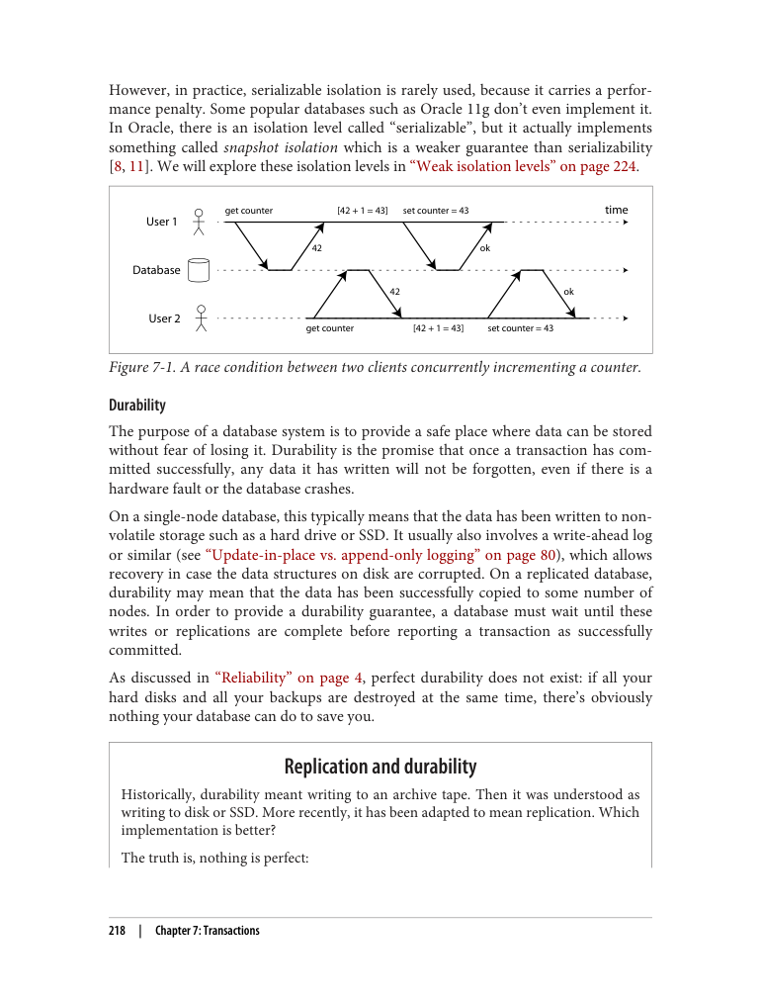

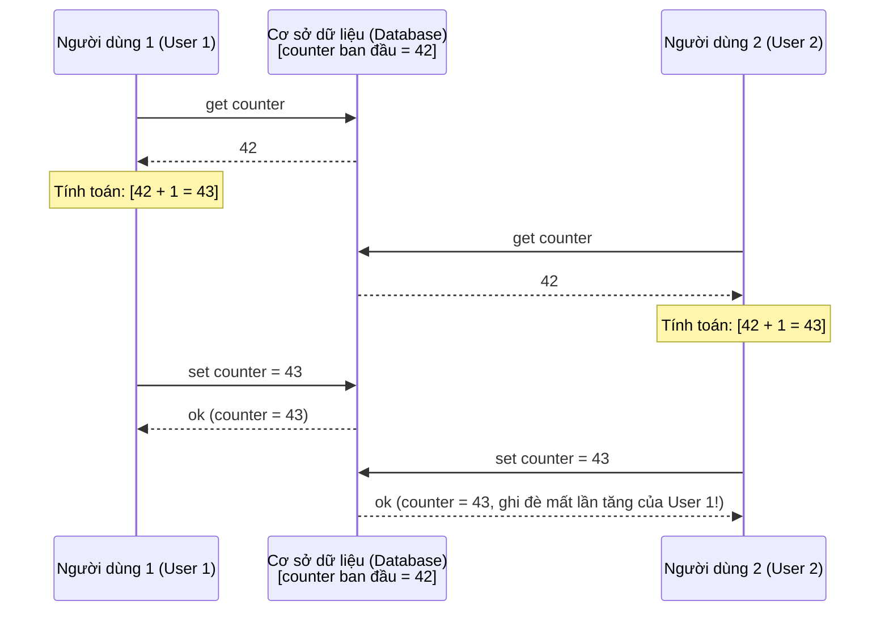

#### Tính bền vững (Durability)

Mục đích của một hệ thống cơ sở dữ liệu là cung cấp một nơi an toàn để lưu trữ dữ liệu mà không sợ bị mất. **Tính bền vững (Durability)** là lời hứa rằng một khi giao dịch đã cam kết (committed) thành công, bất kỳ dữ liệu nào mà nó đã ghi sẽ không bị lãng quên, ngay cả khi có lỗi phần cứng hoặc cơ sở dữ liệu bị sập.

Trên một cơ sở dữ liệu đơn nút (single-node database), điều này thường có nghĩa là dữ liệu đã được ghi xuống bộ nhớ không khả biến (non-volatile storage) như ổ cứng từ (hard drive) hoặc SSD. Nó thường cũng bao gồm một nhật ký ghi trước (write-ahead log — WAL) hoặc cấu trúc tương tự (xem phần “Cập nhật tại chỗ so với ghi nhật ký chỉ nối thêm” ở trang 80 Chương 3), cho phép phục hồi trong trường hợp các cấu trúc dữ liệu trên đĩa bị hỏng. Trên một cơ sở dữ liệu có sao chép (replicated database), tính bền vững có thể mang ý nghĩa là dữ liệu đã được sao chép thành công sang một số lượng nút nhất định. Để cung cấp đảm bảo về tính bền vững, cơ sở dữ liệu phải chờ cho đến khi các thao tác ghi hoặc sao chép này hoàn tất trước khi báo cáo một giao dịch là đã cam kết thành công.

Như đã thảo luận trong phần “Độ tin cậy (Reliability)” ở trang 4 Chương 1, tính bền vững tuyệt đối không tồn tại: nếu tất cả ổ cứng và tất cả các bản sao lưu (backups) của bạn bị phá hủy cùng một lúc, hiển nhiên không có gì mà cơ sở dữ liệu của bạn có thể làm để cứu bạn.

#### Sao chép và tính bền vững (Replication and durability)

Trong lịch sử, tính bền vững đồng nghĩa với việc ghi vào băng từ lưu trữ (archive tape). Sau đó, nó được hiểu là ghi xuống ổ đĩa từ hoặc SSD. Gần đây hơn, nó đã được điều chỉnh để mang ý nghĩa là sao chép (replication). Cách triển khai nào tốt hơn?

Sự thật là không có gì hoàn hảo cả:

- Nếu bạn ghi xuống đĩa và chiếc máy đó chết hẳn, mặc dù dữ liệu của bạn không bị mất, nhưng nó không thể truy cập được cho đến khi bạn sửa xong chiếc máy đó hoặc chuyển các ổ đĩa sang một máy khác. Các hệ thống có sao chép (replicated systems) vẫn có thể duy trì tính sẵn sàng.
- Một lỗi tương quan (correlated fault) — chẳng hạn như mất điện diện rộng hoặc một lỗi phần mềm (bug) làm sập mọi nút khi gặp một đầu vào cụ thể — có thể hạ gục toàn bộ các bản sao cùng một lúc (xem “Reliability” ở trang 4), làm mất bất kỳ dữ liệu nào chỉ nằm trong bộ nhớ (in-memory). Do đó, việc ghi xuống đĩa vẫn rất cần thiết đối với các cơ sở dữ liệu trong bộ nhớ (in-memory databases).
- Trong một hệ thống sao chép bất đồng bộ (asynchronously replicated system), các thao tác ghi gần nhất có thể bị mất khi nút dẫn đầu (leader) trở nên không khả dụng (xem “Xử lý sự cố ngừng hoạt động của nút” ở trang 150 Chương 5).
- Khi nguồn điện đột ngột bị ngắt, đặc biệt là các ổ SSD đã được chứng minh là đôi khi vi phạm chính những đảm bảo mà chúng lẽ ra phải cung cấp: ngay cả lệnh gọi `fsync` cũng không được đảm bảo sẽ hoạt động đúng [12]. Phần mềm cơ sở của ổ đĩa (disk firmware) cũng có thể chứa bug, giống như bất kỳ loại phần mềm nào khác [13, 14].
- Những tương tác tinh vi giữa bộ máy lưu trữ (storage engine) và bản triển khai hệ thống tệp (filesystem implementation) có thể dẫn đến các lỗi rất khó lần dấu vết, và có thể khiến các tệp trên đĩa bị hỏng (corrupted) sau một sự cố sập máy [15, 16].
- Dữ liệu trên đĩa có thể bị hỏng dần dần theo thời gian mà không bị phát hiện (silent corruption / bit rot) [17]. Nếu dữ liệu đã bị hỏng trong một khoảng thời gian, các bản sao (replicas) và các bản sao lưu gần đây cũng có thể đã bị nhiễm dữ liệu hỏng đó. Trong trường hợp này, bạn sẽ cần thử khôi phục nó từ một bản sao lưu lịch sử xa hơn trước đó.
- Nếu một ổ SSD bị ngắt khỏi nguồn điện, nó có thể bắt đầu mất dữ liệu chỉ trong vòng vài tuần, tùy thuộc vào nhiệt độ môi trường [18].

Trên thực tế, không có một kỹ thuật đơn lẻ nào có thể cung cấp những đảm bảo tuyệt đối. Chỉ có các kỹ thuật giảm thiểu rủi ro khác nhau, bao gồm ghi xuống đĩa, sao chép sang các máy ở xa, và sao lưu (backups) — và chúng có thể cũng như nên được sử dụng kết hợp cùng nhau. Như mọi khi, thật khôn ngoan khi đón nhận bất kỳ "sự đảm bảo" lý thuyết nào với một sự hoài nghi lành mạnh.

> 💡 **Ví dụ bổ sung (không có trong sách):**
> Trong PostgreSQL, tính bền vững khi commit được kiểm soát qua tham số `synchronous_commit`. Mặc định (`on`), tiến trình backend phải chờ bản ghi WAL (Write-Ahead Log) được flush xuống ổ đĩa cục bộ bằng `fsync()` (và tùy chọn chờ cả standby replica xác nhận nếu cấu hình `synchronous_standby_names`) trước khi trả kết quả `COMMIT` thành công về cho client. Trong MySQL InnoDB, tham số tương đương là `innodb_flush_log_at_trx_commit = 1` (flush và fsync redo log ở mỗi lần commit) kết hợp với `sync_binlog = 1`. Nhiều hệ thống vì muốn tăng thông lượng ghi đã chỉnh `innodb_flush_log_at_trx_commit = 2` hoặc `0`, đồng nghĩa với việc chấp nhận đánh đổi chữ **D (Durability)** lấy tốc độ: nếu hệ điều hành hoặc nguồn điện sập đột ngột, hệ thống có thể mất khoảng 1 giây dữ liệu đã báo "commit thành công".

---

### Thao tác đơn đối tượng và đa đối tượng (Single-object and multi-object operations)

Để tóm tắt lại, trong ACID, tính nguyên tử (atomicity) và tính cô lập (isolation) mô tả những gì cơ sở dữ liệu phải làm nếu một client thực hiện nhiều thao tác ghi bên trong cùng một giao dịch:

- **Tính nguyên tử (Atomicity):** Nếu một lỗi xảy ra ở giữa chừng một chuỗi các thao tác ghi, giao dịch đó phải bị hủy bỏ (aborted), và các thao tác ghi đã thực hiện tính đến thời điểm đó phải bị loại bỏ. Nói cách khác, cơ sở dữ liệu cứu bạn khỏi việc phải lo lắng về lỗi một phần (partial failure) bằng cách đưa ra đảm bảo "được ăn cả, ngã về không" (all-or-nothing guarantee).
- **Tính cô lập (Isolation):** Các giao dịch đang chạy đồng thời không được can thiệp lẫn nhau. Ví dụ, nếu một giao dịch thực hiện nhiều thao tác ghi, thì một giao dịch khác phải nhìn thấy hoặc là toàn bộ các thao tác ghi đó, hoặc là không nhìn thấy cái nào cả, chứ không được thấy một tập con (subset) dở dang.

Những định nghĩa này giả định rằng bạn muốn sửa đổi nhiều đối tượng (các hàng — rows, tài liệu — documents, bản ghi — records) cùng một lúc. Những **giao dịch đa đối tượng (multi-object transactions)** như vậy thường rất cần thiết nếu nhiều mảnh dữ liệu khác nhau cần được giữ đồng bộ với nhau. **Hình 7-2** cho thấy một ví dụ từ một ứng dụng email. Để hiển thị số lượng tin nhắn chưa đọc của một người dùng, bạn có thể truy vấn như sau:

```sql
SELECT COUNT(*) FROM emails WHERE recipient_id = 2 AND unread_flag = true
```

Tuy nhiên, có lẽ bạn nhận thấy câu truy vấn này quá chậm nếu có quá nhiều email, vì vậy bây giờ bạn lưu số lượng tin nhắn chưa đọc vào một trường riêng biệt (một dạng phi chuẩn hóa — denormalization). Giờ đây, bất cứ khi nào có một tin nhắn mới gửi đến, bạn cũng phải tăng bộ đếm chưa đọc (unread counter) lên, và bất cứ khi nào một tin nhắn được đánh dấu là đã đọc, bạn cũng phải giảm bộ đếm chưa đọc xuống.

Trong **Hình 7-2**, người dùng 2 gặp phải một sự bất thường (anomaly): danh sách hộp thư hiển thị một tin nhắn chưa đọc, nhưng bộ đếm lại hiển thị là không có (0) tin nhắn chưa đọc nào, bởi vì thao tác tăng bộ đếm vẫn chưa diễn ra.<sup>ii</sup> Tính cô lập (Isolation) lẽ ra đã ngăn chặn được vấn đề này bằng cách đảm bảo rằng người dùng 2 hoặc là nhìn thấy cả email mới được chèn vào lẫn bộ đếm đã được cập nhật, hoặc là chưa nhìn thấy cái nào cả, chứ không phải một thời điểm lưng chừng thiếu nhất quán.

> <sup>ii</sup> Có thể lập luận rằng một bộ đếm hiển thị sai trong ứng dụng email không phải là một vấn đề quá nghiêm trọng. Thay vào đó, hãy thử nghĩ về số dư tài khoản khách hàng thay cho bộ đếm tin chưa đọc, và một giao dịch thanh toán thay cho một bức email.

**Hình 7-3** minh họa nhu cầu đối với tính nguyên tử (Atomicity): nếu một lỗi xảy ra ở đâu đó trong suốt quá trình diễn ra giao dịch, nội dung của hộp thư và bộ đếm tin chưa đọc có thể bị lệch pha (out of sync) vĩnh viễn. Trong một giao dịch nguyên tử, nếu việc cập nhật bộ đếm thất bại, giao dịch sẽ bị hủy bỏ và bức email vừa chèn vào sẽ được hoàn tác (rolled back).

**Hình 7-2 – Vi phạm tính cô lập: một giao dịch đọc phải các thao tác ghi chưa được cam kết của một giao dịch khác (Figure 7-2. Violating isolation: one transaction reads another transaction’s uncommitted writes.)**

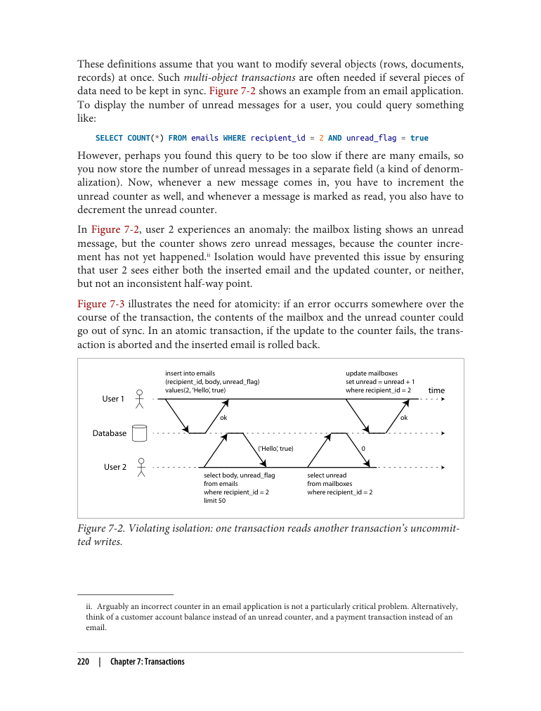

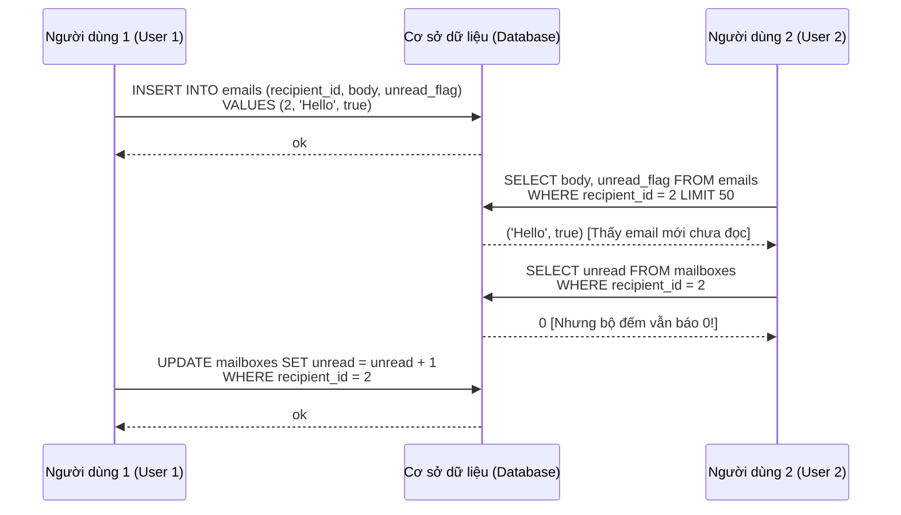

**Hình 7-3 – Tính nguyên tử đảm bảo rằng nếu có lỗi xảy ra, mọi thao tác ghi trước đó từ giao dịch ấy đều được hoàn tác để tránh trạng thái không nhất quán (Figure 7-3. Atomicity ensures that if an error occurs, any prior writes from that transaction are undone, to avoid an inconsistent state.)**

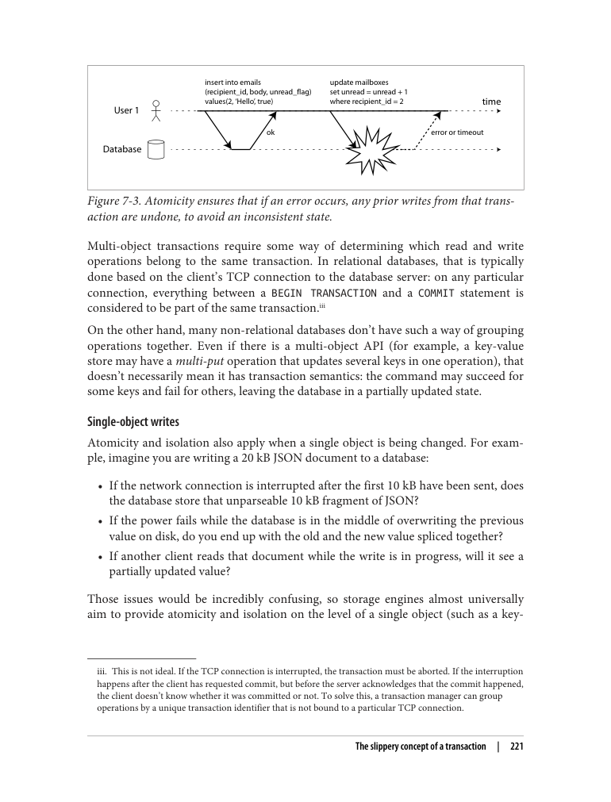

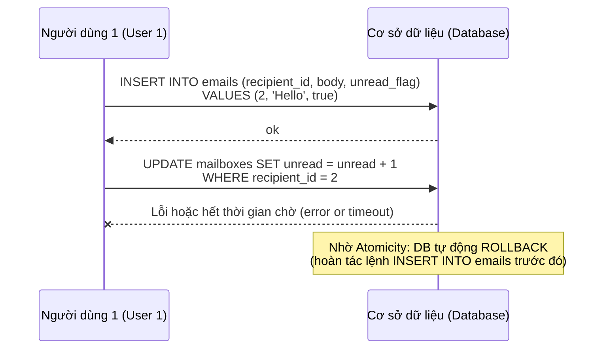

Các giao dịch đa đối tượng đòi hỏi một cách thức nào đó để xác định xem những thao tác đọc và ghi nào thuộc về cùng một giao dịch. Trong các cơ sở dữ liệu quan hệ, điều đó thường được thực hiện dựa trên kết nối TCP của client tới máy chủ cơ sở dữ liệu: trên bất kỳ kết nối cụ thể nào, mọi thứ nằm giữa câu lệnh `BEGIN TRANSACTION` và câu lệnh `COMMIT` đều được coi là một phần của cùng một giao dịch đó.<sup>iii</sup>

> <sup>iii</sup> Cách này không phải là lý tưởng. Nếu kết nối TCP bị gián đoạn, giao dịch buộc phải bị hủy bỏ. Nếu sự gián đoạn xảy ra sau khi client đã yêu cầu commit, nhưng trước khi máy chủ kịp xác nhận rằng commit đã diễn ra, thì client không thể biết được liệu giao dịch đã được commit hay chưa. Để giải quyết vấn đề này, một bộ quản lý giao dịch (transaction manager) có thể gom nhóm các thao tác theo một định danh giao dịch duy nhất (unique transaction identifier) không bị trói buộc vào một kết nối TCP cụ thể nào.

Mặt khác, nhiều cơ sở dữ liệu phi quan hệ không có cách thức như vậy để gom nhóm các thao tác lại với nhau. Ngay cả khi có một API đa đối tượng (ví dụ: một kho lưu trữ khóa-giá trị có thể có thao tác `multi-put` giúp cập nhật nhiều khóa trong một lệnh gọi), điều đó không nhất thiết có nghĩa là nó mang ngữ nghĩa giao dịch (transaction semantics): lệnh đó có thể thành công đối với một số khóa và thất bại đối với những khóa khác, để lại cơ sở dữ liệu trong trạng thái chỉ mới được cập nhật một phần.

#### Ghi đơn đối tượng (Single-object writes)

Tính nguyên tử và tính cô lập cũng áp dụng khi chỉ có một đối tượng duy nhất đang được thay đổi. Ví dụ, hãy tưởng tượng bạn đang ghi một tài liệu JSON dung lượng 20 kB vào cơ sở dữ liệu:

- Nếu kết nối mạng bị gián đoạn sau khi 10 kB đầu tiên vừa được gửi đi, liệu cơ sở dữ liệu có lưu trữ mảnh JSON 10 kB không thể phân tích cú pháp (unparseable) đó không?
- Nếu mất điện trong lúc cơ sở dữ liệu đang ở giữa chừng việc ghi đè giá trị cũ trên đĩa, liệu bạn có nhận lại một thứ gồm giá trị cũ và giá trị mới bị ghép nối chắp vá vào nhau không?
- Nếu một client khác đọc tài liệu đó trong khi thao tác ghi đang diễn ra, liệu nó có nhìn thấy một giá trị mới được cập nhật một phần không?

Những vấn đề đó sẽ gây ra sự hỗn loạn cực kỳ lớn, vì vậy các bộ máy lưu trữ (storage engines) hầu như trên toàn cầu đều hướng tới việc cung cấp tính nguyên tử và tính cô lập ở cấp độ **một đối tượng đơn lẻ (single object)** (chẳng hạn như một cặp khóa-giá trị) trên một nút. Tính nguyên tử có thể được triển khai bằng cách sử dụng nhật ký (log) để phục hồi sau sự cố sập máy (xem phần “Update-in-place vs. append-only logging” ở trang 80 Chương 3), và tính cô lập có thể được triển khai bằng cách sử dụng một khóa (lock) trên mỗi đối tượng (chỉ cho phép một luồng được truy cập một đối tượng tại bất kỳ thời điểm nào).

Một số cơ sở dữ liệu còn cung cấp các thao tác nguyên tử<sup>iv</sup> phức tạp hơn, chẳng hạn như thao tác tăng (increment operation), giúp loại bỏ nhu cầu phải thực hiện chu trình đọc-sửa-ghi (read-modify-write cycle) như trong **Hình 7-1**. Phổ biến tương tự là thao tác **so sánh và thiết lập (compare-and-set — CAS)**, cho phép thao tác ghi chỉ diễn ra nếu giá trị đó chưa bị thay đổi đồng thời bởi một ai khác.

> <sup>iv</sup> Nói một cách chặt chẽ, cụm từ *tăng nguyên tử (atomic increment)* sử dụng từ *atomic* theo nghĩa của lập trình đa luồng. Trong ngữ cảnh của ACID, thực chất nó nên được gọi là thao tác tăng *cô lập (isolated)* hoặc *tuần tự hóa (serializable)*. Nhưng như vậy thì hơi quá bắt bẻ câu chữ.

Những thao tác đơn đối tượng này rất hữu ích, vì chúng có thể ngăn chặn hiện tượng mất cập nhật (lost updates) khi nhiều client cố gắng ghi vào cùng một đối tượng một cách đồng thời (xem phần “Ngăn chặn mất cập nhật (Preventing lost updates)” ở bên dưới). Tuy nhiên, chúng **không phải** là giao dịch theo nghĩa thông thường của từ này. Đáng tiếc là `compare-and-set` và các thao tác đơn đối tượng khác lại bị gắn mác là "giao dịch hạng nhẹ" (lightweight transactions) hoặc thậm chí là "ACID" vì mục đích tiếp thị [19, 20, 21], nhưng cách dùng thuật ngữ đó rất dễ gây hiểu lầm. Một giao dịch thường được hiểu là một cơ chế để gom nhóm nhiều thao tác trên nhiều đối tượng thành một đơn vị thực thi duy nhất.

#### Nhu cầu đối với các giao dịch đa đối tượng (The need for multi-object transactions)

Nhiều kho dữ liệu phân tán đã từ bỏ các giao dịch đa đối tượng bởi vì chúng rất khó triển khai xuyên qua nhiều phân mảnh (partitions), và chúng có thể trở thành rào cản trong một số kịch bản đòi hỏi tính sẵn sàng hoặc hiệu năng cực cao. Tuy nhiên, không có rào cản nền tảng nào ngăn cản hoàn toàn việc có giao dịch trong một cơ sở dữ liệu phân tán, và chúng ta sẽ thảo luận về các cách triển khai giao dịch phân tán trong Chương 9.

Nhưng liệu chúng ta có thực sự cần các giao dịch đa đối tượng hay không? Liệu có thể triển khai bất kỳ ứng dụng nào chỉ với mô hình dữ liệu khóa-giá trị và các thao tác đơn đối tượng không?

Có một số trường hợp sử dụng mà ở đó các thao tác chèn, cập nhật và xóa trên đơn đối tượng là đủ. Tuy nhiên, trong nhiều trường hợp khác, các thao tác ghi vào nhiều đối tượng khác nhau cần phải được điều phối (coordinated) cùng nhau:

- Trong mô hình dữ liệu quan hệ, một hàng trong bảng này thường có một tham chiếu khóa ngoại (foreign key reference) trỏ tới một hàng trong bảng khác. (Tương tự, trong mô hình dữ liệu dạng đồ thị, một đỉnh [vertex] có các cạnh [edges] nối tới các đỉnh khác.) Giao dịch đa đối tượng cho phép bạn đảm bảo rằng các tham chiếu này luôn hợp lệ: khi chèn nhiều bản ghi có tham chiếu lẫn nhau, các khóa ngoại phải chính xác và được cập nhật mới nhất, nếu không dữ liệu sẽ trở nên vô nghĩa.
- Trong mô hình dữ liệu tài liệu (document data model), các trường cần được cập nhật cùng nhau thường nằm bên trong cùng một tài liệu, vốn được xử lý như một đối tượng đơn lẻ — do đó không cần đến giao dịch đa đối tượng khi cập nhật một tài liệu đơn lẻ. Tuy nhiên, các cơ sở dữ liệu tài liệu thiếu chức năng kết nối (`JOIN`) cũng khuyến khích việc phi chuẩn hóa (denormalization — xem phần “Cơ sở dữ liệu quan hệ so với cơ sở dữ liệu tài liệu ngày nay” ở trang 38 Chương 2). Khi thông tin phi chuẩn hóa cần được cập nhật, giống như trong ví dụ ở **Hình 7-2**, bạn cần phải cập nhật nhiều tài liệu trong cùng một lượt. Giao dịch cực kỳ hữu ích trong tình huống này nhằm ngăn ngừa dữ liệu phi chuẩn hóa bị lệch pha với nhau.
- Trong các cơ sở dữ liệu có chỉ mục phụ (secondary indexes — hầu như mọi hệ thống ngoại trừ các kho khóa-giá trị thuần túy), các chỉ mục này cũng cần phải được cập nhật mỗi khi bạn thay đổi một giá trị. Dưới góc nhìn của một giao dịch, các chỉ mục này là những đối tượng cơ sở dữ liệu khác nhau: ví dụ, nếu không có sự cô lập giao dịch, một bản ghi hoàn toàn có thể xuất hiện trong chỉ mục này nhưng lại chưa xuất hiện trong chỉ mục khác, bởi vì thao tác cập nhật cho chỉ mục thứ hai vẫn chưa kịp diễn ra.

Những ứng dụng như vậy vẫn có thể được triển khai mà không cần giao dịch. Tuy nhiên, việc xử lý lỗi sẽ trở nên phức tạp hơn rất nhiều khi thiếu vắng tính nguyên tử, và sự thiếu hụt tính cô lập có thể gây ra các vấn đề đồng thời. Chúng ta sẽ thảo luận về những vấn đề đó trong phần “Các mức cô lập yếu (Weak isolation levels)” ngay sau đây.

#### Xử lý lỗi và hủy bỏ giao dịch (Handling errors and aborts)

Một tính năng then chốt của giao dịch là trong trường hợp xảy ra sự cố, nó có thể bị hủy bỏ (aborted) và thử lại (retried). Các cơ sở dữ liệu ACID được xây dựng dựa trên triết lý này: nếu cơ sở dữ liệu có nguy cơ vi phạm đảm bảo về tính nguyên tử, tính cô lập hoặc tính bền vững của nó, nó thà từ bỏ hoàn toàn giao dịch đó còn hơn là cho phép giao dịch tiếp tục chạy.

Không phải mọi hệ thống đều tuân theo triết lý đó: đặc biệt các kho dữ liệu sử dụng sao chép không có nút dẫn đầu (leaderless replication — xem phần “Sao chép không có nút dẫn đầu” ở trang 171 Chương 5) hoạt động thiên về nguyên tắc "nỗ lực tốt nhất" (best effort) hơn nhiều, có thể tóm gọn là *"cơ sở dữ liệu sẽ làm nhiều nhất có thể, và nếu gặp phải lỗi, nó sẽ không hoàn tác những gì nó đã làm"* — vì vậy việc phục hồi sau lỗi thuộc về trách nhiệm của ứng dụng.

Lỗi chắc chắn sẽ xảy ra, nhưng nhiều nhà phát triển phần mềm lại chỉ thích nghĩ về "luồng màu hồng" (happy path) hơn là những sự phức tạp rối rắm của việc xử lý lỗi. Ví dụ, các framework ánh xạ hướng đối tượng - quan hệ (ORM) phổ biến như ActiveRecord của Rails hay Django không tự động thử lại các giao dịch bị hủy bỏ — lỗi thường dẫn đến một ngoại lệ (exception) nổi bọt ngược lên ngăn xếp lệnh gọi (call stack), khiến mọi dữ liệu đầu vào của người dùng bị vứt bỏ và người dùng nhận về một thông báo lỗi. Điều này thật đáng tiếc, bởi toàn bộ mục đích của việc hủy bỏ (abort) chính là để cho phép thử lại một cách an toàn.

Mặc dù việc thử lại một giao dịch bị hủy bỏ là một cơ chế xử lý lỗi đơn giản và hiệu quả, nhưng nó không phải là hoàn hảo:

- **Lỗi mạng sau khi đã commit:** Nếu giao dịch thực sự đã thành công, nhưng mạng bị lỗi đúng lúc máy chủ cố gắng gửi xác nhận commit thành công về cho client (khiến client tưởng rằng giao dịch đã thất bại), thì việc thử lại giao dịch sẽ khiến nó bị thực thi hai lần — trừ khi bạn có sẵn một cơ chế khử trùng lặp (deduplication) bổ sung ở tầng ứng dụng (chẳng hạn như dùng *idempotency key*).
- **Lỗi do quá tải (overload):** Nếu lỗi xảy ra là do hệ thống quá tải, việc thử lại giao dịch sẽ làm cho vấn đề trở nên tồi tệ hơn chứ không phải tốt hơn. Để tránh những vòng lặp phản hồi (feedback cycles) như vậy, hãy giới hạn số lần thử lại, sử dụng thuật toán lùi theo hàm mũ (exponential backoff), và xử lý các lỗi liên quan đến quá tải khác với các loại lỗi khác (nếu có thể).
- **Lỗi tạm thời so với lỗi vĩnh viễn:** Chỉ những lỗi tạm thời (transient errors — ví dụ do khóa chết [deadlock], vi phạm mức cô lập [isolation violation], gián đoạn mạng tạm thời và chuyển đổi dự phòng [failover]) mới đáng để thử lại; việc thử lại một lỗi vĩnh viễn (permanent error — ví dụ như vi phạm ràng buộc [constraint violation]) là hoàn toàn vô ích.
- **Tác dụng phụ bên ngoài cơ sở dữ liệu (side-effects):** Nếu giao dịch còn có các tác dụng phụ bên ngoài cơ sở dữ liệu, những tác dụng phụ đó vẫn có thể xảy ra ngay cả khi giao dịch bị hủy bỏ. Ví dụ, nếu bạn đang gửi một email, bạn sẽ không muốn gửi lại bức email đó mỗi lần thử lại giao dịch. Nếu bạn muốn đảm bảo rằng nhiều hệ thống khác nhau hoặc cùng commit hoặc cùng abort với nhau, giao thức cam kết hai pha (two-phase commit — 2PC) có thể giúp ích (chúng ta sẽ thảo luận trong phần “Cam kết nguyên tử và cam kết hai pha (2PC)” ở trang 344 Chương 9).
- **Client bị sập:** Nếu tiến trình client bị sập trong lúc đang thử lại, dữ liệu sẽ bị mất.

> 📝 **Giải thích thêm (không có trong sách):**
> Trong thực tế xây dựng hệ thống tài chính hay thương mại điện tử (ví dụ với PostgreSQL hoặc CockroachDB), khi dùng mức cô lập `REPEATABLE READ` hoặc `SERIALIZABLE`, cơ sở dữ liệu sẽ chủ động abort các giao dịch xung đột với mã lỗi SQLSTATE `40001` (`serialization_failure`) hoặc `40P01` (`deadlock_detected`). Nếu ứng dụng chỉ dùng ORM mặc định mà không bọc giao dịch trong một vòng lặp retry có kèm *exponential backoff + jitter* và *idempotency key*, người dùng sẽ liên tục gặp lỗi `500 Internal Server Error` mỗi khi có lưu lượng truy cập đồng thời cao (flash sale, săn vé). Đồng thời, để xử lý vấn đề tác dụng phụ bên ngoài DB (như gửi email hoặc bắn sự kiện sang Kafka), các kiến trúc hiện đại thường áp dụng mẫu thiết kế **Transactional Outbox Pattern**: thay vì gọi API gửi email trực tiếp bên trong DB transaction, ứng dụng chỉ `INSERT` một bản ghi sự kiện vào bảng `outbox` nằm trong cùng transaction đó; sau khi transaction commit thành công, một tiến trình nền (hoặc CDC như Debezium) mới đọc bảng `outbox` để gửi đi.

---

## Các mức cô lập yếu (Weak isolation levels)

Nếu hai giao dịch không chạm vào cùng một dữ liệu, chúng có thể được chạy song song một cách an toàn, bởi vì không giao dịch nào phụ thuộc vào giao dịch nào. Các vấn đề đồng thời (điều kiện tranh chấp — race conditions) chỉ xuất hiện khi một giao dịch đọc dữ liệu đang bị sửa đổi đồng thời bởi một giao dịch khác, hoặc khi hai giao dịch cố gắng sửa đổi cùng một dữ liệu vào cùng một thời điểm.

Các lỗi đồng thời (concurrency bugs) rất khó được phát hiện thông qua kiểm thử (testing), bởi vì các lỗi này chỉ bị kích hoạt khi bạn không may rơi vào đúng thời điểm nhạy cảm (unlucky with the timing). Điều này có thể xảy ra cực kỳ hiếm hoi và thường rất khó để tái hiện (reproduce). Tính đồng thời cũng rất khó để suy luận, đặc biệt là trong một ứng dụng lớn nơi bạn không nhất thiết biết được những đoạn mã nào khác cũng đang truy cập vào cơ sở dữ liệu. Phát triển ứng dụng vốn đã đủ khó ngay cả khi bạn chỉ có một người dùng tại một thời điểm; việc có nhiều người dùng đồng thời càng làm cho mọi thứ khó khăn hơn gấp bội, bởi vì bất kỳ mảnh dữ liệu nào cũng có thể bất ngờ thay đổi vào bất kỳ lúc nào.

Vì lý do đó, từ lâu các cơ sở dữ liệu đã cố gắng che giấu các vấn đề đồng thời khỏi các nhà phát triển ứng dụng bằng cách cung cấp **tính cô lập giao dịch (transaction isolation)**. Về mặt lý thuyết, điều này sẽ giúp cuộc sống của bạn dễ thở hơn bằng cách cho phép bạn giả vờ như không hề có sự đồng thời nào đang diễn ra: **cô lập tuần tự hóa (serializable isolation)** có nghĩa là cơ sở dữ liệu đảm bảo các giao dịch mang lại kết quả giống hệt như thể chúng được chạy một cách tuần tự (serially), tức là từng giao dịch một, không hề có bất kỳ sự đồng thời nào.

Trên thực tế, đáng tiếc là tính cô lập không đơn giản như vậy. Cô lập tuần tự hóa đi kèm với một chi phí về hiệu năng, và nhiều cơ sở dữ liệu không muốn trả cái giá đó [8]. Do vậy, việc các hệ thống sử dụng các mức cô lập yếu hơn — vốn bảo vệ chống lại *một số* vấn đề đồng thời nhưng không phải *tất cả* — đã trở nên rất phổ biến. Những mức cô lập đó khó hiểu hơn rất nhiều, và chúng có thể dẫn đến những lỗi tinh vi, nhưng bất chấp điều đó chúng vẫn được sử dụng rộng rãi trong thực tế [22].

Các lỗi đồng thời gây ra bởi sự cô lập giao dịch yếu không chỉ là một vấn đề lý thuyết trên giấy. Chúng đã gây ra những khoản thất thoát tiền bạc khổng lồ [23, 24], dẫn đến các cuộc điều tra của kiểm toán viên tài chính [25] và làm hỏng dữ liệu của khách hàng [26]. Một bình luận phổ biến mỗi khi những sự cố như vậy bị phanh phui là *"hãy dùng cơ sở dữ liệu ACID nếu bạn đang xử lý dữ liệu tài chính!"*, nhưng câu nói đó đã hiểu sai bản chất vấn đề. Ngay cả nhiều hệ quản trị cơ sở dữ liệu quan hệ phổ biến (vốn thường được coi là "ACID") cũng sử dụng mức cô lập yếu theo mặc định, vì vậy chúng chưa chắc đã ngăn chặn được những lỗi này xảy ra.

Thay vì mù quáng phó mặc cho các công cụ, chúng ta cần phát triển một sự hiểu biết thấu đáo về các loại vấn đề đồng thời đang tồn tại, cũng như cách thức để ngăn chặn chúng. Khi đó, chúng ta mới có thể xây dựng được những ứng dụng đáng tin cậy và chính xác bằng cách sử dụng các công cụ sẵn có trong tay.

Trong phần này, chúng ta sẽ xem xét một số mức cô lập yếu (không tuần tự hóa — non-serializable) đang được sử dụng trong thực tế, và thảo luận chi tiết xem những loại điều kiện tranh chấp nào có thể và không thể xảy ra, để từ đó bạn có thể quyết định mức nào là phù hợp với ứng dụng của mình. Sau khi hoàn tất bước đó, chúng ta sẽ thảo luận chi tiết về tính tuần tự hóa trong phần tiếp theo (“Tính tuần tự hóa (Serializability)” ở trang 242 bản gốc). Chúng ta sẽ thảo luận về các mức cô lập một cách trực quan thông qua các ví dụ. Nếu bạn muốn tìm hiểu các định nghĩa toán học chặt chẽ và các phân tích sâu về đặc tính của chúng, bạn có thể tìm đọc trong các tài liệu học thuật [27, 28, 29].

---

### Read committed (Đọc dữ liệu đã cam kết)

Mức cô lập giao dịch cơ bản nhất là **read committed** (đọc dữ liệu đã cam kết).<sup>v</sup> Nó đưa ra hai đảm bảo:

1. Khi đọc từ cơ sở dữ liệu, bạn sẽ chỉ nhìn thấy dữ liệu đã được cam kết (**không đọc bẩn — no dirty reads**).
2. Khi ghi vào cơ sở dữ liệu, bạn sẽ chỉ ghi đè lên dữ liệu đã được cam kết (**không ghi bẩn — no dirty writes**).

> <sup>v</sup> Một số cơ sở dữ liệu còn hỗ trợ một mức cô lập thậm chí còn yếu hơn nữa gọi là **read uncommitted** (đọc dữ liệu chưa cam kết). Mức này ngăn chặn ghi bẩn (dirty writes), nhưng không ngăn chặn đọc bẩn (dirty reads).

Hãy cùng thảo luận chi tiết hơn về hai đảm bảo này.

#### Không đọc bẩn (No dirty reads)

Hãy tưởng tượng một giao dịch đã ghi một số dữ liệu vào cơ sở dữ liệu, nhưng giao dịch đó vẫn chưa được cam kết (committed) hoặc hủy bỏ (aborted). Liệu một giao dịch khác có thể nhìn thấy dữ liệu chưa được cam kết đó không? Nếu có, hiện tượng đó được gọi là **đọc bẩn (dirty read)** [2].

Các giao dịch chạy ở mức cô lập *read committed* phải ngăn chặn hiện tượng đọc bẩn. Điều này có nghĩa là bất kỳ thao tác ghi nào của một giao dịch chỉ trở nên hiển thị (visible) đối với các giao dịch khác khi giao dịch đó thực hiện cam kết (và ngay tại thời điểm đó, tất cả các thao tác ghi của nó sẽ đồng loạt hiển thị cùng một lúc). Điều này được minh họa trong **Hình 7-4**, nơi người dùng 1 đã đặt `x = 3`, nhưng thao tác `get x` của người dùng 2 vẫn trả về giá trị cũ là `2` trong suốt khoảng thời gian người dùng 1 chưa cam kết.

Có một vài lý do giải thích tại sao việc ngăn chặn đọc bẩn lại hữu ích:

- Nếu một giao dịch cần cập nhật nhiều đối tượng, việc đọc bẩn có nghĩa là một giao dịch khác có thể nhìn thấy một số bản cập nhật nhưng lại chưa thấy những bản cập nhật còn lại. Ví dụ, trong **Hình 7-2**, người dùng nhìn thấy bức email mới chưa đọc nhưng lại chưa thấy bộ đếm được cập nhật. Đây chính là một lần đọc bẩn đối với bức email đó. Việc nhìn thấy cơ sở dữ liệu trong trạng thái chỉ mới cập nhật một phần sẽ gây bối rối cho người dùng, và có thể khiến các giao dịch khác đưa ra những quyết định sai lầm.
- Nếu một giao dịch bị hủy bỏ (aborts), bất kỳ thao tác ghi nào mà nó đã thực hiện đều cần phải được hoàn tác (rolled back — giống như trong **Hình 7-3**). Nếu cơ sở dữ liệu cho phép đọc bẩn, điều đó có nghĩa là một giao dịch có thể nhìn thấy dữ liệu mà sau đó lại bị hoàn tác — tức là dữ liệu chưa bao giờ thực sự được cam kết vào cơ sở dữ liệu. Việc suy luận về hậu quả của chuyện này sẽ nhanh chóng trở nên cực kỳ xoắn não.

**Hình 7-4 – Không đọc bẩn: người dùng 2 chỉ nhìn thấy giá trị mới của x sau khi giao dịch của người dùng 1 đã cam kết (Figure 7-4. No dirty reads: user 2 sees the new value for x only after user 1’s transaction has committed.)**

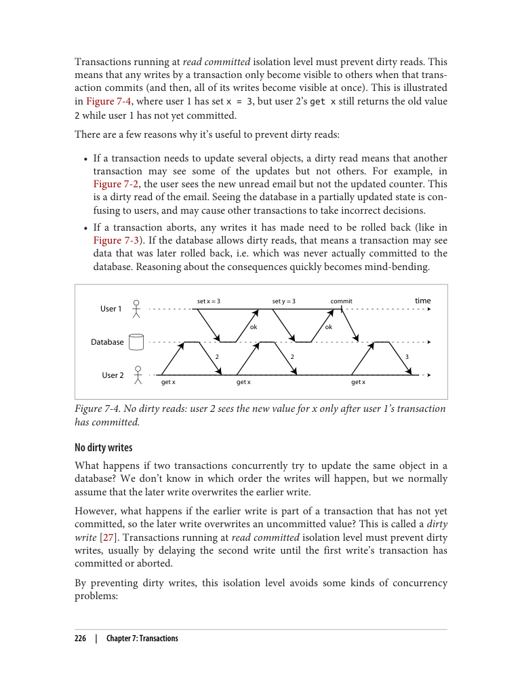

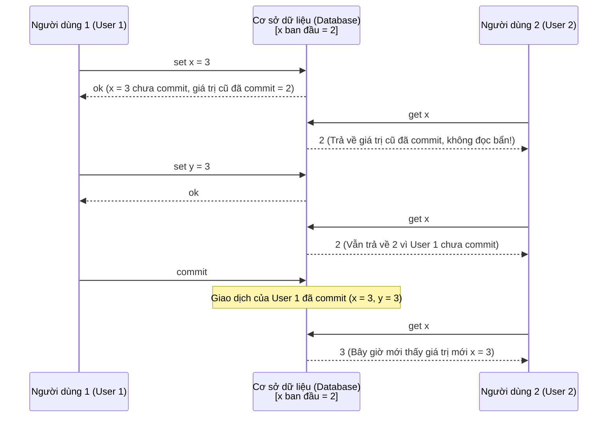

#### Không ghi bẩn (No dirty writes)

Điều gì sẽ xảy ra nếu hai giao dịch đồng thời cố gắng cập nhật cùng một đối tượng trong cơ sở dữ liệu? Chúng ta không biết các thao tác ghi sẽ diễn ra theo thứ tự nào, nhưng thông thường chúng ta giả định rằng thao tác ghi đến sau sẽ ghi đè lên thao tác ghi đến trước.

Tuy nhiên, điều gì sẽ xảy ra nếu thao tác ghi trước là một phần của một giao dịch **vẫn chưa được cam kết**, khiến cho thao tác ghi sau ghi đè lên một giá trị chưa được cam kết? Hiện tượng này được gọi là **ghi bẩn (dirty write)** [27]. Các giao dịch chạy ở mức cô lập *read committed* phải ngăn chặn hiện tượng ghi bẩn, thường bằng cách trì hoãn thao tác ghi thứ hai cho đến khi giao dịch của thao tác ghi thứ nhất đã cam kết (committed) hoặc hủy bỏ (aborted).

Bằng cách ngăn chặn ghi bẩn, mức cô lập này tránh được một số loại vấn đề đồng thời:

- Nếu các giao dịch cập nhật nhiều đối tượng, hiện tượng ghi bẩn có thể dẫn đến một kết cục tồi tệ. Ví dụ, hãy xem xét **Hình 7-5**, minh họa một trang web bán xe hơi cũ nơi hai người là Alice và Bob đang đồng thời cố gắng mua cùng một chiếc xe. Việc mua một chiếc xe đòi hỏi hai thao tác ghi vào cơ sở dữ liệu: danh sách niêm yết (listing) trên trang web cần được cập nhật để phản ánh tên người mua, và hóa đơn bán hàng (sales invoice) cần được gửi cho người mua đó. Trong trường hợp ở **Hình 7-5**, quyền mua chiếc xe thuộc về Bob (vì anh ấy thực hiện thao tác cập nhật chiến thắng cuối cùng vào bảng `listings`), nhưng hóa đơn lại được gửi cho Alice (vì cô ấy thực hiện thao tác cập nhật chiến thắng cuối cùng vào bảng `invoices`). Mức *read committed* ngăn chặn những sự cố tréo ngoe như vậy.
- Tuy nhiên, *read committed* **không** ngăn chặn được điều kiện tranh chấp giữa hai lần tăng bộ đếm trong **Hình 7-1**. Trong trường hợp đó, thao tác ghi thứ hai diễn ra *sau khi* giao dịch thứ nhất đã cam kết, vì vậy nó không phải là một thao tác ghi bẩn. Kết quả vẫn sai, nhưng là vì một lý do khác — trong phần “Ngăn chặn mất cập nhật (Preventing lost updates)” ở bên dưới, chúng ta sẽ thảo luận cách làm cho những thao tác tăng bộ đếm như vậy trở nên an toàn.

**Hình 7-5 – Với hiện tượng ghi bẩn, các thao tác ghi xung đột từ các giao dịch khác nhau có thể bị trộn lẫn lộn xộn vào nhau (Figure 7-5. With dirty writes, conflicting writes from different transactions can be mixed up.)**

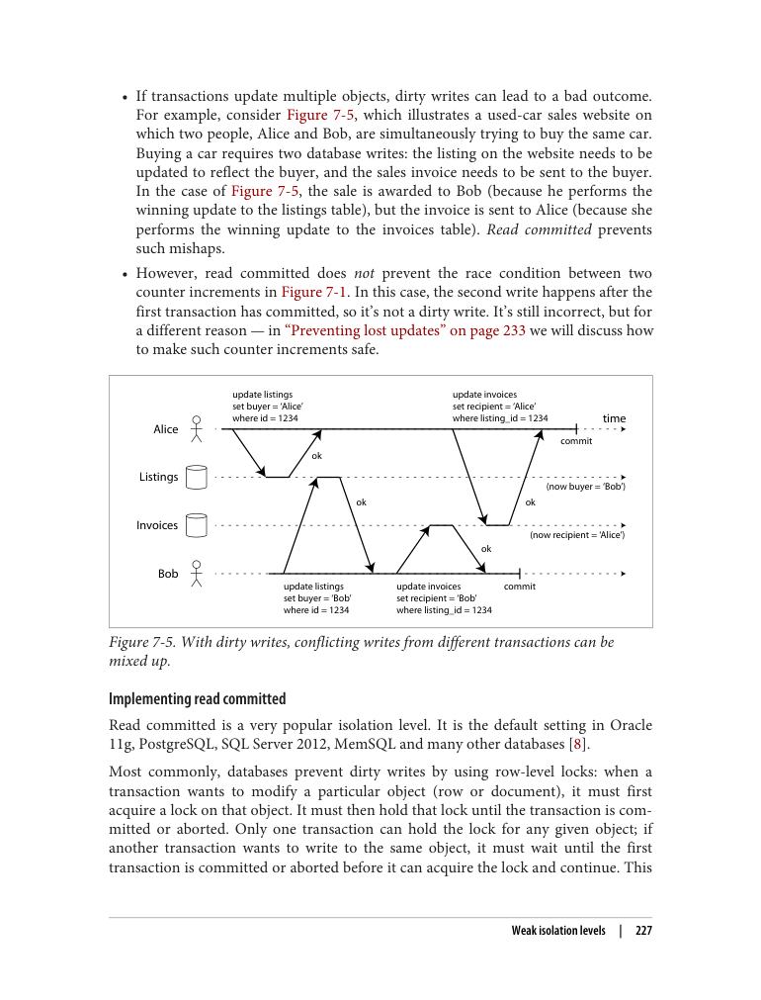

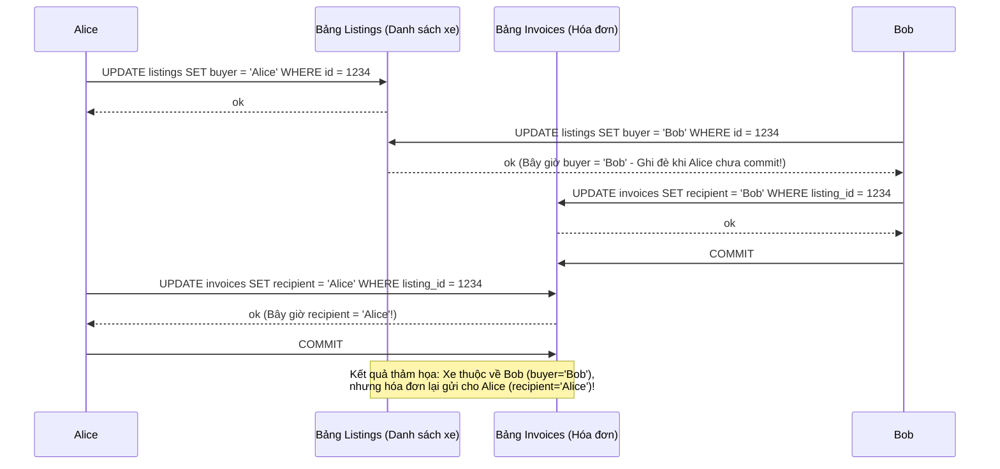

#### Triển khai read committed (Implementing read committed)

*Read committed* là một mức cô lập rất phổ biến. Đây là cài đặt mặc định trong Oracle 11g, PostgreSQL, SQL Server 2012, MemSQL và nhiều cơ sở dữ liệu khác [8].

Phổ biến nhất, các cơ sở dữ liệu ngăn chặn hiện tượng ghi bẩn bằng cách sử dụng **khóa cấp độ hàng (row-level locks)**: khi một giao dịch muốn sửa đổi một đối tượng cụ thể (hàng hoặc tài liệu), trước tiên nó phải giành được một khóa (lock) trên đối tượng đó. Sau đó, nó phải giữ khóa đó cho đến khi giao dịch được cam kết hoặc hủy bỏ. Chỉ một giao dịch duy nhất có thể giữ khóa cho bất kỳ đối tượng nhất định nào; nếu một giao dịch khác muốn ghi vào cùng đối tượng đó, nó buộc phải chờ cho đến khi giao dịch đầu tiên được cam kết hoặc hủy bỏ trước khi nó có thể giành lấy khóa và tiếp tục. Cơ chế khóa này được thực hiện tự động bởi các cơ sở dữ liệu ở chế độ *read committed* (hoặc các mức cô lập mạnh hơn).

Thế còn làm thế nào để chúng ta ngăn chặn hiện tượng đọc bẩn (dirty reads)? Một lựa chọn có thể là sử dụng cùng chiếc khóa đó, và yêu cầu bất kỳ giao dịch nào muốn đọc một đối tượng phải giành lấy khóa trong chốc lát, rồi giải phóng nó ngay lập tức sau khi đọc xong. Điều này sẽ đảm bảo rằng một thao tác đọc không thể diễn ra trong lúc một đối tượng đang mang một giá trị bẩn chưa được cam kết (bởi vì trong suốt thời gian đó, khóa đã bị nắm giữ bởi giao dịch thực hiện thao tác ghi).

Tuy nhiên, cách tiếp cận yêu cầu khóa đọc (read locks) không hoạt động tốt trong thực tế, bởi vì chỉ cần một giao dịch ghi chạy lâu (long-running write transaction) cũng có thể buộc rất nhiều giao dịch chỉ đọc (read-only transactions) phải đứng đợi cho đến khi giao dịch chạy lâu đó hoàn tất. Điều này làm tổn hại đến thời gian phản hồi của các giao dịch chỉ đọc và rất tệ cho khả năng vận hành (operability): một sự chậm trễ ở một phần của ứng dụng có thể gây ra hiệu ứng dây chuyền (knock-on effect) sang một phần hoàn toàn khác của ứng dụng do phải chờ đợi khóa.

Vì lý do đó, hầu hết các cơ sở dữ liệu<sup>vi</sup> ngăn chặn đọc bẩn bằng cách sử dụng phương pháp được minh họa trong **Hình 7-4**: đối với mỗi đối tượng được ghi, cơ sở dữ liệu ghi nhớ cả giá trị cũ đã được cam kết lẫn giá trị mới được thiết lập bởi giao dịch hiện đang nắm giữ khóa ghi. Trong khi giao dịch đang diễn ra, bất kỳ giao dịch nào khác đọc đối tượng đó sẽ đơn giản được trả về giá trị cũ. Chỉ khi giá trị mới được cam kết, các giao dịch mới chuyển sang đọc giá trị mới.

> <sup>vi</sup> Tại thời điểm viết sách, các cơ sở dữ liệu chính thống duy nhất sử dụng khóa đọc cho mức cô lập *read committed* là IBM DB2, và Microsoft SQL Server khi để cấu hình `read_committed_snapshot=off` [22, 35].

---

### Cô lập bản chụp và đọc lặp lại (Snapshot isolation and repeatable read)

Nếu chỉ nhìn lướt qua bề nổi của mức cô lập *read committed*, bạn hoàn toàn có thể được cảm thông nếu nghĩ rằng nó đã làm tất cả mọi thứ mà một giao dịch cần làm: nó cho phép hủy bỏ (cần thiết cho tính nguyên tử), nó ngăn chặn việc đọc các kết quả chưa hoàn chỉnh của các giao dịch, và nó ngăn các thao tác ghi đồng thời bị trộn lẫn vào nhau. Quả thực, đó là những tính năng rất hữu ích, và là những đảm bảo mạnh mẽ hơn rất nhiều so với những gì bạn có thể nhận được từ một hệ thống không có giao dịch.

Tuy nhiên, vẫn còn vô số cách khiến bạn gặp phải các lỗi đồng thời khi sử dụng *read committed*. Ví dụ, **Hình 7-6** minh họa một vấn đề có thể xảy ra với *read committed*.

Giả sử Alice có 1.000 đô la tiền tiết kiệm tại một ngân hàng, được chia đều vào hai tài khoản, mỗi tài khoản có 500 đô la. Bây giờ, một giao dịch thực hiện chuyển 100 đô la từ tài khoản này sang tài khoản kia của cô ấy. Nếu cô ấy không may nhìn vào danh sách số dư tài khoản của mình đúng vào khoảnh khắc giao dịch chuyển tiền đó đang được xử lý, cô ấy có thể nhìn thấy số dư của một tài khoản tại thời điểm *trước khi* khoản tiền chuyển đến kịp vào tài khoản (với số dư là 500 đô la), và nhìn thấy tài khoản kia *sau khi* khoản tiền chuyển đi đã được trừ (số dư mới là 400 đô la). Đối với Alice lúc này, có vẻ như cô ấy chỉ còn tổng cộng 900 đô la trong các tài khoản của mình — dường như 100 đô la đã bốc hơi vào hư không.

Sự bất thường này được gọi là **đọc không thể lặp lại (non-repeatable read)** hoặc **lệch đọc (read skew)**: nếu Alice đọc lại số dư của tài khoản 1 một lần nữa vào cuối giao dịch của cô ấy, cô ấy sẽ nhìn thấy một giá trị khác (600 đô la) so với giá trị mà cô ấy đã thấy trong câu truy vấn trước đó của mình. Hiện tượng lệch đọc (*read skew*) được coi là chấp nhận được dưới mức cô lập *read committed*: số dư tài khoản mà Alice nhìn thấy quả thực đều đã được cam kết tại đúng thời điểm cô ấy đọc chúng.

Nếu Alice tải lại trang web ngân hàng trực tuyến vài giây sau đó, 100 đô la nhiều khả năng sẽ xuất hiện trở lại, vì vậy đây không phải là một vấn đề kéo dài vĩnh viễn. Tuy nhiên, có một số tình huống không thể dung thứ cho sự thiếu nhất quán tạm thời như vậy:

- **Sao lưu (Backups):** Việc tạo một bản sao lưu đòi hỏi phải tạo một bản sao của toàn bộ cơ sở dữ liệu, quá trình này có thể mất hàng giờ đồng hồ trên một cơ sở dữ liệu lớn. Trong suốt khoảng thời gian tiến trình sao lưu đang chạy, các thao tác ghi vẫn sẽ tiếp tục được thực hiện vào cơ sở dữ liệu. Do đó, bạn có thể nhận được một bản sao lưu mà trong đó một số phần chứa phiên bản cũ của dữ liệu, còn các phần khác lại chứa phiên bản mới hơn. Nếu bạn cần khôi phục (restore) từ một bản sao lưu như vậy, những sự thiếu nhất quán đó (chẳng hạn như tiền bị bốc hơi) sẽ trở thành **vĩnh viễn**.
- **Các truy vấn phân tích và kiểm tra tính toàn vẹn (Analytic queries and integrity checks):** Đôi khi, bạn có thể muốn chạy một câu truy vấn quét qua những phần lớn của cơ sở dữ liệu. Những truy vấn như vậy rất phổ biến trong phân tích dữ liệu (analytics — xem phần “Xử lý giao dịch hay Phân tích?” ở trang 87 Chương 3), hoặc có thể là một phần của quy trình kiểm tra tính toàn vẹn định kỳ để đảm bảo mọi thứ vẫn ổn thỏa (giám sát phát hiện hỏng dữ liệu). Những truy vấn như vậy rất dễ trả về các kết quả vô nghĩa nếu chúng quan sát các phần khác nhau của cơ sở dữ liệu tại các thời điểm khác nhau.

**Hình 7-6 – Hiện tượng lệch đọc (Read skew): Alice quan sát thấy cơ sở dữ liệu ở một trạng thái không nhất quán (Figure 7-6. Read skew: Alice observes the database in an inconsistent state.)**

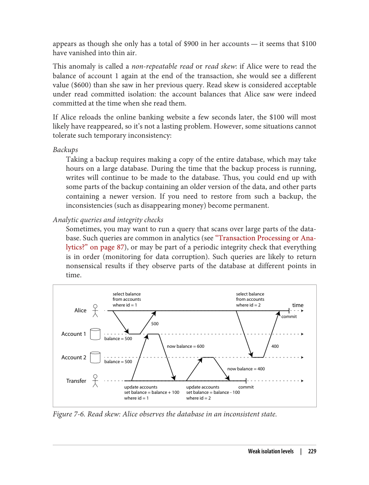

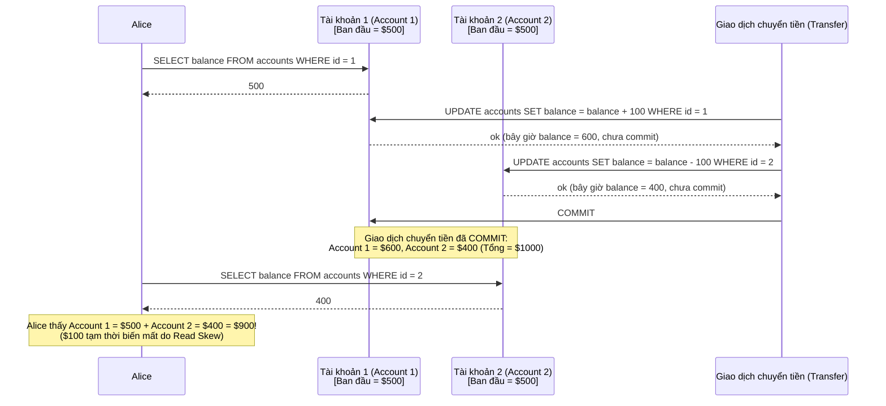

**Cô lập bản chụp (Snapshot isolation)**, còn được gọi là **kiểm soát đồng thời đa phiên bản (multiversion concurrency control — MVCC)**, là giải pháp phổ biến nhất cho vấn đề này [27]. Ý tưởng cốt lõi là mỗi giao dịch sẽ đọc từ một **bản chụp nhất quán (consistent snapshot)** của cơ sở dữ liệu — nghĩa là toàn bộ dữ liệu đã được cam kết trong cơ sở dữ liệu tại một thời điểm xác định. Ngay cả khi dữ liệu sau đó bị thay đổi bởi một giao dịch khác, mỗi giao dịch vẫn chỉ nhìn thấy dữ liệu cũ tính từ thời điểm mà giao dịch đó bắt đầu.

Cô lập bản chụp là một cứu cánh tuyệt vời cho các câu truy vấn chỉ đọc chạy lâu (long-running, read-only queries) như sao lưu và phân tích dữ liệu. Sẽ rất khó để suy luận về ý nghĩa của một câu truy vấn nếu dữ liệu mà nó đang thao tác cứ liên tục biến đổi ngay trong lúc câu truy vấn đang thực thi. Khi một giao dịch có thể nhìn thấy một bản chụp nhất quán của cơ sở dữ liệu, được "đóng băng" tại một thời điểm cụ thể, mọi thứ trở nên dễ hiểu hơn rất nhiều.

#### Triển khai cô lập bản chụp (Implementing snapshot isolation)

Cô lập bản chụp là một tính năng phổ biến: nó được hỗ trợ bởi PostgreSQL, MySQL với bộ máy lưu trữ InnoDB, Oracle, SQL Server, và nhiều hệ thống khác [22, 30, 31].

Giống như *read committed*, các bản triển khai của cô lập bản chụp thường sử dụng khóa ghi (write locks) để ngăn chặn hiện tượng ghi bẩn (xem phần “Triển khai read committed” ở trên), nghĩa là một giao dịch thực hiện thao tác ghi có thể chặn tiến trình của một giao dịch khác cùng ghi vào đối tượng đó. Tuy nhiên, các thao tác đọc **không cần dùng đến khóa**. Dưới góc độ hiệu năng, một nguyên lý then chốt của cô lập bản chụp là **người đọc không bao giờ chặn người ghi, và người ghi không bao giờ chặn người đọc (readers never block writers, and writers never block readers)**. Điều này cho phép cơ sở dữ liệu xử lý các truy vấn đọc chạy lâu trên một bản chụp nhất quán cùng lúc với việc xử lý các thao tác ghi một cách bình thường, mà không hề xảy ra bất kỳ sự tranh chấp khóa (lock contention) nào giữa hai bên.

Cơ chế này được triển khai như một sự tổng quát hóa của cơ chế mà chúng ta đã thấy để ngăn chặn đọc bẩn trong **Hình 7-4**. Để ngăn chặn đọc bẩn, cơ sở dữ liệu cần giữ tối đa hai phiên bản của một đối tượng: phiên bản đã cam kết (committed version), và phiên bản đã bị ghi đè nhưng chưa được cam kết (overwritten-but-not-yet-committed version). Đối với cô lập bản chụp, cơ sở dữ liệu có khả năng phải lưu giữ **nhiều phiên bản đã cam kết khác nhau** của một đối tượng, bởi vì nhiều giao dịch đang chạy dở dang có thể cần nhìn thấy trạng thái của cơ sở dữ liệu tại các thời điểm khác nhau. Do đó, cô lập bản chụp còn được biết đến như một kỹ thuật **đa phiên bản (multiversion)** (MVCC).

**Hình 7-7** minh họa cách cô lập bản chụp được triển khai trong PostgreSQL [30] (các bản triển khai khác cũng có nguyên lý tương tự). Khi một giao dịch được bắt đầu, nó được cấp một **định danh giao dịch (transaction ID — `txid`)** duy nhất và luôn tăng dần.<sup>vii</sup> Bất cứ khi nào một giao dịch ghi bất kỳ thứ gì vào cơ sở dữ liệu, dữ liệu mà nó ghi sẽ được gắn thẻ (tagged) với `txid` của giao dịch ghi đó.

> <sup>vii</sup> Nói chính xác hơn, các ID giao dịch là các số nguyên 32-bit, vì vậy chúng sẽ bị tràn số (overflow / wraparound) sau khoảng 4 tỷ giao dịch. Tiến trình `vacuum` của PostgreSQL thực hiện việc dọn dẹp để đảm bảo rằng hiện tượng tràn số không làm ảnh hưởng đến dữ liệu.

Mỗi hàng (row) trong một bảng có một trường `created by` (được tạo bởi), chứa ID của giao dịch đã chèn hàng này vào bảng. Hơn nữa, mỗi hàng còn có một trường `deleted by` (được xóa bởi), ban đầu để trống (`nil`). Nếu một giao dịch xóa một hàng, hàng đó chưa thực sự bị xóa khỏi cơ sở dữ liệu ngay lập tức, mà chỉ được đánh dấu để xóa bằng cách đặt trường `deleted by` thành ID của giao dịch đã yêu cầu xóa. Vào một thời điểm nào đó về sau, khi đã chắc chắn rằng không còn bất kỳ giao dịch nào có thể truy cập vào dữ liệu đã xóa đó nữa, một tiến trình thu gom rác (garbage collection process) trong cơ sở dữ liệu sẽ loại bỏ mọi hàng đã được đánh dấu xóa và giải phóng không gian lưu trữ của chúng.

Một thao tác cập nhật (`UPDATE`) ở bên trong nội bộ sẽ được dịch thành một thao tác xóa (`DELETE`) kèm theo một thao tác tạo mới (`CREATE`). Ví dụ, trong **Hình 7-7**, giao dịch 13 trừ 100 đô la từ tài khoản 2, làm thay đổi số dư từ 500 đô la xuống 400 đô la. Bảng `accounts` lúc này thực chất chứa tới hai hàng dành cho tài khoản 2: một hàng có số dư 500 đô la được đánh dấu là đã xóa bởi giao dịch 13 (`deleted by = 13`), và một hàng có số dư 400 đô la được tạo bởi giao dịch 13 (`created by = 13`).

**Hình 7-7 – Triển khai cô lập bản chụp bằng cách sử dụng các đối tượng đa phiên bản (Figure 7-7. Implementing snapshot isolation using multiversion objects.)**

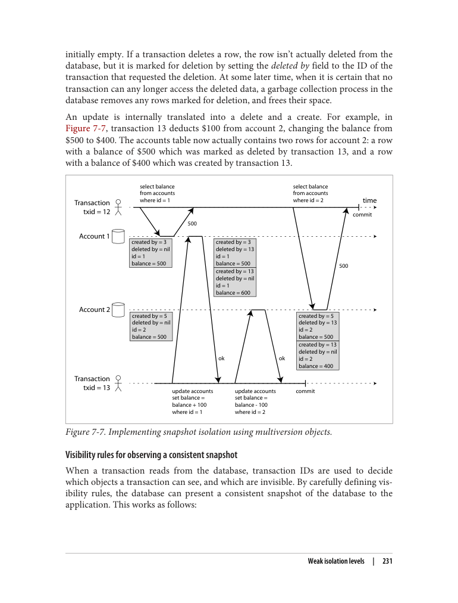

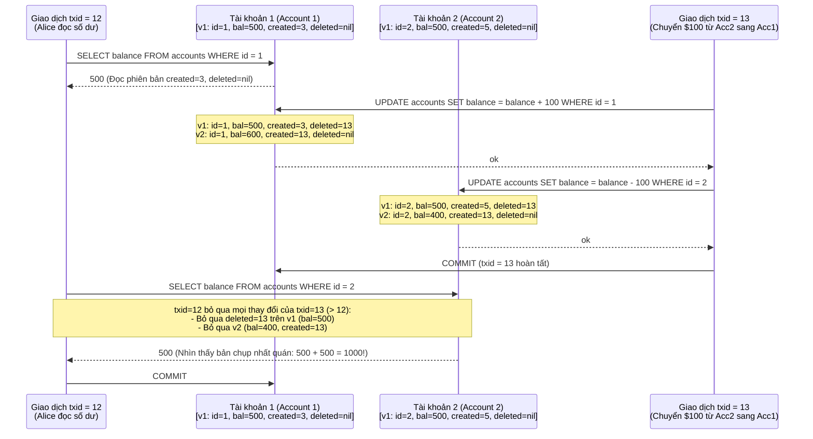

#### Các quy tắc hiển thị để quan sát một bản chụp nhất quán (Visibility rules for observing a consistent snapshot)

Khi một giao dịch đọc từ cơ sở dữ liệu, các ID giao dịch (`txid`) được sử dụng để quyết định xem giao dịch đó có thể nhìn thấy những đối tượng nào và những đối tượng nào là vô hình (invisible). Bằng cách định nghĩa cẩn thận **các quy tắc hiển thị (visibility rules)**, cơ sở dữ liệu có thể trình bày một bản chụp nhất quán của cơ sở dữ liệu cho ứng dụng. Cơ chế này hoạt động như sau:

1. Tại thời điểm bắt đầu của mỗi giao dịch, cơ sở dữ liệu lập một danh sách tất cả các giao dịch khác đang chạy dở dang (in progress — chưa được cam kết hoặc hủy bỏ) tại thời điểm đó. Bất kỳ thao tác ghi nào được thực hiện bởi một trong những giao dịch đó đều bị bỏ qua, ngay cả khi giao dịch đó sau này đã cam kết.
2. Bất kỳ thao tác ghi nào được thực hiện bởi các giao dịch đã bị hủy bỏ (aborted) đều bị bỏ qua.
3. Bất kỳ thao tác ghi nào được thực hiện bởi các giao dịch có ID giao dịch muộn hơn (tức là những giao dịch bắt đầu *sau khi* giao dịch hiện tại đã bắt đầu) đều bị bỏ qua, bất kể giao dịch đó đã cam kết hay chưa.
4. Tất cả các thao tác ghi khác đều hiển thị (visible) đối với các truy vấn của ứng dụng.

Các quy tắc này áp dụng cho cả việc tạo mới lẫn việc xóa đối tượng. Trong **Hình 7-7**, khi giao dịch 12 đọc từ tài khoản 2, nó nhìn thấy số dư là 500 đô la bởi vì thao tác xóa số dư 500 đô la được thực hiện bởi giao dịch 13 (theo quy tắc 3, giao dịch 12 không thể nhìn thấy thao tác xóa do giao dịch 13 thực hiện), và việc tạo ra số dư 400 đô la cũng chưa hiển thị đối với nó (cũng theo cùng quy tắc 3).

Nói theo một cách khác, một đối tượng là **hiển thị (visible)** nếu thỏa mãn đồng thời cả hai điều kiện:

- Tại thời điểm giao dịch của người đọc bắt đầu, giao dịch tạo ra đối tượng đó (`created by`) đã được cam kết xong, **VÀ**
- Đối tượng đó không bị đánh dấu xóa — hoặc nếu có bị đánh dấu xóa (`deleted by`), thì giao dịch yêu cầu xóa đó vẫn chưa được cam kết tại thời điểm giao dịch của người đọc bắt đầu.

Một giao dịch chạy lâu có thể tiếp tục sử dụng một bản chụp trong một thời gian dài, tiếp tục đọc các giá trị mà (dưới góc nhìn của các giao dịch khác) đã bị ghi đè hoặc bị xóa từ lâu. Bằng cách không bao giờ cập nhật các giá trị tại chỗ (in place), mà thay vào đó tạo ra một phiên bản mới mỗi khi một giá trị bị thay đổi, cơ sở dữ liệu có thể cung cấp một bản chụp nhất quán trong khi chỉ phải chịu một chi phí phụ trội (overhead) nhỏ.

#### Chỉ mục và cô lập bản chụp (Indexes and snapshot isolation)

Các chỉ mục (indexes) hoạt động như thế nào trong một cơ sở dữ liệu đa phiên bản? Một lựa chọn là để cho chỉ mục đơn giản trỏ tới tất cả các phiên bản của một đối tượng, và một truy vấn chỉ mục cần phải lọc bỏ bất kỳ phiên bản đối tượng nào không hiển thị đối với giao dịch hiện tại. Khi tiến trình thu gom rác (garbage collection) loại bỏ các phiên bản đối tượng cũ không còn hiển thị với bất kỳ giao dịch nào nữa, các mục chỉ mục (index entries) tương ứng cũng có thể được gỡ bỏ.

Trên thực tế, có rất nhiều chi tiết triển khai quyết định hiệu năng của cơ chế kiểm soát đồng thời đa phiên bản (MVCC). Ví dụ, PostgreSQL có các kỹ thuật tối ưu hóa giúp tránh phải cập nhật chỉ mục nếu các phiên bản khác nhau của cùng một đối tượng có thể nằm vừa vặn trên cùng một trang bộ nhớ/đĩa (page) [30].

Một cách tiếp cận khác được sử dụng trong CouchDB, Datomic và LMDB. Mặc dù chúng cũng sử dụng B-tree (xem phần “B-trees” ở trang 77 Chương 3), nhưng chúng sử dụng một biến thể **chỉ nối thêm / sao chép khi ghi (append-only / copy-on-write)** không ghi đè lên các trang của cây khi chúng được cập nhật, mà thay vào đó tạo ra một bản sao mới cho mỗi trang bị sửa đổi. Các trang cha (parent pages), ngược lên cho tới tận nút gốc (root) của cây, đều được sao chép và cập nhật để trỏ tới phiên bản mới của các trang con của chúng. Bất kỳ trang nào không bị ảnh hưởng bởi thao tác ghi đều không cần phải sao chép và vẫn giữ nguyên tính bất biến (immutable) [32, 33, 34].

Với các B-tree chỉ nối thêm (append-only B-trees), mỗi giao dịch ghi (hoặc mỗi lô giao dịch) sẽ tạo ra một nút gốc B-tree (B-tree root) mới, và một nút gốc cụ thể chính là một bản chụp nhất quán của cơ sở dữ liệu tại thời điểm nó được tạo ra. Không cần phải lọc bỏ các đối tượng dựa trên ID giao dịch bởi vì các thao tác ghi tiếp theo không thể sửa đổi một B-tree hiện có, mà chỉ tạo ra các nút gốc cây mới. Tuy nhiên, cách tiếp cận này cũng đòi hỏi một tiến trình chạy nền để thực hiện việc nén (compaction) và thu gom rác (garbage collection).

> 📝 **Giải thích thêm (không có trong sách) — So sánh chi tiết MVCC giữa PostgreSQL và MySQL InnoDB:**
>
> Dù cả **PostgreSQL** và **MySQL (InnoDB)** đều sử dụng MVCC để triển khai *Read Committed* và *Snapshot Isolation (Repeatable Read)*, nhưng kiến trúc lưu trữ đa phiên bản bên dưới của hai hệ quản trị cơ sở dữ liệu này lại đi theo hai trường phái hoàn toàn trái ngược nhau:
>
> | Tiêu chí | PostgreSQL (Multi-version Tuple Storage trong Heap) | MySQL InnoDB (In-place / Undo Log Rollback Segment) |
> | :--- | :--- | :--- |
> | **Nơi lưu các phiên bản cũ** | Lưu trực tiếp các phiên bản tuple cũ và mới chung trong các trang dữ liệu chính (**Heap pages**). Mỗi tuple có hai trường header ẩn là `xmin` (tương ứng `created by`) và `xmax` (tương ứng `deleted by`). | Bảng chính (Clustered Index / Primary Key B+Tree) chỉ lưu **phiên bản mới nhất**. Các phiên bản cũ được đẩy sang vùng **Undo Log**; mỗi hàng có các cột ẩn `DB_TRX_ID` (ID giao dịch sửa đổi cuối) và `DB_ROLL_PTR` (con trỏ trỏ về chuỗi bản ghi cũ trong Undo Log). |
> | **Cơ chế khi chạy `UPDATE`** | Luôn tạo ra một tuple vật lý mới trong Heap (`DELETE` logic tuple cũ + `INSERT` tuple mới). Nếu cột được sửa không nằm trong index và trang hiện tại còn chỗ trống, PostgreSQL dùng tối ưu hóa **HOT (Heap-Only Tuple)** để tạo chuỗi liên kết nội bộ trong cùng page mà không cần sửa Secondary Index. | Nếu cập nhật không làm thay đổi kích thước vượt quá chỗ trống hoặc không đổi khóa chính, InnoDB cập nhật **tại chỗ (in-place)** trên Clustered Index page và ghi bản ghi hoàn tác (before-image) vào **Undo Log**. |
> | **Chi phí khi đọc dữ liệu cũ** | Nhanh và đồng đều vì mọi phiên bản tuple đều là công dân hạng nhất nằm ngay trên Heap (đặc biệt khi dùng HOT chain trên cùng một page). | Nếu một giao dịch chạy lâu cần đọc phiên bản rất cũ của một hàng vừa bị `UPDATE` hàng trăm lần, InnoDB phải lần ngược chuỗi con trỏ `DB_ROLL_PTR` qua hàng trăm bản ghi trong Undo Log để tái tạo lại (reconstruct) phiên bản phù hợp với `Read View`. |
> | **Thu gom rác (Garbage Collection) & Vấn đề vận hành** | Cần tiến trình **`AUTOVACUUM`** quét Heap và Index để dọn các *dead tuples* và đóng băng `txid` (tránh lỗi *Transaction ID Wraparound* 32-bit). Nếu `UPDATE` tần suất cực cao mà `autovacuum` không dọn kịp sẽ gây ra hiện tượng **Table Bloat / Index Bloat** (phình to dung lượng bảng). | Tiến trình **Purge thread** chỉ cần dọn các trang **Undo Log** khi không còn `Read View` nào cần tới; bảng chính ít bị phình to như Heap của Postgres, nhưng nếu có một giao dịch bị treo rất lâu, kích thước Undo Tablespace và *History List Length (HLL)* sẽ tăng vọt làm chậm toàn bộ hệ thống. |
> | **Thời điểm lấy Snapshot** | Ở mức `READ COMMITTED`, Postgres tạo snapshot mới ở **mỗi câu lệnh SQL (statement)**. Ở mức `REPEATABLE READ`, Postgres tạo snapshot một lần tại **câu lệnh đầu tiên** của transaction. | Hoàn toàn tương tự: `READ COMMITTED` tạo `Read View` mới cho mỗi câu lệnh `SELECT` thường; `REPEATABLE READ` tạo `Read View` tại câu lệnh `SELECT` đầu tiên và tái sử dụng cho các lệnh đọc thường tiếp theo. |

#### Repeatable read và sự nhầm lẫn về tên gọi (Repeatable read and naming confusion)

Cô lập bản chụp (snapshot isolation) là một mức cô lập hữu ích, đặc biệt là đối với các giao dịch chỉ đọc. Tuy nhiên, nhiều cơ sở dữ liệu triển khai nó lại gọi nó bằng những cái tên khác nhau. Trong Oracle, nó được gọi là `serializable`, còn trong PostgreSQL và MySQL, nó được gọi là `repeatable read` [22].

Lý do của sự nhầm lẫn về tên gọi này là vì tiêu chuẩn SQL (SQL standard) không hề có khái niệm *cô lập bản chụp (snapshot isolation)*, bởi lẽ tiêu chuẩn này được xây dựng dựa trên định nghĩa năm 1975 của System R về các mức cô lập [2] và vào thời điểm đó cô lập bản chụp vẫn chưa được phát minh ra. Thay vào đó, tiêu chuẩn SQL định nghĩa mức **đọc lặp lại (repeatable read)**, nhìn bề ngoài có vẻ tương tự như cô lập bản chụp. PostgreSQL và MySQL gọi mức cô lập bản chụp của chúng là *repeatable read* bởi vì nó đáp ứng được các yêu cầu của tiêu chuẩn, và nhờ đó chúng có thể tuyên bố là tuân thủ tiêu chuẩn (standards compliance).

Đáng tiếc là định nghĩa của tiêu chuẩn SQL về các mức cô lập lại có nhiều thiếu sót — nó mơ hồ, thiếu chính xác và không độc lập với cách triển khai (implementation-independent) như một tiêu chuẩn đúng nghĩa cần phải có [27]. Mặc dù có nhiều cơ sở dữ liệu cùng triển khai *repeatable read*, nhưng lại có những sự khác biệt rất lớn trong các đảm bảo mà chúng thực sự cung cấp, bất chấp việc bề ngoài có vẻ như đã được chuẩn hóa [22]. Đã có một định nghĩa hình thức (formal definition) cho *repeatable read* trong các tài liệu nghiên cứu [28, 29], nhưng hầu hết các bản triển khai thực tế đều không thỏa mãn định nghĩa hình thức đó. Và để làm cho sự việc rối rắm lên tới đỉnh điểm, IBM DB2 lại sử dụng thuật ngữ *repeatable read* để chỉ *tính tuần tự hóa (serializability)* [8].

Hệ quả là chẳng ai thực sự biết chính xác *repeatable read* có nghĩa là gì.

---

### Ngăn chặn mất cập nhật (Preventing lost updates)

Mức *read committed* và *cô lập bản chụp (snapshot isolation)*, như đã thảo luận cho đến nay, chủ yếu xoay quanh các đảm bảo về những gì một giao dịch chỉ đọc có thể nhìn thấy khi có sự hiện diện của các thao tác ghi đồng thời. Chúng ta hầu như đã bỏ qua vấn đề hai giao dịch cùng ghi một cách đồng thời — chúng ta mới chỉ thảo luận về *ghi bẩn (dirty writes)* (xem phần “Không ghi bẩn (No dirty writes)” ở trên), vốn chỉ là một dạng xung đột ghi-ghi (write-write conflict) cụ thể có thể xảy ra.

Còn có một số loại xung đột thú vị khác có thể xảy ra giữa các giao dịch đang ghi đồng thời. Nổi tiếng nhất trong số này là bài toán **mất cập nhật (lost update)**, được minh họa trong **Hình 7-1**.

Hiện tượng mất cập nhật có thể xảy ra nếu một ứng dụng đọc một giá trị nào đó từ cơ sở dữ liệu, sửa đổi nó, rồi ghi trả lại giá trị đã sửa đổi đó (một **chu trình đọc-sửa-ghi — read-modify-write cycle**). Nếu hai giao dịch thực hiện việc này đồng thời, một trong hai sự sửa đổi có thể bị mất, bởi vì thao tác ghi thứ hai không bao gồm sự sửa đổi thứ nhất. (Đôi khi chúng ta nói rằng thao tác ghi sau đã *đè bẹp [clobbers]* thao tác ghi trước.) Mẫu hình (pattern) này xuất hiện trong nhiều kịch bản khác nhau:

- Tăng giá trị một bộ đếm (counter) hoặc cập nhật số dư tài khoản (đòi hỏi phải đọc giá trị hiện tại, tính toán giá trị mới, và ghi trả lại giá trị đã cập nhật).
- Thực hiện một thay đổi cục bộ bên trong một giá trị phức hợp, ví dụ như thêm một phần tử vào một danh sách nằm bên trong một tài liệu JSON (đòi hỏi phải phân tích cú pháp [parse] tài liệu đó, thực hiện thay đổi, rồi ghi trả lại tài liệu đã sửa đổi).
- Hai người dùng chỉnh sửa cùng một trang wiki vào cùng một thời điểm, trong đó mỗi người dùng lưu các thay đổi của mình bằng cách gửi toàn bộ nội dung trang lên máy chủ, ghi đè lên bất cứ thứ gì hiện đang có trong cơ sở dữ liệu.

Bởi vì đây là một vấn đề vô cùng phổ biến, nhiều giải pháp khác nhau đã được phát triển để xử lý nó.

#### Các thao tác ghi nguyên tử (Atomic write operations)

Nhiều cơ sở dữ liệu cung cấp các thao tác cập nhật nguyên tử (atomic update operations), giúp loại bỏ nhu cầu phải tự triển khai chu trình đọc-sửa-ghi trong mã nguồn ứng dụng. Chúng thường là giải pháp tốt nhất nếu mã của bạn có thể được biểu diễn dưới dạng những thao tác đó. Ví dụ, câu lệnh sau đây là an toàn trong hầu hết các cơ sở dữ liệu quan hệ:

```sql
UPDATE counters SET value = value + 1 WHERE key = 'foo';
```

Tương tự, các cơ sở dữ liệu tài liệu như MongoDB cung cấp các thao tác nguyên tử (như `$inc`, `$push`, `$set`) để thực hiện các sửa đổi cục bộ đối với một phần của tài liệu JSON, và Redis cung cấp các thao tác nguyên tử (như `INCR`, `ZADD`, `LPUSH`) để sửa đổi các cấu trúc dữ liệu như hàng đợi ưu tiên (priority queues). Không phải mọi thao tác ghi đều có thể dễ dàng biểu diễn dưới dạng các thao tác nguyên tử — ví dụ, việc cập nhật một trang wiki bao gồm các chỉnh sửa văn bản tùy ý<sup>viii</sup> — nhưng trong những tình huống có thể sử dụng thao tác nguyên tử, chúng thường là lựa chọn tốt nhất.

> <sup>viii</sup> Thực ra vẫn có thể biểu diễn việc chỉnh sửa một tài liệu văn bản dưới dạng một dòng các đột biến nguyên tử (stream of atomic mutations — chẳng hạn dùng CRDT hoặc Operational Transformation), mặc dù khá phức tạp. Xem phần “Tự động giải quyết xung đột” ở trang 167 Chương 5 để biết một số gợi ý.

Các thao tác nguyên tử thường được triển khai bằng cách lấy một **khóa độc quyền (exclusive lock)** trên đối tượng khi nó được đọc, sao cho không có giao dịch nào khác có thể đọc nó cho đến khi bản cập nhật đã được áp dụng xong. Kỹ thuật này đôi khi được gọi là **tính ổn định con trỏ (cursor stability)** [35, 36]. Một lựa chọn khác là đơn giản ép tất cả các thao tác nguyên tử phải được thực thi tuần tự trên một luồng duy nhất (single thread — như cách Redis thực hiện trên luồng sự kiện chính của nó).

Đáng tiếc là các framework ánh xạ hướng đối tượng - quan hệ (ORM) lại khiến lập trình viên rất dễ vô tình viết ra những đoạn mã thực hiện chu trình đọc-sửa-ghi không an toàn (load object vào bộ nhớ, gán thuộc tính mới trong code, rồi gọi `.save()`) thay vì sử dụng các thao tác nguyên tử do cơ sở dữ liệu cung cấp [37]. Điều đó không thành vấn đề nếu bạn ý thức rõ mình đang làm gì, nhưng nó tiềm ẩn nguy cơ trở thành nguồn gốc của những lỗi tinh vi rất khó phát hiện thông qua kiểm thử.

#### Khóa tường minh (Explicit locking)

Một lựa chọn khác để ngăn chặn mất cập nhật, nếu các thao tác nguyên tử tích hợp sẵn của cơ sở dữ liệu không cung cấp đủ chức năng cần thiết, là để ứng dụng **khóa một cách tường minh (explicitly lock)** các đối tượng sắp được cập nhật. Khi đó, ứng dụng có thể thực hiện chu trình đọc-sửa-ghi, và nếu bất kỳ giao dịch nào khác cố gắng đọc đồng thời cùng đối tượng đó, nó sẽ buộc phải chờ cho đến khi chu trình đọc-sửa-ghi đầu tiên hoàn tất.

Ví dụ, hãy xem xét một trò chơi nhiều người chơi (multiplayer game) trong đó nhiều người chơi có thể di chuyển cùng một quân cờ (figure) một cách đồng thời. Trong trường hợp này, một thao tác nguyên tử đơn thuần có thể là không đủ, bởi vì ứng dụng còn cần phải đảm bảo rằng nước đi của người chơi tuân thủ đúng luật của trò chơi — điều này bao gồm một số logic nghiệp vụ phức tạp mà bạn không thể triển khai một cách hợp lý bên trong một câu truy vấn cơ sở dữ liệu. Thay vào đó, bạn có thể sử dụng một khóa để ngăn hai người chơi đồng thời di chuyển cùng một quân cờ:

**Ví dụ 7-1 – Khóa tường minh các hàng để ngăn chặn hiện tượng mất cập nhật (Example 7-1. Explicitly locking rows to prevent lost updates.)**

```sql
BEGIN TRANSACTION;

SELECT * FROM figures
  WHERE name = 'robot' AND game_id = 222
  FOR UPDATE;

-- Kiểm tra xem nước đi có hợp lệ hay không (ở tầng ứng dụng), sau đó cập nhật vị trí
-- của quân cờ vừa được trả về bởi câu lệnh SELECT ở trên.
UPDATE figures SET position = 'c4' WHERE id = 1234;

COMMIT;
```

Mệnh đề `FOR UPDATE` chỉ thị rằng cơ sở dữ liệu phải đặt một khóa (exclusive lock) lên tất cả các hàng được trả về bởi câu truy vấn này.

Cách này hoạt động tốt, nhưng để làm đúng, bạn cần phải suy nghĩ thật cẩn thận về logic ứng dụng của mình. Rất dễ quên thêm một chiếc khóa cần thiết ở một chỗ nào đó trong mã nguồn, và do đó vô tình đưa một điều kiện tranh chấp (race condition) vào hệ thống.

#### Tự động phát hiện mất cập nhật (Automatically detecting lost updates)

Các thao tác nguyên tử và khóa là những cách ngăn chặn mất cập nhật bằng cách ép các chu trình đọc-sửa-ghi phải diễn ra một cách tuần tự (sequentially). Một giải pháp thay thế là cứ cho phép chúng thực thi song song, và nếu bộ quản lý giao dịch (transaction manager) phát hiện thấy có hiện tượng mất cập nhật xảy ra, giao dịch đó sẽ bị hủy bỏ (aborted) và buộc phải thử lại chu trình đọc-sửa-ghi của mình.

Một ưu điểm của cách tiếp cận này là các cơ sở dữ liệu có thể thực hiện bước kiểm tra này một cách rất hiệu quả khi kết hợp với cô lập bản chụp (snapshot isolation). Quả thực, mức `repeatable read` của PostgreSQL, mức `serializable` của Oracle và mức `snapshot` của SQL Server đều tự động phát hiện khi nào một hiện tượng mất cập nhật vừa xảy ra và hủy bỏ giao dịch vi phạm. Tuy nhiên, mức `repeatable read` của **MySQL/InnoDB lại không phát hiện mất cập nhật** [22]. Một số tác giả [27, 29] lập luận rằng một cơ sở dữ liệu bắt buộc phải ngăn chặn được hiện tượng mất cập nhật thì mới đủ tiêu chuẩn được coi là cung cấp *cô lập bản chụp (snapshot isolation)*, vì vậy theo định nghĩa này thì MySQL không thực sự cung cấp cô lập bản chụp.

Tự động phát hiện mất cập nhật là một tính năng tuyệt vời, bởi vì nó không yêu cầu mã ứng dụng phải sử dụng bất kỳ tính năng cơ sở dữ liệu đặc biệt nào — bạn có thể quên sử dụng khóa hoặc thao tác nguyên tử và từ đó tạo ra lỗi, nhưng việc phát hiện mất cập nhật lại diễn ra hoàn toàn tự động và do đó ít gây ra sai sót hơn nhiều.

> 💡 **Ví dụ bổ sung (không có trong sách) — Sự khác biệt sống còn giữa PostgreSQL `REPEATABLE READ` và MySQL InnoDB `REPEATABLE READ` khi xảy ra Lost Update:**
>
> Giả sử tài khoản `id = 1` đang có `balance = 500`. Hai giao dịch T1 và T2 cùng chạy ở mức cô lập `REPEATABLE READ` để đọc `balance` về biến cục bộ trong code ứng dụng, cộng thêm 100 (thành 600), rồi chạy câu lệnh `UPDATE accounts SET balance = 600 WHERE id = 1`:
>
> 1. **Trong PostgreSQL (`REPEATABLE READ`):**
>    - T1 và T2 cùng bắt đầu và `SELECT balance` $\rightarrow$ cả hai đều nhận `500` từ snapshot của mình.
>    - T1 chạy `UPDATE accounts SET balance = 600 WHERE id = 1;` và `COMMIT;`.
>    - Khi T2 chạy `UPDATE accounts SET balance = 600 WHERE id = 1;`, PostgreSQL áp dụng quy tắc **First-Committer-Wins (Người cam kết đầu tiên chiến thắng)**: nó phát hiện hàng `id = 1` đã bị sửa đổi và commit bởi một giao dịch khác (T1) sau thời điểm snapshot của T2 được tạo. Ngay lập tức, PostgreSQL hủy bỏ T2 với lỗi:
>      `ERROR: could not serialize access due to concurrent update (SQLSTATE 40001)`
>    - Nhờ đó, hiện tượng **Lost Update bị chặn đứng hoàn toàn tự động**!
>
> 2. **Trong MySQL InnoDB (`REPEATABLE READ`):**
>    - T1 và T2 cùng bắt đầu và `SELECT balance` (không có `FOR UPDATE`) $\rightarrow$ cả hai đều thực hiện *Consistent Nonlocking Read* từ `Read View` và nhận `500`.
>    - T1 chạy `UPDATE accounts SET balance = 600 WHERE id = 1;` và `COMMIT;`.
>    - Khi T2 chạy `UPDATE accounts SET balance = 600 WHERE id = 1;`, InnoDB **không** kiểm tra xung đột với `Read View` ban đầu mà thực hiện một thao tác gọi là **Current Read (Đọc hiện tại)**: nó đọc phiên bản mới nhất đã commit của T1, lấy khóa ghi và âm thầm ghi đè `balance = 600` lên trên kết quả của T1 rồi `COMMIT` thành công mà **không báo bất kỳ lỗi nào**!
>    - Kết quả: Trong MySQL InnoDB ở mức `REPEATABLE READ`, nếu lập trình viên đọc bằng `SELECT` thường rồi tính toán trong code để `UPDATE`, **Lost Update vẫn xảy ra bình thường** trừ khi dùng `SELECT ... FOR UPDATE` hoặc câu lệnh nguyên tử `SET balance = balance + 100`.

#### So sánh và thiết lập (Compare-and-set)

Trong các cơ sở dữ liệu không cung cấp giao dịch, đôi khi bạn sẽ bắt gặp một thao tác nguyên tử là **so sánh và thiết lập (compare-and-set — CAS)** (đã được đề cập trước đó trong phần “Ghi đơn đối tượng (Single-object writes)”). Mục đích của thao tác này là tránh mất cập nhật bằng cách chỉ cho phép một thao tác cập nhật diễn ra nếu giá trị vẫn chưa bị thay đổi kể từ lần cuối cùng bạn đọc nó. Nếu giá trị hiện tại không còn khớp với những gì bạn đã đọc trước đó, thao tác cập nhật sẽ không có hiệu lực, và chu trình đọc-sửa-ghi phải được thử lại.

Ví dụ, để ngăn hai người dùng đồng thời cập nhật cùng một trang wiki, bạn có thể thử viết một câu lệnh như thế này, với kỳ vọng rằng việc cập nhật sẽ chỉ xảy ra nếu nội dung của trang chưa bị thay đổi kể từ khi người dùng bắt đầu chỉnh sửa nó:

```sql
-- Câu lệnh này có thể an toàn hoặc KHÔNG an toàn, tùy thuộc vào cách triển khai của cơ sở dữ liệu
UPDATE wiki_pages SET content = 'new content'
  WHERE id = 1234 AND content = 'old content';
```

Nếu nội dung đã thay đổi và không còn khớp với `'old content'` nữa, câu lệnh cập nhật này sẽ không có tác dụng (0 rows affected), vì vậy bạn cần kiểm tra xem thao tác cập nhật có hiệu lực hay không và thử lại nếu cần thiết. Tuy nhiên, nếu cơ sở dữ liệu cho phép mệnh đề `WHERE` đọc từ một **bản chụp cũ (old snapshot)**, thì câu lệnh này có thể **không** ngăn chặn được việc mất cập nhật, bởi vì điều kiện trong `WHERE` có thể vẫn đúng trên bản chụp cũ ngay cả khi một thao tác ghi đồng thời khác đang diễn ra. Hãy kiểm tra kỹ xem thao tác `compare-and-set` của cơ sở dữ liệu bạn đang dùng có thực sự an toàn hay không trước khi đặt niềm tin vào nó.

#### Giải quyết xung đột và sao chép (Conflict resolution and replication)

Trong các cơ sở dữ liệu có sao chép (replicated databases — xem Chương 5), việc ngăn chặn mất cập nhật lại mang thêm một chiều kích khác: bởi vì chúng có các bản sao của dữ liệu trên nhiều nút, và dữ liệu có khả năng bị sửa đổi đồng thời trên các nút khác nhau, nên cần phải thực hiện thêm một số bước bổ sung để ngăn chặn mất cập nhật.

Các cơ chế khóa (locks) và thao tác so sánh-và-thiết-lập (`compare-and-set`) đều giả định rằng chỉ có một bản sao cập nhật mới nhất duy nhất (single up-to-date copy) của dữ liệu. Tuy nhiên, các cơ sở dữ liệu sử dụng sao chép đa nút dẫn đầu (multi-leader) hoặc không có nút dẫn đầu (leaderless replication) thường cho phép nhiều thao tác ghi diễn ra đồng thời và sao chép chúng một cách bất đồng bộ, vì vậy chúng không thể đảm bảo rằng có một bản sao cập nhật mới nhất duy nhất của dữ liệu. Do đó, các kỹ thuật dựa trên khóa hoặc `compare-and-set` không thể áp dụng trong ngữ cảnh này. (Chúng ta sẽ quay lại vấn đề này một cách chi tiết hơn trong phần “Tính khả tuần tự tuyến tính (Linearizability)” ở trang 314 Chương 9.)

Thay vào đó, như đã thảo luận trong phần “Phát hiện các thao tác ghi đồng thời” ở trang 178 Chương 5, một cách tiếp cận phổ biến trong các cơ sở dữ liệu sao chép như vậy là cho phép các thao tác ghi đồng thời tạo ra nhiều phiên bản xung đột của một giá trị (còn được gọi là các **anh chị em — siblings**), và sử dụng mã ứng dụng hoặc các cấu trúc dữ liệu đặc biệt (như CRDTs) để giải quyết và hợp nhất (merge) các phiên bản này sau khi sự việc đã diễn ra.

Các thao tác nguyên tử có thể hoạt động rất tốt trong ngữ cảnh có sao chép, đặc biệt nếu chúng có **tính giao hoán (commutative)** — tức là bạn có thể áp dụng chúng theo một thứ tự khác nhau trên các bản sao khác nhau mà vẫn nhận được cùng một kết quả như nhau. Ví dụ, việc tăng một bộ đếm hoặc thêm một phần tử vào một tập hợp (set) là các thao tác có tính giao hoán. Đó chính là ý tưởng đằng sau các kiểu dữ liệu của Riak 2.0 (Riak datatypes / CRDTs), giúp ngăn chặn mất cập nhật xuyên qua các bản sao. Khi một giá trị được cập nhật đồng thời bởi các client khác nhau, Riak sẽ tự động hợp nhất các bản cập nhật lại với nhau theo cách đảm bảo không có bản cập nhật nào bị mất [38].

Mặt khác, phương pháp giải quyết xung đột **ghi sau cùng thắng (last write wins — LWW)** lại rất dễ dẫn đến mất cập nhật, như đã thảo luận trong phần “Ghi sau cùng thắng (loại bỏ các thao tác ghi đồng thời)” ở trang 179 Chương 5. Đáng tiếc là LWW lại là chế độ mặc định trong rất nhiều cơ sở dữ liệu có sao chép (chẳng hạn như Apache Cassandra hoặc DynamoDB).

---

### Ngăn chặn lệch ghi và bóng ma (Preventing write skew and phantoms)

Trong các phần trước, chúng ta đã thấy hiện tượng *ghi bẩn (dirty writes)* và *mất cập nhật (lost updates)* — hai loại điều kiện tranh chấp có thể xảy ra khi các giao dịch khác nhau đồng thời cố gắng ghi vào **cùng các đối tượng**. Để tránh làm hỏng dữ liệu, những điều kiện tranh chấp đó cần phải được ngăn chặn — hoặc một cách tự động bởi cơ sở dữ liệu, hoặc bằng các biện pháp bảo vệ thủ công như sử dụng khóa hay các thao tác ghi nguyên tử.

Tuy nhiên, danh sách các điều kiện tranh chấp tiềm ẩn có thể xảy ra giữa các thao tác ghi đồng thời vẫn chưa dừng lại ở đó. Trong phần này, chúng ta sẽ thấy một số ví dụ tinh vi hơn nhiều về xung đột.

Để bắt đầu, hãy tưởng tượng ví dụ sau đây: bạn đang viết một ứng dụng cho các bác sĩ để quản lý các ca trực (on-call shifts) của họ tại một bệnh viện. Bệnh viện thường cố gắng bố trí nhiều bác sĩ cùng trực tại bất kỳ thời điểm nào, nhưng **tuyệt đối bắt buộc phải có ít nhất một bác sĩ đang trực**. Các bác sĩ có thể xin nghỉ ca trực của mình (ví dụ nếu bản thân họ bị ốm), miễn là vẫn còn ít nhất một đồng nghiệp khác đang trực trong ca đó [39, 40].

Bây giờ hãy tưởng tượng rằng Alice và Bob là hai bác sĩ đang trực cho một ca cụ thể. Cả hai đều cảm thấy không khỏe trong người, vì vậy cả hai đều quyết định xin nghỉ. Không may thay, họ lại tình cờ bấm vào nút xin rút khỏi ca trực (go off-call) vào gần như cùng một thời điểm. Những gì diễn ra tiếp theo được minh họa trong **Hình 7-8**.

Trong mỗi giao dịch, trước tiên ứng dụng của bạn kiểm tra xem hiện có từ hai bác sĩ trở lên đang trực hay không (`currently_on_call >= 2`); nếu có, ứng dụng cho rằng việc để một bác sĩ rút khỏi ca trực là an toàn. Bởi vì cơ sở dữ liệu đang sử dụng **cô lập bản chụp (snapshot isolation)**, cả hai lần kiểm tra đều trả về kết quả là `2`, nên cả hai giao dịch đều tiến sang bước tiếp theo. Alice cập nhật bản ghi của chính cô ấy để rút tên mình khỏi ca trực, và Bob cũng cập nhật bản ghi của chính anh ấy theo cách tương tự. Cả hai giao dịch đều cam kết (commit) thành công, và giờ đây **không còn bất kỳ bác sĩ nào trực ca đó nữa**. Yêu cầu sống còn của bạn về việc phải có ít nhất một bác sĩ trực đã bị vi phạm!

**Hình 7-8 – Ví dụ về hiện tượng lệch ghi (write skew) gây ra lỗi ứng dụng (Figure 7-8. Example of write skew causing an application bug.)**

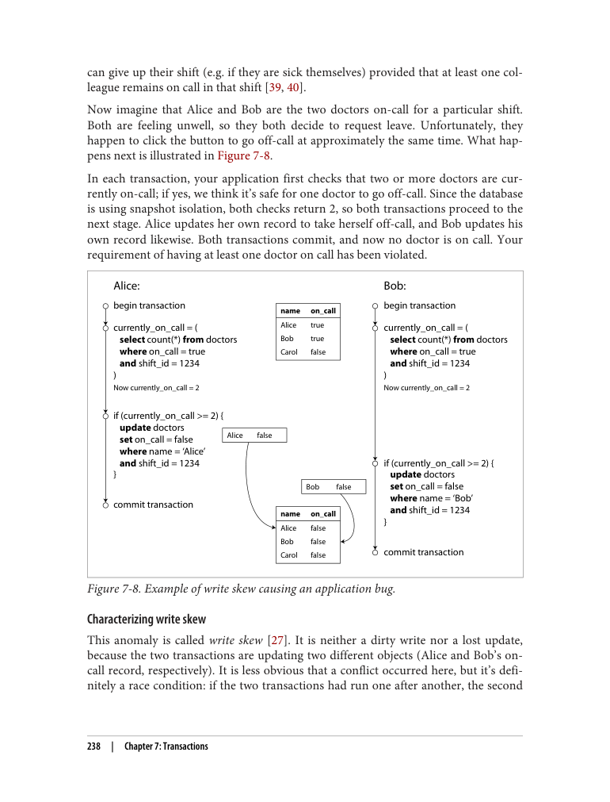

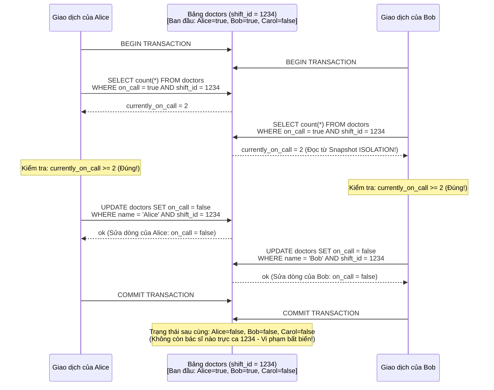

#### Đặc tả hiện tượng lệch ghi (Characterizing write skew)

Sự bất thường này được gọi là **lệch ghi (write skew)** [27]. Nó không phải là *ghi bẩn (dirty write)* mà cũng chẳng phải là *mất cập nhật (lost update)*, bởi vì hai giao dịch đang cập nhật **hai đối tượng hoàn toàn khác nhau** (lần lượt là bản ghi trực ca của Alice và bản ghi trực ca của Bob). Việc nhìn nhận rằng có một xung đột đã xảy ra ở đây không hề hiển nhiên chút nào, nhưng chắc chắn đây là một điều kiện tranh chấp (race condition): nếu hai giao dịch được chạy nối tiếp nhau (cái này xong rồi mới tới cái kia), bác sĩ thứ hai chắc chắn đã bị ngăn không cho rút khỏi ca trực. Hành vi bất thường này chỉ có thể xảy ra bởi vì hai giao dịch đã chạy đồng thời.

Bạn có thể coi *lệch ghi (write skew)* như một **sự tổng quát hóa của bài toán mất cập nhật (generalization of lost update)**. Hiện tượng lệch ghi có thể xảy ra nếu hai giao dịch cùng đọc các đối tượng giống nhau, và sau đó cập nhật một số đối tượng trong tập đó (các giao dịch khác nhau có thể cập nhật các đối tượng khác nhau). Trong trường hợp đặc biệt khi các giao dịch khác nhau lại cập nhật trên *cùng một đối tượng duy nhất*, bạn sẽ gặp phải sự bất thường là *ghi bẩn* hoặc *mất cập nhật* (tùy thuộc vào thời điểm diễn ra).

Chúng ta đã thấy rằng có nhiều cách khác nhau để ngăn chặn hiện tượng mất cập nhật. Tuy nhiên, đối với hiện tượng lệch ghi, các lựa chọn của chúng ta bị thu hẹp hơn rất nhiều:

- Các thao tác đơn đối tượng nguyên tử (atomic single-object operations) không giúp ích được gì, bởi vì có nhiều đối tượng khác nhau cùng liên đới.
- Cơ chế tự động phát hiện mất cập nhật mà bạn tìm thấy trong một số bản triển khai của cô lập bản chụp đáng tiếc cũng không giúp được gì: hiện tượng lệch ghi **không** được phát hiện tự động trong mức `repeatable read` của PostgreSQL, `repeatable read` của MySQL/InnoDB, `serializable` của Oracle hay `snapshot` của SQL Server [22]. Việc tự động ngăn chặn lệch ghi đòi hỏi mức cô lập tuần tự hóa thực sự (true serializable isolation — xem phần “Tính tuần tự hóa (Serializability)” ở trang 242 bản gốc).
- Một số cơ sở dữ liệu cho phép bạn cấu hình các ràng buộc (constraints), sau đó sẽ được thực thi bởi chính cơ sở dữ liệu (ví dụ: ràng buộc duy nhất [uniqueness], ràng buộc khóa ngoại [foreign key constraints] hoặc các giới hạn `CHECK` trên một giá trị cụ thể). Tuy nhiên, để chỉ định rằng phải có ít nhất một bác sĩ đang trực, bạn sẽ cần một ràng buộc liên quan đến nhiều đối tượng (multi-object / table-level constraint). Hầu hết các cơ sở dữ liệu không hỗ trợ sẵn loại ràng buộc như vậy. Bạn có thể cố triển khai chúng bằng các bẫy sự kiện (`triggers`) hoặc các khung nhìn vật lý hóa (`materialized views`), nhưng kết quả tạo ra có thể khá chắp vá và nặng tính mẹo mực (hacky) [41].
- Nếu bạn không thể sử dụng mức cô lập tuần tự hóa (`serializable`), lựa chọn tốt thứ hai trong trường hợp này có lẽ là **khóa một cách tường minh các hàng mà giao dịch đó phụ thuộc vào**. Trong ví dụ về các bác sĩ, bạn có thể viết một đoạn truy vấn như sau:

```sql
BEGIN TRANSACTION;

SELECT * FROM doctors
  WHERE on_call = true
  AND shift_id = 1234 FOR UPDATE;

UPDATE doctors
  SET on_call = false
  WHERE name = 'Alice'
  AND shift_id = 1234;

COMMIT;
```

Giống như trước đây, mệnh đề `FOR UPDATE` ra lệnh cho cơ sở dữ liệu phải khóa tất cả các hàng được trả về bởi câu truy vấn này (tức là khóa cả hàng của Alice lẫn hàng của Bob, khiến giao dịch thứ hai phải chờ cho đến khi giao dịch thứ nhất commit xong).

#### Thêm các ví dụ về lệch ghi (More examples of write skew)

Thoạt nhìn, hiện tượng lệch ghi có vẻ giống như một vấn đề học thuật xa vời và hiếm gặp, nhưng một khi bạn đã nhận thức được sự tồn tại của nó, bạn sẽ nhận ra có rất nhiều tình huống thực tế mà nó có thể xảy ra. Dưới đây là một số ví dụ khác:

##### Hệ thống đặt phòng họp (Meeting room booking system)

Giả sử bạn muốn thực thi quy tắc rằng không thể có hai lượt đặt chỗ (bookings) cho cùng một phòng họp vào cùng một khoảng thời gian [42]. Khi ai đó muốn đặt phòng, trước tiên bạn kiểm tra xem có bất kỳ lượt đặt phòng nào bị xung đột hay không (tức là các lượt đặt cho cùng phòng đó với khoảng thời gian bị chồng lấn nhau), và nếu không tìm thấy lượt nào, bạn mới tạo lượt đặt phòng mới:<sup>ix</sup>

> <sup>ix</sup> Trong PostgreSQL, bạn có thể thực hiện việc này một cách thanh lịch hơn nhiều bằng cách sử dụng các kiểu dữ liệu khoảng (`range types` như `tsrange`) kết hợp với ràng buộc loại trừ (`EXCLUDE USING gist`), nhưng tính năng này không được hỗ trợ rộng rãi trong các cơ sở dữ liệu khác.

**Ví dụ 7-2 – Hệ thống đặt phòng họp cố gắng tránh việc đặt trùng lịch (không an toàn dưới mức cô lập bản chụp) (Example 7-2. A meeting room booking system tries to avoid double-booking (not safe under snapshot isolation).)**

```sql
BEGIN TRANSACTION;

-- Kiểm tra bất kỳ lượt đặt phòng hiện có nào bị trùng/giao nhau với khung giờ từ 12h trưa đến 1h chiều
SELECT COUNT(*) FROM bookings
  WHERE room_id = 123 AND
    end_time > '2015-01-01 12:00' AND start_time < '2015-01-01 13:00';

-- ...Nếu câu truy vấn phía trên trả về 0 (không có lịch trùng):
INSERT INTO bookings
  (room_id, start_time, end_time, user_id)
  VALUES (123, '2015-01-01 12:00', '2015-01-01 13:00', 666);

COMMIT;
```

Đáng tiếc là cô lập bản chụp (snapshot isolation) **không** ngăn chặn được việc một người dùng khác đồng thời chèn vào một cuộc họp bị xung đột lịch. Để đảm bảo bạn sẽ không bao giờ gặp phải xung đột lịch đặt phòng, một lần nữa bạn cần đến mức cô lập tuần tự hóa (serializable isolation).

##### Trò chơi nhiều người chơi (Multiplayer game)

Trong **Ví dụ 7-1**, chúng ta đã sử dụng một khóa để ngăn chặn mất cập nhật (tức là đảm bảo rằng hai người chơi không thể di chuyển cùng một quân cờ vào cùng một thời điểm). Tuy nhiên, chiếc khóa đó lại không ngăn được việc hai quân cờ *khác nhau* cùng được di chuyển đến *cùng một vị trí* trên bàn cờ, hoặc thực hiện một nước đi nào khác vi phạm luật chơi. Tùy thuộc vào loại quy tắc mà bạn đang thực thi, bạn có thể sử dụng một ràng buộc duy nhất (`UNIQUE` constraint trên cột vị trí), nhưng nếu luật phức tạp hơn thì bạn hoàn toàn phơi mình trước lỗi lệch ghi (write skew).

##### Đăng ký tên người dùng (Claiming a username)

Trên một trang web nơi mỗi người dùng có một tên đăng nhập (`username`) duy nhất, hai người dùng có thể cố gắng tạo tài khoản với cùng một tên đăng nhập vào cùng một thời điểm. Bạn có thể sử dụng một giao dịch để kiểm tra xem tên đó đã có ai lấy chưa, và nếu chưa thì tạo một tài khoản với tên đó. Tuy nhiên, giống như trong các ví dụ trước, cách làm đó không an toàn dưới mức cô lập bản chụp. May mắn thay, một ràng buộc duy nhất (`UNIQUE` constraint) là một giải pháp rất đơn giản ở đây (giao dịch thứ hai cố gắng đăng ký trùng tên người dùng sẽ bị hủy bỏ do vi phạm ràng buộc).

##### Ngăn chặn chi tiêu kép (Preventing double-spending)

Một dịch vụ cho phép người dùng chi tiêu tiền hoặc điểm thưởng cần phải kiểm tra để đảm bảo người dùng không chi tiêu vượt quá số dư mà họ đang có. Bạn có thể triển khai việc này bằng cách chèn một mục chi tiêu dự kiến vào tài khoản của người dùng, liệt kê tất cả các mục trong tài khoản đó, rồi kiểm tra xem tổng số dư còn lại có dương hay không [43]. Với hiện tượng lệch ghi, có thể xảy ra trường hợp hai mục chi tiêu được chèn vào một cách đồng thời, khi cộng gộp cả hai lại thì làm cho số dư bị âm, nhưng không giao dịch nào nhận biết được sự tồn tại của giao dịch kia.

#### Hiện tượng bóng ma gây ra lệch ghi (Phantoms causing write skew)

Tất cả những ví dụ trên đều tuân theo một mẫu hình tương tự nhau (mặc dù các bước có thể diễn ra theo một thứ tự hơi khác):

1. Một câu truy vấn `SELECT` kiểm tra xem một yêu cầu nào đó có được thỏa mãn hay không bằng cách tìm kiếm các hàng khớp với một điều kiện tìm kiếm nhất định (có ít nhất hai bác sĩ đang trực, không có lượt đặt phòng nào hiện hữu cho căn phòng đó vào khung giờ đó, vị trí trên bàn cờ chưa có quân cờ nào khác đứng, tên người dùng bạn muốn lấy chưa bị ai đăng ký, vẫn còn đủ tiền trong tài khoản).
2. Tùy thuộc vào kết quả của câu truy vấn đầu tiên, mã nguồn ứng dụng quyết định cách thức tiếp tục (có thể là tiến hành thao tác tiếp theo, hoặc có thể là báo lỗi cho người dùng và hủy bỏ giao dịch).
3. Nếu ứng dụng quyết định tiếp tục, nó thực hiện một thao tác ghi (`INSERT`, `UPDATE` hoặc `DELETE`) vào cơ sở dữ liệu và cam kết (commit) giao dịch.
4. Nếu bạn lặp lại câu truy vấn `SELECT` ở bước 1 ngay sau thời điểm này, bây giờ bạn sẽ nhận được một **kết quả khác**, bởi vì thao tác ghi ở bước 3 đã làm thay đổi tập hợp các hàng khớp với điều kiện tìm kiếm (bây giờ giảm đi một bác sĩ đang trực, phòng họp bây giờ đã bị đặt cho khung giờ đó, vị trí trên bàn cờ bây giờ đã bị chiếm bởi quân cờ vừa di chuyển tới, tên người dùng bây giờ đã có chủ, số tiền trong tài khoản bây giờ đã ít đi).

Trong trường hợp của ví dụ bác sĩ trực ca, hàng bị sửa đổi ở bước 3 là một trong những hàng đã được trả về ở bước 1, vì vậy chúng ta có thể làm cho giao dịch trở nên an toàn và tránh được hiện tượng lệch ghi bằng cách khóa các hàng ở bước 1 (`SELECT ... FOR UPDATE`). Tuy nhiên, bốn ví dụ còn lại thì hoàn toàn khác: chúng **kiểm tra sự vắng mặt (absence) của các hàng** khớp với một điều kiện tìm kiếm nào đó, và thao tác ghi sẽ **thêm mới một hàng** khớp với chính điều kiện đó. Nếu câu truy vấn ở bước 1 không trả về bất kỳ hàng nào (`0 rows`), thì `SELECT ... FOR UPDATE` **không thể gắn khóa vào bất cứ thứ gì cả**!

Hiệu ứng này — nơi một thao tác ghi trong giao dịch này làm thay đổi kết quả của một câu truy vấn tìm kiếm trong một giao dịch khác — được gọi là **hiện tượng bóng ma (phantom)** [3]. Cô lập bản chụp (snapshot isolation) tránh được hiện tượng bóng ma trong các câu truy vấn chỉ đọc (read-only queries), nhưng trong các giao dịch vừa đọc vừa ghi (read-write transactions) giống như các ví dụ mà chúng ta vừa thảo luận, hiện tượng bóng ma có thể dẫn đến những trường hợp lệch ghi (write skew) đặc biệt hóc búa.

#### Hiện thực hóa các xung đột (Materializing conflicts)

Nếu vấn đề của hiện tượng bóng ma nằm ở chỗ không có đối tượng nào tồn tại sẵn để chúng ta có thể gắn khóa vào, vậy có lẽ nào chúng ta có thể chủ động đưa một đối tượng khóa nhân tạo (artificially introduce a lock object) vào trong cơ sở dữ liệu?

Ví dụ, trong trường hợp đặt phòng họp, bạn có thể tưởng tượng việc tạo ra một bảng lưu các khung thời gian (time slots) và các phòng họp. Mỗi hàng trong bảng này tương ứng với một căn phòng cụ thể trong một khoảng thời gian cụ thể (giả sử là mỗi 15 phút). Bạn tạo sẵn các hàng cho tất cả mọi tổ hợp có thể có giữa các phòng và các khung thời gian ngay từ trước, ví dụ như tạo sẵn cho 6 tháng tiếp theo.

Giờ đây, một giao dịch muốn tạo một lượt đặt phòng có thể khóa (`SELECT ... FOR UPDATE`) các hàng trong bảng đó tương ứng với căn phòng và khoảng thời gian mong muốn. Sau khi đã giành được các khóa, nó có thể kiểm tra các lượt đặt phòng chồng lấn và chèn một lượt đặt phòng mới giống như trước. Lưu ý rằng bảng bổ sung này không được dùng để lưu trữ thông tin về lượt đặt phòng — nó thuần túy chỉ là một tập hợp các khóa (collection of locks) được sử dụng nhằm ngăn không cho các lượt đặt phòng trên cùng một căn phòng và khoảng thời gian bị sửa đổi một cách đồng thời.

Cách tiếp cận này được gọi là **hiện thực hóa các xung đột (materializing conflicts)**, bởi vì nó lấy một bóng ma (phantom) vô hình và biến nó thành một xung đột khóa (lock conflict) trên một tập hợp các hàng cụ thể thực sự tồn tại trong cơ sở dữ liệu [11]. Đáng tiếc là việc tìm ra cách thiết kế để hiện thực hóa các xung đột có thể rất khó khăn và dễ mắc lỗi, đồng thời việc để cho một cơ chế kiểm soát đồng thời rò rỉ (leak) vào tận mô hình dữ liệu nghiệp vụ của ứng dụng là một thiết kế rất xấu xí. Vì những lý do đó, việc hiện thực hóa các xung đột chỉ nên được coi là phương kế cuối cùng (last resort) nếu không còn giải pháp thay thế nào khác khả thi. Trong hầu hết mọi trường hợp, việc sử dụng mức cô lập tuần tự hóa (`serializable`) là lựa chọn đáng ưu tiên hơn rất nhiều.

> 📝 **Giải thích thêm (không có trong sách) — Next-Key Locks & Gap Locks trong MySQL InnoDB so với PostgreSQL trước bài toán Phantom và Write Skew:**
>
> Khi xử lý `SELECT ... FOR UPDATE` đối với các điều kiện tìm kiếm khoảng (range queries) hoặc kiểm tra sự vắng mặt của bản ghi (như trong **Ví dụ 7-2** đặt phòng họp), **PostgreSQL** và **MySQL InnoDB** hành xử rất khác nhau ở mức cô lập `REPEATABLE READ`:
>
> 1. **PostgreSQL (`REPEATABLE READ`):**
>    - PostgreSQL chỉ hỗ trợ khóa cấp độ hàng thực tế đang tồn tại (**Row-level locks**). Nó **không có Gap Locks** (khóa khoảng trống).
>    - Do đó, trong **Ví dụ 7-2**, nếu bạn thêm `FOR UPDATE` vào câu truy vấn kiểm tra lịch trùng mà kết quả trả về 0 hàng, PostgreSQL không khóa được gì cả. Hai giao dịch vẫn cùng `INSERT` thành công vào khung giờ 12:00–13:00 và gây ra **Write Skew do Phantom**. Để chặn lỗi này trong PostgreSQL mà không cần bảng *materializing conflicts*, bạn bắt buộc phải nâng mức cô lập lên **`SERIALIZABLE`** (sử dụng thuật toán **SSI — Serializable Snapshot Isolation** với *SIREAD predicate locks*, sẽ học ở phần tiếp theo của Chương 7) hoặc dùng ràng buộc loại trừ `EXCLUDE USING gist`.
>
> 2. **MySQL InnoDB (`REPEATABLE READ`):**
>    - Đối với các câu lệnh đọc thường (`SELECT`), InnoDB dùng MVCC (`Read View`) nên không khóa gì cả.
>    - Nhưng đối với các câu lệnh **Locking Reads** (`SELECT ... FOR UPDATE` hoặc `SELECT ... LOCK IN SHARE MODE`), `UPDATE`, và `DELETE`, InnoDB sử dụng cơ chế **Next-Key Locking** — là sự kết hợp giữa **Record Lock** (khóa bản ghi chỉ mục) và **Gap Lock** (khóa khoảng trống giữa các bản ghi chỉ mục nơi dữ liệu chưa tồn tại!).
>    - Nếu trong **Ví dụ 7-2**, bảng `bookings` có chỉ mục trên `(room_id, start_time, end_time)` và bạn sử dụng `SELECT ... FOR UPDATE` để kiểm tra xem có lịch nào trùng không, ngay cả khi câu truy vấn trả về 0 hàng, InnoDB vẫn sẽ đặt một **Gap Lock** lên khoảng trống `(room_id = 123, 12:00..13:00)` trong cây B+Tree! Khi giao dịch thứ hai cố gắng `INSERT` một bản ghi rơi vào khoảng trống đã bị khóa bởi Gap Lock đó, nó sẽ bị chặn lại (bởi *Insert Intention Lock*) cho đến khi giao dịch thứ nhất commit.
>    - Tuy nhiên, cái giá phải trả của **Gap Locks** trong MySQL InnoDB là nó rất dễ gây ra **Deadlock (Khóa chết)** khó lường: vì hai giao dịch khác nhau có thể cùng lúc giành được Gap Lock trên cùng một khoảng trống trống rỗng, rồi sau đó cả hai cùng cố gắng `INSERT` vào khoảng trống đó — dẫn đến việc giao dịch 1 chờ Gap Lock của giao dịch 2 và giao dịch 2 chờ Gap Lock của giao dịch 1!

```mermaid
flowchart TD
    subgraph Anomalies["Tổng hợp các bất thường đồng thời (Concurrency Anomalies) ở Phần 1"]
        DR["Đọc bẩn (Dirty Read)<br/>Đọc dữ liệu chưa commit của giao dịch khác"]
        DW["Ghi bẩn (Dirty Write)<br/>Ghi đè lên dữ liệu chưa commit của giao dịch khác"]
        RS["Lệch đọc / Đọc không lặp lại (Read Skew / Non-repeatable Read)<br/>Nhìn thấy dữ liệu ở các thời điểm khác nhau trong cùng 1 giao dịch"]
        LU["Mất cập nhật (Lost Update)<br/>Hai chu trình Read-Modify-Write song song ghi đè mất thay đổi của nhau"]
        WS["Lệch ghi & Bóng ma (Write Skew & Phantoms)<br/>Hai giao dịch cùng đọc 1 tập dữ liệu (kiểm tra bất biến),<br/>sau đó ghi vào các đối tượng khác nhau làm phá vỡ bất biến"]
    end

    RC["Read Committed<br/>(PostgreSQL, Oracle, SQL Server mặc định)"] -->|Ngăn chặn| DR
    RC -->|Ngăn chặn| DW
    RC -.->|Vẫn bị lỗi| RS
    RC -.->|Vẫn bị lỗi| LU
    RC -.->|Vẫn bị lỗi| WS

    SI["Snapshot Isolation / Repeatable Read<br/>(MVCC)"] -->|Ngăn chặn| DR
    SI -->|Ngăn chặn| DW
    SI -->|Ngăn chặn| RS
    SI -->|Tự động phát hiện trong Postgres/Oracle/SQL Server<br/>NHƯNG vẫn bị lỗi trong MySQL InnoDB!| LU
    SI -.->|Vẫn bị lỗi (Cần FOR UPDATE hoặc Serializable)| WS
```

## Tính khả tuần tự (Serializability)

Trong chương này, chúng ta đã chứng kiến nhiều ví dụ về các giao dịch (transaction) dễ gặp phải các điều kiện tranh chấp (race condition). Một số điều kiện tranh chấp được ngăn chặn bởi các mức cô lập (isolation level) *đọc dữ liệu đã cam kết* (read committed) và *cô lập bản chụp nhanh* (snapshot isolation), nhưng một số khác thì không. Chúng ta đã bắt gặp những ví dụ đặc biệt hóc búa liên quan đến hiện tượng *lệch ghi* (write skew) và *bản ghi ma* (phantom). Đây thực sự là một thực trạng đáng buồn:

* Các mức cô lập rất khó hiểu, và được cài đặt một cách thiếu nhất quán ở các cơ sở dữ liệu khác nhau (ví dụ: thuật ngữ *đọc lặp lại* — repeatable read — mang ý nghĩa hoàn toàn khác nhau đối với những hệ quản trị cơ sở dữ liệu và những con người khác nhau).
* Nếu bạn nhìn vào mã nguồn ứng dụng của mình, rất khó để khẳng định liệu đoạn mã đó có an toàn khi chạy ở một mức cô lập cụ thể hay không — đặc biệt là trong một ứng dụng quy mô lớn, nơi bạn có thể không nắm hết được tất cả những tác vụ nào đang diễn ra đồng thời cùng lúc.
* Không có công cụ tốt nào giúp chúng ta phát hiện các điều kiện tranh chấp (race condition). Về mặt nguyên lý, phân tích tĩnh (static analysis) có thể giúp ích [25], nhưng các kỹ thuật nghiên cứu học thuật vẫn chưa đi vào sử dụng thực tế rộng rãi. Việc kiểm thử tự động (automated testing) để tìm ra các lỗi đồng thời cũng rất khó khăn, bởi vì chúng thường mang tính bất định (non-deterministic) — sự cố chỉ phát sinh nếu bạn "xui xẻo" rơi vào đúng thời điểm định thời (timing) nhạy cảm.

Đây không phải là một bài toán mới — mọi chuyện đã diễn ra như vậy kể từ những năm 1970, khi các mức cô lập yếu (weak isolation levels) lần đầu tiên được giới thiệu [2]. Xuyên suốt từ đó đến nay, câu trả lời từ phía các nhà nghiên cứu luôn rất đơn giản: **hãy sử dụng mức cô lập khả tuần tự (serializable isolation)!**

Cô lập khả tuần tự (serializable isolation) thường được xem là mức cô lập mạnh nhất. Nó đảm bảo rằng mặc dù các giao dịch có thể thực thi song song (in parallel), kết quả cuối cùng thu được vẫn hoàn toàn giống hệt như thể chúng được thực thi từng cái một nối tiếp nhau, theo thứ tự tuần tự (serially), mà không hề có bất kỳ sự thực thi đồng thời nào. Do đó, cơ sở dữ liệu đảm bảo rằng nếu các giao dịch hoạt động đúng đắn khi chạy riêng lẻ từng cái một, thì chúng vẫn tiếp tục đúng đắn khi chạy đồng thời cùng nhau — nói cách khác, cơ sở dữ liệu ngăn chặn *tất cả* mọi điều kiện tranh chấp có thể xảy ra.

Nhưng nếu mức cô lập khả tuần tự tốt hơn nhiều đến thế so với mớ hỗn độn của các mức cô lập yếu, thì tại sao không phải ai cũng sử dụng nó? Để hiểu được lý do, chúng ta cần xem xét các phương án hiện thực hóa tính khả tuần tự, cũng như hiệu năng vận hành của chúng trong thực tế. Hầu hết các cơ sở dữ liệu cung cấp tính khả tuần tự ngày nay đều sử dụng một trong ba kỹ thuật sau đây, mà chúng ta sẽ lần lượt khám phá trong phần còn lại của chương này:

1. Thực thi các giao dịch theo đúng nghĩa đen một cách tuần tự nối tiếp nhau (xem mục "Thực thi tuần tự thực sự (Actual serial execution)" ở trang 243).
2. Khóa hai pha (Two-phase locking — xem mục "Khóa hai pha (Two-phase locking (2PL))" ở trang 248), vốn trong suốt nhiều thập kỷ từng là lựa chọn khả thi duy nhất.
3. Các kỹ thuật điều khiển đồng thời lạc quan (optimistic concurrency control) chẳng hạn như cô lập bản chụp nhanh khả tuần tự (xem mục "Cô lập bản chụp nhanh khả tuần tự (Serializable snapshot isolation (SSI))" ở trang 252).

Hiện tại, chúng ta sẽ thảo luận về các kỹ thuật này chủ yếu trong bối cảnh của các cơ sở dữ liệu đơn nút (single-node databases); sang Chương 9, chúng ta sẽ khảo sát cách thức tổng quát hóa chúng cho các giao dịch liên quan đến nhiều nút (multi-node) trong một hệ thống phân tán.

> 📝 **Giải thích thêm (không có trong sách):**
> Tại sao thuật ngữ lại là **Serializable** (Khả tuần tự) chứ không phải **Serial** (Tuần tự)?
> - **Serial execution (Thực thi tuần tự):** Giao dịch $T_1$ phải chạy từ đầu đến cuối và commit xong xuôi thì giao dịch $T_2$ mới được bắt đầu. Không có sự chồng lấn thời gian.
> - **Serializable execution (Thực thi khả tuần tự):** Các giao dịch $T_1, T_2, T_3$ vẫn có thể chạy đan xen hoặc song song trên nhiều luồng CPU để tận dụng tài nguyên phần cứng, miễn là **hiệu ứng cuối cùng lên dữ liệu và kết quả trả về** tương đương với *ít nhất một* thứ tự sắp xếp tuần tự hợp lệ nào đó (ví dụ: tương đương với $T_1 \rightarrow T_2 \rightarrow T_3$ hoặc $T_2 \rightarrow T_1 \rightarrow T_3$).
>
> Ba trường phái cài đặt `SERIALIZABLE` trong thế giới thực đại diện cho 3 triết lý hoàn toàn khác biệt:
>
> | Phương pháp | Cơ chế cốt lõi | Hệ quản trị CSDL tiêu biểu | Ưu điểm chính | Nhược điểm chính |
> | :--- | :--- | :--- | :--- | :--- |
> | **Thực thi tuần tự thực sự (Actual Serial Execution)** | Chạy đơn luồng (single-threaded) từng giao dịch một trên RAM qua Stored Procedure | VoltDB / H-Store, Redis (Lua script / Function), Datomic (Transactor) | Không tốn chi phí lock, không có deadlock, thông lượng đơn luồng cực cao | Bị giới hạn bởi tốc độ 1 lõi CPU (trừ khi phân mảnh hoàn hảo), không hỗ trợ giao dịch tương tác nhiều bước qua mạng |
> | **Khóa hai pha (Two-Phase Locking - 2PL)** | Bi quan (Pessimistic): Đọc giữ khóa chia sẻ (Shared lock), Ghi giữ khóa độc quyền (Exclusive lock) + Khóa dải chỉ mục (Next-key lock) | MySQL (InnoDB ở mức `SERIALIZABLE`), SQL Server, IBM DB2 (`REPEATABLE READ`) | Đảm bảo an toàn tuyệt đối, không cần hủy giao dịch do đọc dữ liệu cũ (trừ khi bị deadlock) | Đọc chặn Ghi và Ghi chặn Đọc; độ trễ ở bách phân vị cao (p99) không ổn định, dễ xảy ra deadlock |
> | **Cô lập bản chụp nhanh khả tuần tự (SSI)** | Lạc quan (Optimistic) dựa trên MVCC: Cho phép chạy tự do trên snapshot, phát hiện xung đột đọc-ghi (`rw-antidependency`) lúc commit để abort | PostgreSQL (từ bản 9.1+ ở mức `SERIALIZABLE`), CockroachDB, FoundationDB | Đọc không chặn Ghi, Ghi không chặn Đọc; độ trễ ổn định, mở rộng tốt cho tải đọc nặng | Tỷ lệ abort và retry cao nếu xảy ra tranh chấp (contention) dữ dội trên cùng một nhóm bản ghi |

---

### Thực thi tuần tự thực sự (Actual serial execution)

Cách đơn giản nhất để tránh bất kỳ rắc rối nào về đồng thời là loại bỏ hoàn toàn sự đồng thời đó: chỉ thực thi duy nhất một giao dịch tại một thời điểm, theo thứ tự tuần tự, trên một luồng (single thread) duy nhất. Cách làm này hoàn toàn né tránh được bài toán phức tạp về việc phát hiện và ngăn chặn xung đột giữa các giao dịch. Mức cô lập thu được theo đúng định nghĩa chính là khả tuần tự (serializable).

Mặc dù đây có vẻ là một ý tưởng hiển nhiên, các nhà thiết kế cơ sở dữ liệu chỉ mới khá gần đây — vào khoảng năm 2007 — mới đi đến quyết định rằng một vòng lặp đơn luồng (single-threaded loop) để thực thi các giao dịch là hoàn toàn khả thi [44]. Nếu như sự đồng thời đa luồng (multithreaded concurrency) từng được coi là yếu tố sống còn để đạt được hiệu năng tốt trong suốt 30 năm trước đó, thì điều gì đã thay đổi để khiến việc thực thi đơn luồng trở nên khả thi?

Hai sự thay đổi lớn đã dẫn đến cuộc tư duy lại này:

* Bộ nhớ RAM đã trở nên rẻ đến mức đối với nhiều trường hợp sử dụng (use case), việc lưu giữ toàn bộ tập dữ liệu đang hoạt động (active dataset) ở trong bộ nhớ đã trở nên khả thi (xem mục "Lưu giữ mọi thứ trong bộ nhớ (Keeping everything in memory)" ở trang 85). Khi toàn bộ dữ liệu mà một giao dịch cần truy cập đều nằm sẵn trong bộ nhớ RAM, các giao dịch có thể thực thi nhanh hơn rất nhiều so với việc chúng phải chờ dữ liệu được nạp lên từ ổ đĩa.
* Các nhà thiết kế cơ sở dữ liệu nhận ra rằng các giao dịch OLTP (xử lý giao dịch trực tuyến) thường rất ngắn và chỉ thực hiện một số lượng nhỏ các thao tác đọc và ghi (xem mục "Xử lý giao dịch hay Phân tích? (Transaction Processing or Analytics?)" ở trang 87). Ngược lại, các truy vấn phân tích (analytics queries) chạy dài hơi thường chỉ đọc (read-only), vì vậy chúng có thể được chạy trên một bản chụp nhanh nhất quán (sử dụng snapshot isolation) tách biệt hoàn toàn bên ngoài vòng lặp thực thi tuần tự.

Cách tiếp cận thực thi các giao dịch một cách tuần tự này được hiện thực hóa trong VoltDB/H-Store, Redis và Datomic [45, 46, 47]. Một hệ thống được thiết kế cho việc thực thi đơn luồng đôi khi có thể đạt hiệu năng tốt hơn cả một hệ thống hỗ trợ đồng thời đa luồng, bởi vì nó tránh được toàn bộ chi phí điều phối (coordination overhead) của việc cấp phát và quản lý khóa (locking). Tuy nhiên, thông lượng (throughput) của nó bị giới hạn bởi năng lực của một lõi CPU (single CPU core) duy nhất. Để tận dụng tối đa luồng đơn lẻ đó, các giao dịch cần phải được cấu trúc theo một cách khác hẳn so với hình thái truyền thống của chúng.

#### Đóng gói các giao dịch trong thủ tục lưu trữ (Encapsulating transactions in stored procedures)

Vào những ngày đầu của cơ sở dữ liệu, ý định ban đầu của các nhà thiết kế là một giao dịch cơ sở dữ liệu có thể bao trọn toàn bộ một luồng hoạt động của người dùng. Ví dụ, việc đặt vé máy bay là một quy trình gồm nhiều giai đoạn (tìm kiếm tuyến bay, giá vé và ghế trống; khách hàng quyết định lịch trình; đặt chỗ ngồi trên từng chuyến bay của lịch trình; nhập thông tin hành khách; thực hiện thanh toán). Các nhà thiết kế cơ sở dữ liệu từng nghĩ rằng sẽ thật gọn gàng nếu toàn bộ quy trình đó nằm gọn trong một giao dịch duy nhất, để nó có thể được cam kết (commit) một cách nguyên tử.

Đáng tiếc là con người rất chậm chạp trong việc suy nghĩ đưa ra quyết định và phản hồi. Nếu một giao dịch cơ sở dữ liệu cần phải chờ dữ liệu nhập vào từ phía người dùng, cơ sở dữ liệu sẽ phải hỗ trợ một số lượng khổng lồ các giao dịch đồng thời đang mở, mà phần lớn trong số đó chỉ đang nằm chờ nhàn rỗi (idle). Hầu hết các cơ sở dữ liệu không thể làm điều đó một cách hiệu quả, và vì thế hầu như tất cả các ứng dụng OLTP ngày nay đều giữ cho giao dịch thật ngắn gọn bằng cách tránh chờ đợi tương tác từ người dùng bên trong một giao dịch. Trên môi trường web, điều này có nghĩa là một giao dịch được cam kết gọn trong cùng một yêu cầu HTTP (HTTP request) — một giao dịch không kéo dài vắt qua nhiều yêu cầu HTTP. Một yêu cầu HTTP mới sẽ bắt đầu một giao dịch mới.

Ngay cả khi yếu tố con người đã được đưa ra khỏi đường găng (critical path), các giao dịch vẫn tiếp tục được thực thi theo phong cách khách-chủ tương tác (interactive client-server style), từng câu lệnh một. Một ứng dụng gửi một câu truy vấn, đọc kết quả trả về, có thể thực hiện thêm một truy vấn khác tùy thuộc vào kết quả của truy vấn đầu tiên, và cứ thế tiếp diễn. Các truy vấn và kết quả được gửi qua lại liên tục giữa mã nguồn ứng dụng của bạn (đang chạy trên một máy chủ này) và máy chủ cơ sở dữ liệu (đang chạy trên một máy chủ khác).

Trong phong cách giao dịch tương tác này, rất nhiều thời gian bị tiêu tốn vào việc giao tiếp mạng (network communication) giữa ứng dụng và cơ sở dữ liệu. Nếu bạn cấm thực thi đồng thời trong cơ sở dữ liệu và chỉ xử lý từng giao dịch một tại một thời điểm, thì thông lượng hệ thống sẽ trở nên thảm hại, bởi vì cơ sở dữ liệu sẽ dành phần lớn thời gian của nó chỉ để ngồi chờ ứng dụng gửi câu truy vấn tiếp theo cho giao dịch hiện tại. Trong kiểu cơ sở dữ liệu như vậy, việc xử lý nhiều giao dịch đồng thời cùng lúc là điều bắt buộc để đạt được hiệu năng hợp lý.

Vì lý do này, các hệ thống xử lý giao dịch tuần tự đơn luồng không cho phép các giao dịch nhiều câu lệnh mang tính tương tác qua mạng (interactive multi-statement transactions). Thay vào đó, ứng dụng phải gửi toàn bộ mã nguồn của giao dịch đến cơ sở dữ liệu từ trước, dưới dạng một **thủ tục lưu trữ (stored procedure)**. Sự khác biệt giữa hai cách tiếp cận này được minh họa trong **Hình 7-9**. Miễn là toàn bộ dữ liệu mà một giao dịch cần đến đều nằm sẵn trong bộ nhớ RAM, thủ tục lưu trữ có thể thực thi cực kỳ nhanh chóng mà không cần phải chờ đợi bất kỳ thao tác vào/ra mạng (network I/O) hay ổ đĩa (disk I/O) nào.

**Hình 7-9 – Sự khác biệt giữa một giao dịch tương tác và một thủ tục lưu trữ (sử dụng giao dịch ví dụ của Hình 7-8) (Figure 7-9. The difference between an interactive transaction and a stored procedure (using the example transaction of Figure 7-8)).**

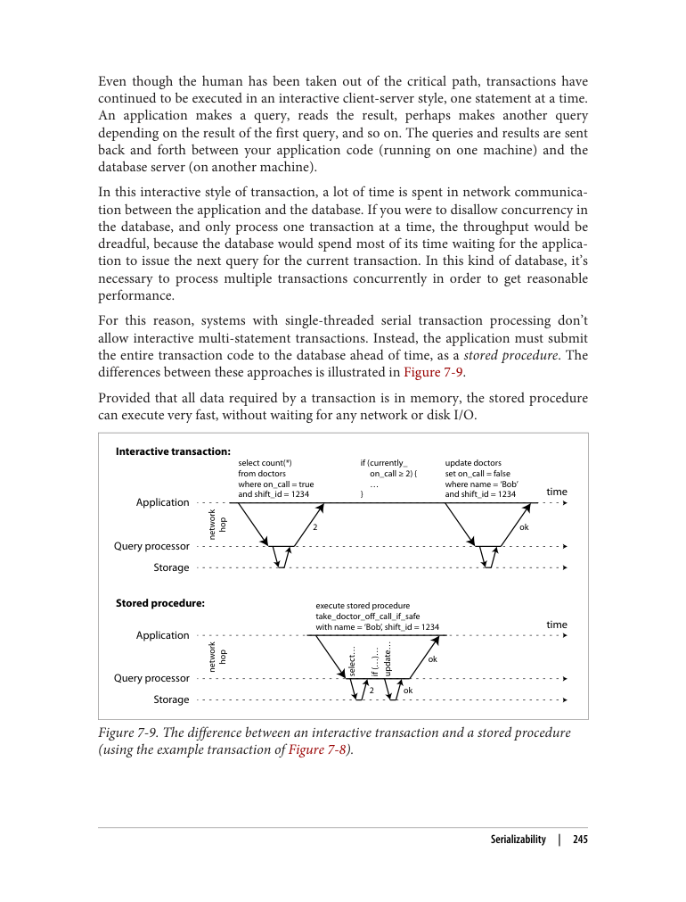

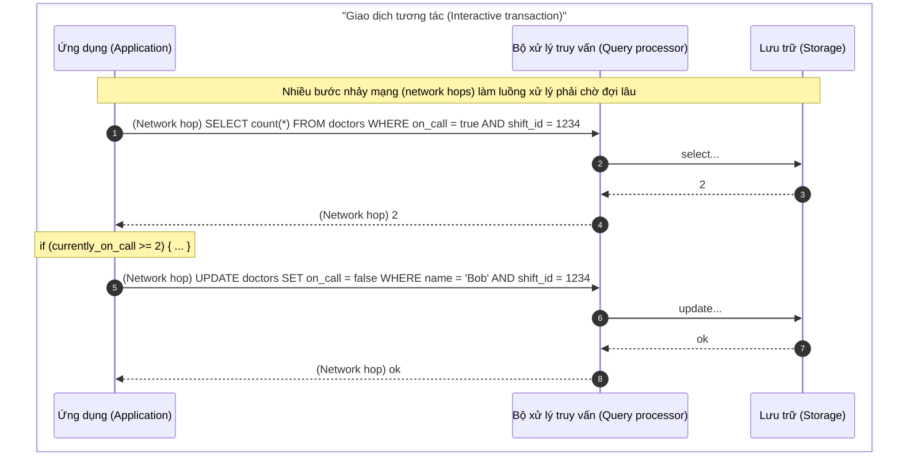

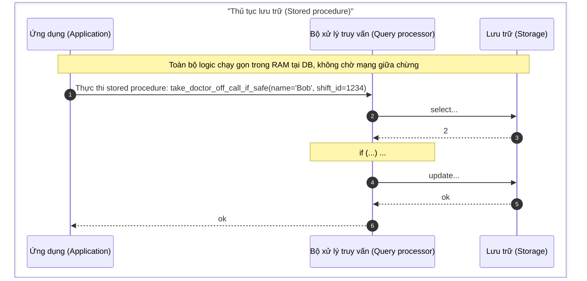

#### Ưu và nhược điểm của thủ tục lưu trữ (Pros and cons of stored procedures)

Thủ tục lưu trữ (stored procedures) đã tồn tại từ khá lâu trong các cơ sở dữ liệu quan hệ, và chúng đã trở thành một phần của tiêu chuẩn SQL (SQL/PSM) kể từ năm 1999. Tuy nhiên, chúng lại mang tiếng xấu vì nhiều lý do khác nhau:

* Mỗi nhà cung cấp cơ sở dữ liệu lại có ngôn ngữ riêng của họ để viết thủ tục lưu trữ (Oracle có PL/SQL, SQL Server có T-SQL, PostgreSQL có PL/pgSQL, v.v.). Những ngôn ngữ này đã không bắt kịp với sự phát triển của các ngôn ngữ lập trình đa dụng (general-purpose programming languages), vì vậy nhìn từ góc độ ngày nay chúng trông khá xấu xí và cổ lỗ sĩ, đồng thời thiếu vắng hệ sinh thái thư viện phong phú mà bạn thường thấy ở hầu hết các ngôn ngữ lập trình hiện đại.
* Mã nguồn chạy bên trong cơ sở dữ liệu rất khó quản lý: so với một máy chủ ứng dụng (application server), nó khó gỡ lỗi (debug) hơn, bất tiện hơn trong việc quản lý phiên bản (version control) và triển khai (deploy), khó kiểm thử (test) hơn, và khó tích hợp với hệ thống thu thập chỉ số (metrics collection system) để giám sát vận hành (monitoring).
* Cơ sở dữ liệu thường nhạy cảm về mặt hiệu năng hơn nhiều so với máy chủ ứng dụng, bởi vì một thực thể cơ sở dữ liệu (database instance) đơn lẻ thường được dùng chung bởi rất nhiều máy chủ ứng dụng. Một thủ tục lưu trữ được viết tồi (ví dụ: tiêu tốn quá nhiều bộ nhớ hoặc thời gian CPU) nằm trong cơ sở dữ liệu có thể gây ra rắc rối nghiêm trọng hơn nhiều so với một đoạn mã tương đương được viết tồi trên một máy chủ ứng dụng.

Tuy nhiên, những vấn đề đó hoàn toàn có thể khắc phục được. Các bản hiện thực hóa hiện đại của thủ tục lưu trữ đã từ bỏ PL/SQL, và thay vào đó sử dụng các ngôn ngữ lập trình đa dụng sẵn có: VoltDB sử dụng Java hoặc Groovy, Datomic sử dụng Java hoặc Clojure, và Redis sử dụng Lua.

Với các thủ tục lưu trữ cùng dữ liệu nằm hoàn toàn trong bộ nhớ (in-memory data), việc thực thi tất cả các giao dịch trên một luồng duy nhất trở nên hoàn toàn khả thi. Vì chúng không cần phải chờ đợi thao tác I/O, lại tránh được chi phí phụ trội của các cơ chế điều khiển đồng thời khác, chúng có thể đạt được thông lượng (throughput) khá ấn tượng chỉ trên một luồng đơn lẻ.

VoltDB còn sử dụng thủ tục lưu trữ cho cả việc sao chép dữ liệu (replication): thay vì sao chép các kết quả ghi (writes) của một giao dịch từ nút này sang nút khác, nó thực thi cùng một thủ tục lưu trữ đó trên từng bản sao (replica). Do đó, VoltDB yêu cầu các thủ tục lưu trữ phải mang tính **tất định (deterministic)** (khi chạy trên các nút khác nhau, chúng bắt buộc phải tạo ra cùng một kết quả giống hệt nhau). Ví dụ, nếu một giao dịch cần sử dụng ngày và giờ hiện tại, nó phải thực hiện điều đó thông qua các API tất định đặc biệt (thay vì gọi hàm lấy giờ hệ thống cục bộ của từng máy).

> 💡 **Ví dụ bổ sung (không có trong sách): Thực thi tuần tự thực sự bằng Redis Lua Script**
> Một trong những ví dụ phổ biến nhất ngoài đời thực của kiến trúc **Thực thi tuần tự thực sự (Actual serial execution)** chính là **Redis**. Luồng xử lý lệnh chính của Redis là đơn luồng (single-threaded event loop) và toàn bộ dữ liệu nằm trên RAM.
>
> Giả sử chúng ta muốn giải quyết bài toán bác sĩ trực ca (hoặc trừ tồn kho Flash Sale) trong Redis:
> - Nếu viết theo kiểu **giao dịch tương tác (Interactive)** từ ứng dụng: App gọi `SCARD shift:1234:doctors` (đếm số bác sĩ đang trực), chờ kết quả qua mạng, kiểm tra `if count >= 2`, rồi gọi tiếp `SREM shift:1234:doctors "Bob"`. Giữa 2 lệnh mạng đó, một client khác có thể xen vào gọi `SREM shift:1234:doctors "Alice"`, gây ra lỗi **lệch ghi (write skew)** làm ca trực không còn bác sĩ nào!
> - Thay vào đó, với **Redis Lua Script** (hoặc Redis Functions từ Redis 7.0+), ta đóng gói toàn bộ logic kiểm tra và cập nhật vào một script gửi lên Redis thực thi nguyên tử trên luồng duy nhất:
>
> ```lua
> -- KEYS[1]: "shift:1234:doctors"
> -- ARGV[1]: "Bob"
> local currently_on_call = redis.call("SCARD", KEYS[1])
> if tonumber(currently_on_call) >= 2 then
>     return redis.call("SREM", KEYS[1], ARGV[1])
> else
>     return 0 -- Từ chối vì phải giữ tối thiểu 1 bác sĩ trực
> end
> ```
>
> Khi Redis chạy đoạn Lua script này:
> 1. Vì chạy trên vòng lặp đơn luồng trong RAM, **không có bất kỳ lệnh nào khác của bất kỳ client nào** có thể chen ngang vào giữa `SCARD` và `SREM`.
> 2. Không cần xin khóa (lock), không có nguy cơ deadlock, không tốn network hop giữa hai bước đọc và ghi.
> 3. Mỗi lệnh thực thi chỉ mất vài micro-giây, giúp một lõi CPU duy nhất của Redis có thể xử lý hàng chục nghìn đến hàng trăm nghìn giao dịch Lua mỗi giây với mức cô lập **Serializable tuyệt đối**!
> 4. Nhưng đúng như sách phân tích: nếu bạn viết một vòng lặp quá nặng hoặc lệnh chạy chậm trong Lua script, toàn bộ Redis server sẽ bị "đóng băng" (stall) chờ script đó chạy xong.

#### Phân vùng dữ liệu (Partitioning)

Việc thực thi tất cả các giao dịch một cách tuần tự giúp cho việc điều khiển đồng thời trở nên đơn giản hơn rất nhiều, nhưng lại giới hạn thông lượng giao dịch của cơ sở dữ liệu ở tốc độ của một lõi CPU duy nhất trên một máy chủ duy nhất. Các giao dịch chỉ đọc (read-only transactions) có thể thực thi ở nơi khác bằng cách sử dụng cô lập bản chụp nhanh (snapshot isolation), nhưng đối với các ứng dụng có thông lượng ghi (write throughput) cao, bộ xử lý giao dịch đơn luồng có thể trở thành một nút cổ chai (bottleneck) nghiêm trọng.

> **Chú thích x:** Nếu một giao dịch cần truy cập dữ liệu hiện không nằm trong bộ nhớ RAM, giải pháp tốt nhất có thể là hủy bỏ (abort) giao dịch đó, tìm nạp bất đồng bộ (asynchronously fetch) dữ liệu đó từ đĩa vào bộ nhớ trong khi vẫn tiếp tục xử lý các giao dịch khác, và sau đó khởi động lại giao dịch kia khi dữ liệu đã được nạp xong vào RAM. Kỹ thuật này được gọi là *chống bộ nhớ đệm* (*anti-caching*), như đã từng đề cập trước đó trong mục "Lưu giữ mọi thứ trong bộ nhớ (Keeping everything in memory)" ở trang 85. Cách này chỉ hoạt động hiệu quả nếu tổng lượng dữ liệu mà một truy vấn cần truy cập có thể được giữ vừa vặn trong bộ nhớ.

Để mở rộng quy mô (scale) ra nhiều lõi CPU và nhiều nút mạng (nodes), về mặt tiềm năng bạn có thể phân vùng (partition) dữ liệu của mình (xem Chương 6), vốn là tính năng được hỗ trợ trong VoltDB. Nếu bạn có thể tìm ra cách phân vùng tập dữ liệu của mình sao cho mỗi giao dịch chỉ cần đọc và ghi dữ liệu bên trong phạm vi một phân vùng (single partition) duy nhất, thì mỗi phân vùng có thể sở hữu luồng xử lý giao dịch riêng của chính nó, chạy độc lập hoàn toàn với các phân vùng khác. Trong trường hợp này, bạn có thể giao cho mỗi lõi CPU phụ trách một phân vùng riêng, cho phép thông lượng giao dịch của bạn mở rộng tuyến tính (scale linearly) theo số lượng lõi CPU [46].

Tuy nhiên, đối với bất kỳ giao dịch nào cần phải truy cập vào nhiều phân vùng (multi-partition), cơ sở dữ liệu bắt buộc phải điều phối (coordinate) giao dịch đó băng qua tất cả các phân vùng mà giao dịch chạm tới. Thủ tục lưu trữ cần phải được thực hiện đồng bộ nhịp nhàng (in lock-step) trên toàn bộ các phân vùng liên quan để đảm bảo tính khả tuần tự trên toàn hệ thống.

Vì các giao dịch liên phân vùng (cross-partition transactions) phải gánh thêm chi phí điều phối bổ sung, chúng chậm hơn một cách khủng khiếp so với các giao dịch đơn phân vùng: VoltDB báo cáo thông lượng vào khoảng 1.000 thao tác ghi liên phân vùng mỗi giây. Con số này thấp hơn hàng bậc độ lớn (orders of magnitude) so với thông lượng giao dịch đơn phân vùng của nó, và không thể tăng lên được bằng cách bổ sung thêm nhiều máy chủ hơn [48].

Việc các giao dịch có thể gói gọn trong một phân vùng đơn lẻ hay không phụ thuộc rất nhiều vào cấu trúc dữ liệu được ứng dụng sử dụng. Dữ liệu khóa-giá trị (key-value) đơn giản thường có thể được phân vùng rất dễ dàng, nhưng dữ liệu có nhiều chỉ mục phụ (secondary indexes) rất có khả năng sẽ đòi hỏi rất nhiều sự điều phối liên phân vùng (xem mục "Phân vùng và chỉ mục phụ (Partitioning and secondary indexes)" ở trang 197).

#### Tóm tắt về thực thi tuần tự (Summary of serial execution)

Thực thi tuần tự các giao dịch đã trở thành một cách thức khả thi để đạt được mức cô lập khả tuần tự, bên trong những ràng buộc nhất định:

* Mọi giao dịch đều phải nhỏ gọn và nhanh chóng, bởi vì chỉ cần duy nhất một giao dịch chạy chậm cũng đủ làm đình trệ (stall) toàn bộ quá trình xử lý giao dịch của hệ thống.
* Phương pháp này bị giới hạn trong các trường hợp sử dụng mà tập dữ liệu đang hoạt động (active dataset) có thể nằm vừa vặn trong bộ nhớ RAM. Dữ liệu hiếm khi được truy cập về mặt tiềm năng có thể được chuyển xuống ổ đĩa, nhưng nếu nó cần được truy cập bên trong một giao dịch đơn luồng, hệ thống sẽ trở nên cực kỳ chậm chạp.$^{\text{x}}$
* Thông lượng ghi (write throughput) hoặc là phải đủ thấp để có thể xử lý trọn vẹn trên một lõi CPU duy nhất, hoặc là các giao dịch cần phải được phân vùng sao cho không đòi hỏi sự điều phối liên phân vùng.
* Các giao dịch liên phân vùng (cross-partition transactions) là có thể thực hiện được, nhưng có một giới hạn cứng rất thấp về mức độ mà chúng có thể được sử dụng trong tổng tải hệ thống.

---

### Khóa hai pha (Two-phase locking (2PL))

Trong khoảng 30 năm, chỉ có duy nhất một thuật toán được sử dụng rộng rãi để đảm bảo tính khả tuần tự trong các cơ sở dữ liệu, và đó chính là **khóa hai pha (two-phase locking — 2PL)**.$^{\text{xi}}$

> **Chú thích xi:** Đôi khi còn được gọi là *khóa hai pha nghiêm ngặt mạnh* (*strong strict two-phase locking* — SS2PL) để phân biệt nó với các biến thể khác của 2PL.

> ⚠️ **2PL không phải là 2PC (2PL is not 2PC)**
> Lưu ý rằng khóa hai pha (*two-phase locking* — 2PL) nghe rất giống với cam kết hai pha (*two-phase commit* — 2PC), nhưng chúng là hai khái niệm hoàn toàn khác nhau. Chúng ta sẽ thảo luận về 2PC trong Chương 9.

Trước đó chúng ta đã thấy rằng khóa (locks) thường được sử dụng để ngăn chặn hiện tượng ghi bẩn (xem mục "Không đọc/ghi bẩn (No dirty writes)" ở trang 226): nếu hai giao dịch đồng thời cố gắng ghi vào cùng một đối tượng dữ liệu, khóa sẽ đảm bảo rằng tác vụ ghi thứ hai phải chờ cho đến khi tác vụ ghi thứ nhất hoàn tất giao dịch của nó (đã hủy bỏ hoặc đã cam kết) trước khi được phép tiếp tục.

Khóa hai pha (2PL) cũng tương tự như vậy, nhưng đặt ra các yêu cầu về khóa mạnh mẽ hơn rất nhiều. Nhiều giao dịch được phép đồng thời đọc cùng một đối tượng chừng nào chưa có ai đang ghi vào đối tượng đó. Nhưng ngay khi có bất kỳ ai muốn ghi (sửa đổi hoặc xóa) một đối tượng, quyền truy cập độc quyền (exclusive access) là bắt buộc:

* Nếu giao dịch A đã đọc một đối tượng, và giao dịch B muốn ghi vào đối tượng đó, B bắt buộc phải chờ cho đến khi A cam kết (commit) hoặc hủy bỏ (abort) trước khi B có thể tiếp tục. (Điều này đảm bảo rằng B không thể bất ngờ thay đổi đối tượng đó sau lưng A.)
* Nếu giao dịch A đã ghi vào một đối tượng, và giao dịch B muốn đọc đối tượng đó, B bắt buộc phải chờ cho đến khi A cam kết hoặc hủy bỏ trước khi B có thể tiếp tục. (Việc đọc một phiên bản cũ của đối tượng, giống như trong Hình 7-1, là không thể chấp nhận được dưới cơ chế 2PL.)

Trong 2PL, các tác vụ ghi (writers) không chỉ chặn các tác vụ ghi khác, mà một tác vụ đọc (reader) cũng bắt buộc phải chặn một tác vụ ghi, và ngược lại (tác vụ ghi cũng chặn tác vụ đọc). Cô lập bản chụp nhanh (snapshot isolation) có câu thần chú nổi tiếng là *đọc không bao giờ chặn ghi, và ghi không bao giờ chặn đọc* (*readers never block writers, and writers never block readers* — xem mục "Hiện thực hóa cô lập bản chụp nhanh (Implementing snapshot isolation)" ở trang 230), câu nói này đã tóm gọn sự khác biệt cốt tử giữa cô lập bản chụp nhanh và khóa hai pha. Mặt khác, bởi vì 2PL cung cấp tính khả tuần tự, nó bảo vệ hệ thống chống lại tất cả các điều kiện tranh chấp đã thảo luận ở trên, bao gồm cả mất cập nhật (lost updates) và lệch ghi (write skew).


#### Hiện thực hóa khóa hai pha (Implementation of two-phase locking)

2PL hiện đang được sử dụng bởi mức cô lập khả tuần tự (`SERIALIZABLE`) trong MySQL (InnoDB) và SQL Server, cũng như mức cô lập đọc lặp lại (`REPEATABLE READ`) trong DB2 [22, 35].

Việc chặn lẫn nhau giữa các tác vụ đọc và các tác vụ ghi được hiện thực hóa bằng cách gắn một khóa (lock) lên từng đối tượng trong cơ sở dữ liệu. Khóa này có thể ở một trong hai chế độ: **chế độ chia sẻ (shared mode)** hoặc **chế độ độc quyền (exclusive mode)**. Khóa được sử dụng theo quy tắc như sau:

* Nếu một giao dịch muốn đọc một đối tượng, trước tiên nó phải xin cấp khóa ở chế độ chia sẻ (shared mode). Nhiều giao dịch được phép nắm giữ khóa ở chế độ chia sẻ cùng một lúc, nhưng nếu có một giao dịch khác đã nắm giữ khóa độc quyền (exclusive lock) trên đối tượng đó rồi, thì giao dịch muốn đọc này bắt buộc phải chờ.
* Nếu một giao dịch muốn ghi vào một đối tượng, trước tiên nó phải xin cấp khóa ở chế độ độc quyền (exclusive mode). Không một giao dịch nào khác được phép nắm giữ khóa trên đối tượng đó cùng lúc (dù là ở chế độ chia sẻ hay chế độ độc quyền), vì vậy nếu đang có bất kỳ khóa nào tồn tại trên đối tượng đó, giao dịch muốn ghi này bắt buộc phải chờ.
* Nếu một giao dịch ban đầu đọc và sau đó lại ghi vào cùng một đối tượng, nó có thể nâng cấp (upgrade) khóa chia sẻ của mình lên thành khóa độc quyền. Quá trình nâng cấp khóa hoạt động giống hệt như việc xin cấp trực tiếp một khóa độc quyền mới (tức là phải chờ cho đến khi tất cả các giao dịch khác đang giữ khóa chia sẻ trên đối tượng đó nhả khóa ra).
* Sau khi một giao dịch đã giành được khóa, nó phải tiếp tục nắm giữ khóa đó cho đến tận khi kết thúc giao dịch (cam kết hoặc hủy bỏ). Đây chính là nguồn gốc của cái tên "hai pha" (two-phase): pha thứ nhất (trong khi giao dịch đang thực thi) là giai đoạn các khóa được thu thập (acquired), và pha thứ hai (vào lúc kết thúc giao dịch) là giai đoạn tất cả các khóa được giải phóng (released).

Bởi vì có quá nhiều khóa được sử dụng cùng lúc, tình huống giao dịch A bị kẹt cứng vì đang chờ giao dịch B nhả khóa của nó ra, và ngược lại giao dịch B cũng đang chờ giao dịch A nhả khóa, có thể xảy ra rất dễ dàng. Tình trạng này được gọi là **khóa chết (deadlock)**. Cơ sở dữ liệu sẽ tự động phát hiện các trường hợp khóa chết giữa các giao dịch và chủ động hủy bỏ (abort) một trong số chúng để các giao dịch còn lại có thể tiếp tục tiến triển. Giao dịch bị hủy bỏ sau đó cần phải được phía ứng dụng thử thực hiện lại (retry).

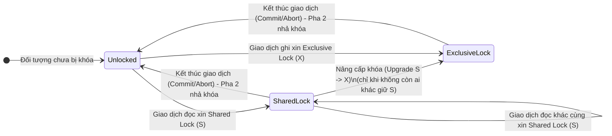

#### Hiệu năng của khóa hai pha (Performance of two-phase locking)

Nhược điểm lớn của khóa hai pha, và cũng là lý do tại sao nó không được tất cả mọi người sử dụng đại trà kể từ những năm 1970 đến nay, chính là **hiệu năng (performance)**: thông lượng giao dịch (transaction throughput) và thời gian phản hồi (response time) của các câu truy vấn dưới cơ chế khóa hai pha tệ hơn đáng kể so với khi chạy ở các mức cô lập yếu.

Điều này một phần là do chi phí phụ trội (overhead) của việc liên tục xin cấp và giải phóng tất cả những chiếc khóa đó, nhưng quan trọng hơn cả là do **sự sụt giảm mức độ đồng thời (reduced concurrency)**. Theo đúng thiết kế, nếu hai giao dịch đồng thời cố gắng làm bất cứ điều gì mà theo bất kỳ cách nào có khả năng dẫn đến một điều kiện tranh chấp, thì một giao dịch bắt buộc phải đứng chờ giao dịch kia hoàn tất.

Các cơ sở dữ liệu quan hệ truyền thống không giới hạn thời lượng kéo dài của một giao dịch, bởi vì chúng được thiết kế cho các ứng dụng tương tác vốn có thể chờ đầu vào từ con người. Hệ quả là, khi một giao dịch phải chờ một giao dịch khác, không có giới hạn nào cho việc nó có thể phải chờ đợi bao lâu. Ngay cả khi bạn đảm bảo rằng mình luôn giữ cho tất cả các giao dịch thật ngắn gọn, một hàng đợi (queue) vẫn có thể hình thành nếu có nhiều giao dịch cùng muốn truy cập vào một đối tượng, vì vậy một giao dịch có thể phải chờ vài giao dịch khác hoàn tất trước khi nó có thể làm được bất cứ việc gì.

Vì lý do này, các cơ sở dữ liệu chạy 2PL có thể có độ trễ (latency) khá bất ổn định, và có thể trở nên cực kỳ chậm chạp ở các bách phân vị cao (high percentiles — xem mục "Mô tả hiệu năng (Describing performance)" ở trang 11) nếu có sự tranh chấp (contention) trong tải công việc. Đôi khi chỉ cần duy nhất một giao dịch chạy chậm, hoặc một giao dịch truy cập vào một lượng lớn dữ liệu và thu thập rất nhiều khóa, cũng đủ để kéo phần còn lại của toàn bộ hệ thống rơi vào cảnh đình trệ. Sự thiếu ổn định này là một vấn đề rất đáng ngại khi hệ thống đòi hỏi sự vận hành bền bỉ và ổn định.

Mặc dù hiện tượng khóa chết (deadlock) ngay cả với mức cô lập đọc dữ liệu đã cam kết (read committed) dựa trên khóa vẫn có thể xảy ra, nhưng khóa chết xuất hiện với tần suất thường xuyên hơn rất nhiều dưới mức khả tuần tự sử dụng 2PL (tùy thuộc vào mẫu truy cập dữ liệu của giao dịch của bạn). Đây có thể trở thành một vấn đề hiệu năng bổ sung: khi một giao dịch bị hủy bỏ do khóa chết và được thử lại (retried), nó cần phải làm lại toàn bộ công việc của mình từ đầu. Nếu khóa chết xảy ra thường xuyên, điều này đồng nghĩa với sự lãng phí công sức tính toán vô cùng lớn.

#### Khóa vị từ (Predicate locks)

Trong phần mô tả về các khóa ở trên, chúng ta đã lướt qua một chi tiết tinh tế nhưng vô cùng quan trọng. Trong mục "Bản ghi ma gây ra lệch ghi (Phantoms causing write skew)" ở trang 241, chúng ta đã thảo luận về bài toán bản ghi ma (phantoms), tức là việc một giao dịch làm thay đổi kết quả câu truy vấn tìm kiếm của một giao dịch khác. Một cơ sở dữ liệu có mức cô lập khả tuần tự bắt buộc phải ngăn chặn được các bản ghi ma.

Trong ví dụ hệ thống đặt phòng họp, điều này có nghĩa là: nếu một giao dịch đã tìm kiếm các lượt đặt phòng hiện có của một căn phòng trong một khung thời gian nhất định (xem Ví dụ 7-2), thì một giao dịch khác không được phép đồng thời chèn (insert) hoặc cập nhật (update) một lượt đặt phòng khác cho cùng căn phòng đó và cùng khoảng thời gian giao nhau đó. (Việc đồng thời chèn các lượt đặt phòng cho các phòng khác, hoặc cho cùng căn phòng đó nhưng ở một khung thời gian khác không làm ảnh hưởng đến lượt đặt phòng đang được đề xuất thì hoàn toàn được phép.)

Làm thế nào để chúng ta hiện thực hóa điều này? Về mặt khái niệm, chúng ta cần đến một **khóa vị từ (predicate lock)** [3]. Nó hoạt động tương tự như khóa chia sẻ/độc quyền đã mô tả ở trên, nhưng thay vì thuộc về một đối tượng cụ thể (ví dụ: một dòng cụ thể trong bảng), nó thuộc về *tất cả các đối tượng thỏa mãn một điều kiện tìm kiếm (search condition) nào đó*, chẳng hạn như:

```sql
SELECT * FROM bookings
  WHERE room_id = 123 AND
    end_time   > '2015-01-01 12:00' AND
    start_time < '2015-01-01 13:00';
```

Một khóa vị từ hạn chế quyền truy cập như sau:

* Nếu giao dịch A muốn đọc các đối tượng khớp với một điều kiện nào đó, giống như trong câu truy vấn `SELECT` ở trên, nó phải xin cấp một **khóa vị từ ở chế độ chia sẻ (shared-mode predicate lock)** trên các điều kiện của câu truy vấn đó. Nếu một giao dịch B khác hiện đang giữ một khóa độc quyền trên bất kỳ đối tượng nào khớp với các điều kiện đó, A bắt buộc phải chờ cho đến khi B giải phóng khóa của mình trước khi A được phép thực hiện câu truy vấn.
* Nếu giao dịch A muốn chèn, cập nhật hoặc xóa bất kỳ đối tượng nào, trước tiên nó phải kiểm tra xem giá trị cũ hoặc giá trị mới của đối tượng đó có khớp với bất kỳ khóa vị từ nào đang tồn tại hay không. Nếu có một khóa vị từ trùng khớp đang được nắm giữ bởi giao dịch B, thì A bắt buộc phải chờ cho đến khi B đã cam kết hoặc hủy bỏ trước khi A có thể tiếp tục.

Ý tưởng then chốt ở đây là một khóa vị từ được áp dụng ngay cả đối với những đối tượng *hiện chưa hề tồn tại* trong cơ sở dữ liệu, nhưng có khả năng sẽ được thêm vào trong tương lai (các bản ghi ma — phantoms). Nếu khóa hai pha (2PL) bao gồm cả khóa vị từ, cơ sở dữ liệu sẽ ngăn chặn được mọi hình thái của hiện tượng lệch ghi (write skew) cũng như các điều kiện tranh chấp khác, và nhờ đó mức cô lập của nó trở thành khả tuần tự (serializable).

#### Khóa dải chỉ mục (Index-range locks)

Đáng tiếc là các khóa vị từ (predicate locks) lại không có hiệu năng tốt: nếu có nhiều khóa đang được giữ bởi các giao dịch đang hoạt động, việc kiểm tra đối chiếu các khóa trùng khớp sẽ trở nên cực kỳ tốn thời gian. Vì lý do đó, hầu hết các cơ sở dữ liệu sử dụng 2PL trên thực tế đều hiện thực hóa **khóa dải chỉ mục (index-range locking)** (còn được gọi là **khóa khóa-kế-tiếp — next-key locking**), vốn là một phép xấp xỉ đơn giản hóa của khóa vị từ [40, 49].

Việc đơn giản hóa một vị từ bằng cách làm cho nó khớp với một tập hợp đối tượng *rộng hơn* là hoàn toàn an toàn. Ví dụ, nếu bạn có một khóa vị từ cho các lượt đặt phòng của phòng 123 trong khoảng thời gian từ 12 giờ trưa đến 1 giờ chiều, bạn có thể xấp xỉ nó bằng cách khóa các lượt đặt phòng của phòng 123 ở *bất kỳ thời điểm nào*. Hoặc bạn có thể xấp xỉ nó bằng cách khóa *tất cả các phòng* (chứ không riêng gì phòng 123) trong khoảng thời gian từ 12 giờ trưa đến 1 giờ chiều. Cách làm này an toàn bởi vì bất kỳ thao tác ghi nào khớp với vị từ gốc ban đầu thì chắc chắn cũng sẽ khớp với các phép xấp xỉ mở rộng đó.

Trong cơ sở dữ liệu đặt phòng họp, rất có thể bạn sẽ có một chỉ mục (index) trên cột `room_id`, và/hoặc các chỉ mục trên `start_time` và `end_time` (nếu không thì câu truy vấn ở trên sẽ chạy rất chậm trên một cơ sở dữ liệu lớn):

* Giả sử chỉ mục của bạn nằm trên cột `room_id`, và cơ sở dữ liệu sử dụng chỉ mục này để tìm các lượt đặt phòng hiện có của phòng 123. Lúc này, cơ sở dữ liệu chỉ cần đơn giản gắn một khóa chia sẻ (shared lock) vào mục chỉ mục (index entry) này, báo hiệu rằng có một giao dịch vừa tìm kiếm các lượt đặt phòng của phòng 123.
* Hoặc một cách khác, nếu cơ sở dữ liệu sử dụng một chỉ mục dựa trên thời gian để tìm các lượt đặt phòng hiện có, nó có thể gắn một khóa chia sẻ vào một dải các giá trị (a range of values) trong chỉ mục đó, báo hiệu rằng có một giao dịch vừa tìm kiếm các lượt đặt phòng giao thoa với khoảng thời gian từ 12 giờ trưa đến 1 giờ chiều ngày 1 tháng 1 năm 2015.

Dù theo cách nào đi nữa, một phép xấp xỉ của điều kiện tìm kiếm cũng được gắn trực tiếp vào một trong các chỉ mục. Bây giờ, nếu một giao dịch khác muốn chèn, cập nhật hoặc xóa một lượt đặt phòng cho cùng căn phòng đó và/hoặc một khoảng thời gian giao nhau, nó sẽ bắt buộc phải cập nhật vào đúng phần chỉ mục đó. Trong quá trình thực hiện việc cập nhật chỉ mục, nó sẽ chạm trán với khóa chia sẻ đang gắn ở đó, và sẽ bị buộc phải chờ cho đến khi khóa đó được giải phóng.

Cơ chế này cung cấp sự bảo vệ hiệu quả chống lại các bản ghi ma (phantoms) và hiện tượng lệch ghi (write skew). Khóa dải chỉ mục (index-range locks) tuy không chính xác tuyệt đối như khóa vị từ (tức là chúng có thể khóa một phạm vi đối tượng rộng hơn mức thực sự cần thiết để duy trì tính khả tuần tự), nhưng bởi vì chúng có chi phí quản lý (overhead) thấp hơn rất nhiều, chúng là một sự thỏa hiệp (compromise) rất tốt trong thực tế.

Nếu không có chỉ mục phù hợp nào để có thể gắn khóa dải lên đó, cơ sở dữ liệu có thể lùi về phương án dự phòng là đặt một khóa chia sẻ lên **toàn bộ bảng (entire table)**. Điều này sẽ không tốt cho hiệu năng chút nào, vì nó sẽ chặn đứng tất cả các giao dịch khác đang muốn ghi vào bảng đó, nhưng đó là một vị trí dự phòng an toàn để đảm bảo tính đúng đắn.

> 📝 **Giải thích thêm (không có trong sách): Next-Key Locking trong MySQL (InnoDB)**
> Trong MySQL (InnoDB), khi bạn chạy ở mức cô lập `SERIALIZABLE` (hoặc khi dùng `SELECT ... FOR UPDATE` / `LOCK IN SHARE MODE`), InnoDB sử dụng chính xác kỹ thuật **Next-Key Locking** (kết hợp giữa *Record Lock* trên bản ghi chỉ mục và *Gap Lock* trên khoảng trống giữa các mục chỉ mục B-Tree):
> - Nếu bảng `bookings` có chỉ mục trên `room_id` với các giá trị hiện có là `100`, `123`, `150`: khi giao dịch A chạy `SELECT ... WHERE room_id = 123`, ở mức `SERIALIZABLE`, InnoDB sẽ tự động biến mọi câu `SELECT` thường thành `SELECT ... LOCK IN SHARE MODE` và khóa mục chỉ mục `123` cùng khoảng trống (gap) xung quanh nó.
> - Nếu bảng `bookings` **không có chỉ mục** trên cột trong mệnh đề `WHERE`, InnoDB buộc phải quét toàn bảng (full table scan) và khóa **tất cả mọi dòng và mọi khoảng trống (gap) trong toàn bộ bảng**! Đó là lý do trong thực tế vận hành MySQL, một câu truy vấn thiếu index chạy trong giao dịch có khóa có thể làm treo toàn bộ các thao tác `INSERT`/`UPDATE` của cả bảng.

---

### Cô lập bản chụp nhanh khả tuần tự (Serializable snapshot isolation (SSI))

Chương này cho đến nay đã vẽ nên một bức tranh khá ảm đạm về việc điều khiển đồng thời trong cơ sở dữ liệu. Một mặt, chúng ta có các phương pháp hiện thực hóa tính khả tuần tự nhưng lại có hiệu năng kém (khóa hai pha — 2PL) hoặc không mở rộng quy mô tốt (thực thi tuần tự — serial execution). Mặt khác, chúng ta có các mức cô lập yếu mang lại hiệu năng tốt, nhưng lại dễ mắc phải hàng loạt điều kiện tranh chấp (mất cập nhật, lệch ghi, bản ghi ma, v.v.). Phải chăng mức cô lập khả tuần tự và hiệu năng tốt về bản chất là hai thái cực đối nghịch không thể dung hòa với nhau?

Có lẽ là không: một thuật toán mang tên **cô lập bản chụp nhanh khả tuần tự (serializable snapshot isolation — SSI)** đang tỏ ra vô cùng hứa hẹn. Nó cung cấp tính khả tuần tự đầy đủ (full serializability), nhưng chỉ phải chịu một khoản phạt hiệu năng rất nhỏ khi so sánh với cô lập bản chụp nhanh (snapshot isolation) thông thường. SSI còn khá mới mẻ: nó lần đầu tiên được mô tả vào năm 2008 [39] và là chủ đề luận án Tiến sĩ của Michael Cahill [50].

Ngày nay, SSI được sử dụng cả trong các cơ sở dữ liệu đơn nút (mức cô lập `SERIALIZABLE` trong PostgreSQL kể từ phiên bản 9.1 [40]) lẫn các cơ sở dữ liệu phân tán (FoundationDB sử dụng một thuật toán tương tự [51]). Vì SSI còn rất trẻ khi so với các cơ chế điều khiển đồng thời khác, nó vẫn đang trong quá trình chứng minh hiệu năng của mình trong thực tiễn, nhưng nó có cơ hội đủ nhanh để trở thành cơ chế mặc định mới cho các hệ quản trị cơ sở dữ liệu trong tương lai.

#### Điều khiển đồng thời bi quan so với lạc quan (Pessimistic vs. optimistic concurrency control)

Khóa hai pha (two-phase locking) là một cơ chế được gọi là **điều khiển đồng thời bi quan (pessimistic concurrency control)**: nó dựa trên nguyên lý rằng nếu có bất cứ điều gì *có khả năng* xảy ra sai sót (được biểu thị bằng việc có một khóa đang bị nắm giữ bởi một giao dịch khác), thì tốt hơn hết là hãy dừng lại chờ cho đến khi tình hình an toàn trở lại trước khi làm bất cứ việc gì. Nó giống như cơ chế loại trừ tương hỗ (mutual exclusion — mutex), vốn được sử dụng để bảo vệ các cấu trúc dữ liệu trong lập trình đa luồng.

Thực thi tuần tự (serial execution), theo một nghĩa nào đó, chính là sự bi quan đến mức cực đoan: về bản chất, nó tương đương với việc mỗi giao dịch nắm giữ một khóa độc quyền trên toàn bộ cơ sở dữ liệu (hoặc một phân vùng của cơ sở dữ liệu) trong suốt thời gian diễn ra giao dịch đó. Chúng ta bù đắp cho sự bi quan cực đoan đó bằng cách làm cho mỗi giao dịch thực thi cực kỳ nhanh chóng, nhờ vậy nó chỉ cần giữ "chiếc khóa" đó trong một khoảng thời gian vô cùng ngắn.

Ngược lại, cô lập bản chụp nhanh khả tuần tự (SSI) là một kỹ thuật **điều khiển đồng thời lạc quan (optimistic concurrency control)**. "Lạc quan" trong ngữ cảnh này có nghĩa là thay vì chặn lại (blocking) nếu có điều gì đó tiềm ẩn nguy hiểm xảy ra, các giao dịch cứ việc tiếp tục chạy tiến tới, với hy vọng rằng mọi thứ rồi sẽ ổn thỏa. Khi một giao dịch muốn cam kết (commit), cơ sở dữ liệu mới kiểm tra xem liệu có điều gì tồi tệ đã xảy ra hay không (tức là liệu tính cô lập có bị vi phạm hay không); nếu có, giao dịch đó sẽ bị hủy bỏ (aborted) và phải được thử thực hiện lại (retried). Chỉ những giao dịch nào đã thực thi một cách khả tuần tự mới được phép cam kết.

Điều khiển đồng thời lạc quan là một ý tưởng đã có từ lâu đời [52], và những ưu điểm cũng như nhược điểm của nó đã được tranh luận trong một thời gian dài [53]. Nó hoạt động kém hiệu quả nếu có sự tranh chấp cao (high contention — tức nhiều giao dịch cùng cố gắng truy cập vào cùng các đối tượng dữ liệu), vì điều này dẫn đến một tỷ lệ lớn các giao dịch buộc phải hủy bỏ. Nếu hệ thống vốn đã ở gần mức thông lượng tối đa của nó, tải giao dịch bổ sung phát sinh từ việc thử lại các giao dịch bị hủy có thể làm cho hiệu năng ngày càng tồi tệ hơn.

Tuy nhiên, nếu hệ thống có đủ năng lực dự phòng (spare capacity), và nếu mức độ tranh chấp giữa các giao dịch không quá cao, các kỹ thuật điều khiển đồng thời lạc quan thường có xu hướng đạt hiệu năng tốt hơn so với các kỹ thuật bi quan. Sự tranh chấp có thể được giảm thiểu bằng các **thao tác nguyên tử có tính giao hoán (commutative atomic operations)**: ví dụ, nếu có nhiều giao dịch đồng thời muốn tăng (increment) một bộ đếm, thì thứ tự áp dụng các phép tăng đó không hề quan trọng (miễn là giá trị bộ đếm không bị đọc ra trong cùng giao dịch đó), vì vậy tất cả các phép tăng đồng thời đều có thể được áp dụng mà không gây ra xung đột.

Đúng như tên gọi của nó gợi ý, SSI được xây dựng dựa trên nền tảng cô lập bản chụp nhanh (snapshot isolation) — nghĩa là tất cả các thao tác đọc bên trong một giao dịch đều được thực hiện từ một bản chụp nhanh nhất quán (consistent snapshot) của cơ sở dữ liệu (xem mục "Cô lập bản chụp nhanh và đọc lặp lại (Snapshot isolation and repeatable read)" ở trang 228). Đây là sự khác biệt chính yếu so với các kỹ thuật điều khiển đồng thời lạc quan thế hệ trước. Bên trên tầng cô lập bản chụp nhanh, SSI bổ sung thêm một thuật toán để phát hiện các xung đột khả tuần tự (serialization conflicts) giữa các thao tác đọc và ghi, từ đó xác định xem những giao dịch nào cần phải bị hủy bỏ.

#### Các quyết định dựa trên một tiền đề đã lỗi thời (Decisions based on an outdated premise)

Khi chúng ta thảo luận trước đó về hiện tượng lệch ghi (write skew) trong cô lập bản chụp nhanh (xem mục "Ngăn chặn lệch ghi và bản ghi ma (Preventing write skew and phantoms)" ở trang 237), chúng ta đã quan sát thấy một khuôn mẫu lặp đi lặp lại: một giao dịch đọc một số dữ liệu từ cơ sở dữ liệu, kiểm tra kết quả của câu truy vấn, và quyết định thực hiện một hành động nào đó (ghi vào cơ sở dữ liệu) dựa trên kết quả mà nó vừa nhìn thấy. Tuy nhiên, dưới mức cô lập bản chụp nhanh, kết quả từ câu truy vấn ban đầu có thể không còn cập nhật (up-to-date) nữa vào thời điểm giao dịch đó cam kết, bởi vì dữ liệu có thể đã bị sửa đổi trong khoảng thời gian ở giữa.

Nói theo một cách khác: giao dịch đang thực hiện một hành động dựa trên một **tiền đề (premise)** (một sự thật vốn đúng vào thời điểm bắt đầu giao dịch, ví dụ: "hiện tại đang có hai bác sĩ trực ca"). Sau đó, khi giao dịch muốn cam kết, dữ liệu gốc có thể đã thay đổi — tức là tiền đề đó có thể không còn đúng nữa.

Khi ứng dụng thực hiện một câu truy vấn (ví dụ: "hiện có bao nhiêu bác sĩ đang trực ca?"), cơ sở dữ liệu không hề biết logic ứng dụng sẽ sử dụng kết quả của câu truy vấn đó như thế nào. Để đảm bảo an toàn, cơ sở dữ liệu cần phải giả định rằng *bất kỳ sự thay đổi nào* trong kết quả của câu truy vấn đó (tiền đề) đều đồng nghĩa với việc các thao tác ghi trong giao dịch đó có thể không còn hợp lệ. Để cung cấp mức cô lập khả tuần tự, cơ sở dữ liệu bắt buộc phải phát hiện được các tình huống trong đó một giao dịch có thể đã hành động dựa trên một tiền đề đã lỗi thời, và hủy bỏ (abort) giao dịch đó trong trường hợp như vậy.

Làm thế nào cơ sở dữ liệu biết được liệu kết quả của một câu truy vấn có thể đã bị thay đổi hay chưa? Có hai trường hợp cần phải xem xét:

1. Phát hiện việc đọc phải dữ liệu MVCC đã cũ (stale MVCC reads — một thao tác ghi chưa cam kết đã diễn ra *trước* thao tác đọc);
2. Phát hiện các thao tác ghi làm ảnh hưởng đến các thao tác đọc trước đó (thao tác ghi diễn ra *sau* thao tác đọc).

#### Phát hiện việc đọc dữ liệu MVCC đã cũ (Detecting stale MVCC reads)

Trường hợp thứ nhất được minh họa trong **Hình 7-10**. Khi một giao dịch đọc từ một bản chụp nhanh nhất quán trong một cơ sở dữ liệu MVCC, nó sẽ bỏ qua (ignore) các thao tác ghi được thực hiện bởi bất kỳ giao dịch nào khác mà chưa được cam kết vào thời điểm bản chụp nhanh được tạo ra. Trong **Hình 7-10**, giao dịch 43 nhìn thấy Alice vẫn đang có `on_call = true`, bởi vì giao dịch 42 (vốn đã sửa đổi trạng thái trực ca của Alice) lúc đó vẫn chưa cam kết (uncommitted).

Tuy nhiên, đến thời điểm giao dịch 43 muốn cam kết, giao dịch 42 lại đã cam kết xong xuôi rồi. Điều này có nghĩa là thao tác ghi vốn bị bỏ qua khi đọc từ bản chụp nhanh nhất quán giờ đây đã chính thức có hiệu lực, và tiền đề của giao dịch 43 không còn đúng nữa.

Để ngăn chặn hiện tượng này, cơ sở dữ liệu cần phải theo dõi (track) mỗi khi một giao dịch bỏ qua các thao tác ghi của một giao dịch khác do các quy tắc hiển thị MVCC (MVCC visibility rules). Khi giao dịch đó muốn cam kết, cơ sở dữ liệu sẽ kiểm tra xem liệu có bất kỳ thao tác ghi từng bị bỏ qua nào giờ đây đã được cam kết hay chưa. Nếu có, giao dịch đó bắt buộc phải bị hủy bỏ (aborted).

Tại sao lại phải chờ đến tận lúc cam kết? Tại sao không hủy bỏ giao dịch 43 ngay lập tức vào lúc phát hiện ra thao tác đọc dữ liệu cũ? Lý do là, nếu giao dịch 43 chỉ là một giao dịch chỉ đọc (read-only transaction), nó sẽ hoàn toàn không cần phải bị hủy bỏ, bởi vì chẳng hề có nguy cơ xảy ra lệch ghi (write skew) nào cả. Vào thời điểm giao dịch 43 thực hiện thao tác đọc của mình, cơ sở dữ liệu vẫn chưa thể biết được liệu giao dịch đó lát nữa có thực hiện thao tác ghi nào hay không. Cô lập bản chụp nhanh khả tuần tự (SSI) cần phải hỗ trợ các thao tác đọc chạy dài hơi từ một bản chụp nhanh nhất quán, giống hệt như cô lập bản chụp nhanh thông thường, mà không gây ra những lần hủy bỏ giao dịch không cần thiết.

**Hình 7-10 – Phát hiện khi một giao dịch đọc các giá trị đã lỗi thời từ một bản chụp nhanh MVCC (Figure 7-10. Detecting when a transaction reads outdated values from a MVCC snapshot).**

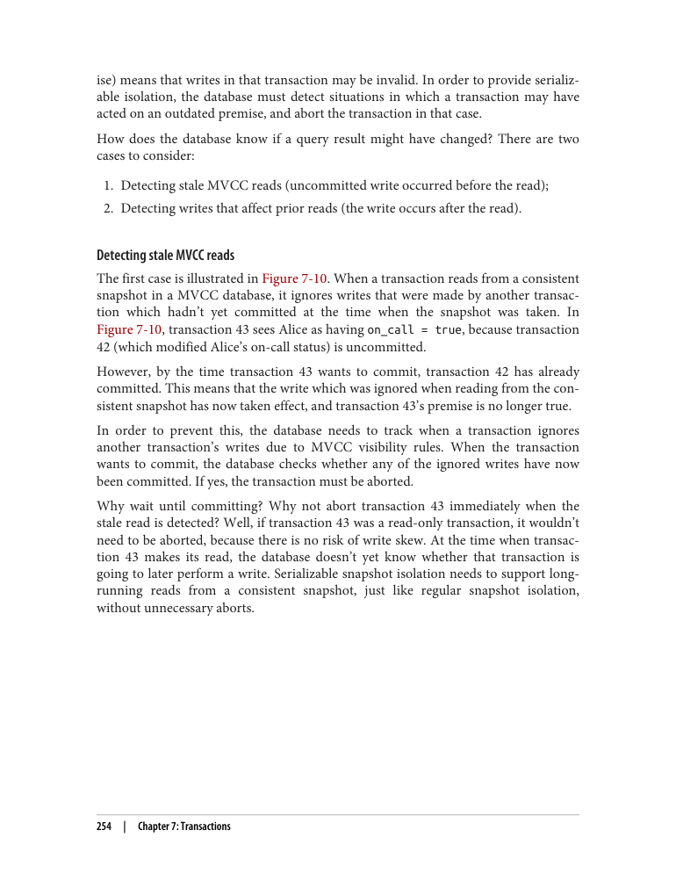
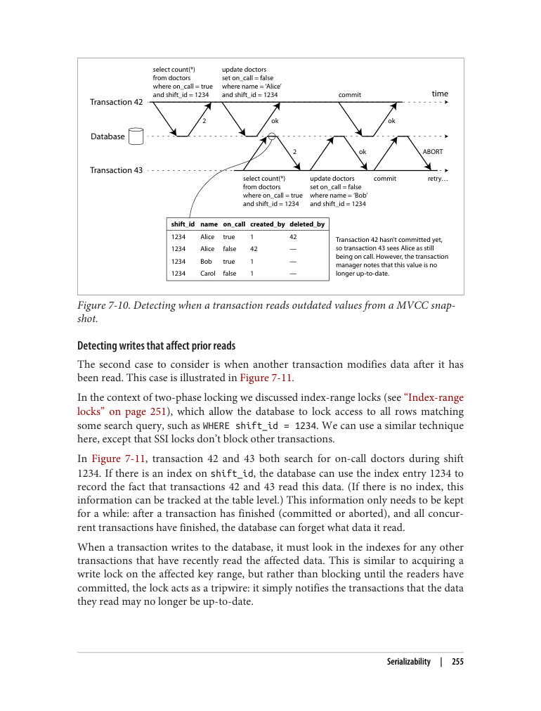

```mermaid
sequenceDiagram
    autonumber
    participant T42 as Giao dịch 42 (Transaction 42)
    participant DB as Cơ sở dữ liệu (Database - MVCC)
    participant T43 as Giao dịch 43 (Transaction 43)

    T42->>DB: SELECT count(*) FROM doctors WHERE on_call = true AND shift_id = 1234
    DB-->>T42: 2
    T42->>DB: UPDATE doctors SET on_call = false WHERE name = 'Alice' AND shift_id = 1234
    DB-->>T42: ok (Tạo dòng Alice on_call=false created_by=42; đánh dấu dòng cũ deleted_by=42)
    T43->>DB: SELECT count(*) FROM doctors WHERE on_call = true AND shift_id = 1234
    Note over DB,T43: Giao dịch 42 chưa commit, nên Giao dịch 43 vẫn thấy Alice on_call = true.<br/>Tuy nhiên, trình quản lý giao dịch ghi nhận rằng giá trị này không còn mới nhất nữa.
    DB-->>T43: 2
    T42->>DB: commit
    DB-->>T42: ok
    T43->>DB: UPDATE doctors SET on_call = false WHERE name = 'Bob' AND shift_id = 1234
    DB-->>T43: ok
    T43->>DB: commit
    DB-->>T43: ABORT (Vì ghi của T42 bị T43 bỏ qua lúc đọc nay đã commit!)
    Note over T43: retry...
```

| `shift_id` | `name` | `on_call` | `created_by` | `deleted_by` | Trạng thái hiển thị đối với Giao dịch 43 lúc `SELECT` |
| :---: | :---: | :---: | :---: | :---: | :--- |
| `1234` | `Alice` | `true` | `1` | `42` | Nhìn thấy (vì `deleted_by = 42` chưa commit), nhưng DB ghi nhận T43 đã đọc phiên bản sắp bị T42 xóa |
| `1234` | `Alice` | `false` | `42` | `—` | Bị bỏ qua (vì `created_by = 42` chưa commit) |
| `1234` | `Bob` | `true` | `1` | `—` | Nhìn thấy bình thường |
| `1234` | `Carol` | `false` | `1` | `—` | Nhìn thấy bình thường (`on_call = false`) |

#### Phát hiện các thao tác ghi làm ảnh hưởng đến các thao tác đọc trước đó (Detecting writes that affect prior reads)

Trường hợp thứ hai cần xem xét là khi một giao dịch khác sửa đổi dữ liệu *sau khi* dữ liệu đó đã được đọc. Trường hợp này được minh họa trong **Hình 7-11**.

Trong bối cảnh của khóa hai pha, chúng ta đã thảo luận về khóa dải chỉ mục (xem mục "Khóa dải chỉ mục (Index-range locks)" ở trang 251), cho phép cơ sở dữ liệu khóa quyền truy cập vào tất cả các dòng khớp với một câu truy vấn tìm kiếm nào đó, chẳng hạn như `WHERE shift_id = 1234`. Chúng ta có thể sử dụng một kỹ thuật tương tự ở đây, ngoại trừ một điểm khác biệt cốt lõi là **các khóa của SSI không chặn (block) các giao dịch khác**.

Trong **Hình 7-11**, giao dịch 42 và giao dịch 43 đều tìm kiếm các bác sĩ đang trực ca trong ca làm việc `1234`. Nếu có một chỉ mục trên cột `shift_id`, cơ sở dữ liệu có thể sử dụng mục chỉ mục `1234` để ghi nhận lại sự kiện rằng giao dịch 42 và 43 vừa đọc dữ liệu này. (Nếu không có chỉ mục, thông tin này có thể được theo dõi ở cấp độ bảng — table level.) Thông tin này chỉ cần được lưu giữ trong một khoảng thời gian ngắn: sau khi một giao dịch đã kết thúc (đã cam kết hoặc đã hủy bỏ), và tất cả các giao dịch chạy đồng thời với nó cũng đã kết thúc, cơ sở dữ liệu có thể quên đi những dữ liệu mà giao dịch đó đã đọc.

Khi một giao dịch ghi vào cơ sở dữ liệu, nó phải tra cứu trong các chỉ mục để xem có bất kỳ giao dịch nào khác gần đây đã đọc phần dữ liệu bị ảnh hưởng đó hay không. Thao tác này tương tự như việc xin khóa ghi trên dải khóa bị ảnh hưởng, nhưng thay vì chặn lại chờ cho đến khi các giao dịch đọc cam kết xong, chiếc khóa ở đây hoạt động giống như một **sợi dây bẫy báo động (tripwire)**: nó chỉ đơn giản thông báo cho các giao dịch kia biết rằng dữ liệu mà chúng đã đọc có thể không còn cập nhật nữa.

Trong **Hình 7-11**, giao dịch 43 thông báo cho giao dịch 42 rằng thao tác đọc trước đó của 42 đã bị lỗi thời, và ngược lại giao dịch 42 cũng thông báo cho giao dịch 43. Giao dịch 42 là người đầu tiên thực hiện cam kết (commit), và nó đã thành công: mặc dù thao tác ghi của giao dịch 43 có ảnh hưởng đến 42, nhưng lúc đó 43 vẫn chưa cam kết, vì vậy thao tác ghi của 43 vẫn chưa có hiệu lực. Tuy nhiên, khi đến lượt giao dịch 43 muốn cam kết, thao tác ghi gây xung đột từ giao dịch 42 đã được cam kết mất rồi, vì thế giao dịch 43 bắt buộc phải hủy bỏ (abort).

**Hình 7-11 – Trong cô lập bản chụp nhanh khả tuần tự, phát hiện khi một giao dịch sửa đổi dữ liệu mà một giao dịch khác đã đọc (Figure 7-11. In serializable snapshot isolation, detecting when one transaction modifies another transaction’s reads).**


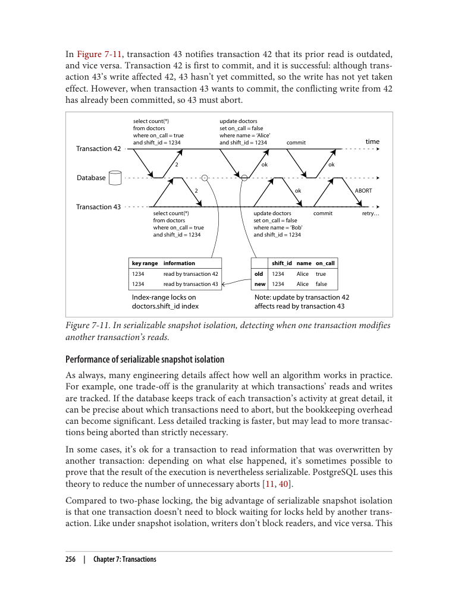

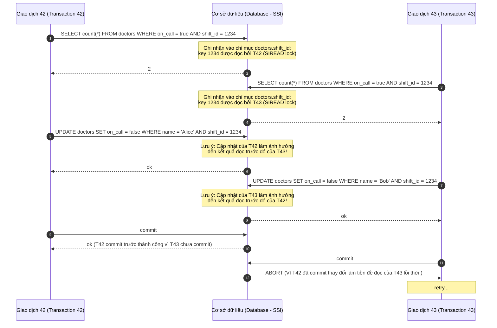

#### Hiệu năng của cô lập bản chụp nhanh khả tuần tự (Performance of serializable snapshot isolation)

Như mọi khi, có rất nhiều chi tiết kỹ thuật (engineering details) ảnh hưởng đến việc một thuật toán hoạt động tốt đến đâu trong thực tế. Ví dụ, một sự đánh đổi (trade-off) quan trọng là **độ mịn (granularity)** mà tại đó các thao tác đọc và ghi của các giao dịch được theo dõi. Nếu cơ sở dữ liệu theo dõi hoạt động của từng giao dịch ở mức độ cực kỳ chi tiết, nó có thể xác định chính xác tuyệt đối những giao dịch nào thực sự cần phải hủy bỏ, nhưng chi phí sổ sách (bookkeeping overhead) để lưu trữ và tra cứu thông tin theo dõi có thể trở nên rất lớn. Việc theo dõi ít chi tiết hơn sẽ chạy nhanh hơn, nhưng lại có thể dẫn đến việc có nhiều giao dịch bị hủy bỏ hơn mức thực sự cần thiết (dương tính giả — false positives).

Trong một số trường hợp, việc một giao dịch đọc thông tin mà sau đó bị ghi đè bởi một giao dịch khác là hoàn toàn chấp nhận được: tùy thuộc vào những gì khác đã diễn ra xung quanh, đôi khi người ta có thể chứng minh về mặt toán học rằng kết quả của quá trình thực thi đó dù sao đi nữa vẫn đảm bảo tính khả tuần tự. PostgreSQL sử dụng lý thuyết này để giảm thiểu số lượng các lần hủy bỏ giao dịch không cần thiết [11, 40].

So với khóa hai pha (two-phase locking), ưu điểm vượt trội của cô lập bản chụp nhanh khả tuần tự (SSI) là một giao dịch không cần phải bị chặn lại (block) để chờ các khóa đang bị nắm giữ bởi một giao dịch khác. Giống như dưới mức cô lập bản chụp nhanh thông thường, **các tác vụ ghi không chặn các tác vụ đọc, và ngược lại**. Điều này làm cho độ trễ của câu truy vấn (query latency) trở nên dễ dự đoán hơn rất nhiều và ít bị biến động thất thường hơn. Đặc biệt, các câu truy vấn chỉ đọc (read-only queries) có thể chạy trên một bản chụp nhanh nhất quán mà không đòi hỏi bất kỳ khóa chặn nào, một đặc tính vô cùng hấp dẫn đối với các tải công việc nặng về đọc (read-heavy workloads).

So với thực thi tuần tự (serial execution), cô lập bản chụp nhanh khả tuần tự không hề bị giới hạn ở thông lượng của một lõi CPU đơn lẻ: FoundationDB phân tán việc phát hiện các xung đột khả tuần tự ra khắp nhiều máy chủ, cho phép nó mở rộng quy mô lên mức thông lượng cực kỳ cao. Ngay cả khi dữ liệu có thể được phân vùng (partitioned) trải rộng trên nhiều máy chủ, các giao dịch vẫn có thể đọc và ghi dữ liệu ở nhiều phân vùng cùng lúc trong khi vẫn bảo toàn trọn vẹn mức cô lập khả tuần tự [54].

Tỷ lệ hủy bỏ giao dịch (rate of aborts) ảnh hưởng đáng kể đến hiệu năng tổng thể của SSI. Ví dụ, một giao dịch vừa đọc vừa ghi dữ liệu kéo dài trong một khoảng thời gian lâu rất có khả năng sẽ vướng phải xung đột và bị hủy bỏ, vì vậy SSI yêu cầu các giao dịch đọc-ghi (read-write transactions) phải tương đối ngắn gọn (các giao dịch chỉ đọc chạy dài hơi thì vẫn có thể ổn thỏa, tùy thuộc vào cách hiện thực hóa). Tuy nhiên, SSI nhìn chung ít nhạy cảm với các giao dịch chạy chậm hơn so với khóa hai pha (2PL) hoặc thực thi tuần tự (serial execution).

> 📝 **Giải thích thêm (không có trong sách): So sánh chuyên sâu PostgreSQL `SERIALIZABLE` (SSI) và MySQL InnoDB `SERIALIZABLE` (2PL)**
> Khi một kỹ sư backend gõ lệnh `SET TRANSACTION ISOLATION LEVEL SERIALIZABLE;`, hành vi bên dưới của **PostgreSQL** và **MySQL (InnoDB)** khác nhau một trời một vực:
>
> 1. **Cơ chế khóa bên dưới:**
>    - **MySQL (InnoDB):** Dùng **2PL + Next-Key Locks**. Mọi câu `SELECT` thông thường đều tự động bị chuyển thành `SELECT ... LOCK IN SHARE MODE`. Nếu Giao dịch A đang `SELECT` các dòng thuộc `shift_id = 1234`, thì Giao dịch B muốn `UPDATE` bất kỳ dòng nào trong `shift_id = 1234` sẽ bị **treo cứng (block)** chờ A commit. Nếu cả A và B cùng `SELECT` trước rồi cùng `UPDATE` sau (như trong bài toán bác sĩ trực ca), cả A và B đều giữ Shared Lock và cùng xin nâng cấp lên Exclusive Lock $\rightarrow$ **Deadlock ngay lập tức!** MySQL phát hiện vòng lặp chờ và giết một giao dịch với lỗi `ERROR 1213 (40001): Deadlock found when trying to get lock`.
>    - **PostgreSQL (9.1+):** Dùng **SSI (MVCC + `SIREAD` predicate locks trong bộ nhớ)**. Các `SIREAD` lock của PostgreSQL **không bao giờ chặn bất kỳ ai**. Trong bài toán bác sĩ trực ca (Hình 7-11), cả A và B đều chạy `SELECT` mượt mà không chờ nhau, cả A và B đều chạy `UPDATE` mượt mà không chặn nhau (vì sửa 2 dòng khác nhau: Alice và Bob). Chỉ đến khi cả hai cùng `COMMIT`, bộ phát hiện xung đột SSI của PostgreSQL phát hiện chu trình phụ thuộc ngược đọc-ghi (`rw-antidependency cycle`: A đọc trạng thái trước khi B ghi, và B đọc trạng thái trước khi A ghi) và từ chối giao dịch commit sau với mã lỗi `SQLSTATE 40001: could not serialize access due to read/write dependencies among transactions`.
>
> 2. **Tại sao lý thuyết SSI của Cahill (trong PostgreSQL) lại thông minh hơn việc kiểm tra mù quáng?**
>    - Như sách đề cập ở đoạn tham chiếu [11, 40], không phải mọi xung đột "đọc dữ liệu rồi bị người khác ghi đè" (`rw-antidependency`, ký hiệu $T_1 \xrightarrow{rw} T_2$) đều phá vỡ tính khả tuần tự!
>    - Định lý nền tảng của Fekete và Cahill chỉ ra rằng: mọi lịch thực thi **không khả tuần tự** dưới Snapshot Isolation đều bắt buộc phải chứa một cấu trúc gọi là **"cấu trúc nguy hiểm" (dangerous structure)** gồm ít nhất hai cạnh `rw-antidependency` nối tiếp nhau: $T_1 \xrightarrow{rw} T_2 \xrightarrow{rw} T_3$ (trong đó $T_1$ và $T_3$ có thể là cùng một giao dịch, như trường hợp $T_{42} \xrightarrow{rw} T_{43} \xrightarrow{rw} T_{42}$ ở Hình 7-11) và $T_3$ là giao dịch commit đầu tiên.
>    - Nhờ định lý này, nếu chỉ có một cạnh đơn lẻ $T_1 \xrightarrow{rw} T_2$ (ví dụ $T_1$ chỉ đọc dữ liệu mà $T_2$ ghi đè sau đó, nhưng $T_1$ không ghi gì làm ảnh hưởng ngược lại $T_2$), PostgreSQL hiểu rằng về mặt logic chỉ cần xếp thứ tự tuần tự là $T_1$ chạy trước $T_2$ là hoàn toàn hợp lệ, nên **không cần abort ai cả**!
>
> 3. **Mẹo tối ưu hóa cực kỳ quan trọng trong PostgreSQL SSI:**
>    - Đối với các báo cáo thống kê hoặc truy vấn phân tích chạy lâu под mức `SERIALIZABLE` trong PostgreSQL, hãy khai báo rõ `BEGIN TRANSACTION ISOLATION LEVEL SERIALIZABLE READ ONLY DEFERRABLE;`. Khi đó PostgreSQL sẽ chờ một tích tắc để lấy một snapshot hoàn toàn "sạch" (không có giao dịch ghi xung đột nào đang mở) rồi cho phép truy vấn chỉ đọc đó chạy thoải mái hàng giờ mà **không tốn chi phí theo dõi `SIREAD` lock và đảm bảo 100% không bao giờ bị abort bởi lỗi `40001`**!

---

## Tóm tắt (Summary)

Giao dịch (transactions) là một tầng trừu tượng hóa (abstraction layer) cho phép một ứng dụng có thể giả định như thể những vấn đề đồng thời nhất định và những loại lỗi phần cứng cũng như phần mềm nhất định không hề tồn tại. Một lớp lớn các lỗi phức tạp được quy giản xuống chỉ còn một thao tác hủy bỏ giao dịch (transaction abort) đơn giản, và ứng dụng chỉ cần thử thực hiện lại (retry).

Trong chương này, chúng ta đã thấy nhiều ví dụ về các vấn đề mà giao dịch giúp ngăn chặn. Không phải tất cả mọi ứng dụng đều dễ bị tổn thương trước tất cả những vấn đề đó: một ứng dụng có mẫu truy cập cực kỳ đơn giản, chẳng hạn như chỉ đọc và ghi trên một bản ghi đơn lẻ, có lẽ hoàn toàn có thể xoay xở được mà không cần đến giao dịch. Tuy nhiên, đối với các mẫu truy cập phức tạp hơn, giao dịch có thể giảm thiểu một cách khổng lồ số lượng các trường hợp lỗi tiềm ẩn mà bạn cần phải suy nghĩ tới.

Nhiều hệ thống NoSQL đã từ bỏ giao dịch nhân danh khả năng mở rộng (scalability), tính sẵn sàng (availability) và hiệu năng (performance). Đáng tiếc là điều này có nghĩa là các ứng dụng sử dụng những hệ thống dữ liệu như vậy hoặc là phải tự mình hiện thực hóa cơ chế quản lý giao dịch riêng ở tầng ứng dụng — điều rất khó xảy ra thành công vì nó cực kỳ khó để cài đặt cho đúng — hoặc là phải chấp nhận rằng dữ liệu của chúng chỉ mang tính tương đối, xấp xỉ (approximate).

Nếu không có giao dịch, hàng loạt kịch bản lỗi khác nhau (tiến trình bị sập, gián đoạn mạng, mất điện, đầy ổ đĩa, sự đồng thời bất ngờ, v.v.) đồng nghĩa với việc dữ liệu có thể trở nên thiếu nhất quán (inconsistent) theo đủ mọi cách. Ví dụ, dữ liệu phi chuẩn hóa (denormalized data) có thể dễ dàng bị lệch pha không còn đồng bộ với dữ liệu nguồn. Không có giao dịch, việc suy luận về hệ quả mà các thao tác truy cập phức tạp tương tác qua lại với nhau có thể gây ra cho cơ sở dữ liệu trở nên vô cùng khó khăn.

Trong chương này, chúng ta đã đi sâu đặc biệt vào chủ đề điều khiển đồng thời (concurrency control). Chúng ta đã thảo luận về một số mức cô lập được sử dụng rộng rãi, cụ thể là **đọc dữ liệu đã cam kết (read committed)**, **cô lập bản chụp nhanh (snapshot isolation — đôi khi được gọi là đọc lặp lại / repeatable read)** và **khả tuần tự (serializable)**. Chúng ta đã khắc họa đặc trưng của các mức cô lập đó thông qua việc thảo luận các ví dụ đa dạng về những điều kiện tranh chấp (race conditions):

* **Đọc bẩn (Dirty reads):** Một máy khách (client) đọc được các dữ liệu ghi của một máy khách khác trước khi chúng kịp được cam kết. Mức cô lập đọc dữ liệu đã cam kết (read committed) và các mức mạnh hơn sẽ ngăn chặn được hiện tượng đọc bẩn.
* **Ghi bẩn (Dirty writes):** Một máy khách ghi đè lên dữ liệu mà một máy khách khác đã ghi nhưng vẫn chưa cam kết. Hầu như tất cả các bản hiện thực hóa giao dịch đều ngăn chặn được hiện tượng ghi bẩn.
* **Lệch đọc / Đọc không lặp lại (Read skew / non-repeatable reads):** Một máy khách nhìn thấy các phần khác nhau của cơ sở dữ liệu ở các thời điểm khác nhau. Hiện tượng này thường được ngăn chặn phổ biến nhất bằng cô lập bản chụp nhanh (snapshot isolation), cho phép một giao dịch đọc từ một bản chụp nhanh nhất quán tại một thời điểm duy nhất. Nó thường được hiện thực hóa bằng kỹ thuật điều khiển đồng thời đa phiên bản (multi-version concurrency control — MVCC).
* **Mất cập nhật (Lost updates):** Hai máy khách đồng thời thực hiện một chu trình đọc-sửa-ghi (read-modify-write cycle). Một bên ghi đè lên kết quả ghi của bên kia mà không kết hợp các thay đổi của bên kia vào, dẫn đến dữ liệu bị mất. Một số bản hiện thực hóa của cô lập bản chụp nhanh có thể tự động ngăn chặn hiện tượng này.
* **Lệch ghi (Write skew):** Một giao dịch đọc một thứ gì đó, đưa ra một quyết định dựa trên giá trị mà nó nhìn thấy, và ghi quyết định đó vào cơ sở dữ liệu. Tuy nhiên, vào thời điểm thao tác ghi được thực hiện, tiền đề (premise) của quyết định đó không còn đúng nữa. Chỉ có mức cô lập khả tuần tự (serializable isolation) mới ngăn chặn được hiện tượng này.
* **Đọc bản ghi ma (Phantom reads):** Một giao dịch đọc các đối tượng khớp với một điều kiện tìm kiếm nào đó. Một máy khách khác thực hiện một thao tác ghi làm ảnh hưởng đến kết quả của phép tìm kiếm đó. Cô lập bản chụp nhanh ngăn chặn được hiện tượng đọc bản ghi ma đơn thuần, nhưng các bản ghi ma xuất hiện trong ngữ cảnh của lệch ghi (write skew) thì đòi hỏi phải có cách xử lý đặc biệt, chẳng hạn như sử dụng khóa dải chỉ mục (index-range locks).

Các mức cô lập yếu bảo vệ hệ thống trước một số hiện tượng bất thường (anomalies) kể trên, nhưng lại đẩy phần việc xử lý các hiện tượng còn lại cho bạn — người lập trình viên ứng dụng — phải tự xử lý thủ công (ví dụ: bằng cách sử dụng khóa tường minh — explicit locking). Chỉ có mức cô lập khả tuần tự (serializable isolation) mới bảo vệ bạn chống lại tất cả những vấn đề này. Chúng ta đã thảo luận về ba cách tiếp cận khác nhau để hiện thực hóa các giao dịch khả tuần tự:

1. **Thực thi các giao dịch theo đúng nghĩa đen theo thứ tự tuần tự (Literally executing transactions in a serial order):** Nếu bạn có thể làm cho mỗi giao dịch thực thi cực kỳ nhanh chóng, và thông lượng giao dịch đủ thấp để xử lý trên một lõi CPU duy nhất, thì đây là một phương án đơn giản và hiệu quả.
2. **Khóa hai pha (Two-phase locking — 2PL):** Trong suốt nhiều thập kỷ, đây từng là cách thức tiêu chuẩn để hiện thực hóa tính khả tuần tự, nhưng nhiều ứng dụng tránh sử dụng nó vì những đặc tính hiệu năng kém của nó khi có tranh chấp.
3. **Cô lập bản chụp nhanh khả tuần tự (Serializable snapshot isolation — SSI):** Một thuật toán khá mới mẻ giúp tránh được hầu hết các nhược điểm của hai cách tiếp cận trước đó. Nó sử dụng cách tiếp cận lạc quan, cho phép các giao dịch cứ tiến hành mà không bị chặn lại. Khi một giao dịch muốn cam kết, nó sẽ được kiểm tra, và sẽ bị hủy bỏ (aborted) nếu quá trình thực thi của nó không đảm bảo tính khả tuần tự.

Các ví dụ trong chương này đã sử dụng mô hình dữ liệu quan hệ. Tuy nhiên, như đã thảo luận trong mục "Sự cần thiết của các giao dịch đa đối tượng (The need for multi-object transactions)" ở trang 222, giao dịch là một tính năng cơ sở dữ liệu vô cùng giá trị, bất kể mô hình dữ liệu nào đang được sử dụng.

Hầu hết các ý tưởng và thuật toán trong chương này đều áp dụng được bất kể cơ sở dữ liệu đang chạy trên một máy chủ đơn lẻ hay được sao chép (replicated) và phân vùng (partitioned) trên nhiều máy chủ. Tuy nhiên, có một tập hợp các thách thức khó khăn bổ sung sẽ nảy sinh nếu bạn cố gắng hiện thực hóa các giao dịch trong các cơ sở dữ liệu phân tán. Chúng ta sẽ thảo luận về những thách thức đó trong hai chương tiếp theo.

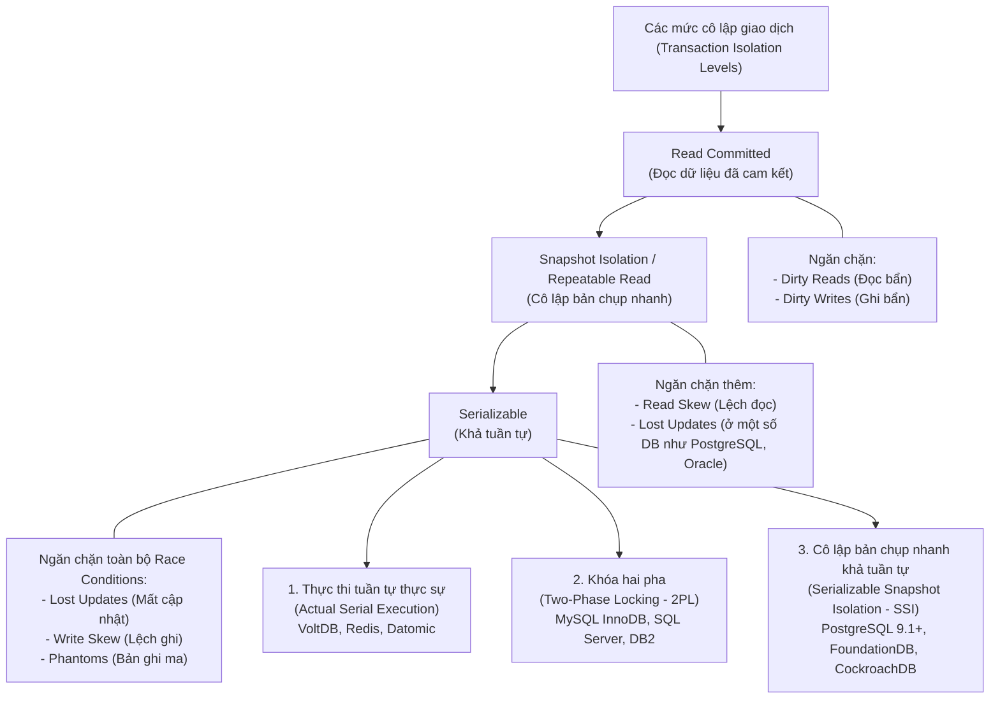

---

## Tài liệu tham khảo (References)

* **[1]** Donald D Chamberlin, Morton M Astrahan, Michael W Blasgen, et al.: “A History and Evaluation of System R,” *Communications of the ACM*, volume 24, number 10, pages 632–646, October 1981. doi:10.1145/358769.358784
* **[2]** Jim N Gray, Raymond A Lorie, Gianfranco R Putzolu, and Irving L Traiger: “Granularity of Locks and Degrees of Consistency in a Shared Data Base,” in *Modelling in Data Base Management Systems: Proceedings of the IFIP Working Conference on Modelling in Data Base Management Systems*, edited by G.M. Nijssen, Elsevier/North Holland Publishing, pages 364–394, 1976. Also in *Readings in Database Systems*, edited by Joseph M. Hellerstein and Michael Stonebraker, 4th edition, MIT Press, 2005. ISBN: 978-0-262-69314-1
* **[3]** Kapali P Eswaran, Jim N Gray, Raymond A Lorie, and Irving L Traiger: “The Notions of Consistency and Predicate Locks in a Database System,” *Communications of the ACM*, volume 19, number 11, pages 624–633, November 1976.
* **[4]** “ACID transactions are incredibly helpful.” FoundationDB, LLC, 2013.
* **[5]** John D Cook: “ACID versus BASE for database transactions,” *johndcook.com*, 6 July 2009.
* **[6]** Gavin Clarke: “NoSQL’s CAP theorem busters: We don’t drop ACID,” *theregister.co.uk*, 22 November 2012.
* **[7]** Theo Härder and Andreas Reuter: “Principles of Transaction-Oriented Database Recovery,” *ACM Computing Surveys*, volume 15, number 4, pages 287–317, December 1983. doi:10.1145/289.291
* **[8]** Peter Bailis, Alan Fekete, Ali Ghodsi, Joseph M Hellerstein, and Ion Stoica: “HAT, not CAP: Towards Highly Available Transactions,” at *14th USENIX Workshop on Hot Topics in Operating Systems* (HotOS), May 2013.
* **[9]** Armando Fox, Steven D Gribble, Yatin Chawathe, Eric A Brewer, and Paul Gauthier: “Cluster-Based Scalable Network Services,” at *16th ACM Symposium on Operating Systems Principles* (SOSP), October 1997.
* **[10]** Philip A Bernstein, Vassos Hadzilacos, and Nathan Goodman: *Concurrency Control and Recovery in Database Systems*. Addison-Wesley, 1987. Available online at *research.microsoft.com*. ISBN: 0201107155
* **[11]** Alan Fekete, Dimitrios Liarokapis, Elizabeth O’Neil, Patrick O’Neil, and Dennis Shasha: “Making Snapshot Isolation Serializable,” *ACM Transactions on Database Systems*, volume 30, number 2, pages 492–528, June 2005. doi:10.1145/1071610.1071615
* **[12]** Mai Zheng, Joseph Tucek, Feng Qin, and Mark Lillibridge: “Understanding the Robustness of SSDs under Power Fault,” at *11th USENIX Conference on File and Storage Technologies* (FAST), February 2013.
* **[13]** Laurie Denness: “SSDs: A gift and a curse,” *laur.ie*, 2 June 2015.
* **[14]** Adam Surak: “When Solid State Drives are not that solid,” *blog.algolia.com*, 15 June 2015.
* **[15]** Thanumalayan Sankaranarayana Pillai, Vijay Chidambaram, Ramnatthan Alagappan, et al.: “All File Systems Are Not Created Equal: On the Complexity of Crafting Crash-Consistent Applications,” at *11th USENIX Symposium on Operating Systems Design and Implementation* (OSDI), October 2014.
* **[16]** Chris Siebenmann: “Unix’s file durability problem,” *utcc.utoronto.ca*, 14 April 2016.
* **[17]** Lakshmi N Bairavasundaram, Garth R Goodson, Bianca Schroeder, Andrea C Arpaci-Dusseau, and Remzi H Arpaci-Dusseau: “An Analysis of Data Corruption in the Storage Stack,” at *6th USENIX Conference on File and Storage Technologies* (FAST), February 2008.
* **[18]** Don Allison: “SSD Storage — Ignorance of Technology is No Excuse,” *blog.korelogic.com*, 24 March 2015.
* **[19]** Dave Scherer: “Those Are Not Transactions (Cassandra 2.0),” *blog.foundationdb.com*, 6 September 2013.
* **[20]** Kyle Kingsbury: “Call me maybe: Cassandra,” *aphyr.com*, 24 September 2013.
* **[21]** “ACID Support in Aerospike,” Aerospike, Inc., June 2014.
* **[22]** Martin Kleppmann: “Hermitage: Testing the “I” in ACID,” *martin.kleppmann.com*, 25 November 2014.
* **[23]** Tristan D’Agosta: “BTC Stolen from Poloniex,” *bitcointalk.org*, 4 March 2014.
* **[24]** bitcointhief2: “How I stole roughly 100 BTC from an exchange and how I could have stolen more!,” *reddit.com*, 2 February 2014.
* **[25]** Sudhir Jorwekar, Alan Fekete, Krithi Ramamritham, and S Sudarshan: “Automating the Detection of Snapshot Isolation Anomalies,” at *33rd International Conference on Very Large Data Bases* (VLDB), pages 1263–1274, September 2007.
* **[26]** Michael Melanson: “Transactions: the limits of isolation,” *michaelmelanson.net*, 20 March 2014.
* **[27]** Hal Berenson, Philip A Bernstein, Jim N Gray, et al.: “A Critique of ANSI SQL Isolation Levels,” at *ACM International Conference on Management of Data* (SIGMOD), volume 24, number 2, May 1995. doi:10.1145/568271.223785
* **[28]** Atul Adya: “Weak Consistency: A Generalized Theory and Optimistic Implementations for Distributed Transactions,” PhD Thesis, Massachusetts Institute of Technology, Cambridge, MA, USA, March 1999.
* **[29]** Peter Bailis, Aaron Davidson, Alan Fekete, et al.: “Highly Available Transactions: Virtues and Limitations (Extended Version),” at *40th International Conference on Very Large Data Bases* (VLDB), September 2014.
* **[30]** Bruce Momjian: “MVCC Unmasked,” *momjian.us*, July 2014.
* **[31]** Annamalai Gurusami: “Repeatable Read Isolation Level in InnoDB - How Consistent Read View Works,” *blogs.oracle.com*, 15 January 2013.
* **[32]** Nikita Prokopov: “Unofficial guide to Datomic internals,” *tonsky.me*, 6 May 2014.
* **[33]** Baron Schwartz: “Immutability, MVCC, and garbage collection,” *xaprb.com*, 28 November 2013.
* **[34]** J Chris Anderson, Jan Lehnardt, and Noah Slater: *CouchDB: The Definitive Guide*. O’Reilly Media, January 2010. ISBN: 978-0-596-15589-6
* **[35]** Rikdeb Mukherjee: “Isolation in DB2 (repeatable read, read stability, cursor stability, uncommitted read) with examples,” *mframes.blogspot.co.uk*, 4 July 2013.
* **[36]** Steve Hilker: “Cursor Stability (CS) — IBM DB2 Community,” *toadworld.com*, 14 March 2013.
* **[37]** Nate Wiger: “An Atomic Rant,” *nateware.com*, 18 February 2010.
* **[38]** Joel Jacobson: “Riak 2.0: Data Types,” *blog.joeljacobson.com*, 23 March 2014.
* **[39]** Michael J Cahill, Uwe Röhm, and Alan Fekete: “Serializable Isolation for Snapshot Databases,” at *ACM International Conference on Management of Data* (SIGMOD), pages 729–738, June 2008. doi:10.1145/1376616.1376690
* **[40]** Dan R K Ports and Kevin Grittner: “Serializable Snapshot Isolation in PostgreSQL,” at *38th International Conference on Very Large Databases* (VLDB), volume 5, number 12, pages 1850–1861, August 2012.
* **[41]** Tony Andrews: “Enforcing complex constraints in Oracle,” *tonyandrews.blogspot.co.uk*, 15 October 2004.
* **[42]** Douglas B Terry, Marvin M Theimer, Karin Petersen, et al.: “Managing update conflicts in Bayou, a weakly connected replicated storage system,” at *15th ACM Symposium on Operating Systems Principles* (SOSP), pages 172–182, December 1995. doi:10.1145/224056.224070
* **[43]** Gary Fredericks: “Postgres Serializability Bug,” *github.com*, September 2015.
* **[44]** Michael Stonebraker, Samuel Madden, Daniel J Abadi, et al.: “The End of an Architectural Era (It’s Time for a Complete Rewrite),” at *33rd International Conference on Very Large Data Bases* (VLDB), pages 1150–1160, September 2007.
* **[45]** John Hugg: “H-Store/VoltDB architecture vs. CEP systems and newer streaming architectures,” at *Data @Scale Boston*, November 2014.
* **[46]** Robert Kallman, Hideaki Kimura, Jonathan Natkins, et al.: “H-Store: A High-Performance, Distributed Main Memory Transaction Processing System,” *Proceedings of the VLDB Endowment*, volume 1, number 2, pages 1496–1499, August 2008.
* **[47]** Rich Hickey: “The Architecture of Datomic,” *infoq.com*, 2 November 2012.
* **[48]** John Hugg: “Debunking Myths about the VoltDB in-memory database,” *voltdb.com*, 12 May 2014.
* **[49]** Joseph M Hellerstein, Michael Stonebraker, and James Hamilton: “Architecture of a Database System,” *Foundations and Trends in Databases*, volume 1, number 2, pages 141–259, November 2007. doi:10.1561/1900000002
* **[50]** Michael J Cahill: “Serializable Isolation for Snapshot Databases,” PhD Thesis, University of Sydney, July 2009.
* **[51]** FoundationDB: *Concurrency with FoundationDB (Python)*. *foundationdb.com*, July 2014.
* **[52]** D Z Badal: “Correctness of concurrency control and implications in distributed databases,” at *3rd International IEEE Computer Software and Applications Conference* (COMPSAC), pages 588–593, November 1979. doi:10.1109/CMPSAC.1979.762563
* **[53]** Rakesh Agrawal, Michael J Carey, and Miron Livny: “Concurrency Control Performance Modeling: Alternatives and Implications,” *ACM Transactions on Database Systems* (TODS), volume 12, number 4, pages 609–654, December 1987. doi:10.1145/32204.32220
* **[54]** Dave Rosenthal: “Databases at 14.4MHz,” *blog.foundationdb.com*, 10 December 2014.

---

## Bảng thuật ngữ của chương

| Thuật ngữ tiếng Anh | Thuật ngữ tiếng Việt trong sách | Giải thích ngắn gọn |
| :--- | :--- | :--- |
| **Transaction** | Giao dịch | Đơn vị nhóm nhiều thao tác đọc và ghi thành một khối logic duy nhất: hoặc thành công toàn bộ (`commit`), hoặc hủy bỏ toàn bộ (`abort`/`rollback`). |
| **ACID (Atomicity, Consistency, Isolation, Durability)** | Tính Nguyên tử, Tính Nhất quán, Tính Cô lập, Tính Bền vững | Bộ bốn thuộc tính bảo đảm an toàn dữ liệu của giao dịch truyền thống do Haerder và Reuter đặt tên năm 1983. |
| **Atomicity (Abortability)** | Tính nguyên tử (Khả năng hủy bỏ) | Đảm bảo nếu giao dịch gặp lỗi giữa chừng thì mọi thay đổi đã ghi trước đó đều được hoàn tác (undo), không để lại trạng thái cập nhật dang dở. |
| **Consistency** | Tính nhất quán | Khái niệm thuộc về tầng ứng dụng: dữ liệu phải thỏa mãn các bất biến (invariants) nghiệp vụ trước và sau giao dịch. |
| **Isolation** | Tính cô lập | Đảm bảo các giao dịch chạy đồng thời không làm nhiễu loạn nhau; mức cao nhất là tương đương với chạy tuần tự. |
| **Durability** | Tính bền vững | Đảm bảo một khi giao dịch đã `commit`, dữ liệu sẽ không bị mất ngay cả khi máy chủ sập nguồn hay khởi động lại (nhờ WAL/fsync hoặc sao chép). |
| **BASE (Basically Available, Soft state, Eventual consistency)** | Sẵn sàng cơ bản, Trạng thái mềm, Nhất quán cuối cùng | Thuật ngữ đối lập với ACID trong các hệ thống NoSQL ưu tiên tính sẵn sàng cao hơn là sự cô lập chặt chẽ. |
| **Dirty Read** | Đọc bẩn | Một giao dịch đọc thấy dữ liệu do một giao dịch khác vừa ghi nhưng chưa được `commit`. |
| **Dirty Write** | Ghi bẩn | Một giao dịch ghi đè lên dữ liệu chưa `commit` của một giao dịch khác. |
| **Read Committed** | Đọc dữ liệu đã cam kết | Mức cô lập cơ bản đảm bảo không có đọc bẩn (no dirty reads) và không có ghi bẩn (no dirty writes). |
| **Read Skew (Non-repeatable Read)** | Lệch đọc (Đọc không lặp lại) | Một giao dịch nhìn thấy dữ liệu ở các thời điểm không đồng nhất (ví dụ: tổng số dư bị thiếu hụt tạm thời khi đọc đúng lúc một giao dịch chuyển tiền vừa commit ở giữa). |
| **Snapshot Isolation (SI)** | Cô lập bản chụp nhanh | Mỗi giao dịch đọc từ một bản chụp nhất quán (consistent snapshot) của CSDL tại thời điểm bắt đầu giao dịch; đọc không bao giờ chặn ghi, ghi không bao giờ chặn đọc. |
| **Multi-Version Concurrency Control (MVCC)** | Điều khiển đồng thời đa phiên bản | Kỹ thuật lưu giữ nhiều phiên bản đã commit của cùng một đối tượng dữ liệu (gắn thẻ `created_by`, `deleted_by`) để hiện thực hóa Snapshot Isolation và Read Committed không dùng khóa đọc. |
| **Lost Update** | Mất cập nhật | Hai giao dịch cùng thực hiện chu trình đọc-sửa-ghi (read-modify-write) đồng thời khiến thay đổi của giao dịch commit trước bị giao dịch commit sau ghi đè mất. |
| **Compare-and-Set (CAS)** | So sánh và đặt giá trị | Thao tác cập nhật nguyên tử có điều kiện: chỉ cho phép ghi giá trị mới nếu giá trị hiện tại vẫn bằng đúng giá trị đã đọc trước đó. |
| **Write Skew** | Lệch ghi | Hai giao dịch cùng đọc một tập dữ liệu, kiểm tra một điều kiện bất biến, rồi cập nhật hai đối tượng khác nhau làm phá vỡ điều kiện bất biến đó sau khi cả hai cùng commit. |
| **Phantom** | Bản ghi ma | Một giao dịch thực hiện thao tác ghi (thêm/xóa/sửa dòng) làm thay đổi tập kết quả tìm kiếm (`WHERE ...`) của một giao dịch khác đang chạy đồng thời. |
| **Materializing Conflicts** | Hiện thực hóa xung đột | Kỹ thuật biến một lỗi bản ghi ma (vốn chưa có dòng nào để khóa) thành xung đột khóa trên các dòng thực tế được tạo sẵn trong bảng. |
| **Serializability** | Tính khả tuần tự | Mức cô lập mạnh nhất, đảm bảo kết quả thực thi đồng thời của các giao dịch hoàn toàn tương đương với một thứ tự thực thi tuần tự nào đó. |
| **Actual Serial Execution** | Thực thi tuần tự thực sự | Chạy toàn bộ giao dịch nối tiếp nhau trên một luồng CPU duy nhất trong RAM thông qua Stored Procedure. |
| **Stored Procedure** | Thủ tục lưu trữ | Hàm/đoạn mã chứa trọn vẹn logic giao dịch được nạp sẵn và thực thi trực tiếp bên trong tiến trình cơ sở dữ liệu mà không cần trao đổi mạng qua lại với ứng dụng. |
| **Anti-caching** | Chống bộ nhớ đệm | Kỹ thuật trong CSDL in-memory: đẩy dữ liệu ít dùng xuống đĩa; nếu giao dịch cần chạm tới dữ liệu đó thì abort, nạp bất đồng bộ lên RAM rồi chạy lại giao dịch. |
| **Two-Phase Locking (2PL)** | Khóa hai pha | Thuật toán điều khiển đồng thời bi quan: Pha 1 thu thập các khóa chia sẻ (Shared) khi đọc và khóa độc quyền (Exclusive) khi ghi; Pha 2 giữ toàn bộ khóa cho đến khi kết thúc giao dịch mới giải phóng. |
| **Predicate Lock** | Khóa vị từ | Khóa gắn liền với một điều kiện truy vấn tìm kiếm (`WHERE ...`), áp dụng cho cả các đối tượng hiện có lẫn các bản ghi ma có thể được chèn vào trong tương lai. |
| **Index-Range Lock (Next-Key Lock)** | Khóa dải chỉ mục (Khóa khóa-kế-tiếp) | Phép xấp xỉ hiệu quả của khóa vị từ bằng cách đặt khóa lên một mục hoặc một khoảng giá trị liên tiếp trên chỉ mục B-Tree. |
| **Serializable Snapshot Isolation (SSI)** | Cô lập bản chụp nhanh khả tuần tự | Thuật toán điều khiển đồng thời lạc quan xây dựng trên MVCC: không chặn đọc/ghi mà theo dõi các xung đột tiền đề lỗi thời (`SIREAD` locks) để hủy bỏ giao dịch vi phạm lúc `commit`. |
