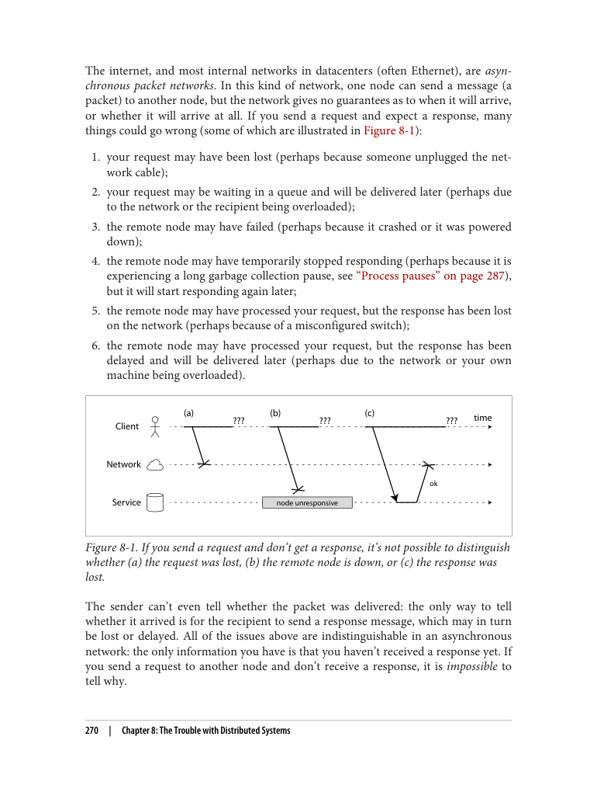
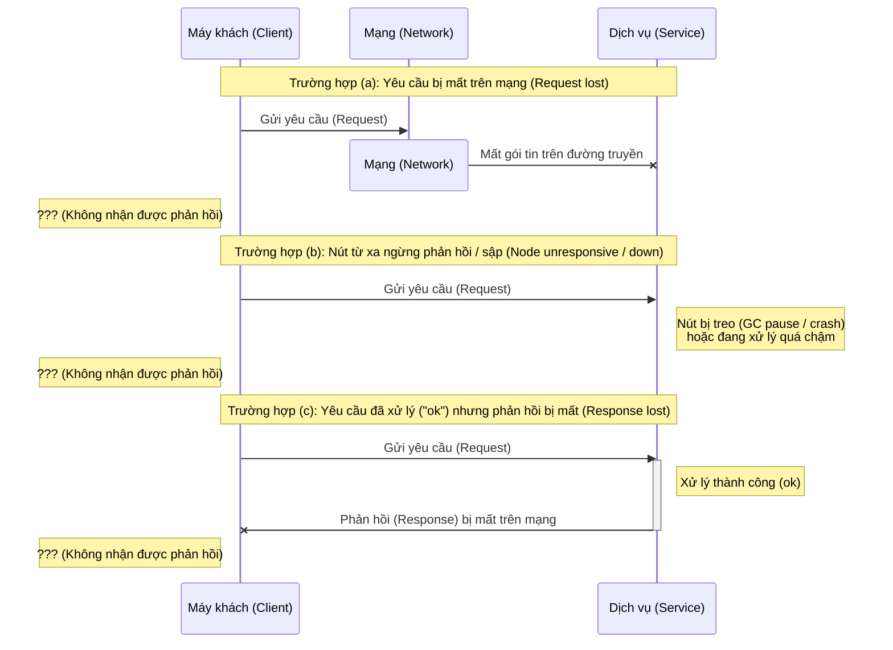
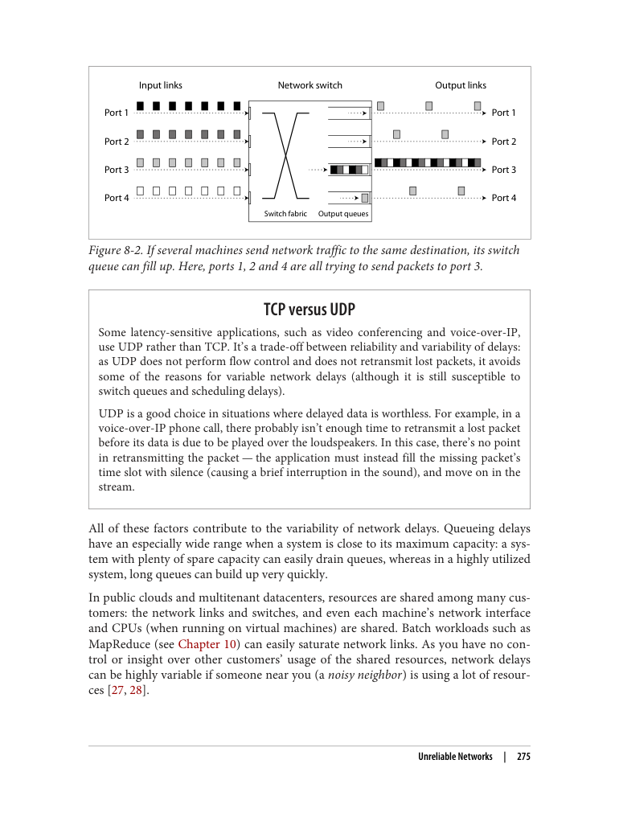
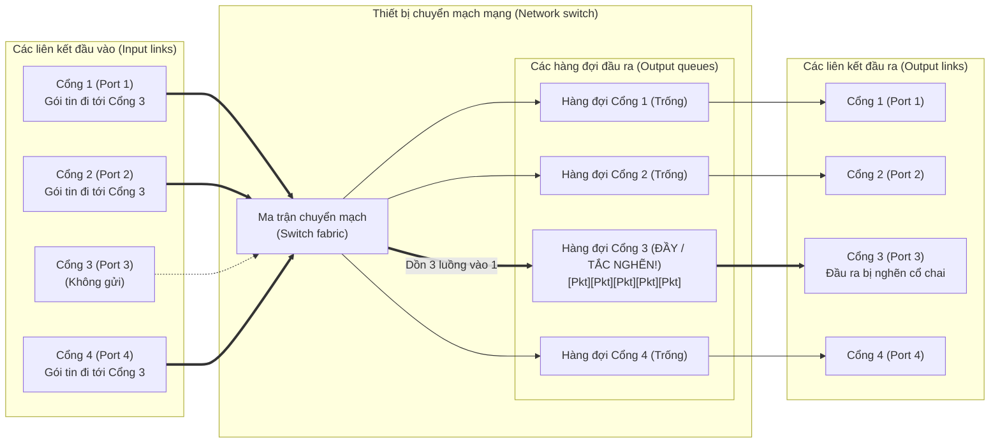
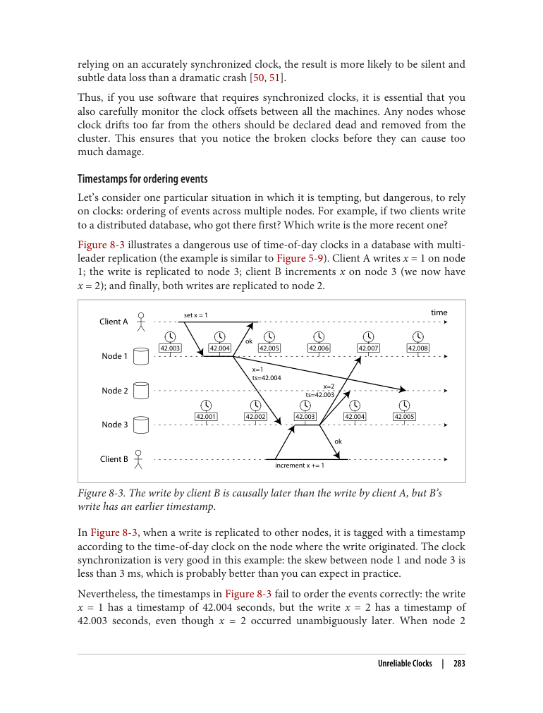
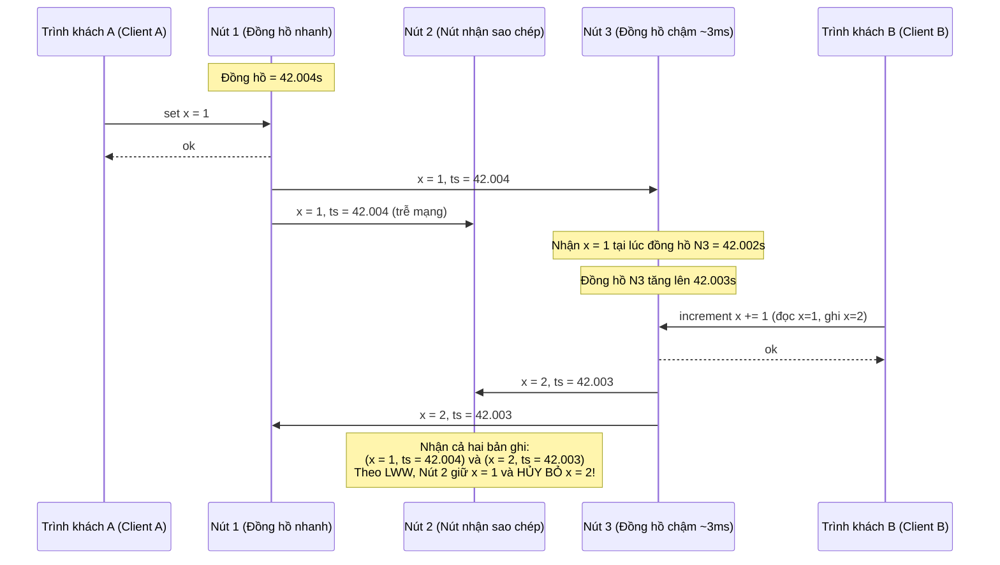
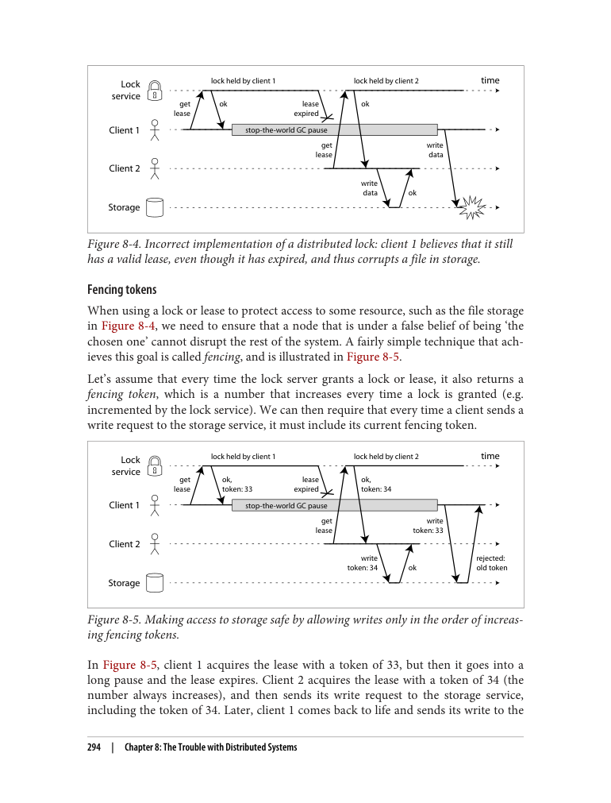
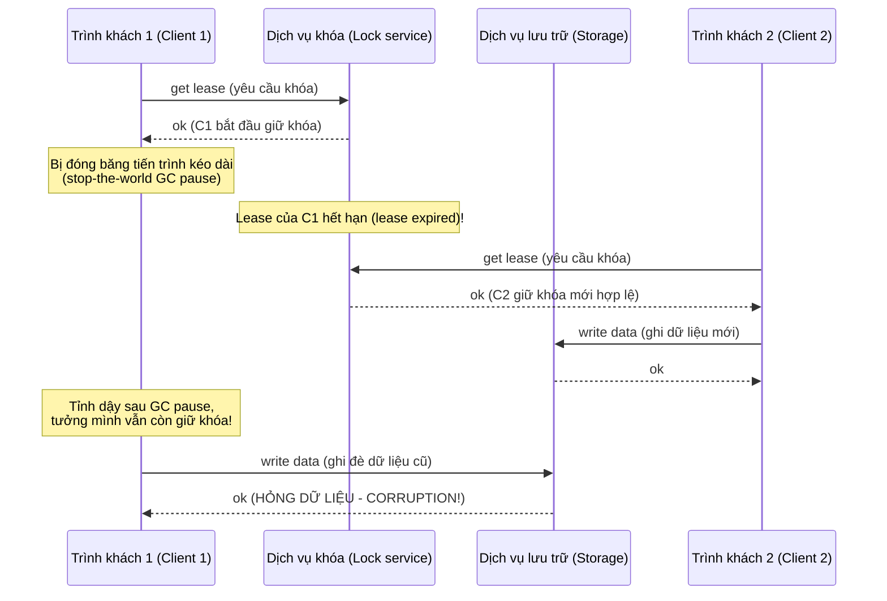
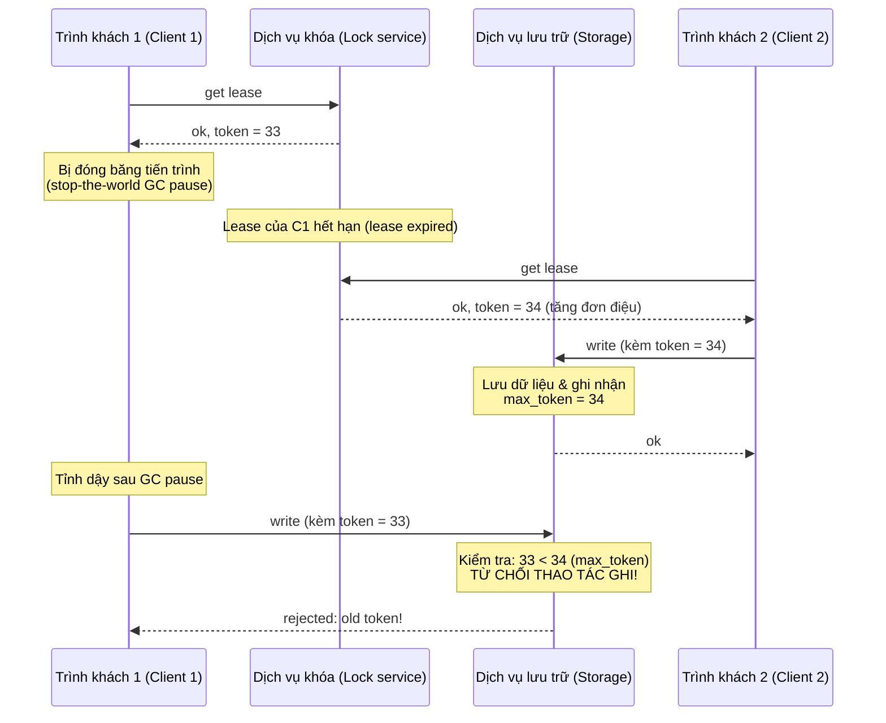

# Chương 8: Những rắc rối với Hệ thống Phân tán (The Trouble with Distributed Systems)

> *"Hey I just met you*
> *The network's laggy*
> *But here's my data*
> *So store it maybe"*
>
> *(Chào đằng ấy, mình vừa mới gặp nhau / Mạng mẽo thì đang giật lag / Nhưng dữ liệu của mình đây / Có gì lưu hộ mình nhé)*
>
> — Kyle Kingsbury, *Carly Rae Jepsen and the perils of network partitions* (2013)

## Mục lục chương (Table of Contents)

1. [Lỗi và Sự cố Một phần (Faults and Partial Failures)](#lỗi-và-sự-cố-một-phần-faults-and-partial-failures)
   - [Điện toán đám mây và siêu máy tính (Cloud computing and supercomputing)](#điện-toán-đám-mây-và-siêu-máy-tính-cloud-computing-and-supercomputing)
   - [Xây dựng một hệ thống đáng tin cậy từ các thành phần không đáng tin cậy (Building a reliable system from unreliable components)](#xây-dựng-một-hệ-thống-đáng-tin-cậy-từ-các-thành-phần-không-đáng-tin-cậy-building-a-reliable-system-from-unreliable-components)
2. [Mạng không đáng tin cậy (Unreliable Networks)](#mạng-không-đáng-tin-cậy-unreliable-networks)
   - [Sự cố mạng trong thực tế (Network faults in practice)](#sự-cố-mạng-trong-thực-tế-network-faults-in-practice)
   - [Phát hiện lỗi (Detecting faults)](#phát-hiện-lỗi-detecting-faults)
   - [Thời gian chờ và độ trễ không giới hạn (Timeouts and unbounded delays)](#thời-gian-chờ-và-độ-trễ-không-giới-hạn-timeouts-and-unbounded-delays)
   - [Mạng đồng bộ so với mạng bất đồng bộ (Synchronous vs. asynchronous networks)](#mạng-đồng-bộ-so-với-mạng-bất-đồng-bộ-synchronous-vs-asynchronous-networks)
3. [Đồng hồ không đáng tin cậy (Unreliable Clocks)](#đồng-hồ-không-đáng-tin-cậy-unreliable-clocks) *(Phần tiếp theo của chương)*
4. [Tri thức, Sự thật và Lời nói dối (Knowledge, Truth, and Lies)](#tri-thức-sự-thật-và-lời-nói-dối-knowledge-truth-and-lies) *(Phần tiếp theo của chương)*

---

Một chủ đề xuyên suốt trong vài chương vừa qua là thảo luận về cách các hệ thống xử lý khi có sự cố xảy ra. Ví dụ, chúng ta đã thảo luận về cơ chế chuyển đổi dự phòng của bản sao — *replica failover* (xem mục “Xử lý sự cố ngừng hoạt động của nút (Handling node outages)” ở trang 150), độ trễ sao chép — *replication lag* (xem mục “Các vấn đề với độ trễ sao chép (Problems With Replication Lag)” ở trang 155) và kiểm soát đồng thời cho các giao dịch — *concurrency control for transactions* (xem mục “Các mức cô lập yếu (Weak isolation levels)” ở trang 224). Khi chúng ta dần hiểu rõ các trường hợp biên (edge-cases) khác nhau có thể xảy ra trong những hệ thống thực tế, chúng ta sẽ xử lý chúng ngày một tốt hơn.

Tuy nhiên, mặc dù chúng ta đã nói rất nhiều về các lỗi (faults), nhưng vài chương vừa qua vẫn còn quá lạc quan. Thực tế còn u tối hơn thế nhiều. Giờ đây, chúng ta sẽ đẩy sự bi quan của mình lên mức tối đa, và giả định rằng **bất cứ điều gì có thể trục trặc thì chắc chắn sẽ trục trặc** (Định luật Murphy).<sup>i</sup> (Những kỹ sư vận hành hệ thống dày dạn kinh nghiệm sẽ nói với bạn rằng đó là một giả định hoàn toàn hợp lý. Nếu bạn hỏi han một cách lịch sự, họ có thể sẽ kể cho bạn nghe vài câu chuyện rùng rợn trong lúc đang xoa dịu những vết sẹo từ các trận chiến trong quá khứ.)

> **Chú thích i:** Với một ngoại lệ duy nhất: chúng ta sẽ giả định rằng các lỗi không phải là lỗi Byzantine (non-byzantine) — xem mục “Lỗi Byzantine (Byzantine faults)” ở trang 295.

Làm việc với các hệ thống phân tán (distributed systems) khác biệt về mặt bản chất so với việc viết phần mềm trên một máy tính đơn lẻ — và sự khác biệt chính nằm ở chỗ có vô số những cách thức mới mẻ và đầy "thú vị" để mọi thứ đổ vỡ [1, 2]. Trong chương này, chúng ta sẽ nếm trải những vấn đề phát sinh trong thực tế, cũng như thấu hiểu những thứ mà chúng ta có thể và không thể tin cậy được.

Sau cùng, nhiệm vụ của chúng ta với tư cách là những kỹ sư là xây dựng các hệ thống hoàn thành tốt công việc của chúng (tức là đáp ứng được những cam kết bảo đảm mà người dùng mong đợi), bất chấp việc mọi thứ xung quanh đều đang gặp sự cố. Trong Chương 9, chúng ta sẽ xem xét một số ví dụ về các thuật toán có thể cung cấp những cam kết bảo đảm như vậy trong một hệ thống phân tán. Nhưng trước hết, ở chương này, chúng ta phải hiểu rõ những thách thức mà mình đang phải đối mặt là gì.

Chương này là một bức tranh tổng quan cực kỳ bi quan và u ám về những thứ có thể gặp trục trặc trong một hệ thống phân tán. Chúng ta sẽ đi sâu vào các vấn đề với mạng máy tính (“Mạng không đáng tin cậy (Unreliable Networks)” ở trang 269), các vấn đề về đồng hồ và định thời gian (“Đồng hồ không đáng tin cậy (Unreliable Clocks)” ở trang 278), đồng thời thảo luận xem chúng ta có thể tránh được chúng ở mức độ nào. Hệ quả của tất cả những vấn đề này rất dễ làm chúng ta mất phương hướng, vì vậy chúng ta sẽ khám phá cách tư duy về trạng thái của một hệ thống phân tán và cách suy luận về những sự kiện đã xảy ra (“Tri thức, Sự thật và Lời nói dối (Knowledge, Truth, and Lies)” ở trang 291).

> 📝 **Giải thích thêm (không có trong sách):**
> Câu thơ mở đầu chương của **Kyle Kingsbury** (tác giả của bộ công cụ kiểm thử hệ thống phân tán nổi tiếng **Jepsen**, nhại theo bài hát *Call Me Maybe* của Carly Rae Jepsen) đã tóm gọn nỗi ám ảnh lớn nhất của kỹ sư hệ thống phân tán: từ Chương 5 đến Chương 7, chúng ta đã làm quen với *Replication* (Sao chép), *Partitioning* (Phân mảnh) và *Transactions* (Giao dịch). Tuy nhiên, các chương đó phần lớn vẫn ngầm giả định rằng các nút có thể giao tiếp với nhau một cách tương đối trật tự hoặc đồng hồ trên các máy là đáng tin cậy.
>
> Bước sang Chương 8, Martin Kleppmann tháo bỏ mọi "lớp đệm an toàn" đó. Trong thế giới thực của hệ thống phân tán, ba giả định ngây thơ phổ biến nhất (nằm trong *Eight Fallacies of Distributed Computing* của Peter Deutsch) gồm:
> 1. **Mạng là đáng tin cậy (The network is reliable)** — Thực tế: gói tin có thể mất, trễ vô hạn, hoặc chỉ đi được một chiều.
> 2. **Độ trễ bằng không hoặc cố định (Latency is zero / bounded)** — Thực tế: hàng đợi ở switch, hệ điều hành, hypervisor có thể khiến gói tin trễ hàng chục giây.
> 3. **Đồng hồ giữa các máy là đồng bộ (Clocks are synchronized)** — Thực tế: đồng hồ vật lý luôn bị trôi (clock drift), NTP có thể nhảy lùi hoặc tiến bất ngờ, và một tiến trình có thể bị tạm dừng (GC pause, VM pause) bất cứ lúc nào.

---

## Lỗi và Sự cố Một phần (Faults and Partial Failures)

Khi bạn viết một chương trình trên một máy tính đơn lẻ, nó thường hoạt động theo một cách khá dễ đoán — hay còn gọi là **tất định (deterministic)**: hoặc là nó chạy đúng, hoặc là nó không chạy. Phần mềm nhiều lỗi (buggy software) có thể tạo ra cảm giác như thể chiếc máy tính đôi khi đang "trải qua một ngày tồi tệ" (một vấn đề thường được khắc phục bằng cách khởi động lại máy), nhưng đó phần lớn chỉ là hệ quả của việc phần mềm được viết kém chất lượng.

Không có lý do căn bản nào khiến phần mềm trên một máy tính đơn lẻ lại hoạt động chập chờn (flaky): khi phần cứng hoạt động bình thường, cùng một thao tác luôn tạo ra cùng một kết quả. Nếu có sự cố phần cứng (ví dụ: hỏng bộ nhớ RAM, lỏng đầu cáp kết nối), hậu quả thường là **sự cố toàn bộ hệ thống (total system failure)** (ví dụ: *kernel panic* trên Linux/macOS, "màn hình xanh chết chóc" — *blue screen of death* trên Windows, hoặc máy không thể khởi động lên được). Một máy tính cá nhân với phần mềm tốt thường chỉ ở một trong hai trạng thái: hoặc là hoạt động hoàn toàn bình thường, hoặc là hỏng hoàn toàn, chứ không có trạng thái lấp lửng ở giữa.

Đây là một sự lựa chọn có chủ đích trong thiết kế máy tính: nếu một lỗi nội bộ xảy ra, chúng ta thà để máy tính sập hoàn toàn (crash completely) còn hơn là trả về một kết quả sai, bởi vì kết quả sai rất khó và rất dễ gây nhầm lẫn khi xử lý. Do đó, máy tính che giấu thực tại vật lý mờ nhạt và nhiễu loạn bên dưới nơi chúng được hiện thực hóa, để trình bày ra bên ngoài một mô hình hệ thống lý tưởng hóa, vận hành với sự hoàn hảo toán học: một tập lệnh CPU luôn thực hiện đúng một việc như nhau; nếu bạn ghi một số dữ liệu vào bộ nhớ hoặc ổ đĩa, dữ liệu đó sẽ giữ nguyên vẹn và không bị hỏng ngẫu nhiên. Mục tiêu thiết kế tính toán luôn chính xác (always-correct computation) này đã có từ chiếc máy tính kỹ thuật số đầu tiên trong lịch sử [3].

Khi bạn viết phần mềm chạy trên nhiều máy tính được kết nối với nhau qua mạng, tình hình sẽ khác biệt về mặt bản chất. Trong các hệ thống phân tán, chúng ta không còn vận hành trong một mô hình hệ thống lý tưởng hóa nữa — chúng ta không có lựa chọn nào khác ngoài việc phải đối mặt trực diện với thực tại hỗn độn của thế giới vật lý. Và trong thế giới vật lý, một loạt những điều kỳ quặc đáng kinh ngạc có thể xảy ra, như được minh họa qua giai thoại sau đây [4]:

> "Trong kinh nghiệm ít ỏi của mình, tôi đã từng phải xử lý các sự cố phân vùng mạng (network partitions) kéo dài trong một trung tâm dữ liệu (DC) đơn lẻ, hỏng bộ phân phối nguồn (PDU — *power distribution unit*), hỏng thiết bị chuyển mạch (switch), vô tình tắt bật lại nguồn của cả một tủ rack, sập mạng trục chính (backbone) của toàn bộ DC, mất điện toàn bộ DC, và cả vụ một tài xế bị hạ đường huyết đâm sầm chiếc xe bán tải Ford của anh ta vào hệ thống điều hòa thông gió (HVAC — *heating, ventilation, and air conditioning*) của trung tâm dữ liệu. Và tôi thậm chí còn chẳng phải là dân vận hành (ops)."
>
> — Coda Hale

Trong một hệ thống phân tán, rất có thể một số bộ phận của hệ thống bị hỏng theo một cách không thể đoán trước nào đó, mặc dù các bộ phận khác của hệ thống vẫn đang hoạt động tốt. Hiện tượng này được gọi là **sự cố một phần (partial failure)**. Điểm khó khăn nằm ở chỗ các sự cố một phần mang tính **bất định (non-deterministic)**: nếu bạn cố gắng thực hiện bất kỳ việc gì liên quan đến nhiều nút (nodes) và mạng máy tính, đôi khi nó có thể chạy tốt và đôi khi lại thất bại một cách không thể lường trước. Như chúng ta sẽ thấy, bạn thậm chí có thể không biết được liệu một thao tác đã thành công hay chưa!

Chính tính bất định (non-determinism) và khả năng xảy ra sự cố một phần (partial failures) này là thứ khiến các hệ thống phân tán trở nên cực kỳ khó làm việc [5].

> 💡 **Ví dụ bổ sung (không có trong sách):**
> Hãy so sánh việc ghi một tệp trên máy cục bộ với việc lưu dữ liệu trong hệ thống phân tán:
> - **Trên một máy đơn lẻ (Single Computer):** Khi ứng dụng gọi hàm hệ thống `fsync(fd)` để lưu dữ liệu xuống ổ SSD cục bộ, nhân hệ điều hành (OS kernel) và bộ điều khiển phần cứng sẽ thực thi tuần tự. Nếu RAM bị lỗi bit không thể sửa (uncorrectable ECC error), phần cứng sẽ kích hoạt *Machine Check Exception (MCE)* và làm sập toàn bộ hệ điều hành ngay lập tức (Kernel Panic). Bạn không bao giờ gặp tình huống "CPU thứ nhất không biết CPU thứ hai có nhận được lệnh hay không vì dây đồng trên bo mạch chủ đang bị kẹt xe".
> - **Trên hệ thống phân tán (Distributed System):** Khi Dịch vụ Thanh toán (Order Service) gọi qua mạng sang Dịch vụ Kho hàng (Inventory Service) để trừ tồn kho, kết nối mạng đột nhiên đứt. Dịch vụ Thanh toán hoàn toàn rơi vào trạng thái bất định: yêu cầu đã tới nơi chưa? Kho hàng đã trừ chưa? Nếu gọi lại lần nữa thì có bị trừ tồn kho hai lần không? Một nửa hệ thống (Order Service) vẫn chạy hoàn hảo, trong khi giao tiếp với nửa kia bị đứt gãy — đó chính là **sự cố một phần (partial failure)**.

### Điện toán đám mây và siêu máy tính (Cloud computing and supercomputing)

Có cả một phổ triết lý khác nhau về cách xây dựng các hệ thống điện toán quy mô lớn:

* Ở một đầu của phổ là lĩnh vực **tính toán hiệu năng cao (high-performance computing — HPC)**. Các siêu máy tính (supercomputers) với hàng nghìn CPU thường được sử dụng cho các tác vụ tính toán khoa học chuyên sâu đòi hỏi năng lực xử lý khổng lồ, chẳng hạn như dự báo thời tiết hoặc động lực học phân tử (mô phỏng chuyển động của các nguyên tử và phân tử).
* Ở thái cực bên kia là **điện toán đám mây (cloud computing)**, một khái niệm vốn không được định nghĩa thật sự chặt chẽ [6], nhưng thường gắn liền với các trung tâm dữ liệu đa thuê bao (multitenant datacenters), các máy tính thông dụng (commodity computers) được kết nối bằng mạng IP (thường là Ethernet), phân bổ tài nguyên linh hoạt/theo yêu cầu (elastic/on-demand resource allocation), và tính phí theo mức sử dụng (metered billing).
* Các trung tâm dữ liệu doanh nghiệp truyền thống (traditional enterprise datacenters) nằm ở đâu đó giữa hai thái cực này.

Đi kèm với những triết lý này là các cách tiếp cận rất khác nhau để xử lý lỗi. Trong một siêu máy tính, một tác vụ (job) thường định kỳ lưu lại điểm kiểm tra (checkpoint) trạng thái tính toán của nó vào bộ lưu trữ bền vững (durable storage). Nếu một nút bị lỗi, một giải pháp phổ biến là đơn giản dừng toàn bộ khối lượng công việc của cả cụm (cluster workload). Sau khi nút bị lỗi được sửa chữa, quá trình tính toán sẽ được khởi động lại từ điểm kiểm tra (checkpoint) gần nhất [7, 8]. Do đó, một siêu máy tính giống với một máy tính đơn nút hơn là một hệ thống phân tán: nó đối phó với sự cố một phần bằng cách để cho sự cố đó leo thang thành sự cố toàn bộ (total failure) — nếu bất kỳ phần nào của hệ thống bị lỗi, cứ để mọi thứ dừng sập hết (giống như một lỗi *kernel panic* trên một máy đơn lẻ).

Các siêu máy tính được chế tạo từ phần cứng chuyên dụng, nơi mỗi nút có độ tin cậy khá cao, và các nút giao tiếp với nhau thông qua bộ nhớ dùng chung (shared memory) và truy cập bộ nhớ trực tiếp từ xa (remote direct memory access — RDMA). Chúng thường sử dụng các cấu trúc liên kết mạng (network topologies) chuyên biệt, chẳng hạn như mạng lưới đa chiều (multidimensional meshes) và hình xuyến (toruses) [9]. Những kỹ thuật này mang lại hiệu năng rất cao và độ tin cậy đủ tốt cho các bài toán đặc thù của HPC.

Trong cuốn sách này, chúng ta tập trung vào các hệ thống dùng để triển khai các dịch vụ internet, vốn thường có diện mạo rất khác so với các siêu máy tính:

* Nhiều ứng dụng liên quan đến internet là các hệ thống **trực tuyến (online)**, theo nghĩa là chúng cần phải có khả năng phục vụ người dùng với độ trễ thấp vào bất kỳ thời điểm nào. Việc làm cho dịch vụ ngừng hoạt động (unavailable) — ví dụ như dừng cả cụm máy để sửa chữa — là điều không thể chấp nhận được. Điều này khác hẳn với các tác vụ **ngoại tuyến (offline / batch jobs)** như mô phỏng thời tiết, vốn có thể tạm dừng và khởi động lại với tác động khá thấp.
* Chúng ta giả định rằng các nút được xây dựng từ **các máy móc thông dụng (commodity machines)**, thứ có thể mang lại hiệu năng tương đương với chi phí thấp hơn so với phần cứng chuyên dụng (nhờ lợi thế kinh tế theo quy mô — economies of scale), nhưng đồng thời cũng có tỷ lệ hỏng hóc cao hơn.
* Các mạng trung tâm dữ liệu lớn thường dựa trên giao thức IP và Ethernet, được sắp xếp theo cấu trúc liên kết **Clos (Clos topologies)** để cung cấp băng thông cắt đôi (bisection bandwidth) cao [10].
* Hệ thống càng lớn thì khả năng một trong các thành phần của nó bị hỏng càng cao. Theo thời gian, những thứ bị hỏng được sửa chữa và những thứ mới lại hỏng tiếp, nhưng trong một hệ thống có hàng nghìn nút, hoàn toàn hợp lý khi giả định rằng **luôn luôn có một thứ gì đó đang bị hỏng** [7]. Nếu chiến lược xử lý lỗi chỉ đơn giản là bỏ cuộc và dừng hệ thống, thì một hệ thống lớn như vậy sẽ không bao giờ có thể hoạt động được.
* Nếu hệ thống có thể chịu đựng được các nút bị lỗi (tolerate failed nodes) và vẫn tiếp tục hoạt động bình thường trên tổng thể, thì đó là một tính năng cực kỳ hữu ích cho việc vận hành và bảo trì: ví dụ, bạn có thể thực hiện **nâng cấp cuốn chiếu (rolling upgrade)** (xem Chương 4), khởi động lại từng nút một trong khi dịch vụ vẫn tiếp tục phục vụ người dùng mà không bị gián đoạn. Trong môi trường đám mây, nếu một máy ảo (virtual machine) hoạt động kém hiệu quả, bạn có thể đơn giản là hủy (kill) nó đi và yêu cầu cấp phát một máy ảo mới (với hy vọng rằng máy mới sẽ chạy nhanh hơn).
* Trong một mô hình triển khai phân tán về mặt địa lý (giữ dữ liệu ở gần người dùng về mặt địa lý để giảm độ trễ truy cập), việc giao tiếp gần như chắc chắn phải đi qua mạng internet công cộng, vốn chậm chạp và không đáng tin cậy so với các mạng nội bộ (local networks).

Nếu muốn làm cho các hệ thống phân tán hoạt động được, chúng ta phải chấp nhận khả năng xảy ra **sự cố một phần (partial failure)**, và xây dựng các cơ chế **chịu lỗi (fault tolerance)** ngay bên trong phần mềm. Nói cách khác, chúng ta cần xây dựng một hệ thống đáng tin cậy từ những thành phần không đáng tin cậy. (Như đã thảo luận trong mục “Độ tin cậy (Reliability)” ở trang 4, không có thứ gì gọi là độ tin cậy tuyệt đối hoàn hảo cả, vì vậy chúng ta sẽ cần hiểu rõ giới hạn của những gì mình có thể cam kết một cách thực tế.)

Ngay cả trong các hệ thống nhỏ hơn chỉ bao gồm một vài nút, việc suy nghĩ về sự cố một phần vẫn rất quan trọng. Trong một hệ thống nhỏ, rất có khả năng hầu hết các thành phần đều hoạt động bình thường trong phần lớn thời gian. Tuy nhiên, sớm hay muộn, một bộ phận nào đó của hệ thống sẽ gặp lỗi, và phần mềm sẽ phải xử lý tình huống đó bằng một cách nào đó. Việc xử lý lỗi phải là một phần trong thiết kế phần mềm, và bạn (với tư cách là người vận hành phần mềm) cần phải biết mình nên mong đợi hành vi gì từ phần mềm khi có sự cố xảy ra.

Sẽ là thiếu khôn ngoan nếu giả định rằng các lỗi rất hiếm khi xảy ra rồi chỉ đơn giản là hy vọng vào điều tốt đẹp nhất. Điều quan trọng là phải xem xét một phạm vi rộng các lỗi có thể xảy ra — ngay cả những lỗi khá khó xảy ra — và chủ động tạo ra các tình huống giả lập như vậy trong môi trường kiểm thử của bạn để xem chuyện gì sẽ diễn ra. Trong các hệ thống phân tán, sự nghi ngờ, thái độ bi quan và chứng hoang tưởng (paranoia) sẽ được đền đáp xứng đáng.

> 📝 **Giải thích thêm (không có trong sách):**
> Bảng dưới đây tóm tắt sự đối lập giữa triết lý **Siêu máy tính (HPC)** và **Hệ thống Phân tán Đám mây (Cloud Distributed Systems)**:
>
> | Tiêu chí | Siêu máy tính (Supercomputing / HPC) | Điện toán đám mây / Dịch vụ Internet (Cloud / Web Services) |
> | :--- | :--- | :--- |
> | **Loại tác vụ** | Ngoại tuyến / Xử lý theo lô (Batch jobs: mô phỏng khí hậu, vật lý hạt nhân). | Trực tuyến (Online services: web, API, cơ sở dữ liệu giao dịch) cần độ trễ thấp 24/7. |
> | **Phần cứng** | Phần cứng chuyên dụng đắt đỏ, độ tin cậy từng linh kiện rất cao. | Máy chủ thông dụng giá rẻ (Commodity hardware), tỷ lệ hỏng phần cứng cao hơn. |
> | **Kết nối mạng** | Bộ nhớ chia sẻ (Shared memory), RDMA, InfiniBand, cấu trúc mạng Mesh / Torus. | Mạng gói IP/Ethernet, cấu trúc mạng **Clos (Leaf-Spine)**, hoặc qua Internet WAN. |
> | **Xử lý khi 1 nút lỗi** | **Dừng toàn bộ cụm (Stop-the-world)**, sửa nút hỏng, khôi phục từ bản *checkpoint* gần nhất (leo thang thành *total failure*). | **Chấp nhận sự cố một phần (Partial failure)**: cô lập nút lỗi, chuyển hướng lưu lượng (failover), hệ thống vẫn phải chạy tiếp. |

#### Xây dựng một hệ thống đáng tin cậy từ các thành phần không đáng tin cậy (Building a reliable system from unreliable components)

Bạn có thể tự hỏi liệu ý tưởng này có hợp lý hay không — theo trực giác, có vẻ như một hệ thống chỉ có thể đáng tin cậy ngang bằng với thành phần kém tin cậy nhất của nó (mắt xích yếu nhất — *weakest link*). Thực tế không phải vậy: quả thực, việc kiến tạo một hệ thống đáng tin cậy hơn từ một nền tảng bên dưới kém tin cậy hơn là một ý tưởng đã có từ rất lâu đời trong ngành máy tính [11]. Ví dụ:

* **Mã sửa lỗi (Error-correcting codes — ECC)** cho phép dữ liệu số được truyền tải chính xác qua một kênh truyền thông thỉnh thoảng làm sai lệch một vài bit, chẳng hạn như do nhiễu sóng vô tuyến trên mạng không dây [12].
* **IP (Internet Protocol — Giao thức Liên mạng)** là giao thức không đáng tin cậy, tức là nó có thể làm rơi (drop), làm trễ (delay), nhân bản (duplicate) hoặc đảo lộn thứ tự (reorder) các gói tin. **TCP (Transmission Control Protocol — Giao thức Điều khiển Truyền vận)** cung cấp một tầng giao vận đáng tin cậy hơn nằm chồng lên trên tầng IP: nó đảm bảo rằng các gói tin bị mất sẽ được truyền lại (retransmitted), các gói tin trùng lặp sẽ bị loại bỏ, và các gói tin sẽ được lắp ghép lại theo đúng thứ tự mà chúng đã được gửi đi.

Mặc dù hệ thống ở tầng cao có thể đáng tin cậy hơn các bộ phận cấu thành bên dưới của nó, nhưng luôn có một giới hạn cho việc nó có thể trở nên đáng tin cậy hơn đến mức nào. Ví dụ, mã sửa lỗi có thể xử lý một số lượng nhỏ các lỗi đơn bit (single-bit errors), nhưng nếu tín hiệu của bạn bị nhấn chìm hoàn toàn bởi nhiễu, thì luôn tồn tại một giới hạn cơ bản (Định lý Shannon–Hartley) về lượng dữ liệu bạn có thể truyền qua kênh giao tiếp đó [13]. Tương tự, TCP có thể che giấu việc mất gói tin, trùng lặp và đảo thứ tự gói tin khỏi mắt bạn, nhưng nó không thể dùng phép thuật để xóa bỏ sự chậm trễ (delays) trên mạng.

Mặc dù hệ thống ở tầng cao hơn và đáng tin cậy hơn này không phải là hoàn hảo, nhưng nó vẫn vô cùng hữu ích, bởi vì nó đã giải quyết giúp chúng ta một số lỗi cấp thấp (low-level faults) phức tạp và khó nhằn, nhờ đó những lỗi còn sót lại ở tầng trên thường dễ suy luận và dễ đối phó hơn.

---

## Mạng không đáng tin cậy (Unreliable Networks)

Các hệ thống phân tán mà chúng ta tập trung vào trong cuốn sách này là các hệ thống **không chia sẻ tài nguyên (shared-nothing systems)**, tức là một tập hợp các máy tính được kết nối với nhau bởi mạng máy tính. Mạng là phương thức duy nhất để những cỗ máy đó có thể giao tiếp với nhau — chúng ta giả định rằng mỗi máy đều có bộ nhớ (RAM) và ổ đĩa riêng của mình, và một máy không thể truy cập trực tiếp vào bộ nhớ hoặc ổ đĩa của máy khác (ngoại trừ thông qua việc gửi các yêu cầu tới một dịch vụ qua mạng).

Mạng internet, cũng như hầu hết các mạng nội bộ trong các trung tâm dữ liệu (thường là Ethernet), là **các mạng chuyển mạch gói bất đồng bộ (asynchronous packet networks)**. Trong loại mạng này, một nút có thể gửi một thông điệp (một gói tin — *packet*) đến một nút khác, nhưng mạng không đưa ra bất kỳ sự bảo đảm nào về thời điểm gói tin sẽ đến nơi, hay thậm chí là liệu nó có đến được nơi hay không. Nếu bạn gửi một yêu cầu (request) và mong đợi một phản hồi (response), có rất nhiều thứ có thể gặp trục trặc (một số trường hợp được minh họa trong **Hình 8-1**):

1. Yêu cầu của bạn có thể đã bị mất trên đường truyền (có lẽ vì ai đó đã rút phích cắm cáp mạng);
2. Yêu cầu của bạn có thể đang phải nằm chờ trong một hàng đợi (queue) và sẽ được chuyển đến sau đó (có lẽ do mạng hoặc chính nút nhận đang bị quá tải);
3. Nút từ xa (remote node) có thể đã gặp sự cố (có lẽ vì nó bị sập nguồn/crash hoặc đã bị tắt máy);
4. Nút từ xa có thể đã tạm thời ngừng phản hồi (có lẽ vì nó đang trải qua một đợt tạm dừng thu gom rác bộ nhớ kéo dài — *long garbage collection pause*, xem mục “Tạm dừng tiến trình (Process pauses)” ở trang 287), nhưng nó sẽ bắt đầu phản hồi trở lại sau đó;
5. Nút từ xa có thể đã xử lý xong yêu cầu của bạn, nhưng gói tin phản hồi đã bị mất trên mạng (có lẽ vì một thiết bị chuyển mạch switch bị cấu hình sai);
6. Nút từ xa có thể đã xử lý xong yêu cầu của bạn, nhưng gói tin phản hồi đã bị trì hoãn và sẽ được chuyển đến sau đó (có lẽ do mạng hoặc do chính máy tính của bạn đang bị quá tải).

**Hình 8-1 – Nếu bạn gửi một yêu cầu và không nhận được phản hồi, không thể phân biệt được liệu (a) yêu cầu đã bị mất, (b) nút từ xa đang ngừng hoạt động, hay (c) phản hồi đã bị mất. (Figure 8-1. If you send a request and don’t get a response, it’s not possible to distinguish whether (a) the request was lost, (b) the remote node is down, or (c) the response was lost.)**





Người gửi thậm chí không thể biết được liệu gói tin đã được chuyển giao tới đích hay chưa: cách duy nhất để biết liệu nó đã đến nơi hay chưa là người nhận phải gửi lại một thông điệp phản hồi, mà bản thân thông điệp phản hồi này đến lượt nó lại có thể bị mất hoặc bị trễ. Tất cả các vấn đề nêu trên đều **không thể phân biệt được với nhau (indistinguishable)** trong một mạng bất đồng bộ: thông tin duy nhất bạn có trong tay là bạn vẫn chưa nhận được phản hồi tính đến thời điểm hiện tại. Nếu bạn gửi một yêu cầu tới một nút khác và không nhận được phản hồi, bạn hoàn toàn không có cách nào biết được lý do tại sao.

Cách xử lý thông thường cho tình huống này là sử dụng **thời gian chờ (timeout)**: sau một khoảng thời gian nhất định, bạn từ bỏ việc chờ đợi và giả định rằng phản hồi sẽ không bao giờ đến nữa. Tuy nhiên, khi hết thời gian chờ (timeout occurs), bạn vẫn không hề biết liệu nút từ xa đã nhận được yêu cầu của mình hay chưa (và nếu yêu cầu đó vẫn đang nằm trong hàng đợi ở đâu đó, nó vẫn có thể được chuyển giao tới người nhận về sau, ngay cả khi người gửi đã từ bỏ nó rồi).

> 💡 **Ví dụ bổ sung (không có trong sách):**
> Tình huống **(c)** trong **Hình 8-1** chính là cơn ác mộng kinh điển trong các hệ thống tài chính và thương mại điện tử:
> Giả sử ứng dụng ngân hàng gửi yêu cầu `POST /transfer` (chuyển 10 triệu VNĐ từ tài khoản A sang tài khoản B). Máy chủ ngân hàng đã trừ tiền của A, cộng tiền cho B và commit giao dịch vào PostgreSQL (`ok`), nhưng đúng lúc gửi HTTP 200 OK về lại cho ứng dụng thì kết nối mạng bị đứt.
> - Phía Client hết thời gian chờ (timeout) và chỉ thấy dấu hỏi chấm `???`.
> - Nếu Client tự động thử gửi lại (retry) yêu cầu chuyển tiền mà không có cơ chế chống trùng lặp, tài khoản A sẽ bị trừ tiền **2 lần** (20 triệu VNĐ)!
> - Đây là lý do tại sao trong hệ thống phân tán, mọi thao tác có thay đổi trạng thái (side-effects) khi đi kèm với cơ chế retry bắt buộc phải thiết kế theo hướng **Lũy đẳng (Idempotent)** — ví dụ đính kèm một `Idempotency-Key: uuid-v4` vào mỗi request để Server kiểm tra xem yêu cầu đó đã được thực thi trước đó hay chưa.

### Sự cố mạng trong thực tế (Network faults in practice)

Chúng ta đã xây dựng các mạng máy tính trong suốt nhiều thập kỷ qua — người ta có thể hy vọng rằng đến tận bây giờ, chúng ta hẳn đã tìm ra cách làm cho chúng trở nên hoàn toàn đáng tin cậy. Tuy nhiên, có vẻ như chúng ta vẫn chưa thành công.

Có một số nghiên cứu có hệ thống, cùng với vô số bằng chứng giai thoại thực tế, chỉ ra rằng các sự cố mạng có thể xảy ra phổ biến đến mức đáng ngạc nhiên, ngay cả trong những môi trường được kiểm soát chặt chẽ như một trung tâm dữ liệu do một công ty duy nhất vận hành [14]. Một nghiên cứu tại một trung tâm dữ liệu quy mô vừa đã phát hiện trung bình khoảng 12 sự cố mạng mỗi tháng, trong đó một nửa làm mất kết nối của một máy đơn lẻ, và một nửa làm mất kết nối của cả một tủ rack [15]. Một nghiên cứu khác đo lường tỷ lệ lỗi của các thành phần hạ tầng như thiết bị chuyển mạch đầu tủ rack (top-of-rack switches — ToR), thiết bị chuyển mạch gom cụm (aggregation switches) và bộ cân bằng tải (load balancers) [16]. Nghiên cứu này phát hiện ra rằng việc bổ sung thêm thiết bị mạng dự phòng (redundant networking gear) không làm giảm thiểu sự cố nhiều như bạn hằng hy vọng, bởi vì nó không bảo vệ hệ thống khỏi **lỗi con người (human error)** (ví dụ: cấu hình sai switch), vốn là nguyên nhân chính gây ra các đợt ngừng hoạt động (outages).

Ví dụ, các dịch vụ đám mây công cộng (public cloud) như Amazon EC2 vốn khét tiếng vì thường xuyên xảy ra các trục trặc mạng thoáng qua (transient network glitches) [14], và các mạng trung tâm dữ liệu riêng (private datacenter networks) được quản lý tốt có thể là một môi trường ổn định hơn. Mặc dù vậy, không một ai miễn nhiễm với các sự cố mạng: chẳng hạn, một trục trặc trong quá trình nâng cấp phần mềm (firmware) của switch có thể kích hoạt việc tái cấu hình lại cấu trúc liên kết mạng (network topology reconfiguration — chẳng hạn như tính toán lại cây Spanning Tree hoặc bảng định tuyến BGP), và trong suốt quá trình đó, các gói tin mạng có thể bị trì hoãn tới hơn một phút [17]. Những sự cố đáng ngạc nhiên khác bao gồm việc một card mạng (network interface) đôi khi làm rơi toàn bộ các gói tin đi vào (inbound packets), nhưng lại gửi các gói tin đi ra (outbound packets) hoàn toàn thành công [18]: chỉ vì một đường liên kết mạng hoạt động tốt theo một chiều không hề đảm bảo rằng nó cũng đang hoạt động tốt theo chiều ngược lại (liên kết bất đối xứng — *asymmetric link*).

> **Phân vùng mạng (Network partitions)**
>
> Khi một phần của mạng bị cắt đứt liên lạc với phần còn lại do một sự cố mạng, hiện tượng đó đôi khi được gọi là **phân vùng mạng (network partition)** hoặc **chia tách mạng (netsplit)**. Trong cuốn sách này, chúng ta sẽ gắn bó với thuật ngữ tổng quát hơn là **sự cố mạng (network fault)**, nhằm tránh gây nhầm lẫn với các phân vùng dữ liệu (*partitions* hay *shards*) của một hệ thống lưu trữ như đã thảo luận trong Chương 6.


Ngay cả khi các sự cố mạng hiếm khi xảy ra trong môi trường của bạn, thực tế là các sự cố đó *có thể* xảy ra đồng nghĩa với việc phần mềm của bạn cần phải có khả năng xử lý chúng. Bất cứ khi nào có bất kỳ giao tiếp nào diễn ra qua mạng, nó đều có thể thất bại — không có cách nào né tránh được điều đó.

Nếu việc xử lý lỗi cho các sự cố mạng không được định nghĩa rõ ràng và kiểm thử kỹ lưỡng, những hậu quả tồi tệ tùy ý có thể xảy ra: ví dụ, cả cụm máy (cluster) có thể rơi vào trạng thái khóa chết (deadlocked) và vĩnh viễn không thể phục vụ các yêu cầu được nữa, ngay cả khi mạng đã phục hồi trở lại bình thường [19], hoặc thậm chí nó có thể xóa sạch toàn bộ dữ liệu của bạn [20]. Nếu phần mềm bị đặt vào một tình huống không được lường trước, nó có thể thực hiện những hành động bất ngờ không thể đoán định.

Việc xử lý các sự cố mạng không nhất thiết có nghĩa là phải chịu đựng và che giấu hoàn toàn chúng (tolerating them): nếu mạng của bạn bình thường khá đáng tin cậy, một cách tiếp cận hợp lệ có thể chỉ đơn giản là hiển thị một thông báo lỗi cho người dùng trong lúc mạng của bạn đang gặp sự cố. Tuy nhiên, bạn bắt buộc phải biết phần mềm của mình phản ứng như thế nào trước các vấn đề về mạng, và đảm bảo rằng hệ thống có thể tự phục hồi (recover) sau khi sự cố qua đi. Sẽ rất hợp lý nếu bạn chủ động kích hoạt các sự cố mạng giả lập và kiểm thử phản ứng của hệ thống (chẳng hạn như sử dụng công cụ *Chaos Monkey*, xem mục “Độ tin cậy (Reliability)” ở trang 4).

> 📝 **Giải thích thêm (không có trong sách):**
> Tại sao một sự cố mạng tạm thời lại có thể khiến cả cluster bị treo vĩnh viễn ngay cả sau khi mạng đã khôi phục, hoặc làm mất dữ liệu (như tài liệu tham khảo [19, 20] đề cập)?
> - Trong nhiều hệ thống phân tán đời đầu hoặc cấu hình sai (như các phiên bản cũ của Elasticsearch, MongoDB, hoặc RabbitMQ cluster khi xảy ra *netsplit*), hai nửa của cụm bị mất liên lạc với nhau đều tự tưởng rằng nửa bên kia đã chết và tự bầu chọn chính mình làm Leader (**Split-Brain**).
> - Khi cả hai nhánh cùng chấp nhận ghi dữ liệu độc lập, trạng thái dữ liệu bị phân kỳ (diverged). Đến khi cáp mạng được cắm lại, hai Leader phát hiện ra xung đột trạng thái không thể hòa giải: hoặc hai bên rơi vào vòng lặp tranh chấp quyền lực vô tận (deadlock / livelock), hoặc một bên ghi đè xóa sạch toàn bộ dữ liệu đã được ghi ở bên kia!

### Phát hiện lỗi (Detecting faults)

Nhiều hệ thống cần phải tự động phát hiện các nút bị lỗi (faulty nodes), ví dụ:

* Một bộ cân bằng tải (load balancer) cần phải ngừng gửi các yêu cầu đến một nút đã chết (đưa nút đó ra khỏi vòng xoay luân phiên — *take it out of rotation*);
* Trong một cơ sở dữ liệu phân tán sử dụng mô hình sao chép một nút dẫn đầu (single-leader replication), nếu nút dẫn đầu (leader) gặp sự cố, một trong các nút theo sau (followers) cần phải được thăng cấp để trở thành nút dẫn đầu mới (xem mục “Xử lý sự cố ngừng hoạt động của nút (Handling node outages)” ở trang 150).

Thật không may, sự bất định của mạng làm cho việc xác định xem một nút có đang hoạt động hay không trở nên rất khó khăn. Trong một số hoàn cảnh cụ thể, bạn có thể nhận được một số phản hồi tường minh báo cho bạn biết rằng có thứ gì đó đang không hoạt động:

* Nếu bạn có thể kết nối tới cỗ máy vật lý nơi nút đó đáng lẽ đang chạy, nhưng không có tiến trình (process) nào đang lắng nghe trên cổng đích (destination port) — ví dụ vì tiến trình ứng dụng đã bị sập (crashed) — thì hệ điều hành của máy đích sẽ nhiệt tình đóng hoặc từ chối các kết nối TCP bằng cách gửi trả lại một gói tin `RST` (Reset) hoặc `FIN` (Finish). Tuy nhiên, nếu nút đó bị sập ngay trong lúc nó đang xử lý dở yêu cầu của bạn, bạn hoàn toàn không có cách nào biết được bao nhiêu dữ liệu đã thực sự được xử lý bởi nút từ xa [21].
* Nếu một tiến trình của nút bị sập (hoặc bị người quản trị viên dùng lệnh `kill`), nhưng hệ điều hành của nút đó vẫn đang chạy, một kịch bản (script) giám sát trên máy đó có thể chủ động thông báo cho các nút khác về vụ sập tiến trình này, để một nút khác có thể tiếp quản công việc một cách nhanh chóng mà không cần phải chờ đến khi hết thời gian chờ (timeout). Ví dụ, HBase thực hiện theo cách này [22].
* Nếu bạn có quyền truy cập vào giao diện quản trị (management interface) của các thiết bị chuyển mạch mạng (network switches) trong trung tâm dữ liệu của mình, bạn có thể truy vấn chúng để phát hiện các lỗi đường truyền ở cấp độ phần cứng (link failures at a hardware level — ví dụ nếu máy tính từ xa bị mất nguồn). Tuy nhiên, tùy chọn này bị loại trừ nếu bạn đang kết nối qua mạng internet, hoặc nếu bạn đang ở trong một trung tâm dữ liệu dùng chung (shared/cloud datacenter) mà không có quyền truy cập vào bản thân các thiết bị switch, hoặc nếu bạn không thể kết nối tới chính giao diện quản trị đó do một sự cố mạng.
* Nếu một bộ định tuyến (router) chắc chắn rằng địa chỉ IP mà bạn đang cố kết nối tới là không thể truy cập được, nó có thể trả lời bạn bằng một gói tin **ICMP Destination Unreachable** (Đích đến không thể truy cập). Tuy nhiên, bản thân bộ định tuyến cũng chẳng có năng lực phát hiện lỗi thần kỳ nào cả — nó cũng phải chịu những giới hạn y hệt như các thành phần tham gia khác trên mạng.

Phản hồi nhanh chóng về việc một nút từ xa đang ngừng hoạt động là rất hữu ích, nhưng bạn không thể trông cậy hoàn toàn vào nó. Ngay cả khi giao thức TCP xác nhận (ACK) rằng một gói tin đã được chuyển giao tới máy đích, tiến trình ứng dụng có thể đã bị sập trước khi kịp xử lý gói tin đó (vì gói tin ACK của TCP được gửi bởi ngăn xếp mạng trong nhân hệ điều hành — OS kernel — ngay khi gói tin vừa vào bộ đệm nhận của OS, chứ không phải bởi ứng dụng). Nếu bạn muốn chắc chắn rằng một yêu cầu đã thành công, bạn cần một phản hồi xác nhận tích cực (positive response) từ chính bản thân tầng ứng dụng [23].

Ngược lại, nếu có điều gì đó trục trặc, bạn có thể nhận được một phản hồi báo lỗi ở một tầng nào đó trong ngăn xếp giao thức (stack), nhưng nhìn chung bạn phải giả định rằng mình sẽ **không nhận được bất kỳ phản hồi nào cả**. Bạn có thể thử gửi lại (retry) một vài lần (TCP tự động thử lại một cách trong suốt ở tầng dưới, nhưng bạn cũng có thể thử lại ở tầng ứng dụng), chờ cho một khoảng thời gian chờ (timeout) trôi qua, và cuối cùng tuyên bố nút đó đã chết (declare the node dead) nếu bạn không nhận được hồi âm nào trong khoảng thời gian chờ đó.

> 💡 **Ví dụ bổ sung (không có trong sách): TCP Keepalive so với Nhịp tim tầng ứng dụng (Application-level Heartbeats trong RabbitMQ / Kafka)**
>
> Tại sao các hệ thống phân tán như **RabbitMQ**, **Apache Kafka**, hay **etcd** không dùng cơ chế `TCP Keepalive` có sẵn của hệ điều hành mà phải tự cài đặt cơ chế gửi gói tin nhịp tim (**Heartbeat**) ở tầng ứng dụng?
>
> 1. **Hạn chế của TCP Keepalive (Tầng OS Kernel):**
>    - Mặc định trên Linux, thông số `net.ipv4.tcp_keepalive_time` là **7200 giây (2 tiếng đồng hồ)**! Nghĩa là nếu cáp mạng bị đứt ở một router trung gian (không có gói `RST`/`FIN` nào được gửi về), kết nối rơi vào trạng thái **nửa mở (half-open connection)** và hệ điều hành sẽ im lặng suốt 2 tiếng trước khi gửi gói thăm dò đầu tiên.
>    - Quan trọng hơn, ngay cả khi bạn giảm `tcp_keepalive_time` xuống vài giây, gói tin TCP Keepalive vẫn do **OS Kernel** trả lời. Nếu tiến trình Java/Go ở tầng ứng dụng bị treo cứng do Deadlock, cạn kiệt Thread Pool, hoặc đang bị **Stop-the-World Garbage Collection (GC pause)** kéo dài 30 giây, nhân hệ điều hành bên dưới vẫn hoàn toàn khỏe mạnh và vẫn trả lời gói TCP Keepalive đều đặn! Phía bên kia sẽ tưởng lầm rằng dịch vụ vẫn đang sống tốt.
>
> 2. **Heartbeat ở tầng Ứng dụng (Ví dụ: RabbitMQ & Kafka):**
>    - Trong **RabbitMQ** (giao thức AMQP 0-9-1), Client và Broker thương lượng một thông số `heartbeat timeout` (mặc định là **60 giây**). Cứ mỗi `timeout / 2` (30 giây), nếu không có lưu lượng dữ liệu nào trên kết nối, tiến trình ứng dụng phải chủ động tạo và gửi một khung tin (frame) AMQP Heartbeat. Nếu sau 2 chu kỳ liên tiếp (60 giây) không thấy phản hồi từ tầng ứng dụng, RabbitMQ sẽ lập tức đóng kết nối, giải phóng các *unacked messages* và thu hồi *exclusive queues*.
>    - Trong **Apache Kafka**, mỗi Consumer trong Consumer Group chạy một luồng gửi `HeartbeatRequest` định kỳ (theo `heartbeat.interval.ms`, thường là **3 giây**) tới nút *Group Coordinator*. Nếu Coordinator không nhận được nhịp tim trong khoảng `session.timeout.ms` (thường từ **10 đến 45 giây**), nó sẽ tuyên bố Consumer đó đã chết và kích hoạt quá trình **Rebalance** để phân bổ lại các Partition cho các Consumer còn sống.

### Thời gian chờ và độ trễ không giới hạn (Timeouts and unbounded delays)

Nếu thời gian chờ (timeout) là cách chắc chắn duy nhất để phát hiện ra một lỗi, vậy thì thời gian chờ đó nên kéo dài bao lâu? Thật không may, không có câu trả lời đơn giản nào cho câu hỏi này.

Một khoảng thời gian chờ dài (long timeout) đồng nghĩa với việc phải chờ đợi rất lâu cho đến khi một nút được tuyên bố là đã chết (và trong khoảng thời gian này, người dùng có thể phải chờ đợi, hoặc nhìn thấy các thông báo lỗi). Ngược lại, một khoảng thời gian chờ ngắn (short timeout) giúp phát hiện lỗi nhanh hơn, nhưng lại mang theo rủi ro cao hơn là tuyên bố nhầm một nút đã chết trong khi thực tế nó chỉ đang trải qua một đợt chậm lại tạm thời (ví dụ: do lưu lượng tải tăng đột biến — *load spike* — trên nút đó hoặc trên mạng).

Việc tuyên bố một nút đã chết quá sớm (prematurely declaring a node dead) gây ra rất nhiều rắc rối: khi các trách nhiệm của nút đó được chuyển giao sang cho các nút khác, một lượng tải bổ sung sẽ đè nặng lên các nút khác và lên hệ thống mạng. Nếu hệ thống vốn dĩ đã đang phải vật lộn với mức tải cao, việc tuyên bố các nút đã chết quá sớm có thể làm cho vấn đề trở nên trầm trọng hơn, và thậm chí gây ra **sự cố dây chuyền (cascading failure)** (trong trường hợp cực đoan nhất, tất cả các nút có thể tuyên bố lẫn nhau là đã chết, và toàn bộ hệ thống ngừng hoạt động hoàn toàn).

Hãy tưởng tượng một hệ thống hư cấu với một mạng máy tính bảo đảm được một độ trễ tối đa cho các gói tin — mọi gói tin hoặc là được chuyển giao trong phạm vi một khoảng thời gian $d$ nào đó, hoặc là bị mất, nhưng không bao giờ mất nhiều thời gian hơn $d$. Hơn nữa, hãy giả định rằng bạn có thể bảo đảm rằng một nút không bị lỗi luôn xử lý xong một yêu cầu trong phạm vi một khoảng thời gian $r$ nào đó. Trong trường hợp này, bạn có thể bảo đảm rằng mọi yêu cầu thành công đều sẽ nhận được phản hồi trong khoảng thời gian $2d + r$ — và nếu bạn không nhận được phản hồi trong khoảng thời gian đó, bạn biết chắc chắn rằng hoặc là mạng hoặc là nút từ xa đang không hoạt động. Nếu điều này là sự thật, thì $2d + r$ sẽ là một khoảng thời gian chờ (timeout) hoàn toàn hợp lý để sử dụng.

Thật không may, hầu hết các hệ thống mà chúng ta làm việc cùng đều không có bất kỳ sự bảo đảm nào trong hai điều trên: các mạng bất đồng bộ có **độ trễ không giới hạn (unbounded delays)** (nghĩa là chúng cố gắng chuyển giao các gói tin nhanh nhất có thể, nhưng không có giới hạn trên cho thời gian mà một gói tin có thể phải mất để tới đích), và hầu hết các bản cài đặt máy chủ (server implementations) không thể bảo đảm rằng chúng có thể xử lý các yêu cầu trong phạm vi một khoảng thời gian tối đa cố định nào đó (xem mục “Bảo đảm thời gian phản hồi (Response time guarantees)” ở trang 289). Đối với việc phát hiện lỗi (failure detection), việc hệ thống chạy nhanh trong phần lớn thời gian là chưa đủ: nếu thời gian chờ (timeout) của bạn đặt ở mức thấp, chỉ cần một đợt tăng vọt thoáng qua trong thời gian khứ hồi (round-trip time — RTT) cũng đủ để làm cho hệ thống mất cân bằng.

#### Tắc nghẽn mạng và xếp hàng đợi (Network congestion and queueing)

Khi lái xe ô tô, thời gian di chuyển trên các mạng lưới đường bộ thường biến thiên mạnh nhất là do tắc nghẽn giao thông. Tương tự như vậy, sự biến thiên của độ trễ gói tin trên các mạng máy tính thường xuyên nhất là do việc **xếp hàng đợi (queueing)** [24]:

* Nếu nhiều nút khác nhau đồng thời cố gắng gửi các gói tin đến cùng một đích đến, thiết bị chuyển mạch mạng (network switch) phải xếp chúng vào hàng đợi (queue them up) và đưa chúng vào đường liên kết mạng đích từng gói một (được minh họa trong **Hình 8-2**). Trên một đường liên kết mạng bận rộn, một gói tin có thể phải đợi một lúc cho đến khi giành được một khe truyền (slot) (hiện tượng này được gọi là **tắc nghẽn mạng — network congestion**). Nếu có quá nhiều dữ liệu đi vào đến mức hàng đợi của switch bị đầy tràn, gói tin sẽ bị đánh rơi (dropped), vì vậy nó cần phải được gửi lại — mặc dù bản thân hệ thống mạng vẫn đang hoạt động hoàn toàn bình thường.
* Khi một gói tin đến được máy đích, nếu tất cả các nhân CPU (CPU cores) hiện đang bận, yêu cầu đi vào từ mạng sẽ được hệ điều hành xếp vào hàng đợi cho đến khi ứng dụng sẵn sàng xử lý nó. Tùy thuộc vào mức tải trên máy, việc chờ đợi này có thể mất một khoảng thời gian dài tùy ý.
* Trong các môi trường ảo hóa (virtualized environments), một hệ điều hành đang chạy thường bị tạm dừng (paused) trong hàng chục mili-giây trong khi một máy ảo (virtual machine — VM) khác sử dụng nhân CPU đó. Trong khoảng thời gian này, máy ảo không thể tiêu thụ bất kỳ dữ liệu nào từ mạng, vì vậy dữ liệu đi vào sẽ được xếp hàng đợi (đệm — *buffered*) bởi trình giám sát máy ảo (virtual machine monitor / hypervisor) [25]. Điều này càng làm tăng thêm tính biến thiên của độ trễ mạng.
* Giao thức TCP thực hiện **điều khiển luồng (flow control)** và **tránh tắc nghẽn (congestion avoidance)**, trong đó một nút tự giới hạn tốc độ gửi của chính mình nhằm tránh làm quá tải một đường liên kết mạng hoặc nút nhận [26]. Điều này đồng nghĩa với việc phải xếp hàng đợi bổ sung ngay tại bên gửi (sender), trước cả khi dữ liệu kịp bước chân vào mạng.
* Giao thức TCP coi một gói tin là bị mất nếu nó không được xác nhận (acknowledged) trong một khoảng thời gian chờ nào đó (khoảng thời gian này được tính toán dựa trên các thời gian khứ hồi — round-trip times — quan sát được), và các gói tin bị mất sẽ được tự động truyền lại (automatically retransmitted). Mặc dù ứng dụng không nhìn thấy sự kiện mất gói tin và truyền lại đó, nhưng nó *có* nhìn thấy hệ quả là sự chậm trễ kéo theo (phải đợi cho đến khi hết thời gian chờ của TCP, và sau đó lại phải đợi gói tin truyền lại được xác nhận).

**Hình 8-2 – Nếu nhiều máy cùng gửi lưu lượng mạng đến cùng một đích, hàng đợi trên bộ chuyển mạch (switch queue) của nó có thể bị đầy. Ở đây, các cổng 1, 2 và 4 đều đang cố gửi các gói tin đến cổng 3. (Figure 8-2. If several machines send network traffic to the same destination, its switch queue can fill up. Here, ports 1, 2 and 4 are all trying to send packets to port 3.)**





> 📝 **Giải thích thêm (không có trong sách): Hiện tượng TCP Incast trong Trung tâm dữ liệu**
> Tình huống được minh họa trong **Hình 8-2** xuất hiện cực kỳ phổ biến trong các hệ thống lưu trữ phân tán và tìm kiếm phân tán (như HDFS, Ceph, Elasticsearch, hay Spark Shuffle) dưới tên gọi **TCP Incast**:
> - Hãy tưởng tượng một nút điều phối (Aggregator / Client ở **Port 3**) gửi truy vấn tìm kiếm phân tán (*scatter-gather*) tới 50 nút dữ liệu (Data Nodes) cùng một lúc.
> - Cả 50 nút dữ liệu xử lý xong gần như đồng thời (sau vài mili-giây) và đồng loạt bắn các gói tin kết quả về lại đúng một cổng mạng **Port 3** của nút điều phối.
> - Mặc dù mỗi đường truyền là 10 Gbps và switch fabric cực nhanh, nhưng đường ra ở **Port 3** chỉ có tối đa 10 Gbps trong khi tổng lưu lượng đổ về tức thời là $50 \times 10 = 500\text{ Gbps}$. Bộ đệm đầu ra (*Output queue buffer* — thường chỉ vài megabyte trên các ToR switch thương mại) tại Port 3 sẽ bị tràn chỉ trong vài trăm micro-giây, gây ra hiện tượng **tail drop** (rơi gói tin hàng loạt) và buộc TCP phải chờ *Retransmission Timeout (RTO)* làm độ trễ tăng vọt từ 1 ms lên tới hàng trăm ms!

#### TCP so với UDP (TCP versus UDP)

Một số ứng dụng nhạy cảm với độ trễ (latency-sensitive applications), chẳng hạn như hội nghị truyền hình (video conferencing) và truyền giọng nói qua giao thức IP (Voice-over-IP — VoIP), sử dụng giao thức **UDP** thay vì **TCP**. Đây là một sự đánh đổi giữa **độ tin cậy (reliability)** và **sự biến thiên của độ trễ (variability of delays)**: bởi vì UDP không thực hiện điều khiển luồng (flow control) và không truyền lại các gói tin bị mất, nó tránh được một số nguyên nhân gây ra độ trễ mạng biến thiên (mặc dù nó vẫn chịu ảnh hưởng bởi hàng đợi trên switch và sự chậm trễ điều phối lịch CPU của hệ điều hành).

UDP là một lựa chọn tốt trong những tình huống mà dữ liệu bị trễ trở nên hoàn toàn vô giá trị. Ví dụ, trong một cuộc gọi điện thoại VoIP, có lẽ sẽ không có đủ thời gian để truyền lại một gói tin bị mất trước thời điểm dữ liệu âm thanh của gói tin đó phải được phát ra loa. Trong trường hợp này, việc truyền lại gói tin chẳng có ý nghĩa gì cả — thay vào đó, ứng dụng phải lấp đầy khe thời gian (time slot) của gói tin bị thiếu bằng sự im lặng hoặc nội suy âm thanh (gây ra một sự ngắt quãng ngắn trong âm thanh), rồi tiếp tục xử lý các gói tin tiếp theo trong luồng dữ liệu (stream).

Tất cả những yếu tố kể trên đều góp phần tạo nên sự biến thiên của độ trễ mạng. Độ trễ do xếp hàng đợi (queueing delays) có biên độ dao động đặc biệt rộng khi một hệ thống tiến sát đến mức công suất tối đa (maximum capacity) của nó: một hệ thống còn dư dả nhiều công suất dự phòng có thể dễ dàng giải phóng nhanh các hàng đợi, trong khi ở một hệ thống đang được khai thác ở mức hiệu suất cao (highly utilized system), các hàng đợi dài có thể tích tụ lại cực kỳ nhanh chóng.

Trong các đám mây công cộng (public clouds) và các trung tâm dữ liệu đa thuê bao (multitenant datacenters), tài nguyên được chia sẻ giữa rất nhiều khách hàng khác nhau: các đường liên kết mạng và thiết bị chuyển mạch, và thậm chí cả card mạng lẫn CPU của từng máy vật lý (khi chạy trên các máy ảo) đều được dùng chung. Các khối lượng công việc xử lý theo lô (batch workloads) như MapReduce (xem Chương 10) có thể dễ dàng làm bão hòa các đường liên kết mạng. Bởi vì bạn không có bất kỳ quyền kiểm soát hay tầm nhìn sâu nào đối với việc sử dụng các tài nguyên dùng chung của những khách hàng khác, độ trễ mạng có thể biến thiên cực kỳ mạnh nếu có ai đó ở gần bạn (một **“hàng xóm ồn ào” — noisy neighbor**) đang tiêu thụ một lượng lớn tài nguyên [27, 28].

Trong những môi trường như vậy, bạn chỉ có thể lựa chọn các giá trị thời gian chờ (timeouts) bằng thực nghiệm: hãy đo lường phân phối thời gian khứ hồi của mạng (network round-trip times — RTT) trong một khoảng thời gian dài, và trên nhiều máy chủ khác nhau, để xác định mức độ biến thiên dự kiến của độ trễ. Sau đó, có tính đến các đặc tính riêng của ứng dụng của bạn, bạn có thể xác định một điểm đánh đổi (trade-off) phù hợp giữa độ trễ phát hiện lỗi (failure detection delay) và rủi ro hết thời gian chờ quá sớm (premature timeouts).

Thậm chí tốt hơn nữa, thay vì sử dụng các giá trị thời gian chờ cố định được cấu hình sẵn, các hệ thống có thể liên tục đo lường thời gian phản hồi cùng mức độ biến thiên của chúng (**độ rung — jitter**), và tự động điều chỉnh thời gian chờ theo phân phối thời gian phản hồi quan sát được trong thực tế. Việc này có thể được thực hiện bằng bộ phát hiện lỗi **Phi Accrual (Phi Accrual failure detector)** [29], hiện đang được sử dụng ví dụ như trong **Akka** và **Cassandra** [30]. Cơ chế tính toán thời gian chờ truyền lại của TCP (TCP retransmission timeouts) cũng hoạt động theo cách tương tự [26].

> 💡 **Ví dụ bổ sung (không có trong sách): Cách hoạt động của Bộ phát hiện lỗi Phi Accrual ($\Phi$ Accrual Failure Detector) trong Apache Cassandra và Akka**
>
> Bộ phát hiện lỗi truyền thống coi một nút ở trạng thái nhị phân: hoặc là **Đang sống (Alive - 0)**, hoặc là **Đã chết (Dead - 1)** dựa trên một ngưỡng thời gian chờ tĩnh $T_{\text{timeout}}$ (ví dụ: quá 5 giây không thấy heartbeat là tuyên bố chết). Cách này rất cứng nhắc khi mạng bị biến động (jitter).
>
> Năm 2004, Hayashibara và cộng sự [29] đã đề xuất **$\Phi$ (Phi) Accrual Failure Detector** (được sử dụng trong giao thức Gossip của **Apache Cassandra** và hệ thống Actor của **Akka**). Thay vì trả lời "Sống hay Chết", nó tính toán một chỉ số nghi ngờ liên tục **$\Phi$ (Phi)** thể hiện xác suất nút từ xa đã gặp sự cố dựa trên lịch sử thống kê các gói tin Heartbeat gần nhất:
>
> 1. **Thu thập mẫu lịch sử:** Nút giám sát lưu một cửa sổ trượt (sliding window, ví dụ 1.000 mẫu gần nhất) của khoảng thời gian giữa các lần nhận heartbeat ($\Delta t_1, \Delta t_2, \dots, \Delta t_n$) và liên tục cập nhật **giá trị trung bình ($\mu$)** cùng **độ lệch chuẩn ($\sigma$)** của khoảng cách giữa các nhịp tim.
> 2. **Tính mức độ nghi ngờ $\Phi$:** Giả sử lần cuối cùng nhận được heartbeat là ở thời điểm $t_{\text{last}}$, và thời điểm hiện tại là $t_{\text{now}}$ (tức đã chờ $\Delta t = t_{\text{now}} - t_{\text{last}}$). Gọi $P_{\text{later}}(\Delta t)$ là xác suất (dựa theo phân phối chuẩn hoặc phân phối mũ từ $(\mu, \sigma)$) mà gói tin heartbeat tiếp theo sẽ đến muộn hơn $\Delta t$. Khi đó:
>    $$\Phi(\Delta t) = -\log_{10}\left(P_{\text{later}}(\Delta t)\right)$$
> 3. **Ý nghĩa trực quan của giá trị $\Phi$:**
>    - Nếu $\Phi = 1$: Có $10\%$ khả năng chúng ta tuyên bố nhầm (gói tin chỉ bị trễ bình thường).
>    - Nếu $\Phi = 2$: Có $1\%$ khả năng tuyên bố nhầm.
>    - Nếu $\Phi = 3$: Có $0.1\%$ khả năng tuyên bố nhầm.
>    - Trong **Apache Cassandra**, ngưỡng cấu hình mặc định là `phi_convict_threshold: 8` (tức xác suất một nút còn sống mà bị trễ lâu đến mức đó chỉ là $10^{-8}$, hay $0.000001\%$, trong mô hình phân phối chuẩn lý tưởng; hoặc được hiệu chỉnh thực tế cho phân phối mũ trong code của Cassandra tương đương khoảng 10–12 giây nếu mạng đang cực kỳ ổn định).
> 4. **Tính tự thích nghi (Self-adapting):**
>    - Khi mạng trung tâm dữ liệu đang êm ả ($\mu = 1\text{s}, \sigma = 0.05\text{s}$), chỉ cần một nút im lặng khoảng **3–4 giây** là $\Phi$ đã vọt qua ngưỡng 8 $\rightarrow$ phát hiện lỗi cực nhanh!
>    - Khi mạng toàn cụm đang bị tắc nghẽn do tác vụ sao lưu ban đêm ($\mu = 1.5\text{s}, \sigma = 0.8\text{s}$), phương sai $\sigma$ tự động nở rộng ra $\rightarrow$ cần tới **12–15 giây** im lặng thì $\Phi$ mới chạm ngưỡng 8, giúp tránh hoàn toàn hiện tượng tuyên bố chết nhầm hàng loạt (*cascading false positives*)!

---

### Mạng đồng bộ so với mạng bất đồng bộ (Synchronous vs. asynchronous networks)

Các hệ thống phân tán sẽ đơn giản hơn rất nhiều nếu chúng ta có thể tin cậy vào việc mạng luôn chuyển giao các gói tin với một độ trễ tối đa cố định nào đó, và không bao giờ làm rơi gói tin. Tại sao chúng ta không thể giải quyết triệt để vấn đề này ở cấp độ phần cứng, và làm cho mạng trở nên đáng tin cậy để phần mềm không cần phải bận tâm lo lắng về nó nữa?

Để trả lời câu hỏi này, sẽ rất thú vị nếu chúng ta so sánh mạng trung tâm dữ liệu với mạng điện thoại cố định truyền thống (không phải mạng di động cellular, cũng không phải Voice-over-IP), một hệ thống vốn cực kỳ đáng tin cậy: hiện tượng bị trễ các khung âm thanh (delayed audio frames) và rớt cuộc gọi (dropped calls) là vô cùng hiếm gặp. Một cuộc gọi thoại đòi hỏi độ trễ đầu-cuối (end-to-end latency) luôn ở mức thấp ổn định, cùng với đủ băng thông để truyền tải các mẫu âm thanh giọng nói của bạn. Chẳng phải sẽ rất tuyệt vời nếu chúng ta cũng có được độ tin cậy và khả năng dự đoán tương tự trong các mạng máy tính hay sao?

Khi bạn thực hiện một cuộc gọi qua mạng điện thoại cố định, nó sẽ thiết lập một **mạch (circuit)**: một lượng băng thông cố định, được bảo đảm chắc chắn sẽ được cấp phát riêng cho cuộc gọi đó, dọc theo toàn bộ lộ trình giữa hai người gọi. Mạch này được duy trì nguyên vẹn cho đến khi cuộc gọi kết thúc [31]. Ví dụ, một mạng **ISDN** chạy ở tốc độ cố định là 4.000 khung (frames) mỗi giây. Khi một cuộc gọi được thiết lập, nó được cấp phát 16 bit không gian bên trong mỗi khung (theo mỗi chiều). Như vậy, trong suốt thời lượng của cuộc gọi, mỗi bên được bảo đảm chắc chắn có thể gửi chính xác 16 bit dữ liệu âm thanh cứ mỗi 250 micro-giây [32, 33].

Loại mạng này là **mạng đồng bộ (synchronous)**: ngay cả khi dữ liệu đi qua nhiều bộ định tuyến (routers/switches), nó cũng không hề chịu cảnh phải xếp hàng đợi (queueing), bởi vì 16 bit không gian dành cho cuộc gọi đó đã được đặt chỗ trước (reserved) ở chặng tiếp theo (next hop) của mạng rồi. Và bởi vì không có việc xếp hàng đợi, độ trễ đầu-cuối tối đa của mạng là cố định. Chúng ta gọi đây là **độ trễ hữu hạn (bounded delay)**.

#### Liệu chúng ta có thể đơn giản làm cho độ trễ mạng trở nên dự đoán được không? (Can we not simply make network delays predictable?)

Hãy lưu ý rằng một mạch (circuit) trong mạng điện thoại khác biệt rất lớn so với một kết nối TCP: một mạch là một lượng băng thông cố định đã được đặt chỗ riêng mà không một ai khác có thể sử dụng trong khi mạch đó đang được thiết lập, trong khi các gói tin của một kết nối TCP lại tận dụng một cách cơ hội (opportunistically) bất kỳ lượng băng thông mạng nào hiện đang sẵn có. Bạn có thể đưa cho TCP một khối dữ liệu có kích thước thay đổi tùy ý (ví dụ: một trang web), và nó sẽ cố gắng truyền tải khối dữ liệu đó trong thời gian ngắn nhất có thể. Trong lúc một kết nối TCP đang nhàn rỗi (idle), nó không sử dụng bất kỳ băng thông nào cả.<sup>ii</sup>

> **Chú thích ii:** Có chăng chỉ ngoại trừ một gói tin giữ kết nối (*keepalive packet*) thỉnh thoảng được gửi đi, nếu tính năng TCP keepalive được bật.

Nếu các mạng trung tâm dữ liệu và mạng internet là các mạng **chuyển mạch kênh (circuit-switched networks)**, thì hoàn toàn có thể thiết lập một thời gian khứ hồi tối đa được bảo đảm (guaranteed maximum round-trip time) ngay khi một mạch được dựng lên. Tuy nhiên, thực tế chúng không phải như vậy: Ethernet và IP là các giao thức **chuyển mạch gói (packet-switched protocols)**, vốn phải chịu cảnh xếp hàng đợi và do đó chịu **độ trễ không giới hạn (unbounded delays)** bên trong mạng.

Tại sao các mạng trung tâm dữ liệu và mạng internet lại sử dụng chuyển mạch gói (packet switching)? Câu trả lời là vì chúng được tối ưu hóa cho **lưu lượng truy cập dạng bùng nổ theo từng đợt (bursty traffic)**. Một mạch (circuit) rất tốt cho một cuộc gọi âm thanh hoặc video, vốn cần truyền tải một số lượng bit mỗi giây khá ổn định trong suốt thời lượng cuộc gọi. Mặt khác, việc yêu cầu tải một trang web, gửi một bức thư điện tử (email) hoặc truyền một tệp tin lại không có bất kỳ yêu cầu băng thông cụ thể nào — chúng ta chỉ muốn nó hoàn tất càng nhanh càng tốt mà thôi.

Nếu bạn muốn truyền một tệp tin qua một mạch (circuit), bạn sẽ phải đoán trước một mức phân bổ băng thông. Nếu bạn đoán quá thấp, quá trình truyền tệp sẽ chậm chạp một cách không cần thiết, để mặc công suất mạng bị bỏ trống lãng phí. Nếu bạn đoán quá cao, mạch đó thậm chí không thể thiết lập được (bởi vì mạng không thể cho phép tạo ra một mạch nếu mức phân bổ băng thông của nó không thể được bảo đảm). Do đó, việc sử dụng các mạch cho việc truyền dữ liệu dạng bùng nổ (bursty data transfers) gây lãng phí công suất mạng và làm cho việc truyền tải trở nên chậm chạp một cách không cần thiết. Ngược lại, TCP tự động điều chỉnh linh hoạt (dynamically adapts) tốc độ truyền dữ liệu sao cho khớp với công suất mạng hiện có.

Đã từng có một số nỗ lực nhằm xây dựng các mạng lai (hybrid networks) hỗ trợ cả chuyển mạch kênh lẫn chuyển mạch gói, chẳng hạn như **ATM**.<sup>iii</sup> Công nghệ **InfiniBand** cũng có một số điểm tương đồng [34]: nó hiện thực hóa cơ chế điều khiển luồng đầu-cuối (end-to-end flow control) ngay tại tầng liên kết dữ liệu (link layer), giúp làm giảm nhu cầu phải xếp hàng đợi trong mạng, mặc dù nó vẫn có thể bị trễ do tắc nghẽn đường truyền (link congestion) [35]. Với việc sử dụng cẩn thận cơ chế **Chất lượng Dịch vụ (Quality of Service — QoS**, tức phân quyền ưu tiên và lập lịch các gói tin) cùng với **kiểm soát thu nhận (admission control**, tức giới hạn tốc độ gửi của các bên gửi), chúng ta có thể mô phỏng chuyển mạch kênh trên các mạng chuyển mạch gói, hoặc cung cấp độ trễ hữu hạn về mặt thống kê (statistically bounded delay) [24, 31].

> **Chú thích iii:** **Asynchronous Transfer Mode (ATM — Chế độ Truyền tải Bất đồng bộ)** từng là một đối thủ cạnh tranh với Ethernet vào những năm 1980 [31], nhưng nó không đạt được nhiều sự đón nhận bên ngoài phạm vi các tổng đài chuyển mạch lõi của mạng điện thoại. Nó hoàn toàn không liên quan gì đến *Automatic Teller Machines* (máy rút tiền tự động ATM), mặc dù có chung từ viết tắt. Có lẽ, ở một vũ trụ song song nào đó, mạng internet được xây dựng dựa trên một thứ giống như ATM — trong vũ trụ đó, các cuộc gọi video qua internet có lẽ sẽ đáng tin cậy hơn rất nhiều so với trong vũ trụ của chúng ta, bởi vì chúng không phải chịu cảnh các gói tin bị đánh rơi và bị trễ.

Tuy nhiên, chất lượng dịch vụ (QoS) như vậy hiện không được kích hoạt trong các trung tâm dữ liệu đa thuê bao (multitenant datacenters) và các đám mây công cộng (public clouds), hoặc khi giao tiếp qua mạng internet công cộng.<sup>iv</sup> Công nghệ đang được triển khai hiện nay không cho phép chúng ta đưa ra bất kỳ sự bảo đảm nào về độ trễ hay độ tin cậy của mạng: chúng ta buộc phải giả định rằng tắc nghẽn mạng, xếp hàng đợi và độ trễ không giới hạn chắc chắn sẽ xảy ra. Hệ quả là không hề có một giá trị “đúng đắn” tuyệt đối nào cho các khoảng thời gian chờ (timeouts) — chúng cần phải được xác định thông qua thực nghiệm.

> **Chú thích iv:** Các thỏa thuận kết nối ngang hàng (*peering agreements*) giữa các nhà cung cấp dịch vụ internet (ISP), và việc thiết lập các tuyến đường thông qua giao thức BGP, có nhiều nét tương đồng với chuyển mạch kênh hơn là bản thân giao thức IP. Ở cấp độ này, người ta có thể mua băng thông chuyên dụng (dedicated bandwidth). Tuy nhiên, việc định tuyến internet vận hành ở cấp độ của các mạng lớn (autonomous systems / networks), chứ không phải ở cấp độ từng kết nối riêng lẻ giữa các máy trạm (hosts), và diễn ra trên một thang thời gian dài hơn rất nhiều.

#### Độ trễ và mức độ sử dụng tài nguyên (Latency and resource utilization)

Tổng quát hơn, bạn có thể hình dung độ trễ biến thiên (variable delays) chính là một hệ quả tất yếu của việc **phân chia tài nguyên động (dynamic resource partitioning)**.

Giả sử bạn có một đường dây cáp nối giữa hai tổng đài chuyển mạch điện thoại có khả năng mang tối đa 10.000 cuộc gọi đồng thời. Mỗi mạch (circuit) được chuyển mạch qua đường dây này sẽ chiếm giữ một trong số các khe cuộc gọi (call slots) đó. Như vậy, bạn có thể coi đường dây này như một nguồn tài nguyên có thể được chia sẻ bởi tối đa 10.000 người dùng đồng thời. Tài nguyên này được chia nhỏ theo một cách **tĩnh (static)**: ngay cả khi hiện tại bạn là cuộc gọi duy nhất trên đường dây đó, và toàn bộ 9.999 khe còn lại đều đang bỏ trống không ai dùng, thì mạch của bạn vẫn chỉ được cấp phát đúng lượng băng thông cố định y như khi đường dây đang được sử dụng kín 100% công suất.

Ngược lại, mạng internet chia sẻ băng thông mạng một cách **động (dynamically)**. Các bên gửi chen lấn và tranh giành nhau để đẩy các gói tin của mình qua đường dây càng nhanh càng tốt, và các thiết bị chuyển mạch mạng (switches) sẽ quyết định xem nên gửi gói tin nào đi tiếp theo (tức là phân bổ băng thông) từ khoảnh khắc này sang khoảnh khắc khác. Cách làm này có nhược điểm là phải xếp hàng đợi (queueing), nhưng ưu điểm to lớn của nó là **tối đa hóa mức độ sử dụng (utilization)** của đường dây. Đường dây cáp có một chi phí cố định, vì vậy nếu bạn tận dụng nó hiệu quả hơn, mỗi byte dữ liệu bạn gửi qua đường dây đó sẽ có chi phí rẻ hơn.

Một tình huống tương tự cũng phát sinh với CPU: nếu bạn chia sẻ từng nhân CPU một cách linh hoạt (dynamically) giữa nhiều luồng (threads), đôi khi một luồng sẽ phải nằm chờ trong hàng đợi chạy (run queue) của hệ điều hành trong lúc một luồng khác đang được thực thi, vì vậy một luồng có thể bị tạm dừng trong những khoảng thời gian dài ngắn khác nhau. Tuy nhiên, cách này tận dụng phần cứng tốt hơn nhiều so với việc bạn phân bổ một số lượng chu kỳ xung nhịp CPU tĩnh cố định cho mỗi luồng. Việc nâng cao hiệu suất sử dụng phần cứng (better hardware utilization) cũng chính là một động lực quan trọng thúc đẩy việc sử dụng các máy ảo (virtual machines).

Sự bảo đảm về độ trễ (latency guarantees) là điều có thể đạt được trong một số môi trường nhất định, nếu các tài nguyên được phân chia một cách tĩnh (ví dụ: phần cứng chuyên dụng — dedicated hardware — và phân bổ băng thông độc quyền). Tuy nhiên, điều đó đi kèm với cái giá phải trả là làm giảm hiệu suất sử dụng tài nguyên — nói cách khác, nó **đắt đỏ hơn**. Mặt khác, mô hình đa thuê bao (multitenancy) kết hợp với phân chia tài nguyên động mang lại hiệu suất sử dụng tốt hơn, nhờ đó chi phí **rẻ hơn**, nhưng lại có nhược điểm là độ trễ biến thiên (variable delays).

Độ trễ biến thiên trong các mạng máy tính không phải là một định luật bất di bất dịch của tự nhiên, mà đơn giản chỉ là kết quả của một sự đánh đổi giữa chi phí và lợi ích (cost-benefit trade-off).

> 📝 **Giải thích thêm (không có trong sách): So sánh Chuyển mạch kênh (Circuit Switching) và Chuyển mạch gói (Packet Switching) & Lý thuyết Hàng đợi**
>
> | Đặc điểm | Chuyển mạch kênh (Circuit Switching - ISDN/PSTN) | Chuyển mạch gói (Packet Switching - Ethernet/IP) |
> | :--- | :--- | :--- |
> | **Cách chia sẻ tài nguyên** | **Phân chia tĩnh (Static partitioning)**: Đặt chỗ trước băng thông độc quyền trên toàn tuyến. | **Phân chia động (Dynamic partitioning / Statistical multiplexing)**: Dùng chung đường truyền theo nhu cầu tức thời. |
> | **Hiện tượng xếp hàng đợi** | Không có hàng đợi ở các nút trung gian một khi mạch đã thiết lập. | Có hàng đợi tại Switch, Router, OS Kernel, Hypervisor. |
> | **Độ trễ (Latency)** | **Hữu hạn và cố định (Bounded delay)** — Rất dễ chọn timeout chính xác ($2d + r$). | **Không giới hạn và biến thiên (Unbounded & variable delay)** — Không có timeout cố định hoàn hảo. |
> | **Hiệu suất sử dụng cáp** | **Thấp** với dữ liệu dạng bùng nổ (Bursty traffic), gây lãng phí băng thông khi nhàn rỗi $\rightarrow$ **Đắt đỏ**. | **Cao**, tận dụng tối đa băng thông nhàn rỗi cho các tác vụ khác $\rightarrow$ **Chi phí trên mỗi byte rẻ**. |
>
> **Góc nhìn Toán học từ Lý thuyết Hàng đợi (Queueing Theory — Công thức Kingman):**
> Trong lý thuyết hàng đợi (mô hình $M/M/1$ hoặc $G/G/1$), thời gian chờ trung bình trong hàng đợi $E(W_q)$ tỷ lệ thuận với hệ số sử dụng tài nguyên $\rho$ (Utilization, từ $0$ đến $1$) theo công thức:
> $$E(W_q) \propto \frac{\rho}{1 - \rho}$$
> - Khi hệ thống mới dùng $\rho = 50\%$ công suất: hệ số phóng đại hàng đợi là $\frac{0.5}{1 - 0.5} = 1\times$.
> - Khi hệ thống dùng $\rho = 90\%$ công suất: hệ số phóng đại tăng lên $\frac{0.9}{1 - 0.9} = 9\times$.
> - Khi hệ thống tiến sát mức bão hòa $\rho = 99\%$ công suất: hệ số phóng đại vọt lên $\frac{0.99}{1 - 0.99} = 99\times$!
>
> Đây chính là lý do vật lý và toán học giải thích câu nói của Martin Kleppmann: *"Độ trễ do xếp hàng đợi có biên độ dao động đặc biệt rộng khi một hệ thống tiến sát đến mức công suất tối đa"*. Để tiết kiệm tiền trên Cloud, các nhà cung cấp luôn cố gắng đẩy $\rho$ lên cao bằng cách nhồi nhiều VM/Container dùng chung CPU và mạng, và cái giá mà phần mềm phân tán của chúng ta phải gánh chịu chính là những đợt tăng vọt độ trễ (tail latency spikes) không báo trước.

## Đồng hồ không đáng tin cậy (Unreliable Clocks)

Thời gian và các cơ chế đo lường thời gian đóng vai trò nền tảng trong kiến trúc phần mềm hiện đại. Các hệ thống ứng dụng phụ thuộc vào đồng hồ theo hai nhóm nhu cầu chính:

1. **Đo lường khoảng thời gian (Duration / Time interval):**
   - Kiểm tra xem một yêu cầu mạng hoặc thao tác I/O đã vượt quá thời gian chờ (timeout) hay chưa.
   - Tính toán độ trễ phản hồi ở phân vị thứ 99 (99th percentile response time) của một dịch vụ vi mô.
   - Thống kê tốc độ xử lý trung bình (số lượng truy vấn mỗi giây - QPS) trong khoảng cửa sổ 5 phút vừa qua.

2. **Xác định một mốc thời gian cụ thể (Point in time):**
   - Lên lịch gửi thư điện tử nhắc nhở hoặc chạy tác vụ nền vào một ngày giờ xác định.
   - Đánh giá thời điểm hết hạn (expiration/TTL) của một mục dữ liệu trong bộ nhớ đệm (cache).
   - Gắn nhãn thời gian (timestamp) cho các bản ghi sự kiện hoặc thông báo lỗi trong tệp nhật ký (log file).

Trong môi trường hệ thống phân tán, việc xử lý thời gian trở nên phức tạp hơn rất nhiều do bản chất vật lý của truyền thông mạng: thông điệp không thể truyền đi tức thời. Khoảnh khắc một gói tin được nhận ở máy đích luôn trễ hơn khoảnh khắc nó được gửi đi từ máy nguồn, nhưng do độ trễ mạng biến thiên liên tục (variable network delay), các nút không thể biết chính xác độ trễ đó là bao nhiêu. Sự bất định này gây ra nhiều trở ngại khi cần xác định thứ tự nhân quả hoặc thứ tự thời gian tuyệt đối của các sự kiện diễn ra trên nhiều máy chủ khác nhau.

Bên cạnh đó, mỗi máy tính vật lý trong mạng đều sử dụng bộ tạo dao động phần cứng riêng biệt — phổ biến nhất là tinh thể thạch anh (quartz crystal oscillator). Do sai số chế tạo và điều kiện môi trường (như nhiệt độ hoạt động), không có hai tinh thể thạch anh nào dao động hoàn toàn giống hệt nhau. Kết quả là mỗi nút mạng có một nhịp thời gian riêng, chạy nhanh hơn hoặc chậm hơn một chút so với các máy khác. Để khắc phục, các hệ thống thường đồng bộ hóa đồng hồ thông qua giao thức **NTP (Network Time Protocol)** [36], cho phép điều chỉnh đồng hồ cục bộ dựa trên thời gian từ một nhóm máy chủ thời gian (vốn lấy chuẩn từ các nguồn chính xác cao như máy thu GPS hoặc đồng hồ nguyên tử). Tuy nhiên, ngay cả khi có NTP, sự đồng bộ này vẫn tồn tại những giới hạn vật lý và mạng không thể bỏ qua.

---

### Đồng hồ đơn điệu và đồng hồ thời gian thực (Monotonic vs. time-of-day clocks)

Các hệ điều hành và máy chủ hiện đại duy trì ít nhất hai loại đồng hồ với mục đích và đặc tính kỹ thuật hoàn toàn khác nhau: **đồng hồ thời gian thực (time-of-day clock)** và **đồng hồ đơn điệu (monotonic clock)**. Việc phân biệt rõ hai loại đồng hồ này là nguyên tắc sống còn khi lập trình hệ thống phân tán.

#### Đồng hồ thời gian thực (Time-of-day clocks)

Đồng hồ thời gian thực hoạt động giống như đồng hồ treo tường hoặc lịch thông thường (do đó còn gọi là *wall-clock time*): nó trả về ngày và giờ hiện tại theo một hệ quy chiếu lịch chuẩn. Ví dụ, lời gọi hệ thống `clock_gettime(CLOCK_REALTIME)` trên Linux (lưu ý: tên gọi `CLOCK_REALTIME` ở đây chỉ mang ý nghĩa thời gian thực tế trong ngày, không liên quan đến hệ điều hành thời gian thực RTOS) hoặc phương thức `System.currentTimeMillis()` trong Java trả về số giây hoặc mili-giây đã trôi qua kể từ mốc **epoch** (00:00:00 UTC ngày 1 tháng 1 năm 1970 theo lịch Gregory, không tính các giây nhuận).

Ưu điểm chính của đồng hồ thời gian thực là khả năng đồng bộ hóa qua NTP, giúp các dấu thời gian (timestamp) sinh ra trên các máy chủ khác nhau có chung một ý nghĩa tham chiếu. Tuy nhiên, chính cơ chế đồng bộ này lại tạo ra những hành vi bất thường khi dùng để đo khoảng thời gian:
- Nếu đồng hồ cục bộ chạy nhanh hơn đáng kể so với máy chủ NTP, trình nền NTP có thể cưỡng bức đặt lại (step/reset) đồng hồ, khiến giá trị thời gian **nhảy lùi về quá khứ**.
- Các điều chỉnh giây nhuận (leap seconds) cũng làm thay đổi độ dài tiêu chuẩn của một phút.
- Trên một số hệ điều hành cũ (như các phiên bản Windows trước đây), đồng hồ thời gian thực có độ phân giải khá thô, chỉ nhảy theo từng bước 10 ms [37].

Vì những lý do trên, **đồng hồ thời gian thực hoàn toàn không phù hợp để đo khoảng thời gian trôi qua (elapsed time)**.

#### Đồng hồ đơn điệu (Monotonic clocks)

Đồng hồ đơn điệu được thiết kế chuyên biệt để đo khoảng thời gian (duration) giữa hai sự kiện trên cùng một máy, chẳng hạn như đo timeout hoặc tính thời gian thực thi hàm. Các API tiêu biểu bao gồm `clock_gettime(CLOCK_MONOTONIC)` trên Linux, `System.nanoTime()` trong Java, hay `time.monotonic()` trong Python.

Đặc tính quan trọng nhất của đồng hồ đơn điệu — đúng như tên gọi của nó — là giá trị đọc được **luôn luôn tiến về phía trước**, không bao giờ nhảy lùi. Quy trình sử dụng chuẩn là đọc giá trị đồng hồ tại thời điểm bắt đầu $t_1$, thực hiện công việc, sau đó đọc lại giá trị tại thời điểm kết thúc $t_2$; hiệu số $(t_2 - t_1)$ cho biết chính xác khoảng thời gian đã trôi qua với độ phân giải rất cao (thường đạt mức micro-giây hoặc nano-giây).

Một số lưu ý kỹ thuật quan trọng về đồng hồ đơn điệu:
- **Giá trị tuyệt đối vô nghĩa:** Con số trả về từ đồng hồ đơn điệu có thể là số nano-giây tính từ lúc khởi động máy hoặc một mốc tùy ý nào đó của bộ đếm phần cứng. Do đó, **việc so sánh trực tiếp giá trị đồng hồ đơn điệu giữa hai máy tính khác nhau là hoàn toàn vô nghĩa**.
- **Hệ thống đa socket CPU:** Trên các máy chủ có nhiều CPU socket, mỗi CPU có thể sở hữu bộ đếm thời gian phần cứng riêng (như thanh ghi TSC). Hệ điều hành sẽ cố gắng bù trừ độ lệch để cung cấp góc nhìn đơn điệu cho các luồng ứng dụng khi chúng chuyển đổi giữa các lõi CPU, dù đôi khi các lỗi phần cứng hoặc trình điều khiển vẫn có thể gây ra sai lệch nhỏ [38].
- **Cơ chế điều chỉnh nhịp (Slewing):** Khi NTP phát hiện tinh thể thạch anh cục bộ dao động nhanh hơn hoặc chậm hơn chuẩn, nó có thể tinh chỉnh tần số tiến lên của đồng hồ đơn điệu (gọi là *slewing*). Mặc định, NTP chỉ cho phép tăng tốc hoặc giảm tốc tối đa **0,05%** (tương đương 500 ppm), nhưng tuyệt đối không bao giờ cho phép đồng hồ đơn điệu nhảy cóc (jump) tiến hoặc lùi.

Trong hệ thống phân tán, việc dùng đồng hồ đơn điệu để đo các khoảng chờ cục bộ (như timeout mạng) là hoàn toàn an toàn, bởi nó không đòi hỏi sự đồng bộ thời gian giữa các nút và không bị ảnh hưởng bởi các sai số nhỏ của thạch anh.

| Tiêu chí so sánh | Đồng hồ thời gian thực (Time-of-day clock) | Đồng hồ đơn điệu (Monotonic clock) |
| :--- | :--- | :--- |
| **Mục đích chính** | Xác định mốc ngày/giờ tuyệt đối (wall-clock time) | Đo khoảng thời gian trôi qua (elapsed time / duration) |
| **Ví dụ API** | `CLOCK_REALTIME` (Linux), `System.currentTimeMillis()` (Java) | `CLOCK_MONOTONIC` (Linux), `System.nanoTime()` (Java) |
| **Có thể nhảy lùi không?** | **Có** (khi NTP đặt lại giờ hoặc xử lý giây nhuận) | **Không** (luôn đảm bảo tăng đơn điệu) |
| **So sánh giữa các máy** | Có ý nghĩa (nếu đã đồng bộ NTP tốt) | **Hoàn toàn vô nghĩa** (mốc tham chiếu cục bộ tùy ý) |
| **Tác động của NTP** | Có thể nhảy cóc (step) hoặc điều chỉnh nhịp (slew) | Chỉ điều chỉnh nhẹ tần số nhịp đếm (slew tối đa ~0,05%) |

---

### Đồng bộ hóa đồng hồ và độ chính xác (Clock synchronization and accuracy)

Trong khi đồng hồ đơn điệu hoạt động độc lập trên từng máy, đồng hồ thời gian thực bắt buộc phải dựa vào NTP hoặc các nguồn thời gian bên ngoài để duy trì tính hữu dụng. Tuy nhiên, thực tế vận hành cho thấy phần cứng đồng hồ và giao thức NTP kém tin cậy hơn nhiều so với kỳ vọng của nhiều kỹ sư phần mềm:

- **Hiện tượng trôi đồng hồ (Clock drift):** Tinh thể thạch anh trong máy chủ chịu ảnh hưởng lớn từ nhiệt độ môi trường và tuổi thọ linh kiện. Trong nghiên cứu về Spanner, Google giả định mức độ trôi đồng hồ của máy chủ ở mức **200 ppm** (parts per million - phần triệu) [39]. Mức trôi này tương đương với sai số tích lũy **6 ms** nếu đồng bộ lại mỗi 30 giây, hoặc lên tới **17 giây** nếu chỉ đồng bộ mỗi ngày một lần. Đây là giới hạn vật lý ngay cả khi mọi thành phần khác hoạt động hoàn hảo.
- **Nhảy giờ cưỡng bức (Forced reset):** Nếu độ lệch giữa đồng hồ cục bộ và máy chủ NTP vượt quá một ngưỡng nhất định, trình khách NTP có thể từ chối đồng bộ (panic quit) hoặc cưỡng bức đặt lại giờ hệ thống [36]. Các ứng dụng đang chạy sẽ chứng kiến thời gian đột ngột quay ngược hoặc nhảy vọt tới tương lai.
- **Sự cố tường lửa (Firewall misconfiguration):** Trong thực tế vận hành, không hiếm trường hợp cấu hình tường lửa vô tình chặn cổng UDP 123 của giao thức NTP. Sự cố này thường diễn ra âm thầm trong thời gian dài mà không ai phát hiện, khiến đồng hồ của nút mạng trôi đi rất xa.
- **Độ trễ và tắc nghẽn mạng:** Độ chính xác của NTP bị giới hạn trực tiếp bởi độ trễ và tính bất đối xứng của đường truyền mạng. Một nghiên cứu thực nghiệm cho thấy khi đồng bộ qua Internet công cộng, sai số tối thiểu đạt được là khoảng **35 ms** [40], nhưng khi mạng bị tắc nghẽn (network spikes), sai số dễ dàng vọt lên tới **hàng giây**.
- **Máy chủ NTP cấu hình sai:** Một số máy chủ NTP công cộng báo cáo thời gian sai lệch tới hàng giờ do lỗi vận hành [41, 42]. Dù trình khách NTP thường truy vấn nhiều máy chủ để loại bỏ các điểm dị biệt (outliers), việc đặt cược tính đúng đắn của dữ liệu vào các máy chủ bên ngoài vẫn tiềm ẩn rủi ro.
- **Giây nhuận (Leap seconds):** Để bù đắp sự thay đổi tốc độ tự quay của Trái Đất so với đồng hồ nguyên tử, tổ chức IERS thỉnh thoảng chèn thêm hoặc bớt một giây vào cuối tháng 6 hoặc tháng 12, tạo ra một phút có 59 hoặc 61 giây [43]. Sự kiện giây nhuận đã từng làm sập hàng loạt hệ thống lớn trên thế giới (như Reddit, LinkedIn, các hãng hàng không vào năm 2012) do các giả định ngầm về thời gian trong nhân Linux và JVM bị phá vỡ [44]. Giải pháp thực tiễn tốt nhất hiện nay là kỹ thuật **làm mịn giây nhuận (leap smearing)** — máy chủ NTP chủ động "nói dối" bằng cách trải đều 1 giây dư ra thành các bước điều chỉnh cực nhỏ trong suốt 24 giờ trong ngày [45, 46].
- **Ảo hóa đồng hồ phần cứng (Virtual machines):** Trên các máy ảo (VM), đồng hồ phần cứng được ảo hóa bởi hypervisor [47]. Khi nhiều VM chia sẻ chung các lõi CPU vật lý, một VM có thể bị tạm dừng hàng chục mili-giây để nhường CPU cho VM khác. Đối với ứng dụng bên trong VM, hiện tượng này biểu hiện thành việc đồng hồ đột ngột nhảy cóc về phía trước [25].
- **Thiết bị đầu cuối không thuộc quyền kiểm soát:** Khi phần mềm chạy trên điện thoại di động, trình duyệt hoặc thiết bị nhúng IoT, nhà phát triển hoàn toàn không thể tin tưởng đồng hồ của thiết bị. Người dùng có thể cố tình chỉnh lùi hoặc chỉnh tiến ngày giờ hệ thống (ví dụ để vượt qua giới hạn thời gian chờ trong trò chơi điện tử).

Tất nhiên, nếu đầu tư đủ nguồn lực tài chính và kỹ thuật, con người vẫn có thể đạt được độ chính xác cực cao. Chẳng hạn, quy định tài chính **MiFID II** của Liên minh Châu Âu yêu cầu các tổ chức giao dịch tần số cao (HFT) phải đồng bộ hóa toàn bộ đồng hồ máy chủ trong phạm vi **100 micro-giây** so với chuẩn UTC nhằm phục vụ điều tra các sự cố sập giá chớp nhoáng (flash crashes) và phát hiện hành vi thao túng thị trường [48]. Để đạt mức này, các định chế tài chính phải trang bị anten GPS chuyên dụng, triển khai giao thức **PTP (Precision Time Protocol - IEEE 1588)** có hỗ trợ phần cứng tại card mạng và thiết bị chuyển mạch [49], kèm theo hệ thống giám sát liên tục. Tuy nhiên, đối với đại đa số các hệ thống phần mềm thông thường, chi phí và độ phức tạp này là không khả thi.

---

### Phụ thuộc vào đồng hồ được đồng bộ hóa (Relying on synchronized clocks)

Sự nguy hiểm của đồng hồ nằm ở chỗ chúng tạo ra một cảm giác an toàn giả tạo: API lấy thời gian cực kỳ đơn giản, nhưng ẩn chứa bên dưới là hàng loạt bẫy kỹ thuật (một ngày không phải lúc nào cũng có đúng 86.400 giây, thời gian có thể chạy lùi, và mỗi nút mạng lại có một giờ khác nhau).

Khác với lỗi hỏng CPU hay đứt cáp mạng — những sự cố gây sập dịch vụ ngay lập tức và kích hoạt cảnh báo cho kỹ sư trực hệ thống — **lỗi lệch đồng hồ thường diễn ra hoàn toàn âm thầm**. Khi bộ dao động thạch anh bị lỗi hoặc trình nền NTP ngừng hoạt động, máy chủ vẫn tiếp tục xử lý yêu cầu bình thường trong khi đồng hồ của nó trôi xa dần khỏi thực tế. Nếu một cơ sở dữ liệu phân tán phụ thuộc vào độ chính xác của đồng hồ để đảm bảo tính nhất quán, hậu quả xảy ra thường không phải là một thông báo lỗi rõ ràng, mà là **sự mất mát hoặc hỏng dữ liệu một cách lặng lẽ và tinh vi** [50, 51].

Do đó, nguyên tắc bắt buộc đối với bất kỳ hệ thống nào dựa vào đồng hồ được đồng bộ hóa là phải **giám sát liên tục độ lệch thời gian (clock offset)** giữa tất cả các máy chủ trong cụm. Bất kỳ nút nào có độ lệch vượt quá ngưỡng an toàn thiết kế phải lập tức bị đánh dấu là ngừng hoạt động (declared dead) và cách ly khỏi cụm trước khi nó kịp gây ra hư hại cho dữ liệu.

#### Sử dụng dấu thời gian để sắp xếp thứ tự sự kiện (Timestamps for ordering events)

Một cạm bẫy rất phổ biến trong thiết kế hệ thống phân tán là dùng dấu thời gian từ đồng hồ thời gian thực (wall-clock timestamps) để quyết định thứ tự của các sự kiện diễn ra trên nhiều nút mạng. Giả sử hai trình khách cùng ghi dữ liệu vào một cơ sở dữ liệu phân tán: làm thế nào để biết thao tác ghi nào diễn ra sau và cần được giữ lại?

**Hình 8-3 – Thao tác ghi của trình khách B diễn ra muộn hơn về mặt nhân quả so với trình khách A, nhưng lại mang dấu thời gian sớm hơn (Figure 8-3. The write by client B is causally later than the write by client A, but B’s write has an earlier timestamp.)**





Như minh họa trong **Hình 8-3** (một kịch bản tương tự với **Hình 5-9** (`Figure 5-9`) ở Chương 5 khi bàn về sao chép đa nút dẫn đầu), hãy xét chuỗi sự kiện sau:
1. Trình khách A gửi lệnh ghi `x = 1` tới Nút 1. Đồng hồ thời gian thực của Nút 1 lúc đó chỉ `42.004` giây, nên bản ghi được gắn nhãn `ts = 42.004`.
2. Bản ghi `x = 1` được sao chép sang Nút 3. Ngay sau khi nhận được giá trị này, Trình khách B thực hiện lệnh tăng giá trị `x += 1` (tức cập nhật thành `x = 2`) trên Nút 3.
3. Về mặt quan hệ nhân quả (causality), thao tác của Trình khách B **chắc chắn diễn ra sau** thao tác của Trình khách A (vì B đã đọc giá trị `x = 1` do A tạo ra trước khi tăng lên `2`). Tuy nhiên, đồng hồ của Nút 3 chạy chậm hơn Nút 1 chỉ vỏn vẹn khoảng 3 ms (một mức đồng bộ NTP vốn đã rất tốt trong thực tế), nên tại thời điểm B ghi, đồng hồ Nút 3 mới chỉ ở mốc `42.003` giây. Bản ghi `x = 2` được gắn nhãn `ts = 42.003`.
4. Khi cả hai bản ghi được truyền tới Nút 2, Nút 2 so sánh hai dấu thời gian (`42.004` và `42.003`), kết luận sai lầm rằng `x = 1` mới là giá trị mới hơn, và **âm thầm loại bỏ bản cập nhật `x = 2`** của Trình khách B!

Chiến lược giải quyết xung đột dựa trên dấu thời gian lớn nhất này được gọi là **Ghi sau cùng thắng (Last Write Wins - LWW)**, được sử dụng mặc định trong nhiều cơ sở dữ liệu sao chép đa nút dẫn đầu hoặc không có nút dẫn đầu như Apache Cassandra [50] và Riak [51]. Dù dấu thời gian được sinh ra ở phía máy chủ hay phía trình khách, LWW vẫn mắc phải ba khiếm khuyết cốt lõi:
- **Dữ liệu biến mất bí ẩn:** Một nút có đồng hồ chạy chậm sẽ không thể ghi đè lên các giá trị đã được tạo bởi một nút có đồng hồ chạy nhanh cho đến khi khoảng thời gian chênh lệch (clock skew) giữa hai nút trôi qua hết [51, 52]. Hàng loạt bản ghi hợp lệ có thể bị vứt bỏ hoàn toàn mà ứng dụng vẫn nhận được phản hồi `OK`.
- **Vi phạm quan hệ nhân quả:** LWW không thể phân biệt giữa các thao tác ghi diễn ra tuần tự nối tiếp nhau rất nhanh (như trong **Hình 8-3**) với các thao tác ghi thực sự diễn ra đồng thời (concurrent).
- **Trùng lặp dấu thời gian:** Khi độ phân giải đồng hồ chỉ ở mức mili-giây, hai nút độc lập hoàn toàn có thể tạo ra hai bản ghi có cùng giá trị timestamp. Hệ thống buộc phải dùng thêm một giá trị phụ (tiebreaker, chẳng hạn số ngẫu nhiên hoặc ID nút) để phân định, nhưng cách này vẫn tiếp tục phá vỡ tính nhân quả [50].

Ngay cả khi cải thiện NTP tối đa, ta cũng không thể loại bỏ triệt để hiện tượng này vì độ chính xác của NTP bị chặn dưới bởi chính thời gian khứ hồi mạng (network RTT). Một gói tin gửi đi lúc `100 ms` (theo đồng hồ máy gửi) hoàn toàn có thể đến nơi lúc `99 ms` (theo đồng hồ máy nhận).

Để sắp xếp sự kiện một cách an toàn mà không phụ thuộc vào dao động thạch anh vật lý, các hệ thống phân tán sử dụng **đồng hồ logic (logical clocks)** [53] — chẳng hạn như đồng hồ Lamport (Lamport timestamps) hoặc véc-tơ phiên bản (version vectors). Đồng hồ logic dựa trên các bộ đếm tăng dần được truyền kèm theo thông điệp mạng, giúp nắm bắt chính xác **thứ tự tương đối và quan hệ nhân quả** giữa các sự kiện thay vì đo thời gian thực trong ngày (đồng hồ vật lý).

#### Khoảng tin cậy của phép đo đồng hồ (Clock readings have a confidence interval)

Mặc dù các hàm hệ thống cho phép đọc đồng hồ thời gian thực với độ phân giải tới từng nano-giây, những chữ số hàng micro-giây hay nano-giây đó hầu như không có giá trị thực tế về mặt độ chính xác tuyệt đối. Với sai số trôi thạch anh vài mili-giây và biến động trễ mạng khi đồng bộ NTP qua Internet có thể lên tới hàng chục hoặc hàng trăm mili-giây [53], việc coi kết quả đọc đồng hồ là một "điểm thời gian duy nhất" là một sai lầm về mặt nhận thức.

Thay vào đó, mỗi lần đọc đồng hồ phải được hiểu là một **khoảng thời gian kèm theo độ tin cậy thống kê (confidence interval)**: ví dụ, hệ thống có thể chắc chắn 95% rằng thời gian thực sự hiện tại nằm đâu đó trong đoạn từ `10,3` giây đến `10,5` giây, tức có biên độ sai số $\pm 100\text{ ms}$ [54]. Bề rộng của khoảng bất định (uncertainty bound) $\epsilon$ được tính toán dựa trên:
- Sai số gốc của nguồn thời gian chuẩn (GPS hoặc đồng hồ nguyên tử Caesium).
- Thời gian khứ hồi mạng (RTT) tới máy chủ thời gian trong lần đồng bộ gần nhất.
- Tốc độ trôi tối đa của tinh thể thạch anh cục bộ nhân với khoảng thời gian đã trôi qua kể từ lần đồng bộ thành công cuối cùng.

Đáng tiếc là hầu hết các giao diện lập trình hệ điều hành truyền thống (như `clock_gettime()`) đều che giấu độ bất định này: chúng chỉ trả về một con số duy nhất mà không cho ứng dụng biết sai số dự kiến hiện tại là 5 mili-giây hay 5 năm.

Một ngoại lệ nổi tiếng và mang tính đột phá trong ngành là **API TrueTime** của Google, được thiết kế cho cơ sở dữ liệu phân tán toàn cầu **Google Spanner** [39]. Khi truy vấn thời gian hiện tại qua `TrueTime.now()`, thay vì nhận về một mốc thời gian đơn lẻ, ứng dụng nhận về một khoảng giá trị tường minh:

$$[t_{\text{earliest}}, t_{\text{latest}}]$$

TrueTime đảm bảo rằng thời gian thực tế tuyệt đối ($t_{\text{absolute}}$) chắc chắn nằm trong khoảng từ $t_{\text{earliest}}$ (sớm nhất có thể) đến $t_{\text{latest}}$ (muộn nhất có thể), với bán kính sai số $\epsilon = (t_{\text{latest}} - t_{\text{earliest}}) / 2$. Khoảng cách giữa hai đầu mút này sẽ mở rộng dần theo tốc độ trôi thạch anh (khoảng 200 ppm) khi chờ đợi giữa các chu kỳ đồng bộ, và thu hẹp lại ngay sau mỗi lần nút mạng đồng bộ lại với máy chủ thời gian chuẩn (time master).

#### Đồng hồ được đồng bộ hóa cho ảnh chụp nhất quán toàn cục (Synchronized clocks for global snapshots)

Trong Chương 7, chúng ta đã tìm hiểu về **cô lập ảnh chụp (snapshot isolation)** — cơ chế cho phép các giao dịch chỉ đọc (như chạy báo cáo phân tích hoặc sao lưu) nhìn thấy một trạng thái nhất quán của cơ sở dữ liệu tại một thời điểm mà không làm khóa hay cản trở các giao dịch đọc-ghi đang diễn ra. Trên một máy chủ đơn lẻ, việc cài đặt snapshot isolation khá đơn giản bằng cách cấp phát các mã định danh giao dịch (transaction ID) tăng dần đơn điệu từ một bộ đếm trung tâm: giao dịch đọc sẽ chỉ nhìn thấy dữ liệu từ các giao dịch có ID nhỏ hơn mốc snapshot của nó.

Tuy nhiên, khi cơ sở dữ liệu được phân mảnh trên hàng nghìn máy chủ trải rộng khắp nhiều trung tâm dữ liệu toàn cầu, việc dùng một bộ đếm tập trung để cấp phát ID giao dịch tuần tự sẽ tạo ra nút cổ chai nghiêm trọng về hiệu năng và độ trễ phối hợp mạng. (Lưu ý: Các bộ sinh ID phân tán như Twitter Snowflake có thể sinh số tăng dần xấp xỉ theo từng dải block được cấp phát riêng cho từng nút, nhưng chúng không thể đảm bảo tính nhất quán nhân quả ở quy mô thời gian cực ngắn của các thao tác đọc-ghi cơ sở dữ liệu).

Liệu có thể dùng dấu thời gian từ đồng hồ thời gian thực làm ID giao dịch toàn cục hay không? Điều kiện bắt buộc để snapshot nhất quán là dấu thời gian phải phản ánh đúng nhân quả: nếu giao dịch $B$ đọc dữ liệu vừa được ghi bởi giao dịch $A$, thì dấu thời gian của $B$ bắt buộc phải lớn hơn dấu thời gian của $A$ ($ts_A < ts_B$).

Google Spanner đã giải quyết bài toán này một cách xuất sắc bằng cách kết hợp khoảng tin cậy của TrueTime với cơ chế **chờ xác nhận (commit wait)** [39, 55, 56]:
- Xét hai khoảng thời gian từ TrueTime cho hai sự kiện $A = [A_{\text{earliest}}, A_{\text{latest}}]$ và $B = [B_{\text{earliest}}, B_{\text{latest}}]$. Nếu hai khoảng này chồng lấn nhau, ta không thể khẳng định chắc chắn sự kiện nào diễn ra trước.
- Nhưng nếu hai khoảng này **hoàn toàn tách rời nhau**, tức là:
  $$A_{\text{earliest}} < A_{\text{latest}} < B_{\text{earliest}} < B_{\text{latest}}$$
  thì ta có thể khẳng định tuyệt đối 100% rằng sự kiện $B$ diễn ra sau sự kiện $A$ trong thời gian thực.
- Để đảm bảo mọi giao dịch sau đều có khoảng thời gian tách rời với giao dịch trước, khi một giao dịch đọc-ghi chuẩn bị hoàn tất (commit), Spanner gán cho nó dấu thời gian $s = t_{\text{latest}}$ tại thời điểm đó, nhưng **chủ động trì hoãn việc công bố kết quả (commit wait)** trong một khoảng thời gian bằng đúng độ rộng của khoảng tin cậy ($2\epsilon$) trước khi giải phóng khóa và cho phép trình khách khác nhìn thấy dữ liệu.
- Nhờ khoảng chờ này, bất kỳ giao dịch nào đọc dữ liệu sau đó đều sẽ gọi `TrueTime.now()` tại một thời điểm mà giá trị $t_{\text{earliest}}$ mới chắc chắn lớn hơn dấu thời gian $s$ của giao dịch trước.

Để giảm thiểu thời gian chờ `commit wait` nhằm giữ độ trễ giao dịch ở mức thấp nhất, Google phải ép sai số $\epsilon$ xuống càng nhỏ càng tốt. Hãng đã lắp đặt các máy thu GPS chuyên dụng và đồng hồ nguyên tử Rubidium ngay tại mỗi trung tâm dữ liệu, kết hợp đồng bộ hóa liên tục mỗi 30 giây giữa các máy chủ, nhờ đó duy trì độ bất định $\epsilon$ thông thường chỉ trong khoảng **1 ms đến 7 ms** [39].

> 📝 **Giải thích thêm (không có trong sách): Kiến trúc Google TrueTime, Spanner và cách CockroachDB hoạt động khi không có đồng hồ nguyên tử**
>
> Trong bài báo kinh điển về Spanner (OSDI 2012), thuộc tính mà Spanner đạt được gọi là **Tính nhất quán bên ngoài (External Consistency)** — tương đương với tính khả tuần tự tuyến tính nghiêm ngặt (*Strict Serializability*): nếu giao dịch $T_2$ bắt đầu (theo thời gian thực vật lý) sau khi giao dịch $T_1$ đã hoàn tất (commit), thì dấu thời gian hệ thống gán cho $T_2$ chắc chắn phải lớn hơn $T_1$.
>
> ```mermaid
> flowchart LR
>     subgraph TT["Quy tắc Commit Wait trong Google Spanner (TrueTime)"]
>         direction LR
>         A["T1 yêu cầu commit<br/>TrueTime = [t_e, t_l]<br/>Gán nhãn s1 = t_l"] --> B["Commit Wait (chờ 2ε)<br/>Đợi cho đến khi t_earliest > s1"]
>         B --> C["T1 hoàn tất & nhả khóa<br/>Dữ liệu hiển thị ra ngoài"]
>         C --> D["T2 bắt đầu sau T1<br/>Nhãn s2 > t_earliest > s1"]
>     end
> ```
>
> Câu hỏi đặt ra cho cộng đồng mã nguồn mở là: *Làm thế nào để xây dựng một cơ sở dữ liệu tương tự Spanner (như **CockroachDB** hoặc **YugabyteDB**) chạy trên hạ tầng đám mây thương mại thông thường (AWS, GCP, Azure) vốn chỉ có NTP tiêu chuẩn mà không có đồng hồ nguyên tử hay GPS riêng?*
>
> Câu trả lời nằm ở **Đồng hồ lai logic - vật lý (Hybrid Logical Clocks - HLC)** [53, 58]. CockroachDB sử dụng HLC để kết hợp giá trị đồng hồ vật lý (NTP) với một bộ đếm logic tăng dần:
> 1. Mỗi khi các nút trao đổi thông điệp, dấu thời gian HLC sẽ tự động tiến lên tối thiểu bằng giá trị lớn nhất giữa đồng hồ vật lý cục bộ và dấu thời gian nhận được từ nút khác cộng thêm 1 nấc logic. Điều này giúp theo dõi nhân quả hoàn hảo cho mọi giao dịch có giao tiếp trực tiếp hoặc gián tiếp với nhau mà không cần chờ đợi.
> 2. Đối với các giao dịch truy cập các phân mảnh hoàn toàn độc lập, CockroachDB cấu hình một ngưỡng **độ lệch đồng hồ tối đa cho phép (`max_offset`, thường mặc định là 500 ms)**. Khi một giao dịch đọc gặp một bản ghi có dấu thời gian nằm trong vùng bất định $[t_{\text{read}}, t_{\text{read}} + \text{max\_offset}]$, thay vì chờ ở bước ghi (commit wait) như Spanner, giao dịch đọc trong CockroachDB sẽ thực hiện **khởi động lại mốc đọc (read restart)** — tức đẩy dấu thời gian đọc của chính nó lên vượt qua dấu thời gian của bản ghi kia để đảm bảo không bỏ sót dữ liệu nhân quả. Ngoài ra, nếu một nút phát hiện đồng hồ của mình lệch quá `max_offset` so với đa số các nút khác trong cụm, nó sẽ tự động dừng tiến trình (panic/self-terminate) để bảo vệ toàn vẹn dữ liệu.

---

### Tiến trình bị tạm dừng (Process pauses)

Ngoài sự bất định của mạng và độ lệch của đồng hồ, còn một mối đe dọa lớn thứ ba đối với việc sử dụng thời gian trong hệ thống phân tán: **sự tạm dừng đột ngột của tiến trình thực thi (process pauses)**.

Hãy xét bài toán kinh điển trong cơ sở dữ liệu phân vùng có một nút dẫn đầu (single-leader replication): chỉ duy nhất nút dẫn đầu (leader) mới được phép chấp nhận thao tác ghi. Làm thế nào một nút biết chắc rằng mình **vẫn đang là nút dẫn đầu hợp lệ** (chưa bị các nút khác tuyên bố là đã chết và bầu nút khác thay thế) ngay tại thời điểm nó xử lý yêu cầu ghi của trình khách?

Một kỹ thuật phổ biến là sử dụng **hợp đồng thuê có thời hạn (lease)** — về bản chất là một khóa phân tán kèm theo thời gian hết hạn (timeout) [59]. Tại mỗi thời điểm chỉ có một nút giữ được lease. Để duy trì quyền dẫn đầu, nút đó phải định kỳ gia hạn (renew) lease trước khi hết hạn; nếu nút bị sập, lease sẽ tự động hết hạn để nút khác tiếp quản.

Nhiều lập trình viên thường viết vòng lặp xử lý yêu cầu của nút dẫn đầu theo mô hình sau:

```java
while (true) {
    request = getIncomingRequest();

    // Đảm bảo rằng hợp đồng thuê (lease) luôn còn ít nhất 10 giây hiệu lực
    if (lease.expiryTimeMillis - System.currentTimeMillis() < 10000) {
        lease = lease.renew();
    }

    if (lease.isValid()) {
        process(request);
    }
}
```

Đoạn mã tưởng chừng rất an toàn với khoảng đệm 10 giây này thực chất chứa đựng **hai lỗ hổng nghiêm trọng**:
1. **Phụ thuộc vào đồng hồ đồng bộ:** Thời점 hết hạn `lease.expiryTimeMillis` được tính toán bởi máy chủ cấp phát lease (hoặc một nút khác), nhưng lại được đem so sánh với `System.currentTimeMillis()` trên đồng hồ cục bộ. Chỉ cần hai đồng hồ lệch nhau vài giây, logic kiểm tra sẽ sai lệch hoàn toàn.
2. **Giả định sai lầm về tốc độ thực thi liền mạch:** Ngay cả khi ta sửa lại đoạn mã để chỉ dùng đồng hồ đơn điệu cục bộ (monotonic clock) đếm ngược thời gian kể từ lúc nhận lease, đoạn mã vẫn giả định ngầm rằng khoảng thời gian trôi qua giữa dòng kiểm tra `if (lease.isValid())` và dòng thực thi `process(request)` là cực ngắn (chỉ vài micro-giây, nhỏ hơn rất nhiều so với khoảng đệm 10 giây).

Nhưng chuyện gì sẽ xảy ra nếu luồng thực thi bị **tạm dừng đột ngột trong 15 giây** ngay sau khi vừa kiểm tra `lease.isValid()` trả về `true`? Trong 15 giây đóng băng đó, hợp đồng thuê đã chính thức hết hạn, và cụm máy chủ đã bầu chọn một nút dẫn đầu mới. Thế nhưng, khi luồng thực thi trên nút cũ tỉnh dậy, nó hoàn toàn không hề biết rằng mình vừa ngủ quên 15 giây! Nó tiếp tục bước vào hàm `process(request)` và ghi dữ liệu xung đột trực tiếp với nút dẫn đầu mới (hiện tượng *split-brain*).

Việc một luồng chương trình bị tạm dừng hàng chục giây hoặc thậm chí hàng phút ngay giữa hai dòng lệnh liền kề không phải là giả thuyết viễn tưởng, mà xảy ra thường xuyên trong thực tế do nhiều nguyên nhân:

- **Bộ thu gom rác "Đóng băng thế giới" (Stop-the-world Garbage Collection - GC):** Nhiều môi trường thực thi ngôn ngữ bậc cao (như JVM của Java, CLR của .NET, hay Go runtime đời đầu) cần định kỳ tạm dừng tất cả các luồng ứng dụng để dọn dẹp bộ nhớ. Trong các hệ thống có bộ nhớ heap lớn (như Apache HBase hay Elasticsearch), các đợt *full GC* kéo dài tới vài phút đã từng được ghi nhận nhiều lần [60]! Ngay cả các bộ thu gom rác được quảng cáo là "đồng thời" (concurrent GC như CMS hay G1/ZGC) đôi khi vẫn phải dừng toàn bộ luồng tại một số pha nhất định hoặc khi tốc độ cấp phát vượt quá tốc độ dọn rác [61, 62].
- **Tạm dừng và di trú máy ảo (VM suspension & live migration):** Trong môi trường đám mây ảo hóa, hypervisor có thể đóng băng hoàn toàn một máy ảo (lưu trạng thái RAM xuống đĩa) và khôi phục lại sau đó. Kỹ thuật di trú trực tiếp (*live migration*) để chuyển VM giữa các máy chủ vật lý mà không cần khởi động lại cũng gây ra một khoảng dừng thực thi có độ dài phụ thuộc vào tốc độ ghi bộ nhớ của ứng dụng [63].
- **Đóng nắp thiết bị người dùng:** Trên máy tính xách tay hoặc thiết bị di động, việc người dùng gập máy hoặc chuyển ứng dụng xuống nền sẽ đóng băng tiến trình ngay lập tức ở bất kỳ dòng lệnh nào và đánh thức nó sau đó nhiều giờ hoặc nhiều ngày.
- **Chuyển ngữ cảnh hệ điều hành và đánh cắp CPU (Context switches & CPU steal time):** Khi máy chủ chịu tải quá nặng hoặc khi nhiều máy ảo tranh chấp tài nguyên trên cùng máy chủ vật lý, hypervisor có thể lấy mất chu kỳ CPU của máy ảo hiện tại (gọi là *steal time*). Luồng bị xếp hàng chờ trong bộ lập lịch có thể mất nhiều giây mới được cấp phát lại CPU.
- **Truy xuất đĩa đồng bộ và nạp lớp trễ (Synchronous disk I/O & lazy classloading):** Một thao tác đọc/ghi đĩa đồng bộ có thể chặn luồng trong thời gian dài nếu ổ cứng đang bận [64]. Đáng chú ý, việc đọc đĩa có thể diễn ra ngầm ở những dòng code tưởng như chỉ xử lý trong RAM — ví dụ như khi *Java ClassLoader* lần đầu tiên nạp tệp `.class` từ đĩa lên khi một hàm mới được gọi. Tình hình càng tệ hơn khi lỗi chậm I/O kết hợp với GC của JVM [65], hoặc khi ổ đĩa thực chất là ổ cứng gắn qua mạng (như Amazon EBS) chịu ảnh hưởng của độ trễ mạng [28].
- **Lỗi trang bộ nhớ và tráo đổi đĩa (Page faults & memory thrashing):** Nếu hệ điều hành bật tính năng vùng nhớ ảo trên đĩa (*swap/paging*), việc đọc một biến trong bộ nhớ có thể kích hoạt *page fault*, buộc luồng phải dừng lại chờ nạp trang dữ liệu từ ổ cứng vật lý vào RAM. Khi thiếu RAM trầm trọng, máy chủ rơi vào trạng thái **thrashing** (dành toàn bộ thời gian chỉ để tráo trang ra vào đĩa mà không chạy được lệnh nào). Vì lý do này, các máy chủ cơ sở dữ liệu sản xuất thường tắt hoàn toàn swap (thà để tiến trình bị OOM Killer kết thúc còn hơn để nó chạy chậm như rùa bò).
- **Tín hiệu hệ điều hành (`SIGSTOP`):** Trên các hệ thống POSIX/Unix, việc gửi tín hiệu `SIGSTOP` (chẳng hạn quản trị viên vô tình bấm tổ hợp phím `Ctrl+Z` trên terminal) sẽ lập tức đóng băng hoàn toàn tiến trình ở cấp độ nhân hệ điều hành cho đến khi nhận được tín hiệu `SIGCONT`.

Tóm lại, lập trình trong hệ thống phân tán giống như lập trình đa luồng nhưng khắc nghiệt hơn nhiều: một nút mạng phải luôn giả định rằng **tiến trình của nó có thể bị đóng băng ở bất kỳ dòng lệnh nào trong một khoảng thời gian dài tùy ý**, trong khi toàn bộ phần còn lại của thế giới vẫn tiếp tục vận hành. Vì không có bộ nhớ dùng chung (shared memory) để dùng mutex hay biến nguyên tử như trên một máy đơn lẻ, các nút phân tán buộc phải giải quyết vấn đề này qua giao thức mạng.

#### Đảm bảo thời gian phản hồi (Response time guarantees)

Liệu có cách nào loại bỏ hoàn toàn các khoảng dừng tiến trình không xác định này không? Câu trả lời là **có**, và đó chính là lĩnh vực của các **hệ thống thời gian thực cứng (hard real-time systems)**. (Lưu ý: Thuật ngữ *real-time* trong hệ thống nhúng mang nghĩa đảm bảo phản hồi nghiêm ngặt trước một hạn chót cố định trong mọi tình huống, khác hẳn với thuật ngữ "real-time web" hay xử lý luồng dữ liệu thông thường).

Trong các hệ thống điều khiển máy bay, tên lửa vũ trụ, robot công nghiệp hay hệ thống phanh/túi khí ô tô, việc phản hồi trễ dù chỉ vài mili-giây sau hạn chót (deadline) cũng đồng nghĩa với thảm họa vật lý. Bạn chắc chắn không muốn bộ điều khiển túi khí ô tô bị hoãn bung túi khí khi va chạm chỉ vì JVM đang bận chạy Garbage Collection!

Tuy nhiên, để đạt được đảm bảo thời gian thực cứng, toàn bộ ngăn xếp công nghệ phải được thiết kế lại từ gốc:
- Phải sử dụng **Hệ điều hành thời gian thực (RTOS)** chuyên dụng, đảm bảo cấp phát lát cắt CPU chính xác theo lịch định trước.
- Mọi hàm thư viện đều phải được chứng minh và tài liệu hóa về **thời gian thực thi trường hợp xấu nhất (Worst-Case Execution Time - WCET)**.
- Việc cấp phát bộ nhớ động (dynamic memory allocation) và thu gom rác tự động thường bị hạn chế tối đa hoặc cấm hoàn toàn (mọi vùng nhớ phải được cấp phát tĩnh từ trước).
- Đòi hỏi quy trình kiểm thử và đo đạc phần cứng cực kỳ tốn kém.

Hơn nữa, "thời gian thực" không đồng nghĩa với "hiệu năng cao" — trái lại, hệ thống RTOS thường phải hy sinh thông lượng tổng thể (throughput) và hiệu suất sử dụng phần cứng để luôn dự trữ tài nguyên cho tình huống xấu nhất. Đối với các hệ thống xử lý dữ liệu máy chủ thông thường, chi phí phát triển RTOS và sự hạn chế về thư viện/ngôn ngữ là không kinh tế, do đó chúng ta buộc phải chấp nhận sống chung với môi trường không thời gian thực (non-real-time) và tự thiết kế thuật toán chống chịu các khoảng dừng tiến trình.

#### Hạn chế tác động của việc thu gom rác (Limiting the impact of garbage collection)

Dù không dùng RTOS, các kỹ sư hệ thống vẫn có thể áp dụng một số kỹ thuật thực tiễn để giảm thiểu tác động tiêu cực của các đợt tạm dừng GC đối với độ trễ đuôi (tail latency):

1. **Coi đợt GC như một kỳ bảo trì ngắn có kế hoạch:** Môi trường runtime (như JVM) theo dõi tốc độ cấp phát đối tượng và biết trước khi nào một đợt thu gom rác lớn sắp phải diễn ra. Nếu runtime cảnh báo sớm cho tầng ứng dụng, nút mạng đó có thể báo cho bộ cân bằng tải (load balancer) hoặc các nút ngang hàng ngừng gửi yêu cầu mới tới nó, đợi xử lý nốt các yêu cầu đang dở dang, rồi mới tiến hành chạy GC khi hoàn toàn rảnh rỗi [66, 67]. Sau khi dọn rác xong, nút lại mở nhận lưu lượng trở lại. Kỹ thuật này che giấu hoàn toàn độ trễ GC khỏi phía trình khách và đã được áp dụng thành công trong nhiều hệ thống giao dịch tài chính nhạy cảm độ trễ [68].
2. **Chỉ dùng GC cho đối tượng ngắn hạn và khởi động lại định kỳ:** Các bộ thu gom rác phân thế hệ (generational GC) xử lý các đối tượng mới sinh ra và chết đi nhanh (young generation) cực kỳ hiệu quả, nhưng lại rất chậm khi phải quét toàn bộ vùng nhớ chứa các đối tượng sống lâu (old/tenured generation). Một chiến lược thông minh là cấu hình bộ nhớ sao cho chỉ chạy GC thế hệ trẻ, đồng thời chủ động khởi động lại luồng tiến trình theo chu kỳ (rolling restart) *trước khi* vùng nhớ già kịp đầy đến mức kích hoạt Full GC [61, 69].

Các biện pháp này giúp cải thiện đáng kể hiệu năng vận hành, nhưng về mặt lý thuyết thuật toán, chúng vẫn không thể loại bỏ 100% nguy cơ dừng tiến trình (do vẫn còn page faults, disk I/O, VM pauses...), nên các giao thức phân tán vẫn phải được thiết kế để đảm bảo an toàn ngay cả khi tiến trình bị treo bất ngờ.


---

## Tri thức, Sự thật và Sự giả dối (Knowledge, Truth and Lies)

Những nội dung đã phân tích từ đầu chương đến nay cho thấy sự khác biệt căn bản giữa lập trình hệ thống phân tán và lập trình trên một máy tính đơn lẻ: không tồn tại bộ nhớ dùng chung (shared memory), mọi giao tiếp đều phải đi qua một mạng truyền thông không đáng tin cậy với độ trễ biến thiên, hệ thống thường xuyên gặp lỗi một phần (partial failures), đồng hồ thiếu chính xác và tiến trình có thể đóng băng bất cứ lúc nào.

Hệ quả của những đặc tính này mang tính triết học sâu sắc: **một nút trong mạng không thể biết chắc chắn bất kỳ điều gì về thế giới bên ngoài**. Nó chỉ có thể đưa ra các phán đoán dựa trên những thông điệp mà nó nhận được (hoặc không nhận được) qua mạng. Để biết trạng thái của một nút ở xa (nút đó còn sống hay đã sập, đã lưu dữ liệu thành công hay chưa), cách duy nhất là trao đổi gói tin. Nhưng nếu nút ở xa không phản hồi, nút gọi không có cách nào phân biệt được liệu nút kia đã sập hay chỉ đơn giản là đường truyền mạng đang bị nghẽn.

Đứng trước câu hỏi *"Đâu là sự thật trong hệ thống khi ngay cả cơ chế tri giác và đo lường đều không đáng tin cậy?"*, khoa học máy tính tiếp cận bằng cách định nghĩa rõ các giả định về hành vi của môi trường thông qua một **mô hình hệ thống (system model)**, sau đó thiết kế và chứng minh toán học rằng các thuật toán sẽ vận hành đúng đắn trong phạm vi mô hình đó. Phần còn lại của chương này sẽ khảo sát cách các hệ thống phân tán xác lập "sự thật", đối phó với các nút hành xử sai lệch, và thu hẹp khoảng cách giữa mô hình lý thuyết với thực tế vận hành.

---

### Sự thật được định nghĩa bởi đa số (The truth is defined by the majority)

Hãy hình dung ba kịch bản thực tế sau đây về sự cô lập và nhận thức sai lệch của một nút mạng:

1. **Lỗi mạng bất đối xứng (Asymmetric network fault):** Một nút mạng có card mạng bị lỗi theo kiểu vẫn nhận được 100% các gói tin gửi tới nó, nhưng mọi gói tin do nó gửi đi đều bị rơi (dropped) trên đường truyền [18]. Bản thân nút này vẫn hoạt động hoàn hảo và lắng nghe mọi yêu cầu từ cụm. Tuy nhiên, vì không ai nhận được câu trả lời của nó, sau một khoảng thời gian chờ (timeout), các nút còn lại tuyên bố nút này đã chết. Nút bị cô lập một chiều rơi vào cảnh tượng giống như một cơn ác mộng: nó bị khiêng ra nghĩa địa chôn sống trong khi đang gào thét *"Tôi chưa chết!"*, nhưng không một ai nghe thấy tiếng kêu của nó.
2. **Nhận biết sự cô lập nhưng bất lực:** Trong kịch bản thứ hai, nút bị đứt kết nối chiều đi nhận thấy các gói tin mình gửi không nhận được phản hồi xác nhận (ACK) từ các nút khác, nên nó tự suy luận được rằng mạng đang gặp sự cố. Tuy vậy, nó vẫn bị phần còn lại của cụm tuyên bố là đã chết và không có cách nào ngăn cản quyết định đó.
3. **Tạm dừng tiến trình kéo dài (Long GC pause):** Một nút rơi vào đợt thu gom rác *stop-the-world* kéo dài trọn 1 phút. Trong 1 phút đó, mọi luồng của nó đều ngừng chạy. Các nút khác liên tục thử kết nối lại, hết kiên nhẫn, tuyên bố nó đã chết và bầu nút khác thay thế. Đúng lúc đám tang vừa xong, đợt GC kết thúc: nút "đã chết" bất ngờ bật dậy khỏi quan tài, hoàn toàn khỏe mạnh và vui vẻ tiếp tục gửi thông điệp trò chuyện với các nút xung quanh như chưa từng có chuyện gì xảy ra — bởi từ góc nhìn cục bộ của các luồng trên nút đó, thời gian dường như mới chỉ trôi qua vài nano-giây kể từ lệnh cuối cùng trước khi GC!

Bài học rút ra từ ba câu chuyện trên là: **một nút đơn lẻ không bao giờ được phép tin tưởng tuyệt đối vào phán đoán chủ quan của chính nó**. Hệ thống phân tán cũng không thể phụ thuộc vào bất kỳ một nút duy nhất nào, vì nếu nút đó sập, toàn bộ hệ thống sẽ rơi vào bế tắc (single point of failure).

Thay vào đó, các thuật toán phân tán xác lập sự thật dựa trên **túc số (quorum)** — phổ biến nhất là nguyên tắc **đa số (majority)** của các nút trong cụm (ví dụ: ít nhất 2 trên 3 nút, hoặc 3 trên 5 nút, tổng quát là $\lfloor N/2 \rfloor + 1$ nút). Quy tắc đa số áp dụng cho cả việc quyết định một nút còn sống hay đã chết: **nếu đa số các nút trong cụm tuyên bố một nút nào đó đã chết, thì nút đó bắt buộc phải được coi là đã chết**, cho dù bản thân tiến trình trên nút đó vẫn đang chạy bình thường. Nút đơn lẻ buộc phải phục tùng phán quyết của đa số và tự nguyện thoái vị (step down).

Lý do toán học khiến cơ chế đa số trở nên an toàn là tính chất giao nhau: trong một tập hợp có số lượng nút cố định, **tại bất kỳ thời điểm nào cũng chỉ có thể tồn tại tối đa một đa số duy nhất** — không bao giờ có thể xuất hiện đồng thời hai nhóm đa số đưa ra hai quyết định mâu thuẫn nhau (vì tổng số nút của hai nhóm đa số sẽ vượt quá tổng số nút của cả cụm). Với $3$ nút, hệ thống chịu được $1$ nút lỗi; với $5$ nút, hệ thống chịu được $2$ nút lỗi.

#### Nút dẫn đầu và khóa phân tán (The leader and the lock)

Trong rất nhiều bài toán thiết kế hệ thống, ta cần đảm bảo tính **độc nhất (uniqueness)** — chỉ duy nhất một thực thể được nắm giữ quyền hạn tại một thời điểm:
- Chỉ duy nhất **một nút** được làm nút dẫn đầu (leader) cho một phân vùng cơ sở dữ liệu nhằm tránh thảm họa *split-brain* (hai nút cùng chấp nhận ghi độc lập làm hỏng dữ liệu).
- Chỉ duy nhất **một giao dịch hoặc trình khách** được giữ khóa độc quyền (exclusive lock) đối với một tệp tin hoặc tài nguyên để ngăn ngừa xung đột ghi đồng thời.
- Chỉ duy nhất **một người dùng** được đăng ký thành công một tên tài khoản (username) cụ thể.

Thách thức nằm ở chỗ: ngay cả khi một nút tin chắc rằng mình là "người được chọn" (đang giữ lease làm leader hoặc đang giữ khóa), niềm tin đó rất có thể đã lỗi thời! Trong lúc nút đó bị GC pause hoặc nghẽn mạng, đa số các nút trong cụm có thể đã tước quyền của nó và trao quyền cho một nút mới. Nếu nút cũ tỉnh dậy và tiếp tục gửi các yêu cầu thao tác với tư cách "người được chọn", hệ thống sẽ bị phá hủy nếu các thành phần khác nhẹ dạ tin lời nó.

**Hình 8-4 – Triển khai khóa phân tán sai cách: trình khách 1 tin rằng nó vẫn đang giữ hợp đồng thuê (lease) hợp lệ dù thực tế đã hết hạn, dẫn đến làm hỏng tệp dữ liệu trong hệ thống lưu trữ (Figure 8-4. Incorrect implementation of a distributed lock: client 1 believes that it still has a valid lease, even though it has expired, and thus corrupts a file in storage.)**





**Hình 8-4** minh họa một lỗi hỏng dữ liệu kinh điển khi sử dụng dịch vụ khóa phân tán (lỗi này không phải lý thuyết suông mà đã từng xảy ra thực tế trong lịch sử phát triển của Apache HBase [70, 71]):
1. Trình khách 1 xin một hợp đồng thuê (lease) từ dịch vụ khóa để độc quyền ghi vào một tệp trên dịch vụ lưu trữ.
2. Ngay sau khi nhận được lease, Trình khách 1 rơi vào trạng thái đóng băng tiến trình (*stop-the-world GC pause*) kéo dài vượt quá thời hạn của lease.
3. Dịch vụ khóa thu hồi lease đã hết hạn của Trình khách 1 và cấp lease mới cho Trình khách 2. Trình khách 2 thực hiện ghi dữ liệu lên dịch vụ lưu trữ hoàn toàn hợp lệ.
4. Trình khách 1 kết thúc đợt GC pause, tỉnh dậy và gửi gói tin ghi dữ liệu (đã chuẩn bị từ trước khi GC) thẳng tới dịch vụ lưu trữ. Vì dịch vụ lưu trữ không có cơ chế kiểm tra xem lease của Trình khách 1 còn hiệu lực hay đã bị thay thế, nó chấp nhận thao tác ghi muộn này, dẫn đến ghi đè và làm hỏng dữ liệu của Trình khách 2!

#### Thẻ rào chắn (Fencing tokens)

Để ngăn chặn một nút hoặc trình khách đang ảo tưởng về quyền hạn của mình gây hại cho phần còn lại của hệ thống, chúng ta cần một kỹ thuật đơn giản nhưng cực kỳ hiệu quả gọi là **rào chắn (fencing)** thông qua các **thẻ rào chắn (fencing tokens)**, được minh họa trong **Hình 8-5**.

**Hình 8-5 – Đảm bảo an toàn khi truy cập lưu trữ bằng cách chỉ cho phép các thao tác ghi có số hiệu thẻ rào chắn tăng dần (Figure 8-5. Making access to storage safe by allowing writes only in the order of increasing fencing tokens.)**




Cơ chế hoạt động của **fencing tokens** như sau:
1. Mỗi khi dịch vụ khóa (lock service) cấp một khóa hoặc lease cho trình khách, nó đồng thời trả về một **thẻ rào chắn (fencing token)** — là một con số nguyên tăng dần đơn điệu sau mỗi lần cấp khóa (ví dụ: lần cấp trước là `33`, lần cấp sau là `34`).
2. Mọi yêu cầu ghi dữ liệu từ trình khách gửi tới dịch vụ lưu trữ (hoặc tài nguyên đích) bắt buộc phải đính kèm giá trị `fencing token` mà nó được cấp.
3. Trong **Hình 8-5**, Trình khách 1 nhận được lease kèm theo `token = 33`, sau đó rơi vào GC pause cho đến khi hết hạn lease. Trình khách 2 xin lease mới và được cấp `token = 34`, rồi gửi lệnh ghi kèm `token = 34` tới dịch vụ lưu trữ. Dịch vụ lưu trữ thực hiện ghi và ghi nhớ rằng nó đã xử lý tới thẻ số `34`.
4. Khi Trình khách 1 tỉnh dậy và gửi lệnh ghi kèm theo `token = 33` cũ kỹ của mình, dịch vụ lưu trữ so sánh `33 < 34`, phát hiện đây là yêu cầu từ một phiên khóa đã lỗi thời và **lập tức từ chối thao tác ghi (rejected: old token)**.

Nếu sử dụng **Apache ZooKeeper** hoặc **etcd** làm dịch vụ điều phối khóa, nhà phát triển có thể dùng trực tiếp mã giao dịch nội bộ `zxid`, số phiên bản nút `cversion` (trong ZooKeeper) [70], hoặc chỉ số `ModRevision` (trong etcd) làm fencing token, vì các giá trị này được thuật toán đồng thuận đảm bảo tăng đơn điệu tuyệt đối trên toàn cụm.

Một điểm cốt lõi cần lưu ý: cơ chế này đòi hỏi **bản thân tài nguyên đích (dịch vụ lưu trữ/cơ sở dữ liệu) phải đóng vai trò chủ động trong việc kiểm tra và từ chối các token có giá trị nhỏ hơn mốc cao nhất đã biết** — ta không bao giờ được phép chỉ dựa vào việc trình khách tự kiểm tra trạng thái khóa của chính nó. Ngay cả với các hệ thống lưu trữ không hỗ trợ sẵn tính năng kiểm tra fencing token ở tầng giao thức, ta vẫn có thể lách qua bằng cách nhúng số hiệu token vào tên tệp hoặc điều kiện kiểm tra phiên bản (optimistic concurrency control / CAS). Việc kiểm tra ở phía máy chủ tài nguyên cũng là một nguyên tắc thiết kế phòng vệ (defensive programming) đúng đắn nhằm bảo vệ hệ thống khỏi các trình khách bị lỗi hoặc cấu hình sai [72].

> 💡 **Ví dụ bổ sung (không có trong sách): Cuộc tranh luận lịch sử giữa Martin Kleppmann và Salvatore Sanfilippo (antirez) về thuật toán khóa phân tán Redlock của Redis**
>
> Vào tháng 2 năm 2016, ngay trong quá trình viết chương sách này, tác giả **Martin Kleppmann** đã đăng tải bài phân tích nổi tiếng *"How to do distributed locking"*, trực tiếp phê phán thuật toán khóa phân tán **Redlock** của Redis (do tác giả Redis là **Salvatore Sanfilippo - antirez** thiết kế). Cuộc tranh luận học thuật và kỹ thuật giữa hai chuyên gia hàng đầu này đã trở thành một trong những tài liệu kinh điển nhất về hệ thống phân tán.
>
> **1. Cách thức hoạt động của Redlock:**
> Giả sử có 5 nút Redis độc lập (không dùng sao chép master-slave). Để lấy khóa có thời hạn TTL (ví dụ 10 giây), trình khách thực hiện:
> - Bước 1: Đọc đồng hồ hiện tại $t_1$.
> - Bước 2: Lần lượt gửi lệnh `SET resource_name my_random_value NX PX 10000` tới cả 5 nút Redis.
> - Bước 3: Đọc lại đồng hồ $t_2$. Nếu trình khách lấy được khóa trên **đa số nút (ít nhất 3/5 nút)** VÀ tổng thời gian lấy khóa $(t_2 - t_1)$ nhỏ hơn thời gian sống của khóa (10 giây), thì coi như lấy khóa thành công với thời gian hiệu lực còn lại là $10\text{s} - (t_2 - t_1)$. Nếu thất bại, trình khách gửi lệnh xóa khóa trên tất cả các nút.
>
> **2. Hai luận điểm phê phán cốt lõi của Martin Kleppmann:**
> - **Phân loại mục đích sử dụng khóa (Efficiency vs. Correctness):** Kleppmann chỉ ra rằng bạn cần làm rõ mục đích dùng khóa phân tán là gì:
>   - *Vì hiệu suất (Efficiency):* Dùng khóa chỉ để tránh việc hai worker vô tình làm trùng lặp cùng một công việc tốn kém (ví dụ gửi 2 email giống nhau hoặc tính toán lại cùng một báo cáo). Nếu khóa đôi khi bị lỗi và hai worker cùng chạy, hậu quả chỉ là tốn thêm chút chi phí hoặc gây phiền nhẹ cho người dùng. Trong trường hợp này, **chỉ cần 1 nút Redis đơn lẻ là đủ**, việc dựng tới 5 nút chạy Redlock là sự lãng phí quá mức.
>   - *Vì tính đúng đắn (Correctness):* Dùng khóa để ngăn ngừa hỏng dữ liệu nghiêm trọng (như trong **Hình 8-4**). Trong trường hợp này, **Redlock hoàn toàn KHÔNG AN TOÀN**!
> - **Tại sao Redlock không đảm bảo tính đúng đắn (Correctness)?**
>   1. **Không có cơ chế sinh Fencing Token:** Redlock chỉ dùng một chuỗi ngẫu nhiên (`my_random_value`), không hề có bộ đếm tăng đơn điệu toàn cục. Nếu Client 1 lấy được khóa qua Redlock rồi bị GC pause kéo dài khiến khóa hết hạn trên cả 5 nút Redis, Client 2 sẽ lấy được khóa hợp lệ. Khi Client 1 tỉnh dậy, nó vẫn ghi đè dữ liệu vào Storage mà Storage không có bất kỳ Fencing Token nào để chặn lại!
>   2. **Phụ thuộc nguy hiểm vào giả định thời gian (Clock jumps & pauses):** Redlock phụ thuộc trực tiếp vào tốc độ trôi thời gian của các nút Redis để tính TTL. Ví dụ: Client 1 lấy khóa trên các nút Redis $A, B, C$ (3/5 nút). Ngay sau đó, đồng hồ hệ thống trên nút $C$ bị nhảy vọt về phía trước (do quản trị viên chỉnh giờ hoặc NTP step) làm khóa trên $C$ hết hạn sớm; hoặc nút $C$ bị sập và khởi động lại mà chưa kịp `fsync` dữ liệu AOF xuống đĩa nên quên mất khóa vừa cấp. Lúc này, Client 2 có thể xin khóa thành công trên các nút $C, D, E$ (cũng đạt 3/5 nút)! Kết quả là cả Client 1 và Client 2 cùng giữ khóa hợp lệ tại cùng một thời điểm.
>
> **3. Phản hồi của Salvatore Sanfilippo (antirez) và bài học thực tiễn:**
> - Antirez phản hồi rằng trong các trường hợp tài nguyên đích hỗ trợ thực thi nguyên tử hoặc kiểm tra điều kiện, hoặc khi hệ thống kiểm soát tốt việc cấu hình NTP (tránh step clock) và bật `fsync=always`, Redlock vẫn hữu ích khi không có sẵn hệ thống đồng thuận như ZooKeeper/etcd.
> - Tuy nhiên, kết luận chung được giới kỹ sư hệ thống đồng thuận rộng rãi là:
>   - Nếu chỉ cần khóa để **tối ưu hiệu suất (tránh lặp việc)** $\rightarrow$ Dùng **1 nút Redis đơn giản** với `SET NX PX` và xóa khóa bằng Lua script kiểm tra giá trị ngẫu nhiên.
>   - Nếu cần khóa để **bảo vệ tính đúng đắn và toàn vẹn dữ liệu** $\rightarrow$ Bắt buộc phải dùng hệ thống dựa trên thuật toán đồng thuận thực sự (**ZooKeeper, etcd, Consul**) kết hợp với **Fencing Tokens** được kiểm tra nghiêm ngặt ở phía máy chủ lưu trữ/tài nguyên đích.

---

### Lỗi Byzantine (Byzantine faults)

Cơ chế thẻ rào chắn (fencing tokens) giúp ngăn chặn rất tốt các nút mạng hành xử sai do **vô tình** (chẳng hạn vì nút đó bị GC pause nên chưa biết rằng lease của mình đã hết hạn). Tuy nhiên, nếu một nút mạng bị lỗi phần mềm nghiêm trọng hoặc bị kẻ tấn công chiếm quyền điều khiển và **cố tình gian lận**, nó hoàn toàn có thể tự bịa ra một gói tin ghi kèm theo số hiệu fencing token cực lớn (ví dụ `token = 999999`) để đánh lừa dịch vụ lưu trữ!

Trong xuyên suốt cuốn sách này, hầu hết các thuật toán đều dựa trên giả định rằng các nút mạng **không đáng tin cậy nhưng trung thực (unreliable but honest)**: một nút có thể chạy chậm, có thể sập bất ngờ, trạng thái của nó có thể bị cũ do trễ mạng hoặc tạm dừng tiến trình, nhưng mỗi khi nó gửi một thông điệp đi, thông điệp đó luôn tuân thủ đúng quy tắc của giao thức theo hiểu biết tốt nhất của nó.

Bài toán hệ thống phân tán sẽ trở nên khó khăn hơn gấp bội nếu tồn tại nguy cơ các nút mạng **"nói dối"** — tức là gửi đi các thông điệp sai lệch tùy ý, giả mạo hoặc mâuẫn nhau tới các nút khác (ví dụ: báo với nút A rằng giá trị là `X`, nhưng đồng thời báo với nút B rằng giá trị là `Y`). Hành vi gửi thông điệp sai sự thật hoặc tùy ý này được gọi là **lỗi Byzantine (Byzantine fault)**, và bài toán đạt được sự đồng thuận trong một môi trường không thể tin cậy lẫn nhau như vậy được gọi là **Bài toán các vị tướng Byzantine (The Byzantine Generals Problem)** [73].

#### Bài toán các vị tướng Byzantine (The Byzantine Generals Problem)

Bài toán các vị tướng Byzantine (do Leslie Lamport, Robert Shostak và Marshall Pease công bố năm 1982 [73]) là sự tổng quát hóa của **Bài toán hai vị tướng (Two Generals Problem)** [74]. Trong bài toán hai vị tướng, hai đạo quân đóng trại ở hai ngọn đồi tách biệt cần thống nhất thời điểm cùng tấn công một thành trì; họ chỉ có thể liên lạc bằng cách cử người đưa thư băng qua thung lũng của địch (người đưa thư có thể bị bắt giữ, giống như gói tin bị mất trên mạng).

Trong phiên bản Byzantine, có $n$ vị tướng chỉ huy các cánh quân bao vây thành phố cần thống nhất kế hoạch tác chiến (*Tấn công* hoặc *Rút lui*) thông qua việc gửi thông điệp cho nhau. Sự phức tạp nằm ở chỗ **có một số kẻ phản bội (traitors) ẩn náu trong hàng ngũ các vị tướng**. Những vị tướng trung thành luôn truyền đạt trung thực thông điệp và tuân thủ quy tắc, nhưng những kẻ phản bội có thể cố tình tung tin giả, gửi lệnh *"Tấn công"* cho một số tướng này nhưng lại gửi lệnh *"Rút lui"* cho một số tướng khác, hoặc vu khống thông điệp của người khác nhằm gây chia rẽ và phá hoại kế hoạch chung mà không ai biết trước ai là kẻ phản bội.

*(Về nguồn gốc tên gọi: Byzantium là một thành phố Hy Lạp cổ đại, sau đổi tên thành Constantinople và ngày nay là Istanbul của Thổ Nhĩ Kỳ. Không có bằng chứng lịch sử nào cho thấy các tướng lĩnh đế chế Byzantine hay âm mưu phản bội hơn các dân tộc khác; từ "byzantine" trong tiếng Anh vốn mang nghĩa "rắc rối, quan liêu, nhiều mưu mô ngầm" trong chính trị từ trước kỷ nguyên máy tính [75]. Leslie Lamport chọn tên này vì muốn tìm một danh xưng lịch sử không làm mất lòng độc giả đương đại nào, sau khi được khuyên rằng không nên đặt tên là "Bài toán các vị tướng Albania" [76]).*

Một hệ thống được gọi là **chịu lỗi Byzantine (Byzantine Fault Tolerant - BFT)** nếu nó vẫn tiếp tục vận hành đúng đắn ngay cả khi một số nút trong hệ thống bị trục trặc phần cứng phát sinh dữ liệu rác hoặc bị kẻ tấn công điều khiển làm trái giao thức. Khả năng chịu lỗi Byzantine thực sự cần thiết trong một số lĩnh vực đặc thù:

1. **Hệ thống hàng không vũ trụ và điều khiển bay an toàn sinh mạng:** Ở độ cao lớn hoặc ngoài không gian vũ trụ, bức xạ vũ trụ (cosmic rays / bức xạ ion hóa) có thể bắn trúng chip nhớ RAM hoặc thanh ghi CPU, làm lật các bit dữ liệu (*bit flips / single-event upsets*) và khiến một mô-đun máy tính phản hồi kết quả tính toán hoàn toàn sai lệch một cách khó lường cho các mô-đun khác. Vì sự cố sập hệ thống điều khiển đồng nghĩa với thảm họa rơi máy bay hoặc tàu vũ trụ va chạm với Trạm Vũ trụ Quốc tế (ISS), các kiến trúc máy tính hàng không (như trên Boeing 777/787 hay tàu Dragon của SpaceX) bắt buộc phải thiết kế cơ chế chịu lỗi Byzantine ở cấp độ phần cứng và phần mềm [77, 78].
2. **Hệ thống đa tổ chức không tin cậy lẫn nhau (Peer-to-peer / Blockchain):** Trong các mạng lưới mà nhiều tổ chức hoặc cá nhân độc lập cùng tham gia vận hành mà không có một cơ quan quản trị trung ương nào được tất cả tin tưởng, một số thành viên hoàn toàn có động cơ gian lận để trục lợi tài chính. Các hệ thống tiền mã hóa và chuỗi khối như **Bitcoin** hay Ethereum sử dụng các cơ chế đồng thuận chịu lỗi Byzantine (như *Proof-of-Work* hoặc *Proof-of-Stake* kết hợp BFT) để giúp các nút mạng không tin tưởng nhau vẫn có thể thống nhất tuyệt đối về lịch sử giao dịch và ngăn chặn gian lận chi tiêu kép (double-spending) [79].

Tuy nhiên, đối với **các hệ thống dữ liệu phía máy chủ (server-side data systems) nằm trong trung tâm dữ liệu nội bộ của một doanh nghiệp** — vốn là trọng tâm của cuốn sách này — chúng ta hầu như **không sử dụng các thuật toán chịu lỗi Byzantine**, bởi những lý do thực tiễn sau:
- Trong trung tâm dữ liệu của chính tổ chức bạn, tất cả các máy chủ đều thuộc quyền quản trị nội bộ (không có kẻ thù ẩn nấp làm nút mạng giả mạo) và mức bức xạ mặt đất đủ thấp để bộ nhớ RAM có sửa lỗi **ECC (Error-Correcting Code)** xử lý tốt các lỗi lật bit vật lý.
- Các giao thức chịu lỗi Byzantine (như PBFT) cực kỳ phức tạp, tốn kém nhiều vòng trao đổi thông điệp mạng và chữ ký mật mã học, làm giảm nghiêm trọng thông lượng và tăng độ trễ [80]. Trong các hệ thống nhúng hàng không, BFT chỉ khả thi nhờ có phần cứng chuyên dụng hỗ trợ trực tiếp [77].
- **BFT không cứu được lỗi phần mềm (software bugs) đồng nhất:** Về mặt toán học, hầu hết các thuật toán BFT đòi hỏi phải có **đa số tuyệt đối hơn $\frac{2}{3}$ số nút hoạt động đúng đắn** (tức là để chịu được $f$ nút lỗi Byzantine, hệ thống cần tổng cộng ít nhất $3f + 1$ nút; ví dụ có 4 nút thì tối đa chỉ 1 nút được phép lỗi). Nếu bạn triển khai cùng một phiên bản phần mềm cơ sở dữ liệu lên cả 4 nút, và một gói tin đầu vào kích hoạt một lỗi lập trình (bug) trong mã nguồn đó, thì lỗi này sẽ làm cả 4 nút cùng trả về kết quả sai giống hệt nhau! Để dùng BFT chống lại bug phần mềm, bạn sẽ phải thuê 4 đội kỹ sư độc lập viết 4 bản cài đặt hoàn toàn khác nhau cho cùng một đặc tả kỹ thuật (N-version programming) — một điều bất khả thi về chi phí đối với hầu hết phần mềm.
- **BFT không thay thế được bảo mật hệ thống:** Tương tự, nếu một tin tặc khai thác được lỗ hổng bảo mật (vulnerability) trên hệ điều hành hoặc phần mềm để chiếm quyền `root` trên một máy chủ, chúng hoàn toàn có thể dùng chính lỗ hổng đó để chiếm quyền điều khiển toàn bộ cả cụm máy chủ đang chạy cùng phần mềm đó. Do vậy, để chống tấn công mạng, các biện pháp bảo mật truyền thống (xác thực, phân quyền, mã hóa TLS, tường lửa, vá lỗi) mới là giải pháp đúng đắn.

#### Các hình thức "nói dối" mức độ yếu (Weak forms of lying)

Mặc dù không cần triển khai các thuật toán chịu lỗi Byzantine toàn diện, việc bổ sung các cơ chế bảo vệ chống lại các **"hình thức nói dối mức độ yếu" (weak forms of lying)** — tức các thông điệp bị hỏng hoặc sai lệch vô tình do lỗi phần cứng, lỗi韌체 (firmware), lỗi trình điều khiển mạng hoặc cấu hình sai — lại là một thực hành kỹ thuật cực kỳ đáng giá và hiệu quả:

- **Tổng kiểm tra ở tầng ứng dụng (Application-level checksums):** Các gói tin truyền qua mạng đôi khi bị biến dạng bit do lỗi phần cứng tại card mạng, cáp mạng, bộ nhớ bộ định tuyến (router) hoặc lỗi driver hệ điều hành. Dù giao thức TCP và UDP đã có sẵn trường checksum 16-bit và khung Ethernet có CRC 32-bit, các nghiên cứu thực nghiệm cho thấy một tỷ lệ nhỏ các gói tin bị hỏng vẫn lọt qua được cả hai lớp kiểm tra này mà không bị phát hiện [81, 82, 83] (ví dụ khi dữ liệu bị hỏng trong bộ nhớ đệm của router trước khi tính lại CRC). Do đó, các cơ sở dữ liệu và giao thức truyền thông tin cậy (như TLS, định dạng lưu trữ của Kafka, Cassandra, ZooKeeper) luôn tự tính và kiểm tra mã băm/checksum mạnh ở tầng ứng dụng cho từng bản ghi và gói tin.
- **Kiểm tra tính hợp lệ và giới hạn đầu vào (Sanity-checking & input validation):** Mọi dịch vụ mở ra công cộng đương nhiên phải kiểm tra nghiêm ngặt dữ liệu đầu vào từ người dùng. Nhưng ngay cả đối với các dịch vụ nội bộ nằm sau tường lửa (như ZooKeeper hay cơ sở dữ liệu nội bộ), việc kiểm tra tính hợp lý cơ bản khi phân tích cú pháp gói tin (protocol parsing) vẫn rất quan trọng — chẳng hạn giới hạn kích thước tối đa của chuỗi hoặc mảng cấp phát để tránh việc một gói tin bị hỏng (poison packet) vô tình yêu cầu cấp phát hàng chục Gigabyte RAM làm sập toàn bộ cụm máy chủ [81].
- **Cấu hình đa máy chủ với loại trừ điểm dị biệt (Outlier detection in NTP):** Như đã đề cập ở phần đồng hồ, một trình khách NTP được cấu hình kết nối tới nhiều máy chủ thời gian cùng lúc sẽ ước lượng sai số của từng máy chủ và chỉ chấp nhận khoảng thời gian được **đa số máy chủ** đồng thuận. Nếu một máy chủ NTP bị cấu hình sai và báo giờ lệch hẳn so với các máy chủ khác, thuật toán lọc của NTP sẽ nhận diện nó là kẻ nói dối vô tình (*outlier / falseticker*) và loại bỏ khỏi phép tính đồng bộ [36].

---

### Mô hình hệ thống và thực tế (System model and reality)

Để thiết kế các thuật toán phân tán (như các thuật toán đồng thuận sẽ học ở Chương 9) có khả năng chống chịu được hàng loạt sự cố vừa nêu mà không bị phụ thuộc cứng nhắc vào chi tiết phần cứng cụ thể, các nhà khoa học máy tính sử dụng khái niệm **mô hình hệ thống (system model)**. Một mô hình hệ thống là một sự trừu tượng hóa hình thức, quy định rõ những giả định nào thuật toán được phép dựa vào và những loại lỗi nào có thể xảy ra trong môi trường.

#### Ba mô hình hệ thống xét theo giả định thời gian (Timing assumptions)

Khi xét đến hành vi của độ trễ mạng, sự tạm dừng tiến trình và sai số đồng hồ, có ba mô hình hệ thống phổ biến:

1. **Mô hình đồng bộ (Synchronous model):**
   Mô hình đồng bộ giả định rằng độ trễ mạng, khoảng thời gian tạm dừng tiến trình và tốc độ trôi đồng hồ đều **bị chặn trên bởi một hằng số cố định đã biết trước (bounded)** [84]. Lưu ý rằng "đồng bộ" ở đây không có nghĩa là các đồng hồ hoàn toàn khớp nhau 100% hay mạng có độ trễ bằng 0; nó chỉ có nghĩa là bạn biết chắc chắn độ trễ truyền tin hay khoảng dừng GC sẽ không bao giờ vượt quá một ngưỡng tối đa $D$ (ví dụ 500 ms). Như đã phân tích kỹ trong chương này, **mô hình đồng bộ KHÔNG phải là mô hình thực tế** cho hầu hết các hệ thống máy tính thông thường, bởi vì hiện tượng tắc nghẽn mạng và dừng tiến trình không có chặn trên cố định (unbounded delays and pauses) luôn xảy ra trong thực tế.
2. **Mô hình đồng bộ một phần (Partially synchronous model):**
   Mô hình đồng bộ một phần giả định rằng hệ thống hoạt động giống như một hệ thống đồng bộ **trong phần lớn thời gian**, nhưng thỉnh thoảng nó có thể vượt qua các giới hạn chặn trên về độ trễ mạng, thời gian dừng tiến trình và độ lệch đồng hồ [84]. **Đây chính là mô hình thực tế và hữu ích nhất** đối với đại đa số các hệ thống phân tán trong thực tiễn: hầu hết thời gian, mạng và các máy chủ hoạt động khá ổn định và dự đoán được (nếu không thì ta chẳng bao giờ làm xong được việc gì), nhưng thuật toán bắt buộc phải chuẩn bị tinh thần cho những giai đoạn bất ổn định khi mọi giả định về thời gian bị phá vỡ và độ trễ trở nên lớn tùy ý.
3. **Mô hình bất đồng bộ (Asynchronous model):**
   Trong mô hình bất đồng bộ thuần túy, thuật toán **hoàn toàn không được phép đưa ra bất kỳ giả định nào về thời gian** — thậm chí hệ thống còn không có cả khái niệm đồng hồ (và do đó không thể sử dụng cơ chế hết giờ chờ - timeouts!). Một số thuật toán có thể được thiết kế để chạy trong mô hình bất đồng bộ, nhưng mô hình này cực kỳ hạn chế (ví dụ theo định lý bất khả thi FLP, không tồn tại thuật toán đồng thuận tất định nào đảm bảo kết thúc trong mô hình bất đồng bộ nếu chỉ có dù chỉ 1 nút có thể bị sập).

#### Ba mô hình hệ thống xét theo lỗi nút mạng (Node failure models)

Bên cạnh khía cạnh thời gian, chúng ta cũng cần hình thức hóa cách thức mà một nút mạng có thể bị lỗi thông qua ba mô hình phổ biến:

1. **Lỗi dừng hẳn khi sập (Crash-stop faults / Fail-stop):**
   Thuật toán giả định rằng một nút chỉ có thể gặp lỗi theo một cách duy nhất là bị sập (crashing). Khi điều đó xảy ra, nút ngừng phản hồi đột ngột tại một thời điểm bất kỳ và **vĩnh viễn biến mất mãi mãi**, không bao giờ hoạt động trở lại.
2. **Lỗi sập và phục hồi (Crash-recovery faults / Fail-recovery):**
   Thuật toán giả định rằng các nút có thể bị sập bất cứ lúc nào, nhưng **có thể khởi động lại và phản hồi trở lại** sau một khoảng thời gian không xác định. Trong mô hình này, toàn bộ trạng thái lưu trong bộ nhớ khả biến (RAM / in-memory state) bị mất sạch khi sập, nhưng dữ liệu đã ghi xuống **bộ nhớ lưu trữ bền vững (stable storage / non-volatile disk)** được giả định là vẫn còn nguyên vẹn sau khi khởi động lại.
3. **Lỗi Byzantine / Lỗi tùy ý (Byzantine / Arbitrary faults):**
   Các nút có thể làm bất cứ điều gì, bao gồm cả việc gửi thông điệp sai lệch, mâu thuẫn hoặc cố tình lừa gạt các nút khác như đã thảo luận ở mục trước.

Để mô hình hóa các hệ thống phân tán thực tế trong doanh nghiệp, sự kết hợp giữa **mô hình đồng bộ một phần (partially synchronous model)** và **lỗi sập-phục hồi (crash-recovery faults)** nhìn chung là mô hình thiết thực và sát với thực tế vận hành nhất.

| Phân loại mô hình | Tên mô hình | Giả định cốt lõi | Mức độ phù hợp thực tế |
| :--- | :--- | :--- | :--- |
| **Theo thời gian (Timing)** | **Đồng bộ (Synchronous)** | Độ trễ mạng, tạm dừng tiến trình và lệch đồng hồ luôn có chặn trên cố định. | Không thực tế cho hệ thống đám mây/máy chủ thông thường (chỉ có ở RTOS/mạng chuyên dụng). |
| | **Đồng bộ một phần (Partially synchronous)** | Hệ thống hành xử đồng bộ hầu hết thời gian, nhưng đôi khi vượt quá mọi giới hạn thời gian. | **Thực tế nhất** — nền tảng của Raft, Paxos, ZooKeeper. |
| | **Bất đồng bộ (Asynchronous)** | Không có bất kỳ giả định thời gian nào; không có đồng hồ, không dùng được timeout. | Rất hạn chế về mặt thuật toán, nhưng cực kỳ an toàn nếu thỏa mãn. |
| **Theo lỗi nút (Node faults)** | **Sập-dừng (Crash-stop)** | Nút sập là ngừng hoạt động vĩnh viễn, không bao giờ quay lại. | Đơn giản hóa lý thuyết, phù hợp khi nút hỏng được thay mới hoàn toàn. |
| | **Sập-phục hồi (Crash-recovery)** | Nút có thể sập (mất RAM) và sống lại sau đó (giữ nguyên dữ liệu đĩa bền vững). | **Thực tế nhất** đối với các cơ sở dữ liệu và dịch vụ có trạng thái. |
| | **Byzantine (Arbitrary)** | Nút có thể làm sai giao thức, gửi dữ liệu hỏng hoặc cố tình gian lận/tấn công. | Cần thiết cho Blockchain và hàng không vũ trụ; quá đắt đỏ cho datacenter nội bộ. |

#### Tính đúng đắn của thuật toán (Correctness of an algorithm)

Làm thế nào để định nghĩa một cách khoa học rằng một thuật toán phân tán là *"đúng đắn" (correct)*? Chúng ta thực hiện điều đó bằng cách liệt kê các **thuộc tính (properties)** mà đầu ra hoặc hành vi của thuật toán phải thỏa mãn. Ví dụ, định nghĩa hình thức cho tính đúng đắn của một thuật toán sắp xếp mảng là: với mọi cặp phần tử phân biệt trong danh sách kết quả, phần tử nằm bên trái luôn nhỏ hơn hoặc bằng phần tử nằm bên phải (và danh sách kết quả là một hoán vị của danh sách đầu vào).

Tương tự, đối với bài toán sinh thẻ rào chắn (fencing tokens) cho dịch vụ khóa phân tán, ta có thể định nghĩa thuật toán là đúng đắn nếu nó luôn thỏa mãn ba thuộc tính sau:
- **Tính duy nhất (Uniqueness):** Không bao giờ có hai yêu cầu xin fencing token khác nhau lại nhận về cùng một giá trị.
- **Chuỗi tăng đơn điệu (Monotonic sequence):** Nếu yêu cầu $x$ trả về thẻ $t_x$, yêu cầu $y$ trả về thẻ $t_y$, và yêu cầu $x$ đã hoàn tất trước khi yêu cầu $y$ bắt đầu, thì bắt buộc phải có $t_x < t_y$.
- **Tính sẵn sàng (Availability):** Một nút gửi yêu cầu xin fencing token (và bản thân nút đó không bị sập) thì cuối cùng (eventually) sẽ nhận được phản hồi.

Một thuật toán được coi là **đúng đắn trong một mô hình hệ thống** nếu nó luôn thỏa mãn tất cả các thuộc tính đề ra trong mọi tình huống lỗi được phép xảy ra theo giả định của mô hình hệ thống đó. Nhưng ở đây nảy sinh một nghịch lý: trong mô hình *đồng bộ một phần* và *sập-phục hồi*, nếu tại một thời điểm tất cả các nút đều bị sập cùng lúc, hoặc toàn bộ cáp mạng bị đứt hoàn toàn trong nhiều giờ, thì hiển nhiên không một thuật toán nào có thể trả về kết quả được! Vậy làm sao giải quyết nghịch lý này?

#### Tính an toàn và tính sống (Safety and liveness)

Để làm sáng tỏ vấn đề trên, lý thuyết hệ thống phân tán phân biệt rạch ròi giữa hai loại thuộc tính: **thuộc tính an toàn (safety properties)** và **thuộc tính sống (liveness properties)**. Trong ví dụ về fencing tokens ở trên, **Tính duy nhất (Uniqueness)** và **Chuỗi tăng đơn điệu (Monotonic sequence)** là các thuộc tính *an toàn (safety)*, còn **Tính sẵn sàng (Availability)** là một thuộc tính *sống (liveness)*.

Dấu hiệu nhận biết dễ thấy nhất là định nghĩa của các thuộc tính sống (*liveness*) thường chứa từ **"cuối cùng thì" ("eventually")** — và đúng như bạn đoán, *tính nhất quán cuối cùng (eventual consistency)* chính là một thuộc tính liveness [85]!

Trong các cuộc thảo luận thông thường, người ta hay mô tả ngắn gọn nhưng chưa thật chặt chẽ rằng:
- **Tính an toàn (Safety):** *"Không có điều gì xấu xảy ra" (Nothing bad happens).*
- **Tính sống (Liveness):** *"Điều gì đó tốt đẹp cuối cùng sẽ xảy ra" (Something good eventually happens).*

Tuy nhiên, định nghĩa toán học chính xác của hai khái niệm này (do Alpern và Schneider формаl hóa năm 1985 [86]) hoàn toàn khách quan và dựa trên chuỗi thời gian thực thi:
- **Nếu một thuộc tính an toàn (safety) bị vi phạm, chúng ta có thể chỉ ra chính xác một thời điểm hữu hạn cụ thể trong quá khứ mà tại đó sự vi phạm đã xảy ra** (ví dụ: chỉ ra đúng thao tác mà dịch vụ khóa trả về thẻ `token = 33` bị trùng lặp hoặc nhỏ hơn thẻ `34` đã cấp trước đó). Một khi thuộc tính an toàn đã bị phá vỡ, **thiệt hại đã xảy ra và không thể đảo ngược** dù sau đó hệ thống có làm gì đi nữa.
- **Ngược lại, nếu một thuộc tính sống (liveness) chưa được thỏa mãn tại một thời điểm $t$** (ví dụ: trình khách đã gửi yêu cầu nhưng chờ mãi vẫn chưa nhận được phản hồi), **thì vẫn luôn còn hy vọng rằng nó sẽ được thỏa mãn tại một thời điểm nào đó trong tương lai** (bằng cách cuối cùng nhận được gói tin phản hồi khi mạng khôi phục). Bạn không thể chỉ vào bất kỳ thời điểm hữu hạn nào để kết luận rằng thuộc tính liveness đã bị vi phạm vĩnh viễn.

Sự phân tách giữa *safety* và *liveness* mang lại lợi ích to lớn khi thiết kế các thuật toán chống chịu lỗi trong mô hình đồng bộ một phần [84]:
- Đối với **các thuộc tính an toàn (safety)**: Chúng ta yêu cầu thuật toán **bắt buộc phải đảm bảo tính an toàn trong 100% mọi tình huống có thể xảy ra**, bất chấp mạng có bị trễ vô hạn, gói tin bị rớt toàn bộ, đồng hồ nhảy loạn xạ hay tất cả các nút đều bị sập. Ngay cả khi cả thế giới sụp đổ, thuật toán tuyệt đối không được phép trả về kết quả sai hoặc làm hỏng dữ liệu (thà không trả về gì còn hơn trả về sai).
- Đối với **các thuộc tính sống (liveness)**: Chúng ta được phép **đặt kèm các điều kiện tiên quyết (caveats)**. Ví dụ, thuật toán chỉ cam kết sẽ trả về phản hồi (thỏa mãn liveness) *với điều kiện* đa số các nút trong cụm vẫn đang hoạt động và mạng truyền thông cuối cùng sẽ phục hồi trở lại trạng thái ổn định (đồng bộ) trong một khoảng thời gian đủ dài sau sự cố gián đoạn.

#### Ánh xạ các mô hình hệ thống vào thế giới thực (Mapping system models to the real world)

Các mô hình hệ thống cùng khái niệm *safety* và *liveness* là những công cụ tư duy vô giá giúp thu gọn sự hỗn loạn của thế giới vật lý thành một tập hợp các lỗi có thể suy luận và chứng minh toán học được. Tuy nhiên, người kỹ sư phần mềm luôn phải tỉnh táo nhận thức rằng **mô hình hệ thống chỉ là sự giản lược hóa của thực tế** — và thực tế phũ phàng luôn biết cách tìm ra những kẽ hở nằm ngoài giả định của mô hình!

Hãy xét mô hình *sập-phục hồi (crash-recovery)*: mọi thuật toán trong mô hình này đều giả định tiên quyết rằng dữ liệu đã ghi vào **bộ nhớ lưu trữ bền vững (stable storage)** trên đĩa sẽ luôn sống sót nguyên vẹn qua các lần sập nguồn. Nhưng trong thực tế vận hành:
- Chuyện gì xảy ra nếu dữ liệu trên ổ cứng bị hỏng (disk corruption) hoặc bị xóa nhầm do lỗi phần cứng RAID controller hay lỗi cấu hình của kỹ sư vận hành [87]?
- Chuyện gì xảy ra nếu máy chủ gặp lỗi韌체 (firmware bug) khiến sau khi khởi động lại, nó không nhận diện được các ổ cứng đang cắm trực tiếp vào máy và khởi tạo lại như một nút trống trơn hoàn toàn mới [88]?

Các thuật toán dựa trên túc số (quorum algorithms) và đồng thuận đều phụ thuộc sống còn vào việc một nút phải "nhớ" những gì nó đã từng cam kết lưu trữ xuống đĩa. Nếu một nút sau khi khởi động lại bị **chứng mất trí nhớ (amnesia)** và quên sạch các bản ghi đã xác nhận trước khi sập, điều kiện giao nhau của quorum sẽ bị phá vỡ hoàn toàn, làm sụp đổ luôn tính đúng đắn (safety) của toàn bộ thuật toán!

Về mặt lý thuyết, một bài báo khoa học máy tính có thể tuyên bố rằng *"chúng tôi giả định lỗi mất dữ liệu đĩa đã fsync không bao giờ xảy ra"*. Nhưng trong kỹ thuật phần mềm thực tế (software engineering), mã nguồn triển khai vẫn phải có các đoạn kiểm tra phòng vệ (như checksum trên đĩa, kiểm tra epoch/generation ID khi khởi động) để phát hiện những tình huống "bất khả thi theo lý thuyết" đó — ngay cả khi cách xử lý duy nhất lúc phát hiện chỉ là in ra dòng log báo động khẩn cấp (`printf("Sucks to be you"); exit(666);`) và dừng ngay tiến trình để con người can thiệp dọn dẹp hậu quả thay vì âm thầm phá hỏng thêm dữ liệu của cả cụm [89]!

Điều đó hoàn toàn không làm giảm đi giá trị của các mô hình lý thuyết. Việc chứng minh một thuật toán đúng đắn trên mô hình hệ thống là bước khởi đầu cực kỳ quan trọng: phân tích lý thuyết giúp phơi bày những lỗ hổng logic tinh vi mà quá trình chạy thử nghiệm thông thường có thể mất nhiều năm không bắt gặp, cho đến một ngày định mệnh khi mạng gặp sự cố hiếm gặp. **Phân tích lý thuyết (theoretical analysis)** và **kiểm thử thực nghiệm khắc nghiệt (empirical testing — như công cụ kiểm thử lỗi phân tán Jepsen)** đóng vai trò bổ trợ và quan trọng ngang nhau trong việc xây dựng các hệ thống dữ liệu đáng tin cậy.


---

## Tóm tắt (Summary)

Trong chương này, chúng ta đã khảo sát toàn diện những cạm bẫy và sự cố có thể xảy ra trong các hệ thống phân tán, bao gồm:

- **Mạng truyền thông không đáng tin cậy:** Mỗi khi bạn gửi một gói tin qua mạng, gói tin đó có thể bị mất hoặc bị trì hoãn với một độ trễ lớn tùy ý. Tương tự, gói tin phản hồi cũng có thể bị mất hoặc trễ, do đó nếu không nhận được phản hồi trước khi hết giờ chờ (timeout), bạn hoàn toàn không có cách nào biết được liệu yêu cầu của mình đã được thực thi ở nút đích hay chưa.
- **Đồng hồ không đáng tin cậy:** Đồng hồ của một nút mạng có thể bị lệch đáng kể so với các nút khác (ngay cả khi đã thiết lập NTP cẩn thận), nó có thể đột ngột nhảy vọt về phía trước hoặc nhảy lùi về quá khứ. Việc phụ thuộc vào dấu thời gian vật lý rất nguy hiểm bởi hầu hết hệ thống không cung cấp thước đo về khoảng sai số (confidence interval) hiện tại của đồng hồ.
- **Tạm dừng tiến trình:** Một tiến trình có thể bị đóng băng trong một khoảng thời gian đáng kể tại bất kỳ dòng lệnh nào trong quá trình thực thi (chẳng hạn do bộ thu gom rác *stop-the-world GC*, tráo trang bộ nhớ ảo, hay tạm dừng máy ảo), bị phần còn lại của cụm tuyên bố là đã chết, rồi sau đó đột nhiên tỉnh dậy và tiếp tục chạy mà không hề nhận ra rằng mình vừa bị tạm dừng.

Tất cả những vấn đề trên hội tụ lại thành bản chất cốt lõi của hệ thống phân tán: **lỗi một phần (partial failures)**. Bất cứ khi nào phần mềm thực hiện thao tác liên quan đến các máy chủ khác qua mạng, luôn tiềm ẩn khả năng thao tác đó thỉnh thoảng bị thất bại, chạy chậm bất thường, hoặc không phản hồi hoàn toàn. Mục tiêu của kỹ thuật hệ thống phân tán là xây dựng khả năng **chịu lỗi một phần (fault tolerance)** ngay trong phần mềm, để toàn bộ hệ thống vẫn tiếp tục vận hành đúng đắn ngay cả khi một số thành phần bên trong nó đang bị hỏng.

Để chịu được lỗi, bước đầu tiên là phải **phát hiện lỗi (fault detection)**, nhưng ngay cả bước này cũng vô cùng nan giải. Hầu hết các hệ thống không có cơ chế phần cứng chính xác để biết chắc một nút ở xa đã sập hay chưa, nên phải dựa vào **thời gian chờ (timeouts)**. Tuy nhiên, timeout không thể phân biệt giữa lỗi mạng và lỗi sập nút, đồng thời độ trễ mạng biến thiên dễ dẫn đến việc nghi ngờ nhầm một nút đang sống là đã chết. Thậm chí, đáng sợ hơn cả một nút sập hẳn là một nút rơi vào **trạng thái suy thoái nửa sống nửa chết (degraded state / limpware)** — ví dụ một card mạng Gigabit đột nhiên tụt băng thông xuống còn 1 kilobit/giây do lỗi trình điều khiển [90].

Một khi đã phát hiện lỗi, việc xử lý để hệ thống vượt qua lỗi đó cũng đòi hỏi sự phối hợp chặt chẽ: không có biến toàn cục, không có bộ nhớ dùng chung, không có tri thức chung tức thời giữa các máy. Các nút thậm chí còn không thống nhất được bây giờ là mấy giờ! Cách duy nhất để truyền thông tin là gửi gói tin qua chính mạng truyền thông không đáng tin cậy đó. Do đó, các quyết định trọng đại không bao giờ được giao phó cho một nút đơn lẻ tự phán đoán, mà phải sử dụng các giao thức đồng thuận dựa trên **túc số đa số (majority quorum)**.

Nếu bạn đã quen với việc viết phần mềm trong thế giới toán học lý tưởng và tất định của một máy tính đơn lẻ, việc bước chân sang thực tế vật lý hỗn loạn của hệ thống phân tán có thể là một cú sốc lớn. Ngược lại, các kỹ sư hệ thống phân tán thường coi một bài toán là "tầm thường" nếu nó có thể giải quyết gọn trên một máy tính đơn lẻ [5] — và quả thực máy chủ hiện đại ngày nay có năng lực xử lý cực kỳ mạnh mẽ [91]. Nếu bạn có thể tránh việc mở "chiếc hộp Pandora" của hệ thống phân tán và giữ mọi thứ trên một máy đơn lẻ, đó thường là lựa chọn khôn ngoan nhất. Tuy nhiên, khi yêu cầu về tính sẵn sàng cao (fault tolerance), khả năng mở rộng vượt giới hạn phần cứng đơn lẻ và độ trễ địa lý thấp trên phạm vi toàn cầu là bắt buộc, hệ thống phân tán là con đường duy nhất.

Chúng ta cũng đã khám phá xem liệu sự thiếu tin cậy của mạng, đồng hồ và tiến trình có phải là định luật vật lý bất khả kháng hay không. Thực tế không phải vậy: con người hoàn toàn có thể chế tạo các mạng chuyển mạch kênh cấp phát tĩnh và các hệ điều hành thời gian thực cứng (hard RTOS) với độ trễ có chặn trên cố định, hoặc các siêu máy tính giả định linh kiện tin cậy và dừng toàn bộ cụm khi có lỗi. Tuy nhiên, những kiến trúc đó cực kỳ đắt đỏ và có hiệu suất tận dụng tài nguyên thấp; đại đa số các hệ thống dịch vụ web và dữ liệu đám mây đều chọn đánh đổi lấy phần cứng thương mại giá rẻ, hiệu suất cao và giải quyết bài toán độ tin cậy ở tầng phần mềm.

Chương 8 đã phác họa một bức tranh đầy rẫy những vấn đề và cạm bẫy gai góc. Bước sang **Chương 9**, chúng ta sẽ chuyển từ các vấn đề sang **các giải pháp**, đi sâu vào tính nhất quán và các thuật toán đồng thuận (consensus algorithms) được thiết kế để chinh phục những thử thách khắc nghiệt nhất của hệ thống phân tán.

---

## Tài liệu tham khảo (References)

1. `[1]` Mark Cavage: “There’s Just No Getting around It: You’re Building a Distributed System,” *ACM Queue*, volume 11, number 4, April 2013. doi:10.1145/2466486.2482856 — Bài viết phân tích lý do vì sao hầu hết các ứng dụng hiện đại đều vô tình hoặc hữu ý trở thành hệ thống phân tán.
2. `[2]` Jay Kreps: “Getting Real About Distributed System Reliability,” *blog.empathybox.com*, 19 March 2012. — Chia sẻ thực tiễn về độ tin cậy và kiểm thử lỗi trong hệ thống phân tán từ tác giả Apache Kafka.
3. `[3]` Sydney Padua: *The Thrilling Adventures of Lovelace and Babbage: The (Mostly) True Story of the First Computer*. Particular Books, April 2015. ISBN: 978-0-141-98151-2 — Lịch sử về chiếc máy tính cơ học đầu tiên của Charles Babbage và Ada Lovelace.
4. `[4]` Coda Hale: “You Can’t Sacrifice Partition Tolerance,” *codahale.com*, 7 October 2010. — Phân tích về việc phân vùng mạng là điều tất yếu xảy ra trong thực tế vật lý.
5. `[5]` Jeff Hodges: “Notes on Distributed Systems for Young Bloods,” *somethingsimilar.com*, 14 January 2013. — Cẩm nang kinh nghiệm thực chiến dành cho các kỹ sư mới bước vào lĩnh vực hệ thống phân tán.
6. `[6]` Antonio Regalado: “Who Coined ‘Cloud Computing'?,” *technologyreview.com*, 31 October 2011. — Nguồn gốc thuật ngữ điện toán đám mây.
7. `[7]` Luiz André Barroso, Jimmy Clidaras, and Urs Hölzle: “The Datacenter as a Computer: An Introduction to the Design of Warehouse-Scale Machines, Second Edition,” *Synthesis Lectures on Computer Architecture*, volume 8, number 3, Morgan & Claypool Publishers, July 2013. doi:10.2200/S00516ED2V01Y201306CAC024, ISBN: 978-1627050104 — Kiến trúc trung tâm dữ liệu quy mô lớn của Google.
8. `[8]` David Fiala, Frank Mueller, Christian Engelmann, et al.: “Detection and Correction of Silent Data Corruption for Large-Scale High-Performance Computing,” at *International Conference for High Performance Computing, Networking, Storage and Analysis* (SC12), November 2012. — Nghiên cứu về lỗi hỏng dữ liệu âm thầm trong các cụm siêu máy tính HPC.
9. `[9]` Glenn K Lockwood: “Hadoop’s Uncomfortable Fit in HPC,” *glennklockwood.blogspot.co.uk*, 16 May 2014. — So sánh sự khác biệt triết lý thiết kế giữa siêu máy tính HPC và hệ thống phân tán kiểu Hadoop.
10. `[10]` Arjun Singh, Joon Ong, Amit Agarwal, et al.: “Jupiter Rising: A Decade of Clos Topologies and Centralized Control in Google’s Datacenter Network,” at *Annual Conference of the ACM Special Interest Group on Data Communication* (SIGCOMM), pages 183–197, August 2015. doi:10.1145/2785956.2787508 — Kiến trúc mạng Clos Jupiter bên trong các trung tâm dữ liệu của Google.
11. `[11]` John von Neumann: “Probabilistic Logics and the Synthesis of Reliable Organisms from Unreliable Components,” in *Automata Studies* (AM-34), Claude E Shannon and John McCarthy, Editors. Princeton University Press, 1956. ISBN: 9780691079165 — Công trình nền tảng về việc xây dựng hệ thống tin cậy từ các linh kiện không tin cậy.
12. `[12]` Richard W Hamming: *The Art of Doing Science and Engineering*. Taylor & Francis, 1997. ISBN: 9056995006 — Tác phẩm kinh điển về tư duy khoa học và mã sửa lỗi Hamming.
13. `[13]` Claude E Shannon: “A Mathematical Theory of Communication,” *The Bell System Technical Journal*, volume 27, number 3, pages 379–423 and 623–656, July 1948. — Bài báo khai sinh ngành Lý thuyết Thông tin hiện đại.
14. `[14]` Peter Bailis and Kyle Kingsbury: “The Network is Reliable,” *ACM Queue*, volume 12, number 7, July 2014. doi:10.1145/2639988.2639988 — Khảo sát tổng hợp các sự cố phân vùng mạng thực tế trong các trung tâm dữ liệu hiện đại.
15. `[15]` Joshua B Leners, Trinabh Gupta, Marcos K Aguilera, and Michael Walfish: “Taming uncertainty in distributed systems with help from the network,” at *10th European Conference on Computer Systems* (EuroSys), April 2015. doi:10.1145/2741948.2741976 — Giảm thiểu sự bất định khi phát hiện lỗi nút nhờ sự hỗ trợ từ tầng mạng.
16. `[16]` Phillipa Gill, Navendu Jain, and Nachiappan Nagappan: “Understanding Network Failures in Data Centers: Measurement, Analysis, and Implications,” at *ACM SIGCOMM Conference*, pages 350–361, August 2011. doi:10.1145/2018436.2018477 — Số liệu thống kê thực nghiệm về tần suất lỗi mạng trong các trung tâm dữ liệu của Microsoft.
17. `[17]` Mark Imbriaco: “Downtime last Saturday,” *github.com*, 26 December 2012. — Báo cáo sự cố phân vùng mạng gây gián đoạn dịch vụ thực tế tại GitHub.
18. `[18]` Marc A Donges: “Re: bnx2 cards intermittantly going offline,” Message to Linux netdev mailing list, *spinics.net*, 13 September 2012. — Ví dụ thực tế về lỗi card mạng bất đối xứng trên Linux.
19. `[19]` Kyle Kingsbury: “Call me maybe: Elasticsearch,” *aphyr.com*, 15 June 2014. — Kiểm thử Jepsen phát hiện lỗi split-brain và mất dữ liệu trên Elasticsearch.
20. `[20]` Salvatore Sanfilippo: “A few arguments about Redis Sentinel properties and fail scenarios,” *antirez.com*, 21 October 2014. — Phân tích các kịch bản lỗi trong Redis Sentinel.
21. `[21]` Bert Hubert: “The ultimate SO_LINGER page, or: why is my tcp not reliable,” *blog.netherlabs.nl*, 18 January 2009. — Giải thích tại sao xác nhận ở tầng TCP không đồng nghĩa với việc ứng dụng đã xử lý xong dữ liệu.
22. `[22]` Nicolas Liochon: “CAP: if all you have is a timeout, everything looks like a partition,” *blog.thislongrun.com*, 25 May 2015. — Thảo luận về mối liên hệ giữa cơ chế timeout và phát hiện phân vùng mạng.
23. `[23]` Jerome H Saltzer, David P Reed, and David D Clark: “End-To-End Arguments in System Design,” *ACM Transactions on Computer Systems*, volume 2, number 4, pages 277–288, November 1984. doi:10.1145/357401.357402 — Nguyên lý đầu-cuối (End-to-End Principle) kinh điển trong thiết kế mạng và hệ thống.
24. `[24]` Matthew P Grosvenor, Malte Schwarzkopf, Ionel Gog, et al.: “Queues Don’t Matter When You Can JUMP Them!,” at *12th USENIX Symposium on Networked Systems Design and Implementation* (NSDI), May 2015. — Nghiên cứu về độ trễ hàng đợi gói tin tại các bộ chuyển mạch mạng.
25. `[25]` Guohui Wang and T S Eugene Ng: “The Impact of Virtualization on Network Performance of Amazon EC2 Data Center,” at *29th IEEE International Conference on Computer Communications* (INFOCOM), March 2010. doi:10.1109/INFCOM.2010.5461931 — Tác động của lớp ảo hóa lên biến thiên độ trễ mạng và đồng hồ trên đám mây EC2.
26. `[26]` Van Jacobson: “Congestion Avoidance and Control,” at *ACM Symposium on Communications Architectures and Protocols* (SIGCOMM), pages 314–329, August 1988. doi:10.1145/52324.52356 — Thuật toán kiểm soát tắc nghẽn TCP của Van Jacobson.
27. `[27]` Brandon Philips: “etcd: distributed locking and service discovery,” at *Strange Loop*, September 2014. — Thiết kế cơ chế khóa phân tán và khám phá dịch vụ trong etcd.
28. `[28]` Steve Newman: “A Systematic Look at EC2 I/O,” *blog.scalyr.com*, 16 October 2012. — Khảo sát biến thiên độ trễ I/O trên các ổ đĩa mạng đám mây.
29. `[29]` Naohiro Hayashibara, Xavier Défago, Rami Yared, and Takuya Katayama: “The $\varphi$ accrual failure detector,” Japan Advanced Institute of Science and Technology, School of Information Science, Technical Report IS-RR-2004-010, May 2004. — Thuật toán phát hiện lỗi tích lũy Phi ($\varphi$) thích ứng theo độ trễ mạng, được dùng trong Cassandra và Akka.
30. `[30]` Jeffrey Wang: “Phi Accrual Failure Detector,” *ternarysearch.blogspot.co.uk*, 11 August 2013. — Giải thích chi tiết toán học và cách cài đặt bộ phát hiện lỗi Phi accrual.
31. `[31]` Srinivasan Keshav: *An Engineering Approach to Computer Networking: ATM Networks, the Internet, and the Telephone Network*. Addison-Wesley Professional, May 1997. ISBN: 0-201-63442-2 — So sánh kiến trúc mạng chuyển mạch kênh viễn thông, ATM và mạng chuyển mạch gói Internet.
32. `[32]` “Integrated Services Digital Network,” *docwiki.cisco.com*. — Tài liệu kỹ thuật về mạng viễn thông ISDN.
33. `[33]` Othmar Kyas: *ATM networks*. International Thomson Publishing, 1995. ISBN: 1-850-32128-0 — Kiến trúc mạng truyền tải không đồng bộ ATM.
34. `[34]` “InfiniBand FAQ.” Mellanox Technologies, 22 December 2014. — Tổng quan về mạng kết nối tốc độ cao InfiniBand.
35. `[35]` Jose Renato Santos, Yoshio Turner, and G (John) Janakiraman: “End-to-End Congestion Control for InfiniBand,” at *22nd Annual Joint Conference of the IEEE Computer and Communications Societies* (INFOCOM), April 2003. Also published by HP Laboratories Palo Alto, Tech Report HPL-2002-359. doi:10.1109/INFCOM.2003.1208949 — Kiểm soát luồng và tắc nghẽn trong mạng InfiniBand.
36. `[36]` Ulrich Windl, David Dalton, Marc Martinec, and Dale R Worley: “The NTP FAQ and HOWTO,” *ntp.org*, November 2006. — Tài liệu chuẩn giải thích cơ chế hoạt động, slewing và lọc lỗi của giao thức NTP.
37. `[37]` David Holmes: “Inside the Hotspot VM: Clocks, Timers and Scheduling Events - Part I - Windows,” *blogs.oracle.com*, 2 October 2006. — Chi tiết cách máy ảo Java HotSpot tương tác với các bộ đếm thời gian của hệ điều hành.
38. `[38]` Steve Loughran: “Time on multi-core, multi-socket servers,” *steveloughran.blogspot.co.uk*, 17 September 2015. — Những vấn đề sai lệch bộ đếm thời gian giữa các socket CPU trên máy chủ đa lõi.
39. `[39]` James C Corbett, Jeffrey Dean, Michael Epstein, et al.: “Spanner: Google’s Globally-Distributed Database,” at *10th USENIX Symposium on Operating System Design and Implementation* (OSDI), October 2012. — Bài báo kinh điển giới thiệu Google Spanner và kiến trúc đồng hồ TrueTime API.
40. `[40]` M Caporaloni and R Ambrosini: “How closely can a personal computer clock track the UTC timescale via the internet?,” *European Journal of Physics*, volume 23, number 4, pages L17–L21, June 2012. doi:10.1088/0143-0807/23/4/103 — Thực nghiệm đo giới hạn độ chính xác khi đồng bộ NTP qua mạng Internet công cộng.
41. `[41]` Nelson Minar: “A Survey of the NTP Network,” *xenia.media.mit.edu*, December 1999. — Khảo sát tình trạng cấu hình sai của các máy chủ NTP trên thế giới.
42. `[42]` Viliam Holub: “Synchronizing Clocks In a Cassandra Cluster Pt. 1 – The Problem,” *blog.logentries.com*, 14 March 2014. — Vấn đề đồng bộ hóa đồng hồ thực tế khi vận hành cụm Apache Cassandra.
43. `[43]` Poul-Henning Kamp: “The one-second war (What time will you die?),” *ACM Queue*, volume 9, number 4, April 2011. doi:10.1145/1966989.1967009 — Lịch sử và những rắc rối kỹ thuật xoay quanh quy ước giây nhuận (leap second).
44. `[44]` Nelson Minar: “Leap Second crashes half the internet,” *somebits.com*, 3 July 2012. — Tổng hợp sự cố giây nhuận năm 2012 làm treo hàng loạt máy chủ Linux và JVM trên toàn cầu.
45. `[45]` Christopher Pascoe: “Time, technology and leaping seconds,” *googleblog.blogspot.co.uk*, 15 September 2011. — Kỹ thuật làm mịn giây nhuận (leap smearing) do Google khởi xướng.
46. `[46]` Mingxue Zhao and Jeff Barr: “Look Before You Leap – The Coming Leap Second and AWS,” *aws.amazon.com*, 18 May 2015. — Cách Amazon Web Services xử lý sự kiện giây nhuận trên hạ tầng đám mây.
47. `[47]` “Timekeeping in VMware Virtual Machines,” Information Guide, VMware, Inc., December 2011. — Tài liệu kỹ thuật chuyên sâu về ảo hóa đồng hồ phần cứng trên máy ảo VMware.
48. `[48]` “MiFID II / MiFIR: Regulatory technical and implementing standards — Annex I (draft),” European Securities and Markets Authority, Report ESMA/2015/1464, September 2015. — Quy định pháp lý châu Âu yêu cầu đồng bộ đồng hồ trong phạm vi 100 micro-giây đối với hệ thống giao dịch tài chính.
49. `[49]` Luke Bigum: “Solving MiFID II Clock Synchronisation with minimum spend (part 1),” *lmax.com*, 27 November 2015. — Triển khai thực tế giao thức PTP và GPS tại sàn giao dịch LMAX để đáp ứng chuẩn MiFID II.
50. `[50]` Kyle Kingsbury: “Call me maybe: Cassandra,” *aphyr.com*, 24 September 2013. — Phân tích Jepsen về sự mất mát dữ liệu do cơ chế Last Write Wins (LWW) trong Cassandra.
51. `[51]` John Daily: “Clocks Are Bad, Or, Welcome to the Wonderful World of Distributed Systems,” *basho.com*, 12 November 2013. — Tác hại của việc dựa vào đồng hồ vật lý để giải quyết xung đột trong cơ sở dữ liệu Riak.
52. `[52]` Kyle Kingsbury: “The trouble with timestamps,” *aphyr.com*, 12 October 2013. — Minh họa chi tiết cách lệch đồng hồ làm biến mất các bản ghi hợp lệ.
53. `[53]` Sandeep Kulkarni, Murat Demirbas, Deepak Madeppa, Bharadwaj Avva, and Marcelo Leone: “Logical Physical Clocks and Consistent Snapshots in Globally Distributed Databases,” University at Buffalo, Computer Science and Engineering Technical Report 2014-04, May 2014. — Bài báo đề xuất kiến trúc Đồng hồ lai Logic - Vật lý (Hybrid Logical Clocks - HLC).
54. `[54]` Justin Sheehy: “There is No Now: Problems with simultaneity in distributed systems,” *ACM Queue*, volume 13, number 3, March 2015. doi:10.1145/2733108 — Bài luận xuất sắc liên hệ thuyết tương đối vật lý với sự bất khả thi của khái niệm "hiện tại đồng thời tuyệt đối" trong hệ thống phân tán.
55. `[55]` Murat Demirbas: “Spanner: Google’s Globally-Distributed Database,” *muratbuffalo.blogspot.co.uk*, 4 July 2013. — Phân tích học thuật về cơ chế hoạt động của Google Spanner.
56. `[56]` Dahlia Malkhi and Jean-Philippe Martin: “Spanner’s Concurrency Control,” *ACM SIGACT News*, volume 44, number 3, pages 73–77, September 2013. doi:10.1145/2527748.2527767 — Giải thích cơ chế kiểm soát đồng thời và commit wait của Spanner.
57. `[57]` Manuel Bravo, Nuno Diegues, Jingna Zeng, Paolo Romano, and Luís Rodrigues: “On the use of Clocks to Enforce Consistency in the Cloud,” *IEEE Data Engineering Bulletin*, volume 38, number 1, pages 18–31, March 2015. — Tổng quan các phương pháp dùng đồng hồ để đảm bảo tính nhất quán trên đám mây.
58. `[58]` Spencer Kimball: “Living Without Atomic Clocks,” *cockroachlabs.com*, 17 February 2016. — Cách CockroachDB đạt được giao dịch phân tán toàn cầu mà không cần đồng hồ nguyên tử như Spanner.
59. `[59]` Cary G Gray and David R Cheriton: “Leases: An Efficient Fault-Tolerant Mechanism for Distributed File Cache Consistency,” at *12th ACM Symposium on Operating Systems Principles* (SOSP), December 1989. doi:10.1145/74850.74870 — Bài báo gốc khai sinh khái niệm hợp đồng thuê có thời hạn (Leases) trong hệ thống phân tán.
60. `[60]` Todd Lipcon: “Avoiding Full GCs in Apache HBase with MemStore-Local Allocation Buffers: Part 1,” *blog.cloudera.com*, 24 February 2011. — Phân tích nguyên nhân các đợt dừng Full GC kéo dài hàng phút trong Apache HBase và giải pháp khắc phục phân mảnh heap.
61. `[61]` Martin Thompson: “Java Garbage Collection Distilled,” *mechanical-sympathy.blogspot.co.uk*, 16 July 2013. — Giải phẫu cơ chế thu gom rác trong JVM dưới góc nhìn hiệu năng độ trễ thấp.
62. `[62]` Alexey Ragozin: “How to tame java GC pauses? Surviving 16GiB heap and greater,” *java.dzone.com*, 28 June 2011. — Kỹ thuật tinh chỉnh JVM GC cho các ứng dụng có bộ nhớ heap lớn.
63. `[63]` Christopher Clark, Keir Fraser, Steven Hand, et al.: “Live Migration of Virtual Machines,” at *2nd USENIX Symposium on Networked Systems Design & Implementation* (NSDI), May 2005. — Cơ chế di trú trực tiếp máy ảo và khoảng dừng tiến trình phát sinh.
64. `[64]` Mike Shaver: “fsyncers and curveballs,” *shaver.off.net*, 25 May 2008. — Hiện tượng lệnh gọi đồng bộ đĩa `fsync` làm đóng băng luồng chính của trình duyệt Firefox.
65. `[65]` Zhenyun Zhuang and Cuong Tran: “Eliminating Large JVM GC Pauses Caused by Background IO Traffic,” *engineering.linkedin.com*, 10 February 2016. — Kinh nghiệm tại LinkedIn khi lưu lượng ghi đĩa I/O nền làm kẹt quá trình ghi log của JVM GC, gây ra các đợt dừng tiến trình kéo dài.
66. `[66]` David Terei and Amit Levy: “Blade: A data center garbage collector,” *arXiv:1504.02578*, 13 April 2015. — Phối hợp lịch trình thu gom rác với bộ định tuyến yêu cầu trong trung tâm dữ liệu.
67. `[67]` Martin Maas, Tim Harris, Krste Asanović, and John Kubiatowicz: “Trash Day: Coordinating Garbage Collection in Distributed Systems,” at *15th USENIX Workshop on Hot Topics in Operating Systems* (HotOS), May 2015. — Đồng bộ hóa việc chạy GC giữa các nút trong hệ thống phân tán để giảm độ trễ đuôi.
68. `[68]` “Predictable low latency,” Cinnober Financial Technology AB, *cinnober.com*, 24 November 2013. — Đảm bảo độ trễ thấp có thể dự đoán được trong các hệ thống giao dịch tài chính viết bằng Java.
69. `[69]` Martin Fowler: “The LMAX Architecture,” *martinfowler.com*, 12 July 2011. — Kiến trúc xử lý giao dịch tốc độ cao LMAX Disruptor hạn chế cấp phát rác bộ nhớ.
70. `[70]` Flavio P Junqueira and Benjamin Reed: *ZooKeeper: Distributed Process Coordination*. O’Reilly Media, November 2013. ISBN: 978-1-4493-6130-3 — Sách chuyên khảo về Apache ZooKeeper và kỹ thuật sử dụng `zxid` làm fencing token.
71. `[71]` Enis Söztutar: “HBase and HDFS: Understanding filesystem usage in HBase,” at *HBaseCon*, June 2013. — Cách HBase phối hợp với HDFS để ngăn chặn nút RegionServer cũ ghi đè dữ liệu sau khi mất quyền dẫn đầu.
72. `[72]` Caitie McCaffrey: “Clients are jerks: aka how Halo 4 DoSed the services at launch & how we survived,” *caitiem.com*, 23 June 2015. — Bài học thực tế về việc bảo vệ dịch vụ máy chủ trước các trình khách hành xử sai lệch.
73. `[73]` Leslie Lamport, Robert Shostak, and Marshall Pease: “The Byzantine Generals Problem,” *ACM Transactions on Programming Languages and Systems* (TOPLAS), volume 4, number 3, pages 382–401, July 1982. doi:10.1145/357172.357176 — Bài báo kinh điển đặt nền móng cho bài toán các vị tướng Byzantine và khả năng chịu lỗi BFT.
74. `[74]` Jim N Gray: “Notes on Data Base Operating Systems,” in *Operating Systems: An Advanced Course*, Lecture Notes in Computer Science, volume 60, edited by R Bayer, R M Graham, and G Seegmüller, pages 393–481. Springer-Verlag, 1978. ISBN: 3-540-08755-9 — Công trình giới thiệu bài toán Hai vị tướng (Two Generals Problem) và giao thức cam kết hai pha (2PC).
75. `[75]` Brian Palmer: “How Complicated Was the Byzantine Empire?,” *slate.com*, 20 October 2011. — Nguồn gốc lịch sử và ngôn ngữ học của tính từ "Byzantine".
76. `[76]` Leslie Lamport: “My Writings,” *research.microsoft.com*, 16 December 2014. (Có thể tìm thấy trang này bằng cách tìm kiếm chuỗi 23 ký tự thu được khi bỏ dấu gạch ngang khỏi chuỗi `allla-mport-spubso-ntheweb`). — Ghi chú cá nhân của Leslie Lamport về lý do đặt tên Bài toán các vị tướng Byzantine.
77. `[77]` John Rushby: “Bus Architectures for Safety-Critical Embedded Systems,” at *1st International Workshop on Embedded Software* (EMSOFT), October 2001. — Kiến trúc truyền thông chịu lỗi Byzantine trong các hệ thống nhúng an toàn sinh mạng trên máy bay.
78. `[78]` Jake Edge: “ELC: SpaceX lessons learned,” *lwn.net*, 6 March 2013. — Cách SpaceX thiết kế hệ thống máy tính ba nhân biểu quyết (triple-modular redundancy) chạy Linux để chống bức xạ vũ trụ trên tên lửa Falcon 9 và tàu Dragon.
79. `[79]` Andrew Miller and Joseph J LaViola, Jr.: “Anonymous Byzantine Consensus from Moderately-Hard Puzzles: A Model for Bitcoin,” University of Central Florida, Technical Report CS-TR-14-01, April 2014. — Phân tích cơ chế đồng thuận Nakamoto của Bitcoin dưới góc nhìn đồng thuận Byzantine ẩn danh.
80. `[80]` James Mickens: “The Saddest Moment,” *USENIX ;login: logout*, May 2013. — Bài viết châm biếm sâu sắc nhưng chính xác về sự phức tạp của các giao thức chịu lỗi Byzantine trong thực tế.
81. `[81]` Evan Gilman: “The Discovery of Apache ZooKeeper’s Poison Packet,” *pagerduty.com*, 7 May 2015. — Sự cố thực tế tại PagerDuty khi một gói tin bị hỏng làm sập cụm Apache ZooKeeper.
82. `[82]` Jonathan Stone and Craig Partridge: “When The CRC and TCP Checksum Disagree,” at *ACM Conference on Applications, Technologies, Architectures, and Protocols for Computer Communication* (SIGCOMM), August 2000. doi:10.1145/347059.347561 — Nghiên cứu thực nghiệm chứng minh tỷ lệ các gói tin bị hỏng lọt qua được cả CRC Ethernet và Checksum TCP.
83. `[83]` Evan Jones: “How both TCP and Ethernet checksums fail,” *evanjones.ca*, 5 October 2015. — Phân tích trường hợp thực tế khi lỗi phần cứng mạng tạo ra gói tin hỏng vẫn khớp checksum TCP và Ethernet.
84. `[84]` Cynthia Dwork, Nancy Lynch, and Larry Stockmeyer: “Consensus in the Presence of Partial Synchrony,” *Journal of the ACM*, volume 35, number 2, pages 288–323, April 1988. doi:10.1145/42282.42283 — Công trình toán học nền tảng định nghĩa mô hình hệ thống đồng bộ một phần (Partial Synchrony).
85. `[85]` Peter Bailis and Ali Ghodsi: “Eventual Consistency Today: Limitations, Extensions, and Beyond,” *ACM Queue*, volume 11, number 3, March 2013. doi:10.1145/2460276.2462076 — Phân tích tính nhất quán cuối cùng như một thuộc tính liveness cần đi kèm với các đảm bảo safety.
86. `[86]` Bowen Alpern and Fred B Schneider: “Defining Liveness,” *Information Processing Letters*, volume 21, number 4, pages 181–185, October 1985. doi:10.1016/0020-0190(85)90056-0 — Định nghĩa toán học chuẩn xác cho hai khái niệm Safety và Liveness.
87. `[87]` Flavio P Junqueira: “Dude, where’s my metadata?,” *fpj.me*, 28 May 2015. — Thảo luận về hiện tượng mất dữ liệu trên đĩa (amnesia) phá vỡ giả định của mô hình crash-recovery trong ZooKeeper.
88. `[88]` Scott Sanders: “January 28th Incident Report,” *github.com*, 3 February 2016. — Báo cáo sự cố phần cứng và điện năng tại trung tâm dữ liệu của GitHub.
89. `[89]` Jay Kreps: “A Few Notes on Kafka and Jepsen,” *blog.empathybox.com*, 25 September 2013. — Thảo luận về sự khác biệt giữa mô hình lý thuyết và việc xử lý các lỗi phần cứng/vận hành thực tế trong Apache Kafka.
90. `[90]` Thanh Do, Mingzhe Hao, Tanakorn Leesatapornwongsa, Tiratat Patana-anake, and Haryadi S Gunawi: “Limplock: Understanding the impact of limpware on scale-out cloud systems,” at *4th ACM Symposium on Cloud Computing* (SoCC), October 2013. doi:10.1145/2523616.2523627 — Nghiên cứu về tác hại của phần cứng suy thoái chạy chậm (limpware) gây tê liệt toàn bộ cụm phân tán.
91. `[91]` Frank McSherry, Michael Isard, and Derek G Murray: “Scalability! But at what COST?,” at *15th USENIX Workshop on Hot Topics in Operating Systems* (HotOS), May 2015. — Bài báo nổi tiếng chỉ ra rằng nhiều hệ thống xử lý dữ liệu lớn phân tán trên hàng trăm máy vẫn chạy chậm hơn một luồng đơn được tối ưu tốt trên một máy tính xách tay.

---

## Bảng thuật ngữ của chương

| Thuật ngữ tiếng Anh | Thuật ngữ tiếng Việt | Giải thích ngắn gọn |
| :--- | :--- | :--- |
| **Partial failure** | Lỗi một phần | Trạng thái một số thành phần của hệ thống phân tán bị hỏng hoặc chạy chậm bất định trong khi các thành phần khác vẫn hoạt động bình thường. |
| **Unbounded network delay** | Độ trễ mạng không có chặn trên | Đặc tính của mạng chuyển mạch gói bất đồng bộ, trong đó không có giới hạn tối đa cố định cho thời gian truyền một gói tin. |
| **Network partition** | Phân vùng mạng (Chia cắt mạng) | Sự cố đứt gãy đường truyền khiến một nhóm nút mạng bị cô lập và không thể giao tiếp với nhóm nút còn lại. |
| **Time-of-day clock** | Đồng hồ thời gian thực (Đồng hồ treo tường) | Đồng hồ trả về ngày giờ theo lịch chuẩn (ví dụ tính từ mốc epoch UTC), được đồng bộ qua NTP và có thể nhảy lùi. |
| **Monotonic clock** | Đồng hồ đơn điệu | Đồng hồ phần cứng/hệ điều hành luôn được đảm bảo chỉ tiến về phía trước, chuyên dùng để đo khoảng thời gian trôi qua (duration/timeout) trên một máy. |
| **Clock drift** | Trôi đồng hồ | Hiện tượng bộ dao động thạch anh chạy nhanh hơn hoặc chậm hơn chuẩn theo thời gian và nhiệt độ. |
| **Clock skew** | Độ lệch đồng hồ | Sự chênh lệch giá trị thời gian đọc được tại cùng một thời điểm thực tế giữa hai đồng hồ trên hai máy khác nhau. |
| **Slewing** | Điều chỉnh nhịp đồng hồ | Kỹ thuật của NTP làm tăng hoặc giảm nhẹ tần số chạy của đồng hồ cục bộ (thường tối đa 0,05%) để khớp dần với nguồn chuẩn mà không gây nhảy giờ. |
| **Leap smearing** | Làm mịn giây nhuận | Kỹ thuật trải đều 1 giây nhuận thành các bước điều chỉnh cực nhỏ trong suốt 24 giờ thay vì chèn/xóa đột ngột 1 giây vào lúc nửa đêm. |
| **Confidence interval (TrueTime)** | Khoảng tin cậy thời gian | Khoảng $[t_{\text{earliest}}, t_{\text{latest}}]$ bao hàm thời gian thực tế tuyệt đối kèm theo biên độ sai số đo lường được. |
| **Lease** | Hợp đồng thuê có thời hạn | Cơ chế khóa phân tán có gắn kèm thời gian hết hạn (timeout), đòi hỏi nút nắm giữ phải định kỳ gia hạn nếu muốn duy trì quyền hạn. |
| **Process pause** | Tạm dừng tiến trình | Hiện tượng luồng thực thi bị đóng băng đột ngột (do GC, VM migration, swap/page fault, I/O đĩa hoặc tín hiệu `SIGSTOP`) mà ứng dụng không hề hay biết. |
| **Hard real-time system** | Hệ thống thời gian thực cứng | Hệ thống nhúng/điều khiển đảm bảo mọi tác vụ luôn phải hoàn thành trước một hạn chót (deadline) cố định trong mọi tình huống nếu không sẽ gây lỗi hệ thống. |
| **Quorum / Majority** | Túc số / Đa số | Số lượng phiếu bầu tối thiểu (thường là quá bán $\lfloor N/2 \rfloor + 1$) mà một nút cần thu thập được từ cụm để đưa ra quyết định hợp lệ. |
| **Fencing token** | Thẻ rào chắn | Số nguyên tăng dần đơn điệu được cấp kèm theo mỗi lần lấy khóa/lease, dùng để máy chủ lưu trữ kiểm tra và chặn các yêu cầu ghi đến muộn từ nút giữ khóa cũ đã hết hạn. |
| **Byzantine fault** | Lỗi Byzantine (Lỗi tùy ý) | Loại lỗi trong đó một nút mạng gửi đi các thông điệp sai sự thật, bị hỏng dữ liệu hoặc cố tình lừa gạt, phá hoại giao thức. |
| **System model** | Mô hình hệ thống | Tập hợp các giả định hình thức hóa về hành vi thời gian (đồng bộ, đồng bộ một phần, bất đồng bộ) và lỗi nút (sập-dừng, sập-phục hồi, Byzantine) mà thuật toán dựa vào. |
| **Safety property** | Thuộc tính an toàn | Đảm bảo rằng "không có điều gì sai trái xảy ra" (ví dụ: không cấp trùng token, không mất dữ liệu đã cam kết); nếu bị vi phạm sẽ chỉ ra được đúng thời điểm xảy ra và không thể vãn hồi. |
| **Liveness property** | Thuộc tính sống | Đảm bảo rằng "điều tốt đẹp cuối cùng (eventually) sẽ xảy ra" (ví dụ: hệ thống cuối cùng sẽ trả về phản hồi khi mạng hồi phục). |
