# Chương 9: Tính Nhất Quán và Đồng Thuận (Consistency and Consensus)

> *"Thà sống mà sai còn hơn đúng mà chết ư?" (Is it better to be alive and wrong or right and dead?)*
> — **Jay Kreps**, *A few notes on Kafka and Jepsen* (2013)

---

## Mục lục Chương 9

1. **Các đảm bảo về tính nhất quán (Consistency Guarantees)**
2. **Tính khả tuyến tính (Linearizability)**
   - Điều gì làm cho một hệ thống có tính khả tuyến tính? (What makes a system linearizable?)
   - Tính khả tuyến tính so với tính khả tuần tự (Linearizability vs. serializability)
   - Dựa vào tính khả tuyến tính (Relying on linearizability)
   - Triển khai các hệ thống khả tuyến tính (Implementing linearizable systems)
   - Chi phí của tính khả tuyến tính (The cost of linearizability)
3. **Các đảm bảo về thứ tự (Ordering Guarantees)**
   - Thứ tự và quan hệ nhân quả (Ordering and causality)
   - Sắp xếp thứ tự bằng số thứ tự (Sequence number ordering)
   - Phát quảng bá có thứ tự toàn phần (Total order broadcast)
4. **Giao dịch phân tán và Đồng thuận (Distributed Transactions and Consensus)**
   - Cam kết nguyên tử và cam kết hai pha (Atomic commit and two-phase commit - 2PC)
   - Giao dịch phân tán trong thực tế (Distributed transactions in practice)
   - Đồng thuận chịu lỗi (Fault-tolerant consensus)
   - Các dịch vụ thành viên và điều phối (Membership and coordination services)
5. **Tóm tắt (Summary)**

---

Rất nhiều thứ có thể trục trặc trong các hệ thống phân tán, như đã thảo luận ở Chương 8 (chẳng hạn như các gói tin bị mất hoặc trễ trên mạng được minh họa ở **Hình 8-3**, đồng hồ lệch nhau, và các tiến trình bị tạm dừng đột ngột). Cách đơn giản nhất để xử lý những lỗi (faults) như vậy là cứ để toàn bộ dịch vụ thất bại hoàn toàn, rồi hiển thị một thông báo lỗi cho người dùng. Nếu giải pháp đó là không thể chấp nhận được, chúng ta cần tìm các phương cách để *chịu lỗi (tolerating faults)* — nghĩa là giữ cho dịch vụ tiếp tục hoạt động chính xác ngay cả khi một số thành phần nội bộ bên trong đang gặp sự cố.

Trong chương này, chúng ta sẽ nói về một số ví dụ điển hình của các thuật toán và giao thức dùng để xây dựng các hệ thống phân tán chịu lỗi (fault-tolerant distributed systems). Chúng ta sẽ giả định rằng tất cả mọi vấn đề từ Chương 8 đều có thể xảy ra: các gói tin có thể bị mất (lost), bị đảo lộn thứ tự (reordered), bị nhân bản trùng lặp (duplicated) hoặc bị trễ tùy ý (arbitrarily delayed) trên mạng; các đồng hồ tốt nhất cũng chỉ mang tính xấp xỉ tương đối; và các nút (nodes) có thể bị tạm dừng (ví dụ: do quá trình thu gom rác bộ nhớ — garbage collection) hoặc bị sập (crash) bất kỳ lúc nào.

Cách tốt nhất để xây dựng các hệ thống chịu lỗi là tìm ra một số lớp trừu tượng đa dụng (general-purpose abstractions) đi kèm với những đảm bảo hữu ích, triển khai chúng một lần thật chuẩn xác, và sau đó để các ứng dụng tin cậy và dựa vào những đảm bảo đó. Đây chính là cách tiếp cận tương tự như những gì chúng ta đã sử dụng với các giao dịch (transactions) trong Chương 7: bằng cách sử dụng một giao dịch, ứng dụng có thể giả vờ như không hề có sự cố sập hệ thống nào xảy ra (*tính nguyên tử — atomicity*, xem **Hình 7-3**), rằng không có ai khác đang truy cập đồng thời vào cơ sở dữ liệu (*tính cô lập — isolation*), và rằng các thiết bị lưu trữ là hoàn toàn đáng tin cậy (*tính bền vững — durability*). Mặc dù các sự cố sập máy, điều kiện tranh chấp (race conditions) và hỏng ổ đĩa vẫn thực sự xảy ra trong thực tế, nhưng lớp trừu tượng giao dịch đã che giấu những vấn đề phức tạp đó đi để ứng dụng không cần phải bận tâm lo lắng về chúng nữa.

Bây giờ, chúng ta sẽ tiếp tục đi theo đúng hướng tiếp cận đó, và tìm kiếm các lớp trừu tượng có thể cho phép một ứng dụng phớt lờ đi một số vấn đề đau đầu của các hệ thống phân tán. Ví dụ, một trong những lớp trừu tượng quan trọng nhất đối với các hệ thống phân tán là **đồng thuận (consensus)** — tức là làm sao để tất cả các nút cùng thống nhất (agree) về một điều gì đó. Như chúng ta sẽ thấy trong chương này, việc đạt được sự đồng thuận một cách đáng tin cậy bất chấp các lỗi mạng và sự cố sập tiến trình là một bài toán hóc búa một cách đáng kinh ngạc.

Một khi bạn đã có trong tay một bản triển khai của thuật toán đồng thuận, các ứng dụng có thể sử dụng nó cho nhiều mục đích khác nhau. Chẳng hạn, giả sử bạn có một cơ sở dữ liệu sử dụng mô hình sao chép một leader (single-leader replication). Nếu nút leader bị chết và bạn cần thực hiện chuyển đổi dự phòng (failover) sang một nút khác, các nút cơ sở dữ liệu còn lại có thể sử dụng cơ chế đồng thuận để bầu chọn ra một leader mới. Như đã thảo luận trong phần *"Xử lý sự cố ngừng hoạt động của nút" (“Handling node outages” ở trang 150)* của Chương 5, điều tối quan trọng là chỉ được phép có duy nhất một leader tại một thời điểm, và tất cả mọi nút đều phải đồng ý ai mới là leader đó. Nếu có hai nút cùng tin rằng bản thân mình là leader, tình huống đó được gọi là **não đôi (split brain)**, và nó thường dẫn đến mất mát dữ liệu nghiêm trọng. Các bản triển khai đồng thuận đúng đắn sẽ giúp ngăn chặn triệt để những vấn đề như vậy.

Ở phần sau của chương này, trong mục *"Giao dịch phân tán và Đồng thuận" (“Distributed Transactions and Consensus” ở trang 343)*, chúng ta sẽ đi sâu vào các thuật toán nhằm giải quyết bài toán đồng thuận và các vấn đề có liên quan. Nhưng trước hết, chúng ta cần khám phá dải các đảm bảo (guarantees) và các lớp trừu tượng (abstractions) có thể được cung cấp trong một hệ thống phân tán.

Chúng ta cần hiểu rõ phạm vi của những gì có thể và không thể làm được: trong một số tình huống, hệ thống hoàn toàn có khả năng chịu được lỗi và tiếp tục làm việc bình thường; nhưng trong những tình huống khác, điều đó là bất khả thi. Ranh giới giới hạn giữa những gì có thể và không thể đã được khám phá rất sâu sắc, cả trong các chứng minh lý thuyết lẫn trong các bản triển khai thực tiễn. Chúng ta sẽ có cái nhìn tổng quan về những giới hạn nền tảng đó ngay trong chương này.

Các nhà nghiên cứu trong lĩnh vực hệ thống phân tán đã miệt mài nghiên cứu các chủ đề này trong suốt nhiều thập kỷ qua, vì vậy khối lượng tài liệu là vô cùng đồ sộ — chúng ta sẽ chỉ có thể chạm tới bề nổi của tảng băng chìm mà thôi. Trong cuốn sách này, chúng ta không có đủ không gian để đi sâu vào chi tiết của các mô hình toán học hình thức (formal models) và các phép chứng minh định lý, nên chúng ta sẽ bám sát vào các trực giác không hình thức (informal intuitions). Danh mục tài liệu tham khảo ở cuối chương sẽ cung cấp rất nhiều chiều sâu bổ sung nếu bạn muốn tìm hiểu thêm.

> 📝 **Giải thích thêm (không có trong sách): Tại sao Chương 9 là "trái tim lý thuyết" của toàn bộ cuốn sách?**
> Nếu như Chương 5, 6, 7 giới thiệu các công cụ nền tảng (Replication, Partitioning, Transactions) và Chương 8 đập tan mọi ảo tưởng bằng cách chỉ ra rằng mạng máy tính, đồng hồ vật lý và các tiến trình đều có thể phản bội chúng ta bất cứ lúc nào, thì Chương 9 chính là câu trả lời của khoa học máy tính cho câu hỏi: *"Làm thế nào để xây dựng được sự tin cậy và tính nhất quán trên một nền tảng phần cứng/mạng hoàn toàn không đáng tin cậy?"*
>
> Câu trích dẫn đầu chương của Jay Kreps (*"Is it better to be alive and wrong or right and dead?"* — *"Thà sống mà trả lời sai còn hơn trả lời đúng mà phải ngừng hoạt động?"*) tóm gọn sự đánh đổi cốt lõi nhất trong kiến trúc hệ thống phân tán:
> - **Alive and wrong (Ưu tiên tính sẵn sàng - Availability):** Hệ thống vẫn phản hồi người dùng ngay cả khi mạng bị đứt gãy, nhưng dữ liệu trả về có thể bị cũ (stale), mâu thuẫn, hoặc vi phạm các ràng buộc toàn cục.
> - **Right and dead (Ưu tiên tính nhất quán mạnh - Strong Consistency):** Hệ thống thà từ chối phục vụ (trả về lỗi hoặc bắt chờ đợi) khi không thể liên lạc được với đa số các nút, còn hơn là trả về dữ liệu sai lệch hoặc để xảy ra tình trạng split-brain.

---

## Các đảm bảo về tính nhất quán (Consistency Guarantees)

Trong phần *"Các vấn đề với độ trễ sao chép" (“Problems With Replication Lag” ở trang 155, xem **Hình 5-14**)*, chúng ta đã xem xét một số vấn đề liên quan đến thời gian (timing issues) xảy ra trong một cơ sở dữ liệu có sao chép (replicated database). Nếu bạn nhìn vào hai nút cơ sở dữ liệu tại cùng một thời điểm, nhiều khả năng bạn sẽ thấy dữ liệu khác nhau trên hai nút đó, bởi vì các yêu cầu ghi (write requests) đi đến các nút khác nhau vào những thời điểm khác nhau. Những sự thiếu nhất quán (inconsistencies) này xảy ra bất kể cơ sở dữ liệu sử dụng phương pháp sao chép nào (sao chép một leader — single-leader, đa leader — multi-leader, hay không có leader — leaderless replication).

Hầu hết các cơ sở dữ liệu có sao chép đều cung cấp ít nhất là **tính nhất quán cuối cùng (eventual consistency)**, có nghĩa là nếu bạn ngừng ghi vào cơ sở dữ liệu và chờ đợi một khoảng thời gian không xác định nào đó, thì *cuối cùng* tất cả các yêu cầu đọc sẽ trả về cùng một giá trị [1]. Nói cách khác, sự không nhất quán chỉ mang tính tạm thời, và cuối cùng nó sẽ tự giải quyết được (với giả định rằng bất kỳ lỗi nào trên mạng cuối cùng cũng được sửa chữa). Một cái tên tốt hơn và chuẩn xác hơn cho tính nhất quán cuối cùng có lẽ là **sự hội tụ (convergence)**, bởi vì chúng ta kỳ vọng tất cả các bản sao (replicas) cuối cùng sẽ hội tụ về cùng một giá trị [2].

Tuy nhiên, đây là một đảm bảo cực kỳ yếu (very weak guarantee) — nó không hề nói bất cứ điều gì về việc *khi nào* thì các bản sao sẽ hội tụ. Cho đến thời điểm hội tụ đó, các thao tác đọc có thể trả về bất cứ thứ gì hoặc chẳng trả về gì cả [1]. Ví dụ, nếu bạn ghi một giá trị và ngay lập tức đọc lại nó ngay sau đó, không có gì đảm bảo rằng bạn sẽ nhìn thấy giá trị mà bạn vừa mới ghi, bởi vì yêu cầu đọc đó có thể được định tuyến (routed) tới một bản sao khác chưa kịp nhận bản cập nhật (xem mục *"Đọc những gì bạn vừa ghi" — “Reading your own writes” ở trang 156*).

Tính nhất quán cuối cùng gây ra rất nhiều khó khăn cho các nhà phát triển ứng dụng bởi vì nó khác biệt quá xa so với hành vi của các biến (variables) trong một chương trình đơn luồng (single-threaded program) bình thường. Nếu bạn gán một giá trị cho một biến, rồi đọc lại biến đó ngay sau đó một chút, bạn chắc chắn không bao giờ ngờ rằng mình lại đọc ra giá trị cũ, hoặc thao tác đọc bị thất bại. Nhìn bề ngoài, một cơ sở dữ liệu trông có vẻ giống như một biến mà bạn có thể đọc và ghi, nhưng trên thực tế, ngữ nghĩa (semantics) của nó phức tạp hơn gấp bội phần [3].

Khi làm việc với một cơ sở dữ liệu chỉ cung cấp các đảm bảo yếu, bạn cần phải liên tục ý thức rõ ràng về những hạn chế của nó, và không được vô tình giả định quá nhiều thứ. Các lỗi phần mềm (bugs) phát sinh từ đây thường rất tinh vi và cực kỳ khó phát hiện thông qua việc kiểm thử (testing), bởi vì ứng dụng có thể hoạt động hoàn toàn trơn tru trong hầu hết thời gian. Những trường hợp biên (edge cases) của tính nhất quán cuối cùng chỉ bộc lộ rõ rệt khi có một sự cố xảy ra trong hệ thống (ví dụ: gián đoạn mạng) hoặc khi hệ thống chịu tải đồng thời (concurrency) ở mức cao.

Trong chương này, chúng ta sẽ khám phá các mô hình tính nhất quán mạnh hơn (stronger consistency models) mà các hệ thống dữ liệu có thể lựa chọn cung cấp. Tất nhiên, chúng không hề miễn phí: các hệ thống có đảm bảo mạnh hơn có thể có hiệu năng (performance) kém hơn, hoặc ít khả năng chịu lỗi (less fault-tolerant) hơn so với các hệ thống có đảm bảo yếu hơn. Mặc dù vậy, những đảm bảo mạnh hơn vẫn rất hấp dẫn bởi vì chúng dễ sử dụng đúng cách hơn rất nhiều. Một khi bạn đã nắm được một vài mô hình tính nhất quán khác nhau, bạn sẽ ở một vị thế tốt hơn hẳn để quyết định xem mô hình nào phù hợp nhất với nhu cầu thực tế của mình.

Có một số nét tương đồng giữa các mô hình tính nhất quán phân tán (distributed consistency models) và hệ thống phân cấp các mức độ cô lập giao dịch (transaction isolation levels) mà chúng ta đã thảo luận trong Chương 7 (xem phần *"Các mức độ cô lập yếu" — “Weak isolation levels” ở trang 224*, nơi chúng ta đã khảo sát các hiện tượng đọc bẩn, ghi đè mất dữ liệu hay lệch ghi như trong **Hình 7-6** và **Hình 7-8**) [4, 5]. Mặc dù có một số sự giao thoa chồng lấn, nhưng về cơ bản chúng là hai mối quan tâm độc lập nhau:
- **Tính cô lập giao dịch (Transaction isolation)** chủ yếu xoay quanh việc tránh các điều kiện tranh chấp (race conditions) do các giao dịch thực thi đồng thời gây ra.
- **Tính nhất quán phân tán (Distributed consistency)** chủ yếu xoay quanh việc điều phối trạng thái của các bản sao (replicas) khi phải đối mặt với sự chậm trễ (delays) và các lỗi phần cứng/mạng (faults).

Chương này bao quát một phạm vi chủ đề khá rộng, nhưng như chúng ta sẽ sớm nhận thấy, những lĩnh vực này trên thực tế lại gắn kết sâu sắc và mật thiết với nhau:
- Chúng ta sẽ bắt đầu bằng việc xem xét một trong những mô hình tính nhất quán mạnh nhất đang được sử dụng phổ biến hiện nay, **tính khả tuyến tính (linearizability)**, đồng thời mổ xẻ những ưu điểm và nhược điểm của nó.
- Tiếp theo, chúng ta sẽ khảo sát vấn đề sắp xếp thứ tự các sự kiện trong một hệ thống phân tán (*"Các đảm bảo về thứ tự" — “Ordering Guarantees” ở trang 329*), đặc biệt là **quan hệ nhân quả (causality)** và **thứ tự toàn phần (total ordering)**.
- Trong phần thứ ba (*"Giao dịch phân tán và Đồng thuận" — “Distributed Transactions and Consensus” ở trang 343*), chúng ta sẽ khám phá cách thức để cam kết nguyên tử (atomically commit) một giao dịch phân tán, điều mà cuối cùng sẽ dẫn dắt chúng ta tiến tới các lời giải cho bài toán **đồng thuận (consensus)**.

> 📝 **Giải thích thêm (không có trong sách): Phân biệt chữ "C" trong ACID, CAP và Eventual Consistency**
> Trong kỹ thuật phần mềm, thuật ngữ **Consistency (Tính nhất quán)** bị nạp chồng (overloaded) ở quá nhiều ngữ cảnh khác nhau, dễ gây nhầm lẫn nếu không bóc tách rõ ràng:
>
> | Thuật ngữ | Ngữ cảnh | Ý nghĩa thực sự |
> | :--- | :--- | :--- |
> | **Consistency trong ACID** (Chương 7) | Cơ sở dữ liệu đơn nút hoặc giao dịch | Dữ liệu phải tuân thủ các **bất biến của ứng dụng (application-specific invariants)** trước và sau giao dịch (ví dụ: tổng nợ bằng tổng có, khóa ngoại hợp lệ). Đây là trách nhiệm của ứng dụng nhiều hơn là của DB. |
> | **Eventual Consistency / Convergence** (Chương 5 & 9) | Sao chép bất đồng bộ (Asynchronous Replication) | Nếu ngừng ghi, sau một khoảng thời gian, tất cả các bản sao (replicas) cuối cùng sẽ hội tụ về cùng một trạng thái giống hệt nhau. |
> | **Consistency trong CAP / Linearizability** (Chương 9) | Hệ thống phân tán (Distributed Systems) | **Tính khả tuyến tính (Linearizability)** — đảm bảo tính mới nhất (recency guarantee) trên từng đối tượng dữ liệu: mọi thao tác đọc đều phải nhìn thấy giá trị vừa được ghi thành công gần nhất theo thời gian thực, tạo ảo giác chỉ có duy nhất một bản sao dữ liệu. |

---

## Tính khả tuyến tính (Linearizability)

Trong một cơ sở dữ liệu nhất quán cuối cùng (eventually consistent database), nếu bạn hỏi hai bản sao (replicas) khác nhau cùng một câu hỏi vào cùng một thời điểm, bạn có thể nhận được hai câu trả lời hoàn toàn khác nhau. Điều đó thật sự gây bối rối. Chẳng phải mọi chuyện sẽ đơn giản hơn rất nhiều nếu cơ sở dữ liệu có thể mang lại ảo giác (illusion) rằng chỉ có duy nhất một bản sao, tức là chỉ có duy nhất một bản copy của dữ liệu hay sao? Khi đó, mọi client sẽ đều có cùng một góc nhìn đồng nhất về dữ liệu, và bạn sẽ không bao giờ phải bận tâm lo lắng về độ trễ sao chép (replication lag) nữa.

Đây chính là ý tưởng cốt lõi đằng sau **tính khả tuyến tính (linearizability)** [6] (còn được biết đến với các tên gọi khác như **tính nhất quán nguyên tử — atomic consistency** [7], **tính nhất quán mạnh — strong consistency**, **tính nhất quán tức thời — immediate consistency**, hoặc **tính nhất quán bên ngoài — external consistency** [8]). Định nghĩa chính xác của tính khả tuyến tính khá tinh tế, và chúng ta sẽ khám phá kỹ nó trong phần còn lại của mục này. Nhưng ý tưởng cơ bản là: *làm cho một hệ thống trông giống như thể chỉ có duy nhất một bản sao dữ liệu, và mọi thao tác trên dữ liệu đó đều có tính nguyên tử (atomic)*. Với đảm bảo này, mặc dù trên thực tế có thể tồn tại nhiều bản sao vật lý ở bên dưới, nhưng ứng dụng hoàn toàn không cần phải lo lắng về sự tồn tại của chúng.

Trong một hệ thống có tính khả tuyến tính, ngay khi một client hoàn tất thành công một thao tác ghi, tất cả mọi client đọc từ cơ sở dữ liệu sau thời điểm đó đều bắt buộc phải nhìn thấy được giá trị vừa mới được ghi. Việc duy trì ảo giác về một bản sao dữ liệu duy nhất đồng nghĩa với việc đảm bảo rằng giá trị mà bạn đọc được luôn là giá trị mới nhất, cập nhật nhất (most recent, up-to-date value), chứ không phải được lấy ra từ một bộ nhớ đệm (cache) hay một bản sao đã cũ (stale replica). Nói cách khác, **tính khả tuyến tính là một đảm bảo về tính mới nhất (a recency guarantee)**. Để làm sáng tỏ ý tưởng này, chúng ta hãy cùng xem xét một ví dụ về một hệ thống *không* có tính khả tuyến tính.

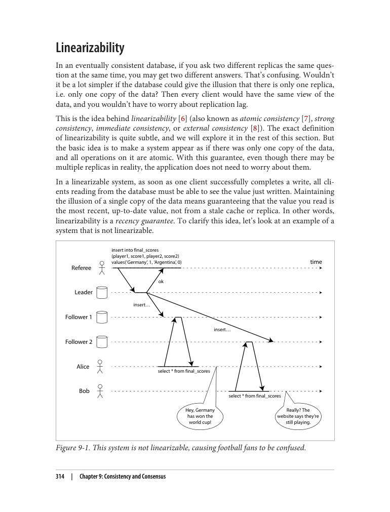

**Hình 9-1 – Hệ thống này không có tính khả tuyến tính, khiến người hâm mộ bóng đá bị bối rối (Figure 9-1. This system is not linearizable, causing football fans to be confused.)**

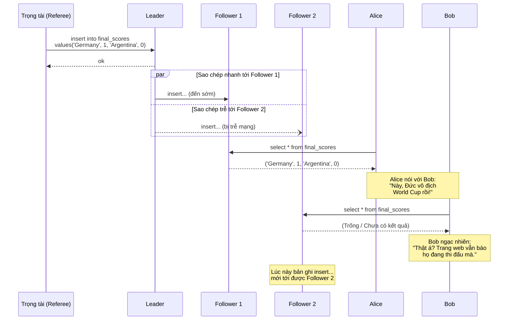

**Hình 9-1** cho thấy một ví dụ về một trang web tin tức thể thao không có tính khả tuyến tính [9]. Alice và Bob đang ngồi trong cùng một căn phòng, cả hai đều đang chăm chú nhìn vào điện thoại của mình để xem kết quả trận chung kết giải vô địch bóng đá thế giới World Cup 2014. Ngay sau khi tỷ số chung cuộc được công bố (Trọng tài ghi kết quả `Germany 1 - 0 Argentina` vào nút `Leader`), Alice làm mới (refresh) lại trang web, nhìn thấy đội chiến thắng được công bố (do truy vấn của cô được gửi vào `Follower 1` đã nhận được bản cập nhật), và hào hứng quay sang báo tin đó cho Bob. Bob bán tín bán nghi bấm nút tải lại (reload) trên chính chiếc điện thoại của mình, nhưng yêu cầu của anh lại được điều hướng tới một bản sao cơ sở dữ liệu đang bị trễ (`Follower 2`), và vì thế điện thoại của anh vẫn hiển thị rằng trận đấu đang diễn ra.

Nếu Alice và Bob cùng bấm nút tải lại vào *cùng một thời điểm*, thì sẽ chẳng có gì đáng ngạc nhiên nếu họ nhận được hai kết quả truy vấn khác nhau, bởi vì họ không hề biết chính xác vào thời điểm nào thì yêu cầu tương ứng của mỗi người được máy chủ xử lý. Tuy nhiên, Bob biết chắc chắn rằng anh đã bấm nút tải lại (khởi tạo truy vấn của mình) *sau khi* anh nghe thấy Alice reo lên thông báo tỷ số chung cuộc, và do đó anh hoàn toàn có lý khi kỳ vọng kết quả truy vấn của mình ít nhất phải mới bằng (as recent as) kết quả của Alice. Việc truy vấn của anh trả về một kết quả cũ kỹ (stale result) chính là một **sự vi phạm tính khả tuyến tính (violation of linearizability)**.

---

### Điều gì làm cho một hệ thống có tính khả tuyến tính? (What makes a system linearizable?)

Ý tưởng cơ bản đằng sau tính khả tuyến tính thì rất đơn giản: làm cho một hệ thống hoạt động như thể chỉ có duy nhất một bản sao của dữ liệu. Tuy nhiên, việc xác định một cách thật chuẩn xác và chặt chẽ điều đó thực sự có nghĩa là gì lại đòi hỏi sự cẩn trọng đáng kể. Để hiểu sâu hơn về tính khả tuyến tính, chúng ta hãy xem xét thêm một số ví dụ nữa.

**Hình 9-2** minh họa ba client cùng đồng thời (concurrently) đọc và ghi vào cùng một khóa `x` trong một cơ sở dữ liệu có tính khả tuyến tính. Trong các tài liệu nghiên cứu về hệ thống phân tán, `x` được gọi là một **thanh ghi (register)** — trong thực tế, nó có thể là một khóa (key) trong hệ lưu trữ key-value, một hàng (row) trong cơ sở dữ liệu quan hệ, hoặc một tài liệu (document) trong cơ sở dữ liệu tài liệu.

Để đơn giản hóa, **Hình 9-2** chỉ hiển thị các yêu cầu từ góc nhìn của các client, chứ không hiển thị cấu trúc nội bộ bên trong của cơ sở dữ liệu. Mỗi thanh ngang (bar) biểu diễn một yêu cầu được thực hiện bởi một client, trong đó điểm bắt đầu (cạnh trái) của thanh là thời điểm client gửi yêu cầu đi, và điểm kết thúc (cạnh phải) của thanh là thời điểm client nhận được phản hồi trả về. Do độ trễ mạng biến thiên không cố định, một client không thể biết chính xác vào khoảnh khắc nào cơ sở dữ liệu đã thực sự xử lý yêu cầu của mình — nó chỉ biết chắc rằng việc xử lý đó phải diễn ra tại một thời điểm nào đó nằm giữa lúc client gửi yêu cầu đi và lúc nhận được phản hồi về.<sup>i</sup>

> <sup>i</sup> Một chi tiết tinh tế của sơ đồ này là nó giả định sự tồn tại của một đồng hồ toàn cục (global clock), được biểu diễn bằng trục thời gian nằm ngang. Mặc dù các hệ thống thực tế thường không có các đồng hồ chính xác tuyệt đối (xem phần *"Đồng hồ không đáng tin cậy" — “Unreliable Clocks” ở trang 278* của Chương 8), nhưng giả định này hoàn toàn chấp nhận được: nhằm mục đích phân tích một thuật toán phân tán, chúng ta có thể giả vờ rằng có một đồng hồ toàn cục chính xác đang tồn tại, miễn là bản thân thuật toán đó không được phép truy cập vào chiếc đồng hồ toàn cục này [50]. Thay vào đó, thuật toán chỉ có thể nhìn thấy một giá trị xấp xỉ méo mó của thời gian thực, được tạo ra bởi bộ dao động thạch anh và giao thức NTP.

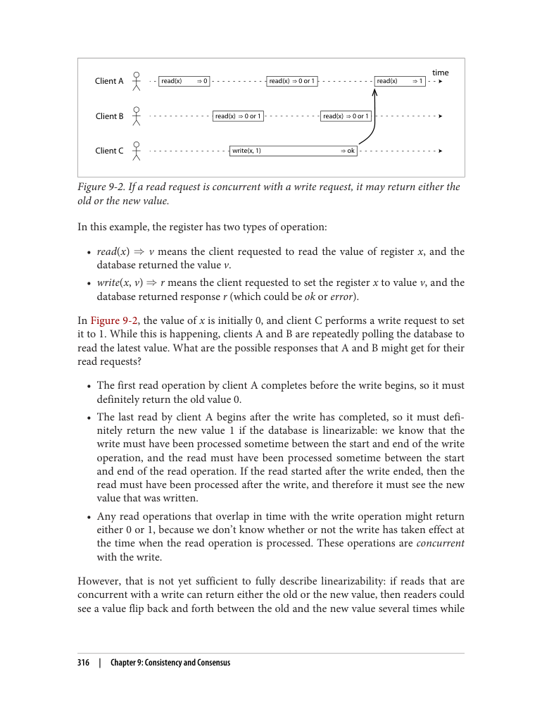

**Hình 9-2 – Nếu một yêu cầu đọc diễn ra đồng thời với một yêu cầu ghi, nó có thể trả về giá trị cũ hoặc giá trị mới (Figure 9-2. If a read request is concurrent with a write request, it may return either the old or the new value.)**

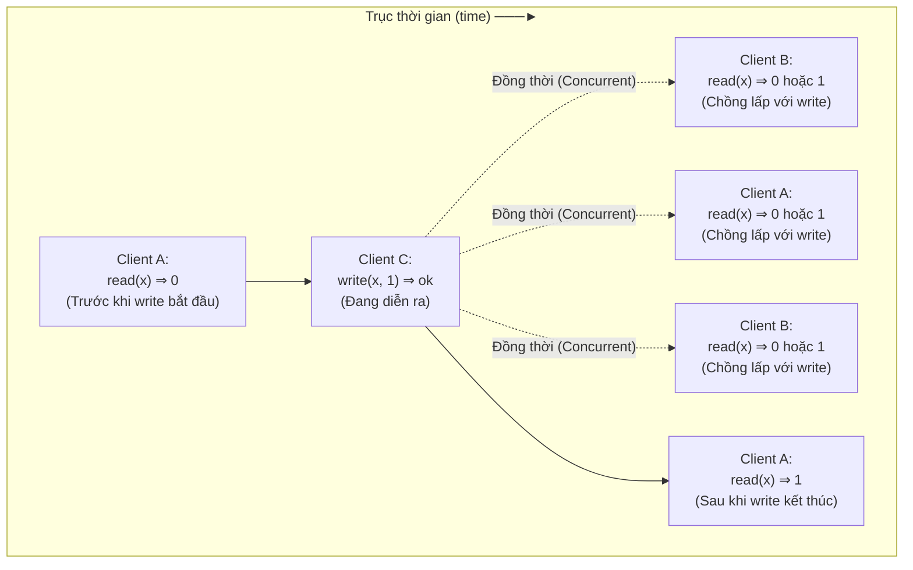

Trong ví dụ này, thanh ghi `x` có hai loại thao tác (operations):
- `read(x) ⇒ v` có nghĩa là client yêu cầu đọc giá trị của thanh ghi `x`, và cơ sở dữ liệu đã trả về giá trị `v`.
- `write(x, v) ⇒ r` có nghĩa là client yêu cầu thiết lập thanh ghi `x` thành giá trị `v`, và cơ sở dữ liệu đã trả về phản hồi `r` (có thể là `ok` hoặc `error`).

Trong **Hình 9-2**, giá trị của `x` ban đầu là `0`, và client C thực hiện một yêu cầu ghi để đặt nó thành `1`. Trong khi thao tác ghi này đang diễn ra, các client A và B liên tục thăm dò (polling) cơ sở dữ liệu để đọc giá trị mới nhất. Những phản hồi khả dĩ nào mà A và B có thể nhận được cho các yêu cầu đọc của mình?

- **Thao tác đọc đầu tiên của client A** hoàn tất *trước khi* thao tác ghi bắt đầu, vì vậy nó chắc chắn phải trả về giá trị cũ là `0`.
- **Thao tác đọc cuối cùng của client A** bắt đầu *sau khi* thao tác ghi đã hoàn tất, vì vậy nó chắc chắn phải trả về giá trị mới là `1` nếu cơ sở dữ liệu có tính khả tuyến tính: chúng ta biết rằng thao tác ghi phải được xử lý tại một thời điểm nào đó nằm giữa lúc bắt đầu và lúc kết thúc của thao tác ghi, và thao tác đọc cũng phải được xử lý tại một thời điểm nào đó nằm giữa lúc bắt đầu và lúc kết thúc của thao tác đọc. Nếu thao tác đọc bắt đầu sau khi thao tác ghi đã kết thúc, thì thao tác đọc bắt buộc phải được xử lý sau thao tác ghi, và do đó nó phải nhìn thấy giá trị mới vừa được ghi.
- **Bất kỳ thao tác đọc nào chồng lấp về mặt thời gian (overlap in time) với thao tác ghi** đều có thể trả về `0` hoặc `1`, bởi vì chúng ta không biết liệu thao tác ghi đã có hiệu lực hay chưa tại thời điểm thao tác đọc được xử lý. Những thao tác đọc này được gọi là diễn ra **đồng thời (concurrent)** với thao tác ghi.

Tuy nhiên, bấy nhiêu đó vẫn chưa đủ để mô tả trọn vẹn tính khả tuyến tính: nếu các thao tác đọc diễn ra đồng thời với một thao tác ghi có thể tùy ý trả về giá trị cũ hoặc giá trị mới, thì những người đọc có thể nhìn thấy một giá trị bị lật qua lật lại (flip back and forth) giữa giá trị cũ và giá trị mới nhiều lần trong khi một thao tác ghi đang diễn ra. Đó hoàn toàn không phải là những gì chúng ta kỳ vọng ở một hệ thống mô phỏng một “bản sao dữ liệu duy nhất”.<sup>ii</sup>

> <sup>ii</sup> Ngữ nghĩa này — trong đó các thao tác đọc có thể trả về giá trị cũ hoặc giá trị mới nếu chúng diễn ra đồng thời với một thao tác ghi (mà không cấm việc đọc thấy giá trị mới rồi lại đọc thấy giá trị cũ trong suốt thời gian ghi) — được biết đến trong lý thuyết hệ thống phân tán là một **thanh ghi thông thường (regular register)** [7, 30]. Ngược lại, một thanh ghi khả tuyến tính (linearizable register) được gọi là một **thanh ghi nguyên tử (atomic register)**.

Để làm cho hệ thống thực sự có tính khả tuyến tính, chúng ta cần bổ sung thêm một ràng buộc nữa, được minh họa trong **Hình 9-3**.

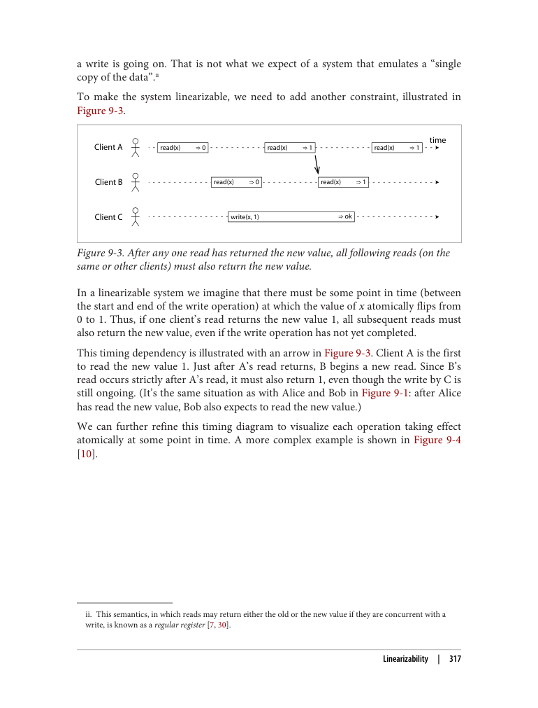

**Hình 9-3 – Sau khi bất kỳ một thao tác đọc nào đã trả về giá trị mới, tất cả các thao tác đọc tiếp theo (trên cùng client đó hoặc trên các client khác) cũng bắt buộc phải trả về giá trị mới (Figure 9-3. After any one read has returned the new value, all following reads (on the same or other clients) must also return the new value.)**

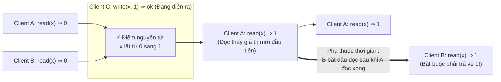

Trong một hệ thống có tính khả tuyến tính, chúng ta hình dung rằng phải tồn tại một thời điểm duy nhất nào đó (nằm giữa lúc bắt đầu và lúc kết thúc của thao tác ghi) mà tại đó giá trị của `x` lật một cách nguyên tử (atomically flips) từ `0` sang `1`. Do đó, nếu thao tác đọc của một client đã trả về giá trị mới là `1`, thì tất cả mọi thao tác đọc diễn ra sau đó (bắt đầu sau khi thao tác đọc kia kết thúc) cũng bắt buộc phải trả về giá trị mới `1`, ngay cả khi bản thân thao tác ghi của client C vẫn chưa kết thúc hoàn toàn.

Sự phụ thuộc về mặt thời gian này (timing dependency) được minh họa bằng mũi tên trong **Hình 9-3**. Client A là người đầu tiên đọc được giá trị mới `1`. Ngay sau khi thao tác đọc của A trả về kết quả, client B bắt đầu một thao tác đọc mới. Vì thao tác đọc của B diễn ra hoàn toàn *sau* thao tác đọc của A (theo thời gian thực), nó bắt buộc cũng phải trả về `1`, mặc dù thao tác ghi của C vẫn đang tiếp diễn. (Đây chính xác là tình huống tương tự như với Alice và Bob trong **Hình 9-1**: sau khi Alice đã đọc được giá trị mới và báo cho Bob, Bob bắt đầu đọc thì cũng kỳ vọng phải đọc được giá trị mới đó.)

Chúng ta có thể tinh chỉnh sơ đồ thời gian này sâu hơn nữa để trực quan hóa việc mỗi thao tác có hiệu lực một cách nguyên tử tại một thời điểm xác định (linearization point). Một ví dụ phức tạp hơn được thể hiện trong **Hình 9-4** [10].

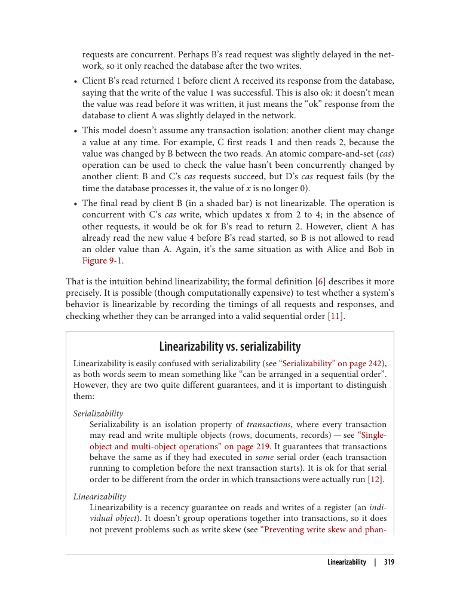

**Hình 9-4 – Trực quan hóa các thời điểm mà tại đó các thao tác đọc và ghi dường như đã có hiệu lực. Thao tác đọc cuối cùng của B không có tính khả tuyến tính (Figure 9-4. Visualizing the points in time at which the reads and writes appear to have taken effect. The final read by B is not linearizable.)**

```mermaid
flowchart LR
    subgraph DB["Trạng thái thanh ghi x theo trình tự tuyến tính (Linearization Order)"]
        direction LR
        S0["Khởi tạo:<br/>x = 0"]
        Op1["1. Client D:<br/>write(x, 0) ⇒ ok<br/>(x = 0)"]
        Op2["2. Client A:<br/>write(x, 1) ⇒ ok<br/>(x = 1)"]
        Op3["3. Client B:<br/>read(x) ⇒ 1"]
        Op4["4. Client C:<br/>read(x) ⇒ 1"]
        Op5["5. Client B:<br/>cas(x, 1, 2) ⇒ ok<br/>(x = 2)"]
        Op6["6. Client C:<br/>read(x) ⇒ 2"]
        Op7["7. Client C:<br/>cas(x, 2, 4) ⇒ ok<br/>(x = 4)"]
        Op8["8. Client D:<br/>cas(x, 0, 3) ⇒ error<br/>(Vì x=4 ≠ 0)"]
        Op9["9. Client A:<br/>read(x) ⇒ 4"]
        Op10["❌ 10. Client B:<br/>read(x) ⇒ 2<br/>(VI PHẠM: Đi ngược thời gian!)"]

        S0 --> Op1 --> Op2 --> Op3 --> Op4 --> Op5 --> Op6 --> Op7 --> Op8 --> Op9
        Op9 -. "B bắt đầu sau khi A đã đọc được 4,<br/>nhưng lại trả về 2!" .-> Op10
    end
```

Trong **Hình 9-4**, chúng ta bổ sung thêm một loại thao tác thứ ba bên cạnh `read` và `write`:
- `cas(x, v_old, v_new) ⇒ r` có nghĩa là client yêu cầu thực hiện một thao tác **so sánh và thiết lập nguyên tử (atomic compare-and-set operation)** (xem phần *"So sánh và thiết lập" — “Compare-and-set” ở trang 236* của Chương 7). Nếu giá trị hiện tại của thanh ghi `x` bằng `v_old`, nó sẽ được đặt một cách nguyên tử thành `v_new`. Nếu `x ≠ v_old` thì thao tác này phải giữ nguyên thanh ghi không thay đổi và trả về một lỗi (`error`). `r` là phản hồi của cơ sở dữ liệu (`ok` hoặc `error`).

Mỗi thao tác trong **Hình 9-4** được đánh dấu bằng một vạch thẳng đứng (nằm bên trong thanh ngang của từng thao tác) tại thời điểm mà chúng ta cho rằng thao tác đó đã thực sự được thực thi (điểm tuyến tính hóa — *linearization point*). Những vạch đánh dấu đó được nối lại với nhau theo một trình tự tuần tự, và kết quả thu được phải là một chuỗi hợp lệ các thao tác đọc và ghi đối với một thanh ghi (mọi thao tác đọc đều phải trả về giá trị được thiết lập bởi thao tác ghi gần nhất trước đó).

**Yêu cầu cốt lõi của tính khả tuyến tính** là các đường thẳng nối các vạch đánh dấu thao tác phải luôn luôn đi về phía trước theo chiều thời gian (từ trái sang phải), không bao giờ được phép đi lùi về phía sau. Điều đó đảm bảo tính chất đảm bảo độ mới (recency guarantee) mà chúng ta đã thảo luận trước đó: một khi một giá trị mới đã được ghi hoặc đã được đọc thấy, tất cả các thao tác đọc diễn ra sau đó đều phải nhìn thấy giá trị đã được ghi đó, cho đến khi nó bị ghi đè một lần nữa.

Có một vài chi tiết rất thú vị cần chỉ ra trong **Hình 9-4**:

1. **Thứ tự xử lý các yêu cầu đồng thời:** Đầu tiên client B gửi một yêu cầu đọc `x`, sau đó client D gửi một yêu cầu đặt `x` thành `0`, và tiếp đó client A gửi một yêu cầu đặt `x` thành `1`. Mặc dù vậy, giá trị trả về cho thao tác đọc của B lại là `1` (giá trị được ghi bởi A). Điều này hoàn toàn hợp lệ (`ok`): nó có nghĩa là cơ sở dữ liệu đã xử lý thao tác ghi của D trước tiên, sau đó xử lý thao tác ghi của A, và cuối cùng mới xử lý thao tác đọc của B. Mặc dù đây không phải là thứ tự mà các yêu cầu được gửi đi từ phía client, nhưng nó là một thứ tự hoàn toàn chấp nhận được, bởi vì cả ba yêu cầu này diễn ra **đồng thời (concurrent)** với nhau. Có lẽ yêu cầu đọc của B đã bị trễ một chút trên mạng, nên nó chỉ đến được cơ sở dữ liệu sau khi hai thao tác ghi kia đã hoàn tất.
2. **Đọc thấy giá trị trước khi người ghi nhận phản hồi:** Thao tác đọc của client B đã trả về `1` trước cả khi client A nhận được phản hồi từ cơ sở dữ liệu báo rằng việc ghi giá trị `1` đã thành công. Điều này cũng hoàn toàn hợp lệ: nó không có nghĩa là giá trị được đọc trước khi nó được ghi, mà chỉ đơn giản có nghĩa là gói tin phản hồi `"ok"` từ cơ sở dữ liệu gửi về cho client A đã bị trễ một chút trên đường truyền mạng.
3. **Không giả định cô lập giao dịch nhiều thao tác:** Mô hình này không giả định bất kỳ sự cô lập giao dịch (transaction isolation) nào: một client khác có thể thay đổi một giá trị vào bất kỳ lúc nào. Ví dụ, client C lúc đầu đọc được `1` và sau đó lại đọc được `2`, bởi vì giá trị của `x` đã bị thay đổi bởi client B ở khoảng giữa hai lần đọc của C. Một thao tác so sánh và thiết lập nguyên tử (`cas`) có thể được sử dụng để kiểm tra xem giá trị có bị thay đổi đồng thời bởi một client khác hay không: các yêu cầu `cas` của B (`cas(x, 1, 2)`) và của C (`cas(x, 2, 4)`) đều thành công, nhưng yêu cầu `cas` của D (`cas(x, 0, 3)`) lại thất bại (vì vào thời điểm cơ sở dữ liệu xử lý yêu cầu của D, giá trị của `x` đã không còn là `0` nữa).
4. **Thao tác vi phạm tính khả tuyến tính:** Thao tác đọc cuối cùng của client B (được tô bóng xám trên hình) **không có tính khả tuyến tính**. Thao tác này diễn ra đồng thời với thao tác ghi `cas` của C (vốn cập nhật `x` từ `2` lên `4`); nếu không có các yêu cầu khác, việc thao tác đọc của B trả về `2` sẽ là hoàn toàn hợp lệ. Tuy nhiên, client A đã đọc được giá trị mới `4` *trước khi* thao tác đọc của B bắt đầu, vì vậy B không được phép đọc ra một giá trị cũ hơn giá trị mà A đã thấy. Một lần nữa, đây lại chính là tình huống y hệt như của Alice và Bob trong **Hình 9-1** (đường nối điểm thực thi sẽ phải đi ngược thời gian từ phải sang trái).

Đó chính là trực giác đằng sau tính khả tuyến tính; định nghĩa toán học hình thức [6] (do Herlihy và Wing đưa ra năm 1990) mô tả nó một cách chính xác hơn. Chúng ta hoàn toàn có thể (mặc dù rất tốn kém về mặt tính toán — thuộc lớp bài toán NP-complete) kiểm tra xem hành vi của một hệ thống có đạt tính khả tuyến tính hay không bằng cách ghi nhận lại thời điểm bắt đầu và kết thúc của tất cả mọi yêu cầu và phản hồi, rồi kiểm tra xem liệu chúng có thể được sắp xếp thành một trình tự tuần tự hợp lệ hay không [11].

> 💡 **Ví dụ bổ sung (không có trong sách): Công cụ kiểm thử Jepsen và Knossos**
> Trong thực tế công nghiệp, làm sao để biết một cơ sở dữ liệu phân tán (như etcd, Consul, CockroachDB, MongoDB, Redis) có thực sự đảm bảo tính khả tuyến tính như lời quảng cáo hay không?
>
> Kỹ sư **Kyle Kingsbury (Aphyr)** đã tạo ra bộ công cụ kiểm thử nổi tiếng mang tên **Jepsen** (và trình kiểm tra mô hình **Knossos** / **Elle**):
> 1. Jepsen khởi chạy một cụm cơ sở dữ liệu gồm 5 nút và cho các tiến trình client ảo liên tục bắn các thao tác `read`, `write`, `cas` vào một thanh ghi `x`.
> 2. Trong lúc đó, tiến trình **Nemesis** liên tục gây rối: cắt kết nối mạng (network partition) bằng `iptables`, làm lệch đồng hồ hệ thống, đóng băng tiến trình bằng tín hiệu `SIGSTOP`/`SIGCONT`, hoặc giết tiến trình (`kill -9`).
> 3. Mọi lịch sử gọi hàm (invocation) và nhận phản hồi (response) đều được ghi lại kèm dấu thời gian точно như **Hình 9-4**.
> 4. Sau đó, trình kiểm tra sẽ thử tìm xem có tồn tại một đường gấp khúc đi từ trái sang phải nối tất cả các thao tác sao cho hợp lệ với quy tắc của một thanh ghi đơn hay không. Nếu mọi cách sắp xếp đều buộc đường nối phải đi lùi thời gian (như thao tác đọc cuối cùng của B trong **Hình 9-4**), Jepsen sẽ kết luận hệ thống **vi phạm tính khả tuyến tính** và xuất ra biểu đồ phản ví dụ!

---

#### Tính khả tuyến tính so với tính khả tuần tự (Linearizability vs. serializability)

Tính khả tuyến tính (linearizability) cực kỳ dễ bị nhầm lẫn với **tính khả tuần tự (serializability)** (xem phần *"Tính khả tuần tự" — “Serializability” ở trang 242* của Chương 7), bởi vì cả hai từ này nghe qua đều có vẻ mang ý nghĩa đại loại như “có thể được sắp xếp theo một trình tự tuần tự”. Tuy nhiên, chúng là hai đảm bảo hoàn toàn khác biệt nhau, và việc phân biệt rạch ròi giữa chúng là vô cùng quan trọng:

- **Tính khả tuần tự (Serializability):**
  Là một **thuộc tính cô lập (isolation property) của các giao dịch (transactions)**, trong đó mỗi giao dịch có thể đọc và ghi *nhiều đối tượng* khác nhau (nhiều hàng, nhiều tài liệu, nhiều bản ghi) — xem phần *"Thao tác đơn đối tượng và đa đối tượng" (“Single-object and multi-object operations” ở trang 219)*. Nó đảm bảo rằng các giao dịch hoạt động giống hệt như thể chúng đã được thực thi theo một *trình tự nối tiếp (serial order)* nào đó (mỗi giao dịch chạy trọn vẹn từ đầu đến cuối trước khi giao dịch tiếp theo bắt đầu). Trình tự nối tiếp đó **hoàn toàn có thể khác** với thứ tự thời gian thực mà các giao dịch thực sự được chạy [12].

- **Tính khả tuyến tính (Linearizability):**
  Là một **đảm bảo về tính mới nhất (recency guarantee) trên các thao tác đọc và ghi của một thanh ghi (một đối tượng đơn lẻ — an individual object)**. Nó không gom nhóm các thao tác lại với nhau thành các giao dịch, vì vậy tự bản thân nó **không** ngăn chặn được các vấn đề như hiện tượng *lệch ghi (write skew)* (xem phần *"Ngăn chặn lệch ghi và bóng ma" — “Preventing write skew and phantoms” ở trang 237* cùng sơ đồ bác sĩ trực ca ở **Hình 7-8**), trừ khi bạn thực hiện thêm các biện pháp bổ sung như hiện thực hóa các xung đột (xem phần *"Hiện thực hóa các xung đột" — “Materializing conflicts” ở trang 242*).

Một cơ sở dữ liệu có thể cung cấp **cả hai** tính chất: vừa có tính khả tuần tự (serializability) vừa có tính khả tuyến tính (linearizability), và sự kết hợp này được biết đến với tên gọi **tính khả tuần tự nghiêm ngặt (strict serializability)** hay **tính khả tuần tự một bản sao mạnh (strong one-copy serializability — strong-1SR)** [4, 13]. Các bản triển khai tính khả tuần tự dựa trên cơ chế **khóa hai pha (two-phase locking — 2PL)** (xem phần *"Khóa hai pha (2PL)"* ở trang 248) hoặc **thực thi tuần tự thực sự (actual serial execution)** (xem phần *"Thực thi tuần tự thực sự"* ở trang 243) thường có tính khả tuyến tính.

Tuy nhiên, **cô lập bản chụp khả tuần tự (serializable snapshot isolation — SSI)** (xem phần *"Cô lập bản chụp khả tuần tự (SSI)"* ở trang 252) lại **không có tính khả tuyến tính**: theo đúng thiết kế, nó thực hiện các thao tác đọc từ một bản chụp nhất quán (consistent snapshot) để tránh sự tranh chấp khóa giữa người đọc và người ghi. Toàn bộ ý nghĩa của một bản chụp nhất quán là nó không bao gồm các thao tác ghi mới hơn thời điểm tạo bản chụp đó, và do vậy các thao tác đọc từ bản chụp sẽ không có tính khả tuyến tính (nếu giao dịch T2 bắt đầu sau khi T1 đã commit xong, nhưng T2 đọc từ một snapshot cũ hơn thì T2 sẽ không thấy kết quả của T1).

> 📝 **Giải thích thêm (không có trong sách): Bảng so sánh trực diện Serializability vs. Linearizability vs. Strict Serializability**
>
> Để không bao giờ nhầm lẫn hai khái niệm này trong các buổi phỏng vấn thiết kế hệ thống (System Design) hay khi đọc tài liệu cơ sở dữ liệu, hãy ghi nhớ bảng tổng hợp sau:
>
> | Tiêu chí | Linearizability (Tính khả tuyến tính) | Serializability (Tính khả tuần tự) | Strict Serializability (Strong-1SR) |
> | :--- | :--- | :--- | :--- |
> | **Nguồn gốc cộng đồng** | Cộng đồng Hệ thống phân tán (Herlihy & Wing, 1990) | Cộng đồng Cơ sở dữ liệu (Papadimitriou, 1979) | Giao thoa giữa DB và Hệ thống phân tán |
> | **Phạm vi tác động** | **Đơn đối tượng (Single object / Register):** từng key, từng row độc lập. | **Đa đối tượng (Multi-object Transaction):** giao dịch gồm nhiều lệnh đọc/ghi trên nhiều bảng/hàng. | **Đa đối tượng + Thời gian thực:** Giao dịch trên nhiều đối tượng. |
> | **Ràng buộc thời gian thực (Real-time order)** | **CÓ.** Nếu thao tác B bắt đầu sau khi thao tác A kết thúc ngoài đời thực, B bắt buộc phải xếp sau A. | **KHÔNG.** Giao dịch T2 chạy sau T1 ngoài đời thực vẫn có thể được sắp xếp đứng *trước* T1 trong thứ tự tuần tự ảo (như trong SSI). | **CÓ.** Nếu giao dịch T2 bắt đầu sau khi T1 đã commit xong ngoài đời thực, T2 bắt buộc phải thấy dữ liệu của T1. |
> | **Chống được Write Skew (Hình 7-8) hay Dirty Read (Hình 7-6)?** | **Không** chống được Write Skew (vì không có khái niệm giao dịch nhiều bước). | **Có**, chống được mọi dị thường giao dịch (Dirty Read, Lost Update, Write Skew, Phantom). | **Có**, chống được cả dị thường giao dịch lẫn đọc dữ liệu cũ (stale read) xuyên phiên. |
> | **Ví dụ hệ thống thực tế** | `etcd`, `ZooKeeper` (khi dùng `sync` + `read`), DynamoDB (Strong Read trên 1 item). | PostgreSQL ở mức `SERIALIZABLE` (dùng thuật toán SSI trên một nút hoặc có replica đọc snapshot). | Google Cloud Spanner (nhờ TrueTime), FoundationDB, VoltDB, MySQL InnoDB (2PL trên 1 nút). |


---

### Dựa vào tính khả tuyến tính (Relying on linearizability)

Trong những hoàn cảnh nào thì tính khả tuyến tính thực sự hữu ích? Việc xem tỷ số chung cuộc của một trận thi đấu thể thao (như ở **Hình 9-1**) có lẽ chỉ là một ví dụ mang tính giải trí vụn vặt: một kết quả bị chậm trễ vài giây hầu như chẳng gây ra bất kỳ tổn hại thực sự nào trong tình huống đó. Tuy nhiên, có một số lĩnh vực mà trong đó tính khả tuyến tính là một yêu cầu sống còn để giúp hệ thống hoạt động chính xác.

#### Khóa và bầu chọn leader (Locking and leader election)

Một hệ thống sử dụng sao chép một leader (single-leader replication) cần phải đảm bảo rằng thực sự chỉ có duy nhất một leader tại một thời điểm, chứ không phải là vài leader cùng lúc (tình trạng não đôi — *split brain*). Một cách phổ biến để bầu chọn ra một leader là sử dụng một chiếc **khóa (lock)**: mỗi nút khi khởi động lên đều cố gắng giành lấy (acquire) chiếc khóa đó, và nút nào giành được khóa thành công sẽ trở thành leader [14]. Bất kể chiếc khóa này được triển khai cụ thể ra sao, nó **bắt buộc phải có tính khả tuyến tính**: tất cả các nút đều phải thống nhất tuyệt đối xem nút nào đang nắm giữ chiếc khóa, nếu không thì chiếc khóa đó hoàn toàn vô dụng.

Các dịch vụ điều phối (coordination services) như **Apache ZooKeeper** [15] và **etcd** [16] thường xuyên được sử dụng để triển khai các khóa phân tán (distributed locks) và bầu chọn leader (leader election). Chúng sử dụng các thuật toán đồng thuận (consensus algorithms) để triển khai các thao tác có tính khả tuyến tính theo một cách thức có khả năng chịu lỗi (chúng ta sẽ thảo luận chi tiết các thuật toán như vậy ở phần sau của chương này, trong mục *"Đồng thuận chịu lỗi" — “Fault-tolerant consensus” ở trang 355*).<sup>iii</sup> Vẫn còn rất nhiều chi tiết tinh vi để có thể triển khai khóa và bầu chọn leader một cách hoàn toàn đúng đắn (xem ví dụ về vấn đề rào chắn *fencing token* trong phần *"Leader và khóa" — “The leader and the lock” ở trang 293* và sơ đồ minh họa ở **Hình 8-3**), và các thư viện cấp cao như **Apache Curator** [17] giúp ích rất nhiều bằng cách cung cấp sẵn các công thức (recipes) ở mức trừu tượng cao hơn bên trên ZooKeeper. Tuy nhiên, một dịch vụ lưu trữ có tính khả tuyến tính vẫn luôn là nền tảng cơ bản nhất cho các tác vụ điều phối này.

> <sup>iii</sup> Nói một cách thật chặt chẽ, ZooKeeper và etcd cung cấp các thao tác **ghi có tính khả tuyến tính (linearizable writes)**, nhưng các thao tác **đọc có thể bị cũ (stale reads)**, bởi vì theo mặc định chúng có thể được phục vụ bởi bất kỳ bản sao (replica) nào. Bạn có thể tùy chọn yêu cầu một thao tác đọc có tính khả tuyến tính: etcd gọi đây là một thao tác *đọc đa số (quorum read)* [16] (và hiện nay là mặc định trong etcd v3), còn trong ZooKeeper bạn cần phải gọi hàm `sync()` trước khi thực hiện lệnh `read` [15] — xem phần *"Triển khai lưu trữ khả tuyến tính bằng phát quảng bá có thứ tự toàn phần" (“Implementing linearizable storage using total order broadcast” ở trang 340)*.

Khóa phân tán cũng được sử dụng ở mức độ chi tiết (granular) hơn rất nhiều trong một số cơ sở dữ liệu phân tán đặc thù, chẳng hạn như **Oracle Real Application Clusters (RAC)** [18]. Oracle RAC sử dụng một khóa cho mỗi trang đĩa (lock per disk page), với nhiều nút cùng chia sẻ quyền truy cập vào cùng một hệ thống lưu trữ đĩa vật lý chung (shared-disk architecture). Bởi vì những chiếc khóa có tính khả tuyến tính này nằm ngay trên đường găng tới hạn (critical path) của việc thực thi giao dịch, nên các hệ thống triển khai RAC thường phải trang bị một mạng kết nối nội bộ chuyên dụng (dedicated cluster interconnect network — chẳng hạn như InfiniBand tốc độ cao, độ trễ cực thấp) dành riêng cho việc giao tiếp giữa các nút cơ sở dữ liệu.

#### Các ràng buộc và đảm bảo tính duy nhất (Constraints and uniqueness guarantees)

Các ràng buộc duy nhất (uniqueness constraints) xuất hiện vô cùng phổ biến trong các cơ sở dữ liệu: chẳng hạn, một tên người dùng (username) hoặc một địa chỉ email phải định danh duy nhất cho một người dùng, và trong một dịch vụ lưu trữ tập tin thì không thể tồn tại hai tập tin có cùng đường dẫn (path) và cùng tên tập tin (filename). Nếu bạn muốn cưỡng chế thực thi (enforce) ràng buộc này ngay tại thời điểm dữ liệu được ghi vào (tức là nếu có hai người cố gắng tạo đồng thời một tài khoản người dùng hoặc một tập tin với cùng một cái tên, một trong hai người sẽ ngay lập tức nhận về một thông báo lỗi), thì bạn **bắt buộc phải có tính khả tuyến tính**. Tình huống này trên thực tế rất giống với việc giành một chiếc khóa: khi một người dùng đăng ký dịch vụ của bạn, bạn có thể hình dung rằng họ đang giành lấy một “chiếc khóa” đối với tên người dùng mà họ đã chọn.

Những vấn đề tương tự cũng nảy sinh nếu bạn muốn đảm bảo rằng số dư tài khoản ngân hàng không bao giờ bị âm, hoặc đảm bảo rằng bạn không bán số lượng mặt hàng nhiều hơn số lượng thực có trong kho hàng (warehouse), hoặc hai người không thể đặt trùng cùng một chỗ ngồi trên một chuyến bay hay trong một rạp hát vào cùng một lúc. Tất cả những ràng buộc này đều đòi hỏi phải có một giá trị cập nhật mới nhất duy nhất (số dư tài khoản, mức tồn kho, trạng thái ghế ngồi) mà tất cả mọi nút đều đồng thuận với nhau.

Tuy nhiên, trong những tình huống thực tế này, đôi khi bạn cũng có thể xoay xở mà không cần đến tính khả tuyến tính nghiêm ngặt:
- Nếu hai người cùng đồng thời đăng ký một tên người dùng giống nhau hoặc đặt trùng cùng một ghế ngồi, bạn có thể gửi cho một trong hai người một bức email xin lỗi, và đề nghị họ chọn một tên khác hoặc một ghế khác. Kiểu thay đổi nhằm khắc phục một sai sót đã xảy ra như thế này được gọi là một **giao dịch đền bù (compensating transaction)** [19, 20].
- Nếu khách hàng đặt mua nhiều mặt hàng hơn số lượng bạn hiện có trong kho, bạn có thể nhập bổ sung thêm hàng về kho, gửi lời xin lỗi tới khách hàng vì sự chậm trễ giao hàng, và tặng kèm cho họ một mã giảm giá. Thực ra đây cũng chính xác là những gì bạn đằng nào cũng sẽ phải làm nếu chẳng may có một chiếc xe nâng hàng (fork-lift truck) trong kho vô tình cán hỏng mất một món hàng, khiến cho số lượng hàng thực tế trong kho ít hơn con số mà hệ thống máy tính tưởng là đang có [21]. Do đó, quy trình xin lỗi khách hàng (apology workflow) đằng nào cũng đã phải là một phần bắt buộc trong quy trình nghiệp vụ kinh doanh của bạn rồi, và vì thế việc đòi hỏi một ràng buộc khả tuyến tính tốn kém lên số lượng hàng tồn kho có thể là không thực sự cần thiết.
- Nếu ai đó rút số tiền nhiều hơn số dư hiện có trong tài khoản của họ (chẳng hạn do rút tiền tại các cây ATM offline), ngân hàng hoàn toàn có thể tính cho họ một khoản phí phạt thấu chi (overdraft penalty fee) và "cười tươi trên đường tới nhà băng" [22]. Bằng cách giới hạn hạn mức tối đa có thể rút mỗi ngày, rủi ro đối với ngân hàng luôn nằm trong tầm kiểm soát [23].

Các loại ràng buộc khác trong cơ sở dữ liệu, chẳng hạn như ràng buộc khóa ngoại (foreign key constraints) hoặc ràng buộc thuộc tính (attribute constraints — ví dụ kiểm tra giá trị cột phải là số dương), hoàn toàn có thể được triển khai mà không đòi hỏi tính khả tuyến tính [24].

#### Sự phụ thuộc thời gian xuyên kênh (Cross-channel timing dependencies)

Hãy chú ý tới một chi tiết rất quan trọng trong **Hình 9-1**: nếu như Alice không reo lên thông báo tỷ số cho Bob nghe, thì Bob sẽ chẳng bao giờ biết được rằng kết quả truy vấn trên điện thoại của anh ấy đã bị cũ (stale). Anh ấy sẽ chỉ đơn giản là làm mới lại trang web một lần nữa sau đó vài giây, và cuối cùng cũng nhìn thấy tỷ số chung cuộc. Sự vi phạm tính khả tuyến tính chỉ bị phát hiện ra bởi vì có sự tồn tại của một **kênh giao tiếp bổ sung (additional communication channel)** bên trong hệ thống (giọng nói của Alice truyền qua không khí tới tai của Bob).

Những tình huống hoàn toàn tương tự có thể phát sinh ngay bên trong các hệ thống máy tính. Ví dụ, giả sử bạn có một trang web nơi người dùng có thể tải lên (upload) một bức ảnh, và một tiến trình chạy ngầm (background process) sẽ thay đổi kích thước (resize) các bức ảnh đó xuống độ phân giải thấp hơn để tải về nhanh hơn (tạo ảnh thu nhỏ — *thumbnails*). Kiến trúc và luồng dữ liệu của hệ thống này được minh họa trong **Hình 9-5**.

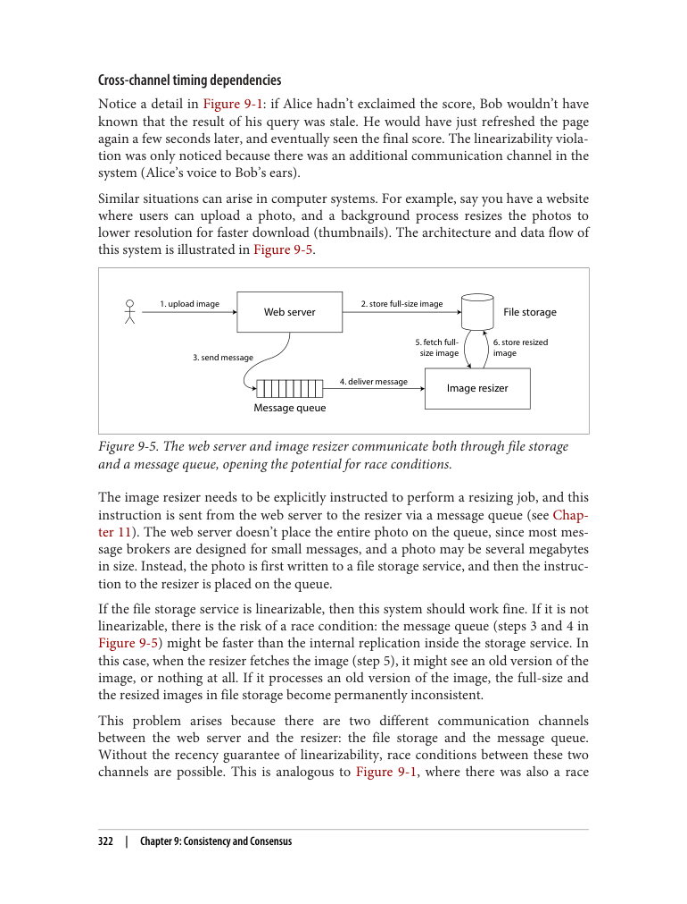

**Hình 9-5 – Máy chủ web và bộ thu nhỏ ảnh giao tiếp với nhau qua cả dịch vụ lưu trữ tập tin lẫn hàng đợi thông điệp, mở ra nguy cơ xảy ra các điều kiện tranh chấp (Figure 9-5. The web server and image resizer communicate both through file storage and a message queue, opening the potential for race conditions.)**

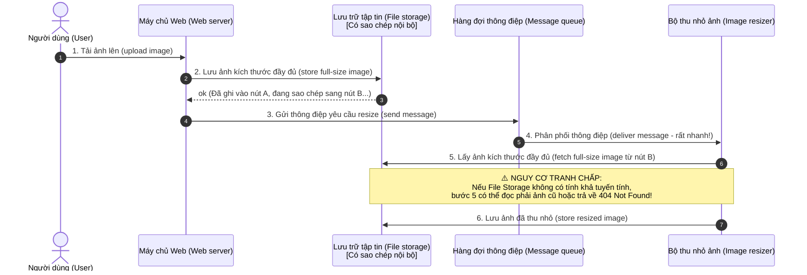

Bộ thu nhỏ ảnh (image resizer) cần phải được ra lệnh một cách tường minh để thực hiện một tác vụ thu nhỏ ảnh, và chỉ thị này được gửi từ máy chủ web tới bộ thu nhỏ ảnh thông qua một **hàng đợi thông điệp (message queue)** (xem Chương 11). Máy chủ web không đặt toàn bộ bức ảnh nặng nề lên hàng đợi, bởi vì hầu hết các trình môi giới thông điệp (message brokers) được thiết kế tối ưu cho các thông điệp nhỏ, trong khi một bức ảnh có thể có dung lượng lên tới vài megabyte. Thay vào đó, bức ảnh trước tiên được ghi vào một **dịch vụ lưu trữ tập tin (file storage service)** (Bước 2), và sau khi ghi xong thì chỉ thị yêu cầu thu nhỏ ảnh (chứa đường dẫn/ID bức ảnh) mới được đẩy vào hàng đợi (Bước 3).

Nếu dịch vụ lưu trữ tập tin có **tính khả tuyến tính**, thì hệ thống này sẽ hoạt động hoàn toàn trơn tru. Nhưng nếu dịch vụ lưu trữ tập tin **không** có tính khả tuyến tính, sẽ xuất hiện nguy cơ xảy ra một **điều kiện tranh chấp (race condition)**: hàng đợi thông điệp (các bước 3 và 4 trong **Hình 9-5**) có thể chuyển tin nhắn nhanh hơn quá trình sao chép nội bộ (internal replication) bên trong dịch vụ lưu trữ tập tin. Trong trường hợp này, khi bộ thu nhỏ ảnh tìm nạp bức ảnh (bước 5), nó có thể nhìn thấy một phiên bản cũ của bức ảnh đó, hoặc chẳng thấy bức ảnh nào cả (lỗi `404 File Not Found`). Nếu nó xử lý một phiên bản cũ của bức ảnh, thì bức ảnh kích thước đầy đủ và bức ảnh thu nhỏ trong kho lưu trữ tập tin sẽ trở nên không nhất quán với nhau vĩnh viễn!

Vấn đề này phát sinh bởi vì có **hai kênh giao tiếp khác nhau** nằm giữa máy chủ web và bộ thu nhỏ ảnh: kênh *lưu trữ tập tin* và kênh *hàng đợi thông điệp*. Nếu không có đảm bảo về tính mới nhất (recency guarantee) của tính khả tuyến tính, các điều kiện tranh chấp giữa hai kênh này là hoàn toàn có thể xảy ra. Tình huống này hoàn toàn tương đồng với **Hình 9-1**, nơi cũng xảy ra một cuộc chạy đua giữa hai kênh giao tiếp: quá trình sao chép cơ sở dữ liệu, và kênh âm thanh ngoài đời thực giữa miệng của Alice và tai của Bob.

Tính khả tuyến tính không phải là cách duy nhất để tránh điều kiện tranh chấp này, nhưng nó là cách đơn giản và dễ hiểu nhất. Nếu bạn kiểm soát được kênh giao tiếp bổ sung (như trong trường hợp hàng đợi thông điệp, chứ không phải trong trường hợp giọng nói của Alice và Bob), bạn có thể sử dụng các cách tiếp cận thay thế tương tự như những gì chúng ta đã thảo luận trong phần *"Đọc những gì bạn vừa ghi" (“Reading your own writes” ở trang 156* của Chương 5 — ví dụ như đính kèm phiên bản/vị trí log của file vào trong thông điệp gửi qua queue, hoặc chỉ đọc từ nút lưu trữ chính), với cái giá phải trả là sự phức tạp tăng thêm trong mã nguồn ứng dụng.

> 💡 **Ví dụ bổ sung (không có trong sách): Lỗi thực tế với AWS S3 (trước tháng 12/2020) và bài toán Database + Kafka/RabbitMQ**
> Tình huống ở **Hình 9-5** là một trong những lỗi kinh điển nhất mà các kỹ sư Backend hay gặp phải trong thực tế:
>
> 1. **Câu chuyện lịch sử của Amazon S3:** Trước tháng 12 năm 2020, Amazon S3 chỉ đảm bảo *read-after-write consistency* cho các object mới tạo, nhưng nếu bạn **ghi đè (overwrite)** một file ảnh đã tồn tại (`PUT` cùng một key) hoặc gọi `GET` trước khi `PUT` (negative caching), S3 chỉ cung cấp *eventual consistency*. Rất nhiều pipeline xử lý ảnh/video và ETL dữ liệu dùng S3 + SQS/Kafka đã gặp đúng lỗi ở **Hình 9-5**: Worker nhận được sự kiện từ SQS xong gọi lên S3 thì đọc phải file cũ hoặc nhận lỗi `NoSuchKey`. Đến tháng 12/2020, AWS đã nâng cấp kiến trúc nội bộ của S3 để cung cấp **Strong Read-After-Write Consistency (Linearizable Reads/Writes)** cho mọi thao tác đọc/ghi object mà không tăng chi phí, giải cứu hàng triệu hệ thống khỏi lỗi race condition xuyên kênh này.
> 2. **Lỗi kinh điển với PostgreSQL Read Replica + RabbitMQ/Kafka:** Một Web API thực hiện `UPDATE orders SET status = 'PAID' WHERE id = 100` trên PostgreSQL **Primary (Leader)**, commit xong xuôi rồi bắn ngay một message `{"order_id": 100}` vào RabbitMQ. Consumer nhận message trong vòng 1ms và thực hiện câu lệnh `SELECT * FROM orders WHERE id = 100` nhưng lại trỏ vào **Read Replica (Follower)** để giảm tải cho Primary. Vì độ trễ sao chép (replication lag) của PostgreSQL mất khoảng 5ms, Consumer đọc ra `status = 'PENDING'` (dữ liệu cũ) và bỏ qua việc xuất hóa đơn! Giải pháp là Consumer bắt buộc phải đọc từ Primary (đảm bảo tính khả tuyến tính cho luồng xử lý đó), hoặc truyền toàn bộ dữ liệu cần thiết ngay bên trong payload của message (pattern *Event-Carried State Transfer*).

---

### Triển khai các hệ thống khả tuyến tính (Implementing linearizable systems)

Bây giờ, sau khi chúng ta đã xem xét một vài ví dụ thực tế mà trong đó tính khả tuyến tính tỏ ra vô cùng hữu ích, hãy cùng suy nghĩ xem làm thế nào chúng ta có thể triển khai một hệ thống cung cấp ngữ nghĩa khả tuyến tính (linearizable semantics).

Bởi vì tính khả tuyến tính về bản chất có nghĩa là *“hãy hành xử như thể chỉ có duy nhất một bản sao của dữ liệu, và mọi thao tác trên đó đều là nguyên tử”*, nên câu trả lời đơn giản nhất sẽ là: thực sự chỉ sử dụng duy nhất một bản sao dữ liệu trên một máy chủ đơn lẻ! Tuy nhiên, cách tiếp cận đó sẽ hoàn toàn không có khả năng chịu lỗi (not fault-tolerant): nếu nút nắm giữ bản sao duy nhất đó gặp sự cố, dữ liệu sẽ bị mất (hoặc ít nhất là không thể truy cập được cho đến khi nút đó được khởi động trở lại).

Cách tiếp cận phổ biến nhất để làm cho một hệ thống có khả năng chịu lỗi là sử dụng **sao chép (replication)**. Chúng ta hãy cùng nhìn lại các phương pháp sao chép từ Chương 5, và so sánh xem liệu chúng có thể được làm cho có tính khả tuyến tính hay không:

- **Sao chép một leader (Single-leader replication — có tiềm năng đạt tính khả tuyến tính / potentially linearizable):**
  Trong một hệ thống có sao chép một leader (xem phần *"Leaders và Followers" — “Leaders and Followers” ở trang 146*), nút leader nắm giữ bản sao chính (primary copy) của dữ liệu được sử dụng cho mọi thao tác ghi, còn các nút follower duy trì các bản sao lưu dự phòng (backup copies) của dữ liệu trên các nút khác. Nếu bạn thực hiện các thao tác đọc trực tiếp từ nút leader, hoặc từ các nút follower được cập nhật một cách **đồng bộ (synchronously updated)**, thì chúng *có tiềm năng (potential)* đạt được tính khả tuyến tính.<sup>iv</sup> Tuy nhiên, không phải mọi cơ sở dữ liệu một leader đều thực sự có tính khả tuyến tính trên thực tế, có thể là do chủ đích thiết kế (ví dụ: vì nó sử dụng cơ chế cô lập bản chụp — *snapshot isolation*) hoặc do các lỗi lập trình đồng thời (concurrency bugs) [10].

  Việc sử dụng nút leader để phục vụ các thao tác đọc dựa trên một giả định sống còn rằng bạn biết chắc chắn 100% ai đang là leader. Như đã thảo luận trong phần *"Sự thật được định nghĩa bởi đa số" (“The truth is defined by the majority” ở trang 292* của Chương 8), hoàn toàn có khả năng một nút tự tưởng rằng mình vẫn đang là leader, trong khi thực tế nó đã bị phế truất — và nếu vị "leader hoang tưởng" (delusional leader) này vẫn tiếp tục phục vụ các yêu cầu đọc, nó chắc chắn sẽ vi phạm tính khả tuyến tính [25]. Với sao chép bất đồng bộ (asynchronous replication), quá trình chuyển đổi dự phòng (failover) thậm chí còn có thể làm mất các dữ liệu đã cam kết (xem phần *"Xử lý sự cố ngừng hoạt động của nút"* ở trang 150), điều này vi phạm đồng thời cả tính bền vững (durability) lẫn tính khả tuyến tính (linearizability).

> <sup>iv</sup> Việc phân mảnh (partitioning / sharding) một cơ sở dữ liệu một leader — sao cho có một leader riêng biệt cho mỗi phân vùng (partition) — hoàn toàn không làm ảnh hưởng đến tính khả tuyến tính, bởi vì tính khả tuyến tính vốn chỉ là một đảm bảo trên từng đối tượng đơn lẻ (single-object guarantee). Các giao dịch xuyên nhiều phân vùng (cross-partition transactions) lại là một vấn đề hoàn toàn khác (xem phần *"Giao dịch phân tán và Đồng thuận" — “Distributed Transactions and Consensus” ở trang 343*).

- **Các thuật toán đồng thuận (Consensus algorithms — có tính khả tuyến tính / linearizable):**
  Một số thuật toán đồng thuận, thứ mà chúng ta sẽ thảo luận chi tiết ở phần sau của chương này, mang nhiều nét tương đồng với mô hình sao chép một leader. Tuy nhiên, các giao thức đồng thuận có chứa những cơ chế chặt chẽ để ngăn chặn triệt để tình trạng não đôi (split-brain) và các bản sao cũ (stale replicas). Nhờ những chi tiết thiết kế này, các thuật toán đồng thuận có thể triển khai hệ thống lưu trữ có tính khả tuyến tính một cách an toàn. Đây chính là cách thức hoạt động của **ZooKeeper** [26] và **etcd** [27], chẳng hạn.

- **Sao chép đa leader (Multi-leader replication — không có tính khả tuyến tính / not linearizable):**
  Các hệ thống sử dụng sao chép đa leader nhìn chung **không có tính khả tuyến tính**, bởi vì chúng xử lý đồng thời các thao tác ghi trên nhiều nút khác nhau và sao chép chúng một cách bất đồng bộ (asynchronously) sang các nút khác. Vì lý do này, chúng có thể tạo ra các thao tác ghi xung đột nhau đòi hỏi phải có cơ chế phân giải (xem phần *"Xử lý xung đột ghi" — “Handling write conflicts” ở trang 164*).

- **Sao chép không có leader (Leaderless replication — nhiều khả năng không có tính khả tuyến tính / probably not linearizable):**
  Đối với các hệ thống sử dụng sao chép không có leader (kiểu Dynamo, xem phần *"Sao chép không có leader" — “Leaderless replication” ở trang 171*), đôi khi mọi người vẫn tuyên bố rằng bạn có thể đạt được “tính nhất quán mạnh (strong consistency)” bằng cách yêu cầu đọc và ghi theo đa số quorum (`w + r > n`). Tùy thuộc vào cấu hình chính xác của các quorum, và tùy thuộc vào cách bạn định nghĩa thế nào là tính nhất quán mạnh, tuyên bố này không hoàn toàn đúng sự thật.

  Các phương pháp giải quyết xung đột theo kiểu “ghi sau cùng sẽ thắng” (*Last write wins — LWW*) dựa trên đồng hồ thời gian thực trong ngày (ví dụ như trong **Cassandra**, xem phần *"Dựa vào các đồng hồ được đồng bộ hóa" — “Relying on synchronized clocks” ở trang 282* của Chương 8) gần như chắc chắn **không có tính khả tuyến tính**, bởi vì các dấu thời gian của đồng hồ không thể được đảm bảo là nhất quán với thứ tự diễn ra sự kiện thực tế do độ lệch đồng hồ (clock skew). Các quorum lỏng lẻo (*Sloppy quorums*, xem phần *"Quorum lỏng lẻo và chuyển giao gợi ý"* ở trang 177) cũng phá hủy mọi cơ hội đạt được tính khả tuyến tính. Ngay cả khi sử dụng các **quorum nghiêm ngặt (strict quorums)**, hành vi không có tính khả tuyến tính vẫn hoàn toàn có thể xảy ra, như sẽ được chứng minh ngay trong mục tiếp theo dưới đây.

---

#### Tính khả tuyến tính và các quorum (Linearizability and quorums)

Theo trực giác thông thường, có vẻ như các thao tác đọc và ghi với quorum nghiêm ngặt (`w + r > n`) đương nhiên sẽ phải có tính khả tuyến tính trong một mô hình kiểu Dynamo. Tuy nhiên, khi chúng ta phải đối mặt với các độ trễ mạng biến thiên (variable network delays), các điều kiện tranh chấp (race conditions) hoàn toàn có thể xảy ra, như được minh họa rõ nét trong **Hình 9-6**.

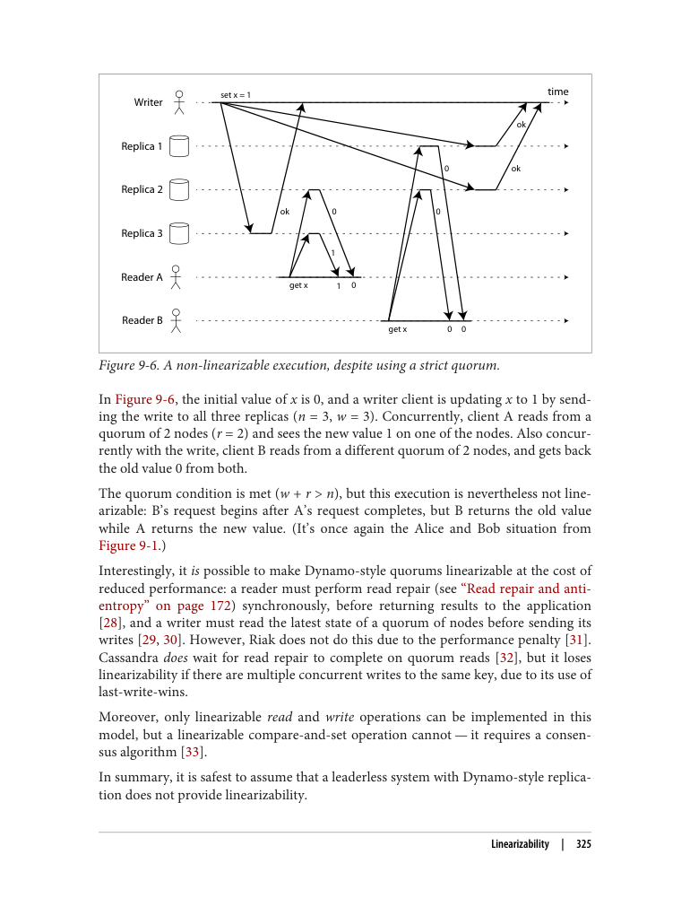

**Hình 9-6 – Một quá trình thực thi không có tính khả tuyến tính, mặc dù đã sử dụng một quorum nghiêm ngặt (Figure 9-6. A non-linearizable execution, despite using a strict quorum.)**

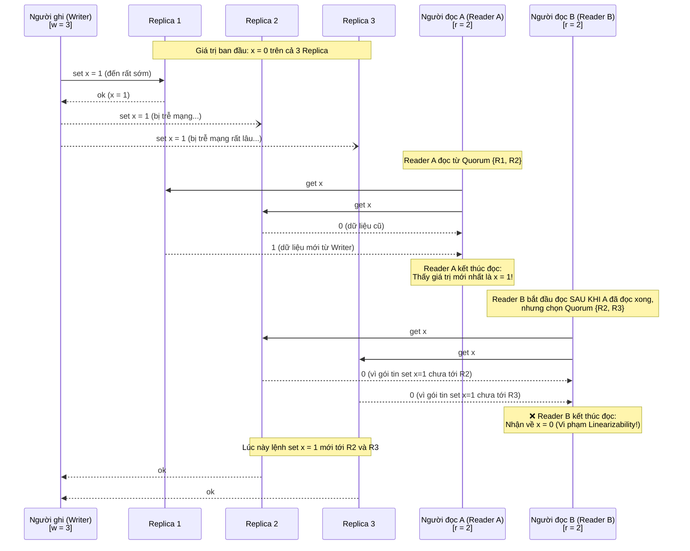

Trong **Hình 9-6**, giá trị ban đầu của `x` là `0`, và một client ghi (`Writer`) đang cập nhật `x` lên `1` bằng cách gửi yêu cầu ghi tới tất cả cả ba bản sao (`n = 3, w = 3`). Đồng thời với quá trình ghi đó, client `Reader A` đọc từ một quorum gồm 2 nút (`r = 2`, gồm `Replica 1` và `Replica 2`) và nhìn thấy giá trị mới `1` trên một trong hai nút đó (`Replica 1`), nên `Reader A` nhận về giá trị mới `1`. Cũng diễn ra đồng thời với thao tác ghi của `Writer` (nhưng bắt đầu *sau khi* thao tác đọc của `Reader A` đã hoàn tất), client `Reader B` đọc từ một quorum khác gồm 2 nút (`Replica 2` và `Replica 3`), và nhận về giá trị cũ `0` từ cả hai nút này (do yêu cầu `set x = 1` của `Writer` đi tới `Replica 2` và `Replica 3` bị trễ mạng chưa tới nơi).

Điều kiện quorum nghiêm ngặt rõ ràng đã được thỏa mãn (`w + r = 3 + 2 = 5 > n = 3`), thế nhưng quá trình thực thi này vẫn **không có tính khả tuyến tính**: yêu cầu của `Reader B` bắt đầu *sau khi* yêu cầu của `Reader A` đã hoàn thành xong xuôi, nhưng `Reader B` lại trả về giá trị cũ (`0`) trong khi `Reader A` đã trả về giá trị mới (`1`). (Một lần nữa, đây lại chính là tình huống của Alice và Bob từ **Hình 9-1**!)

Điều thú vị là chúng ta *hoàn toàn có thể* làm cho các quorum kiểu Dynamo có được tính khả tuyến tính với cái giá phải trả là sự sụt giảm hiệu năng:
1. Một người đọc (reader) bắt buộc phải thực hiện **sửa lỗi khi đọc (read repair)** (xem phần *"Sửa lỗi khi đọc và chống phân rã" — “Read repair and anti-entropy” ở trang 172*) một cách **đồng bộ (synchronously)** — tức là ghi đè giá trị mới nhất (`x = 1`) sang các replica bị cũ trong quorum rồi chờ chúng xác nhận xong xuôi *trước khi* trả kết quả đọc về cho ứng dụng [28];
2. Và một người ghi (writer) phải đọc trạng thái mới nhất (để lấy dấu thời gian/phiên bản cao nhất) từ một quorum các nút trước khi gửi các thao tác ghi của mình đi [29, 30] (thuật toán này được biết đến trong lý thuyết là thuật toán **ABD** — đặt theo tên các tác giả Attiya, Bar-Noy và Dolev).

Tuy nhiên, cơ sở dữ liệu **Riak** không thực hiện cơ chế sửa lỗi khi đọc đồng bộ này do cái giá phải trả về mặt hiệu năng là quá lớn [31]. **Cassandra** thì *có* chờ quá trình sửa lỗi khi đọc hoàn tất đối với các thao tác đọc quorum (`QUORUM`) [32], nhưng nó vẫn đánh mất tính khả tuyến tính nếu có nhiều thao tác ghi diễn ra đồng thời vào cùng một khóa, do nó sử dụng cơ chế giải quyết xung đột *ghi sau cùng sẽ thắng (last-write-wins)* dựa trên đồng hồ vật lý.

Hơn thế nữa, chỉ có các thao tác đọc (`read`) và ghi (`write`) khả tuyến tính mới có thể được triển khai theo mô hình quorum kiểu ABD này; còn một thao tác **so sánh và thiết lập (`compare-and-set` — CAS) có tính khả tuyến tính** thì hoàn toàn **không thể** triển khai được bằng quorum thuần túy — bởi nó bắt buộc đòi hỏi phải có một thuật toán đồng thuận (consensus algorithm) thực thụ [33] (chẳng hạn như trong Cassandra, khi bạn dùng tính năng *Lightweight Transactions — LWT* với mệnh đề `IF`, Cassandra buộc phải chạy giao thức đồng thuận Paxos tốn tới 4 vòng mạng chứ không dùng Dynamo quorum thông thường).

Tóm lại, cách an toàn nhất là hãy luôn giả định rằng một hệ thống không có leader với cơ chế sao chép kiểu Dynamo **không** cung cấp tính khả tuyến tính.

> 📝 **Giải thích thêm (không có trong sách): Tổng kết khả năng đạt Linearizability của các mô hình sao chép**
>
> | Mô hình sao chép (Replication Model) | Có đạt được Linearizability không? | Điều kiện cần thiết & Lưu ý thực tế |
> | :--- | :--- | :--- |
> | **Single-Leader Replication** (Sao chép một leader) | **Có tiềm năng** (Potentially) | Chỉ khi đọc từ Leader (với cơ chế chống delusional leader như租/lease hoặc quorum check) hoặc đọc từ Follower cập nhật đồng bộ 100%, và không dùng Snapshot Isolation cho thao tác đọc đó. |
> | **Consensus Algorithms** (Raft, Paxos, Zab) | **CÓ** (Linearizable) | Thiết kế chuyên biệt để đạt tính khả tuyến tính và chống split-brain (ví dụ: `etcd`, `ZooKeeper`, `Consul`, `CockroachDB`, `TiKV`). Lưu ý: thao tác đọc cũng phải đi qua quorum hoặc dùng leader lease an toàn. |
> | **Multi-Leader Replication** (Sao chép đa leader) | **KHÔNG** (Not linearizable) | Ghi đồng thời ở nhiều nơi và sao chép bất đồng bộ luôn dẫn đến nguy cơ dữ liệu cũ và xung đột ghi. |
> | **Leaderless / Dynamo-style** (`w + r > n`) | **Hầu như KHÔNG** (Probably not) | Bị lỗi như **Hình 9-6** nếu không có *Synchronous Read Repair* (thuật toán ABD), bị lỗi do đồng hồ LWW, và hoàn toàn không hỗ trợ được lệnh `CAS` nếu không nhúng thêm Paxos/Raft. |

---

### Chi phí của tính khả tuyến tính (The cost of linearizability)

Bởi vì một số phương pháp sao chép có thể cung cấp tính khả tuyến tính trong khi những phương pháp khác lại không thể, nên việc đi sâu khám phá những ưu điểm và nhược điểm (chi phí phải trả) của tính khả tuyến tính là vô cùng thú vị.

Chúng ta đã thảo luận về một số trường hợp sử dụng cho các phương pháp sao chép khác nhau trong Chương 5; chẳng hạn, chúng ta đã thấy rằng sao chép đa leader (multi-leader replication) thường là một lựa chọn rất tốt cho việc sao chép liên trung tâm dữ liệu (xem phần *"Vận hành đa trung tâm dữ liệu" — “Multi-datacenter operation” ở trang 162*). Một ví dụ về mô hình triển khai như vậy được minh họa trong **Hình 9-7**.

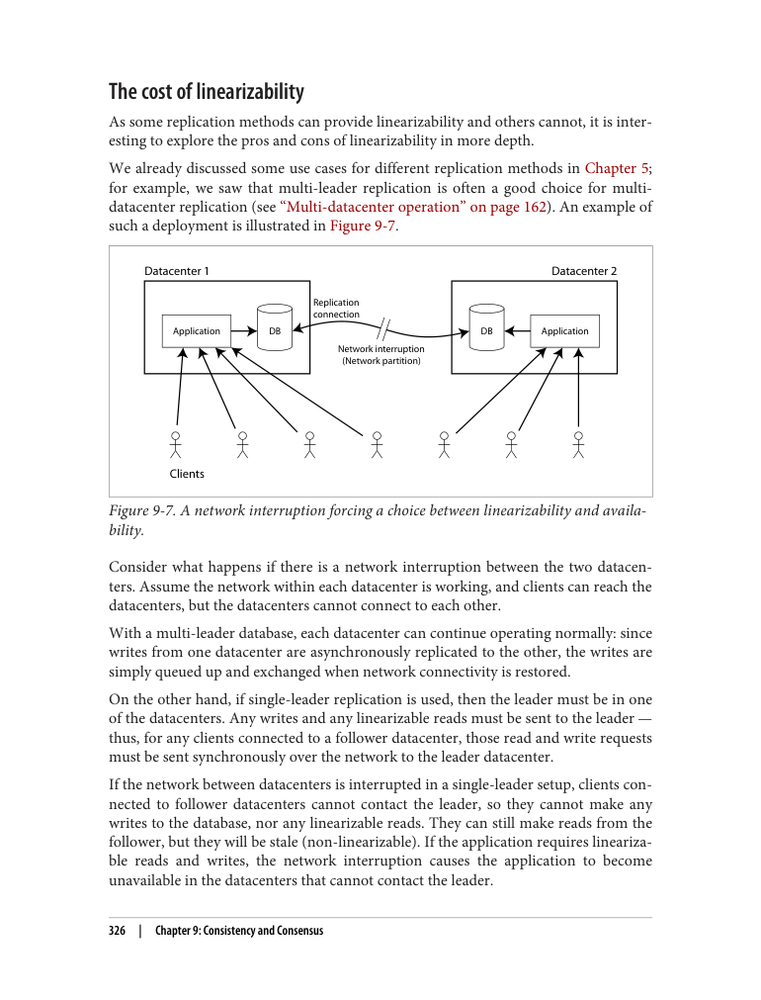

**Hình 9-7 – Một sự cố gián đoạn mạng buộc hệ thống phải lựa chọn giữa tính khả tuyến tính và tính sẵn sàng (Figure 9-7. A network interruption forcing a choice between linearizability and availability.)**

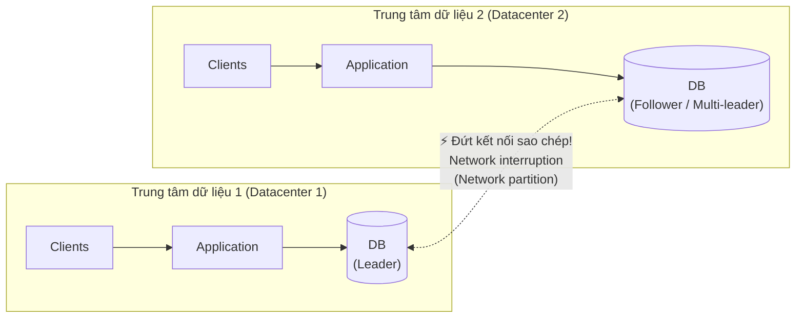

Hãy xem xét điều gì sẽ xảy ra nếu có một sự cố gián đoạn mạng (network interruption) giữa hai trung tâm dữ liệu trong **Hình 9-7**. Giả sử rằng mạng nội bộ bên trong mỗi trung tâm dữ liệu vẫn đang hoạt động hoàn toàn bình thường, và các client vẫn có thể kết nối tới các trung tâm dữ liệu đó, nhưng hai trung tâm dữ liệu lại không thể kết nối được với nhau (hiện tượng phân vùng mạng — *network partition*).

- **Với một cơ sở dữ liệu đa leader (multi-leader database):** Mỗi trung tâm dữ liệu vẫn có thể tiếp tục vận hành bình thường: bởi vì các thao tác ghi từ trung tâm dữ liệu này được sao chép một cách bất đồng bộ sang trung tâm dữ liệu kia, nên các thao tác ghi chỉ đơn giản là được xếp vào hàng đợi (queued up) và sẽ được trao đổi bù cho nhau khi kết nối mạng được khôi phục trở lại.
- **Mặt khác, nếu sử dụng sao chép một leader (single-leader replication):** Nút leader bắt buộc phải nằm ở một trong hai trung tâm dữ liệu (giả sử ở Datacenter 1). Bất kỳ thao tác ghi nào và bất kỳ thao tác đọc có tính khả tuyến tính nào cũng đều bắt buộc phải được gửi tới nút leader — do đó, đối với bất kỳ client nào đang kết nối vào trung tâm dữ liệu follower (Datacenter 2), những yêu cầu đọc và ghi đó đều phải được chuyển tiếp một cách đồng bộ (synchronously) qua mạng liên trung tâm dữ liệu để tới trung tâm dữ liệu chứa leader.

Nếu mạng kết nối giữa các trung tâm dữ liệu bị gián đoạn trong một cấu hình một leader, các client đang kết nối vào các trung tâm dữ liệu follower sẽ không thể liên lạc được với nút leader nữa, vì vậy chúng **không thể thực hiện bất kỳ thao tác ghi nào** vào cơ sở dữ liệu, và **cũng không thể thực hiện bất kỳ thao tác đọc có tính khả tuyến tính nào**. Chúng vẫn có thể thực hiện các thao tác đọc từ nút follower tại chỗ, nhưng dữ liệu đọc ra sẽ bị cũ (stale, tức là không có tính khả tuyến tính). Nếu ứng dụng bắt buộc đòi hỏi các thao tác đọc và ghi phải có tính khả tuyến tính, sự cố gián đoạn mạng sẽ khiến cho ứng dụng **trở nên không sẵn sàng (unavailable)** tại các trung tâm dữ liệu không thể liên lạc được với nút leader.

Nếu các client có thể kết nối trực tiếp tới trung tâm dữ liệu chứa nút leader (Datacenter 1), thì đây không phải là vấn đề đối với họ, bởi vì ứng dụng ở đó vẫn tiếp tục làm việc bình thường. Nhưng nếu các client chỉ có thể chạm tới trung tâm dữ liệu follower (Datacenter 2 — ví dụ do định tuyến địa lý hoặc đứt cáp quang quốc tế), họ sẽ phải hứng chịu tình trạng ngừng hoạt động (outage) của ứng dụng cho đến khi đường truyền mạng được sửa chữa xong.

---

#### Định lý CAP (The CAP theorem)

Vấn đề này không chỉ là một hệ quả riêng của mô hình sao chép một leader và đa leader: **bất kỳ cơ sở dữ liệu có tính khả tuyến tính nào cũng đều gặp phải vấn đề này**, bất kể nó được triển khai bằng cách nào đi chăng nữa. Vấn đề này cũng không chỉ bó hẹp trong các hệ thống triển khai đa trung tâm dữ liệu, mà có thể xảy ra trên bất kỳ mạng máy tính không đáng tin cậy nào, ngay cả bên trong cùng một trung tâm dữ liệu (xem phần *"Mạng không đáng tin cậy" — “Unreliable Networks” ở trang 269* của Chương 8).

Sự đánh đổi (trade-off) diễn ra cụ thể như sau:<sup>v</sup>

- **Nếu ứng dụng của bạn đòi hỏi tính khả tuyến tính (linearizability)**, và một số bản sao (replicas) bị ngắt kết nối khỏi các bản sao khác do sự cố mạng, thì một số bản sao sẽ không thể xử lý các yêu cầu trong khi chúng đang bị mất kết nối: chúng buộc phải hoặc là chờ đợi (block) cho đến khi sự cố mạng được khắc phục xong, hoặc là trả về một lỗi (error) — dù theo cách nào đi nữa, chúng cũng trở nên **không sẵn sàng (unavailable)**.
- **Nếu ứng dụng của bạn không đòi hỏi tính khả tuyến tính**, thì nó có thể được viết theo cách cho phép mỗi bản sao tự xử lý các yêu cầu một cách độc lập, ngay cả khi bản sao đó đang bị ngắt kết nối khỏi các bản sao khác (ví dụ: sử dụng mô hình đa leader hoặc không có leader). Trong trường hợp này, ứng dụng vẫn có thể duy trì trạng thái **sẵn sàng (available)** khi đối mặt với sự cố mạng, nhưng hành vi của nó sẽ không có tính khả tuyến tính (dữ liệu đọc có thể bị cũ hoặc xung đột).

> <sup>v</sup> Hai lựa chọn này đôi khi được biết đến với tên viết tắt là **CP** (*consistent but not available under network partitions* — nhất quán nhưng không sẵn sàng khi bị phân vùng mạng) và **AP** (*available but not consistent under network partitions* — sẵn sàng nhưng không nhất quán khi bị phân vùng mạng). Tuy nhiên, cách phân loại cứng nhắc này có rất nhiều khiếm khuyết nghiêm trọng [9], vì vậy tốt nhất là nên tránh sử dụng nó.

Như vậy, các ứng dụng không đòi hỏi tính khả tuyến tính có thể có khả năng chịu đựng các sự cố mạng tốt hơn. Góc nhìn sâu sắc này được biết đến rộng rãi với tên gọi là **định lý CAP (the CAP theorem)** [34, 35, 36, 37], được đặt tên bởi Eric Brewer vào năm 2000 (và được chứng minh hình thức bởi Seth Gilbert và Nancy Lynch vào năm 2002 [35]), mặc dù bản chất sự đánh đổi này vốn đã được các nhà thiết kế cơ sở dữ liệu phân tán biết đến từ những năm 1970 [22, 38, 39, 40].

Ban đầu, CAP được đề xuất như một quy tắc kinh nghiệm (rule of thumb), không có các định nghĩa toán học cứng nhắc, với mục tiêu khơi mào một cuộc thảo luận về các sự đánh đổi (trade-offs) trong các cơ sở dữ liệu. Vào thời điểm đó (cuối thập niên 1990), nhiều cơ sở dữ liệu phân tán chỉ tập trung vào việc cung cấp ngữ nghĩa khả tuyến tính trên một cụm máy chủ dùng chung bộ lưu trữ (shared storage) [18], và CAP đã khuyến khích các kỹ sư cơ sở dữ liệu khám phá một không gian thiết kế rộng mở hơn nhiều của các hệ thống phân tán không chia sẻ tài nguyên (distributed shared-nothing systems), vốn phù hợp hơn hẳn cho việc triển khai các dịch vụ web quy mô lớn [23]. CAP hoàn toàn xứng đáng được ghi nhận công lao vì đã tạo ra sự chuyển dịch văn hóa kỹ thuật này — bằng chứng chính là sự bùng nổ của hàng loạt công nghệ cơ sở dữ liệu mới kể từ giữa những năm 2000 (được biết đến với trào lưu **NoSQL**).

Tuy nhiên, định lý CAP khi được định nghĩa một cách hình thức hóa [35] lại có phạm vi vô cùng hẹp: nó chỉ xem xét duy nhất một mô hình tính nhất quán (đó là **tính khả tuyến tính — linearizability**) và duy nhất một loại lỗi (đó là **phân vùng mạng — network partitions**,<sup>vi</sup> tức là các nút vẫn còn sống nhưng bị ngắt kết nối khỏi nhau). Nó hoàn toàn không nói bất cứ điều gì về độ trễ mạng (network delays), các nút bị chết (dead nodes), hay các sự đánh đổi thực tế khác. Do đó, mặc dù CAP có tầm ảnh hưởng lớn về mặt lịch sử, nhưng ngày nay nó có rất ít giá trị thực tiễn trong việc thiết kế các hệ thống cụ thể [9, 41].

> <sup>vi</sup> Như đã thảo luận trong phần *"Lỗi mạng trong thực tế" (“Network faults in practice” ở trang 271* của Chương 8), cuốn sách này sử dụng thuật ngữ *phân vùng (partitioning)* để chỉ việc chủ động chia nhỏ một tập dữ liệu lớn thành các phần nhỏ hơn (*sharding*, xem Chương 6). Ngược lại, một *phân vùng mạng (network partition)* là một loại lỗi mạng cụ thể (mạng bị chia cắt thành các ốc đảo cô lập), thứ mà thông thường chúng ta không tách riêng ra khỏi các loại lỗi khác. Tuy nhiên, bởi vì nó chính là chữ **P** trong **CAP**, nên chúng ta không thể tránh khỏi sự trùng lặp thuật ngữ dễ gây nhầm lẫn trong trường hợp này.

Có rất nhiều kết quả chứng minh tính bất khả thi (impossibility results) thú vị hơn nhiều trong lĩnh vực hệ thống phân tán [42], và định lý CAP hiện nay đã được thay thế bởi các kết quả nghiên cứu chuẩn xác hơn [2, 43], vì vậy ngày nay nó chủ yếu chỉ còn mang ý nghĩa lịch sử.

---

#### Định lý CAP không mấy hữu ích (The Unhelpful CAP Theorem)

> 📌 **Đóng khung tiêu điểm: Định lý CAP không mấy hữu ích (The Unhelpful CAP Theorem)**
>
> Định lý CAP đôi khi được trình bày dưới dạng: **Consistency (Tính nhất quán), Availability (Tính sẵn sàng), Partition tolerance (Khả năng chịu phân vùng mạng): hãy chọn 2 trong 3 (pick 2 out of 3)**. Thật không may, cách diễn đạt này cực kỳ gây hiểu lầm [37] bởi vì phân vùng mạng (network partitions) là một loại sự cố (fault), nên chúng hoàn toàn không phải là thứ mà bạn có quyền "lựa chọn": hoặc là chúng xảy ra, hoặc là chúng không xảy ra [44] (bạn không thể thiết kế một hệ thống phân tán qua mạng mà lại chọn "không chịu phân vùng mạng" — tức là hệ thống "CA" không hề tồn tại trên mạng thực tế!).
>
> Vào những thời điểm khi mạng đang hoạt động bình thường, một hệ thống hoàn toàn có thể cung cấp **cả hai**: cả tính nhất quán (tính khả tuyến tính) lẫn tính sẵn sàng toàn phần (total availability). Chỉ khi nào có một lỗi mạng (phân vùng mạng) xảy ra, bạn mới buộc phải lựa chọn giữa tính khả tuyến tính hoặc tính sẵn sàng toàn phần. Do đó, một cách diễn đạt chuẩn xác hơn cho CAP sẽ là: **hoặc Nhất quán (Consistent) hoặc Sẵn sàng (Available) khi bị Phân vùng mạng (when Partitioned)** [45].
>
> Thêm vào đó, trong các cuộc thảo luận về CAP, có nhiều định nghĩa mâu thuẫn nhau về thuật ngữ *tính sẵn sàng (availability)*, và cách hình thức hóa nó thành định lý toán học [35] lại không khớp với ý nghĩa thông thường trong thực tế vận hành [41] (trong chứng minh định lý CAP, "Available" đòi hỏi *mọi* nút không bị sập trong hệ thống đều phải trả về phản hồi thành công, tức là chỉ cần 1 nút ở phía thiểu số từ chối trả lời khi đứt mạng thì hệ thống cũng bị coi là không đạt Availability theo nghĩa CAP, dù 99% người dùng ở phía đa số vẫn dùng bình thường!). Nhiều hệ thống được gọi là “có tính sẵn sàng cao” (highly available / fault-tolerant) trên thực tế lại không đáp ứng được định nghĩa kỳ quặc này của CAP về tính sẵn sàng. Tựu trung lại, có quá nhiều sự hiểu lầm và hỗn loạn xoay quanh CAP, và nó không giúp chúng ta hiểu rõ hơn về các hệ thống, vì vậy tốt nhất là nên tránh dùng CAP.

---

#### Tính khả tuyến tính và độ trễ mạng (Linearizability and network delays)

Mặc dù tính khả tuyến tính là một đảm bảo rất hữu ích, nhưng đáng ngạc nhiên là có rất ít hệ thống thực sự có tính khả tuyến tính trong thực tế. Lấy một ví dụ cực kỳ gần gũi: ngay cả bộ nhớ **RAM trên một bộ vi xử lý (CPU) đa nhân hiện đại cũng không có tính khả tuyến tính** [46]! Nếu một luồng (thread) đang chạy trên một nhân CPU ghi vào một địa chỉ bộ nhớ, và một luồng khác trên một nhân CPU khác đọc cùng địa chỉ bộ nhớ đó ngay sau đó một chút, hoàn toàn không có gì đảm bảo rằng luồng thứ hai sẽ đọc được giá trị vừa được ghi bởi luồng thứ nhất (trừ khi một hàng rào bộ nhớ — *memory barrier* hoặc *fence* [47] được sử dụng tường minh).

Lý do của hành vi này là bởi vì mỗi nhân CPU đều có bộ nhớ đệm (memory cache — L1/L2 cache) và bộ đệm lưu trữ (store buffer) của riêng mình. Theo mặc định, việc truy cập bộ nhớ trước tiên sẽ đi thẳng vào bộ nhớ đệm cục bộ, và bất kỳ thay đổi nào cũng được ghi ra bộ nhớ chính (main memory / RAM) một cách bất đồng bộ (asynchronously). Bởi vì việc truy cập dữ liệu trong bộ nhớ đệm CPU nhanh hơn gấp hàng chục tới hàng trăm lần so với việc đi ra bộ nhớ chính [48], nên tính năng kiến trúc này là tối cần thiết để đạt được hiệu năng tốt trên các CPU hiện đại. Tuy nhiên, hệ quả là giờ đây có tới vài bản sao của cùng một dữ liệu (một bản trong bộ nhớ chính, và có lẽ vài bản nữa nằm rải rác trong các bộ nhớ đệm của từng nhân), và những bản sao này được cập nhật bất đồng bộ với nhau, vì vậy tính khả tuyến tính đã bị đánh mất.

Tại sao các kỹ sư phần cứng lại thực hiện sự đánh đổi này? Sẽ thật vô lý nếu đem định lý CAP ra để biện minh cho mô hình tính nhất quán bộ nhớ đa nhân (multi-core memory consistency model): bên trong phạm vi một chiếc máy tính đơn lẻ, chúng ta luôn giả định việc giao tiếp qua bus phần cứng là đáng tin cậy, và chúng ta chẳng bao giờ kỳ vọng một nhân CPU có thể tiếp tục hoạt động bình thường một mình nếu nó bị "cắt đứt kết nối" khỏi phần còn lại của bo mạch máy tính! **Lý do thực sự của việc từ bỏ tính khả tuyến tính ở đây là vì hiệu năng (performance / latency), chứ không phải vì khả năng chịu lỗi (fault tolerance).**

Điều tương tự cũng hoàn toàn đúng đối với nhiều cơ sở dữ liệu phân tán chủ động lựa chọn không cung cấp các đảm bảo khả tuyến tính: chúng làm như vậy chủ yếu là để **tăng hiệu năng (giảm độ trễ)**, chứ không hẳn là vì khả năng chịu lỗi phân vùng mạng [49]. Tính khả tuyến tính rất chậm chạp (linearizability is slow) — và điều này đúng trong *mọi lúc* khi hệ thống vận hành bình thường, chứ không chỉ riêng trong lúc xảy ra sự cố mạng.

Liệu chúng ta có thể tìm ra một cách triển khai hiệu quả hơn, nhanh hơn cho hệ thống lưu trữ có tính khả tuyến tính hay không? Có vẻ như câu trả lời của toán học là **không**: hai nhà nghiên cứu Hagit Attiya và Jennifer Welch [50] đã chứng minh một định lý nổi tiếng rằng nếu bạn muốn có tính khả tuyến tính, thì **thời gian phản hồi (response time) của các yêu cầu đọc và ghi tối thiểu phải tỷ lệ thuận với độ bất định của độ trễ trên mạng (uncertainty of delays in the network)**. Trong một mạng máy tính có độ trễ biến thiên mạnh — giống như hầu hết các mạng máy tính thực tế sử dụng chuyển mạch gói (xem phần *"Hết thời gian chờ và độ trễ không giới hạn" — “Timeouts and unbounded delays” ở trang 273* của Chương 8) — thời gian phản hồi của các thao tác đọc và ghi có tính khả tuyến tính tất yếu sẽ luôn ở mức cao (vì luôn phải chờ liên lạc qua mạng giữa các bản sao). Một thuật toán nhanh hơn cho tính khả tuyến tính đơn giản là không thể tồn tại về mặt toán học, nhưng các mô hình tính nhất quán yếu hơn (như tính nhất quán nhân quả hay nhất quán cuối cùng) thì lại có thể nhanh hơn gấp nhiều lần, vì vậy đây là một sự đánh đổi cực kỳ quan trọng đối với các hệ thống nhạy cảm với độ trễ (latency-sensitive systems).

> 📝 **Giải thích thêm (không có trong sách): Định lý PACELC — Sự nâng cấp hoàn hảo thay thế cho định lý CAP**
>
> Như Martin Kleppmann vừa phân tích, điểm mù lớn nhất của định lý CAP là nó chỉ xét đến lúc **có sự cố phân vùng mạng (Partition)**, mà quên mất rằng trong 99.9% thời gian khi mạng **không bị đứt (Normal operation)**, các hệ thống phân tán vẫn phải thực hiện một sự đánh đổi khốc liệt không kém giữa **Độ trễ (Latency)** và **Tính nhất quán (Consistency)** — đúng như định lý của Attiya & Welch [50].
>
> Năm 2012, Giáo sư **Daniel Abadi** (Đại học Yale / Maryland) đã công bố **Định lý PACELC** [49] để khắc phục hoàn toàn hạn chế của CAP:
>
> ```mermaid
> flowchart TD
>     Start["Hệ thống dữ liệu phân tán (Có sao chép)"] --> CheckP{"Nếu có Phân vùng mạng?<br/>(If Partition - P)"}
>     CheckP -- "Đang bị đứt mạng (P)" --> ChoicePA["Chọn giữa:<br/>• Availability (A - Sẵn sàng)<br/>• Consistency (C - Khả tuyến tính)"]
>     CheckP -- "Ngược lại: Mạng bình thường (Else - E)" --> ChoiceLC["Chọn giữa:<br/>• Latency (L - Độ trễ thấp)<br/>• Consistency (C - Khả tuyến tính)"]
> ```
>
> - **P (Partition) → A / C:** Nếu có phân vùng mạng (**P**), hệ thống phải chọn giữa tính sẵn sàng (**A**) hay tính nhất quán (**C**).
> - **E (Else) → L / C:** Ngược lại (**E** — khi mạng hoạt động bình thường), hệ thống phải chọn giữa độ trễ thấp (**L** — ghi/đọc ngay tại nút cục bộ mà không chờ đồng bộ đa số) hay tính nhất quán (**C** — chịu độ trễ mạng cao để đồng bộ hóa giữa các bản sao).
>
> **Bảng phân loại các hệ thống cơ sở dữ liệu thực tế theo PACELC:**
>
> | Hệ thống Cơ sở dữ liệu | Phân loại PACELC | Giải thích cơ chế hoạt động thực tế |
> | :--- | :---: | :--- |
> | **etcd, ZooKeeper, Consul, Spanner, CockroachDB** | **PC / EC** | Khi đứt mạng (**P**), nhánh thiểu số từ chối phục vụ để giữ **C**. Khi mạng bình thường (**E**), mọi thao tác ghi (và đọc tuyến tính) đều phải chịu độ trễ vòng mạng để giữ **C**. |
> | **DynamoDB, Cassandra, Riak** (cấu hình mặc định) | **PA / EL** | Khi đứt mạng (**P**), mọi nút vẫn nhận đọc/ghi để giữ **A**. Khi mạng bình thường (**E**), ưu tiên trả lời cực nhanh với độ trễ thấp (**L**) bằng cách chấp nhận dữ liệu có thể hơi cũ. |
> | **MongoDB** (cấu hình `w: majority`, đọc từ Secondary) | **PC / EL** | Khi đứt mạng (**P**), nếu không đủ đa số bầu Leader thì ngừng nhận ghi (**C**). Nhưng khi bình thường (**E**), nếu cho phép client đọc từ Secondary bất đồng bộ để giảm tải/giảm độ trễ thì đánh đổi lấy **L**. |
> | **PNUTS (Yahoo!)** | **PC / EL** | Bình thường đọc/ghi tại bản sao địa phương để có độ trễ thấp (**EL**), nhưng khi đứt mạng thì khóa không cho nhánh bị cô lập cập nhật để tránh xung đột (**PC**). |

## Các đảm bảo về thứ tự (Ordering Guarantees)

Trước đó, chúng ta đã nói rằng một thanh ghi khả tuyến tính (linearizable register) hành xử như thể chỉ có duy nhất một bản sao dữ liệu, và mọi thao tác dường như có hiệu lực một cách nguyên tử (atomically) tại một thời điểm duy nhất. Điều này ngụ ý rằng các thao tác được thực thi theo một thứ tự được xác định rõ ràng (well-defined order). Chúng ta đã minh họa thứ tự này trong **Hình 9-4 (Figure 9-4)** bằng cách nối các thao tác lại với nhau theo đúng thứ tự mà chúng dường như đã được thực thi.

Thứ tự (ordering) là một chủ đề lặp đi lặp lại xuyên suốt cuốn sách này, điều đó gợi ý rằng nó có thể là một ý tưởng nền tảng vô cùng quan trọng. Hãy cùng điểm lại ngắn gọn một số ngữ cảnh khác mà chúng ta đã thảo luận về thứ tự:

* Trong Chương 5, chúng ta đã thấy rằng mục đích chính của nút dẫn đầu (leader) trong mô hình sao chép một nút dẫn đầu (single-leader replication) là xác định *thứ tự của các thao tác ghi* (order of writes) trong nhật ký sao chép (replication log) — tức là thứ tự mà các nút theo sau (followers) áp dụng các thao tác ghi đó. Nếu không có một nút dẫn đầu duy nhất, các xung đột (conflicts) có thể xảy ra do các thao tác đồng thời (xem phần “Xử lý xung đột ghi (Handling write conflicts)” ở trang 164).
* Tính khả tuần tự (serializability) trong Chương 7 xoay quanh việc đảm bảo rằng các giao dịch (transactions) hành xử như thể chúng được thực thi theo một *thứ tự tuần tự* (sequential order) nào đó. Điều này có thể đạt được bằng cách thực thi các giao dịch theo đúng thứ tự tuần tự theo nghĩa đen, hoặc bằng cách cho phép thực thi đồng thời trong khi ngăn chặn các xung đột khả tuần tự (bằng cơ chế khóa — locking hoặc hủy bỏ — aborting).
* Việc sử dụng dấu thời gian (timestamps) và đồng hồ (clocks) trong các hệ thống phân tán mà chúng ta đã thảo luận trong Chương 8 (xem phần “Dựa vào đồng hồ được đồng bộ hóa (Relying on synchronized clocks)” ở trang 282) là một nỗ lực khác nhằm đưa trật tự vào một thế giới hỗn loạn, chẳng hạn để xác định xem thao tác nào trong hai thao tác ghi đã xảy ra muộn hơn.

Thú vị thay, hóa ra có những mối liên hệ sâu sắc giữa việc sắp xếp thứ tự (ordering), tính khả tuyến tính (linearizability), và sự đồng thuận (consensus). Mặc dù khái niệm này mang tính lý thuyết và trừu tượng hơn một chút so với phần lớn nội dung còn lại của cuốn sách, nhưng nó cực kỳ hữu ích để làm sáng tỏ sự hiểu biết của chúng ta về những gì các hệ thống *có thể* và *không thể* làm được. Chúng ta sẽ khám phá chủ đề này trong một vài mục tiếp theo.

> 📝 **Giải thích thêm (không có trong sách):**
> Trong khoa học máy tính phân tán, hầu hết các bài toán khó nhất đều quy về câu hỏi: **"Sự kiện A xảy ra trước hay sự kiện B xảy ra trước, và liệu mọi nút trong cụm có đồng ý về thứ tự đó hay không?"**
> * Trên một máy tính đơn lẻ với một luồng (single-threaded CPU), bộ đếm chương trình (Program Counter) tự nhiên áp đặt một thứ tự thực thi tuyệt đối cho từng lệnh.
> * Nhưng khi bước sang hệ thống phân tán với nhiều nút độc lập giao tiếp qua mạng không đồng bộ (asynchronous network), khái niệm "thời gian toàn cục" biến mất. Lúc này, việc thiết lập lại "thứ tự" giữa các sự kiện trên các máy chủ khác nhau chính là chìa khóa để duy trì tính toàn vẹn của cơ sở dữ liệu.

---

### Thứ tự và quan hệ nhân quả (Ordering and causality)

Có nhiều lý do khiến vấn đề thứ tự liên tục xuất hiện, và một trong những lý do quan trọng nhất là nó giúp bảo toàn *quan hệ nhân quả* (causality). Chúng ta đã thấy nhiều ví dụ xuyên suốt cuốn sách này nơi quan hệ nhân quả đóng vai trò trọng yếu:

* Trong phần “Đọc tiền tố nhất quán (Consistent prefix reads)” ở trang 159 (**Hình 5-5 / Figure 5-5**), chúng ta đã thấy một ví dụ mà người quan sát một cuộc trò chuyện lại nhìn thấy câu trả lời cho một câu hỏi *trước*, rồi sau đó mới thấy chính câu hỏi đang được trả lời. Điều này gây bối rối vì nó vi phạm trực giác của chúng ta về nguyên nhân và kết quả (cause and effect): nếu một câu hỏi được trả lời, thì rõ ràng câu hỏi đó phải xuất hiện trước, bởi vì người đưa ra câu trả lời hẳn phải nhìn thấy câu hỏi đó rồi (giả sử họ không có khả năng ngoại cảm và không thể nhìn thấu tương lai). Chúng ta nói rằng có một *mối quan hệ nhân quả* (causal relationship) giữa câu hỏi và câu trả lời.
* Một khuôn mẫu tương tự đã xuất hiện trong **Hình 5-9 (Figure 5-9)**, nơi chúng ta xem xét quá trình sao chép giữa ba nút dẫn đầu (multi-leader replication), và nhận thấy rằng một số thao tác ghi có thể “vượt mặt” (overtake) các thao tác ghi khác do độ trễ mạng. Dưới góc nhìn của một trong các bản sao (replicas), mọi thứ sẽ trông như thể có một thao tác cập nhật trên một dòng dữ liệu (row) vốn chưa hề tồn tại. Quan hệ nhân quả ở đây có nghĩa là một dòng dữ liệu phải được tạo ra trước khi nó có thể được cập nhật.
* Trong phần “Phát hiện các thao tác ghi đồng thời (Detecting concurrent writes)” ở trang 178, chúng ta đã quan sát thấy rằng nếu bạn có hai thao tác $A$ và $B$, sẽ có ba khả năng xảy ra: hoặc $A$ xảy ra trước $B$ ($A$ happened before $B$), hoặc $B$ xảy ra trước $A$ ($B$ happened before $A$), hoặc $A$ và $B$ là đồng thời (concurrent). Mối quan hệ *xảy ra trước* (happened-before) này là một cách diễn đạt khác của quan hệ nhân quả: nếu $A$ xảy ra trước $B$, điều đó có nghĩa là $B$ có thể đã biết về $A$, hoặc được xây dựng dựa trên $A$, hoặc phụ thuộc vào $A$. Nếu $A$ và $B$ là đồng thời, sẽ không có mối liên kết nhân quả nào giữa chúng; nói cách khác, chúng ta chắc chắn rằng không thao tác nào biết về sự tồn tại của thao tác kia.
* Trong ngữ cảnh cô lập bản chụp (snapshot isolation) cho các giao dịch (xem phần “Cô lập bản chụp và đọc lặp lại (Snapshot isolation and repeatable read)” ở trang 228), chúng ta đã nói rằng một giao dịch đọc dữ liệu từ một bản chụp *nhất quán* (consistent snapshot). Nhưng “nhất quán” có nghĩa là gì trong ngữ cảnh này? Nó có nghĩa là *nhất quán với quan hệ nhân quả* (consistent with causality): nếu bản chụp chứa một câu trả lời, nó cũng bắt buộc phải chứa câu hỏi đang được trả lời [51]. Việc quan sát toàn bộ cơ sở dữ liệu tại một thời điểm duy nhất làm cho nó nhất quán với quan hệ nhân quả: tác động của tất cả các thao tác đã xảy ra *trước* thời điểm đó về mặt nhân quả đều hiển thị rõ, nhưng không có bất kỳ thao tác nào xảy ra *sau* đó về mặt nhân quả có thể được nhìn thấy. Hiện tượng *lệch đọc* (read skew — tức đọc không nhất quán, như được minh họa trong **Hình 7-6 / Figure 7-6**) đồng nghĩa với việc đọc dữ liệu ở một trạng thái vi phạm quan hệ nhân quả.
* Các ví dụ của chúng ta về hiện tượng *lệch ghi* (write skew) giữa các giao dịch (xem phần “Ngăn chặn lệch ghi và bóng ma (Preventing write skew and phantoms)” ở trang 237) cũng đã chứng minh các sự phụ thuộc nhân quả (causal dependencies): trong **Hình 7-8 (Figure 7-8)**, Alice được phép rời ca trực bởi vì giao dịch của cô ấy nghĩ rằng Bob vẫn đang trực, và ngược lại. Trong trường hợp này, hành động rời ca trực *phụ thuộc nhân quả* (causally dependent) vào kết quả quan sát xem ai đang trực hiện tại. Cô lập bản chụp khả tuần tự (Serializable Snapshot Isolation — xem phần “Cô lập bản chụp khả tuần tự (SSI) (Serializable snapshot isolation (SSI))” ở trang 252) phát hiện hiện tượng lệch ghi bằng cách theo dõi các sự phụ thuộc nhân quả giữa các giao dịch.
* Trong ví dụ về Alice và Bob cùng xem bóng đá (**Hình 9-1 / Figure 9-1**), việc Bob nhận được kết quả cũ (stale result) từ máy chủ sau khi đã nghe Alice reo lên về tỉ số trận đấu chính là một sự vi phạm quan hệ nhân quả: tiếng reo của Alice phụ thuộc nhân quả vào thông báo tỉ số trận đấu, vì vậy Bob lẽ ra cũng phải nhìn thấy tỉ số mới sau khi nghe lời Alice nói. Cùng một khuôn mẫu đó lại xuất hiện lần nữa trong phần “Sự phụ thuộc thời gian xuyên kênh (Cross-channel timing dependencies)” ở trang 322 dưới vỏ bọc của một dịch vụ thay đổi kích thước hình ảnh (image resizing service).

Nhìn nhận vấn đề theo cách này, phần lớn nội dung của 200 trang sách vừa qua có thể được cô đọng lại chỉ trong một câu ngắn gọn: **“Hãy canh chừng quan hệ nhân quả của bạn!” (“Watch your causality!”)**

Nhất quán với quan hệ nhân quả có nghĩa là tuân theo thứ tự do quan hệ nhân quả áp đặt. Nguyên nhân phải đến trước kết quả. Một thông điệp phải được gửi đi trước khi thông điệp đó được nhận. Câu hỏi phải xuất hiện trước câu trả lời. Và, giống như trong đời thực, điều này dẫn tới điều kia: một nút đọc một số dữ liệu rồi ghi ra một thứ gì đó như là kết quả, một nút khác lại đọc thứ vừa được ghi đó và tiếp tục ghi ra một thứ khác nữa, cứ thế tiếp diễn. Những chuỗi thao tác phụ thuộc nhân quả này định nghĩa nên *thứ tự nhân quả* (causal order) trong hệ thống — tức là cái gì đã xảy ra trước cái gì.

> 💡 **Ví dụ bổ sung (không có trong sách):**
> Hãy tổng hợp lại các "dấu hiệu vi phạm nhân quả" trong thực tế vận hành hệ thống microservices:
>
> | Ngữ cảnh hệ thống | Chuỗi nhân quả đúng ($A \rightarrow B$) | Biểu hiện khi vi phạm nhân quả |
> | :--- | :--- | :--- |
> | **Bình luận mạng xã hội** | $A$: Đăng bình luận gốc $\rightarrow$ $B$: Trả lời bình luận $A$ | Người dùng thứ 3 thấy câu trả lời $B$ lơ lửng trước khi thấy bình luận gốc $A$ (**Hình 5-5**). |
> | **Sao chép CDC đa vùng** | $A$: `INSERT` đơn hàng $\rightarrow$ $B$: `UPDATE` trạng thái đơn hàng | Nút đích nhận lệnh `UPDATE` trước lệnh `INSERT`, gây lỗi không tìm thấy bản ghi (**Hình 5-9**). |
> | **Lưu trữ ảnh + Queue** | $A$: Lưu ảnh gốc vào S3/Storage $\rightarrow$ $B$: Đẩy message vào RabbitMQ/Kafka | Worker nhận được message $B$, gọi sang Storage đọc ảnh $A$ nhưng nhận lỗi `404 Not Found` (**Hình 9-5**). |
> | **Giao dịch ngân hàng** | $A$: Trừ tiền tài khoản nguồn $\rightarrow$ $B$: Cộng tiền tài khoản đích | Người dùng đọc thấy tài khoản nguồn đã bị trừ ($A$) nhưng tài khoản đích chưa được cộng ($B$) (**Hình 7-6**). |

---

#### Thứ tự nhân quả không phải là thứ tự toàn phần (The causal order is not a total order)

Một *thứ tự toàn phần* (total order) cho phép so sánh bất kỳ hai phần tử nào với nhau; vì vậy nếu bạn có hai phần tử bất kỳ, bạn luôn có thể khẳng định phần tử nào lớn hơn và phần tử nào nhỏ hơn. Ví dụ, tập hợp các số tự nhiên có thứ tự toàn phần: nếu tôi đưa cho bạn hai số bất kỳ, chẳng hạn $5$ và $13$, bạn luôn có thể trả lời tôi rằng $13$ lớn hơn $5$.

Tuy nhiên, các tập hợp toán học (mathematical sets) lại không có thứ tự toàn phần: liệu tập hợp $\{a, b\}$ có lớn hơn tập hợp $\{b, c\}$ hay không? Thực ra bạn không thể so sánh chúng được, bởi vì không tập hợp nào là tập con (subset) của tập hợp kia. Chúng ta nói rằng chúng *không thể so sánh được* (incomparable), và do đó các tập hợp toán học chỉ có *thứ tự bộ phận* (partially ordered): trong một số trường hợp, một tập hợp lớn hơn tập hợp kia (nếu tập hợp này chứa tất cả các phần tử của tập hợp kia, ví dụ $\{a, b, c\} \supset \{a, b\}$), nhưng trong các trường hợp khác chúng lại không thể so sánh được với nhau.

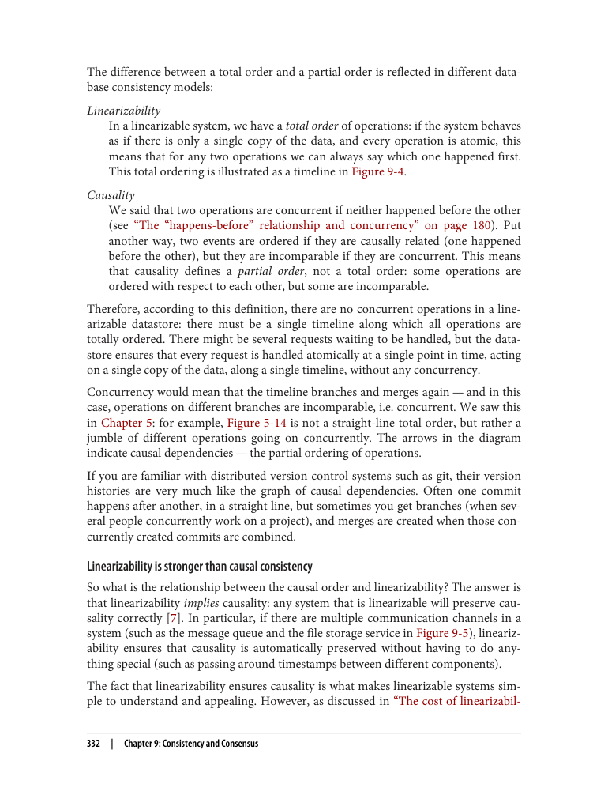

Sự khác biệt giữa một thứ tự toàn phần (total order) và một thứ tự bộ phận (partial order) được phản ánh trực tiếp trong các mô hình nhất quán cơ sở dữ liệu khác nhau:

* **Tính khả tuyến tính (Linearizability):**
  Trong một hệ thống khả tuyến tính, chúng ta có một *thứ tự toàn phần* (total order) của các thao tác: nếu hệ thống hành xử như thể chỉ có một bản sao dữ liệu duy nhất, và mọi thao tác đều có tính nguyên tử, điều này có nghĩa là đối với bất kỳ hai thao tác nào, chúng ta luôn có thể nói rõ thao tác nào đã xảy ra trước. Thứ tự toàn phần này được minh họa như một trục thời gian tuyến tính duy nhất trong **Hình 9-4 (Figure 9-4)**.
* **Quan hệ nhân quả (Causality):**
  Chúng ta đã nói rằng hai thao tác là đồng thời (concurrent) nếu không thao tác nào xảy ra trước thao tác kia (xem phần “Mối quan hệ ‘xảy ra trước’ và tính đồng thời (The ‘happens-before’ relationship and concurrency)” ở trang 180). Nói cách khác, hai sự kiện được sắp xếp thứ tự nếu chúng có liên hệ nhân quả với nhau (một sự kiện xảy ra trước sự kiện kia), nhưng chúng lại *không thể so sánh được* (incomparable) nếu chúng diễn ra đồng thời. Điều này có nghĩa là quan hệ nhân quả xác định một *thứ tự bộ phận* (partial order), chứ không phải một thứ tự toàn phần: một số thao tác được sắp xếp thứ tự tương đối với nhau, nhưng một số thao tác khác lại không thể so sánh được.

Do đó, theo đúng định nghĩa này, *không có các thao tác đồng thời* trong một kho dữ liệu khả tuyến tính: bắt buộc phải có một trục thời gian duy nhất (single timeline) dọc theo đó tất cả các thao tác được sắp xếp theo thứ tự toàn phần. Có thể có nhiều yêu cầu đang chờ được xử lý cùng lúc, nhưng kho dữ liệu đảm bảo rằng mọi yêu cầu đều được xử lý một cách nguyên tử tại một điểm thời gian duy nhất, tác động lên một bản sao dữ liệu duy nhất, dọc theo một trục thời gian duy nhất, mà không có bất kỳ sự đồng thời nào.

Tính đồng thời (concurrency) có nghĩa là trục thời gian bị phân nhánh (branches) và sau đó hợp nhất lại (merges) — và trong trường hợp này, các thao tác nằm trên các nhánh khác nhau là không thể so sánh được, tức là đồng thời với nhau. Chúng ta đã thấy điều này trong Chương 5: chẳng hạn, **Hình 5-14 (Figure 5-14)** không phải là một thứ tự toàn phần trên một đường thẳng, mà là một mạng lưới đan xen gồm nhiều thao tác khác nhau đang diễn ra đồng thời. Các mũi tên trong sơ đồ đó biểu thị các sự phụ thuộc nhân quả — tức thứ tự bộ phận (partial ordering) của các thao tác.

Nếu bạn quen thuộc với các hệ thống quản lý phiên bản phân tán (distributed version control systems) như `git`, lịch sử phiên bản của chúng rất giống với đồ thị phụ thuộc nhân quả (graph of causal dependencies). Thường thì các bản ghi nhận (commits) nối tiếp nhau trên một đường thẳng, nhưng đôi khi bạn sẽ gặp các nhánh (branches — khi nhiều người cùng làm việc đồng thời trên một dự án), và các điểm hợp nhất (merges) được tạo ra khi những bản ghi nhận được tạo đồng thời đó được kết hợp lại với nhau.

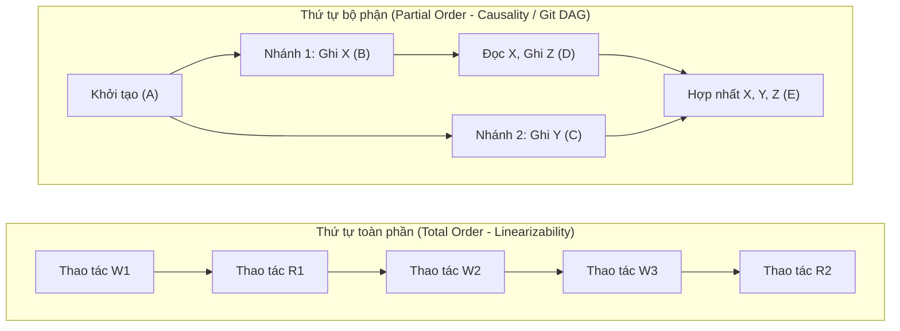

> 📝 **Giải thích thêm (không có trong sách):**
> Trong toán học rời rạc, quan hệ nhân quả $\rightarrow$ (happens-before của Lamport) tạo thành một **Poset (Partially Ordered Set — Tập hợp sắp thứ tự bộ phận nghiêm ngặt / Strict Partial Order)** với 3 tính chất:
> 1. **Tính phản đối xứng / Không phản xạ (Irreflexive):** Không có sự kiện $A$ nào xảy ra trước chính nó ($\neg(A \rightarrow A)$).
> 2. **Tính bất đối xứng (Asymmetric):** Nếu $A \rightarrow B$ thì không thể có $B \rightarrow A$.
> 3. **Tính bắc cầu (Transitive):** Nếu $A \rightarrow B$ và $B \rightarrow C$ thì $A \rightarrow C$.
>
> Điểm khác biệt duy nhất giữa **Partial Order** (Nhân quả) và **Total Order** (Khả tuyến tính) là tính chất **Toàn phần (Connexity / Totality)**:
> * Trong **Total Order**, với mọi $A \neq B$, bắt buộc $A < B$ hoặc $B < A$.
> * Trong **Partial Order**, tồn tại những cặp $(B, C)$ trong sơ đồ trên mà $\neg(B \rightarrow C)$ và $\neg(C \rightarrow B)$ — ta ký hiệu $B \parallel C$ ($B$ và $C$ diễn ra đồng thời / độc lập nhân quả).

---

#### Tính khả tuyến tính mạnh hơn tính nhất quán nhân quả (Linearizability is stronger than causal consistency)

Vậy mối quan hệ giữa thứ tự nhân quả (causal order) và tính khả tuyến tính (linearizability) là gì? Câu trả lời là *tính khả tuyến tính hàm ý (kéo theo) quan hệ nhân quả* (linearizability implies causality): bất kỳ hệ thống nào có tính khả tuyến tính đều sẽ bảo toàn quan hệ nhân quả một cách chính xác [7]. Đặc biệt, nếu có nhiều kênh giao tiếp trong một hệ thống (chẳng hạn như hàng đợi thông điệp và dịch vụ lưu trữ tệp trong **Hình 9-5 / Figure 9-5**), tính khả tuyến tính đảm bảo rằng quan hệ nhân quả được tự động bảo toàn mà không cần phải làm bất kỳ điều gì đặc biệt (chẳng hạn như truyền tay nhau các dấu thời gian giữa các thành phần khác nhau).

Việc tính khả tuyến tính đảm bảo quan hệ nhân quả chính là yếu tố làm cho các hệ thống khả tuyến tính trở nên đơn giản để hiểu và rất hấp dẫn. Tuy nhiên, như đã thảo luận trong phần “Chi phí của tính khả tuyến tính (The cost of linearizability)” ở trang 326, việc làm cho một hệ thống trở nên khả tuyến tính có thể gây tổn hại nghiêm trọng đến hiệu năng và tính sẵn sàng (availability) của nó, đặc biệt nếu hệ thống có độ trễ mạng đáng kể (ví dụ: nếu nó được phân tán về mặt địa lý). Vì lý do này, nhiều hệ thống dữ liệu phân tán đã từ bỏ hoàn toàn các đảm bảo về tính nhất quán, điều này mang lại cho chúng hiệu năng tốt hơn nhưng lại khiến chúng trở nên rất khó làm việc cùng.

Tin vui là một giải pháp dung hòa (middle ground) hoàn toàn khả thi. Tính khả tuyến tính không phải là cách duy nhất để bảo toàn quan hệ nhân quả — vẫn còn những cách khác nữa. Một hệ thống có thể đạt *tính nhất quán nhân quả* (causally consistent) mà không phải gánh chịu thiệt hại về hiệu năng của việc làm cho nó khả tuyến tính (đặc biệt, định lý CAP không áp dụng cho trường hợp này). Trên thực tế, tính nhất quán nhân quả là mô hình nhất quán *mạnh nhất có thể* mà không bị chậm lại do độ trễ mạng, và vẫn duy trì được tính sẵn sàng ngay cả khi xảy ra lỗi phân hoạch mạng [2, 43].

Trong nhiều trường hợp, các hệ thống thoạt nhìn có vẻ đòi hỏi tính khả tuyến tính nhưng thực chất lại chỉ cần tính nhất quán nhân quả, vốn có thể được triển khai hiệu quả hơn nhiều. Dựa trên quan sát này, các nhà nghiên cứu đang khám phá những loại cơ sở dữ liệu mới bảo toàn quan hệ nhân quả, với các đặc tính về hiệu năng và tính sẵn sàng tương tự như các hệ thống nhất quán cuối cùng (eventually consistent systems) [52, 53, 54].

Vì hướng nghiên cứu này còn khá mới mẻ, chưa có nhiều kết quả trong số đó được đưa vào các hệ thống thực tế (production systems), và vẫn còn những thách thức cần phải vượt qua [55, 56]. Tuy nhiên, đây là một hướng đi đầy hứa hẹn cho các hệ thống trong tương lai.

> 📝 **Giải thích thêm (không có trong sách):**
> Định lý của **Mahajan, Alvisi và Dahlin (2011)** — thường được gọi là định lý **CAC (Consistency, Availability, Convergence)** — đã chứng minh một kết quả lý thuyết cực kỳ quan trọng bổ sung cho định lý CAP:
> * Nếu bạn yêu cầu hệ thống phải luôn **Sẵn sàng (Available)** ngay cả khi mạng bị đứt (Network Partition) và dữ liệu giữa các nhánh mạng phải **Hội tụ (Convergent)** khi mạng nối lại, thì **Causal Consistency (Nhất quán nhân quả)** chính là giới hạn trần cao nhất (strongest possible consistency model) mà bạn có thể đạt được!
> * Bạn không thể đạt được Linearizability hay Sequential Consistency khi mạng bị phân hoạch nếu vẫn muốn giữ Availability, nhưng bạn **hoàn toàn có thể** đạt được Causal Consistency (COPS, Eiger, GentleRain, AntidoteDB, và cơ chế Causal Consistency Sessions trong MongoDB là các ví dụ tiêu biểu).

---

#### Theo dõi các mối quan hệ nhân quả (Tracking causal relationships)

Chúng ta sẽ không đi sâu vào mọi chi tiết tỉ mỉ về cách các hệ thống phi khả tuyến tính (non-linearizable systems) có thể duy trì tính nhất quán nhân quả, mà chỉ điểm qua một số ý tưởng cốt lõi.

Để duy trì quan hệ nhân quả, bạn cần biết thao tác nào đã xảy ra trước thao tác nào khác. Đây là một thứ tự bộ phận (partial order): các thao tác đồng thời có thể được xử lý theo bất kỳ thứ tự nào, nhưng nếu một thao tác đã xảy ra trước một thao tác khác, thì chúng bắt buộc phải được xử lý theo đúng thứ tự đó trên mọi bản sao (replica). Do đó, khi một bản sao xử lý một thao tác, nó phải đảm bảo rằng tất cả các thao tác đứng trước về mặt nhân quả (tất cả các thao tác đã *xảy ra trước*) đều đã được xử lý xong; nếu có bất kỳ thao tác đứng trước nào còn bị thiếu, thao tác đến sau bắt buộc phải chờ cho đến khi thao tác đứng trước đó được xử lý xong.

Để xác định các mối quan hệ nhân quả, chúng ta cần một cách nào đó để mô tả “tri thức” (knowledge) của một nút trong hệ thống. Nếu một nút đã nhìn thấy giá trị $X$ vào thời điểm nó phát đi thao tác ghi $Y$, thì $X$ và $Y$ có thể có liên hệ nhân quả với nhau. Các lập luận ở đây bắt đầu trông giống như những câu hỏi mà bạn thường thấy trong một cuộc điều tra hình sự về tội gian lận tài chính: *liệu vị CEO có biết về thông tin $X$ vào thời điểm ông ta đưa ra quyết định $Y$ hay không?*

Các kỹ thuật để xác định thao tác nào xảy ra trước thao tác nào khác tương tự như những gì chúng ta đã thảo luận trong phần “Phát hiện các thao tác ghi đồng thời (Detecting concurrent writes)” ở trang 178. Mục đó đã thảo luận về quan hệ nhân quả trong một kho dữ liệu không có nút dẫn đầu (leaderless datastore), nơi chúng ta cần phát hiện các thao tác ghi đồng thời lên cùng một khóa (key) nhằm ngăn chặn việc mất mát dữ liệu cập nhật (lost updates). Tính nhất quán nhân quả còn tiến xa hơn thế: nó cần theo dõi các mối quan hệ nhân quả *trên toàn bộ cơ sở dữ liệu* (across the entire database), chứ không chỉ đối với một khóa đơn lẻ. Các *vectơ phiên bản* (version vectors) có thể được tổng quát hóa để thực hiện điều này [57].

Để xác định thứ tự nhân quả, cơ sở dữ liệu cần biết phiên bản dữ liệu nào đã được ứng dụng đọc. Đây là lý do tại sao, trong **Hình 5-13 (Figure 5-13)**, số hiệu phiên bản (version number) từ thao tác trước đó lại được truyền ngược trở lại cho cơ sở dữ liệu khi thực hiện một thao tác ghi. Một ý tưởng tương tự cũng xuất hiện trong cơ chế phát hiện xung đột của Cô lập bản chụp khả tuần tự (Serializable Snapshot Isolation), như đã thảo luận trong phần “Cô lập bản chụp khả tuần tự (SSI) (Serializable snapshot isolation (SSI))” ở trang 252: khi một giao dịch muốn cam kết (commit), cơ sở dữ liệu sẽ kiểm tra xem phiên bản dữ liệu mà giao dịch đó đã đọc có còn mới nhất hay không. Để làm được điều này, cơ sở dữ liệu phải theo dõi chặt chẽ dữ liệu nào đã được đọc bởi giao dịch nào.

---

### Sắp xếp thứ tự bằng số thứ tự (Sequence number ordering)

Mặc dù quan hệ nhân quả là một khái niệm lý thuyết quan trọng, việc thực sự theo dõi tất cả các sự phụ thuộc nhân quả có thể trở nên thiếu thực tế (impractical). Trong nhiều ứng dụng, các máy khách (clients) đọc rất nhiều dữ liệu trước khi ghi một thứ gì đó, và khi ấy không rõ liệu thao tác ghi đó phụ thuộc nhân quả vào *tất cả* hay chỉ *một số* trong những lần đọc trước đó. Việc theo dõi tường minh toàn bộ dữ liệu đã được đọc sẽ đồng nghĩa với một chi phí phụ trội (overhead) khổng lồ.

Tuy nhiên, có một cách tốt hơn: chúng ta có thể sử dụng các *số thứ tự* (sequence numbers) hoặc *dấu thời gian* (timestamps) để sắp xếp thứ tự các sự kiện. Một dấu thời gian không nhất thiết phải lấy từ đồng hồ đo thời gian trong ngày (time-of-day clock / physical clock), vốn có rất nhiều vấn đề như đã thảo luận trong phần “Đồng hồ không đáng tin cậy (Unreliable Clocks)” ở trang 278. Một dấu thời gian cũng có thể đến từ một *đồng hồ logic* (logical clock), tức là một thuật toán chuyên sinh ra một chuỗi các con số để định danh các thao tác — thường sử dụng các bộ đếm (counters) được tăng lên sau mỗi thao tác.

Những số thứ tự hoặc dấu thời gian như vậy rất nhỏ gọn (chỉ tốn vài byte kích thước), và chúng cung cấp một *thứ tự toàn phần* (total order): nghĩa là mọi thao tác đều có một số thứ tự duy nhất, và bạn luôn có thể so sánh hai số thứ tự để xác định số nào lớn hơn (tức là thao tác nào đã xảy ra muộn hơn).

Đặc biệt, chúng ta có thể tạo ra các số thứ tự theo một thứ tự toàn phần mà *nhất quán với quan hệ nhân quả* (consistent with causality):$^{vii}$ chúng ta cam kết rằng nếu thao tác $A$ xảy ra trước thao tác $B$ về mặt nhân quả ($A \rightarrow B$), thì $A$ chắc chắn sẽ đứng trước $B$ trong thứ tự toàn phần ($A$ có số thứ tự nhỏ hơn $B$). Các thao tác đồng thời có thể được sắp xếp thứ tự một cách tùy ý. Một thứ tự toàn phần như vậy nắm bắt được toàn bộ thông tin nhân quả, đồng thời áp đặt thêm nhiều ràng buộc thứ tự hơn mức mà quan hệ nhân quả thực sự đòi hỏi.

> $^{vii}$ Một thứ tự toàn phần *không* nhất quán với quan hệ nhân quả thì rất dễ tạo ra, nhưng lại chẳng mấy hữu ích. Ví dụ, bạn có thể sinh một mã UUID ngẫu nhiên (random UUID, như UUIDv4) cho mỗi thao tác, và so sánh các UUID theo thứ tự từ điển (lexicographically) để định nghĩa thứ tự toàn phần của các thao tác. Đây là một thứ tự toàn phần hợp lệ về mặt toán học, nhưng các UUID ngẫu nhiên đó không cho bạn biết bất kỳ điều gì về việc thao tác nào thực sự xảy ra trước, hay liệu các thao tác đó có diễn ra đồng thời hay không.

Trong một cơ sở dữ liệu sử dụng sao chép một nút dẫn đầu (single-leader replication — xem phần “Nút dẫn đầu và nút theo sau (Leaders and Followers)” ở trang 146), nhật ký sao chép (replication log) định nghĩa một thứ tự toàn phần của các thao tác ghi hoàn toàn nhất quán với quan hệ nhân quả. Nút dẫn đầu chỉ cần đơn giản tăng một bộ đếm cho mỗi thao tác, và qua đó gán một số thứ tự tăng đơn điệu (monotonically increasing sequence number) cho từng thao tác trong nhật ký sao chép (ví dụ: LSN — Log Sequence Number trong PostgreSQL, hay GTID / Binlog position trong MySQL). Nếu một nút theo sau áp dụng các thao tác ghi theo đúng thứ tự chúng xuất hiện trong nhật ký sao chép, thì trạng thái của nút theo sau đó sẽ luôn nhất quán nhân quả (ngay cả khi nó đang bị trễ sao chép — replication lag so với nút dẫn đầu).

---

#### Các bộ sinh số thứ tự phi nhân quả (Non-causal sequence number generators)

Nếu không có một nút dẫn đầu duy nhất (có thể vì bạn đang sử dụng cơ sở dữ liệu đa nút dẫn đầu — multi-leader hoặc không có nút dẫn đầu — leaderless, hoặc vì cơ sở dữ liệu được phân mảnh — partitioned), việc làm thế nào để sinh ra các số thứ tự cho các thao tác trở nên ít rõ ràng hơn. Nhiều phương pháp khác nhau được sử dụng trong thực tế:

* Mỗi nút có thể tự sinh tập hợp các số thứ tự độc lập của riêng mình. Ví dụ, nếu bạn có hai nút, một nút có thể chỉ sinh các số lẻ và nút kia chỉ sinh các số chẵn. Tổng quát hơn, bạn có thể dành riêng một số bit trong biểu diễn nhị phân của số thứ tự để chứa một định danh nút duy nhất (unique node identifier), và điều này sẽ đảm bảo rằng hai nút khác nhau không bao giờ có thể sinh ra cùng một số thứ tự.
* Một phương pháp khác là đính kèm một dấu thời gian từ đồng hồ thời gian thực (time-of-day clock / physical clock) vào mỗi thao tác [58]. Các dấu thời gian như vậy không tuần tự liền mạch, nhưng nếu chúng có độ phân giải đủ cao, chúng có thể đủ để sắp xếp thứ tự toàn phần các thao tác. Thực tế này được sử dụng trong phương pháp giải quyết xung đột *ghi sau cùng thắng* (last write wins — LWW) — xem phần “Dấu thời gian để sắp xếp thứ tự các sự kiện (Timestamps for ordering events)” ở trang 283.
* Một lựa chọn thứ ba là cấp phát trước các khối số thứ tự (pre-allocate blocks of sequence numbers). Ví dụ, nút $A$ có thể nhận khối số thứ tự từ $1$ đến $1.000$, và nút $B$ có thể nhận khối từ $1.001$ đến $2.000$. Sau đó, mỗi nút có thể độc lập gán các số thứ tự từ khối của mình, và xin cấp phát một khối mới khi nguồn số thứ tự của nó bắt đầu cạn dần.

Ba lựa chọn này có hiệu năng tốt hơn và khả năng mở rộng (scalable) cao hơn nhiều so với việc đẩy toàn bộ các thao tác đi qua một nút dẫn đầu duy nhất chỉ để tăng một bộ đếm. Chúng tạo ra một số thứ tự duy nhất, tăng xấp xỉ (approximately increasing) cho mỗi thao tác. Tuy nhiên, cả ba phương pháp đều mắc chung một vấn đề nghiêm trọng: **các số thứ tự mà chúng sinh ra không nhất quán với quan hệ nhân quả (not consistent with causality)**.

Các vấn đề về nhân quả xảy ra bởi vì những bộ sinh số thứ tự này không theo dõi chính xác thứ tự của các thao tác diễn ra *xuyên qua các nút khác nhau* (across different nodes):

* Mỗi nút có thể xử lý một số lượng thao tác mỗi giây khác nhau. Do đó, nếu một nút sinh các số chẵn và nút kia sinh các số lẻ, bộ đếm cho các số chẵn có thể bị tụt lại phía sau bộ đếm cho các số lẻ, hoặc ngược lại. Nếu bạn có một thao tác mang số lẻ và một thao tác mang số chẵn, bạn không thể nói chính xác thao tác nào đã xảy ra trước về mặt nhân quả.
* Các dấu thời gian từ đồng hồ vật lý luôn chịu ảnh hưởng của độ lệch đồng hồ (clock skew), điều này có thể khiến chúng không nhất quán với quan hệ nhân quả. Ví dụ, hãy xem **Hình 8-3 (Figure 8-3)**, nơi chỉ ra một kịch bản trong đó một thao tác xảy ra *muộn hơn* về mặt nhân quả nhưng thực tế lại được gán một dấu thời gian *nhỏ hơn*.$^{viii}$
* Trong trường hợp bộ cấp phát theo khối (block allocator), một thao tác có thể được cấp một số thứ tự nằm trong khoảng từ $1.001$ đến $2.000$ (trên nút $B$), và một thao tác xảy ra *sau đó* về mặt nhân quả lại có thể được cấp một con số nằm trong khoảng từ $1$ đến $1.000$ (trên nút $A$). Ở đây, một lần nữa, số thứ tự lại hoàn toàn mâu thuẫn với quan hệ nhân quả.

> $^{viii}$ Vẫn có thể làm cho các dấu thời gian của đồng hồ vật lý trở nên nhất quán với quan hệ nhân quả: trong phần “Đồng hồ được đồng bộ hóa cho các bản chụp toàn cục (Synchronized clocks for global snapshots)” ở trang 285, chúng ta đã thảo luận về Google Spanner, hệ thống ước lượng độ lệch đồng hồ kỳ vọng và chủ động *chờ hết khoảng thời gian bất định* (commit wait) trước khi cam kết một thao tác ghi. Điều này đảm bảo rằng một giao dịch xảy ra sau về mặt nhân quả sẽ luôn được gán một dấu thời gian lớn hơn. Tuy nhiên, hầu hết các đồng hồ thông thường không thể cung cấp số liệu sai số bất định (uncertainty metric) cần thiết này.

> 💡 **Ví dụ bổ sung (không có trong sách):**
> Trong thực tế thiết kế hệ thống, cả 3 phương pháp sinh ID phi nhân quả nêu trên đều rất phổ biến:
> 1. **Chẵn/Lẻ (Step/Offset):** Trong MySQL Multi-Master (`auto_increment_increment = 2`, `auto_increment_offset = 1` trên Node 1 và `2` trên Node 2). Nếu Node 1 chịu tải cao đã tăng tới ID `1001`, trong khi Node 2 ít tải mới ở ID `14`: một bản ghi tạo ở Node 1 (`ID = 1001`) rồi kích hoạt một sự kiện tạo bản ghi phụ thuộc ở Node 2 sẽ nhận `ID = 16`. Nếu bạn `ORDER BY id ASC`, bản ghi hệ quả (`16`) lại xếp trước bản ghi nguyên nhân (`1001`)!
> 2. **Physical Clock + Node ID:** Chính là **Twitter Snowflake ID** (41-bit timestamp + 10-bit machine ID + 12-bit sequence). Nếu đồng hồ NTP của Server A nhanh hơn Server B 5ms, thì một request hoàn tất ở Server A tại $t = 105\text{ms}$ rồi gọi sang Server B sẽ được gán Snowflake ID ở $t = 101\text{ms}$ — đảo ngược nhân quả!
> 3. **Block Allocator (Hi/Lo algorithm):** Cơ chế sequence cache của Oracle/PostgreSQL (`CREATE SEQUENCE ... CACHE 1000`) trên nhiều instance hoặc `Hi/Lo` generator trong Hibernate.

---

#### Dấu thời gian Lamport (Lamport timestamps)

Mặc dù cả ba bộ sinh số thứ tự nêu trên đều không nhất quán với quan hệ nhân quả, thực ra có một phương pháp rất đơn giản để sinh ra các số thứ tự hoàn toàn nhất quán với quan hệ nhân quả. Nó được gọi là *dấu thời gian Lamport* (Lamport timestamp), được đề xuất vào năm 1978 bởi Leslie Lamport [59], trong một bài báo mà ngày nay đã trở thành một trong những công trình được trích dẫn nhiều nhất trong lĩnh vực hệ thống phân tán (*"Time, Clocks, and the Ordering of Events in a Distributed System"*).

Việc sử dụng dấu thời gian Lamport được minh họa trong **Hình 9-8 (Figure 9-8)**. Mỗi nút có một định danh duy nhất (unique identifier), và mỗi nút duy trì một bộ đếm (counter) ghi lại số lượng thao tác mà nó đã xử lý. Khi đó, dấu thời gian Lamport đơn giản chỉ là một cặp giá trị `(bộ đếm, ID nút)` — tức `(counter, node ID)`. Hai nút đôi khi có thể có cùng một giá trị bộ đếm, nhưng bằng cách đưa thêm `node ID` vào trong dấu thời gian, mỗi dấu thời gian đều trở nên duy nhất tuyệt đối.

**Hình 9-8 – Dấu thời gian Lamport cung cấp một thứ tự toàn phần nhất quán với quan hệ nhân quả (Figure 9-8. Lamport timestamps provide a total ordering consistent with causality.)**

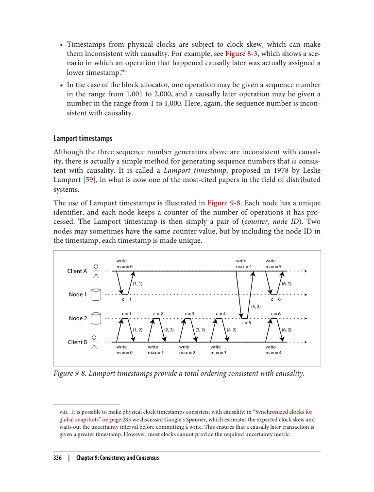

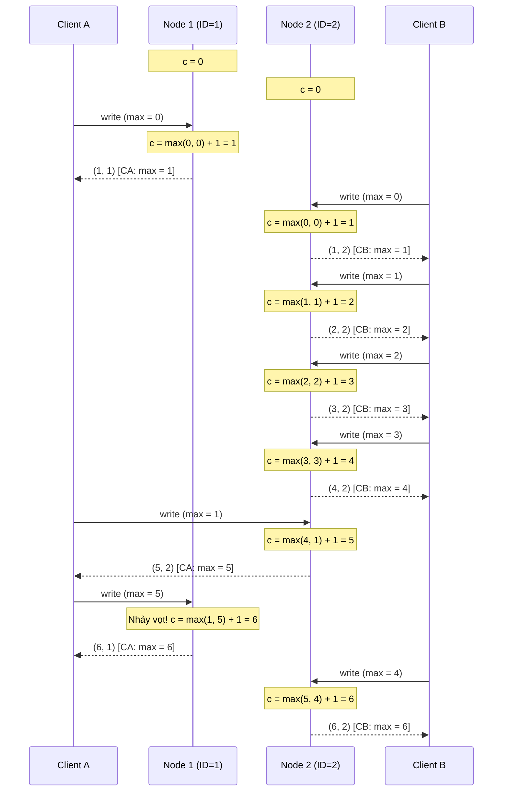

Một dấu thời gian Lamport không có bất kỳ mối liên hệ nào với đồng hồ đo thời gian vật lý trong ngày, nhưng nó cung cấp một *thứ tự toàn phần* (total ordering): nếu bạn có hai dấu thời gian $(c_1, \text{node}_1)$ và $(c_2, \text{node}_2)$, dấu thời gian nào có giá trị bộ đếm $c$ lớn hơn sẽ là dấu thời gian lớn hơn; nếu các giá trị bộ đếm bằng nhau ($c_1 = c_2$), dấu thời gian nào có `node ID` lớn hơn sẽ là dấu thời gian lớn hơn:

$$(c_1, \text{node}_1) < (c_2, \text{node}_2) \iff (c_1 < c_2) \lor (c_1 = c_2 \land \text{node}_1 < \text{node}_2)$$

Cho đến điểm này, cơ chế trên về cơ bản vẫn giống hệt như các bộ đếm chẵn/lẻ trong mục trước. Ý tưởng then chốt của dấu thời gian Lamport — yếu tố giúp chúng **nhất quán với quan hệ nhân quả** — nằm ở quy tắc sau đây: **mọi nút và mọi máy khách đều theo dõi giá trị bộ đếm lớn nhất (*maximum counter value*) mà nó từng nhìn thấy cho đến hiện tại, và đính kèm giá trị cực đại đó vào trong mọi yêu cầu (request)**. Khi một nút nhận được một yêu cầu gửi đến có giá trị bộ đếm cực đại lớn hơn bộ đếm hiện tại của chính nó, nó sẽ lập tức tăng bộ đếm của mình nhảy vọt lên giá trị cực đại đó (cộng thêm 1 cho sự kiện mới: $c_{\text{new}} = \max(c_{\text{local}}, c_{\text{msg}}) + 1$).

Điều này được thể hiện rõ trong **Hình 9-8 (Figure 9-8)**, nơi `Client A` nhận được một giá trị bộ đếm là `5` (tức dấu thời gian `(5, 2)`) từ `Node 2`, và sau đó gửi giá trị cực đại `max = 5` đó sang cho `Node 1`. Vào thời điểm đó, bộ đếm của `Node 1` mới chỉ đang ở mức `1`, nhưng nó đã lập tức được đẩy tiến lên `5`, vì vậy thao tác tiếp theo trên `Node 1` có giá trị bộ đếm được tăng lên thành `6` (tạo ra dấu thời gian `(6, 1)`).

Miễn là giá trị bộ đếm cực đại luôn được mang theo cùng với mọi thao tác (cả giữa client và server lẫn giữa các server với nhau), cơ chế này đảm bảo rằng thứ tự thu được từ các dấu thời gian Lamport luôn nhất quán với quan hệ nhân quả, bởi vì mọi sự phụ thuộc nhân quả đều dẫn đến một dấu thời gian có giá trị lớn hơn một cách nghiêm ngặt ($A \rightarrow B \implies L(A) < L(B)$).

Dấu thời gian Lamport đôi khi bị nhầm lẫn với các *vectơ phiên bản* (version vectors), thứ mà chúng ta đã thấy trong phần “Phát hiện các thao tác ghi đồng thời (Detecting concurrent writes)” ở trang 178. Mặc dù có một số điểm tương đồng, chúng phục vụ hai mục đích hoàn toàn khác nhau: các vectơ phiên bản có thể phân biệt được liệu hai thao tác là *đồng thời* (concurrent) hay thao tác này *phụ thuộc nhân quả* vào thao tác kia, trong khi dấu thời gian Lamport luôn áp đặt một thứ tự toàn phần. Từ thứ tự toàn phần của dấu thời gian Lamport, bạn **không thể** biết được hai thao tác là đồng thời hay phụ thuộc nhân quả vào nhau (tức là $L(A) < L(B)$ **không** suy ra được $A \rightarrow B$; ví dụ trong **Hình 9-8**, `(1, 1)` nhỏ hơn `(1, 2)` nhưng hai thao tác ghi đầu tiên của `Client A` và `Client B` hoàn toàn diễn ra đồng thời!).

> 📝 **Giải thích thêm (không có trong sách): So sánh Lamport Timestamps, Vector Clocks và Hybrid Logical Clocks (HLC)**
>
> Trong các cơ sở dữ liệu phân tán hiện đại, ba loại đồng hồ logic này tạo nên nền tảng của quản lý thứ tự sự kiện:
>
> | Tiêu chí | Lamport Timestamp | Vector Clock / Version Vector | Hybrid Logical Clock (HLC) |
> | :--- | :--- | :--- | :--- |
> | **Cấu trúc dữ liệu** | Cặp số nguyên `(counter, node_id)` | Mảng/Map `[c_1, c_2, ..., c_N]` cho $N$ nút | Bộ ba `(physical_time, logical_counter, node_id)` |
> | **Kích thước không gian** | $O(1)$ (rất nhỏ gọn, ~8-16 bytes) | $O(N)$ (phình to theo số lượng nút $N$) | $O(1)$ (thường gói gọn trong 64-bit hoặc 96-bit) |
> | **Tính chất toán học** | $A \rightarrow B \implies L(A) < L(B)$ (Một chiều) | $A \rightarrow B \iff V(A) < V(B)$ (Hai chiều) | $A \rightarrow B \implies HLC(A) < HLC(B)$ + bám sát giờ NTP |
> | **Phát hiện xung đột đồng thời ($A \parallel B$)?** | **Không** (luôn ép về thứ tự toàn phần) | **Có** (khi $V(A) \not< V(B)$ và $V(B) \not< V(A)$) | **Không** (ép về thứ tự toàn phần giống Lamport) |
> | **Đọc bản chụp theo thời gian thực (`AS OF SYSTEM TIME`)?** | **Không** (bộ đếm logic không gắn với giờ thực) | **Không** | **Có** (giá trị `physical_time` luôn sát với đồng hồ tường) |
> | **Hệ thống thực tế sử dụng** | Các giao thức đồng thuận cơ bản, hàng đợi phân tán | Riak, Voldemort, Dynamo (nhận diện sibling) | **CockroachDB**, **MongoDB** (ClusterTime), **YugabyteDB** |
>
> 💡 **Ví dụ bổ sung (không có trong sách): Cách CockroachDB sử dụng Hybrid Logical Clock (HLC)**
> Tại sao CockroachDB và MongoDB không dùng Lamport Clock thuần túy mà dùng **HLC** (do Kulkarni et al. đề xuất năm 2014)?
> * Với Lamport Clock thuần túy, nếu Node 1 xử lý 1 triệu request/giây, bộ đếm tăng lên `1,000,000`. Người dùng không thể truy vấn `SELECT * FROM orders AS OF SYSTEM TIME '2026-10-01 12:00:00'` vì con số `1,000,000` vô nghĩa với thời gian thực.
> * **HLC** kết hợp đồng hồ vật lý `pt` (NTP) và bộ đếm logic `l`: mỗi khi có sự kiện hoặc nhận tin nhắn từ nút khác có timestamp lớn hơn nhưng đồng hồ vật lý tại nút hiện tại chưa kịp trôi tới, HLC giữ nguyên phần thời gian lớn nhất và chỉ tăng phần bộ đếm logic `l`. Khi đồng hồ vật lý thực sự vượt qua, `l` được reset về `0`. Nhờ đó, HLC vừa đạt tính nhân quả chặt chẽ của Lamport ($O(1)$ dung lượng), vừa dùng được như đồng hồ vật lý đơn điệu mà không cần phần cứng GPS/đồng hồ nguyên tử (TrueTime) đắt đỏ như Google Spanner!

---

#### Sắp xếp thứ tự bằng dấu thời gian là chưa đủ (Timestamp ordering is not sufficient)

Mặc dù dấu thời gian Lamport định nghĩa một thứ tự toàn phần của các thao tác hoàn toàn nhất quán với quan hệ nhân quả, nhưng chúng vẫn **chưa đủ** để giải quyết nhiều bài toán phổ biến trong các hệ thống phân tán.

Ví dụ, hãy xem xét một hệ thống cần đảm bảo rằng một tên người dùng (`username`) định danh duy nhất cho một tài khoản người dùng. Nếu hai người dùng đồng thời cố gắng tạo một tài khoản với cùng một `username`, một trong hai người phải thành công và người kia phải thất bại. (Chúng ta đã từng chạm tới bài toán này trước đây trong phần “Nút dẫn đầu và khóa (The leader and the lock)” ở trang 293.)

Thoạt nhìn, có vẻ như một thứ tự toàn phần của các thao tác (ví dụ: sử dụng dấu thời gian Lamport) sẽ đủ để giải quyết vấn đề này: nếu hai tài khoản có cùng `username` được tạo ra, hãy chọn thao tác nào có dấu thời gian nhỏ hơn làm người chiến thắng (người đã giành được `username` đó trước), và để cho thao tác có dấu thời gian lớn hơn thất bại. Vì các dấu thời gian có thứ tự toàn phần, phép so sánh này luôn hợp lệ và rõ ràng.

Cách tiếp cận này hoạt động tốt để xác định người chiến thắng *sau khi sự việc đã rồi* (after the fact / ex-post): một khi bạn đã thu thập đầy đủ tất cả các thao tác tạo `username` trong toàn hệ thống, bạn có thể so sánh dấu thời gian của chúng. Tuy nhiên, nó **không đủ** khi một nút vừa mới nhận được một yêu cầu từ người dùng đòi tạo một `username`, và cần phải quyết định *ngay lập tức* (right now) xem yêu cầu đó nên thành công hay thất bại. Ngay tại thời điểm đó, nút này hoàn toàn không biết liệu có một nút nào khác đang đồng thời trong quá trình tạo một tài khoản với cùng `username` đó hay không, và nút kia có thể sẽ gán dấu thời gian nào cho thao tác của nó.

Để chắc chắn rằng không có nút nào khác đang đồng thời tạo một tài khoản với cùng `username` và mang một dấu thời gian nhỏ hơn, bạn sẽ phải kiểm tra với *mọi nút khác* trong hệ thống để xem chúng đang làm gì [59]. Nếu một trong các nút khác bị lỗi hoặc không thể liên lạc được do sự cố mạng, toàn bộ hệ thống này sẽ lập tức bị đình trệ hoàn toàn (grind to a halt). Đây tuyệt nhiên không phải là kiểu hệ thống chịu lỗi (fault-tolerant system) mà chúng ta cần.

Vấn đề cốt lõi ở đây là thứ tự toàn phần của các thao tác **chỉ lộ diện sau khi bạn đã thu thập tất cả các thao tác** (the total order of operations only emerges after you have collected all of the operations). Nếu một nút khác đã sinh ra một số thao tác, nhưng bạn chưa biết chúng là gì, bạn không thể xây dựng được thứ tự cuối cùng của các thao tác: những thao tác chưa biết đến từ nút kia có thể cần phải được chèn vào nhiều vị trí khác nhau đứng trước bạn trong thứ tự toàn phần.

Tóm lại: để triển khai một tính năng như ràng buộc duy nhất (uniqueness constraint) cho tên người dùng, việc chỉ có một thứ tự toàn phần của các thao tác là chưa đủ — **bạn còn cần phải biết khi nào thứ tự đó được chốt hạ dứt điểm (when that order is finalized)**. Nếu bạn có một thao tác tạo `username`, và bạn chắc chắn rằng không có nút nào khác có thể chèn thêm một yêu cầu giành cùng `username` đó vào *phía trước* thao tác của bạn trong thứ tự toàn phần nữa, thì lúc đó bạn mới có thể tuyên bố thao tác thành công một cách an toàn.

Ý tưởng về việc biết được khi nào thứ tự toàn phần của bạn đã được chốt hạ dứt điểm được gói gọn trong chủ đề *phát quảng bá có thứ tự toàn phần* (total order broadcast).

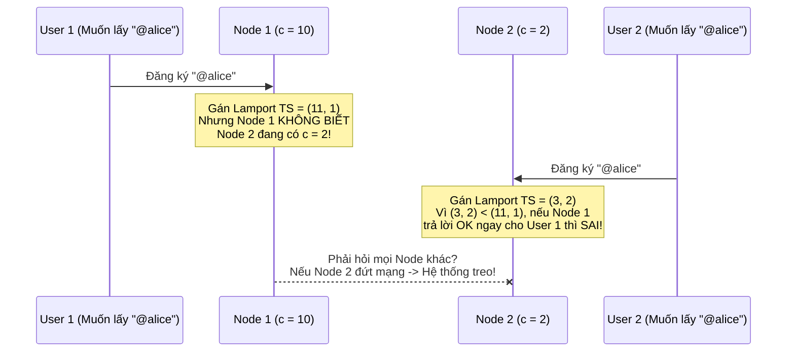

> 📝 **Giải thích thêm (không có trong sách):**
> Hãy phân biệt rõ sự khác nhau giữa **Thứ tự hậu kiểm (Retroactive / Ex-post Total Order)** của dấu thời gian Lamport và **Thứ tự tiền kiểm đã chốt (Finalized / Prefix-closed Total Order)**:
> * Với **Lamport Timestamps**, giả sử `Node 1` đang ở bộ đếm $c = 100$ và vừa tạo sự kiện `(101, 1)`. Cùng lúc đó, `Node 2` đang ở tận bộ đếm $c = 5$ (do ít nhận request hơn) và tạo sự kiện `(6, 2)`. Khi hai sự kiện này được đồng bộ sang nhau sau đó, `(6, 2)` sẽ chèn vào **trước** `(101, 1)`! Nói cách khác, quá khứ trước mốc `(101, 1)` vẫn chưa đóng lại (not closed) — bất kỳ nút nào có bộ đếm thấp hơn đều có thể tạo ra một sự kiện mới nhưng mang timestamp "nhỏ hơn" và nhảy vào đứng trước `(101, 1)`.
> * Trong bài báo gốc năm 1978 của Leslie Lamport về thuật toán khóa phân tán (Lamport's Distributed Mutual Exclusion), để một nút biết chắc chắn không còn sự kiện nào nhỏ hơn `(101, 1)` từ các nút khác, nó phải phát quảng bá (broadcast) yêu cầu tới **tất cả $N-1$ nút còn lại** và chờ nhận được phản hồi từ **cả $N-1$ nút** có timestamp lớn hơn `(101, 1)`. Chỉ cần **1 nút** chết, cả cụm gồm $N$ nút sẽ bị treo vĩnh viễn! Đó là lý do Lamport Timestamps không thể tự mình giải quyết bài toán đồng thuận chịu lỗi (fault-tolerant consensus).


---

### Phát quảng bá có thứ tự toàn phần (Total order broadcast)

Nếu chương trình của bạn chỉ chạy trên một nhân CPU đơn lẻ (single CPU core), việc xác định một thứ tự toàn phần của các thao tác là vô cùng dễ dàng: đó đơn giản là thứ tự mà chúng được thực thi bởi CPU. Tuy nhiên, trong một hệ thống phân tán, việc làm cho tất cả các nút cùng đồng ý về một thứ tự toàn phần duy nhất của các thao tác lại rất phức tạp. Trong mục trước, chúng ta đã thảo luận về việc sắp xếp thứ tự bằng dấu thời gian hoặc số thứ tự, nhưng nhận thấy rằng nó không mạnh mẽ bằng sao chép một nút dẫn đầu (nó không đủ để triển khai một ràng buộc duy nhất).

Như đã thảo luận, mô hình sao chép một nút dẫn đầu (single-leader replication) xác định một thứ tự toàn phần của các thao tác bằng cách chọn một nút làm nút dẫn đầu (leader), và sắp xếp tuần tự tất cả các thao tác trên một nhân CPU duy nhất tại nút dẫn đầu đó. Thách thức đặt ra sau đó là làm thế nào để mở rộng quy mô hệ thống nếu thông lượng (throughput) vượt quá khả năng xử lý của một nút dẫn đầu đơn lẻ, và làm thế nào để xử lý việc chuyển đổi dự phòng (failover) trong trường hợp nút dẫn đầu bị lỗi (xem phần “Xử lý sự cố ngừng hoạt động của nút (Handling node outages)” ở trang 150). Trong các tài liệu nghiên cứu về hệ thống phân tán, bài toán này được biết đến với tên gọi *phát quảng bá có thứ tự toàn phần* (total order broadcast) hoặc *phát quảng bá nguyên tử* (atomic broadcast) [30, 60, 61].$^{ix}$

> $^{ix}$ Thuật ngữ *phát quảng bá nguyên tử* (atomic broadcast) mang tính truyền thống lịch sử, nhưng nó cực kỳ dễ gây nhầm lẫn vì không nhất quán với các cách dùng khác của từ *nguyên tử* (atomic): nó không liên quan gì đến tính nguyên tử (atomicity) trong các giao dịch ACID, và chỉ liên quan gián tiếp đến các thao tác nguyên tử (theo nghĩa lập trình đa luồng) hoặc các thanh ghi nguyên tử (lưu trữ khả tuyến tính). Thuật ngữ *phát đa hướng có thứ tự toàn phần* (total order multicast) là một từ đồng nghĩa khác.

> **Phạm vi của đảm bảo thứ tự (Scope of ordering guarantee)**
>
> 
>
> Các cơ sở dữ liệu được phân mảnh (partitioned databases) với một nút dẫn đầu riêng cho mỗi phân mảnh (single leader per partition) thường chỉ duy trì thứ tự *trong phạm vi từng phân mảnh* (per partition), điều đó có nghĩa là chúng không thể cung cấp các đảm bảo về tính nhất quán (ví dụ: các bản chụp nhất quán, các tham chiếu khóa ngoại) *xuyên qua nhiều phân mảnh* (across partitions). Việc sắp xếp thứ tự toàn phần xuyên qua tất cả các phân mảnh là khả thi, nhưng đòi hỏi sự phối hợp bổ sung giữa các phân mảnh [62].

Phát quảng bá có thứ tự toàn phần thường được mô tả như một giao thức để trao đổi các thông điệp (messages) giữa các nút. Một cách không hình thức (informally), nó yêu cầu hai thuộc tính cốt lõi sau đây phải luôn luôn được thỏa mãn:

* **Chuyển giao đáng tin cậy (Reliable delivery):**
  Không có thông điệp nào bị mất: nếu một thông điệp được chuyển giao (delivered) đến một nút, nó bắt buộc phải được chuyển giao đến *tất cả* các nút.
* **Chuyển giao có thứ tự toàn phần (Totally ordered delivery):**
  Các thông điệp được chuyển giao đến mọi nút theo *cùng một thứ tự y hệt nhau* (in the same order).

Một thuật toán đúng đắn cho phát quảng bá có thứ tự toàn phần phải đảm bảo rằng cả hai thuộc tính tin cậy (reliability) và thứ tự (ordering) này luôn được thỏa mãn, ngay cả khi các nút hoặc mạng gặp sự cố. Tất nhiên, các thông điệp sẽ không thể được chuyển giao trong lúc mạng đang bị gián đoạn, nhưng một thuật toán có thể tiếp tục thử lại (retrying) để các thông điệp được truyền qua khi mạng cuối cùng được sửa chữa phục hồi (và khi đó chúng vẫn bắt buộc phải được chuyển giao theo đúng thứ tự đã định).

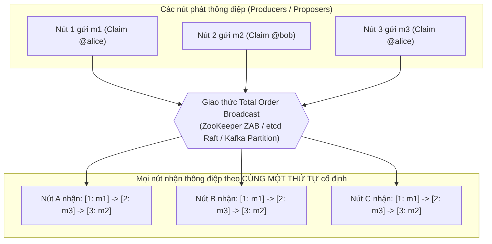

---

#### Sử dụng phát quảng bá có thứ tự toàn phần (Using total order broadcast)

Các dịch vụ đồng thuận (consensus services) như ZooKeeper và etcd thực chất chính là đang triển khai phát quảng bá có thứ tự toàn phần. Đây là một gợi ý rõ ràng cho thấy có một mối liên hệ vô cùng chặt chẽ giữa phát quảng bá có thứ tự toàn phần và sự đồng thuận (consensus), điều mà chúng ta sẽ khám phá kỹ hơn ở phần sau của chương này.

Phát quảng bá có thứ tự toàn phần chính xác là thứ bạn cần để thực hiện sao chép cơ sở dữ liệu (database replication): nếu mỗi thông điệp đại diện cho một thao tác ghi vào cơ sở dữ liệu, và mọi bản sao (replica) đều xử lý cùng các thao tác ghi đó theo cùng một thứ tự y hệt nhau, thì các bản sao sẽ luôn duy trì được trạng thái nhất quán với nhau (ngoại trừ bất kỳ độ trễ sao chép tạm thời nào). Nguyên lý này được gọi là *sao chép máy trạng thái* (state machine replication — SMR) [63], và chúng ta sẽ quay lại với nó một cách sâu sắc trong Chương 11.

Tương tự, phát quảng bá có thứ tự toàn phần có thể được sử dụng để triển khai các giao dịch khả tuần tự (serializable transactions): như đã thảo luận trong phần “Thực thi tuần tự thực sự (Actual serial execution)” ở trang 243, nếu mỗi thông điệp đại diện cho một giao dịch tất định (deterministic transaction) sẽ được thực thi dưới dạng một thủ tục lưu trữ (stored procedure), và nếu mọi nút đều xử lý các thông điệp đó theo cùng một thứ tự, thì các phân mảnh và các bản sao của cơ sở dữ liệu sẽ luôn được giữ nhất quán với nhau [64].

Một khía cạnh cực kỳ quan trọng của phát quảng bá có thứ tự toàn phần là **thứ tự được cố định ngay tại thời điểm các thông điệp được chuyển giao (the order is fixed at the time the messages are delivered)**: một nút tuyệt đối không được phép chèn lùi (retroactively insert) một thông điệp vào một vị trí sớm hơn trong thứ tự nếu các thông điệp tiếp theo sau đó đã được chuyển giao rồi. Chính thực tế này làm cho phát quảng bá có thứ tự toàn phần **mạnh hơn** việc sắp xếp thứ tự bằng dấu thời gian (timestamp ordering).

Một góc nhìn khác về phát quảng bá có thứ tự toàn phần là xem nó như một cách để tạo ra một *nhật ký* (log — giống như trong nhật ký sao chép, nhật ký giao dịch hoặc nhật ký ghi trước — write-ahead log): việc chuyển giao một thông điệp giống hệt như việc ghi nối tiếp vào cuối nhật ký (appending to the log). Bởi vì tất cả các nút đều phải chuyển giao cùng các thông điệp theo cùng một thứ tự, tất cả các nút đều có thể đọc nhật ký đó và nhìn thấy cùng một chuỗi thông điệp hoàn toàn giống nhau.

Phát quảng bá có thứ tự toàn phần cũng rất hữu ích để triển khai một dịch vụ khóa (lock service) cung cấp các *thẻ rào chắn* (fencing tokens — xem phần “Thẻ rào chắn (Fencing tokens)” ở trang 294). Mọi yêu cầu xin cấp khóa đều được ghi nối tiếp như một thông điệp vào trong nhật ký, và tất cả các thông điệp đều được đánh số tuần tự theo đúng thứ tự chúng xuất hiện trong nhật ký. Số thứ tự này sau đó có thể đóng vai trò làm thẻ rào chắn (fencing token), bởi vì nó tăng đơn điệu nghiêm ngặt. Trong ZooKeeper, số thứ tự này được gọi là `zxid` [15] (và trong etcd/Raft, nó tương ứng với `revision` hoặc `raft index`).

> 📝 **Giải thích thêm (không có trong sách): Total Order Broadcast trong thực tế — ZooKeeper (ZAB), etcd (Raft) và Apache Kafka**
>
> Khái niệm **Total Order Broadcast** tưởng chừng hàn lâm nhưng thực ra đang chạy ở tầng lõi của hầu hết hạ tầng phân tán hiện đại:
>
> 1. **Apache ZooKeeper (Giao thức ZAB — ZooKeeper Atomic Broadcast):**
>    * Tên gọi của giao thức lõi trong ZooKeeper chính là **ZAB (ZooKeeper Atomic Broadcast)** — mà như chú thích $^{ix}$ đã chỉ rõ, *Atomic Broadcast* chính là tên gọi khác của *Total Order Broadcast*.
>    * Mỗi thay đổi trạng thái trong ZooKeeper được gán một mã định danh 64-bit gọi là `zxid` (ZooKeeper Transaction ID), bao gồm 32-bit cao là `epoch` (nhiệm kỳ của leader) và 32-bit thấp là `counter` tăng tuần tự không có khoảng trống trong nhiệm kỳ đó.
> 2. **etcd / Consul / CockroachDB (Giao thức Raft):**
>    * Trong Raft, mỗi lệnh của client được Leader ghi vào một vị trí xác định trong mảng log (`log index`: `1, 2, 3, ...`). Khi quá bán (quorum) các nút đã ghi nhận entry tại `index = k`, entry đó được coi là `committed` và máy trạng thái (State Machine) trên từng nút sẽ áp dụng (apply) tuần tự từ `index = 1, 2, ..., k` không bao giờ nhảy cóc và không bao giờ chèn lùi.
> 3. **Apache Kafka (Single-Partition Total Order Broadcast):**
>    * Mỗi **Partition** trong một Kafka Topic chính là một thể hiện thực tế của Total Order Broadcast! Bên trong một partition duy nhất, Partition Leader gán cho mỗi message một `offset` nguyên tăng tuần tự (`0, 1, 2, 3, ...`). Mọi Consumer đọc từ partition đó đều thấy các message theo đúng thứ tự `offset` bất biến này.
>    * Tuy nhiên, đúng như khung lưu ý *"Phạm vi của đảm bảo thứ tự (Scope of ordering guarantee)"* của tác giả: một Kafka Topic có nhiều Partitions **chỉ đảm bảo thứ tự toàn phần trong từng Partition đơn lẻ**, chứ không đảm bảo thứ tự toàn phần xuyên qua tất cả các Partitions! Nếu bạn cần State Machine Replication (ví dụ dùng Kafka làm Event Sourcing log cho số dư tài khoản), bạn phải định tuyến (partition key) mọi sự kiện của cùng một `account_id` vào cùng một partition.
> 4. **Calvin / VoltDB / FoundationDB (Deterministic Database & Sequencer):**
>    * Trong kiến trúc **Calvin** (công trình của Alexander Thomson và Daniel Abadi [64]), tầng **Sequencer** thực hiện Total Order Broadcast cho một lô (batch) các giao dịch trước khi bất kỳ nút lưu trữ nào thực thi chúng. Vì thứ tự toàn cục đã được đóng đinh trong log từ đầu, các phân mảnh (shards) không cần chạy giao thức Two-Phase Commit (2PC) nặng nề lúc kết thúc giao dịch nữa!

---

#### Triển khai lưu trữ khả tuyến tính bằng phát quảng bá có thứ tự toàn phần (Implementing linearizable storage using total order broadcast)

Như được minh họa trong **Hình 9-4 (Figure 9-4)**, trong một hệ thống khả tuyến tính luôn tồn tại một thứ tự toàn phần của các thao tác. Điều đó có nghĩa là tính khả tuyến tính (linearizability) giống hệt như phát quảng bá có thứ tự toàn phần (total order broadcast) phải không? Không hẳn như vậy, nhưng có những mối liên kết vô cùng mật thiết giữa hai khái niệm này.$^{x}$

> $^{x}$ Xét về mặt hình thức lý thuyết (formal sense), một thanh ghi đọc/ghi khả tuyến tính (linearizable read/write register) là một bài toán “dễ hơn”. Phát quảng bá có thứ tự toàn phần tương đương với bài toán đồng thuận (consensus) [70], vốn không có lời giải tất định trong mô hình dừng-do-sập bất đồng bộ (asynchronous crash-stop model) [73], trong khi một thanh ghi đọc/ghi khả tuyến tính thuần túy lại có thể được triển khai trong cùng mô hình hệ thống đó (ví dụ thông qua thuật toán ABD của Attiya, Bar-Noy và Dolev) [28, 29, 30]. Tuy nhiên, việc bổ sung thêm các thao tác nguyên tử như so-sánh-và-gán (`compare-and-set`) hoặc tăng-và-lấy (`increment-and-get`) vào một thanh ghi sẽ lập tức làm cho nó trở nên tương đương với bài toán đồng thuận [33]. Trong thực tế, các bài toán đồng thuận và thanh ghi khả tuyến tính khá tương đồng với nhau.

Phát quảng bá có thứ tự toàn phần mang tính *bất đồng bộ* (asynchronous): các thông điệp được đảm bảo sẽ được chuyển giao một cách đáng tin cậy theo một thứ tự cố định, nhưng **không có đảm bảo nào về thời điểm** một thông điệp sẽ được chuyển giao (vì vậy một nút nhận có thể bị trễ hơn so với các nút khác). Ngược lại, tính khả tuyến tính là một *đảm bảo về tính mới nhất theo thời gian thực* (recency guarantee): một thao tác đọc được đảm bảo chắc chắn sẽ nhìn thấy giá trị mới nhất vừa được ghi.

Tuy nhiên, nếu bạn đã có sẵn phát quảng bá có thứ tự toàn phần, bạn hoàn toàn có thể xây dựng dịch vụ lưu trữ khả tuyến tính (linearizable storage) chồng lên trên nó. Ví dụ, bạn có thể đảm bảo rằng các tên người dùng (`username`) định danh duy nhất cho các tài khoản người dùng.

Hãy tưởng tượng rằng đối với mỗi `username` có thể có, bạn sở hữu một thanh ghi khả tuyến tính có hỗ trợ thao tác *so-sánh-và-gán* (`compare-and-set` — CAS) nguyên tử. Mọi thanh ghi ban đầu đều mang giá trị `null` (biểu thị rằng `username` đó chưa có ai lấy). Khi một người dùng muốn tạo một `username`, bạn thực thi một thao tác `compare-and-set` trên thanh ghi tương ứng với `username` đó, gán nó thành ID tài khoản người dùng (`user account ID`), với điều kiện là giá trị thanh ghi trước đó phải bằng `null`. Nếu nhiều người dùng cố gắng đồng thời giành lấy cùng một `username`, sẽ chỉ có duy nhất một trong số các thao tác `compare-and-set` đó thành công, bởi vì những thao tác còn lại sẽ nhìn thấy một giá trị khác `null` (nhờ tính khả tuyến tính).

Bạn có thể triển khai một thao tác `compare-and-set` khả tuyến tính như vậy theo quy trình sau đây, bằng cách sử dụng phát quảng bá có thứ tự toàn phần như một nhật ký chỉ ghi nối tiếp (append-only log) [65, 66]:

1. **Bước 1:** Ghi nối tiếp (append) một thông điệp vào nhật ký, chỉ rõ một cách dự kiến (tentatively) `username` mà bạn muốn đăng ký sở hữu (và ID người dùng của bạn).
2. **Bước 2:** Đọc nhật ký (trên bản sao cục bộ của bạn), và **chờ đợi** cho đến khi thông điệp mà bạn vừa ghi nối tiếp được chuyển giao ngược trở lại cho chính bạn.$^{xi}$
3. **Bước 3:** Kiểm tra tất cả các thông điệp trong nhật ký có yêu cầu đăng ký `username` mà bạn muốn. Nếu thông điệp *đầu tiên* yêu cầu `username` mong muốn đó chính là thông điệp của bạn, thì bạn đã thành công: bạn có thể cam kết quyền sở hữu `username` đó (có thể bằng cách ghi nối tiếp một thông điệp xác nhận khác vào nhật ký hoặc cập nhật trạng thái cục bộ) và gửi phản hồi xác nhận thành công về cho máy khách (client). Ngược lại, nếu thông điệp đầu tiên cho `username` mong muốn đó lại đến từ một người dùng khác, bạn hủy bỏ (abort) thao tác.

> $^{xi}$ Nếu bạn không chờ đợi ở Bước 2, mà gửi phản hồi xác nhận thao tác ghi ngay lập tức sau khi nó vừa được đưa vào hàng đợi chờ gửi (enqueued), bạn sẽ nhận được một mô hình tương tự như mô hình nhất quán bộ nhớ của các bộ vi xử lý đa nhân x86 (x86-TSO — Total Store Order với Store Buffer) [46]. Mô hình đó vừa không có tính khả tuyến tính (not linearizable), vừa không có tính nhất quán tuần tự (not sequentially consistent) — bởi lẽ một nhân CPU đọc ngay sau khi ghi từ Store Buffer của riêng mình có thể thấy thứ tự khác với nhân CPU khác.

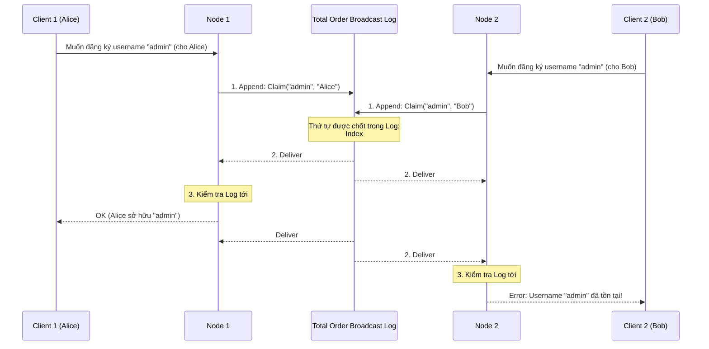

Bởi vì các mục nhật ký (log entries) được chuyển giao đến tất cả các nút theo cùng một thứ tự y hệt nhau, nếu có nhiều thao tác ghi đồng thời cùng diễn ra, tất cả các nút sẽ hoàn toàn đồng ý về việc thao tác nào đã đến trước. Bằng cách chọn thao tác đầu tiên trong số các thao tác ghi xung đột làm người chiến thắng và hủy bỏ các thao tác đến sau, tất cả các nút đều đồng ý tuyệt đối về việc một thao tác ghi đã được cam kết (committed) hay bị hủy bỏ (aborted). Một cách tiếp cận tương tự có thể được sử dụng để triển khai các giao dịch đa đối tượng khả tuần tự (serializable multi-object transactions) chồng lên trên một nhật ký [65] (đây chính là kiến trúc của hệ thống Tango / Corfu và cách **FoundationDB** sử dụng cụm *Resolvers* kết hợp với *Transaction Log* để kiểm tra xung đột đọc-ghi cho mọi giao dịch trước khi cho phép commit!).

Mặc dù quy trình này đảm bảo các **thao tác ghi khả tuyến tính (linearizable writes)**, nhưng tự thân nó vẫn **chưa đảm bảo các thao tác đọc khả tuyến tính (linearizable reads)** — nếu bạn đọc trực tiếp từ một kho lưu trữ vốn được cập nhật *bất đồng bộ* từ nhật ký, dữ liệu bạn đọc được rất có thể đã bị cũ (stale). (Nói một cách chính xác, quy trình trên chỉ mới cung cấp *tính nhất quán tuần tự* — sequential consistency [50, 67], đôi khi còn được gọi là *tính nhất quán dòng thời gian* — timeline consistency [68, 69], một đảm bảo yếu hơn một chút so với tính khả tuyến tính.) Để làm cho cả **các thao tác đọc cũng có tính khả tuyến tính**, có một vài phương án sau đây:

* **Phương án 1 (Đưa thao tác đọc vào nhật ký):** Bạn có thể sắp xếp tuần tự các thao tác đọc đi xuyên qua nhật ký bằng cách ghi nối tiếp một thông điệp đọc vào nhật ký, đọc nhật ký, và chỉ thực hiện thao tác đọc dữ liệu thực sự khi thông điệp đó được chuyển giao ngược trở lại cho bạn. Khi đó, vị trí của thông điệp trong nhật ký sẽ định nghĩa chính xác điểm thời gian (point in time) mà tại đó thao tác đọc diễn ra. (Các thao tác đọc theo túc số — quorum reads trong các phiên bản đầu của `etcd` hoạt động tương tự theo cách này [16].)
* **Phương án 2 (Truy vấn vị trí log mới nhất rồi chờ đồng bộ — ReadIndex / Sync):** Nếu nhật ký cho phép bạn lấy được vị trí (index) của thông điệp mới nhất hiện có trong nhật ký theo một cách khả tuyến tính, bạn có thể truy vấn vị trí đó, chờ cho đến khi tất cả các mục nhật ký tính đến vị trí đó đều đã được chuyển giao đầy đủ tới bạn (và được áp dụng vào trạng thái cục bộ), rồi sau đó mới thực hiện thao tác đọc. (Đây chính là ý tưởng đằng sau thao tác `sync()` của ZooKeeper [15] và tối ưu hóa `ReadIndex` trong Raft/etcd!)
* **Phương án 3 (Đọc từ bản sao được cập nhật đồng bộ):** Hoặc bạn có thể thực hiện thao tác đọc của mình từ một bản sao vốn luôn được cập nhật *đồng bộ* (synchronously updated) khi có thao tác ghi, và do đó chắc chắn luôn chứa dữ liệu mới nhất. (Kỹ thuật này được sử dụng trong mô hình *sao chép chuỗi* — chain replication [66], nơi các thao tác ghi đi vào đầu chuỗi `Head`, lan truyền đồng bộ dọc theo chuỗi, và mọi thao tác đọc khả tuyến tính được phục vụ trực tiếp tại đuôi chuỗi `Tail`.)

> 💡 **Ví dụ bổ sung (không có trong sách): So sánh 3 cơ chế Linearizable Read trong ZooKeeper và etcd**
>
> Trong thực tế vận hành **ZooKeeper** và **etcd** (trái tim của Kubernetes), việc đọc dữ liệu chiếm tới 90%+ lưu lượng. Cách hai hệ thống này hiện thực hóa 3 phương án đọc khả tuyến tính của Martin Kleppmann rất đáng học hỏi:
>
> | Cơ chế đọc | Cách hoạt động trong thực tế | Độ trễ & Chi phí |
> | :--- | :--- | :--- |
> | **Mặc định của ZooKeeper (`getData`)** | Đọc ngay từ bộ nhớ của bất kỳ Follower nào mà client đang kết nối. Chỉ đạt **Sequential Consistency** (không phải Linearizable Read — có thể đọc dữ liệu cũ nếu Follower bị trễ!). | Cực nhanh (Local RAM), nhưng có thể bị stale read. |
> | **ZooKeeper `sync()` + `getData()`** *(Phương án 2)* | Client gửi lệnh `sync()` tới Follower $\rightarrow$ Follower hỏi Leader xem `zxid` mới nhất là bao nhiêu $\rightarrow$ Follower chờ apply hết log tới `zxid` đó rồi mới trả kết quả `getData()`. | Đạt **Linearizable Read** mà không cần ghi rác vào ổ đĩa log! |
> | **etcd v2 / Raft Log Read** *(Phương án 1)* | Biến mỗi lệnh `GET` thành một Raft proposal ghi vào log trên đĩa của Quorum. | Rất chậm vì lệnh `READ` lại gây tốn Disk I/O và Raft log. |
> | **etcd v3 `ReadIndex`** *(Phương án 2)* | Khi nhận lệnh `GET` (mặc định là Linearizable), Leader gửi một gói tin heartbeat nhẹ (không ghi đĩa) tới Quorum để xác nhận mình vẫn là Leader hợp lệ (chống split-brain), lấy `commitIndex` hiện tại, chờ máy trạng thái apply tới `commitIndex` rồi đọc từ RAM trả về. | Chuẩn mực vàng hiện nay trong etcd / TiKV / CockroachDB: đạt **Linearizable Read** với tốc độ cao, `0` Disk I/O! |

---

#### Triển khai phát quảng bá có thứ tự toàn phần bằng lưu trữ khả tuyến tính (Implementing total order broadcast using linearizable storage)

Mục trước đã chỉ ra cách xây dựng một thao tác `compare-and-set` khả tuyến tính từ phát quảng bá có thứ tự toàn phần. Chúng ta cũng có thể đảo ngược bài toán lại: giả sử rằng chúng ta đã có sẵn dịch vụ lưu trữ khả tuyến tính (linearizable storage), và chỉ ra cách xây dựng phát quảng bá có thứ tự toàn phần từ nó.

Cách dễ nhất là giả sử bạn có một thanh ghi khả tuyến tính (linearizable register) lưu trữ một số nguyên và hỗ trợ một thao tác *tăng-và-lấy* (`increment-and-get`) nguyên tử [33]. Ngoài ra, một thao tác *so-sánh-và-gán* (`compare-and-set`) nguyên tử cũng hoàn toàn có thể đảm đương công việc này.

Thuật toán cực kỳ đơn giản: đối với mỗi thông điệp mà bạn muốn gửi thông qua phát quảng bá có thứ tự toàn phần, bạn thực hiện thao tác `increment-and-get` trên số nguyên khả tuyến tính đó, rồi đính kèm giá trị mà bạn vừa nhận được từ thanh ghi làm số thứ tự (sequence number) vào trong thông điệp. Sau đó, bạn có thể gửi thông điệp đó đến tất cả các nút (gửi lại bất kỳ thông điệp nào bị thất lạc trên mạng), và các nút nhận sẽ chuyển giao (deliver) các thông điệp một cách liên tiếp nhau theo đúng số thứ tự (`1, 2, 3, 4, ...`).

Hãy lưu ý rằng **không giống như dấu thời gian Lamport**, các con số mà bạn nhận được từ việc tăng thanh ghi khả tuyến tính tạo thành một **dãy số liên tục không có bất kỳ khoảng trống nào (a sequence with no gaps)**. Do đó, nếu một nút đã chuyển giao thông điệp số `4` và nhận được một thông điệp gửi đến mang số thứ tự là `6`, nó biết chắc chắn rằng mình bắt buộc phải **chờ thông điệp số `5`** đến trước khi được phép chuyển giao thông điệp số `6`. Điều tương tự không hề đúng với dấu thời gian Lamport (vốn có thể nhảy cóc từ `1` lên `6` như trong **Hình 9-8**) — trên thực tế, **đây chính là sự khác biệt cốt lõi nhất giữa phát quảng bá có thứ tự toàn phần và việc sắp xếp thứ tự bằng dấu thời gian (timestamp ordering)**.

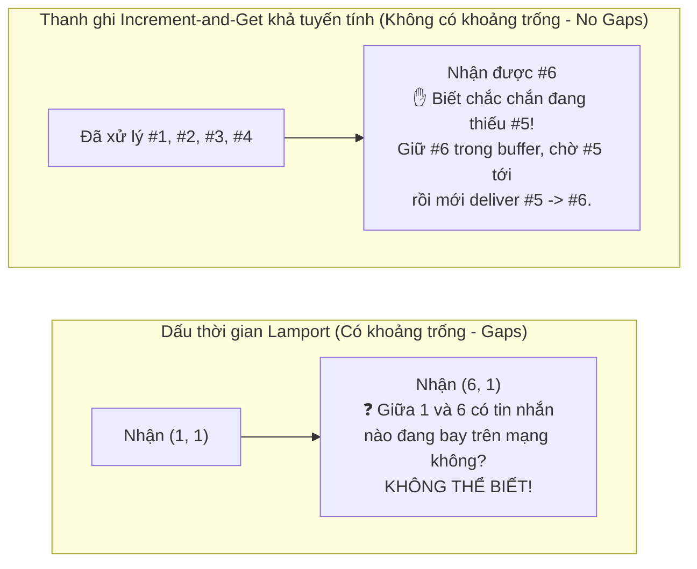

Việc chế tạo một số nguyên khả tuyến tính có thao tác `increment-and-get` nguyên tử thì có thể khó đến mức nào chứ? Như thường lệ, nếu mọi thứ không bao giờ gặp lỗi, việc đó sẽ cực kỳ dễ dàng: bạn chỉ việc lưu nó trong một biến trên một nút duy nhất. Vấn đề nằm ở chỗ xử lý tình huống khi các kết nối mạng tới nút đó bị gián đoạn, và làm sao khôi phục lại giá trị chính xác khi nút đó bị sập [62]. Nhìn chung, nếu bạn suy nghĩ đủ sâu sắc về các bộ sinh số thứ tự khả tuyến tính (linearizable sequence number generators), **không sớm thì muộn bạn cũng sẽ tất yếu (inevitably) đi đến một thuật toán đồng thuận (consensus algorithm)**.

Đây hoàn toàn không phải là một sự trùng hợp ngẫu nhiên: người ta có thể chứng minh bằng toán học rằng một thanh ghi `compare-and-set` (hoặc `increment-and-get`) khả tuyến tính và giao thức phát quảng bá có thứ tự toàn phần đều **tương đương với sự đồng thuận (equivalent to consensus)** [33, 70]. Nói cách khác, nếu bạn có thể giải quyết được một trong những bài toán này, bạn có thể biến đổi lời giải đó thành lời giải cho tất cả các bài toán còn lại. Đây là một nhận thức vô cùng sâu sắc và đáng kinh ngạc!

Đã đến lúc chúng ta trực tiếp đối đầu với bài toán đồng thuận (consensus problem), điều mà chúng ta sẽ thực hiện trong phần còn lại của chương này.$^{xii}$

> $^{xii}$ Bài toán *cam kết nguyên tử* (atomic commit — sẽ được thảo luận ngay trong mục tiếp theo và minh họa trong **Hình 9-9 / Figure 9-9**) được hình thức hóa hơi khác một chút so với bài toán đồng thuận (consensus): một giao dịch nguyên tử chỉ được phép cam kết (commit) nếu *tất cả* các bên tham gia đều bỏ phiếu đồng ý cam kết, và bắt buộc phải hủy bỏ (abort) nếu có *bất kỳ* bên tham gia nào cần hủy bỏ. Ngược lại, sự đồng thuận được phép quyết định chọn bất kỳ giá trị nào được đề xuất bởi một trong các bên tham gia. Tuy nhiên, cam kết nguyên tử và sự đồng thuận có thể quy dẫn qua lại lẫn nhau (reducible to each other) [71, 72]. Cam kết nguyên tử không chặn (non-blocking atomic commit) thậm chí còn khó hơn cả sự đồng thuận — xem phần “Cam kết ba pha (Three-phase commit)” ở trang 350.

> 📝 **Giải thích thêm (không có trong sách): Phân cấp đồng thuận Herlihy (Herlihy's Consensus Hierarchy) và sự tương đương kỳ diệu**
>
> Năm 1991, nhà khoa học máy tính **Maurice Herlihy** đã công bố bài báo kinh điển *"Wait-Free Synchronization"* [33] (công trình giúp ông nhận giải thưởng Gödel danh giá), chứng minh rằng mọi đối tượng dữ liệu đồng thời/phân tán đều có một **"Chỉ số đồng thuận" (Consensus Number)** — tức số lượng tiến trình/nút tối đa mà đối tượng đó có thể giúp đạt được sự đồng thuận không chờ đợi (wait-free consensus) khi có lỗi dừng (crash failures):
>
> | Đối tượng dữ liệu / Nguyên thủy đồng bộ | Consensus Number | Ý nghĩa trong Hệ thống phân tán |
> | :--- | :---: | :--- |
> | **Thanh ghi Đọc/Ghi khả tuyến tính thuần túy** (`Linearizable Read/Write Register`) | **1** | Không thể dùng để giải bài toán đồng thuận cho $\ge 2$ nút! Nhưng bù lại, nó có thể được cài đặt chỉ bằng Quorum (thuật toán ABD) mà **không cần Leader hay Consensus**. |
> | **Hàng đợi FIFO / Ngăn xếp / Test-and-Set** | **2** | Chỉ giải được đồng thuận cho tối đa 2 nút. Bất lực khi có từ 3 nút trở lên. |
> | **Thanh ghi `Compare-and-Set` (CAS) / `Increment-and-Get` khả tuyến tính** | **$\infty$ (Vô cùng)** | Có thể giải bài toán đồng thuận cho $N$ nút bất kỳ! Tương đương hoàn toàn với **Total Order Broadcast** và **Consensus (Paxos / Raft / ZAB)**. |
>
> Sự tương đương hai chiều ($\text{Consensus} \iff \text{Total Order Broadcast} \iff \text{Linearizable CAS / Increment-and-Get}$) giải thích tại sao trong thực tế:
> * Khi bạn cần một bộ sinh ID tuần tự không có khoảng trống (gapless sequence generator) và chịu lỗi, bạn bắt buộc phải dùng Raft/Paxos.
> * Khi bạn đã có ZooKeeper/etcd (vốn là Total Order Broadcast), bạn lập tức có sẵn khả năng làm Leader Election, Distributed Lock với Fencing Token (`zxid`), và Linearizable CAS (`version` check) mà không cần thiết kế thêm thuật toán mới!

## Giao dịch phân tán và đồng thuận (Distributed Transactions and Consensus)

Đồng thuận (*consensus*) là một trong những bài toán quan trọng và nền tảng nhất trong lĩnh vực điện toán phân tán (*distributed computing*). Nhìn bề ngoài, bài toán này có vẻ rất đơn giản: nói một cách không chính thức, mục tiêu chỉ đơn giản là làm sao để nhiều nút (*nodes*) cùng thống nhất về một điều gì đó. Bạn có thể nghĩ rằng việc này chẳng có gì quá khó khăn. Thật không may, vô số hệ thống bị lỗi nghiêm trọng đã từng được xây dựng dựa trên niềm tin sai lầm rằng bài toán này rất dễ giải quyết.

Mặc dù đồng thuận có tầm quan trọng sống còn như vậy, phần thảo luận về nó lại xuất hiện khá muộn trong cuốn sách này bởi vì chủ đề này vô cùng tinh vi, và để thấu hiểu hết những khía cạnh tinh tế đó đòi hỏi người đọc phải nắm vững một số kiến thức nền tảng trước. Ngay cả trong cộng đồng nghiên cứu học thuật, sự hiểu biết thấu đáo về đồng thuận cũng chỉ dần dần kết tinh qua nhiều thập kỷ, trải qua không ít những hiểu lầm dọc đường. Giờ đây, sau khi chúng ta đã thảo luận về sao chép dữ liệu (*replication* — Chương 5), giao dịch (*transactions* — Chương 7), các mô hình hệ thống (*system models* — Chương 8), tính khả tuyến tính (*linearizability*) và quảng bá thứ tự toàn phần (*total order broadcast* — Chương 9), chúng ta cuối cùng đã sẵn sàng để trực tiếp giải quyết bài toán đồng thuận.

Có rất nhiều tình huống trong thực tế mà việc các nút phải đạt được sự thống nhất với nhau đóng vai trò quyết định, chẳng hạn như:

* **Bầu chọn nút dẫn đầu (Leader election):**
  Trong một cơ sở dữ liệu sử dụng mô hình sao chép một nút dẫn đầu (*single-leader replication*), tất cả các nút cần phải thống nhất xem nút nào đang nắm giữ vai trò dẫn đầu (*leader*). Vị trí dẫn đầu có thể bị tranh chấp nếu một số nút không thể giao tiếp với các nút khác do sự cố mạng. Trong trường hợp này, sự đồng thuận là tối quan trọng nhằm tránh một quá trình chuyển đổi dự phòng (*failover*) tồi tệ dẫn đến tình trạng não phân tách (*split brain* — trong đó hai nút cùng tin rằng bản thân mình mới là nút dẫn đầu, xem mục “Xử lý sự cố ngừng hoạt động của nút” ở trang 150). Nếu tồn tại cùng lúc hai nút dẫn đầu, cả hai sẽ đều chấp nhận các thao tác ghi và dữ liệu của chúng sẽ bị phân kỳ (*diverge*), dẫn đến sự thiếu nhất quán và mất mát dữ liệu.

* **Cam kết nguyên tử (Atomic commit):**
  Trong một cơ sở dữ liệu hỗ trợ các giao dịch trải rộng trên nhiều nút hoặc nhiều phân vùng (*partitions*), chúng ta phải đối mặt với vấn đề là một giao dịch có thể thất bại trên một số nút nhưng lại thành công trên các nút khác. Nếu muốn duy trì tính nguyên tử của giao dịch (*transaction atomicity* — theo nghĩa của ACID, xem mục “Tính nguyên tử (Atomicity)” ở trang 216), chúng ta buộc phải làm cho tất cả các nút cùng thống nhất về kết quả cuối cùng của giao dịch đó: hoặc tất cả cùng hủy bỏ/khôi phục (*abort/rollback* — nếu có bất kỳ sự cố nào xảy ra), hoặc tất cả cùng cam kết (*commit* — nếu mọi thứ đều diễn ra suôn sẻ). Trường hợp cụ thể này của bài toán đồng thuận được gọi là bài toán *cam kết nguyên tử* (*atomic commit problem*).[^xii]

[^xii]: *Chú thích nguyên bản (xii):* Bài toán cam kết nguyên tử (*atomic commit*) được hình thức hóa hơi khác một chút so với bài toán đồng thuận (*consensus*): một giao dịch nguyên tử chỉ có thể được cam kết (*commit*) nếu *tất cả* các nút tham gia đều bỏ phiếu đồng ý cam kết, và bắt buộc phải hủy bỏ (*abort*) nếu có *bất kỳ* nút tham gia nào cần hủy bỏ. Trong khi đó, bài toán đồng thuận được phép quyết định chọn bất kỳ giá trị nào được đề xuất bởi một trong các nút tham gia. Tuy nhiên, cam kết nguyên tử và đồng thuận có thể quy đổi tương đương (*reducible*) cho nhau [71, 72]. Cam kết nguyên tử không chặn (*non-blocking atomic commit*) thực chất còn khó hơn cả bài toán đồng thuận — xem mục “Cam kết ba pha (Three-phase commit)” ở trang 350.

Trong phần này, trước hết chúng ta sẽ xem xét bài toán cam kết nguyên tử một cách chi tiết hơn. Cụ thể, chúng ta sẽ thảo luận về thuật toán *cam kết hai pha* (*2-phase commit* — 2PC), vốn là cách phổ biến nhất để giải quyết bài toán cam kết nguyên tử và đã được triển khai trong nhiều hệ quản trị cơ sở dữ liệu, hệ thống truyền thông điệp (*messaging systems*) cũng như máy chủ ứng dụng (*application servers*). Hóa ra 2PC cũng là một dạng thuật toán đồng thuận — nhưng lại không phải là một thuật toán đồng thuận thực sự tốt [71, 72].

Bằng cách rút ra bài học từ những khiếm khuyết của 2PC, sau đó chúng ta sẽ từng bước tiến tới các thuật toán đồng thuận ưu việt hơn, chẳng hạn như các thuật toán được sử dụng trong ZooKeeper (Zab) và etcd (Raft).

### Tính bất khả thi của đồng thuận (The impossibility of consensus)

Có thể bạn đã từng nghe nói về kết quả bất khả thi FLP (*FLP result*) [73] — được đặt theo tên của các tác giả Fischer, Lynch và Paterson — chứng minh rằng không tồn tại bất kỳ thuật toán nào có thể đạt được sự đồng thuận một cách đáng tin cậy nếu có nguy cơ một nút bị sập (*crash*). Trong một hệ thống phân tán, chúng ta luôn phải giả định rằng các nút có thể bị sập bất cứ lúc nào, vậy nên theo lý thuyết thì đồng thuận là điều bất khả thi. Thế nhưng, ngay tại đây, chúng ta lại đang chuẩn bị thảo luận về các thuật toán để đạt được sự đồng thuận. Rốt cuộc chuyện gì đang xảy ra?

Câu trả lời nằm ở chỗ kết quả FLP được chứng minh dựa trên một mô hình hệ thống lý thuyết cực kỳ khắt khe: giả định một mạng bất đồng bộ hoàn toàn và một thuật toán tất định (*deterministic algorithm*) không được phép sử dụng bất kỳ đồng hồ (*clocks*) hay thời gian chờ (*timeouts*) nào. Nếu thuật toán được phép sử dụng cơ chế hết thời gian chờ (*timeouts*), hoặc một phương thức nào khác để nghi ngờ các nút đã bị sập (ngay cả khi sự nghi ngờ đó đôi lúc bị sai lệch), thì bài toán đồng thuận hoàn toàn có thể giải quyết được [70]. Thậm chí, chỉ cần cho phép thuật toán sử dụng các số ngẫu nhiên (*random numbers*) thôi cũng đã đủ để làm cho bài toán đồng thuận trở nên khả giải [74].

Do đó, mặc dù kết quả FLP về tính bất khả thi của đồng thuận mang ý nghĩa lý thuyết vô cùng to lớn, các hệ thống phân tán trong thực tế vẫn hoàn toàn có thể đạt được sự đồng thuận.

> 📝 **Giải thích thêm (không có trong sách): Định lý FLP (1985) và cách các hệ thống thực tế vượt qua rào cản lý thuyết**
>
> Bài báo *"Impossibility of Distributed Consensus with One Faulty Process"* (1985) của Fischer, Lynch và Paterson là một trong những công trình có tầm ảnh hưởng lớn nhất lịch sử khoa học máy tính (đạt giải Dijkstra Prize). Tại sao FLP lại khẳng định đồng thuận là bất khả thi chỉ với **một** tiến trình có nguy cơ bị sập (*crash*)?
>
> 1. **Góc nhìn của mô hình bất đồng bộ thuần túy (Pure Asynchronous Model):**
>    Trong mô hình hệ thống bất đồng bộ thuần túy (không có giới hạn trên về độ trễ mạng và không có đồng hồ), một nút $A$ gửi tin nhắn cho nút $B$ nhưng mãi không thấy phản hồi. Nút $A$ hoàn toàn không thể phân biệt được hai khả năng:
>    - Khả năng 1: Nút $B$ đã bị sập hoàn toàn (*crashed*).
>    - Khả năng 2: Nút $B$ vẫn sống khỏe mạnh nhưng gói tin mạng đang bị trễ trên đường truyền, hoặc CPU của $B$ đang bận xử lý Garbage Collection.
>    Nếu thuật toán cố tình đợi $B$ phản hồi để đảm bảo an toàn (*Safety*), hệ thống sẽ bị treo vĩnh viễn nếu $B$ thực sự đã chết (vi phạm *Liveness / Termination*). Ngược lại, nếu thuật toán tự ý quyết định mà không cần $B$, có thể ngay giây tiếp theo gói tin từ $B$ tới nơi và tạo ra quyết định mâu thuẫn (vi phạm *Safety / Agreement*).
>
> 2. **Ba lối thoát thực tế khỏi định lý FLP:**
>    - **Sử dụng bộ phát hiện lỗi không hoàn hảo (Unreliable Failure Detectors) & Đồng bộ một phần (Partial Synchrony):** Các thuật toán như **Raft** (trong etcd, CockroachDB, TiKV), **Zab** (trong ZooKeeper), và **Multi-Paxos** (trong Google Spanner) đều dựa trên mô hình *đồng bộ một phần* của Dwork, Lynch, Stockmeyer [93] và *bộ phát hiện lỗi* của Chandra & Toueg [70]. Chúng sử dụng **timeouts** để phát hiện nút chết. Dù timeout có thể đoán sai khi mạng bị nghẽn (gây ra bầu chọn lại leader làm giảm hiệu năng tạm thời — ảnh hưởng *Liveness*), nhưng giao thức quorum + epoch luôn bảo vệ tuyệt đối tính *Safety* (không bao giờ có hai quyết định mâu thuẫn).
>    - **Sử dụng tính ngẫu nhiên (Randomization — thuật toán Ben-Or [74]):** Thay vì tất định 100%, các nút tung đồng xu ngẫu nhiên khi bị kẹt ở trạng thái lưỡng lự (*bivalent state*). Xác suất hệ thống bị kẹt mãi mãi sẽ tiến về $0$ khi số vòng lặp tăng lên (đạt *probabilistic termination*). Ngay cả trong Raft, việc chọn **randomized election timeout** (ví dụ ngẫu nhiên từ `150ms` đến `300ms`) chính là ứng dụng trực tiếp của tính ngẫu nhiên để phá vỡ thế bế tắc (*split vote*) khi hai candidate cùng đứng ra tranh cử một lúc!

---

### Cam kết nguyên tử và cam kết hai pha (Atomic commit and two-phase commit (2PC))

Hãy nhớ lại từ Chương 7 rằng mục đích của tính nguyên tử trong giao dịch (*transaction atomicity*) là cung cấp một ngữ nghĩa đơn giản, rõ ràng trong trường hợp có sự cố xảy ra giữa chừng khi hệ thống đang thực hiện một loạt thao tác ghi. Kết quả của một giao dịch chỉ có thể là một trong hai trạng thái: hoặc là một *cam kết* (*commit*) thành công (trong trường hợp đó tất cả các thao tác ghi của giao dịch đều được lưu trữ bền vững), hoặc là một *hủy bỏ* (*abort*) (trong trường hợp đó tất cả các thao tác ghi của giao dịch đều được khôi phục lại — *rolled back*, tức là được hoàn tác hoặc loại bỏ hoàn toàn).

Tính nguyên tử ngăn không cho các giao dịch bị lỗi làm vươngãi trong cơ sở dữ liệu những kết quả dở dang và những trạng thái mới chỉ được cập nhật một nửa. Điều này đặc biệt quan trọng đối với các giao dịch đa đối tượng (*multi-object transactions* — xem mục “Các thao tác đơn đối tượng và đa đối tượng” ở trang 219) và các cơ sở dữ liệu có duy trì chỉ mục phụ (*secondary indexes*). Mỗi chỉ mục phụ là một cấu trúc dữ liệu tách biệt khỏi dữ liệu chính — do đó, nếu bạn sửa đổi một dữ liệu nào đó, thay đổi tương ứng cũng bắt buộc phải được thực hiện bên trong chỉ mục phụ. Tính nguyên tử đảm bảo rằng chỉ mục phụ luôn giữ được sự nhất quán với dữ liệu chính (bởi nếu chỉ mục trở nên thiếu nhất quán với dữ liệu chính thì nó sẽ chẳng còn mấy giá trị sử dụng).

#### Từ cam kết nguyên tử đơn nút đến phân tán (From single-node to distributed atomic commit)

Đối với các giao dịch thực thi tại một nút cơ sở dữ liệu duy nhất, tính nguyên tử thường được triển khai trực tiếp bởi bộ máy lưu trữ (*storage engine*). Khi máy khách (*client*) yêu cầu nút cơ sở dữ liệu cam kết giao dịch, cơ sở dữ liệu sẽ ghi bền vững tất cả các thay đổi của giao dịch đó xuống đĩa (thường là vào nhật ký ghi trước — *write-ahead log / WAL*, xem mục “Cập nhật tại chỗ so với ghi nhật ký chỉ nối thêm” ở trang 80) và sau đó nối thêm một bản ghi cam kết (*commit record*) vào cuối nhật ký trên ổ đĩa. Nếu cơ sở dữ liệu bị sập ngay giữa quá trình này, giao dịch sẽ được khôi phục từ nhật ký khi nút khởi động lại: nếu bản ghi cam kết đã được ghi thành công xuống ổ đĩa trước khi xảy ra sự cố sập, giao dịch đó được coi là đã cam kết (*committed*); nếu chưa, bất kỳ thao tác ghi nào thuộc về giao dịch đó đều sẽ bị khôi phục hoàn tác (*rolled back*).

Như vậy, trên một nút đơn lẻ, việc cam kết giao dịch phụ thuộc sống còn vào *thứ tự* mà dữ liệu được ghi bền vững xuống ổ đĩa: trước tiên là dữ liệu, sau đó mới đến bản ghi cam kết [75]. Khoảnh khắc quyết định then chốt để phân định giữa cam kết hay hủy bỏ chính là khoảnh khắc mà ổ đĩa hoàn tất việc ghi bản ghi cam kết: trước khoảnh khắc đó, giao dịch vẫn có thể bị hủy bỏ (do sự cố sập nút); còn sau khoảnh khắc đó, giao dịch đã chính thức được cam kết (ngay cả khi cơ sở dữ liệu có bị sập ngay sau đó đi chăng nữa). Do vậy, chính một thiết bị vật lý duy nhất (bộ điều khiển của một ổ đĩa cụ thể, được gắn vào một nút cụ thể) là tác nhân làm cho thao tác cam kết có tính nguyên tử.

Tuy nhiên, chuyện gì sẽ xảy ra nếu có nhiều nút cùng tham gia vào một giao dịch? Ví dụ, có thể bạn đang thực hiện một giao dịch đa đối tượng trên một cơ sở dữ liệu được phân vùng (*partitioned database*), hoặc cập nhật một chỉ mục phụ được phân vùng theo thuật ngữ (*term-partitioned secondary index* — trong đó mục nhập chỉ mục có thể nằm trên một nút hoàn toàn khác với nút chứa dữ liệu chính, xem mục “Phân vùng và chỉ mục phụ” ở trang 197). Hầu hết các kho dữ liệu phân tán “NoSQL” không hỗ trợ những giao dịch phân tán như vậy, nhưng nhiều hệ thống cơ sở dữ liệu quan hệ dạng cụm (*clustered relational systems*) lại có hỗ trợ (xem mục “Giao dịch phân tán trong thực tế” ở trang 350).

Trong bối cảnh đa nút, việc chỉ đơn giản gửi một yêu cầu cam kết (*commit request*) tới tất cả các nút rồi để mỗi nút tự mình cam kết giao dịch một cách độc lập là hoàn toàn không đủ. Nếu làm như vậy, sẽ rất dễ xảy ra tình trạng thao tác cam kết thành công trên một số nút nhưng lại thất bại trên các nút khác, vi phạm nghiêm trọng cam kết về tính nguyên tử:

* Một số nút có thể phát hiện ra sự vi phạm ràng buộc toàn vẹn (*constraint violation*) hoặc xung đột giao dịch (*conflict*) khiến cho việc hủy bỏ (*abort*) là bắt buộc, trong khi các nút khác lại hoàn toàn có khả năng cam kết thành công;
* Một số yêu cầu cam kết có thể bị thất lạc trên mạng, cuối cùng dẫn đến việc bị hủy bỏ do hết thời gian chờ (*timeout*), trong khi các yêu cầu cam kết gửi tới những nút khác lại đi qua trót lọt;
* Một số nút có thể bị sập trước khi bản ghi cam kết kịp được ghi đầy đủ xuống đĩa và sẽ tự động hoàn tác (*roll back*) khi khởi động lại để phục hồi, trong khi các nút khác đã cam kết thành công.

Nếu một số nút cam kết giao dịch nhưng những nút khác lại hủy bỏ nó, các nút sẽ rơi vào trạng thái mâu thuẫn, không nhất quán với nhau (giống như tình huống đã minh họa ở Hình 7-3). Và một khi giao dịch đã được cam kết trên một nút, nó không thể nào bị rút lại (*retracted*) nếu sau đó người ta phát hiện ra rằng giao dịch đã bị hủy bỏ trên một nút khác.

Ngay khi dữ liệu đã được cam kết, nó sẽ trở nên hiển thị (*visible*) đối với các giao dịch khác, và do đó các máy khách khác có thể bắt đầu dựa vào dữ liệu đó để đưa ra quyết định hoặc thực hiện các thao tác tiếp theo. Vì lý do này, việc cam kết một giao dịch bắt buộc phải là *không thể đảo ngược* (*irrevocable*) — bạn không được phép đổi ý và hủy bỏ hồi tố (*retroactively abort*) một giao dịch sau khi nó đã được cam kết. Đây chính là nền tảng cơ bản của mức cô lập đọc dữ liệu đã cam kết (*read committed isolation* — xem mục “Read committed” ở trang 225). (Tất nhiên, hiệu ứng của một giao dịch đã cam kết vẫn có thể được hoàn tác vào một thời điểm sau đó bằng một *giao dịch bù trừ* — *compensating transaction* [19, 20]. Tuy nhiên, dưới góc nhìn của cơ sở dữ liệu thì giao dịch bù trừ này là một giao dịch hoàn toàn tách biệt, và do đó bất kỳ yêu cầu nào về tính đúng đắn xuyên suốt giữa các giao dịch đều là bài toán mà tầng ứng dụng phải tự mình gánh vác.)

#### Giới thiệu về cam kết hai pha (Introduction to two-phase commit)

*Cam kết hai pha* (*Two-phase commit* — 2PC) là một thuật toán nhằm đạt được việc cam kết giao dịch nguyên tử trải rộng trên nhiều nút, tức là đảm bảo rằng hoặc tất cả các nút cùng cam kết, hoặc tất cả các nút cùng hủy bỏ. Đây là một thuật toán kinh điển trong lĩnh vực cơ sở dữ liệu phân tán [13, 39, 76]. 2PC được sử dụng nội bộ bên trong một số cơ sở dữ liệu phân tán, đồng thời cũng được cung cấp cho các ứng dụng dưới dạng *giao dịch XA* (*XA transactions*) [77, 78] (chẳng hạn được hỗ trợ bởi Java Transaction API — JTA), hoặc giao thức `WS-AtomicTransaction` dành cho các dịch vụ web SOAP [79, 80].

> **Đừng nhầm lẫn giữa 2PC và 2PL (Don’t confuse 2PC and 2PL)**
>
> Cam kết hai pha (*Two-phase commit* — 2PC) và khóa hai pha (*Two-phase locking* — 2PL, xem mục “Khóa hai pha (2PL)” ở trang 248) là hai khái niệm hoàn toàn khác nhau. 2PC cung cấp khả năng cam kết nguyên tử (*atomic commit*) trong một cơ sở dữ liệu phân tán, trong khi 2PL cung cấp mức cô lập khả tuần tự (*serializable isolation*). Để tránh nhầm lẫn, tốt nhất bạn nên coi chúng là hai khái niệm tách biệt hoàn toàn và bỏ qua sự tương đồng đáng tiếc trong tên gọi của chúng.

Luồng hoạt động cơ bản của 2PC được minh họa trong **Hình 9-9**. Thay vì chỉ sử dụng một yêu cầu cam kết duy nhất như trong giao dịch đơn nút, quy trình cam kết/hủy bỏ trong 2PC được chia thành hai pha riêng biệt (đó cũng là lý do thuật toán có tên gọi này).

**Hình 9-9 – Một lần thực thi thành công của thuật toán cam kết hai pha (Figure 9-9. A successful execution of two-phase commit (2PC).)**

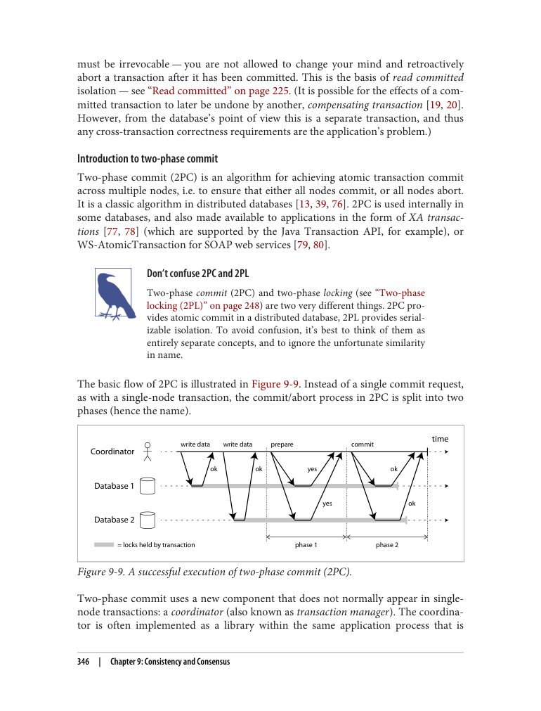


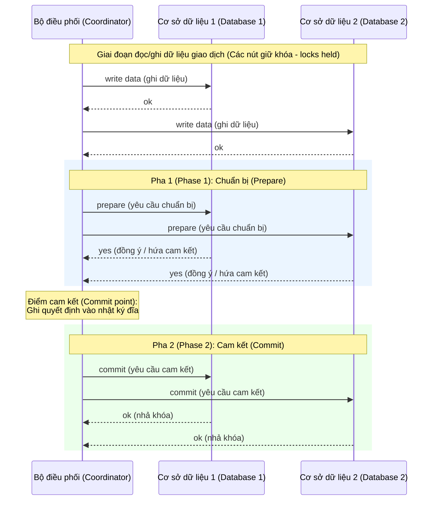

Cam kết hai pha sử dụng một thành phần mới thường không xuất hiện trong các giao dịch đơn nút: một *bộ điều phối* (*coordinator*, còn được gọi là *trình quản lý giao dịch* — *transaction manager*). Bộ điều phối thường được triển khai dưới dạng một thư viện nằm ngay bên trong cùng tiến trình ứng dụng đang yêu cầu thực hiện giao dịch (ví dụ: được nhúng bên trong một container Java EE), nhưng nó cũng có thể là một tiến trình hoặc một dịch vụ hoàn toàn tách biệt. Các ví dụ tiêu biểu về những bộ điều phối như vậy bao gồm Narayana, JOTM, BTM hoặc MSDTC (Microsoft Distributed Transaction Coordinator).

Một giao dịch 2PC bắt đầu bằng việc ứng dụng thực hiện đọc và ghi dữ liệu trên nhiều nút cơ sở dữ liệu như bình thường. Chúng ta gọi các nút cơ sở dữ liệu này là *các bên tham gia* (*participants*) trong giao dịch. Khi ứng dụng đã sẵn sàng để cam kết, bộ điều phối sẽ bắt đầu pha 1: nó gửi một yêu cầu *chuẩn bị* (*prepare request*) tới từng nút tham gia, hỏi xem liệu chúng có khả năng cam kết giao dịch hay không. Sau đó, bộ điều phối sẽ theo dõi các phản hồi trả về từ tất cả các bên tham gia:

* Nếu tất cả các bên tham gia đều trả lời “có” (“yes”), biểu thị rằng chúng đã sẵn sàng để cam kết, thì bộ điều phối sẽ gửi đi một yêu cầu *cam kết* (*commit request*) trong pha 2, và thao tác cam kết thực sự sẽ diễn ra tại từng nút.
* Nếu có bất kỳ bên tham gia nào trả lời “không” (“no”), bộ điều phối sẽ gửi một yêu cầu *hủy bỏ* (*abort request*) tới tất cả các nút trong pha 2.

Quy trình này khá giống với nghi lễ kết hôn truyền thống trong văn hóa phương Tây: vị mục sư lần lượt hỏi riêng cô dâu và chú rể xem liệu họ có đồng ý kết hôn với người kia hay không, và thông thường sẽ nhận được câu trả lời “Con đồng ý” (“I do”) từ mỗi người. Sau khi nhận được lời xác nhận từ cả hai phía, vị mục sư mới tuyên bố hai người chính thức trở thành vợ chồng: giao dịch đã được cam kết, và sự kiện tốt đẹp này được loan báo cho toàn thể quan khách có mặt. Nếu cô dâu hoặc chú rể không nói lời đồng ý, hôn lễ sẽ bị hủy bỏ (*aborted*) [19].

#### Một hệ thống của những lời hứa (A system of promises)

Từ phần mô tả ngắn gọn trên đây, có thể bạn vẫn chưa thấy rõ tại sao cam kết hai pha lại đảm bảo được tính nguyên tử, trong khi cam kết một pha trên nhiều nút lại không làm được điều đó. Chẳng phải các yêu cầu chuẩn bị (*prepare*) và yêu cầu cam kết (*commit*) cũng có thể dễ dàng bị thất lạc trên mạng trong trường hợp hai pha hay sao? Điều gì đã làm nên sự khác biệt của 2PC?

Để hiểu rõ bản chất này, chúng ta phải phân tách quy trình trên một cách chi tiết hơn:

1. Khi ứng dụng muốn bắt đầu một giao dịch phân tán, nó sẽ yêu cầu một định danh giao dịch (*transaction ID*) từ bộ điều phối. Định danh giao dịch này là duy nhất trên phạm vi toàn cục (*globally unique*).
2. Ứng dụng bắt đầu một giao dịch đơn nút trên từng bên tham gia (*participant*), và gắn định danh giao dịch duy nhất toàn cục đó vào giao dịch đơn nút này. Tất cả các thao tác đọc và ghi đều được thực hiện bên trong một trong các giao dịch đơn nút đó. Nếu có bất kỳ sự cố nào xảy ra ở giai đoạn này (chẳng hạn như một nút bị sập hoặc một yêu cầu bị hết thời gian chờ), bộ điều phối hoặc bất kỳ bên tham gia nào cũng đều có quyền chủ động hủy bỏ (*abort*) giao dịch.
3. Khi ứng dụng đã sẵn sàng để cam kết, bộ điều phối sẽ gửi một yêu cầu chuẩn bị (*prepare request*) tới tất cả các bên tham gia, được gắn kèm theo định danh giao dịch toàn cục. Nếu bất kỳ yêu cầu nào trong số này bị lỗi hoặc hết thời gian chờ, bộ điều phối sẽ gửi một yêu cầu hủy bỏ (*abort request*) cho định danh giao dịch đó tới tất cả các bên tham gia.
4. Khi một bên tham gia nhận được yêu cầu chuẩn bị, nó phải đảm bảo chắc chắn rằng mình hoàn toàn có thể cam kết giao dịch đó trong mọi hoàn cảnh. Việc này bao gồm ghi toàn bộ dữ liệu của giao dịch xuống ổ đĩa (sự cố sập phần mềm, mất điện hay hết dung lượng ổ đĩa vào lúc sau đều không phải là những lý do có thể chấp nhận được để từ chối cam kết), đồng thời kiểm tra toàn bộ các xung đột hoặc vi phạm ràng buộc toàn vẹn. Bằng việc trả lời “có” (“yes”) cho bộ điều phối, nút đó *hứa* (*promises*) rằng sẽ cam kết giao dịch mà không gặp bất kỳ lỗi nào nếu được yêu cầu. Nói cách khác, bên tham gia đã từ bỏ quyền tự hủy bỏ giao dịch của mình, nhưng vẫn chưa thực sự cam kết nó.
5. Khi bộ điều phối đã nhận đủ phản hồi cho tất cả các yêu cầu chuẩn bị, nó sẽ đưa ra quyết định dứt khoát về việc sẽ cam kết hay hủy bỏ giao dịch (chỉ cam kết nếu *tất cả* các bên tham gia đều bỏ phiếu “có”). Bộ điều phối bắt buộc phải ghi quyết định đó vào nhật ký giao dịch (*transaction log*) của chính nó trên ổ đĩa, để nó biết chắc mình đã quyết định theo hướng nào trong trường hợp nó bị sập ngay sau đó. Khoảnh khắc này được gọi là *điểm cam kết* (*commit point*).
6. Một khi quyết định của bộ điều phối đã được ghi bền vững xuống ổ đĩa, yêu cầu cam kết hoặc hủy bỏ sẽ được gửi tới tất cả các bên tham gia. Nếu yêu cầu này bị lỗi hoặc hết thời gian chờ, bộ điều phối bắt buộc phải thử lại mãi mãi (*retry forever*) cho đến khi thành công. Lúc này không còn đường lui nữa: nếu quyết định đã là cam kết, thì quyết định đó buộc phải được thực thi bằng mọi giá, bất kể phải thử lại bao nhiêu lần đi chăng nữa. Nếu một bên tham gia bị sập trong khoảng thời gian đó, giao dịch sẽ được cam kết ngay khi nút đó khởi động lại và phục hồi — bởi vì bên tham gia đó trước đó đã bỏ phiếu “có”, nên nó không được phép từ chối cam kết khi phục hồi.

Như vậy, giao thức này chứa đựng hai “điểm không thể quay đầu” (*points of no return*) mang tính sống còn: khi một bên tham gia bỏ phiếu “có”, nó hứa chắc chắn rằng mình sẽ có khả năng cam kết về sau (mặc dù bộ điều phối vẫn có thể chọn hủy bỏ); và một khi bộ điều phối đã đưa ra quyết định, quyết định đó là chung thẩm (*final*). Chính những lời hứa này đảm bảo tính nguyên tử của 2PC. (Cam kết nguyên tử trên một nút đơn lẻ thực chất gộp cả hai sự kiện này lại làm một: thao tác ghi bản ghi cam kết vào nhật ký giao dịch.)

Quay trở lại phép ẩn dụ về lễ cưới: trước khi nói “Con đồng ý”, bạn và cô dâu/chú rể của mình hoàn toàn có quyền tự do hủy bỏ giao dịch bằng cách nói “Không đời nào!”, hoặc một câu nào đó tương tự. Tuy nhiên, sau khi đã nói “Con đồng ý”, bạn không thể rút lại lời tuyên bố đó nữa. Nếu chẳng may bạn bị ngất xỉu ngay sau khi nói “Con đồng ý”, và bạn không nghe thấy vị mục sư tuyên bố “hai con giờ đây là vợ chồng”, thì điều đó cũng không làm thay đổi sự thật rằng giao dịch đã được cam kết. Khi bạn tỉnh lại sau đó, bạn có thể tìm hiểu xem mình đã kết hôn hay chưa bằng cách truy vấn vị mục sư về trạng thái của định danh giao dịch toàn cục của mình, hoặc bạn có thể chờ lần thử lại (*retry*) tiếp theo của yêu cầu cam kết từ vị mục sư (vì các lần thử lại vẫn liên tục diễn ra trong suốt khoảng thời gian bạn bất tỉnh).

#### Sự cố sập bộ điều phối (Coordinator failure)

Chúng ta đã thảo luận về những gì xảy ra nếu một trong các bên tham gia hoặc mạng gặp sự cố trong quá trình thực hiện 2PC: nếu bất kỳ yêu cầu chuẩn bị (*prepare*) nào bị lỗi hoặc hết thời gian chờ, bộ điều phối sẽ hủy bỏ giao dịch; nếu bất kỳ yêu cầu cam kết (*commit*) hoặc hủy bỏ (*abort*) nào bị lỗi, bộ điều phối sẽ thử gửi lại chúng vô thời hạn. Tuy nhiên, mọi chuyện sẽ kém rõ ràng hơn rất nhiều nếu chính bộ điều phối bị sập (*crashes*).

Nếu bộ điều phối gặp sự cố trước khi gửi đi các yêu cầu chuẩn bị, một bên tham gia có thể hủy bỏ giao dịch một cách an toàn. Nhưng một khi bên tham gia đã nhận được yêu cầu chuẩn bị và đã bỏ phiếu “có”, nó không còn quyền đơn phương hủy bỏ giao dịch nữa — nó bắt buộc phải chờ phản hồi từ bộ điều phối để biết giao dịch rốt cuộc đã được cam kết hay bị hủy bỏ. Nếu bộ điều phối bị sập hoặc mạng gặp sự cố ngay tại thời điểm này, bên tham gia không thể làm gì khác ngoài việc tiếp tục chờ đợi. Giao dịch của một bên tham gia rơi vào trạng thái này được gọi là *đang hoài nghi* (*in doubt*) hoặc *không chắc chắn* (*uncertain*).

Tình huống này được minh họa trong **Hình 9-10**. Trong ví dụ cụ thể này, bộ điều phối thực chất đã quyết định cam kết, và cơ sở dữ liệu 2 đã nhận được yêu cầu cam kết. Tuy nhiên, bộ điều phối lại bị sập ngay trước khi nó kịp gửi yêu cầu cam kết tới cơ sở dữ liệu 1, và vì thế cơ sở dữ liệu 1 hoàn toàn không biết mình nên cam kết hay hủy bỏ. Ngay cả cơ chế hết thời gian chờ (*timeout*) cũng không giúp ích được gì ở đây: nếu cơ sở dữ liệu 1 đơn phương hủy bỏ sau một khoảng thời gian chờ, nó sẽ rơi vào trạng thái mâu thuẫn, không nhất quán với cơ sở dữ liệu 2 (vốn đã cam kết rồi). Tương tự như vậy, việc tự ý cam kết cũng không hề an toàn, bởi vì biết đâu một bên tham gia khác đã bỏ phiếu “không” và giao dịch đã bị hủy bỏ.

**Hình 9-10 – Bộ điều phối bị sập sau khi các bên tham gia đã bỏ phiếu “có”. Cơ sở dữ liệu 1 không biết nên cam kết hay hủy bỏ (Figure 9-10. The coordinator crashes after participants vote “yes”. Database 1 does not know whether to commit or abort.)**

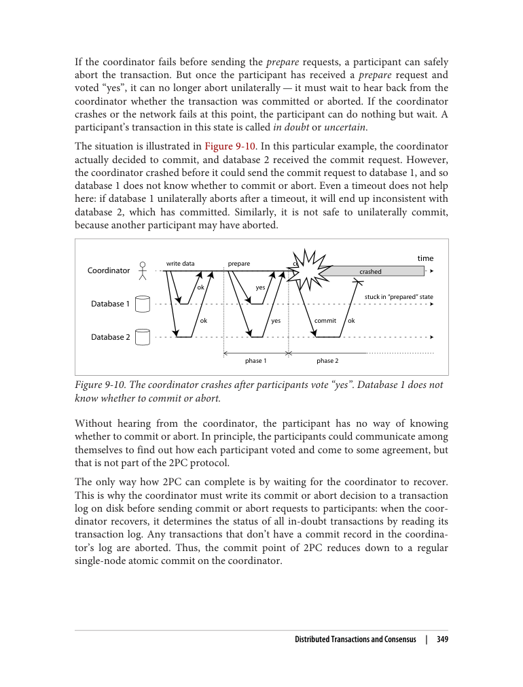

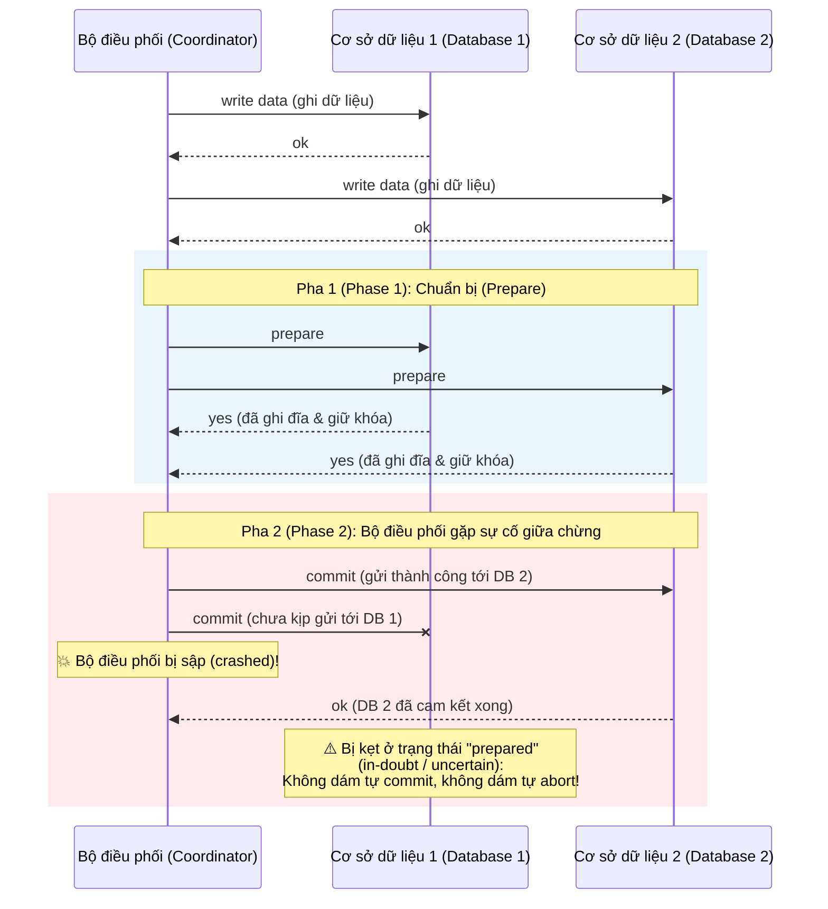

Nếu không nhận được thông tin từ bộ điều phối, bên tham gia không có bất kỳ cách nào để biết liệu mình nên cam kết hay hủy bỏ. Về mặt nguyên tắc, các bên tham gia có thể tự giao tiếp với nhau để tìm hiểu xem mỗi bên đã bỏ phiếu như thế nào và đi đến một sự thống nhất chung, nhưng cơ chế đó không phải là một phần của giao thức 2PC.

Cách duy nhất để 2PC có thể hoàn tất là chờ cho đến khi bộ điều phối phục hồi trở lại. Đây chính là lý do tại sao bộ điều phối bắt buộc phải ghi quyết định cam kết hoặc hủy bỏ của mình vào nhật ký giao dịch trên ổ đĩa *trước khi* gửi các yêu cầu cam kết hoặc hủy bỏ đó tới các bên tham gia: khi bộ điều phối khởi động lại và phục hồi, nó sẽ xác định trạng thái của tất cả các giao dịch đang hoài nghi (*in-doubt transactions*) bằng cách đọc nhật ký giao dịch của chính mình. Bất kỳ giao dịch nào không có bản ghi cam kết trong nhật ký của bộ điều phối đều sẽ bị hủy bỏ. Do đó, *điểm cam kết* (*commit point*) của 2PC suy cho cùng được rút gọn về một thao tác cam kết nguyên tử đơn nút thông thường ngay tại bộ điều phối.

#### Cam kết ba pha (Three-phase commit)

Cam kết hai pha được gọi là một giao thức cam kết nguyên tử *có chặn* (*blocking atomic commit protocol*) do thực tế là 2PC có thể bị mắc kẹt hoàn toàn trong lúc chờ bộ điều phối phục hồi. Về mặt lý thuyết, người ta có thể thiết kế một giao thức cam kết nguyên tử *không chặn* (*non-blocking*), sao cho nó không bị kẹt lại nếu một nút gặp sự cố. Tuy nhiên, việc làm cho ý tưởng này hoạt động được trong thực tế lại không hề đơn giản như vậy.

Như một giải pháp thay thế cho 2PC, một thuật toán có tên là *cam kết ba pha* (*three-phase commit* — 3PC) đã được đề xuất [13, 81]. Tuy nhiên, công thức chuẩn của 3PC lại giả định một mạng có độ trễ hữu hạn biết trước (*bounded delay*) và các nút có thời gian phản hồi hữu hạn (*bounded response times*); trong hầu hết các hệ thống thực tế vốn có độ trễ mạng không giới hạn (*unbounded network delay*) và các khoảng dừng tiến trình (*process pauses* — xem Chương 8), 3PC hoàn toàn không thể đảm bảo được tính nguyên tử.

Nhìn chung, việc cam kết nguyên tử không chặn đòi hỏi phải có một *bộ phát hiện lỗi hoàn hảo* (*perfect failure detector*) [70, 72], tức là một cơ chế đáng tin cậy tuyệt đối để cho biết liệu một nút đã thực sự bị sập hay chưa. Trong một mạng có độ trễ không giới hạn, cơ chế hết thời gian chờ (*timeout*) không phải là một bộ phát hiện lỗi đáng tin cậy, bởi vì một yêu cầu hoàn toàn có thể bị hết thời gian chờ chỉ vì sự cố nghẽn mạng ngay cả khi chẳng có nút nào bị sập cả. Vì lý do này, 2PC vẫn tiếp tục được sử dụng rộng rãi bất chấp vấn đề cố hữu đã biết rõ là bị chặn (*blocking*) khi bộ điều phối gặp sự cố.

> 📝 **Giải thích thêm (không có trong sách): Tại sao 3PC lại thất bại khi gặp phân vùng mạng (Network Partition) hoặc GC Pause?**
>
> Thuật toán **3PC** (do Dale Skeen đề xuất năm 1981 [81]) cố gắng khắc phục nhược điểm bị chặn của 2PC bằng cách tách Pha 2 thành hai bước: **Pre-commit (Chuẩn bị cam kết)** và **Do-commit (Thực thi cam kết)**:
> - **Pha 1 (CanCommit?):** Giống 2PC, Coordinator hỏi các nút có sẵn sàng không.
> - **Pha 2 (PreCommit):** Nếu tất cả trả lời `Yes`, Coordinator chưa ra lệnh `Commit` ngay mà gửi thông điệp `PreCommit` cho tất cả. Khi nhận được `PreCommit`, một nút biết chắc rằng *mọi nút trong cụm đều đã bỏ phiếu `Yes`*.
> - **Pha 3 (DoCommit):** Sau khi các nút xác nhận đã nhận `PreCommit`, Coordinator mới gửi `DoCommit`. Nếu Coordinator chết ở Pha 3, các nút còn sống sẽ bầu Coordinator mới: vì chúng đã ở trạng thái `PreCommit`, quy tắc của 3PC cho phép chúng tự động đẩy giao dịch tới `Commit` mà không cần chờ Coordinator cũ sống lại! Ngược lại, nếu chưa nút nào nhận được `PreCommit` mà hết timeout, chúng tự động `Abort`.
>
> **Vậy tại sao 3PC lại phá vỡ tính nguyên tử (Atomicity) trong mạng bất đồng bộ thực tế?**
> Hãy xét kịch bản phân vùng mạng (*network partition*):
> 1. Coordinator gửi `PreCommit` cho Nút $A$, nhưng gói tin `PreCommit` gửi cho Nút $B$ và Nút $C$ bị nghẽn mạng. Sau đó Coordinator bị sập (hoặc bị cô lập).
> 2. Lúc này mạng bị chia cắt: Nút $A$ (đã ở trạng thái `PreCommit`) bị tách rời khỏi nhóm $\{B, C\}$ (vẫn đang ở trạng thái `Prepared`, chưa hề biết có `PreCommit`).
> 3. Nhóm $\{B, C\}$ thấy hết timeout mà chưa nhận được `PreCommit`, theo quy tắc 3PC chúng kết luận Coordinator chết trước khi gửi `PreCommit`, nên $\{B, C\}$ quyết định **Abort**!
> 4. Trong khi đó, ở phía bên kia phân vùng mạng (hoặc khi $A$ hết timeout ở Pha 3), $A$ đã có `PreCommit` nên theo quy tắc không chặn của 3PC, $A$ quyết định **Commit**!
> 5. Kết quả: $A$ đã `Commit` còn $B, C$ đã `Abort` — tính nguyên tử bị phá hủy hoàn toàn! Chính vì vậy, trong môi trường mạng bất đồng bộ không có *perfect failure detector*, người ta thà chấp nhận bị chặn như 2PC (hoặc kết hợp 2PC trên nền tảng Paxos/Raft) còn hơn dùng 3PC.

---

### Giao dịch phân tán trong thực tế (Distributed transactions in practice)

Các giao dịch phân tán, đặc biệt là những giao dịch được triển khai bằng thuật toán cam kết hai pha (2PC), mang tiếng khen chê lẫn lộn trong giới kỹ nghệ phần mềm. Một mặt, chúng được xem là công cụ cung cấp sự đảm bảo an toàn quan trọng mà nếu không có chúng thì rất khó đạt được; mặt khác, chúng lại bị chỉ trích gay gắt vì gây ra hàng loạt rắc rối trong vận hành (*operational problems*), giết chết hiệu năng hệ thống (*killing performance*), và hứa hẹn nhiều hơn những gì chúng thực sự có thể mang lại [82, 83, 84, 85]. Nhiều dịch vụ “đám mây” (*cloud services*) chủ động lựa chọn không triển khai giao dịch phân tán chính vì những vấn đề vận hành phức tạp mà chúng gây ra [86, 87].

Một số bản triển khai của giao dịch phân tán kéo theo cái giá cực đắt về mặt hiệu năng — ví dụ, các giao dịch phân tán trong MySQL được báo cáo là chậm hơn gấp 10 lần so với các giao dịch đơn nút [88], vì vậy không có gì đáng ngạc nhiên khi nhiều chuyên gia khuyên không nên sử dụng chúng. Phần lớn chi phí hiệu năng cố hữu trong cam kết hai pha bắt nguồn từ việc bắt buộc phải ép ghi dữ liệu xuống ổ đĩa bổ sung (*additional disk forcing* — lệnh `fsync`) để phục vụ cho quá trình khôi phục sau sự cố sập [89], cộng thêm độ trễ của các vòng truyền tải qua lại trên mạng (*network round-trips*).

Tuy nhiên, thay vì bác bỏ hoàn toàn các giao dịch phân tán ngay lập tức, chúng ta nên xem xét chúng một cách chi tiết hơn, bởi vì có rất nhiều bài học quan trọng có thể rút ra từ đó. Trước hết, chúng ta cần làm rõ chính xác những gì mình muốn nói khi nhắc đến cụm từ *giao dịch phân tán*. Hai loại giao dịch phân tán hoàn toàn khác nhau thường xuyên bị đánh đồng làm một:

* **Giao dịch phân tán nội bộ cơ sở dữ liệu (Database-internal distributed transactions):**
  Một số cơ sở dữ liệu phân tán (tức là các cơ sở dữ liệu sử dụng cơ chế sao chép và phân vùng ngay trong cấu hình tiêu chuẩn của chúng) hỗ trợ các giao dịch nội bộ giữa các nút thuộc cùng cơ sở dữ liệu đó. Ví dụ, VoltDB, FoundationDB và bộ máy lưu trữ NDB của MySQL Cluster đều có hỗ trợ giao dịch nội bộ như vậy. Trong trường hợp này, tất cả các nút tham gia vào giao dịch đều đang chạy cùng một phần mềm cơ sở dữ liệu.

* **Giao dịch phân tán không đồng nhất (Heterogeneous distributed transactions):**
  Trong một giao dịch không đồng nhất, các bên tham gia là hai hoặc nhiều công nghệ hoàn toàn khác nhau: ví dụ, hai cơ sở dữ liệu đến từ hai nhà cung cấp khác nhau, hoặc thậm chí là các hệ thống phi cơ sở dữ liệu như các trình môi giới thông điệp (*message brokers*). Một giao dịch phân tán trải rộng qua các hệ thống này vẫn phải đảm bảo cam kết nguyên tử, mặc dù cấu trúc bên dưới của chúng có thể khác biệt hoàn toàn.

Các giao dịch nội bộ cơ sở dữ liệu không cần phải tương thích với bất kỳ hệ thống bên ngoài nào khác, và do đó chúng có thể sử dụng bất kỳ giao thức nào cũng như áp dụng các kỹ thuật tối ưu hóa chuyên biệt dành riêng cho công nghệ cụ thể đó. Vì lý do này, các giao dịch phân tán nội bộ cơ sở dữ liệu thường có thể hoạt động khá hiệu quả. Ngược lại, các giao dịch trải rộng qua nhiều công nghệ không đồng nhất lại là một thách thức lớn hơn rất nhiều.

#### Xử lý thông điệp chính xác một lần (Exactly-once message processing)

Các giao dịch phân tán không đồng nhất cho phép tích hợp nhiều hệ thống đa dạng theo những cách vô cùng mạnh mẽ. Ví dụ, một thông điệp lấy ra từ hàng đợi thông điệp (*message queue*) có thể được xác nhận là đã xử lý (*acknowledged*) khi và chỉ khi giao dịch cơ sở dữ liệu dùng để xử lý thông điệp đó đã được cam kết thành công. Điều này được thực hiện bằng cách cam kết một cách nguyên tử cả thao tác xác nhận thông điệp (*message acknowledgement*) lẫn các thao tác ghi cơ sở dữ liệu bên trong cùng một giao dịch duy nhất. Với sự hỗ trợ của giao dịch phân tán, việc này hoàn toàn khả thi ngay cả khi trình môi giới thông điệp (*message broker*) và cơ sở dữ liệu là hai công nghệ không hề liên quan đến nhau và đang chạy trên những máy vật lý khác nhau.

Nếu hoặc việc chuyển giao thông điệp hoặc giao dịch cơ sở dữ liệu gặp thất bại, cả hai sẽ cùng bị hủy bỏ (*aborted*), và nhờ đó trình môi giới thông điệp có thể phát lại (*redeliver*) thông điệp đó một cách an toàn vào lúc sau. Như vậy, bằng cách cam kết nguyên tử cả thông điệp lẫn các tác dụng phụ (*side-effects*) từ việc xử lý thông điệp đó, chúng ta có thể đảm bảo rằng thông điệp thực chất chỉ được xử lý *chính xác một lần* (*effectively processed exactly once*), ngay cả khi nó cần tới vài lần thử lại (*retries*) trước khi thành công.

Một giao dịch phân tán như vậy chỉ khả thi nếu tất cả các hệ thống chịu ảnh hưởng bởi giao dịch đều có khả năng sử dụng chung một giao thức cam kết nguyên tử. Ví dụ, giả sử một tác dụng phụ của việc xử lý thông điệp là gửi một bức thư điện tử (email), và máy chủ email đương nhiên không hỗ trợ cam kết hai pha. Khi đó, hoàn toàn có thể xảy ra tình huống bức email bị gửi đi hai hoặc nhiều lần nếu quá trình xử lý thông điệp bị lỗi ở bước cuối và được thử lại. Nhưng nếu mọi tác dụng phụ của việc xử lý thông điệp đều có thể được hoàn tác (*rolled back*) khi giao dịch bị hủy bỏ, thì bước xử lý đó hoàn toàn có thể được thử lại một cách an toàn như thể chưa từng có chuyện gì xảy ra.

Chúng ta sẽ quay lại chủ đề xử lý thông điệp chính xác một lần trong Chương 11. Bây giờ, hãy cùng tìm hiểu giao thức cam kết nguyên tử cho phép thực hiện các giao dịch phân tán không đồng nhất như vậy.

#### Giao dịch XA (XA Transactions)

*X/Open XA* (viết tắt của *eXtended Architecture*) là một tiêu chuẩn để triển khai cam kết hai pha xuyên suốt các công nghệ không đồng nhất [77, 78]. Tiêu chuẩn này được giới thiệu vào năm 1991 và đã được triển khai rộng rãi: XA được hỗ trợ bởi nhiều cơ sở dữ liệu quan hệ truyền thống (bao gồm PostgreSQL, MySQL, DB2, SQL Server và Oracle) cũng như các trình môi giới thông điệp (bao gồm ActiveMQ, HornetQ, MSMQ và IBM MQ).

XA không phải là một giao thức mạng — nó đơn thuần chỉ là một giao diện lập trình ứng dụng bằng ngôn ngữ C (C API) dùng để giao tiếp với một bộ điều phối giao dịch (*transaction coordinator*). Các bản ràng buộc (*bindings*) cho API này cũng tồn tại trong các ngôn ngữ lập trình khác; ví dụ, trong thế giới của các ứng dụng Java EE, giao dịch XA được triển khai thông qua *Java Transaction API* (JTA), và đến lượt mình, JTA lại được hỗ trợ bởi rất nhiều trình điều khiển (*drivers*) dành cho cơ sở dữ liệu sử dụng *Java Database Connectivity* (JDBC) cũng như các trình điều khiển dành cho trình môi giới thông điệp sử dụng API *Java Message Service* (JMS).

XA giả định rằng ứng dụng của bạn sử dụng một trình điều khiển mạng (*network driver*) hoặc thư viện máy khách (*client library*) để giao tiếp với các cơ sở dữ liệu hoặc dịch vụ truyền thông điệp tham gia vào giao dịch. Nếu trình điều khiển đó hỗ trợ XA, điều đó có nghĩa là nó sẽ gọi tới XA API để tìm hiểu xem liệu một thao tác hiện tại có phải là một phần của giao dịch phân tán hay không — và nếu đúng, nó sẽ gửi các thông tin cần thiết (như định danh giao dịch toàn cục XID) tới máy chủ cơ sở dữ liệu. Trình điều khiển cũng cung cấp các hàm gọi lại (*callbacks*) mà thông qua đó bộ điều phối có thể yêu cầu bên tham gia thực hiện chuẩn bị (*prepare*), cam kết (*commit*) hoặc hủy bỏ (*abort*).

Bộ điều phối giao dịch là thành phần triển khai XA API. Tiêu chuẩn XA không quy định cứng nhắc cách thức triển khai bộ điều phối, nhưng trong thực tế, bộ điều phối thường chỉ đơn giản là một thư viện được nạp trực tiếp vào cùng tiến trình với ứng dụng đang phát lệnh giao dịch (chứ không phải là một dịch vụ độc lập bên ngoài). Nó theo dõi danh sách các bên tham gia trong một giao dịch, thu thập phản hồi cho các yêu cầu chuẩn bị (thông qua hàm gọi lại vào trình điều khiển), và sử dụng một tệp nhật ký (*log*) trên ổ đĩa cục bộ để lưu vết kết quả cam kết/hủy bỏ của từng giao dịch.

Nếu tiến trình ứng dụng bị sập, hoặc cỗ máy đang chạy ứng dụng đó bị chết, bộ điều phối cũng sẽ biến mất theo nó. Bất kỳ bên tham gia nào đang giữ các giao dịch đã chuẩn bị (*prepared*) nhưng chưa được cam kết (*uncommitted*) khi đó sẽ bị mắc kẹt trong trạng thái hoài nghi (*in doubt*). Vì nhật ký của bộ điều phối nằm trên ổ đĩa cục bộ của máy chủ ứng dụng, máy chủ đó bắt buộc phải được khởi động lại, và thư viện bộ điều phối phải đọc lại nhật ký đó để khôi phục kết quả cam kết/hủy bỏ của từng giao dịch. Chỉ khi đó bộ điều phối mới có thể sử dụng các hàm gọi lại XA của trình điều khiển cơ sở dữ liệu để yêu cầu các bên tham gia thực hiện cam kết hoặc hủy bỏ một cách tương ứng. Máy chủ cơ sở dữ liệu không thể liên hệ trực tiếp với bộ điều phối, bởi vì mọi giao tiếp đều bắt buộc phải đi qua thư viện máy khách của nó.

#### Giữ khóa trong khi đang hoài nghi (Holding locks while in doubt)

Tại sao chúng ta lại phải bận tâm nhiều đến vậy về việc một giao dịch bị mắc kẹt ở trạng thái hoài nghi (*in doubt*)? Chẳng lẽ phần còn lại của hệ thống không thể cứ tiếp tục công việc bình thường của mình và phớt lờ giao dịch đang hoài nghi đó cho đến khi nó được dọn dẹp xong xuôi hay sao?

Vấn đề cốt lõi nằm ở cơ chế *khóa* (*locking*). Như đã thảo luận trong mục “Read committed” ở trang 225, các giao dịch cơ sở dữ liệu thường phải chiếm giữ một khóa độc quyền cấp độ dòng (*row-level exclusive lock*) trên bất kỳ dòng dữ liệu nào mà chúng sửa đổi nhằm ngăn chặn hiện tượng ghi bẩn (*dirty writes*). Ngoài ra, nếu bạn muốn đạt được mức cô lập khả tuần tự (*serializable isolation*), một cơ sở dữ liệu sử dụng khóa hai pha (*2-phase locking* — 2PL) cũng sẽ phải chiếm giữ một khóa chia sẻ (*shared lock*) trên bất kỳ dòng dữ liệu nào được đọc bởi giao dịch đó (xem mục “Khóa hai pha (2PL)” ở trang 248).

Cơ sở dữ liệu không thể giải phóng những khóa này cho đến khi giao dịch chính thức được cam kết hoặc hủy bỏ (được minh họa bằng vùng tô bóng xám trong Hình 9-9). Do đó, khi sử dụng cam kết hai pha, một giao dịch bắt buộc phải nắm giữ chặt các khóa này trong suốt khoảng thời gian nó nằm ở trạng thái hoài nghi (*in doubt*). Nếu bộ điều phối bị sập và mất tới 20 phút để khởi động lại, thì những khóa đó sẽ bị giữ cứng trong suốt 20 phút. Nếu nhật ký của bộ điều phối bị mất hoàn toàn vì một lý do nào đó, những khóa này sẽ bị giữ *mãi mãi* — hoặc ít nhất là cho đến khi tình huống được giải quyết thủ công bởi một người quản trị hệ thống (*administrator*).

Trong khi những khóa đó đang bị nắm giữ, không một giao dịch nào khác có thể ghi vào các dòng dữ liệu đó. Tùy thuộc vào từng hệ quản trị cơ sở dữ liệu, thậm chí các giao dịch khác còn có thể bị chặn không cho đọc các dòng dữ liệu đó. Như vậy, các giao dịch khác không thể cứ thế tiếp tục công việc của mình — nếu chúng muốn truy cập vào cùng phần dữ liệu đó, chúng sẽ bị chặn đứng (*blocked*). Điều này có thể khiến cho những phân hệ lớn trong ứng dụng của bạn rơi vào tình trạng ngừng hoạt động (*unavailable*) cho đến khi giao dịch đang hoài nghi được giải quyết dứt điểm.

#### Khôi phục sau sự cố sập bộ điều phối (Recovering from coordinator failure)

Về mặt lý thuyết, nếu bộ điều phối bị sập và được khởi động lại, nó sẽ khôi phục lại trạng thái của mình một cách gọn gàng từ nhật ký và giải quyết mọi giao dịch đang hoài nghi. Tuy nhiên, trong thực tế, các giao dịch hoài nghi mồ côi (*orphaned in-doubt transactions*) vẫn thường xuyên xảy ra [90, 91] — tức là những giao dịch mà bộ điều phối không thể quyết định được kết quả vì bất kỳ lý do gì, chẳng hạn như do nhật ký giao dịch bị mất hoặc bị hỏng (*corrupted*) vì lỗi phần mềm. Những giao dịch này không thể được giải quyết một cách tự động, vì vậy chúng cứ nằm lì mãi mãi bên trong cơ sở dữ liệu, chiếm giữ các khóa và làm tắc nghẽn các giao dịch khác.

Ngay cả việc khởi động lại (*rebooting*) các máy chủ cơ sở dữ liệu của bạn cũng sẽ không khắc phục được vấn đề này, bởi vì một bản triển khai 2PC đúng đắn bắt buộc phải bảo toàn các khóa của một giao dịch đang hoài nghi ngay cả sau khi khởi động lại (nếu không, nó sẽ có nguy cơ vi phạm cam kết về tính nguyên tử). Đó thực sự là một tình thế tiến thoái lưỡng nan vô cùng rắc rối.

Lối thoát duy nhất là người quản trị hệ thống phải can thiệp thủ công để quyết định xem nên cam kết hay hoàn tác (*rollback*) các giao dịch đó. Người quản trị phải kiểm tra từng bên tham gia của mỗi giao dịch đang hoài nghi, xác định xem liệu có bên tham gia nào đã cam kết hoặc hủy bỏ trước đó hay chưa, rồi áp dụng cùng kết quả đó cho các bên tham gia còn lại. Công việc này đòi hỏi rất nhiều nỗ lực thủ công, và nhiều khả năng lại phải được thực hiện dưới áp lực căng thẳng tột độ và sự gấp rút về thời gian ngay giữa một sự cố sập hệ thống nghiêm trọng trên môi trường production (bởi nếu không có sự cố nghiêm trọng thì làm sao bộ điều phối lại rơi vào trạng thái tồi tệ đến thế?).

Nhiều bản triển khai XA cung cấp một lối thoát hiểm khẩn cấp được gọi là *các quyết định dựa trên kinh nghiệm* (*heuristic decisions*): cho phép một bên tham gia được quyền đơn phương quyết định hủy bỏ hoặc cam kết một giao dịch đang hoài nghi mà không cần chờ quyết định dứt khoát từ bộ điều phối [77, 78, 92]. Nói thẳng ra, từ *heuristic* ở đây chỉ là một cách nói giảm nói tránh cho hành động *nhiều khả năng sẽ làm gãy tính nguyên tử* (*probably breaking atomicity*), bởi vì nó trực tiếp vi phạm hệ thống của những lời hứa trong cam kết hai pha. Do đó, các quyết định heuristic chỉ được thiết kế để thoát khỏi những tình huống thảm họa cùng đường, chứ tuyệt đối không dùng cho hoạt động thường ngày.

#### Những hạn chế của giao dịch phân tán (Limitations of distributed transactions)

Giao dịch XA giải quyết được bài toán thực tế và quan trọng là giữ cho nhiều hệ thống dữ liệu tham gia luôn nhất quán với nhau, nhưng như chúng ta đã thấy, chúng cũng kéo theo những rắc rối vận hành vô cùng lớn. Cụ thể, nhận thức cốt lõi ở đây là bản thân bộ điều phối giao dịch cũng chính là một dạng cơ sở dữ liệu (nơi lưu trữ kết quả của các giao dịch), và vì vậy nó cần phải được đối xử với sự cẩn trọng tương đương như bất kỳ cơ sở dữ liệu quan trọng nào khác:

* Nếu bộ điều phối không được sao chép (*replicated*) mà chỉ chạy trên một cỗ máy duy nhất, nó sẽ trở thành điểm lỗi đơn (*single point of failure* — SPOF) cho toàn bộ hệ thống (vì sự cố sập của nó sẽ khiến các máy chủ ứng dụng khác bị chặn cứng trên các khóa đang bị nắm giữ bởi những giao dịch hoài nghi). Đáng ngạc nhiên là nhiều bản triển khai bộ điều phối lại không có tính sẵn sàng cao (*highly available*) theo mặc định, hoặc chỉ hỗ trợ sao chép ở mức độ rất sơ sài.
* Nhiều ứng dụng phía máy chủ (*server-side applications*) được phát triển theo mô hình phi trạng thái (*stateless model* — như cách được ưa chuộng bởi giao thức HTTP), với toàn bộ trạng thái bền vững được lưu trữ trong cơ sở dữ liệu, mang lại ưu điểm lớn là các máy chủ ứng dụng có thể được thêm vào hoặc gỡ bỏ tùy ý. Tuy nhiên, khi bộ điều phối là một phần nằm ngay trong máy chủ ứng dụng, nó làm thay đổi hoàn toàn bản chất của việc triển khai: đột nhiên các tệp nhật ký của bộ điều phối trở thành một phần sống còn của trạng thái hệ thống bền vững — quan trọng ngang ngửa với chính các cơ sở dữ liệu, bởi vì nhật ký của bộ điều phối là thứ bắt buộc phải có để khôi phục các giao dịch đang hoài nghi sau sự cố sập. Những máy chủ ứng dụng như vậy không còn là phi trạng thái (*stateless*) nữa.
* Vì XA cần phải tương thích với một dải rộng các hệ thống dữ liệu khác nhau, nó buộc phải hoạt động ở mức mẫu số chung nhỏ nhất (*lowest common denominator*). Ví dụ, nó không thể phát hiện khóa chết (*deadlocks*) xuyên qua các hệ thống khác nhau (vì điều đó đòi hỏi một giao thức chuẩn hóa để các hệ thống trao đổi thông tin về những khóa mà mỗi giao dịch đang phải chờ), và nó cũng không thể hoạt động kết hợp với mức cô lập *Serializable Snapshot Isolation* (xem mục “Serializable snapshot isolation (SSI)” ở trang 252, vì điều đó đòi hỏi một giao thức để nhận diện các xung đột xuyên qua nhiều hệ thống khác nhau).
* Đối với các giao dịch phân tán nội bộ cơ sở dữ liệu (*database-internal distributed transactions* — không dùng XA), những hạn chế này không quá nặng nề — chẳng hạn, một phiên bản phân tán của SSI là hoàn toàn khả thi. Tuy nhiên, vẫn còn đó bài toán cố hữu là để 2PC có thể cam kết thành công một giao dịch, *tất cả* các bên tham gia đều bắt buộc phải phản hồi. Hệ quả là, nếu bất kỳ phần nào của hệ thống bị hỏng, toàn bộ giao dịch cũng sẽ thất bại theo. Do đó, các giao dịch phân tán có xu hướng *khuếch đại lỗi* (*amplifying failures*), điều này đi ngược lại hoàn toàn với mục tiêu xây dựng các hệ thống chịu lỗi (*fault-tolerant systems*) của chúng ta.

Liệu những thực tế này có đồng nghĩa với việc chúng ta nên từ bỏ mọi hy vọng về việc giữ cho nhiều hệ thống luôn nhất quán với nhau hay không? Không hẳn như vậy — vẫn có những phương pháp thay thế cho phép chúng ta đạt được mục tiêu tương tự mà không phải chịu đựng nỗi đau của các giao dịch phân tán không đồng nhất. Chúng ta sẽ quay trở lại với các phương pháp này trong Chương 11 và Chương 12. Nhưng trước tiên, chúng ta hãy hoàn tất chủ đề về sự đồng thuận (*consensus*).

> 💡 **Ví dụ bổ sung (không có trong sách): Quản lý giao dịch hoài nghi (In-doubt Transactions) trong PostgreSQL và cách kiến trúc hiện đại thay thế XA bằng Saga / Transactional Outbox**
>
> **1. Trải nghiệm thực tế với 2PC (`PREPARE TRANSACTION`) trong PostgreSQL:**
> Trong PostgreSQL, giao thức XA / 2PC được hỗ trợ trực tiếp thông qua câu lệnh SQL `PREPARE TRANSACTION`:
> ```sql
> -- Bước 1: Thực hiện ghi dữ liệu trong giao dịch
> BEGIN;
> UPDATE accounts SET balance = balance - 100 WHERE user_id = 'alice';
>
> -- Bước 2 (Pha 1 của 2PC): Chuẩn bị cam kết với Global Transaction ID
> PREPARE TRANSACTION 'tx_global_98765';
> -- Ngay sau lệnh này, phiên kết nối không còn gắn với giao dịch nữa,
> -- dữ liệu và các khóa (row locks, table locks) được ghi bền vững xuống đĩa (WAL).
> -- Nếu Coordinator bị sập lúc này, dòng của 'alice' sẽ bị khóa cứng!
> ```
> Khi một giao dịch bị kẹt ở trạng thái `PREPARED` (in-doubt), DBA phải kiểm tra bảng hệ thống `pg_prepared_xacts` và giải cứu thủ công (quyết định *heuristic*):
> ```sql
> SELECT gid, prepared, owner, database FROM pg_prepared_xacts;
> -- Nếu xác minh được cần commit hoặc rollback:
> COMMIT PREPARED 'tx_global_98765';
> -- hoặc:
> ROLLBACK PREPARED 'tx_global_98765';
> ```
> Thậm chí, tệ hơn nữa trong PostgreSQL: một giao dịch `PREPARED` bị mồ côi sẽ giữ chặt `xmin` horizon, ngăn cản tiến trình **AUTOVACUUM** dọn dẹp các dead tuples trên **toàn bộ cơ sở dữ liệu**, có thể làm phình đĩa (*table bloat*) và dẫn đến nguy cơ tràn Transaction ID (*XID wraparound*) làm sập toàn cụm DB chỉ sau vài giờ hoặc vài ngày!
>
> **2. So sánh 2PC/XA với các giải pháp hiện đại (Saga Pattern, Transactional Outbox, và Spanner/CockroachDB):**
>
> | Tiêu chí | 2PC / XA (Heterogeneous) | Database-Internal 2PC + Raft/Paxos (Spanner, CockroachDB, YugabyteDB) | Saga Pattern + Transactional Outbox (Microservices + Kafka) |
> | :--- | :--- | :--- | :--- |
> | **Cơ chế hoạt động** | Coordinator (JTA/MSDTC) điều phối nhiều DB/Queue khác hãng qua 2 pha khóa đồng bộ. | Mỗi phân vùng (shard/range) là một nhóm Raft/Paxos. 2PC chạy trên các nhóm đồng thuận này (nhờ đó Coordinator và Participant đều có HA). | Chia giao dịch lớn thành chuỗi các giao dịch cục bộ (Local ACID). Dùng bảng `outbox` + CDC (Debezium) đẩy sự kiện qua Kafka; nếu lỗi thì chạy **Compensating Transaction** (giao dịch bù trừ). |
> | **Khả năng chịu lỗi (Fault Tolerance)** | Kém: Coordinator hoặc 1 nút chết sẽ giữ lock gây treo (*blocking*), khuếch đại lỗi. | Rất tốt: Nhờ mỗi shard và Coordinator đều được sao chép bằng Raft/Paxos (chịu được thiểu số nút chết mà không bị kẹt in-doubt). | Rất tốt: Không giữ khóa xuyên mạng, dịch vụ đích chết thì thông điệp nằm trong Kafka đợi xử lý sau. |
> | **Mô hình nhất quán** | Nhất quán tức thời (ACID / Atomic Commit). | Nhất quán mạnh nhất (External Consistency / Serializable). | Nhất quán cuối cùng (Eventual Consistency) — ứng dụng phải tự xử lý trạng thái trung gian và tính lũy đẳng (*idempotency*). |


---

### Đồng thuận chịu lỗi (Fault-tolerant consensus)

Nói một cách không chính thức, đồng thuận (*consensus*) có nghĩa là làm cho nhiều nút cùng thống nhất về một điều gì đó. Ví dụ, nếu có nhiều người cùng lúc cố gắng đặt chiếc ghế cuối cùng trên một chuyến bay, hoặc cùng một chỗ ngồi trong rạp hát, hoặc cố gắng đăng ký tài khoản với cùng một tên người dùng (*username*), thì một thuật toán đồng thuận có thể được sử dụng để xác định xem thao tác nào trong số những thao tác xung đột lẫn nhau này sẽ là người chiến thắng.

Bài toán đồng thuận thường được hình thức hóa như sau: một hoặc nhiều nút có thể *đề xuất* (*propose*) các giá trị, và thuật toán đồng thuận sẽ *quyết định* (*decides*) chọn một trong những giá trị đó. Trong ví dụ đặt chỗ ngồi trên máy bay, khi nhiều khách hàng cùng lúc cố gắng mua chiếc ghế cuối cùng, mỗi nút đang xử lý yêu cầu của một khách hàng có thể đề xuất mã định danh (ID) của khách hàng mà nó đang phục vụ, và quyết định cuối cùng sẽ chỉ ra khách hàng nào trong số đó đã giành được chiếc ghế.

Trong cách hình thức hóa này, một thuật toán đồng thuận bắt buộc phải thỏa mãn bốn tính chất sau đây [30]:[^xiii]

* **Thống nhất đồng đều (Uniform agreement):**
  Không có hai nút nào đưa ra quyết định khác nhau.

* **Tính toàn vẹn (Integrity):**
  Không có nút nào đưa ra quyết định hai lần (một khi đã quyết định thì không thể thay đổi).

* **Tính hợp lệ (Validity):**
  Nếu một nút quyết định giá trị $v$, thì $v$ bắt buộc phải là giá trị đã được đề xuất bởi một nút nào đó.

* **Tính kết thúc (Termination):**
  Mọi nút không bị sập (*does not crash*) cuối cùng đều sẽ đưa ra quyết định về một giá trị nào đó.

[^xiii]: *Chú thích nguyên bản (xiii):* Biến thể cụ thể này của đồng thuận được gọi là *đồng thuận đồng đều* (*uniform consensus*), vốn tương đương với đồng thuận thông thường trong các hệ thống bất đồng bộ có sử dụng bộ phát hiện lỗi không đáng tin cậy (*unreliable failure detectors*) [72]. Các tài liệu học thuật thường gọi các thực thể tham gia là các *tiến trình* (*processes*) thay vì các *nút* (*nodes*), nhưng chúng tôi sử dụng thuật ngữ *nút* ở đây để giữ sự nhất quán với phần còn lại của cuốn sách.

Hai tính chất *thống nhất đồng đều* (*uniform agreement*) và *tính toàn vẹn* (*integrity*) định nghĩa nên ý tưởng cốt lõi của sự đồng thuận: tất cả mọi người đều quyết định chọn cùng một kết quả như nhau, và một khi bạn đã đưa ra quyết định, bạn không được phép đổi ý. Tính chất *hợp lệ* (*validity*) tồn tại chủ yếu nhằm loại trừ các lời giải tầm thường vô nghĩa: chẳng hạn, bạn có thể viết một thuật toán lúc nào cũng quyết định trả về `null` bất kể giá trị được đề xuất là gì — thuật toán đó sẽ dễ dàng thỏa mãn cả tính chất thống nhất lẫn tính toàn vẹn, nhưng lại vi phạm tính hợp lệ.

Nếu bạn không quan tâm đến khả năng chịu lỗi (*fault tolerance*), thì việc thỏa mãn ba tính chất đầu tiên là cực kỳ dễ dàng: bạn chỉ cần gán cứng (*hard-code*) một nút duy nhất làm “kẻ độc tài” (*dictator*), và để nút đó tự mình đưa ra toàn bộ mọi quyết định. Tuy nhiên, nếu nút duy nhất đó gặp sự cố và sập xuống, thì toàn bộ hệ thống sẽ không thể đưa ra bất kỳ quyết định nào được nữa. Trên thực tế, đây chính xác là những gì chúng ta vừa chứng kiến trong trường hợp của cam kết hai pha (2PC): nếu bộ điều phối gặp sự cố, các bên tham gia đang ở trạng thái hoài nghi (*in-doubt participants*) hoàn toàn không thể tự quyết định nên cam kết hay hủy bỏ.

Tính chất *kết thúc* (*termination*) chính thức hóa ý tưởng về khả năng chịu lỗi. Về bản chất, nó khẳng định rằng một thuật toán đồng thuận không thể cứ ngồi yên và không làm gì mãi mãi — nói cách khác, hệ thống bắt buộc phải đạt được sự tiến triển (*make progress*). Ngay cả khi một số nút gặp sự cố, các nút còn lại vẫn phải đi đến được một quyết định. (Tính kết thúc là một *tính chất sống động* — *liveness property*, trong khi ba tính chất còn lại là các *tính chất an toàn* — *safety properties*, xem mục “Tính an toàn và tính sống động (Safety and liveness)” ở trang 300.)

Mô hình hệ thống của bài toán đồng thuận giả định rằng khi một nút “bị sập” (*crashes*), nó sẽ đột ngột biến mất và không bao giờ quay trở lại nữa. (Thay vì hình dung một sự cố sập phần mềm đơn thuần, hãy tưởng tượng có một trận động đất xảy ra, và trung tâm dữ liệu chứa nút của bạn bị phá hủy hoàn toàn bởi một trận lở đất. Bạn phải giả định rằng nút của mình đã bị chôn vùi dưới lớp bùn sâu gần 10 mét và sẽ không bao giờ trực tuyến trở lại nữa.) Trong mô hình hệ thống như vậy, bất kỳ thuật toán nào buộc phải ngồi chờ một nút phục hồi trở lại đều sẽ không bao giờ thỏa mãn được tính chất kết thúc. Cụ thể, 2PC không đáp ứng được các yêu cầu về tính kết thúc.

Tất nhiên, nếu *tất cả* các nút đều bị sập và không còn nút nào đang chạy, thì chẳng có thuật toán nào có thể quyết định được bất cứ điều gì. Luôn tồn tại một giới hạn về số lượng lỗi mà một thuật toán có thể chịu đựng được: trên thực tế, người ta có thể chứng minh được rằng bất kỳ thuật toán đồng thuận nào cũng đòi hỏi ít nhất một *đa số* (*majority*) các nút phải hoạt động đúng đắn thì mới có thể đảm bảo được tính kết thúc [70].

Do đó, tính chất kết thúc luôn đi kèm với giả định rằng có ít hơn một nửa số nút bị sập hoặc không thể liên lạc được (*unreachable*). Tuy nhiên, hầu hết các bản triển khai của thuật toán đồng thuận đều đảm bảo rằng các tính chất an toàn — *thống nhất*, *toàn vẹn* và *hợp lệ* — luôn luôn được giữ vững trong mọi hoàn cảnh, ngay cả khi đa số các nút bị lỗi hoặc có sự cố mạng nghiêm trọng trên diện rộng [93]. Như vậy, một sự cố mất kết nối quy mô lớn có thể làm hệ thống ngừng khả năng xử lý các yêu cầu mới, nhưng nó không thể làm hỏng hệ thống đồng thuận bằng cách khiến hệ thống đưa ra các quyết định sai lệch hay mâu thuẫn nhau.

Hầu hết các thuật toán đồng thuận đều giả định rằng không có các *lỗi Byzantine* (*Byzantine faults*), như đã thảo luận trong mục “Lỗi Byzantine” ở trang 295. Nghĩa là, nếu một nút không tuân thủ đúng đắn giao thức (ví dụ: nó cố tình gửi các thông điệp mâu thuẫn nhau tới các nút khác nhau), nó có thể phá vỡ các tính chất an toàn của giao thức. Người ta vẫn có thể chế tạo các thuật toán đồng thuận có khả năng chống chịu được lỗi Byzantine miễn là có ít hơn một phần ba ($< 1/3$) tổng số nút bị lỗi Byzantine [30, 94], nhưng chúng ta sẽ không thảo luận các thuật toán đó tại đây vì chúng rất hiếm khi được sử dụng trong các hệ thống dữ liệu doanh nghiệp thông thường.

#### Các thuật toán đồng thuận và quảng bá thứ tự toàn phần (Consensus algorithms and total order broadcast)

Những thuật toán đồng thuận chịu lỗi nổi tiếng nhất hiện nay là *Viewstamped Replication* (VSR) [95, 96], *Paxos* [97, 98, 99, 100], *Raft* [27, 101, 102] và *Zab* [15, 26, 103]. Có khá nhiều điểm tương đồng giữa các thuật toán này, mặc dù chúng không hoàn toàn giống hệt nhau [104]. Trong cuốn sách này, chúng ta sẽ không đi sâu vào toàn bộ chi tiết kỹ thuật bên trong từng thuật toán: việc nắm vững những ý tưởng cốt lõi ở cấp độ cao mà các thuật toán này cùng chia sẻ là đã đủ, trừ phi bạn đang định tự tay triển khai một hệ thống đồng thuận cho riêng mình (điều mà có lẽ bạn không nên làm — bởi việc đó cực kỳ khó và đầy cạm bẫy [99, 105]).

Hầu hết các thuật toán này trên thực tế không trực tiếp sử dụng mô hình hình thức hóa đơn lẻ được mô tả ở trên (tức là đề xuất và quyết định trên một giá trị duy nhất, đồng thời thỏa mãn bốn tính chất thống nhất, toàn vẹn, hợp lệ và kết thúc). Thay vào đó, chúng quyết định trên một *chuỗi các giá trị* (*sequence of values*), điều này biến chúng thành các thuật toán *quảng bá thứ tự toàn phần* (*total order broadcast algorithms*), như chúng ta đã thảo luận ở phần trước của chương này (xem mục “Quảng bá thứ tự toàn phần (Total order broadcast)” ở trang 338).

Hãy nhớ lại rằng quảng bá thứ tự toàn phần đòi hỏi các thông điệp phải được chuyển giao chính xác một lần (*exactly once*), theo cùng một thứ tự y hệt nhau, tới tất cả các nút. Nếu suy ngẫm kỹ, bạn sẽ thấy điều này hoàn toàn tương đương với việc thực hiện liên tiếp nhiều vòng đồng thuận (*several rounds of consensus*): trong mỗi vòng, các nút đề xuất thông điệp mà chúng muốn gửi tiếp theo, và sau đó cùng quyết định xem thông điệp nào sẽ là thông điệp tiếp theo được chuyển giao trong thứ tự toàn phần [70].

Như vậy, quảng bá thứ tự toàn phần về bản chất là tương đương với các vòng đồng thuận được lặp đi lặp lại (trong đó mỗi quyết định đồng thuận tương ứng với một lần chuyển giao thông điệp):

* Nhờ tính chất *thống nhất* (*agreement*) của đồng thuận, tất cả các nút đều quyết định chuyển giao cùng một tập thông điệp theo cùng một thứ tự.
* Nhờ tính chất *toàn vẹn* (*integrity*), các thông điệp không bao giờ bị trùng lặp (*not duplicated*).
* Nhờ tính chất *hợp lệ* (*validity*), các thông điệp không bị làm hỏng (*not corrupted*) và không bị bịa đặt từ hư không (*not fabricated out of thin air*).
* Nhờ tính chất *kết thúc* (*termination*), các thông điệp không bị thất lạc (*not lost*).

Viewstamped Replication, Raft và Zab triển khai trực tiếp cơ chế quảng bá thứ tự toàn phần, bởi vì làm như vậy hiệu quả hơn nhiều so với việc thực hiện lặp đi lặp lại từng vòng đồng thuận cho từng giá trị đơn lẻ một (*one-value-at-a-time consensus*). Trong trường hợp của Paxos, kỹ thuật tối ưu hóa này được biết đến với tên gọi là *Multi-Paxos*.

> 📝 **Giải thích thêm (không có trong sách): So sánh chi tiết Paxos (Multi-Paxos), Viewstamped Replication (VSR), Zab và Raft**
>
> Tại sao thế giới hệ thống phân tán lại có tới 4 thuật toán đồng thuận nổi tiếng (VSR, Paxos, Zab, Raft) và chúng giống/khác nhau ở điểm nào?
>
> 1. **Lịch sử hình thành thú vị:**
>    - **Viewstamped Replication (VSR — 1988):** Do Brian Oki và Barbara Liskov công bố năm 1988 [95] (trước cả khi bài báo Paxos của Leslie Lamport được xuất bản năm 1998!). VSR đã trình bày trực tiếp mô hình nhân bản máy trạng thái (*state machine replication*) dựa trên Primary-Backup và chuyển đổi góc nhìn (*View Change*).
>    - **Paxos / Multi-Paxos (1989/1998):** Leslie Lamport viết bài báo *"The Part-Time Parliament"* mô tả hệ thống bỏ phiếu trên hòn đảo Hy Lạp cổ đại Paxon. Paxos cơ bản (*Basic / Single-decree Paxos*) chỉ đồng thuận trên **một giá trị đơn lẻ** thông qua 2 pha (`Prepare/Promise` và `Accept/Accepted`). Để dùng trong thực tế (như Google Chubby, Spanner), người ta phải ghép chuỗi các phiên bản Basic Paxos lại thành **Multi-Paxos** với một nút Leader ổn định để bỏ qua Pha 1 cho các thao tác ghi tiếp theo. Tuy nhiên, đặc tả từ Basic Paxos lên Multi-Paxos rất mở, khiến mỗi đội ngũ kỹ sư (như tại Google [99]) phải tự thiết kế hàng chục cơ chế phụ trợ.
>    - **Zab (ZooKeeper Atomic Broadcast — 2008/2011):** Được thiết kế bởi Yahoo! Research cho Apache ZooKeeper [26]. Zab nhấn mạnh vào tính chất **nhân quả của thứ tự tiền tố (Primary Order / Prefix Property)**: mọi cập nhật từ Leader cũ phải được đồng bộ theo đúng thứ tự FIFO trước khi Leader mới bắt đầu phát thông điệp ở kỷ nguyên (*epoch*) mới.
>    - **Raft (2014):** Do Diego Ongaro và John Ousterhout (Đại học Stanford) thiết kế [27] với mục tiêu tối thượng là **tính dễ hiểu (understandability)**. Raft phân rã bài toán thành 3 phần tách biệt: *Leader Election* (Bầu chọn dẫn đầu), *Log Replication* (Sao chép nhật ký), và *Safety* (Ràng buộc an toàn khi bầu chọn).
>
> 2. **Bảng đối chiếu kiến trúc và cơ chế nội bộ của 4 thuật toán:**
>
> | Tiêu chí | Multi-Paxos | Viewstamped Replication (VSR) | Zab (ZooKeeper) | Raft (etcd, CockroachDB, TiKV) |
> | :--- | :--- | :--- | :--- | :--- |
> | **Thuật ngữ chỉ Kỷ nguyên (Epoch)** | **Ballot number** (Số phiếu bầu) | **View number** (Số hiệu góc nhìn) | **Epoch** (trong `zxid` 64-bit: 32-bit cao là `epoch`, 32-bit thấp là `counter`) | **Term number** (Số hiệu nhiệm kỳ) |
> | **Cách bầu chọn Leader mới** | Bất kỳ nút nào cũng có thể phát `Prepare(ballot)` cao hơn để giành quyền làm Leader (Proposer), sau đó phải thu thập và lấp đầy các khoảng trống (*gaps*) trong log từ một quorum. | Chuyển đổi View (*View Change*) theo thứ tự vòng tròn (Round-robin) hoặc bầu chọn; Primary mới tổng hợp log mới nhất từ quorum. | Pha *Discovery* & *Synchronization*: bầu chọn nút có `zxid` mới nhất trong quorum làm Primary, đồng bộ log xong mới sang pha *Broadcast*. | Chỉ nút (Candidate) có **log cập nhật mới nhất** (so sánh `lastLogTerm`, sau đó đến `lastLogIndex`) mới được các Follower bỏ phiếu bầu làm Leader. |
> | **Thứ tự ghi Log (Out-of-order Commit)** | Cho phép xác nhận các khe nhật ký (*log slots*) không theo thứ tự (nhưng chỉ thực thi lên State Machine khi các khe trước đó đã lấp đầy). | Tuần tự nghiêm ngặt theo số thứ tự thao tác (*op-number*). | Tuần tự nghiêm ngặt (FIFO pipeline giống TCP). | Tuần tự nghiêm ngặt, không cho phép có lỗ hổng (*gaps*) trong log; log của các Follower luôn bị ép khớp với log của Leader. |
> | **Hệ thống thực tế tiêu biểu** | Google Chubby, Google Spanner, Apache Cassandra (Lightweight Transactions). | Hệ thống nghiên cứu MIT, truyền cảm hứng cho TigerBeetle (VSR hiện đại). | Apache ZooKeeper, Apache Kafka (trước khi chuyển sang KRaft). | etcd (Kubernetes), HashiCorp Consul, CockroachDB, TiKV (TiDB), Kafka KRaft, RabbitMQ Quorum Queues. |

#### Sao chép một nút dẫn đầu và sự đồng thuận (Single-master replication and consensus)

Trong Chương 5, chúng ta đã thảo luận về mô hình sao chép một nút dẫn đầu (*single-leader replication* — xem mục “Nút dẫn đầu và các nút theo sau” ở trang 146), trong đó mọi thao tác ghi đều được đưa tới nút dẫn đầu rồi được áp dụng lên các nút theo sau (*followers*) theo đúng thứ tự y hệt nhau, nhờ đó giữ cho các bản sao luôn được cập nhật nhất quán. Chẳng phải cơ chế này về bản chất chính là quảng bá thứ tự toàn phần (*total order broadcast*) hay sao? Tại sao trong Chương 5 chúng ta lại không hề phải lo lắng gì về bài toán đồng thuận?

Câu trả lời nằm ở cách thức mà nút dẫn đầu được lựa chọn. Nếu nút dẫn đầu được lựa chọn và cấu hình một cách thủ công bởi con người trong đội ngũ vận hành của bạn, thì về bản chất bạn đang có một “thuật toán đồng thuận” mang tính chất độc tài (*dictatorial variety*): chỉ có duy nhất một nút được phép chấp nhận các thao tác ghi (tức là đưa ra các quyết định về thứ tự của các thao tác ghi trong nhật ký sao chép), và nếu nút đó bị sập, hệ thống sẽ trở nên không khả dụng đối với các thao tác ghi cho đến khi các kỹ sư vận hành cấu hình thủ công một nút khác lên làm nút dẫn đầu. Một hệ thống như vậy vẫn có thể hoạt động tốt trong thực tế, nhưng nó không thỏa mãn tính chất *kết thúc* (*termination*) của đồng thuận bởi vì nó đòi hỏi phải có sự can thiệp của con người thì mới có thể tiếp tục tiến triển.

Một số cơ sở dữ liệu thực hiện việc bầu chọn nút dẫn đầu và chuyển đổi dự phòng một cách tự động (*automatic leader election and failover*), thăng cấp một nút theo sau lên làm nút dẫn đầu mới nếu nút dẫn đầu cũ gặp sự cố (xem mục “Xử lý sự cố ngừng hoạt động của nút” ở trang 150). Điều này đưa chúng ta tiến gần hơn tới quảng bá thứ tự toàn phần chịu lỗi, và do đó tiến gần tới việc giải quyết bài toán đồng thuận.

Tuy nhiên, có một vấn đề nan giải ở đây: trước đó chúng ta đã thảo luận về hiện tượng não phân tách (*split brain*), và đã khẳng định rằng tất cả các nút cần phải thống nhất xem ai mới là nút dẫn đầu — nếu không, hai nút khác nhau có thể cùng tin rằng bản thân mình là nút dẫn đầu, và hệ quả là đẩy cơ sở dữ liệu vào trạng thái mâu thuẫn, không nhất quán. Như vậy, chúng ta cần có sự đồng thuận để bầu chọn ra một nút dẫn đầu. Nhưng nếu các thuật toán đồng thuận kể trên thực chất là các thuật toán quảng bá thứ tự toàn phần, mà quảng bá thứ tự toàn phần lại giống như sao chép một nút dẫn đầu, và sao chép một nút dẫn đầu lại đòi hỏi phải có một nút dẫn đầu trước, thì…

Có vẻ như để bầu chọn được một nút dẫn đầu, trước tiên chúng ta phải có sẵn một nút dẫn đầu! Để giải quyết bài toán đồng thuận, trước tiên chúng ta lại phải giải quyết xong bài toán đồng thuận. Làm thế nào chúng ta có thể thoát ra khỏi cái vòng luẩn quẩn (*conundrum*) kiểu “con gà và quả trứng” này?

#### Đánh số kỷ nguyên và các túc số (Epoch numbering and quorums)

Tất cả các giao thức đồng thuận được đề cập ở trên đều sử dụng một nút dẫn đầu (*leader*) ở bên trong theo một hình thức nào đó, nhưng chúng không cam kết rằng nút dẫn đầu là duy nhất trong mọi thời điểm tuyệt đối. Thay vào đó, chúng có thể đưa ra một sự đảm bảo yếu hơn nhưng hoàn toàn khả thi: các giao thức này định nghĩa một *số hiệu kỷ nguyên* (*epoch number* — được gọi là *ballot number* trong Paxos, *view number* trong Viewstamped Replication, và *term number* trong Raft), đồng thời đảm bảo rằng *bên trong mỗi kỷ nguyên*, nút dẫn đầu là duy nhất (*unique*).

Mỗi khi nút dẫn đầu hiện tại bị nghi ngờ là đã chết, một cuộc bỏ phiếu sẽ được khởi xướng giữa các nút để bầu ra một nút dẫn đầu mới. Cuộc bầu cử này được gán một số hiệu kỷ nguyên tăng thêm một đơn vị, và nhờ vậy các số hiệu kỷ nguyên luôn có thứ tự toàn phần (*totally ordered*) và tăng đơn điệu (*monotonically increasing*). Nếu xảy ra xung đột giữa hai nút dẫn đầu khác nhau thuộc hai kỷ nguyên khác nhau (chẳng hạn bởi vì nút dẫn đầu trước đó thực chất vẫn chưa chết mà chỉ bị ngắt kết nối tạm thời), thì nút dẫn đầu nào sở hữu số hiệu kỷ nguyên cao hơn sẽ giành chiến thắng (*prevails*).

Trước khi một nút dẫn đầu được phép đưa ra quyết định về bất cứ điều gì, trước hết nó bắt buộc phải kiểm tra để chắc chắn rằng không có một nút dẫn đầu nào khác mang số hiệu kỷ nguyên cao hơn đang tồn tại và có khả năng đưa ra một quyết định xung đột. Nhưng làm sao một nút dẫn đầu biết được rằng mình chưa bị truất ngôi (*ousted*) bởi một nút khác? Hãy nhớ lại mục “Sự thật được định nghĩa bởi đa số (The truth is defined by the majority)” ở trang 292: một nút không thể tự tin tưởng vào phán đoán chủ quan của riêng mình — chỉ vì một nút tự nghĩ rằng mình đang là nút dẫn đầu không có nghĩa là các nút khác cũng chấp nhận nó là nút dẫn đầu — vì vậy nó bắt buộc phải dựa vào phiếu bầu từ một đa số (*majority*).

Việc này được thực hiện bằng cách sử dụng một *túc số* (*quorum*) các nút (xem mục “Túc số cho việc đọc và ghi” ở trang 173). Đối với *mọi* quyết định mà một nút dẫn đầu muốn đưa ra, nó phải gửi giá trị được đề xuất tới các nút khác, và chờ cho đến khi một đa số các nút phản hồi tán thành đề xuất đó. Một nút chỉ bỏ phiếu tán thành một đề xuất khi và chỉ khi bản thân nó chưa hề biết tới bất kỳ nút dẫn đầu nào khác có số hiệu kỷ nguyên cao hơn.

Vì một nút cần phải có đa số phiếu bầu để trở thành nút dẫn đầu, và một đề xuất cũng cần phải có đa số phiếu bầu để được thông qua, chúng ta có thể chắc chắn rằng hai túc số này bắt buộc phải giao nhau: sẽ có ít nhất một nút tham gia bỏ phiếu cho đề xuất hiện tại cũng đã từng tham gia vào cuộc bầu cử nút dẫn đầu mới nhất (nếu cuộc bầu cử đó đã diễn ra). Do đó, nếu đa số các nút đều bỏ phiếu tán thành một đề xuất, nút dẫn đầu hiện tại có thể hoàn toàn yên tâm rằng chưa có cuộc bầu cử nào có kỷ nguyên cao hơn diễn ra thành công, tức là nó vẫn đang nắm giữ quyền dẫn đầu hợp pháp, và vì thế nó có thể đưa ra quyết định chọn giá trị đề xuất đó một cách an toàn.

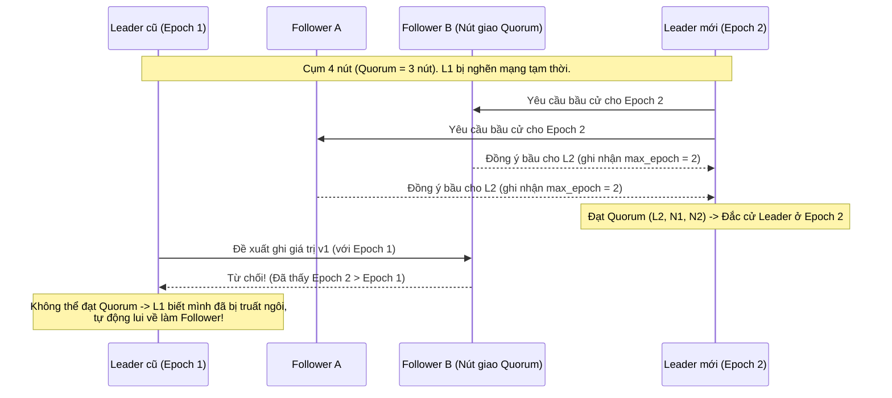

Quy trình bỏ phiếu này nhìn thoáng qua có vẻ khá giống với Cam kết hai pha (2PC). Sự khác biệt lớn nhất nằm ở chỗ các thuật toán đồng thuận chịu lỗi chỉ đòi hỏi phiếu bầu từ một *đa số* (*majority*) các nút, trong khi 2PC đòi hỏi phiếu bầu “có” từ *tất cả mọi* bên tham gia (*every participant*). Hơn thế nữa, các thuật toán đồng thuận còn định nghĩa một quy trình phục hồi (*recovery process*) chặt chẽ giúp các nút có thể quay trở về một trạng thái nhất quán sau khi một nút dẫn đầu mới được bầu lên, đảm bảo rằng các tính chất an toàn luôn luôn được thỏa mãn. Chính những điểm khác biệt này là chìa khóa tạo nên khả năng chịu lỗi ưu việt của một thuật toán đồng thuận.

#### Những hạn chế của đồng thuận (Limitations of consensus)

Các thuật toán đồng thuận là một bước đột phá khổng lồ đối với các hệ thống phân tán: chúng mang lại những tính chất an toàn cụ thể, vững chắc (*thống nhất*, *toàn vẹn* và *hợp lệ*) cho những hệ thống nơi mà mọi thứ khác đều bất định, đồng thời chúng vẫn duy trì được khả năng chịu lỗi (có thể tiếp tục tiến triển miễn là đa số các nút vẫn đang hoạt động và liên lạc được với nhau). Chúng cung cấp khả năng quảng bá thứ tự toàn phần, và do đó chúng cũng có thể triển khai các thao tác nguyên tử khả tuyến tính (*linearizable atomic operations*) theo cách chịu lỗi (xem mục “Triển khai lưu trữ khả tuyến tính bằng quảng bá thứ tự toàn phần” ở trang 340).

Tuy nhiên, chúng không được sử dụng ở khắp mọi nơi, bởi vì những lợi ích to lớn đó luôn đi kèm với một cái giá phải trả:

* Quá trình các nút bỏ phiếu cho các đề xuất trước khi chúng được quyết định về bản chất là một dạng *sao chép đồng bộ* (*synchronous replication*). Như đã thảo luận trong mục “Sao chép đồng bộ so với bất đồng bộ” ở trang 147, các cơ sở dữ liệu trong thực tế thường được cấu hình để sử dụng sao chép bất đồng bộ. Trong cấu hình bất đồng bộ đó, một số dữ liệu đã cam kết có nguy cơ bị mất khi xảy ra chuyển đổi dự phòng (*failover*) — nhưng rất nhiều người vẫn chủ động chọn chấp nhận rủi ro này để đánh lấy hiệu năng tốt hơn nhiều.
* Các hệ thống đồng thuận luôn luôn đòi hỏi một *đa số nghiêm ngặt* (*strict majority*) để có thể vận hành. Điều này có nghĩa là bạn cần tối thiểu 3 nút để có thể chịu được sự cố hỏng 1 nút (2 nút còn lại trong tổng số 3 nút tạo thành đa số), hoặc tối thiểu 5 nút để chịu được sự cố hỏng 2 nút (3 nút còn lại trong tổng số 5 nút tạo thành đa số). Nếu một sự cố mạng cắt đứt liên lạc của một số nút khỏi phần còn lại, chỉ có phân vùng mạng nào chứa đa số nút mới có thể tiếp tục hoạt động, còn phần thiểu số sẽ bị chặn hoàn toàn (xem thêm mục “Chi phí của tính khả tuyến tính” ở trang 326).
* Hầu hết các thuật toán đồng thuận đều giả định một tập hợp các nút cố định (*fixed set of nodes*) tham gia vào việc bỏ phiếu, có nghĩa là bạn không thể cứ thế tự ý thêm hoặc bớt các nút trong cụm. Các phần mở rộng hỗ trợ *thành viên động* (*dynamic membership extensions*) cho các thuật toán đồng thuận cho phép tập hợp các nút trong cụm thay đổi theo thời gian, nhưng chúng phức tạp và ít được hiểu thấu đáo hơn nhiều so với các thuật toán có tập thành viên tĩnh.
* Các hệ thống đồng thuận nhìn chung đều phải dựa vào cơ chế hết thời gian chờ (*timeouts*) để phát hiện các nút bị lỗi. Trong những môi trường có độ trễ mạng biến thiên mạnh, đặc biệt là các hệ thống phân tán về mặt địa lý (*geographically distributed systems*), rất hay xảy ra tình trạng một nút tin nhầm rằng nút dẫn đầu đã bị lỗi chỉ vì một sự cố mạng thoáng qua (*transient network issue*). Mặc dù sự nhầm lẫn này không làm tổn hại đến các tính chất an toàn, nhưng việc kích hoạt bầu cử nút dẫn đầu mới quá thường xuyên sẽ dẫn đến hiệu năng cực kỳ tồi tệ, bởi vì hệ thống có thể rơi vào cảnh dành nhiều thời gian chỉ để bầu chọn nút dẫn đầu hơn là thực hiện bất kỳ công việc hữu ích nào.
* Đôi khi, các thuật toán đồng thuận tỏ ra đặc biệt nhạy cảm với các trục trặc mạng. Ví dụ, thuật toán Raft đã được chứng minh là có những trường hợp biên (*edge cases*) rất khó chịu [106]: nếu toàn bộ mạng đều đang hoạt động tốt, ngoại trừ duy nhất một đường liên kết mạng cụ thể bị chập chờn liên tục (*consistently unreliable*), Raft có thể rơi vào tình huống mà quyền dẫn đầu cứ nảy qua nảy lại liên tục (*bounces*) giữa hai nút, hoặc nút dẫn đầu hiện tại liên tục bị buộc phải từ nhiệm (*resign*), khiến cho toàn bộ hệ thống trên thực tế không bao giờ đạt được sự tiến triển nào. Các thuật toán đồng thuận khác cũng gặp phải những vấn đề tương tự, và việc thiết kế các thuật toán có sức chống chịu tốt hơn trước các mạng không đáng tin cậy hiện vẫn đang là một bài toán nghiên cứu mở.

> 💡 **Ví dụ bổ sung (không có trong sách): Sự cố mạng đối xứng từng phần trong Raft và giải pháp `PreVote` trong etcd / CockroachDB**
>
> Hiện tượng trường hợp biên của Raft mà Martin Kleppmann đề cập ở đoạn trên (trích dẫn nghiên cứu của Heidi Howard & Jon Crowcroft [106] và luận án tiến sĩ của Diego Ongaro [101]) xảy ra như thế nào trong thực tế, và các hệ thống hiện đại như **etcd**, **CockroachDB**, **TiKV** đã khắc phục nó ra sao?
>
> **Kịch bản gây gián đoạn liên hoàn (Disruptive Server / Asymmetric Partition):**
> Giả sử cụm Raft có 3 nút: $N_1$ (đang là Leader ở `term = 1`), $N_2$ (Follower), và $N_3$ (Follower).
> - Có một lỗi cấu hình tường lửa hoặc cáp mạng khiến $N_3$ bị mất kết nối chiều nhận từ $N_1$, nhưng $N_3$ vẫn gửi được gói tin tới $N_2$. Trong khi đó $N_1$ và $N_2$ vẫn giao tiếp hoàn hảo (đạt đa số $2/3$).
> - Vì $N_3$ không nhận được heartbeat từ $N_1$, bộ đếm `electionTimeout` của $N_3$ hết hạn. $N_3$ tự tăng `term` của mình lên `term = 2`, chuyển sang trạng thái `Candidate` và gửi `RequestVote(term=2)` cho $N_2$.
> - Dù $N_3$ không thể đắc cử (vì log của $N_3$ đã cũ hơn $N_1$ và $N_2$), nhưng ngay khi $N_2$ nhìn thấy gói tin `RequestVote` có `term = 2 > 1`, theo quy tắc gốc của Raft, $N_2$ lập tức cập nhật `currentTerm = 2`!
> - Ngay tiếp theo, khi Leader $N_1$ gửi `AppendEntries(term=1)` tới $N_2$, $N_2$ từ chối vì `1 < 2` và báo cho $N_1$ biết đã có `term = 2`. Thế là Leader $N_1$ buộc phải **tự từ nhiệm (step down)** về làm Follower! Cụm bị gián đoạn dịch vụ để bầu lại $N_1$ ở `term = 3`. Và chỉ vài trăm mili-giây sau, $N_3$ lại hết timeout, lại nhảy lên `term = 4` và lại phá hỏng Leader một lần nữa!
>
> **Giải pháp thực tế — Pha tiền bầu cử (`PreVote`):**
> Để triệt tiêu căn bệnh này, các bản triển khai Raft trong sản xuất (như `etcd/raft` được dùng trong Kubernetes và CockroachDB) đã bổ sung pha **`PreVote`**:
> - Trước khi một Follower được phép tăng `term` và phát động bầu cử thật, nó phải gửi thông điệp `PreVote` hỏi các nút khác: *"Nếu tôi tăng term để tranh cử lúc này, các bạn có bầu cho tôi không?"*
> - Một nút khác (như $N_2$) sẽ **từ chối `PreVote`** nếu nó vẫn đang nhận được heartbeat đều đặn từ một Leader hợp lệ ($N_1$) trong khoảng thời gian `electionTimeout` vừa qua (hoặc nếu log của người hỏi cũ hơn).
> - Vì bị từ chối ở bước `PreVote`, nút bị cô lập một phần ($N_3$) sẽ **không được phép tăng `term`**, nhờ đó Leader $N_1$ không bao giờ bị làm phiền hay buộc phải từ nhiệm oan uổng khi $N_3$ tái kết nối!

---

### Các dịch vụ quản lý thành viên và điều phối (Membership and coordination services)

Nếu tìm hiểu các dự án như ZooKeeper hoặc etcd, bạn sẽ thấy chúng thường được mô tả là “các kho lưu trữ khóa-giá trị phân tán” (*distributed key-value stores*) hoặc “các dịch vụ điều phối và cấu hình” (*coordination and configuration services*). Giao diện lập trình (API) của chúng trông khá giống với API của một cơ sở dữ liệu thông thường: bạn có thể đọc và ghi giá trị tương ứng với một khóa (*key*) cho trước, cũng như duyệt qua danh sách các khóa. Vậy nếu về cơ bản chúng chỉ là các cơ sở dữ liệu, tại sao người ta lại phải tốn nhiều công sức đến thế để triển khai một thuật toán đồng thuận bên trong chúng? Điều gì làm cho chúng trở nên khác biệt so với bất kỳ loại cơ sở dữ liệu nào khác?

Để hiểu rõ điều này, sẽ rất hữu ích nếu chúng ta điểm qua cách một dịch vụ như ZooKeeper được sử dụng trong thực tế. Với tư cách là một nhà phát triển ứng dụng, bạn rất hiếm khi cần phải sử dụng trực tiếp ZooKeeper, bởi vì nó thực sự không phù hợp để làm một cơ sở dữ liệu đa năng (*general-purpose database*). Khả năng cao hơn nhiều là bạn sẽ dựa vào nó một cách gián tiếp thông qua một dự án hạ tầng khác: ví dụ, HBase, Hadoop YARN, OpenStack Nova và Kafka đều dựa vào ZooKeeper chạy ngầm ở phía sau. Vậy rốt cuộc các dự án này nhận được giá trị gì từ ZooKeeper?

ZooKeeper và etcd được thiết kế để lưu trữ những lượng dữ liệu nhỏ có thể nằm gọn hoàn toàn trong bộ nhớ RAM (mặc dù chúng vẫn luôn ghi xuống ổ đĩa để đảm bảo tính bền vững) — vì vậy bạn sẽ không bao giờ muốn đem toàn bộ dữ liệu ứng dụng của mình vào lưu trữ ở đây. Lượng dữ liệu nhỏ bé đó được sao chép trên tất cả các nút trong cụm bằng cách sử dụng một thuật toán quảng bá thứ tự toàn phần chịu lỗi (*fault-tolerant total order broadcast algorithm*). Như đã thảo luận trước đó, quảng bá thứ tự toàn phần chính xác là thứ bạn cần để thực hiện sao chép cơ sở dữ liệu (*database replication*): nếu mỗi thông điệp đại diện cho một thao tác ghi vào cơ sở dữ liệu, việc áp dụng cùng các thao tác ghi theo cùng một thứ tự sẽ giữ cho các bản sao luôn nhất quán tuyệt đối với nhau.

ZooKeeper được thiết kế phỏng theo dịch vụ khóa Chubby (*Chubby lock service*) của Google [14, 99], triển khai không chỉ cơ chế quảng bá thứ tự toàn phần (và do đó là sự đồng thuận), mà còn cung cấp một tập hợp thú vị các tính năng khác tỏ ra cực kỳ hữu ích khi xây dựng các hệ thống phân tán:

* **Các thao tác nguyên tử khả tuyến tính (Linearizable atomic operations):**
  Bằng cách sử dụng một thao tác so sánh và gán nguyên tử (*atomic compare-and-set operation*), bạn có thể triển khai một chiếc khóa (*lock*): nếu nhiều nút cùng lúc cố gắng thực hiện cùng một thao tác chiếm khóa, chỉ có duy nhất một nút trong số đó sẽ thành công. Bằng việc sử dụng thuật toán đồng thuận, thao tác này được đảm bảo vừa có tính nguyên tử vừa có tính khả tuyến tính, ngay cả khi một nút bị lỗi hoặc mạng bị gián đoạn tại bất kỳ thời điểm nào. Một khóa phân tán (*distributed lock*) thường được triển khai dưới dạng một *hợp đồng thuê* (*lease*), vốn có một thời gian hết hạn (*expiry time*) để nó cuối cùng sẽ tự động được giải phóng trong trường hợp máy khách giữ khóa bị sập hoặc treo (xem mục “Các khoảng dừng tiến trình” ở trang 287).

* **Thứ tự toàn phần của các thao tác (Total ordering of operations):**
  Như đã thảo luận trong mục “Nút dẫn đầu và chiếc khóa (The leader and the lock)” ở trang 293, khi một tài nguyên nào đó được bảo vệ bởi một khóa hoặc hợp đồng thuê, bạn bắt buộc phải có một *thẻ rào chắn* (*fencing token*) để ngăn các máy khách xung đột lẫn nhau trong trường hợp xảy ra khoảng dừng tiến trình (*process pause*). Thẻ rào chắn là một con số tăng đơn điệu mỗi khi chiếc khóa được cấp phát. ZooKeeper cung cấp sẵn cơ chế này bằng cách sắp xếp thứ tự toàn phần cho tất cả mọi thao tác, đồng thời gán cho mỗi thao tác một mã định danh giao dịch tăng đơn điệu là `zxid` cùng một số hiệu phiên bản là `cversion` [15].

* **Phát hiện lỗi (Failure detection):**
  Các máy khách duy trì một phiên kết nối dài hạn (*long-lived session*) trên các máy chủ ZooKeeper, và định kỳ trao đổi các tín hiệu nhịp tim (*heartbeats*) để kiểm tra xem phía bên kia có còn sống hay không. Ngay cả khi kết nối mạng bị gián đoạn tạm thời, hoặc một nút máy chủ ZooKeeper bị lỗi, phiên làm việc đó vẫn tiếp tục duy trì hoạt động (bằng cách chuyển sang kết nối với một nút ZooKeeper khác trong cụm). Tuy nhiên, nếu các tín hiệu nhịp tim ngừng hẳn trong một khoảng thời gian dài hơn ngưỡng hết hạn phiên (*session timeout*), ZooKeeper sẽ tuyên bố phiên làm việc đó đã chết. Bất kỳ khóa nào đang được nắm giữ bởi một phiên làm việc đều có thể được cấu hình để tự động bị xóa bỏ ngay khi phiên đó hết hạn (ZooKeeper gọi các nút dữ liệu kiểu này là *các nút phù du* — *ephemeral nodes*).

* **Thông báo sự kiện (Event notifications):**
  Một máy khách không chỉ có thể đọc các khóa và các giá trị đã được tạo ra bởi một máy khách khác, mà nó còn có thể đăng ký *theo dõi* (*watch*) chúng để nhận biết các thay đổi. Nhờ vậy, một máy khách có thể biết ngay khi nào có một máy khách khác vừa gia nhập vào cụm (dựa trên giá trị mà máy khách mới đó ghi vào ZooKeeper), hoặc khi nào một máy khách khác gặp sự cố (bởi vì phiên làm việc của nó bị hết thời gian chờ và các nút phù du của nó tự động biến mất). Bằng cách đăng ký nhận thông báo (*subscribing to notifications*), máy khách tránh được việc phải liên tục gửi yêu cầu thăm dò (*poll*) định kỳ để kiểm tra xem có thay đổi nào xảy ra hay không.

Trong số các tính năng trên, chỉ có duy nhất *các thao tác nguyên tử khả tuyến tính* là thực sự đòi hỏi phải có thuật toán đồng thuận. Tuy nhiên, chính sự kết hợp nhuần nhuyễn của tất cả các tính năng này lại với nhau mới là điều làm cho các hệ thống như ZooKeeper trở nên vô giá trong việc điều phối hệ thống phân tán.

#### Phân bổ công việc cho các nút (Allocating work to nodes)

Một ví dụ điển hình mà mô hình ZooKeeper/Chubby phát huy tác dụng rất tốt là khi bạn có nhiều thực thể (*instances*) của một tiến trình hoặc dịch vụ, và một trong số chúng cần phải được chọn làm nút dẫn đầu (*leader*) hoặc nút chính (*primary*). Nếu nút dẫn đầu gặp sự cố, một trong các nút còn lại sẽ tự động tiếp quản vị trí đó. Cơ chế này tất nhiên là vô cùng hữu ích cho các cơ sở dữ liệu sao chép một nút dẫn đầu, nhưng cũng hữu ích không kém đối với các bộ lập lịch tác vụ (*job schedulers*) và các hệ thống có trạng thái (*stateful systems*) tương tự.

Một ví dụ khác là khi bạn có một tài nguyên được phân vùng nào đó (cơ sở dữ liệu, luồng thông điệp, hệ thống lưu trữ tệp, hệ thống tác nhân phân tán — *distributed actor system*, v.v.) và cần phải quyết định xem phân vùng (*partition*) nào sẽ được gán cho nút nào phụ trách. Khi các nút mới gia nhập vào cụm, một số phân vùng cần phải được di chuyển từ các nút hiện có sang các nút mới nhằm tái cân bằng tải (*rebalance the load* — xem mục “Tái cân bằng các phân vùng” ở trang 201). Khi các nút bị gỡ bỏ hoặc gặp sự cố sập, các nút khác cần phải đứng ra tiếp quản phần công việc của những nút đã lỗi đó.

Những loại tác vụ quản trị phân bổ này có thể đạt được thông qua việc sử dụng khéo léo các thao tác nguyên tử, các nút phù du (*ephemeral nodes*) và cơ chế thông báo sự kiện (*notifications*) trong ZooKeeper. Nếu được thiết kế đúng đắn, cơ chế này cho phép ứng dụng tự động phục hồi sau các sự cố mà không cần bất kỳ sự can thiệp nào của con người. Tất nhiên việc sử dụng đúng cách vẫn không hề dễ dàng — các thư viện cấp cao như Apache Curator [17] đã ra đời để cung cấp những công cụ trừu tượng hóa dễ dùng hơn nằm bên trên API máy khách nguyên thủy của ZooKeeper. Nhưng dù sao đi nữa, cách làm này vẫn tốt hơn gấp vạn lần so với việc cố gắng tự tay triển khai các thuật toán đồng thuận cần thiết từ con số không — một hướng đi vốn có lịch sử thất bại vô cùng thảm hại trong ngành công nghiệp phần mềm [107].

Một ứng dụng ban đầu có thể chỉ chạy trên một nút duy nhất, nhưng về sau có thể phát triển quy mô lên tới hàng nghìn nút. Việc cố gắng thực hiện bỏ phiếu đa số (*majority votes*) trên hàng nghìn nút như vậy sẽ cực kỳ kém hiệu quả. Thay vào đó, ZooKeeper chỉ chạy trên một số lượng nút cố định (thường là 3 hoặc 5 nút) và thực hiện việc bỏ phiếu đa số nội bộ giữa các nút đó, trong khi vẫn hỗ trợ phục vụ một số lượng máy khách (*clients*) tiềm năng rất lớn. Như vậy, ZooKeeper cung cấp một phương thức để “thuê ngoài” (*outsourcing*) một phần công việc điều phối các nút (đồng thuận, sắp xếp thứ tự thao tác và phát hiện lỗi) cho một dịch vụ chuyên biệt bên ngoài.

Thông thường, loại dữ liệu được quản lý bởi ZooKeeper là dữ liệu thay đổi khá chậm (*slow-changing*): nó đại diện cho những thông tin kiểu như “nút đang chạy tại địa chỉ IP `10.1.1.23` hiện là nút dẫn đầu cho phân vùng số 7”, vốn chỉ thay đổi theo thang thời gian tính bằng phút hoặc bằng giờ. Nó hoàn toàn không được thiết kế để lưu trữ trạng thái thời gian chạy (*runtime state*) của ứng dụng, vốn có thể thay đổi hàng nghìn hoặc thậm chí hàng triệu lần mỗi giây. Nếu trạng thái thực thi của ứng dụng cần được sao chép từ nút này sang nút khác với tốc độ cao, bạn có thể sử dụng các công cụ chuyên dụng khác chẳng hạn như Apache BookKeeper [108].

#### Khám phá dịch vụ (Service discovery)

ZooKeeper, etcd và Consul cũng thường xuyên được sử dụng cho mục đích *khám phá dịch vụ* (*service discovery*), tức là để tìm hiểu xem bạn cần phải kết nối tới địa chỉ IP nào để có thể chạm tới một dịch vụ cụ thể. Trong môi trường trung tâm dữ liệu “đám mây” (*cloud datacenter*), nơi việc các máy ảo (*virtual machines*) hoặc container liên tục được khởi tạo và hủy bỏ là chuyện hết sức bình thường, bạn thường không thể biết trước địa chỉ IP của các dịch vụ của mình. Thay vào đó, bạn có thể cấu hình các dịch vụ sao cho ngay khi vừa khởi động lên, chúng sẽ tự đăng ký điểm cuối mạng (*network endpoint* — IP và cổng) của mình vào một sổ đăng ký dịch vụ (*service registry*), nơi mà sau đó các dịch vụ khác có thể tìm thấy chúng.

Tuy nhiên, người ta vẫn chưa thực sự rõ liệu bài toán khám phá dịch vụ có thực sự đòi hỏi phải dùng đến sự đồng thuận hay không. Hệ thống phân giải tên miền (DNS) là phương thức truyền thống để tra cứu địa chỉ IP cho một tên dịch vụ, và nó sử dụng nhiều tầng bộ nhớ đệm (*multiple layers of caching*) để đạt được hiệu năng cao cũng như tính sẵn sàng tốt. Các thao tác đọc từ DNS tuyệt đối không có tính khả tuyến tính (*not linearizable*), và thông thường việc kết quả trả về từ DNS bị cũ đi một chút (*a little stale*) cũng chẳng bị coi là vấn đề gì nghiêm trọng [109]. Điều quan trọng hơn nhiều đối với DNS là nó phải luôn có tính sẵn sàng đáng tin cậy và chống chịu bền bỉ trước các sự cố gián đoạn mạng.

Mặc dù bản thân việc khám phá dịch vụ không đòi hỏi sự đồng thuận, nhưng việc bầu chọn nút dẫn đầu (*leader election*) thì chắc chắn có. Do đó, nếu hệ thống đồng thuận của bạn đằng nào cũng đã nắm rõ ai đang là nút dẫn đầu, thì việc tận dụng luôn thông tin đó để giúp các dịch vụ khác khám phá ra địa chỉ của nút dẫn đầu là hoàn toàn hợp lý. Vì mục đích này, một số hệ thống đồng thuận hỗ trợ các *bản sao bộ nhớ đệm chỉ đọc* (*read-only caching replicas* — ví dụ như *Observers* trong ZooKeeper hoặc *Learners* trong Raft/etcd). Những bản sao này nhận nhật ký (*log*) của tất cả các quyết định từ thuật toán đồng thuận một cách bất đồng bộ, nhưng không tham gia trực tiếp vào quá trình bỏ phiếu. Nhờ đó, chúng có khả năng phục vụ một lượng lớn các yêu cầu đọc vốn không đòi hỏi tính khả tuyến tính mà không làm tăng gánh nặng cho quá trình bỏ phiếu của cụm đồng thuận.

#### Các dịch vụ quản lý thành viên (Membership services)

ZooKeeper và các hệ thống tương tự có thể được nhìn nhận như một phần nối tiếp của lịch sử nghiên cứu lâu dài về *các dịch vụ quản lý thành viên* (*membership services*), vốn đã bắt đầu từ những năm 1980 và đóng vai trò vô cùng quan trọng trong việc xây dựng các hệ thống có độ tin cậy cực cao, chẳng hạn như hệ thống kiểm soát không lưu (*air traffic control*) [110].

Một dịch vụ quản lý thành viên có nhiệm vụ xác định xem những nút nào hiện đang hoạt động tích cực và là thành viên còn sống (*live members*) của một cụm máy chủ. Như chúng ta đã thấy xuyên suốt Chương 8, do độ trễ mạng không giới hạn (*unbounded network delays*), không thể nào phát hiện một cách đáng tin cậy tuyệt đối rằng liệu một nút khác có thực sự đã bị lỗi hay chưa. Tuy nhiên, nếu bạn kết hợp cơ chế phát hiện lỗi (*failure detection*) với thuật toán đồng thuận (*consensus*), các nút hoàn toàn có thể đi đến một sự thống nhất chung về việc những nút nào nên được coi là đang sống và những nút nào không.

Vẫn có thể xảy ra trường hợp một nút bị tuyên bố nhầm là đã chết bởi quyết định đồng thuận, mặc dù trên thực tế nút đó vẫn đang sống (chỉ bị trễ mạng hoặc tạm dừng GC). Nhưng dẫu sao đi nữa, việc toàn bộ hệ thống có được sự thống nhất tuyệt đối về danh sách những nút nào cấu thành nên tập thành viên hiện tại (*current membership*) vẫn là điều cực kỳ hữu ích. Ví dụ, việc chọn ra một nút dẫn đầu khi đó có thể đơn giản chỉ là chọn nút có số thứ tự nhỏ nhất trong danh sách các thành viên hiện tại. Cách làm đơn giản này sẽ hoàn toàn bất khả thi nếu các nút khác nhau lại giữ những quan điểm bất đồng về việc ai đang nằm trong danh sách thành viên hiện tại.

> 📝 **Giải thích thêm (không có trong sách): Sự tiến hóa từ ZooKeeper sang etcd (Kubernetes) và KRaft (Apache Kafka)**
>
> Trong kiến trúc hệ thống phân tán hiện đại, vai trò của các dịch vụ điều phối đã có những bước chuyển mình rất đáng chú ý:
>
> 1. **Cách ZooKeeper cấp phát khóa và Fencing Token (thuật toán tránh hiệu ứng đàn gia súc — *Herd Effect*):**
>    Khi 1.000 nút ứng dụng cùng tranh nhau quyền làm Leader qua ZooKeeper, nếu tất cả cùng gọi `create("/leader", ephemeral=true)` và cùng đặt `watch` lên nút `/leader`, thì khi Leader chết, ZooKeeper sẽ gửi thông báo đánh thức **cả 1.000 nút cùng một lúc**, tạo ra một cơn bão truy vấn (*herd effect*).
>    Thay vào đó, công thức chuẩn của ZooKeeper sử dụng cờ **`EPHEMERAL_SEQUENTIAL`**:
>    - Mỗi nút tạo một nút con dưới `/election/guid-n_`, ZooKeeper tự động gắn số thứ tự tăng đơn điệu: `/election/node_00000001`, `/election/node_00000002`, `/election/node_00000003`...
>    - Nút nào có số hậu tố **nhỏ nhất** (`00000001`) sẽ tự động trở thành Leader, và chính con số `zxid` (hoặc số thứ tự tuần tự đó) đóng vai trò làm **Fencing Token**!
>    - Quan trọng hơn: Nút thứ $k$ (`00000003`) **chỉ đăng ký `watch` duy nhất nút đứng ngay trước nó** (`00000002`), chứ không watch Leader. Nhờ vậy, khi Leader chết, chỉ có duy nhất 1 nút kế nhiệm nhận được thông báo sự kiện ($O(1)$ notification thay vì $O(N)$)!
>
> 2. **Tại sao Kubernetes chọn `etcd` còn Apache Kafka loại bỏ ZooKeeper để chuyển sang `KRaft`?**
>    - **etcd trong Kubernetes:** Toàn bộ trạng thái mong muốn (*desired state*) của một cụm Kubernetes (Pods, Deployments, Services, ConfigMaps, Leases cho Controller Manager / Scheduler) đều được lưu trong **etcd** (dựa trên Raft). API `Watch` của etcd v3 dựa trên luồng gRPC (HTTP/2 multiplexing) và lưu trữ đa phiên bản **MVCC** với một `revision` tăng đơn điệu toàn cục — mỗi `revision` chính là một vị trí trong thứ tự toàn phần của Raft, cho phép Kube-API-Server và các Informer theo dõi thay đổi từ bất kỳ điểm thời gian lịch sử nào mà không sợ mất sự kiện.
>    - **Từ Kafka + ZooKeeper sang Kafka KRaft (KIP-500):** Trong suốt hơn một thập kỷ, Apache Kafka phụ thuộc vào ZooKeeper để bầu chọn *Controller* và lưu metadata của các topic/partition. Tuy nhiên, việc duy trì hai hệ thống phân tán khác nhau (ZooKeeper chạy Zab và Kafka chạy giao thức nhân bản ISR) gây ra nút thắt cổ chai khi cụm có hàng trăm nghìn partitions: mỗi khi Controller mới đắc cử, nó phải đọc toàn bộ metadata từ ZooKeeper qua mạng rồi gửi RPC `UpdateMetadata` tới mọi Broker (mất nhiều phút khi failover). Từ Kafka 3.3+ / 4.0, Kafka đã tích hợp trực tiếp thuật toán đồng thuận **KRaft** (một biến thể Raft dựa trên sự kiện — *event-sourced Raft*) ngay bên trong các nút Controller của Kafka: metadata giờ đây là một log sự kiện (`__cluster_metadata`) được nhân bản bằng Raft, giúp các Standby Controller luôn có sẵn trạng thái trong bộ nhớ và chuyển đổi dự phòng (*failover*) chỉ trong vài mili-giây!

---

## Tóm tắt (Summary)

Trong chương này, chúng ta đã xem xét các chủ đề về tính nhất quán (*consistency*) và sự đồng thuận (*consensus*) từ nhiều góc độ khác nhau. Chúng ta đã đi sâu tìm hiểu *tính khả tuyến tính* (*linearizability*), một mô hình nhất quán phổ biến: mục tiêu của nó là làm cho dữ liệu được sao chép trông giống hệt như thể chỉ có một bản sao duy nhất tồn tại, và làm cho mọi thao tác tác động lên dữ liệu đó đều diễn ra một cách nguyên tử tức thời. Mặc dù tính khả tuyến tính rất hấp dẫn bởi vì nó dễ hiểu — nó làm cho một cơ sở dữ liệu phân tán hành xử giống hệt như một biến số trong một chương trình đơn luồng (*single-threaded program*) — nhưng nó lại có nhược điểm lớn là chậm chạp, đặc biệt là trong các môi trường có độ trễ mạng lớn.

Chúng ta cũng đã khám phá *quan hệ nhân quả* (*causality*), vốn áp đặt một thứ tự lên các sự kiện trong hệ thống (sự kiện nào xảy ra trước sự kiện nào, dựa trên mối quan hệ nguyên nhân và kết quả). Khác với tính khả tuyến tính vốn ép tất cả các thao tác vào một dòng thời gian duy nhất có thứ tự toàn phần (*single, totally ordered timeline*), quan hệ nhân quả cung cấp cho chúng ta một mô hình nhất quán yếu hơn: một số sự kiện có thể diễn ra *đồng thời* (*concurrent*), vì vậy lịch sử phiên bản sẽ giống như một dòng thời gian có sự phân nhánh và hợp nhất (*branching and merging*). Tính nhất quán nhân quả (*causal consistency*) không phải gánh chịu chi phí điều phối nặng nề như tính khả tuyến tính, và ít nhạy cảm hơn nhiều trước các sự cố mạng.

Tuy nhiên, ngay cả khi chúng ta nắm bắt được thứ tự nhân quả (chẳng hạn bằng cách sử dụng dấu thời gian Lamport — *Lamport timestamps*), chúng ta đã thấy rằng có một số bài toán vẫn không thể giải quyết theo cách này: trong mục “Sắp xếp thứ tự theo dấu thời gian là không đủ (Timestamp ordering is not sufficient)” ở trang 337, chúng ta đã xem xét ví dụ về việc đảm bảo một tên người dùng (*username*) là duy nhất và từ chối các yêu cầu đăng ký đồng thời cho cùng một tên người dùng đó. Nếu một nút định chấp nhận một yêu cầu đăng ký, nó cần phải bằng cách nào đó biết chắc chắn rằng không có một nút nào khác cũng đang đồng thời trong quá trình đăng ký cùng cái tên đó. Bài toán này đã dẫn lối đưa chúng ta tiến tới sự *đồng thuận* (*consensus*).

Chúng ta đã thấy rằng việc đạt được sự đồng thuận có nghĩa là đưa ra quyết định về một điều gì đó theo cách mà tất cả các nút đều thống nhất về những gì đã được quyết định, và sao cho quyết định đó là không thể đảo ngược (*irrevocable*). Khi đào sâu tìm hiểu, hóa ra một loạt các bài toán tưởng chừng khác nhau trên thực tế đều có thể quy về (*reducible to*) bài toán đồng thuận, và hoàn toàn tương đương (*equivalent*) với nhau (theo nghĩa là nếu bạn có trong tay lời giải cho một trong số chúng, bạn có thể dễ dàng biến đổi nó thành lời giải cho bất kỳ bài toán nào trong số các bài toán còn lại):

* **Thanh ghi so sánh và gán khả tuyến tính (Linearizable compare-and-set register):**
  Thanh ghi cần phải quyết định một cách nguyên tử xem có ghi giá trị mới hay không, dựa trên việc liệu giá trị hiện tại của nó có bằng với tham số được truyền vào trong thao tác hay không.

* **Cam kết giao dịch nguyên tử (Atomic transaction commit):**
  Một cơ sở dữ liệu phải quyết định xem nên cam kết (*commit*) hay hủy bỏ (*abort*) một giao dịch phân tán.

* **Quảng bá thứ tự toàn phần (Total order broadcast):**
  Hệ thống truyền thông điệp phải quyết định về thứ tự chuyển giao các thông điệp tới tất cả các nút.

* **Khóa và hợp đồng thuê (Locks and leases):**
  Khi nhiều máy khách đang chạy đua để giành lấy một chiếc khóa hoặc hợp đồng thuê, cơ chế khóa phải quyết định xem máy khách nào đã chiếm giữ được nó thành công.

* **Dịch vụ quản lý thành viên / điều phối (Membership/coordination service):**
  Dựa trên một bộ phát hiện lỗi (ví dụ: cơ chế hết thời gian chờ — *timeouts*), hệ thống phải quyết định xem những nút nào đang còn sống, và những nút nào nên bị coi là đã chết bởi vì phiên làm việc của chúng đã hết hạn.

* **Ràng buộc tính duy nhất (Uniqueness constraint):**
  Khi nhiều giao dịch đồng thời cố gắng tạo ra các bản ghi xung đột có cùng một khóa (*key*), cơ chế ràng buộc phải quyết định xem giao dịch nào được phép thành công và giao dịch nào phải thất bại với lỗi vi phạm ràng buộc (*constraint violation*).

Tất cả những bài toán trên đều cực kỳ đơn giản và dễ giải quyết nếu bạn chỉ có một nút duy nhất, hoặc nếu bạn sẵn lòng giao phó toàn bộ quyền năng ra quyết định cho một nút duy nhất. Đây chính là những gì diễn ra trong một cơ sở dữ liệu sao chép một nút dẫn đầu (*single-leader database*): toàn bộ quyền lực đưa ra quyết định đều được trao cho nút dẫn đầu, đó là lý do tại sao những cơ sở dữ liệu như vậy có khả năng cung cấp các thao tác khả tuyến tính, các ràng buộc tính duy nhất, một nhật ký sao chép có thứ tự toàn phần, và nhiều tính năng khác nữa.

Tuy nhiên, nếu nút dẫn đầu duy nhất đó gặp sự cố, hoặc nếu một sự cố gián đoạn mạng làm cho nút dẫn đầu trở nên không thể liên lạc được, thì một hệ thống như vậy sẽ rơi vào cảnh không thể thực hiện thêm bất kỳ sự tiến triển nào nữa. Có ba cách tiếp cận để xử lý tình huống đó:

1. Chờ cho nút dẫn đầu phục hồi trở lại, và chấp nhận rằng hệ thống sẽ bị chặn (*blocked*) trong khoảng thời gian chờ đợi đó. Nhiều bộ điều phối giao dịch XA/JTA lựa chọn phương án này. Cách tiếp cận này không giải quyết được bài toán đồng thuận bởi vì nó không thỏa mãn tính chất *kết thúc* (*termination*): nếu nút dẫn đầu không bao giờ phục hồi được nữa, hệ thống có thể bị chặn cứng mãi mãi.
2. Thực hiện chuyển đổi dự phòng thủ công (*manually failover*) bằng cách để con người chọn ra một nút dẫn đầu mới và cấu hình lại hệ thống để sử dụng nút đó. Nhiều cơ sở dữ liệu quan hệ truyền thống đi theo hướng tiếp cận này. Đây là một dạng đồng thuận nhờ “bàn tay của Chúa” (*act of God*) — người vận hành bằng xương bằng thịt, nằm bên ngoài hệ thống máy tính, là người đưa ra quyết định. Tốc độ chuyển đổi dự phòng bị giới hạn bởi tốc độ phản ứng và thao tác của con người, vốn nhìn chung chậm hơn rất nhiều so với máy tính.
3. Sử dụng một thuật toán để tự động chọn ra một nút dẫn đầu mới. Việc này đòi hỏi phải có một thuật toán đồng thuận; bất kỳ hệ thống nào thực hiện chuyển đổi dự phòng tự động mà không sử dụng một thuật toán đồng thuận đã được chứng minh tính đúng đắn đều rất dễ hành xử tồi tệ và gây mất mát dữ liệu trong những điều kiện mạng bất lợi [107].

Mặc dù một cơ sở dữ liệu một nút dẫn đầu có thể cung cấp tính khả tuyến tính mà không cần phải thực thi thuật toán đồng thuận trên từng thao tác ghi đơn lẻ, nó vẫn bắt buộc phải cần đến sự đồng thuận để duy trì quyền dẫn đầu và để thực hiện chuyển giao quyền dẫn đầu khi có sự cố. Như vậy, xét theo một khía cạnh nào đó, việc có một nút dẫn đầu chỉ là hành động “đá quả bóng trách nhiệm đi xa hơn một chút trên con đường” (*kicks the can down the road*): sự đồng thuận vẫn luôn là thứ bắt buộc phải có, chỉ là nó được chuyển sang một vị trí khác và được gọi thực thi ít thường xuyên hơn mà thôi. Tin vui là các thuật toán và hệ thống đồng thuận chịu lỗi hoàn toàn tồn tại trong thực tế, và chúng ta đã thảo luận khái quát về chúng trong chương này.

Các công cụ như ZooKeeper đóng một vai trò vô cùng quan trọng trong việc cung cấp một dịch vụ đồng thuận, phát hiện lỗi và quản lý thành viên theo mô hình “thuê ngoài” (*outsourced*) mà các ứng dụng có thể tận dụng. Việc sử dụng chúng tuy không hề dễ dàng, nhưng vẫn tốt hơn rất nhiều so với việc cố gắng tự mình phát triển các thuật toán riêng để có thể chống chọi lại toàn bộ những vấn đề hiểm hóc đã được thảo luận trong Chương 8. Nếu bạn thấy mình đang muốn làm một trong những công việc có thể quy về bài toán đồng thuận, và bạn muốn nó có khả năng chịu lỗi thực sự, thì lời khuyên chân thành là hãy sử dụng một hệ thống đã được kiểm chứng như ZooKeeper (hoặc etcd).

Tuy nhiên, không phải mọi hệ thống đều nhất thiết đòi hỏi phải có sự đồng thuận: ví dụ, các hệ thống sao chép không có nút dẫn đầu (*leaderless*) và đa nút dẫn đầu (*multi-leader*) thường không sử dụng cơ chế đồng thuận toàn cục. Những xung đột dữ liệu phát sinh trong các hệ thống này (xem mục “Xử lý xung đột ghi” ở trang 164) chính là hệ quả trực tiếp của việc không có sự đồng thuận xuyên suốt giữa các nút dẫn đầu khác nhau. Nhưng biết đâu điều đó lại hoàn toàn ổn: có lẽ chúng ta chỉ đơn giản là cần học cách sống chung với việc không có tính khả tuyến tính, và học cách làm việc hiệu quả hơn với những dữ liệu có lịch sử phiên bản phân nhánh và hợp nhất (*branching and merging version histories*).

Chương này đã trích dẫn một khối lượng lớn các công trình nghiên cứu về lý thuyết hệ thống phân tán. Mặc dù các bài báo lý thuyết và các phép chứng minh toán học không phải lúc nào cũng dễ đọc hiểu, và đôi khi đưa ra những giả định thiếu thực tế, nhưng chúng lại mang giá trị vô cùng to lớn trong việc định hướng và soi sáng cho công việc thực hành trong lĩnh vực này: chúng giúp chúng ta suy luận chặt chẽ về những gì có thể làm được và những gì không thể làm được, đồng thời giúp chúng ta phát hiện ra những cách thức phản trực giác mà qua đó các hệ thống phân tán thường xuyên bị lỗi. Nếu bạn có thời gian, danh mục tài liệu tham khảo dưới đây thực sự rất đáng để khám phá.

Chương này cũng khép lại Phần II của cuốn sách, nơi chúng ta đã lần lượt đi qua các chủ đề sao chép dữ liệu (Chương 5), phân vùng dữ liệu (Chương 6), giao dịch (Chương 7), các mô hình lỗi của hệ thống phân tán (Chương 8), và cuối cùng là tính nhất quán và sự đồng thuận (Chương 9). Giờ đây, sau khi đã đặt xong một nền móng lý thuyết vững chắc, trong Phần III chúng ta sẽ một lần nữa quay trở lại với các hệ thống thực tiễn hơn, và thảo luận về cách thức xây dựng những ứng dụng mạnh mẽ từ việc kết hợp các khối kiến trúc không đồng nhất (*heterogeneous building blocks*).


---

## Tài liệu tham khảo (References)

1. **[1]** Peter Bailis and Ali Ghodsi: “Eventual Consistency Today: Limitations, Extensions, and Beyond,” *ACM Queue*, volume 11, number 3, March 2013. doi:10.1145/2460276.2462076 — *Tổng quan về tính nhất quán cuối cùng (eventual consistency), những hạn chế trong thực tế vận hành, cách đo lường độ trễ hội tụ (PBS - Probabilistically Bounded Staleness) và các mô hình mở rộng mạnh hơn.*

2. **[2]** Prince Mahajan, Lorenzo Alvisi, and Mike Dahlin: “Consistency, Availability, and Convergence,” University of Texas at Austin, Department of Computer Science, Tech Report UTCS TR-11-22, May 2011. — *Báo cáo kỹ thuật chứng minh định lý CAC: giới hạn lý thuyết cho thấy tính nhất quán nhân quả (Causal+ consistency) là mô hình nhất quán mạnh nhất có thể đạt được đồng thời với tính sẵn sàng cao (always-available) và hội tụ dữ liệu khi xảy ra phân vùng mạng.*

3. **[3]** Alex Scotti: “Adventures in building your own database,” at *All Your Base*, November 2015. — *Bài thuyết trình chia sẻ kinh nghiệm thực chiến và những bài học xương máu khi tự thiết kế và xây dựng cơ sở dữ liệu từ đầu.*

4. **[4]** Peter Bailis, Aaron Davidson, Alan Fekete, et al.: “Highly Available Transactions: Virtues and Limitations,” at *40th International Conference on Very Large Data Bases* (VLDB), September 2014. Extended version published as pre-print arXiv:1302.0309 [cs.DB]. — *Nghiên cứu phân loại các mức cô lập giao dịch ACID nào có thể đạt được tính sẵn sàng cao (HAT - Highly Available Transactions, không bị chặn khi phân vùng mạng, như Read Committed, Monotonic Atomic View) và những mức nào bắt buộc phải hy sinh tính sẵn sàng (như Serializable, Repeatable Read).*

5. **[5]** Paolo Viotti and Marko Vukolić: “Consistency in Non-Transactional Distributed Storage Systems,” arXiv:1512.00168, 12 April 2016. — *Khảo sát toàn diện và hệ thống hóa phả hệ của hơn 50 mô hình nhất quán khác nhau trong các hệ thống lưu trữ phân tán phi giao dịch (từ Linearizability, Sequential Consistency, Causal Consistency cho tới Eventual Consistency).*

6. **[6]** Maurice P Herlihy and Jeannette M Wing: “Linearizability: A Correctness Condition for Concurrent Objects,” *ACM Transactions on Programming Languages and Systems* (TOPLAS), volume 12, number 3, pages 463–492, July 1990. doi:10.1145/78969.78972 — *Bài báo nền tảng kinh điển định nghĩa chính thức khái niệm Tính khả tuyến tính (Linearizability) cho các đối tượng đồng thời dựa trên thứ tự thời gian thực của các lời gọi và phản hồi thao tác.*

7. **[7]** Leslie Lamport: “On interprocess communication,” *Distributed Computing*, volume 1, number 2, pages 77–101, June 1986. doi:10.1007/BF01786228 — *Công trình của Leslie Lamport định nghĩa các thanh ghi nguyên tử (atomic registers — tiền thân của khái niệm linearizability), thanh ghi chính quy (regular registers) và thanh ghi an toàn (safe registers) trong giao tiếp liên tiến trình.*

8. **[8]** David K Gifford: “Information Storage in a Decentralized Computer System,” Xerox Palo Alto Research Centers, CSL-81-8, June 1981. — *Luận án kinh điển tại Xerox PARC giới thiệu khái niệm bỏ phiếu theo túc số (Quorum voting: $r + w > n$) để quản lý dữ liệu sao chép trong hệ thống phân tán.*

9. **[9]** Martin Kleppmann: “Please stop calling databases CP or AP,” *martin.kleppmann.com*, 11 May 2015. — *Bài viết nổi tiếng của chính tác giả Martin Kleppmann phân tích tại sao việc phân loại cứng nhắc các cơ sở dữ liệu thành "CP" hay "AP" theo định lý CAP là quá đơn giản hóa và dễ gây hiểu lầm nghiêm trọng.*

10. **[10]** Kyle Kingsbury: “Call me maybe: MongoDB stale reads,” *aphyr.com*, 20 April 2015. — *Báo cáo kiểm thử Jepsen vạch trần các lỗi đọc dữ liệu cũ (stale reads) và mất dữ liệu đã ghi trong các phiên bản MongoDB trước đây ngay cả khi người dùng cấu hình mức độ quan tâm đọc/ghi mạnh.*

11. **[11]** Kyle Kingsbury: “Computational techniques in Knossos,” *aphyr.com*, 17 May 2014. — *Bài viết giải thích thuật toán và độ phức tạp tính toán (NP-complete) bên trong công cụ Knossos (thuộc bộ kiểm thử Jepsen) dùng để kiểm tra xem lịch sử thao tác thực thi của một cơ sở dữ liệu có thỏa mãn tính khả tuyến tính hay không.*

12. **[12]** Peter Bailis: “Linearizability versus Serializability,” *bailis.org*, 24 September 2014. — *Bài viết phân biệt cực kỳ rõ ràng sự khác nhau giữa Tính khả tuyến tính (Linearizability — tính chất thời gian thực trên một đối tượng đơn lẻ) và Tính khả tuần tự (Serializability — tính chất cô lập trên giao dịch đa đối tượng) cũng như sự kết hợp của cả hai (Strict Serializability).*

13. **[13]** Philip A Bernstein, Vassos Hadzilacos, and Nathan Goodman: *Concurrency Control and Recovery in Database Systems*. Addison-Wesley, 1987. Available online at *research.microsoft.com*. ISBN: 0201107155 — *Cuốn sách giáo khoa kinh điển về kiểm soát đồng thời (2PL, Timestamp Ordering), khôi phục dữ liệu sau sự cố và các giao thức cam kết nguyên tử phân tán (2PC, 3PC).*

14. **[14]** Mike Burrows: “The Chubby lock service for loosely-coupled distributed systems,” at *7th USENIX Symposium on Operating System Design and Implementation* (OSDI), November 2006. — *Bài báo giới thiệu dịch vụ khóa phân tán Chubby của Google (dựa trên Paxos), nguồn cảm hứng trực tiếp cho Apache ZooKeeper, được dùng làm gốc điều phối cho GFS và Bigtable.*

15. **[15]** Flavio P Junqueira and Benjamin Reed: *ZooKeeper: Distributed Process Coordination*. O’Reilly Media, November 2013. ISBN: 978-1-4493-6130-3 — *Cuốn sách chuyên khảo do chính các tác giả sáng lập Apache ZooKeeper biên soạn, giải thích chi tiết kiến trúc, các mẫu thiết kế điều phối (locks, leader election, barriers), `zxid` và giao thức Zab.*

16. **[16]** “etcd 2.0.12 Documentation,” CoreOS, Inc., 2015. — *Tài liệu chính thức của kho khóa-giá trị phân tán etcd (dựa trên thuật toán đồng thuận Raft), giải thích cách đọc/ghi khả tuyến tính và theo dõi sự kiện.*

17. **[17]** “Apache Curator,” Apache Software Foundation, *curator.apache.org*, 2015. — *Thư viện khung làm việc (framework) bậc cao bằng Java giúp đơn giản hóa việc lập trình với Apache ZooKeeper thông qua các công thức dựng sẵn (recipes) cho khóa phân tán, bầu chọn leader và quản lý phiên.*

18. **[18]** Morali Vallath: *Oracle 10g RAC Grid, Services & Clustering*. Elsevier Digital Press, May 2006. ISBN: 978-1-55558-321-7 — *Tài liệu chuyên sâu về kiến trúc Oracle Real Application Clusters (RAC), bao gồm cơ chế Cache Fusion và cách sử dụng thiết bị STONITH / fencing để chống split-brain.*

19. **[19]** Jim Gray: “The Transaction Concept: Virtues and Limitations,” at *7th International Conference on Very Large Data Bases* (VLDB), pages 144–154, September 1981. — *Bài báo lịch sử của Jim Gray (chủ nhân giải Turing) đặt nền móng cho khái niệm giao dịch ACID, phép ẩn dụ lễ cưới của giao thức cam kết hai pha (2PC) và khái niệm giao dịch bù trừ (compensating transactions).*

20. **[20]** Hector Garcia-Molina and Kenneth Salem: “Sagas,” at *ACM International Conference on Management of Data* (SIGMOD), pages 249–259, May 1987. doi:10.1145/38713.38742 — *Bài báo gốc giới thiệu mẫu thiết kế Saga (chia một giao dịch kéo dài thành chuỗi các giao dịch con đi kèm với các giao dịch bù trừ hoàn tác), ngày nay trở thành nền tảng cho kiến trúc Microservices.*

21. **[21]** Pat Helland: “Memories, Guesses, and Apologies,” *blogs.msdn.com*, 15 May 2007. — *Bài viết sâu sắc của Pat Helland về cách các hệ thống quy mô lớn trong thực tế kinh doanh vận hành dựa trên "ký ức" (dữ liệu đã xác nhận), "phỏng đoán" (quyết định cục bộ khi thiếu thông tin toàn cục) và "lời xin lỗi" (xử lý bù trừ khi xảy ra xung đột như bán quá số lượng tồn kho).*

22. **[22]** Susan B Davidson, Hector Garcia-Molina, and Dale Skeen: “Consistency in Partitioned Networks,” *ACM Computing Surveys*, volume 17, number 3, pages 341–370, September 1985. doi:10.1145/5505.5508 — *Bài khảo sát xuất bản từ năm 1985 phân tích các chiến lược duy trì tính nhất quán khi mạng bị chia cắt (partitioned networks), đi trước định lý CAP hơn một thập kỷ.*

23. **[23]** Eric A Brewer: “NoSQL: Past, Present, Future,” at *QCon San Francisco*, November 2012. — *Bài diễn thuyết của Giáo sư Eric Brewer (tác giả định lý CAP) nhìn lại lịch sử phát triển của phong trào NoSQL và sự đánh đổi giữa tính nhất quán và tính sẵn sàng.*

24. **[24]** Peter Bailis, Alan Fekete, Michael J Franklin, et al.: “Coordination-Avoiding Database Systems,” *Proceedings of the VLDB Endowment*, volume 8, number 3, pages 185–196, November 2014. — *Nghiên cứu đề xuất khái niệm Hợp lưu bất biến ($\mathcal{I}$-confluence / Invariant Confluence) để xác định chính xác khi nào các ràng buộc toàn vẹn ứng dụng có thể thực thi an toàn mà không cần đồng bộ điều phối xuyên nút.*

25. **[25]** Kyle Kingsbury: “Call me maybe: etcd and Consul,” *aphyr.com*, 9 June 2014. — *Báo cáo kiểm thử Jepsen phân tích tính đúng đắn của etcd và Consul dưới các kịch bản phân vùng mạng, dẫn đến việc etcd sửa lỗi đọc bẩn bằng cách yêu cầu đọc qua quorum (quorum reads).*

26. **[26]** Flavio P Junqueira, Benjamin C Reed, and Marco Serafini: “Zab: High-performance broadcast for primary-backup systems,” at *41st IEEE International Conference on Dependable Systems and Networks* (DSN), pages 245–256, June 2011. doi:10.1109/DSN.2011.5958223 — *Bài báo khoa học trình bày chi tiết giao thức Zab (ZooKeeper Atomic Broadcast), cơ chế quảng bá thứ tự toàn phần hiệu năng cao phục vụ cho các hệ thống sao chép chính-phụ (primary-backup).*

27. **[27]** Diego Ongaro and John K Ousterhout: “In Search of an Understandable Consensus Algorithm (Extended Version),” at *USENIX Annual Technical Conference* (ATC), June 2014. — *Bài báo kinh điển giới thiệu thuật toán đồng thuận Raft, được thiết kế với mục tiêu dễ hiểu và dễ triển khai thực tế hơn Paxos, hiện là thuật toán cốt lõi của etcd, Consul, CockroachDB và TiKV.*

28. **[28]** Hagit Attiya, Amotz Bar-Noy, and Danny Dolev: “Sharing memory robustly in message-passing systems,” *Journal of the ACM*, volume 42, number 1, pages 124–142, January 1995. doi:10.1145/200836.200869 — *Bài báo giới thiệu thuật toán ABD (Attiya-Bar-Noy-Dolev), chứng minh cách mô phỏng một thanh ghi đọc/ghi khả tuyến tính (linearizable register) trên hệ thống truyền thông điệp không có nút dẫn đầu thông qua quorum ($r + w > n$) và cơ chế sửa chữa khi đọc (read repair) đồng bộ.*

29. **[29]** Nancy Lynch and Alex Shvartsman: “Robust emulation of shared memory using dynamic quorum-acknowledged broadcasts,” at *27th Annual International Symposium on Fault-Tolerant Computing* (FTCS), pages 272–281, June 1997. doi:10.1109/FTCS.1997.614100 — *Nghiên cứu mở rộng kỹ thuật mô phỏng bộ nhớ chia sẻ khả tuyến tính sang các hệ thống có cấu hình túc số động (dynamic quorums).*

30. **[30]** Christian Cachin, Rachid Guerraoui, and Luís Rodrigues: *Introduction to Reliable and Secure Distributed Programming*, Second Edition. Springer, February 2011. ISBN: 978-3-642-15259-7, doi:10.1007/978-3-642-15260-3 — *Cuốn sách giáo khoa chuẩn mực trình bày hình thức hóa các khái niệm về phát hiện lỗi, quảng bá tin cậy (reliable/total order broadcast), các thanh ghi khả tuyến tính và các thuật toán đồng thuận (bao gồm cả đồng thuận chịu lỗi Byzantine).*

31. **[31]** Sam Elliott, Mark Allen, and Martin Kleppmann: personal communication, thread on *twitter.com*, 15 October 2015. — *Trao đổi chuyên môn về hành vi nhất quán và cơ chế túc số trong các hệ thống cơ sở dữ liệu kiểu Dynamo (như Riak và Cassandra).*

32. **[32]** Niklas Ekström, Mikhail Panchenko, and Jonathan Ellis: “Possible issue with read repair?,” email thread on *cassandra-dev* mailing list, October 2012. — *Thảo luận kỹ thuật trên danh sách thư nhà phát triển Apache Cassandra về trường hợp đọc/ghi theo quorum trong Cassandra vẫn không đạt được tính khả tuyến tính do sử dụng cơ chế phân giải xung đột Last-Write-Wins (LWW) và cách xử lý read repair.*

33. **[33]** Maurice P Herlihy: “Wait-Free Synchronization,” *ACM Transactions on Programming Languages and Systems* (TOPLAS), volume 13, number 1, pages 124–149, January 1991. doi:10.1145/114005.102808 — *Công trình đoạt giải Dijkstra Prize của Maurice Herlihy thiết lập Hệ thống phân cấp đồng thuận (Consensus Hierarchy): chứng minh rằng thanh ghi đọc/ghi thông thường có số đồng thuận (consensus number) bằng 1 (không thể giải bài toán đồng thuận), trong khi các thao tác nguyên tử như `compare-and-swap` (CAS) có số đồng thuận là $\infty$ (tương đương với bài toán đồng thuận).*

34. **[34]** Armando Fox and Eric A Brewer: “Harvest, Yield, and Scalable Tolerant Systems,” at *7th Workshop on Hot Topics in Operating Systems* (HotOS), pages 174–178, March 1999. doi:10.1109/HOTOS.1999.798396 — *Bài báo tiền đề của Eric Brewer trước khi phát biểu nguyên lý CAP, thảo luận về sự đánh đổi giữa tính đầy đủ của kết quả truy vấn (Harvest) và tỷ lệ yêu cầu thành công (Yield) trong các hệ thống quy mô lớn.*

35. **[35]** Seth Gilbert and Nancy Lynch: “Brewer’s Conjecture and the Feasibility of Consistent, Available, Partition-Tolerant Web Services,” *ACM SIGACT News*, volume 33, number 2, pages 51–59, 2002. doi:10.1145/564585.564601 — *Bài báo chính thức chứng minh toán học cho giả thuyết CAP của Eric Brewer (biến nó thành Định lý CAP), trong đó định nghĩa "Consistency" là tính khả tuyến tính (Linearizability) và "Availability" là mọi nút không lỗi đều phải trả về phản hồi.*

36. **[36]** Seth Gilbert and Nancy Lynch: “Perspectives on the CAP Theorem,” *IEEE Computer Magazine*, volume 45, number 2, pages 30–36, February 2012. doi:10.1109/MC.2011.389 — *Bài viết nhìn lại định lý CAP sau 10 năm chứng minh, làm rõ ý nghĩa thực sự của định lý và mối liên hệ của nó với độ trễ mạng cũng như các thuật toán đồng thuận.*

37. **[37]** Eric A Brewer: “CAP Twelve Years Later: How the “Rules” Have Changed,” *IEEE Computer Magazine*, volume 45, number 2, pages 23–29, February 2012. doi:10.1109/MC.2012.37 — *Bài viết quan trọng của chính Eric Brewer sau 12 năm, đính chính lại quan niệm sai lầm "chọn 2 trong 3" (2 out of 3) của CAP và giải thích cách các hệ thống hiện đại xử lý phân vùng mạng cũng như khôi phục trạng thái.*

38. **[38]** Paul R Johnson and Robert H Thomas: “RFC 677: The Maintenance of Duplicate Databases,” Network Working Group, 27 January 1975. — *Tài liệu RFC lịch sử từ năm 1975 trên mạng ARPANET (tiền thân của Internet) đã sớm thảo luận về bài toán đồng bộ bản sao cơ sở dữ liệu và giải quyết xung đột theo dấu thời gian.*

39. **[39]** Bruce G Lindsay, Patricia Griffiths Selinger, C Galtieri, et al.: “Notes on Distributed Databases,” IBM Research, Research Report RJ2571(33471), July 1979. — *Báo cáo nghiên cứu nền tảng từ dự án System R* của IBM, trình bày chi tiết về sao chép dữ liệu, giao dịch phân tán và giao thức cam kết hai pha (2PC).*

40. **[40]** Michael J Fischer and Alan Michael: “Sacrificing serializability to attain high availability of data in an unreliable network,” at *1st ACM Symposium on Principles of Database Systems* (PODS), pages 70–75, March 1982. doi:10.1145/588111.588124 — *Một trong những công trình đầu tiên chỉ ra sự đánh đổi tất yếu giữa tính khả tuần tự (serializability) và tính sẵn sàng cao trong mạng không tin cậy.*

41. **[41]** Martin Kleppmann: “A Critique of the CAP Theorem,” arXiv:1509.05393, 17 September 2015. — *Bài báo nghiên cứu học thuật của Martin Kleppmann phê bình những điểm mơ hồ của định lý CAP và đề xuất khung mô hình đánh đổi dựa trên độ trễ (delay-sensitivity) giữa tính khả tuyến tính và tính nhất quán nhân quả.*

42. **[42]** Nancy A Lynch: “A Hundred Impossibility Proofs for Distributed Computing,” at *8th ACM Symposium on Principles of Distributed Computing* (PODC), pages 1–28, August 1989. doi:10.1145/72981.72982 — *Bài giảng tổng quan nổi tiếng của Nancy Lynch điểm lại hàng loạt định lý bất khả thi trong điện toán phân tán (như bài toán Tướng quân Byzantine, định lý FLP, giới hạn độ trễ đồng bộ hóa đồng hồ).*

43. **[43]** Hagit Attiya, Faith Ellen, and Adam Morrison: “Limitations of Highly-Available Eventually-Consistent Data Stores,” at *ACM Symposium on Principles of Distributed Computing* (PODC), July 2015. doi:10.1145/2767386.2767419 — *Nghiên cứu chứng minh giới hạn lý thuyết về chi phí độ trễ tối thiểu của các hệ thống có tính khả tuyến tính hoặc tuần tự so với các hệ thống nhất quán cuối cùng.*

44. **[44]** Henry Robinson: “CAP Confusion: Problems with “partition tolerance”,” *blog.cloudera.com*, 26 April 2010. — *Bài viết giải thích tại sao "Khả năng chịu phân vùng mạng" (Partition Tolerance) không phải là một tính năng bạn có thể chọn tắt/bật, vì lỗi phân vùng mạng là một thực tế vật lý không thể tránh khỏi.*

45. **[45]** Adrian Cockcroft: “Migrating to Microservices,” at *QCon London*, March 2014. — *Bài thuyết trình từ cựu kiến trúc sư trưởng của Netflix về chuyển đổi kiến trúc sang Microservices và cách thiết kế hệ thống chịu lỗi.*

46. **[46]** Peter Sewell, Susmit Sarkar, Scott Owens, Francesco Zappa Nardelli, and Magnus O Myreen: “x86-TSO: A Rigorous and Usable Programmer’s Model for x86 Multiprocessors,” *Communications of the ACM*, volume 53, number 7, pages 89–97, July 2010. doi:10.1145/1785414.1785443 — *Bài báo mô tả mô hình bộ nhớ Total Store Order (TSO) trên kiến trúc vi xử lý đa nhân x86, giải thích tại sao ngay cả RAM trên một máy tính đơn lẻ cũng không có tính khả tuyến tính do hàng đợi ghi (store buffers) của từng nhân CPU.*

47. **[47]** Martin Thompson: “Memory Barriers/Fences,” *mechanical-sympathy.blogspot.co.uk*, 24 July 2011. — *Bài viết giải thích thực tế về rào chắn bộ nhớ (memory barriers/fences) ở cấp độ phần cứng CPU để ép thứ tự hiển thị của các thao tác đọc/ghi giữa các nhân.*

48. **[48]** Ulrich Drepper: “What Every Programmer Should Know About Memory,” *akkadia.org*, 21 November 2007. — *Tài liệu kinh điển dài hơn 100 trang của Ulrich Drepper giải thích toàn diện về kiến trúc bộ nhớ phần cứng (RAM, CPU caches L1/L2/L3, giao thức MESI, NUMA) và ảnh hưởng của chúng tới hiệu năng phần mềm.*

49. **[49]** Daniel J Abadi: “Consistency Tradeoffs in Modern Distributed Database System Design,” *IEEE Computer Magazine*, volume 45, number 2, pages 37–42, February 2012. doi:10.1109/MC.2012.33 — *Bài báo giới thiệu mô hình phân loại PACELC của Daniel Abadi: mở rộng định lý CAP bằng cách chỉ ra rằng ngay cả khi hệ thống hoạt động bình thường không có phân vùng mạng (Else), cơ sở dữ liệu vẫn phải đánh đổi giữa Độ trễ (Latency) và Tính nhất quán (Consistency).*

50. **[50]** Hagit Attiya and Jennifer L Welch: “Sequential Consistency versus Linearizability,” *ACM Transactions on Computer Systems* (TOCS), volume 12, number 2, pages 91–122, May 1994. doi:10.1145/176575.176576 — *Công trình chứng minh toán học định lý bất khả thi về hiệu năng của tính khả tuyến tính: trong mạng có độ trễ biến thiên, thời gian phản hồi của các thao tác đọc và ghi khả tuyến tính bắt buộc phải tỷ lệ thuận với độ bất định của độ trễ mạng.*

51. **[51]** Mustaque Ahamad, Gil Neiger, James E Burns, Prince Kohli, and Phillip W Hutto: “Causal memory: definitions, implementation, and programming,” *Distributed Computing*, volume 9, number 1, pages 37–49, March 1995. doi:10.1007/BF01784241 — *Bài báo nền tảng định nghĩa mô hình Bộ nhớ nhân quả (Causal Memory / Causal Consistency) và cách cài đặt nó trong các hệ thống phân tán.*

52. **[52]** Wyatt Lloyd, Michael J Freedman, Michael Kaminsky, and David G Andersen: “Stronger Semantics for Low-Latency Geo-Replicated Storage,” at *10th USENIX Symposium on Networked Systems Design and Implementation* (NSDI), April 2013. — *Bài báo giới thiệu hệ thống COPS-GT / Eiger cung cấp tính nhất quán nhân quả (Causal+ consistency) và giao dịch đọc/ghi độ trễ thấp trên các kho lưu trữ sao chép đa trung tâm dữ liệu địa lý.*

53. **[53]** Marek Zawirski, Annette Bieniusa, Valter Balegas, et al.: “SwiftCloud: Fault-Tolerant Geo-Replication Integrated all the Way to the Client Machine,” INRIA Research Report 8347, August 2013. — *Báo cáo nghiên cứu về hệ thống SwiftCloud mở rộng tính nhất quán nhân quả và CRDT trực tiếp xuống tận bộ nhớ đệm trên thiết bị máy khách (client-side caching).*

54. **[54]** Peter Bailis, Ali Ghodsi, Joseph M Hellerstein, and Ion Stoica: “Bolt-on Causal Consistency,” at *ACM International Conference on Management of Data* (SIGMOD), June 2013. — *Kiến trúc lớp trung gian (shim layer) cho phép bổ sung ("bolt-on") sự đảm bảo nhất quán nhân quả lên bên trên các kho lưu trữ nhất quán cuối cùng sẵn có như Apache Cassandra.*

55. **[55]** Philippe Ajoux, Nathan Bronson, Sanjeev Kumar, Wyatt Lloyd, and Kaushik Veeraraghavan: “Challenges to Adopting Stronger Consistency at Scale,” at *15th USENIX Workshop on Hot Topics in Operating Systems* (HotOS), May 2015. — *Bài báo từ đội ngũ kỹ sư hạ tầng của Facebook phân tích những thách thức thực tế khi triển khai tính nhất quán nhân quả ở quy mô cực lớn.*

56. **[56]** Peter Bailis: “Causality Is Expensive (and What To Do About It),” *bailis.org*, 5 February 2014. — *Phân tích về chi phí lưu trữ và truyền tải siêu dữ liệu phụ thuộc nhân quả (dependency metadata / vector clocks) khi số lượng nút và đối tượng dữ liệu lớn, cùng các hướng tối ưu hóa.*

57. **[57]** Ricardo Gonçalves, Paulo Sérgio Almeida, Carlos Baquero, and Victor Fonte: “Concise Server-Wide Causality Management for Eventually Consistent Data Stores,” at *15th IFIP International Conference on Distributed Applications and Interoperable Systems* (DAIS), pages 66–79, June 2015. doi:10.1007/978-3-319-19129-4_6 — *Nghiên cứu đề xuất cấu trúc dữ liệu nén gọn để theo dõi quan hệ nhân quả ở cấp độ toàn máy chủ thay vì phải gắn vector clock cồng kềnh cho từng khóa riêng lẻ.*

58. **[58]** Rob Conery: “A Better ID Generator For PostgreSQL,” *rob.conery.io*, 29 May 2014. — *Bài viết thảo luận về các phương pháp sinh mã định danh duy nhất toàn cục (như kiểu Snowflake ID kết hợp timestamp, shard ID và bộ đếm tuần tự) trong PostgreSQL.*

59. **[59]** Leslie Lamport: “Time, Clocks, and the Ordering of Events in a Distributed System,” *Communications of the ACM*, volume 21, number 7, pages 558–565, July 1978. doi:10.1145/359545.359563 — *Một trong những bài báo được trích dẫn nhiều nhất mọi thời đại trong khoa học máy tính: Leslie Lamport định nghĩa quan hệ nhân quả "xảy ra trước" (happens-before $\rightarrow$), giới thiệu đồng hồ logic (Lamport timestamps) để tạo thứ tự toàn phần nhất quán với nhân quả, và phác thảo ý tưởng sơ khai về nhân bản máy trạng thái.*

60. **[60]** Xavier Défago, André Schiper, and Péter Urbán: “Total order broadcast and multicast algorithms: Taxonomy and survey,” *ACM Computing Surveys*, volume 36, number 4, pages 372–421, December 2004. doi:10.1145/1041680.1041682 — *Bài khảo sát toàn diện phân loại hàng chục thuật toán quảng bá thứ tự toàn phần (total order broadcast / atomic broadcast) theo các cơ chế định序 khác nhau (fixed sequencer, moving token, communication history, privilege-based).*

61. **[61]** Hagit Attiya and Jennifer Welch: *Distributed Computing: Fundamentals, Simulations and Advanced Topics*, Second Edition. John Wiley & Sons, June 2004. ISBN: 9780471453246, doi:10.1002/0471478210 — *Sách giáo khoa chuyên sâu về lý thuyết tính toán phân tán, mô hình hệ thống đồng bộ/bất đồng bộ, tính khả tuyến tính và các bài toán đồng thuận.*

62. **[62]** Mahesh Balakrishnan, Dahlia Malkhi, Vijayan Prabhakaran, et al.: “CORFU: A Shared Log Design for Flash Clusters,” at *9th USENIX Symposium on Networked Systems Design and Implementation* (NSDI), April 2012. — *Thiết kế hệ thống nhật ký chia sẻ (shared log) tốc độ cao CORFU trên cụm ổ cứng Flash, sử dụng một bộ cấp phát số thứ tự trung tâm (sequencer) tách biệt khỏi việc ghi dữ liệu để đạt thông lượng cực lớn.*

63. **[63]** Fred B Schneider: “Implementing Fault-Tolerant Services Using the State Machine Approach: A Tutorial,” *ACM Computing Surveys*, volume 22, number 4, pages 299–319, December 1990. — *Bài hướng dẫn kinh điển của Fred Schneider hệ thống hóa nguyên lý Nhân bản máy trạng thái (State Machine Replication — SMR): nếu mọi bản sao bắt đầu từ cùng một trạng thái và thực thi cùng một chuỗi đầu vào tất định theo đúng thứ tự toàn phần, chúng sẽ luôn đi tới cùng một trạng thái.*

64. **[64]** Alexander Thomson, Thaddeus Diamond, Shu-Chun Weng, et al.: “Calvin: Fast Distributed Transactions for Partitioned Database Systems,” at *ACM International Conference on Management of Data* (SIGMOD), May 2012. — *Bài báo giới thiệu kiến trúc cơ sở dữ liệu phân tán tất định Calvin: sử dụng một tầng sắp xếp thứ tự giao dịch toàn cục (total order broadcast) trước khi thực thi, nhờ đó loại bỏ hoàn toàn nhu cầu dùng giao thức cam kết hai pha (2PC) và tránh phải giữ khóa qua mạng trong lúc chờ điều phối.*

65. **[65]** Mahesh Balakrishnan, Dahlia Malkhi, Ted Wobber, et al.: “Tango: Distributed Data Structures over a Shared Log,” at *24th ACM Symposium on Operating Systems Principles* (SOSP), pages 325–340, November 2013. doi:10.1145/2517349.2522732 — *Hệ thống Tango xây dựng các cấu trúc dữ liệu phân tán trong bộ nhớ (như cây, bảng băm) có hỗ trợ giao dịch khả tuyến tính dựa trên một nhật ký chia sẻ có thứ tự toàn phần (CORFU).*

66. **[66]** Robbert van Renesse and Fred B Schneider: “Chain replication for supporting high throughput and availability,” at *6th USENIX Symposium on Operating System Design and Implementation* (OSDI), December 2004. — *Bài báo giới thiệu mô hình Sao chép chuỗi (Chain Replication): các thao tác ghi đi vào nút Đầu (Head), truyền tuần tự dọc theo chuỗi tới nút Đuôi (Tail), và mọi thao tác đọc đều được phục vụ tại nút Đuôi để đảm bảo tính khả tuyến tính với thông lượng rất cao.*

67. **[67]** Leslie Lamport: “How to make a multiprocessor computer that correctly executes multiprocess programs,” *IEEE Transactions on Computers*, volume 28, number 9, pages 690–691, September 1979. doi:10.1109/TC.1979.1675439 — *Bài báo ngắn gọn nhưng cực kỳ nổi tiếng của Leslie Lamport định nghĩa khái niệm Tính nhất quán tuần tự (Sequential Consistency) cho các hệ thống đa vi xử lý.*

68. **[68]** Enis Söztutar, Devaraj Das, and Carter Shanklin: “Apache HBase High Availability at the Next Level,” *hortonworks.com*, 22 January 2015. — *Bài viết kỹ thuật mô tả cách Apache HBase sử dụng cơ chế đọc theo dòng thời gian (timeline-consistent reads) từ các bản sao vùng phụ (region replicas) để tăng tính sẵn sàng khi nút RegionServer chính gặp sự cố.*

69. **[69]** Brian F Cooper, Raghu Ramakrishnan, Utkarsh Srivastava, et al.: “PNUTS: Yahoo!’s Hosted Data Serving Platform,” at *34th International Conference on Very Large Data Bases* (VLDB), August 2008. doi:10.14778/1454159.1454167 — *Bài báo giới thiệu hệ thống cơ sở dữ liệu phân tán địa lý PNUTS của Yahoo!, đề xuất mô hình "nhất quán dòng thời gian trên từng bản ghi" (per-record timeline consistency — một dạng sequential consistency cấp độ bản ghi).*

70. **[70]** Tushar Deepak Chandra and Sam Toueg: “Unreliable Failure Detectors for Reliable Distributed Systems,” *Journal of the ACM*, volume 43, number 2, pages 225–267, March 1996. doi:10.1145/226643.226647 — *Công trình nền tảng phân loại các Bộ phát hiện lỗi không hoàn hảo (như $\Diamond\mathcal{S}$ — Eventually Strong và $\mathcal{P}$ — Perfect failure detector), chứng minh tính tương đương giữa bài toán Đồng thuận (Consensus) và Quảng bá nguyên tử / thứ tự toàn phần (Atomic / Total Order Broadcast), cũng như cách giải bài toán đồng thuận vượt qua rào cản FLP khi có bộ phát hiện lỗi $\Diamond\mathcal{S}$ và đa số nút sống.*

71. **[71]** Jim N Gray and Leslie Lamport: “Consensus on Transaction Commit,” *ACM Transactions on Database Systems* (TODS), volume 31, number 1, pages 133–160, March 2006. doi:10.1145/1132863.1132867 — *Sự hợp tác lịch sử giữa hai cây đại thụ Jim Gray và Leslie Lamport đề xuất thuật toán Paxos Commit: kết hợp giao thức cam kết hai pha (2PC) với thuật toán đồng thuận Paxos để loại bỏ điểm lỗi đơn (SPOF) của bộ điều phối mà không bị chặn như 2PC truyền thống.*

72. **[72]** Rachid Guerraoui: “Revisiting the relationship between non-blocking atomic commitment and consensus,” at *9th International Workshop on Distributed Algorithms* (WDAG), pages 87–100, September 1995. doi:10.1007/BFb0022140 — *Nghiên cứu làm rõ sự khác biệt tinh tế về mặt lý thuyết giữa bài toán Cam kết nguyên tử không chặn (Non-Blocking Atomic Commitment — NBAC, đòi hỏi bộ phát hiện lỗi hoàn hảo $\mathcal{P}$) và bài toán Đồng thuận (Consensus — chỉ cần bộ phát hiện lỗi yếu hơn $\Diamond\mathcal{S}$).*

73. **[73]** Michael J Fischer, Nancy Lynch, and Michael S Paterson: “Impossibility of Distributed Consensus with One Faulty Process,” *Journal of the ACM*, volume 32, number 2, pages 374–382, April 1985. doi:10.1145/3149.214121 — *Bài báo lịch sử chứng minh Định lý bất khả thi FLP: trong một hệ thống mạng bất đồng bộ hoàn toàn (không có đồng hồ hay giới hạn độ trễ), không tồn tại bất kỳ thuật toán tất định nào có thể đảm bảo đạt được sự đồng thuận nếu có dù chỉ 1 nút được phép bị sập (crash).*

74. **[74]** Michael Ben-Or: “Another advantage of free choice: Completely asynchronous agreement protocols,” at *2nd ACM Symposium on Principles of Distributed Computing* (PODC), August 1983. doi:10.1145/800221.806707 — *Bài báo chứng minh rằng nếu cho phép thuật toán sử dụng các lựa chọn ngẫu nhiên (randomization / tung đồng xu), bài toán đồng thuận hoàn toàn có thể giải quyết được trong mạng bất đồng bộ với xác suất kết thúc tiến tới 1.*

75. **[75]** Thanumalayan Sankaranarayana Pillai, Vijay Chidambaram, Ramnatthan Alagappan, et al.: “All File Systems Are Not Created Equal: On the Complexity of Crafting Crash-Consistent Applications,” at *11th USENIX Symposium on Operating Systems Design and Implementation* (OSDI), October 2014. — *Nghiên cứu thực nghiệm chỉ ra sự phức tạp và các lỗi tiềm ẩn khi ứng dụng ghi dữ liệu xuống hệ thống tệp cục bộ (thứ tự `write` và `fsync`) để đảm bảo tính nguyên tử khi mất điện hoặc sập máy.*

76. **[76]** C Mohan, Bruce G Lindsay, and Ron Obermarck: “Transaction Management in the R* Distributed Database Management System,” *ACM Transactions on Database Systems*, volume 11, number 4, pages 378–396, December 1986. doi:10.1145/7239.7266 — *Bài báo mô tả chi tiết giao thức 2PC cùng hai biến thể tối ưu hóa kinh điển là Presumed Abort (PA) và Presumed Commit (PC) trong hệ quản trị cơ sở dữ liệu phân tán R* của IBM.*

77. **[77]** “Distributed Transaction Processing: The XA Specification,” X/Open Company Ltd, Technical Standard XO/CAE/91/300, December 1991. ISBN: 1872630243 — *Tài liệu đặc tả kỹ thuật gốc của chuẩn X/Open XA (1991) định nghĩa giao diện giữa Bộ quản lý giao dịch (Transaction Manager) và các Bộ quản lý tài nguyên (Resource Managers) trong giao thức cam kết hai pha.*

78. **[78]** Mike Spille: “XA Exposed, Part II,” *jroller.com*, 3 April 2004. — *Bài viết chuyên sâu giải thích cơ chế hoạt động thực tế của giao dịch XA, các trạng thái in-doubt, cách phục hồi sau sự cố và những cạm bẫy khi triển khai JTA/XA trong doanh nghiệp.*

79. **[79]** Ivan Silva Neto and Francisco Reverbel: “Lessons Learned from Implementing WS-Coordination and WS-AtomicTransaction,” at *7th IEEE/ACIS International Conference on Computer and Information Science* (ICIS), May 2008. doi:10.1109/ICIS.2008.75 — *Tổng kết những bài học và khó khăn thực tế khi triển khai chuẩn giao dịch nguyên tử phân tán qua giao thức Web Services (SOAP).*

80. **[80]** James E Johnson, David E Langworthy, Leslie Lamport, and Friedrich H Vogt: “Formal Specification of a Web Services Protocol,” at *1st International Workshop on Web Services and Formal Methods* (WS-FM), February 2004. doi:10.1016/j.entcs.2004.02.022 — *Ứng dụng ngôn ngữ đặc tả hình thức TLA+ của Leslie Lamport để kiểm chứng giao thức giao dịch nguyên tử WS-AtomicTransaction.*

81. **[81]** Dale Skeen: “Nonblocking commit protocols,” at *ACM International Conference on Management of Data* (SIGMOD), April 1981. doi:10.1145/582318.582339 — *Bài báo gốc của Dale Skeen đề xuất giao thức Cam kết ba pha (Three-Phase Commit — 3PC) nhằm tránh việc bị chặn khi bộ điều phối sập (với giả định mạng đồng bộ và phát hiện lỗi hoàn hảo).*

82. **[82]** Gregor Hohpe: “Your Coffee Shop Doesn’t Use Two-Phase Commit,” *IEEE Software*, volume 22, number 2, pages 64–66, March 2005. doi:10.1109/MS.2005.52 — *Bài viết kinh điển cực kỳ nổi tiếng của Gregor Hohpe lấy ví dụ quy trình gọi đồ tại quán cà phê Starbucks để minh họa tại sao thế giới thực không dùng khóa đồng bộ 2PC mà dùng xử lý bất đồng bộ, đối soát, hủy đơn và bù trừ (compensation).*

83. **[83]** Pat Helland: “Life beyond Distributed Transactions: an Apostate’s Opinion,” at *3rd Biennial Conference on Innovative Data Systems Research* (CIDR), pages 132–141, January 2007. — *Bài báo có tầm ảnh hưởng sâu rộng của Pat Helland (người từng thiết kế hệ thống giao dịch phân tán MTS/MSDTC tại Microsoft) giải thích tại sao các hệ thống phân tán quy mô lớn phải từ bỏ giao dịch 2PC xuyên dịch vụ để chuyển sang nhắn tin bất đồng bộ và các thao tác lũy đẳng (idempotent operations).*

84. **[84]** Jonathan Oliver: “My Beef with MSDTC and Two-Phase Commits,” *blog.jonathanoliver.com*, 4 April 2011. — *Bài viết từ góc nhìn thực tế phát triển phần mềm trên nền tảng .NET phê phán những cơn ác mộng vận hành và suy giảm hiệu năng khi sử dụng MSDTC (Microsoft Distributed Transaction Coordinator).*

85. **[85]** Oren Eini (Ayende Rahien): “The fallacy of distributed transactions,” *ayende.com*, 17 July 2014. — *Phân tích của tác giả RavenDB về những ảo tưởng an toàn mà giao dịch phân tán XA mang lại và cách xử lý lỗi ở tầng nghiệp vụ ứng dụng.*

86. **[86]** Clemens Vasters: “Transactions in Windows Azure (with Service Bus) – An Email Discussion,” *vasters.com*, 30 July 2012. — *Giải thích từ kiến trúc sư trưởng của Azure Service Bus về lý do các dịch vụ đám mây hiện đại không hỗ trợ giao dịch phân tán 2PC/DTC xuyên qua ranh giới dịch vụ.*

87. **[87]** “Transactions in Azure,” NServiceBus Documentation, Particular Software, 2015. — *Tài liệu hướng dẫn của NServiceBus về các chiến lược thay thế giao dịch phân tán trên môi trường đám mây Azure (như sử dụng mẫu thiết kế Outbox).*

88. **[88]** Randy Wigginton, Ryan Lowe, Marcos Albe, and Fernando Ipar: “Distributed Transactions in MySQL,” at *MySQL Conference and Expo*, April 2013. — *Báo cáo đo kiểm thực nghiệm cho thấy giao dịch XA trong MySQL có thể làm giảm thông lượng xuống hơn 10 lần so với giao dịch nội bộ thông thường.*

89. **[89]** Mike Spille: “XA Exposed, Part I,” *jroller.com*, 3 April 2004. — *Phần 1 của loạt bài giải thích chi tiết cấu trúc giao thức XA và tại sao mỗi giao dịch 2PC đòi hỏi nhiều lần ép ghi đĩa (`fsync`) tại cả các bên tham gia lẫn bộ điều phối.*

90. **[90]** Ajmer Dhariwal: “Orphaned MSDTC transactions (-2 spids),” *eraofdata.com*, 12 December 2008. — *Hướng dẫn xử lý sự cố thực tế trong SQL Server khi các giao dịch phân tán MSDTC bị mồ côi (mang mã tiến trình `SPID = -2`), giữ khóa cứng và làm treo hệ thống.*

91. **[91]** Paul Randal: “Real world story of DBCC PAGE saving the day,” *sqlskills.com*, 19 June 2013. — *Câu chuyện giải cứu hệ thống thực tế của chuyên gia SQL Server Paul Randal khi phải can thiệp cấp thấp để xử lý các giao dịch bị kẹt và lỗi dữ liệu.*

92. **[92]** “in-doubt xact resolution Server Configuration Option”, SQL Server 2016 documentation, Microsoft Inc., 2016. — *Tài liệu cấu hình SQL Server cho phép thiết lập quyết định heuristic mặc định (tự động commit hoặc tự động abort) đối với các giao dịch MSDTC đang ở trạng thái hoài nghi (in-doubt).*

93. **[93]** Cynthia Dwork, Nancy Lynch, and Larry Stockmeyer: “Consensus in the Presence of Partial Synchrony,” *Journal of the ACM*, volume 35, number 2, pages 288–323, April 1988. doi:10.1145/42282.42283 — *Công trình đặt nền móng cho mô hình Đồng bộ một phần (Partial Synchrony): chứng minh rằng các thuật toán đồng thuận có thể luôn đảm bảo tuyệt đối tính An toàn (Safety) bất kể mạng tồi tệ ra sao, và đảm bảo tính Sống động / Kết thúc (Liveness / Termination) ngay khi mạng quay trở lại trạng thái ổn định trong một khoảng thời gian đủ dài (GST — Global Stabilization Time).*

94. **[94]** Miguel Castro and Barbara H Liskov: “Practical Byzantine Fault Tolerance and Proactive Recovery,” *ACM Transactions on Computer Systems*, volume 20, number 4, pages 396–461, November 2002. doi:10.1145/571637.571640 — *Bài báo giới thiệu thuật toán PBFT (Practical Byzantine Fault Tolerance), chứng minh khả năng đạt đồng thuận chịu lỗi Byzantine trong thực tế khi số nút gian lận hoặc bị hỏng $f < n/3$ (tức cần tối thiểu $3f + 1$ nút).*

95. **[95]** Brian M Oki and Barbara H Liskov: “Viewstamped Replication: A new primary copy method to support highly-available distributed systems,” at *7th ACM Symposium on Principles of Distributed Computing* (PODC), August 1988. doi:10.1145/62546.62549 — *Bài báo lịch sử năm 1988 giới thiệu thuật toán đồng thuận Viewstamped Replication (VSR), sử dụng cơ chế số hiệu góc nhìn (view number) và bầu chọn theo túc số đa số.*

96. **[96]** Barbara H Liskov and James Cowling: “Viewstamped Replication Revisited,” Massachusetts Institute of Technology, Tech Report MIT-CSAIL-TR-2012-021, July 2012. — *Bản cập nhật năm 2012 trình bày lại thuật toán Viewstamped Replication một cách hiện đại, rõ ràng, bổ sung cơ chế cấu hình lại thành viên cụm (reconfiguration) và tối ưu hóa hiệu năng.*

97. **[97]** Leslie Lamport: “The Part-Time Parliament,” *ACM Transactions on Computer Systems*, volume 16, number 2, pages 133–169, May 1998. doi:10.1145/279227.279229 — *Bài báo gốc giới thiệu thuật toán đồng thuận Paxos của Leslie Lamport (được nộp từ năm 1989 nhưng đến năm 1998 mới được xuất bản), đặt nền móng cho hầu hết các hệ thống đồng thuận hiện đại.*

98. **[98]** Leslie Lamport: “Paxos Made Simple,” *ACM SIGACT News*, volume 32, number 4, pages 51–58, December 2001. — *Bài báo giải thích lại thuật toán Paxos một cách ngắn gọn, trực tiếp bằng ngôn ngữ kỹ thuật tiêu chuẩn mà không dùng phép ẩn dụ nghị viện Hy Lạp cổ đại.*

99. **[99]** Tushar Deepak Chandra, Robert Griesemer, and Joshua Redstone: “Paxos Made Live — An Engineering Perspective,” at *26th ACM Symposium on Principles of Distributed Computing* (PODC), June 2007. — *Bài báo nổi tiếng từ nhóm kỹ sư Google mô tả khoảng cách khổng lồ giữa lý thuyết Paxos trên giấy và việc xây dựng một hệ thống Multi-Paxos chạy thực tế trong dịch vụ khóa Chubby (xử lý lỗi đĩa, rút gọn nhật ký bằng snapshots, thay đổi cấu hình cụm, master leases).*

100. **[100]** Robbert van Renesse: “Paxos made moderately complex,” *cs.cornell.edu*, March 2011. — *Tài liệu hướng dẫn chi tiết từng bước để biến ý tưởng Paxos cơ bản thành một hệ thống nhân bản máy trạng thái Multi-Paxos hoàn chỉnh.*

101. **[101]** Diego Ongaro: “Consensus: Bridging Theory and Practice,” PhD Thesis, Stanford University, August 2014. — *Luận án tiến sĩ của tác giả thuật toán Raft tại Đại học Stanford, trình bày đầy đủ mọi khía cạnh kỹ thuật của Raft như bầu chọn leader, sao chép log, nén log (compaction), thay đổi thành viên cụm (joint consensus vs single-server changes), tương tác với client và tối ưu hóa `PreVote`.*

102. **[102]** Heidi Howard, Malte Schwarzkopf, Anil Madhavapeddy, and Jon Crowcroft: “Raft Refloated: Do We Have Consensus?,” *ACM SIGOPS Operating Systems Review*, volume 49, number 1, pages 12–21, January 2015. doi:10.1145/2723872.2723876 — *Nghiên cứu đánh giá và mô phỏng hiệu năng cũng như hành vi của thuật toán Raft dưới các điều kiện mạng khác nhau.*

103. **[103]** André Medeiros: “ZooKeeper’s atomic broadcast protocol: Theory and practice,” Aalto University School of Science, March 2012. — *Tài liệu phân tích chi tiết sự khác biệt giữa đặc tả lý thuyết của giao thức Zab và cách nó được cài đặt thực tế trong mã nguồn của Apache ZooKeeper.*

104. **[104]** Robbert van Renesse, Nicolas Schiper, and Fred B Schneider: “Vive La Différence: Paxos vs. Viewstamped Replication vs. Zab,” *IEEE Transactions on Dependable and Secure Computing*, volume 12, number 4, pages 472–484, September 2014. doi:10.1109/TDSC.2014.2355848 — *Bài báo so sánh đối chiếu một cách hệ thống và chặt chẽ những điểm tương đồng cũng như khác biệt cốt lõi giữa ba thuật toán đồng thuận: Multi-Paxos, Viewstamped Replication (VSR) và Zab.*

105. **[105]** Will Portnoy: “Lessons Learned from Implementing Paxos,” *blog.willportnoy.com*, 14 June 2012. — *Chia sẻ kinh nghiệm thực tế về những khó khăn và các trường hợp biên dễ mắc lỗi khi tự tay cài đặt thuật toán Paxos.*

106. **[106]** Heidi Howard and Jon Crowcroft: “Coracle: Evaluating Consensus at the Internet Edge,” at *Annual Conference of the ACM Special Interest Group on Data Communication* (SIGCOMM), pages 85–86, August 2015. doi:10.1145/2829988.2790010 — *Nghiên cứu chỉ ra các trường hợp biên của thuật toán Raft khi gặp lỗi liên kết mạng bất đối xứng (một đường kết nối chập chờn có thể làm quyền dẫn đầu bị giật cục liên tục giữa các nút).*

107. **[107]** Kyle Kingsbury: “Call me maybe: Elasticsearch 1.5.0,” *aphyr.com*, 27 April 2015. — *Báo cáo kiểm thử Jepsen chỉ ra lỗi split-brain và mất mát dữ liệu nghiêm trọng trong cơ chế bầu chọn master tự chế của Elasticsearch các phiên bản cũ (trước khi Elasticsearch 7.0 viết lại hoàn toàn tầng điều phối bằng thuật toán đồng thuận chuẩn).*

108. **[108]** Ivan Kelly: “BookKeeper Tutorial,” *github.com*, October 2014. — *Tài liệu giới thiệu Apache BookKeeper, hệ thống lưu trữ nhật ký ghi trước (write-ahead log / ledgers) phân tán hiệu năng cao sử dụng kết hợp với ZooKeeper.*

109. **[109]** Camille Fournier: “Consensus Systems for the Skeptical Architect,” at *Craft Conference*, Budapest, Hungary, April 2015. — *Bài diễn thuyết từ cựu CTO của Rent the Runway (và là thành viên phát triển Apache ZooKeeper) hướng dẫn các kiến trúc sư phần mềm khi nào thực sự cần dùng hệ thống đồng thuận và khi nào không nên lạm dụng chúng.*

110. **[110]** Kenneth P Birman: “A History of the Virtual Synchrony Replication Model,” in *Replication: Theory and Practice*, Springer LNCS volume 5959, chapter 6, pages 91–120, 2010. ISBN: 978-3-642-11293-5, doi:10.1007/978-3-642-11294-2_6 — *Tổng kết lịch sử mô hình Đồng bộ ảo (Virtual Synchrony) và các dịch vụ quản lý thành viên nhóm (group membership services — như hệ thống ISIS) dùng trong các hệ thống trọng yếu như kiểm soát không lưu.*

---

> 📝 **Giải thích thêm (không có trong sách): Bức tranh tổng thể Chương 9 — Sơ đồ quy đổi tương đương giữa các bài toán Nhất quán và Đồng thuận**
>
> Để khép lại Chương 9 và Phần II của cuốn sách, hãy nhìn lại mối liên hệ toán học và kiến trúc giữa tất cả các khái niệm đã học thông qua sơ đồ tổng hợp dưới đây:
>
> ```mermaid
> flowchart TD
>     subgraph Weak["1. Không cần Đồng thuận toàn cục (Chấp nhận phân nhánh & hợp nhất)"]
>         EC["Nhất quán cuối cùng (Eventual Consistency)<br/>(Dynamo, Cassandra, Riak, CRDTs)"]
>         CC["Nhất quán nhân quả (Causal Consistency)<br/>(Lamport Timestamps, Vector Clocks)"]
>         EC -->|"Bảo toàn quan hệ Nhân - Quả<br/>(Happens-before)"| CC
>     end
>
>     subgraph Strong["2. Nhóm bài toán Tương đương với Đồng thuận (Consensus-Equivalent)"]
>         CON["Đồng thuận chịu lỗi (Fault-Tolerant Consensus)<br/>(Paxos, Raft, Zab, VSR)"]
>         TOB["Quảng bá thứ tự toàn phần<br/>(Total Order Broadcast / Shared Log)"]
>         LIN_CAS["Thanh ghi Compare-and-Set / Increment-and-Get<br/>khả tuyến tính (Linearizable CAS)"]
>         LE["Bầu chọn Leader tự động & Khóa có Fencing Token<br/>(Leader Election, Leases, Membership)"]
>         UNIQ["Ràng buộc tính duy nhất & Chống chi tiêu kép<br/>(Uniqueness Constraints, Serializability)"]
>
>         CON <-->|"Chuỗi quyết định liên tiếp"| TOB
>         TOB <-->|"Nhân bản máy trạng thái (SMR)"| LIN_CAS
>         CON <-->|"Quorum + Epoch Number"| LE
>         TOB -->|"Thực thi tất định theo thứ tự"| UNIQ
>     end
>
>     subgraph AtomicCommit["3. Cam kết giao dịch nguyên tử (Atomic Commit)"]
>         2PC["Cam kết hai pha (2PC / XA)<br/>(Cần 100% nút đồng ý - Bị chặn khi Coordinator sập)"]
>         PAXOS_2PC["2PC kết hợp Đồng thuận (Spanner, CockroachDB)<br/>(Mỗi phân vùng và Coordinator đều sao chép qua Raft/Paxos)"]
>         2PC -.->|"Loại bỏ SPOF của Coordinator"| PAXOS_2PC
>         CON --> PAXOS_2PC
>     end
>
>     CC -.->|"Khi cần giải quyết xung đột đồng thời ngay lập tức<br/>(VD: đăng ký trùng username)"| CON
> ```
>
> **Ba nguyên lý vàng cần ghi nhớ khi thiết kế hệ thống từ Chương 9:**
> 1. **Đừng nhầm lẫn giữa Causal Consistency và Total Order Broadcast:** Dấu thời gian Lamport (*Lamport timestamps*) có thể tạo ra một thứ tự toàn phần nhất quán với nhân quả, nhưng nó chỉ xác định được ai thắng **sau khi** đã thu thập đủ thông tin từ mọi nút (*retroactive*). Muốn quyết định **ngay lập tức** tại thời điểm ghi (như kiểm tra trùng username hay trừ tồn kho sản phẩm cuối cùng), bạn bắt buộc phải dùng **Total Order Broadcast / Consensus**.
> 2. **Đừng bao giờ tự viết thuật toán bầu chọn Leader hay khóa phân tán ngây thơ:** Bất kỳ hệ thống Single-Leader nào muốn *automatic failover* mà không bị *split-brain* đều bắt buộc phải dựa trên thuật toán đồng thuận (hoặc ủy thác cho ZooKeeper / etcd / Consul kèm theo **fencing tokens**).
> 3. **Hiểu rõ sự khác biệt giữa 2PC và Consensus:**
>    - **2PC (Cam kết hai pha):** Là bài toán *Atomic Commit* trên các phân vùng dữ liệu khác nhau — đòi hỏi **100% các nút tham gia** phải bỏ phiếu `Yes`, và sẽ bị **chặn (blocking)** nếu Coordinator chết.
>    - **Raft / Paxos / Zab (Đồng thuận chịu lỗi):** Là bài toán *Consensus / Total Order Broadcast* trên các bản sao chứa cùng dữ liệu — chỉ đòi hỏi **đa số ($> 50\%$) các nút** bỏ phiếu tán thành, và vẫn tiếp tục **hoạt động bình thường (non-blocking / termination)** ngay cả khi Leader chết hoặc thiểu số nút bị sập!

---

## Bảng thuật ngữ của chương

| Thuật ngữ tiếng Anh | Thuật ngữ tiếng Việt | Giải thích ngắn gọn trong ngữ cảnh Chương 9 |
| :--- | :--- | :--- |
| **Eventual consistency** | Tính nhất quán cuối cùng (hay *hội tụ*) | Đảm bảo yếu nhất: nếu ngừng ghi mới, sau một khoảng thời gian tất cả các bản sao cuối cùng sẽ hội tụ về cùng một giá trị. |
| **Linearizability** | Tính khả tuyến tính (hay *tính nhất quán nguyên tử / tức thời*) | Mô hình nhất quán mạnh nhất trên một đối tượng đơn lẻ: làm hệ thống hành xử như thể chỉ có 1 bản sao dữ liệu duy nhất và mọi thao tác có hiệu lực nguyên tử tại một điểm thời gian giữa lúc gọi và lúc nhận phản hồi (đảm bảo độ tươi mới — *recency guarantee*). |
| **Serializability** | Tính khả tuần tự | Đảm bảo cô lập giao dịch đa đối tượng (ACID): kết quả thực thi đồng thời của các giao dịch tương đương với một thứ tự tuần tự nào đó (không bắt buộc phải khớp với thời gian thực trừ khi kết hợp với Linearizability thành *Strict Serializability*). |
| **Compare-and-set (CAS)** | Thao tác so sánh và gán nguyên tử | Thao tác chỉ ghi giá trị mới vào thanh ghi nếu giá trị hiện tại của nó khớp với giá trị kỳ vọng truyền vào; tương đương về mặt lý thuyết với bài toán đồng thuận. |
| **CAP theorem** | Định lý CAP | Định lý phát biểu rằng khi xảy ra phân vùng mạng (*Network Partition*), một hệ thống chỉ có thể chọn giữa Tính khả tuyến tính (*Consistency / Linearizability*) hoặc Tính sẵn sàng 100% (*Availability*). |
| **Causality** | Quan hệ nhân quả | Mối quan hệ phụ thuộc "xảy ra trước" (*happens-before*) giữa các sự kiện: nếu sự kiện $A$ là nguyên nhân dẫn tới sự kiện $B$, thì mọi nút đều phải nhìn thấy $A$ trước khi nhìn thấy $B$. |
| **Causal consistency** | Tính nhất quán nhân quả | Mô hình nhất quán bảo toàn thứ tự của các thao tác có liên hệ nhân quả (trong khi cho phép các thao tác đồng thời được nhìn thấy theo thứ tự khác nhau); là mô hình mạnh nhất không bị chặn bởi phân vùng mạng. |
| **Concurrent operations** | Các thao tác đồng thời | Hai thao tác không biết về sự tồn tại của nhau (không thao tác nào xảy ra trước hay gây ra thao tác kia theo quan hệ nhân quả). |
| **Partial order** | Thứ tự bộ phận | Quan hệ thứ tự trong đó một số phần tử có thể so sánh trước-sau (do có liên hệ nhân quả), nhưng một số phần tử lại không thể so sánh trực tiếp với nhau (do diễn ra đồng thời). |
| **Total order** | Thứ tự toàn phần | Quan hệ thứ tự cho phép so sánh bất kỳ hai phần tử nào (luôn xác định được phần tử nào đứng trước và phần tử nào đứng sau trên một trục duy nhất). |
| **Lamport timestamp** | Dấu thời gian Lamport | Đồng hồ logic dạng cặp `(counter, node_id)` do Leslie Lamport đề xuất năm 1978, cung cấp một thứ tự toàn phần nhất quán với quan hệ nhân quả mà không cần đồng phối mạng. |
| **Version vector** | Véc-tơ phiên bản | Cấu trúc dữ liệu duy trì một bộ đếm cho từng bản sao trong cụm, cho phép phân biệt chính xác hai thao tác là có liên hệ nhân quả hay diễn ra đồng thời (khác với Lamport timestamp vốn gộp chung vào một thứ tự toàn phần). |
| **Total order broadcast** | Quảng bá thứ tự toàn phần (hay *quảng bá nguyên tử — Atomic broadcast*) | Giao thức trao đổi thông điệp đảm bảo hai tính chất: chuyển giao tin cậy (không mất tin nhắn) và chuyển giao đúng thứ tự (mọi nút đều nhận các thông điệp theo cùng một thứ tự y hệt nhau). |
| **State machine replication (SMR)** | Nhân bản máy trạng thái | Nguyên lý thiết kế trong đó mọi bản sao cùng thực thi một chuỗi lệnh tất định theo đúng thứ tự của Total Order Broadcast để giữ trạng thái hoàn toàn đồng nhất. |
| **Consensus** | Sự đồng thuận | Bài toán cơ bản làm cho nhiều nút trong hệ thống phân tán cùng thống nhất chọn một giá trị duy nhất và không thể đảo ngược, thỏa mãn 4 tính chất: *Uniform agreement*, *Integrity*, *Validity*, và *Termination*. |
| **FLP impossibility result** | Kết quả bất khả thi FLP | Định lý (Fischer, Lynch, Paterson — 1985) chứng minh không có thuật toán tất định nào đạt được đồng thuận trong mô hình mạng bất đồng bộ thuần túy nếu có dù chỉ 1 nút có thể bị sập. |
| **Atomic commit** | Cam kết nguyên tử | Bài toán đảm bảo một giao dịch trải rộng trên nhiều nút hoặc phân vùng phải có cùng kết quả ở tất cả các nút (hoặc tất cả cùng *commit*, hoặc tất cả cùng *abort*). |
| **Two-phase commit (2PC)** | Cam kết hai pha | Giao thức cam kết nguyên tử có chặn (*blocking*) gồm Pha 1 (Bộ điều phối gửi yêu cầu *Prepare*, các nút bỏ phiếu *Yes/No*) và Pha 2 (Bộ điều phối ra quyết định *Commit/Abort*). |
| **Coordinator (Transaction manager)** | Bộ điều phối (Trình quản lý giao dịch) | Thành phần điều khiển quy trình 2PC, thu thập phiếu bầu từ các bên tham gia và ghi quyết định cuối cùng (*commit point*) vào nhật ký trên đĩa. |
| **In-doubt (Uncertain) transaction** | Giao dịch đang hoài nghi (không chắc chắn) | Trạng thái của một nút tham gia 2PC sau khi đã bỏ phiếu `Yes` ở Pha 1 nhưng chưa nhận được lệnh `Commit` hay `Abort` ở Pha 2 (thường do Coordinator bị sập), buộc phải giữ chặt các khóa dữ liệu và chờ đợi. |
| **XA transactions** | Giao dịch XA (eXtended Architecture) | Tiêu chuẩn công nghiệp (X/Open XA) định nghĩa API cho phép thực hiện cam kết hai pha (2PC) xuyên qua các cơ sở dữ liệu và hệ thống hàng đợi thông điệp không đồng nhất. |
| **Heuristic decision** | Quyết định dựa trên kinh nghiệm (khẩn cấp) | Cơ chế thoát hiểm khẩn cấp cho phép quản trị viên hoặc nút cơ sở dữ liệu đơn phương tự hủy hoặc tự cam kết một giao dịch *in-doubt* bị kẹt để giải phóng khóa, chấp nhận rủi ro phá vỡ tính nguyên tử. |
| **Three-phase commit (3PC)** | Cam kết ba pha | Giao thức cam kết nguyên tử không chặn lý thuyết (tách Pha 2 thành *PreCommit* và *DoCommit*), nhưng không đảm bảo tính an toàn trong mạng thực tế có độ trễ không giới hạn. |
| **Epoch number (Ballot / View / Term)** | Số hiệu kỷ nguyên (Số phiếu bầu / Góc nhìn / Nhiệm kỳ) | Con số tăng đơn điệu gắn với mỗi lần bầu chọn nút dẫn đầu trong các thuật toán đồng thuận (Paxos, VSR, Zab, Raft), đảm bảo trong mỗi kỷ nguyên chỉ có tối đa một nút dẫn đầu duy nhất. |
| **Ephemeral node** | Nút phù du | Một nút dữ liệu trong các dịch vụ điều phối như ZooKeeper gắn liền với phiên kết nối (*session*) của máy khách và sẽ tự động bị xóa bỏ ngay khi phiên đó hết hạn nhịp tim (*heartbeat timeout*). |
| **Membership service** | Dịch vụ quản lý thành viên | Dịch vụ kết hợp cơ chế phát hiện lỗi với thuật toán đồng thuận để giúp tất cả các nút trong cụm thống nhất về danh sách những nút nào hiện đang sống và thuộc về cụm. |
