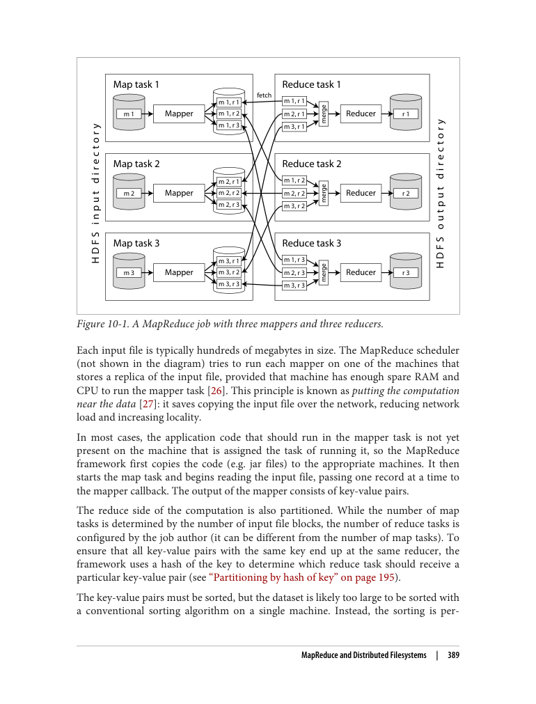
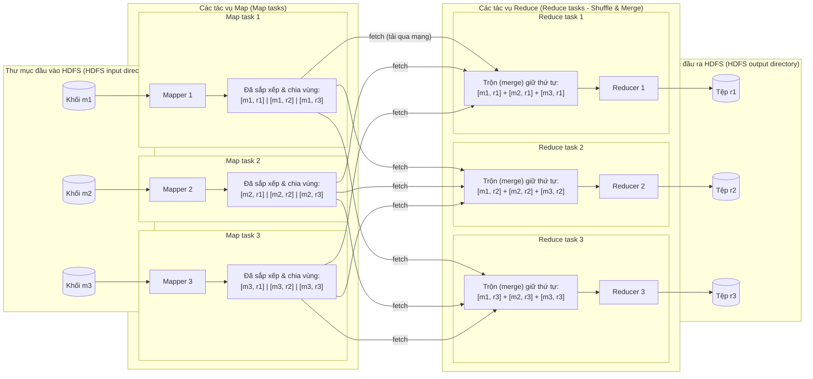
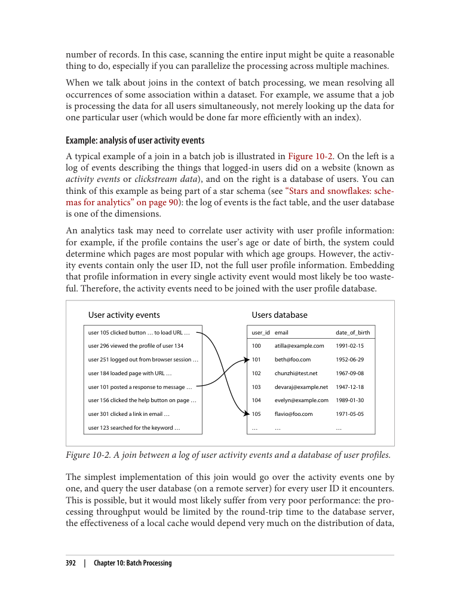
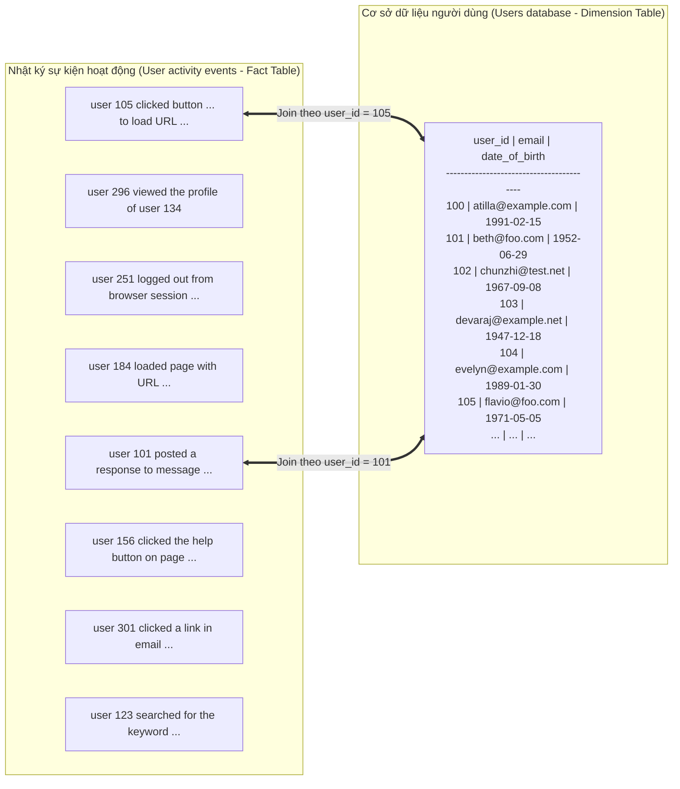
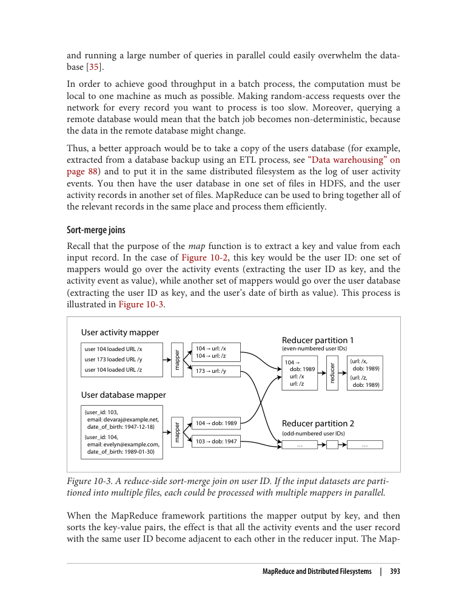
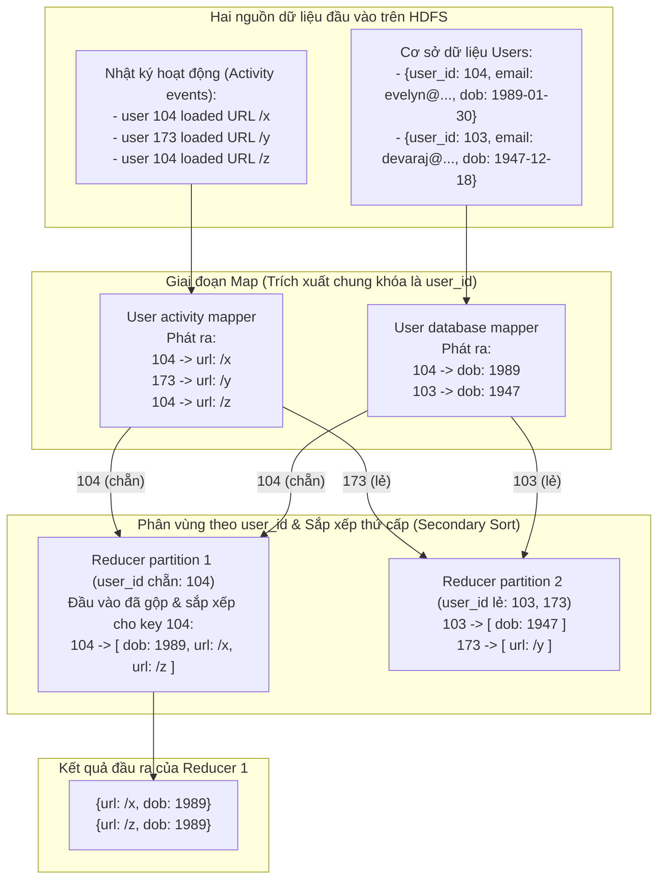
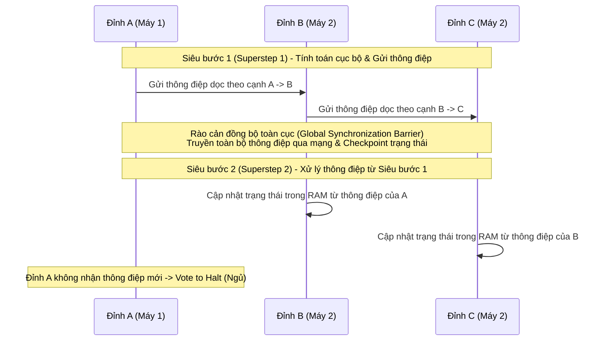

# PHẦN III: Dữ liệu dẫn xuất (PART III: Derived Data)

Ở Phần I và Phần II của cuốn sách này, chúng ta đã lắp ghép từ nền tảng cơ bản nhất tất cả những khía cạnh trọng yếu cấu thành nên một cơ sở dữ liệu phân tán (distributed database): khởi đầu từ cách thức bố trí dữ liệu vật lý trên đĩa cứng (disk layout), đi xuyên suốt cho tới những giới hạn mang tính lý thuyết và thực tiễn của tính nhất quán phân tán (distributed consistency) khi hệ thống phải đối mặt với các sự cố (faults). Tuy nhiên, toàn bộ cuộc thảo luận đó đều dựa trên một giả định ngầm rằng trong ứng dụng chỉ tồn tại duy nhất một cơ sở dữ liệu.

Trên thực tế, các hệ thống dữ liệu (data systems) thường phức tạp hơn thế rất nhiều. Trong một ứng dụng quy mô lớn, bạn thường xuyên cần khả năng truy cập và xử lý dữ liệu theo nhiều phương thức hoàn toàn khác nhau, và không có bất kỳ một cơ sở dữ liệu đơn lẻ nào có thể đồng thời thỏa mãn trọn vẹn tất cả những nhu cầu đa dạng đó. Do vậy, các ứng dụng trong thực tiễn thường kết hợp sử dụng nhiều kho lưu trữ dữ liệu (datastores), chỉ mục (indexes), bộ nhớ đệm (caches), hệ thống phân tích (analytics systems)... khác nhau, đồng thời triển khai các cơ chế chuyên biệt để di chuyển và đồng bộ dữ liệu từ kho lưu trữ này sang kho lưu trữ khác.

Trong Phần III — cũng là phần cuối cùng của cuốn sách này — chúng ta sẽ đi sâu phân tích những vấn đề xoay quanh việc tích hợp nhiều hệ thống dữ liệu khác biệt (vốn có thể sở hữu các mô hình dữ liệu khác nhau và được tối ưu hóa cho các mẫu truy cập — access patterns — hoàn toàn trái ngược nhau) thành một kiến trúc ứng dụng mạch lạc, thống nhất. Khía cạnh này của việc xây dựng hệ thống thường bị các nhà cung cấp phần mềm (vendors) cố tình phớt lờ khi họ quảng cáo rằng sản phẩm của họ có thể đáp ứng mọi nhu cầu của bạn. Trong thế giới thực, việc tích hợp các hệ thống không đồng nhất (disparate systems) lại với nhau chính là một trong những nhiệm vụ quan trọng bậc nhất cần phải thực hiện trong bất kỳ ứng dụng phức tạp (non-trivial application) nào.

---

## Hệ thống ghi nhận gốc và Dữ liệu dẫn xuất (Systems of Record and Derived Data)

Ở góc độ kiến trúc tổng thể (high level), các hệ thống lưu trữ và xử lý dữ liệu có thể được phân loại thành hai nhóm lớn:

* **Hệ thống ghi nhận gốc (Systems of record):**
  Một hệ thống ghi nhận gốc, hay còn được biết đến với tên gọi *nguồn sự thật duy nhất (source of truth)*, là nơi nắm giữ phiên bản có thẩm quyền quyết định (authoritative version) của dữ liệu. Khi có dữ liệu mới đi vào hệ thống — chẳng hạn như dữ liệu đầu vào trực tiếp từ thao tác của người dùng (user input) — trước tiên nó sẽ được ghi vào đây. Mỗi sự kiện thực tế (fact) được biểu diễn chính xác một lần duy nhất (cách biểu diễn này thường ở dạng chuẩn hóa — normalized). Nếu có bất kỳ sự sai lệch (discrepancy) nào xảy ra giữa một hệ thống khác và hệ thống ghi nhận gốc, thì giá trị nằm trong hệ thống ghi nhận gốc (theo đúng định nghĩa) luôn là giá trị đúng đắn.

* **Hệ thống dữ liệu dẫn xuất (Derived data systems):**
  Dữ liệu nằm trong một hệ thống dẫn xuất là kết quả của việc lấy một số dữ liệu hiện có từ một hệ thống khác rồi tiến hành biến đổi (transforming) hoặc xử lý (processing) chúng theo một cách thức nào đó. Nếu bạn chẳng may làm mất dữ liệu dẫn xuất, bạn hoàn toàn có thể tái tạo (re-create) lại nó từ nguồn dữ liệu gốc ban đầu. Một ví dụ kinh điển nhất chính là bộ nhớ đệm (cache): dữ liệu có thể được phục vụ ngay lập tức từ cache nếu nó đang hiện diện ở đó, nhưng nếu cache không chứa thứ bạn cần (cache miss), bạn luôn có thể quay về truy vấn cơ sở dữ liệu nền tảng bên dưới (underlying database). Các giá trị phi chuẩn hóa (denormalized values), các chỉ mục (indexes) và các khung nhìn vật lý hóa (materialized views) cũng đều thuộc về nhóm phân loại này. Trong các hệ thống gợi ý (recommendation systems), dữ liệu tóm tắt mang tính dự đoán (predictive summary data) cũng thường được dẫn xuất từ nhật ký sử dụng (usage logs) của người dùng.

Xét thuần túy về mặt kỹ thuật, dữ liệu dẫn xuất (derived data) là dữ liệu *dư thừa (redundant)*, theo nghĩa là nó sao chép và nhân bản lại những thông tin vốn đã tồn tại ở nơi khác. Tuy nhiên, nó lại thường đóng vai trò sống còn để đạt được hiệu năng tốt đối với các truy vấn đọc (read queries). Dữ liệu dẫn xuất thường được lưu ở dạng phi chuẩn hóa (denormalized). Từ một nguồn dữ liệu gốc duy nhất, bạn có thể dẫn xuất ra nhiều tập dữ liệu (datasets) khác nhau, cho phép bạn quan sát và khai thác cùng một khối dữ liệu dưới nhiều "góc nhìn" (points of view) đa chiều.

Không phải mọi hệ thống đều vạch ra một ranh giới phân định rõ ràng giữa hệ thống ghi nhận gốc (systems of record) và dữ liệu dẫn xuất (derived data) trong kiến trúc của mình, nhưng việc thực hiện sự phân biệt này là vô cùng hữu ích vì nó làm sáng tỏ luồng dữ liệu (dataflow) chảy xuyên qua hệ thống của bạn: nó chỉ rõ bộ phận nào của hệ thống nhận đầu vào (inputs) nào và sinh ra đầu ra (outputs) nào, cũng như cách thức mà các thành phần phụ thuộc lẫn nhau.

Hầu hết các cơ sở dữ liệu, bộ máy lưu trữ (storage engines) và ngôn ngữ truy vấn bản thân chúng không mặc định là một hệ thống ghi nhận gốc hay một hệ thống dẫn xuất. Một cơ sở dữ liệu suy cho cùng chỉ là một công cụ: cách bạn sử dụng nó như thế nào hoàn toàn tùy thuộc vào bạn. Sự phân biệt giữa hệ thống ghi nhận gốc và hệ thống dữ liệu dẫn xuất không nằm ở bản thân công cụ phần mềm, mà phụ thuộc vào cách thức bạn đặt để và sử dụng nó bên trong kiến trúc ứng dụng của mình.

Bằng cách xác định thật minh bạch dữ liệu nào được dẫn xuất từ dữ liệu nào khác, bạn có thể mang lại sự rõ ràng, rành mạch cho một kiến trúc hệ thống vốn dĩ rất dễ rơi vào trạng thái hỗn độn và rối rắm. Quan điểm cốt lõi này sẽ là sợi chỉ đỏ xuyên suốt toàn bộ Phần III của cuốn sách.

> 📝 **Giải thích thêm (không có trong sách): Phân biệt System of Record và Derived Data trong kiến trúc thực tế hiện đại**
>
> Trong một hệ thống thương mại điện tử (E-commerce) quy mô lớn hiện nay, cùng một thông tin "Đơn hàng" hoặc "Sản phẩm" thường xuất hiện ở 5–6 hệ thống khác nhau:
>
> ```mermaid
> flowchart LR
>     User["Người dùng / Client"] -->|"Đặt hàng / Cập nhật"| PG[("PostgreSQL / MySQL<br/>(System of Record)")]
>     PG -->|"CDC (Debezium / Kafka)"| Kafka[["Apache Kafka<br/>(Event Log)"]]
>     Kafka -->|"Indexing"| ES[("Elasticsearch<br/>(Derived: Full-text Search)")]
>     Kafka -->|"Caching"| Redis[("Redis Cluster<br/>(Derived: Read Cache)")]
>     Kafka -->|"Streaming / Batch ETL"| CH[("ClickHouse / Snowflake<br/>(Derived: OLAP Analytics)")]
>     Kafka -->|"Feature Pipeline"| Rec[("Vector DB / Feature Store<br/>(Derived: Recommendation)")]
> ```
>
> | Thành phần trong kiến trúc | Vai trò dữ liệu | Đặc tính khi mất dữ liệu & cách phục hồi |
> | :--- | :--- | :--- |
> | **PostgreSQL / MySQL** (chứa bảng `orders`, `products` dạng chuẩn hóa 3NF) | **System of Record (Source of Truth)** | Nếu mất dữ liệu ở đây và không có bản sao lưu (backup/replica), dữ liệu nghiệp vụ sẽ **mất vĩnh viễn**. |
> | **Elasticsearch / OpenSearch** (chứa tài liệu sản phẩm đã gộp sẵn tên danh mục, thương hiệu, điểm đánh giá) | **Derived Data System** (Chỉ mục tìm kiếm) | Nếu cluster Elasticsearch gặp sự cố hỏng index, ta chỉ cần chạy lại batch job hoặc replay luồng CDC từ PostgreSQL để xây dựng lại toàn bộ index. |
> | **Redis** (chứa JSON chi tiết giỏ hàng / thông tin sản phẩm hot) | **Derived Data System** (Bộ nhớ đệm) | Nếu Redis khởi động lại trống rỗng, ứng dụng đọc từ PostgreSQL và nạp lại (cache warming). |
> | **ClickHouse / BigQuery / Data Lake** (bảng tổng hợp doanh thu theo giờ/ngày) | **Derived Data System** (Kho phân tích OLAP) | Có thể tính toán lại (backfill) bất kỳ lúc nào từ dữ liệu lịch sử của System of Record. |
>
> Sai lầm phổ biến nhất của nhiều đội ngũ kỹ thuật là **ghi trực tiếp từ ứng dụng vào cả hai nơi (Dual Writes)** mà không xác định đâu là System of Record, dẫn đến tình trạng PostgreSQL lưu giá sản phẩm là `100.000đ` nhưng Elasticsearch vẫn giữ giá `120.000đ` vĩnh viễn không bao giờ tự đồng bộ lại được. Khi phân định rõ **System of Record** và **Derived Data**, mọi thay đổi bắt buộc đi qua System of Record trước, sau đó mới chảy một chiều (unidirectional dataflow) sang các hệ thống dẫn xuất thông qua Batch Processing (Chương 10) hoặc Stream Processing (Chương 11).

---

## Tổng quan các chương trong Phần III (Overview of Chapters)

Chúng ta sẽ bắt đầu ở Chương 10 bằng việc khảo sát các hệ thống luồng dữ liệu hướng xử lý theo lô (batch-oriented dataflow systems) chẳng hạn như MapReduce, và chỉ ra cách mà chúng cung cấp cho chúng ta những công cụ cùng các nguyên lý thiết kế tuyệt vời để xây dựng nên các hệ thống dữ liệu quy mô lớn. Sang Chương 11, chúng ta sẽ lấy chính những ý tưởng nền tảng đó và áp dụng chúng vào các luồng dữ liệu liên tục (data streams), thứ cho phép chúng ta thực hiện cùng những kiểu xử lý tương tự nhưng với độ trễ (delay) thấp hơn rất nhiều. Chương 12 sẽ khép lại cuốn sách bằng việc khám phá những ý tưởng mới mẻ về cách thức chúng ta có thể xây dựng các ứng dụng đáng tin cậy (reliable), có khả năng mở rộng (scalable) và dễ bảo trì (maintainable) trong tương lai.

---

# CHƯƠNG 10: Xử lý theo lô (Batch Processing)

> *"Một hệ thống không thể thành công nếu nó chịu ảnh hưởng quá nặng nề bởi một cá nhân duy nhất. Một khi bản thiết kế ban đầu đã hoàn thiện và tương đối vững chắc, phép thử thực sự mới bắt đầu khi những con người với nhiều góc nhìn đa dạng khác nhau tự mình thực hiện các thử nghiệm của riêng họ."*
> — Donald Knuth

Trong hai phần đầu tiên của cuốn sách này, chúng ta đã bàn luận rất nhiều về các yêu cầu (requests) và các truy vấn (queries), cùng với các phản hồi (responses) hoặc kết quả (results) tương ứng trả về. Phong cách xử lý dữ liệu này được mặc nhiên giả định trong rất nhiều hệ thống dữ liệu hiện đại: bạn yêu cầu một thông tin gì đó, hoặc bạn gửi đi một chỉ thị (instruction), và một khoảng thời gian ngắn sau đó hệ thống (hy vọng là vậy) sẽ trả lại cho bạn một câu trả lời. Các cơ sở dữ liệu, bộ nhớ đệm (caches), chỉ mục tìm kiếm (search indexes), máy chủ web (web servers) và vô số hệ thống khác đều vận hành theo đúng mô thức này.

Trong những hệ thống trực tuyến (online systems) như vậy — bất kể đó là một trình duyệt web đang yêu cầu tải một trang HTML, hay một dịch vụ nội bộ đang gọi tới một API từ xa — nhìn chung chúng ta đều giả định rằng yêu cầu đó được kích hoạt bởi một người dùng bằng xương bằng thịt (human user), và người dùng đó đang phải ngồi chờ đợi câu trả lời. Họ không nên phải chờ đợi quá lâu để nhận được phản hồi, vì thế chúng ta đặc biệt chú tâm đến *thời gian phản hồi (response time)* của các hệ thống này (xem mục "Mô tả hiệu năng" ở trang 11, Chương 1).

Sự bùng nổ của mạng lưới Web cùng số lượng ngày càng gia tăng của các API dựa trên giao thức HTTP/REST đã biến kiểu tương tác yêu cầu/phản hồi (request/response) trở nên phổ biến đến mức chúng ta rất dễ coi nó là điều hiển nhiên duy nhất. Thế nhưng, chúng ta cần phải nhớ rằng đó không phải là cách duy nhất để xây dựng các hệ thống phần mềm, và những hướng tiếp cận khác cũng sở hữu những giá trị ưu việt riêng của chúng. Hãy cùng phân biệt ba loại hệ thống xử lý dữ liệu khác nhau:

* **Các dịch vụ (Services — hệ thống trực tuyến / online systems):**
  Một dịch vụ luôn nằm chờ yêu cầu (request) hoặc chỉ thị (instruction) từ phía máy khách (client) gửi tới. Khi nhận được một yêu cầu, dịch vụ đó sẽ cố gắng xử lý nó nhanh nhất có thể và gửi trả lại một phản hồi (response). *Thời gian phản hồi (response time)* thường là thước đo hiệu năng quan trọng hàng đầu của một dịch vụ, và *tính sẵn sàng (availability)* cũng thường đóng vai trò tối quan trọng (bởi nếu client không thể kết nối tới dịch vụ, người dùng khả năng cao sẽ nhận ngay một thông báo lỗi trên màn hình).

* **Các hệ thống xử lý theo lô (Batch processing systems — hệ thống ngoại tuyến / offline systems):**
  Một hệ thống xử lý theo lô nhận đầu vào là một khối lượng lớn dữ liệu (a large amount of input data), khởi chạy một *tác vụ (job)* để xử lý khối dữ liệu đó, và sinh ra một số dữ liệu đầu ra (output data). Các tác vụ theo lô (batch jobs) thường mất khá nhiều thời gian để hoàn tất (từ vài phút cho đến tận vài ngày), vì vậy thông thường sẽ không có bất kỳ người dùng nào ngồi chờ trực tiếp trước màn hình đợi tác vụ chạy xong cả. Thay vào đó, các batch jobs thường được lập lịch để chạy định kỳ (scheduled to run periodically — ví dụ: mỗi ngày chạy một lần vào ban đêm). Thước đo hiệu năng chính yếu của một tác vụ xử lý theo lô thường là *thông lượng (throughput)* — tức là tổng thời gian cần thiết để "nghiền" (crunch through) xong toàn bộ một tập dữ liệu đầu vào có kích thước nhất định. Chúng ta sẽ thảo luận chi tiết về xử lý theo lô trong chương này.

* **Các hệ thống xử lý luồng (Stream processing systems — hệ thống cận thời gian thực / near-real-time systems):**
  Xử lý luồng nằm ở khoảng giữa trực tuyến (online) và ngoại tuyến/theo lô (offline/batch), do đó đôi khi nó còn được gọi là xử lý *cận thời gian thực (near-real-time)* hoặc *cận trực tuyến (nearline processing)*. Giống như xử lý theo lô, một bộ xử lý luồng (stream processor) tiêu thụ dữ liệu đầu vào và sản sinh ra dữ liệu đầu ra (chứ không phải ngồi phản hồi từng request đơn lẻ). Tuy nhiên, một tác vụ xử lý luồng vận hành trên các sự kiện (events) chỉ một thời gian rất ngắn ngay sau khi chúng vừa mới xảy ra, trong khi một tác vụ xử lý theo lô lại vận hành trên một tập dữ liệu đầu vào cố định đã biết trước kích thước (a fixed set of input data / bounded dataset). Sự khác biệt bản chất này cho phép các hệ thống xử lý luồng đạt được độ trễ (latency) thấp hơn nhiều so với các hệ thống xử lý theo lô tương đương. Bởi vì xử lý luồng được xây dựng kế thừa trên nền tảng của xử lý theo lô, chúng ta sẽ thảo luận sâu về nó trong Chương 11.

> 📝 **Giải thích thêm (không có trong sách): So sánh trực quan 3 mô hình hệ thống (Online Services vs. Batch Processing vs. Stream Processing)**
>
> | Tiêu chí so sánh | Services (Online Systems) | Batch Processing (Offline Systems) | Stream Processing (Near-Real-Time) |
> | :--- | :--- | :--- | :--- |
> | **Cách kích hoạt xử lý** | Theo yêu cầu tức thời từ client (Request-driven / RPC / HTTP). | Lập lịch định kỳ (Cron/Airflow) hoặc khi tích lũy đủ dữ liệu lớn. | Theo sự kiện phát sinh liên tục (Event-driven). |
> | **Bản chất tập dữ liệu đầu vào** | Một vài bản ghi đơn lẻ (Point lookup / Small range). | Tập dữ liệu hữu hạn, kích thước cố định lớn (Bounded dataset — GB, TB, PB). | Luồng sự kiện vô hạn, không ngừng sinh thêm (Unbounded dataset). |
> | **Thước đo hiệu năng chính** | **Response Time / Tail Latency** (p95, p99 tính bằng mili-giây) & **Availability**. | **Throughput** (Tổng băng thông MB/s hoặc GB/s xử lý toàn bộ tập dữ liệu). | **End-to-end Latency** (mili-giây đến vài giây) & **Throughput** ổn định. |
> | **Người chờ kết quả** | Con người (Human user) hoặc dịch vụ đồng bộ đang chờ. | Không có người ngồi chờ trực tiếp; kết quả xuất ra file/DB để dùng sau. | Hệ thống cảnh báo tự động, dashboard trực tiếp, hoặc pipeline kế tiếp. |
> | **Ví dụ công nghệ tiêu biểu** | PostgreSQL, MySQL, Redis, REST/gRPC Microservices. | Unix Pipelines, Hadoop MapReduce, Apache Spark (Batch mode). | Apache Flink, Kafka Streams, Spark Structured Streaming. |

Như chúng ta sẽ thấy xuyên suốt chương này, xử lý theo lô (batch processing) là một viên gạch nền tảng vô cùng quan trọng trong hành trình xây dựng các ứng dụng đáng tin cậy, có khả năng mở rộng và dễ bảo trì. Chẳng hạn, MapReduce — một thuật toán xử lý theo lô được công bố vào năm 2004 [1] — đã từng được gọi (có lẽ là hơi quá lời vì sự phấn khích) là "thuật toán giúp Google có khả năng mở rộng quy mô khổng lồ đến vậy" [2]. Sau đó, thuật toán này đã được hiện thực hóa trong hàng loạt hệ thống dữ liệu mã nguồn mở khác nhau, bao gồm Apache Hadoop, CouchDB và MongoDB.

Tuy nhiên, xét ở một số khía cạnh, MapReduce thực chất lại là một bước lùi so với những kỹ thuật xử lý song song tinh vi hơn vốn đã được phát triển cho các kho dữ liệu (data warehouses) từ nhiều năm trước đó [3, 4]. Mặc dù tầm quan trọng trực tiếp của bản thân MapReduce hiện nay đang dần suy giảm [5], nó vẫn cực kỳ đáng để chúng ta tìm hiểu thấu đáo, bởi vì nó mang lại một bức tranh hết sức rõ nét về lý do *tại sao* và *bằng cách nào* việc xử lý theo lô lại hữu ích đến thế.

Trên thực tế, xử lý theo lô là một hình thức điện toán vô cùng cổ xưa. Từ rất lâu trước khi những chiếc máy tính kỹ thuật số khả trình (programmable digital computers) được phát minh, các cỗ máy lập bảng bằng thẻ đục lỗ (punch card tabulating machines) — điển hình như những cỗ máy Hollerith được sử dụng trong cuộc Tổng điều tra dân số Hoa Kỳ năm 1890 (1890 US Census) [6] — đã hiện thực hóa một dạng thức xử lý theo lô bán cơ khí nhằm tính toán các số liệu thống kê tổng hợp (aggregate statistics) từ các tập đầu vào khổng lồ. Và bản thân MapReduce mang một sự tương đồng kỳ lạ đến đáng kinh ngạc với những cỗ máy phân loại thẻ cơ điện của IBM (IBM card-sorting machines) vốn từng được sử dụng rộng rãi trong xử lý dữ liệu kinh doanh suốt những năm 1940 và 1950 [7]. Như thường lệ, lịch sử luôn có xu hướng tự lặp lại chính nó.

Trong chương này, chúng ta sẽ khảo sát MapReduce cùng một số thuật toán và khung làm việc (frameworks) xử lý theo lô khác, đồng thời khám phá cách chúng được ứng dụng trong các hệ thống dữ liệu hiện đại. Nhưng trước tiên, để khởi động, chúng ta sẽ quan sát việc xử lý dữ liệu bằng các công cụ Unix tiêu chuẩn (standard Unix tools). Ngay cả khi bạn đã quen thuộc với chúng rồi, việc tự nhắc nhớ lại *triết lý Unix (the Unix philosophy)* vẫn là điều vô cùng giá trị, bởi lẽ những ý tưởng và phương pháp tiếp cận từ Unix được kế thừa và chuyển giao một cách trực tiếp sang các hệ thống dữ liệu phân tán quy mô lớn, không đồng nhất (heterogeneous distributed data systems).

---

## Xử lý theo lô với các công cụ Unix (Batch Processing with Unix Tools)

Hãy bắt đầu bằng một ví dụ đơn giản. Giả sử bạn có một máy chủ web (web server) cứ mỗi lần phục vụ xong một yêu cầu HTTP lại ghi nối thêm (append) một dòng vào một tệp nhật ký (log file). Ví dụ, nếu sử dụng định dạng nhật ký truy cập mặc định (default access log format) của `nginx`, một dòng trong tệp log có thể trông như sau:

```text
216.58.210.78 - - [27/Feb/2015:17:55:11 +0000] "GET /css/typography.css HTTP/1.1"
200 3377 "http://martin.kleppmann.com/" "Mozilla/5.0 (Macintosh; Intel Mac OS X
10_9_5) AppleWebKit/537.36 (KHTML, like Gecko) Chrome/40.0.2214.115 Safari/537.36"
```

*(Trên thực tế toàn bộ đoạn trên chỉ là một dòng duy nhất, ở đây nó chỉ được ngắt xuống thành nhiều dòng để bạn dễ đọc hơn mà thôi.)*

Có rất nhiều thông tin được gói gọn bên trong một dòng nhật ký đó. Để giải mã và hiểu đúng ý nghĩa của nó, bạn cần nhìn vào định nghĩa cấu hình định dạng log (log format definition), cụ thể như sau:

```nginx
$remote_addr - $remote_user [$time_local] "$request"
$status $body_bytes_sent "$http_referer" "$http_user_agent"
```

Dòng nhật ký ở trên cho biết rằng vào ngày 27 tháng 2 năm 2015 lúc 17:55:11 theo giờ UTC, máy chủ đã nhận được một yêu cầu tải tệp `/css/typography.css` từ địa chỉ IP máy khách là `216.58.210.78`. Người dùng này chưa được xác thực danh tính, vì vậy biến `$remote_user` được đặt thành một dấu gạch ngang (`-`). Mã trạng thái phản hồi (response status) là `200`, tức là yêu cầu đã được xử lý thành công, và kích thước phần thân của phản hồi là `3377` byte. Tệp CSS này được nhúng bên trong trang web tại địa chỉ URL `http://martin.kleppmann.com/` và trình duyệt web của người dùng là Chrome phiên bản 40.

### Phân tích nhật ký đơn giản (Simple log analysis)

Có rất nhiều công cụ phần mềm chuyên dụng có thể nhận các tệp nhật ký này và xuất ra những bản báo cáo đồ họa bắt mắt về lưu lượng truy cập trang web của bạn; nhưng để làm bài tập thực hành, hãy tự tay xây dựng công cụ phân tích của riêng mình bằng cách sử dụng các công cụ Unix cơ bản nhất. Chẳng hạn, giả sử bạn muốn tìm ra 5 trang phổ biến nhất (được truy cập nhiều nhất) trên website của mình. Bạn có thể thực hiện việc này ngay trong một Unix shell như sau:<sup>i</sup>

```bash
cat /var/log/nginx/access.log |
  awk '{print $7}' |
  sort             |
  uniq -c          |
  sort -r -n       |
  head -n 5
```

> <sup>i</sup> Một số người rất thích chỉ ra rằng lệnh `cat` ở đây là không cần thiết (Useless Use of Cat), bởi vì tệp đầu vào hoàn toàn có thể được truyền trực tiếp làm đối số cho lệnh `awk`. Tuy nhiên, cấu trúc đường ống tuyến tính (linear pipeline) sẽ hiện lên trực quan và rõ ràng hơn nhiều khi được viết theo cách này.

Hãy cùng phân tích từng bước trong chuỗi lệnh trên:

1. `cat /var/log/nginx/access.log`: Đọc nội dung tệp nhật ký.
2. `awk '{print $7}'`: Tách mỗi dòng thành các trường (fields) phân cách nhau bởi khoảng trắng (whitespace), và chỉ xuất ra duy nhất trường thứ bảy của mỗi dòng, vốn trùng khớp với đường dẫn URL được yêu cầu. Trong dòng ví dụ ở trên, trường thứ 7 chính là `/css/typography.css` *(Lưu ý: tính từ trái sang theo khoảng trắng: `$1` là IP `216.58.210.78`, `$2` là `-`, `$3` là `-`, `$4` là `[27/Feb/2015:17:55:11`, `$5` là `+0000]`, `$6` là `"GET`, và `$7` là `/css/typography.css`)*.
3. `sort`: Sắp xếp danh sách các URL được yêu cầu theo thứ tự bảng chữ cái (alphabetically). Nếu một URL nào đó đã được yêu cầu $n$ lần, thì sau khi sắp xếp xong, luồng dữ liệu sẽ chứa cùng một URL đó lặp lại $n$ lần liên tiếp nhau.
4. `uniq -c`: Lệnh `uniq` lọc bỏ các dòng trùng lặp trong đầu vào của nó bằng cách kiểm tra xem hai dòng liền kề nhau (adjacent lines) có giống hệt nhau hay không. Tùy chọn `-c` bảo nó xuất kèm thêm một bộ đếm (counter): ứng với mỗi URL phân biệt (distinct URL), nó sẽ báo cáo số lần mà URL đó xuất hiện trong đầu vào.
5. `sort -r -n`: Lệnh `sort` thứ hai thực hiện sắp xếp dựa theo giá trị số (`-n`, numeric sort) nằm ở đầu mỗi dòng — chính là số lần mà URL đó đã được yêu cầu. Sau đó nó trả về kết quả theo thứ tự đảo ngược (`-r`, reverse), tức là đưa con số lớn nhất lên đầu tiên.
6. `head -n 5`: Cuối cùng, lệnh `head` chỉ xuất ra đúng 5 dòng đầu tiên (`-n 5`) của luồng đầu vào, và loại bỏ toàn bộ phần còn lại.

Kết quả đầu ra của chuỗi các câu lệnh đó sẽ trông đại loại như sau:

```text
4189 /favicon.ico
3631 /2013/05/24/improving-security-of-ssh-private-keys.html
2124 /2012/12/05/schema-evolution-in-avro-protocol-buffers-thrift.html
1369 /
 915 /css/typography.css
```

Mặc dù dòng lệnh ở trên trông có vẻ hơi bí hiểm nếu bạn chưa quen thuộc với các công cụ Unix, nhưng nó lại sở hữu sức mạnh đáng kinh ngạc. Nó sẽ xử lý hàng gigabyte tệp nhật ký chỉ trong vòng vài giây đồng hồ, và bạn có thể dễ dàng chỉnh sửa quy trình phân tích sao cho phù hợp với nhu cầu cụ thể của mình. Ví dụ, nếu bạn muốn loại bỏ các tệp CSS ra khỏi báo cáo, bạn chỉ cần đổi đối số của `awk` thành `'$7 !~ /\.css$/ {print $7}'`. Nếu bạn muốn đếm các địa chỉ IP máy khách truy cập nhiều nhất thay vì đếm các trang phổ biến nhất, hãy đổi đối số của `awk` thành `'{print $1}'`. Và cứ thế tiếp tục.

Chúng ta không có đủ dung lượng trong cuốn sách này để giải thích chi tiết về từng công cụ Unix, nhưng chúng thực sự rất đáng để bạn đầu tư thời gian tìm hiểu. Có một số lượng lớn đáng ngạc nhiên các bài toán phân tích dữ liệu có thể được giải quyết gọn ghẽ chỉ trong vài phút bằng cách kết hợp một số công cụ như `awk`, `sed`, `grep`, `sort`, `uniq` và `xargs`, và hiệu năng thực thi của chúng tốt đến mức bất ngờ [8].

### Chuỗi câu lệnh so với chương trình tự viết (Chain of commands vs. custom program)

Thay vì sử dụng chuỗi các câu lệnh Unix như trên, bạn hoàn toàn có thể hình dung việc tự viết một chương trình nhỏ đơn giản để thực hiện cùng một công việc đó. Chẳng hạn, nếu viết bằng ngôn ngữ Ruby, chương trình đó có thể trông như sau:

```ruby
counts = Hash.new(0)

File.open('/var/log/nginx/access.log') do |file|
  file.each do |line|
    url = line.split[6]
    counts[url] += 1
  end
end

top5 = counts.map{|url, count| [count, url] }.sort.reverse[0...5]
top5.each{|count, url| puts "#{count} #{url}" }
```

Hãy xem từng bước hoạt động của đoạn mã Ruby này:
* `counts = Hash.new(0)`: `counts` là một bảng băm (hash table) giữ một bộ đếm số lần chúng ta đã bắt gặp mỗi URL. Giá trị mặc định của bộ đếm khi khóa chưa tồn tại là `0`.
* `url = line.split[6]`: Từ mỗi dòng của tệp nhật ký, chúng ta trích xuất URL bằng cách lấy trường thứ bảy được phân tách bởi khoảng trắng (chỉ số mảng ở đây là `6` bởi vì mảng trong Ruby được đánh chỉ số bắt đầu từ `0`).
* `counts[url] += 1`: Tăng giá trị bộ đếm tương ứng với URL trong dòng nhật ký hiện tại lên 1 đơn vị.
* `top5 = counts.map{|url, count| [count, url] }.sort.reverse[0...5]`: Sắp xếp nội dung của bảng băm theo giá trị bộ đếm giảm dần, và lấy ra 5 phần tử đứng đầu.
* `top5.each{|count, url| puts "#{count} #{url}" }`: In 5 phần tử đứng đầu đó ra màn hình.

Chương trình này tuy không ngắn gọn, súc tích bằng chuỗi đường ống (pipes) của Unix, nhưng nó khá dễ đọc, và việc bạn thích cách viết nào hơn trong hai cách này một phần thuộc về gu thẩm mỹ cá nhân. Tuy nhiên, bên cạnh những khác biệt bề nổi về mặt cú pháp giữa hai cách tiếp cận, có một sự khác biệt khổng lồ nằm ở *luồng thực thi (execution flow)* bên dưới — một sự khác biệt sẽ lộ rõ ngay lập tức nếu bạn đem chạy bài toán phân tích này trên một tệp dữ liệu có kích thước lớn.

### Sắp xếp so với tổng hợp trong bộ nhớ (Sorting vs. in-memory aggregation)

Kịch bản viết bằng Ruby duy trì một bảng băm nằm hoàn toàn trong bộ nhớ RAM (in-memory hash table) chứa danh sách các URL, trong đó mỗi URL được ánh xạ tới số lần mà nó đã được nhìn thấy. Ngược lại, ví dụ dùng đường ống Unix (Unix pipeline) hoàn toàn không hề có một bảng băm nào như thế, mà thay vào đó nó dựa vào việc *sắp xếp (sorting)* một danh sách các URL, trong đó nhiều lần xuất hiện của cùng một URL đơn giản là được lặp đi lặp lại liền kề nhau.

Cách tiếp cận nào tốt hơn? Câu trả lời còn tùy thuộc vào việc bạn có bao nhiêu URL phân biệt (distinct URLs). Đối với hầu hết các trang web có quy mô từ nhỏ đến trung bình, bạn có thể dễ dàng nhét vừa toàn bộ các URL phân biệt cùng với một bộ đếm cho từng URL vào trong (chẳng hạn) 1 GB bộ nhớ RAM. Trong ví dụ này, *tập làm việc (working set)* của tác vụ (tức là dung lượng bộ nhớ mà tác vụ cần truy cập ngẫu nhiên — random access) chỉ phụ thuộc vào **số lượng các URL phân biệt (cardinality)**: ngay cả khi có tới hàng triệu dòng nhật ký truy cập vào cùng một URL duy nhất, thì không gian bộ nhớ cần thiết trong bảng băm vẫn chỉ là một chuỗi URL đó cộng với kích thước của biến đếm mà thôi. Nếu tập làm việc (working set) này đủ nhỏ, một bảng băm trong bộ nhớ RAM sẽ hoạt động hoàn hảo — thậm chí ngay trên một chiếc máy tính xách tay (laptop).

Mặt khác, nếu tập làm việc của tác vụ lớn hơn dung lượng bộ nhớ RAM khả dụng (larger than memory), thì phương pháp tiếp cận dựa trên việc sắp xếp (sorting approach) lại nắm giữ lợi thế vượt trội ở chỗ nó có thể tận dụng đĩa cứng (disks) một cách cực kỳ hiệu quả. Đây chính xác là cùng một nguyên lý mà chúng ta đã từng thảo luận trong mục "SSTables và LSM-trees" ở trang 74 (Chương 3): từng khối dữ liệu (chunks of data) có thể được sắp xếp ngay trong bộ nhớ RAM, sau đó ghi tuần tự ra đĩa cứng dưới dạng các tệp phân đoạn (segment files), và rồi nhiều phân đoạn đã được sắp xếp đó có thể được trộn (merged) lại với nhau để tạo thành một tệp lớn hơn đã được sắp xếp hoàn chỉnh. Thuật toán sắp xếp trộn (*mergesort*) sở hữu các mẫu truy cập tuần tự (sequential access patterns) vốn đạt hiệu năng cực kỳ tốt trên đĩa cứng. (Hãy nhớ lại rằng việc tối ưu hóa cho vào/ra tuần tự — sequential I/O — là một chủ đề lặp đi lặp lại xuyên suốt Chương 3. Cùng một khuôn mẫu thiết kế đó nay lại tái xuất hiện tại đây.)

Tiện ích `sort` nằm trong bộ công cụ GNU Coreutils (trên hệ điều hành Linux) có khả năng tự động xử lý các tập dữ liệu lớn hơn bộ nhớ RAM (larger-than-memory datasets) bằng cách tràn dữ liệu tạm ra đĩa cứng (spilling to disk), đồng thời tự động song song hóa (parallelizes) quá trình sắp xếp trải rộng trên nhiều nhân CPU (multiple CPU cores) [9]. Điều này có nghĩa là chuỗi các câu lệnh Unix đơn giản ở trên có thể dễ dàng mở rộng quy mô (scales) để xử lý những tập dữ liệu khổng lồ mà không bao giờ bị rơi vào tình trạng tràn bộ nhớ (out of memory - OOM). Điểm nghẽn cổ chai (bottleneck) lúc này nhiều khả năng chỉ còn là tốc độ đọc tệp dữ liệu đầu vào từ đĩa cứng mà thôi.

> 💡 **Ví dụ bổ sung (không có trong sách): Giải phẫu cơ chế External Merge Sort và Streaming trong Unix Pipeline**
>
> Tại sao một lệnh Unix pipeline trông có vẻ "ngây thơ" lại có thể xử lý file log nặng 500 GB trên một máy chủ chỉ có 8 GB RAM, trong khi script Ruby/Python dùng Hash Map lại bị hệ điều hành giết chết (`OOM Killed`) khi tập dữ liệu chứa hàng trăm triệu khóa phân biệt (ví dụ: đếm theo chuỗi URL kèm query string ngẫu nhiên `?session_id=...&utm_token=...`)?
>
> Hãy quan sát cách nhân Linux (Linux Kernel) và GNU `sort` phối hợp thực thi:
>
> ```mermaid
> flowchart LR
>     subgraph Disk["Đĩa cứng (Disk)"]
>         LogFile[("access.log<br/>(500 GB)")]
>         TempRuns[("Tmp Sort Runs<br/>/tmp/sortXXXXXX")]
>     end
>     subgraph Pipeline["Unix Processes & Kernel Pipe Buffers (64 KB RAM mỗi pipe)"]
>         Cat["cat"] ==>|"Pipe 1"| Awk["awk '{print $7}'"]
>         Awk ==>|"Pipe 2"| Sort1["sort (GNU Coreutils)<br/>Multi-threaded External Merge Sort"]
>         Sort1 ==>|"Pipe 3 (Chỉ mở khi Merge)"| Uniq["uniq -c<br/>(O(1) RAM: chỉ giữ 1 dòng trước)"]
>         Uniq ==>|"Pipe 4"| Sort2["sort -r -n"]
>         Sort2 ==>|"Pipe 5"| Head["head -n 5"]
>     end
>     LogFile --> Cat
>     Sort1 <-->|"Spill & Sequential Merge"| TempRuns
> ```
>
> 1. **Cơ chế Pipe Buffer và Backpressure tự nhiên:** Giữa hai tiến trình nối với nhau bằng dấu `|` (ví dụ `cat | awk`), Linux Kernel cấp phát một bộ đệm vòng trong RAM (pipe buffer, mặc định trên Linux hiện đại là **64 KB**). `cat` và `awk` chạy **đồng thời (concurrently)** chứ không đợi `cat` đọc hết 500 GB rồi `awk` mới chạy! Nếu tiến trình phía sau đọc chậm khiến buffer 64 KB đầy, Kernel sẽ tự động chặn (block) lệnh `write()` của tiến trình phía trước cho đến khi có chỗ trống. Nhờ đó, dữ liệu chảy qua `cat -> awk -> sort` tốn chưa tới vài megabyte RAM.
> 2. **Ranh giới chặn (Blocking Operator) tại `sort`:** Các lệnh `cat`, `awk`, `uniq -c` đều là các toán tử **streaming** (xử lý từng dòng rồi quên ngay — `uniq -c` chỉ cần giữ đúng 1 dòng trước đó trong bộ nhớ để so sánh với dòng hiện tại). Riêng `sort` là một **blocking operator**: nó không thể xuất ra dòng đầu tiên theo thứ tự bảng chữ cái cho đến khi nó đã đọc hết dòng cuối cùng của file 500 GB!
> 3. **External Merge Sort trong GNU `sort`:** Khi nhận luồng dữ liệu từ `awk`, GNU `sort` nạp đầy một vùng đệm trong RAM (có thể cấu hình qua cờ `-S`, ví dụ `sort -S 4G`), dùng nhiều luồng CPU (`--parallel=8`) để sắp xếp khối 4 GB đó trong RAM, rồi ghi tuần tự (sequential write) xuống đĩa thành một tệp tạm (`/tmp/sort...`). Sau khi đọc hết 500 GB, nó có khoảng 125 tệp tạm đã được sắp xếp. Cuối cùng, nó thực hiện **k-way merge**: đọc tuần tự phần đầu của các tệp tạm, trộn lại và đẩy thẳng kết quả sang pipe cho `uniq -c`.

---

### Triết lý Unix (The Unix philosophy)

Không phải ngẫu nhiên mà chúng ta có thể phân tích một tệp nhật ký một cách dễ dàng đến thế chỉ bằng cách ghép nối một chuỗi các câu lệnh như trong ví dụ trên: đây thực chất chính là một trong những ý tưởng thiết kế cốt lõi (key design ideas) của hệ điều hành Unix, và nó vẫn giữ nguyên giá trị thời sự đáng kinh ngạc cho đến tận ngày hôm nay. Hãy cùng tìm hiểu sâu hơn về triết lý này để chúng ta có thể vay mượn những ý tưởng tinh hoa từ Unix [10].

Doug McIlroy, cha đẻ của cơ chế đường ống Unix (Unix pipes), lần đầu tiên mô tả chúng vào năm 1964 như sau [11]: *"Chúng ta nên có một số cách thức để kết nối các chương trình lại với nhau giống như nối [một] ống nước tưới vườn (garden hose) — cứ vặn nối thêm một đoạn ống khác vào bất cứ khi nào cần nhào nặn, biến đổi dữ liệu theo một cách khác. Đây cũng chính là phương thức vận hành của I/O."* Hình ảnh ẩn dụ về hệ thống ống nước (plumbing analogy) đã bám rễ sâu sắc, và ý tưởng kết nối các chương trình bằng đường ống (pipes) đã trở thành một phần của thứ mà ngày nay chúng ta gọi là **Triết lý Unix (the Unix philosophy)** — một tập hợp các nguyên lý thiết kế trở nên vô cùng phổ biến trong cộng đồng những người phát triển và sử dụng Unix. Triết lý này đã được đúc kết vào năm 1978 với 4 nguyên tắc sau [12, 13]:

1. **Làm cho mỗi chương trình thực hiện thật tốt một việc duy nhất (Make each program do one thing well).** Để thực hiện một công việc mới, hãy xây dựng một chương trình mới từ đầu thay vì làm phức tạp hóa các chương trình cũ bằng cách nhồi nhét thêm các "tính năng" (features) mới vào chúng.
2. **Kỳ vọng rằng đầu ra của mọi chương trình đều sẽ trở thành đầu vào của một chương trình khác — một chương trình mà hiện tại ta thậm chí còn chưa biết tới (Expect the output of every program to become the input to another, as yet unknown, program).** Đừng làmรก (clutter) đầu ra bằng những thông tin rườm rà, ngoại lai. Tránh sử dụng các định dạng đầu vào đóng khung theo cột cứng nhắc (stringently columnar) hoặc định dạng nhị phân (binary input formats). Đừng khăng khăng đòi hỏi đầu vào tương tác trực tiếp từ con người (interactive input).
3. **Thiết kế và xây dựng phần mềm — ngay cả các hệ điều hành — sao cho có thể đưa vào dùng thử từ rất sớm, lý tưởng nhất là chỉ trong vòng vài tuần.** Đừng ngần ngại vứt bỏ những phần vụng về, cồng kềnh và xây dựng lại chúng.
4. **Ưu tiên sử dụng các công cụ (tools) hơn là dùng sức người thủ công thiếu kỹ năng để giảm nhẹ gánh nặng cho công việc lập trình**, ngay cả khi bạn phải đi đường vòng để chế tạo ra các công cụ đó và xác định rằng sẽ vứt bỏ một số công cụ sau khi đã dùng xong.

Phương pháp tiếp cận này — tự động hóa (automation), tạo mẫu thử nhanh (rapid prototyping), lặp tăng trưởng từng bước (incremental iteration), thân thiện với việc thử nghiệm (friendly to experimentation), và chia nhỏ các dự án lớn thành những phần việc vừa tầm quản lý (manageable chunks) — nghe giống đến kỳ lạ với các phong trào **Agile** và **DevOps** của ngày hôm nay. Thật đáng ngạc nhiên là có quá ít điều thay đổi sau suốt bốn thập kỷ qua.

Công cụ `sort` là một hình mẫu xuất sắc của một chương trình "chỉ làm một việc và làm thật tốt việc đó". Có thể khẳng định nó là một bản hiện thực hóa thuật toán sắp xếp vượt trội hơn hẳn so với những gì mà hầu hết các ngôn ngữ lập trình hiện đại cung cấp trong thư viện chuẩn (standard library) của chúng (vốn không hề biết tự động tràn ra đĩa cứng khi hết RAM và cũng không tự động sử dụng đa luồng CPU ngay cả khi điều đó mang lại lợi ích rõ rệt). Thế nhưng, nếu đứng cô lập một mình, `sort` hầu như chẳng mấy hữu dụng. Nó chỉ thực sự trở nên quyền năng khi được kết hợp cùng với các công cụ Unix khác, chẳng hạn như `uniq`. Sẽ cực kỳ dễ dàng để người lập trình ra công cụ `sort` tiện tay bổ sung luôn tính năng của `uniq` vào làm một tùy chọn bên trong `sort`, nhưng họ đã cưỡng lại được sự cám dỗ đó *(mặc dù sau này `sort -u` có hỗ trợ loại bỏ trùng lặp đơn giản, nhưng việc đếm tần suất `-c` hay lọc dòng lặp vẫn thuộc về trách nhiệm riêng biệt của `uniq`)*.

Một trình vỏ (Unix shell) như `bash` cho phép chúng ta dễ dàng lắp ghép (compose) những chương trình nhỏ bé này lại thành các tác vụ xử lý dữ liệu mạnh mẽ đến bất ngờ. Mặc dù nhiều chương trình trong số đó được viết bởi những nhóm tác giả hoàn toàn khác nhau ở những thời điểm khác nhau, chúng vẫn có thể được ghép nối lại với nhau theo những cách thức vô cùng linh hoạt. Vậy Unix đã làm điều gì để hiện thực hóa khả năng lắp ghép (composability) kỳ diệu này?

#### Một giao diện đồng nhất (A uniform interface)

Nếu bạn kỳ vọng đầu ra của một chương trình này sẽ trở thành đầu vào của một chương trình khác, điều đó đồng nghĩa với việc hai chương trình đó bắt buộc phải sử dụng chung một định dạng dữ liệu — hay nói cách khác là một *giao diện tương thích (compatible interface)*. Nếu bạn muốn có khả năng kết nối đầu ra của *bất kỳ* chương trình nào vào đầu vào của *bất kỳ* chương trình nào khác, điều đó có nghĩa là *tất cả* các chương trình đều phải sử dụng chung một giao diện vào/ra (input/output interface) duy nhất.

Trong hệ điều hành Unix, giao diện đồng nhất đó chính là **tệp (file)** — hoặc nói chính xác hơn về mặt kỹ thuật là một **bộ mô tả tệp (file descriptor)**. Một tệp suy cho cùng chỉ đơn giản là một chuỗi các byte có thứ tự (an ordered sequence of bytes). Bởi vì đó là một giao diện cực kỳ đơn giản và tối giản, nên rất nhiều thực thể hoàn toàn khác nhau đều có thể được biểu diễn dưới cùng một giao diện này: một tệp thực sự nằm trên hệ thống tệp (filesystem), một kênh giao tiếp tới một tiến trình khác (Unix socket, `stdin`, `stdout`), một trình điều khiển thiết bị phần cứng (device driver — chẳng hạn như `/dev/audio` hoặc `/dev/lp0`), một socket đại diện cho một kết nối mạng TCP, và vân vân. Chúng ta rất dễ coi điều này là hiển nhiên, nhưng thực sự là một thành tựu phi thường khi những thứ có bản chất khác biệt một trời một vực như vậy lại có thể chia sẻ chung một giao diện đồng nhất, nhờ đó chúng có thể dễ dàng được cắm ghép (plugged together) vào nhau.<sup>ii</sup>

> <sup>ii</sup> Một ví dụ tiêu biểu khác về giao diện đồng nhất chính là **URL và giao thức HTTP** — nền tảng cốt lõi của mạng lưới Web (World Wide Web). Một URL định danh một thực thể (tài nguyên — resource) cụ thể trên một trang web, và bạn có thể gắn liên kết (link) tới bất kỳ URL nào từ bất kỳ trang web nào khác. Nhờ vậy, một người dùng sử dụng trình duyệt web có thể nhảy qua lại liền mạch giữa các trang web bằng cách bấm vào các đường link, mặc dù các máy chủ đứng đằng sau có thể được vận hành bởi những tổ chức hoàn toàn không liên quan gì tới nhau. Ngày nay điều này nghe có vẻ hiển nhiên, nhưng đó chính là một phát kiến mang tính bước ngoặt giúp tạo nên sự thành công rực rỡ của mạng Web như chúng ta thấy hôm nay.

Theo quy ước chung, nhiều (nhưng không phải tất cả) chương trình Unix đối xử với chuỗi byte này như là văn bản mã hóa ASCII (ASCII text). Ví dụ phân tích nhật ký ở phần trước đã khai thác triệt để quy ước này: `awk`, `sort`, `uniq` và `head` đều coi tệp đầu vào của chúng là một danh sách các bản ghi (records) được phân tách với nhau bởi ký tự xuống dòng `\n` (newline, mã ASCII `0x0A`). Việc lựa chọn ký tự `\n` thực ra mang tính võ đoán (arbitrary) — xét về mặt lý thuyết, ký tự phân tách bản ghi chuyên dụng trong bảng mã ASCII là `0x1E` (ASCII Record Separator - RS) lẽ ra đã là một sự lựa chọn hợp lý hơn nhiều, bởi nó được sinh ra đúng cho mục đích này [14] — nhưng dù sao đi nữa, chính thực tế là tất cả các chương trình này đều đã chuẩn hóa trên việc sử dụng chung một ký tự phân tách bản ghi duy nhất đã cho phép chúng tương tác và phối hợp (interoperate) nhịp nhàng với nhau.

Việc phân tích cú pháp (parsing) bên trong từng bản ghi (tức là từng dòng đầu vào) thì lại mơ hồ và kém chuẩn hóa hơn. Các công cụ Unix thường tách một dòng thành nhiều trường (fields) dựa theo khoảng trắng (whitespace) hoặc ký tự tab (`\t`), nhưng các kiểu mã hóa như CSV (phân cách bằng dấu phẩy), phân cách bằng dấu gạch đứng (`|`) và nhiều định dạng khác cũng được sử dụng. Ngay cả một công cụ tương đối đơn giản như `xargs` cũng có tới cả tá tùy chọn dòng lệnh (command-line options) chỉ để chỉ định xem đầu vào của nó nên được phân tích cú pháp như thế nào.

Giao diện đồng nhất dựa trên văn bản ASCII nhìn chung là hoạt động được việc, nhưng nó chưa hẳn đã đẹp đẽ và hoàn mỹ: ví dụ phân tích nhật ký của chúng ta đã phải dùng cú pháp `{print $7}` để trích xuất URL, một cách viết không mấy dễ đọc và rất dễ nhầm lẫn. Trong một thế giới lý tưởng, biểu thức này có lẽ nên được viết một cách tường minh là `{print $request_url}` hoặc đại loại như vậy. Chúng ta sẽ còn quay trở lại ý tưởng này ở phần sau của chương.

Mặc dù không hoàn hảo, nhưng ngay cả khi hàng chục năm đã trôi qua, giao diện đồng nhất của Unix vẫn là một tượng đài đáng ngưỡng mộ. Không có nhiều phần mềm trên thế giới có khả năng tương tác và lắp ghép mượt mà với nhau được như các công cụ Unix: bạn chẳng thể nào dễ dàng nối đường ống (pipe) toàn bộ nội dung hộp thư email của mình cùng với lịch sử mua sắm trực tuyến đi xuyên qua một công cụ phân tích tự viết, đổ vào một bảng tính (spreadsheet), rồi tự động đăng tải kết quả lên một mạng xã hội hay một trang wiki được. Trong thế giới phần mềm ngày nay, việc có được những chương trình phối hợp ăn ý với nhau mượt mà như các công cụ Unix lại là một ngoại lệ hiếm hoi chứ không phải là quy chuẩn phổ biến.

Ngay cả những cơ sở dữ liệu có cùng chung một mô hình dữ liệu (ví dụ cùng là cơ sở dữ liệu quan hệ SQL) cũng thường không tạo điều kiện dễ dàng cho việc lấy dữ liệu ra khỏi hệ thống này và đưa vào hệ thống kia. Thực trạng này dẫn tới hiện tượng **phân mảnh và cô lập dữ liệu (balkanization of data)**.

#### Tách biệt giữa logic xử lý và việc đấu nối đường dây (Separation of logic and wiring)

Một đặc trưng tiêu biểu khác của các công cụ Unix là việc chúng sử dụng đầu vào tiêu chuẩn (`stdin` — standard input) và đầu ra tiêu chuẩn (`stdout` — standard output). Nếu bạn chạy một chương trình mà không chỉ định thêm bất kỳ điều hướng nào khác, `stdin` sẽ mặc định lấy dữ liệu từ bàn phím và `stdout` sẽ in kết quả ra màn hình. Tuy nhiên, bạn hoàn toàn có thể lấy đầu vào từ một tệp trên đĩa, và/hoặc chuyển hướng (redirect) đầu ra ghi vào một tệp khác. Cơ chế đường ống (pipes) cho phép bạn gắn trực tiếp `stdout` của một tiến trình này vào `stdin` của một tiến trình khác (thông qua một bộ đệm nhỏ nằm trong bộ nhớ RAM — small in-memory buffer — mà không cần phải ghi toàn bộ luồng dữ liệu trung gian xuống đĩa cứng).

Tất nhiên, một chương trình vẫn có thể trực tiếp mở để đọc và ghi các tệp theo đường dẫn cụ thể nếu nó thực sự cần làm vậy, nhưng phương pháp tiếp cận của Unix phát huy hiệu quả cao nhất khi một chương trình không cần bận tâm tới các đường dẫn tệp (file paths) cụ thể nào cả, mà chỉ đơn thuần giao tiếp qua `stdin` và `stdout`. Điều này cho phép người dùng shell toàn quyền "đấu nối dây" (wire up) đầu vào và đầu ra theo bất kỳ cách nào họ muốn; bản thân chương trình không hề biết và cũng chẳng cần quan tâm dữ liệu đầu vào đang đến từ đâu hay dữ liệu đầu ra sẽ đi về đâu. (Người ta có thể gọi đây là một hình thức của *liên kết lỏng — loose coupling*, *ràng buộc muộn — late binding* [15] hoặc *đảo ngược điều khiển — inversion of control* [16].) Việc tách biệt khâu đấu nối vào/ra (input/output wiring) ra khỏi logic nghiệp vụ của chương trình (program logic) giúp cho việc lắp ghép các công cụ nhỏ thành những hệ thống lớn trở nên dễ dàng hơn gấp bội.

Bạn thậm chí có thể tự viết các chương trình của riêng mình và kết hợp chúng một cách liền mạch với các công cụ có sẵn do hệ điều hành cung cấp. Chương trình của bạn chỉ cần đọc dữ liệu đầu vào từ `stdin` và ghi kết quả đầu ra vào `stdout`, thế là nó đã có thể tham gia bình đẳng vào các đường ống xử lý dữ liệu (data processing pipelines). Trong ví dụ phân tích nhật ký ở trên, bạn có thể tự viết một công cụ nhỏ chuyển đổi chuỗi `user-agent` rối rắm thành tên định danh trình duyệt gọn gàng dễ hiểu hơn, hoặc viết một công cụ tra cứu địa chỉ IP sang mã quốc gia (GeoIP), rồi đơn giản là cắm (plug) nó vào giữa đường ống. Chương trình `sort` hoàn toàn không quan tâm liệu nó đang giao tiếp với một thành phần có sẵn của hệ điều hành hay đang nói chuyện với một chương trình do chính tay bạn vừa mới viết ra.

Tuy nhiên, cũng có những giới hạn nhất định đối với những gì bạn có thể làm chỉ với `stdin` và `stdout`. Những chương trình cần nhận nhiều luồng đầu vào (multiple inputs) hoặc xuất ra nhiều luồng đầu ra (multiple outputs) tuy vẫn có thể thực hiện được nhưng khá rắc rối và lắt léo. Bạn cũng không thể trực tiếp nối ống (pipe) đầu ra của một chương trình thẳng vào một kết nối mạng được [17, 18].<sup>iii</sup> Nếu một chương trình tự mình mở trực tiếp các tệp trên đĩa để đọc và ghi, hoặc tự khởi chạy một chương trình khác làm tiến trình con (subprocess), hay tự mở một kết nối mạng, thì luồng I/O đó đã bị "hàn cứng" (wired up) bởi chính bản thân chương trình đó rồi. Nó vẫn có thể cho phép cấu hình ở một mức độ nào đó (ví dụ thông qua các tham số dòng lệnh), nhưng sự linh hoạt tuyệt vời của việc đấu nối các đầu vào và đầu ra ngay trên giao diện shell đã bị suy giảm đáng kể.

> <sup>iii</sup> Ngoại trừ việc phải dùng thêm một công cụ trung gian riêng biệt, chẳng hạn như `netcat` (`nc`) hoặc `curl` *(hoặc tính năng giả tệp `/dev/tcp/host/port` riêng của Bash)*. Hệ điều hành Unix ban đầu khởi xướng với ý tưởng cố gắng biểu diễn mọi thứ dưới dạng tệp (everything is a file), nhưng giao diện lập trình BSD sockets API lại đi chệch khỏi quy ước đó [17]. Các hệ điều hành nghiên cứu hậu duệ như **Plan 9** và **Inferno** (cũng từ Bell Labs) đã nhất quán hơn rất nhiều trong việc sử dụng trừu tượng hóa tệp: chúng biểu diễn một kết nối mạng TCP thực sự như một tệp tin nằm trong thư mục `/net/tcp` [18].

#### Tính minh bạch và sự thuận tiện cho thử nghiệm (Transparency and experimentation)

Một phần lý do khiến các công cụ Unix thành công vang dội đến vậy là bởi chúng giúp người dùng cực kỳ dễ dàng quan sát và nắm bắt được chuyện gì đang thực sự diễn ra bên trong:

* **Dữ liệu đầu vào bất biến (Immutable inputs):** Các tệp đầu vào truyền cho các câu lệnh Unix thông thường được đối xử như những thực thể *bất biến (immutable)*. Điều này có nghĩa là bạn có thể chạy đi chạy lại các câu lệnh đó bao nhiêu lần tùy thích, thoải mái thử nghiệm đủ mọi tùy chọn dòng lệnh khác nhau mà không bao giờ sợ làm hỏng hay làm biến dạng các tệp dữ liệu đầu vào gốc.
* **Khả năng quan sát trung gian tức thời:** Bạn có thể ngắt hoặc kết thúc đường ống (pipeline) tại bất kỳ điểm nào, nối ống kết quả đầu ra tại điểm đó vào lệnh `less`, và nhìn tận mắt xem dữ liệu đang có hình thù đúng như kỳ vọng hay chưa. Đặc tính này tuyệt vời vô cùng cho việc gỡ lỗi (debugging).
* **Lưu điểm neo (Checkpointing) trung gian dễ dàng:** Bạn có thể ghi kết quả đầu ra của một chặng (stage) trong đường ống xuống một tệp tin trên đĩa, rồi dùng chính tệp tin đó làm đầu vào cho chặng kế tiếp. Điều này cho phép bạn khởi chạy lại (restart) các chặng phía sau mà không cần phải chạy lại toàn bộ đường ống từ đầu.

Chính vì vậy, mặc dù các công cụ Unix trông có vẻ khá thô sơ và đơn giản (blunt, simple tools) nếu đem so sánh với một bộ tối ưu hóa truy vấn (query optimizer) tinh vi của một cơ sở dữ liệu quan hệ, chúng vẫn giữ nguyên sự hữu dụng đáng kinh ngạc, đặc biệt là trong quá trình khám phá dữ liệu và thử nghiệm (experimentation).

Tuy nhiên, hạn chế lớn nhất của các công cụ Unix nằm ở chỗ chúng chỉ chạy được trên **một máy tính đơn lẻ (a single machine)** — và đó chính xác là lúc mà những công cụ như Hadoop bước lên sân khấu.

---

## MapReduce và các Hệ thống tệp phân tán (MapReduce and Distributed Filesystems)

MapReduce mang nhiều nét tương đồng với các công cụ Unix, nhưng được phân tán trải rộng trên quy mô có thể lên tới hàng nghìn máy chủ. Giống như các công cụ Unix, MapReduce là một công cụ có phần thô phác, thiên về dùng "sức mạnh cơ bắp" (brute-force), nhưng lại mang lại hiệu quả thực tế đáng kinh ngạc. Một tác vụ MapReduce đơn lẻ (a single MapReduce job) có thể được đem ra so sánh tương đương với một tiến trình Unix đơn lẻ (a single Unix process): nó nhận vào một hoặc nhiều đầu vào (inputs) và sản sinh ra một hoặc nhiều đầu ra (outputs).

Cũng giống như hầu hết các công cụ Unix, việc chạy một tác vụ MapReduce thông thường không hề làm thay đổi dữ liệu đầu vào (does not modify the input), và hoàn toàn không gây ra bất kỳ tác dụng phụ (side-effects) nào khác ngoài việc tạo ra dữ liệu đầu ra. Các tệp dữ liệu đầu ra được ghi một lần duy nhất theo phương thức tuần tự (written once, in a sequential fashion — không bao giờ quay lại sửa đổi bất kỳ phần nào của tệp một khi phần đó đã được ghi xong).

Trong khi các công cụ Unix sử dụng `stdin` và `stdout` làm kênh đầu vào và đầu ra, thì các tác vụ MapReduce lại đọc và ghi các tệp tin nằm trên một **hệ thống tệp phân tán (distributed filesystem)**. Trong bản hiện thực hóa MapReduce của Apache Hadoop, hệ thống tệp phân tán đó có tên là **HDFS (Hadoop Distributed FileSystem)** — một bản tái hiện thực hóa mã nguồn mở dựa theo nguyên mẫu hệ thống **GFS (Google File System)** của Google [19].

HDFS được xây dựng dựa trên nguyên lý **không chia sẻ tài nguyên phần cứng (shared-nothing principle)** (xem Chương II): mỗi máy chủ đa dụng (general-purpose machine) nằm trong trung tâm dữ liệu đều có một số ổ đĩa cứng gắn trực tiếp vào nó, và HDFS tạo ra (về mặt khái niệm) một hệ thống tệp khổng lồ duy nhất có khả năng tận dụng không gian lưu trữ trên tất cả những ổ đĩa rải rác đó. HDFS chạy một tiến trình ngầm (daemon process — thường gọi là *DataNode*) trên mỗi máy chủ, phơi bày một dịch vụ mạng cho phép các nút (nodes) khác trong cụm có thể truy cập tới các tệp tin đang được lưu trữ trên máy chủ đó. Một máy chủ trung tâm có tên gọi là **NameNode** chịu trách nhiệm theo dõi xem những khối tệp (file blocks) nào đang được lưu trữ cụ thể trên những máy chủ nào.

Nhằm mục đích chịu lỗi (tolerate) khi có máy chủ hoặc ổ đĩa cứng bị hỏng, các khối tệp (file blocks) được nhân bản (replicated) trên nhiều máy chủ khác nhau. Việc nhân bản này có thể đơn giản là lưu giữ nhiều bản sao y hệt của cùng một khối dữ liệu trên nhiều máy chủ (như chúng ta đã thảo luận ở Chương 5 — mặc định trong HDFS là 3 bản sao), hoặc sử dụng một lược đồ **mã hóa xóa (erasure coding)** chẳng hạn như mã **Reed-Solomon**, một kỹ thuật cho phép khôi phục lại dữ liệu bị mất với chi phí lưu trữ dư thừa (storage overhead) thấp hơn nhiều so với việc nhân bản toàn phần (full replication) [20]. Các kỹ thuật này về mặt ý tưởng rất giống với RAID (vốn cung cấp độ dự phòng xuyên qua nhiều ổ đĩa gắn trên cùng một máy chủ đơn lẻ); điểm khác biệt nằm ở chỗ trong một hệ thống tệp phân tán, việc truy cập tệp tin và nhân bản dữ liệu đều diễn ra thông qua một mạng trung tâm dữ liệu thông thường (conventional datacenter network) mà không cần đến các thiết bị phần cứng lưu trữ chuyên dụng đắt tiền.

Phương pháp tiếp cận không chia sẻ (shared-nothing approach) này đối lập hoàn toàn với các kiến trúc **Lưu trữ gắn vào mạng (NAS — Network Attached Storage)** và **Mạng khu vực lưu trữ (SAN — Storage Area Network)** truyền thống, nơi mà không gian lưu trữ dùng chung được cung cấp bởi một thiết bị lưu trữ tập trung (centralized storage appliance). Những thiết bị lưu trữ chuyên dụng như vậy thường sử dụng phần cứng đặt làm riêng (custom hardware) cùng hạ tầng mạng đặc chủng như cáp quang Fibre Channel. (Trong kiến trúc SAN/NAS, các máy chủ tính toán riêng lẻ có thể vẫn có ổ đĩa riêng của mình, nhưng chúng chỉ được dùng để cài hệ điều hành cục bộ chứ không tham gia vào không gian lưu trữ dùng chung.)

HDFS đã chứng minh khả năng mở rộng quy mô (scale) cực kỳ xuất sắc: tại thời điểm viết cuốn sách này, những cụm triển khai HDFS lớn nhất thế giới đang vận hành trên hàng chục nghìn máy chủ, với tổng dung lượng lưu trữ gộp lại lên tới hàng trăm petabyte (PB) [21]. Quy mô khổng lồ như vậy trở nên khả thi về mặt kinh tế là bởi chi phí lưu trữ và truy xuất dữ liệu trên HDFS — vốn chỉ sử dụng phần cứng phổ thông đại trà (commodity hardware) kết hợp với phần mềm mã nguồn mở — rẻ hơn rất nhiều so với việc mua sắm dung lượng tương đương trên một thiết bị lưu trữ SAN/NAS chuyên dụng [22].

Ngoài HDFS, còn có nhiều hệ thống tệp phân tán khác tồn tại, chẳng hạn như GlusterFS hay Quantcast File System (QFS) [23]. Các dịch vụ **lưu trữ hướng đối tượng (object storage services)** như Amazon S3, Azure Blob Storage và OpenStack Swift [24] cũng tương đồng với HDFS ở rất nhiều khía cạnh.<sup>iv</sup> Trong chương này, chúng ta sẽ chủ yếu sử dụng HDFS làm ví dụ xuyên suốt, nhưng các nguyên lý cốt lõi đều áp dụng chung cho bất kỳ hệ thống tệp phân tán nào.

> <sup>iv</sup> Một điểm khác biệt quan trọng là với HDFS, các tác vụ tính toán (computing tasks) có thể được lập lịch để chạy trực tiếp ngay trên chính chiếc máy chủ đang lưu giữ một bản sao của tệp dữ liệu cần xử lý, trong khi các dịch vụ lưu trữ đối tượng (object stores) thường tách biệt hoàn toàn tầng lưu trữ (storage) và tầng tính toán (computation) ra khỏi nhau. Việc đọc dữ liệu từ ổ đĩa cục bộ (local disk) mang lại lợi thế lớn về mặt hiệu năng nếu băng thông mạng là điểm nghẽn cổ chai. Tuy nhiên, cần lưu ý rằng nếu hệ thống sử dụng kỹ thuật mã hóa xóa (erasure coding), lợi thế về tính cục bộ dữ liệu (data locality) này sẽ bị mất đi, bởi vì dữ liệu nằm rải rác từ nhiều máy chủ khác nhau bắt buộc phải được thu thập qua mạng và kết hợp lại thì mới tái tạo (reconstitute) được tệp tin gốc ban đầu [23].

> 📝 **Giải thích thêm (không có trong sách): HDFS (Co-located Storage & Compute) so với Cloud Object Storage (S3/GCS — Disaggregated Architecture)**
>
> Khi cuốn sách DDIA ra mắt (2017), HDFS với triết lý **"đưa tính toán lại gần dữ liệu" (Data Locality)** vẫn là tiêu chuẩn vàng cho Big Data tại chỗ (on-premise). Tuy nhiên, trong thập kỷ tiếp theo, kiến trúc hạ tầng dữ liệu hiện đại đã dịch chuyển mạnh mẽ sang mô hình **tách rời tính toán và lưu trữ (Disaggregated Storage and Compute)** dựa trên Object Storage như **Amazon S3, Google Cloud Storage (GCS), Azure Data Lake Storage (ADLS) hay MinIO**:
>
> | Đặc điểm so sánh | HDFS (Hadoop Distributed FileSystem) | Object Storage (Amazon S3 / GCS / MinIO) |
> | :--- | :--- | :--- |
> | **Kiến trúc phần cứng** | **Gắn kết chặt (Coupled / Co-located):** Cùng một máy chủ vừa chạy DataNode (lưu trữ đĩa) vừa chạy NodeManager (xử lý CPU/RAM cho MapReduce/Spark). | **Tách rời hoàn toàn (Disaggregated):** Cụm lưu trữ S3 độc lập hoàn toàn với cụm máy ảo tính toán (EC2 / Kubernetes chạy Spark, Trino, Flink). |
> | **Khả năng co giãn (Elasticity)** | Muốn tăng thêm dung lượng đĩa thường phải mua thêm máy chủ có kèm cả CPU/RAM (hoặc ngược lại). Không thể tắt cụm buổi đêm để tiết kiệm tiền vì tắt máy là mất dữ liệu HDFS! | Có thể lưu 10 PB trên S3 với chi phí cực rẻ, ban ngày bật 500 node Spark lên tính toán trong 1 giờ rồi tắt hoàn toàn cụm tính toán đi (chi phí compute = 0 khi nhàn rỗi). |
> | **Cơ chế dự phòng dữ liệu** | Truyền thống dùng **3x Replication** (tốn 300% dung lượng). Từ Hadoop 3.0 mới bổ sung **Erasure Coding (Reed-Solomon)** như `RS(6,3)` (6 khối dữ liệu + 3 khối chẵn lẻ = tốn 150% dung lượng). | Mặc định dùng **Erasure Coding** phân tán qua nhiều trung tâm dữ liệu (Availability Zones), đạt độ bền 11 số 9 (`99.999999999%`) với chi phí lưu trữ thấp hơn nhiều. |
> | **Tại sao mạng không còn là rào cản lớn?** | Những năm 2004–2012, mạng datacenter chỉ đạt 1 Gbps (125 MB/s, chậm hơn đọc nhiều ổ cứng cục bộ), nên Data Locality là bắt buộc. | Mạng datacenter hiện đại đạt 25 Gbps – 100 Gbps+ cùng định dạng cột nén cao (Parquet/ORC + Predicate Pushdown), giúp việc đọc qua mạng từ S3 kết hợp bộ nhớ đệm NVMe cục bộ nhanh không kém HDFS. |
> | **Hệ sinh thái hiện đại** | Hadoop MapReduce, Hive truyền thống, HBase. | **Data Lakehouse** (Apache Iceberg, Delta Lake, Apache Hudi) chạy trên S3 + Spark / Trino / DuckDB / ClickHouse. |

---

### Thực thi tác vụ MapReduce (MapReduce job execution)

MapReduce là một khung lập trình (programming framework) cho phép bạn viết mã lệnh để xử lý các tập dữ liệu khổng lồ nằm trên một hệ thống tệp phân tán như HDFS. Cách dễ dàng nhất để hiểu thấu đáo cơ chế của MapReduce là liên hệ ngược trở lại với ví dụ phân tích nhật ký máy chủ web ở mục "Phân tích nhật ký đơn giản" (trang 379). Khuôn mẫu xử lý dữ liệu trong MapReduce giống hệt với ví dụ Unix pipeline đó một cách đáng kinh ngạc:

1. **Đọc tập tệp đầu vào và tách thành các bản ghi (records):** Trong ví dụ nhật ký máy chủ web, mỗi bản ghi là một dòng trong tệp log (tức là ký tự xuống dòng `\n` đóng vai trò là dấu phân tách bản ghi — record separator).
2. **Trích xuất một cặp khóa và giá trị (key and value) từ mỗi bản ghi đầu vào:** Trong ví dụ trước, bước này được thực hiện bởi câu lệnh `awk '{print $7}'`: nó trích xuất đường dẫn URL (`$7`) làm khóa (key), và để trống phần giá trị (value).
3. **Sắp xếp toàn bộ các cặp khóa-giá trị theo khóa (Sort by key):** Trong ví dụ trước, việc này được thực hiện bởi câu lệnh `sort` đầu tiên.
4. **Duyệt tuần tự qua danh sách các cặp khóa-giá trị đã được sắp xếp:** Nếu có nhiều lần xuất hiện của cùng một khóa, quá trình sắp xếp ở bước 3 đã gom chúng lại nằm liền kề sát cạnh nhau (adjacent) trong danh sách, nhờ đó ta có thể dễ dàng kết hợp các giá trị đó lại mà không cần phải lưu giữ nhiều trạng thái trong bộ nhớ RAM. Trong ví dụ trước, bước này được thực hiện bởi câu lệnh `uniq -c`, vốn đếm số lượng các bản ghi liền kề nhau có cùng chung một khóa.

Bốn bước xử lý kể trên có thể được thực hiện trọn vẹn bởi **một tác vụ MapReduce (one MapReduce job)** duy nhất. Khi bạn viết một tác vụ MapReduce, bạn cần viết hai hàm gọi lại (callback functions) là `map` và `reduce` (xem thêm mục "Truy vấn bằng MapReduce" ở trang 45, Chương 2):

* **Hàm `Map` (Mapper):**
  Hàm `map` được gọi một lần cho mỗi bản ghi đầu vào (every input record), và nhiệm vụ của nó là trích xuất khóa (key) cùng giá trị (value) ra khỏi bản ghi đầu vào đó. Trong ví dụ nhật ký máy chủ web, lệnh `awk '{print $7}'` về bản chất chính là một *mapper*. Trong trường hợp cụ thể này, cứ một bản ghi đầu vào sẽ tạo ra đúng một cặp khóa-giá trị, nhưng việc mapper sinh ra **không (0) hoặc nhiều** cặp khóa-giá trị từ một bản ghi đầu vào duy nhất cũng hoàn toàn hợp lệ (ví dụ: lọc bỏ dòng log lỗi thì phát ra 0 cặp; tách một câu văn thành từng từ đơn lẻ thì phát ra nhiều cặp).

* **Hàm `Reduce` (Reducer):**
  Khung làm việc MapReduce (MapReduce framework) sẽ thu thập toàn bộ các cặp khóa-giá trị có cùng chung một khóa lại với nhau, rồi gọi hàm `reduce` một lần cho mỗi khóa phân biệt, truyền vào khóa đó kèm theo một bộ lặp (iterator) duyệt qua tập hợp các giá trị có chung khóa đó. Trong ví dụ nhật ký máy chủ web, lệnh `uniq -c` về bản chất chính là *reducer*. Hàm reducer có thể sinh ra các bản ghi đầu ra (chẳng hạn như tổng số lần xuất hiện của cùng một địa chỉ URL).

Hãy đặc biệt lưu ý rằng **bước 3 — bước sắp xếp (the sort step) — là ngầm định (implicit) trong MapReduce**: bạn không cần phải tự viết mã cho nó, bởi vì dữ liệu đầu ra từ mapper *luôn luôn* được khung làm việc tự động sắp xếp trước khi trao cho reducer. Bước sắp xếp tự động này có thể coi là khía cạnh quan trọng bậc nhất của toàn bộ mô hình MapReduce.

Trong ví dụ phân tích nhật ký máy chủ web, chúng ta từng có một câu lệnh `sort` thứ hai ở bước 5 (`sort -r -n`) nhằm xếp hạng các URL theo số lượng yêu cầu giảm dần. Trong MapReduce, nếu bạn cần một chặng sắp xếp thứ hai như vậy, bạn có thể hiện thực hóa nó bằng cách viết **tác vụ MapReduce thứ hai (a second MapReduce job)**, và lấy kết quả đầu ra của tác vụ thứ nhất làm đầu vào cho tác vụ thứ hai. Khi nhìn nhận dưới góc độ này, vai trò thực sự của *mapper* là **chuẩn bị dữ liệu đưa về một hình thái phù hợp cho việc sắp xếp**, còn vai trò của *reducer* là **xử lý khối dữ liệu sau khi đã được sắp xếp xong**.

> 💡 **Ví dụ bổ sung (không có trong sách): Đối chiếu trực tiếp Unix Pipeline và chuỗi 2 Job MapReduce**
>
> Hãy xem bảng ánh xạ 1-1 giữa từng thành phần trong câu lệnh Unix và mô hình MapReduce cho bài toán tìm Top 5 URL phổ biến nhất:
>
> | Bước xử lý | Câu lệnh Unix Pipeline | Thành phần tương ứng trong MapReduce | Dữ liệu đầu vào $\rightarrow$ Đầu ra |
> | :--- | :--- | :--- | :--- |
> | **Đọc bản ghi** | `cat /var/log/nginx/access.log` | **InputFormat / RecordReader** (Job 1) | Đọc từng khối HDFS 128 MB, cắt theo `\n` thành `(offset, line)`. |
> | **Trích xuất khóa** | `awk '{print $7}'` | **Mapper** (Job 1) | Nhận `line` $\rightarrow$ phát ra cặp `(url, 1)` hoặc `(url, null)`. |
> | **Sắp xếp & Gom nhóm** | `sort` | **Shuffle & Sort** (Tự động bởi Framework ở Job 1) | Gom mọi bản ghi có cùng `url` về chung một Reducer theo thứ tự khóa `url` tăng dần: `(url, [1, 1, 1, ...])`. |
> | **Đếm tổng hợp** | `uniq -c` | **Reducer** (Job 1) | Duyệt iterator cộng dồn bộ đếm $\rightarrow$ ghi ra HDFS cặp `(url, count)`. |
> | **Chuẩn bị sắp xếp lần 2** | *(Không cần vì `uniq -c` đã in số đếm ở cột đầu)* | **Mapper** (Job 2) | Đảo vị trí khóa và giá trị: đọc `(url, count)` $\rightarrow$ phát ra `(count, url)`. |
> | **Sắp xếp theo số đếm & Lấy Top 5** | `sort -r -n \| head -n 5` | **Shuffle & Sort** (theo khóa `count` giảm dần) + **Reducer** (Job 2) | Reducer nhận các URL theo thứ tự `count` từ lớn nhất xuống nhỏ nhất và chỉ lấy 5 bản ghi đầu tiên. |

---

### Thực thi phân tán của MapReduce (Distributed execution of MapReduce)

Sự khác biệt lớn nhất giữa MapReduce và các đường ống câu lệnh Unix nằm ở chỗ: MapReduce có khả năng **song song hóa (parallelize)** một phép tính toán trải rộng trên hàng trăm, hàng nghìn máy chủ mà không đòi hỏi người lập trình phải tự viết mã để xử lý trực tiếp sự phức tạp của tính toán song song. Hai hàm `map` và `reduce` chỉ thao tác độc lập trên từng bản ghi (hoặc từng nhóm khóa) tại một thời điểm; chúng không cần biết dữ liệu đầu vào của mình đến từ máy nào hay kết quả đầu ra sẽ được gửi đi đâu, nhờ vậy khung làm việc (framework) có thể đứng ra gánh vác toàn bộ sự phức tạp của việc di chuyển dữ liệu qua lại giữa các máy chủ trong cụm.

Về mặt kỹ thuật, bạn hoàn toàn có thể sử dụng trực tiếp các công cụ Unix tiêu chuẩn làm các mapper và reducer trong một phép tính toán phân tán (thông qua cơ chế *Hadoop Streaming*) [25], nhưng phổ biến hơn cả là chúng được hiện thực hóa dưới dạng các hàm viết bằng một ngôn ngữ lập trình thông thường. Trong Hadoop MapReduce, mapper và reducer mỗi thứ là một lớp Java (Java class) cài đặt một giao diện (interface) cụ thể. Trong MongoDB và CouchDB, các mapper và reducer là các hàm viết bằng JavaScript (xem mục "Truy vấn bằng MapReduce" ở trang 45, Chương 2).

**Hình 10-1** minh họa luồng dữ liệu (dataflow) bên trong một tác vụ Hadoop MapReduce. Cơ chế song song hóa của nó dựa trên nền tảng của kỹ thuật **phân mảnh dữ liệu (partitioning)** (xem Chương 6): đầu vào của một tác vụ thường là một thư mục nằm trên HDFS, và mỗi tệp tin hoặc mỗi khối tệp (file block) nằm bên trong thư mục đầu vào đó được coi là một phân mảnh (partition) độc lập có thể được đem ra xử lý bởi một tác vụ mapper riêng biệt (được đánh dấu là $m_1$, $m_2$, và $m_3$ trong Hình 10-1).

**Hình 10-1 – Một tác vụ MapReduce với ba mapper và ba reducer (Figure 10-1. A MapReduce job with three mappers and three reducers.)**





Mỗi tệp (hoặc khối tệp) đầu vào thông thường có kích thước hàng trăm megabyte (ví dụ: 128 MB hoặc 256 MB trong HDFS). Bộ lập lịch của MapReduce (MapReduce scheduler — không được vẽ trong sơ đồ) luôn cố gắng khởi chạy mỗi mapper ngay trên một trong những máy chủ đang lưu giữ bản sao (replica) của khối tệp đầu vào đó, miễn là máy chủ ấy còn đủ bộ nhớ RAM và tài nguyên CPU nhàn rỗi để chạy tác vụ mapper đó [26]. Nguyên lý thiết kế này được gọi là **đặt tính toán ở gần dữ liệu (putting the computation near the data)** [27]: nó giúp tiết kiệm việc phải sao chép tệp dữ liệu đầu vào nặng nề đi qua mạng, từ đó giảm tải cho hệ thống mạng nội bộ và gia tăng tính cục bộ (locality).

Trong hầu hết các trường hợp, mã nguồn ứng dụng (application code) cần chạy bên trong tác vụ mapper vẫn chưa có sẵn trên chiếc máy chủ được giao nhiệm vụ thực thi nó, vì vậy khung làm việc MapReduce trước tiên sẽ sao chép mã chương trình (chẳng hạn như các tệp `.jar` của Java) tới các máy chủ thích hợp. Tiếp đó, nó khởi chạy tác vụ map (map task) và bắt đầu đọc tệp đầu vào, lần lượt truyền từng bản ghi một (one record at a time) vào hàm gọi lại `map` (mapper callback). Đầu ra của mapper bao gồm các cặp khóa-giá trị (key-value pairs).

Phía bên `reduce` của phép tính toán cũng được phân mảnh (partitioned). Trong khi số lượng các tác vụ map (map tasks) được quyết định tự động bởi số lượng các khối tệp đầu vào (input file blocks), thì số lượng các tác vụ reduce (reduce tasks) lại do chính người viết tác vụ (job author) chủ động cấu hình (con số này có thể khác hoàn toàn với số lượng map tasks). Để đảm bảo chắc chắn rằng tất cả các cặp khóa-giá trị có cùng chung một khóa đều sẽ đi đến cùng một reducer duy nhất, khung làm việc sử dụng **giá trị băm của khóa (a hash of the key)** để xác định xem tác vụ reduce nào sẽ nhận một cặp khóa-giá trị cụ thể (xem mục "Phân mảnh theo giá trị băm của khóa" ở trang 195, Chương 6 — công thức điển hình là $\text{partition} = \text{hash}(key) \pmod R$ với $R$ là số lượng reducer).

Các cặp khóa-giá trị bắt buộc phải được sắp xếp, thế nhưng tập dữ liệu thường quá khổng lồ để có thể sắp xếp bằng một thuật toán sắp xếp thông thường trên một máy tính đơn lẻ. Thay vào đó, quá trình sắp xếp được thực hiện theo **nhiều chặng (in stages)**:

1. **Phân vùng và sắp xếp cục bộ tại Mapper:** Trước hết, mỗi tác vụ mapper sẽ chia tách (partitions) dữ liệu đầu ra của nó theo từng reducer đích, dựa trên giá trị băm của khóa. Mỗi phân vùng trong số này (ví dụ `[m1, r1]`, `[m1, r2]`, `[m1, r3]` trong Hình 10-1) được sắp xếp theo khóa trong bộ đệm RAM rồi ghi xuống thành một tệp đã được sắp xếp trên **ổ đĩa cứng cục bộ của máy chạy mapper (mapper's local disk)**, sử dụng một kỹ thuật tương tự hệt như những gì chúng ta đã thảo luận trong mục "SSTables và LSM-trees" ở trang 74 (Chương 3).
2. **Truyền tải qua mạng (Shuffle / Fetch):** Khi một mapper đã hoàn tất việc đọc tệp đầu vào của nó và ghi xong các tệp đầu ra đã được sắp xếp xuống đĩa cục bộ, bộ lập lịch MapReduce sẽ thông báo cho các reducers biết rằng chúng đã có thể bắt đầu tải (fetching) các tệp đầu ra đó từ phía các mappers. Các reducers sẽ mở kết nối mạng (thường qua giao thức HTTP) tới từng mapper một và tải về đúng phần tệp chứa các cặp khóa-giá trị đã được sắp xếp dành riêng cho phân vùng (partition) của mình. Toàn bộ quy trình bao gồm việc phân vùng theo reducer, sắp xếp và sao chép các phân vùng dữ liệu từ các mappers sang các reducers được gọi chung là quá trình **xáo trộn (the shuffle)** [26] *(đây là một thuật ngữ khá dễ gây hiểu lầm — bởi không giống như việc xáo trộn ngẫu nhiên một bộ bài Tây, hoàn toàn không có bất kỳ yếu tố ngẫu nhiên nào trong quá trình shuffle của MapReduce cả; mọi thứ đều được định tuyến tất định theo hàm băm và sắp xếp chặt chẽ)*.
3. **Trộn giữ nguyên thứ tự tại Reducer (Merge):** Tác vụ reduce nhận các tệp đã sắp xếp tải về từ tất cả các mappers và tiến hành **trộn chúng lại với nhau (merges them together)** trong khi vẫn bảo toàn nguyên vẹn thứ tự đã sắp xếp (preserving the sort order). Nhờ vậy, nếu các mappers khác nhau cùng sinh ra các bản ghi mang chung một khóa, thì sau bước trộn này chúng sẽ nằm liền kề sát cạnh nhau (adjacent) trong luồng đầu vào đã trộn của reducer.
4. **Thực thi hàm Reduce và ghi ra HDFS:** Hàm `reduce` được gọi với một khóa kèm theo một bộ lặp (iterator) giúp quét tuần tự từng bước (incrementally scans) qua toàn bộ các bản ghi có cùng khóa đó (vốn trong một số trường hợp có thể có tổng kích thước lớn hơn cả dung lượng bộ nhớ RAM khả dụng). Hàm reducer có thể sử dụng logic tùy ý để xử lý các bản ghi này, và sinh ra bất kỳ số lượng bản ghi đầu ra nào trong quá trình đó. Các bản ghi đầu ra này cuối cùng được ghi vào một tệp đầu ra trên **HDFS** (thông thường, bản sao thứ nhất được ghi ngay lên ổ đĩa cục bộ của chiếc máy chủ đang chạy reducer đó, còn các bản sao dự phòng thứ hai và thứ ba sẽ được nhân bản qua mạng sang các máy chủ khác).

---

### Các luồng công việc MapReduce (MapReduce workflows)

Phạm vi những bài toán mà bạn có thể giải quyết trọn vẹn chỉ bằng một tác vụ MapReduce đơn lẻ là khá hạn chế. Quay trở lại ví dụ phân tích nhật ký máy chủ web, một tác vụ MapReduce đơn lẻ có thể xác định được tổng số lượt xem trang trên mỗi URL (`uniq -c`), nhưng không thể tìm ra ngay danh sách các URL phổ biến nhất (`sort -r -n | head -n 5`), bởi việc đó đòi hỏi một vòng sắp xếp thứ hai dựa trên giá trị bộ đếm.

Do đó, việc **nối chuỗi nhiều tác vụ MapReduce lại với nhau thành các luồng công việc (workflows)** là điều vô cùng phổ biến, sao cho đầu ra của tác vụ trước trở thành đầu vào của tác vụ kế tiếp. Bản thân khung làm việc Hadoop MapReduce nguyên bản không hề có bất kỳ sự hỗ trợ đặc biệt nào dành cho việc quản lý luồng công việc (workflows), vì vậy việc nối chuỗi này được thực hiện một cách ngầm định thông qua **tên thư mục (by directory name)**: tác vụ thứ nhất phải được cấu hình để ghi kết quả đầu ra của nó vào một thư mục chỉ định trên HDFS (ví dụ `/output/step1`), và tác vụ thứ hai phải được cấu hình để đọc chính tên thư mục `/output/step1` đó làm đầu vào của mình. Dưới góc nhìn của khung làm việc MapReduce, chúng đơn thuần là hai tác vụ hoàn toàn độc lập không hề biết đến sự tồn tại của nhau.

Chính vì thế, các tác vụ MapReduce được nối chuỗi với nhau **ít giống** với các đường ống câu lệnh Unix (vốn truyền trực tiếp đầu ra của tiến trình này làm đầu vào cho tiến trình kia ngay lập tức thông qua một bộ đệm nhỏ trong bộ nhớ RAM), mà **giống hơn** với một chuỗi các câu lệnh chạy tuần tự từng cái một, trong đó đầu ra của mỗi câu lệnh được ghi hoàn toàn xuống một tệp tạm trên đĩa cứng, rồi câu lệnh kế tiếp mới mở tệp tạm đó ra để đọc. Quyết định thiết kế này có cả ưu điểm lẫn nhược điểm, mà chúng ta sẽ thảo luận sâu trong mục "Vật lý hóa trạng thái trung gian (Materialization of intermediate state)" ở trang 407 (Phần 2 của chương này).

Đầu ra của một tác vụ xử lý theo lô (batch job) chỉ được coi là hợp lệ khi và chỉ khi toàn bộ tác vụ đó đã hoàn tất thành công (MapReduce sẽ vứt bỏ toàn bộ kết quả đầu ra dang dở của một tác vụ bị lỗi). Do đó, một tác vụ nằm trong luồng công việc chỉ có thể bắt đầu khởi chạy khi tất cả các tác vụ đứng trước nó — tức là các tác vụ sản sinh ra các thư mục đầu vào của nó — đã chạy xong xuôi và thành công mỹ mãn. Để xử lý các mối phụ thuộc (dependencies) phức tạp này giữa các lần thực thi tác vụ, hàng loạt **bộ lập lịch luồng công việc (workflow schedulers)** dành cho Hadoop đã được phát triển, bao gồm **Oozie, Azkaban, Luigi, Apache Airflow, và Pinball** [28] *(và hiện nay có thêm Dagster, Prefect, Argo Workflows)*.

Những bộ lập lịch này còn cung cấp các tính năng quản trị vận hành vô cùng hữu ích khi phải duy trì một tập hợp khổng lồ các tác vụ xử lý theo lô. Các luồng công việc bao gồm từ 50 đến 100 tác vụ MapReduce nối tiếp nhau là chuyện hết sức bình thường khi xây dựng các hệ thống gợi ý (recommendation systems) [29], và trong một tổ chức lớn, nhiều đội ngũ kỹ thuật khác nhau có thể đang chạy các tác vụ khác nhau cùng đọc dữ liệu đầu ra của nhau. Sự hỗ trợ từ các công cụ quản lý luồng công việc là yếu tố sống còn để kiểm soát những luồng dữ liệu phức tạp như vậy.

Ngoài ra, nhiều công cụ bậc cao (higher-level tools) xây dựng trên nền Hadoop — chẳng hạn như **Pig** [30], **Hive** [31], **Cascading** [32], **Crunch** [33], và **FlumeJava** [34] — cũng có khả năng tự động thiết lập các luồng công việc gồm nhiều chặng MapReduce được đấu nối tự động và hợp lý với nhau từ một bản mô tả logic cấp cao.

---

### Phép kết nối phía Reduce và Gom nhóm (Reduce-side joins and grouping)

Chúng ta đã từng thảo luận về các phép kết nối (joins) ở Chương 2 trong ngữ cảnh của các mô hình dữ liệu và ngôn ngữ truy vấn, nhưng chúng ta chưa nói nhiều về cách thức mà các phép kết nối thực sự được **thực thi (executed)** bên dưới lớp vỏ hệ thống. Đã đến lúc chúng ta nối lại mạch truyện đó.

Trong rất nhiều tập dữ liệu, việc một bản ghi này có một mối liên kết (association) tham chiếu tới một bản ghi khác là điều hết sức phổ biến: đó có thể là một khóa ngoại (foreign key) trong mô hình quan hệ, một tham chiếu tài liệu (document reference) trong mô hình tài liệu, hoặc một cạnh (edge) trong mô hình đồ thị. Một phép kết nối (join) là cần thiết bất cứ khi nào bạn có một đoạn mã cần truy cập tới các bản ghi nằm ở **cả hai phía** của mối liên kết đó (cả bản ghi đang nắm giữ tham chiếu lẫn bản ghi đang được tham chiếu tới). Như đã thảo luận ở Chương 2, kỹ thuật phi chuẩn hóa (denormalization) có thể làm giảm bớt nhu cầu phải thực hiện join, nhưng nhìn chung không thể loại bỏ hoàn toàn các phép join được.<sup>v</sup>

> <sup>v</sup> Các phép kết nối mà chúng ta bàn tới trong cuốn sách này nhìn chung là **phép kết nối bằng (equi-joins)** — loại join phổ biến nhất, trong đó một bản ghi được ghép nối với các bản ghi khác có giá trị giống hệt nhau (identical value) tại một trường cụ thể nào đó (chẳng hạn như trường ID). Một số cơ sở dữ liệu còn hỗ trợ những kiểu join tổng quát hơn, ví dụ như sử dụng toán tử nhỏ hơn (`<`) hoặc khoảng thời gian thay vì toán tử bằng (`=`), nhưng chúng ta sẽ không đi sâu vào chúng tại đây.

Trong một cơ sở dữ liệu thông thường (OLTP), nếu bạn thực thi một truy vấn chỉ liên quan tới một số lượng nhỏ các bản ghi, cơ sở dữ liệu đó thông thường sẽ sử dụng một **chỉ mục (index)** để nhanh chóng định vị chính xác các bản ghi cần tìm (xem Chương 3). Nếu truy vấn đó có chứa các phép join, hệ thống có thể sẽ phải thực hiện nhiều lần tra cứu chỉ mục (multiple index lookups — còn gọi là *Index Nested Loop Join*). Tuy nhiên, trong MapReduce hoàn toàn **không có khái niệm chỉ mục (no concept of indexes)** — ít nhất là không theo nghĩa thông thường.

Khi một tác vụ MapReduce được giao cho một tập hợp các tệp làm đầu vào, nó sẽ đọc toàn bộ nội dung của tất cả các tệp đó từ đầu chí cuối; một cơ sở dữ liệu sẽ gọi thao tác này là **quét toàn bộ bảng (full table scan)**. Nếu bạn chỉ muốn đọc ra một vài bản ghi đơn lẻ, thì việc quét toàn bộ bảng sẽ đắt đỏ một cách vô lý so với việc tra cứu qua chỉ mục. Thế nhưng, trong các truy vấn phân tích (analytic queries — xem mục "Xử lý giao dịch hay Phân tích?" ở trang 87, Chương 3), nhu cầu phổ biến lại là tính toán các số liệu tổng hợp (aggregates) trên một số lượng bản ghi khổng lồ. Trong trường hợp này, việc quét toàn bộ dữ liệu đầu vào lại là một việc làm hết sức hợp lý, đặc biệt là khi bạn có thể song song hóa quá trình xử lý đó trải rộng trên nhiều máy chủ cùng lúc.

Khi chúng ta nói về các phép kết nối (joins) trong ngữ cảnh xử lý theo lô (batch processing), điều chúng ta muốn nói tới là việc **giải quyết toàn bộ mọi lần xuất hiện của một mối liên kết nào đó bên trong toàn bộ tập dữ liệu (resolving all occurrences of some association within a dataset)**. Ví dụ, chúng ta giả định rằng một tác vụ đang xử lý dữ liệu cho *tất cả mọi người dùng* cùng một lúc, chứ không phải chỉ tra cứu dữ liệu cho riêng một người dùng cá biệt nào đó (việc vốn sẽ được thực hiện hiệu quả hơn gấp vạn lần bằng một chỉ mục trong DB trực tuyến).

#### Ví dụ: Phân tích các sự kiện hoạt động của người dùng (Example: analysis of user activity events)

Một ví dụ điển hình về phép kết nối (join) trong một tác vụ xử lý theo lô được minh họa trong **Hình 10-2**. Ở phía bên trái là một tệp nhật ký ghi lại các sự kiện mô tả những hành động mà những người dùng đã đăng nhập thực hiện trên một trang web (được gọi là *các sự kiện hoạt động — activity events* hoặc *dữ liệu luồng nhấp chuột — clickstream data*), và ở phía bên phải là một cơ sở dữ liệu chứa thông tin hồ sơ người dùng (users database). Bạn có thể hình dung ví dụ này như một phần của **lược đồ hình sao (star schema)** (xem mục "Hình sao và bông tuyết: các lược đồ cho phân tích" ở trang 90, Chương 3): nhật ký các sự kiện hoạt động đóng vai trò là *bảng sự kiện trung tâm (fact table)*, còn cơ sở dữ liệu người dùng là một trong *các bảng chiều (dimension tables)*.

Một tác vụ phân tích có thể cần đối chiếu mối tương quan giữa hoạt động của người dùng với thông tin hồ sơ cá nhân của họ: ví dụ, nếu hồ sơ chứa tuổi hoặc ngày tháng năm sinh của người dùng (`date_of_birth`), hệ thống có thể xác định được những trang web nào đang phổ biến nhất đối với từng nhóm độ tuổi nào. Tuy nhiên, các sự kiện hoạt động chỉ chứa duy nhất mã định danh người dùng (`user_id`), chứ không chứa toàn bộ thông tin hồ sơ người dùng đầy đủ. Việc nhúng toàn bộ thông tin hồ sơ đó vào trong từng sự kiện hoạt động một gần như chắc chắn sẽ quá lãng phí dung lượng lưu trữ và băng thông. Chính vì vậy, các sự kiện hoạt động cần phải được **kết nối (joined)** với cơ sở dữ liệu hồ sơ người dùng.

**Hình 10-2 – Một phép kết nối giữa nhật ký các sự kiện hoạt động của người dùng và cơ sở dữ liệu hồ sơ người dùng (Figure 10-2. A join between a log of user activity events and a database of user profiles.)**





Cách hiện thực hóa đơn giản và ngây thơ nhất cho phép kết nối này là duyệt lần lượt qua từng sự kiện hoạt động một, và với mỗi `user_id` bắt gặp, ta lại gửi một câu truy vấn qua mạng tới cơ sở dữ liệu người dùng (nằm trên một máy chủ từ xa — remote server). Cách làm này về mặt kỹ thuật là khả thi, nhưng gần như chắc chắn nó sẽ phải hứng chịu hiệu năng cực kỳ tồi tệ:
1. Thông lượng xử lý (processing throughput) sẽ bị bóp nghẹt bởi **thời gian khứ hồi mạng (round-trip time — RTT)** tới máy chủ cơ sở dữ liệu (ví dụ: nếu mất 1 ms cho mỗi lần hỏi qua mạng, một luồng chỉ xử lý được tối đa 1.000 sự kiện/giây; với 1 tỷ sự kiện sẽ mất hơn 11 ngày!).
2. Hiệu quả của việc dùng bộ nhớ đệm cục bộ (local cache) sẽ phụ thuộc rất nặng vào sự phân bố của dữ liệu (distribution of data).
3. Nguy hiểm hơn cả, việc chạy hàng nghìn tác vụ song song cùng lúc bắn truy vấn dồn dập có thể dễ dàng **đánh sập hoặc làm quá tải hoàn toàn cơ sở dữ liệu trực tuyến** đang phục vụ người dùng thực [35].

Để đạt được thông lượng cao trong một tiến trình xử lý theo lô, phép tính toán bắt buộc phải diễn ra **cục bộ trên một máy chủ (local to one machine)** nhiều nhất có thể. Việc thực hiện các yêu cầu truy cập ngẫu nhiên (random-access requests) đi qua mạng cho từng bản ghi một mà bạn muốn xử lý là quá đỗi chậm chạp. Hơn thế nữa, việc truy vấn trực tiếp vào một cơ sở dữ liệu từ xa đang sống (live remote database) đồng nghĩa với việc tác vụ xử lý theo lô của bạn sẽ trở nên **không tất định (non-deterministic)**, bởi vì dữ liệu nằm trong cơ sở dữ liệu từ xa đó hoàn toàn có thể bị thay đổi giữa chừng trong lúc batch job đang chạy (hoặc khi chạy lại job vào ngày hôm sau sẽ ra kết quả khác).

Do đó, một phương pháp tiếp cận ưu việt hơn hẳn là **lấy một bản sao (snapshot/copy) của cơ sở dữ liệu người dùng** (chẳng hạn, được trích xuất ra từ một bản sao lưu cơ sở dữ liệu bằng quy trình ETL — xem mục "Kho dữ liệu (Data warehousing)" ở trang 88, Chương 3) và đặt bản sao đó vào **cùng một hệ thống tệp phân tán (HDFS)** nơi đang chứa tệp nhật ký các sự kiện hoạt động của người dùng. Lúc này, bạn sẽ có cơ sở dữ liệu người dùng nằm trong một tập hợp các tệp trên HDFS, và các bản ghi hoạt động người dùng nằm trong một tập hợp các tệp khác cũng trên HDFS. Sau đó, ta có thể sử dụng MapReduce để gom tất cả các bản ghi có liên quan từ cả hai phía về cùng một chỗ và xử lý chúng một cách cực kỳ hiệu quả.

#### Phép kết nối sắp xếp - trộn (Sort-merge joins)

Hãy nhớ lại rằng mục đích của hàm `map` là trích xuất một khóa (key) và một giá trị (value) từ mỗi bản ghi đầu vào. Trong trường hợp của Hình 10-2, khóa chung này chính là mã định danh người dùng (`user_id`): một tập hợp các mappers sẽ duyệt qua các sự kiện hoạt động (trích xuất `user_id` làm khóa, và nội dung sự kiện hoạt động làm giá trị), trong khi một tập hợp các mappers khác sẽ duyệt qua cơ sở dữ liệu người dùng (trích xuất `user_id` làm khóa, và ngày sinh của người dùng làm giá trị). Quy trình này được minh họa chi tiết trong **Hình 10-3**.

**Hình 10-3 – Phép kết nối sắp xếp-trộn phía reduce (reduce-side sort-merge join) dựa trên `user_id`. Nếu các tập dữ liệu đầu vào được phân mảnh thành nhiều tệp, mỗi tập có thể được xử lý bằng nhiều mapper chạy song song (Figure 10-3. A reduce-side sort-merge join on user ID. If the input datasets are partitioned into multiple files, each could be processed with multiple mappers in parallel.)**





Khi khung làm việc MapReduce tiến hành phân vùng (partitions) đầu ra của các mapper theo khóa (`user_id`), và sau đó sắp xếp (sorts) các cặp khóa-giá trị, hệ quả tất yếu là **tất cả các sự kiện hoạt động và bản ghi hồ sơ người dùng có cùng chung một `user_id` sẽ nằm liền kề sát cạnh nhau trong luồng đầu vào của cùng một reducer**. Tác vụ MapReduce thậm chí còn có thể sắp đặt sao cho các bản ghi luôn được sắp xếp theo thứ tự mà reducer **luôn luôn nhìn thấy bản ghi đến từ cơ sở dữ liệu người dùng đầu tiên**, ngay sau đó mới là chuỗi các sự kiện hoạt động được xếp theo đúng thứ tự thời gian (timestamp order) — kỹ thuật này được gọi là **sắp xếp thứ cấp (secondary sort)** [26].

> 📝 **Giải thích thêm (không có trong sách): Cơ chế hoạt động của Secondary Sort trong MapReduce**
>
> Tại sao **Secondary Sort** lại quan trọng đến vậy trong thuật toán Reduce-side Sort-Merge Join?
> Giả sử người dùng `user_id = 104` có **10 triệu sự kiện hoạt động** (`url: /x`, `url: /z`, ...) và **1 bản ghi hồ sơ** (`dob: 1989`).
> * **Nếu KHÔNG có Secondary Sort:** Trong danh sách các giá trị đi kèm với khóa `104` truyền vào Reducer, bản ghi `dob: 1989` có thể nằm ở vị trí thứ 9.999.999! Để nối được `dob` vào cho 9.999.998 sự kiện đứng trước đó, Reducer buộc phải lưu tạm toàn bộ 9.999.998 sự kiện kia vào một danh sách trong bộ nhớ RAM (buffer) để chờ đọc tới `dob: 1989`, dẫn tới nguy cơ tràn bộ nhớ (`OutOfMemoryError`).
> * **Nếu CÓ Secondary Sort:** Ta thiết kế một **khóa phức hợp (Composite Key)** gồm `(user_id, tag)`, trong đó bản ghi từ bảng `Users` được gắn `tag = 0`, còn bản ghi từ bảng `Activity Events` được gắn `tag = 1` (hoặc timestamp). Đồng thời ta cấu hình:
>   1. **Partitioner:** Chỉ băm theo `user_id` (để cả `(104, 0)` và `(104, 1)` đều bay về cùng một Reducer).
>   2. **Sort Comparator:** Sắp xếp theo cả `user_id` tăng dần, rồi đến `tag` tăng dần (nhờ đó `(104, 0)` — tức `dob: 1989` — luôn đứng đầu tiên!).
>   3. **Grouping Comparator:** Chỉ xét theo `user_id` (để mọi bản ghi có `user_id = 104` dù `tag` là `0` hay `1` đều được gom chung vào **một lần gọi hàm `reduce()` duy nhất**).

Khi đã có sắp xếp thứ cấp, reducer có thể thực hiện logic kết nối (join logic) một cách vô cùng nhẹ nhàng: hàm `reduce` được gọi một lần cho mỗi `user_id`, và nhờ có secondary sort, giá trị đầu tiên lấy ra từ iterator chắc chắn là bản ghi ngày tháng năm sinh (`date-of-birth`) đến từ cơ sở dữ liệu người dùng. Reducer chỉ việc lưu ngày sinh đó vào một biến cục bộ (local variable — tốn vài byte RAM!), rồi sau đó dùng vòng lặp duyệt tuần tự qua hàng triệu sự kiện hoạt động có cùng `user_id` đó, vừa duyệt vừa phát ra ngay lập tức các cặp kết quả `(viewed-url, viewer-age-in-years)`. Các tác vụ MapReduce kế tiếp trong workflow sau đó có thể tính toán phân phối độ tuổi người xem cho từng URL và phân cụm theo nhóm tuổi.

Bởi vì reducer xử lý toàn bộ các bản ghi của một `user_id` cụ thể chỉ trong một lượt duyệt duy nhất (in one go), nó **chỉ cần giữ đúng một bản ghi hồ sơ người dùng trong bộ nhớ RAM tại bất kỳ thời điểm nào**, và nó **không bao giờ cần phải thực hiện bất kỳ một yêu cầu truy vấn nào đi qua mạng**. Thuật toán này được gọi là **phép kết nối sắp xếp - trộn (sort-merge join)**, bởi vì đầu ra của mapper được sắp xếp theo khóa, và sau đó các reducers thực hiện trộn (merge) các danh sách bản ghi đã được sắp xếp từ cả hai phía của phép join lại với nhau.

#### Gom dữ liệu có liên quan về cùng một nơi (Bringing related data together in the same place)

Các mappers cùng với quá trình sắp xếp đã đảm bảo rằng toàn bộ dữ liệu cần thiết để thực hiện phép toán kết nối (join) cho một `user_id` cụ thể đã được **gom tụ về cùng một địa điểm duy nhất**: đó chính là một lời gọi hàm `reduce` đơn lẻ (a single call to the reduce function). Nhờ việc toàn bộ dữ liệu cần thiết đã được xếp hàng ngay ngắn từ trước, hàm reducer giờ đây có thể chỉ là một đoạn mã đơn luồng (single-threaded) cực kỳ đơn giản, có khả năng nghiền qua hàng triệu bản ghi với thông lượng rất cao và chi phí bộ nhớ RAM cực thấp (low memory overhead).

Một góc nhìn thú vị và sâu sắc về kiến trúc này là coi như **các mappers đang "gửi các thông điệp" (send messages) tới cho các reducers**. Khi một mapper phát ra (emits) một cặp khóa-giá trị, phần **khóa (key)** đóng vai trò giống hệt như **địa chỉ đích (destination address)** mà giá trị (value) đó cần được chuyển phát tới. Mặc dù khóa chỉ là một chuỗi ký tự hoặc con số tùy ý do ứng dụng chọn (chứ không phải là một địa chỉ mạng vật lý như địa chỉ IP và số cổng TCP), nhưng nó hoạt động đúng như một địa chỉ định tuyến: *mọi cặp khóa-giá trị có cùng chung một khóa sẽ được đảm bảo giao tới cùng một điểm đích duy nhất* (một lời gọi tới hàm `reduce`).

Việc sử dụng mô hình lập trình MapReduce đã **tách biệt hoàn toàn khía cạnh giao tiếp mạng vật lý** của phép tính toán (làm sao đưa được dữ liệu tới đúng máy chủ cần thiết) ra khỏi **logic nghiệp vụ của ứng dụng** (xử lý dữ liệu như thế nào một khi nó đã nằm sẵn trong tay bạn). Điều này đối lập hoàn toàn với cách sử dụng cơ sở dữ liệu thông thường trong ứng dụng, nơi mà một lời gọi qua mạng để lấy dữ liệu từ database thường nằm lẩn khuất sâu bên trong một đoạn mã nghiệp vụ nào đó của ứng dụng [36]. Bởi vì MapReduce đứng ra quản lý toàn bộ mọi giao tiếp mạng tập trung, nó đồng thời cũng che chắn và bảo vệ mã nguồn ứng dụng khỏi việc phải lo lắng về **các sự cố cục bộ (partial failures)** — chẳng hạn như việc một nút máy chủ khác bị sập bất ngờ: MapReduce sẽ tự động và âm thầm thử chạy lại (transparently retries) các tác vụ bị lỗi mà không làm ảnh hưởng gì tới logic ứng dụng.

#### Gom nhóm dữ liệu — GROUP BY (GROUP BY)

Bên cạnh các phép kết nối (joins), một ứng dụng phổ biến khác của khuôn mẫu "gom dữ liệu có liên quan về cùng một nơi" chính là việc **gom nhóm các bản ghi theo một khóa nào đó (grouping records by some key)** — tương đương với mệnh đề `GROUP BY` trong ngôn ngữ SQL. Tất cả các bản ghi có cùng chung một khóa sẽ hợp thành một nhóm (group), và bước tiếp theo thông thường là thực hiện một phép tính tổng hợp (aggregation) nào đó bên trong từng nhóm: chẳng hạn như:
* Đếm số lượng bản ghi trong mỗi nhóm (`COUNT(*)` trong SQL),
* Cộng tổng các giá trị của một trường cụ thể trong các bản ghi được gom nhóm (`SUM(fieldname)`),
* Hoặc chọn ra $k$ bản ghi đứng đầu (`top k`) dựa theo một hàm xếp hạng (ranking function) nào đó, v.v.

Cách đơn giản nhất để hiện thực hóa một thao tác gom nhóm như vậy bằng MapReduce là thiết lập các mappers sao cho các cặp khóa-giá trị mà chúng sinh ra sử dụng chính **khóa cần gom nhóm (desired grouping key)** làm khóa phát ra. Quá trình phân vùng (partitioning) và sắp xếp (sorting) sau đó sẽ tự động gom tất cả các bản ghi có cùng khóa về chung một reducer. Như vậy, hai thao tác **gom nhóm (grouping)** và **kết nối (joining)** trông cực kỳ giống nhau khi được hiện thực hóa trên nền tảng MapReduce.

Một ứng dụng thực tế rất phổ biến khác của việc gom nhóm là thu thập và xâu chuỗi tất cả các sự kiện hoạt động thuộc về một phiên làm việc của người dùng (user session) cụ thể, nhằm tìm ra trình tự các hành động nối tiếp nhau mà người dùng đó đã thực hiện — một quy trình chuyên môn được gọi là **phân tích phiên (sessionization)** [37]. Ví dụ, kiểu phân tích này có thể được dùng để xác định xem liệu những người dùng được hiển thị phiên bản giao diện mới của trang web có tỷ lệ mua hàng cao hơn so với những người được hiển thị phiên bản cũ hay không (thử nghiệm **A/B testing**), hoặc để tính toán xem một chiến dịch tiếp thị (marketing activity) nào đó có thực sự mang lại hiệu quả xứng đáng với chi phí bỏ ra hay không.

Nếu bạn có nhiều máy chủ web (web servers) đứng sau bộ cân bằng tải cùng xử lý các yêu cầu của người dùng, thì các sự kiện hoạt động của một người dùng cụ thể gần như chắc chắn sẽ bị nằm rải rác khắp các tệp nhật ký của nhiều máy chủ khác nhau. Bạn có thể dễ dàng hiện thực hóa quá trình *sessionization* bằng cách lấy **session cookie**, `user_id` hoặc một mã định danh tương tự làm khóa gom nhóm (grouping key), từ đó gom toàn bộ các sự kiện hoạt động của một người dùng cụ thể về cùng một nơi duy nhất để xếp theo thời gian, đồng thời phân tán đều sự kiện của những người dùng khác nhau ra khắp các phân mảnh (partitions) khác nhau.

#### Xử lý hiện tượng lệch dữ liệu (Handling skew)

Khuôn mẫu "gom tất cả các bản ghi có cùng một khóa về cùng một nơi" sẽ bị **phá vỡ (breaks down)** nếu tồn tại một khối lượng dữ liệu khổng lồ gắn liền với chỉ một khóa duy nhất. Ví dụ, trong một mạng xã hội (như Twitter/X hay Instagram), hầu hết người dùng thông thường chỉ kết nối với tối đa vài trăm người bạn, nhưng một số ít những người nổi tiếng (celebrities) lại có thể sở hữu tới hàng chục triệu người theo dõi (followers). Những bản ghi cơ sở dữ liệu có mức độ hoạt động cao đột biến và mất cân đối như vậy được gọi là **các đối tượng chốt trục (linchpin objects)** [38] *(hay còn gọi là **hot keys / heavy hitters**)*.

Việc thu thập toàn bộ mọi hoạt động liên quan đến một người nổi tiếng (chẳng hạn như hàng triệu lượt bình luận/phản hồi cho một bài đăng của họ) dồn vào trong một reducer duy nhất sẽ dẫn đến hiện tượng **lệch tải nghiêm trọng (significant skew)** — tức là có một reducer phải gồng mình xử lý số lượng bản ghi nhiều hơn gấp hàng trăm, hàng nghìn lần so với tất cả các reducers còn lại (xem thêm mục "Tải công việc bị lệch và giải tỏa các điểm nóng" ở trang 196, Chương 6 — hiện tượng này trong thực tế thường gọi là *straggler task*). Bởi vì một tác vụ MapReduce chỉ được coi là hoàn tất khi **tất cả** các mappers và reducers của nó đều đã chạy xong, nên bất kỳ tác vụ kế tiếp nào trong workflow cũng đều phải ngồi chờ đợi chiếc reducer chậm chạp nhất đó (the slowest reducer) chạy xong thì mới được phép bắt đầu.

Để bù đắp và khắc phục hiện tượng đầu vào bị lệch (skewed input) trong một phép kết nối (join), bạn có thể thay đổi cách thức phân vùng đầu ra của mapper bằng các thuật toán chuyên biệt:

1. **Kỹ thuật Skew Join (trong Pig / Hive) hay Sharded Join (trong Crunch):**
   Khi xử lý các tệp đầu vào bị lệch (ví dụ: bảng sự kiện hoạt động có hàng triệu sự kiện của một hot key), thay vì chọn reducer một cách tất định dựa trên hàm băm của khóa như MapReduce thông thường, mapper sẽ gửi các bản ghi liên quan đến một *đối tượng chốt trục (linchpin object)* tới **một reducer ngẫu nhiên (a random reducer)** trong số $N$ reducers. Ngược lại, khi xử lý đầu vào phía bên kia của phép join (ví dụ: bản ghi hồ sơ của người nổi tiếng đó trong bảng Users), bản ghi liên quan đến đối tượng chốt trục đó sẽ được **nhân bản và gửi tới tất cả mọi reducers** (replicated to all reducers) [39].
   Kỹ thuật này được gọi là **skew join** trong Apache Pig và Apache Hive, và được gọi là **sharded join** trong Apache Crunch. Nó đảm bảo rằng mỗi reducer chỉ phải nhận một phần nhỏ các bản ghi từ phía đầu vào bị lệch, đồng thời vẫn có sẵn bản ghi đối ứng từ phía đầu vào kia để thực hiện phép kết nối. Nhờ vậy, gánh nặng xử lý các đối tượng chốt trục (linchpin objects) được san sẻ đồng đều cho nhiều reducers, với cái giá phải trả là phải nhân bản đầu vào phía bên kia của phép join tới nhiều reducers.

2. **Kỹ thuật gom nhóm hai giai đoạn (Two-stage aggregation) cho `GROUP BY` bị lệch:**
   Khi thực hiện gom nhóm các bản ghi (`GROUP BY`) theo một khóa bị lệch, bạn có thể xử lý đầu vào bị lệch bằng cách chia quá trình gom nhóm thành **hai chặng (two stages)**:
   * **Chặng MapReduce thứ nhất:** Gửi các bản ghi tới một reducer ngẫu nhiên *(thường thực hiện bằng cách cộng thêm một hậu tố ngẫu nhiên — gọi là **key salting**, ví dụ biến khóa `celebrity_id` thành `celebrity_id_1`, `celebrity_id_2`, ..., `celebrity_id_k`)*, sao cho mỗi reducer thực hiện việc gom nhóm trên một tập con các bản ghi của khóa bị lệch đó, và xuất ra một giá trị tổng hợp trung gian gọn nhẹ hơn nhiều cho mỗi khóa con.
   * **Chặng MapReduce thứ hai:** Gỡ bỏ hậu tố ngẫu nhiên và kết hợp các giá trị tổng hợp trung gian từ tất cả các reducers của chặng thứ nhất lại thành một giá trị tổng hợp cuối cùng duy nhất cho mỗi khóa gốc.

> 💡 **Ví dụ bổ sung (không có trong sách): Minh họa trực quan kỹ thuật Skew Join / Key Salting**
>
> Giả sử `user_id = 999` là một tài khoản người nổi tiếng có **30 triệu sự kiện click**, trong khi các user khác chỉ có vài chục sự kiện. Nếu dùng Hash Partitioning bình thường, một mình `Reducer 2` sẽ bị nghẽn cứng vì phải gánh toàn bộ 30 triệu bản ghi của `user 999`. Với **Skew Join (Key Salting với hệ số nhân $K = 3$)**:
>
> ```mermaid
> flowchart LR
>     subgraph Skewed_Events["Bảng Activity Events (Bị lệch nặng ở user 999)"]
>         E["30.000.000 sự kiện của user 999<br/>(Chọn ngẫu nhiên salt 1..3)"]
>     end
>     subgraph User_Profile["Bảng Users (Nhân bản bản ghi hot key 999 ra 3 bản)"]
>         U["Hồ sơ user 999<br/>(Phát ra cả 3 khóa: 999_1, 999_2, 999_3)"]
>     end
>     subgraph Reducers["Các Reducers (Tải được chia đều hoàn hảo)"]
>         R1["Reducer 1 (Khóa 999_1)<br/>Xử lý 10 triệu sự kiện + Hồ sơ 999"]
>         R2["Reducer 2 (Khóa 999_2)<br/>Xử lý 10 triệu sự kiện + Hồ sơ 999"]
>         R3["Reducer 3 (Khóa 999_3)<br/>Xử lý 10 triệu sự kiện + Hồ sơ 999"]
>     end
>     E -->|"1/3 ngẫu nhiên -> 999_1"| R1
>     E -->|"1/3 ngẫu nhiên -> 999_2"| R2
>     E -->|"1/3 ngẫu nhiên -> 999_3"| R3
>     U -->|"Bản sao 999_1"| R1
>     U -->|"Bản sao 999_2"| R2
>     U -->|"Bản sao 999_3"| R3
> ```
>
> *Lưu ý thực tế:* Trong Apache Pig, để biết khóa nào là "linchpin object" (hot key), Pig chạy một job lấy mẫu (sampling job) trước để phát hiện các khóa chiếm tỷ lệ vượt ngưỡng bộ nhớ, rồi tự động áp dụng Skew Join cho riêng các khóa đó. Trong các engine hiện đại như **Apache Spark 3.x+**, tính năng **AQE (Adaptive Query Execution — `spark.sql.adaptive.skewJoin.enabled`)** có khả năng tự động phát hiện các phân vùng bị phình to bất thường ngay tại thời điểm chạy (runtime) sau bước Shuffle, tự động cắt nhỏ phân vùng bị lệch đó ra thành nhiều mảnh con (sub-partitions) và nhân bản phân vùng tương ứng của bảng phía bên kia mà lập trình viên không cần phải viết code "salting" thủ công nữa!

---

### Phép kết nối phía Map (Map-side joins)

Các thuật toán kết nối (join algorithms) được mô tả trong mục trước đều thực hiện logic kết nối thực sự bên trong các **reducers**, và do đó chúng được gọi chung là **phép kết nối phía reduce (reduce-side joins)**. Trong mô hình đó, các mappers chỉ đóng vai trò chuẩn bị dữ liệu đầu vào: trích xuất khóa và giá trị từ mỗi bản ghi đầu vào, gán các cặp khóa-giá trị vào phân vùng của reducer tương ứng, và sắp xếp theo khóa.

Phương pháp tiếp cận phía reduce (reduce-side approach) có một ưu điểm rất lớn là bạn **không cần phải đưa ra bất kỳ giả định hay điều kiện ràng buộc nào về dữ liệu đầu vào**: bất kể các tập dữ liệu đầu vào có tính chất, kích thước và cấu trúc vật lý ra sao, các mappers đều có thể chuẩn bị và sắp xếp lại dữ liệu để sẵn sàng cho việc kết nối. Tuy nhiên, mặt trái (downside) của nó là toàn bộ quá trình sắp xếp cục bộ, sao chép qua mạng sang các reducers (shuffle), và trộn các luồng đầu vào tại reducer có thể **cực kỳ đắt đỏ và tốn kém tài nguyên**. Tùy thuộc vào dung lượng bộ đệm bộ nhớ RAM khả dụng, dữ liệu có thể phải bị ghi xuống đĩa cứng lặp đi lặp lại nhiều lần khi đi xuyên qua các chặng của MapReduce [37].

Mặt khác, nếu bạn *có thể* đưa ra một số giả định nhất định về tập dữ liệu đầu vào của mình, bạn hoàn toàn có thể làm cho các phép kết nối chạy nhanh hơn gấp nhiều lần bằng cách sử dụng cái gọi là **phép kết nối phía map (map-side join)**. Kỹ thuật này sử dụng một tác vụ MapReduce rút gọn (cut-down MapReduce job) trong đó **hoàn toàn không có bất kỳ reducer nào và cũng không có bước sắp xếp nào cả** (`numReduceTasks = 0`). Thay vào đó, mỗi mapper chỉ đơn giản là đọc một khối tệp đầu vào (input file block) từ HDFS và ghi thẳng một tệp đầu ra (output file) xuống HDFS — chỉ có vậy mà thôi.

#### Phép kết nối băm quảng bá (Broadcast hash joins)

Cách thức đơn giản nhất để thực hiện một phép kết nối phía map được áp dụng trong trường hợp **một tập dữ liệu lớn (large dataset) được kết nối với một tập dữ liệu nhỏ (small dataset)**. Cụ thể, tập dữ liệu nhỏ cần phải đủ nhỏ để có thể được nạp trọn vẹn vào trong bộ nhớ RAM (loaded entirely into memory) của từng tác vụ mapper.

Ví dụ, hãy tưởng tượng trong trường hợp của Hình 10-2 rằng cơ sở dữ liệu hồ sơ người dùng (users database) đủ nhỏ để nhét vừa vào bộ nhớ RAM. Trong trường hợp này, khi một mapper khởi động lên, trước tiên nó sẽ đọc toàn bộ cơ sở dữ liệu người dùng từ HDFS nạp vào một **bảng băm nằm trong bộ nhớ RAM (in-memory hash table)**. Một khi bước nạp này hoàn tất, mapper chỉ việc quét tuần tự qua khối dữ liệu các sự kiện hoạt động của người dùng (user activity events), và đơn giản là tra cứu `user_id` của từng sự kiện ngay trong bảng băm RAM đó.<sup>vi</sup>

> <sup>vi</sup> Ví dụ này giả định rằng có chính xác một mục (entry) duy nhất cho mỗi khóa trong bảng băm, điều này có lẽ đúng với cơ sở dữ liệu người dùng (một `user_id` định danh duy nhất một người dùng — quan hệ $1\text{-}N$). Trong trường hợp tổng quát hơn (quan hệ $N\text{-}M$), bảng băm có thể cần chứa một danh sách nhiều mục ứng với cùng một khóa, và toán tử join sẽ xuất ra tất cả các kết quả khớp (matches) cho khóa đó.

Vẫn có thể có rất nhiều tác vụ mapper chạy song song cùng lúc, cứ mỗi khối tệp (file block) của tập đầu vào lớn (large input) sẽ có một mapper phụ trách (trong ví dụ ở Hình 10-2, nhật ký các sự kiện hoạt động chính là tập đầu vào lớn). Mỗi một mapper trong số này đều sẽ nạp toàn bộ tập đầu vào nhỏ vào trong bộ nhớ RAM của riêng nó.

Thuật toán đơn giản nhưng cực kỳ hiệu quả này được gọi là **phép kết nối băm quảng bá (broadcast hash join)**: từ *quảng bá (broadcast)* phản ánh thực tế rằng mỗi mapper xử lý một phân mảnh của tập đầu vào lớn đều đọc toàn bộ bản sao của tập đầu vào nhỏ (nên tập đầu vào nhỏ về bản chất được "quảng bá / phát tán" tới tất cả các phân mảnh của tập đầu vào lớn), còn từ *băm (hash)* phản ánh việc thuật toán sử dụng một bảng băm (hash table) để tra cứu nhanh với độ phức tạp $O(1)$. Phương pháp kết nối này được hỗ trợ rộng rãi trong Apache Pig (dưới tên gọi *"replicated join"*), Apache Hive (*"MapJoin"*), Cascading, và Crunch. Nó cũng được sử dụng phổ biến trong các bộ máy truy vấn kho dữ liệu phân tán như Apache Impala [40] *(cũng như `broadcast()` hint trong Apache Spark SQL và Presto/Trino)*.

Thay vì nạp toàn bộ tập đầu vào nhỏ vào một bảng băm nằm trong bộ nhớ RAM, một phương án thay thế thông minh khác là lưu trữ tập đầu vào nhỏ đó dưới dạng một **chỉ mục chỉ đọc nằm trên ổ đĩa cục bộ (read-only index on the local disk)** của từng máy chạy mapper *(thông qua cơ chế Hadoop DistributedCache)* [41]. Những phần dữ liệu thường xuyên được truy cập của chỉ mục này sẽ tự động được giữ lại trong **bộ nhớ đệm trang của hệ điều hành (operating system's page cache)** trong RAM, vì vậy hướng tiếp cận này vẫn có thể cung cấp khả năng tra cứu truy cập ngẫu nhiên nhanh gần bằng một bảng băm thuần trong bộ nhớ, nhưng lại không đòi hỏi tập dữ liệu nhỏ bắt buộc phải nằm vừa khít 100% trong bộ nhớ RAM của tiến trình JVM (tránh được chi phí cấp phát đối tượng và rác bộ nhớ Garbage Collection của Java).

#### Phép kết nối băm phân mảnh (Partitioned hash joins)

Nếu cả hai tập dữ liệu đầu vào của phép kết nối phía map đều đã được **phân mảnh theo cùng một cách giống hệt nhau (partitioned in the same way)**, thì phương pháp kết nối bằng bảng băm (hash join) có thể được áp dụng cho **từng cặp phân mảnh một cách hoàn toàn độc lập (each partition independently)**. Quay lại trường hợp của Hình 10-2, bạn có thể sắp đặt sao cho cả nhật ký sự kiện hoạt động lẫn cơ sở dữ liệu người dùng đều được chia tách thành các phân mảnh dựa trên chữ số thập phân cuối cùng của `user_id` (như vậy sẽ có đúng 10 phân mảnh từ `0` đến `9` ở mỗi bên). Khi đó, chẳng hạn `Mapper 3` trước tiên chỉ cần nạp tất cả những người dùng có `user_id` tận cùng bằng chữ số `3` vào trong bảng băm RAM của mình, rồi sau đó quét qua toàn bộ các sự kiện hoạt động của những người dùng có `user_id` tận cùng bằng `3`.

Nếu việc phân mảnh được thực hiện chính xác và đồng bộ ở cả hai bên, bạn có thể hoàn toàn yên tâm rằng tất cả các bản ghi mà bạn có khả năng cần ghép nối với nhau đều đã nằm gọn trong **phân mảnh có cùng số thứ tự (same-numbered partition)**, và do đó mỗi mapper chỉ cần đọc đúng một phân mảnh từ mỗi tập dữ liệu đầu vào là đủ. Cách làm này mang lại một lợi thế tuyệt vời: mỗi mapper chỉ cần nạp một lượng dữ liệu **nhỏ hơn rất nhiều** (giảm đi $P$ lần với $P$ là số phân mảnh) vào trong bảng băm bộ nhớ RAM của nó.

Phương pháp tiếp cận này chỉ hoạt động được nếu cả hai tập đầu vào của phép join đều có **cùng số lượng phân mảnh (same number of partitions)**, với các bản ghi được gán vào các phân mảnh dựa trên **cùng một khóa (same key)** và sử dụng **cùng một hàm băm (same hash function)**. Nếu các tập dữ liệu đầu vào này vốn được sinh ra bởi các tác vụ MapReduce chạy trước đó mà ở đó đã thực hiện sẵn việc gom nhóm/phân mảnh này rồi, thì đây là một giả định hoàn toàn hợp lý và khả thi.

Các phép kết nối băm phân mảnh (partitioned hash joins) được biết đến dưới tên gọi **bucketed map joins** trong Apache Hive [37].

#### Phép kết nối trộn phía Map (Map-side merge joins)

Một biến thể nữa của phép kết nối phía map có thể được áp dụng nếu các tập dữ liệu đầu vào không những được **phân mảnh theo cùng một cách**, mà còn đã được **sắp xếp dựa trên cùng một khóa (sorted based on the same key)**. Trong trường hợp lý tưởng này, việc các tập dữ liệu đầu vào có đủ nhỏ để nhét vừa vào bộ nhớ RAM hay không **không còn quan trọng nữa**, bởi vì một mapper lúc này có thể thực hiện chính xác cùng một thao tác trộn tuần tự (merging operation) mà thông thường vốn do một reducer đảm nhiệm: mở cả hai tệp đầu vào tương ứng của phân mảnh đó ra và đọc tăng dần từng bước (reading both input files incrementally) theo thứ tự khóa tăng dần, vừa đọc vừa ghép khớp (matching) các bản ghi có cùng khóa lại với nhau giống như kéo khóa áo (zipper).

Nếu một phép kết nối trộn phía map (map-side merge join) có thể thực hiện được, điều đó gần như chắc chắn có nghĩa là các tác vụ MapReduce chạy trước đó đã đưa các tập dữ liệu đầu vào về trạng thái được phân mảnh và sắp xếp sẵn như thế này ngay từ đầu. Xét về mặt nguyên lý, phép kết nối này lẽ ra đã có thể được đặt luôn vào trong giai đoạn `reduce` của tác vụ liền trước đó. Tuy nhiên, việc tách riêng phép kết nối trộn này ra thành một tác vụ chỉ có map (map-only job) riêng biệt vẫn rất hợp lý trong nhiều trường hợp — chẳng hạn như khi các tập dữ liệu đã được phân mảnh và sắp xếp đó còn cần được tái sử dụng cho nhiều mục đích hay nhiều tác vụ khác nữa ngoài phép kết nối cụ thể này *(Trong Apache Hive, kỹ thuật này được gọi là **Sort-Merge-Bucket (SMB) Join**).*

#### Các luồng công việc MapReduce với phép kết nối phía Map (MapReduce workflows with map-side joins)

Khi kết quả đầu ra của một phép kết nối MapReduce tiếp tục được tiêu thụ bởi các tác vụ hạ nguồn (downstream jobs) kế tiếp trong luồng công việc, việc bạn lựa chọn sử dụng phép kết nối phía map (map-side join) hay phép kết nối phía reduce (reduce-side join) sẽ làm ảnh hưởng trực tiếp tới **cấu trúc vật lý của dữ liệu đầu ra (structure of the output)**:
* Đầu ra của một **reduce-side join** luôn được phân mảnh và sắp xếp theo **khóa kết nối (join key)**.
* Ngược lại, đầu ra của một **map-side join** lại được phân mảnh và sắp xếp **theo đúng cách thức của tập đầu vào lớn (large input)** (bởi vì cứ mỗi khối tệp của tập đầu vào lớn sẽ có một tác vụ map được khởi chạy để xử lý, bất kể bạn đang dùng broadcast hash join hay partitioned hash join).

Như đã thảo luận ở trên, các phép kết nối phía map cũng đòi hỏi nhiều giả định khắt khe hơn về kích thước, thứ tự sắp xếp và cách thức phân mảnh của các tập dữ liệu đầu vào. Vì lẽ đó, việc nắm rõ **cách bố trí dữ liệu vật lý (physical data layout)** của các tập dữ liệu trên HDFS trở nên vô cùng quan trọng khi tối ưu hóa các chiến lược kết nối (join strategies): chỉ biết định dạng mã hóa tệp và tên thư mục lưu trữ dữ liệu thôi là chưa đủ; bạn còn phải biết chính xác số lượng phân mảnh (number of partitions) cũng như các khóa và hàm băm mà dữ liệu đã dùng để phân mảnh và sắp xếp.

Trong hệ sinh thái Hadoop, loại siêu dữ liệu (metadata) về cấu trúc phân mảnh và sắp xếp của các tập dữ liệu này thường được lưu trữ và quản lý tập trung bên trong **HCatalog** và **Hive Metastore** [37].

> 📝 **Giải thích thêm (không có trong sách): Bảng tổng hợp so sánh 4 chiến lược Join trong Hệ thống Xử lý Phân tán (MapReduce / Spark / Hive / Trino)**
>
> Để dễ dàng lựa chọn thuật toán Join tối ưu trong thực tế thiết kế Data Pipeline, hãy đối chiếu 4 phương pháp mà tác giả vừa trình bày:
>
> ```mermaid
> flowchart TD
>     Start["Cần Join 2 tập dữ liệu A (Lớn) và B trên khóa K"] --> Q1{"B có đủ nhỏ để nạp vào RAM<br/>(hoặc Local Disk Index) không?"}
>     Q1 -- "Có (VD: B < vài trăm MB / vài GB)" --> Broadcast["1. Broadcast Hash Join (Map-side)<br/>Không cần Shuffle, nhanh nhất!"]
>     Q1 -- "Không (Cả A và B đều rất lớn)" --> Q2{"A và B đã được Hash-Partitioned<br/>cùng số bucket theo khóa K chưa?"}
>     Q2 -- "Rồi" --> Q3{"Trong mỗi bucket, A và B<br/>đã được Sort theo K chưa?"}
>     Q3 -- "Rồi" --> MapMerge["2. Map-side Merge Join (SMB Join)<br/>Không Shuffle, tốn O(1) RAM!"]
>     Q3 -- "Chưa" --> PartHash["3. Partitioned Hash Join (Bucketed Map Join)<br/>Không Shuffle, nạp 1 bucket của B vào RAM"]
>     Q2 -- "Chưa (Dữ liệu bất kỳ)" --> ReduceSortMerge["4. Reduce-side Sort-Merge Join<br/>Đắt nhất: Phải Shuffle + Sort cả A và B qua mạng"]
> ```
>
> | Thuật toán Join | Vị trí thực hiện | Điều kiện tiên quyết về dữ liệu đầu vào | Chi phí Mạng (Shuffle) & Đĩa | Yêu cầu Bộ nhớ RAM tại mỗi Task | Tên gọi trong Hive / Spark / Pig |
> | :--- | :--- | :--- | :--- | :--- | :--- |
> | **1. Reduce-side Sort-Merge Join** | **Reducer** | **Không yêu cầu gì cả** (mọi cấu trúc dữ liệu đều chạy được). | **Rất cao:** Phải đọc, băm, sắp xếp cục bộ, chép qua mạng (shuffle) và trộn toàn bộ cả 2 bảng lớn. | **Cực thấp ($O(1)$)** nếu dùng *Secondary Sort* (chỉ giữ 1 bản ghi bảng chiều). | Default Join / SortMergeJoin (Spark) |
> | **2. Broadcast Hash Join** | **Mapper** (`Reduce = 0`) | Bảng nhỏ phải **vừa bộ nhớ RAM** (hoặc local disk cache) của mỗi node. | **Thấp:** Chỉ phát tán (broadcast) bảng nhỏ tới các mapper; bảng lớn đọc cục bộ, **không shuffle**. | Phải đủ chứa **100% bảng nhỏ** trong Hash Table. | `MapJoin` (Hive), `Replicated Join` (Pig), `BroadcastHashJoin` (Spark) |
> | **3. Partitioned Hash Join** | **Mapper** (`Reduce = 0`) | Cả 2 bảng phải được **chia cùng số lượng phân mảnh (buckets)** bằng cùng hàm băm trên khóa Join. | **Thấp:** Không cần shuffle; mỗi mapper chỉ đọc 1 phân mảnh của bảng lớn và 1 phân mảnh tương ứng của bảng kia. | Chỉ cần đủ chứa **1 phân mảnh ($1/N$)** của bảng nhỏ hơn trong Hash Table. | `Bucketed Map Join` (Hive), `ShuffledHashJoin` không shuffle khi co-partitioned |
> | **4. Map-side Merge Join** | **Mapper** (`Reduce = 0`) | Cả 2 bảng vừa phải **cùng cách phân mảnh (co-partitioned)**, vừa phải **đã sắp xếp sẵn (sorted)** theo khóa Join. | **Cực thấp:** Không shuffle, không tạo Hash Table; đọc tuần tự cả 2 phân mảnh và trộn ngay. | **Cực thấp ($O(1)$):** Duyệt cuốn chiếu theo con trỏ tăng dần, không giới hạn kích thước bảng. | `Sort-Merge-Bucket (SMB) Join` (Hive), `Merge Join` (Pig) |

---

### Đầu ra của các luồng công việc xử lý theo lô (The output of batch workflows)

Chúng ta đã nói rất nhiều về các thuật toán khác nhau để hiện thực hóa các luồng công việc (workflows) gồm nhiều tác vụ MapReduce, nhưng chúng ta vẫn còn bỏ ngỏ một câu hỏi vô cùng quan trọng: **kết quả cuối cùng của toàn bộ quá trình xử lý đó, một khi nó chạy xong, thực chất là cái gì? Tại sao ngay từ đầu chúng ta lại phải chạy tất cả những tác vụ này?**

Trong trường hợp của các truy vấn cơ sở dữ liệu, chúng ta đã phân biệt rõ ràng giữa mục đích **xử lý giao dịch trực tuyến (OLTP — Transaction Processing)** và mục đích **phân tích (OLAP — Analytics)** (xem mục "Xử lý giao dịch hay Phân tích?" ở trang 87, Chương 3). Chúng ta đã thấy rằng các truy vấn OLTP nhìn chung thường tra cứu một số lượng nhỏ các bản ghi theo khóa bằng cách sử dụng chỉ mục (indexes) nhằm hiển thị chúng ngay lập tức cho người dùng, chẳng hạn như trên một trang web. Ngược lại, các truy vấn phân tích (analytic queries) thường quét qua một số lượng bản ghi khổng lồ, thực hiện các phép gom nhóm (groupings) và tổng hợp số liệu (aggregations), và kết quả đầu ra thường mang hình thái của một **bản báo cáo (a report)**: một biểu đồ thể hiện sự biến thiên của một chỉ số kinh doanh theo thời gian, hoặc danh sách 10 mặt hàng đứng đầu theo một tiêu chí xếp hạng nào đó, hay bảng phân rã một đại lượng tổng thành các danh mục con. Người tiêu thụ những bản báo cáo như vậy thường là một chuyên viên phân tích dữ liệu (business analyst) hoặc một nhà quản lý đang cần thông tin để đưa ra các quyết định kinh doanh.

Vậy **xử lý theo lô (batch processing)** nằm ở đâu trong bức tranh này? Nó **không phải là xử lý giao dịch (OLTP), mà cũng chẳng hẳn là phân tích (analytics)**. Xét về cách thức vận hành, nó gần với phân tích hơn ở chỗ một tiến trình xử lý theo lô thông thường sẽ quét qua những phần rất lớn của một tập dữ liệu đầu vào. Thế nhưng, một luồng công việc gồm các tác vụ MapReduce lại không giống với một câu truy vấn SQL được dùng cho mục đích phân tích báo cáo (xem mục "So sánh MapReduce với các cơ sở dữ liệu phân tán" ở trang 402 ngay bên dưới). Đầu ra của một tiến trình xử lý theo lô thường không phải là một bản báo cáo cho con người đọc, mà là **một loại cấu trúc dữ liệu khác (some other kind of structure)** phục vụ trực tiếp cho hệ thống ứng dụng.

#### Xây dựng các chỉ mục tìm kiếm (Building search indexes)

Mục đích sử dụng MapReduce nguyên thủy nhất của Google chính là để **xây dựng các chỉ mục cho bộ máy tìm kiếm (search engine)** của họ, vốn được hiện thực hóa dưới dạng một luồng công việc gồm từ 5 đến 10 tác vụ MapReduce nối tiếp nhau [1]. Mặc dù về sau Google đã chuyển sang sử dụng hệ thống khác thay cho MapReduce để phục vụ mục đích cụ thể này *(hệ thống Percolator để cập nhật chỉ mục tăng trưởng từng phần)* [42], nhưng bạn sẽ hiểu thấu bản chất của MapReduce hơn rất nhiều nếu nhìn nhận nó qua lăng kính của bài toán xây dựng một chỉ mục tìm kiếm. (Ngay cả ngày nay, Hadoop MapReduce vẫn là một phương pháp cực kỳ tốt để xây dựng các chỉ mục cho Apache Lucene / Apache Solr [43].)

Chúng ta đã từng điểm qua một cách ngắn gọn trong mục "SSTables và LSM-trees" ở trang 74 (Chương 3) về cách thức hoạt động của một chỉ mục tìm kiếm toàn văn (full-text search index) như Lucene: về bản chất, nó là một tệp tin (hoặc tập hợp tệp tin) mà trong đó bạn có thể tra cứu cực kỳ hiệu quả một từ khóa cụ thể (bộ *từ điển thuật ngữ — term dictionary*), và tìm ra danh sách tất cả các mã định danh tài liệu (document IDs) có chứa từ khóa đó (danh sách *postings list*). Đây tất nhiên là một góc nhìn đã được đơn giản hóa đi rất nhiều về một chỉ mục tìm kiếm — trên thực tế nó đòi hỏi thêm hàng loạt dữ liệu bổ trợ khác nhằm xếp hạng kết quả tìm kiếm theo mức độ liên quan (relevance ranking), sửa lỗi chính tả, giải quyết từ đồng nghĩa, v.v. — nhưng nguyên lý cốt lõi thì hoàn toàn giữ nguyên.

Nếu bạn cần thực hiện tìm kiếm toàn văn trên một tập hợp các tài liệu cố định (a fixed set of documents), thì một tiến trình xử lý theo lô (batch process) là một cách thức vô cùng hiệu quả để xây dựng nên các chỉ mục đó:
* Các **mappers** chia tách (partition) tập hợp các tài liệu theo cách thức cần thiết,
* Mỗi **reducer** tiến hành xây dựng phân đoạn chỉ mục (index) cho riêng phân mảnh (partition) của mình,
* Và các tệp chỉ mục hoàn chỉnh được ghi xuống **HDFS**.

Việc xây dựng các **chỉ mục phân mảnh theo tài liệu (document-partitioned indexes)** như vậy (xem mục "Phân mảnh và các chỉ mục thứ cấp" ở trang 197, Chương 6) có khả năng song song hóa cực kỳ tuyệt vời. Bởi vì thao tác truy vấn một chỉ mục tìm kiếm theo từ khóa là một thao tác **chỉ đọc (read-only operation)**, nên các tệp chỉ mục này hoàn toàn **bất biến (immutable)** một khi chúng đã được tạo ra xong.

Nếu tập hợp các tài liệu cần đánh chỉ mục có sự thay đổi theo thời gian, một lựa chọn đơn giản là **định kỳ chạy lại toàn bộ luồng công việc đánh chỉ mục từ đầu** cho toàn bộ tập tài liệu, và khi chạy xong thì thay thế toàn bộ (replace wholesale) các tệp chỉ mục cũ bằng các tệp chỉ mục mới vừa sinh ra. Cách làm này có thể tốn kém về mặt chi phí tính toán nếu chỉ có một số lượng nhỏ tài liệu bị thay đổi, nhưng nó sở hữu một ưu điểm vô giá là quy trình đánh chỉ mục trở nên **cực kỳ dễ suy luận và kiểm soát**: *đầu vào là tài liệu, đầu ra là chỉ mục mới tinh (documents in, indexes out)*.

Ngoài ra, bạn cũng có thể xây dựng và cập nhật các chỉ mục theo phương thức **tăng trưởng từng phần (incrementally)**. Như đã thảo luận ở Chương 3, nếu bạn muốn thêm mới, xóa bỏ hoặc cập nhật các tài liệu bên trong một chỉ mục, Lucene thực hiện việc này bằng cách ghi ra các tệp phân đoạn (segment files) mới, đồng thời tiến hành trộn (merging) và nén gọn (compacting) các tệp phân đoạn một cách bất đồng bộ ở dưới nền (in the background). Chúng ta sẽ tìm hiểu sâu hơn về kiểu xử lý tăng trưởng từng phần như vậy ở Chương 11.

#### Các kho lưu trữ khóa-giá trị làm đầu ra của tiến trình xử lý theo lô (Key-value stores as batch process output)

Các chỉ mục tìm kiếm chỉ là một ví dụ trong số những đầu ra khả dĩ của một luồng công việc xử lý theo lô. Một mục đích sử dụng vô cùng phổ biến khác của xử lý theo lô là xây dựng các **hệ thống học máy (machine learning systems)** chẳng hạn như các bộ phân loại (classifiers — ví dụ: bộ lọc thư rác spam filters, phát hiện bất thường anomaly detection, nhận diện hình ảnh image recognition) và các **hệ thống gợi ý (recommendation systems)** (ví dụ: gợi ý "những người bạn có thể biết" trên LinkedIn/Facebook, "các sản phẩm bạn có thể quan tâm" trên Amazon, hoặc các tìm kiếm có liên quan [29]).

Đầu ra của những tác vụ xử lý theo lô đó thường là một dạng **cơ sở dữ liệu (some kind of database)** nào đó: chẳng hạn, một cơ sở dữ liệu có thể được truy vấn theo `user_id` để lấy ra danh sách những người bạn được gợi ý cho người dùng đó, hoặc một cơ sở dữ liệu có thể được truy vấn theo `product_id` để lấy ra danh sách các sản phẩm liên quan [44].

Những cơ sở dữ liệu này cần phải được truy vấn trực tiếp từ **ứng dụng web (web application)** đang phục vụ các yêu cầu thời gian thực của người dùng cuối — một môi trường thường tách biệt hoàn toàn với hạ tầng cụm Hadoop. Vậy câu hỏi đặt ra là: **làm thế nào để kết quả đầu ra từ tiến trình xử lý theo lô (batch process) đi ngược trở lại vào trong một cơ sở dữ liệu nơi ứng dụng web có thể truy vấn được nó?**

Sự lựa chọn hiển nhiên và dễ nghĩ tới đầu tiên có lẽ là sử dụng trực tiếp thư viện máy khách (client library / driver) của hệ quản trị cơ sở dữ liệu ưa thích của bạn ngay bên trong hàm mapper hoặc reducer, và thực hiện **ghi trực tiếp qua mạng từ batch job vào máy chủ cơ sở dữ liệu, từng bản ghi một (one record at a time)**. Cách làm này về mặt kỹ thuật là sẽ chạy được (giả sử các quy tắc tường lửa firewall của bạn cho phép kết nối trực tiếp từ môi trường Hadoop sang các cơ sở dữ liệu sản phẩm trực tuyến — production databases), nhưng đó là một **ý tưởng cực kỳ tồi tệ (a bad idea)** vì hàng loạt lý do nghiêm trọng sau đây:

* **Tốc độ rùa bò do độ trễ mạng:** Như đã thảo luận trước đó trong ngữ cảnh của các phép kết nối (joins), việc thực hiện một yêu cầu qua mạng (network request) cho từng bản ghi đơn lẻ chậm hơn hàng bậc độ lớn (orders of magnitude slower) so với thông lượng xử lý bình thường của một tác vụ theo lô. Ngay cả khi thư viện client có hỗ trợ gom lô nhỏ (batching), hiệu năng ghi vẫn sẽ rất kém cỏi.
* **Làm sập cơ sở dữ liệu trực tuyến (Overwhelming the production DB):** Các tác vụ MapReduce thường chạy hàng trăm, hàng nghìn tác vụ con (tasks) song song cùng một lúc. Nếu tất cả các mappers hoặc reducers đó đồng loạt xả dữ liệu ghi vào cùng một cơ sở dữ liệu đầu ra với tốc độ dồn dập vốn có của một tiến trình batch, cơ sở dữ liệu đó rất dễ bị **quá tải hoàn toàn (overwhelmed)**, và hiệu năng phục vụ các truy vấn đọc trực tuyến của người dùng thực chắc chắn sẽ bị ảnh hưởng nặng nề (tăng vọt độ trễ, nghẽn I/O disk, khóa bảng). Điều này đến lượt nó có thể gây ra các sự cố vận hành dây chuyền ở các bộ phận khác của toàn hệ thống [35].
* **Phá vỡ tính chất "Tất cả hoặc Không có gì" và gây tác dụng phụ bẩn (Dirty side-effects):** Thông thường, MapReduce cung cấp một sự đảm bảo **tất cả hoặc không có gì (all-or-nothing guarantee)** vô cùng sạch sẽ cho đầu ra của tác vụ: nếu một job thành công, kết quả thu được tương đương với việc mỗi task chỉ chạy đúng một lần duy nhất (ngay cả khi trên thực tế có một số task bị lỗi giữa chừng và phải chạy thử lại); còn nếu toàn bộ job bị thất bại, sẽ không có bất kỳ đầu ra nào được tạo ra cả. Tuy nhiên, việc ghi trực tiếp sang một hệ thống bên ngoài từ bên trong một job đang chạy sẽ tạo ra **các tác dụng phụ lộ ra bên ngoài (externally visible side-effects)** không thể nào che giấu hay thu hồi lại theo cách của HDFS được. Do đó, bạn sẽ phải đau đầu đối mặt với việc kết quả ghi dở dang từ những tác vụ chưa hoàn tất đã bị lộ ra cho các hệ thống khác đọc phải, cũng như những rắc rối phức tạp từ việc chạy thử lại task (Hadoop task attempts) và cơ chế **thực thi đầu cơ (speculative execution — khi Hadoop thấy một task chạy chậm liền âm thầm bật thêm một bản sao thứ hai của task đó chạy song song xem bên nào xong trước)**.

Một giải pháp **tốt hơn gấp bội phần** là **xây dựng một cơ sở dữ liệu hoàn toàn mới tinh ngay bên trong tác vụ xử lý theo lô (build a brand-new database inside the batch job)**, và ghi nó dưới dạng các tệp tin (files) vào thư mục đầu ra của tác vụ trên HDFS — giống hệt như cách chúng ta xây dựng các tệp chỉ mục tìm kiếm ở mục trước! Những tệp dữ liệu cơ sở dữ liệu này một khi đã được ghi xong thì hoàn toàn **bất biến (immutable)**, và sau đó có thể được **nạp hàng loạt (loaded in bulk)** vào trong các máy chủ chuyên phục vụ các truy vấn chỉ đọc (read-only queries). Có rất nhiều hệ lưu trữ khóa-giá trị (key-value stores) hỗ trợ việc xây dựng các tệp cơ sở dữ liệu trực tiếp bên trong các tác vụ MapReduce theo triết lý này, bao gồm **Voldemort** (của LinkedIn) [45], **Terrapin** (của Pinterest) [46], **ElephantDB** [47], và tính năng **HBase bulk loading** (tạo trực tiếp các tệp `HFile` trên HDFS) [48] *(cũng như **RocksDB SSTFileWriter** hay **Venice** của LinkedIn hiện nay)*.

Việc xây dựng các tệp cơ sở dữ liệu dạng này là một bài toán sinh ra để dành cho MapReduce: việc sử dụng một mapper để trích xuất khóa, rồi sau đó để MapReduce tự động sắp xếp toàn bộ theo khóa đó, thực chất đã hoàn thành phần lớn khối lượng công việc nặng nhọc nhất cần thiết để xây dựng nên một chỉ mục (như SSTable hay B-tree). Bởi vì hầu hết các kho lưu trữ khóa-giá trị kiểu này là **chỉ đọc (read-only)** (các tệp chỉ được ghi một lần duy nhất bởi một tác vụ batch và sau đó trở thành bất biến), nên cấu trúc dữ liệu bên trong của chúng cực kỳ đơn giản và gọn nhẹ. Chẳng hạn, chúng hoàn toàn **không cần đến nhật ký ghi trước (WAL — Write-Ahead Log)** hay cơ chế khóa đồng thời (locking) phức tạp (xem mục "Cập nhật tại chỗ so với ghi nhật ký chỉ nối thêm" ở trang 80, Chương 3).

Khi nạp dữ liệu mới vào hệ thống **Voldemort**, máy chủ Voldemort vẫn tiếp tục phục vụ bình thường các yêu cầu truy vấn của người dùng từ các tệp dữ liệu cũ (old data files) trong khi các tệp dữ liệu mới đang được sao chép tuần tự qua mạng từ HDFS về ổ đĩa cục bộ của máy chủ đó. Ngay khi quá trình sao chép hoàn tất, máy chủ chỉ việc thực hiện một thao tác **chuyển mạch nguyên tử (atomically switches over — ví dụ đổi con trỏ bộ nhớ hoặc đổi symbolic link)** sang truy vấn các tệp dữ liệu mới. Nếu có bất kỳ trục trặc gì xảy ra trong quá trình này, nó có thể lập tức chuyển mạch ngược trở lại (switch back) các tệp dữ liệu cũ chỉ trong tích tắc, bởi vì các tệp cũ vẫn còn nằm nguyên vẹn ở đó và hoàn toàn bất biến [45].

> 💡 **Ví dụ bổ sung (không có trong sách): So sánh Ghi trực tiếp qua mạng (Row-by-Row Network Writes) và Nạp hàng loạt tệp bất biến (Bulk Loading Immutable Files)**
>
> ```mermaid
> flowchart TB
>     subgraph Bad["❌ CÁCH TỒI: Ghi trực tiếp từ Mapper/Reducer vào DB Production"]
>         M_Bad1["Reducer 1"] -->|"Hàng triệu lệnh INSERT/PUT<br/>ngẫu nhiên qua mạng"| ProdDB[("Production DB<br/>(Quá tải CPU/Disk I/O,<br/>Lock contention, dữ liệu bẩn khi job lỗi)")]
>         M_Bad2["Reducer 2"] -->|"Hàng triệu lệnh INSERT/PUT"| ProdDB
>         M_Bad3["Speculative Task"] -->|"Ghi trùng lặp!"| ProdDB
>     end
>
>     subgraph Good["✅ CÁCH TỐT: Build tệp Immutable SSTable/HFile trong Batch Job & Bulk Load"]
>         R_Good1["Reducer 1 (Đã nhận key sắp xếp tăng dần)"] -->|"Ghi tuần tự 100%"| HDFS_Files[("Tệp SSTable / HFile / RocksDB<br/>bất biến trên HDFS / S3")]
>         R_Good2["Reducer 2 (Đã nhận key sắp xếp tăng dần)"] -->|"Ghi tuần tự 100%"| HDFS_Files
>         HDFS_Files ==>|"Copy tuần tự băng thông cao<br/>& Atomic Pointer Swap"| ServingNode[("Read-Only Serving Store<br/>(Voldemort / HBase / RocksDB)<br/>Độ trễ đọc ổn định, Rollback tức thì!")]
>     end
> ```
>
> Trong thực tế tại các công ty công nghệ lớn hiện nay (như LinkedIn với **Venice**, Meta với **RocksDB-cloud / Laser**, Netflix với **Hollow**), mô hình này là kiến trúc chuẩn mực để đẩy đặc trưng học máy (ML Features) và gợi ý sản phẩm từ Data Lake (Spark/Flink) ra tầng Serving Online:
> * Bên trong Spark/MapReduce job, dữ liệu đã được sort sẵn theo key nên việc gọi `RocksDB.SstFileWriter.put(key, value)` chỉ là ghi tuần tự một mạch ra file `.sst`, không tốn chi phí Compaction hay WAL, nhanh hơn gấp 50–100 lần so với gọi lệnh `put()` ngẫu nhiên qua mạng.
> * Tại tầng Serving, các node RocksDB tải file `.sst` mới về và gọi API `ingestExternalFile()` để gắn (mount) thẳng file đó vào cây LSM ở tầng thấp nhất chỉ trong vài mili-giây mà không làm gián đoạn (zero downtime) lưu lượng đọc của người dùng!

---

#### Triết lý về đầu ra của tiến trình xử lý theo lô (Philosophy of batch process outputs)

Triết lý Unix mà chúng ta đã thảo luận ở phần đầu chương này ("Triết lý Unix" ở trang 382) khuyến khích sự thử nghiệm bằng cách quy định cực kỳ tường minh về luồng dữ liệu (dataflow): một chương trình đọc đầu vào của nó và ghi ra đầu ra của nó. Xuyên suốt quá trình đó, dữ liệu đầu vào được giữ nguyên không hề thay đổi (left unchanged), bất kỳ kết quả đầu ra nào của lần chạy trước đó đều được thay thế hoàn toàn bằng đầu ra mới, và tuyệt đối không có bất kỳ tác dụng phụ (side-effects) nào khác. Điều này đồng nghĩa với việc bạn có thể chạy đi chạy lại một câu lệnh bao nhiêu lần tùy thích, thoải mái tinh chỉnh hoặc gỡ lỗi nó mà không bao giờ sợ làm hỏng hóc trạng thái của hệ thống.

Cách thức xử lý đầu ra từ các tác vụ MapReduce cũng tuân thủ chặt chẽ cùng một triết lý đó. Bằng cách đối xử với dữ liệu đầu vào như những thực thể **bất biến (immutable)** và **tránh xa các tác dụng phụ** (chẳng hạn như tránh việc ghi trực tiếp vào các cơ sở dữ liệu bên ngoài), các tác vụ xử lý theo lô không chỉ đạt được hiệu năng thực thi xuất sắc mà còn trở nên **dễ bảo trì và vận hành hơn rất nhiều**:

* **Khả năng chịu lỗi do con người gây ra (Human fault tolerance):** Nếu bạn chẳng may đưa một lỗi phần mềm (bug) vào trong mã nguồn khiến cho dữ liệu đầu ra bị tính toán sai lệch hoặc bị hỏng (corrupted), bạn chỉ cần đơn giản là quay lui (roll back) mã nguồn về phiên bản trước đó, bấm chạy lại tác vụ (re-run the job), và dữ liệu đầu ra sẽ trở lại đúng đắn nguyên vẹn như chưa từng có chuyện gì xảy ra. Hoặc thậm chí còn đơn giản hơn nữa: bạn có thể giữ lại kết quả đầu ra cũ ở một thư mục khác, và chỉ việc chuyển hướng con trỏ ứng dụng quay về đọc thư mục cũ đó. Các cơ sở dữ liệu sử dụng giao dịch đọc/ghi tại chỗ (read/write transactions) **không hề có được đặc tính quý giá này**: nếu bạn lỡ triển khai một đoạn mã bị bug làm ghi dữ liệu sai vào trong cơ sở dữ liệu trực tuyến, thì việc roll back lại mã nguồn ứng dụng sẽ chẳng giúp ích được gì trong việc sửa chữa đống dữ liệu đã bị làm hỏng nằm trong database cả. (Ý tưởng về khả năng phục hồi hệ thống sau khi triển khai mã nguồn bị lỗi như thế này được gọi bằng thuật ngữ rất hay là **khả năng chịu lỗi con người — human fault tolerance** [49].)
* **Giảm thiểu tính không thể đảo ngược (Minimizing irreversibility):** Như một hệ quả trực tiếp của sự dễ dàng trong việc quay lui (rolling back) này, quá trình phát triển tính năng mới (feature development) có thể tiến triển nhanh chóng và tự tin hơn rất nhiều so với khi phải làm việc trong một môi trường nơi mà mỗi sai lầm nhỏ đều có thể dẫn tới những thiệt hại vĩnh viễn không thể cứu vãn (irreversible damage). Nguyên lý **giảm thiểu tính không thể đảo ngược** này mang lại lợi ích to lớn cho phương pháp phát triển phần mềm linh hoạt (agile software development) [50].
* **Tự động thử lại an toàn khi gặp lỗi phần cứng/hệ thống:** Nếu một tác vụ map hoặc reduce bị thất bại giữa chừng, khung làm việc MapReduce sẽ tự động lập lịch lại (re-schedules) cho nó trên một máy khác và chạy lại nó trên chính tập dữ liệu đầu vào đó. Nếu sự cố là do lỗi logic trong mã nguồn của bạn, nó sẽ tiếp tục bị sập và cuối cùng làm cho toàn bộ job dừng lại báo lỗi sau một vài lần thử (mặc định là 4 lần); nhưng nếu sự cố là do một trục trặc thoáng qua của hạ tầng (transient issue — như nghẽn mạng, đầy đĩa tạm, máy chủ khởi động lại), lỗi đó sẽ được hệ thống tự động dung thứ hoàn toàn. Cơ chế tự động thử lại (automatic retry) này **chỉ thực sự an toàn bởi vì dữ liệu đầu vào là bất biến, và mọi kết quả đầu ra dang dở từ các tác vụ bị thất bại đều bị khung làm việc MapReduce tự động vứt bỏ sạch sẽ**.
* **Tái sử dụng đầu vào và kiểm định chất lượng dữ liệu:** Cùng một tập hợp các tệp tin có thể được sử dụng làm đầu vào cho nhiều tác vụ hoàn toàn khác nhau, bao gồm cả các tác vụ giám sát (monitoring jobs) chuyên tính toán các chỉ số thống kê và đánh giá xem liệu đầu ra của một tác vụ có mang các đặc tính nằm trong ngưỡng kỳ vọng hay không (ví dụ: bằng cách đem so sánh nó với đầu ra của lần chạy ngày hôm trước và đo lường mức độ chênh lệch bất thường).
* **Phân tách mối quan tâm (Separation of concerns):** Giống như các công cụ Unix, các tác vụ MapReduce tách biệt rõ ràng giữa **logic xử lý** và **khâu đấu nối đường dây (wiring)** — tức là việc cấu hình các thư mục đầu vào và đầu ra — từ đó mang lại sự phân tách mối quan tâm rành mạch và khả năng tái sử dụng mã nguồn cao: một nhóm kỹ thuật có thể tập trung vào việc viết một tác vụ thực hiện thật tốt một công việc chuyên môn, trong khi các nhóm khác có thể toàn quyền quyết định sẽ chạy tác vụ đó ở đâu, khi nào và trên thư mục dữ liệu nào.

Ở tất cả những khía cạnh kể trên, những nguyên lý thiết kế từng hoạt động cực kỳ thành công cho hệ điều hành Unix dường như cũng đang phát huy hiệu quả rực rỡ cho hệ sinh thái Hadoop. Thế nhưng giữa Unix và Hadoop cũng có một số điểm khác biệt quan trọng: chẳng hạn, bởi vì hầu hết các công cụ Unix đều giả định đầu vào là các tệp văn bản không định kiểu (untyped text files), nên mọi chương trình đều phải tốn rất nhiều công sức cho việc phân tích cú pháp chuỗi đầu vào (ví dụ phân tích nhật ký của chúng ta ở đầu chương đã phải dùng `{print $7}` để trích xuất URL).

Trên nền tảng Hadoop, nhiều bước chuyển đổi cú pháp có giá trị thấp và dễ sai sót như vậy đã được loại bỏ triệt để bằng cách sử dụng **các định dạng tệp có cấu trúc chặt chẽ hơn (more structured file formats)**: **Apache Avro** (xem mục "Avro" ở trang 118, Chương 4) và **Apache Parquet** (xem mục "Lưu trữ định hướng theo cột" ở trang 93, Chương 3) thường xuyên được sử dụng, bởi chúng cung cấp khả năng mã hóa nhị phân dựa trên lược đồ (schema-based encoding) cực kỳ hiệu quả, đồng thời cho phép tiến hóa lược đồ (schema evolution) một cách an toàn theo thời gian (xem Chương 4).

---

### So sánh MapReduce với các Cơ sở dữ liệu phân tán (Comparing MapReduce to distributed databases)

Ở mức độ trừu tượng hóa cao nhất, các cơ sở dữ liệu (databases), Hadoop, và các hệ điều hành (operating systems) thực chất đều thực hiện chung những chức năng nền tảng giống nhau: chúng **lưu trữ một số dữ liệu**, và chúng **cho phép bạn xử lý cũng như truy vấn khối dữ liệu đó** [51]. Một cơ sở dữ liệu lưu trữ dữ liệu bên trong các bản ghi tuân theo một mô hình dữ liệu nhất định (các hàng trong bảng quan hệ, các tài liệu JSON/XML, các đỉnh trong đồ thị, v.v.), trong khi hệ thống tệp của một hệ điều hành lại lưu trữ dữ liệu bên trong các tệp tin (files) — nhưng xét tới tận cùng cốt lõi, cả hai đều là những "hệ thống quản lý thông tin" (information management systems) [52].

Như chúng ta đã thấy, Hadoop phần nào giống như một **phiên bản phân tán của hệ điều hành Unix (a distributed version of Unix)**, trong đó **HDFS** chính là hệ thống tệp (filesystem), còn **MapReduce** là một bản hiện thực hóa có phần kỳ quặc của một tiến trình Unix (một tiến trình mà tình cờ lúc nào cũng bắt buộc chạy tiện ích `sort` xen giữa pha `map` và pha `reduce`). Chúng ta cũng đã thấy cách bạn có thể hiện thực hóa đủ mọi thao tác kết nối (join) và gom nhóm (grouping) phức tạp ở bên trên những nguyên hàm cơ bản này.

Khi bài báo khoa học giới thiệu MapReduce [1] được công bố vào năm 2004, xét ở một góc độ nào đó, nó **hoàn toàn chẳng có gì mới mẻ cả**. Toàn bộ các thuật toán xử lý và các thuật toán kết nối song song (parallel join algorithms) mà chúng ta vừa thảo luận trong mấy mục vừa qua thực chất đều đã được hiện thực hóa bên trong cái gọi là các **cơ sở dữ liệu xử lý song song quy mô lớn (MPP — Massively Parallel Processing databases)** từ hơn một thập kỷ trước đó rồi [3, 39]! Chẳng hạn, cỗ máy cơ sở dữ liệu **Gamma** (của Đại học Wisconsin), **Teradata**, và **Tandem NonStop SQL** chính là những người tiên phong mở đường trong lĩnh vực này từ những năm 1980–1990 [53].

Sự khác biệt lớn nhất nằm ở chỗ: các cơ sở dữ liệu MPP tập trung chuyên sâu vào việc **thực thi song song các câu truy vấn SQL phân tích (analytic SQL queries)** trên một cụm máy chủ, trong khi sự kết hợp giữa MapReduce và một hệ thống tệp phân tán [19] lại cung cấp một thứ giống với **một hệ điều hành đa dụng (a general-purpose operating system)** có khả năng chạy các chương trình tùy ý (arbitrary programs) hơn rất nhiều.

#### Sự đa dạng trong lưu trữ (Diversity of storage)

Các cơ sở dữ liệu yêu cầu bạn phải cấu trúc hóa dữ liệu tuân theo một mô hình cụ thể nào đó (chẳng hạn như mô hình quan hệ theo bảng hay mô hình tài liệu), trong khi các tệp tin nằm trong một hệ thống tệp phân tán chỉ đơn thuần là **các chuỗi byte (byte sequences)**, thứ có thể được ghi xuống bằng bất kỳ mô hình dữ liệu và định dạng mã hóa nào. Chúng có thể là các tập hợp bản ghi cơ sở dữ liệu có cấu trúc, nhưng chúng cũng hoàn toàn có thể là hình ảnh, video, tín hiệu đọc từ cảm biến IoT, ma trận thưa (sparse matrices), các véc-tơ đặc trưng học máy (feature vectors), chuỗi trình tự bộ gen sinh học (genome sequences), hoặc bất kỳ loại dữ liệu nào khác.

Nói một cách thẳng thừng không rào đón, Hadoop đã mở ra khả năng **đổ tất cả mọi dữ liệu một cách không phân biệt vào trong HDFS trước đã (indiscriminately dumping data into HDFS), rồi sau đó mới từ từ tìm cách xử lý và khai thác nó sau** [54]. Ngược lại, các cơ sở dữ liệu MPP thông thường đòi hỏi bạn phải thực hiện việc mô hình hóa dữ liệu và mẫu truy vấn một cách hết sức cẩn thận ngay từ đầu (careful up-front modeling) trước khi được phép nhập (import) dữ liệu vào định dạng lưu trữ độc quyền của cơ sở dữ liệu đó.

Dưới góc nhìn của một người theo chủ nghĩa thuần túy (purist point of view), có vẻ như quy trình mô hình hóa cẩn thận rồi mới nhập dữ liệu của MPP là điều đáng mong ước hơn, bởi vì nó đồng nghĩa với việc những người sử dụng cơ sở dữ liệu sẽ có được nguồn dữ liệu sạch sẽ, chất lượng cao hơn để làm việc. Tuy nhiên, trên thực tế vận hành doanh nghiệp, người ta nhận thấy rằng việc **đơn giản là làm cho dữ liệu sớm có mặt và sẵn sàng để truy cập một cách nhanh nhất có thể** — ngay cả khi nó đang ở một định dạng thô (raw format), kỳ quặc và khó sử dụng — thường mang lại giá trị thực tiễn to lớn hơn nhiều so với việc cứ ngồi loay hoay cố gắng quyết định xem đâu là mô hình dữ liệu lý tưởng hoàn hảo ngay từ đầu [55].

Ý tưởng này tương tự với khái niệm kho dữ liệu (data warehouse — xem mục "Kho dữ liệu" ở trang 88, Chương 3): chỉ riêng việc gom dữ liệu từ nhiều bộ phận rời rạc khác nhau của một tổ chức lớn về nằm chung một chỗ đã là một việc cực kỳ có giá trị rồi, bởi vì nó mở ra khả năng thực hiện các phép kết nối (joins) xuyên qua các tập dữ liệu mà trước đây vốn bị cô lập hoàn toàn với nhau. Việc thiết kế lược đồ (schema design) tỉ mỉ từ trước do cơ sở dữ liệu MPP đòi hỏi vô tình làm chậm lại quá trình thu thập dữ liệu tập trung đó; ngược lại, việc thu thập dữ liệu ở nguyên trạng thái thô ban đầu (raw form), và để dành việc lo lắng về thiết kế lược đồ lại cho giai đoạn sau, cho phép đẩy nhanh tốc độ thu thập dữ liệu lên gấp bội — một khái niệm đôi khi được gọi là **hồ dữ liệu ("data lake")** hoặc **trung tâm dữ liệu doanh nghiệp ("enterprise data hub")** [56].

Việc đổ dữ liệu thô không phân biệt vào kho lưu trữ đã làm **dịch chuyển gánh nặng của việc diễn giải dữ liệu**: thay vì ép buộc phía sản sinh ra tập dữ liệu (the producer) phải chuẩn hóa nó về một định dạng cố định ngay lúc ghi, thì việc diễn giải ý nghĩa của dữ liệu giờ đây trở thành bài toán của phía tiêu thụ dữ liệu (the consumer's problem — chính là phương pháp tiếp cận **lược đồ khi đọc / schema-on-read**, xem mục "Sự linh hoạt về lược đồ trong mô hình tài liệu" ở trang 39, Chương 2). Đây có thể là một lợi thế lớn nếu phía sản sinh dữ liệu và các phía tiêu thụ dữ liệu là những đội ngũ kỹ thuật khác nhau với những ưu tiên công việc hoàn toàn khác nhau. Thậm chí có thể chẳng tồn tại một "mô hình dữ liệu lý tưởng duy nhất" nào cả, mà thay vào đó là nhiều góc nhìn (views) khác nhau chiếu lên cùng một khối dữ liệu, mỗi góc nhìn lại phù hợp cho một mục đích khai thác riêng biệt. Việc cứ lưu trữ dữ liệu ở dạng thô ban đầu cho phép ta thoải mái thực hiện nhiều phép biến đổi đa dạng như vậy về sau. Phương pháp tiếp cận này đã được đặt cho một biệt danh rất thú vị là **nguyên lý sushi (the sushi principle): *"dữ liệu thô/sống thì tốt hơn" ("raw data is better")*** [57].

Chính vì vậy, Hadoop thường xuyên được sử dụng để hiện thực hóa các quy trình **ETL (Extract - Transform - Load)** (xem mục "Kho dữ liệu" ở trang 88, Chương 3): dữ liệu từ các hệ thống xử lý giao dịch trực tuyến (OLTP) được đổ thẳng vào HDFS dưới một định dạng thô nào đó, rồi sau đó các tác vụ MapReduce mới được viết ra để làm sạch (clean up) khối dữ liệu đó, biến đổi (transform) nó sang hình thái quan hệ chuẩn chỉnh, và cuối cùng nhập (import/load) nó vào trong một kho dữ liệu MPP để phục vụ cho các mục đích phân tích BI. Việc mô hình hóa dữ liệu (data modeling) vẫn diễn ra, nhưng nó nằm ở một bước tách biệt hoàn toàn, được tháo rời (decoupled) khỏi bước thu thập dữ liệu. Điều này trở nên khả thi chính là nhờ HDFS hỗ trợ lưu trữ dữ liệu được mã hóa dưới bất kỳ định dạng nào.

#### Sự đa dạng trong các mô hình xử lý (Diversity of processing models)

Các cơ sở dữ liệu MPP là những khối phần mềm **nguyên khối, tích hợp chặt chẽ (monolithic, tightly-integrated pieces of software)** đứng ra đảm nhận trọn gói từ cách bố trí lưu trữ trên đĩa cứng, lập kế hoạch truy vấn (query planning), lập lịch tài nguyên (scheduling) cho tới thực thi truy vấn (execution). Bởi vì tất cả các thành phần này đều có thể được tinh chỉnh và tối ưu hóa ăn khớp với nhau cho nhu cầu chuyên biệt của cơ sở dữ liệu đó, nên tổng thể hệ thống có thể đạt được hiệu năng cực kỳ xuất sắc trên đúng những loại truy vấn mà nó được thiết kế để phục vụ. Hơn thế nữa, ngôn ngữ truy vấn SQL cho phép diễn đạt các câu truy vấn giàu sức biểu đạt với ngữ nghĩa thanh lịch mà không cần phải viết mã lập trình thủ công, giúp nó dễ dàng tiếp cận được với các công cụ đồ họa trực quan (BI tools) được sử dụng bởi các chuyên viên phân tích kinh doanh, chẳng hạn như **Tableau** *(hay Power BI, Looker, Superset)*.

Mặt khác, **không phải mọi kiểu xử lý dữ liệu đều có thể được diễn đạt một cách hợp lý dưới dạng các câu truy vấn SQL**. Ví dụ, nếu bạn đang xây dựng các hệ thống học máy (machine learning) và hệ thống gợi ý (recommendation systems), hoặc xây dựng các chỉ mục tìm kiếm toàn văn kèm theo các mô hình xếp hạng độ liên quan phức tạp, hay thực hiện phân tích hình ảnh (image analysis), bạn gần như chắc chắn sẽ cần đến một mô hình xử lý dữ liệu tổng quát hơn nhiều. Những kiểu xử lý này thường gắn chặt với đặc thù riêng của từng ứng dụng cụ thể (chẳng hạn như trích xuất đặc trưng — feature engineering — cho học máy, mô hình ngôn ngữ tự nhiên cho dịch máy, các hàm ước lượng rủi ro để dự đoán gian lận tài chính), vì vậy chúng tất yếu đòi hỏi phải **viết mã lập trình (writing code)** chứ không chỉ dừng lại ở việc viết truy vấn SQL.

MapReduce đã trao cho các kỹ sư khả năng dễ dàng chạy chính những đoạn mã tự viết của họ ngay trên các tập dữ liệu khổng lồ. Nếu bạn đã có trong tay HDFS và MapReduce, bạn hoàn toàn có thể xây dựng một bộ máy thực thi truy vấn SQL nằm ở tầng trên của nó, và quả thực đây chính xác là những gì mà dự án **Apache Hive** đã làm [31]. Tuy nhiên, bạn đồng thời cũng có thể viết vô số các hình thái tiến trình xử lý theo lô khác vốn không hề phù hợp để ép vào khuôn mẫu của một câu truy vấn SQL.

Về sau, người ta nhận ra rằng bản thân MapReduce cũng còn quá nhiều hạn chế và đạt hiệu năng quá kém cỏi đối với một số kiểu xử lý nhất định, vì vậy hàng loạt mô hình xử lý dữ liệu khác đã được phát triển thêm ở bên trên nền tảng Hadoop (chúng ta sẽ tìm hiểu một số mô hình tiêu biểu trong mục "Vượt ra ngoài MapReduce — Beyond MapReduce" ở trang 406, Phần 2 của chương này). Việc chỉ có hai mô hình xử lý là SQL và MapReduce hóa ra vẫn là chưa đủ: thế giới thực đòi hỏi nhiều mô hình xử lý khác nhau hơn thế nữa! Và chính nhờ vào tính mở (openness) của nền tảng Hadoop, việc hiện thực hóa cả một dải rộng lớn các phương pháp tiếp cận khác nhau đã trở nên hoàn toàn khả thi — một điều sẽ không bao giờ có thể làm được nếu bị giam cầm bên trong khuôn khổ khép kín của một cơ sở dữ liệu MPP nguyên khối [58].

Quan trọng hơn cả, tất cả những mô hình xử lý đa dạng đó đều có thể **được chạy chung trên một cụm máy chủ chia sẻ duy nhất (a single shared-use cluster of machines)**, cùng truy cập vào chung các tệp dữ liệu nằm trên HDFS. Trong phương pháp tiếp cận của hệ sinh thái Hadoop, bạn không cần phải sao chép và nhập (import) dữ liệu lặp đi lặp lại vào hàng loạt hệ thống chuyên biệt riêng rẽ cho từng kiểu xử lý khác nhau: bản thân hệ thống đủ linh hoạt để hỗ trợ một tập hợp đa dạng các tải công việc (workloads) ngay bên trong cùng một cụm máy chủ. Việc **không phải di chuyển dữ liệu lòng vòng từ nơi này sang nơi khác** giúp cho việc khai thác giá trị từ dữ liệu trở nên dễ dàng hơn rất nhiều, đồng thời giúp việc thử nghiệm các mô hình xử lý mới trở nên vô cùng thuận tiện.

Hệ sinh thái Hadoop bao gồm cả các cơ sở dữ liệu OLTP truy cập ngẫu nhiên như **Apache HBase** (xem mục "SSTables và LSM-trees" ở trang 74, Chương 3), lẫn các cơ sở dữ liệu phân tích theo phong cách MPP như **Apache Impala** [40]. Cả HBase lẫn Impala đều không hề sử dụng MapReduce để thực thi truy vấn, nhưng cả hai đều sử dụng chung **HDFS** làm tầng lưu trữ bên dưới. Chúng đại diện cho những phương pháp tiếp cận cực kỳ khác biệt trong việc truy cập và xử lý dữ liệu, nhưng vẫn có thể cùng chung sống hòa bình và được tích hợp chặt chẽ bên trong cùng một hệ thống tổng thể.

#### Thiết kế cho các sự cố xảy ra thường xuyên (Designing for frequent faults)

Khi đặt MapReduce lên bàn cân so sánh với các cơ sở dữ liệu MPP, có thêm hai sự khác biệt lớn nữa trong triết lý thiết kế nổi bật lên rõ rệt: **cách thức xử lý sự cố (the handling of faults)**, và **cách thức sử dụng bộ nhớ RAM cũng như đĩa cứng (the use of memory and disk)**. Các tiến trình xử lý theo lô ít nhạy cảm với sự cố hơn nhiều so với các hệ thống trực tuyến (online systems), bởi vì nếu chúng gặp lỗi thì cũng không lập tức làm gián đoạn người dùng cuối ngay tại thời điểm đó, và chúng luôn luôn có thể được cho chạy lại.

Nếu một nút máy chủ (node) bị sập trong lúc một câu truy vấn đang được thực thi, hầu hết các cơ sở dữ liệu MPP sẽ **hủy bỏ toàn bộ câu truy vấn đó (abort the entire query)**, rồi hoặc là báo lỗi để người dùng tự gửi lại câu truy vấn, hoặc tự động chạy lại toàn bộ câu truy vấn từ đầu [3]. Bởi vì các câu truy vấn MPP thông thường chỉ chạy trong vòng vài giây hoặc tối đa là vài phút, cách xử lý này là hoàn toàn chấp nhận được vì chi phí của việc chạy lại toàn bộ không quá lớn. Các cơ sở dữ liệu MPP cũng ưu tiên giữ càng nhiều dữ liệu càng tốt nằm trong **bộ nhớ RAM** (chẳng hạn như sử dụng các thuật toán *hash join* trong bộ nhớ) nhằm tránh tối đa chi phí đọc ghi từ đĩa cứng.

Ngược lại, MapReduce có khả năng chịu được sự cố sập của một tác vụ map hoặc reduce riêng lẻ **mà không hề làm ảnh hưởng tới toàn bộ tác vụ lớn (job as a whole)**, bằng cách chỉ thử chạy lại công việc ở **mức độ hạt mịn của từng tác vụ con đơn lẻ (at the granularity of an individual task)**. MapReduce cũng cực kỳ sốt sắng trong việc **ghi dữ liệu ra đĩa cứng (eager to write data to disk)** — một phần là để phục vụ cho khả năng phục hồi lỗi (fault tolerance) ở mức từng task này, và một phần là dựa trên giả định bi quan rằng tập dữ liệu đằng nào cũng sẽ quá khổng lồ không thể nhét vừa vào bộ nhớ RAM được.

Phương pháp tiếp cận của MapReduce phù hợp hơn đối với các tác vụ có quy mô cực lớn: những tác vụ xử lý khối lượng dữ liệu khổng lồ và chạy kéo dài suốt một khoảng thời gian lâu đến mức gần như chắc chắn chúng sẽ phải trải qua ít nhất một sự cố lỗi task dọc đường. Trong trường hợp đó, việc phải vứt bỏ tất cả để chạy lại toàn bộ job từ đầu chỉ vì một task đơn lẻ bị lỗi sẽ là sự lãng phí khủng khiếp. Ngay cả khi cơ chế phục hồi ở mức độ từng task đơn lẻ làm phát sinh thêm các chi phí phụ trội (overheads — như việc phải ghi mọi đầu ra của mapper xuống đĩa cục bộ) khiến cho quá trình xử lý khi không có lỗi bị chậm đi đáng kể, thì đó vẫn có thể là một sự đánh đổi (trade-off) hợp lý nếu **tần suất xảy ra lỗi của các task đủ cao**.

Thế nhưng, những giả định này thực tế đến mức nào? Trong hầu hết các cụm máy chủ thực tế, sự cố hỏng hóc phần cứng máy chủ quả thực có xảy ra, nhưng chúng **không hề diễn ra quá thường xuyên** — có lẽ là đủ hiếm hoi đến mức phần lớn các tác vụ chạy xong xuôi mà chẳng gặp phải bất kỳ một máy chủ nào bị chết phần cứng cả. Vậy liệu có thực sự đáng để gánh chịu những chi phí phụ trội nặng nề đến thế chỉเพื่อ đổi lấy khả năng chịu lỗi hay không?

Để hiểu thấu đáo lý do thực sự đằng sau việc MapReduce sử dụng bộ nhớ RAM vô cùng dè sẻn và quyết tâm phục hồi ở cấp độ từng task, chúng ta cần nhìn vào **môi trường vận hành mà MapReduce ban đầu được thiết kế để phục vụ tại Google**. Google vận hành các **trung tâm dữ liệu sử dụng hỗn hợp (mixed-use datacenters)**, nơi mà các dịch vụ sản phẩm trực tuyến (online production services — như Google Search, Gmail, YouTube) và các tác vụ xử lý theo lô ngoại tuyến (offline batch jobs) **cùng chạy chung trên chính những chiếc máy chủ vật lý đó** (thông qua hệ thống quản lý cụm **Borg**). Mỗi tác vụ được cấp phát một lượng tài nguyên nhất định (số nhân CPU, dung lượng RAM, không gian đĩa, v.v.) được cưỡng chế cô lập bằng các **containers** (Linux cgroups/namespaces). Mỗi tác vụ đồng thời cũng được gắn một **mức độ ưu tiên (priority)**, và nếu một tác vụ có độ ưu tiên cao hơn đang cần thêm tài nguyên để phục vụ lưu lượng người dùng tăng đột biến, thì các tác vụ có độ ưu tiên thấp hơn nằm trên cùng máy chủ đó có thể bị **chấm dứt ngang xương (terminated / preempted — bị chiếm quyền ưu tiên)** bất cứ lúc nào nhằm giải phóng tài nguyên ngay lập tức. Mức độ ưu tiên cũng quyết định luôn giá thành nội bộ của tài nguyên tính toán: các nhóm kỹ thuật phải trả ngân sách cho lượng tài nguyên mà họ sử dụng, và các tiến trình có độ ưu tiên cao thì đắt tiền hơn rất nhiều [59].

Kiến trúc này cho phép các tài nguyên tính toán phi sản phẩm (non-production / độ ưu tiên thấp) được phép **cấp phát vượt ngưỡng (over-committed)**, bởi vì hệ thống biết chắc rằng nó luôn có thể thu hồi lại tài nguyên ngay lập tức khi cần thiết. Điều này đến lượt nó mang lại **hiệu suất sử dụng máy chủ (machine utilization) cao hơn hẳn** và hiệu quả kinh tế vượt trội so với các hệ thống tách biệt cứng nhắc giữa cụm máy chủ chạy production và cụm máy chủ chạy batch non-production. Tuy nhiên, bởi vì các tác vụ MapReduce chạy ở mức độ ưu tiên thấp, chúng luôn phải đối mặt với rủi ro bị **thu hồi/chiếm quyền (preempted)** vào bất kỳ thời điểm nào chỉ vì một tiến trình ưu tiên cao hơn đòi tài nguyên. Nói một cách hình ảnh, các tác vụ xử lý theo lô về cơ bản là những kẻ *"nhặt nhạnh những mẩu vụn rơi dưới gầm bàn" ("pick up the scraps under the table")*, tận dụng bất kỳ tài nguyên tính toán dư thừa nào còn sót lại sau khi các tiến trình ưu tiên cao đã lấy đi những gì chúng cần.

Tại Google, số liệu thống kê thực tế cho thấy một tác vụ con (task) của MapReduce chạy kéo dài trong vòng 1 giờ đồng hồ có **xác suất khoảng 5% bị chấm dứt ngang xương (terminated)** để nhường chỗ cho một tiến trình có độ ưu tiên cao hơn. Tỷ lệ bị giết chủ động này **cao hơn gấp hơn một bậc độ lớn (> 10 lần)** so với tỷ lệ sập do sự cố hỏng hóc phần cứng, khởi động lại máy chủ hay các lý do kỹ thuật khác [59]! Với tốc độ bị chiếm quyền (preemption rate) cao như vậy, nếu một tác vụ MapReduce có 100 tasks mà mỗi task chạy mất 10 phút, thì có **xác suất lớn hơn 50%** là ít nhất một task trong số đó sẽ bị giết trước khi nó kịp chạy xong! *(Cụ thể: với xác suất bị giết trong 10 phút là $p \approx 5\% / 6 \approx 0.833\%$, xác suất cả 100 tasks đều sống sót là $(1 - 0.00833)^{100} \approx 43.3\%$, tức là xác suất có ít nhất 1 task bị giết là $1 - 0.433 = 56.7\% > 50\%$!)*

Và **đây chính là lời giải đáp thực sự** cho câu hỏi tại sao MapReduce lại được thiết kế để chịu đựng việc các task bị chấm dứt đột ngột một cách thường xuyên đến thế: **không phải bởi vì phần cứng máy chủ đặc biệt kém tin cậy hay hay hỏng, mà bởi vì sự tự do trong việc chấm dứt tùy ý các tiến trình bất cứ lúc nào chính là chìa khóa cho phép đạt được hiệu suất tận dụng tài nguyên (resource utilization) tối ưu trong một cụm máy tính dùng chung!**

Trong số các bộ lập lịch cụm mã nguồn mở (open source cluster schedulers), cơ chế chiếm quyền ưu tiên (preemption) ít được sử dụng rộng rãi hơn. Bộ lập lịch `CapacityScheduler` của **Hadoop YARN** có hỗ trợ preemption nhằm cân bằng lại hạn ngạch phân bổ tài nguyên giữa các hàng đợi (queues) khác nhau [58], nhưng cơ chế chiếm quyền theo độ ưu tiên tổng quát (general priority preemption) vẫn chưa được hỗ trợ đầy đủ trong YARN, Apache Mesos hay Kubernetes tại thời điểm viết cuốn sách này [60] *(Lưu ý: từ phiên bản Kubernetes 1.14+ về sau, Kubernetes đã chính thức hỗ trợ đầy đủ `PriorityClass` và `Preemption`, đồng thời các đám mây công cộng như AWS EC2 Spot Instances, GCP Preemptible/Spot VMs và Azure Spot VMs cũng áp dụng chính xác triết lý "nhặt mảnh vụn tài nguyên nhàn rỗi với giá rẻ hơn 70–90% nhưng có thể bị thu hồi bất cứ lúc nào" giống hệt Borg của Google!)*. Trong một môi trường nơi mà các tác vụ không thường xuyên bị giết chủ động như vậy, những quyết định thiết kế cực đoan của MapReduce trở nên kém hợp lý hơn. Trong phần tiếp theo của chương này, chúng ta sẽ khảo sát các phương án thay thế hiện đại cho MapReduce (như Apache Spark, Tez, Flink) vốn đưa ra những quyết định thiết kế hoàn toàn khác biệt.

> 📝 **Giải thích thêm (không có trong sách): Bảng đối chiếu toàn diện MPP Databases và Hadoop MapReduce**
>
> | Tiêu chí đối chiếu | Cơ sở dữ liệu MPP (Teradata, Greenplum, Redshift, Vertica) | Hadoop MapReduce + HDFS |
> | :--- | :--- | :--- |
> | **Triết lý Lưu trữ & Lược đồ** | **Schema-on-Write:** Phải thiết kế bảng, kiểu dữ liệu, khóa phân phối cẩn thận trước khi nạp dữ liệu vào định dạng độc quyền. | **Schema-on-Read (Data Lake / Nguyên lý Sushi):** Đổ dữ liệu thô (JSON, CSV, Log, Ảnh, Binary, Parquet) vào HDFS trước, viết code giải mã sau. |
> | **Mô hình Xử lý & Ngôn ngữ** | Tập trung tối ưu hóa cực đại cho **Truy vấn SQL phân tích (OLAP)** và công cụ BI (Tableau). | **Hệ điều hành phân tán đa dụng:** Chạy mã tùy ý (Java/Python/C++), xây dựng Search Index (Lucene), huấn luyện ML, ETL phức tạp, lẫn SQL (Hive). |
> | **Chiến lược Bộ nhớ & Đĩa cứng** | Ưu tiên giữ dữ liệu trong **RAM** và truyền trực tiếp qua mạng (streaming pipelines giữa các toán tử) để đạt tốc độ phản hồi nhanh (vài giây – vài phút). | Rất tích cực **vật lý hóa trạng thái trung gian xuống đĩa cứng** (mapper spill ra local disk, reducer ghi ra HDFS) và giả định dữ liệu lớn hơn RAM. |
> | **Cơ chế Chịu lỗi (Fault Tolerance)** | **Mức độ toàn truy vấn (Query-level):** Nếu 1 node lỗi giữa chừng, hủy bỏ (abort) và chạy lại toàn bộ câu truy vấn từ đầu. | **Mức độ từng tác vụ con (Task-level):** Nếu 1 map/reduce task lỗi hoặc bị *preempt*, chỉ chạy lại đúng task đó dựa trên file trung gian đã lưu trên đĩa. |
> | **Môi trường vận hành mục tiêu** | Cụm máy chủ chuyên dụng (dedicated cluster), ít khi bị thu hồi tài nguyên giữa chừng. | Cụm máy chủ hỗn hợp quy mô cực lớn (như Google Borg hoặc Cloud Spot Instances) nơi các batch tasks ưu tiên thấp liên tục bị giết (*preemption*) để nhường CPU/RAM cho dịch vụ online. |

## Vượt ra ngoài MapReduce (Beyond MapReduce)

Mặc dù MapReduce đã trở nên vô cùng phổ biến và nhận được rất nhiều sự tung hô (hype) vào cuối những năm 2000, nó thực chất chỉ là một trong rất nhiều mô hình lập trình khả dĩ dành cho các hệ thống phân tán. Tùy thuộc vào khối lượng dữ liệu (volume of data), cấu trúc của dữ liệu (structure of the data), và loại hình xử lý được thực hiện trên dữ liệu đó, những công cụ khác có thể phù hợp hơn nhiều để diễn đạt một phép tính toán.

Dẫu vậy, chúng ta vẫn dành rất nhiều thời gian trong chương này để thảo luận về MapReduce bởi vì nó là một công cụ học tập cực kỳ hữu ích: nó là một tầng trừu tượng khá rõ ràng và đơn giản nằm bên trên một hệ thống tệp phân tán (distributed filesystem). Cần lưu ý rằng chữ "đơn giản" ở đây mang ý nghĩa là dễ hiểu được bản chất những gì nó đang làm bên dưới, chứ *không phải* theo nghĩa là dễ sử dụng. Thực tế lại hoàn toàn ngược lại: việc triển khai một tác vụ xử lý phức tạp bằng cách sử dụng trực tiếp các API MapReduce thô (raw MapReduce APIs) thực sự khá khó khăn và tốn nhiều công sức — chẳng hạn, bạn sẽ phải tự tay cài đặt từ đầu (from scratch) toàn bộ các thuật toán kết nối (join algorithms) đã nêu ở phần trước [37].

Để giải quyết sự khó khăn khi phải sử dụng trực tiếp MapReduce, nhiều mô hình lập trình bậc cao hơn (như Pig, Hive, Cascading, Crunch) đã được tạo ra dưới dạng các tầng trừu tượng nằm bên trên MapReduce. Nếu bạn đã hiểu cách thức hoạt động của MapReduce, các công cụ này khá dễ học, và những cấu trúc bậc cao (higher-level constructs) của chúng giúp việc triển khai nhiều tác vụ xử lý lô phổ biến trở nên dễ dàng hơn đáng kể.

Tuy nhiên, bản thân mô hình thực thi (execution model) của MapReduce cũng tồn tại những vấn đề cố hữu mà việc chồng thêm một tầng trừu tượng nữa không thể khắc phục được, và những vấn đề này bộc lộ ra thành hiệu năng kém đối với một số loại hình xử lý nhất định. Một mặt, MapReduce cực kỳ bền bỉ (robust): bạn có thể dùng nó để xử lý một lượng dữ liệu lớn gần như tùy ý trên một hệ thống đa thuê bao (multitenant system) kém tin cậy nơi các tác vụ bị chấm dứt thường xuyên, và nó vẫn sẽ hoàn thành công việc — dù chậm chạp. Mặt khác, các công cụ khác đôi khi lại nhanh hơn gấp nhiều bậc độ lớn (orders of magnitude faster) đối với một số loại hình xử lý.

Trong phần còn lại của chương này, chúng ta sẽ xem xét một số giải pháp thay thế đó cho xử lý lô. Sang Chương 11, chúng ta sẽ chuyển sang xử lý luồng (stream processing), thứ có thể được xem như một cách tiếp cận khác nhằm tăng tốc xử lý lô.

---

### Hiện thực hóa trạng thái trung gian (Materialization of intermediate state)

Như đã thảo luận trước đó, mỗi công việc (job) MapReduce đều hoàn toàn độc lập với mọi công việc khác. Điểm tiếp xúc chính của một job với phần còn lại của thế giới là các thư mục đầu vào (input directories) và đầu ra (output directories) của nó trên HDFS. Nếu bạn muốn kết quả đầu ra của job thứ nhất trở thành dữ liệu đầu vào cho job thứ hai, bạn cần cấu hình thư mục đầu vào của job thứ hai trùng với thư mục đầu ra của job thứ nhất, và một bộ lập lịch luồng công việc bên ngoài (external workflow scheduler — chẳng hạn như Oozie, Azkaban, Luigi, hay Apache Airflow) phải chịu trách nhiệm chỉ khởi chạy job thứ hai sau khi job thứ nhất đã hoàn tất toàn bộ.

Cách thiết lập này là hợp lý nếu kết quả đầu ra từ job đầu tiên là một tập dữ liệu mà bạn muốn công bố rộng rãi (publish widely) trong phạm vi tổ chức của mình. Trong trường hợp đó, bạn cần có khả năng tham chiếu đến nó bằng một cái tên cố định, và tái sử dụng nó làm đầu vào cho nhiều job khác nhau (bao gồm cả các job do những nhóm kỹ sư khác phát triển). Việc xuất bản dữ liệu ra một vị trí đã biết trước trên HDFS cho phép đạt được sự ghép nối lỏng lẻo (loose coupling), nhờ đó các job không cần phải biết ai đang tạo ra dữ liệu đầu vào cho mình hay ai đang tiêu thụ kết quả đầu ra của mình (xem mục "Tách biệt logic và việc đấu nối (Separation of logic and wiring)" ở trang 384).

Tuy nhiên, trong rất nhiều trường hợp, bạn biết chắc rằng đầu ra của một job chỉ được dùng duy nhất làm đầu vào cho một job kế tiếp, và cả hai job này đều do cùng một nhóm duy trì. Trong trường hợp này, các tệp trên HDFS đơn thuần chỉ là *trạng thái trung gian* (*intermediate state*): một phương tiện để truyền dữ liệu từ job này sang job tiếp theo. Trong những luồng công việc (workflows) phức tạp dùng để xây dựng các hệ thống gợi ý (recommendation systems), bao gồm từ 50 đến 100 job MapReduce nối tiếp nhau [29], có một lượng trạng thái trung gian khổng lồ như vậy.

Quá trình ghi trạng thái trung gian này ra HDFS được gọi là *hiện thực hóa* (*materialization*). (Chúng ta đã từng bắt gặp thuật ngữ này trước đây trong ngữ cảnh của khung nhìn vật chất hóa — *materialized views*, ở mục "Tổng hợp: Khối dữ liệu và khung nhìn vật chất hóa (Aggregation: Data cubes and materialized views)" trang 98. Nó có nghĩa là tính toán trước kết quả của một phép toán một cách chủ động — *eagerly compute* — và ghi kết quả đó ra thiết bị lưu trữ, thay vì chỉ tính toán theo yêu cầu — *on demand* — khi được truy vấn.)

Ngược lại, ví dụ phân tích nhật ký (log analysis) ở đầu chương đã sử dụng các đường ống Unix (Unix pipes) để nối đầu ra của một lệnh với đầu vào của lệnh tiếp theo. Các đường ống (pipes) không hiện thực hóa toàn bộ trạng thái trung gian ra đĩa, mà thay vào đó truyền luồng (stream) đầu ra sang đầu vào một cách tăng dần (incrementally), chỉ sử dụng một bộ đệm nhỏ trong bộ nhớ (in-memory buffer).

Cách tiếp cận hiện thực hóa toàn bộ trạng thái trung gian của MapReduce có nhiều nhược điểm khi so sánh với đường ống Unix:

* **Phải chờ toàn bộ job trước hoàn tất (Barrier synchronization):** Một job MapReduce chỉ có thể bắt đầu khi *tất cả* các tác vụ (tasks) trong những job đứng trước nó (những job tạo ra dữ liệu đầu vào của nó) đã hoàn thành. Ngược lại, các tiến trình được kết nối bởi một đường ống Unix được khởi chạy cùng một lúc, với kết quả đầu ra được tiêu thụ ngay khi nó vừa được tạo ra. Sự lệch dữ liệu (skew) hoặc tải biến thiên trên các máy khác nhau đồng nghĩa với việc một job thường có một vài tác vụ chạy chậm tụt hậu (*straggler tasks*) mất nhiều thời gian để hoàn thành hơn hẳn so với các tác vụ còn lại. Việc phải chờ cho đến khi tất cả các tác vụ của job đứng trước hoàn tất làm chậm tốc độ thực thi của toàn bộ luồng công việc (workflow) nói chung.
* **Các mapper thường bị dư thừa (Redundant mappers):** Các mapper ở bước sau thường chỉ làm công việc đọc lại chính tệp dữ liệu vừa mới được ghi ra bởi một reducer của bước trước, rồi chuẩn bị nó cho giai đoạn phân vùng và sắp xếp (partitioning and sorting) tiếp theo. Trong nhiều trường hợp, mã lệnh của mapper hoàn toàn có thể được gộp vào bên trong reducer đứng trước đó: nếu đầu ra của reducer được phân vùng và sắp xếp theo cùng một cách như đầu ra của mapper, thì các reducer có thể được nối chuỗi trực tiếp với nhau (chained together directly) mà không cần phải xen kẽ với các giai đoạn mapper ở giữa.
* **Chi phí I/O và nhân bản dư thừa trên hệ thống tệp phân tán:** Việc lưu trữ trạng thái trung gian tạm thời trong một hệ thống tệp phân tán đồng nghĩa với việc các tệp đó được nhân bản (thường là 3 bản sao) qua nhiều nút mạng, làm phình to chi phí băng thông mạng và I/O đĩa cho những dữ liệu mà ngay sau đó sẽ bị xóa bỏ.

```mermaid
flowchart TD
    subgraph MR["Chuỗi các Job MapReduce (Hiện thực hóa toàn bộ ra HDFS)"]
        direction LR
        HDFS_In["HDFS Input"] --> M1["Map 1"]
        M1 --> R1["Reduce 1"]
        R1 ==>|"Ghi ra HDFS\n(Nhân bản 3x + Đợi 100%)"| HDFS_Mid["HDFS Tạm\n(Intermediate State)"]
        HDFS_Mid ==>|"Đọc lại toàn bộ\ntừ HDFS"| M2["Map 2\n(Dư thừa)"]
        M2 --> R2["Reduce 2"]
        R2 --> HDFS_Out["HDFS Output"]
    end

    subgraph DF["Động cơ Luồng dữ liệu - Dataflow Engine (Spark / Flink / Tez)"]
        direction LR
        DF_In["HDFS Input"] --> Op1["Toán tử 1 (Map)"]
        Op1 -.->|"Pipelined / Local Disk / RAM"| Op2["Toán tử 2 (Reduce)"]
        Op2 -.->|"Truyền trực tiếp không qua HDFS\n(Không cần Map dư thừa)"| Op3["Toán tử 3 (Reduce)"]
        Op3 --> DF_Out["HDFS Output"]
    end
```



---

#### Các động cơ luồng dữ liệu (Dataflow engines)

Để khắc phục những vấn đề này của MapReduce, một số động cơ thực thi (execution engines) mới dành cho tính toán lô phân tán đã được phát triển, nổi tiếng nhất trong số đó là Spark [61, 62], Tez [63, 64] và Flink [65, 66]. Có nhiều điểm khác biệt trong cách chúng được thiết kế, nhưng chúng có chung một đặc điểm cốt lõi: chúng xử lý toàn bộ một luồng công việc (workflow) như là một job duy nhất, thay vì băm nhỏ nó thành các job con độc lập (independent sub-jobs).

Bởi vì các hệ thống này mô hình hóa một cách tường minh luồng chảy của dữ liệu đi qua nhiều giai đoạn xử lý (processing stages), chúng được gọi là các *động cơ luồng dữ liệu* (*dataflow engines*). Giống như MapReduce, chúng hoạt động bằng cách lặp đi lặp lại việc gọi một hàm do người dùng định nghĩa (user-defined function - UDF) để xử lý từng bản ghi một (one record at a time) trên một luồng thực thi đơn (single thread). Chúng song song hóa công việc bằng cách phân vùng dữ liệu đầu vào (partitioning inputs), và chúng sao chép đầu ra của một hàm qua mạng để trở thành đầu vào cho một hàm khác.

Điểm khác biệt nằm ở chỗ các hàm này không cần phải tuân theo vai trò cứng nhắc là luân phiên nhau giữa `map` và `reduce` (alternating map and reduce), mà thay vào đó có thể được lắp ghép theo những cách linh hoạt hơn nhiều. Chúng ta gọi các hàm này là các *toán tử* (*operators*), và động cơ luồng dữ liệu cung cấp nhiều tùy chọn khác nhau để kết nối đầu ra của một toán tử với đầu vào của một toán tử khác:

* **Phân vùng lại và sắp xếp (Re-partition and sort):** Một tùy chọn là phân vùng lại và sắp xếp các bản ghi theo khóa, giống hệt như trong giai đoạn xáo trộn (shuffle stage) của MapReduce (xem mục "Thực thi phân tán của MapReduce (Distributed execution of MapReduce)" ở trang 388). Tính năng này cho phép thực hiện các phép kết nối trộn-sắp xếp (sort-merge joins) và gom nhóm (grouping) theo cùng một cách như MapReduce.
* **Phân vùng nhưng bỏ qua sắp xếp (Partition without sorting):** Một khả năng khác là lấy nhiều đầu vào và phân vùng chúng theo cùng một cách, nhưng bỏ qua bước sắp xếp. Điều này giúp tiết kiệm đáng kể công sức trong các phép kết nối băm phân vùng (partitioned hash joins), nơi việc phân vùng các bản ghi là quan trọng nhưng thứ tự của chúng lại không có ý nghĩa gì, bởi vì bản thân việc xây dựng bảng băm (hash table) đằng nào cũng sẽ làm ngẫu nhiên hóa thứ tự đó.
* **Phát quảng bá (Broadcast):** Đối với các phép kết nối băm quảng bá (broadcast hash joins), cùng một kết quả đầu ra từ một toán tử có thể được gửi tới tất cả các phân vùng của toán tử kết nối (join operator).

Phong cách động cơ xử lý này dựa trên các hệ thống nghiên cứu như Dryad [67] và Nephele [68], và nó mang lại nhiều lợi thế vượt trội so với mô hình MapReduce:

* **Chỉ sắp xếp khi thực sự cần thiết:** Các công việc đắt đỏ như sắp xếp (sorting) chỉ cần được chèn vào những vị trí thực sự đòi hỏi nó, thay vì luôn luôn diễn ra theo mặc định ở giữa mọi giai đoạn map và reduce.
* **Loại bỏ các tác vụ map không cần thiết:** Cách tiếp cận này tránh được các tác vụ map dư thừa, bởi vì công việc do một mapper thực hiện thường có thể được tích hợp thẳng vào toán tử reduce đứng liền trước đó (do một mapper không làm thay đổi cách phân vùng của một tập dữ liệu).
* **Tối ưu hóa tính cục bộ nhờ cái nhìn tổng thể (Locality optimizations):** Bởi vì tất cả các phép kết nối (joins) và các phụ thuộc dữ liệu (data dependencies) trong một luồng công việc đều được khai báo một cách tường minh, bộ lập lịch (scheduler) có được cái nhìn tổng quan về việc dữ liệu nào được cần ở đâu, từ đó nó có thể thực hiện các tối ưu hóa về tính cục bộ. Ví dụ, nó có thể cố gắng đặt tác vụ tiêu thụ một phần dữ liệu nằm trên cùng một máy vật lý với tác vụ tạo ra dữ liệu đó, nhờ vậy dữ liệu có thể được trao đổi thông qua một bộ đệm bộ nhớ dùng chung (shared memory buffer), thay vì phải sao chép qua mạng.
* **Giảm thiểu I/O cho trạng thái trung gian:** Thông thường, trạng thái trung gian giữa các toán tử chỉ cần được giữ trong bộ nhớ (in memory) hoặc ghi ra đĩa cục bộ (local disk) là đủ, việc này đòi hỏi ít I/O hơn rất nhiều so với việc ghi nó ra HDFS (nơi dữ liệu phải được nhân bản sang nhiều máy qua mạng và ghi xuống đĩa trên từng bản sao). MapReduce vốn đã làm điều này cho đầu ra của mapper (mapper output), nhưng các động cơ luồng dữ liệu tổng quát hóa ý tưởng này cho *tất cả* các trạng thái trung gian.
* **Thực thi kiểu đường ống (Pipelined execution):** Các toán tử có thể bắt đầu thực thi ngay khi dữ liệu đầu vào của chúng sẵn sàng; không cần phải chờ toàn bộ giai đoạn đứng trước kết thúc hoàn toàn rồi giai đoạn tiếp theo mới được bắt đầu.
* **Tái sử dụng tiến trình JVM:** Các tiến trình máy ảo Java (JVM processes) hiện có có thể được tái sử dụng để chạy các toán tử mới, giúp giảm thiểu chi phí khởi tạo tiến trình (startup overheads) vốn rất nặng nề trong MapReduce truyền thống.

Các động cơ luồng dữ liệu có thể được sử dụng để triển khai cùng các phép tính toán như các luồng công việc MapReduce, và chúng thường thực thi nhanh hơn đáng kể nhờ những tối ưu hóa kể trên. Bởi vì các toán tử (operators) là sự tổng quát hóa của `map` và `reduce`, cùng một mã nguồn xử lý có thể chạy trên bất kỳ động cơ thực thi nào: các luồng công việc được viết bằng Pig, Hive hoặc Cascading có thể được chuyển đổi từ MapReduce sang Tez chỉ bằng một thay đổi cấu hình đơn giản mà không cần phải sửa đổi mã nguồn [64].

Tez là một thư viện khá mỏng (thin library) dựa vào dịch vụ shuffle của YARN để thực hiện việc sao chép dữ liệu thực tế giữa các nút [58], trong khi Spark và Flink là những framework lớn bao gồm cả tầng giao tiếp mạng, bộ lập lịch và các API hướng người dùng (user-facing APIs) của riêng chúng. Chúng ta sẽ thảo luận về các API bậc cao đó ngay sau đây.

> 📝 **Giải thích thêm (không có trong sách): Kiến trúc thực thi của Spark (Stages & Tasks) so với Flink (Pipelined Streaming Dataflow)**
>
> Dù cả **Apache Spark** và **Apache Flink** đều là các động cơ luồng dữ liệu (dataflow engines) thay thế MapReduce bằng đồ thị DAG các toán tử, cách chúng quản lý trạng thái trung gian và lập lịch có sự khác biệt thú vị:
> 1. **Apache Spark (Micro-batch / Stage-based DAG):** Spark chia đồ thị DAG thành các giai đoạn (*Stages*) tại các ranh giới cần trao đổi dữ liệu qua mạng (*Shuffle boundaries / Wide dependencies*, như `groupByKey`, `reduceByKey`, `join`). Bên trong một Stage, các toán tử có *Narrow dependencies* (như `map`, `filter`, `flatMap`) được gộp chung (pipelined/fused) vào một tác vụ chạy hoàn toàn trong RAM mà không ghi ra đĩa. Tại ranh giới giữa hai Stage, Spark ghi các tệp shuffle ra **đĩa cục bộ (local disk)** của nút thực thi (giống cách MapReduce xử lý đầu ra của Mapper) trước khi Stage tiếp theo kéo dữ liệu về.
> 2. **Apache Flink (True Pipelined Execution):** Flink được thiết kế với tư duy "xử lý luồng là cốt lõi, xử lý lô chỉ là một trường hợp đặc biệt của xử lý luồng hữu hạn". Do đó, trừ khi gặp các toán tử bắt buộc phải gom toàn bộ dữ liệu như sắp xếp (`sort`), Flink ưu tiên truyền dữ liệu trực tiếp qua các bộ đệm mạng (network buffers) từ toán tử sản xuất sang toán tử tiêu thụ đang chạy đồng thời (giống hệt Unix pipes), giúp giảm độ trễ và lượng dữ liệu phải chạm đĩa cục bộ xuống mức tối thiểu.

---

#### Khả năng chịu lỗi (Fault tolerance)

Một ưu điểm của việc hiện thực hóa toàn bộ trạng thái trung gian ra HDFS là tính bền vững (durable), điều này giúp cho việc chịu lỗi (fault tolerance) trong MapReduce trở nên khá dễ dàng: nếu một tác vụ bị lỗi, nó chỉ cần được khởi động lại trên một máy khác và đọc lại cùng dữ liệu đầu vào đó từ HDFS.

Spark, Flink và Tez tránh việc ghi trạng thái trung gian ra HDFS, vì vậy chúng chọn một cách tiếp cận khác để chịu lỗi: nếu một máy bị sập và trạng thái trung gian trên máy đó bị mất, dữ liệu bị mất sẽ được *tính toán lại* (*recomputed*) từ những dữ liệu khác hiện vẫn còn khả dụng (từ một giai đoạn trung gian trước đó nếu có thể, hoặc nếu không thì từ dữ liệu đầu vào gốc vốn thường nằm trên HDFS).

Để làm được việc tính toán lại này, framework phải theo dõi được một mảnh dữ liệu nhất định đã được tính toán ra như thế nào — nó đã sử dụng những phân vùng đầu vào (input partitions) nào, và những toán tử (operators) nào đã được áp dụng lên nó. Spark sử dụng tầng trừu tượng **RDD** (*“resilient distributed dataset”* — tập dữ liệu phân tán đàn hồi) để theo dõi phả hệ (ancestry / lineage) của dữ liệu [61], trong khi Flink tạo các điểm kiểm tra (checkpoints) cho trạng thái của toán tử, cho phép nó tiếp tục chạy lại một toán tử gặp sự cố trong quá trình thực thi [66].

Khi tính toán lại dữ liệu, một câu hỏi cực kỳ quan trọng cần phải biết là liệu phép tính toán đó có mang *tính tất định* (*deterministic*) hay không: nghĩa là, với cùng một dữ liệu đầu vào, các toán tử có luôn luôn tạo ra cùng một kết quả đầu ra hay không? Điều này đặc biệt hệ trọng nếu một phần của dữ liệu bị mất đã kịp được gửi đi cho các toán tử ở hạ nguồn (downstream operators). Nếu toán tử bị lỗi được khởi động lại và dữ liệu tính toán lại không giống hệt với dữ liệu gốc đã bị mất trước đó, các toán tử hạ nguồn sẽ rất khó giải quyết những mâu thuẫn (contradictions) giữa dữ liệu cũ và dữ liệu mới. Giải pháp trong trường hợp các toán tử không tất định (non-deterministic operators) thông thường là phải tiêu diệt (kill) luôn cả các toán tử hạ nguồn đó, và chạy lại chúng trên dữ liệu mới.

Để tránh những lỗi dây chuyền (cascading faults) như vậy, tốt hơn hết là bạn nên viết các toán tử sao cho chúng có tính tất định. Tuy nhiên, cần lưu ý rằng hành vi không tất định rất dễ vô tình lẻn vào trong mã nguồn: ví dụ, nhiều ngôn ngữ lập trình không đảm bảo bất kỳ thứ tự cụ thể nào khi duyệt qua các phần tử của một bảng băm (hash table), nhiều thuật toán xác suất và thống kê (probabilistic and statistical algorithms) phụ thuộc tường minh vào việc sử dụng các số ngẫu nhiên, và bất kỳ việc sử dụng đồng hồ hệ thống (system clock) hay các nguồn dữ liệu bên ngoài nào cũng đều là không tất định. Những nguyên nhân gây mất tính tất định như vậy cần phải được loại bỏ để có thể phục hồi sau sự cố một cách đáng tin cậy — chẳng hạn bằng cách sinh các số giả ngẫu nhiên (pseudo-random numbers) sử dụng một hạt giống cố định (fixed seed).

Việc phục hồi sau sự cố bằng cách tính toán lại dữ liệu không phải lúc nào cũng là câu trả lời đúng đắn: nếu dữ liệu trung gian nhỏ hơn rất nhiều so với dữ liệu nguồn, hoặc nếu phép tính toán tiêu tốn quá nhiều CPU (CPU-intensive), thì việc hiện thực hóa dữ liệu trung gian đó ra HDFS có lẽ sẽ rẻ hơn là phải tính toán lại nó từ đầu (trong Spark, người dùng có thể chủ động gọi `.checkpoint()` hoặc `.persist()` để làm điều này).

> 💡 **Ví dụ bổ sung (không có trong sách): Lineage trong Spark RDD và sự nguy hiểm của Non-deterministic UDF**
>
> Hãy hình dung bạn có một chuỗi biến đổi trong Spark:
> `rddA (HDFS) -> rddB (filter) -> rddC (map với hàm random) -> rddD (reduceByKey)`.
> Giả sử `rddC` có 10 phân vùng. Trong lúc đang thực hiện `reduceByKey` sang `rddD`, nút chứa Phân vùng 3 của `rddC` đã kịp gửi một nửa dữ liệu sang các nút của `rddD` thì bị sập nguồn.
> - Spark tra cứu đồ thị phả hệ (**RDD Lineage**) và thấy rằng nó chỉ cần đọc lại Phân vùng 3 của `rddA` từ HDFS, chạy lại `filter` (`rddB`) và `map` (`rddC`) để tái tạo Phân vùng 3.
> - Tuy nhiên, nếu hàm `map` trong `rddC` dùng `Math.random()` không có seed cố định, lần chạy lại này sẽ sinh ra các bản ghi có khóa/giá trị **khác với** những bản ghi mà Phân vùng 3 đã gửi đi trước khi chết! Kết quả ở `rddD` sẽ bị sai lệch (vừa chứa một phần dữ liệu cũ, vừa chồng thêm dữ liệu mới khác biệt). Đó là lý do các động cơ như Spark/Flink luôn khuyến cáo các hàm biến đổi (transformations) phải là hàm thuần khiết (pure, deterministic functions).

---

#### Thảo luận về việc hiện thực hóa (Discussion of materialization)

Quay trở lại phép ẩn dụ với Unix, chúng ta đã thấy rằng MapReduce giống như việc ghi kết quả đầu ra của mỗi lệnh vào một tệp tạm thời (temporary file), trong khi các động cơ luồng dữ liệu lại trông giống với các đường ống Unix (Unix pipes) hơn rất nhiều. Đặc biệt, Flink được xây dựng xoay quanh ý tưởng về *thực thi kiểu đường ống* (*pipelined execution*): tức là truyền tăng dần (incrementally passing) đầu ra của một toán tử sang các toán tử khác, và không chờ cho đầu vào phải hoàn tất toàn bộ mới bắt đầu xử lý nó.

Một phép toán sắp xếp (sorting operation) tất yếu phải tiêu thụ toàn bộ dữ liệu đầu vào của nó trước khi có thể tạo ra bất kỳ kết quả đầu ra nào — bởi vì hoàn toàn có khả năng bản ghi đầu vào cuối cùng lại chính là bản ghi có khóa nhỏ nhất, và do đó cần phải trở thành bản ghi đầu ra đầu tiên. Vì vậy, bất kỳ toán tử nào đòi hỏi việc sắp xếp đều sẽ cần phải tích lũy trạng thái (accumulate state), ít nhất là tạm thời. Nhưng nhiều phần khác của một luồng công việc hoàn toàn có thể được thực thi theo kiểu đường ống.

Khi công việc (job) hoàn tất, kết quả đầu ra của nó cần phải được lưu vào một nơi nào đó bền vững (durable) để người dùng có thể tìm thấy và sử dụng nó — rất có thể, nó lại được ghi ra HDFS. Như vậy, khi sử dụng một động cơ luồng dữ liệu, các tập dữ liệu được hiện thực hóa trên HDFS thông thường vẫn đóng vai trò là dữ liệu đầu vào ban đầu và kết quả đầu ra cuối cùng của một job. Giống như với MapReduce, các đầu vào là bất biến (immutable) và đầu ra được thay thế hoàn toàn. Sự cải tiến vượt bậc so với MapReduce nằm ở chỗ bạn tiết kiệm được cho mình toàn bộ công việc ghi tất cả các trạng thái trung gian ra HDFS.

---

### Đồ thị và xử lý lặp (Graphs and iterative processing)

Trong mục "Các mô hình dữ liệu dạng đồ thị (Graph-like Data Models)" ở trang 48 (Chương 2), chúng ta đã thảo luận về việc sử dụng đồ thị để mô hình hóa dữ liệu, và sử dụng các ngôn ngữ truy vấn đồ thị (graph query languages) để duyệt qua các cạnh (edges) và các đỉnh (vertices) trong một đồ thị. Cuộc thảo luận ở Chương 2 tập trung xoay quanh cách sử dụng theo phong cách OLTP: thực thi nhanh các truy vấn để tìm ra một số lượng nhỏ các đỉnh khớp với những tiêu chí nhất định.

Việc xem xét đồ thị trong ngữ cảnh xử lý lô (batch processing context) cũng rất thú vị, nơi mục tiêu là thực hiện một số loại xử lý hoặc phân tích ngoại tuyến (offline processing or analysis) trên *toàn bộ* một đồ thị. Nhu cầu này thường phát sinh trong các ứng dụng học máy (machine learning) chẳng hạn như các hệ thống gợi ý, hoặc trong các hệ thống xếp hạng (ranking systems). Ví dụ, một trong những thuật toán phân tích đồ thị nổi tiếng nhất là **PageRank** [69], thuật toán cố gắng ước lượng mức độ phổ biến của một trang web dựa trên việc những trang web nào khác có liên kết trỏ tới nó. Nó được sử dụng như một phần của công thức quyết định thứ tự hiển thị kết quả của một công cụ tìm kiếm web.


> **Lưu ý tránh nhầm lẫn thuật ngữ (Callout trong sách):**
> Các động cơ luồng dữ liệu như Spark, Flink và Tez (xem mục "Hiện thực hóa trạng thái trung gian (Materialization of intermediate state)" ở trên) thường sắp xếp các toán tử trong một job thành một *đồ thị có hướng không chu trình* (*directed acyclic graph — DAG*). Điều này **không giống** với xử lý đồ thị (*graph processing*): trong các động cơ luồng dữ liệu, *luồng chảy của dữ liệu* từ toán tử này sang toán tử khác được cấu trúc dưới dạng một đồ thị, trong khi bản thân dữ liệu thường bao gồm các bộ giá trị theo kiểu quan hệ (relational-style tuples). Ngược lại, trong xử lý đồ thị, *bản thân dữ liệu* có hình thái của một đồ thị. Lại thêm một sự nhầm lẫn đặt tên đáng tiếc nữa trong ngành công nghệ!

Nhiều thuật toán đồ thị được diễn đạt bằng cách duyệt qua từng cạnh một (traversing one edge at a time), kết nối (joining) một đỉnh với một đỉnh kề (adjacent vertex) nhằm lan truyền một số thông tin nào đó, và lặp đi lặp lại quá trình này cho đến khi thỏa mãn một điều kiện nhất định — ví dụ, cho đến khi không còn cạnh nào để đi tiếp nữa, hoặc cho đến khi một số chỉ số đo lường hội tụ (converges). Trước đây chúng ta đã từng thấy một ví dụ trong **Hình 2-6** (`Figure 2-6`), ví dụ đó lập ra một danh sách tất cả các địa điểm ở Bắc Mỹ bằng cách lặp đi lặp lại việc đi theo các cạnh chỉ ra địa điểm nào nằm bên trong địa điểm nào khác (loại thuật toán này được gọi là *bao đóng bắc cầu* — *transitive closure*).

Chúng ta hoàn toàn có thể lưu trữ một đồ thị trong HDFS (trong các tệp chứa danh sách các đỉnh và các cạnh), nhưng ý tưởng "lặp cho đến khi hoàn thành" (*“repeating until done”*) này không thể được diễn đạt bằng MapReduce thuần túy, bởi vì MapReduce chỉ thực hiện một lượt duyệt duy nhất (single pass) qua dữ liệu. Do đó, loại thuật toán này thường được triển khai theo phong cách lặp (iterative style):

1. Một bộ lập lịch bên ngoài (external scheduler) chạy một tiến trình lô (batch process) để tính toán một bước (one step) của thuật toán;
2. Khi tiến trình lô đó hoàn tất, bộ lập lịch kiểm tra xem thuật toán đã kết thúc hay chưa (dựa trên điều kiện hoàn thành, ví dụ: không còn cạnh nào để đi tiếp, hoặc mức độ thay đổi so với vòng lặp trước đó đã nhỏ hơn một ngưỡng nhất định);
3. Nếu chưa kết thúc, bộ lập lịch quay lại bước 1 và chạy thêm một vòng tiến trình lô nữa.

Cách tiếp cận này hoạt động được, nhưng việc triển khai nó bằng MapReduce thường cực kỳ kém hiệu quả, bởi vì MapReduce không tính đến bản chất lặp đi lặp lại của thuật toán: ở mỗi vòng lặp, nó sẽ luôn luôn đọc lại toàn bộ tập dữ liệu đầu vào và tạo ra một tập dữ liệu đầu ra mới hoàn toàn trên HDFS, ngay cả khi chỉ có một phần rất nhỏ của đồ thị thay đổi so với vòng lặp trước đó.

---

#### Mô hình xử lý Pregel (The Pregel processing model)

Như một giải pháp tối ưu hóa cho việc xử lý lô trên đồ thị, mô hình tính toán *song song đồng bộ hàng loạt* (*bulk synchronous parallel — BSP*) [70] đã trở nên phổ biến. Trong số nhiều công cụ khác, mô hình này được triển khai bởi Apache Giraph [37], API GraphX của Spark, và API Gelly của Flink [71]. Nó cũng được biết đến với tên gọi *mô hình Pregel* (*Pregel model*), bởi bài báo nghiên cứu về hệ thống Pregel của Google đã phổ biến hóa cách tiếp cận này cho việc xử lý đồ thị [72].

Hãy nhớ lại rằng trong MapReduce, về mặt khái niệm, các mapper "gửi một thông điệp" (send a message) tới một lời gọi hàm `reduce` cụ thể, bởi vì framework thu thập tất cả các đầu ra của mapper có cùng khóa lại với nhau. Một ý tưởng tương tự nằm ở phía sau Pregel: một đỉnh (vertex) có thể "gửi một thông điệp" tới một đỉnh khác, và thông thường những thông điệp đó được gửi đi dọc theo các cạnh (edges) trong một đồ thị.

Trong mỗi vòng lặp (iteration — thường được gọi là một *siêu bước* hay *superstep* trong BSP), một hàm được gọi cho từng đỉnh, truyền vào hàm đó tất cả các thông điệp đã được gửi tới đỉnh ấy — rất giống với một lời gọi tới hàm `reduce`. Điểm khác biệt so với MapReduce là trong mô hình Pregel, một đỉnh ghi nhớ trạng thái của nó trong bộ nhớ (remembers its state in memory) từ vòng lặp này sang vòng lặp kế tiếp, vì vậy hàm xử lý chỉ cần xử lý những thông điệp mới gửi đến. Nếu không có thông điệp nào được gửi đi ở một phần nào đó của đồ thị, thì không có công việc nào cần phải thực hiện tại phần đồ thị đó cả (các đỉnh đó sẽ ở trạng thái "ngủ" / halt).

Nó có nét tương đồng với *mô hình tác nhân* (*actor model* — xem mục "Các framework tác nhân phân tán (Distributed actor frameworks)" ở trang 134, Chương 4), nếu bạn hình dung mỗi đỉnh như là một actor, ngoại trừ việc trạng thái của đỉnh (vertex state) và các thông điệp giữa các đỉnh có khả năng chịu lỗi và bền vững (fault-tolerant and durable), đồng thời việc giao tiếp diễn ra theo từng vòng cố định (fixed rounds): tại mỗi vòng lặp, framework đảm bảo phân phối toàn bộ các thông điệp đã được gửi đi trong vòng lặp liền trước đó. Các actor thông thường không có sự đảm bảo về mặt thời gian đồng bộ như vậy.



---

#### Khả năng chịu lỗi (Fault tolerance)

Việc các đỉnh chỉ có thể giao tiếp với nhau bằng cách truyền thông điệp (message passing) chứ không phải bằng cách truy vấn trực tiếp lẫn nhau giúp cải thiện đáng kể hiệu năng của các job Pregel, bởi vì các thông điệp có thể được gom lô (batched) lại và giảm thiểu thời gian chờ đợi giao tiếp. Sự chờ đợi duy nhất nằm ở ranh giới giữa các vòng lặp: bởi vì mô hình Pregel đảm bảo rằng tất cả các thông điệp được gửi đi trong một vòng lặp sẽ được phân phối trong vòng lặp kế tiếp, nên vòng lặp trước đó phải hoàn tất toàn bộ, và tất cả các thông điệp của nó phải được sao chép xong qua mạng trước khi vòng lặp tiếp theo có thể bắt đầu.

Mặc dù mạng bên dưới có thể làm rơi, làm trùng lặp hoặc làm trễ thông điệp một cách tùy ý (xem mục "Mạng không đáng tin cậy (Unreliable Networks)" ở trang 269, Chương 8), các bản triển khai Pregel vẫn đảm bảo rằng các thông điệp được xử lý *đúng một lần* (*processed exactly once*) tại đỉnh đích của chúng trong vòng lặp kế tiếp. Giống như trong MapReduce, framework phục hồi sau các sự cố một cách trong suốt (transparently recovers from faults) nhằm đơn giản hóa mô hình lập trình cho các thuật toán chạy bên trên Pregel.

Khả năng chịu lỗi này đạt được bằng cách định kỳ tạo điểm kiểm tra (checkpointing) cho trạng thái của tất cả các đỉnh vào thời điểm kết thúc một vòng lặp — tức là ghi toàn bộ trạng thái của chúng ra thiết bị lưu trữ bền vững (chẳng hạn như HDFS). Nếu một nút mạng bị lỗi và trạng thái trong bộ nhớ của nó bị mất, giải pháp đơn giản nhất là cuộn lùi (roll back) toàn bộ phép tính toán đồ thị về điểm kiểm tra gần nhất và khởi động lại phép tính từ vòng lặp đó. Nếu thuật toán có tính tất định (deterministic) và các thông điệp được ghi nhật ký (logged), hệ thống cũng có thể chỉ phục hồi có chọn lọc (selectively recover) duy nhất phân vùng đã bị mất (giống như chúng ta đã thảo luận trước đó đối với các động cơ luồng dữ liệu) [72].

---

#### Thực thi song song (Parallel execution)

Một đỉnh không cần phải biết nó đang được thực thi trên máy vật lý nào; khi nó gửi thông điệp tới các đỉnh khác, nó đơn giản chỉ gửi chúng tới một định danh đỉnh (vertex ID). Bản thân framework sẽ chịu trách nhiệm phân vùng đồ thị (partition the graph) — tức là quyết định xem đỉnh nào chạy trên máy nào, và làm thế nào để định tuyến các thông điệp qua mạng sao cho chúng đến đúng nơi cần đến.

Bởi vì mô hình lập trình chỉ làm việc với từng đỉnh một tại một thời điểm (đôi khi được gọi là châm ngôn *"hãy tư duy như một đỉnh"* — *think like a vertex*), framework có thể phân vùng đồ thị theo những cách tùy ý. Lý tưởng nhất là đồ thị nên được phân vùng sao cho các đỉnh thường xuyên cần giao tiếp với nhau được đặt cùng chỗ trên cùng một máy vật lý (co-located). Tuy nhiên, việc tìm ra một cách phân vùng tối ưu như vậy là cực kỳ khó khăn (bài toán cắt đồ thị tối ưu là NP-khó) — trên thực tế, đồ thị thường chỉ đơn giản được phân vùng dựa theo giá trị băm của ID đỉnh (hash of vertex ID), mà không hề cố gắng gom nhóm các đỉnh có liên quan lại gần nhau.

Hệ quả là các thuật toán đồ thị thường chịu chi phí giao tiếp liên máy (cross-machine communication overhead) rất lớn, và trạng thái trung gian (các thông điệp được gửi qua lại giữa các nút) thường còn lớn hơn cả bản thân đồ thị gốc. Chi phí gửi thông điệp qua mạng có thể làm chậm các thuật toán đồ thị phân tán một cách đáng kể.

Vì lý do này, nếu đồ thị của bạn có thể nằm vừa trong bộ nhớ (RAM) của một máy tính đơn lẻ, thì rất có khả năng một thuật toán chạy trên một máy đơn (thậm chí chỉ chạy đơn luồng — single-threaded) sẽ vượt trội hơn hẳn về hiệu năng so với một tiến trình lô phân tán chạy trên cả cụm máy [73, 74]. Ngay cả khi đồ thị lớn hơn bộ nhớ RAM, nhưng vẫn có thể nằm vừa trên ổ đĩa của một máy tính đơn lẻ, việc xử lý trên một máy đơn bằng cách sử dụng một framework như **GraphChi** vẫn là một lựa chọn hoàn toàn khả thi [75]. Chỉ khi nào đồ thị quá khổng lồ không thể chứa vừa trên một máy đơn lẻ, một cách tiếp cận phân tán như Pregel mới là điều không thể tránh khỏi; việc song song hóa hiệu quả các thuật toán đồ thị hiện vẫn đang là một lĩnh vực nghiên cứu tiếp diễn sôi nổi [76].

> 📝 **Giải thích thêm (không có trong sách): Chỉ số COST (Configuration that Outperforms a Single Thread)**
>
> Bài báo nổi tiếng *"Scalability! But at what COST?"* [73] của Frank McSherry và cộng sự (được trích dẫn ở trên) đã gây chấn động cộng đồng hệ thống phân tán khi đưa ra khái niệm **COST**: cần bao nhiêu máy trong một cụm phân tán (như Spark GraphX, Giraph) để chạy nhanh hơn một chương trình viết tốt chạy trên **một luồng duy nhất (single thread)** trên một máy tính xách tay thông thường?
> Đáng kinh ngạc là đối với các thuật toán như PageRank hay Connected Components trên các đồ thị hàng tỷ cạnh, một luồng đơn giản trên laptop dùng ổ SSD hoặc RAM đã chạy nhanh hơn cả một cụm 128 lõi chạy các framework đồ thị phân tán! Nguyên nhân chính là do việc phân vùng đồ thị theo hàm băm khiến hầu như mọi cạnh đều vắt ngang qua mạng (network shuffle overhead), cộng với chi phí đóng gói/giải gói đối tượng (serialization) của JVM. Bài học rút ra: **Đừng vội dùng hệ thống phân tán nếu dữ liệu của bạn vẫn xử lý vừa trên một máy chủ hiện đại (có thể lên tới 512GB–2TB RAM và ổ đĩa NVMe siêu tốc)!**

---

### Các API và ngôn ngữ bậc cao (High-level APIs and languages)

Qua nhiều năm kể từ khi MapReduce lần đầu trở nên phổ biến, các động cơ thực thi cho xử lý lô phân tán đã trưởng thành vượt bậc. Đến nay, hạ tầng kỹ thuật đã trở nên đủ bền bỉ để lưu trữ và xử lý nhiều petabyte dữ liệu trên các cụm gồm hơn 10.000 máy. Khi bài toán vận hành vật lý các tiến trình lô ở quy mô như vậy đã được xem là cơ bản được giải quyết xong, sự chú ý của giới công nghệ đã chuyển sang những lĩnh vực khác: cải thiện mô hình lập trình (improving the programming model), nâng cao hiệu quả xử lý (improving the efficiency of processing), và mở rộng tập hợp các bài toán mà những công nghệ này có thể giải quyết.

Như đã thảo luận trước đó, các ngôn ngữ và API bậc cao như Hive, Pig, Cascading và Crunch đã trở nên phổ biến bởi vì việc lập trình các job MapReduce bằng tay là quá vất vả. Khi Tez xuất hiện, những ngôn ngữ bậc cao này có thêm lợi ích bổ sung là có thể chuyển sang động cơ thực thi luồng dữ liệu mới mà không cần phải viết lại mã nguồn của job. Spark và Flink cũng bao gồm các API luồng dữ liệu bậc cao của riêng chúng, thường lấy cảm hứng từ hệ thống FlumeJava của Google [34].

Các API luồng dữ liệu này nhìn chung sử dụng các khối xây dựng theo phong cách quan hệ (relational-style building blocks) để diễn đạt một phép tính toán: kết nối các tập dữ liệu dựa trên giá trị của một trường nào đó (joining), gom nhóm các bộ giá trị theo khóa (grouping tuples by key), lọc theo một điều kiện nào đó (filtering), và tổng hợp các bộ giá trị bằng cách đếm, tính tổng, hoặc các hàm khác (aggregating). Ở bên trong, các phép toán này được triển khai bằng cách sử dụng các thuật toán kết nối và gom nhóm khác nhau mà chúng ta đã thảo luận ở phần trước của chương này.

Bên cạnh ưu điểm hiển nhiên là đòi hỏi ít mã nguồn hơn rất nhiều, những giao diện bậc cao này còn cho phép sử dụng theo kiểu tương tác (interactive use), trong đó bạn viết mã phân tích từng bước một trong một cửa sổ lệnh (shell / notebook) và chạy nó thường xuyên để quan sát xem nó đang làm gì. Phong cách phát triển này cực kỳ hữu ích khi khám phá một tập dữ liệu mới và thử nghiệm các cách tiếp cận khác nhau để xử lý nó. Nó cũng gợi nhớ rất nhiều đến triết lý Unix mà chúng ta đã thảo luận trong mục "Triết lý Unix (The Unix philosophy)" ở trang 382.

Hơn thế nữa, các giao diện bậc cao này không chỉ giúp con người sử dụng hệ thống làm việc năng suất hơn, mà chúng còn cải thiện hiệu quả thực thi job ở cấp độ máy móc (machine level).

---

#### Sự dịch chuyển hướng tới các ngôn ngữ truy vấn khai báo (The move towards declarative query languages)

Một ưu điểm lớn của việc chỉ định các phép kết nối dưới dạng các toán tử quan hệ (relational operators), thay vì tự viết mã thực hiện chúng bằng tay, là framework có thể phân tích các đặc tính của các tập dữ liệu đầu vào cần kết nối, và tự động quyết định xem thuật toán kết nối nào trong số những thuật toán đã nêu ở trên sẽ là phù hợp nhất. Hive, Spark và Flink đều có các *bộ tối ưu hóa truy vấn dựa trên chi phí* (*cost-based query optimizers*) có thể làm được việc này, và thậm chí còn thay đổi cả thứ tự thực hiện các phép kết nối (join reordering) sao cho lượng trạng thái trung gian sinh ra được giảm thiểu tối đa [66, 77, 78, 79].

Việc lựa chọn thuật toán kết nối có thể tạo ra sự khác biệt khổng lồ đối với hiệu năng của một job xử lý lô, và thật tuyệt vời khi người lập trình không cần phải hiểu tường tận và ghi nhớ tất cả các thuật toán kết nối khác nhau mà chúng ta đã thảo luận trong chương này. Điều này trở nên khả thi nếu các phép kết nối được chỉ định theo một cách *khai báo* (*declarative way*): ứng dụng chỉ đơn giản nêu ra những phép kết nối nào là cần thiết, và bộ tối ưu hóa truy vấn sẽ quyết định cách thức tốt nhất để thực thi chúng. Trước đây chúng ta đã từng bắt gặp ý tưởng này trong mục "Các ngôn ngữ truy vấn dữ liệu (Query Languages for Data)" ở trang 42 (Chương 2).

Tuy nhiên, ở những khía cạnh khác, MapReduce và các hậu duệ luồng dữ liệu của nó lại rất khác biệt so với mô hình truy vấn hoàn toàn mang tính khai báo của SQL. MapReduce được xây dựng xoay quanh ý tưởng về các hàm gọi lại (function callbacks): đối với mỗi bản ghi hoặc mỗi nhóm bản ghi, một hàm do người dùng định nghĩa (mapper hoặc reducer) sẽ được gọi, và hàm đó hoàn toàn tự do gọi bất kỳ mã lệnh tùy ý nào (arbitrary code) để quyết định xem sẽ xuất ra kết quả gì. Cách tiếp cận này có ưu điểm là bạn có thể tận dụng một hệ sinh thái khổng lồ các thư viện sẵn có để làm những việc như phân tích cú pháp (parsing), phân tích ngôn ngữ tự nhiên (natural language analysis), phân tích hình ảnh (image analysis), và các thuật toán số học hoặc thống kê.

Sự tự do để dễ dàng chạy các đoạn mã tùy ý chính là thứ từ lâu đã phân biệt các hệ thống xử lý lô mang dòng máu MapReduce với các cơ sở dữ liệu MPP (xem mục "So sánh MapReduce với các cơ sở dữ liệu phân tán (Comparing MapReduce to distributed databases)" ở trang 402); mặc dù các cơ sở dữ liệu cũng có cơ chế để viết các hàm do người dùng định nghĩa (UDFs), chúng thường rất rườm rà khi sử dụng, và không được tích hợp tốt với các trình quản lý gói (package managers) cũng như các hệ thống quản lý phụ thuộc (dependency management systems) vốn được sử dụng rộng rãi trong hầu hết các ngôn ngữ lập trình (chẳng hạn như Maven cho Java, npm cho JavaScript, Rubygems cho Ruby, pip/conda cho Python, v.v.).

Tuy nhiên, các động cơ luồng dữ liệu đã nhận thấy rằng việc tích hợp thêm nhiều tính năng mang tính khai báo vào những khía cạnh khác ngoài phép kết nối cũng mang lại những lợi thế to lớn: ví dụ, nếu một hàm callback chỉ chứa một điều kiện lọc đơn giản (simple filtering condition), hoặc nó chỉ chọn ra một vài trường (fields) từ một bản ghi, thì việc phải gọi hàm callback đó trên từng bản ghi một sẽ gây ra chi phí CPU (CPU overhead) rất đáng kể.

Nếu những phép toán lọc và ánh xạ (filtering and mapping) đơn giản như vậy được diễn đạt theo cách khai báo, bộ tối ưu hóa truy vấn có thể tận dụng các bố cục lưu trữ định hướng cột (*column-oriented storage layouts* — xem mục "Lưu trữ định hướng cột (Column-oriented storage)" ở trang 93, Chương 3) và chỉ đọc duy nhất những cột cần thiết từ đĩa lên (cơ chế *column pruning* và *predicate pushdown*). Hive, Spark DataFrames và Impala cũng sử dụng kỹ thuật *thực thi véc-tơ hóa* (*vectorized execution* — xem mục "Băng thông bộ nhớ và thực thi kiểu đường ống (Memory bandwidth and pipelined execution)" ở trang 96, Chương 3): duyệt qua dữ liệu trong một vòng lặp bên trong nhỏ gọn (tight inner loop) thân thiện với bộ nhớ đệm của CPU (CPU caches), và tránh được chi phí của các lời gọi hàm. Spark tự động sinh mã bytecode JVM (thông qua dự án Tungsten và bộ tối ưu hóa Catalyst) [79] và Impala sử dụng LLVM để sinh mã máy bản địa (native code) cho những vòng lặp bên trong này [40].

Bằng cách kết hợp các khía cạnh khai báo vào trong những API bậc cao của mình, và sở hữu các bộ tối ưu hóa truy vấn có thể tận dụng chúng trong quá trình thực thi, các framework xử lý lô bắt đầu trông ngày càng giống với các cơ sở dữ liệu MPP hơn (và có thể đạt được hiệu năng tương đương). Đồng thời, nhờ vẫn giữ được khả năng mở rộng (extensibility) cho phép chạy mã lệnh tùy ý và đọc dữ liệu ở những định dạng tùy ý, chúng vẫn bảo toàn được lợi thế linh hoạt vốn có của mình.

> 💡 **Ví dụ bổ sung (không có trong sách): Từ Spark RDD sang Spark DataFrame / Catalyst Optimizer và làn sóng DuckDB / Polars / Trino**
>
> Sự chuyển dịch từ hàm callback mệnh lệnh sang API khai báo được thể hiện rõ nét nhất trong lịch sử của **Apache Spark**:
> - **Thế hệ 1 (Spark RDD API):** Khi bạn viết `rdd.filter(x => x.age > 30)`, đối với Spark, hàm lambda `x => x.age > 30` là một "hộp đen" (black-box bytecode). Spark buộc phải khởi tạo đối tượng Java/Python cho từng dòng dữ liệu và gọi hàm đó hàng tỷ lần, không thể đẩy điều kiện lọc xuống tầng đọc file Parquet.
> - **Thế hệ 2 (Spark SQL / DataFrame API):** Khi bạn viết `df.filter(col("age") > 30)`, bạn đang xây dựng một cây biểu thức khai báo (Abstract Syntax Tree). Bộ tối ưu hóa **Catalyst** của Spark hiểu rõ biểu thức này: nó đẩy điều kiện `age > 30` xuống tận tầng đọc Parquet (**Predicate Pushdown** — bỏ qua toàn bộ các Row Group không thỏa mãn nhờ thống kê min/max), chỉ đọc cột `age` từ đĩa (**Projection Pushdown**), quản lý bộ nhớ nhị phân ngoài vùng Heap (**Project Tungsten** để tránh chi phí Garbage Collection của JVM), và biên dịch toàn bộ chuỗi toán tử thành một vòng lặp bytecode duy nhất (**Whole-Stage Code Generation**).
> - **Thế hệ hiện đại (Trino, DuckDB, Polars, Apache DataFusion):** Ngày nay, triết lý kết hợp API khai báo (SQL hoặc DataFrame API như Polars) với lưu trữ cột (Parquet / Apache Arrow) và thực thi véc-tơ hóa bằng C++/Rust (Vectorized Execution Engine) đã trở thành tiêu chuẩn vàng. Với những tập dữ liệu dưới vài Terabyte, các động cơ chạy trên một máy đơn như **DuckDB** hoặc **Polars** có thể xử lý trực tiếp trên tệp Parquet nhanh gấp hàng chục lần một cụm Spark nhỏ mà không tốn chi phí mạng!

---

#### Sự chuyên biệt hóa cho các miền bài toán khác nhau (Specialization for different domains)

Mặc dù khả năng mở rộng để chạy mã lệnh tùy ý là rất hữu ích, vẫn có rất nhiều trường hợp phổ biến nơi các mẫu xử lý tiêu chuẩn (standard processing patterns) cứ lặp đi lặp lại mãi, và do đó rất đáng để xây dựng các bản triển khai có thể tái sử dụng cho những khối xây dựng phổ biến này. Theo truyền thống, các cơ sở dữ liệu MPP đã phục vụ rất tốt nhu cầu của các chuyên viên phân tích nghiệp vụ thông minh (business intelligence analysts) và báo cáo kinh doanh (business reporting), nhưng đó chỉ là một trong số rất nhiều miền bài toán (domains) mà xử lý lô được ứng dụng.

Một miền bài toán khác ngày càng có tầm quan trọng sống còn là các thuật toán thống kê và số học (statistical and numerical algorithms), vốn rất cần thiết cho các ứng dụng học máy (machine learning applications). Các bản triển khai có thể tái sử dụng đang ngày càng nổi lên mạnh mẽ: ví dụ, Apache Mahout triển khai nhiều thuật toán học máy khác nhau bên trên MapReduce, Spark và Flink (cùng với thư viện MLlib của Spark), trong khi MADlib triển khai các chức năng tương tự ngay bên trong một cơ sở dữ liệu quan hệ MPP (Greenplum/HAWQ) [55].

Cũng rất hữu ích là các thuật toán không gian (spatial algorithms), ví dụ như thuật toán *k láng giềng gần nhất* (*k-nearest neighbors — k-NN*) [80], dùng để tìm kiếm các phần tử nằm gần một phần tử cho trước trong một không gian đa chiều nào đó — một dạng tìm kiếm tương đồng (*similarity search* — nền tảng của các cơ sở dữ liệu véc-tơ / Vector Databases dùng cho AI hiện nay). Tìm kiếm xấp xỉ (approximate search) cũng đặc biệt quan trọng đối với các thuật toán phân tích hệ gen (genome analysis algorithms), nơi cần phải tìm ra các chuỗi ký tự tương tự nhau nhưng không hoàn toàn giống hệt nhau [81].

Các động cơ xử lý lô đang được sử dụng để thực thi phân tán các thuật toán thuộc một phạm vi miền bài toán ngày càng rộng lớn. Khi các hệ thống xử lý lô có thêm các chức năng tích hợp sẵn và các toán tử khai báo bậc cao, đồng thời khi các cơ sở dữ liệu MPP trở nên có khả năng lập trình cao hơn và linh hoạt hơn, hai thế giới này đang bắt đầu trông ngày càng giống nhau hơn: suy cho cùng, tất cả chúng đều chỉ là những hệ thống dùng để lưu trữ và xử lý dữ liệu.


> 📝 **Giải thích thêm (không có trong sách): Ví dụ mã nguồn thực tế — So sánh RDD, Spark DataFrame, Pregel (GraphX) và DuckDB/Polars**
>
> Để thấy rõ sự tiến hóa từ lập trình hàm callback bậc thấp sang API khai báo bậc cao và xử lý đồ thị lặp được mô tả trong chương này, hãy xem xét cách giải quyết bài toán phân tích nhật ký sự kiện và đồ thị người dùng trên các công cụ hiện đại:
>
> **1. So sánh Spark RDD (Mệnh lệnh / Callback) và Spark DataFrame (Khai báo / Catalyst Optimizer):**
> ```python
> # --- CÁCH 1: Spark RDD API (Tương tự tư duy MapReduce / FlumeJava cổ điển) ---
> # Hộp đen Python lambda: Không thể đẩy bộ lọc xuống Parquet, phải giải tuần tự từng dòng
> logs_rdd = sc.textFile("hdfs:///data/activity_logs.json").map(json.loads)
> users_rdd = sc.textFile("hdfs:///data/users.json").map(json.loads)
> 
> # Tự viết logic lọc và chuẩn bị cặp (key, value) để join
> filtered_logs = logs_rdd.filter(lambda r: r["country"] == "VN").map(lambda r: (r["user_id"], r["url"]))
> user_profiles = users_rdd.map(lambda u: (u["id"], u["birth_year"]))
> 
> # Phải tự chọn .join() (Sort-Merge / Hash Join) hoặc tự truyền Broadcast biến nhỏ
> joined_rdd = filtered_logs.join(user_profiles)
> 
> # --- CÁCH 2: Spark DataFrame / SQL API (Khai báo + Vectorized Execution) ---
> # Catalyst Optimizer tự động thực hiện:
> # 1. Column Pruning (chỉ đọc cột user_id, url, country, id, birth_year từ Parquet)
> # 2. Predicate Pushdown (đẩy điều kiện country == 'VN' xuống tầng đọc đĩa)
> # 3. Adaptive Query Execution (AQE): Tự động chuyển Sort-Merge Join thành Broadcast Hash Join
> #    nếu bảng users sau khi lọc nhỏ hơn ngưỡng (ví dụ 10MB), và tự động tách phân vùng bị lệch (skew join)!
> logs_df = spark.read.parquet("hdfs:///data/activity_logs.parquet")
> users_df = spark.read.parquet("hdfs:///data/users.parquet")
> 
> result_df = (
>     logs_df.filter(logs_df.country == "VN")
>     .join(users_df, logs_df.user_id == users_df.id, "inner")
>     .groupBy("birth_year", "url")
>     .count()
> )
> ```
>
> **2. Minh họa tư duy "Think Like a Vertex" trong mô hình Pregel (Tính khoảng cách đường đi ngắn nhất từ một đỉnh nguồn - Single Source Shortest Path):**
> ```scala
> // Trong mỗi siêu bước (Superstep):
> // - Trạng thái của mỗi đỉnh v là khoảng cách ngắn nhất hiện biết từ nguồn: dist(v)
> // - Chương trình đỉnh (Vertex Program): Cập nhật trạng thái bằng min(trạng thái cũ, thông điệp mới)
> def vertexProgram(id: VertexId, currentDist: Double, msgDist: Double): Double = {
>   math.min(currentDist, msgDist)
> }
> 
> // - Gửi thông điệp (Send Message): Nếu đỉnh đầu của cạnh vừa giảm được khoảng cách,
> //   nó sẽ gửi khoảng cách mới (dist + trọng số cạnh) cho đỉnh láng giềng
> def sendMessage(triplet: EdgeTriplet[Double, Double]): Iterator[(VertexId, Double)] = {
>   if (triplet.srcAttr + triplet.attr < triplet.dstAttr) {
>     Iterator((triplet.dstId, triplet.srcAttr + triplet.attr))
>   } else {
>     Iterator.empty // Không có gì thay đổi -> Không gửi thông điệp (Vote to Halt)
>   }
> }
> 
> // - Gộp thông điệp (Merge Message): Gộp nhiều thông điệp gửi tới cùng 1 đỉnh trong 1 vòng lặp
> def mergeMessage(msg1: Double, msg2: Double): Double = math.min(msg1, msg2)
> ```
>
> **3. Xử lý lô hiện đại trên máy đơn (Single-Node Vectorized Engines: DuckDB & Polars):**
> Như tác giả Martin Kleppmann đã chỉ ra, nếu dữ liệu nằm vừa trong RAM hoặc ổ đĩa NVMe của một máy chủ hiện đại, việc chạy một động cơ véc-tơ hóa trên một máy đơn thường nhanh hơn và rẻ hơn nhiều so với việc duy trì cả một cụm phân tán:
> ```python
> import duckdb
> 
> # DuckDB đọc trực tiếp các tệp Parquet trên đĩa hoặc S3 theo từng batch véc-tơ cột (Vectorized Execution),
> # thực thi song song trên tất cả các lõi CPU và hỗ trợ tràn ra đĩa (out-of-core) khi vượt quá RAM.
> query = """
> SELECT u.birth_year, l.url, COUNT(*) AS view_count
> FROM read_parquet('s3://my-bucket/activity_logs/*.parquet') l
> JOIN read_parquet('s3://my-bucket/users/*.parquet') u
>   ON l.user_id = u.id
> WHERE l.country = 'VN'
> GROUP BY u.birth_year, l.url
> ORDER BY view_count DESC
> """
> df_result = duckdb.sql(query).pl() # Xuất thẳng sang Polars DataFrame qua chuẩn bộ nhớ Apache Arrow (Zero-copy)
> ```

**Bảng so sánh tổng hợp sự tiến hóa của các hệ thống xử lý dữ liệu lô:**

| Tiêu chí so sánh | Unix Pipes (`awk`, `sort`, `uniq`) | Hadoop MapReduce | Động cơ Luồng dữ liệu (Spark, Flink, Tez) | Động cơ Đồ thị BSP / Pregel (Giraph, GraphX) | Cơ sở dữ liệu MPP & Động cơ SQL hiện đại (Trino, Impala, DuckDB) |
| :--- | :--- | :--- | :--- | :--- | :--- |
| **Mô hình thực thi cốt lõi** | Luồng byte nối tiếp qua bộ đệm bộ nhớ giữa các tiến trình trên 1 máy | Chuỗi cứng nhắc các cặp `Map -> Shuffle/Sort -> Reduce` độc lập | Đồ thị có hướng không chu trình (DAG) các toán tử linh hoạt | Truyền thông điệp đồng bộ theo từng vòng lặp (Supersteps) giữa các đỉnh | Thực thi truy vấn quan hệ song song, véc-tơ hóa (Vectorized) và sinh mã máy |
| **Quản lý trạng thái trung gian** | Truyền luồng trong RAM (`pipe buffer`), tràn ra đĩa cục bộ khi `sort` | **Hiện thực hóa toàn bộ** (Materialize) ra HDFS giữa các Job (nhân bản 3x) | Giữ trong RAM hoặc đĩa cục bộ (Local Disk), truyền qua mạng kiểu đường ống | Giữ trạng thái đỉnh trong RAM qua các vòng lặp; chỉ truyền thông điệp qua mạng | Truyền trực tiếp trong RAM giữa các nút; tránh chạm đĩa tối đa |
| **Cơ chế chịu lỗi (Fault Tolerance)** | Không có (lỗi là chạy lại lệnh từ đầu) | Rất cao: khởi chạy lại đúng Task bị lỗi, đọc lại dữ liệu từ HDFS/đĩa cục bộ | Tính toán lại dựa trên phả hệ dữ liệu (RDD Lineage) hoặc Checkpoint định kỳ | Checkpoint toàn bộ trạng thái các đỉnh ra HDFS sau mỗi $N$ vòng lặp (Supersteps) | Thường hủy và chạy lại toàn bộ truy vấn (hoặc dùng cơ chế chịu lỗi cấp stage như Trino Fault-Tolerant) |
| **Việc sắp xếp dữ liệu (Sorting)** | Chỉ thực hiện khi gọi lệnh `sort` | **Bắt buộc** ở mọi giai đoạn Shuffle giữa Map và Reduce | Tùy chọn: chỉ sắp xếp khi cần thiết (bỏ qua khi dùng Hash Join / Hash Aggregation) | Không bắt buộc sắp xếp toàn cục; gom nhóm thông điệp theo ID đỉnh đích | Chỉ sắp xếp khi có `ORDER BY` hoặc khi dùng thuật toán Sort-Merge Join |
| **Mô hình lập trình & Tối ưu hóa** | Lệnh shell ghép nối tự do trên dòng văn bản | Hàm callback bậc thấp (`map`, `reduce`); người dùng tự cài đặt thuật toán Join | Kết hợp cả hàm UDF tùy ý và API khai báo (DataFrame/SQL) với Cost-Based Optimizer | Tư duy theo từng đỉnh (*Think like a vertex*); phù hợp cho thuật toán lặp (PageRank, SSSP) | Ngôn ngữ khai báo SQL thuần túy; tối ưu hóa sâu với lưu trữ cột (Parquet/ORC) |

---

## Tóm tắt (Summary)

Trong chương này, chúng ta đã khám phá chủ đề xử lý lô (batch processing). Chúng ta đã bắt đầu bằng việc xem xét các công cụ Unix như `awk`, `grep` và `sort`, và chúng ta đã thấy triết lý thiết kế (design philosophy) của những công cụ đó được kế thừa và đưa vào trong MapReduce cũng như các động cơ luồng dữ liệu (dataflow engines) gần đây hơn như thế nào. Một số nguyên lý thiết kế cốt lõi đó bao gồm: dữ liệu đầu vào là bất biến (inputs are immutable), kết quả đầu ra được hướng tới việc trở thành đầu vào cho một chương trình khác (mà tại thời điểm viết vẫn chưa biết tới), và các bài toán phức tạp được giải quyết bằng cách ghép nối những công cụ nhỏ "làm tốt một việc duy nhất" (*“do one thing well”*).

Trong thế giới Unix, giao diện đồng nhất (uniform interface) cho phép một chương trình được ghép nối với một chương trình khác chính là các tệp (files) và các đường ống (pipes); trong MapReduce, giao diện đó là một hệ thống tệp phân tán (distributed filesystem — như HDFS). Chúng ta đã thấy rằng các động cơ luồng dữ liệu bổ sung thêm những cơ chế vận chuyển dữ liệu giống như đường ống (pipe-like data transport mechanisms) của riêng chúng nhằm tránh việc phải hiện thực hóa trạng thái trung gian ra hệ thống tệp phân tán, nhưng dữ liệu đầu vào ban đầu và kết quả đầu ra cuối cùng của một công việc (job) thông thường vẫn là HDFS (hoặc dịch vụ lưu trữ đối tượng như Amazon S3).

Hai bài toán chính mà các framework xử lý lô phân tán cần phải giải quyết là **phân vùng** (*partitioning*) và **khả năng chịu lỗi** (*fault tolerance*):

* **Phân vùng (Partitioning):**
  Trong MapReduce, các mapper được phân vùng dựa theo các khối tệp đầu vào (input file blocks). Đầu ra của các mapper được phân vùng lại (re-partitioned), sắp xếp (sorted) và trộn (merged) vào một số lượng phân vùng reducer có thể cấu hình được. Mục đích của quá trình này là gom tất cả những dữ liệu có liên quan với nhau — ví dụ: tất cả các bản ghi có cùng một khóa — về cùng một nơi.
  Các động cơ luồng dữ liệu hậu MapReduce (post-MapReduce dataflow engines) cố gắng tránh việc sắp xếp trừ khi nó thực sự cần thiết, nhưng ngoài điểm đó ra, chúng áp dụng một cách tiếp cận tương tự về mặt tổng thể đối với việc phân vùng.

* **Khả năng chịu lỗi (Fault tolerance):**
  MapReduce thường xuyên ghi dữ liệu ra đĩa, điều này giúp một job dễ dàng phục hồi từ một tác vụ đơn lẻ bị lỗi mà không cần phải khởi động lại toàn bộ job, nhưng đổi lại nó làm chậm tốc độ thực thi trong trường hợp không có lỗi xảy ra (failure-free case). Các động cơ luồng dữ liệu thực hiện ít việc hiện thực hóa trạng thái trung gian hơn và giữ nhiều dữ liệu hơn trong bộ nhớ (in memory), điều đó có nghĩa là chúng cần phải tính toán lại (recompute) nhiều dữ liệu hơn nếu một nút mạng bị sập. Các toán tử có tính tất định (deterministic operators) giúp làm giảm khối lượng dữ liệu cần phải được tính toán lại.

Chúng ta đã thảo luận về một số thuật toán kết nối (join algorithms) cho MapReduce, hầu hết trong số đó cũng được sử dụng ở bên trong các cơ sở dữ liệu MPP và các động cơ luồng dữ liệu. Chúng cũng cung cấp một minh họa rất rõ nét về cách thức hoạt động của các thuật toán phân vùng (partitioned algorithms):

* **Kết nối trộn-sắp xếp (Sort-merge joins):**
  Mỗi tập dữ liệu đầu vào tham gia kết nối đều đi qua một mapper làm nhiệm vụ trích xuất khóa kết nối (join key). Bằng cách phân vùng, sắp xếp và trộn, tất cả các bản ghi có cùng khóa sẽ kết thúc ở chỗ cùng được truyền vào một lời gọi hàm `reduce` duy nhất. Khi đó, hàm này có thể xuất ra các bản ghi đã được kết nối.

* **Kết nối băm quảng bá (Broadcast hash joins):**
  Một trong hai đầu vào tham gia kết nối có kích thước nhỏ, vì vậy nó không bị phân vùng và có thể được nạp toàn bộ vào trong một bảng băm (hash table). Nhờ đó, bạn có thể khởi chạy một mapper cho mỗi phân vùng của đầu vào kết nối lớn, nạp bảng băm của đầu vào nhỏ vào trong từng mapper đó, và sau đó quét qua đầu vào lớn từng bản ghi một, truy vấn bảng băm cho mỗi bản ghi.

* **Kết nối băm phân vùng (Partitioned hash joins):**
  Nếu hai đầu vào kết nối được phân vùng theo cùng một cách (sử dụng cùng một khóa, cùng một hàm băm, và cùng một số lượng phân vùng), thì cách tiếp cận dùng bảng băm có thể được sử dụng một cách độc lập cho từng phân vùng.

Các động cơ xử lý lô phân tán có một mô hình lập trình bị giới hạn một cách có chủ đích (deliberately restricted programming model): các hàm gọi lại (callback functions — chẳng hạn như các mapper và reducer) được giả định là phi trạng thái (stateless), và không gây ra bất kỳ tác dụng phụ nào có thể nhìn thấy từ bên ngoài (no externally visible side-effects) ngoài kết quả đầu ra đã được chỉ định của chúng. Sự ràng buộc này cho phép framework che giấu đi một số bài toán khó nhằn của hệ thống phân tán: khi đối mặt với sự cố sập máy và trục trặc mạng, các tác vụ có thể được thử chạy lại một cách an toàn (retried safely), và đầu ra từ bất kỳ tác vụ bị lỗi nào đều bị hủy bỏ (discarded). Nếu có nhiều tác vụ chạy cho cùng một phân vùng đều thành công (ví dụ do thực thi dự phòng / speculative execution), chỉ có duy nhất một tác vụ trong số đó thực sự làm cho kết quả đầu ra của mình trở nên hiển thị (visible).

Do đó, mã nguồn của bạn trong một job xử lý lô không cần phải bận tâm đến việc tự cài đặt các cơ chế chịu lỗi: framework có thể đảm bảo rằng kết quả đầu ra cuối cùng của một job giống hệt như thể không có bất kỳ lỗi nào từng xảy ra, mặc dù trên thực tế có thể nhiều tác vụ đã phải chạy thử lại nhiều lần. Những ngữ nghĩa đáng tin cậy (reliable semantics) này mạnh mẽ hơn rất nhiều so với những gì bạn thường có trong các dịch vụ trực tuyến (online services) chuyên xử lý yêu cầu của người dùng và ghi vào cơ sở dữ liệu như một tác dụng phụ của việc xử lý yêu cầu.

Đặc điểm phân biệt cốt lõi của một công việc xử lý lô là nó đọc một số dữ liệu đầu vào và tạo ra một số dữ liệu đầu ra, mà không làm thay đổi dữ liệu đầu vào — nói cách khác, dữ liệu đầu ra có nguồn gốc dẫn xuất từ dữ liệu đầu vào (*the output is derived from the input*). Điểm mấu chốt là dữ liệu đầu vào *bị giới hạn* (*bounded*): nó có một kích thước cố định, đã biết trước — ví dụ, nó bao gồm một tập hợp các tệp nhật ký tại một thời điểm nào đó, hoặc một bản chụp nhanh (snapshot) nội dung của một cơ sở dữ liệu. Bởi vì đầu vào là hữu hạn (bounded), một job biết chính xác khi nào nó đã đọc xong toàn bộ dữ liệu đầu vào, và vì thế một job cuối cùng sẽ kết thúc khi nó hoàn thành công việc.

Trong chương tiếp theo (Chương 11), chúng ta sẽ chuyển sang **xử lý luồng** (*stream processing*), trong đó dữ liệu đầu vào là *không giới hạn* (*unbounded*) — nghĩa là bạn vẫn có một job, nhưng dữ liệu đầu vào của nó là những dòng dữ liệu chảy vào không bao giờ kết thúc (never-ending streams of data). Trong trường hợp này, một job không bao giờ hoàn tất (never complete), bởi vì tại bất kỳ thời điểm nào cũng có thể vẫn còn nhiều công việc mới đang tiếp tục đổ vào. Chúng ta sẽ thấy rằng xử lý luồng và xử lý lô có nhiều điểm tương đồng ở một mức độ nào đó, nhưng giả định về các luồng dữ liệu không giới hạn cũng làm thay đổi rất nhiều thứ trong cách chúng ta xây dựng các hệ thống.

---

## Tài liệu tham khảo (References)

* **[1]** Jeffrey Dean and Sanjay Ghemawat: “MapReduce: Simplified Data Processing on Large Clusters,” at *6th USENIX Symposium on Operating System Design and Implementation* (OSDI), December 2004. *(Bài báo kinh điển của Google giới thiệu mô hình lập trình MapReduce trên cụm máy tính lớn).*
* **[2]** Joel Spolsky: “The Perils of JavaSchools,” *joelonsoftware.com*, 25 December 2005. *(Bài luận bàn về việc lập trình hàm với `map` và `reduce` từng là kiến thức cơ bản nhưng lại bị lãng quên trong một số chương trình đào tạo chỉ dạy Java thuần túy).*
* **[3]** Shivnath Babu and Herodotos Herodotou: “Massively Parallel Databases and MapReduce Systems,” *Foundations and Trends in Databases*, volume 5, number 1, pages 1–104, November 2013. doi:10.1561/1900000036 *(Khảo sát toàn diện so sánh kiến trúc giữa các hệ cơ sở dữ liệu song song hàng loạt MPP và các hệ thống MapReduce).*
* **[4]** David J DeWitt and Michael Stonebraker: “MapReduce: A major step backwards,” originally published at *databasecolumn.vertica.com*, 17 January 2008. *(Bài viết tranh luận nổi tiếng của hai nhà tiên phong ngành cơ sở dữ liệu phê phán MapReduce là một bước lùi lớn so với công nghệ cơ sở dữ liệu MPP).*
* **[5]** Henry Robinson: “The Elephant was a Trojan Horse: On the Death of MapReduce at Google,” *the-paper-trail.org*, 25 June 2014. *(Phân tích lý do vì sao ngay cả Google cũng dần ngừng sử dụng MapReduce để chuyển sang các động cơ mới hơn nhưng di sản của Hadoop/HDFS vẫn rất lớn).*
* **[6]** “The Hollerith Machine,” United States Census Bureau, *census.gov*. *(Tài liệu lịch sử về máy đếm thẻ đục lỗ của Herman Hollerith dùng trong cuộc điều tra dân số Mỹ năm 1890 — tiền thân cơ khí của xử lý lô).*
* **[7]** “IBM 82, 83, and 84 Sorters Reference Manual,” Edition A24-1034-1, International Business Machines Corporation, July 1962. *(Tài liệu kỹ thuật về máy phân loại và sắp xếp thẻ đục lỗ IBM).*
* **[8]** Adam Drake: “Command-line tools can be 235x faster than your Hadoop cluster,” *aadrake.com*, 25 January 2014. *(Minh chứng thực nghiệm cho thấy chuỗi lệnh Unix `awk`/`sort` trên một máy đơn có thể chạy nhanh hơn gấp 235 lần so với một job Hadoop MapReduce trên tập dữ liệu vài GB).*
* **[9]** “GNU Coreutils 8.23 Documentation,” Free Software Foundation, Inc., 2014. *(Tài liệu chính thức của bộ công cụ dòng lệnh GNU Coreutils bao gồm `sort`, `uniq`, `head`, `cut`...).*
* **[10]** Martin Kleppmann: “Kafka, Samza, and the Unix philosophy of distributed data,” *martin.kleppmann.com*, 5 August 2015. *(Bài viết của tác giả bàn về cách triết lý Unix được mở rộng sang các hệ thống dữ liệu phân tán như HDFS, Kafka và Samza).*
* **[11]** Doug McIlroy: Internal Bell Labs memo, October 1964. Cited in: Dennis M Richie: “Advice from Doug McIlroy,” *cm.bell-labs.com*. *(Bản ghi nhớ nội bộ năm 1964 của Doug McIlroy tại Bell Labs lần đầu tiên đề xuất ý tưởng kết nối các chương trình như một ống nước — tiền thân của Unix pipes).*
* **[12]** M D McIlroy, E N Pinson, and B A Tague: “UNIX Time-Sharing System: Foreword,” *The Bell System Technical Journal*, volume 57, number 6, pages 1899–1904, July 1978. *(Bài viết đúc kết những nguyên lý cốt lõi của triết lý thiết kế phần mềm Unix).*
* **[13]** Eric S Raymond: *The Art of UNIX Programming*. Addison-Wesley, September 2003. ISBN: 0-13-142901-9 *(Cuốn sách kinh điển phân tích văn hóa, lịch sử và các nguyên tắc kiến trúc của hệ điều hành Unix).*
* **[14]** Ronald Duncan: “Text File formats – ASCII Delimited Text – Not CSV or TAB delimited text,” *ronaldduncan.wordpress.com*, 31 October 2009. *(Giải thích về các ký tự phân tách bản ghi và trường trong bảng mã ASCII mà ít người tận dụng).*
* **[15]** Alan Kay: “Is “Software Engineering” an Oxymoron?,” *tinlizzie.org*. *(Bài luận của Alan Kay bàn về sự tiến hóa và khả năng ghép nối trong kỹ thuật phần mềm).*
* **[16]** Martin Fowler: “InversionOfControl,” *martinfowler.com*, 26 June 2005. *(Giải thích nguyên lý Đảo ngược điều khiển — Inversion of Control — trong thiết kế framework).*
* **[17]** Daniel J Bernstein: “Two file descriptors for sockets,” *cr.yp.to*. *(Bàn về thiết kế giao diện描述符 tệp và socket mạng trong Unix).*
* **[18]** Rob Pike and Dennis M Ritchie: “The Styx Architecture for Distributed Systems,” *Bell Labs Technical Journal*, volume 4, number 2, pages 146–152, April 1999. *(Kiến trúc hệ điều hành phân tán Plan 9 / Styx nơi mọi tài nguyên đều được biểu diễn như tệp).*
* **[19]** Sanjay Ghemawat, Howard Gobioff, and Shun-Tak Leung: “The Google File System,” at *19th ACM Symposium on Operating Systems Principles* (SOSP), October 2003. doi:10.1145/945445.945450 *(Bài báo nền tảng về GFS — hệ thống tệp phân tán của Google đã truyền cảm hứng trực tiếp cho Apache HDFS).*
* **[20]** Zhe Zhang, Andrew Wang, Kai Zheng, Uma Maheswara G, and Vinayakumar B: “Introduction to HDFS Erasure Coding in Apache Hadoop,” *blog.cloudera.com*, 23 September 2015. *(Giới thiệu cơ chế mã hóa xóa Erasure Coding trong HDFS giúp giảm chi phí lưu trữ so với nhân bản 3 lần).*
* **[21]** Peter Cnudde: “Hadoop Turns 10,” *yahoohadoop.tumblr.com*, 5 February 2016. *(Nhìn lại cột mốc 10 năm phát triển của Hadoop tại Yahoo! với cụm máy tính hàng chục nghìn nút).*
* **[22]** Eric Baldeschwieler: “Thinking about the HDFS vs. Other Storage Technologies,” *hortonworks.com*, 25 July 2012. *(So sánh chi phí và kiến trúc của HDFS trên phần cứng phổ thông với các thiết bị lưu trữ mạng chuyên dụng).*
* **[23]** Michael Ovsiannikov, Silvius Rus, Damian Reeves, et al.: “The Quantcast File System,” *Proceedings of the VLDB Endowment*, volume 6, number 11, pages 1092–1101, August 2013. doi:10.14778/2536222.2536234 *(Hệ thống tệp phân tán QFS viết bằng C++ sử dụng Erasure Coding từ rất sớm).*
* **[24]** “OpenStack Swift 2.6.1 developer documentation,” OpenStack Foundation, *docs.openstack.org*, March 2016. *(Tài liệu phát triển của hệ thống lưu trữ đối tượng mã nguồn mở OpenStack Swift).*
* **[25]** Brendan Gregg: “Manta: Unix Meets Map Reduce,” *dtrace.org*, 25 June 2013. *(Giới thiệu hệ thống lưu trữ và tính toán phân tán Joyent Manta kết hợp trực tiếp lệnh Unix với mô hình MapReduce).*
* **[26]** Tom White: *Hadoop: The Definitive Guide*, 4th edition. O’Reilly Media, March 2015. ISBN: 978-1-4919-0163-2 *(Cuốn cẩm nang toàn diện nhất về hệ sinh thái Apache Hadoop, HDFS, YARN, MapReduce, Pig, Hive và Spark).*
* **[27]** Jim N Gray: “Distributed Computing Economics,” Microsoft Research Tech Report MSR-TR-2003-24, March 2003. *(Báo cáo kinh điển của Jim Gray phân tích bài toán kinh tế học giữa chi phí CPU, lưu trữ đĩa và băng thông mạng: "Đưa tính toán đến gần dữ liệu rẻ hơn là di chuyển dữ liệu").*
* **[28]** Márton Trencséni: “Luigi vs Airflow vs Pinball,” *bytepawn.com*, 6 February 2016. *(So sánh các công cụ lập lịch luồng công việc xử lý lô như Luigi, Apache Airflow và Pinball).*
* **[29]** Roshan Sumbaly, Jay Kreps, and Sam Shah: “The “Big Data” Ecosystem at LinkedIn,” at *ACM International Conference on Management of Data* (SIGMOD), July 2013. doi:10.1145/2463676.2463707 *(Mô tả hạ tầng dữ liệu lớn và các chuỗi hàng chục job MapReduce xây dựng sản phẩm dữ liệu tại LinkedIn).*
* **[30]** Alan F Gates, Olga Natkovich, Shubham Chopra, et al.: “Building a High-Level Dataflow System on top of Map-Reduce: The Pig Experience,” at *35th International Conference on Very Large Data Bases* (VLDB), August 2009. *(Bài báo về Apache Pig — ngôn ngữ luồng dữ liệu bậc cao biên dịch sang các job MapReduce).*
* **[31]** Ashish Thusoo, Joydeep Sen Sarma, Namit Jain, et al.: “Hive – A Petabyte Scale Data Warehouse Using Hadoop,” at *26th IEEE International Conference on Data Engineering* (ICDE), March 2010. doi:10.1109/ICDE.2010.5447738 *(Bài báo từ Facebook giới thiệu Apache Hive — kho dữ liệu hỗ trợ truy vấn SQL trên quy mô petabyte của Hadoop).*
* **[32]** “Cascading 3.0 User Guide,” Concurrent, Inc., *docs.cascading.org*, January 2016. *(Tài liệu hướng dẫn sử dụng thư viện trừu tượng hóa luồng dữ liệu Cascading trên JVM).*
* **[33]** “Apache Crunch User Guide,” Apache Software Foundation, *crunch.apache.org*. *(Tài liệu về Apache Crunch — thư viện Java xây dựng đường ống dữ liệu lấy cảm hứng từ FlumeJava).*
* **[34]** Craig Chambers, Ashish Raniwala, Frances Perry, et al.: “FlumeJava: Easy, Efficient Data-Parallel Pipelines,” at *31st ACM SIGPLAN Conference on Programming Language Design and Implementation* (PLDI), pages 363–375, June 2010. doi:10.1145/1806596.1806638 *(Bài báo của Google về FlumeJava — nền tảng truyền cảm hứng cho Apache Crunch, Apache Beam và các API Dataflow hiện đại).*
* **[35]** Jay Kreps: “Why local state is a fundamental primitive in stream processing,” *oreilly.com*, 31 July 2014. *(Phân tích lý do vì sao việc duy trì trạng thái cục bộ để thực hiện phép kết nối thay vì gọi RPC qua mạng vào DB từ xa lại quan trọng đối với cả xử lý lô và xử lý luồng).*
* **[36]** Martin Kleppmann: “Rethinking caching in web apps,” *martin.kleppmann.com*, 1 October 2012. *(Bàn về việc tính toán trước các khung nhìn dữ liệu thay vì chỉ dựa vào bộ nhớ đệm bị động trong ứng dụng web).*
* **[37]** Mark Grover, Ted Malaska, Jonathan Seidman, and Gwen Shapira: *Hadoop Application Architectures*. O’Reilly Media, June 2015. ISBN: 978-1-4919-0004-8 *(Sách hướng dẫn thiết kế kiến trúc ứng dụng thực tế trên nền tảng Hadoop, bao gồm các mẫu thiết kế Join và xử lý đồ thị).*
* **[38]** Philippe Ajoux, Nathan Bronson, Sanjeev Kumar, Wyatt Lloyd, and Kaushik Veeraraghavan: “Challenges to Adopting Stronger Consistency at Scale,” at *15th USENIX Workshop on Hot Topics in Operating Systems* (HotOS), May 2015. *(Các thách thức thực tế đối với tính nhất quán và hiện tượng khóa nóng / lệch dữ liệu ở quy mô lớn tại Facebook).*
* **[39]** David J DeWitt, Jeffrey F Naughton, Donovan A Schneider, and S Seshadri: “Practical Skew Handling in Parallel Joins,” at *18th International Conference on Very Large Data Bases* (VLDB), pages 27–40, August 1992. *(Nghiên cứu kinh điển về các kỹ thuật xử lý lệch dữ liệu — skew handling — trong các phép kết nối song song).*
* **[40]** Marcel Kornacker, Alexander Behm, Victor Bittorf, et al.: “Impala: A Modern, Open-Source SQL Engine for Hadoop,” at *7th Biennial Conference on Innovative Data Systems Research* (CIDR), January 2015. *(Giới thiệu động cơ truy vấn SQL song song hàng loạt Apache Impala trên Hadoop với khả năng biên dịch mã máy qua LLVM).*
* **[41]** Matthieu Monsch: “Open-sourcing PalDB, a lightweight companion for storing side data,” *engineering.linkedin.com*, 26 October 2015. *(Giới thiệu PalDB của LinkedIn — cơ sở dữ liệu key-value nhúng chỉ đọc siêu gọn nhẹ dùng cho dữ liệu phụ trong các tác vụ xử lý lô).*
* **[42]** Daniel Peng and Frank Dabek: “Large-scale Incremental Processing Using Distributed Transactions and Notifications,” at *9th USENIX conference on Operating Systems Design and Implementation* (OSDI), October 2010. *(Bài báo của Google về hệ thống Percolator dùng để cập nhật tăng dần chỉ mục tìm kiếm thay vì phải chạy lại toàn bộ bằng MapReduce).*
* **[43]** “Cloudera Search User Guide,” Cloudera, Inc., September 2015. *(Tài liệu hướng dẫn xây dựng chỉ mục tìm kiếm toàn văn Lucene/Solr bằng MapReduce trong Cloudera Search).*
* **[44]** Lili Wu, Sam Shah, Sean Choi, Mitul Tiwari, and Christian Posse: “The Browsemaps: Collaborative Filtering at LinkedIn,” at *6th Workshop on Recommender Systems and the Social Web* (RSWeb), October 2014. *(Mô tả cách LinkedIn xây dựng tính năng gợi ý "Những người đã xem hồ sơ này cũng xem" bằng xử lý lô).*
* **[45]** Roshan Sumbaly, Jay Kreps, Lei Gao, et al.: “Serving Large-scale Batch Computed Data with Project Voldemort,” at *10th USENIX Conference on File and Storage Technologies* (FAST), February 2012. *(Cách LinkedIn xây dựng sẵn các tệp cơ sở dữ liệu chỉ đọc trong Hadoop và đẩy thẳng ra cụm Project Voldemort để phục vụ truy vấn trực tuyến).*
* **[46]** Varun Sharma: “Open-sourcing Terrapin: A serving system for batch generated data,” *engineering.pinterest.com*, 14 September 2015. *(Hệ thống Terrapin của Pinterest dùng để phục vụ các tập dữ liệu key-value được tạo ra từ các job xử lý lô trên HDFS).*
* **[47]** Nathan Marz: “ElephantDB,” *slideshare.net*, 30 May 2011. *(Giới thiệu ElephantDB — cơ sở dữ liệu chuyên xuất các tập dữ liệu key-value từ MapReduce).*
* **[48]** Jean-Daniel (JD) Cryans: “How-to: Use HBase Bulk Loading, and Why,” *blog.cloudera.com*, 27 September 2013. *(Hướng dẫn cách tạo trực tiếp các tệp HFile bằng MapReduce và nạp hàng loạt — bulk loading — vào Apache HBase).*
* **[49]** Nathan Marz: “How to beat the CAP theorem,” *nathanmarz.com*, 13 October 2011. *(Bài viết khởi nguồn cho khái niệm Kiến trúc Lambda — Lambda Architecture — nhấn mạnh tính bất biến của dữ liệu gốc và khả năng phục hồi sau lỗi con người).*
* **[50]** Molly Bartlett Dishman and Martin Fowler: “Agile Architecture,” at *O’Reilly Software Architecture Conference*, March 2015. *(Bàn về kiến trúc phần mềm linh hoạt cho phép thử nghiệm và tiến hóa nhanh chóng).*
* **[51]** Dennis M Ritchie and Ken Thompson: “The UNIX Time-Sharing System,” *Communications of the ACM*, volume 17, number 7, July 1974. doi:10.1145/361011.361061 *(Bài báo lịch sử giới thiệu thiết kế của hệ điều hành UNIX).*
* **[52]** Eric A Brewer and Joseph M Hellerstein: “CS262a: Advanced Topics in Computer Systems,” lecture notes, University of California, Berkeley, *cs.berkeley.edu*, August 2011. *(Bài giảng cao học tại UC Berkeley phân tích sự đánh đổi trong thiết kế hệ thống lưu trữ và tính toán phân tán).*
* **[53]** David J DeWitt and Jim N Gray: “Parallel database systems: The future of high performance database systems,” *Communications of the ACM*, volume 35, number 6, pages 85–98, June 1992. doi:10.1145/129888.129894 *(Bài báo kinh điển đặt nền móng cho kiến trúc cơ sở dữ liệu song song chia sẻ không có gì — shared-nothing parallel databases / MPP).*
* **[54]** Jay Kreps: “But the multi-tenancy thing is actually really really hard,” tweetstorm, *twitter.com*, 31 October 2014. *(Chia sẻ thực tế về độ khó cực đại của việc cô lập tài nguyên trong các hệ thống đa thuê bao quy mô lớn).*
* **[55]** Jeffrey Cohen, Brian Dolan, Mark Dunlap, Joseph M Hellerstein, and Caleb Welton: “MAD Skills: New Analysis Practices for Big Data,” *Proceedings of the VLDB Endowment*, volume 2, number 2, pages 1481–1492, August 2009. doi:10.14778/1687553.1687576 *(Giới thiệu thư viện học máy và thống kê MADlib chạy bên trong cơ sở dữ liệu MPP Greenplum).*
* **[56]** Paige Roberts: “To Schema On Read or to Schema On Write, That is the Hadoop Data Lake Question,” *adaptivesystemsinc.com*, 2 July 2015. *(So sánh chiến lược áp đặt lược đồ khi đọc — schema-on-read — trong Data Lake với áp đặt lược đồ khi ghi — schema-on-write — trong Data Warehouse).*
* **[57]** Bobby Johnson and Joseph Adler: “The Sushi Principle: Raw Data Is Better,” at *Strata+Hadoop World*, San Jose, CA, February 2015. *(Nguyên lý Sushi: dữ liệu thô nguyên bản luôn có giá trị lâu dài cao hơn dữ liệu đã bị cắt gọt và biến đổi trước).*
* **[58]** Vinod Kumar Vavilapalli, Arun C Murthy, Chris Douglas, et al.: “Apache Hadoop YARN: Yet Another Resource Negotiator,” at *4th ACM Symposium on Cloud Computing* (SoCC), October 2013. doi:10.1145/2523616.2523633 *(Bài báo giới thiệu kiến trúc quản lý tài nguyên và lập lịch cụm máy tính Apache Hadoop YARN).*
* **[59]** Abhishek Verma, Luis Pedrosa, Madhukar Korupolu, et al.: “Large-scale cluster management at Google with Borg,” at *10th European Conference on Computer Systems* (EuroSys), April 2015. doi:10.1145/2741948.2741964 *(Bài báo về hệ thống quản lý cụm máy tính Borg của Google — tiền thân trực tiếp của Kubernetes).*
* **[60]** Malte Schwarzkopf: “The evolution of cluster scheduler architectures,” *firmament.io*, 9 March 2016. *(Tổng quan sự tiến hóa của các kiến trúc bộ lập lịch cụm máy tính phân tán từ nguyên khối đến hai cấp và chia sẻ trạng thái).*
* **[61]** Matei Zaharia, Mosharaf Chowdhury, Tathagata Das, et al.: “Resilient Distributed Datasets: A Fault-Tolerant Abstraction for In-Memory Cluster Computing,” at *9th USENIX Symposium on Networked Systems Design and Implementation* (NSDI), April 2012. *(Bài báo nền tảng giới thiệu khái niệm RDD — Tập dữ liệu phân tán đàn hồi — của Apache Spark).*
* **[62]** Holden Karau, Andy Konwinski, Patrick Wendell, and Matei Zaharia: *Learning Spark*. O’Reilly Media, January 2015. ISBN: 978-1-4493-5904-1 *(Sách hướng dẫn lập trình xử lý dữ liệu phân tán với Apache Spark).*
* **[63]** Bikas Saha and Hitesh Shah: “Apache Tez: Accelerating Hadoop Query Processing,” at *Hadoop Summit*, San Jose, CA, June 2014. *(Bài thuyết trình giới thiệu cách Apache Tez tăng tốc các truy vấn Hive và Pig trên Hadoop).*
* **[64]** Bikas Saha, Hitesh Shah, Siddharth Seth, et al.: “Apache Tez: A Unifying Framework for Modeling and Building Data Processing Applications,” at *ACM International Conference on Management of Data* (SIGMOD), pages 1357–1369, June 2015. doi:10.1145/2723372.2742790 *(Bài báo học thuật trình bày chi tiết kiến trúc đồ thị DAG của động cơ thực thi Apache Tez).*
* **[65]** Kostas Tzoumas: “Apache Flink: API, runtime, and project roadmap,” *slideshare.net*, 14 January 2015. *(Tổng quan về API, động cơ thực thi đường ống và lộ trình phát triển của Apache Flink).*
* **[66]** Alexander Alexandrov, Rico Bergmann, Stephan Ewen, et al.: “The Stratosphere platform for big data analytics,” *The VLDB Journal*, volume 23, number 6, pages 939–964, May 2014. doi:10.1007/s00778-014-0357-y *(Bài báo về dự án nghiên cứu Stratosphere tại Đức — tiền thân trực tiếp của Apache Flink).*
* **[67]** Michael Isard, Mihai Budiu, Yuan Yu, Andrew Birrell, and Dennis Fetterly: “Dryad: Distributed Data-Parallel Programs from Sequential Building Blocks,” at *European Conference on Computer Systems* (EuroSys), pages 59–72, March 2007. doi:10.1145/1272996.1273005 *(Hệ thống Dryad của Microsoft Research — một trong những hệ thống đầu tiên tổng quát hóa MapReduce thành đồ thị luồng dữ liệu DAG).*
* **[68]** Daniel Warneke and Odej Kao: “Nephele: Efficient Parallel Data Processing in the Cloud,” at *2nd Workshop on Many-Task Computing on Grids and Supercomputers* (MTAGS), November 2009. doi:10.1145/1646468.1646476 *(Động cơ thực thi song song Nephele — nền tảng tầng runtime ban đầu của Stratosphere/Apache Flink).*
* **[69]** Lawrence Page, Sergey Brin, Rajeev Motwani, and Terry Winograd: “The PageRank Citation Ranking: Bringing Order to the Web,” Stanford InfoLab Technical Report 422, 1999. *(Báo cáo kỹ thuật tại Đại học Stanford của hai nhà sáng lập Google giới thiệu thuật toán xếp hạng trang web PageRank).*
* **[70]** Leslie G Valiant: “A bridging model for parallel computation,” *Communications of the ACM*, volume 33, number 8, pages 103–111, August 1990. doi:10.1145/79173.79181 *(Bài báo kinh điển năm 1990 của nhà khoa học máy tính đạt giải Turing Leslie Valiant đề xuất mô hình tính toán song song đồng bộ hàng loạt — Bulk Synchronous Parallel / BSP).*
* **[71]** Stephan Ewen, Kostas Tzoumas, Moritz Kaufmann, and Volker Markl: “Spinning Fast Iterative Data Flows,” *Proceedings of the VLDB Endowment*, volume 5, number 11, July 2012. doi:10.14778/2350229.2350245 *(Nghiên cứu cách tích hợp trực tiếp vòng lặp và tính toán gia tăng vào trong động cơ luồng dữ liệu của Stratosphere/Flink).*
* **[72]** Grzegorz Malewicz, Matthew H Austern, Aart J C Bik, et al.: “Pregel: A System for Large-Scale Graph Processing,” at *ACM International Conference on Management of Data* (SIGMOD), pages 135–146, June 2010. doi:10.1145/1807167.1807184 *(Bài báo của Google giới thiệu hệ thống xử lý đồ thị quy mô lớn Pregel dựa trên mô hình BSP và tư duy "think like a vertex").*
* **[73]** Frank McSherry, Michael Isard, and Derek G Murray: “Scalability! But at what COST?,” at *15th USENIX Workshop on Hot Topics in Operating Systems* (HotOS), May 2015. *(Bài báo nổi tiếng chỉ ra rằng nhiều hệ thống xử lý đồ thị phân tán trên hàng trăm lõi thực chất chạy chậm hơn một chương trình đơn luồng viết tốt trên một laptop).*
* **[74]** Ionel Gog, Malte Schwarzkopf, Natacha Crooks, et al.: “Musketeer: all for one, one for all in data processing systems,” at *10th European Conference on Computer Systems* (EuroSys), April 2015. doi:10.1145/2741948.2741968 *(Hệ thống Musketeer tự động ánh xạ luồng công việc sang động cơ thực thi đơn máy hoặc phân tán phù hợp nhất).*
* **[75]** Aapo Kyrola, Guy Blelloch, and Carlos Guestrin: “GraphChi: Large-Scale Graph Computation on Just a PC,” at *10th USENIX Symposium on Operating Systems Design and Implementation* (OSDI), October 2012. *(Framework GraphChi cho phép xử lý đồ thị hàng tỷ cạnh ngay trên ổ đĩa của một máy tính cá nhân nhờ thuật toán cửa sổ trượt song song giúp đọc/ghi tuần tự).*
* **[76]** Andrew Lenharth, Donald Nguyen, and Keshav Pingali: “Parallel graph analytics,” *Communications of the ACM*, volume 59, number 5, pages 78–87, May 2016. doi:10.1145/2901919 *(Tổng quan các thách thức và phương pháp tối ưu hóa phân tích đồ thị song song).*
* **[77]** Fabian Hüske: “Peeking into Apache Flink’s Engine Room,” *flink.apache.org*, 13 March 2015. *(Giải thích chi tiết cách Flink quản lý bộ nhớ nhị phân, sắp xếp và thực thi các thuật toán kết nối bên trong động cơ của nó).*
* **[78]** Mostafa Mokhtar: “Hive 0.14 Cost Based Optimizer (CBO) Technical Overview,” *hortonworks.com*, 2 March 2015. *(Tổng quan kỹ thuật về bộ tối ưu hóa truy vấn dựa trên chi phí Apache Calcite được tích hợp vào Hive).*
* **[79]** Michael Armbrust, Reynold S Xin, Cheng Lian, et al.: “Spark SQL: Relational Data Processing in Spark,” at *ACM International Conference on Management of Data* (SIGMOD), June 2015. doi:10.1145/2723372.2742797 *(Bài báo giới thiệu Spark SQL, API DataFrame và bộ tối ưu hóa truy vấn Catalyst cùng kỹ thuật sinh mã bytecode trong Apache Spark).*
* **[80]** Daniel Blazevski: “Planting Quadtrees for Apache Flink,” *insightdataengineering.com*, 25 March 2016. *(Triển khai cấu trúc dữ liệu không gian Quadtree trên Apache Flink để phục vụ bài toán tìm kiếm k láng giềng gần nhất).*
* **[81]** Tom White: “Genome Analysis Toolkit: Now Using Apache Spark for Data Processing,” *blog.cloudera.com*, 6 April 2016. *(Ứng dụng Apache Spark để tăng tốc bộ công cụ phân tích hệ gen GATK trong sinh tin học).*

---

## Bảng thuật ngữ của chương

| Thuật ngữ tiếng Anh | Thuật ngữ tiếng Việt trong sách | Giải thích ngắn gọn |
| :--- | :--- | :--- |
| **Batch processing** | Xử lý lô (Xử lý hàng loạt) | Mô hình xử lý ngoại tuyến (offline) lấy một tập dữ liệu đầu vào lớn, hữu hạn (bounded) đã biết trước kích thước và tính toán ra dữ liệu đầu ra dẫn xuất. |
| **Stream processing** | Xử lý luồng | Mô hình xử lý dữ liệu liên tục trên các luồng đầu vào không giới hạn (unbounded) gần với thời gian thực. |
| **Online system (Service)** | Hệ thống trực tuyến (Dịch vụ) | Hệ thống chờ yêu cầu từ khách hàng, xử lý nhanh và trả về phản hồi ngay lập tức; thước đo chính là thời gian phản hồi (response time) và tính sẵn sàng (availability). |
| **Throughput** | Thông lượng | Khối lượng dữ liệu mà hệ thống có thể xử lý được trong một đơn vị thời gian — thước đo hiệu năng quan trọng nhất của hệ thống xử lý lô. |
| **Unix pipe (`|`)** | Đường ống Unix | Cơ chế của hệ điều hành gắn luồng xuất chuẩn (`stdout`) của tiến trình này vào luồng nhập chuẩn (`stdin`) của tiến trình kế tiếp qua một bộ đệm bộ nhớ nhỏ mà không cần ghi toàn bộ ra đĩa. |
| **Uniform interface** | Giao diện đồng nhất | Chuẩn giao tiếp chung (như tệp/luồng byte ASCII trong Unix, hoặc tệp trên HDFS) giúp các công cụ độc lập dễ dàng ghép nối với nhau. |
| **Separation of logic and wiring** | Tách biệt logic và việc đấu nối | Nguyên lý thiết kế trong đó mã nguồn chương trình chỉ tập trung xử lý dữ liệu từ `stdin`/`stdout` (hoặc giao diện trừu tượng), còn việc nối vào tệp nào do người gọi bên ngoài quyết định. |
| **Distributed filesystem (HDFS / GFS)** | Hệ thống tệp phân tán | Hệ thống lưu trữ cho phép gom dung lượng đĩa của hàng nghìn máy chủ phổ thông thành một không gian tên tệp chung duy nhất, chia tệp thành các khối lớn (blocks) và nhân bản để chịu lỗi. |
| **NameNode** | Nút tên (NameNode) | Dịch vụ trung tâm trong HDFS theo dõi siêu dữ liệu (metadata) xem các khối (blocks) của mỗi tệp đang nằm trên những máy vật lý (DataNode) nào. |
| **Erasure coding** | Mã hóa xóa | Kỹ thuật bảo vệ dữ liệu (như mã Reed-Solomon) cho phép phục hồi dữ liệu bị mất với chi phí dung lượng dư thừa thấp hơn nhiều so với việc nhân bản nguyên vẹn 3 lần (replication). |
| **Mapper** | Hàm ánh xạ / Tác vụ Map | Giai đoạn đầu trong MapReduce: được gọi một lần cho mỗi bản ghi đầu vào để trích xuất ra không hoặc nhiều cặp khóa-giá trị `(key, value)` trung gian mà không giữ trạng thái giữa các bản ghi. |
| **Reducer** | Hàm thu gọn / Tác vụ Reduce | Giai đoạn hai trong MapReduce: nhận vào một khóa cùng trình duyệt (iterator) đi qua toàn bộ các giá trị có chung khóa đó để tổng hợp và xuất ra kết quả. |
| **Shuffle** | Giai đoạn xáo trộn | Quá trình phân vùng theo hàm băm của khóa, sắp xếp cục bộ, truyền qua mạng từ tất cả các Mapper về các Reducer tương ứng và trộn tạo thành chuỗi bản ghi đã sắp xếp theo khóa. |
| **Combiner** | Hàm kết hợp cục bộ | Một hàm có vai trò giống Reducer nhưng được chạy ngay tại phía Mapper trên từng máy cục bộ để tiền tổng hợp dữ liệu (như tính tổng, đếm) trước khi truyền qua mạng trong giai đoạn Shuffle. |
| **Sort-merge join** | Kết nối trộn-sắp xếp | Thuật toán kết nối phía Reducer (reduce-side join): các Mapper gắn nhãn nguồn và trích xuất khóa kết nối; giai đoạn Shuffle/Sort gom tất cả bản ghi cùng khóa từ cả hai tập dữ liệu về cùng một lời gọi hàm Reduce theo thứ tự mong muốn. |
| **Secondary sort** | Sắp xếp thứ cấp | Kỹ thuật định nghĩa khóa tổng hợp (composite key) để vừa phân vùng theo khóa chính (đưa về cùng một Reducer), vừa sắp xếp các bản ghi trong cùng khóa chính đó theo một trường thứ hai (ví dụ: bản ghi người dùng luôn đứng trước các bản ghi sự kiện). |
| **Broadcast hash join** | Kết nối băm quảng bá | Thuật toán kết nối phía Mapper (map-side join): tập dữ liệu nhỏ được sao chép toàn bộ đến tất cả các Mapper và nạp vào bảng băm trong bộ nhớ (hoặc đĩa cục bộ) để tra cứu nhanh khi quét qua từng bản ghi của tập dữ liệu lớn. |
| **Partitioned hash join (Bucketed map join)** | Kết nối băm phân vùng | Thuật toán kết nối phía Mapper trong đó cả hai tập dữ liệu đầu vào đều đã được phân vùng trước bằng cùng một khóa, cùng hàm băm và cùng số lượng phân vùng; mỗi Mapper chỉ cần nạp bảng băm cho đúng một phân vùng tương ứng. |
| **Skew (Hot key / Linchpin object)** | Lệch dữ liệu (Khóa nóng) | Hiện tượng một vài khóa xuất hiện với tần suất quá lớn so với phần còn lại, khiến một nút Reducer phải gánh khối lượng công việc khổng lồ và trở thành tác vụ chạy chậm tụt hậu (*straggler*). |
| **Materialization of intermediate state** | Hiện thực hóa trạng thái trung gian | Việc tính toán xong toàn bộ kết quả của một giai đoạn trung gian và ghi bền vững nó ra đĩa/HDFS trước khi giai đoạn tiếp theo có thể bắt đầu đọc lại. |
| **Dataflow engine** | Động cơ luồng dữ liệu | Thế hệ động cơ xử lý lô kế nhiệm MapReduce (như Spark, Flink, Tez) mô hình hóa toàn bộ luồng công việc thành một đồ thị DAG các toán tử linh hoạt, giữ trạng thái trung gian trong RAM/đĩa cục bộ và truyền kiểu đường ống. |
| **Pipelined execution** | Thực thi kiểu đường ống | Cơ chế truyền từng phần dữ liệu đầu ra của toán tử trước sang toán tử sau ngay khi vừa tạo ra mà không cần chờ toán tử trước xử lý xong 100% đầu vào. |
| **Resilient Distributed Dataset (RDD)** | Tập dữ liệu phân tán đàn hồi | Tầng trừu tượng cốt lõi của Apache Spark lưu giữ đồ thị phả hệ (lineage/ancestry) của dữ liệu để có thể tự động tính toán lại những phân vùng bị mất khi một máy chủ gặp sự cố. |
| **Deterministic operator** | Toán tử tất định | Toán tử luôn sinh ra kết quả đầu ra giống hệt nhau khi nhận cùng một dữ liệu đầu vào — điều kiện thiết yếu để tránh lỗi dây chuyền khi tính toán lại dữ liệu bị mất trong các động cơ luồng dữ liệu. |
| **Bulk Synchronous Parallel (BSP) / Pregel** | Mô hình song song đồng bộ hàng loạt / Pregel | Mô hình tính toán đồ thị lặp (iterative graph processing) trong đó các đỉnh giữ trạng thái trong bộ nhớ và gửi thông điệp cho nhau dọc theo các cạnh qua từng vòng lặp đồng bộ cố định (*supersteps*). |
| **Vectorized execution** | Thực thi véc-tơ hóa | Kỹ thuật xử lý dữ liệu theo từng lô cột nhỏ nằm gọn trong bộ nhớ đệm CPU (CPU L1/L2 cache) bằng các vòng lặp chặt chẽ và tập lệnh SIMD, loại bỏ chi phí gọi hàm callback trên từng bản ghi. |
