# Chương 11: Xử lý Luồng (Stream Processing)

> *"Một hệ thống phức tạp vận hành trơn tru chắc chắn luôn được tiến hóa từ một hệ thống đơn giản đã vận hành trơn tru. Mệnh đề đảo ngược dường như cũng đúng: Một hệ thống phức tạp được thiết kế ngay từ con số không sẽ không bao giờ hoạt động được và cũng không thể nào sửa cho nó hoạt động được."*
> — **John Gall**, *Systemantics* (1975)

Trong Chương 10, chúng ta đã thảo luận về *xử lý lô* (*batch processing*) — những kỹ thuật đọc một tập hợp các tệp tin (files) làm đầu vào và tạo ra một tập hợp các tệp tin đầu ra mới. Đầu ra này là một dạng *dữ liệu dẫn xuất* (*derived data*), tức là một tập dữ liệu có thể được tái tạo lại bất cứ lúc nào bằng cách chạy lại tiến trình xử lý lô nếu cần thiết. Chúng ta đã thấy ý tưởng đơn giản nhưng đầy sức mạnh này có thể được ứng dụng để xây dựng các chỉ mục tìm kiếm (search indexes), hệ thống gợi ý (recommendation systems), phân tích dữ liệu (analytics) và nhiều bài toán khác như thế nào.

Tuy nhiên, có một giả định lớn vẫn luôn tồn tại xuyên suốt Chương 10: đó là dữ liệu đầu vào phải *hữu hạn* (*bounded*) — tức là có kích thước đã biết trước và có điểm kết thúc hữu hạn — để tiến trình xử lý lô biết chính xác khi nào nó đã đọc xong toàn bộ đầu vào. Ví dụ, thao tác sắp xếp (sorting) vốn giữ vai trò trung tâm trong MapReduce bắt buộc phải đọc hết toàn bộ dữ liệu đầu vào trước khi có thể bắt đầu tạo ra dữ liệu đầu ra: hoàn toàn có khả năng bản ghi đầu vào cuối cùng lại chính là bản ghi mang khóa (key) nhỏ nhất, và do đó cần phải trở thành bản ghi đầu ra đầu tiên; vì vậy, việc bắt đầu xuất kết quả sớm là điều không thể thực hiện được.

Trong thực tế, rất nhiều dữ liệu có bản chất là *vô hạn* (*unbounded*) bởi vì nó được gửi đến từ từ và liên tục theo thời gian: người dùng của bạn đã tạo ra dữ liệu vào ngày hôm qua và ngày hôm nay, và họ sẽ tiếp tục tạo ra nhiều dữ liệu hơn nữa vào ngày mai. Trừ khi công ty của bạn đóng cửa ngừng kinh doanh, quá trình sinh dữ liệu này sẽ không bao giờ kết thúc, và do đó tập dữ liệu không bao giờ thực sự "hoàn tất" (complete) theo bất kỳ ý nghĩa thực tế nào [1]. Chính vì vậy, các bộ xử lý lô buộc phải chia cắt dữ liệu một cách nhân tạo thành từng khúc (chunks) có thời lượng cố định: chẳng hạn như xử lý toàn bộ dữ liệu của một ngày vào cuối mỗi ngày, hoặc xử lý dữ liệu của một giờ vào cuối mỗi giờ.

Vấn đề với các tiến trình xử lý lô chạy theo ngày là mọi thay đổi ở dữ liệu đầu vào chỉ được phản ánh ở đầu ra sau đó một ngày — một độ trễ quá chậm chạp đối với nhiều người dùng thiếu kiên nhẫn cũng như các hệ thống nghiệp vụ đòi hỏi phản ứng tức thì. Để giảm thiểu độ trễ này, chúng ta có thể chạy tiến trình xử lý thường xuyên hơn — chẳng hạn, xử lý lượng dữ liệu của một giây vào cuối mỗi giây — hoặc thậm chí xử lý *liên tục* (*continuously*), loại bỏ hoàn toàn các lát cắt thời gian cố định (fixed time-slices) và đơn giản là xử lý từng sự kiện (event) ngay khi nó vừa xảy ra. Đó chính là tư tưởng cốt lõi đằng sau **xử lý luồng** (**stream processing**).

Nhìn chung, một *luồng* (*stream*) dùng để chỉ dữ liệu được cung cấp tăng dần (incrementally made available) theo thời gian. Khái niệm này xuất hiện ở rất nhiều nơi trong khoa học máy tính: trong luồng nhập/xuất chuẩn `stdin` và `stdout` của Unix, trong các ngôn ngữ lập trình (danh sách lười — *lazy lists*) [2], các API hệ thống tệp (như `FileInputStream` của Java), các kết nối TCP, việc truyền phát âm thanh và video qua Internet, v.v.

Trong chương này, chúng ta sẽ xem xét *luồng sự kiện* (*event streams*) dưới góc độ là một cơ chế quản lý dữ liệu: mảnh ghép đối trọng mang tính vô hạn, được xử lý tăng dần so với dữ liệu xử lý lô mà chúng ta đã tìm hiểu ở chương trước. Trước tiên, chúng ta sẽ thảo luận về cách các luồng được biểu diễn, lưu trữ và truyền tải qua mạng (mục **"Truyền tải Luồng Sự kiện (Transmitting Event Streams)"**). Tiếp theo, trong mục **"Cơ sở dữ liệu và Luồng (Databases and streams)"** (trang 436 bản gốc), chúng ta sẽ khảo sát mối quan hệ mật thiết và sâu sắc giữa các luồng sự kiện và cơ sở dữ liệu. Và cuối cùng, trong mục **"Xử lý Luồng (Processing Streams)"** (trang 448 bản gốc), chúng ta sẽ khám phá các phương pháp tiếp cận cũng như các công cụ để xử lý các luồng đó một cách liên tục, cùng những cách thức ứng dụng chúng để xây dựng các ứng dụng thực tế.

> 📝 **Giải thích thêm (không có trong sách): Từ Batch (Chương 10) sang Stream (Chương 11) — Sự hội tụ của các mô hình xử lý dữ liệu**
>
> Trong kiến trúc dữ liệu hiện đại (như Apache Flink hay Apache Beam), ranh giới giữa xử lý lô (batch processing) và xử lý luồng (stream processing) được nhìn nhận dưới một lăng kính thống nhất: **Batch processing thực chất chỉ là một trường hợp đặc biệt của Stream processing** khi luồng dữ liệu đầu vào có điểm đầu và điểm cuối cố định (*bounded stream*). Ngược lại, **Stream processing** giải quyết bài toán tổng quát hơn trên các luồng dữ liệu không có điểm kết thúc (*unbounded stream*).
>
> | Tiêu chí so sánh | Xử lý lô (Batch Processing - Chương 10) | Xử lý luồng (Stream Processing - Chương 11) |
> | :--- | :--- | :--- |
> | **Bản chất dữ liệu đầu vào** | **Hữu hạn (Bounded):** Kích thước xác định, đã lưu trữ hoàn chỉnh trên đĩa (ví dụ: file trên HDFS/S3). | **Vô hạn (Unbounded):** Dữ liệu sinh ra liên tục theo thời gian thực, không có điểm kết thúc. |
> | **Độ trễ (Latency)** | Từ vài chục phút đến vài giờ hoặc vài ngày. | Từ vài mili-giây (ms) đến vài giây (real-time / near real-time). |
> | **Đơn vị dữ liệu cơ bản** | Tệp tin (File) chứa tập hợp các bản ghi (Records). | Sự kiện (Event) đơn lẻ đi kèm dấu thời gian (Timestamp). |
> | **Hạ tầng lưu trữ trung gian** | Hệ thống tệp phân tán (HDFS, Amazon S3, GCS). | Hệ thống nhắn tin / Nhật ký phân vùng (Kafka, Pulsar, RabbitMQ, Kinesis). |
> | **Công cụ tiêu biểu** | MapReduce, Apache Spark (Batch mode), Apache Tez. | Apache Flink, Kafka Streams, Spark Structured Streaming, Apache Samza. |

---

## Truyền tải Luồng Sự kiện (Transmitting Event Streams)

Trong thế giới xử lý lô, đầu vào và đầu ra của một công việc (job) là các tệp tin (có thể nằm trên một hệ thống tệp phân tán). Vậy khái niệm tương đương trong thế giới xử lý luồng trông như thế nào?

Khi đầu vào là một tệp tin (một chuỗi các byte), bước xử lý đầu tiên thông thường là phân tích cú pháp (parse) tệp tin đó thành một chuỗi các bản ghi (records). Trong ngữ cảnh xử lý luồng, một bản ghi thường được gọi phổ biến hơn là một **sự kiện** (**event**), nhưng về bản chất nó vẫn là cùng một thứ: một đối tượng nhỏ, tự chứa đầy đủ thông tin (self-contained) và **bất biến** (**immutable**), lưu giữ chi tiết về một việc gì đó đã xảy ra tại một thời điểm nhất định. Một sự kiện thường chứa một dấu thời gian (timestamp) cho biết chính xác thời điểm sự việc đó diễn ra.

Ví dụ, sự việc đã xảy ra có thể là một hành động mà người dùng vừa thực hiện, chẳng hạn như xem một trang web hoặc thực hiện một giao dịch mua hàng. Nó cũng có thể bắt nguồn từ máy móc thiết bị, chẳng hạn như một phép đo định kỳ từ cảm biến nhiệt độ, hoặc một chỉ số đo lường mức sử dụng CPU (CPU utilization metric). Trong ví dụ ở mục *"Batch Processing with Unix Tools"* (trang 379, Chương 10), mỗi dòng trong tệp nhật ký máy chủ web (web server log) chính là một sự kiện.

Một sự kiện có thể được mã hóa dưới dạng một chuỗi văn bản thuần túy (text string), hoặc JSON, hoặc có thể ở một định dạng nhị phân (binary form) nào đó như đã thảo luận ở Chương 4 (như Protocol Buffers, Thrift hay Avro). Việc mã hóa này cho phép bạn lưu trữ sự kiện — ví dụ bằng cách ghi nối tiếp (append) nó vào cuối một tệp tin, chèn (insert) nó vào một bảng quan hệ, hoặc ghi nó vào một cơ sở dữ liệu tài liệu (document database). Đồng thời, nó cũng cho phép bạn gửi sự kiện đó qua mạng tới một nút (node) khác để tiến hành xử lý.

Trong xử lý lô, một tệp tin được ghi một lần và sau đó có khả năng được đọc bởi nhiều công việc (jobs) khác nhau. Tương tự như vậy, trong thuật ngữ xử lý luồng, một sự kiện được tạo ra một lần bởi một **nhà sản xuất** (**producer** — còn được gọi là **nhà xuất bản / publisher** hoặc **bên gửi / sender**), và sau đó có khả năng được xử lý bởi nhiều **người tiêu thụ** (**consumers** — còn gọi là **người đăng ký / subscribers** hoặc **bên nhận / recipients**). Trong một hệ thống tệp, một tên tệp (filename) dùng để định danh một tập hợp các bản ghi có liên quan với nhau; còn trong một hệ thống xử lý luồng, các sự kiện có liên quan thường được nhóm lại với nhau vào một **chủ đề** (**topic**) hoặc một **luồng** (**stream**).

Về mặt nguyên lý, chỉ cần một tệp tin hoặc một cơ sở dữ liệu là đã đủ để kết nối các producer và các consumer: một producer ghi mọi sự kiện mà nó tạo ra vào kho dữ liệu (datastore), và mỗi consumer định kỳ thăm dò (**poll**) kho dữ liệu đó để kiểm tra xem có sự kiện mới nào xuất hiện kể từ lần chạy cuối cùng của nó hay không. Đây về cơ bản chính là điều mà một tiến trình xử lý lô thực hiện khi nó xử lý lượng dữ liệu của một ngày vào cuối mỗi ngày.

Tuy nhiên, khi dịch chuyển sang hướng xử lý liên tục với độ trễ thấp (low delays), việc thăm dò định kỳ (polling) trên cơ sở dữ liệu truyền thống sẽ trở nên cực kỳ tốn kém nếu kho dữ liệu đó không được thiết kế chuyên biệt cho kiểu sử dụng này. Bạn càng poll thường xuyên bao nhiêu, tỷ lệ phần trăm các yêu cầu trả về sự kiện mới càng giảm xuống thấp bấy nhiêu, và do đó chi phí phụ trội (overhead) cho các truy vấn rỗng càng trở nên khổng lồ. Thay vào đó, sẽ tốt hơn rất nhiều nếu các consumer được **thông báo** (**notified**) ngay khi có các sự kiện mới xuất hiện.

Các cơ sở dữ liệu truyền thống từ lâu vốn không hỗ trợ cơ chế thông báo kiểu này tốt cho lắm: các cơ sở dữ liệu quan hệ thường có các *trigger*, thứ có thể phản ứng lại một thay đổi (ví dụ: một dòng mới được chèn vào bảng), nhưng những gì chúng có thể làm là hết sức hạn chế, và bản thân trigger thường chỉ là một tính năng được chắp vá thêm vào sau khi thiết kế cơ sở dữ liệu đã hoàn tất (afterthought) [3, 4]. Thay vì dùng trigger của cơ sở dữ liệu, các công cụ chuyên dụng đã được phát triển riêng cho mục đích phân phối các thông báo sự kiện một cách hiệu quả.

---

### Hệ thống nhắn tin (Messaging systems)

Một phương pháp tiếp cận phổ biến để thông báo cho các consumer về các sự kiện mới là sử dụng một **hệ thống nhắn tin** (**messaging system**): một producer gửi đi một thông điệp (message) có chứa sự kiện, và thông điệp này sau đó sẽ được đẩy (pushed) tới các consumer. Chúng ta đã từng chạm nhẹ tới các hệ thống này trước đây trong mục *"Message passing data flow"* ở Chương 4 (trang 132), nhưng bây giờ chúng ta sẽ đi sâu vào chi tiết hơn.

Một kênh giao tiếp trực tiếp như đường ống Unix (Unix pipe) hoặc một kết nối TCP giữa producer và consumer sẽ là một cách đơn giản để hiện thực hóa một hệ thống nhắn tin. Tuy nhiên, hầu hết các hệ thống nhắn tin đều mở rộng mô hình cơ bản này lên rất nhiều. Cụ thể, Unix pipe và kết nối TCP chỉ kết nối chính xác một bên gửi với một bên nhận duy nhất (1-1), trong khi một hệ thống nhắn tin cho phép **nhiều nút producer** cùng gửi thông điệp vào chung một topic, và cho phép **nhiều nút consumer** cùng nhận thông điệp từ một topic đó (N-M).

Bên trong mô hình xuất bản – đăng ký (**publish-subscribe** hay **pub/sub**) này, các hệ thống khác nhau áp dụng hàng loạt phương pháp tiếp cận rất đa dạng, và không có một câu trả lời đúng duy nhất nào phù hợp cho mọi mục đích. Để phân biệt và đánh giá các hệ thống nhắn tin, việc đặt ra hai câu hỏi cốt lõi sau đây là đặc biệt hữu ích:

1. **Điều gì xảy ra nếu các producer gửi thông điệp nhanh hơn tốc độ mà các consumer có thể xử lý chúng?**
   Nói một cách khái quát, có ba lựa chọn thiết kế chính:
   - Hệ thống có thể **hủy bỏ thông điệp** (**drop messages**);
   - Hệ thống có thể **đệm các thông điệp trong một hàng đợi** (**buffer messages in a queue**);
   - Hoặc hệ thống có thể áp dụng **áp lực ngược** (**backpressure** — còn gọi là *kiểm soát luồng / flow control*, tức là chặn/block không cho producer gửi thêm thông điệp nữa). Ví dụ, các đường ống Unix (Unix pipes) và giao thức TCP sử dụng cơ chế *backpressure*: chúng có một bộ đệm (buffer) kích thước cố định khá nhỏ, và nếu bộ đệm này bị đầy, bên gửi sẽ bị chặn (blocked) cho đến khi bên nhận lấy bớt dữ liệu ra khỏi bộ đệm.
   
   Nếu các thông điệp được lưu đệm trong một hàng đợi (queue), điều tối quan trọng là phải hiểu được chuyện gì sẽ xảy ra khi hàng đợi đó phình to lên. Hệ thống có bị sập (crash) vì tràn bộ nhớ (Out-Of-Memory) nếu hàng đợi không còn vừa với bộ nhớ RAM nữa không? Hay nó sẽ ghi tràn các thông điệp xuống ổ đĩa (spill to disk), và nếu vậy thì việc ghi đĩa đó ảnh hưởng tới hiệu năng tổng thể như thế nào?

2. **Điều gì xảy ra nếu các nút (nodes) bị sập hoặc tạm thời mất kết nối (offline)? Có thông điệp nào bị mất không?**
   Cũng giống như với cơ sở dữ liệu, tính bền vững (**durability**) có thể đòi hỏi sự kết hợp nào đó giữa việc ghi xuống đĩa cứng và/hoặc nhân bản dữ liệu sang nhiều máy (**replication** — xem lại mục *"Replication and durability"* ở Chương 7, trang 218), và điều này luôn đi kèm với một cái giá phải trả về hiệu năng. Nếu ứng dụng của bạn có thể chấp nhận việc đôi khi làm mất một vài thông điệp, bạn thường có thể đạt được thông lượng (throughput) cao hơn và độ trễ (latency) thấp hơn trên cùng một cấu hình phần cứng.

Việc mất mát thông điệp có chấp nhận được hay không phụ thuộc rất lớn vào đặc thù của từng ứng dụng. Ví dụ, với các số liệu đo đạc từ cảm biến (sensor readings) và các chỉ số giám sát hệ thống (metrics) được truyền về định kỳ, việc thỉnh thoảng bị thiếu hụt một điểm dữ liệu có lẽ không phải là vấn đề nghiêm trọng, bởi vì đằng nào một giá trị cập nhật mới cũng sẽ được gửi tới chỉ một khoảng thời gian ngắn sau đó. Tuy nhiên, hãy hết sức cảnh giác: nếu một số lượng lớn thông điệp bị rớt (dropped) hàng loạt lúc mạng nghẽn, bạn có thể không nhận ra ngay lập tức rằng các số liệu thống kê của mình đã bị sai lệch nghiêm trọng [5]. Đặc biệt, nếu bạn đang thực hiện việc **đếm các sự kiện** (counting events — ví dụ: đếm số lượt click quảng cáo để tính tiền hoặc đếm giao dịch tài chính), việc chúng được phân phối một cách tin cậy là điều sống còn, bởi vì mỗi một thông điệp bị mất đồng nghĩa với việc các bộ đếm (counters) bị sai lệch vĩnh viễn.

Một đặc tính tuyệt vời của các hệ thống xử lý lô trong Chương 10 là chúng cung cấp một **đảm bảo độ tin cậy rất mạnh mẽ**: các tác vụ (tasks) bị lỗi sẽ tự động được thử lại (retried), và bất kỳ dữ liệu đầu ra dang dở nào từ các tác vụ bị lỗi đều tự động bị hủy bỏ (discarded). Điều này có nghĩa là kết quả đầu ra cuối cùng hoàn toàn giống hệt như thể không hề có bất kỳ sự cố nào từng xảy ra, giúp đơn giản hóa mô hình lập trình đi rất nhiều. Ở phần sau của chương này, chúng ta sẽ khảo sát cách thức làm thế nào để cung cấp những đảm bảo tương tự như vậy trong ngữ cảnh xử lý luồng.

---

#### Nhắn tin trực tiếp từ các producer tới các consumer (Direct messaging from producers to consumers)

Một số hệ thống nhắn tin sử dụng giao tiếp mạng trực tiếp giữa các producer và các consumer mà không cần đi qua các nút trung gian (intermediary nodes / brokers):

* **UDP multicast** được sử dụng rộng rãi trong ngành công nghiệp tài chính cho các luồng dữ liệu như bảng giá chứng khoán trực tuyến (stock market feeds), nơi mà độ trễ cực thấp (low latency) ở mức micro-giây là yếu tố sống còn [6]. Mặc dù bản thân giao thức UDP là không tin cậy (unreliable — gói tin có thể bị mất hoặc đến sai thứ tự), các giao thức ở tầng ứng dụng (application-level protocols) vẫn có thể khôi phục các gói tin bị mất (bằng cách buộc producer phải ghi nhớ trong bộ đệm các gói tin mà nó vừa gửi đi, để nó có thể truyền lại chúng theo yêu cầu khi consumer phát hiện bị khuyết số thứ tự gói tin).
* **Các thư viện nhắn tin không qua trung gian (Brokerless messaging libraries)** như **ZeroMQ** [7] và **nanomsg** cũng đi theo cách tiếp cận tương tự, hiện thực hóa cơ chế nhắn tin publish-subscribe trực tiếp bên trên giao thức TCP hoặc IP multicast.
* **StatsD** [8] và **Brubeck** [5] sử dụng cơ chế nhắn tin UDP không tin cậy để thu thập các chỉ số (metrics) từ tất cả các máy chủ trên mạng và giám sát chúng. (Lưu ý rằng trong giao thức StatsD, các chỉ số dạng bộ đếm — *counter metrics* — chỉ chính xác tuyệt đối nếu tất cả mọi thông điệp đều được nhận đầy đủ; việc sử dụng UDP khiến cho các chỉ số này ở mức tốt nhất cũng chỉ là giá trị xấp xỉ gần đúng [9]. Xem thêm mục *"TCP versus UDP"* ở Chương 8, trang 275.)
* Nếu consumer phơi bày (expose) một dịch vụ trên mạng, các producer có thể thực hiện một yêu cầu **HTTP hoặc RPC trực tiếp** (xem lại mục *"Data flow through services: REST and RPC"* ở Chương 4, trang 127) để đẩy (push) các thông điệp thẳng tới consumer. Đây chính là ý tưởng đằng sau **webhooks** [10] — một mẫu thiết kế (pattern) trong đó một đường dẫn URL gọi lại (callback URL) của một dịch vụ được đăng ký trước với một dịch vụ khác, và dịch vụ kia sẽ chủ động gửi một HTTP request tới URL đó bất cứ khi nào có một sự kiện xảy ra (ví dụ: GitHub bắn webhook sang Jenkins khi có lệnh `git push`, hoặc cổng thanh toán Stripe gọi webhook của merchant khi giao dịch trừ tiền thành công).

Mặc dù các hệ thống nhắn tin trực tiếp này hoạt động rất tốt trong những tình huống chuyên biệt mà chúng được thiết kế ra để phục vụ, nhưng nhìn chung chúng đòi hỏi mã nguồn ứng dụng (application code) phải tự nhận thức và tự xử lý khả năng bị mất mát thông điệp. Những lỗi (faults) mà chúng có thể chịu đựng được là khá hạn chế: ngay cả khi các giao thức có khả năng phát hiện và truyền lại các gói tin bị rớt trên đường truyền mạng, chúng thường ngầm giả định rằng cả các producer lẫn các consumer đều **luôn luôn trực tuyến (constantly online)**.

Nếu một consumer bị ngoại tuyến (offline — ví dụ đang khởi động lại hoặc đang nâng cấp phiên bản), nó có thể bỏ lỡ toàn bộ các thông điệp được gửi đi trong khoảng thời gian không thể kết nối tới nó. Một số giao thức cho phép producer thử gửi lại (retry) các lần phân phối thông điệp bị thất bại, nhưng cách tiếp cận này sẽ sụp đổ nếu bản thân nút producer đó bị sập (crash), làm bay hơi toàn bộ bộ đệm chứa các thông điệp mà nó đang chờ thử gửi lại.

---

#### Bộ môi giới thông điệp (Message brokers)

Một giải pháp thay thế được sử dụng rộng rãi hơn rất nhiều là gửi các thông điệp thông qua một **bộ môi giới thông điệp** (**message broker** — còn được gọi là **hàng đợi thông điệp / message queue**), thứ mà về bản chất chính là một loại cơ sở dữ liệu được tối ưu hóa chuyên biệt cho việc xử lý các luồng thông điệp [11]. Nó chạy như một máy chủ (server) độc lập, với các producer và các consumer kết nối tới nó dưới vai trò là các máy khách (clients). Các producer ghi thông điệp vào broker, và các consumer nhận thông điệp bằng cách đọc chúng từ broker.

Bằng cách tập trung hóa dữ liệu tại broker, các hệ thống này có thể dễ dàng dung thứ (tolerate) cho các client liên tục đến rồi đi (kết nối, ngắt kết nối và sập bất ngờ), đồng thời bài toán đảm bảo tính bền vững (durability) được chuyển giao hoàn toàn về phía broker. Một số message broker chỉ giữ các thông điệp trong bộ nhớ RAM (để tối ưu tốc độ), trong khi những broker khác (tùy thuộc vào cấu hình) sẽ ghi chúng xuống đĩa cứng để chúng không bị mất đi trong trường hợp bản thân broker bị sập. Khi phải đối mặt với các consumer xử lý chậm, các broker nhìn chung thường cho phép **xếp hàng đợi không giới hạn** (**unbounded queueing** — trái ngược với việc hủy bỏ thông điệp hoặc áp dụng áp lực ngược backpressure), mặc dù hành vi này cũng có thể thay đổi tùy theo cấu hình.

Một hệ quả tất yếu của việc xếp hàng đợi (queueing) là các consumer nhìn chung hoạt động theo kiểu **bất đồng bộ** (**asynchronous**): khi một producer gửi một thông điệp, thông thường nó chỉ chờ cho đến khi broker xác nhận là đã lưu đệm (buffered) thành công thông điệp đó, chứ nó không chờ cho đến khi thông điệp được xử lý xong xuôi bởi các consumer. Việc phân phối thông điệp tới tay các consumer sẽ diễn ra tại một thời điểm chưa xác định nào đó trong tương lai — thông thường là chỉ trong vòng một phần nhỏ của giây, nhưng đôi khi có thể trễ hơn đáng kể (vài phút hoặc vài giờ) nếu đang có một lượng lớn thông điệp bị ứ đọng trong hàng đợi (queue backlog).

---

#### So sánh bộ môi giới thông điệp với cơ sở dữ liệu (Message brokers compared to databases)

Một số message broker thậm chí còn có thể tham gia vào các giao thức cam kết hai pha (two-phase commit — 2PC) bằng cách sử dụng chuẩn XA hoặc JTA (xem lại mục *"Distributed transactions in practice"* ở Chương 9, trang 350). Điều này khiến chúng có bản chất khá giống với các cơ sở dữ liệu, mặc dù trên thực tế vẫn có những điểm khác biệt hết sức quan trọng giữa message broker truyền thống và cơ sở dữ liệu:

* **Thời gian lưu trữ dữ liệu:** Các cơ sở dữ liệu thường lưu giữ dữ liệu mãi mãi cho đến khi nó bị xóa một cách tường minh (explicitly deleted), trong khi hầu hết các message broker truyền thống sẽ **tự động xóa** một thông điệp ngay sau khi nó đã được phân phối thành công tới các consumer của nó. Do đó, các message broker kiểu này không phù hợp để làm nơi lưu trữ dữ liệu dài hạn (long-term data storage).
* **Giả định về kích thước tập dữ liệu đang hoạt động (working set):** Vì chúng xóa thông điệp rất nhanh ngay sau khi giao xong, hầu hết các message broker đều giả định rằng tập dữ liệu đang hoạt động (working set) của chúng là khá nhỏ — tức là các hàng đợi thường ngắn và nằm gọn trong RAM. Nếu broker buộc phải lưu đệm một lượng lớn thông điệp do các consumer xử lý quá chậm (có thể phải tràn các thông điệp xuống đĩa cứng — *spilling messages to disk* — nếu chúng không còn vừa trong bộ nhớ nữa), thì thời gian xử lý từng thông điệp riêng lẻ sẽ kéo dài hơn, và thông lượng tổng thể của toàn hệ thống có thể bị suy giảm nghiêm trọng [12].
* **Cơ chế chọn lọc dữ liệu:** Các cơ sở dữ liệu thường hỗ trợ các chỉ mục phụ (secondary indexes) và nhiều cách thức đa dạng để tìm kiếm dữ liệu, trong khi các message broker thường hỗ trợ một cách thức nào đó để đăng ký nhận (subscribe) một tập con các topic khớp với một mẫu ký tự đại diện nhất định (pattern matching / wildcard routing, ví dụ `sport.football.*` trong AMQP). Cơ chế kỹ thuật tuy khác nhau, nhưng về bản chất cả hai đều là những cách thức giúp một client chọn ra phần dữ liệu mà nó muốn biết.
* **Mô hình truy vấn tĩnh so với thông báo động:** Khi truy vấn một cơ sở dữ liệu, kết quả trả về thường dựa trên một bản chụp nhanh tại một thời điểm (point-in-time snapshot) của dữ liệu; nếu ngay sau đó có một client khác ghi thứ gì đó vào cơ sở dữ liệu làm thay đổi kết quả truy vấn, thì client đầu tiên sẽ không hề hay biết rằng kết quả trước đó của mình nay đã lỗi thời (trừ khi nó lặp lại câu truy vấn đó, tức là thực hiện poll để kiểm tra thay đổi). Ngược lại, các message broker không hỗ trợ các truy vấn tùy ý (arbitrary queries), nhưng chúng lại chủ động thông báo cho các client ngay khi dữ liệu thay đổi (tức là khi có các thông điệp mới xuất hiện).

Đây chính là góc nhìn truyền thống về các message broker, được đóng gói thành các tiêu chuẩn công nghiệp như **JMS** (Java Message Service) [13] và **AMQP** (Advanced Message Queuing Protocol) [14], và được hiện thực hóa trong các phần mềm như **RabbitMQ**, **ActiveMQ**, **HornetQ**, **Apache Qpid**, **TIBCO Enterprise Message Service**, **IBM MQ**, và **Azure Service Bus**.

---

#### Nhiều người tiêu thụ (Multiple consumers)

Khi có nhiều consumer cùng đọc các thông điệp trong cùng một topic, có hai mẫu (patterns) nhắn tin chính được sử dụng, như được minh họa trong **Hình 11-1**:

* **Cân bằng tải (Load balancing / Competing consumers):**
  Mỗi thông điệp chỉ được phân phối tới **một trong số** các consumer, nhờ đó các consumer có thể chia sẻ công việc xử lý các thông điệp trong topic đó. Broker có thể chỉ định các thông điệp cho các consumer một cách tùy ý (ví dụ: theo vòng tròn round-robin, hoặc gửi cho consumer nào đang rảnh). Mô hình này cực kỳ hữu ích khi các thông điệp đòi hỏi chi phí tính toán đắt đỏ để xử lý, và do đó bạn muốn có khả năng bổ sung thêm nhiều nút consumer để song song hóa (parallelize) quá trình xử lý. (Trong AMQP/RabbitMQ, điều này được thực hiện bằng cách cho nhiều client cùng tiêu thụ từ chung một hàng đợi — *queue*; còn trong JMS, nó được gọi là một *đăng ký dùng chung* — *shared subscription*.)
* **Quạt ra / Khuếch tán (Fan-out):**
  Mỗi thông điệp được phân phối tới **tất cả** các consumer. Điều này cho phép nhiều consumer độc lập cùng "bắt sóng" (tune in) một kênh phát quảng bá (broadcast) các thông điệp mà không hề ảnh hưởng lẫn nhau — đây chính là khái niệm tương đương trong xử lý luồng của việc có nhiều batch job khác nhau cùng đọc chung một tệp tin đầu vào. (Tính năng này được thực hiện bằng *topic subscriptions* trong JMS, và thông qua việc gắn kết nhiều hàng đợi vào chung một bộ chuyển mạch — *exchange bindings* — trong AMQP.)

Hai mẫu thiết kế này hoàn toàn có thể được **kết hợp** lại với nhau: ví dụ, hai nhóm consumer (consumer groups) riêng biệt có thể cùng đăng ký nhận dữ liệu từ một topic, sao cho mỗi nhóm tính trên tổng thể đều nhận được đầy đủ tất cả các thông điệp (fan-out giữa các nhóm), nhưng bên trong nội bộ của mỗi nhóm thì chỉ có duy nhất một nút nhận và xử lý từng thông điệp cụ thể (load balancing giữa các nút trong cùng một nhóm).

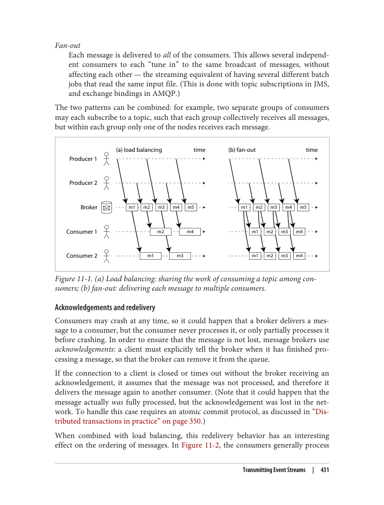

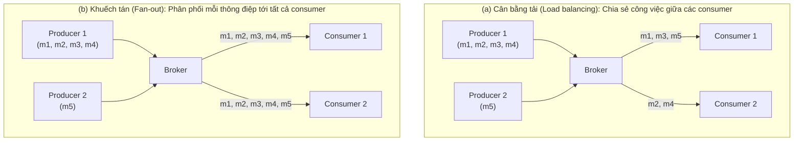

**Hình 11-1 – (a) Cân bằng tải: chia sẻ công việc tiêu thụ một topic giữa các consumer; (b) Khuếch tán (fan-out): phân phối mỗi thông điệp tới nhiều consumer (Figure 11-1. (a) Load balancing: sharing the work of consuming a topic among consumers; (b) fan-out: delivering each message to multiple consumers).**

---

#### Xác nhận và phân phối lại (Acknowledgements and redelivery)

Các consumer có thể bị sập (crash) vào bất cứ lúc nào, vì vậy hoàn toàn có thể xảy ra trường hợp một broker đã gửi một thông điệp tới cho một consumer, nhưng consumer đó chưa bao giờ xử lý nó, hoặc mới chỉ xử lý được một nửa thì bị sập nguồn hay mất mạng. Để đảm bảo rằng thông điệp đó không bị mất đi, các message broker sử dụng cơ chế **xác nhận** (**acknowledgements** — thường viết tắt là **ack**): một client bắt buộc phải báo cáo một cách tường minh cho broker biết khi nào nó đã xử lý hoàn tất một thông điệp, để khi đó broker mới yên tâm xóa bỏ thông điệp ấy khỏi hàng đợi.

Nếu kết nối mạng tới một client bị đóng lại hoặc bị quá thời gian chờ (timeout) mà broker vẫn chưa nhận được tín hiệu xác nhận (ack), broker sẽ mặc định giả sử rằng thông điệp đó chưa được xử lý, và do đó nó sẽ **phân phối lại** (**redeliver**) thông điệp đó cho một consumer khác. (Lưu ý rằng trên thực tế vẫn có thể xảy ra trường hợp thông điệp đã được consumer xử lý hoàn tất 100% rồi, nhưng gói tin xác nhận `ack` gửi trả về lại bị thất lạc trên đường truyền mạng hoặc consumer bị sập đúng vào tích tắc trước khi gửi `ack`. Để xử lý triệt để trường hợp này đòi hỏi phải có một giao thức cam kết nguyên tử — *atomic commit protocol* — như đã thảo luận trong mục *"Distributed transactions in practice"* ở Chương 9, trang 350, hoặc logic phía consumer phải đảm bảo tính lũy đẳng — *idempotence*.)

Khi được kết hợp với cơ chế cân bằng tải (load balancing), hành vi phân phối lại (redelivery) này sẽ gây ra một hệ quả rất đáng chú ý lên **thứ tự của các thông điệp** (**ordering of messages**). Trong **Hình 11-2**, các consumer nhìn chung xử lý các thông điệp theo đúng thứ tự mà chúng được gửi đi bởi các producer. Tuy nhiên, Consumer 2 đột ngột bị sập trong lúc đang xử lý thông điệp `m3`, đúng vào cùng thời điểm mà Consumer 1 đang xử lý thông điệp `m4`. Thông điệp `m3` (do chưa được xác nhận `ack`) sau đó được broker phân phối lại cho Consumer 1, dẫn đến kết quả là Consumer 1 xử lý các thông điệp theo thứ tự: `m1`, `m4`, `m3`, `m5`. Như vậy, `m3` và `m4` đã không được phân phối theo đúng thứ tự mà chúng được gửi đi ban đầu bởi Producer 1!

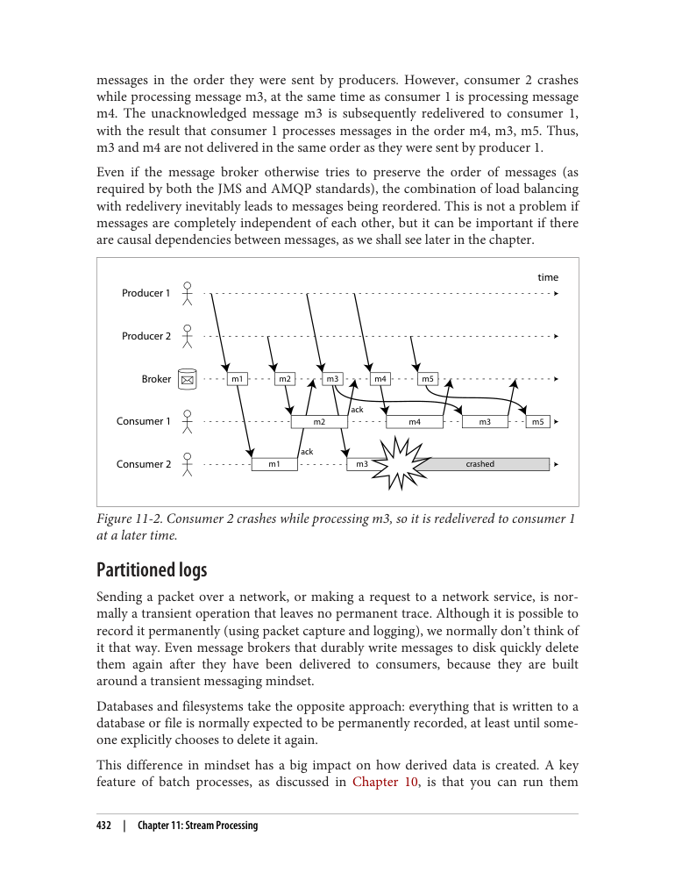

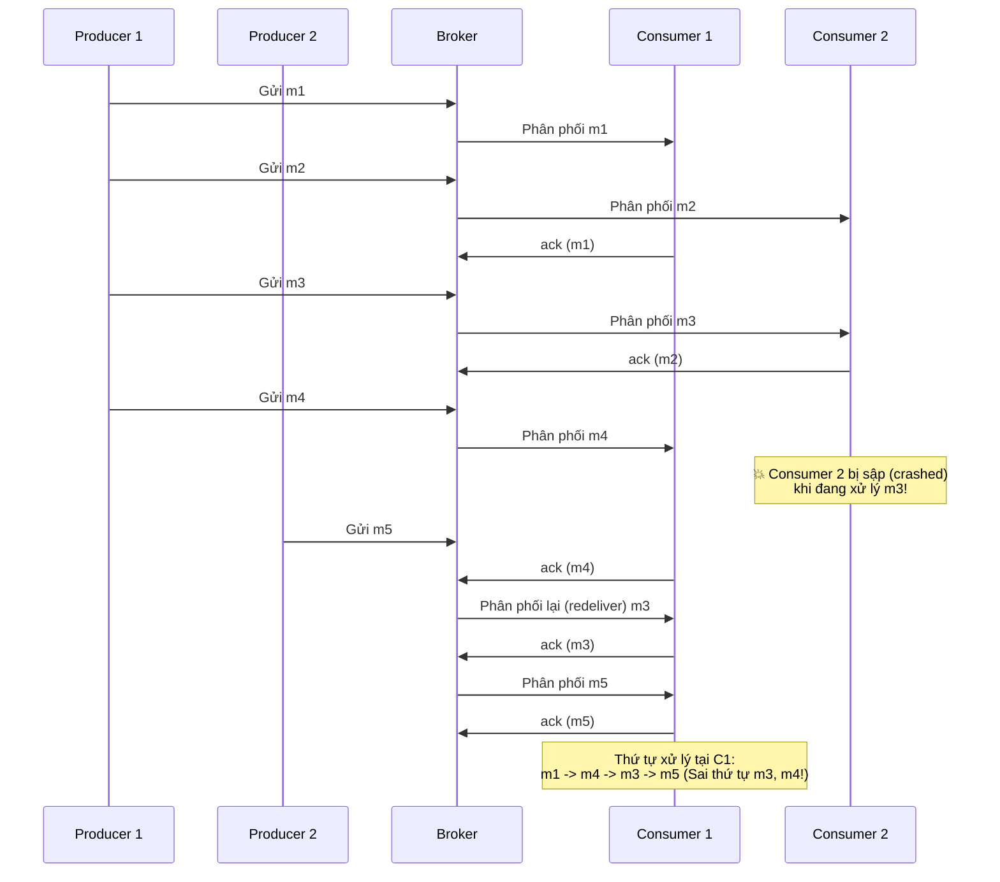

**Hình 11-2 – Consumer 2 bị sập trong khi đang xử lý m3, vì vậy m3 được phân phối lại cho Consumer 1 tại một thời điểm muộn hơn, làm đảo lộn thứ tự giữa m3 và m4 (Figure 11-2. Consumer 2 crashes while processing m3, so it is redelivered to consumer 1 at a later time).**

Ngay cả khi message broker cố gắng hết sức để bảo toàn thứ tự của các thông điệp (như được yêu cầu bởi cả hai tiêu chuẩn JMS và AMQP), thì sự kết hợp giữa **cân bằng tải (load balancing)** và **phân phối lại khi lỗi (redelivery)** chắc chắn sẽ dẫn đến việc các thông điệp bị đảo lộn thứ tự. Đây sẽ không phải là vấn đề nếu các thông điệp hoàn toàn độc lập với nhau, nhưng nó có thể trở thành một lỗi nghiêm trọng nếu tồn tại các **sự phụ thuộc nhân quả** (**causal dependencies**) giữa các thông điệp (ví dụ: sự kiện `m3` là *"Khách hàng tạo đơn hàng #100"*, còn `m4` là *"Khách hàng cập nhật địa chỉ giao hàng cho đơn #100"* — nếu `m4` chạy trước `m3` thì lệnh cập nhật sẽ báo lỗi không tìm thấy đơn hàng!), như chúng ta sẽ thấy rõ hơn ở phần sau của chương này. (Một cách khắc phục là sử dụng một hàng đợi riêng biệt cho mỗi consumer, tức là không sử dụng tính năng cân bằng tải trên từng message đơn lẻ.)

> 💡 **Ví dụ bổ sung (không có trong sách): Cách RabbitMQ (AMQP) thực hiện Load Balancing, Fan-out và Xử lý lỗi Redelivery**
>
> Trong **RabbitMQ** (một đại diện kinh điển của message broker theo chuẩn AMQP 0-9-1), các producer không bao giờ gửi message trực tiếp vào Queue, mà gửi vào một **Exchange** kèm theo một nhãn định tuyến gọi là `routing_key`:
> 1. **Mô hình Fan-out:** Bạn tạo một Exchange kiểu `fanout` (hoặc `topic`). Mỗi dịch vụ (ví dụ: `EmailService`, `AnalyticsService`, `InventoryService`) tự tạo một Queue riêng của mình và gắn kết (*bind*) Queue đó vào Exchange. Khi Producer bắn 1 sự kiện `OrderCreated` vào Exchange, Exchange sẽ nhân bản (copy) thông điệp đó vào cả 3 Queue — mỗi dịch vụ đều nhận được bản sao đầy đủ như ở **Hình 11-1(b)**.
> 2. **Mô hình Load Balancing:** Để tăng tốc độ xử lý của `InventoryService`, bạn khởi chạy 5 instance (5 pod Kubernetes) của `InventoryService` cùng lắng nghe (consume) trên **cùng một Queue** `inventory_queue`. RabbitMQ sẽ chia đều các thông điệp trong `inventory_queue` cho 5 instance theo cơ chế Round-Robin (kết hợp với cấu hình `basic.qos / prefetch_count` để tránh gửi dồn cho instance đang bận) như ở **Hình 11-1(a)**.
> 3. **Vấn đề Redelivery & Poison Pill:** Giả sử Pod #2 nhận message `m3` nhưng gặp lỗi kết nối DB hoặc lỗi `NullPointerException` khiến Pod #2 bị crash (hoặc gọi `basic.nack(requeue=true)`). RabbitMQ thấy mất kết nối TCP mà chưa nhận được `basic.ack`, nó lập tức đẩy `m3` trở lại hàng đợi và giao cho Pod #1 (như **Hình 11-2**). Nếu `m3` là một message bị lỗi định dạng dữ liệu (*poison pill message*), bất kỳ Pod nào nhận `m3` cũng sẽ crash, tạo ra vòng lặp crash vô tận! Trong thực tế vận hành RabbitMQ, các kỹ sư phải cấu hình **Dead Letter Exchange (DLX)** và giới hạn số lần thử lại (ví dụ qua `x-delivery-count` trên Quorum Queues) để sau 3 lần thất bại thì đẩy thông điệp độc hại đó sang một hàng đợi cách ly (*Dead Letter Queue - DLQ*) chờ kiểm tra thủ công.
>
> **So sánh nhanh AMQP/RabbitMQ và Kafka/Redis Streams:**
>
> | Đặc điểm | Message Broker truyền thống (RabbitMQ / ActiveMQ / JMS) | Nhật ký phân vùng (Apache Kafka / Redpanda) | Redis Streams (cấu trúc `XADD` / `XREADGROUP`) |
> | :--- | :--- | :--- | :--- |
> | **Cấu trúc lưu trữ cốt lõi** | Hàng đợi trong bộ nhớ / đĩa theo từng Queue riêng biệt. | Tệp nhật ký chỉ ghi nối tiếp (Append-only Log) chia theo Partition trên đĩa. | Cây Radix Tree (`rax`) kết hợp danh sách nén `listpack` nằm trong RAM. |
> | **Vòng đời thông điệp** | **Bị xóa ngay** sau khi Consumer gửi `ack` (Transient mindset). | **Giữ lại trên đĩa** theo chính sách lưu trữ (Retention time/size hoặc Log Compaction) bất kể đã đọc hay chưa. | Giữ lại trong RAM cho đến khi bị cắt bớt (`XTRIM` theo `MAXLEN`/`MINID`) hoặc xóa tường minh (`XDEL`). |
> | **Đơn vị cân bằng tải** | Từng thông điệp đơn lẻ (Message-level load balancing). | Từng phân vùng (Partition-level load balancing — tối đa bằng số partition). | Từng thông điệp đơn lẻ trong Consumer Group (theo dõi qua *Pending Entries List - PEL*). |
> | **Bảo toàn thứ tự khi có nhiều Consumer** | **Dễ bị đảo thứ tự** khi song song hóa hoặc khi có redelivery (như Hình 11-2). | **Đảm bảo thứ tự tuyệt đối** bên trong mỗi Partition (nhờ đánh số offset tuần tự). | Đảm bảo thứ tự theo ID thời gian (`<ms>-<seq>`), nhưng vẫn có thể lệch thứ tự thực thi nếu 1 consumer trong group bị treo và message được `XCLAIM` sang consumer khác. |
> | **Đọc lại dữ liệu cũ (Replay)** | **Không thể** (vì message đã bị xóa sau khi `ack`). | **Rất dễ dàng** (chỉ cần tua lại con trỏ `offset` về quá khứ). | **Có thể** (dùng `XREAD` hoặc đặt lại ID của Consumer Group về `0-0` nếu chưa bị `XTRIM`). |
> | **Trường hợp sử dụng tối ưu** | Hàng đợi tác vụ nền (Background job queues - Celery/Sidekiq), định tuyến phức tạp, xử lý từng tác vụ nặng tốn nhiều thời gian. | Pipeline dữ liệu thông lượng cực cao (hàng triệu event/s), CDC, Event Sourcing, Stream Analytics. | Hệ thống nhắn tin thời gian thực siêu nhanh quy mô vừa và nhỏ, tận dụng hạ tầng Redis sẵn có. |

---

### Nhật ký được phân vùng (Partitioned logs)

Việc gửi một gói tin (packet) qua mạng, hoặc thực hiện một yêu cầu (request) tới một dịch vụ mạng, thông thường là một thao tác **thoáng qua** (**transient operation**) không để lại bất kỳ dấu vết lâu dài nào. Mặc dù về mặt kỹ thuật hoàn toàn có thể ghi lại nó vĩnh viễn (bằng cách sử dụng công cụ bắt gói tin — *packet capture* — và ghi nhật ký — *logging*), nhưng thông thường chúng ta không tư duy về giao tiếp mạng theo cách đó. Ngay cả những message broker có cơ chế ghi thông điệp bền vững xuống đĩa cứng thì cũng nhanh chóng xóa sạch chúng đi ngay sau khi chúng đã được phân phối tới các consumer, bởi vì bản thân các broker đó được xây dựng xoay quanh **tư duy nhắn tin thoáng qua** (**transient messaging mindset**).

Các cơ sở dữ liệu và các hệ thống tệp (filesystems) lại đi theo hướng tiếp cận hoàn toàn trái ngược: mọi thứ được ghi vào một cơ sở dữ liệu hoặc một tệp tin thông thường đều được kỳ vọng là sẽ được **ghi nhận lâu dài** (**permanently recorded**), ít nhất là cho đến khi có ai đó chủ động lựa chọn xóa nó đi một cách tường minh.

Sự khác biệt căn bản trong tư duy thiết kế này có tác động vô cùng to lớn đến cách thức tạo ra *dữ liệu dẫn xuất* (*derived data*). Một tính năng then chốt của các tiến trình xử lý lô (batch processes), như đã thảo luận ở Chương 10, là bạn có thể chạy đi chạy lại chúng nhiều lần, thoải mái thử nghiệm các bước xử lý mới mà không sợ làm hỏng hay làm mất dữ liệu đầu vào (bởi vì dữ liệu đầu vào chỉ được mở ở chế độ chỉ đọc — *read-only*). Điều này hoàn toàn không đúng với kiểu nhắn tin theo chuẩn AMQP/JMS: việc nhận một thông điệp là một **thao tác mang tính phá hủy** (**destructive**) nếu việc xử lý thông điệp đó dẫn đến việc nó bị xóa vĩnh viễn khỏi broker; do đó, bạn không thể chạy lại cùng một consumer đó lần thứ hai và kỳ vọng nhận lại được kết quả giống hệt như trước.

Hơn nữa, nếu bạn thêm một consumer hoàn toàn mới vào một hệ thống nhắn tin truyền thống, nó thường chỉ bắt đầu nhận được các thông điệp được gửi đến **kể từ thời điểm nó được đăng ký**, chứ không thể nhận được bất kỳ thông điệp nào trước đó (vì chúng đã bị xóa mất rồi). Hãy đối chiếu điều này với các tệp tin và cơ sở dữ liệu, nơi bạn có thể thêm một client mới vào bất cứ lúc nào, và nó có thể đọc lại toàn bộ dữ liệu đã được ghi từ bất kỳ thời điểm nào xa xôi trong quá khứ (miễn là dữ liệu đó chưa bị ghi đè hoặc bị xóa tường minh).

Tại sao chúng ta không thể có một mô hình **lai ghép** (**hybrid**), kết hợp phương pháp lưu trữ bền vững của cơ sở dữ liệu với khả năng thông báo độ trễ thấp (low-latency notification) của hệ thống nhắn tin? Đó chính là ý tưởng đột phá đằng sau **các bộ môi giới thông điệp dựa trên nhật ký** (**log-based message brokers**).

---

#### Sử dụng nhật ký để lưu trữ thông điệp (Using logs for message storage)

Một **nhật ký** (**log**) đơn giản chỉ là một chuỗi các bản ghi **chỉ được phép ghi nối tiếp vào cuối** (**append-only sequence of records**) nằm trên đĩa cứng. Chúng ta đã từng thảo luận về cấu trúc log trước đây trong ngữ cảnh của các bộ máy lưu trữ có cấu trúc nhật ký (log-structured storage engines / LSM-trees) và nhật ký ghi trước (write-ahead logs — WAL) ở Chương 3, cũng như trong ngữ cảnh nhân bản cơ sở dữ liệu ở mục *"Implementation of replication logs"* (Chương 5, trang 152).

Cùng một cấu trúc dữ liệu đơn giản đó có thể được sử dụng để hiện thực hóa một message broker: một producer gửi một thông điệp bằng cách **ghi nối tiếp (append)** nó vào cuối tệp nhật ký, và một consumer nhận các thông điệp bằng cách **đọc tuần tự (reading sequentially)** tệp nhật ký đó từ đầu đến cuối. Nếu một consumer đọc chạm tới điểm cuối hiện tại của nhật ký, nó sẽ tạm dừng và chờ nhận thông báo khi có một thông điệp mới được ghi nối tiếp vào. Công cụ kinh điển `tail -f` của hệ điều hành Unix — vốn dùng để theo dõi một tệp tin và in ra màn hình ngay khi có dữ liệu mới được ghi nối tiếp vào tệp — về bản chất hoạt động chính xác theo nguyên lý này.

Để có thể mở rộng quy mô (scale) nhằm đạt được thông lượng (throughput) cao hơn mức giới hạn vật lý mà một ổ đĩa đơn lẻ có thể cung cấp, tệp nhật ký có thể được **phân vùng** (**partitioned** — theo đúng nghĩa đã học ở Chương 6). Khi đó, các phân vùng (partitions) khác nhau có thể được lưu trữ và phục vụ trên các máy chủ vật lý khác nhau, khiến cho mỗi phân vùng trở thành một nhật ký hoàn toàn độc lập có thể được đọc và ghi tách biệt với các phân vùng khác. Một **chủ đề** (**topic**) khi đó có thể được định nghĩa như một nhóm gồm nhiều phân vùng cùng mang các thông điệp có chung một kiểu dữ liệu hoặc cùng một mục đích nghiệp vụ. Phương pháp tiếp cận này được minh họa rõ nét trong **Hình 11-3**.

Bên trong mỗi phân vùng (partition), broker sẽ gán một số thứ tự tăng dần đơn điệu (**monotonically increasing sequence number**), hay còn gọi là **độ lệch / vị trí** (**offset**), cho từng thông điệp một (trong **Hình 11-3**, các con số nằm trong các ô vuông chính là các message offset). Việc đánh số thứ tự như vậy hoàn toàn hợp lý bởi vì một phân vùng chỉ cho phép ghi nối tiếp vào cuối (append-only), do đó các thông điệp nằm bên trong cùng một phân vùng được **sắp xếp theo thứ tự toàn phần** (**totally ordered**). Tuy nhiên, xin lưu ý rằng **không có bất kỳ đảm bảo thứ tự nào giữa các phân vùng khác nhau** (no ordering guarantee across different partitions).

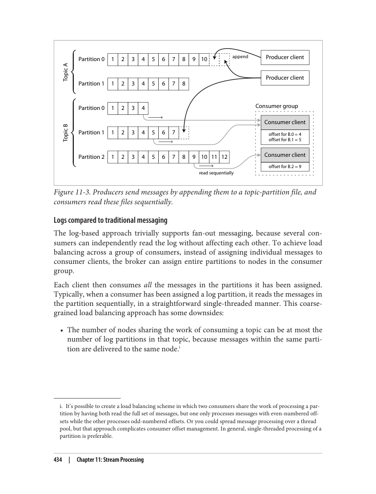

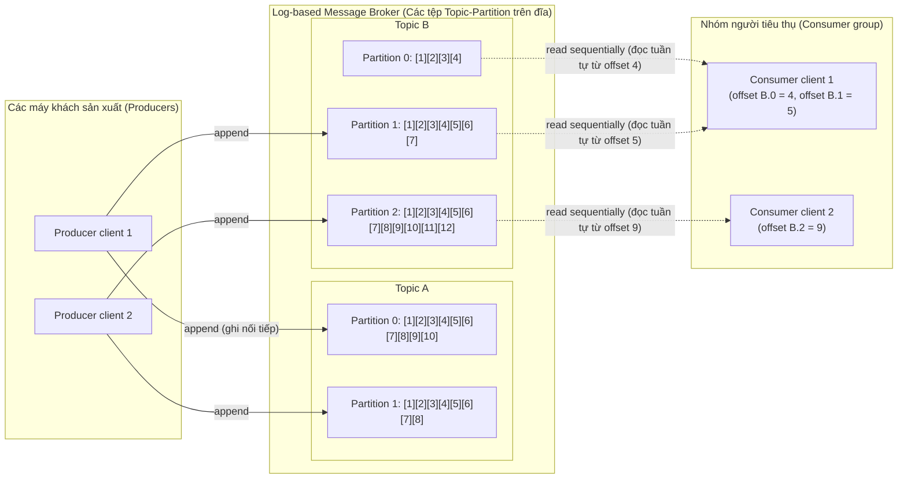

**Hình 11-3 – Các producer gửi thông điệp bằng cách ghi nối tiếp (append) chúng vào một tệp topic-partition, và các consumer đọc các tệp này một cách tuần tự (Figure 11-3. Producers send messages by appending them to a topic-partition file, and consumers read these files sequentially).**

**Apache Kafka** [15, 16], **Amazon Kinesis Streams** [17] và **DistributedLog** của Twitter [18, 19] (nay là nền tảng lưu trữ của Apache Pulsar / Apache BookKeeper) là những bộ môi giới thông điệp dựa trên nhật ký (log-based message brokers) hoạt động theo đúng nguyên lý này. (Dịch vụ Google Cloud Pub/Sub có kiến trúc tương đồng ở tầng dưới nhưng lại phơi bày ra bên ngoài giao diện API theo phong cách JMS thay vì giao diện truy cập nhật ký theo offset [20].) Mặc dù các hệ thống này ghi tất cả mọi thông điệp xuống đĩa cứng, chúng vẫn có khả năng đạt được thông lượng hàng triệu thông điệp mỗi giây nhờ việc phân vùng dữ liệu trải rộng trên nhiều máy chủ, đồng thời đạt được khả năng chịu lỗi (fault tolerance) cao thông qua việc nhân bản các thông điệp sang nhiều nút (replication) [20, 21].

---

#### So sánh nhật ký với hệ thống nhắn tin truyền thống (Logs compared to traditional messaging)

Cách tiếp cận dựa trên nhật ký (log-based approach) hỗ trợ mô hình nhắn tin **khuếch tán (fan-out)** một cách hết sức tự nhiên và dễ dàng (trivially), bởi vì nhiều consumer khác nhau có thể đọc tệp nhật ký một cách hoàn toàn độc lập mà không hề làm ảnh hưởng hay can thiệp lẫn nhau — việc đọc một thông điệp không hề xóa thông điệp đó khỏi tệp nhật ký. Để đạt được khả năng **cân bằng tải (load balancing)** trên một nhóm các consumer (consumer group), thay vì phân bổ từng thông điệp riêng lẻ cho từng consumer client, broker có thể **gán toàn bộ các phân vùng (entire partitions)** cho các nút nằm trong consumer group đó.

Khi đó, mỗi client sẽ tiêu thụ toàn bộ các thông điệp nằm trong những phân vùng mà nó đã được chỉ định phụ trách. Thông thường, khi một consumer đã được gán cho một phân vùng nhật ký (log partition), nó sẽ đọc các thông điệp trong phân vùng đó một cách tuần tự, theo một luồng xử lý đơn giản duy nhất (**single-threaded manner**). Cách tiếp cận cân bằng tải ở mức độ hạt thô (**coarse-grained load balancing** — chia theo cấp độ partition thay vì cấp độ message) này có một số nhược điểm cần lưu ý:

* Số lượng nút (nodes) tối đa có thể cùng chia sẻ công việc tiêu thụ một topic chỉ có thể **nhiều nhất là bằng số lượng phân vùng nhật ký (log partitions)** của topic đó, bởi vì toàn bộ các thông điệp nằm trong cùng một phân vùng luôn được phân phối tới cùng một nút consumer duy nhất within một consumer group.$^{\text{i}}$
* Nếu có một thông điệp đơn lẻ nào đó bị xử lý chậm, nó sẽ làm đình trệ việc xử lý tất cả các thông điệp đứng phía sau nó trong cùng phân vùng đó (đây là một dạng của hiện tượng **chặn đầu hàng đợi — head-of-line blocking**, xem lại mục *"Describing performance"* ở Chương 1, trang 11).

> $^{\text{i}}$ *Chú thích nguyên bản:* Về mặt kỹ thuật, vẫn có thể tự tạo ra một cơ chế cân bằng tải trong đó hai consumer cùng chia sẻ công việc xử lý một phân vùng bằng cách cho cả hai cùng đọc toàn bộ tập thông điệp của phân vùng đó, nhưng một bên chỉ xử lý các thông điệp có offset là số chẵn trong khi bên kia chỉ xử lý các thông điệp có offset là số lẻ. Hoặc bạn cũng có thể phân tán việc xử lý thông điệp bên trong một consumer ra một bể luồng (thread pool) đa luồng, nhưng cách tiếp cận đó sẽ làm phức tạp hóa việc quản lý và cam kết vị trí đọc (consumer offset management) lên rất nhiều (ví dụ: thread xử lý offset 105 đã chạy xong nhưng thread xử lý offset 104 lại bị treo hoặc crash — nếu commit offset 105 thì khi khởi động lại sẽ bị mất dữ liệu ở offset 104!). Nhìn chung, việc thiết kế xử lý đơn luồng (single-threaded processing) cho mỗi phân vùng vẫn luôn được ưu tiên hơn cả.

Vì vậy, trong những tình huống mà mỗi thông điệp có thể tốn rất nhiều thời gian và tài nguyên để xử lý, bạn muốn song song hóa việc xử lý theo từng thông điệp một (message-by-message basis), và nơi mà thứ tự giữa các thông điệp không quá quan trọng, thì message broker theo phong cách **JMS/AMQP** (như RabbitMQ, ActiveMQ) là lựa chọn thích hợp hơn. Ngược lại, trong những tình huống có thông lượng thông điệp cực lớn (high message throughput), nơi mà mỗi thông điệp được xử lý rất nhanh và nơi mà **thứ tự của các thông điệp là yếu tố sống còn**, thì cách tiếp cận dựa trên nhật ký (**log-based approach** như Kafka) hoạt động cực kỳ xuất sắc.

---

#### Độ lệch của người tiêu thụ (Consumer offsets)

Việc tiêu thụ một phân vùng theo trình tự tuần tự (sequentially) giúp cho việc xác định những thông điệp nào đã được xử lý trở nên vô cùng dễ dàng: **tất cả các thông điệp có độ lệch (offset) nhỏ hơn offset hiện tại của một consumer đều đã được xử lý xong, và tất cả các thông điệp có offset lớn hơn thì đều chưa được nhìn thấy**. Do đó, broker không cần phải theo dõi từng tín hiệu xác nhận (acknowledgements) cho mỗi một thông điệp riêng lẻ nữa — nó chỉ cần định kỳ ghi nhận lại con số **consumer offset** hiện tại của từng phân vùng. Việc giảm thiểu đáng kể chi phí quản lý sổ sách (bookkeeping overhead) này, kết hợp với các cơ hội gom lô (batching) và truyền tải theo đường ống (pipelining), chính là chìa khóa giúp tăng vọt thông lượng của các hệ thống dựa trên nhật ký.

Con số offset này trên thực tế cực kỳ giống với **số thứ tự nhật ký** (**log sequence number — LSN**) thường thấy trong cơ chế nhân bản cơ sở dữ liệu một nút dẫn đầu (single-leader database replication) mà chúng ta đã thảo luận trong mục *"Setting up new followers"* ở Chương 5 (trang 149). Trong nhân bản cơ sở dữ liệu, số LSN (hay vị trí tệp `binlog` trong MySQL, `WAL LSN` trong PostgreSQL) cho phép một nút theo sau (follower) kết nối lại với nút dẫn đầu (leader) sau khi bị mất kết nối mạng, và tiếp tục quá trình nhân bản ngay tại điểm bị gián đoạn mà không bỏ sót bất kỳ thao tác ghi nào. Chính xác cùng một nguyên lý đó được áp dụng ở đây: **message broker đóng vai trò giống hệt như một cơ sở dữ liệu leader, còn consumer đóng vai trò giống như một follower**.

Nếu một nút consumer bị lỗi (fails), một nút khác còn sống trong cùng consumer group sẽ được gán quyền tiếp quản các phân vùng của consumer vừa gặp sự cố, và nó sẽ bắt đầu tiêu thụ các thông điệp ngay tại vị trí **offset được ghi nhận lần cuối cùng** (last recorded / committed offset). Nếu trước khi sập, consumer cũ đã kịp xử lý thêm một vài thông điệp tiếp theo nhưng lại chưa kịp ghi nhận (commit) offset mới của chúng lên broker, thì những thông điệp đó sẽ được xử lý lại lần thứ hai (at-least-once delivery) khi phân vùng được tiếp quản hoặc khởi động lại. Chúng ta sẽ thảo luận chi tiết các cách thức xử lý vấn đề xử lý trùng lặp này ở phần sau của chương.

---

#### Sử dụng dung lượng đĩa (Disk space usage)

Nếu bạn chỉ liên tục ghi nối tiếp (append) vào tệp nhật ký mãi mãi, sớm hay muộn bạn cũng sẽ cạn kiệt dung lượng ổ đĩa cứng. Để thu hồi lại dung lượng đĩa (reclaim disk space), tệp nhật ký trên thực tế được chia nhỏ thành các **đoạn** (**segments**), và định kỳ theo thời gian, các đoạn nhật ký cũ (old segments) sẽ bị xóa đi hoặc được di chuyển sang kho lưu trữ lạnh (archive storage như Amazon S3 / HDFS). (Chúng ta sẽ thảo luận về một cách thức tinh vi hơn để giải phóng dung lượng đĩa — gọi là *Log Compaction* — ở mục tiếp theo.)

Điều này có nghĩa là nếu một consumer xử lý quá chậm không thể bắt kịp tốc độ sinh thông điệp của các producer, và nó bị tụt lại phía sau xa đến mức con trỏ `consumer offset` của nó trỏ vào một đoạn nhật ký (segment) đã bị xóa mất, thì consumer đó sẽ bị mất (bỏ lỡ) một số thông điệp. Về mặt hiệu quả hoạt động, tệp nhật ký trên đĩa chính là hiện thực của một **bộ đệm có kích thước hữu hạn** (**bounded-size buffer**) tự động loại bỏ các thông điệp cũ nhất khi nó bị đầy — một cấu trúc dữ liệu còn được biết đến với tên gọi **bộ đệm vòng** (**circular buffer** hoặc **ring buffer**). Tuy nhiên, bởi vì bộ đệm vòng này nằm trên ổ đĩa cứng (thay vì nằm trong RAM), kích thước của nó có thể cực kỳ khổng lồ!

Hãy cùng làm một phép tính ước lượng nhanh trên phong bì (back-of-the-envelope calculation). Tại thời điểm viết cuốn sách này, một ổ đĩa cứng từ tính (HDD) dung lượng lớn điển hình có sức chứa **6 TB** và có thông lượng ghi tuần tự (sequential write throughput) đạt khoảng **150 MB/giây**. Nếu bạn liên tục ghi thông điệp vào ổ đĩa ở tốc độ tối đa có thể của phần cứng ($150\text{ MB/s}$), bạn sẽ phải mất khoảng:

$$\frac{6\text{ TB}}{150\text{ MB/s}} = \frac{6 \times 10^{12}\text{ bytes}}{150 \times 10^6\text{ bytes/s}} = 40.000\text{ giây} \approx 11\text{ giờ}$$

để lấp đầy hoàn toàn ổ đĩa đó. Như vậy, ngay cả khi chạy hết công suất ghi tối đa của phần cứng, ổ đĩa vẫn có thể lưu đệm được lượng thông điệp của suốt **11 giờ đồng hồ**, và chỉ sau 11 giờ đó nó mới bắt đầu phải ghi đè lên các thông điệp cũ. Tỷ lệ thời gian lưu đệm này vẫn giữ nguyên không đổi ngay cả khi bạn mở rộng quy mô bằng cách sử dụng hàng chục ổ đĩa cứng và nhiều máy chủ ghép lại. Trong thực tế vận hành, các hệ thống triển khai hiếm khi nào sử dụng hết 100% băng thông ghi vật lý của ổ đĩa liên tục 24/24, vì vậy tệp nhật ký của Kafka thông thường có thể dễ dàng lưu giữ một bộ đệm chứa toàn bộ thông điệp của **vài ngày hoặc thậm chí vài tuần lễ**.

Nhờ vậy, trong quá trình vận hành, bạn có thể giám sát (monitor) xem một consumer đang bị tụt lại phía sau phần đầu mới nhất của nhật ký bao xa (chỉ số này trong thực tế gọi là **consumer lag**), và phát cảnh báo (alert) cho đội ngũ kỹ sư trực hệ thống (on-call) nếu nó bị tụt lại quá xa. Bởi vì bộ đệm trên đĩa rất lớn (vài ngày hoặc vài tuần), con người có dư dả thời gian để nhảy vào sửa lỗi cho consumer đang bị chậm, nâng cấp phần cứng hoặc sửa bug code và cho phép nó chạy bù để bắt kịp (catch up) tiến độ trước khi các thông điệp cũ bắt đầu bị xóa mất. Và tuyệt vời hơn cả: ngay cả khi một consumer thực sự bị tụt lại quá xa và làm rơi rớt dữ liệu của chính nó, sự cố đó **chỉ ảnh hưởng tới duy nhất bản thân consumer đó**, chứ hoàn toàn không làm gián đoạn dịch vụ của các consumer khác hay làm nghẽn producer — đây là một lợi thế vận hành (operational advantage) vô cùng to lớn so với các message broker truyền thống (nơi mà một hàng đợi bị phình to tràn RAM có thể kéo sập toàn bộ broker).

---

#### Phát lại các thông điệp cũ (Replaying old messages)

Chúng ta đã lưu ý trước đó rằng với các message broker theo phong cách AMQP và JMS, việc xử lý và gửi xác nhận (`ack`) các thông điệp là một thao tác mang tính phá hủy (destructive operation), bởi vì nó khiến các thông điệp bị xóa sạch khỏi broker. Ngược lại, trong một message broker dựa trên nhật ký (log-based message broker), việc tiêu thụ các thông điệp giống với việc đọc từ một tệp tin hơn: đó là một **thao tác chỉ đọc** (**read-only operation**) hoàn toàn không làm thay đổi nội dung tệp nhật ký.

Tác dụng phụ (side-effect) duy nhất của quá trình xử lý (ngoài các kết quả đầu ra do chính consumer tạo ra và ghi đi nơi khác) là con trỏ `consumer offset` dịch chuyển tiến về phía trước. Nhưng bản thân con trỏ `offset` này lại nằm dưới quyền kiểm soát của consumer, vì vậy nó có thể dễ dàng được điều chỉnh (manipulated) bất cứ khi nào cần thiết: ví dụ, bạn có thể khởi chạy một bản sao mới của một consumer với giá trị `offset` được tua ngược về thời điểm ngày hôm qua, và cho nó ghi kết quả đầu ra vào một vị trí khác, nhằm mục đích **xử lý lại (re-process)** toàn bộ lượng thông điệp của ngày hôm qua. Bạn có thể lặp đi lặp lại việc này bao nhiêu lần tùy thích, vừa chạy lại vừa tinh chỉnh mã nguồn xử lý.

Khía cạnh này khiến cho hệ thống nhắn tin dựa trên nhật ký trở nên rất giống với các tiến trình xử lý lô (batch processes) của chương trước, nơi mà *dữ liệu dẫn xuất* (*derived data*) được tách biệt rạch ròi khỏi *dữ liệu đầu vào* (*input data*) thông qua một quy trình biến đổi có thể lặp lại được (repeatable transformation process). Nó cho phép các kỹ sư thoải mái thử nghiệm các thuật toán mới và khôi phục hệ thống sau các lỗi vận hành hay lỗi phần mềm (bugs) một cách dễ dàng hơn rất nhiều, biến nó thành một công cụ lý tưởng để tích hợp các luồng dữ liệu (data flows) trong toàn bộ một tổ chức doanh nghiệp [22].

---

## Cơ sở dữ liệu và Luồng (Databases and streams)

Chúng ta vừa thực hiện một số phép so sánh thú vị giữa các bộ môi giới thông điệp (message brokers) và các cơ sở dữ liệu (databases). Mặc dù theo truyền thống chúng vẫn luôn được xem là hai danh mục công cụ hoàn toàn tách biệt nhau, nhưng chúng ta đã thấy rằng các message broker dựa trên nhật ký (như Kafka) đã gặt hái được thành công vang dội nhờ việc tiếp thu các ý tưởng cốt lõi từ cơ sở dữ liệu (như lưu trữ bằng tệp append-only log trên đĩa, phân vùng và nhân bản theo offset) rồi áp dụng chúng vào bài toán nhắn tin. Bây giờ, chúng ta hoàn toàn có thể **đi theo chiều ngược lại**: lấy các ý tưởng từ hệ thống nhắn tin và luồng dữ liệu (streams), rồi áp dụng chúng ngược trở lại vào cơ sở dữ liệu!

Trước đó, chúng ta đã định nghĩa rằng một sự kiện (event) là một bản ghi về một việc gì đó đã xảy ra tại một thời điểm nhất định. Việc đã xảy ra đó có thể là một hành động của người dùng (ví dụ: gõ một câu truy vấn tìm kiếm), hoặc một số đo từ cảm biến, nhưng nó cũng hoàn toàn có thể là **một thao tác ghi vào cơ sở dữ liệu** (**a write to a database**). Bản thân sự thật rằng có một dữ liệu nào đó vừa được ghi vào cơ sở dữ liệu chính là một sự kiện có thể được nắm bắt (captured), lưu trữ (stored) và xử lý (processed). Điều này gợi mở cho chúng ta thấy rằng mối liên hệ giữa cơ sở dữ liệu và luồng dữ liệu (streams) còn sâu sắc hơn rất nhiều so với việc chỉ dùng chung cách lưu trữ tệp nhật ký vật lý trên đĩa — đó là một mối liên hệ mang tính **nền tảng và bản chất** (**fundamental**).

Trên thực tế, một **nhật ký nhân bản** (**replication log** — xem lại mục *"Implementation of replication logs"* ở Chương 5, trang 152) chính là một luồng các sự kiện ghi cơ sở dữ liệu (a stream of database write events), được tạo ra bởi nút dẫn đầu (leader) khi nó xử lý các giao dịch (transactions). Các nút theo sau (followers) áp dụng luồng các thao tác ghi đó vào bản sao cơ sở dữ liệu của riêng chúng, và nhờ đó đạt được một bản sao cập nhật chính xác của cùng một tập dữ liệu. Các sự kiện nằm trong nhật ký nhân bản mô tả toàn bộ các thay đổi dữ liệu đã diễn ra.

Chúng ta cũng đã từng bắt gặp nguyên lý **nhân bản máy trạng thái** (**state machine replication**) trong mục *"Total order broadcast"* ở Chương 9 (trang 338), phát biểu rằng: *nếu mỗi sự kiện đại diện cho một thao tác ghi vào cơ sở dữ liệu, và mọi bản sao (replica) đều xử lý cùng một tập các sự kiện theo đúng cùng một thứ tự, thì tất cả các bản sao sẽ đều đi đến cùng một trạng thái cuối cùng giống hệt nhau* (với giả định rằng việc xử lý một sự kiện là một thao tác tất định — *deterministic operation*). Đó chẳng qua lại là một trường hợp ứng dụng khác của luồng sự kiện (event streams)!

Trong phần này, trước hết chúng ta sẽ xem xét một vấn đề nan giải thường xuyên phát sinh trong các hệ thống dữ liệu không đồng nhất (heterogeneous data systems), và sau đó khám phá cách chúng ta có thể giải quyết triệt để vấn đề đó bằng cách mang các ý tưởng từ luồng sự kiện vào thế giới cơ sở dữ liệu.

---

### Giữ cho các hệ thống đồng bộ với nhau (Keeping systems in sync)

Như chúng ta đã thấy xuyên suốt cuốn sách này, không có bất kỳ một hệ thống đơn lẻ nào có thể thỏa mãn tất cả mọi nhu cầu về lưu trữ, truy vấn và xử lý dữ liệu. Trong thực tế, hầu hết các ứng dụng web có quy mô đáng kể đều cần phải kết hợp nhiều công nghệ khác nhau lại với nhau để đáp ứng các yêu cầu nghiệp vụ của mình: ví dụ, sử dụng một cơ sở dữ liệu OLTP (như PostgreSQL/MySQL) để phục vụ các yêu cầu giao dịch trực tiếp của người dùng, một bộ nhớ đệm (cache như Redis/Memcached) để tăng tốc các yêu cầu đọc phổ biến, một chỉ mục toàn văn (full-text index như Elasticsearch/Solr) để xử lý các truy vấn tìm kiếm từ khóa phức tạp, và một kho dữ liệu (data warehouse như Snowflake/BigQuery/Redshift) để phục vụ phân tích kinh doanh. Mỗi một hệ thống trong số này đều lưu giữ **bản sao dữ liệu của riêng nó**, được lưu trữ dưới định dạng biểu diễn riêng được tối ưu hóa chuyên biệt cho mục đích của hệ thống đó.

Khi cùng một dữ liệu xuất hiện ở tất cả những nơi khác nhau này, chúng bắt buộc phải được **giữ cho đồng bộ với nhau** (**kept in sync with each other**): nếu một mặt hàng được cập nhật giá trong cơ sở dữ liệu OLTP, nó cũng cần phải được cập nhật tương ứng trong bộ nhớ đệm cache, trong các chỉ mục tìm kiếm và trong kho dữ liệu phân tích. Đối với các kho dữ liệu (data warehouses), việc đồng bộ này thông thường được thực hiện thông qua các quy trình **ETL** (Extract–Transform–Load, xem lại mục *"Data warehousing"* ở Chương 3, trang 88) — thường là bằng cách lấy một bản sao toàn phần (full copy / dump) của cơ sở dữ liệu định kỳ hàng đêm, biến đổi định dạng của nó, rồi nạp hàng loạt (bulk-loading) vào kho dữ liệu. Nói cách khác, đó chính là một tiến trình xử lý lô (batch process).

Nếu việc xuất toàn bộ cơ sở dữ liệu (periodic full database dumps) định kỳ là quá chậm chạp, một giải pháp thay thế đôi khi được các lập trình viên sử dụng là **ghi kép** (**dual writes**), trong đó mã nguồn tầng ứng dụng (application code) chủ động ghi một cách tường minh vào từng hệ thống mỗi khi dữ liệu thay đổi: ví dụ, ứng dụng thực hiện ghi vào cơ sở dữ liệu trước, sau đó gọi API cập nhật chỉ mục tìm kiếm (Elasticsearch), rồi tiếp tục gọi lệnh xóa (invalidate) các mục dữ liệu tương ứng trong bộ nhớ đệm (Redis).

Tuy nhiên, kỹ thuật ghi kép (dual writes) mắc phải một số **vấn đề cực kỳ nghiêm trọng**, mà một trong số đó là lỗi **điều kiện tranh chấp** (**race condition**) được minh họa trong **Hình 11-4**. Trong ví dụ này, hai client đồng thời muốn cập nhật một mục dữ liệu `X`: Client 1 muốn đặt giá trị của `X` thành `A`, và Client 2 muốn đặt giá trị của `X` thành `B`. Cả hai client đều thực hiện quy trình: trước tiên ghi giá trị mới vào cơ sở dữ liệu (Database), sau đó mới ghi giá trị mới vào chỉ mục tìm kiếm (Search index).

Do sự trùng hợp không may về mặt thời gian mạng và lập lịch luồng (unlucky timing), các yêu cầu từ hai client bị đan xen chéo nhau (interleaved):
1. Cơ sở dữ liệu (Database) nhìn thấy thao tác ghi từ Client 1 đặt `X = A` trước, rồi sau đó mới nhìn thấy thao tác ghi từ Client 2 đặt `X = B`, vì vậy giá trị cuối cùng được lưu trong Database là **`X = B`**.
2. Ngược lại, chỉ mục tìm kiếm (Search index) lại nhìn thấy thao tác ghi từ Client 2 (`X = B`) đến trước, rồi sau đó mới nhìn thấy thao tác ghi từ Client 1 (`X = A`), vì vậy giá trị cuối cùng được lưu trong Search index lại là **`X = A`**.

Hậu quả là hai hệ thống giờ đây đã rơi vào trạng thái **bất nhất vĩnh viễn với nhau** (**permanently inconsistent with each other**), mặc dù không hề có bất kỳ lỗi mạng hay lỗi phần cứng nào xảy ra trong suốt quá trình thực thi!

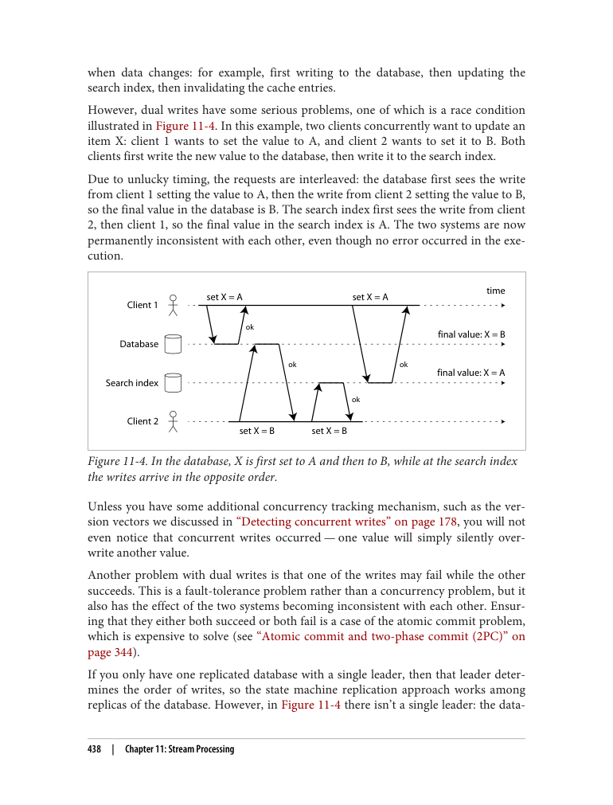

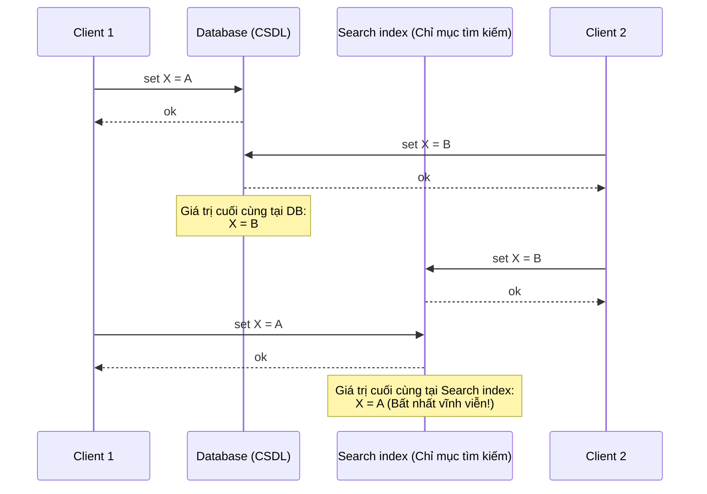

**Hình 11-4 – Trong cơ sở dữ liệu, X ban đầu được đặt thành A rồi sau đó đổi thành B, trong khi tại chỉ mục tìm kiếm, các thao tác ghi lại đến theo thứ tự ngược lại (Figure 11-4. In the database, X is first set to A and then to B, while at the search index the writes arrive in the opposite order).**

Trừ khi bạn triển khai thêm một cơ chế theo dõi tương tranh bổ sung nào đó, chẳng hạn như các vectơ phiên bản (version vectors) mà chúng ta đã thảo luận trong mục *"Detecting concurrent writes"* ở Chương 5 (trang 178), bạn thậm chí sẽ không bao giờ phát hiện ra rằng các thao tác ghi đồng thời đã xảy ra — một giá trị sẽ просто âm thầm ghi đè lên giá trị kia ở mỗi hệ thống theo thứ tự khác nhau.

Một vấn đề nghiêm trọng thứ hai của kỹ thuật ghi kép (dual writes) là **một trong hai thao tác ghi có thể bị thất bại trong khi thao tác kia đã thành công** (ví dụ: ghi vào PostgreSQL thành công và đã commit, nhưng ngay giây tiếp theo khi gọi HTTP sang Elasticsearch thì mạng bị chập chờn hoặc ứng dụng bị mất điện). Đây là một bài toán về khả năng chịu lỗi (fault-tolerance problem) hơn là bài toán tương tranh, nhưng nó cũng dẫn đến cùng một hậu quả tai hại là hai hệ thống trở nên bất nhất với nhau. Việc đảm bảo rằng cả hai thao tác ghi trên hai hệ thống khác nhau phải hoặc cùng thành công, hoặc cùng thất bại chính là một trường hợp của bài toán cam kết nguyên tử (**atomic commit problem**), vốn cực kỳ đắt đỏ và phức tạp để giải quyết trong thực tế (xem lại mục *"Atomic commit and two-phase commit (2PC)"* ở Chương 9, trang 344).

Nếu bạn chỉ có một cơ sở dữ liệu được nhân bản duy nhất với một nút dẫn đầu duy nhất (**single leader**), thì chính nút leader đó sẽ là người quyết định thứ tự duy nhất của mọi thao tác ghi, và do đó phương pháp nhân bản máy trạng thái (state machine replication) hoạt động hoàn hảo giữa các bản sao (replicas) của cơ sở dữ liệu đó. Tuy nhiên, trong **Hình 11-4**, không hề có một nút leader chung duy nhất nào cả: bản thân Database có thể có một leader của riêng nó và Search index cũng có thể có một leader của riêng nó, nhưng không hệ thống nào đi theo (follow) hệ thống nào, và vì thế xung đột dữ liệu tất yếu sẽ xảy ra (xem lại mục *"Multi-leader replication"* ở Chương 5, trang 161).

Tình hình sẽ trở nên tốt đẹp hơn rất nhiều nếu thực sự **chỉ có duy nhất một nút dẫn đầu (one leader)** — ví dụ như lấy chính cơ sở dữ liệu làm leader — và nếu chúng ta có thể biến chỉ mục tìm kiếm (search index) trở thành một **nút theo sau (follower)** của cơ sở dữ liệu đó. Nhưng liệu điều này có khả thi trong thực tế hay không, khi mà hai hệ thống này thuộc hai công nghệ hoàn toàn khác nhau?

---

### Bắt dữ liệu thay đổi (Change data capture)

Vấn đề với các tệp nhật ký nhân bản (replication logs) của hầu hết các cơ sở dữ liệu là trong suốt một thời gian dài, chúng luôn bị coi là một **chi tiết hiện thực nội bộ** (**internal implementation detail**) của riêng cơ sở dữ liệu đó, chứ không phải là một giao diện lập trình công khai (public API). Các nhà thiết kế cơ sở dữ liệu mặc định rằng các client chỉ được phép truy vấn cơ sở dữ liệu thông qua mô hình dữ liệu và ngôn ngữ truy vấn chính thức của nó (như SQL), chứ không được tự ý phân tích cú pháp (parse) các tệp nhật ký nhân bản cấp thấp và cố gắng trích xuất dữ liệu từ chúng.

Trong suốt nhiều thập kỷ, nhiều hệ thống cơ sở dữ liệu đơn giản là không hề có một cách thức chính thống được tài liệu hóa nào để lấy ra nhật ký các thay đổi đã được ghi vào nó. Chính vì lý do này, việc thu thập toàn bộ các thay đổi được thực hiện trong một cơ sở dữ liệu rồi nhân bản chúng sang một công nghệ lưu trữ hoàn toàn khác biệt như chỉ mục tìm kiếm (search index), bộ nhớ đệm (cache) hay kho dữ liệu (data warehouse) đã từng là một bài toán vô cùng chật vật.

Gần đây hơn, ngành công nghiệp phần mềm chứng kiến sự quan tâm ngày càng lớn dành cho kỹ thuật **bắt dữ liệu thay đổi** (**change data capture — CDC**), tức là quy trình quan sát tất cả mọi thay đổi dữ liệu được ghi vào một cơ sở dữ liệu và trích xuất chúng ra dưới một định dạng chuẩn hóa mà từ đó chúng có thể được nhân bản sang các hệ thống khác. CDC trở nên đặc biệt thú vị và mạnh mẽ nếu các thay đổi đó được cung cấp dưới dạng một **luồng sự kiện (stream)** ngay lập tức khi chúng vừa được ghi vào cơ sở dữ liệu.

Ví dụ, bạn có thể nắm bắt các thay đổi trong một cơ sở dữ liệu và liên tục áp dụng chính xác các thay đổi đó vào một chỉ mục tìm kiếm. Nếu nhật ký các thay đổi (log of changes) được áp dụng theo đúng cùng một thứ tự, bạn hoàn toàn có thể kỳ vọng dữ liệu trong chỉ mục tìm kiếm sẽ khớp chính xác với dữ liệu trong cơ sở dữ liệu (loại bỏ hoàn toàn lỗi race condition của **Hình 11-4**). Chỉ mục tìm kiếm và bất kỳ hệ thống dữ liệu dẫn xuất (derived data systems) nào khác khi đó đơn giản chỉ là các **người tiêu thụ (consumers)** của luồng thay đổi (change stream), như được minh họa trong **Hình 11-5**.

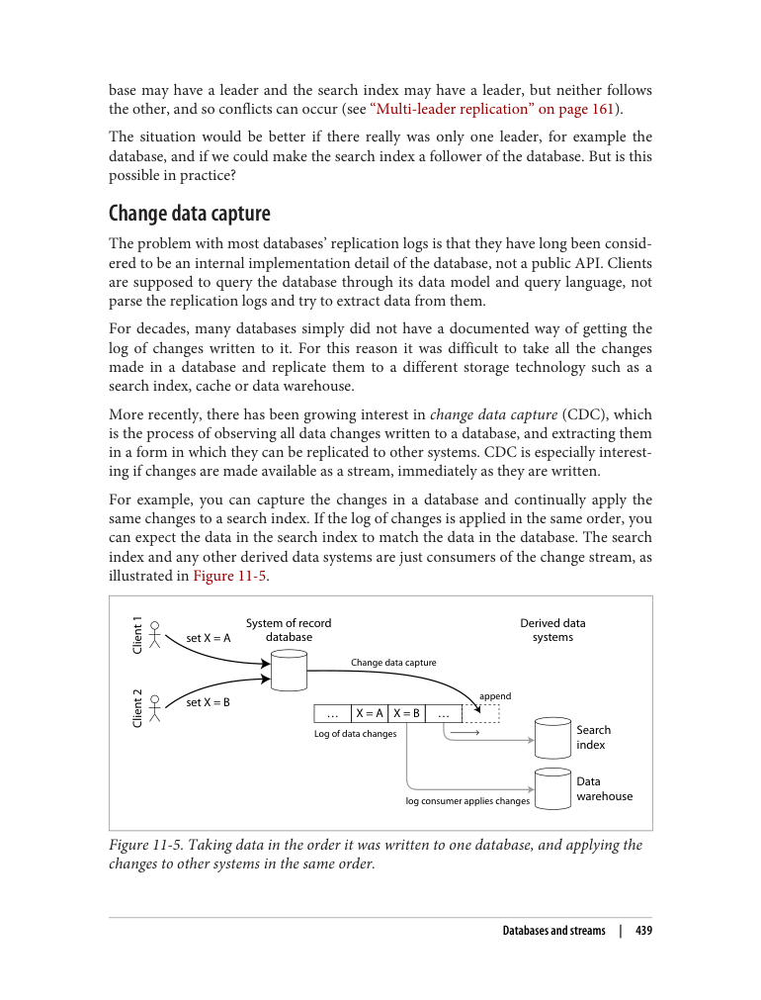

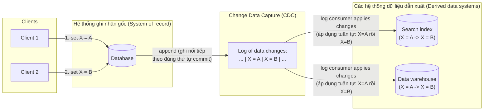

**Hình 11-5 – Lấy dữ liệu theo đúng thứ tự mà nó đã được ghi vào một cơ sở dữ liệu gốc, và áp dụng các thay đổi đó sang các hệ thống khác theo đúng cùng một thứ tự (Figure 11-5. Taking data in the order it was written to one database, and applying the changes to other systems in the same order).**

---

#### Hiện thực hóa việc bắt dữ liệu thay đổi (Implementing change data capture)

Chúng ta có thể gọi các consumer đọc nhật ký này là **các hệ thống dữ liệu dẫn xuất** (**derived data systems**), đúng như đã thảo luận trong phần giới thiệu của Phần III: dữ liệu được lưu trữ bên trong chỉ mục tìm kiếm (search index) và kho dữ liệu (data warehouse) chẳng qua chỉ là một góc nhìn khác (another view) lên khối dữ liệu nằm trong **hệ thống ghi nhận gốc** (**system of record** / *source of truth*). Bắt dữ liệu thay đổi (CDC) chính là cơ chế kỹ thuật nhằm đảm bảo rằng tất cả mọi thay đổi được thực hiện trên hệ thống ghi nhận gốc đều được phản ánh đầy đủ sang các hệ thống dữ liệu dẫn xuất, để các hệ thống dẫn xuất luôn có một bản sao chính xác của dữ liệu.

Về bản chất, CDC biến một cơ sở dữ liệu thành **nút dẫn đầu (leader)** — chính là cơ sở dữ liệu nơi các thay đổi được bắt ra — và biến tất cả các hệ thống khác thành **các nút theo sau (followers)**. Một bộ môi giới thông điệp dựa trên nhật ký (log-based message broker như Apache Kafka) cực kỳ phù hợp để làm phương tiện vận chuyển các sự kiện thay đổi (change events) từ cơ sở dữ liệu nguồn sang các hệ thống đích, bởi vì nó bảo toàn nghiêm ngặt thứ tự của các thông điệp bên trong mỗi phân vùng (tránh được hiện tượng đảo lộn thứ tự thông điệp khi có lỗi của **Hình 11-2**).

Các **trigger của cơ sở dữ liệu** (**database triggers**) có thể được sử dụng để hiện thực hóa CDC (xem lại mục *"Trigger-based replication"* ở Chương 5, trang 154) bằng cách đăng ký các trigger quan sát mọi thao tác `INSERT`, `UPDATE`, `DELETE` trên các bảng dữ liệu rồi tự động chèn thêm một dòng tương ứng vào một bảng nhật ký thay đổi (changelog table). Tuy nhiên, cách dùng trigger này thường rất mong manh dễ vỡ (fragile) và gây ra chi phí phụ trội (performance overheads) rất nặng nề lên chính giao dịch của cơ sở dữ liệu gốc. Thay vào đó, việc **phân tích cú pháp trực tiếp tệp nhật ký nhân bản (parsing the replication log)** là một phương pháp tiếp cận mạnh mẽ và bền bỉ hơn nhiều, mặc dù nó cũng đi kèm với những thách thức kỹ thuật riêng, chẳng hạn như việc xử lý các thay đổi lược đồ bảng (schema changes / DDL như `ALTER TABLE`).

Hệ thống **Databus** của LinkedIn [23], **Wormhole** của Facebook [24] và **Sherpa** của Yahoo! [25] đều ứng dụng ý tưởng này ở quy mô cực lớn. Công cụ mã nguồn mở **Bottled Water** (do chính tác giả Martin Kleppmann phát triển) hiện thực hóa CDC cho PostgreSQL bằng cách sử dụng một API giải mã trực tiếp tệp nhật ký ghi trước (logical decoding trên write-ahead log — WAL) [26]; **Maxwell** và **Debezium** thực hiện điều tương tự cho MySQL bằng cách phân tích cú pháp tệp `binlog` [27, 28]; **Mongoriver** đọc tệp `oplog` của MongoDB [29, 30]; và **Oracle GoldenGate** cung cấp các tính năng tương tự cho hệ quản trị cơ sở dữ liệu Oracle [31, 32].

Giống như các message broker, cơ chế bắt dữ liệu thay đổi (CDC) thông thường hoạt động theo kiểu **bất đồng bộ** (**asynchronous**): cơ sở dữ liệu đóng vai trò *system of record* không hề chờ cho đến khi thay đổi được áp dụng xong xuôi vào các consumer thì mới cam kết (commit) giao dịch của nó. Thiết kế này mang lại một lợi thế vận hành to lớn là việc thêm vào một consumer chạy chậm sẽ hoàn toàn không làm chậm cơ sở dữ liệu gốc, nhưng nó cũng có nhược điểm là toàn bộ các vấn đề kinh điển của **độ trễ nhân bản** (**replication lag**) đều sẽ xuất hiện (xem lại mục *"Problems With Replication Lag"* ở Chương 5, trang 155 — ví dụ: người dùng vừa sửa tên sản phẩm xong nhưng bấm tìm kiếm ngay lập tức trên Elasticsearch thì vẫn thấy tên cũ trong vài trăm mili-giây).

---

#### Bản chụp nhanh ban đầu (Initial snapshot)

Nếu bạn lưu giữ được toàn bộ tệp nhật ký chứa tất cả mọi thay đổi từng được thực hiện đối với một cơ sở dữ liệu kể từ lúc nó mới được khởi tạo, bạn hoàn toàn có thể tái cấu trúc lại toàn bộ trạng thái hiện tại của cơ sở dữ liệu đó chỉ bằng cách phát lại (replaying) tệp nhật ký từ đầu đến cuối. Tuy nhiên, trong nhiều trường hợp thực tế, việc giữ lại tất cả mọi thay đổi mãi mãi sẽ đòi hỏi quá nhiều dung lượng đĩa cứng, và việc phát lại toàn bộ lịch sử từ ngày đầu tiên sẽ mất quá nhiều thời gian, vì vậy tệp nhật ký buộc phải được cắt bớt (truncated) sau một khoảng thời gian nhất định.

Ví dụ, việc xây dựng một chỉ mục tìm kiếm toàn văn (full-text index) hoàn toàn mới đòi hỏi phải có một bản sao đầy đủ của toàn bộ cơ sở dữ liệu — việc chỉ áp dụng một tệp nhật ký chứa các thay đổi gần đây là không đủ, bởi vì nó sẽ bị thiếu mất toàn bộ các bản ghi đã được tạo từ lâu mà gần đây không có cập nhật nào mới. Do đó, nếu bạn không lưu giữ toàn bộ lịch sử nhật ký từ đầu, bạn cần phải bắt đầu quy trình bằng một **bản chụp nhanh nhất quán** (**consistent snapshot**), giống hệt như quy trình mà chúng ta đã thảo luận trước đây trong mục *"Setting up new followers"* ở Chương 5 (trang 149).

Bản chụp nhanh (snapshot) của cơ sở dữ liệu này bắt buộc phải tương ứng chính xác với một **vị trí hoặc độ lệch đã biết** (**known position or offset**) trong tệp nhật ký thay đổi (ví dụ: số `LSN` trong PostgreSQL hoặc tọa độ `binlog file + position` / `GTID` trong MySQL tại đúng thời điểm bắt đầu chụp snapshot), để bạn biết chính xác phải bắt đầu áp dụng tiếp các sự kiện thay đổi từ điểm nào sau khi bản chụp nhanh đã được nạp và xử lý xong (nhằm không bị trùng lặp và cũng không bị bỏ sót bất kỳ thay đổi nào diễn ra trong lúc đang chụp snapshot). Một số công cụ CDC (như Debezium) tích hợp sẵn tính năng chụp snapshot tự động này ngay trong công cụ, trong khi những công cụ khác để nó lại như một thao tác thủ công mà kỹ sư vận hành phải tự thực hiện.

---

#### Nén gọn nhật ký (Log compaction)

Nếu bạn chỉ có thể giữ lại một lượng lịch sử nhật ký hạn chế (do cắt bỏ theo thời gian), bạn sẽ buộc phải trải qua quy trình chụp lại bản chụp nhanh (snapshot process) nặng nề mỗi khi bạn muốn thêm vào một hệ thống dữ liệu dẫn xuất mới. Tuy nhiên, kỹ thuật **nén gọn nhật ký** (**log compaction**) cung cấp một giải pháp thay thế vô cùng xuất sắc.

Chúng ta đã thảo luận về nguyên lý nén gọn nhật ký (log compaction) trước đây trong mục *"Hash indexes"* ở Chương 3 (trang 70), trong ngữ cảnh của các bộ máy lưu trữ có cấu trúc nhật ký (log-structured storage engines — xem lại **Hình 3-2** / **Figure 3-2** để nhớ lại ví dụ minh họa cụ thể). Nguyên lý hoạt động của nó hết sức đơn giản: bộ máy lưu trữ định kỳ quét qua các bản ghi nhật ký có cùng khóa (key), vứt bỏ bất kỳ bản ghi trùng lặp cũ nào và **chỉ giữ lại bản cập nhật mới nhất (most recent update) cho mỗi khóa**. Quá trình nén gọn và trộn (compaction and merging) này chạy ngầm ở hậu trường (in the background).

Một bản cập nhật mang một giá trị `null` đặc biệt (thường được gọi là một **bia mộ** — **tombstone**) dùng để chỉ ra rằng khóa đó đã bị xóa; trong quá trình nén gọn nhật ký, giá trị `null` này cũng sẽ được thu gom rác (garbage-collected) và xóa bỏ hoàn toàn sau một khoảng thời gian nhất định (khi các consumer đã kịp nhìn thấy thông báo xóa đó). Nhưng chừng nào một khóa vẫn chưa bị ghi đè hoặc bị xóa, nó sẽ nằm lại trong tệp nhật ký mãi mãi. Nhờ vậy, dung lượng đĩa cứng cần thiết cho một tệp nhật ký đã được nén gọn (compacted log) **chỉ phụ thuộc vào nội dung hiện tại của cơ sở dữ liệu, chứ không phụ thuộc vào tổng số lượng thao tác ghi từng diễn ra trong suốt lịch sử của cơ sở dữ liệu đó**. Nếu cùng một khóa bị ghi đè liên tục hàng triệu lần, tất cả các giá trị trước đó cuối cùng sẽ được thu gom rác hết, và chỉ có duy nhất giá trị mới nhất được giữ lại.

Cùng một ý tưởng tuyệt vời này hoạt động hoàn hảo trong ngữ cảnh của các message broker dựa trên nhật ký (log-based message brokers) và bắt dữ liệu thay đổi (CDC). Nếu hệ thống CDC được thiết lập sao cho mỗi sự kiện thay đổi đều gắn liền với một **khóa chính** (**primary key**), và mỗi bản cập nhật cho một khóa sẽ thay thế hoàn toàn giá trị trước đó của khóa ấy, thì việc chỉ giữ lại thao tác ghi gần nhất cho một khóa cụ thể là hoàn toàn đủ để tái tạo trạng thái.

Giờ đây, bất cứ khi nào bạn muốn xây dựng mới hoặc xây dựng lại một hệ thống dữ liệu dẫn xuất chẳng hạn như một chỉ mục tìm kiếm (search index), bạn chỉ cần khởi chạy một consumer mới bắt đầu đọc từ **offset 0** của topic đã được bật tính năng nén gọn nhật ký (log-compacted topic), và quét tuần tự qua tất cả các thông điệp có trong nhật ký. Tệp nhật ký được đảm bảo là sẽ chứa giá trị mới nhất cho mọi khóa đang tồn tại trong cơ sở dữ liệu (cùng với có thể là một vài giá trị cũ hơn chưa kịp nén gọn) — nói cách khác, bạn có thể thu nhận được một **bản sao đầy đủ của toàn bộ nội dung cơ sở dữ liệu trực tiếp từ message broker mà không cần phải chọc vào cơ sở dữ liệu nguồn (CDC source database) để chụp một bản snapshot mới nữa**!

Tính năng nén gọn nhật ký (log compaction) này được hỗ trợ trực tiếp bởi **Apache Kafka**. Như chúng ta sẽ thấy rõ hơn ở phần sau của chương này, chính tính năng này đã cho phép message broker được sử dụng như một hệ thống **lưu trữ dữ liệu bền vững lâu dài** (**durable storage**), chứ không đơn thuần chỉ là một kênh nhắn tin thoáng qua (transient messaging).

---

#### Hỗ trợ API cho các luồng thay đổi (API support for change streams)

Ngày càng có nhiều cơ sở dữ liệu hiện đại bắt đầu hỗ trợ **các luồng thay đổi** (**change streams**) như một giao diện hạng nhất (**first-class interface**) ngay từ trong thiết kế, thay vì những nỗ lực chắp vá và dịch ngược (retrofitted and reverse-engineered) tệp log nội bộ như cách mà CDC đã phải làm trong suốt một thời gian dài. Ví dụ:
* **RethinkDB** cho phép các câu truy vấn đăng ký nhận thông báo (subscribe to notifications) theo thời gian thực bất cứ khi nào kết quả của câu truy vấn đó thay đổi [33].
* **Firebase** [34] và **CouchDB** [35] cung cấp cơ chế đồng bộ hóa dữ liệu dựa trên một nguồn cấp dữ liệu thay đổi (change feed) và phơi bày nguồn cấp này trực tiếp cho các ứng dụng sử dụng.
* Framework **Meteor** sử dụng tệp `oplog` của MongoDB để đăng ký theo dõi các thay đổi dữ liệu và tự động cập nhật giao diện người dùng (UI) ngay lập tức [36] (ngày nay bản thân MongoDB từ phiên bản 3.6+ cũng đã cung cấp API chính thức `db.collection.watch()` gọi là *Change Streams*, và DynamoDB cung cấp *DynamoDB Streams*).

**Kafka Connect** [37] là một nỗ lực chuẩn hóa nhằm tích hợp các công cụ bắt dữ liệu thay đổi (CDC connectors) cho hàng loạt hệ quản trị cơ sở dữ liệu khác nhau trực tiếp vào hệ sinh thái Apache Kafka. Một khi luồng sự kiện thay đổi đã nằm trong Kafka, nó có thể được sử dụng cùng lúc để cập nhật các hệ thống dữ liệu dẫn xuất như chỉ mục tìm kiếm (qua các Sink Connectors), đồng thời nạp đầu vào cho các hệ thống xử lý luồng (stream processing systems) như chúng ta sẽ thảo luận ở phần sau của chương này.

> 💡 **Ví dụ bổ sung (không có trong sách): Kiến trúc thực tế của Debezium CDC và Transactional Outbox Pattern**
>
> Trong các hệ thống Microservices hiện đại, hai kỹ thuật phổ biến nhất ứng dụng nguyên lý CDC của Martin Kleppmann là **Debezium CDC** và **Transactional Outbox Pattern**:
>
> **1. Cách Debezium + Kafka Connect hoạt động trong thực tế (MySQL / PostgreSQL):**
> * **Giai đoạn 1 (Consistent Snapshot):** Khi bạn triển khai Debezium MySQL Connector lần đầu tiên cho bảng `orders`, Debezium sẽ ghi nhận tọa độ `binlog` hiện tại (ví dụ: `mysql-bin.000003:45892`), thực hiện đọc nhất quán toàn bộ các dòng hiện có trong bảng `orders` (dùng `REPEATABLE READ` transaction để không khóa bảng lâu) và đẩy từng dòng thành sự kiện `op: "r"` (read/snapshot) vào Kafka topic `dbserver1.inventory.orders` với khóa thông điệp (message key) là `{"id": 1001}`.
> * **Giai đoạn 2 (Streaming Replication Log):** Ngay khi snapshot hoàn tất, Debezium giả lập mình như một MySQL Follower (Replica) kết nối vào MySQL Leader tại đúng vị trí `mysql-bin.000003:45892` để đọc luồng `ROW`-based binlog:
>   - `INSERT` $\rightarrow$ Sự kiện JSON/Avro có `"op": "c"` (create), `"before": null`, `"after": {"id": 1002, "status": "PENDING"}`.
>   - `UPDATE` $\rightarrow$ Sự kiện có `"op": "u"` (update), chứa đầy đủ cả `"before"` và `"after"`.
>   - `DELETE` $\rightarrow$ Sự kiện có `"op": "d"` (delete) kèm theo một message **Tombstone** (`key: {"id": 1002}, value: null`) để tính năng **Log Compaction** của Kafka biết mà dọn dẹp khóa `1002` khỏi đĩa.
>
> **2. Mẫu thiết kế Transactional Outbox Pattern (Giải pháp triệt để cho bài toán Dual Writes):**
> Giả sử dịch vụ `OrderService` vừa cần lưu đơn hàng vào bảng `orders` trong PostgreSQL, vừa cần bắn một sự kiện nghiệp vụ `OrderPlacedEvent` lên Kafka cho `PaymentService`. Nếu code ứng dụng ghi vào PostgreSQL rồi mới gọi `kafkaProducer.send()`, bạn sẽ dính ngay lỗi **Dual Writes** (nếu PostgreSQL commit xong mà Kafka lỗi hoặc app sập thì mất event!).
> * **Giải pháp Outbox Pattern:** Thay vì gọi trực tiếp sang Kafka, trong **cùng một Local ACID Transaction** của PostgreSQL:
>   ```sql
>   BEGIN;
>   INSERT INTO orders (id, user_id, total_amount, status) VALUES (9001, 42, 500000, 'CREATED');
>   INSERT INTO outbox_events (id, aggregate_type, aggregate_id, event_type, payload)
>   VALUES (gen_random_uuid(), 'Order', '9001', 'OrderPlacedEvent', '{"orderId": 9001, "userId": 42, "total": 500000}');
>   COMMIT;
>   ```
> * Sau đó, **Debezium CDC** theo dõi bảng `outbox_events` thông qua tệp WAL của PostgreSQL và tự động đẩy bản ghi mới sang Kafka! Nhờ tính nguyên tử (Atomicity) của transaction cục bộ trong PostgreSQL, cả đơn hàng và sự kiện trong bảng `outbox_events` **hoặc cùng được ghi thành công, hoặc cùng rollback** — loại bỏ 100% rủi ro Dual Writes mà không cần đến giao thức 2PC chậm chạp.

---

### Nguồn sự kiện (Event sourcing)

Có những nét tương đồng rất thú vị giữa các ý tưởng mà chúng ta vừa thảo luận ở đây với **nguồn sự kiện** (**event sourcing**) — một kỹ thuật kiến trúc được phát triển và phổ biến rộng rãi trong cộng đồng **Thiết kế hướng miền** (**Domain-Driven Design — DDD**) [38, 39, 40]. Chúng ta sẽ thảo luận ngắn gọn về *event sourcing*, bởi vì nó kết hợp nhiều ý tưởng cực kỳ hữu ích và có liên quan mật thiết tới các hệ thống xử lý luồng (streaming systems).

Tương tự như kỹ thuật bắt dữ liệu thay đổi (change data capture — CDC), *event sourcing* liên quan đến việc lưu trữ tất cả mọi thay đổi đối với trạng thái ứng dụng dưới dạng một **tệp nhật ký các sự kiện thay đổi** (**a log of change events**). Điểm khác biệt lớn nhất nằm ở chỗ *event sourcing* áp dụng ý tưởng này ở một **mức độ trừu tượng khác** (**different level of abstraction**):

* Trong **bắt dữ liệu thay đổi (change data capture — CDC)**, ứng dụng sử dụng cơ sở dữ liệu theo cách **khả biến (mutable)** truyền thống — thoải mái cập nhật (`UPDATE`) và xóa (`DELETE`) các bản ghi theo ý muốn. Nhật ký các thay đổi được trích xuất ra từ cơ sở dữ liệu ở **mức độ thấp (low level)** (ví dụ: bằng cách phân tích cú pháp tệp nhật ký nhân bản WAL/binlog), điều này đảm bảo rằng thứ tự của các thao tác ghi được trích xuất ra từ cơ sở dữ liệu khớp tuyệt đối với thứ tự mà chúng thực sự đã được ghi trên đĩa, nhờ đó tránh được lỗi điều kiện tranh chấp (race condition) trong **Hình 11-4**. Bản thân ứng dụng đang ghi dữ liệu vào cơ sở dữ liệu thậm chí không cần phải biết rằng quá trình CDC đang diễn ra ở phía sau.
* Trong **nguồn sự kiện (event sourcing)**, logic của ứng dụng được xây dựng một cách tường minh ngay từ đầu dựa trên nền tảng của **các sự kiện bất biến** (**immutable events**) được ghi vào một nhật ký sự kiện (event log). Trong trường hợp này, kho lưu trữ sự kiện (**event store**) chỉ cho phép ghi nối tiếp vào cuối (**append-only**), và các thao tác cập nhật sửa đổi tại chỗ (updates) hoặc xóa bỏ (deletes) các sự kiện cũ bị hạn chế tối đa hoặc bị **nghiêm cấm hoàn toàn**. Các sự kiện được thiết kế một cách cẩn trọng để phản ánh trung thực những sự việc mang ý nghĩa nghiệp vụ đã xảy ra ở **cấp độ ứng dụng (application level)**, chứ không phải là các thay đổi dữ liệu ở cấp độ vật lý thấp (low-level state changes).

Mô hình *event sourcing* rất giống với **mô hình dữ liệu biên niên sử** (**chronicle data model**) trong nghiên cứu học thuật [41], và cũng có nhiều điểm tương đồng sâu sắc giữa một nhật ký sự kiện (event log) với **bảng sự kiện thực tế** (**fact table**) mà bạn thường bắt gặp trong một lược đồ hình sao (star schema) của kho dữ liệu (xem lại mục *"Stars and snowflakes: schemas for analytics"* ở Chương 3, trang 90).

Các cơ sở dữ liệu chuyên dụng như **Event Store** (nay là EventStoreDB) [42] đã được phát triển riêng để hỗ trợ các ứng dụng sử dụng kiến trúc *event sourcing*, nhưng nhìn chung phương pháp tiếp cận này hoàn toàn độc lập với bất kỳ công cụ cụ thể nào. Một cơ sở dữ liệu quan hệ thông thường (với một bảng chỉ cho phép `INSERT`) hoặc một bộ môi giới thông điệp dựa trên nhật ký (log-based message broker như Apache Kafka) cũng hoàn toàn có thể được sử dụng để xây dựng các ứng dụng theo phong cách này.

---

#### Dẫn xuất trạng thái hiện tại từ nhật ký sự kiện (Deriving current state from the event log)

Một nhật ký sự kiện (event log) nếu chỉ đứng một mình thì không hữu ích cho lắm đối với người dùng cuối, bởi vì người dùng thông thường luôn kỳ vọng được nhìn thấy **trạng thái hiện tại** (**current state**) của hệ thống, chứ không phải là một danh sách lịch sử dài dặc tất cả các chỉnh sửa từng diễn ra. Ví dụ, trên một trang web mua sắm trực tuyến, người dùng kỳ vọng có thể nhìn thấy ngay những món hàng hiện đang nằm trong giỏ hàng (shopping cart) của họ, chứ không phải là một danh sách chỉ ghi nối tiếp (append-only list) liệt kê tất cả mọi thao tác thêm vào, bớt ra mà họ từng thực hiện đối với giỏ hàng đó từ lúc mở tài khoản.

Do đó, các ứng dụng sử dụng *event sourcing* cần phải lấy nhật ký các sự kiện (đại diện cho cách thức dữ liệu được **ghi** vào hệ thống) và **biến đổi (transform)** nó thành trạng thái ứng dụng phù hợp để hiển thị cho người dùng (cách thức dữ liệu được **đọc** ra khỏi hệ thống [43]). Phép biến đổi này có thể sử dụng bất kỳ logic nghiệp vụ tùy ý nào, nhưng nó bắt buộc phải có **tính tất định** (**deterministic**), để bạn có thể chạy lại nó bất cứ lúc nào và luôn dẫn xuất (derive) ra được chính xác cùng một trạng thái ứng dụng từ nhật ký sự kiện đó.

Giống như với bắt dữ liệu thay đổi (CDC), việc phát lại (replaying) nhật ký sự kiện cho phép bạn tái cấu trúc lại trạng thái hiện tại của toàn bộ hệ thống. Tuy nhiên, việc **nén gọn nhật ký (log compaction)** cần phải được xử lý theo một cách hoàn toàn khác:

* Một sự kiện CDC cho thao tác cập nhật một bản ghi thông thường chứa **toàn bộ phiên bản mới của bản ghi đó** (entire new version of the record), vì vậy giá trị hiện tại của một khóa chính (primary key) được quyết định hoàn toàn chỉ bởi sự kiện gần nhất của khóa chính đó, và tính năng *log compaction* có thể thoải mái vứt bỏ tất cả các sự kiện trước đó của cùng khóa ấy.
* Ngược lại, với **event sourcing**, các sự kiện được mô hình hóa ở mức độ trừu tượng cao hơn: một sự kiện thường diễn đạt **ý định của một hành động người dùng** (**intent of a user action** — ví dụ: *"Khách hàng hủy đặt chỗ ghế 14A"* hoặc *"Cộng thêm 2 sản phẩm X vào giỏ hàng"*), chứ không phải là cơ chế cập nhật trạng thái cấp thấp xảy ra như là kết quả của hành động đó. Trong trường hợp này, các sự kiện đến sau thông thường **không ghi đè hoàn toàn (do not override)** lên các sự kiện trước đó, và vì vậy bạn cần phải có **toàn bộ lịch sử của các sự kiện** để tái cấu trúc lại trạng thái cuối cùng. Do đó, cơ chế *log compaction* đơn giản kiểu giữ lại bản ghi cuối cùng theo khóa là không thể thực hiện được theo cùng một cách.

Các ứng dụng sử dụng *event sourcing* thường có một cơ chế nào đó để lưu trữ định kỳ **các bản chụp nhanh** (**snapshots**) của trạng thái hiện tại đã được dẫn xuất ra từ nhật ký sự kiện, nhờ đó chúng không cần phải lặp đi lặp lại việc xử lý lại toàn bộ tệp nhật ký từ đầu mỗi khi cần đọc dữ liệu hoặc khởi động lại. Tuy nhiên, cần nhớ rằng bản chụp nhanh này chỉ đơn thuần là một **bước tối ưu hóa hiệu năng** (**performance optimization**) nhằm tăng tốc độ đọc và rút ngắn thời gian khôi phục sau sự cố sập máy (crash recovery); mục tiêu thiết kế cốt lõi của hệ thống *event sourcing* vẫn là có khả năng **lưu trữ tất cả các sự kiện nguyên bản mãi mãi** (**store all raw events forever**), và sẵn sàng xử lý lại toàn bộ nhật ký sự kiện từ con số không bất cứ khi nào cần thiết. Đây là một giả định hoàn toàn hợp lý và khả thi đối với hầu hết mọi hệ thống, ngoại trừ những ứng dụng có quy mô dữ liệu khổng lồ nhất thế giới.

---

#### Lệnh và sự kiện (Commands and events)

Triết lý *event sourcing* cực kỳ cẩn trọng trong việc phân biệt rạch ròi giữa **các sự kiện** (**events**) và **các lệnh** (**commands**) [44]. Khi một yêu cầu (request) từ một người dùng mới được gửi đến hệ thống, ban đầu nó chỉ là một **lệnh (command)**: tại thời điểm này nó hoàn toàn vẫn có thể bị thất bại và bị từ chối — ví dụ bởi vì một điều kiện toàn vẹn dữ liệu hay quy tắc nghiệp vụ nào đó bị vi phạm. Ứng dụng bắt buộc phải **xác thực (validate)** trước xem liệu nó có thể thực thi lệnh đó một cách hợp lệ hay không. Chỉ khi nào quá trình xác thực thành công và lệnh đó được chấp nhận, nó mới chính thức chuyển hóa thành một **sự kiện (event)** — thứ mang tính **bền vững (durable)** và **bất biến (immutable)**.

Ví dụ, nếu một người dùng cố gắng đăng ký một tên tài khoản (username) cụ thể, hoặc đặt trước một chỗ ngồi trên máy bay hay trong rạp hát, thì ứng dụng cần phải kiểm tra xem tên tài khoản đó hoặc chỗ ngồi đó đã có người khác lấy mất hay chưa. (Chúng ta đã từng thảo luận về ví dụ này trong mục *"Fault-tolerant consensus"* ở Chương 9, trang 355.) Khi bước kiểm tra đó đã thành công tốt đẹp, ứng dụng mới có thể phát sinh ra một sự kiện (event) ở thì quá khứ để ghi nhận rằng một `username` cụ thể đã được đăng ký bởi một `user ID` cụ thể (`UsernameRegistered`), hoặc một chỗ ngồi cụ thể đã được đặt trước cho một khách hàng cụ thể (`SeatReserved`).

Tại đúng thời điểm mà sự kiện được tạo ra và ghi vào nhật ký, nó trở thành một **sự thật lịch sử** (**a fact**). Ngay cả khi sau đó vị khách hàng kia đổi ý và quyết định thay đổi hoặc hủy bỏ việc đặt chỗ đó, thì **sự thật vẫn luôn đúng rằng trong quá khứ họ đã từng giữ một chỗ đặt trước cho chiếc ghế đó**, còn việc thay đổi hay hủy bỏ sau này sẽ là một sự kiện riêng biệt mới (`SeatReservationCancelled`) được ghi nối tiếp vào nhật ký ở thời điểm muộn hơn.

Một consumer đọc luồng sự kiện **không được phép từ chối (not allowed to reject)** một sự kiện: vào thời điểm mà consumer nhìn thấy sự kiện đó, nó đã là một phần bất biến của tệp nhật ký lịch sử rồi, và rất có thể nó cũng đã được nhìn thấy và xử lý bởi nhiều consumer khác. Do đó, mọi bước kiểm tra tính hợp lệ (validation) của một lệnh (command) bắt buộc phải diễn ra một cách **đồng bộ (synchronously)**, ngay trước khi nó trở thành một sự kiện.

Ngoài ra, có một cách tiếp cận thay thế là yêu cầu đặt chỗ ngồi của người dùng có thể được tách làm **hai sự kiện nối tiếp nhau**: đầu tiên là một sự kiện *giữ chỗ tạm thời* (*tentative reservation*), và sau đó là một sự kiện *xác nhận chính thức* (*confirmation event*) hoặc *từ chối* (*rejection event*) riêng biệt một khi yêu cầu giữ chỗ đó đã được kiểm tra tính hợp lệ xong (như đã thảo luận trong mục *"Implementing linearizable storage using total order broadcast"* ở Chương 9, trang 340). Cách tách làm hai bước này cho phép quá trình kiểm tra xác thực được diễn ra trong một tiến trình bất đồng bộ (asynchronous process) mà không cần khóa đồng bộ ngay tại cửa ngõ tiếp nhận.

---

### Trạng thái, luồng và tính bất biến (State, streams, and immutability)

Chúng ta đã thấy ở Chương 10 rằng xử lý lô (batch processing) hưởng lợi rất lớn từ **tính bất biến** (**immutability**) của các tệp tin đầu vào của nó, nhờ đó bạn có thể chạy các công việc xử lý thử nghiệm trên các tệp đầu vào hiện có mà không hề sợ làm hỏng hay làm biến dạng chúng. Nguyên lý bất biến này cũng chính là thứ mang lại sức mạnh to lớn cho cả *event sourcing* lẫn *change data capture (CDC)*.

Thông thường, chúng ta hay nghĩ về cơ sở dữ liệu như là nơi lưu trữ **trạng thái hiện tại** (**current state**) của ứng dụng — cách biểu diễn này được tối ưu hóa cho các thao tác đọc (reads), và nó thường là hình thức thuận tiện nhất để phục vụ các câu truy vấn. Bản chất tự nhiên của trạng thái (state) là nó thay đổi liên tục, đó là lý do tại sao các cơ sở dữ liệu hỗ trợ việc cập nhật (`UPDATE`) và xóa (`DELETE`) dữ liệu bên cạnh việc chèn mới (`INSERT`). Vậy bản chất hay thay đổi này của trạng thái ăn khớp như thế nào với tính bất biến (immutability)?

Câu trả lời nằm ở quy luật nhân quả: **bất cứ khi nào bạn có một trạng thái thay đổi, trạng thái đó chính là kết quả tích lũy của các sự kiện đã làm biến đổi (mutated) nó theo thời gian**. Ví dụ:
* Danh sách các ghế ngồi hiện còn trống của bạn chính là kết quả tổng hợp của tất cả các giao dịch đặt chỗ và hủy chỗ mà bạn đã xử lý;
* Số dư tài khoản ngân hàng hiện tại của bạn chính là kết quả cộng gộp của tất cả các giao dịch ghi có (credits) và ghi nợ (debits) trên tài khoản đó;
* Và biểu đồ thời gian phản hồi (response time graph) của máy chủ web của bạn chính là một phép tổng hợp thống kê (aggregation) từ thời gian phản hồi riêng lẻ của tất cả các yêu cầu web đã từng xảy ra.

Cho dù trạng thái có biến đổi phức tạp đến đâu đi chăng nữa, luôn luôn tồn tại một chuỗi các sự kiện (a sequence of events) đã gây ra những thay đổi đó. Ngay cả khi mọi thứ được thực hiện rồi lại bị hoàn tác (done and undone), sự thật lịch sử vẫn luôn giữ nguyên rằng những sự kiện đó đã từng diễn ra. Điều cốt lõi cần nhận ra ở đây là: **trạng thái khả biến (mutable state) và một nhật ký chỉ ghi nối tiếp chứa các sự kiện bất biến (append-only log of immutable events) hoàn toàn không hề mâu thuẫn với nhau: chúng chính là hai mặt của cùng một đồng xu**. Nhật ký ghi lại tất cả mọi thay đổi — tức **nhật ký thay đổi (changelog)** — biểu diễn sự tiến hóa của trạng thái xuyên suốt chiều thời gian.

Nếu bạn là người yêu thích toán học, bạn có thể phát biểu một cách hình tượng rằng: **trạng thái ứng dụng (application state) chính là những gì bạn thu được khi bạn lấy tích phân (integrate) một luồng sự kiện theo thời gian, và ngược lại, một luồng thay đổi (change stream) chính là những gì bạn thu được khi bạn lấy đạo hàm (differentiate) trạng thái theo thời gian**, như được thể hiện trong **Hình 11-6** [45, 46]. Phép tương tự toán học này tất nhiên có những giới hạn nhất định của nó (ví dụ: đạo hàm bậc hai của trạng thái dường như không mang ý nghĩa thực tế nào cả), nhưng nó là một điểm khởi đầu cực kỳ trực quan và sâu sắc để tư duy về dữ liệu!

$$\text{state}(t) = \int_{t'=0}^{t} \text{stream}(t')\,dt' \qquad \Longleftrightarrow \qquad \text{stream}(t) = \frac{d\,\text{state}(t)}{dt}$$

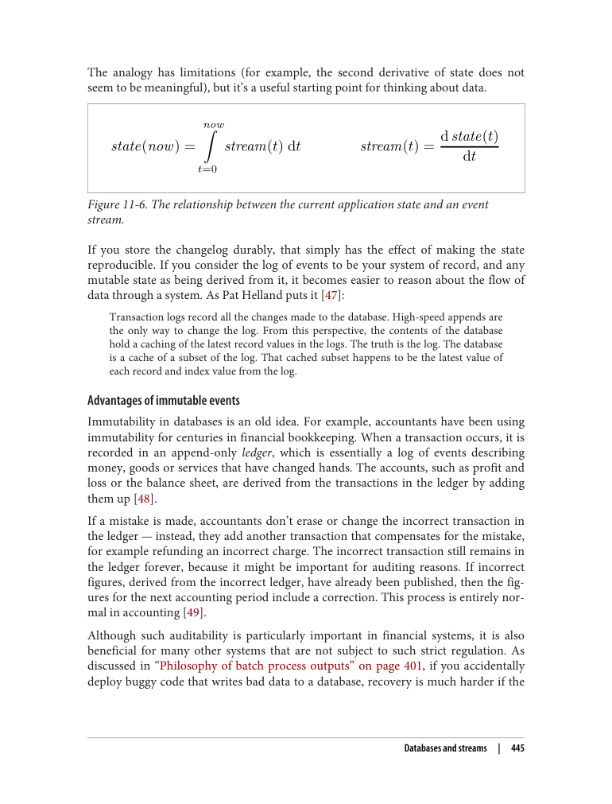

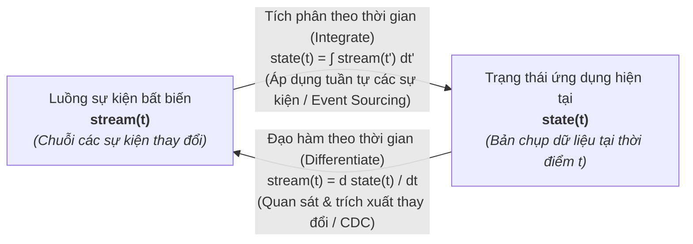

**Hình 11-6 – Mối quan hệ toán học giữa trạng thái ứng dụng hiện tại và một luồng sự kiện: tích phân luồng sự kiện theo thời gian tạo ra trạng thái, và đạo hàm trạng thái theo thời gian tạo ra luồng sự kiện (Figure 11-6. The relationship between the current application state and an event stream).**

Nếu bạn lưu trữ tệp nhật ký thay đổi (changelog) một cách bền vững trên đĩa, điều đó đơn giản sẽ mang lại hiệu quả là làm cho **trạng thái có thể tái tạo lại được** (**making the state reproducible**). Nếu bạn coi tệp nhật ký các sự kiện chính là **hệ thống ghi nhận gốc** (**system of record** / nguồn chân lý duy nhất) của mình, và coi bất kỳ trạng thái khả biến nào cũng chỉ là **dữ liệu dẫn xuất** (**derived data**) được sinh ra từ tệp nhật ký đó, thì việc suy luận về luồng chảy của dữ liệu xuyên suốt một hệ thống phức tạp sẽ trở nên rõ ràng và dễ dàng hơn rất nhiều. Đúng như chuyên gia hệ thống phân tán lỗi lạc **Pat Helland** đã đúc kết một cách xuất sắc trong bài báo kinh điển của ông [47]:

> *"Transaction logs record all the changes made to the database. High-speed appends are the only way to change the log. From this perspective, the contents of the database hold a caching of the latest record values in the logs. **The truth is the log. The database is a cache of a subset of the log.** That cached subset happens to be the latest value of each record and index value from the log."*
>
> *(Dịch nghĩa: "Các tệp nhật ký giao dịch ghi lại tất cả mọi thay đổi được thực hiện đối với cơ sở dữ liệu. Việc ghi nối tiếp tốc độ cao vào cuối tệp là cách duy nhất để làm thay đổi tệp nhật ký đó. Nhìn từ góc độ này, nội dung của cơ sở dữ liệu chẳng qua chỉ đang nắm giữ một bộ nhớ đệm (cache) lưu các giá trị bản ghi mới nhất có trong nhật ký. **Chân lý nằm ở tệp nhật ký. Cơ sở dữ liệu chỉ là một bộ nhớ đệm cho một tập con của tệp nhật ký mà thôi.** Tập con được lưu đệm đó tình cờ lại chính là giá trị mới nhất của mỗi bản ghi và giá trị chỉ mục tính từ tệp nhật ký.")*

---

#### Những ưu điểm của các sự kiện bất biến (Advantages of immutable events)

Tính bất biến (immutability) trong cơ sở dữ liệu thực chất là một ý tưởng đã có từ rất lâu đời. Ví dụ, các nhân viên kế toán đã sử dụng nguyên lý bất biến suốt hàng thế kỷ qua trong nghiệp vụ ghi sổ kế toán tài chính (financial bookkeeping). Khi một giao dịch thương mại diễn ra, nó được ghi nhận vào một **cuốn sổ cái chỉ ghi nối tiếp** (**append-only ledger**), thứ mà về bản chất chính là một tệp nhật ký các sự kiện mô tả tiền bạc, hàng hóa hoặc dịch vụ đã được chuyển giao đổi chủ. Các tài khoản tổng hợp, chẳng hạn như báo cáo lãi lỗ (profit and loss) hay bảng cân đối kế toán (balance sheet), đều được dẫn xuất (derived) ra từ các giao dịch trong sổ cái bằng cách cộng dồn chúng lại [48].

Nếu chẳng may có một sai sót được thực hiện (ví dụ kế toán nhập nhầm số tiền), các kế toán viên **không bao giờ dùng tẩy xóa hay sửa đè** lên giao dịch bị sai nằm trong cuốn sổ cái — thay vào đó, họ sẽ ghi nối tiếp thêm một **giao dịch bù trừ** (**compensating transaction**) mới vào sổ cái để sửa sai cho nhầm lẫn trước đó, chẳng hạn như thực hiện hoàn tiền (refunding) cho một khoản thu phí bị tính sai. Giao dịch bị sai ban đầu vẫn nằm nguyên trong sổ cái mãi mãi, bởi vì nó cực kỳ quan trọng cho các mục đích kiểm toán (auditing) và thanh tra sau này. Nếu những con số báo cáo bị sai (vốn được dẫn xuất từ cuốn sổ cái lúc chưa sửa) đã lỡ được công bố ra ngoài, thì các con số báo cáo của kỳ kế toán tiếp theo sẽ bao gồm một khoản điều chỉnh (correction). Quy trình này là điều hoàn toàn bình thường và bắt buộc trong ngành kế toán [49].

Mặc dù khả năng kiểm toán (auditability) chặt chẽ như vậy là đặc biệt sống còn trong các hệ thống tài chính ngân hàng, nhưng nó cũng mang lại lợi ích to lớn cho rất nhiều hệ thống phần mềm khác vốn không chịu sự quản lý pháp lý nghiêm ngặt đến thế. Như chúng ta đã thảo luận trong mục *"Philosophy of batch process outputs"* ở Chương 10 (trang 401), nếu bạn vô tình triển khai (deploy) một đoạn mã nguồn có lỗi (buggy code) làm ghi dữ liệu rác hoặc sai lệch vào một cơ sở dữ liệu truyền thống, việc khôi phục lại trạng thái đúng ban đầu sẽ vô cùng gian nan nếu đoạn mã đó được phép **ghi đè mang tính phá hủy** (**destructively overwrite**) lên dữ liệu cũ. Ngược lại, với một nhật ký chỉ ghi nối tiếp chứa các sự kiện bất biến, việc chẩn đoán xem chuyện gì đã thực sự xảy ra và phục hồi lại dữ liệu trở nên dễ dàng hơn gấp bội.

Các sự kiện bất biến cũng nắm bắt và lưu giữ được **nhiều thông tin có giá trị hơn rất nhiều so với việc chỉ lưu mỗi trạng thái hiện tại**. Ví dụ, trên một trang web thương mại điện tử, một khách hàng có thể thêm một món hàng vào giỏ hàng của họ rồi ít phút sau lại xóa nó đi khỏi giỏ hàng. Mặc dù xét dưới góc độ của bộ phận xử lý và giao đơn hàng (order fulfillment), sự kiện thứ hai đã triệt tiêu hoàn toàn sự kiện thứ nhất (giỏ hàng hiện tại không có món đó), nhưng xét dưới góc độ **phân tích dữ liệu kinh doanh (analytics)**, việc biết được rằng vị khách hàng đó đã từng cân nhắc mua một mặt hàng cụ thể nhưng rồi lại quyết định thôi không mua nữa là một mỏ vàng thông tin! Có lẽ họ sẽ chọn mua nó trong tương lai khi có khuyến mãi giảm giá, hoặc có lẽ họ đã tìm thấy một mặt hàng thay thế rẻ hơn. Thông tin hành vi quý giá này được lưu giữ nguyên vẹn trong một nhật ký sự kiện (event log), nhưng sẽ bị **mất sạch vĩnh viễn** trong một cơ sở dữ liệu chỉ lưu trạng thái hiện tại và thực hiện lệnh `DELETE` xóa thẳng các dòng dữ liệu khi món hàng bị bỏ khỏi giỏ [38].

---

#### Dẫn xuất nhiều góc nhìn khác nhau từ cùng một nhật ký sự kiện (Deriving several views from the same event log)

Hơn thế nữa, bằng cách tách biệt trạng thái khả biến (mutable state) ra khỏi tệp nhật ký sự kiện bất biến (immutable event log), bạn có thể **dẫn xuất ra nhiều cách biểu diễn hướng đọc (read-oriented representations) hoàn toàn khác nhau từ cùng một tệp nhật ký sự kiện duy nhất**. Điều này hoạt động giống hệt như việc có nhiều consumer độc lập cùng tiêu thụ chung một luồng dữ liệu (như trong **Hình 11-5**): ví dụ, hệ thống phân tích dữ liệu (analytics) có thể tiêu thụ trực tiếp từ nhật ký sự kiện, hệ thống kho bãi vận chuyển (fulfillment) tiêu thụ một góc nhìn khác, và giao diện giỏ hàng của khách lại đọc từ một góc nhìn khác nữa.

Việc có một bước chuyển đổi (translation step) tường minh từ một nhật ký sự kiện sang một cơ sở dữ liệu giúp cho việc **tiến hóa ứng dụng của bạn theo thời gian** (**evolve your application over time**) trở nên dễ dàng hơn rất nhiều: nếu bạn muốn giới thiệu một tính năng mới đòi hỏi phải trình bày khối dữ liệu hiện có của bạn theo một cấu trúc hoàn toàn mới, bạn chỉ cần sử dụng nhật ký sự kiện lịch sử để xây dựng một góc nhìn tối ưu hóa cho việc đọc (read-optimized view) riêng biệt dành cho tính năng mới đó, và cho nó chạy song song bên cạnh các hệ thống hiện có mà hoàn toàn không cần phải đụng chạm hay sửa đổi các hệ thống cũ. Việc vận hành hệ thống cũ và hệ thống mới chạy song song cạnh nhau (side-by-side) thường dễ dàng và an toàn hơn rất nhiều so với việc thực hiện một cuộc di trú lược đồ (schema migration) phức tạp trực tiếp trên một hệ thống đang chạy trực tuyến. Một khi hệ thống cũ không còn cần thiết nữa, bạn chỉ việc đơn giản tắt nó đi và thu hồi tài nguyên [43, 50].

Việc lưu trữ dữ liệu thông thường là khá đơn giản nếu bạn không phải bận tâm lo lắng về việc sau này nó sẽ được truy vấn và truy cập như thế nào; phần lớn những sự phức tạp đau đầu trong thiết kế lược đồ (schema design), đánh chỉ mục (indexing) và các bộ máy lưu trữ (storage engines) mà chúng ta đã học ở Chương 3 đều là hệ quả của việc cố gắng hỗ trợ những mẫu truy vấn và truy cập dữ liệu nhất định. Chính vì lý do này, bạn sẽ thu được một sự linh hoạt khổng lồ bằng cách **tách biệt hình thức mà dữ liệu được ghi vào khỏi hình thức mà dữ liệu được đọc ra**, và bằng cách cho phép tạo ra nhiều góc nhìn đọc (read views) khác nhau. Ý tưởng kiến trúc này đôi khi được biết đến với tên gọi **Phân tách trách nhiệm Lệnh và Truy vấn** (**Command Query Responsibility Segregation — CQRS**) [38, 51, 52].

Cách tiếp cận truyền thống đối với việc thiết kế cơ sở dữ liệu và lược đồ bảng vốn dựa trên một **ngộ nhận** (**fallacy**) rằng: *dữ liệu bắt buộc phải được ghi vào dưới cùng một định dạng như khi nó sẽ được truy vấn ra*. Những cuộc tranh luận bất tận về việc nên chuẩn hóa (normalization) hay phi chuẩn hóa (denormalization — xem lại mục *"Many-to-one and many-to-many relationships"* ở Chương 2, trang 31) sẽ trở nên phần lớn không còn quan trọng nữa nếu bạn có thể dịch chuyển dữ liệu tự động từ một nhật ký sự kiện được tối ưu hóa cho việc ghi (write-optimized event log) sang các trạng thái ứng dụng được tối ưu hóa cho việc đọc (read-optimized application state): khi đó, việc **phi chuẩn hóa dữ liệu tối đa trong các góc nhìn phục vụ đọc (read-optimized views)** là hoàn toàn hợp lý và được khuyến khích, bởi vì quy trình dịch chuyển luồng sự kiện đã cung cấp sẵn cho bạn một cơ chế tự động và tin cậy để luôn giữ cho các dữ liệu phi chuẩn hóa đó được cập nhật đồng bộ.

Trong mục *"Describing load"* ở Chương 1 (trang 9), chúng ta đã thảo luận về dòng thời gian trang chủ (**home timelines**) của Twitter — một bộ nhớ đệm lưu giữ các bài đăng (tweets) mới được viết gần đây bởi những người mà một người dùng cụ thể đang theo dõi (giống như một hộp thư đến — *mailbox*). Đây chính là một ví dụ kinh điển khác về **trạng thái được tối ưu hóa cho việc đọc (read-optimized state)**: các dòng thời gian trang chủ được phi chuẩn hóa ở mức độ cực cao, bởi vì mỗi bài tweet của bạn được nhân bản (duplicated) vào trong tất cả các hộp thư dòng thời gian của từng người đang theo dõi bạn. Tuy nhiên, dịch vụ khuếch tán (*fan-out service* — thực chất là một stream consumer đọc luồng sự kiện tweet mới) luôn giữ cho trạng thái được nhân bản trùng lặp này đồng bộ nhất quán với các bài tweet mới và các mối quan hệ theo dõi (follow/unfollow) mới, giúp cho việc quản lý sự trùng lặp dữ liệu khổng lồ này nằm trong tầm kiểm soát.

---

#### Kiểm soát tương tranh (Concurrency control)

Nhược điểm lớn nhất của *event sourcing* và *change data capture (CDC)* là các consumer tiêu thụ nhật ký sự kiện thông thường hoạt động theo kiểu **bất đồng bộ (asynchronous)**, vì vậy luôn tồn tại khả năng là một người dùng vừa thực hiện một thao tác ghi vào nhật ký sự kiện, ngay lập tức quay sang đọc từ một góc nhìn dẫn xuất từ nhật ký (log-derived read view), và phát hiện ra rằng thao tác ghi vừa rồi của chính họ vẫn chưa kịp được phản ánh vào góc nhìn đọc đó! Chúng ta đã thảo luận kỹ về vấn đề này cùng các giải pháp khả thi trước đây trong mục *"Reading your own writes"* ở Chương 5 (trang 156).

Một giải pháp là thực hiện việc cập nhật góc nhìn đọc (read view) một cách **đồng bộ (synchronously)** ngay cùng lúc với thao tác ghi nối tiếp sự kiện vào nhật ký. Điều này đòi hỏi phải có một giao dịch (transaction) để gom cả hai thao tác ghi thành một đơn vị nguyên tử (atomic unit), vì vậy bạn hoặc là phải lưu giữ cả nhật ký sự kiện lẫn góc nhìn đọc bên trong cùng một hệ thống lưu trữ duy nhất, hoặc là bạn phải sử dụng một giao dịch phân tán (distributed transaction) trải rộng trên các hệ thống khác nhau. Một phương án thay thế khác là bạn có thể sử dụng cách tiếp cận đã được thảo luận trong mục *"Implementing linearizable storage using total order broadcast"* ở Chương 9 (trang 340).

Mặt khác, việc dẫn xuất trạng thái hiện tại từ một nhật ký sự kiện lại giúp **đơn giản hóa một cách đáng kinh ngạc nhiều khía cạnh của việc kiểm soát tương tranh (concurrency control)**. Phần lớn nhu cầu phải sử dụng các giao dịch đa đối tượng phức tạp (multi-object transactions — xem lại mục *"Single-object and multi-object operations"* ở Chương 7, trang 219) đều bắt nguồn từ việc một hành động đơn lẻ của người dùng đòi hỏi dữ liệu phải được thay đổi ở nhiều nơi khác nhau cùng một lúc (ví dụ: đặt hàng vừa phải chèn bảng `orders`, vừa chèn bảng `order_items`, vừa trừ tồn kho ở bảng `inventory`, vừa cập nhật điểm thưởng ở bảng `users`). Với **event sourcing**, bạn có thể thiết kế một sự kiện sao cho bản thân nó là một bản mô tả tự chứa đầy đủ thông tin (self-contained description) về hành động đó của người dùng — nhờ vậy, hành động của người dùng **chỉ đòi hỏi duy nhất một thao tác ghi ở một nơi duy nhất**, cụ thể là ghi nối tiếp (append) một bản ghi sự kiện đó vào cuối tệp nhật ký, một thao tác cực kỳ dễ dàng để đảm bảo tính nguyên tử (atomic)!

Đặc biệt, nếu nhật ký sự kiện (event log) và trạng thái ứng dụng (application state) được **phân vùng theo cùng một cách** (for example, việc xử lý một sự kiện của một khách hàng nằm ở phân vùng 3 chỉ đòi hỏi việc cập nhật trạng thái ứng dụng nằm ở phân vùng 3), thì một consumer đọc nhật ký theo kiểu **đơn luồng (single-threaded)** đơn giản sẽ **không cần đến bất kỳ cơ chế khóa hay kiểm soát tương tranh nào cho các thao tác ghi** — bởi vì ngay từ trong cấu trúc thiết kế (by construction), nó chỉ xử lý duy nhất một sự kiện tại một thời điểm (xem lại mục *"Actual serial execution"* ở Chương 7, trang 243). Tệp nhật ký phân vùng đã loại bỏ hoàn toàn tính bất định (non-determinism) của tương tranh bằng cách xác lập một **thứ tự tuần tự tuyệt đối (serial order)** cho tất cả các sự kiện nằm trong cùng một phân vùng [22]. Tất nhiên, nếu một sự kiện đơn lẻ cần phải chạm tới nhiều phân vùng trạng thái khác nhau (cross-partition), chúng ta sẽ cần thêm một chút công sức phối hợp, điều mà chúng ta sẽ thảo luận ở phần sau của chương này.

---

#### Tính bất biến và việc xóa dữ liệu (Immutability and deletion)

Nhiều hệ thống dù không sử dụng mô hình *event sourcing* nhưng vẫn dựa vào nguyên lý bất biến (immutability) làm nền tảng cốt lõi: ví dụ, cơ sở dữ liệu **Datomic** sử dụng các cấu trúc dữ liệu bất biến bền vững (persistent immutable data structures) để truy vấn các bản chụp nhanh (snapshots) của cơ sở dữ liệu, bao gồm cả các bản chụp nhanh lịch sử tại bất kỳ thời điểm nào trong quá khứ (xem lại mục *"Indexes and snapshot isolation"* ở Chương 7, trang 232). Các hệ thống quản lý phiên bản mã nguồn (version control systems) như **Git**, **Mercurial** và **Fossil** cũng dựa hoàn toàn vào dữ liệu bất biến để bảo toàn lịch sử phiên bản của các tệp tin.

Chi phí phần cứng lưu trữ ngày nay đã trở nên rẻ đến mức việc giữ lại tất cả các sự kiện mãi mãi là một lựa chọn hoàn toàn khả thi cho hầu hết mọi hệ thống, ngoại trừ những hệ thống khổng lồ nhất. Tuy nhiên, trong thực tế vẫn có những hoàn cảnh bắt buộc bạn phải **thực sự xóa bỏ dữ liệu vĩnh viễn** (**really be deleted**), bất chấp mọi triết lý về tính bất biến:
* Ví dụ, các quy định pháp luật về quyền riêng tư dữ liệu (như đạo luật **GDPR** ở châu Âu với *"Quyền được lãng quên" — Right to be forgotten*) có thể yêu cầu phải xóa sạch mọi thông tin cá nhân (PII) của một người dùng sau khi họ đóng tài khoản;
* Hoặc một sự cố rò rỉ thông tin nhạy cảm ngoài ý muốn (ví dụ: lập trình viên lỡ tay ghi mật khẩu dạng rõ hoặc số thẻ tín dụng vào payload sự kiện) cần phải được ngăn chặn và dọn sạch ngay lập tức.

Trong những hoàn cảnh nghiêm ngặt này, việc chỉ ghi nối tiếp thêm một sự kiện mới vào cuối nhật ký để đánh dấu rằng dữ liệu trước đó nên được coi là đã xóa (như viết một bản ghi *tombstone*) là **không đủ** — bạn thực sự muốn **viết lại lịch sử** (**rewrite history**) và làm như thể mảnh dữ liệu nhạy cảm đó chưa bao giờ từng được ghi vào hệ thống ngay từ đầu! Ví dụ, cơ sở dữ liệu **Datomic** gọi tính năng cắt bỏ lịch sử này là **excision** (phẫu thuật cắt bỏ) [53], và hệ thống quản lý phiên bản **Fossil** có một khái niệm tương tự được gọi là **shunning** (tẩy chay / trục xuất) [54] (tương tự như việc dùng `git filter-repo` hay `git filter-branch` trong Git để xóa một file nhạy cảm khỏi toàn bộ lịch sử commit).

Cần phải nhìn nhận thẳng thắn rằng việc **xóa thực sự và triệt để dữ liệu** (**truly deleting data**) là một bài toán khó đến mức đáng kinh ngạc [55], bởi vì các bản sao của dữ liệu có thể đang tồn tại ở rất nhiều tầng khác nhau trong hệ thống:
* Ví dụ, các bộ máy lưu trữ (storage engines như LSM-tree/B-tree có copy-on-write), các hệ thống tệp (filesystems) và bản thân bộ điều khiển phần cứng của ổ cứng **SSD** (do cơ chế *wear leveling* trong Flash Translation Layer — xem Chương 3) thường xuyên ghi dữ liệu sang một vị trí vật lý mới thay vì ghi đè tại chỗ (overwriting in-place) lên ô nhớ cũ [47];
* Và các bản sao lưu dự phòng (**backups**) thường được thiết kế cố ý là bất biến (immutable) để ngăn chặn việc vô tình xóa nhầm hoặc bị mã độc tống tiền (ransomware) phá hủy dữ liệu.

Do đó, trong kỹ thuật hệ thống thực tế, việc xóa dữ liệu thường mang ý nghĩa là *"làm cho việc khôi phục lại dữ liệu đó trở nên khó khăn hơn rất nhiều"* (ví dụ: thông qua kỹ thuật **Crypto-shredding** — mã hóa dữ liệu cá nhân của mỗi user bằng một khóa mã hóa riêng biệt lưu ở KMS, và khi user yêu cầu xóa dữ liệu theo GDPR thì chỉ cần hủy khóa mã hóa đó đi để các bản ghi sự kiện cũ trong log trở thành chuỗi byte vô nghĩa không thể giải mã được) hơn là *"làm cho việc lấy lại các bit vật lý của dữ liệu trở nên bất khả thi tuyệt đối"*. Tuy vậy, dù khó khăn đến đâu, đó vẫn là một yêu cầu bắt buộc phải giải quyết trong nhiều bài toán thực tế.

> 📝 **Giải thích thêm (không có trong sách): Tổng hợp so sánh Change Data Capture (CDC) và Event Sourcing + CQRS**
>
> Để nắm vững toàn bộ bức tranh của mục **"Databases and streams"**, bảng dưới đây tóm tắt sự khác biệt cốt lõi về mặt kiến trúc giữa hai trường phái tích hợp cơ sở dữ liệu và luồng sự kiện:
>
> | Tiêu chí | Change Data Capture (CDC - ví dụ: Debezium) | Event Sourcing + CQRS (ví dụ: EventStoreDB / Kafka + Read DB) |
> | :--- | :--- | :--- |
> | **Nguồn chân lý (System of Record)** | Cơ sở dữ liệu OLTP khả biến truyền thống (PostgreSQL, MySQL, MongoDB). | Nhật ký sự kiện chỉ ghi nối tiếp (**Immutable Append-only Event Log**). |
> | **Cách ứng dụng ghi dữ liệu** | Dùng câu lệnh `INSERT`, `UPDATE`, `DELETE` cập nhật trực tiếp trạng thái hiện tại. | Kiểm tra tính hợp lệ của **Command**, sau đó chỉ `APPEND` sự kiện bất biến (**Event**) ở thì quá khứ vào Event Store. |
> | **Mức độ trừu tượng của Sự kiện** | **Cấp thấp (Low-level data mutation):** Mô tả dòng nào, cột nào trong bảng vừa bị đổi từ giá trị `before` sang `after`. | **Cấp cao (High-level domain event):** Mô tả ý định và sự kiện nghiệp vụ đã xảy ra (ví dụ: `SeatReserved`, `ItemAddedToCart`). |
> | **Khả năng áp dụng Log Compaction** | **Rất tốt:** Mỗi sự kiện mang toàn bộ trạng thái mới của khóa chính (`PK`), nên chỉ cần giữ lại bản ghi mới nhất cho mỗi `PK`. | **Không thể dùng Compaction đơn giản:** Các sự kiện sau biểu diễn sự thay đổi tăng thêm (delta/intent) chứ không thay thế sự kiện trước; phải dùng **Snapshots** định kỳ. |
> | **Chi phí áp dụng vào hệ thống cũ (Legacy)** | **Rất thấp (Non-invasive):** Ứng dụng cũ không cần sửa code; chỉ cần cắm Debezium đọc WAL/binlog của DB. | **Rất cao:** Đòi hỏi thiết kế lại toàn bộ mô hình miền (DDD), tách biệt Command Handler, Event Store và các bộ chiếu (Projectors) tạo Read Views. |
> | **Giải pháp cho GDPR / Xóa dữ liệu cá nhân** | Xóa trực tiếp trong DB gốc $\rightarrow$ CDC phát sự kiện `DELETE` + Tombstone $\rightarrow$ Log Compaction xóa sạch bản ghi cũ trên Kafka. | Dùng kỹ thuật **Excision/Shunning** (viết lại log segment) hoặc **Crypto-shredding** (mã hóa thông tin PII trong event bằng khóa riêng theo `user_id` rồi xóa khóa đó khi user yêu cầu xóa tài khoản). |

## Xử lý luồng dữ liệu (Processing Streams)

Cho đến thời điểm này trong chương, chúng ta đã thảo luận về việc các luồng dữ liệu đến từ đâu (các sự kiện hoạt động của người dùng, các cảm biến và các thao tác ghi vào cơ sở dữ liệu), cũng như cách các luồng dữ liệu được vận chuyển (thông qua truyền thông điệp trực tiếp, qua các trình môi giới thông điệp — message brokers, và nhật ký sự kiện — event logs).

Điều còn lại cần bàn luận là bạn có thể làm gì với luồng dữ liệu một khi đã có nó trong tay — cụ thể là bạn có thể *xử lý* (process) nó. Nhìn chung, có ba lựa chọn chính:

1. Bạn có thể lấy dữ liệu trong các sự kiện và ghi nó vào một cơ sở dữ liệu, bộ nhớ đệm (cache), chỉ mục tìm kiếm (search index), hoặc hệ thống lưu trữ tương tự, để từ đó các máy khách (client) khác có thể truy vấn. Như đã minh họa trong **Hình 11-5** (`Figure 11-5`), đây là một cách tốt để giữ cho một cơ sở dữ liệu luôn đồng bộ với những thay đổi đang diễn ra ở các phần khác của hệ thống — đặc biệt nếu trình tiêu thụ luồng (stream consumer) là máy khách duy nhất thực hiện ghi vào cơ sở dữ liệu đó. Việc ghi vào một hệ thống lưu trữ chính là phiên bản tương đương trong xử lý luồng của những gì chúng ta đã thảo luận trong phần “Đầu ra của các luồng công việc xử lý theo lô” (“The output of batch workflows”) ở Chương 10 (trang 398 bản gốc).
2. Bạn đẩy (push) các sự kiện trực tiếp tới người dùng theo một cách nào đó, chẳng hạn như gửi cảnh báo qua email hoặc thông báo đẩy (push notifications) lên điện thoại, hoặc phát luồng sự kiện tới một bảng điều khiển thời gian thực (realtime dashboard) nơi chúng được trực quan hóa. Trong trường hợp này, một con người chính là đối tượng tiêu thụ cuối cùng (ultimate consumer) của luồng dữ liệu.
3. Bạn có thể xử lý một hoặc nhiều luồng đầu vào (input streams) để tạo ra một hoặc nhiều luồng đầu ra (output streams). Các luồng dữ liệu có thể đi qua một đường ống (pipeline) bao gồm nhiều tầng xử lý như vậy nối tiếp nhau, trước khi cuối cùng đi tới một đích đầu ra (theo lựa chọn 1 hoặc 2).

Trong phần còn lại của chương này, chúng ta sẽ đi sâu thảo luận về lựa chọn 3: xử lý các luồng dữ liệu để tạo ra các luồng dẫn xuất (derived streams) khác. Một đoạn mã thực hiện việc xử lý luồng như thế này được gọi là một *toán tử* (*operator*) hoặc một *tác vụ* (*job*). Nó có mối liên hệ mật thiết với các tiến trình Unix (Unix processes) và các tác vụ MapReduce mà chúng ta đã thảo luận ở Chương 10, và mô hình luồng dữ liệu (dataflow pattern) cũng rất tương đồng: một bộ xử lý luồng (stream processor) tiêu thụ các luồng đầu vào theo kiểu chỉ đọc (read-only), và ghi đầu ra của nó sang một vị trí khác theo kiểu chỉ nối thêm (append-only).

Các mẫu thiết kế cho việc phân vùng (partitioning) và song song hóa (parallelization) trong các bộ xử lý luồng cũng rất giống với MapReduce và các động cơ luồng dữ liệu (dataflow engines) mà chúng ta đã thấy trong Chương 10, vì vậy chúng ta sẽ không lặp lại chủ đề đó tại đây. Các phép toán ánh xạ cơ bản (basic mapping operations) như biến đổi định dạng (transforming) và lọc (filtering) các bản ghi cũng hoạt động y hệt như vậy.

Điểm khác biệt cốt lõi duy nhất so với các tác vụ xử lý theo lô (batch jobs) là **một luồng dữ liệu không bao giờ kết thúc** (a stream never ends). Sự khác biệt tưởng chừng đơn giản này lại kéo theo rất nhiều hệ quả sâu sắc: như đã thảo luận ở đầu chương này, thao tác sắp xếp (sorting) không có ý nghĩa đối với một tập dữ liệu không giới hạn (unbounded dataset), và do đó các phép nối sắp xếp - trộn (sort-merge joins — xem phần “Phép nối phía Reduce và gom nhóm” / “Reduce-side joins and grouping” ở trang 391 bản gốc) hoàn toàn không thể áp dụng được. Các cơ chế chịu lỗi (fault-tolerance mechanisms) cũng buộc phải thay đổi: với một tác vụ lô mới chỉ chạy được vài phút, một tác vụ con bị lỗi có thể đơn giản được khởi động lại từ đầu — nhưng với một tác vụ xử lý luồng đã chạy liên tục suốt nhiều năm trời, việc khởi động lại và xử lý lại từ điểm bắt đầu từ vài năm trước rõ ràng không phải là một phương án khả thi.

> 📝 **Giải thích thêm (không có trong sách):**
> Trong kiến trúc dữ liệu hiện đại, sự tương đồng giữa xử lý theo lô (batch processing) và xử lý luồng (stream processing) đã dẫn đến sự ra đời của các engine hợp nhất (unified batch and stream engines) như **Apache Flink** và **Apache Beam / Google Cloud Dataflow**. Trong triết lý của các hệ thống này, xử lý theo lô thực chất chỉ là một trường hợp đặc biệt của xử lý luồng — đó là khi luồng dữ liệu có điểm kết thúc xác định (bounded stream). Tuy nhiên, ở tầng thực thi vật lý (runtime), việc dữ liệu không có điểm dừng buộc bộ xử lý luồng không thể dùng các cấu trúc dữ liệu đòi hỏi phải đọc hết toàn bộ đầu vào (blocking operators như `Sort` toàn cục), mà phải duy trì trạng thái tăng dần (incremental state) trong bộ nhớ hoặc trên ổ đĩa cục bộ (như RocksDB trong Flink/Kafka Streams), kết hợp với cơ chế giải phóng trạng thái cũ (state TTL / watermark eviction) để tránh tràn bộ nhớ.

---

### Các ứng dụng của xử lý luồng (Uses of stream processing)

Xử lý luồng từ lâu đã được sử dụng cho các mục đích giám sát (monitoring), nơi một tổ chức muốn nhận được cảnh báo ngay lập tức nếu có những điều bất thường nhất định xảy ra. Ví dụ:

* **Các hệ thống phát hiện gian lận (Fraud detection systems):** cần xác định xem liệu các mẫu hành vi sử dụng của một thẻ tín dụng có thay đổi một cách bất ngờ hay không, và khóa thẻ ngay lập tức nếu có khả năng cao là thẻ đã bị đánh cắp;
* **Các hệ thống giao dịch tài chính (Trading systems):** cần kiểm tra các biến động giá cả trên thị trường tài chính theo từng mili-giây và thực hiện các lệnh mua/bán tự động theo các quy tắc đã được chỉ định;
* **Các hệ thống sản xuất công nghiệp (Manufacturing systems):** cần giám sát trạng thái hoạt động của các máy móc trong nhà máy, và nhanh chóng xác định vấn đề nếu có sự cố hỏng hóc xảy ra;
* **Các hệ thống quân sự và tình báo (Military and intelligence systems):** cần theo dõi các hoạt động của một kẻ tấn công tiềm tàng, và phát tín hiệu báo động nếu xuất hiện các dấu hiệu của một cuộc tấn công.

Những loại ứng dụng này đòi hỏi khả năng đối sánh mẫu (pattern-matching) và tìm kiếm tương quan (correlations) khá tinh vi và phức tạp. Tuy nhiên, nhiều ứng dụng khác của xử lý luồng cũng đã dần xuất hiện và phát triển theo thời gian. Trong phần này, chúng ta sẽ so sánh và đối chiếu ngắn gọn một số ứng dụng tiêu biểu đó.

#### Xử lý sự kiện phức hợp (Complex event processing)

*Xử lý sự kiện phức hợp* (*Complex event processing* — viết tắt là *CEP*) là một hướng tiếp cận được phát triển vào những năm 1990 để phân tích các luồng sự kiện, đặc biệt hướng tới loại ứng dụng đòi hỏi việc tìm kiếm các mẫu sự kiện (event patterns) nhất định [56, 57]. Tương tự như cách một biểu thức chính quy (regular expression — regex) cho phép bạn tìm kiếm các mẫu ký tự nhất định trong một chuỗi văn bản, CEP cho phép bạn chỉ định các quy tắc để tìm kiếm các mẫu sự kiện nhất định diễn ra theo trình tự hoặc điều kiện thời gian trong một luồng dữ liệu.

Các hệ thống CEP thường sử dụng một ngôn ngữ truy vấn khai báo bậc cao (high-level declarative query language) giống như SQL, hoặc một giao diện người dùng đồ họa (GUI), để mô tả mẫu sự kiện cần được phát hiện. Các truy vấn này được gửi tới một động cơ xử lý (processing engine) — nơi tiêu thụ các luồng đầu vào và duy trì bên trong nó một máy trạng thái (state machine) thực hiện việc đối sánh cần thiết. Khi tìm thấy một tổ hợp sự kiện khớp với quy tắc (match), động cơ sẽ phát ra một *sự kiện phức hợp* (*complex event* — chính là nguồn gốc tên gọi của kỹ thuật này) chứa thông tin chi tiết về mẫu sự kiện vừa được phát hiện.

Trong các hệ thống này, mối quan hệ giữa các truy vấn (queries) và dữ liệu (data) bị đảo ngược hoàn toàn so với các cơ sở dữ liệu thông thường:
* Thông thường, một cơ sở dữ liệu lưu trữ dữ liệu một cách bền vững lâu dài (persistently), và coi các truy vấn là tạm thời (transient): khi một truy vấn đi vào, cơ sở dữ liệu tìm kiếm dữ liệu khớp với truy vấn đó, trả về kết quả rồi quên truy vấn đó đi.
* Các động cơ CEP thì hoạt động theo chiều ngược lại: các truy vấn được lưu trữ dài hạn (long-term), còn các sự kiện từ các luồng đầu vào liên tục chảy lướt qua các truy vấn đó để tìm kiếm xem có truy vấn nào khớp với tổ hợp sự kiện hay không.

Các hệ thống hiện thực hóa CEP bao gồm Esper [58], IBM InfoSphere Streams [59], Apama, TIBCO StreamBase, và SQLstream.

> 💡 **Ví dụ bổ sung (không có trong sách):**
> Hãy hình dung một quy tắc CEP chống gian lận ngân hàng hoặc bảo mật tài khoản. Trong SQL chuẩn với phần mở rộng `MATCH_RECOGNIZE` (hoặc thư viện `FlinkCEP` trong Apache Flink), bạn có thể khai báo một mẫu sự kiện như sau:
> *"Tìm chuỗi sự kiện của cùng một `user_id` trong vòng 10 phút bao gồm: ít nhất 3 sự kiện `LOGIN_FAILED` liên tiếp, theo sau là 1 sự kiện `LOGIN_SUCCESS` từ một địa chỉ IP ở quốc gia khác, rồi ngay sau đó là 1 sự kiện `WIRE_TRANSFER` với số tiền > 5.000 USD."*
> Khi các sự kiện đơn lẻ (`LOGIN_FAILED`, `LOGIN_SUCCESS`, `WIRE_TRANSFER`) lần lượt chảy vào, FlinkCEP dùng một máy trạng thái hữu hạn không đơn định (NFA — Nondeterministic Finite Automaton) để ghi nhớ tiến trình khớp mẫu của từng `user_id`. Ngay khi sự kiện `WIRE_TRANSFER` thỏa mãn điều kiện cuối cùng xuất hiện, hệ thống lập tức phát ra một sự kiện phức hợp `HIGH_RISK_ACCOUNT_TAKEOVER_ALERT` để phong tỏa giao dịch.

#### Phân tích luồng dữ liệu (Stream analytics)

Một lĩnh vực lớn khác mà xử lý luồng được sử dụng rộng rãi là *phân tích dữ liệu trên luồng* (*stream analytics*). Ranh giới giữa CEP và phân tích luồng khá mờ nhạt, nhưng theo quy tắc chung, phân tích luồng thường ít quan tâm đến việc tìm kiếm các chuỗi sự kiện cụ thể nối tiếp nhau, mà định hướng nhiều hơn vào các phép tổng hợp (aggregations) và các chỉ số thống kê (statistical metrics) trên một số lượng lớn các sự kiện, ví dụ như:

* Đo lường tốc độ (rate) xuất hiện của một loại sự kiện nào đó (tần suất nó xảy ra trên mỗi khoảng thời gian),
* Tính toán trung bình trượt (rolling average) của một giá trị trong một khoảng thời gian nào đó, hoặc
* So sánh các số liệu thống kê hiện tại với các khoảng thời gian trước đó (ví dụ: để phát hiện các xu hướng — trends, hoặc để cảnh báo về các chỉ số đang cao bất thường hoặc thấp bất thường so với cùng thời điểm tuần trước).

Các số liệu thống kê như vậy thường được tính toán trên các khoảng thời gian cố định — ví dụ: bạn có thể muốn biết số lượng truy vấn trung bình mỗi giây (QPS) gửi tới một dịch vụ trong vòng 5 phút qua, cũng như thời gian phản hồi ở phân vị thứ 99 (99th percentile response time — p99) trong khoảng thời gian đó. Việc lấy trung bình trong vài phút giúp làm mượt (smooth out) những biến động nhiễu loạn không liên quan từ giây này sang giây khác, trong khi vẫn mang lại cho bạn một bức tranh kịp thời về bất kỳ thay đổi nào trong xu hướng lưu lượng truy cập. Khoảng thời gian mà trên đó bạn thực hiện phép tổng hợp được gọi là một *cửa sổ* (*window*), và chúng ta sẽ đi sâu tìm hiểu chi tiết hơn về kỹ thuật chia cửa sổ (windowing) trong phần “Lập luận về thời gian” (“Reasoning about time”) ở trang 452 bản gốc (ngay mục tiếp theo).

Các hệ thống phân tích luồng đôi khi sử dụng các thuật toán xác suất (probabilistic algorithms), chẳng hạn như bộ lọc Bloom (Bloom filters — mà chúng ta đã gặp trong phần “SSTables và LSM-trees” ở Chương 3, trang 74 bản gốc) để kiểm tra tư cách thành viên tập hợp (set membership), thuật toán HyperLogLog [60] để ước lượng lực lượng tập hợp (cardinality estimation — đếm số phần tử phân biệt / unique count), và nhiều thuật toán ước lượng phân vị khác nhau (xem phần “Các phân vị trong thực tế” / “Percentiles in Practice” ở Chương 1, trang 14 bản gốc, như t-digest hoặc HDR Histogram). Các thuật toán xác suất tạo ra kết quả xấp xỉ (approximate results), nhưng có ưu điểm vượt trội là đòi hỏi ít bộ nhớ hơn đáng kể trong bộ xử lý luồng so với các thuật toán chính xác tuyệt đối. Việc sử dụng các thuật toán xấp xỉ này đôi khi khiến một số người lầm tưởng rằng các hệ thống xử lý luồng luôn luôn bị mất mát dữ liệu (lossy) và thiếu chính xác (inexact), nhưng quan niệm đó hoàn toàn sai lầm: **bản chất của xử lý luồng không hề mang tính xấp xỉ** (there is nothing inherently approximate about stream processing) [61]. Việc dùng thuật toán xấp xỉ chỉ là một lựa chọn tối ưu hóa tài nguyên khi cần thiết, còn nếu đủ bộ nhớ và cấu hình đúng, xử lý luồng hoàn toàn cho ra kết quả chính xác 100%.

Nhiều framework xử lý luồng phân tán mã nguồn mở được thiết kế với mục tiêu trọng tâm là phục vụ phân tích luồng: ví dụ như Apache Storm, Spark Streaming, Apache Flink, Concord, Apache Samza, và Kafka Streams [62]. Các dịch vụ đám mây được quản lý (hosted services) bao gồm Google Cloud Dataflow và Azure Stream Analytics.

#### Duy trì khung nhìn vật lý hóa (Maintaining materialized views)

Chúng ta đã thấy trong phần “Cơ sở dữ liệu và luồng” (“Databases and streams” ở trang 436 bản gốc) rằng một luồng các thay đổi (changelog stream) đối với một cơ sở dữ liệu có thể được sử dụng để giữ cho các hệ thống dữ liệu dẫn xuất (derived data systems) — chẳng hạn như bộ nhớ đệm (caches), chỉ mục tìm kiếm (search indexes), và kho dữ liệu (data warehouses) — luôn được cập nhật đồng bộ với cơ sở dữ liệu nguồn. Chúng ta có thể coi những ví dụ này là các trường hợp cụ thể của việc *duy trì các khung nhìn vật lý hóa* (*maintaining materialized views* — xem phần “Tổng hợp dữ liệu: Khối dữ liệu và khung nhìn vật lý hóa” / “Aggregation: Data cubes and materialized views” ở Chương 3, trang 98 bản gốc): tạo ra một góc nhìn thay thế (alternative view) trên một tập dữ liệu nào đó để bạn có thể truy vấn nó một cách hiệu quả, và cập nhật khung nhìn đó một cách tăng dần mỗi khi dữ liệu nền bên dưới thay đổi [46].

Tương tự như vậy, trong kỹ thuật lưu trữ nguồn sự kiện (event sourcing), trạng thái của ứng dụng được duy trì bằng cách áp dụng một nhật ký các sự kiện; ở đây trạng thái ứng dụng cũng là một dạng khung nhìn vật lý hóa. Không giống như các kịch bản phân tích luồng (vốn chỉ quan tâm đến các cửa sổ 5 phút hay 1 giờ gần nhất), việc chỉ xem xét các sự kiện bên trong một cửa sổ thời gian giới hạn nào đó thường là không đủ: để xây dựng khung nhìn vật lý hóa, bạn cần *tất cả* các sự kiện đã từng xảy ra từ trước đến nay — có chăng là sau khi cơ chế nén nhật ký (log compaction) đã loại bỏ các sự kiện lỗi thời bị ghi đè (xem phần “Nén nhật ký” / “Log compaction” ở trang 441 bản gốc). Về bản chất, bạn cần một cửa sổ thời gian kéo dài ngược về tận thời điểm khởi đầu của hệ thống (beginning of time).

Về nguyên tắc, bất kỳ bộ xử lý luồng nào cũng có thể được sử dụng để duy trì khung nhìn vật lý hóa, mặc dù nhu cầu phải lưu giữ các sự kiện và trạng thái vĩnh viễn đi ngược lại với các giả định thiết kế của một số framework thuần túy định hướng phân tích theo cửa sổ ngắn hạn. Apache Samza và Kafka Streams hỗ trợ rất tốt kiểu sử dụng này, được xây dựng dựa trên sự hỗ trợ của Kafka đối với tính năng nén nhật ký (log compaction) [63].

> 📝 **Giải thích thêm (không có trong sách):**
> Ngày nay, khái niệm dùng bộ xử lý luồng để duy trì khung nhìn vật lý hóa trực tiếp bằng SQL đã phát triển thành một phân khúc cơ sở dữ liệu mới gọi là **Streaming Databases** (Cơ sở dữ liệu luồng), tiêu biểu như **Materialize**, **RisingWave**, **ksqlDB**, và **Apache Flink SQL**. Ví dụ trong Materialize (được xây dựng dựa trên mô hình *Differential Dataflow* của Frank McSherry), bạn chỉ cần viết câu lệnh `CREATE MATERIALIZED VIEW mv_user_orders AS SELECT user_id, count(*), sum(amount) FROM orders GROUP BY user_id;` trên luồng dữ liệu CDC từ PostgreSQL/Kafka. Khi có bất kỳ dòng `INSERT`, `UPDATE`, hay `DELETE` nào chảy qua luồng, engine sẽ tự động tính toán phần chênh lệch (delta) và cập nhật kết quả của view chỉ trong vài mili-giây mà không bao giờ phải quét lại toàn bộ bảng.

#### Tìm kiếm trên luồng dữ liệu (Search on streams)

Bên cạnh CEP — vốn cho phép tìm kiếm các mẫu bao gồm nhiều sự kiện có liên quan với nhau, đôi khi chúng ta cũng có nhu cầu tìm kiếm từng sự kiện riêng lẻ dựa trên các tiêu chí phức tạp, chẳng hạn như các truy vấn tìm kiếm toàn văn (full-text search queries).

Ví dụ: các dịch vụ giám sát truyền thông (media monitoring services) đăng ký nhận (subscribe) các nguồn cấp dữ liệu (feeds) gồm các bài báo và chương trình phát sóng từ các cơ quan truyền thông, đồng thời tìm kiếm bất kỳ tin tức nào có nhắc đến các công ty, sản phẩm hoặc chủ đề đang được quan tâm. Việc này được thực hiện bằng cách thiết lập sẵn một câu truy vấn tìm kiếm từ trước, và sau đó liên tục đối sánh luồng các bản tin mới xuất hiện với câu truy vấn này. Các tính năng tương tự cũng tồn tại trên một số trang web: ví dụ, người dùng của các trang web bất động sản có thể yêu cầu được thông báo ngay khi có một bất động sản mới xuất hiện trên thị trường khớp với các tiêu chí tìm kiếm của họ (khu vực, mức giá, số phòng ngủ).

Các công cụ tìm kiếm truyền thống (conventional search engines) trước tiên sẽ đánh chỉ mục các tài liệu (index the documents) và sau đó mới chạy các truy vấn trên chỉ mục đó. Ngược lại, việc tìm kiếm trên một luồng dữ liệu lại đảo ngược hoàn toàn quy trình xử lý: **các câu truy vấn được lưu trữ lại, còn các tài liệu thì chạy lướt qua các truy vấn đó**. Trong trường hợp đơn giản nhất, bạn có thể kiểm tra từng tài liệu mới đến với mọi câu truy vấn đang lưu, mặc dù cách này sẽ trở nên rất chậm nếu bạn có một số lượng lớn các câu truy vấn (hàng triệu người dùng đăng ký nhận thông báo). Để tối ưu hóa quá trình này, người ta có thể *đánh chỉ mục cho chính các câu truy vấn* cũng như các tài liệu, và nhờ đó thu hẹp nhanh chóng tập hợp các câu truy vấn có khả năng khớp với tài liệu vừa đến [64].

> 💡 **Ví dụ bổ sung (không có trong sách):**
> Trong thực tế, **Elasticsearch** (và thư viện tìm kiếm dựa trên Lucene là **Luwak**, nay đã được tích hợp thành mô-đun `monitor` của Apache Lucene) cung cấp tính năng này dưới tên gọi **Percolator query**.
> Thay vì lưu các bài báo vào index rồi chạy câu truy vấn tìm kiếm từ khóa `"Apple" AND ("cổ phiếu" OR "iPhone")`, bạn lưu chính các câu truy vấn đó vào một trường đặc biệt kiểu `percolator` trong Elasticsearch. Khi một bài báo mới xuất hiện trên luồng Kafka, bạn gửi tài liệu tạm thời đó vào truy vấn `percolate`. Elasticsearch sẽ trích xuất các từ khóa từ bài báo, tra cứu ngược vào chỉ mục các câu truy vấn để loại bỏ ngay 99,9% các câu truy vấn không chứa các từ khóa đó, và chỉ chạy đối sánh toàn văn trên một số ít câu truy vấn ứng viên còn lại.

#### Truyền thông điệp và RPC (Message passing and RPC)

Trong phần “Luồng dữ liệu truyền thông điệp” (“Message passing data flow” ở Chương 4, trang 132 bản gốc), chúng ta đã thảo luận về các hệ thống truyền thông điệp như một giải pháp thay thế cho RPC, tức là như một cơ chế để các dịch vụ giao tiếp với nhau, chẳng hạn như được sử dụng trong mô hình tác nhân (actor model — như Akka hay Erlang). Mặc dù các hệ thống này cũng dựa trên việc truyền các thông điệp và sự kiện, chúng ta thường không coi chúng là các bộ xử lý luồng (stream processors) vì những lý do sau:

* Các framework Actor chủ yếu là một cơ chế để quản lý tính đồng thời (concurrency) và thực thi phân tán của các mô-đun giao tiếp với nhau, trong khi xử lý luồng chủ yếu là một cơ chế quản lý dữ liệu (data management mechanism).
* Giao tiếp giữa các actor thường mang tính phù du (ephemeral — không lưu trữ lâu dài) và một-đối-một (one-to-one), trong khi các nhật ký sự kiện (event logs) lại bền vững (durable) và hỗ trợ nhiều bên đăng ký tiêu thụ cùng lúc (multi-subscriber).
* Các actor có thể giao tiếp với nhau theo những cách tùy ý (bao gồm cả các mẫu yêu cầu - phản hồi có chu trình — cyclic request-response patterns), nhưng các bộ xử lý luồng thường được thiết lập trong các đường ống phi chu trình (acyclic pipelines — DAG), nơi mỗi luồng dữ liệu là đầu ra của một tác vụ cụ thể và được dẫn xuất từ một tập hợp các luồng đầu vào đã được xác định rõ ràng.

Tuy nói vậy, vẫn có một vùng giao thoa nhất định giữa các hệ thống kiểu RPC và xử lý luồng. Ví dụ, Apache Storm có một tính năng gọi là *RPC phân tán* (*distributed RPC* — DRPC), cho phép các truy vấn của người dùng được phân bổ tới một tập hợp các nút (nodes) vốn cũng đang xử lý các luồng sự kiện; các truy vấn này sau đó được đan xen (interleaved) với các sự kiện từ các luồng đầu vào, và kết quả có thể được tổng hợp lại rồi gửi trả về cho người dùng [65]. Người ta cũng có thể xây dựng các bộ xử lý luồng bên trên các framework actor (như Akka Streams), mặc dù cần phải xem xét kỹ lưỡng các đảm bảo về khả năng chịu lỗi (fault tolerance guarantees) mà cách tiếp cận này có thể cung cấp.

---

### Lập luận về thời gian (Reasoning about time)

Các bộ xử lý luồng thường xuyên phải làm việc với thời gian, đặc biệt là khi được sử dụng cho các mục đích phân tích dữ liệu (analytics) — vốn thường dùng các cửa sổ thời gian (time windows) chẳng hạn như “trong 5 phút vừa qua”. Thoạt nghe, có vẻ như ý nghĩa của cụm từ “5 phút vừa qua” là hoàn toàn rõ ràng và không có gì mơ hồ, nhưng thật không may, khái niệm này lại phức tạp và hóc búa một cách đáng ngạc nhiên.

Trong một tiến trình xử lý theo lô (batch process), các tác vụ xử lý sẽ nghiền ngẫm rất nhanh qua một tập hợp lớn các sự kiện lịch sử. Nếu cần thực hiện một kiểu phân tích chia nhỏ theo thời gian nào đó (ví dụ: tổng doanh thu theo từng giờ), tiến trình lô cần phải nhìn vào **dấu thời gian được nhúng bên trong từng sự kiện** (timestamp embedded in each event). Chẳng có ý nghĩa gì nếu nhìn vào đồng hồ hệ thống (system clock) của những cỗ máy đang chạy tiến trình lô đó cả, bởi vì thời điểm mà tiến trình lô được chạy hoàn toàn không liên quan gì đến thời điểm mà các sự kiện thực sự xảy ra.

Một tiến trình lô có thể đọc dữ liệu sự kiện lịch sử của cả một năm chỉ trong vòng vài phút; trong hầu hết các trường hợp, dòng thời gian mà chúng ta quan tâm là một năm lịch sử đó, chứ không phải vài phút chạy máy để xử lý. Hơn nữa, việc sử dụng dấu thời gian bên trong các sự kiện cho phép quá trình xử lý mang tính **đơn định** (*deterministic*): việc chạy lại cùng một tiến trình trên cùng một đầu vào sẽ luôn tạo ra kết quả giống hệt nhau (xem phần “Khả năng chịu lỗi” / “Fault tolerance” ở Chương 10, trang 410 bản gốc).

Mặt khác, nhiều framework xử lý luồng thế hệ đầu lại sử dụng đồng hồ hệ thống cục bộ trên cỗ máy đang thực hiện xử lý (được gọi là **thời gian xử lý** — *processing time*) để xác định cửa sổ thời gian [66]. Cách tiếp cận này có ưu điểm là cực kỳ đơn giản để triển khai, và nó khá hợp lý nếu độ trễ giữa thời điểm sự kiện được tạo ra và thời điểm sự kiện được xử lý là vô cùng nhỏ (không đáng kể). Tuy nhiên, cách tiếp cận này sẽ sụp đổ hoàn toàn nếu có bất kỳ độ trễ xử lý (processing lag) đáng kể nào — tức là nếu việc xử lý có thể diễn ra muộn hơn thấy rõ so với thời điểm mà sự kiện đó thực sự xảy ra ngoài đời thực.

#### Thời gian sự kiện so với thời gian xử lý (Event time versus processing time)

Có rất nhiều lý do khiến việc xử lý một sự kiện có thể bị trì hoãn: sự cố mạng (xem phần “Mạng không đáng tin cậy” / “Unreliable Networks” ở Chương 8, trang 269 bản gốc), vấn đề hiệu năng dẫn đến tắc nghẽn (contention) tại trình môi giới thông điệp hoặc bộ xử lý luồng, việc khởi động lại (restart) trình tiêu thụ luồng để nâng cấp phần mềm, hoặc việc phát lại để xử lý lại các sự kiện trong quá khứ (xem phần “Phát lại các thông điệp cũ” / “Replaying old messages” ở trang 436 bản gốc) trong khi khôi phục sau sự cố hoặc sau khi sửa một lỗi (bug) trong mã nguồn.

Hơn nữa, sự chậm trễ của thông điệp còn dẫn đến thứ tự không thể đoán trước của các thông điệp (out-of-order messages). Ví dụ: giả sử một người dùng trước tiên thực hiện một yêu cầu web thứ nhất (được xử lý bởi máy chủ web A), và ngay sau đó thực hiện một yêu cầu thứ hai (được xử lý bởi máy chủ web B). Cả A và B đều phát ra các sự kiện mô tả những yêu cầu mà chúng đã xử lý, nhưng sự kiện của B lại đến được trình môi giới thông điệp trước khi sự kiện của A kịp tới nơi (do máy chủ A vừa trải qua một đợt tạm dừng thu gom rác GC hoặc đường mạng từ A bị nghẽn nhẹ). Giờ đây, các bộ xử lý luồng sẽ nhìn thấy sự kiện B trước rồi mới thấy sự kiện A, mặc dù trên thực tế chúng đã xảy ra theo thứ tự ngược lại.

Nếu bạn cần một phép loại suy dễ nhớ, hãy nghĩ đến loạt phim *Chiến tranh giữa các vì sao* (*Star Wars*): Phần IV (*Episode IV*) được phát hành vào năm 1977, Phần V vào năm 1980, và Phần VI vào năm 1983; tiếp theo sau đó mới là các Phần I, II và III lần lượt vào các năm 1999, 2002 và 2005, rồi Phần VII vào năm 2015 [67]. Nếu bạn đi xem các bộ phim này tại rạp theo đúng thứ tự chúng được công chiếu, thì thứ tự mà bạn “xử lý” các bộ phim sẽ không nhất quán với thứ tự cốt truyện lịch sử bên trong phim. (**Số thứ tự tập phim** — *Episode number* — giống như **thời gian sự kiện** / *event timestamp*, còn **ngày bạn ngồi xem bộ phim đó** chính là **thời gian xử lý** / *processing time*). Là con người, bộ não chúng ta có khả năng tự sắp xếp để đối phó với những sự đứt quãng phi tuyến tính như vậy, nhưng các thuật toán xử lý luồng cần phải được lập trình một cách chuyên biệt để thích ứng với những vấn đề về thời gian và thứ tự đảo lộn đó.

Việc đánh đồng hoặc nhầm lẫn giữa thời gian sự kiện (event time) và thời gian xử lý (processing time) sẽ dẫn đến dữ liệu sai lệch nghiêm trọng. Ví dụ: giả sử bạn có một bộ xử lý luồng đo lường tốc độ yêu cầu (đếm số lượng yêu cầu mỗi giây). Nếu bạn triển khai lại (redeploy) bộ xử lý luồng để cập nhật phiên bản mới, nó có thể bị tắt đi trong vòng một phút, và khi khởi động trở lại, nó sẽ dồn sức xử lý toàn bộ lượng sự kiện tồn đọng (backlog) đã tích tụ trong phút vừa qua. Nếu bạn đo tốc độ yêu cầu dựa trên *thời gian xử lý*, đồ thị giám sát sẽ trông như thể vừa có một đợt tăng vọt bất thường (anomalous spike) về lưu lượng yêu cầu trong lúc xử lý lượng tồn đọng sau khi khởi động lại, trong khi trên thực tế tốc độ yêu cầu thật sự từ người dùng vẫn hoàn toàn ổn định và đều đặn (**Hình 11-7**).

**Hình 11-7 – Chia cửa sổ theo thời gian xử lý tạo ra các sai lệch giả tạo do sự biến động trong tốc độ xử lý (Figure 11-7. Windowing by processing time introduces artifacts due to variations in processing rate.)**

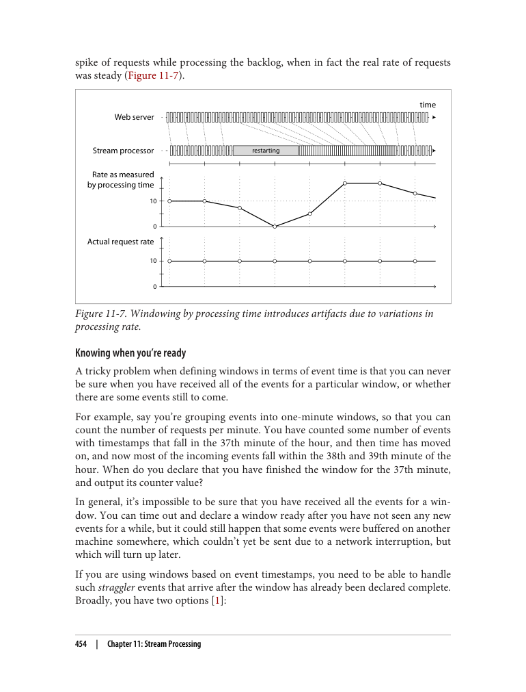

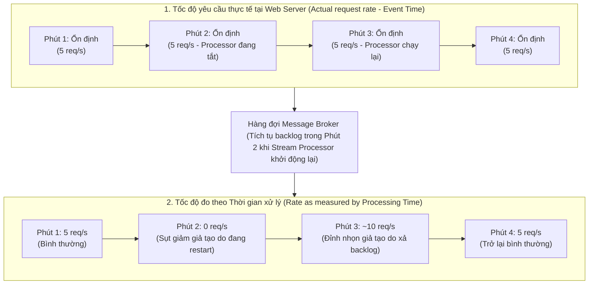

| Giai đoạn | Tại máy chủ Web (Thời gian sự kiện — Event Time) | Trạng thái của Bộ xử lý luồng (Stream Processor) | Kết quả đo theo Thời gian xử lý (Processing Time) |
| :--- | :--- | :--- | :--- |
| **Giai đoạn 1 (Trước khi restart)** | Các sự kiện được tạo ra đều đặn (khoảng 5 sự kiện/đơn vị thời gian). | Đang hoạt động bình thường, nhận và xử lý sự kiện ngay khi chúng tới. | Đường biểu diễn tốc độ ổn định ở mức trung bình (~5). |
| **Giai đoạn 2 (Đang khởi động lại — Stream processor restarting)** | Các sự kiện tại Web server vẫn tiếp tục được tạo ra đều đặn như cũ. | Bị ngừng hoạt động tạm thời; các sự kiện bị dồn ứ lại trong hàng đợi (queue/broker). | Tốc độ đo được rơi thẳng đứng xuống **0** (tạo cảm giác hệ thống mất lưu lượng). |
| **Giai đoạn 3 (Ngay sau khi sống lại)** | Tốc độ thực tế tại Web server vẫn hoàn toàn không đổi. | Đọc dồn dập các sự kiện tồn đọng (backlog) cùng lúc với các sự kiện mới. | Tốc độ đo được **vọt lên đỉnh ~10** (gấp đôi thực tế — tạo cảnh báo giả về spike lưu lượng). |
| **Giai đoạn 4 (Sau khi xả hết backlog)** | Tốc độ thực tế vẫn giữ nguyên. | Đã bắt kịp luồng sự kiện thời gian thực. | Đường biểu diễn tốc độ quay trở về mức ổn định ban đầu (~5). |

#### Biết khi nào cửa sổ đã sẵn sàng (Knowing when you’re ready)

Một bài toán cực kỳ hóc búa khi định nghĩa các cửa sổ dựa theo *thời gian sự kiện* (event time) là: **bạn không bao giờ có thể chắc chắn tuyệt đối khi nào mình đã nhận được toàn bộ các sự kiện thuộc về một cửa sổ cụ thể**, hay liệu vẫn còn một số sự kiện nào đó đang trên đường tới.

Ví dụ: giả sử bạn đang gom nhóm các sự kiện vào các cửa sổ 1 phút để đếm số lượng yêu cầu mỗi phút. Bạn đã đếm được một số lượng sự kiện có dấu thời gian rơi vào phút thứ 37 của giờ đó (tức từ `xx:37:00` đến `xx:37:59`), và sau đó thời gian trôi đi, hiện tại phần lớn các sự kiện đang đi vào đều có dấu thời gian rơi vào phút thứ 38 và phút thứ 39. Vậy tại thời điểm nào thì bạn tuyên bố rằng mình đã hoàn tất cửa sổ cho phút thứ 37, và xuất ra giá trị bộ đếm cuối cùng của phút đó?

Nhìn chung, trên một hệ thống phân tán bất đồng bộ, bạn không thể nào chắc chắn 100% rằng mình đã nhận hết mọi sự kiện của một cửa sổ. Bạn có thể đặt một khoảng thời gian chờ (timeout) và tuyên bố một cửa sổ là đã sẵn sàng sau khi không thấy bất kỳ sự kiện mới nào thuộc cửa sổ đó xuất hiện trong một khoảng thời gian nhất định, nhưng vẫn hoàn toàn có khả năng xảy ra trường hợp một số sự kiện đã bị lưu đệm (buffered) trên một cỗ máy khác ở đâu đó, chưa thể gửi đi được do sự cố gián đoạn mạng tạm thời, nhưng lát nữa mới bất ngờ xuất hiện.

Nếu bạn đang sử dụng các cửa sổ dựa trên dấu thời gian sự kiện, bạn bắt buộc phải có phương án xử lý những *sự kiện đến muộn* (*straggler events* / *late events*) — tức những sự kiện xuất hiện sau khi cửa sổ chứa chúng đã được tuyên bố là hoàn tất và đóng lại. Nhìn chung, bạn có hai lựa chọn chính [1]:

1. **Bỏ qua các sự kiện đến muộn (Ignore the straggler events):** vì trong điều kiện hoạt động bình thường, chúng có lẽ chỉ chiếm một tỷ lệ phần trăm rất nhỏ trong tổng số sự kiện. Bạn có thể theo dõi số lượng các sự kiện bị loại bỏ (dropped events) như một chỉ số giám sát (metric), và phát cảnh báo nếu hệ thống bắt đầu làm rơi một lượng dữ liệu đáng kể.
2. **Tính toán lại giá trị cho cửa sổ có bao gồm cả các sự kiện đến muộn, và phát hành một bản hiệu chỉnh (Publish a correction):** bằng cách xuất bản giá trị đã được cập nhật cho cửa sổ đó (có thể kèm theo việc thu hồi — *retracting* — kết quả đầu ra trước đó trước khi phát kết quả mới).

Trong một số trường hợp, người ta có thể sử dụng một kỹ thuật gọi là **ngấn nước thấp** (*low watermark* — hay thường gọi ngắn gọn là *watermark*) để biểu thị những khẳng định như: *“kể từ thời điểm này trở đi sẽ không còn bất kỳ thông điệp nào có dấu thời gian sớm hơn $t$ xuất hiện nữa”*, và cho các trình tiêu thụ chờ đến khi watermark vượt qua mốc kết thúc cửa sổ như một tín hiệu báo rằng cửa sổ đó đã sẵn sàng để xuất kết quả [68]. Tuy nhiên, nếu dấu thời gian được sinh ra bởi các thiết bị máy khách (clients), bạn vẫn không thể chắc chắn tuyệt đối liệu có còn sự kiện nào đang bị treo ở đâu đó trong hệ thống hay không, vì vậy các sự kiện đến muộn (với dấu thời gian cũ hơn cả mức low watermark hiện tại) vẫn có thể xảy ra trong thực tế.

> 📝 **Giải thích thêm (không có trong sách):**
> Trong **Apache Flink** và mô hình **Apache Beam / Google Cloud Dataflow**, cơ chế xử lý thời gian sự kiện được chuẩn hóa xoay quanh 3 khái niệm cốt lõi:
> 1. **Watermarks (Ngấn nước):** Một gói dữ liệu điều khiển đặc biệt mang dấu thời gian $W(t)$ chảy xen kẽ trong luồng sự kiện. Khi một toán tử nhận được `Watermark(10:38:00)`, hệ thống ngầm hiểu rằng luồng dữ liệu đã tiến tới mốc `10:38:00` (theo event time) và mọi cửa sổ kết thúc tại hoặc trước `10:38:00` (như cửa sổ phút thứ 37: `10:37:00 - 10:37:59`) có thể được kích hoạt (trigger) để tính toán và xuất kết quả. Để dung thứ độ trễ mạng nhỏ, người ta thường dùng *Bounded-Out-Of-Orderness Watermark*, ví dụ lấy `max(event_time_đã_thấy) - 5 giây`.
> 2. **Allowed Lateness (Độ trễ cho phép):** Thay vì xóa ngay trạng thái của cửa sổ phút thứ 37 ngay khi watermark đạt `10:38:00`, Flink cho phép cấu hình `allowedLateness(Time.minutes(2))`. Nhờ vậy, trạng thái của cửa sổ phút 37 vẫn được giữ trong RocksDB/bộ nhớ đến khi watermark đạt `10:40:00`. Bất kỳ sự kiện đến muộn nào của phút 37 rơi vào khoảng này sẽ kích hoạt việc tính toán lại (re-trigger) và phát ra bản cập nhật đính chính (late firing / retraction).
> 3. **Side Outputs (Đầu ra phụ):** Nếu một sự kiện đến quá muộn (sau cả khi `allowedLateness` đã hết hạn, ví dụ watermark đã là `10:45:00` mới nhận được sự kiện của `10:37:15`), thay vì vứt bỏ âm thầm, Flink có thể đẩy sự kiện đó sang một luồng phụ (`sideOutputLateData`) để ghi vào bảng log kiểm toán hoặc xử lý bù sau.

#### Rốt cuộc thì bạn đang dùng đồng hồ của ai? (Whose clock are you using, anyway?)

Việc gán dấu thời gian (timestamps) cho các sự kiện thậm chí còn trở nên khó khăn hơn gấp bội khi các sự kiện có thể bị lưu đệm (buffered) tại nhiều điểm khác nhau trong hệ thống. Ví dụ: hãy xem xét một ứng dụng di động (mobile app) có nhiệm vụ báo cáo các sự kiện về chỉ số sử dụng của người dùng về một máy chủ. Ứng dụng này có thể được người dùng mở lên sử dụng khi đang ngoại tuyến (offline — ví dụ khi đang ngồi trên máy bay hoặc ở vùng mất sóng), trong trường hợp đó ứng dụng sẽ lưu đệm các sự kiện cục bộ ngay trên thiết bị di động, và chỉ gửi chúng lên máy chủ khi có kết nối internet trở lại (có thể là hàng giờ hoặc thậm chí hàng ngày sau đó). Đối với bất kỳ trình tiêu thụ nào của luồng dữ liệu này, các sự kiện đó sẽ xuất hiện như những sự kiện đến muộn ở mức độ cực đoan (extremely delayed stragglers).

Trong ngữ cảnh này, dấu thời gian gắn trên các sự kiện lẽ ra phải là thời điểm thực tế mà thao tác tương tác của người dùng đã diễn ra, tính theo đồng hồ cục bộ của thiết bị di động đó. Tuy nhiên, đồng hồ trên một thiết bị do người dùng kiểm soát thường không thể tin cậy được, vì nó có thể vô tình hoặc cố ý bị chỉnh sai giờ (ví dụ người dùng chỉnh đồng hồ điện thoại nhanh lên vài ngày để gian lận thời gian chờ trong các trò chơi trên di động — xem thêm phần “Đồng bộ hóa và độ chính xác của đồng hồ” / “Clock synchronization and accuracy” ở Chương 8, trang 281 bản gốc). Ngược lại, thời điểm mà sự kiện được máy chủ tiếp nhận (tính theo đồng hồ của máy chủ — vốn được đồng bộ NTP cẩn thận) thì có khả năng chính xác cao hơn nhiều, nhưng lại kém ý nghĩa hơn trong việc mô tả đúng trình tự và thời điểm tương tác thực sự của người dùng.

Để hiệu chỉnh cho các đồng hồ thiết bị bị sai lệch, một cách tiếp cận rất hiệu quả trong thực tế là ghi nhật ký cả **ba dấu thời gian** [69]:

1. Thời điểm mà sự kiện thực sự xảy ra, tính theo **đồng hồ của thiết bị** ($t_{\text{event, device}}$);
2. Thời điểm mà sự kiện được gửi lên máy chủ, tính theo **đồng hồ của thiết bị** ($t_{\text{sent, device}}$);
3. Thời điểm mà sự kiện được máy chủ nhận được, tính theo **đồng hồ của máy chủ** ($t_{\text{received, server}}$).

Khi trừ mốc thời gian thứ ba cho mốc thời gian thứ hai ($\Delta = t_{\text{received, server}} - t_{\text{sent, device}}$), bạn có thể ước lượng được độ lệch (offset) giữa đồng hồ của thiết bị và đồng hồ chuẩn của máy chủ (với giả định rằng độ trễ truyền mạng tại thời điểm gửi là không đáng kể so với độ chính xác dấu thời gian đang yêu cầu). Sau đó, bạn lấy độ lệch $\Delta$ này cộng vào thời điểm sự kiện xảy ra trên thiết bị ($t_{\text{true}} \approx t_{\text{event, device}} + \Delta$) để ước lượng thời gian thực chuẩn xác mà sự kiện đó đã xảy ra ngoài đời thực (với giả định rằng độ lệch đồng hồ của thiết bị không bị người dùng chỉnh lại trong khoảng thời gian từ lúc sự kiện xảy ra cho đến lúc nó được gửi lên máy chủ).

Bài toán này không phải chỉ có ở riêng xử lý luồng — xử lý theo lô (batch processing) cũng gặp phải vấn đề y hệt như vậy khi phân tích dữ liệu lịch sử. Chẳng qua là vấn đề này trở nên dễ nhận thấy và nhức nhối hơn trong ngữ cảnh xử lý luồng, nơi chúng ta luôn nhạy cảm và nhận thức rõ rệt hơn về sự trôi chảy của thời gian thực.

#### Các loại cửa sổ thời gian (Types of window)

Một khi bạn đã biết cách xác định dấu thời gian chuẩn xác cho một sự kiện, bước tiếp theo là quyết định cách định nghĩa các cửa sổ (windows) trên các khoảng thời gian. Cửa sổ đó sau đó có thể được sử dụng cho các phép tổng hợp (aggregations), chẳng hạn như đếm số lượng sự kiện, hoặc tính giá trị trung bình của các trường dữ liệu bên trong cửa sổ. Có bốn loại cửa sổ đang được sử dụng phổ biến nhất hiện nay [66, 70]:

* **Cửa sổ lật / Cửa sổ không gối nhau (Tumbling window):**
  Một cửa sổ lật (tumbling window) có độ dài cố định, và **mọi sự kiện chỉ thuộc về duy nhất một cửa sổ**. Ví dụ: nếu bạn có một cửa sổ lật dài 1 phút, tất cả các sự kiện có dấu thời gian từ `10:03:00` đến `10:03:59` sẽ được gom vào một cửa sổ, các sự kiện từ `10:04:00` đến `10:04:59` được gom vào cửa sổ tiếp theo ngay sau đó, và cứ tiếp tục như vậy, không hề có sự chồng lấp hay khoảng trống nào giữa chúng. Bạn có thể hiện thực hóa một cửa sổ lật 1 phút rất đơn giản bằng cách lấy dấu thời gian của từng sự kiện và làm tròn xuống (floor/round) về mốc phút gần nhất.
* **Cửa sổ nhảy / Cửa sổ gối nhau theo bước nhảy (Hopping window):**
  Một cửa sổ nhảy (hopping window) cũng có độ dài cố định, nhưng cho phép các cửa sổ **chồng lấp (overlap) lên nhau** nhằm mục đích làm mượt số liệu thống kê. Ví dụ: một cửa sổ dài 5 phút với kích thước bước nhảy (hop size) là 1 phút sẽ chứa các sự kiện từ `10:03:00` đến `10:07:59`, sau đó cửa sổ tiếp theo sẽ bao phủ các sự kiện từ `10:04:00` đến `10:08:59`, và cứ thế dịch chuyển từng phút một. Bạn có thể hiện thực hóa cửa sổ nhảy này một cách tối ưu bằng cách trước tiên tính toán các cửa sổ lật (tumbling windows) 1 phút làm các lát cắt cơ sở (slices), và sau đó chỉ việc tổng hợp kết quả trên 5 cửa sổ 1 phút liền kề nhau.
* **Cửa sổ trượt (Sliding window):**
  Một cửa sổ trượt (sliding window) chứa tất cả các sự kiện xảy ra trong vòng một khoảng thời gian nhất định tính từ nhau. Ví dụ: một cửa sổ trượt 5 phút sẽ bao phủ hai sự kiện xảy ra tại `10:03:39` và `10:08:12`, bởi vì khoảng cách thời gian giữa chúng nhỏ hơn 5 phút (cụ thể là 4 phút 33 giây — lưu ý rằng các cửa sổ lật hoặc cửa sổ nhảy 5 phút có ranh giới cố định theo phút chẵn như `10:00-10:05`, `10:05-10:10` sẽ không đặt hai sự kiện này vào cùng một cửa sổ cố định nếu bước nhảy không khớp). Một cửa sổ trượt có thể được hiện thực hóa bằng cách duy trì một bộ đệm (buffer) chứa các sự kiện được sắp xếp theo thời gian, và liên tục loại bỏ các sự kiện cũ khi chúng hết hạn rời khỏi phạm vi cửa sổ khi có sự kiện mới đến.
* **Cửa sổ phiên (Session window):**
  Không giống như ba loại cửa sổ trên, một cửa sổ phiên (session window) **không có thời lượng cố định**. Thay vào đó, nó được định nghĩa bằng cách gom nhóm tất cả các sự kiện của cùng một người dùng xảy ra gần nhau về mặt thời gian, và cửa sổ sẽ kết thúc khi người dùng đó ngừng hoạt động (inactive) trong một khoảng thời gian nghỉ (session gap / inactivity timeout) nhất định (ví dụ: nếu không có thêm sự kiện nào của người dùng đó trong vòng 30 phút). Việc phân tách phiên (sessionization) là một yêu cầu cực kỳ phổ biến trong phân tích hành vi người dùng trên trang web hoặc ứng dụng (xem thêm phần “GROUP BY” ở Chương 10, trang 394 bản gốc).

> 💡 **Ví dụ bổ sung (không có trong sách):**
> Bảng và sơ đồ dưới đây minh họa trực quan cách 4 loại cửa sổ phân nhóm các sự kiện trên trục thời gian, cùng với lưu ý về thuật ngữ giữa các framework (như Apache Flink và Kafka Streams):
>
> ```
> Trục thời gian (Phút):  10:00   10:01   10:02   10:03   10:04   10:05   10:06   10:07   10:08
> Sự kiện (Events):         *       *               *               *       *               *
>
> 1. Tumbling Window (Cố định 2 phút, không chồng lấp):
>                        [----- W1 -----)[----- W2 -----)[----- W3 -----)[----- W4 -----)
>
> 2. Hopping Window (Độ dài 2 phút, bước nhảy 1 phút - chồng lấp đều đặn):
>                        [----- W1 -----)
>                                [----- W2 -----)
>                                        [----- W3 -----)
>                                                [----- W4 -----)
>
> 3. Sliding Window (Khoảng cách <= 2 phút tính từ mỗi sự kiện):
>                        [*-----*]       [*---------*]   [*---------*]   [*---------*]
>
> 4. Session Window (Gộp sự kiện theo từng user, đóng khi nghỉ > 1.5 phút):
>                        [--- Session 1 (3 sự kiện) ---]         [--- Session 2 (3 sự kiện) ---]
> ```
>
> ⚠️ **Lưu ý quan trọng về thuật ngữ trong thực tế:** Trong tài liệu của **Apache Flink** và **Google Cloud Dataflow / Apache Beam**, loại cửa sổ có độ dài cố định và bước nhảy cố định (mà Martin Kleppmann và Kafka Streams / Azure Stream Analytics gọi là **Hopping window**) lại được gọi là `SlidingEventTimeWindows.of(Time.minutes(5), Time.minutes(1))`. Trong khi đó, trong **Kafka Streams**, họ phân biệt rõ: `TimeWindows.ofSizeWithNoGrace(Duration.ofMinutes(5)).advanceBy(Duration.ofMinutes(1))` là *Hopping window*, còn `SlidingWindows.ofTimeDifferenceAndGrace(...)` mới thực sự là *Sliding window* bám theo dấu thời gian của từng bản ghi để dùng cho phép nối hoặc tổng hợp liên tục!

---

### Các phép nối trên luồng (Stream joins)

Trong Chương 10, chúng ta đã thảo luận về cách các tác vụ xử lý theo lô (batch jobs) có thể nối (join) các tập dữ liệu với nhau theo khóa (key), và tại sao những phép nối như vậy lại là một phần quan trọng không thể thiếu của các đường ống dữ liệu (data pipelines). Vì xử lý luồng chính là sự tổng quát hóa của các đường ống dữ liệu sang mô hình xử lý tăng dần (incremental processing) trên các tập dữ liệu không giới hạn (unbounded datasets), nên nhu cầu thực hiện các phép nối trên các luồng dữ liệu cũng hoàn toàn tương tự như vậy.

Tuy nhiên, thực tế là các sự kiện mới có thể xuất hiện bất cứ lúc nào trên một luồng khiến cho việc thực hiện phép nối trên luồng trở nên thách thức hơn rất nhiều so với trong các tác vụ xử lý theo lô. Để hiểu rõ hơn về bức tranh toàn cảnh này, chúng ta hãy phân biệt ba loại phép nối khác nhau trong xử lý luồng: **phép nối luồng - luồng** (*stream-stream joins*), **phép nối luồng - bảng** (*stream-table joins*), và **phép nối bảng - bảng** (*table-table joins*) [71]. Trong các mục tiếp theo dưới đây, chúng ta sẽ minh họa cụ thể từng loại bằng các ví dụ thực tế.

#### Phép nối luồng - luồng / phép nối theo cửa sổ (Stream-stream join (window join))

Giả sử bạn có một tính năng tìm kiếm trên trang web của mình, và bạn đang làm việc để cải thiện thuật toán xếp hạng (ranking) của các kết quả tìm kiếm. Mỗi khi ai đó gõ một câu truy vấn tìm kiếm, bạn ghi nhật ký một sự kiện chứa câu truy vấn đó cùng danh sách các kết quả được trả về. Mỗi khi ai đó nhấp chuột (click) vào một trong các kết quả tìm kiếm đó, bạn lại ghi nhật ký một sự kiện khác ghi nhận thao tác nhấp chuột này. Để tính toán tỷ lệ nhấp chuột (click-through rate — CTR) cho từng kết quả tìm kiếm, bạn cần phải ghép nối các sự kiện của hành động tìm kiếm (search action) và hành động nhấp chuột (click action) lại với nhau — hai loại sự kiện này được liên kết với nhau thông qua việc có cùng một mã định danh phiên (`session ID`) [72].

Thao tác nhấp chuột có thể sẽ không bao giờ xảy ra nếu người dùng từ bỏ việc tìm kiếm của họ, và ngay cả khi nó có xảy ra đi nữa, khoảng thời gian giữa lúc tìm kiếm và lúc nhấp chuột có thể biến thiên rất lớn: trong nhiều trường hợp, nó có thể chỉ là vài giây, nhưng cũng có thể kéo dài tới hàng ngày hoặc hàng tuần (nếu một người dùng thực hiện tìm kiếm, bỏ quên tab trình duyệt đó ở đấy, rồi một thời gian lâu sau mới quay lại tab đó và nhấp vào một kết quả). Do độ trễ mạng biến thiên ở các đường truyền khác nhau, sự kiện nhấp chuột thậm chí có thể đến bộ xử lý luồng *trước* cả sự kiện tìm kiếm. Bạn có thể chọn một cửa sổ thời gian phù hợp cho phép nối này — ví dụ: bạn có thể chọn nối một sự kiện nhấp chuột với một sự kiện tìm kiếm nếu chúng xảy ra cách nhau tối đa là 1 giờ.

Lưu ý rằng việc nhúng trực tiếp thông tin chi tiết của lần tìm kiếm vào bên trong sự kiện nhấp chuột ở phía trình duyệt **không tương đương** với việc nối hai luồng sự kiện ở phía máy chủ: làm như vậy sẽ chỉ cho bạn biết về những trường hợp mà người dùng *có* nhấp vào một kết quả tìm kiếm, nhưng lại hoàn toàn không cho bạn biết gì về những lượt tìm kiếm mà người dùng *không* nhấp vào bất kỳ kết quả nào (tức thực hiện `LEFT JOIN` từ luồng tìm kiếm sang luồng nhấp chuột). Để đo lường chất lượng tìm kiếm một cách chuẩn xác, bạn cần tỷ lệ nhấp chuột (CTR = số lượt click / tổng số lượt hiển thị tìm kiếm) chính xác, và muốn vậy bạn bắt buộc phải có cả luồng sự kiện tìm kiếm lẫn luồng sự kiện nhấp chuột.

Để hiện thực hóa loại phép nối này, một bộ xử lý luồng cần phải **duy trì trạng thái** (*maintain state*): ví dụ, lưu giữ tất cả các sự kiện đã xảy ra trong vòng một giờ qua, được đánh chỉ mục theo `session ID`. Bất cứ khi nào một sự kiện tìm kiếm hoặc một sự kiện nhấp chuột xuất hiện:
1. Nó được thêm vào chỉ mục tương ứng của luồng đó (chỉ mục tìm kiếm hoặc chỉ mục nhấp chuột), và
2. Bộ xử lý luồng đồng thời kiểm tra chỉ mục của luồng bên kia xem liệu đã có sự kiện nào khác có cùng `session ID` đến trước đó hay chưa. Nếu tìm thấy sự kiện khớp, bộ xử lý luồng sẽ phát ra một sự kiện kết quả đã nối (joined event). Khi một sự kiện tìm kiếm hết hạn (quá 1 giờ mà không có sự kiện nhấp chuột nào khớp), nó sẽ bị xóa khỏi trạng thái và bộ xử lý có thể phát ra một sự kiện ghi nhận “tìm kiếm không có nhấp chuột” (unclicked search).

#### Phép nối luồng - bảng / làm giàu luồng dữ liệu (Stream-table join (stream enrichment))

Trong phần “Ví dụ: phân tích các sự kiện hoạt động của người dùng” (“Example: analysis of user activity events” ở Chương 10, trang 392 bản gốc — **Hình 10-2** / `Figure 10-2`), chúng ta đã thấy một ví dụ về một tác vụ xử lý theo lô thực hiện nối hai tập dữ liệu: một tập hợp các sự kiện hoạt động của người dùng và một cơ sở dữ liệu chứa hồ sơ người dùng (user profiles). Việc hình dung các sự kiện hoạt động của người dùng như một luồng dữ liệu liên tục, và thực hiện cùng phép nối đó trên cơ sở liên tục theo thời gian thực trong một bộ xử lý luồng là điều hoàn toàn tự nhiên: đầu vào là một luồng các sự kiện hoạt động có chứa mã định danh người dùng (`user ID`), và đầu ra là một luồng các sự kiện hoạt động đã được *làm giàu* (*enriched activity events*), trong đó `user ID` đã được bổ sung thêm các thông tin hồ sơ chi tiết về người dùng đó (như độ tuổi, khu vực địa lý, hạng thành viên).

Để thực hiện phép nối này, tiến trình xử lý luồng cần xem xét từng sự kiện hoạt động một tại mỗi thời điểm, tra cứu `user ID` của sự kiện đó trong cơ sở dữ liệu hồ sơ, và gắn thêm thông tin hồ sơ tìm được vào sự kiện hoạt động. Thao tác tra cứu cơ sở dữ liệu này có thể được hiện thực hóa một cách ngây thơ bằng cách gửi truy vấn qua mạng tới một cơ sở dữ liệu từ xa (remote database) cho mỗi sự kiện; tuy nhiên, như chúng ta đã thảo luận kỹ trong phần “Ví dụ: phân tích các sự kiện hoạt động của người dùng” ở Chương 10 (trang 392 bản gốc), cách làm này rất dễ trở nên cực kỳ chậm chạp (do độ trễ vòng lặp mạng — network round-trip), và có nguy cơ cao làm quá tải hoặc đánh sập cơ sở dữ liệu từ xa khi lưu lượng sự kiện tăng cao [63].

Một kỹ thuật tốt hơn nhiều là **nạp một bản sao của cơ sở dữ liệu vào ngay bên trong bộ xử lý luồng**, sao cho nó có thể được truy vấn cục bộ (locally) ngay trên cùng một máy mà không tốn một chuyến đi-về qua mạng nào. Cách làm này rất giống với các phép nối băm (hash joins) mà chúng ta đã thảo luận trong phần “Phép nối phía Map” (“Map-side joins” ở Chương 10, trang 396 bản gốc): bản sao cục bộ của cơ sở dữ liệu có thể là một bảng băm nằm trong bộ nhớ (in-memory hash table) nếu kích thước của nó đủ nhỏ, hoặc một chỉ mục trên ổ đĩa cục bộ (như RocksDB) nếu kích thước dữ liệu lớn hơn RAM.

Điểm khác biệt cốt lõi so với các tác vụ xử lý theo lô là: một tác vụ lô sử dụng một bản chụp nhanh tại một thời điểm cố định (point-in-time snapshot) của cơ sở dữ liệu làm đầu vào, trong khi một bộ xử lý luồng lại chạy liên tục trong thời gian dài (long-running), và nội dung của cơ sở dữ liệu hồ sơ người dùng chắc chắn sẽ thay đổi theo thời gian, do đó bản sao cục bộ của dữ liệu bên trong bộ xử lý luồng cần phải được giữ cho luôn cập nhật (up-to-date). Vấn đề này có thể được giải quyết một cách trọn vẹn bằng kỹ thuật **bắt dữ liệu thay đổi (change data capture — CDC)**: bộ xử lý luồng có thể đăng ký nhận (subscribe) một luồng nhật ký thay đổi (changelog stream) của cơ sở dữ liệu hồ sơ người dùng song song với việc đọc luồng các sự kiện hoạt động. Bất cứ khi nào một hồ sơ người dùng mới được tạo ra hoặc hồ sơ cũ được chỉnh sửa, bộ xử lý luồng sẽ cập nhật bản sao cục bộ của nó thông qua luồng CDC đó.

Như vậy, chúng ta có thể coi phép nối luồng - bảng thực chất là một phép nối giữa hai luồng: một luồng sự kiện hoạt động và một luồng nhật ký thay đổi (changelog) của bảng dữ liệu, trong đó cửa sổ của luồng changelog kéo dài ngược về tận thời điểm khởi đầu của thời gian (beginning of time) và các bản ghi mới hơn sẽ ghi đè lên các bản ghi cũ hơn có cùng khóa.

#### Phép nối bảng - bảng / duy trì khung nhìn vật lý hóa (Table-table join (materialized view maintenance))

Hãy xem xét ví dụ về dòng thời gian trang chủ của Twitter (Twitter home timeline) mà chúng ta đã thảo luận ngay từ Chương 1 trong phần “Mô tả tải” (“Describing load” ở trang 9 bản gốc). Chúng ta đã nói rằng khi một người dùng muốn xem dòng thời gian trang chủ của họ, việc phải lặp qua tất cả những người mà người dùng đó đang theo dõi (following), tìm các dòng tweet gần đây của họ rồi trộn (merge) chúng lại ngay tại thời điểm đọc là quá tốn kém và không thể chịu tải nổi.

Thay vào đó, chúng ta muốn có một *bộ nhớ đệm dòng thời gian* (*timeline cache*): một dạng “hộp thư đến” (inbox) riêng cho từng người dùng mà các dòng tweet sẽ được ghi sẵn vào đó ngay khi chúng được gửi đi, sao cho việc đọc dòng thời gian chỉ tốn một thao tác tra cứu đơn lẻ duy nhất. Việc vật lý hóa (materializing) và duy trì bộ nhớ đệm này đòi hỏi quá trình xử lý các sự kiện sau đây:

* Khi người dùng $u$ gửi một dòng tweet mới, dòng tweet đó sẽ được thêm vào dòng thời gian (timeline) của mọi người dùng đang theo dõi $u$.
* Khi một người dùng xóa một dòng tweet, dòng tweet đó sẽ bị xóa khỏi dòng thời gian của tất cả người dùng.
* Khi người dùng $u_1$ bắt đầu theo dõi (follow) người dùng $u_2$, các dòng tweet gần đây của $u_2$ sẽ được thêm vào dòng thời gian của $u_1$.
* Khi người dùng $u_1$ bỏ theo dõi (unfollow) người dùng $u_2$, các dòng tweet của $u_2$ sẽ bị gỡ bỏ khỏi dòng thời gian của $u_1$.

Để hiện thực hóa việc duy trì bộ nhớ đệm này trong một bộ xử lý luồng, bạn cần có các luồng sự kiện cho các dòng tweet (gửi mới và xóa) và cho các mối quan hệ theo dõi (theo dõi và bỏ theo dõi). Tiến trình xử lý luồng cần phải duy trì một cơ sở dữ liệu trạng thái chứa tập hợp những người theo dõi (followers) cho từng người dùng (cũng như tập hợp các dòng tweet gần đây của từng người dùng), để nó biết chính xác những dòng thời gian nào cần phải được cập nhật mỗi khi có một dòng tweet mới hoặc một sự kiện follow/unfollow mới xuất hiện [73].

Một cách nhìn nhận khác mang tính toán học và cơ sở dữ liệu hơn về tiến trình xử lý luồng này là: nó đang duy trì một khung nhìn vật lý hóa (materialized view) cho một câu truy vấn thực hiện nối hai bảng (`tweets` và `follows`), đại loại giống như câu lệnh SQL sau đây:

```sql
SELECT follows.follower_id AS timeline_id,
  array_agg(tweets.* ORDER BY tweets.timestamp DESC)
FROM tweets
JOIN follows ON follows.followee_id = tweets.sender_id
GROUP BY follows.follower_id
```

Phép nối của hai luồng sự kiện ở đây tương ứng trực tiếp với phép nối của hai bảng trong câu truy vấn đó. Các dòng thời gian (timelines) về bản chất chính là một bộ nhớ đệm lưu giữ kết quả của câu truy vấn này, được cập nhật tự động mỗi khi các bảng cơ sở bên dưới thay đổi.$^{\text{ii}}$

> $^{\text{ii}}$ **Chú thích cuối trang (Footnote ii):** Nếu bạn coi một luồng (stream) là *đạo hàm* (derivative) theo thời gian của một bảng (table), giống như trong **Hình 11-6** (`Figure 11-6`), và coi một phép nối (join) là *tích* (product) của hai bảng $u \cdot v$, thì một điều vô cùng thú vị về mặt toán học sẽ xảy ra: luồng các thay đổi đối với kết quả nối đã vật lý hóa sẽ tuân theo đúng quy tắc đạo hàm của một tích trong giải tích (product rule):
> $$(u \cdot v)' = u'v + uv'$$
> Diễn đạt bằng lời: bất cứ khi nào bảng `tweets` thay đổi ($u'$), sự thay đổi đó sẽ được nối với trạng thái hiện tại của bảng `follows` ($v$); cộng với bất cứ khi nào bảng `follows` thay đổi ($v'$), sự thay đổi đó sẽ được nối với trạng thái hiện tại của bảng `tweets` ($u$) [45, 46].

> 💡 **Ví dụ bổ sung (không có trong sách):**
> Bảng tổng hợp dưới đây giúp bạn so sánh trực quan 3 loại phép nối trên luồng và cách chúng được hỗ trợ trong **Kafka Streams** và **Apache Flink**:
>
> | Tiêu chí | Stream-Stream Join (Window Join) | Stream-Table Join (Stream Enrichment) | Table-Table Join (Materialized View) |
> | :--- | :--- | :--- | :--- |
> | **Bản chất đầu vào** | 2 luồng sự kiện hoạt động (`KStream` $\bowtie$ `KStream`). | 1 luồng sự kiện + 1 luồng changelog của bảng (`KStream` $\bowtie$ `KTable`). | 2 luồng changelog của 2 bảng (`KTable` $\bowtie$ `KTable`). |
> | **Trạng thái lưu giữ (State)** | Cả 2 bên đều phải lưu trạng thái, nhưng **chỉ trong phạm vi cửa sổ thời gian** (ví dụ: 1 giờ). | Chỉ bên Bảng (`KTable`) được lưu trạng thái toàn cục (compacted); bên Luồng không cần lưu. | Cả 2 bên đều phải lưu toàn bộ trạng thái hiện tại của 2 bảng ($u$ và $v$). |
> | **Khi nào phát ra kết quả (Trigger)?** | Khi sự kiện mới ở bất kỳ bên nào đến và tìm thấy sự kiện khớp ở bên kia trong cùng cửa sổ. | **Chỉ khi có sự kiện mới bên Luồng (`KStream`)** đến. Khi Bảng (`KTable`) thay đổi, nó chỉ âm thầm cập nhật trạng thái cục bộ. | Khi **bất kỳ bảng nào trong 2 bảng** có thay đổi ($(u \cdot v)' = u'v + uv'$). |
> | **Ví dụ thực tế** | Nối sự kiện `AdImpression` (hiển thị quảng cáo) và `AdClick` (nhấp quảng cáo) trong vòng 30 phút. | Làm giàu sự kiện `OrderCreated` bằng thông tin `CustomerProfile` hoặc tỷ giá tiền tệ hiện tại. | Duy trì bảng `UserTimeline` từ bảng `Tweets` và `Follows`, hoặc đồng bộ chỉ mục Elasticsearch từ nhiều bảng quan hệ. |

#### Sự phụ thuộc thời gian của các phép nối (Time-dependence of joins)

Ba loại phép nối ở trên (luồng - luồng, luồng - bảng, và bảng - bảng) có rất nhiều điểm chung: tất cả chúng đều đòi hỏi bộ xử lý luồng phải duy trì một trạng thái nào đó (các sự kiện tìm kiếm và nhấp chuột, hồ sơ người dùng, hoặc danh sách người theo dõi) dựa trên một đầu vào của phép nối, và thực hiện truy vấn trạng thái đó khi có các thông điệp từ đầu vào bên kia của phép nối đi tới.

Thứ tự của các sự kiện dùng để duy trì trạng thái là cực kỳ quan trọng (việc bạn nhấn theo dõi trước rồi mới bỏ theo dõi, hay bỏ theo dõi trước rồi mới nhấn theo dõi sẽ dẫn đến trạng thái cuối cùng hoàn toàn trái ngược nhau). Trong một nhật ký được phân vùng (partitioned log), thứ tự của các sự kiện bên trong cùng một phân vùng đơn lẻ luôn được bảo toàn, nhưng thông thường **không có bất kỳ đảm bảo nào về thứ tự giữa các luồng khác nhau hoặc giữa các phân vùng khác nhau**.

Điều này đặt ra một câu hỏi hóc búa: nếu các sự kiện trên các luồng khác nhau xảy ra vào khoảng thời gian xấp xỉ nhau, chúng sẽ được xử lý theo thứ tự nào? Trong ví dụ về phép nối luồng - bảng, nếu một người dùng cập nhật hồ sơ của họ (ví dụ đổi địa chỉ giao hàng), thì những sự kiện hoạt động đặt hàng nào sẽ được nối với hồ sơ cũ (được xử lý trước bản cập nhật hồ sơ), và những sự kiện nào sẽ được nối với hồ sơ mới (được xử lý sau bản cập nhật hồ sơ)? Nói theo một cách khác: nếu trạng thái thay đổi theo thời gian, và bạn thực hiện phép nối với một trạng thái nào đó, thì bạn sử dụng **thời điểm nào** (what point in time) để thực hiện phép nối đó [41]?

Nếu thứ tự của các sự kiện giữa các luồng không được xác định rõ (undetermined), phép nối sẽ trở nên **không đơn định** (*nondeterministic*) — điều đó có nghĩa là bạn không thể chạy lại cùng một tác vụ trên cùng một dữ liệu đầu vào và chắc chắn nhận lại được kết quả giống hệt như lần trước: các sự kiện trên các luồng đầu vào có thể bị đan xen (interleaved) theo một trật tự khác khi bạn chạy lại tác vụ đó. Trong các hệ thống kho dữ liệu truyền thống, bài toán này được biết đến với tên gọi *các chiều thay đổi chậm* (*slowly changing dimensions* — SCD), và nó thường được giải quyết bằng cách sử dụng một định danh duy nhất cho một phiên bản cụ thể của bản ghi được nối (ví dụ: mỗi khi thuế suất thay đổi, nó được gán một mã định danh phiên bản thuế suất mới, và hóa đơn sẽ liên kết cứng với mã phiên bản đó tại thời điểm xuất hóa đơn); cái giá phải trả của cách làm này là tính năng nén nhật ký (log compaction) sẽ không thể áp dụng được nữa, bởi vì bạn cần phải giữ lại toàn bộ các phiên bản lịch sử của các bản ghi trong bảng để có thể tái hiện lại phép nối lịch sử. Một bộ xử lý luồng cũng có thể ghi nhật ký lại thứ tự đan xen thực tế của các thông điệp [74], nhưng chỉ riêng điều này thôi thì vẫn chưa đủ khi khôi phục sau sự cố, như chúng ta sẽ thấy ngay trong phần tiếp theo.

---

### Khả năng chịu lỗi (Fault tolerance)

Trong phần cuối cùng của chương này, chúng ta hãy xem xét cách các bộ xử lý luồng có thể chịu được các sự cố (faults). Chúng ta đã thấy trong Chương 10 rằng các framework xử lý theo lô có thể chịu lỗi một cách khá dễ dàng: nếu một tác vụ (task) trong một công việc MapReduce bị lỗi, nó có thể đơn giản được khởi động lại trên một cỗ máy khác, và đầu ra dở dang của tác vụ bị lỗi đó sẽ bị hủy bỏ hoàn toàn. Điều này khả thi là bởi vì các tệp đầu vào là bất biến (immutable), mỗi tác vụ ghi đầu ra của nó vào một tệp riêng biệt trên HDFS, và kết quả đầu ra chỉ được hiển thị (made visible — thông qua thao tác đổi tên nguyên tử trên NameNode) khi một tác vụ đã hoàn thành toàn bộ công việc một cách thành công.

Cụ thể, cách tiếp cận chịu lỗi của xử lý theo lô đảm bảo rằng kết quả đầu ra cuối cùng của tác vụ lô sẽ giống hệt như thể chưa từng có bất kỳ sự cố nào xảy ra, ngay cả khi trên thực tế đã có một số tác vụ con bị sập giữa chừng. Nhìn từ bên ngoài, có vẻ như mọi bản ghi đầu vào đều đã được xử lý **đúng một lần duy nhất** (*processed exactly once*) — không có bản ghi nào bị bỏ sót, và cũng không có bản ghi nào bị tính trùng hai lần. Mặc dù việc khởi động lại các tác vụ đồng nghĩa với việc các bản ghi trên thực tế có thể đã được đọc và xử lý nhiều lần ở tầng vật lý, nhưng **hiệu ứng hiển thị ra bên ngoài ở kết quả đầu ra** lại giống hệt như thể chúng chỉ mới được xử lý đúng một lần — một nguyên lý cực kỳ quan trọng được gọi là **ngữ nghĩa đúng-một-lần** (*exactly-once semantics*, hay chính xác hơn là *effectively-once* — *hiệu quả tương đương một lần*).

Cùng một bài toán chịu lỗi như vậy cũng nảy sinh trong xử lý luồng, nhưng việc giải quyết nó lại không hề đơn giản và trực tiếp như vậy: phương án chờ cho đến khi một tác vụ hoàn thành xong xuôi rồi mới cho hiển thị kết quả đầu ra là hoàn toàn bất khả thi, bởi vì một luồng dữ liệu là vô hạn (infinite) và do đó bạn không bao giờ có thể “xử lý xong” toàn bộ luồng dữ liệu đó được.

#### Xử lý theo lô siêu nhỏ và tạo điểm kiểm tra (Microbatching and checkpointing)

Một giải pháp phổ biến là chặt luồng dữ liệu liên tục thành các khối nhỏ (small blocks), và xử lý từng khối đó giống hệt như một tiến trình xử lý theo lô thu nhỏ. Cách tiếp cận này được gọi là **xử lý theo lô siêu nhỏ** (*microbatching*), và nó được sử dụng trong Spark Streaming (mô hình DStreams — Discretized Streams) [75]. Kích thước của mỗi lô siêu nhỏ thường rơi vào khoảng 1 giây (hoặc vài trăm mili-giây), đây là một sự thỏa hiệp về mặt hiệu năng: các lô nhỏ hơn sẽ làm phát sinh chi phí điều phối và lập lịch (scheduling and coordination overhead) lớn hơn đáng kể, trong khi các lô lớn hơn lại đồng nghĩa với độ trễ dài hơn trước khi kết quả của bộ xử lý luồng được hiển thị ra ngoài.

Xử lý theo lô siêu nhỏ cũng ngầm cung cấp một cửa sổ lật (tumbling window) có kích thước bằng đúng kích thước của lô đó (được chia cửa sổ theo *thời gian xử lý* — processing time, chứ không phải theo dấu thời gian sự kiện); bất kỳ tác vụ nào đòi hỏi các cửa sổ lớn hơn hoặc chia cửa sổ theo thời gian sự kiện đều cần phải truyền trạng thái một cách tường minh từ lô siêu nhỏ này sang lô siêu nhỏ tiếp theo.

Một hướng tiếp cận biến thể khác, được sử dụng trong **Apache Flink**, là định kỳ tạo ra các **điểm kiểm tra cuốn chiếu** (*rolling checkpoints*) của trạng thái các toán tử và ghi chúng vào hệ thống lưu trữ bền vững (như HDFS hoặc S3) [76, 77]. Nếu một toán tử xử lý luồng gặp sự cố và bị sập, nó có thể khởi động lại từ điểm kiểm tra gần đây nhất của mình, và hủy bỏ bất kỳ đầu ra nào được tạo ra trong khoảng thời gian giữa điểm kiểm tra cuối cùng và thời điểm bị sập. Các điểm kiểm tra này được kích hoạt bởi các **rào chắn** (*barriers*) được bơm vào luồng thông điệp, đóng vai trò tương tự như các ranh giới giữa các lô siêu nhỏ, nhưng không ép buộc hệ thống phải gắn chặt với một kích thước cửa sổ cụ thể nào.

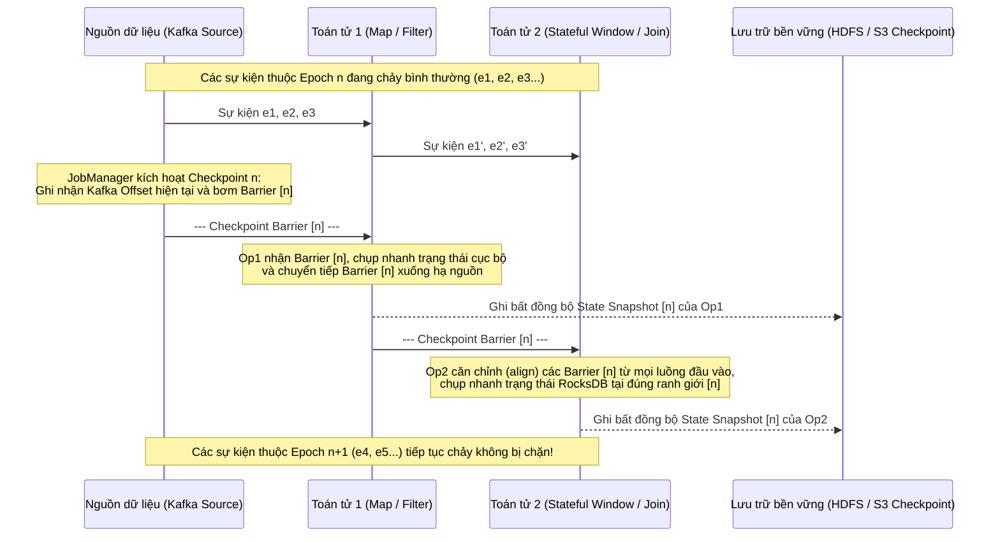

> 📝 **Giải thích thêm (không có trong sách):**
> Cơ chế tạo điểm kiểm tra của Apache Flink [77] dựa trên thuật toán kinh điển **Chandy-Lamport** (1985) để chụp ảnh nhanh trạng thái toàn cục bất đồng bộ trong hệ thống phân tán (*Asynchronous Barrier Snapshotting — ABS*):
> * Luồng dữ liệu không bao giờ phải dừng toàn cục (stop-the-world) như trong microbatching. Thay vào đó, các `Checkpoint Barrier [n]` chảy cùng với các bản ghi dữ liệu qua đồ thị DAG, chia luồng dữ liệu thành các thế hệ (epochs): mọi bản ghi đứng trước barrier `n` thuộc về checkpoint `n`, mọi bản ghi đứng sau thuộc về checkpoint `n+1`.
> * Khi một toán tử có nhiều luồng đầu vào (như toán tử `Join` hoặc `KeyBy`), nó thực hiện **căn chỉnh rào chắn (Barrier Alignment)**: nếu luồng đầu vào A đã gửi tới `Barrier [n]` nhưng luồng B chưa tới, toán tử sẽ tạm thời lưu đệm (buffer) các bản ghi mới hơn từ luồng A (thuộc epoch `n+1`) mà chưa xử lý chúng ngay, tiếp tục xử lý nốt các bản ghi còn lại của epoch `n` từ luồng B cho đến khi `Barrier [n]` của luồng B cũng tới nơi. Ngay khoảnh khắc cả hai barrier hội tụ, toán tử chụp nhanh trạng thái cục bộ (ví dụ tạo một bản snapshot Copy-on-Write trên RocksDB chỉ mất vài mili-giây) rồi đẩy việc tải tệp lên S3/HDFS chạy ngầm bất đồng bộ (asynchronously), sau đó lập tức xả bộ đệm luồng A để xử lý tiếp.

Bên trong phạm vi ranh giới của bản thân framework xử lý luồng, cả hai cách tiếp cận xử lý theo lô siêu nhỏ (microbatching) và tạo điểm kiểm tra (checkpointing) đều cung cấp ngữ nghĩa đúng-một-lần (exactly-once semantics) giống như xử lý theo lô. Tuy nhiên, **ngay khi đầu ra rời khỏi bộ xử lý luồng** (ví dụ: bằng cách ghi vào một cơ sở dữ liệu bên ngoài, gửi thông điệp tới một trình môi giới thông điệp bên ngoài, hoặc gửi email cho khách hàng), bản thân framework xử lý luồng không còn khả năng tự mình thu hồi hay hủy bỏ kết quả đầu ra của một lô bị lỗi đã phát đi nữa.

Trong trường hợp này, việc khởi động lại một tác vụ bị lỗi và phát lại từ điểm kiểm tra trước đó sẽ khiến tác dụng phụ bên ngoài (external side-effect) xảy ra hai lần, và chỉ riêng kỹ thuật microbatching hay checkpointing thôi là không đủ để ngăn chặn vấn đề này.

#### Nhìn lại cam kết nguyên tử (Atomic commit revisited)

Để mang lại diện mạo của việc xử lý đúng-một-lần (exactly-once processing) ngay cả khi có sự cố xảy ra, chúng ta cần đảm bảo rằng **tất cả các kết quả đầu ra và các tác dụng phụ (side-effects) của việc xử lý một sự kiện sẽ có hiệu lực khi và chỉ khi việc xử lý đó thành công trọn vẹn**. Những hiệu ứng đó bao gồm:
1. Bất kỳ thông điệp nào được gửi tới các toán tử hạ nguồn (downstream operators) hoặc các hệ thống truyền thông điệp bên ngoài (bao gồm cả email hoặc thông báo đẩy),
2. Bất kỳ thao tác ghi cơ sở dữ liệu nào (database writes),
3. Bất kỳ thay đổi nào đối với trạng thái nội bộ của toán tử (operator state), và
4. Bất kỳ xác nhận nào đối với các thông điệp đầu vào (acknowledgement of input messages — bao gồm cả việc dịch chuyển con trỏ offset của trình tiêu thụ tiến lên phía trước trong một trình môi giới thông điệp dựa trên nhật ký như Kafka).

Tất cả những điều kể trên hoặc là phải **cùng nhau xảy ra một cách nguyên tử** (atomically), hoặc là không có điều nào được phép xảy ra cả, chứ chúng tuyệt đối không được phép lệch pha hay mất đồng bộ với nhau. Nếu cách tiếp cận này nghe có vẻ quen thuộc, thì đó là bởi vì chúng ta đã thảo luận kỹ về nó trong phần “Xử lý thông điệp đúng một lần” (“Exactly-once message processing” ở Chương 9, trang 351 bản gốc) trong ngữ cảnh của các giao dịch phân tán (distributed transactions) và giao thức cam kết hai pha (two-phase commit — 2PC).

Trong Chương 9, chúng ta đã thảo luận về các vấn đề hiệu năng và độ phức tạp trong các bản hiện thực hóa truyền thống của giao dịch phân tán, chẳng hạn như chuẩn XA. Tuy nhiên, trong những môi trường được kiểm soát chặt chẽ hơn (restricted environments), người ta hoàn toàn có thể hiện thực hóa một cơ chế cam kết nguyên tử như vậy một cách hiệu quả. Cách tiếp cận này được sử dụng trong Google Cloud Dataflow / MillWheel [68, 76], và tại thời điểm cuốn sách được viết cũng đã có các kế hoạch bổ sung các tính năng tương tự vào Apache Kafka [78]. Cách tiếp cận của MillWheel/Dataflow dựa trên việc gói tất cả các thay đổi trạng thái, offset đầu vào và các thông điệp đầu ra thành một giao dịch ghi đối tượng đơn lẻ (single-object write) vào một kho dữ liệu chịu lỗi (như Bigtable), bởi vì một thao tác ghi đối tượng đơn lẻ có thể được làm cho nguyên tử khá dễ dàng (xem phần “Các thao tác ghi đối tượng đơn lẻ” / “Single-object writes” ở Chương 7, trang 221 bản gốc).

> 📝 **Giải thích thêm (không có trong sách):**
> Kế hoạch bổ sung giao dịch nguyên tử vào Apache Kafka được tác giả nhắc tới ở đoạn trên (tham chiếu `[78]`) đã chính thức ra mắt từ phiên bản **Apache Kafka 0.11 (năm 2017)** thông qua đề xuất **KIP-98 (Exactly-Once Semantics in Kafka)** và được hoàn thiện trong **Kafka Streams** cũng như `FlinkKafkaProducer`:
> * Kafka giới thiệu hai cơ chế: **Idempotent Producer** (mỗi producer được gán một `Producer ID - PID` và đánh số thứ tự `Sequence Number` cho từng batch thông điệp gửi tới từng phân vùng để broker tự động loại bỏ các gói tin gửi lặp do lỗi mạng) và **Transactional API** (sử dụng một `Transaction Coordinator` cùng nhật ký nội bộ `__transaction_state` để thực hiện giao thức 2PC).
> * Khi một ứng dụng xử lý luồng theo mô hình *đọc - xử lý - ghi* (`Consume-Transform-Produce`), nó sẽ mở một giao dịch Kafka, ghi các thông điệp kết quả sang topic đầu ra, ghi các thay đổi trạng thái cục bộ vào changelog topic, và gửi offset của topic đầu vào (`sendOffsetsToTransaction`) vào cùng một giao dịch đó. Các trình tiêu thụ ở hạ nguồn được cấu hình ở chế độ `isolation.level=read_committed` sẽ chỉ đọc được các thông điệp thuộc về các giao dịch đã `COMMIT` thành công và tự động bỏ qua các thông điệp của các giao dịch bị `ABORT` do tác vụ xử lý luồng bị sập giữa chừng.
> * Đối với các hệ thống đích bên ngoài hỗ trợ 2PC (hoặc cho phép ghi tệp tạm rồi đổi tên nguyên tử như S3/HDFS), **Apache Flink** cung cấp giao diện `TwoPhaseCommitSinkFunction` (nay là `SupportsCommitter`): trong pha *Pre-commit* (khi nhận được Checkpoint Barrier `n`), Flink mở giao dịch và đẩy dữ liệu vào hệ thống đích nhưng chưa commit; chỉ khi JobManager xác nhận toàn bộ các toán tử đã lưu xong Checkpoint `n` thành công (*Notify Checkpoint Complete*), Flink mới gọi pha *Commit* để hoàn tất giao dịch ở hệ thống đích.

#### Tính lũy đẳng (Idempotence)

Mục tiêu của chúng ta là hủy bỏ hoặc vô hiệu hóa kết quả đầu ra một phần (partial output) của bất kỳ tác vụ nào bị lỗi, sao cho chúng có thể được thử lại (retried) một cách an toàn mà không gây ra tác dụng hai lần. Các giao dịch phân tán là một cách để đạt được mục tiêu đó, nhưng một cách khác gọn nhẹ hơn là dựa vào **tính lũy đẳng** (*idempotence*) [79].

Một phép toán lũy đẳng (idempotent operation) là một phép toán mà bạn có thể thực hiện lặp đi lặp lại nhiều lần, nhưng nó vẫn mang lại **cùng một hiệu ứng kết quả y hệt như thể bạn chỉ mới thực hiện nó đúng một lần duy nhất**. Ví dụ: việc gán một khóa (key) trong một kho lưu trữ khóa - giá trị (key-value store) bằng một giá trị cố định nào đó (`SET user:42:email = "alice@example.com"`) là một phép toán lũy đẳng (việc ghi lại giá trị đó thêm lần nữa chỉ đơn giản là ghi đè lên giá trị hiện tại bằng một giá trị giống hệt), trong khi việc tăng giá trị của một bộ đếm (`INCR page_views`) lại **không phải** là lũy đẳng (thực hiện phép tăng thêm một lần nữa có nghĩa là giá trị bị cộng tăng lên hai lần).

Ngay cả khi một phép toán bản chất tự nhiên không phải là lũy đẳng, người ta thường vẫn có thể biến nó thành lũy đẳng chỉ với một chút siêu dữ liệu (metadata) bổ sung thêm. Ví dụ: khi tiêu thụ các thông điệp từ Apache Kafka, mỗi thông điệp đều có một số thứ tự offset bền vững và tăng đơn điệu (monotonically increasing offset) trong phân vùng của nó. Khi ghi một giá trị cập nhật vào một cơ sở dữ liệu bên ngoài, bạn có thể đính kèm luôn số `offset` của thông điệp đã kích hoạt lần ghi cuối cùng đó vào cùng bản ghi chứa giá trị trong cơ sở dữ liệu. Nhờ vậy, nếu tác vụ bị khởi động lại và phát lại thông điệp cũ, khi kiểm tra bản ghi trong cơ sở dữ liệu, bạn có thể biết ngay liệu bản cập nhật từ offset đó đã được áp dụng trước đó hay chưa (bằng điều kiện `WHERE last_applied_offset < current_msg_offset`), và tránh thực hiện lại cùng một bản cập nhật đó lần thứ hai.

Cơ chế quản lý trạng thái trong giao diện Trident của Apache Storm cũng được xây dựng dựa trên một ý tưởng tương tự [65]. Việc dựa vào tính lũy đẳng ngầm đòi hỏi một số giả định quan trọng phải được thỏa mãn:
1. Việc khởi động lại một tác vụ bị lỗi bắt buộc phải phát lại (replay) chính xác cùng các thông điệp đó theo đúng thứ tự như cũ (một trình môi giới thông điệp dựa trên nhật ký như Kafka làm được điều này),
2. Logic xử lý của toán tử bắt buộc phải mang tính **đơn định** (*deterministic* — không phụ thuộc vào hàm sinh số ngẫu nhiên hay đồng hồ hệ thống `now()`), và
3. Không có bất kỳ nút (node) nào khác được phép cập nhật đồng thời vào cùng một giá trị đó [80].

Khi thực hiện chuyển đổi dự phòng (failing over) từ một nút xử lý này sang một nút xử lý khác, cơ chế **rào chắn cô lập** (*fencing* — sử dụng *fencing tokens*) có thể sẽ cần thiết (xem phần “Nút dẫn đầu và khóa phân tán” / “The leader and the lock” ở Chương 8, trang 293 bản gốc) nhằm ngăn chặn sự can thiệp phá hoại từ một nút tưởng rằng đã chết nhưng thực ra vẫn còn sống (zombie node — ví dụ bị tạm dừng GC quá lâu rồi tỉnh dậy ghi đè dữ liệu cũ). Bất chấp tất cả những lưu ý kèm theo đó, các phép toán lũy đẳng vẫn là một phương pháp cực kỳ hiệu quả trong thực tế để đạt được ngữ nghĩa đúng-một-lần (exactly-once semantics) mà chỉ tốn một chi phí phụ trội (overhead) rất nhỏ.

#### Xây dựng lại trạng thái sau sự cố (Rebuilding state after a failure)

Bất kỳ tiến trình xử lý luồng nào có yêu cầu sử dụng trạng thái (stateful stream processing) — ví dụ như bất kỳ phép tổng hợp theo cửa sổ nào (như các bộ đếm, tính trung bình và biểu đồ tần suất histograms) cũng như bất kỳ bảng và chỉ mục nào được sử dụng cho các phép nối (joins) — đều bắt buộc phải đảm bảo rằng trạng thái này có thể được khôi phục lại nguyên vẹn sau một sự cố sập máy.

Một lựa chọn là giữ trạng thái đó trong một kho dữ liệu từ xa (remote datastore — như Redis hoặc Cassandra) và sao chép nhân bản nó ở đó, mặc dù (như chúng ta đã thảo luận trong phần “Phép nối luồng - bảng / làm giàu luồng dữ liệu” ở trang 457 bản gốc) việc phải truy vấn qua mạng tới một cơ sở dữ liệu từ xa cho từng thông điệp riêng lẻ có thể rất chậm và tạo nút cổ chai. Một lựa chọn tốt hơn nhiều là **giữ trạng thái cục bộ ngay tại bộ xử lý luồng** (local to the stream processor — trong bộ nhớ RAM hoặc trên ổ đĩa SSD cục bộ thông qua một engine nhúng như RocksDB), và sao chép nhân bản nó định kỳ ra ngoài. Khi đó, lúc bộ xử lý luồng đang khôi phục sau một sự cố trên một máy mới, tác vụ mới có thể đọc lại trạng thái đã được sao chép đó và tiếp tục xử lý mà không bị mất dữ liệu.

Ví dụ:
* **Apache Flink** định kỳ chụp lại các bản ảnh nhanh (snapshots) của trạng thái các toán tử và ghi chúng xuống hệ thống lưu trữ bền vững như HDFS hoặc S3 [76, 77] (hỗ trợ cả chế độ *Incremental Checkpointing* — chỉ tải lên các tệp SSTable mới được tạo ra của RocksDB kể từ lần checkpoint trước);
* **Apache Samza** và **Kafka Streams** lại sao chép các thay đổi trạng thái bằng cách gửi chúng tới một chủ đề (topic) Kafka chuyên dụng có bật tính năng nén nhật ký (log compaction), hoạt động tương tự như cơ chế bắt dữ liệu thay đổi (CDC) [71, 81]. Nếu một nút chạy Kafka Streams bị mất ổ đĩa, nút thay thế sẽ đọc lại changelog topic này để dựng lại bảng RocksDB cục bộ (và để tăng tốc độ khôi phục mà không phải đọc lại changelog qua mạng khi chỉ chuyển đổi tác vụ thông thường, Kafka Streams còn duy trì các *Standby Replicas* — các bản sao dự phòng nóng luôn đọc changelog theo thời gian thực ở các nút khác).

Trong một số trường hợp, thậm chí có thể không cần phải sao chép trạng thái ra kho lưu trữ riêng, bởi vì trạng thái hoàn toàn có thể được **xây dựng lại từ đầu trực tiếp từ các luồng đầu vào** (rebuilt from the input streams). Ví dụ: nếu trạng thái chỉ bao gồm các phép tổng hợp trên một cửa sổ thời gian khá ngắn (chẳng hạn cửa sổ 5 phút hoặc 10 phút), thì việc đơn giản là tua ngược và phát lại (replay) các sự kiện đầu vào tương ứng với cửa sổ vài phút đó từ Kafka có thể đã đủ nhanh để tái tạo lại trạng thái chỉ trong vài giây. Hoặc nếu trạng thái là một bản sao cục bộ của một cơ sở dữ liệu được duy trì bởi cơ chế bắt dữ liệu thay đổi (CDC), thì cơ sở dữ liệu cục bộ đó cũng có thể được xây dựng lại hoàn toàn từ luồng thay đổi đã được nén nhật ký (log-compacted change stream — xem phần “Nén nhật ký” / “Log compaction” ở trang 441 bản gốc).

Tất cả những đánh đổi này cho thấy rằng: trong các hệ thống xử lý luồng hiện đại, cơ sở hạ tầng lưu trữ nhật ký sự kiện và cơ chế quản lý trạng thái địa phương kết hợp chặt chẽ với nhau để mang lại cả hiệu năng cao lẫn độ tin cậy tương đương với các hệ thống cơ sở dữ liệu giao dịch truyền thống.

---

## Tóm tắt (Summary)

Trong chương này, chúng ta đã thảo luận toàn diện về các luồng sự kiện (event streams), những mục đích mà chúng phục vụ, cũng như cách thức để xử lý chúng. Xét trên nhiều khía cạnh, xử lý luồng rất giống với xử lý theo lô (batch processing) mà chúng ta đã thảo luận ở Chương 10, nhưng được thực hiện một cách **liên tục trên một luồng dữ liệu không giới hạn** (unbounded, never-ending stream) thay vì trên một tập dữ liệu đầu vào có kích thước cố định. Nhìn từ góc độ này, các trình môi giới thông điệp (message brokers) và các nhật ký sự kiện (event logs) đóng vai trò chính là phiên bản tương đương trong thế giới luồng của một hệ thống tệp phân tán (filesystem).

Chúng ta đã dành thời gian so sánh kỹ lưỡng hai loại trình môi giới thông điệp chính:

* **Các trình môi giới thông điệp kiểu AMQP/JMS (AMQP/JMS-style message brokers):**
  Trình môi giới giao từng thông điệp riêng lẻ cho các trình tiêu thụ (consumers), và các trình tiêu thụ sẽ gửi xác nhận (acknowledge) cho từng thông điệp riêng lẻ khi chúng đã được xử lý thành công. Các thông điệp sẽ bị xóa khỏi trình môi giới ngay sau khi chúng đã được xác nhận. Cách tiếp cận này rất phù hợp để dùng như một dạng RPC bất đồng bộ (xem thêm phần “Luồng dữ liệu truyền thông điệp” / “Message passing data flow” ở Chương 4, trang 132 bản gốc), ví dụ như trong một hàng đợi tác vụ (task queue), nơi thứ tự chính xác của việc xử lý thông điệp không quá quan trọng, và nơi không có nhu cầu phải quay ngược lại để đọc lại các thông điệp cũ sau khi chúng đã được xử lý xong.
* **Các trình môi giới thông điệp dựa trên nhật ký (Log-based message brokers):**
  Trình môi giới gán toàn bộ các thông điệp trong một phân vùng (partition) cho cùng một nút tiêu thụ trong nhóm, và luôn phân phối các thông điệp theo đúng một thứ tự bất biến. Khả năng xử lý song song đạt được thông qua việc phân vùng, và các trình tiêu thụ theo dõi tiến độ của mình bằng cách lưu điểm kiểm tra (checkpointing) là con trỏ `offset` của thông điệp cuối cùng mà chúng đã xử lý. Trình môi giới lưu giữ các thông điệp bền vững trên ổ đĩa, vì vậy các trình tiêu thụ hoàn toàn có thể nhảy ngược về quá khứ và đọc lại các thông điệp cũ nếu cần thiết.

Cách tiếp cận dựa trên nhật ký có nhiều nét tương đồng sâu sắc với các nhật ký sao chép (replication logs) được tìm thấy trong các cơ sở dữ liệu (xem Chương 5) và các động cơ lưu trữ cấu trúc nhật ký (log-structured storage engines — xem Chương 3). Chúng ta đã thấy rằng cách tiếp cận này đặc biệt phù hợp cho các hệ thống xử lý luồng — những hệ thống tiêu thụ các luồng đầu vào và tạo ra trạng thái dẫn xuất (derived state) hoặc các luồng đầu ra dẫn xuất (derived output streams).

Về câu hỏi các luồng dữ liệu đến từ đâu, chúng ta đã thảo luận về một số khả năng phổ biến: các sự kiện hoạt động của người dùng (user activity events), các cảm biến cung cấp các số đo định kỳ (sensors), và các nguồn cấp dữ liệu (data feeds — ví dụ dữ liệu thị trường trong tài chính) đều được biểu diễn một cách hết sức tự nhiên dưới dạng các luồng. Chúng ta cũng đã thấy rằng việc suy nghĩ về các thao tác ghi vào một cơ sở dữ liệu như một luồng dữ liệu cũng mang lại lợi ích to lớn: nó có thể nắm bắt được nhật ký thay đổi (changelog) — tức lịch sử của mọi thay đổi đã được thực hiện đối với một cơ sở dữ liệu — hoặc một cách ngầm định thông qua kỹ thuật bắt dữ liệu thay đổi (change data capture — CDC), hoặc một cách tường minh thông qua kỹ thuật lưu trữ nguồn sự kiện (event sourcing). Kỹ thuật nén nhật ký (log compaction) cho phép luồng dữ liệu giữ lại một bản sao đầy đủ của nội dung hiện tại trong một cơ sở dữ liệu mà không cần lưu trữ vô hạn các bản ghi đã bị ghi đè.

Việc biểu diễn các cơ sở dữ liệu dưới dạng các luồng mở ra những cơ hội vô cùng mạnh mẽ để tích hợp các hệ thống (integrating systems). Bạn có thể giữ cho các hệ thống dữ liệu dẫn xuất — chẳng hạn như các chỉ mục tìm kiếm (search indexes), các bộ nhớ đệm (caches), và các hệ thống phân tích dữ liệu (analytics systems) — luôn được cập nhật liên tục bằng cách tiêu thụ nhật ký các thay đổi và áp dụng chúng vào hệ thống dẫn xuất. Bạn thậm chí có thể xây dựng những khung nhìn hoàn toàn mới (fresh views) trên dữ liệu hiện có bằng cách bắt đầu từ con số không và tiêu thụ nhật ký thay đổi từ điểm khởi đầu cho đến tận thời điểm hiện tại.

Các cơ chế để duy trì trạng thái dưới dạng các luồng và phát lại các thông điệp cũng chính là nền tảng cốt lõi cho các kỹ thuật cho phép thực hiện các phép nối trên luồng (streaming joins) và khả năng chịu lỗi (fault tolerance) trong nhiều framework xử lý luồng khác nhau. Chúng ta đã thảo luận về một số mục đích chính của xử lý luồng, bao gồm việc tìm kiếm các mẫu sự kiện (xử lý sự kiện phức hợp — complex event processing / CEP), tính toán các phép tổng hợp theo cửa sổ (phân tích luồng — stream analytics), và giữ cho các hệ thống dữ liệu dẫn xuất luôn được cập nhật (duy trì khung nhìn vật lý hóa — materialized views).

Sau đó, chúng ta đã thảo luận về những khó khăn của việc lập luận về thời gian trong một bộ xử lý luồng, bao gồm sự phân biệt sống còn giữa thời gian xử lý (processing time) và dấu thời gian sự kiện (event timestamps), cũng như bài toán xử lý các sự kiện đến muộn (straggler events) — những sự kiện xuất hiện sau khi bạn tưởng rằng cửa sổ thời gian của mình đã hoàn tất.

Chúng ta đã phân biệt ba loại phép nối (joins) thường xuất hiện trong các tiến trình xử lý luồng:

* **Phép nối luồng - luồng (Stream-stream joins):**
  Đối sánh và ghép nối hai sự kiện xảy ra trong phạm vi một cửa sổ thời gian nào đó — ví dụ: hai hành động (như tìm kiếm và nhấp chuột) được thực hiện bởi cùng một người dùng trong vòng 30 phút cách nhau.
* **Phép nối luồng - bảng (Stream-table joins):**
  Một luồng đầu vào bao gồm các sự kiện hoạt động, trong khi luồng đầu vào kia là một nhật ký thay đổi của cơ sở dữ liệu (database changelog). Nhật ký thay đổi này giúp giữ cho một bản sao cục bộ của cơ sở dữ liệu luôn được cập nhật ngay tại bộ xử lý luồng, trong khi các sự kiện hoạt động sẽ truy vấn bản sao cơ sở dữ liệu cục bộ đó và xuất ra một sự kiện hoạt động đã được làm giàu thông tin (enriched activity event).
* **Phép nối bảng - bảng (Table-table joins):**
  Cả hai luồng đầu vào đều là các nhật ký thay đổi của cơ sở dữ liệu (database changelogs). Trong trường hợp này, mỗi thay đổi ở một bên sẽ được nối với trạng thái mới nhất của bên kia. Kết quả thu được là một luồng các thay đổi đối với khung nhìn vật lý hóa (materialized view) của phép nối hai bảng đó.

Cuối cùng, chúng ta đã thảo luận về các kỹ thuật để đạt được khả năng chịu lỗi (fault tolerance) và ngữ nghĩa đúng-một-lần (exactly-once semantics) trong một bộ xử lý luồng. Cũng giống như xử lý theo lô, chúng ta cần phải hủy bỏ kết quả đầu ra một phần của bất kỳ tác vụ nào bị lỗi. Tuy nhiên, vì một tiến trình xử lý luồng chạy liên tục trong thời gian dài và tạo ra đầu ra liên tục không ngừng nghỉ, chúng ta không thể đơn giản là chờ đến cuối rồi hủy bỏ toàn bộ đầu ra được. Thay vào đó, một cơ chế khôi phục ở mức độ mịn hơn (finer-grained recovery mechanism) có thể được sử dụng, dựa trên xử lý theo lô siêu nhỏ (microbatching), tạo điểm kiểm tra (checkpointing), các giao dịch cam kết nguyên tử (transactions / atomic commit), hoặc các thao tác ghi lũy đẳng (idempotent writes).

---

## Tài liệu tham khảo (References)

[1] Tyler Akidau, Robert Bradshaw, Craig Chambers, et al.: “The Dataflow Model: A Practical Approach to Balancing Correctness, Latency, and Cost in Massive-Scale, Unbounded, Out-of-Order Data Processing,” *Proceedings of the VLDB Endowment*, volume 8, number 12, pages 1792–1803, August 2015. doi:10.14778/2824032.2824076

[2] Harold Abelson, Gerald Jay Sussman, and Julie Sussman: *Structure and Interpretation of Computer Programs*, Second Edition. MIT Press, July 1996. ISBN: 9780262510875, online at *mitpress.mit.edu*.

[3] Joseph M Hellerstein and Michael Stonebraker: *Readings in Database Systems*, Fourth Edition. MIT Press, January 2005. ISBN: 978-0-262-69314-1, *redbook.cs.berkeley.edu*.

[4] Don Carney, Uğur Çetintemel, Mitch Cherniack, et al.: “Monitoring Streams – A New Class of Data Management Applications,” at *28th International Conference on Very Large Data Bases* (VLDB), August 2002.

[5] Vicent Martí: “Brubeck, a statsd-compatible metrics aggregator,” *githubengineering.com*, 15 June 2015.

[6] Seth Lowenberger: “MoldUDP64 Protocol Specification V 1.00,” *nasdaqtrader.com*, July 2009.

[7] Pieter Hintjens: *ZeroMQ – The Guide*. O’Reilly Media, March 2013. ISBN: 978-1-4493-3404-8, online at *zguide.zeromq.org*.

[8] Ian Malpass: “Measure Anything, Measure Everything,” *codeascraft.com*, 15 February 2011.

[9] Dieter Plaetinck: “25 graphite, grafana and statsd gotchas,” *blog.raintank.io*, 3 March 2016.

[10] Jeff Lindsay: “Web hooks to revolutionize the web,” *progrium.com*, 3 May 2007.

[11] Jim N Gray: “Queues Are Databases,” Microsoft Research Technical Report MSR-TR-95-56, December 1995.

[12] Matthew Sackman: “Pushing Back,” *lshift.net*, 5 May 2016.

[13] Mark Hapner, Rich Burridge, Rahul Sharma, et al.: “JSR-343 Java Message Service (JMS) 2.0 Specification,” *jms-spec.java.net*, March 2013.

[14] Sanjay Aiyagari, Matthew Arrott, Mark Atwell, et al.: “AMQP: Advanced Message Queuing Protocol Specification,” Version 0-9-1, November 2008.

[15] “Apache Kafka 0.9 documentation,” *kafka.apache.org*, November 2015.

[16] Jay Kreps, Neha Narkhede, and Jun Rao: “Kafka: a Distributed Messaging System for Log Processing,” at *6th International Workshop on Networking Meets Databases* (NetDB), June 2011.

[17] “Amazon Kinesis Streams Developer Guide,” *docs.aws.amazon.com*, April 2016.

[18] Leigh Stewart and Sijie Guo: “Building DistributedLog: Twitter’s high-performance replicated log service,” *blog.twitter.com*, 16 September 2015.

[19] “DistributedLog documentation,” Twitter Inc., *distributedlog.io*, May 2016.

[20] Jay Kreps: “Benchmarking Apache Kafka: 2 Million Writes Per Second (On Three Cheap Machines),” *engineering.linkedin.com*, 27 April 2014.

[21] Kartik Paramasivam: “How We’re Improving and Advancing Kafka at LinkedIn,” *engineering.linkedin.com*, 2 September 2015.

[22] Jay Kreps: “The Log: What every software engineer should know about real-time data’s unifying abstraction,” *engineering.linkedin.com*, 16 December 2013.

[23] Shirshanka Das, Chavdar Botev, Kapil Surlaker, et al.: “All Aboard the Databus!,” at *3rd ACM Symposium on Cloud Computing* (SoCC), October 2012.

[24] Yogeshwer Sharma, Philippe Ajoux, Petchean Ang, et al.: “Wormhole: Reliable Pub-Sub to Support Geo-replicated Internet Services,” at *12th USENIX Symposium on Networked Systems Design and Implementation* (NSDI), May 2015.

[25] P P S Narayan: “Sherpa update,” *developer.yahoo.com*, 8 June 2010.

[26] Martin Kleppmann: “Bottled Water: Real-time integration of PostgreSQL and Kafka,” *martin.kleppmann.com*, 23 April 2015.

[27] Ben Osheroff: “Introducing Maxwell, a mysql-to-kafka binlog processor,” *developer.zendesk.com*, 20 August 2015.

[28] Randall Hauch: “Debezium 0.2.1 Released,” *debezium.io*, 10 June 2016.

[29] “Mongoriver,” Stripe, Inc., *github.com*, September 2014.

[30] Dan Harvey: “Change Data Capture with Mongo + Kafka,” at *Hadoop Users Group UK*, August 2015.

[31] “Oracle GoldenGate 12c: Real-time access to real-time information,” Oracle White Paper, March 2015.

[32] “Oracle GoldenGate Fundamentals: How Oracle GoldenGate Works,” Oracle Corporation, *youtube.com*, November 2012.

[33] Slava Akhmechet: “Advancing the realtime web,” *rethinkdb.com*, 27 January 2015.

[34] “Firebase Realtime Database Documentation,” Google Inc., *firebase.google.com*, May 2016.

[35] “Apache CouchDB 1.6 Documentation,” *docs.couchdb.org*, 2014.

[36] Matt DeBergalis: “Meteor 0.7.0: Scalable database queries using MongoDB oplog instead of poll-and-diff,” *info.meteor.com*, 17 December 2013.

[37] Neha Narkhede: “Announcing Kafka Connect: Building large-scale low-latency data pipelines,” *confluent.io*, 18 February 2016.

[38] Greg Young: “CQRS and Event Sourcing,” at *Code on the Beach*, August 2014.

[39] Martin Fowler: “Event Sourcing,” *martinfowler.com*, 12 December 2005.

[40] Vaughn Vernon: *Implementing Domain-Driven Design*. Addison-Wesley Professional, February 2013. ISBN: 0321834577

[41] H V Jagadish, Inderpal Singh Mumick, and Abraham Silberschatz: “View Maintenance Issues for the Chronicle Data Model,” at *14th ACM SIGACT-SIGMOD-SIGART Symposium on Principles of Database Systems* (PODS), pages 113–124, May 1995. doi:10.1145/212433.220201

[42] “Event Store 3.5.0 Documentation,” Event Store LLP, *docs.geteventstore.com*, February 2016.

[43] Martin Kleppmann: *Making Sense of Stream Processing*. O’Reilly Media, May 2016.

[44] Sander Mak: “Event-sourced architectures with Akka,” at *JavaOne*, September 2014.

[45] Julian Hyde: personal communication, June 2016.

[46] Ashish Gupta and Inderpal Singh Mumick: *Materialized Views: Techniques, Implementations, and Applications*. MIT Press, May 1999. ISBN: 9780262571227

[47] Pat Helland: “Immutability Changes Everything,” at *7th Biennial Conference on Innovative Data Systems Research* (CIDR), January 2015.

[48] Martin Kleppmann: “Accounting for Computer Scientists,” *martin.kleppmann.com*, 7 March 2011.

[49] Pat Helland: “Accountants Don’t Use Erasers,” *blogs.msdn.com*, 14 June 2007.

[50] Kartik Paramasivam: “Stream Processing Hard Problems – Part 1: Killing Lambda,” *engineering.linkedin.com*, 27 June 2016.

[51] Martin Fowler: “CQRS,” *martinfowler.com*, 14 July 2011.

[52] Greg Young: “CQRS Documents,” *cqrs.files.wordpress.com*, November 2010.

[53] “Datomic Development Resources: Excision,” Cognitect, Inc, *docs.datomic.com*.

[54] “Fossil Documentation: Deleting Content From Fossil,” *fossil-scm.org*, 2016.

[55] Jay Kreps: “The irony of distributed systems is that data loss is really easy but deleting data is surprisingly hard.” *twitter.com*, 30 March 2015.

[56] David C Luckham: “What’s the Difference Between ESP and CEP?,” *complexevents.com*, 1 August 2006.

[57] Srinath Perera: “How is stream processing and complex event processing (CEP) different?,” *quora.com*, 3 December 2015.

[58] “Esper Reference, Version 5.4.0,” EsperTech Inc., *espertech.com*, April 2016.

[59] Zubair Nabi, Eric Bouillet, Andrew Bainbridge, and Chris Thomas: “Of Streams and Storms,” IBM technical report, *developer.ibm.com*, April 2014.

[60] Philippe Flajolet, Éric Fusy, Olivier Gandouet, and Frédéric Meunier: “HyperLogLog: the analysis of a near-optimal cardinality estimation algorithm,” at *Conference on Analysis of Algorithms* (AofA), pages 137–156, June 2007.

[61] Jay Kreps: “Questioning the Lambda Architecture,” *oreilly.com*, 2 July 2014.

[62] Ian Hellström: “An Overview of Apache Streaming Technologies,” *databaseline.wordpress.com*, 12 March 2016.

[63] Jay Kreps: “Why local state is a fundamental primitive in stream processing,” *oreilly.com*, 31 July 2014.

[64] Alan Woodward and Martin Kleppmann: “Real-time full-text search with Luwak and Samza,” *martin.kleppmann.com*, 13 April 2015.

[65] “Apache Storm 1.0.1 Documentation,” *storm.apache.org*, May 2016.

[66] Tyler Akidau: “The world beyond batch: Streaming 102,” *oreilly.com*, 20 January 2016.

[67] Stephan Ewen: “Streaming Analytics with Apache Flink,” at *Kafka Summit*, April 2016.

[68] Tyler Akidau, Alex Balikov, Kaya Bekiroğlu, et al.: “MillWheel: Fault-Tolerant Stream Processing at Internet Scale,” at *39th International Conference on Very Large Data Bases* (VLDB), pages 734–746, August 2013.

[69] Alex Dean: “Improving Snowplow’s understanding of time,” *snowplowanalytics.com*, 15 September 2015.

[70] “Windowing (Azure Stream Analytics),” Microsoft Azure Reference, *msdn.microsoft.com*, April 2016.

[71] “State Management,” Apache Samza 0.10 Documentation, *samza.apache.org*, December 2015.

[72] Rajagopal Ananthanarayanan, Venkatesh Basker, Sumit Das, et al.: “Photon: Fault-tolerant and Scalable Joining of Continuous Data Streams,” at *ACM International Conference on Management of Data* (SIGMOD), June 2013. doi:10.1145/2463676.2465272

[73] Martin Kleppmann: “Samza newsfeed demo,” *github.com*, September 2014.

[74] Ben Kirwin: “Doing the Impossible: Exactly-once Messaging Patterns in Kafka,” *ben.kirw.in*, 28 November 2014.

[75] Matei Zaharia, Tathagata Das, Haoyuan Li, Scott Shenker, and Ion Stoica: “Discretized Streams: An Efficient and Fault-Tolerant Model for Stream Processing on Large Clusters,” at *4th USENIX Conference in Hot Topics in Cloud Computing* (HotCloud), June 2012.

[76] Kostas Tzoumas, Stephan Ewen, and Robert Metzger: “High-throughput, low-latency, and exactly-once stream processing with Apache Flink,” *data-artisans.com*, 5 August 2015.

[77] Paris Carbone, Gyula Fóra, Stephan Ewen, Seif Haridi, and Kostas Tzoumas: “Lightweight Asynchronous Snapshots for Distributed Dataflows,” *arXiv:1506.08603 [cs.DC]*, 29 June 2015.

[78] Flavio Junqueira: “Making sense of exactly-once semantics,” at *Strata+Hadoop World London*, June 2016.

[79] Pat Helland: “Idempotence is not a medical condition,” *Communications of the ACM*, volume 55, number 5, page 56, May 2012. doi:10.1145/2160718.2160734

[80] Jay Kreps: “Re: Trying to achieve deterministic behavior on recovery/rewind,” email to *samza-dev* mailing list, 9 September 2014.

[81] Adam Warski: “Kafka Streams - how does it fit the stream processing landscape?,” *softwaremill.com*, 1 June 2016.

---

## Bảng thuật ngữ của chương

| Thuật ngữ tiếng Anh | Thuật ngữ tiếng Việt trong chương | Giải thích ngắn gọn |
| :--- | :--- | :--- |
| **Event Stream** | Luồng sự kiện | Tập dữ liệu không giới hạn (unbounded dataset) gồm các bản ghi sự kiện bất biến xuất hiện liên tục theo thời gian. |
| **Producer / Publisher** | Trình sản xuất / Trình xuất bản | Tiến trình tạo ra bản ghi sự kiện mới và gửi vào hệ thống truyền thông điệp hoặc nhật ký sự kiện. |
| **Consumer / Subscriber** | Trình tiêu thụ / Trình đăng ký nhận | Tiến trình đăng ký đọc và xử lý các sự kiện từ một chủ đề (topic) hoặc hàng đợi. |
| **Topic** | Chủ đề | Cơ chế gom nhóm các sự kiện có liên quan với nhau trong hệ thống publish/subscribe hoặc log-based broker. |
| **Backpressure (Flow Control)** | Áp lực ngược (Kiểm soát luồng) | Cơ chế chặn hoặc làm chậm trình sản xuất khi trình tiêu thụ không xử lý kịp tốc độ dữ liệu đổ vào. |
| **Message Broker** | Trình môi giới thông điệp | Máy chủ trung gian nhận thông điệp từ producers, quản lý hàng đợi/lưu trữ và phân phối tới consumers. |
| **Log-based Message Broker** | Trình môi giới thông điệp dựa trên nhật ký | Hệ thống môi giới (như Apache Kafka) lưu trữ thông điệp bền vững theo kiểu chỉ nối thêm (append-only) vào các phân vùng trên đĩa và đánh số thứ tự bằng `offset`. |
| **Consumer Group** | Nhóm trình tiêu thụ | Tập hợp các nút tiêu thụ chia sẻ công việc đọc các phân vùng của một chủ đề hoặc hàng đợi. |
| **Offset** | Độ lệch / Vị trí con trỏ nhật ký | Số nguyên tăng đơn điệu định danh duy nhất vị trí của từng thông điệp bên trong một phân vùng nhật ký. |
| **Dead Letter Queue (DLQ)** | Hàng đợi thư chết | Hàng đợi riêng dùng để cô lập các thông điệp gây lỗi lặp đi lặp lại không thể xử lý được nhằm tránh làm nghẽn luồng chính. |
| **Change Data Capture (CDC)** | Bắt dữ liệu thay đổi | Quy trình theo dõi mọi thay đổi (`INSERT`, `UPDATE`, `DELETE`) trong cơ sở dữ liệu nguồn và trích xuất chúng thành một luồng sự kiện. |
| **Log Compaction** | Nén nhật ký | Cơ chế thu gom rác định kỳ trên nhật ký sự kiện, chỉ giữ lại bản ghi cập nhật mới nhất cho mỗi khóa (key) và xóa các bản ghi cũ bị ghi đè. |
| **Tombstone** | Bản ghi bia mộ | Giá trị đặc biệt (`null`) được ghi vào nhật ký để đánh dấu rằng một khóa đã bị xóa, phục vụ cho quá trình nén nhật ký và đồng bộ xóa. |
| **Event Sourcing** | Lưu trữ nguồn sự kiện | Mẫu thiết kế lưu trữ mọi thay đổi đối với trạng thái ứng dụng dưới dạng một nhật ký các sự kiện miền (domain events) bất biến ở cấp độ nghiệp vụ. |
| **CQRS (Command Query Responsibility Segregation)** | Phân tách trách nhiệm Lệnh và Truy vấn | Kiến trúc tách biệt mô hình dữ liệu khi ghi (command) với một hoặc nhiều mô hình khung nhìn tối ưu hóa cho việc đọc (query). |
| **Complex Event Processing (CEP)** | Xử lý sự kiện phức hợp | Kỹ thuật lưu trữ các quy tắc/truy vấn dài hạn và đối sánh luồng sự kiện chảy qua để phát hiện các mẫu chuỗi sự kiện cụ thể. |
| **Event Time vs. Processing Time** | Thời gian sự kiện so với Thời gian xử lý | Thời điểm sự kiện thực sự xảy ra trên thiết bị gốc (event time) đối lập với thời điểm máy chủ xử lý luồng đọc và xử lý sự kiện đó (processing time). |
| **Straggler Event (Late Event)** | Sự kiện đến muộn | Sự kiện có dấu thời gian thuộc về một cửa sổ đã được bộ xử lý luồng tuyên bố đóng và xuất kết quả trước đó. |
| **Low Watermark** | Ngấn nước thấp | Mốc thời gian điều khiển báo hiệu rằng hệ thống kỳ vọng sẽ không còn sự kiện nào có dấu thời gian nhỏ hơn mốc đó xuất hiện thêm nữa. |
| **Tumbling Window** | Cửa sổ lật (Cửa sổ không gối nhau) | Cửa sổ thời gian có độ dài cố định, nối tiếp nhau sát khít và không chồng lấp; mỗi sự kiện chỉ thuộc về đúng một cửa sổ. |
| **Hopping Window** | Cửa sổ nhảy (Cửa sổ gối nhau theo bước nhảy) | Cửa sổ thời gian có độ dài cố định và dịch chuyển theo một bước nhảy cố định nhỏ hơn độ dài cửa sổ (các cửa sổ chồng lấp nhau). |
| **Sliding Window** | Cửa sổ trượt | Cửa sổ gom tất cả các sự kiện xảy ra trong vòng một khoảng cách thời gian xác định tính từ nhau (không phụ thuộc biên thời gian chẵn cố định). |
| **Session Window** | Cửa sổ phiên | Cửa sổ có độ dài động theo từng người dùng, gom các sự kiện gần nhau và tự động đóng lại sau một khoảng thời gian không hoạt động (inactivity gap). |
| **Stream-Stream Join (Window Join)** | Phép nối luồng - luồng (Phép nối theo cửa sổ) | Phép nối hai luồng sự kiện hoạt động bằng cách duy trì trạng thái các sự kiện của cả hai bên trong một cửa sổ thời gian xác định. |
| **Stream-Table Join (Stream Enrichment)** | Phép nối luồng - bảng (Làm giàu luồng) | Phép nối một luồng sự kiện hoạt động với trạng thái cục bộ của một bảng (được cập nhật liên tục qua CDC) để bổ sung thông tin vào sự kiện. |
| **Table-Table Join** | Phép nối bảng - bảng | Phép nối hai luồng nhật ký thay đổi (changelogs) của hai bảng để duy trì liên tục một khung nhìn vật lý hóa (materialized view) của phép nối hai bảng đó. |
| **Exactly-Once Semantics (Effectively-Once)** | Ngữ nghĩa đúng-một-lần (Hiệu quả tương đương một lần) | Đảm bảo rằng kết quả cuối cùng hiển thị ra ngoài giống hệt như thể mọi sự kiện đầu vào chỉ được xử lý đúng một lần duy nhất, ngay cả khi có lỗi và phải chạy lại. |
| **Microbatching** | Xử lý theo lô siêu nhỏ | Kỹ thuật chia luồng dữ liệu thành các lô nhỏ (ví dụ mỗi 1 giây) và xử lý từng lô như một tác vụ batch thu nhỏ (như trong Spark Streaming DStreams). |
| **Checkpointing & Barriers** | Tạo điểm kiểm tra và Rào chắn | Kỹ thuật bơm các dấu phân cách (barriers) vào luồng dữ liệu để chụp ảnh nhanh trạng thái nhất quán của các toán tử một cách bất đồng bộ (như trong Apache Flink). |
| **Idempotence** | Tính lũy đẳng | Tính chất của một thao tác cho phép thực hiện lặp lại nhiều lần nhưng vẫn tạo ra cùng một kết quả y hệt như khi thực hiện một lần duy nhất. |
