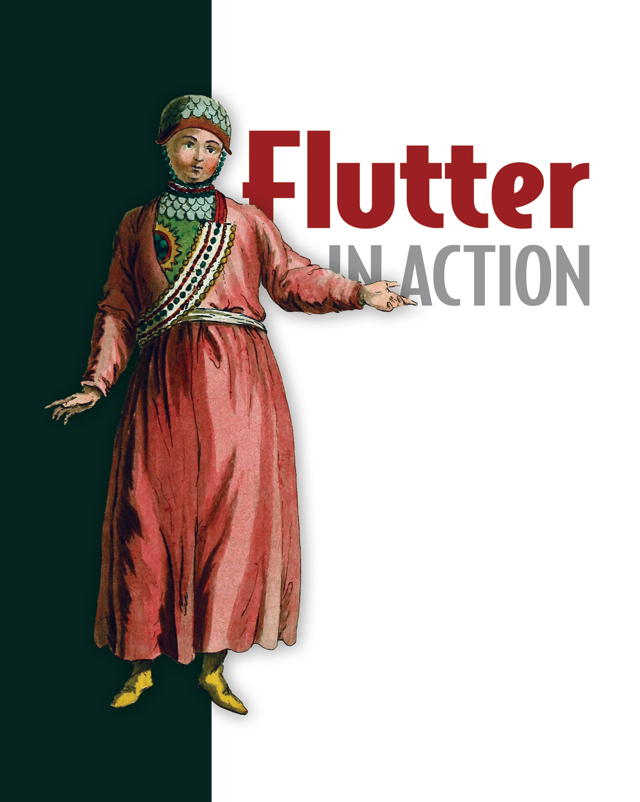
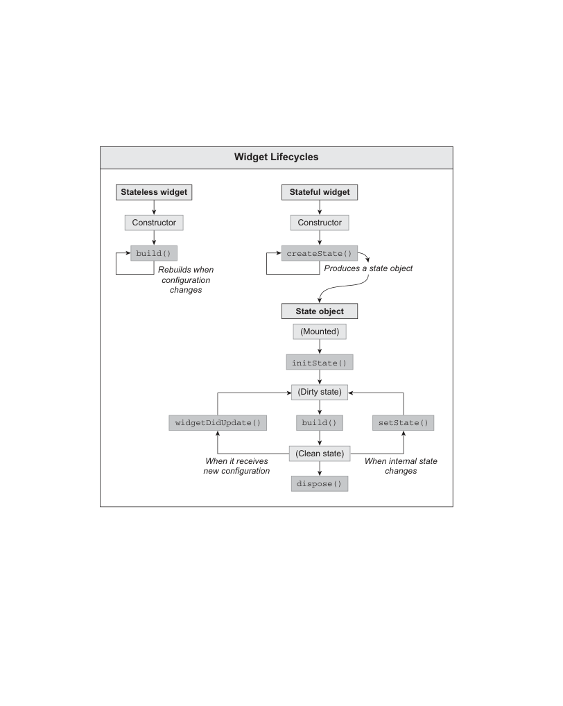
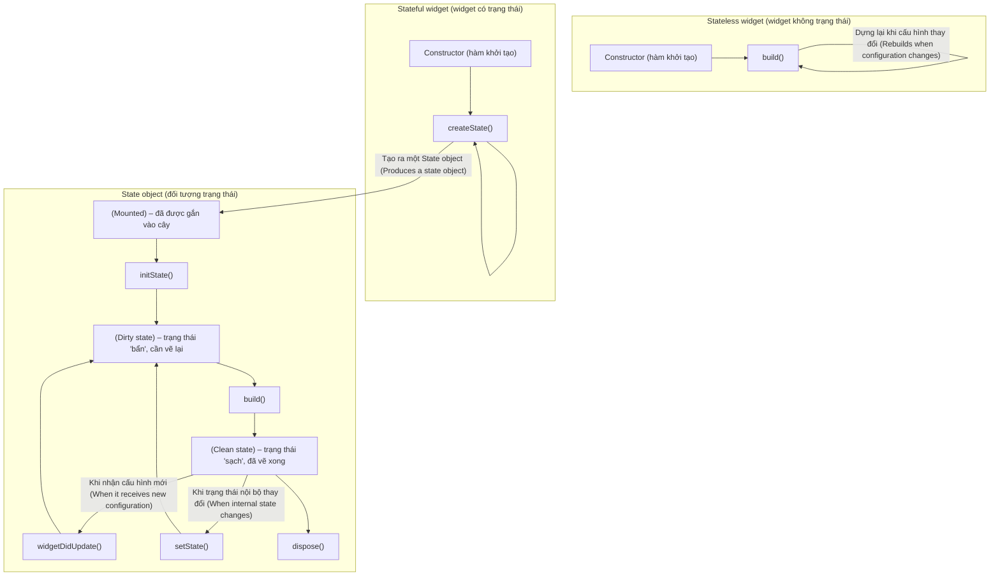

# Lời mở đầu (Front matter)

> Đây là phần "đầu sách" của cuốn **Flutter in Action** (tác giả Eric Windmill, NXB Manning, 2020), tương ứng với các trang PDF 1–28: trang bìa, sơ đồ vòng đời widget ở bìa trong, trang tên sách, trang bản quyền, mục lục tóm tắt, mục lục chi tiết, lời giới thiệu, lời nói đầu, lời cảm ơn, giới thiệu về cuốn sách, về tác giả, về hình minh họa trên bìa, và trang mở đầu Phần 1.

## Mục lục của phần này

- [Trang bìa (Cover)](#trang-bìa-cover)
- [Bìa trong: Vòng đời của widget (Widget Lifecycles)](#bìa-trong-vòng-đời-của-widget-widget-lifecycles)
- [Trang tên sách (Title page)](#trang-tên-sách-title-page)
- [Trang bản quyền (Copyright page)](#trang-bản-quyền-copyright-page)
- [Mục lục tóm tắt (Brief contents)](#mục-lục-tóm-tắt-brief-contents)
- [Mục lục chi tiết (Contents)](#mục-lục-chi-tiết-contents)
- [Lời giới thiệu (Foreword)](#lời-giới-thiệu-foreword)
- [Lời nói đầu (Preface)](#lời-nói-đầu-preface)
- [Lời cảm ơn (Acknowledgments)](#lời-cảm-ơn-acknowledgments)
- [Về cuốn sách này (About this book)](#về-cuốn-sách-này-about-this-book)
- [Về tác giả (About the author)](#về-tác-giả-about-the-author)
- [Về hình minh họa trên bìa (About the cover illustration)](#về-hình-minh-họa-trên-bìa-about-the-cover-illustration)
- [Phần 1: Làm quen với Flutter (Part 1: Meet Flutter)](#phần-1-làm-quen-với-flutter-part-1-meet-flutter)
- [Bảng thuật ngữ của chương](#bảng-thuật-ngữ-của-chương)

---

## Trang bìa (Cover)

Trang bìa ghi: **MANNING** (tên nhà xuất bản) – **Eric Windmill** (tác giả) – **Foreword by Ray Rischpater** (Lời giới thiệu bởi Ray Rischpater).



*Ảnh bìa: tựa sách "Flutter IN ACTION" (Flutter – Thực chiến) bên cạnh hình vẽ một phụ nữ Tatar vùng Kazan mặc áo choàng dài màu hồng đỏ, đội mũ, đeo dải trang sức chéo ngực, trên nền nửa đen nửa trắng. (Ý nghĩa của hình này được giải thích trong mục "Về hình minh họa trên bìa" ở cuối phần này.)*


*Ảnh: logo chữ "M" cách điệu (màu trắng trên nền đen) của nhà xuất bản Manning.*

---

## Bìa trong: Vòng đời của widget (Widget Lifecycles)

Ở mặt trong bìa trước, sách in một sơ đồ tóm tắt **vòng đời** (*lifecycle*) của hai loại widget chính trong Flutter. (Widget là "viên gạch" cơ bản để xây giao diện trong Flutter — mọi thứ hiển thị trên màn hình như nút bấm, chữ, khoảng cách, bố cục... đều là widget.)



Vẽ lại sơ đồ bằng mermaid (chữ trong hình đã được dịch):



**Mô tả sơ đồ bằng lời:**

- **Stateless widget** (widget không có trạng thái): đi qua **Constructor** (hàm khởi tạo) rồi tới **`build()`**. Mũi tên vòng quay lại `build()` mang chú thích *"Rebuilds when configuration changes"* — tức là widget này sẽ được dựng lại (gọi lại `build()`) khi cấu hình (các tham số truyền vào từ widget cha) thay đổi.
- **Stateful widget** (widget có trạng thái): đi qua **Constructor** rồi tới **`createState()`**. Hàm này *"Produces a state object"* — tạo ra một **State object** (đối tượng trạng thái).
- **State object** trải qua các bước:
  1. **(Mounted)** – đối tượng đã được "gắn" vào cây widget.
  2. **`initState()`** – được gọi một lần để khởi tạo.
  3. **(Dirty state)** – trạng thái "bẩn", nghĩa là cần được vẽ lại.
  4. **`build()`** – dựng giao diện.
  5. **(Clean state)** – trạng thái "sạch", giao diện đã khớp với dữ liệu.
  6. Từ trạng thái sạch, có hai đường quay lại trạng thái bẩn:
     - qua **`widgetDidUpdate()`** — *"When it receives new configuration"* (khi nhận được cấu hình mới từ widget cha);
     - qua **`setState()`** — *"When internal state changes"* (khi trạng thái bên trong thay đổi).
  7. Cuối cùng là **`dispose()`** – hủy đối tượng khi nó bị gỡ khỏi cây.

> 📝 **Giải thích thêm (không có trong sách):** Trong API thật của Flutter, phương thức được gọi khi widget nhận cấu hình mới có tên là `didUpdateWidget(oldWidget)` (sơ đồ của sách ghi là `widgetDidUpdate()`). Ngoài ra, giữa `initState()` và `build()` lần đầu, Flutter còn gọi `didChangeDependencies()`. Các chi tiết này sẽ được bàn kỹ hơn ở chương 3 và chương 8 (mục 8.1.2 về vòng đời StatefulWidget).

> 💡 **Ví dụ bổ sung (không có trong sách):** Một widget đếm số đơn giản cho thấy các bước của vòng đời:
>
> ```dart
> import 'package:flutter/material.dart';
>
> class Counter extends StatefulWidget {
>   final String label;
>   const Counter({Key? key, required this.label}) : super(key: key);
>
>   @override
>   State<Counter> createState() => _CounterState(); // tạo State object
> }
>
> class _CounterState extends State<Counter> {
>   int _count = 0;
>
>   @override
>   void initState() {
>     super.initState(); // gọi 1 lần sau khi được mount
>     print('initState');
>   }
>
>   @override
>   void didUpdateWidget(Counter oldWidget) {
>     super.didUpdateWidget(oldWidget); // cha truyền label mới vào
>     print('label đổi từ ${oldWidget.label} sang ${widget.label}');
>   }
>
>   @override
>   void dispose() {
>     print('dispose'); // widget bị gỡ khỏi cây
>     super.dispose();
>   }
>
>   @override
>   Widget build(BuildContext context) {
>     return TextButton(
>       // setState đánh dấu "dirty" -> Flutter gọi lại build()
>       onPressed: () => setState(() => _count++),
>       child: Text('${widget.label}: $_count'),
>     );
>   }
> }
> ```
>
> Mỗi lần bấm nút, `setState()` đưa State về trạng thái "dirty", Flutter gọi lại `build()` và hiển thị số mới (trạng thái "clean").

---

## Trang tên sách (Title page)

**Flutter in Action** (Flutter – Thực chiến)

**ERIC WINDMILL**

**FOREWORD BY RAY RISCHPATER** (Lời giới thiệu bởi Ray Rischpater)

**MANNING** – SHELTER ISLAND (Shelter Island là nơi đặt trụ sở NXB Manning, thuộc bang New York, Mỹ)

---

## Trang bản quyền (Copyright page)

Để xem thông tin trực tuyến và đặt mua cuốn sách này cũng như các sách khác của Manning, vui lòng truy cập www.manning.com. Nhà xuất bản có chiết khấu khi đặt mua sách này với số lượng lớn.

Để biết thêm thông tin, vui lòng liên hệ:

> Special Sales Department (Phòng Kinh doanh Đặc biệt)
> Manning Publications Co.
> 20 Baldwin Road
> PO Box 761
> Shelter Island, NY 11964
> Email: orders@manning.com

©2020 bởi Manning Publications Co. Bảo lưu mọi quyền.

Không phần nào của ấn phẩm này được phép sao chép, lưu trữ trong hệ thống truy xuất, hoặc truyền tải dưới bất kỳ hình thức hay phương tiện nào — điện tử, cơ học, photocopy hay cách khác — khi chưa có sự cho phép trước bằng văn bản của nhà xuất bản.

Nhiều tên gọi mà các nhà sản xuất và người bán dùng để phân biệt sản phẩm của họ đã được đăng ký là nhãn hiệu thương mại. Khi những tên gọi đó xuất hiện trong sách, và Manning Publications biết về việc đăng ký nhãn hiệu đó, thì các tên gọi này được in với chữ cái đầu viết hoa hoặc viết hoa toàn bộ.

Nhận thức được tầm quan trọng của việc gìn giữ những gì đã được viết ra, Manning có chính sách in các cuốn sách mình xuất bản trên giấy không axit (*acid-free paper*), và chúng tôi nỗ lực hết sức để đạt được điều đó. Đồng thời, nhận thức được trách nhiệm bảo tồn tài nguyên của hành tinh, sách của Manning được in trên giấy có ít nhất 15% là giấy tái chế và được xử lý mà không dùng clo nguyên tố (*elemental chlorine*).

| Vai trò | Người đảm nhận |
|---|---|
| Biên tập viên thu mua bản thảo (*Acquisitions editor*) | Brian Sawyer |
| Biên tập viên phát triển nội dung (*Development editor*) | Susanna Kline |
| Biên tập viên phát triển kỹ thuật (*Technical development editor*) | John Guthrie |
| Biên tập viên phụ trách phản biện (*Review editor*) | Aleks Dragosavljević |
| Biên tập viên sản xuất (*Production editor*) | Anthony Calcara |
| Biên tập viên hiệu đính (*Copyeditor*) | Tiffany Taylor và Frances Buran |
| Người đọc soát bản in (*Proofreader*) | Melody Dolab |
| Người đọc soát kỹ thuật (*Technical proofreader*) | Gonzalo Huerta-Cánepa |
| Người dàn trang (*Typesetter*) | Gordan Salinovic |
| Người thiết kế bìa (*Cover designer*) | Marija Tudor |

Địa chỉ: Manning Publications Co., 20 Baldwin Road, PO Box 761, Shelter Island, NY 11964.

ISBN 9781617296147

In tại Hoa Kỳ.

---

## Mục lục tóm tắt (Brief contents)

*(Số ở cột cuối là số trang trong sách gốc.)*

| Phần / Chương | Tên tiếng Việt | Tên gốc | Trang |
|---|---|---|---|
| **PHẦN 1** | **LÀM QUEN VỚI FLUTTER** | MEET FLUTTER | 1 |
| 1 | Làm quen với Flutter | Meet Flutter | 3 |
| 2 | Giới thiệu ngắn gọn về Dart | A brief intro to Dart | 24 |
| 3 | Bước vào thế giới Flutter | Breaking into Flutter | 54 |
| **PHẦN 2** | **TƯƠNG TÁC NGƯỜI DÙNG, PHONG CÁCH VÀ HOẠT ẢNH TRONG FLUTTER** | FLUTTER USER INTERACTION, STYLES, AND ANIMATIONS | 95 |
| 4 | Giao diện Flutter: Các widget quan trọng, theme và bố cục | Flutter UI: Important widgets, themes, and layout | 97 |
| 5 | Tương tác người dùng: Form và cử chỉ | User interaction: Forms and gestures | 129 |
| 6 | "Đẩy pixel": Hoạt ảnh Flutter và dùng canvas | Pushing pixels: Flutter animations and using the canvas | 158 |
| **PHẦN 3** | **QUẢN LÝ STATE VÀ DART BẤT ĐỒNG BỘ** | STATE MANAGEMENT AND ASYNCHRONOUS DART | 189 |
| 7 | Định tuyến trong Flutter – chuyên sâu | Flutter routing in depth | 191 |
| 8 | Quản lý state trong Flutter | Flutter state management | 212 |
| 9 | Dart và Flutter bất đồng bộ, cuộn vô hạn | Async Dart and Flutter and infinite scrolling | 236 |
| **PHẦN 4** | **VƯỢT RA NGOÀI NỀN TẢNG** | BEYOND FOUNDATIONS | 265 |
| 10 | Làm việc với dữ liệu: HTTP, Firestore và JSON | Working with data: HTTP, Firestore, and JSON | 267 |
| 11 | Kiểm thử ứng dụng Flutter | Testing Flutter apps | 292 |

---

## Mục lục chi tiết (Contents)

*(Số trong ngoặc vuông là số trang trong sách gốc. Các tiểu mục không đánh số trong sách được liệt kê dưới dạng gạch đầu dòng.)*

- Lời giới thiệu (*foreword*) — [xv]
- Lời nói đầu (*preface*) — [xvii]
- Lời cảm ơn (*acknowledgments*) — [xix]
- Về cuốn sách này (*about this book*) — [xxi]
- Về tác giả (*about the author*) — [xxiv]
- Về hình minh họa trên bìa (*about the cover illustration*) — [xxv]

### PHẦN 1 – LÀM QUEN VỚI FLUTTER (PART 1 – MEET FLUTTER) — [1]

#### Chương 1 – Làm quen với Flutter (Meet Flutter) — [3]

##### 1.1 Vì sao Flutter dùng Dart? (Why does Flutter use Dart?) — [4]

##### 1.2 Về Dart (On Dart) — [5]

##### 1.3 Ai đang dùng Flutter? (Who uses Flutter?) — [6]

##### 1.4 Ai nên dùng Flutter? (Who should be using Flutter?) — [6]

- Các nhóm phát triển, trưởng dự án và CTO (*Teams, project leads, and CTOs*) — [6]
- Lập trình viên cá nhân (*Individual developers*) — [7]
- Học viên trường dạy lập trình và sinh viên ngành khoa học máy tính mới tốt nghiệp (*Code school students and recent CS grads*) — [7]
- Lập trình viên mã nguồn mở (*Open source developers*) — [7]
- Những người coi trọng tốc độ (*People who value speed*) — [7]
- Những người lười (*People who are lazy*) — [7]
- Những người coi trọng quyền kiểm soát (*People who value control*) — [7]

##### 1.5 Cuốn sách này dành cho ai (Who this book is for) — [8]

##### 1.6 Các lựa chọn phát triển di động khác (Other mobile development options) — [8]

- Phát triển native – iOS và Android (*Native development (iOS and Android)*) — [8]
- Các lựa chọn đa nền tảng dùng JavaScript (*Cross-platform JavaScript options*) — [8]

##### 1.7 Những lợi ích tức thì của Flutter (The immediate benefits of Flutter) — [10]

- Không có cầu nối JavaScript (*No JavaScript bridge*) — [10]
- Thời gian biên dịch (*Compile time*) — [10]
- Viết một lần, kiểm thử một lần, triển khai mọi nơi (*Write once, test once, deploy everywhere*) — [10]
- Chia sẻ mã nguồn (*Code sharing*) — [11]
- Năng suất và sự cộng tác (*Productivity and collaboration*) — [11]
- Bảo trì mã nguồn (*Code maintenance*) — [11]
- Kết luận: Flutter có dành cho bạn không? (*The bottom line: Is Flutter for you?*) — [11]

##### 1.8 Lợi ích tương lai của Flutter: Ứng dụng web và ứng dụng desktop (Future benefits of Flutter: Web apps and desktop apps) — [12]

##### 1.9 Giới thiệu ngắn về cách Flutter hoạt động (A brief intro to how Flutter works) — [12]

- Mọi thứ đều là widget (*Everything is a widget*) — [14]
- Ghép giao diện từ các widget (*Composing UI with widgets*) — [15]
- Các loại widget (*Widget types*) — [16]

##### 1.10 Quá trình render của Flutter: Bên dưới lớp vỏ (Flutter rendering: Under the hood) — [18]

- Dựng cây widget và bố cục (*Composing the widget tree and layout*) — [20]
- Bước tổng hợp lớp (*Compositing step*) — [21]
- Vẽ lên màn hình (*Paint to the screen*) — [22]

##### 1.11 Lời cuối (Final note) — [22]

##### 1.12 Tóm tắt (Summary) — [23]

#### Chương 2 – Giới thiệu ngắn gọn về Dart (A brief intro to Dart) — [24]

##### 2.1 Xin chào, Dart! (Hello, Dart!) — [25]

- Cấu trúc của một chương trình Dart (*Anatomy of a Dart program*) — [26]
- Thêm nhiều lời chào hơn (*Adding more greetings*) — [26]
- Nhập/xuất (I/O) và các thư viện Dart (*I/O and Dart libraries*) — [28]

##### 2.2 Các khái niệm lập trình phổ biến trong Dart (Common programming concepts in Dart) — [29]

- Giới thiệu hệ thống kiểu của Dart (*Intro to Dart's type system*) — [30]
- Chú thích (*Comments*) — [32]
- Biến và phép gán (*Variables and assignment*) — [33]
- Toán tử (*Operators*) — [34]
- Toán tử nhận biết null (*Null-aware operators*) — [34]

##### 2.3 Luồng điều khiển (Control flow) — [36]

- if và else (*if and else*) — [37]
- switch và case (*switch and case*) — [37]
- Cách dùng switch nâng cao (*Advanced switch usage*) — [38]
- Vòng lặp (*Loops*) — [40]

##### 2.4 Hàm (Functions) — [41]

- Cấu trúc của một hàm Dart (*Anatomy of a Dart function*) — [41]
- Tham số (*Parameters*) — [42]
- Giá trị mặc định của tham số (*Default parameter values*) — [43]
- Các khái niệm nâng cao về hàm (*Advanced function concepts*) — [43]
- Phạm vi từ vựng (*Lexical scope*) — [45]

##### 2.5 Lập trình hướng đối tượng (trong Dart) (Object-oriented programming (in Dart)) — [45]

- Lớp (*Classes*) — [46]
- Hàm khởi tạo (*Constructors*) — [48]
- Kế thừa (*Inheritance*) — [49]
- Factory và hàm khởi tạo có tên (*Factories and named constructors*) — [50]
- Kiểu liệt kê (*Enumerators*) — [51]

##### 2.6 Tóm tắt (Summary) — [53]

#### Chương 3 – Bước vào thế giới Flutter (Breaking into Flutter) — [54]

##### 3.1 Giới thiệu ứng dụng đếm số (Intro to the counter app) — [55]

- Cấu trúc dự án Flutter (*Flutter project structure*) — [56]
- Cấu trúc của một ứng dụng Flutter (*Anatomy of a Flutter app*) — [56]
- Một lần nữa: mọi thứ đều là widget (*Again, everything is a widget*) — [57]
- Phương thức build (*The build method*) — [58]
- Hàm khởi tạo new và const trong Flutter (*The new and const constructors in Flutter*) — [59]
- Hot reload (nạp lại nóng) (*Hot reload*) — [59]

##### 3.2 Widget: Cây widget, các loại widget và State object (Widgets: The widget tree, widget types, and the State object) — [60]

- Widget không trạng thái (*Stateless widgets*) — [61]
- Widget có trạng thái (*Stateful widgets*) — [62]
- setState — [64]
- initState — [66]

##### 3.3 BuildContext — [67]

##### 3.4 Cải tiến ứng dụng đếm số bằng những widget quan trọng nhất (Enhancing the counter app with the most important widgets) — [68]

- RaisedButton — [68]

##### 3.5 Ưu tiên kết hợp (composition) hơn kế thừa trong Flutter (Favor composition in Flutter (over inheritance)) — [69]

- Composition là gì? (*What is composition?*) — [69]
- Một ví dụ về composition trong Flutter (*An example of composition in Flutter*) — [71]

##### 3.6 Giới thiệu bố cục trong Flutter (Intro to layout in Flutter) — [72]

- Row và Column (*Row and Column*) — [72]
- Ràng buộc bố cục trong Flutter (*Layout constraints in Flutter*) — [74]
- RenderObject — [74]
- RenderObject và các ràng buộc (*RenderObject and constraints*) — [75]
- RenderBox và lỗi bố cục (*RenderBoxes and layout errors*) — [75]
- Widget nhiều con (*Multi-child widgets*) — [76]
- Icon và FloatingActionButton (*Icons and the FloatingActionButton*) — [78]
- Hình ảnh (*Images*) — [80]
- Widget Container (*Container widget*) — [81]

##### 3.7 Cây element (The element tree) — [83]

- Element và widget (*Elements and widgets*) — [85]
- Khám phá cây element qua một ví dụ (*Exploring the element tree with an example*) — [86]
- Cây element và State object (*The element tree and State objects*) — [88]
- Khóa của widget (*Widget keys*) — [90]

##### 3.8 Lời cuối (A final note) — [92]

##### 3.9 Tóm tắt (Summary) — [93]

### PHẦN 2 – TƯƠNG TÁC NGƯỜI DÙNG, PHONG CÁCH VÀ HOẠT ẢNH TRONG FLUTTER (PART 2 – FLUTTER USER INTERACTION, STYLES, AND ANIMATIONS) — [95]

#### Chương 4 – Giao diện Flutter: Các widget quan trọng, theme và bố cục (Flutter UI: Important widgets, themes, and layout) — [97]

##### 4.1 Thiết lập và cấu hình một ứng dụng Flutter (Setting up and configuring a Flutter app) — [99]

- Cấu hình: pubspec.yaml và main.dart (*Configuration: pubspec.yaml and main.dart*) — [99]
- SystemChrome — [101]

##### 4.2 Widget cấu trúc và thêm về cấu hình (Structural widgets and more configuration) — [102]

- Widget MaterialApp (*MaterialApp widget*) — [102]
- Widget Scaffold (*The Scaffold widget*) — [104]
- Widget AppBar (*AppBar widget*) — [106]

##### 4.3 Phong cách và theme trong Flutter (Styling and themes in Flutter) — [108]

- Widget Theme (*Theme widget*) — [108]
- MediaQuery và phương thức of (*MediaQuery and the of method*) — [110]
- Phương thức ScreenAwareSize (*ScreenAwareSize method*) — [111]

##### 4.4 Các widget bố cục và giao diện thường dùng (Common layout and UI widgets) — [112]

- Widget Stack (*Stack widget*) — [112]
- Widget Table (*Table widget*) — [116]
- Widget TabBar (*TabBar widget*) — [122]

##### 4.5 ListView và builder (ListView and builders) — [126]

#### Chương 5 – Tương tác người dùng: Form và cử chỉ (User interaction: Forms and gestures) — [129]

##### 5.1 Tương tác người dùng và cử chỉ (User interaction and gestures) — [130]

- Widget GestureDetector (*The GestureDetector widget*) — [130]
- GestureDetector trong thực tế (*GestureDetector in practice*) — [131]
- Widget Dismissible (*The Dismissible widget*) — [134]

##### 5.2 Form trong Flutter (Flutter forms) — [136]

- Widget Form (*The Form widget*) — [137]
- GlobalKey&lt;FormState&gt; — [138]
- Cấu trúc của form AddCityPage (*The structure of the AddCityPage form*) — [138]
- Hiện thực form trong ứng dụng thời tiết (*Implementing the form in the weather app*) — [140]

##### 5.3 Các widget FormField (FormField widgets) — [141]

- Widget TextFormField (*The TextFormField widget*) — [142]
- Widget DropdownFormButton (*The DropdownFormButton widget*) — [143]
- Trường form tổng quát (generic) (*Generic form fields*) — [146]

##### 5.4 Giao diện form và làm việc với focus node (Form UI and working with focus nodes) — [147]

- InputDecoration — [147]
- Cải thiện giao diện bằng FocusNode (*Improving the UI with FocusNodes*) — [149]

##### 5.5 Quản lý state của form bằng các phương thức của form (Managing form state with form methods) — [151]

- Form.onChange — [152]
- FormState.save — [153]
- Form.onWillPop — [155]

##### 5.6 Tóm tắt (Summary) — [157]

#### Chương 6 – "Đẩy pixel": Hoạt ảnh Flutter và dùng canvas (Pushing pixels: Flutter animations and using the canvas) — [158]

##### 6.1 Giới thiệu hoạt ảnh trong Flutter (Introducing Flutter animations) — [159]

- Tween (*Tweens*) — [160]
- Đường cong hoạt ảnh (*Animation curves*) — [161]
- Ticker provider (*Ticker providers*) — [162]
- AnimationController — [162]
- AnimatedWidget — [163]
- Hiện thực animation controller và tween cho phần nền (*Implementing the animation controller and tween for the background*) — [166]

##### 6.2 CustomPainter và canvas (CustomPainter and the canvas) — [172]

- Các hình dạng dùng để tạo nên những đám mây (*The shapes used to make up the clouds*) — [173]
- Định nghĩa CustomPainter và đối tượng Paint (*Defining the CustomPainter and the Paint object*) — [173]
- Phương thức paint của CustomPainter (*The CustomPainter paint method*) — [175]

##### 6.3 Hoạt ảnh so le, TweenSequence và các hoạt ảnh dựng sẵn (Staggered animations, TweenSequence, and built-in animations) — [179]

- Tạo một lớp state hoạt ảnh tùy biến (*Creating a custom animation state class*) — [179]
- Widget hoạt ảnh dựng sẵn: SlideTransition (*Built-in animation widgets: SlideTransition*) — [182]
- Xây dựng hoạt ảnh cho widget Clouds (*Building animations for the Clouds widget*) — [184]
- TweenSequence — [185]

##### 6.4 Widget chuyển màu tùy biến có thể tái sử dụng (Reusable custom color transition widgets) — [187]

### PHẦN 3 – QUẢN LÝ STATE VÀ DART BẤT ĐỒNG BỘ (PART 3 – STATE MANAGEMENT AND ASYNCHRONOUS DART) — [189]

#### Chương 7 – Định tuyến trong Flutter – chuyên sâu (Flutter routing in depth) — [191]

##### 7.1 Định tuyến trong Flutter (Routing in Flutter) — [192]

- Ứng dụng Farmers Market (Chợ nông sản) (*The Farmers Market app*) — [192]
- Mã nguồn ứng dụng (*The app source code*) — [193]

##### 7.2 Định tuyến khai báo và route có tên (Declarative routing and named routes) — [193]

- Khai báo route (*Declaring routes*) — [194]
- Điều hướng tới route có tên (*Navigating to named routes*) — [195]
- Widget MaterialDrawer và menu đầy đủ (*MaterialDrawer widget and the full menu*) — [197]
- Các mục menu và widget phù hợp: ListView và ListItem (*Menu items and the appropriate widgets: ListView and ListItems*) — [198]
- NavigatorObserver: Làm nổi bật route đang hoạt động bằng RouteAware (*NavigatorObserver: Highlighting the active route with RouteAware*) — [201]

##### 7.3 Định tuyến "tại chỗ" (Routing on the fly) — [204]

- MaterialRouteBuilder — [204]
- showSnackBar, showBottomSheet và những hàm tương tự (*showSnackBar, showBottomSheet, and the like*) — [205]

##### 7.4 Hoạt ảnh khi chuyển route (Routing animations) — [209]

##### 7.5 Tóm tắt (Summary) — [211]

#### Chương 8 – Quản lý state trong Flutter (Flutter state management) — [212]

##### 8.1 Đi sâu vào StatefulWidget (Deep dive into StatefulWidgets) — [213]

- Cây widget và cây element (*The widget tree and the element tree*) — [213]
- Vòng đời của StatefulWidget và khi nào làm gì (*The StatefulWidget lifecycle and when to do what*) — [214]

##### 8.2 Quản lý state thuần Flutter: InheritedWidget (Pure Flutter state management: The InheritedWidget) — [216]

- Tạo một kho trung tâm (Central Store) bằng bộ đôi InheritedWidget/StatefulWidget (*Creating a Central Store with an InheritedWidget/StatefulWidget team*) — [218]
- Phương thức inheritFromWidgetOfExactType và of (*The inheritFromWidgetOfExactType and of methods*) — [218]
- Dùng phương thức of để "nâng" state lên (*Use the of method to lift up state*) — [222]
- Các mẫu quản lý state ngoài phạm vi Flutter (*State management patterns beyond Flutter*) — [224]

##### 8.3 Bloc: Thành phần logic nghiệp vụ (Blocs: Business Logic Components) — [225]

- Bloc hoạt động như thế nào? (*How do blocs work?*) — [227]
- Hiện thực kiến trúc bloc (*Implementing the bloc architecture*) — [228]
- Giới thiệu stream và Dart bất đồng bộ (*Intro to streams and async Dart*) — [231]
- Hiện thực stream trong CartBloc (*Implementing streams in the CartBloc*) — [232]

##### 8.4 Tóm tắt (Summary) — [235]

#### Chương 9 – Dart và Flutter bất đồng bộ, cuộn vô hạn (Async Dart and Flutter and infinite scrolling) — [236]

##### 9.1 Dart bất đồng bộ (Async Dart) — [237]

- Ôn lại Future (*Future recap*) — [237]
- Từ khóa async/await (*The async/await keywords*) — [239]
- Bắt lỗi với future (*Catching errors with futures*) — [240]
- Bắt lỗi bằng try và catch (*Catching errors with try and catch*) — [241]

##### 9.2 Sink và stream (và StreamController) (Sinks and streams (and StreamControllers)) — [242]

- Cấu trúc của mẫu observer với stream trong Dart (*Anatomy of the observer pattern with Dart streams*) — [243]
- Hiện thực stream (*Implementing streams*) — [243]
- Stream phát quảng bá (broadcast) (*Broadcasting streams*) — [245]
- Stream bậc cao (*Higher-order streams*) — [247]

##### 9.3 Dùng stream trong bloc (Using streams in blocs) — [250]

- Bloc dùng đầu vào và đầu ra (*Blocs use inputs and outputs*) — [250]
- Hiện thực một đầu vào của bloc (*Implementing a bloc input*) — [253]

##### 9.4 Flutter bất đồng bộ: StreamBuilder (Async Flutter: StreamBuilder) — [254]

##### 9.5 Widget cuộn vô hạn và cuộn tùy biến (Infinite and custom scrollable widgets) — [255]

- CustomScrollView và sliver (*CustomScrollView and slivers*) — [256]
- Scroll view của widget Catalog (*Catalog widget scroll view*) — [256]
- Widget SliverGrid (*The SliverGrid widget*) — [260]
- Delegate (*Delegates*) — [260]
- Sliver tùy biến (*Custom slivers*) — [261]

### PHẦN 4 – VƯỢT RA NGOÀI NỀN TẢNG (PART 4 – BEYOND FOUNDATIONS) — [265]

#### Chương 10 – Làm việc với dữ liệu: HTTP, Firestore và JSON (Working with data: HTTP, Firestore, and JSON) — [267]

##### 10.1 HTTP và Flutter (HTTP and Flutter) — [268]

- Gói HTTP (*HTTP package*) — [269]
- Yêu cầu GET (*GET requests*) — [269]

##### 10.2 Tuần tự hóa JSON (JSON serialization) — [270]

- Tuần tự hóa thủ công (*Manual serialization*) — [271]
- Tuần tự hóa JSON tự động sinh mã (*Auto-generated JSON serialization*) — [275]
- Cập nhật lớp Todo (*Updating the Todo class*) — [275]
- Kết hợp tất cả trong giao diện (*Bringing it all together in the UI*) — [277]

##### 10.3 Làm việc với Firebase trong Flutter (Working with Firebase in Flutter) — [281]

- Cài đặt Firestore (*Installing Firestore*) — [282]
- Tạo một dự án Firestore (*Create a Firestore project*) — [283]
- Cấu hình ứng dụng (*Configure your app*) — [283]
- Thêm Firebase vào pubspec (*Add Firebase to your pubspec*) — [286]
- Sử dụng Firestore (*Using Firestore*) — [286]

##### 10.4 Tiêm phụ thuộc (Dependency injection) — [288]

##### 10.5 Tóm tắt (Summary) — [291]

#### Chương 11 – Kiểm thử ứng dụng Flutter (Testing Flutter apps) — [292]

##### 11.1 Kiểm thử trong Flutter (Tests in Flutter) — [293]

- Unit test (kiểm thử đơn vị) trong Dart (*Dart unit tests*) — [293]
- Dùng mockito để kiểm thử các phương thức cần phụ thuộc bên ngoài (*Using mockito to test methods that need external dependencies*) — [297]
- Widget test (kiểm thử widget) trong Flutter (*Flutter widget tests*) — [300]
- Integration test (kiểm thử tích hợp) trong Flutter (*Flutter integration tests*) — [303]
- Kiểm thử tích hợp để đo hiệu năng (*Performance profiling integration tests*) — [307]

##### 11.2 Khả năng tiếp cận với các widget semantics (Accessibility with the semantics widgets) — [310]

##### 11.3 Những bước tiếp theo với Flutter (Next steps with Flutter) — [311]

### Phụ lục (Appendices)

- Phụ lục A – Cài đặt: Dart2 (*appendix A – Installation: Dart2*) — [313]
- Phụ lục B – Trình quản lý gói Pub (*appendix B – The Pub package manager*) — [318]
- Phụ lục C – Flutter cho lập trình viên web (*appendix C – Flutter for web developers*) — [321]
- Phụ lục D – Flutter cho lập trình viên iOS (*appendix D – Flutter for iOS developers*) — [324]
- Phụ lục E – Flutter cho lập trình viên Android (*appendix E – Flutter for Android developers*) — [328]
- Chỉ mục (*index*) — [331]

> 📝 **Giải thích thêm (không có trong sách):** Một vài tên trong mục lục phản ánh phiên bản Flutter thời điểm sách ra đời (2019–2020). Ví dụ `RaisedButton` nay đã được thay bằng `ElevatedButton`, `inheritFromWidgetOfExactType` nay là `dependOnInheritedWidgetOfExactType`, và `showSnackBar` nay được gọi qua `ScaffoldMessenger.of(context).showSnackBar(...)`. Kiến thức nền tảng của sách vẫn giữ nguyên giá trị; bạn chỉ cần lưu ý đổi tên API khi viết code với Flutter phiên bản mới.

---

## Lời giới thiệu (Foreword)

Một trong những điều mà đội ngũ Flutter vô cùng biết ơn là **cộng đồng** lập trình viên Flutter luôn sẵn lòng hỗ trợ nhau. Gần như với bất kỳ câu hỏi nào bạn có, bạn đều có thể tìm được câu trả lời trên Stack Overflow, Medium, hoặc thậm chí trên tài khoản GitHub của ai đó. Nhiều câu trả lời còn kèm theo mã mẫu chạy được hoàn chỉnh, với giấy phép cho phép bạn dùng thẳng đoạn mã đó trong ứng dụng của mình. Chúng tôi coi tinh thần hợp tác và tình bằng hữu này là yếu tố then chốt giúp bạn thành công với Flutter.

Tuy vậy, cho tới nay vẫn có rất ít tài liệu mà bạn có thể thực sự **cầm trên tay** và ngồi thực hành tại bàn làm việc, hay vào những buổi tối, trong lúc học cách dùng Flutter. Dù blog, Medium và tài liệu trực tuyến đã tạo ra một sự thay đổi mô hình (*paradigm shift*) đối với các nhà xuất bản sách — đặc biệt trong lĩnh vực máy tính — nhưng nhu cầu về những tài liệu dài, viết sâu về một chủ đề vẫn còn đó, và Flutter cũng không phải ngoại lệ.

Đó là lý do cuốn sách này quan trọng đến vậy. Có những thứ bạn không thể có được từ một bài Medium dài năm trăm chữ hay một đoạn mã trên Stack Overflow. Để suy nghĩ thấu đáo về những vấn đề như cách ứng dụng của bạn quản lý state (trạng thái) của nó, bạn cần hiểu nền tảng một cách sâu sắc. Trong cuốn sách này, bạn không chỉ thấy *cách* dùng Flutter, mà còn hiểu *tại sao* việc dùng Flutter theo những cách mà Eric và mọi người trên mạng khuyên lại thực sự hiệu quả trong thực tế.

Eric đề cập đến nhiều điều mà các lập trình viên thấy khó khăn khi chuyển sang Flutter. Qua những trang sách này, bạn sẽ học được bố cục (*layout*) hoạt động như thế nào, cách xây dựng các widget tương tác với người dùng, và cách xây dựng những ứng dụng phức tạp trải dài qua nhiều trang (màn hình) và mang theo state ứng dụng phức tạp. Với những ai mới làm quen với Dart, có hẳn một chương nói về cách Dart xử lý tính bất đồng bộ (*asynchronicity*). Bởi vì ứng dụng di động ngày nay là những ứng dụng có giao tiếp (với máy chủ, với dịch vụ khác), bạn cũng sẽ thấy cách xử lý JSON với các backend HTTP, và như một phần thưởng thêm, cách dùng Firestore để quản lý việc lưu trữ dữ liệu. Và để khép lại, có cả một chương về kiểm thử.

Xuyên suốt cuốn sách, Eric đã dành thời gian để giải thích không chỉ *cái gì* mà còn *tại sao*. Tôi khuyên bạn cũng làm như vậy — dù bạn hoàn toàn có thể nhảy vào rồi nhảy ra khỏi một chương để lấy đúng "mẩu" thông tin mình cần, nhưng tại sao không dừng lại một phút, tận hưởng trải nghiệm thực sự cầm cuốn sách này trên tay và đi sâu hơn? Làm như vậy sẽ giúp bạn trở thành một lập trình viên Flutter giỏi hơn, và còn mang lại lợi ích ở những khía cạnh khác trong cuộc sống, khi bạn chậm lại và nhớ ra cách không chỉ *học*, mà còn *làm chủ* một công nghệ mới.

Tôi và toàn bộ đội ngũ Flutter rất háo hức được thấy những gì bạn xây dựng bằng Flutter. Cảm ơn bạn đã tin tưởng gửi gắm ý tưởng của mình cho chúng tôi.

—**RAY RISCHPATER**
*Quản lý chương trình kỹ thuật (Technical Program Manager), Flutter*
*GOOGLE*

---

## Lời nói đầu (Preface)

Khi tôi bắt đầu dùng Flutter vào tháng 9 năm 2017, nó còn đang ở giai đoạn alpha (bản thử nghiệm sớm). Tôi bắt đầu dùng nó vì sếp bảo thế. Tôi chẳng có ý kiến gì về nó cả, vì tôi chưa từng nghe đến nó. Tôi thậm chí còn chưa nghe tới Dart, dù lúc đó ngôn ngữ này đã tồn tại gần một thập kỷ. Nhưng — và chắc đây cũng chẳng phải là "tiết lộ nội dung" gì — tôi bị cuốn hút ngay lập tức. Không chỉ sản phẩm cuối cùng có chất lượng cao nhất, mà quá trình phát triển có lẽ còn là thú vị nhất trong mọi SDK (bộ công cụ phát triển phần mềm) mà tôi từng dùng. Công cụ, cộng đồng, API và ngôn ngữ Dart — tất cả đều khiến việc tham gia trở thành một niềm vui.

Đó là lý do tôi viết cuốn sách này. Tôi thật lòng tin rằng Dart và Flutter là "tiêu chuẩn vàng" của việc phát triển ứng dụng trong tương lai gần. Và tôi đã viết một cuốn sách mà tôi nghĩ sẽ đưa bất kỳ lập trình viên nào đi từ con số không đến con số một với Flutter. Cuốn sách này một nửa là hướng dẫn thực hành (*tutorial*), một nửa là đi "truyền giáo" (*spreading the good word* — lan tỏa điều tốt đẹp).

Gần hai năm sau khi bắt đầu dùng Flutter, giờ tôi đang làm công việc thứ hai cho phép tôi xây dựng ứng dụng Flutter mỗi ngày, và sự nhiệt huyết của tôi vẫn chưa hề phai nhạt. Flutter là chân lý (*Flutter is the truth*).

Trong hai năm đó, Flutter đã lớn lên khá nhiều. Nó đi từ alpha lên beta rồi lên phiên bản 1, và giờ đã ổn định (*stable*). Dart đi từ phiên bản 1 lên 2, và hiện đang dồn nhiều công sức để trở thành một ngôn ngữ lý tưởng cho việc viết giao diện người dùng hiện đại. Và giờ đây, vào thời điểm viết sách này, Flutter cho web đang ở giai đoạn xem trước kỹ thuật (*technical preview*). Có vẻ mọi thứ sẽ chỉ ngày càng thú vị hơn.

Flutter sẽ tiếp tục được cải thiện, nhưng nền móng giờ đã được đặt xong. Và đó là lý do tôi nghĩ cuốn sách này thực sự có thể giúp ích. Dù Flutter phát triển ra sao, cuốn sách này sẽ giúp bạn khởi đầu và xây dựng nền tảng Flutter cho mình.

Không thiếu tài liệu để học Flutter. Tuy nhiên, mục tiêu của tôi với cuốn sách này là bao quát toàn bộ quá trình trong một lần. Bạn sẽ học một chút về Dart, và học rất nhiều về Flutter. Đến cuối sách, bạn sẽ có kinh nghiệm viết một ứng dụng di động từ đầu. Cuốn sách này bao gồm mọi kiến thức nền tảng bạn cần để viết những ứng dụng di động đẹp mắt và mượt "như bơ" (*buttery-smooth*) bằng Flutter. Tôi sẽ đề cập đến giao diện và bố cục, hoạt ảnh và phong cách (*styling*), yêu cầu mạng, quản lý state, và nhiều hơn nữa.

> 📝 **Giải thích thêm (không có trong sách):** "Đi từ con số không đến con số một" (*from zero to one*) là cách nói chỉ bước khó nhất: từ chỗ chưa biết gì đến chỗ có thể tự làm được một sản phẩm thật. "Mượt như bơ" là cách dân lập trình di động mô tả ứng dụng chạy ổn định ở 60 khung hình/giây (hoặc hơn), không giật lag — đây là một thế mạnh nổi bật của Flutter vì nó tự vẽ giao diện bằng engine riêng.

---

## Lời cảm ơn (Acknowledgments)

Đây là cuốn sách đầu tiên tôi viết. Một trong những điều tôi học được trong quá trình này là có biết bao nhiêu người tham gia vào. Tôi thực sự chỉ là một trong rất, rất nhiều người đã dồn nhiều công sức vào cuốn sách này.

Trước hết, tôi muốn cảm ơn hai người sếp cũ đồng thời là đồng nghiệp của tôi, Matthew Smith và John Ryan. Khi họ tuyển tôi vào AppTree, tôi chưa từng nghe đến Flutter hay Dart. Hơn nữa, tôi khi đó vẫn còn (và đến giờ vẫn còn) rất nhiều điều phải học về xây dựng phần mềm. Họ đã dạy tôi mọi thứ tôi biết, và luôn kiên nhẫn suốt cả quá trình. Đó là công việc tốt nhất tôi từng có, và nó đã cho tôi cơ hội "phải lòng" Dart và Flutter.

Tôi muốn ghi nhận biên tập viên của tôi tại Manning, Susanna Kline, vì hai lý do. Thứ nhất, tôi hoàn toàn không biết viết sách thế nào. Susanna đã kiên nhẫn nhưng cũng bền bỉ. Chị ấy tử tế nhưng cũng thẳng thắn. Tất cả những phẩm chất đó chắc chắn đã giúp tôi viết ra cuốn sách tốt nhất mà tôi có thể. Và thứ hai, chị thực sự để tôi tự do khám phá và viết cuốn sách mà tôi muốn viết. Đó là lý do mà, đến cuối quá trình này, tôi vẫn yêu thích nó.

Tôi muốn cảm ơn tất cả những người phản biện, đồng nghiệp và bạn bè đã đọc bản thảo và góp ý. Trong đó có cả những người đã bình luận trên diễn đàn sách của Manning. Tôi có thể khẳng định chắc chắn 100% rằng cuốn sách sẽ kém đi nếu thiếu những góp ý đó. Cụ thể, tôi muốn cảm ơn tất cả những người phản biện: Andy King, Damian Esteban, David Cabrero Souto, Edwin Kwok, Flavio Diez, Fred Heath, George Onofrei, Godfred Asamoah, Gonzalo Huerta-Cánepa, Jacob Romero, Joel Kotarski, Jose San Leandro, Kumar Unnikrishnan, Martin Dehnert, Nitin Gode, Paul Brown, Petru Bocsanean, Pietro Maffi, Samuel Bosch, Sander Zegvelt, Serge Simon, Thamizh Arasu, Willis Hampton và Zorodzayi Mukuya.

Tất nhiên, tôi phải cảm ơn tất cả những người làm việc trên Flutter và Dart, cũng như cộng đồng Flutter trên mạng. Cộng đồng này cho đến nay là cộng đồng công nghệ dễ chịu, truyền cảm hứng và thân thiện nhất mà tôi từng tham gia.

Cuối cùng, tôi muốn cảm ơn những chú chó và chú mèo mà tôi quen, những bé mà tôi đã dùng làm ví dụ xuyên suốt cuốn sách: Nora, Odyn, Ruby, Doug, Harper, Tucker, Yeti và Rosie. (Nếu bạn là chủ của một trong những con vật này và đang đọc dòng này, bạn sẽ không nhận được tiền bản quyền đâu nhé. Cảm ơn bạn.)

---

## Về cuốn sách này (About this book)

*Flutter in Action* là cuốn sách nhằm trao cho mọi người (và bất kỳ ai) khả năng tạo ra ứng dụng di động bằng Flutter SDK và ngôn ngữ lập trình Dart. Trước tiên, sách tập trung vào việc hiểu **ai, cái gì, tại sao và như thế nào** của Flutter. Qua vài chương đầu, tôi hy vọng sẽ thuyết phục được bạn rằng Flutter đáng để bạn bỏ thời gian, và dẫn dắt bạn nhẹ nhàng vào những điều cơ bản. Sau đó, tôi đi sâu vào giao diện người dùng (UI): bố cục, định tuyến (*routing*), hoạt ảnh (*animations*) và nhiều thứ khác. Tiếp theo, tôi dành thời gian cho quản lý state và những khái niệm khó hơn, như lập trình bất đồng bộ (*asynchronous programming*) với Flutter trong Dart. Tôi kết thúc bằng vài chương ngắn về HTTP và Firebase, cũng như kiểm thử.

Điều quan trọng là cuốn sách này tập trung vào nội dung **đặc thù của Flutter**. Tôi sẽ không dùng các tài nguyên của bên thứ ba để phát triển những ứng dụng ngách hay giải quyết những vấn đề ngách. Toàn bộ cuốn sách chỉ dùng một số ít thư viện nằm ngoài Flutter.

### Ai nên đọc cuốn sách này (Who should read this book)

Cuốn sách này dành cho các lập trình viên ứng dụng muốn viết ứng dụng Flutter. Dù bạn có kinh nghiệm viết ứng dụng web, ứng dụng di động native (gốc), Xamarin, hay một thứ gì đó mà tôi thậm chí còn chưa biết tới, cuốn sách này đều dành cho bạn. Điều quan trọng bạn cần nắm là các ứng dụng hiện đại hoạt động như thế nào. Tôi không đòi hỏi bạn biết viết code trên toàn bộ "stack" (từ giao diện, backend đến cơ sở dữ liệu), chỉ cần bạn biết một stack hiện đại gồm những gì.

Ngoài kia có vô số tài liệu và bài blog chứa phần lớn những thông tin này. Mục đích của cuốn sách là gom mọi thứ lại với nhau trong một định dạng dễ theo dõi.

> 📝 **Giải thích thêm (không có trong sách):** Một "stack hiện đại" điển hình của ứng dụng di động gồm: (1) **client** — ứng dụng chạy trên điện thoại (ở đây là Flutter); (2) **API/backend** — máy chủ cung cấp dữ liệu qua HTTP, thường trả về JSON; (3) **cơ sở dữ liệu** — nơi lưu dữ liệu (SQL, hoặc dịch vụ như Firestore); và có thể thêm (4) dịch vụ xác thực, thông báo đẩy, lưu trữ file... Bạn chỉ cần hiểu các mảnh ghép này nói chuyện với nhau ra sao là đủ để theo cuốn sách.

### Cuốn sách được tổ chức như thế nào (How this book is organized)

Cuốn sách có mười một chương, chia thành bốn phần.

**Phần 1** nhằm chuẩn bị cho bạn bắt tay vào việc:

- **Chương 1** giải thích Flutter là gì và vì sao chúng ta, những lập trình viên di động, nên quan tâm. Chương này cũng đi vào những điều cơ bản của Flutter.
- **Chương 2** rẽ ngang một chút và trình bày (ngắn gọn) về ngôn ngữ lập trình Dart, cùng phần giới thiệu về lập trình hướng đối tượng (OOP – *object-oriented programming*). Nếu bạn đã biết Dart, hoặc thấy thoải mái khi học một ngôn ngữ mới, bạn có thể bỏ qua chương này.
- **Chương 3** đi sâu vào cách Flutter hoạt động "bên dưới lớp vỏ" (*under the hood*) và những điều cơ bản khi viết code Flutter. Đến cuối chương này, bạn sẽ thiết lập xong môi trường, đồng thời có hiểu biết cơ bản về việc viết một ứng dụng Flutter.

**Phần 2** bao quát mọi thứ về giao diện (UI). Phần này dùng một ứng dụng "ngốc", không có state (*a dumb, stateless app*) để trình bày về form, hoạt ảnh và nhiều thứ khác:

- **Chương 4** trình bày tất cả các widget cơ bản trong Flutter. Chương này xoay quanh những tính năng nền tảng mà gần như chắc chắn bạn sẽ dùng trong mọi ứng dụng Flutter bạn từng viết.
- **Chương 5** nói về form và cử chỉ (*gestures*). Nói ngắn gọn, chương này giải thích cách người dùng tương tác với ứng dụng bạn đang viết.
- **Chương 6** nói về việc làm cho ứng dụng trở nên đẹp mắt. Chương này đề cập đến việc vẽ lên canvas (khung vẽ) và đi sâu vào hoạt ảnh trong Flutter.

**Phần 3** hoàn toàn dành cho quản lý state. Một số nội dung trong phần này là nơi xuất hiện nhiều khái niệm khó nhất. Phần này dùng một ứng dụng thương mại điện tử (*e-commerce*) làm ví dụ:

- **Chương 7** hoàn toàn nói về định tuyến (*routing*). Chương này bao gồm việc truyền state từ route này sang route khác, cũng như hoạt ảnh khi chuyển route.
- **Chương 8** nói về quản lý state. Đây là chương đầu tiên đề cập tới một số khái niệm không hẳn chỉ riêng của Flutter. Chương này giới thiệu những loại widget mới, như InheritedWidget, cũng như cách dùng mẫu bloc (*bloc pattern*) để quản lý state.
- **Chương 9** có lẽ là chương tôi yêu thích nhất. Chương này đề cập tới các khái niệm Dart bất đồng bộ như stream (luồng dữ liệu) và cách đưa những khái niệm đó vào Flutter. Tiết lộ trước: Flutter hỗ trợ những tính năng này như "công dân hạng nhất" (*first-class citizens* — tức là được hỗ trợ tận gốc, đầy đủ, không phải chắp vá).

**Phần 4** có tên "Vượt ra ngoài nền tảng" (*Beyond the Foundation*) vì nó nói về việc bước ra khỏi IDE của bạn để đến với những chủ đề có thể áp dụng cho bất kỳ SDK nào: gọi mạng, Firebase, làm việc với JSON và kiểm thử:

- **Chương 10** hoàn toàn nói về việc sử dụng các tài nguyên bên ngoài. Chương này đề cập tới HTTP, Firebase và tuần tự hóa JSON (*JSON serialization*).
- **Chương 11** nói về chủ đề "được yêu thích" của tất cả mọi người: kiểm thử. Chương này bao gồm framework kiểm thử tích hợp sẵn của Flutter, cũng như mockito và Flutter driver.

Nhìn chung, cuốn sách này được thiết kế để kiến thức xây dựng dần từ chương này sang chương khác. Đây là sách kiểu hướng dẫn thực hành, nghĩa là nếu bạn "tự chọn cuộc phiêu lưu của mình" (*choose your own adventure* — nhảy cóc giữa các chương theo ý thích), bạn có thể bỏ lỡ những mảnh kiến thức quan trọng.

> 📝 **Giải thích thêm (không có trong sách):** Câu "chủ đề được yêu thích của tất cả mọi người: kiểm thử" là một câu nói đùa mỉa mai nhẹ của tác giả — vì kiểm thử thường là phần mà lập trình viên... ít hứng thú nhất, dù nó rất quan trọng.

> 💡 **Ví dụ bổ sung (không có trong sách):** Gợi ý lộ trình đọc theo xuất phát điểm của bạn:
>
> | Bạn là... | Gợi ý lộ trình |
> |---|---|
> | Mới học lập trình, chưa biết Dart | Đọc tuần tự chương 1 → 11, làm theo mọi ví dụ |
> | Đã biết Java/C#/TypeScript | Lướt nhanh chương 2 (Dart giống "Java Lite"), đọc kỹ chương 3 trở đi |
> | Đã viết app Flutter cơ bản | Ôn nhanh phần 1–2, tập trung phần 3 (state, bất đồng bộ) và phần 4 |
>
> Dù chọn lộ trình nào, vì sách xây dựng kiến thức nối tiếp nhau, hãy chắc rằng bạn nắm các khái niệm widget, State object, BuildContext ở chương 3 trước khi sang phần 3.

### Về mã nguồn (About the code)

Cuốn sách này chứa (phần lớn là) những khối code lớn, thay vì những đoạn code ngắn. Vì thế, hầu hết các ví dụ đều được chú thích và giải thích cho từng code listing (đoạn mã được đánh số). Vì cuốn sách này nói về việc viết những ứng dụng hoàn chỉnh, code của mỗi mục phụ thuộc rất nhiều vào toàn bộ ứng dụng. Do đó, ở đầu hầu hết các đoạn code, tôi để lại một dòng chú thích, theo sau dấu `//` ở dòng đầu tiên, cho biết bạn có thể tìm thấy đoạn code đó ở đâu trong mã nguồn của ứng dụng.

Bạn có thể tìm mã nguồn của các ứng dụng ví dụ này bằng cách tải về từ trang web của nhà xuất bản tại https://www.manning.com/books/flutter-in-action.

> 💡 **Ví dụ bổ sung (không có trong sách):** Quy ước "dòng chú thích chỉ vị trí file" trông như sau — dòng đầu cho bạn biết đoạn code nằm ở file nào trong dự án mẫu (đường dẫn dưới đây chỉ mang tính minh họa):
>
> ```dart
> // weather_app/lib/main.dart
> import 'package:flutter/material.dart';
>
> void main() => runApp(MyApp());
> ```
>
> Khi gặp một listing như vậy, hãy mở đúng file đó trong mã nguồn tải về để xem toàn cảnh đoạn code nằm trong ngữ cảnh nào.

### Diễn đàn thảo luận liveBook (liveBook discussion forum)

Khi mua *Flutter in Action*, bạn được truy cập miễn phí vào một diễn đàn web riêng do Manning Publications vận hành, nơi bạn có thể bình luận về cuốn sách, đặt câu hỏi kỹ thuật, và nhận trợ giúp từ tác giả cũng như từ những người dùng khác. Để truy cập diễn đàn, hãy vào https://livebook.manning.com/#!/book/flutter-in-action/discussion. Bạn cũng có thể tìm hiểu thêm về các diễn đàn của Manning và quy tắc ứng xử tại https://livebook.manning.com/#!/discussion.

Cam kết của Manning đối với độc giả là cung cấp một nơi để diễn ra những cuộc đối thoại có ý nghĩa giữa các độc giả với nhau, và giữa độc giả với tác giả. Đây không phải là cam kết về bất kỳ mức độ tham gia cụ thể nào từ phía tác giả, người đóng góp cho diễn đàn hoàn toàn tự nguyện (và không được trả tiền). Chúng tôi gợi ý bạn hãy thử hỏi tác giả vài câu hỏi hóc búa, kẻo ông ấy mất hứng thú! Diễn đàn và kho lưu trữ các cuộc thảo luận trước đây sẽ có thể truy cập được từ trang web của nhà xuất bản chừng nào cuốn sách còn được phát hành.

---

## Về tác giả (About the author)

**Eric Windmill** là một kỹ sư phần mềm, chủ yếu tập trung vào các ứng dụng phía client (phía người dùng). Anh đủ may mắn để được làm việc với Flutter từ những ngày đầu tiên của nó, và đến nay là ở nhiều công ty khác nhau. Anh là tác giả của trang FlutterByExample.com. Anh có niềm đam mê giúp mở cửa và xóa bỏ rào cản để mọi người có thể bước vào ngành công nghệ.

---

## Về hình minh họa trên bìa (About the cover illustration)

Nhân vật trên bìa sách *Flutter in Action* có chú thích là "Femme Tattare de Kazan" (tiếng Pháp), hay "Kazan Tattar Woman" trong tiếng Anh — tức "Người phụ nữ Tatar vùng Kazan". Hình minh họa được lấy từ một bộ sưu tập tác phẩm của nhiều họa sĩ, do Louis Curmer biên tập và xuất bản tại Paris năm 1841. Tên của bộ sưu tập là *Les Français peints par eux-mêmes*, dịch ra là *Người Pháp do chính họ vẽ nên* (*The French People Painted by Themselves*). Mỗi hình minh họa đều được vẽ tinh xảo và tô màu bằng tay, và sự phong phú của các bức vẽ trong bộ sưu tập nhắc nhở chúng ta một cách sống động rằng các vùng miền, thị trấn, làng mạc và khu dân cư trên thế giới khác biệt nhau về văn hóa đến mức nào, chỉ mới 200 năm trước. Sống tách biệt với nhau, con người nói những phương ngữ và ngôn ngữ khác nhau. Trên đường phố hay ở vùng nông thôn, chỉ cần nhìn trang phục là dễ dàng nhận ra họ sống ở đâu, làm nghề gì hay có địa vị như thế nào trong xã hội.

Cách ăn mặc đã thay đổi kể từ đó, và sự đa dạng theo vùng miền — vốn rất phong phú vào thời ấy — đã phai nhạt dần. Giờ đây thật khó để phân biệt cư dân của các châu lục khác nhau, chứ đừng nói đến các thị trấn hay vùng miền khác nhau. Có lẽ chúng ta đã đánh đổi sự đa dạng văn hóa để lấy một đời sống cá nhân phong phú hơn — và chắc chắn là một đời sống công nghệ phong phú và nhịp độ nhanh hơn.

Trong thời buổi mà thật khó để phân biệt cuốn sách máy tính này với cuốn khác, Manning tôn vinh sự sáng tạo và tinh thần chủ động của ngành máy tính bằng những bìa sách dựa trên sự đa dạng phong phú của đời sống vùng miền cách đây hai thế kỷ, được hồi sinh nhờ những bức tranh từ các bộ sưu tập như bộ sưu tập này.

---

## Phần 1: Làm quen với Flutter (Part 1: Meet Flutter)

Phần đầu tiên của cuốn sách gồm ba chương, nhằm chuẩn bị cho bạn xây dựng những ứng dụng Flutter hoàn chỉnh. Cụ thể, phần này bao gồm ba chủ đề.

Thứ nhất, tôi sẽ giới thiệu mọi thứ về Flutter trong chương 1. Điều này bao gồm *ai, cái gì, tại sao và như thế nào*: Flutter hoạt động ra sao, vì sao nó đáng để đầu tư, và mô hình tư duy (*mental model*) cần có để sử dụng SDK này. Chương này chủ yếu mang tính khái niệm và có rất ít code.

Tôi cũng dành hẳn một chương cho Dart, ngôn ngữ lập trình mà Flutter sử dụng. Tôi thích gọi Dart là **"Java Lite"** (Java phiên bản nhẹ). Và tôi nói vậy theo nghĩa tích cực nhất. Nếu bạn đã quen với các ngôn ngữ hướng đối tượng và có kiểu mạnh (*strongly typed*), có lẽ bạn chỉ cần đọc lướt chương này.

Sau đó, trong chương 3, chúng ta sẽ khám phá chính Flutter. Chương này dùng một ứng dụng Flutter ví dụ đơn giản để giải thích Flutter hoạt động như thế nào, cả từ góc độ cách bạn viết code, lẫn một số giải thích thêm về cách engine (bộ máy) của nó hoạt động. Đến cuối chương 3, bạn sẽ thiết lập xong môi trường, thấy thoải mái với SDK, và sẵn sàng bắt đầu xây dựng một ứng dụng Flutter. Nếu tôi làm tốt việc của mình, bạn cũng sẽ hiểu điều gì đang diễn ra bên dưới lớp vỏ.

> 💡 **Ví dụ bổ sung (không có trong sách):** Vì sao Dart được ví như "Java Lite"? So sánh nhanh cùng một lớp đơn giản:
>
> ```java
> // Java
> public class Dog {
>     private final String name;
>     public Dog(String name) { this.name = name; }
>     public String bark() { return name + " says woof"; }
> }
> ```
>
> ```dart
> // Dart – cùng ý nghĩa, ngắn gọn hơn
> class Dog {
>   final String name;
>   Dog(this.name); // hàm khởi tạo rút gọn, tự gán this.name
>   String bark() => '$name says woof'; // hàm một dòng + nội suy chuỗi
> }
> ```
>
> Cú pháp, lớp, kiểu tĩnh đều quen thuộc với người dùng Java, nhưng Dart bớt "nghi thức" hơn (không cần `public`, có hàm khởi tạo rút gọn, cú pháp `=>`, nội suy chuỗi `$name`). Chi tiết sẽ có ở chương 2.

---

## Bảng thuật ngữ của chương

| Thuật ngữ (English) | Nghĩa tiếng Việt | Giải thích ngắn |
|---|---|---|
| Widget | Widget (thành phần giao diện) | Khối xây dựng cơ bản của giao diện Flutter; mọi thứ trên màn hình đều là widget |
| Lifecycle | Vòng đời | Chuỗi các giai đoạn từ khi một đối tượng được tạo đến khi bị hủy |
| Stateless widget | Widget không trạng thái | Widget không tự lưu dữ liệu thay đổi; chỉ dựng lại khi cấu hình từ cha thay đổi |
| Stateful widget | Widget có trạng thái | Widget gắn với một State object có thể thay đổi theo thời gian |
| State / State object | Trạng thái / đối tượng trạng thái | Dữ liệu có thể thay đổi, quyết định widget hiển thị gì |
| Constructor | Hàm khởi tạo | Hàm được gọi khi tạo một đối tượng mới |
| Mounted | Đã gắn (vào cây) | State object đã được gắn vào cây widget/element |
| Dirty / Clean state | Trạng thái "bẩn" / "sạch" | Bẩn: cần dựng lại; sạch: giao diện đã khớp với dữ liệu |
| `build()`, `createState()`, `initState()`, `setState()`, `dispose()` | (giữ nguyên) | Các phương thức chính trong vòng đời widget |
| Foreword | Lời giới thiệu | Phần mở đầu do một người khác (không phải tác giả) viết |
| Preface | Lời nói đầu | Phần mở đầu do chính tác giả viết |
| SDK (Software Development Kit) | Bộ công cụ phát triển phần mềm | Tập hợp thư viện, công cụ để xây dựng ứng dụng cho một nền tảng |
| Alpha / Beta / Stable | Bản alpha / beta / ổn định | Các giai đoạn phát hành phần mềm, từ thử nghiệm sớm đến sẵn sàng dùng thực tế |
| Technical preview | Bản xem trước kỹ thuật | Tính năng mới cho dùng thử, chưa chính thức |
| Layout | Bố cục | Cách sắp xếp kích thước và vị trí các widget trên màn hình |
| Routing | Định tuyến | Điều hướng giữa các màn hình (route) trong ứng dụng |
| Animation | Hoạt ảnh | Hiệu ứng chuyển động trên giao diện |
| Canvas | Khung vẽ | Bề mặt cho phép vẽ trực tiếp các hình, đường, màu |
| Gesture | Cử chỉ | Thao tác của người dùng như chạm, vuốt, kéo |
| State management | Quản lý state | Cách tổ chức, lưu trữ và chia sẻ trạng thái trong ứng dụng |
| Asynchronous programming | Lập trình bất đồng bộ | Viết code xử lý các tác vụ tốn thời gian mà không chặn giao diện |
| Stream | Luồng dữ liệu | Chuỗi sự kiện/dữ liệu đến theo thời gian |
| Bloc (Business Logic Component) | Thành phần logic nghiệp vụ | Mẫu kiến trúc tách logic khỏi giao diện, dùng stream |
| InheritedWidget | (giữ nguyên) | Widget đặc biệt cho phép truyền dữ liệu xuống cây widget hiệu quả |
| First-class citizen | Công dân hạng nhất | Tính năng được hỗ trợ tận gốc, đầy đủ trong ngôn ngữ/framework |
| JSON serialization | Tuần tự hóa JSON | Chuyển đổi qua lại giữa đối tượng Dart và chuỗi JSON |
| Firebase / Firestore | (giữ nguyên) | Nền tảng dịch vụ backend của Google / cơ sở dữ liệu NoSQL của Firebase |
| Dependency injection | Tiêm phụ thuộc | Truyền các phụ thuộc từ bên ngoài vào thay vì tự tạo bên trong |
| mockito | (giữ nguyên) | Thư viện tạo đối tượng giả (mock) để kiểm thử |
| Flutter driver | (giữ nguyên) | Công cụ chạy kiểm thử tích hợp trên ứng dụng thật |
| Code listing | Đoạn mã được đánh số | Khối code có tiêu đề và số hiệu trong sách |
| Native development | Phát triển native (gốc) | Viết app bằng công cụ/ngôn ngữ riêng của từng nền tảng (Swift/Kotlin...) |
| Cross-platform | Đa nền tảng | Một mã nguồn chạy được trên nhiều nền tảng |
| OOP (Object-oriented programming) | Lập trình hướng đối tượng | Mô hình lập trình dựa trên lớp và đối tượng |
| Strongly typed | Kiểu mạnh | Ngôn ngữ kiểm tra chặt chẽ kiểu dữ liệu |
| Mental model | Mô hình tư duy | Cách hình dung trong đầu về việc một hệ thống hoạt động ra sao |
| Under the hood | Bên dưới lớp vỏ | Cơ chế hoạt động bên trong, không nhìn thấy trực tiếp |
| Hot reload | Nạp lại nóng | Tính năng cập nhật code vào app đang chạy mà không mất state |
