# Chương 1: Làm quen với Flutter (Meet Flutter)

## Mục lục chương

- [Chương này đề cập](#chương-này-đề-cập)
- [Mở đầu](#mở-đầu)
- [1.1 Vì sao Flutter dùng Dart? (Why does Flutter use Dart?)](#11-vì-sao-flutter-dùng-dart-why-does-flutter-use-dart)
- [1.2 Đôi lời về Dart (On Dart)](#12-đôi-lời-về-dart-on-dart)
- [1.3 Ai đang dùng Flutter? (Who uses Flutter?)](#13-ai-đang-dùng-flutter-who-uses-flutter)
- [1.4 Ai nên dùng Flutter? (Who should be using Flutter?)](#14-ai-nên-dùng-flutter-who-should-be-using-flutter)
  - [1.4.1 Các nhóm phát triển, trưởng dự án và CTO](#141-các-nhóm-phát-triển-trưởng-dự-án-và-cto-teams-project-leads-and-ctos)
  - [1.4.2 Lập trình viên cá nhân](#142-lập-trình-viên-cá-nhân-individual-developers)
  - [1.4.3 Học viên trường dạy lập trình và sinh viên CNTT mới tốt nghiệp](#143-học-viên-trường-dạy-lập-trình-và-sinh-viên-cntt-mới-tốt-nghiệp-code-school-students-and-recent-cs-grads)
  - [1.4.4 Lập trình viên mã nguồn mở](#144-lập-trình-viên-mã-nguồn-mở-open-source-developers)
  - [1.4.5 Những người coi trọng tốc độ](#145-những-người-coi-trọng-tốc-độ-people-who-value-speed)
  - [1.4.6 Những người "lười"](#146-những-người-lười-people-who-are-lazy)
  - [1.4.7 Những người muốn nắm quyền kiểm soát](#147-những-người-muốn-nắm-quyền-kiểm-soát-people-who-value-control)
- [1.5 Cuốn sách này dành cho ai (Who this book is for)](#15-cuốn-sách-này-dành-cho-ai-who-this-book-is-for)
- [1.6 Các lựa chọn phát triển di động khác (Other mobile development options)](#16-các-lựa-chọn-phát-triển-di-động-khác-other-mobile-development-options)
  - [1.6.1 Phát triển native (iOS và Android)](#161-phát-triển-native-ios-và-android-native-development-ios-and-android)
  - [1.6.2 Các lựa chọn đa nền tảng dựa trên JavaScript](#162-các-lựa-chọn-đa-nền-tảng-dựa-trên-javascript-cross-platform-javascript-options)
- [1.7 Lợi ích tức thì của Flutter (The immediate benefits of Flutter)](#17-lợi-ích-tức-thì-của-flutter-the-immediate-benefits-of-flutter)
  - [1.7.1 Không có cầu nối JavaScript](#171-không-có-cầu-nối-javascript-no-javascript-bridge)
  - [1.7.2 Thời gian biên dịch](#172-thời-gian-biên-dịch-compile-time)
  - [1.7.3 Viết một lần, kiểm thử một lần, triển khai mọi nơi](#173-viết-một-lần-kiểm-thử-một-lần-triển-khai-mọi-nơi-write-once-test-once-deploy-everywhere)
  - [1.7.4 Chia sẻ mã nguồn](#174-chia-sẻ-mã-nguồn-code-sharing)
  - [1.7.5 Năng suất và sự cộng tác](#175-năng-suất-và-sự-cộng-tác-productivity-and-collaboration)
  - [1.7.6 Bảo trì mã nguồn](#176-bảo-trì-mã-nguồn-code-maintenance)
  - [1.7.7 Kết luận: Flutter có dành cho bạn không?](#177-kết-luận-flutter-có-dành-cho-bạn-không-the-bottom-line-is-flutter-for-you)
- [1.8 Lợi ích tương lai của Flutter: ứng dụng web và desktop](#18-lợi-ích-tương-lai-của-flutter-ứng-dụng-web-và-ứng-dụng-desktop-future-benefits-of-flutter-web-apps-and-desktop-apps)
- [1.9 Giới thiệu ngắn về cách Flutter hoạt động](#19-giới-thiệu-ngắn-về-cách-flutter-hoạt-động-a-brief-intro-to-how-flutter-works)
  - [1.9.1 Mọi thứ đều là widget](#191-mọi-thứ-đều-là-widget-everything-is-a-widget)
  - [1.9.2 Dựng giao diện bằng cách kết hợp các widget](#192-dựng-giao-diện-bằng-cách-kết-hợp-các-widget-composing-ui-with-widgets)
  - [1.9.3 Các loại widget](#193-các-loại-widget-widget-types)
- [1.10 Quá trình render của Flutter: bên dưới lớp vỏ](#110-quá-trình-render-của-flutter-bên-dưới-lớp-vỏ-flutter-rendering-under-the-hood)
  - [1.10.1 Kết hợp cây widget và bố cục](#1101-kết-hợp-cây-widget-và-bố-cục-composing-the-widget-tree-and-layout)
  - [1.10.2 Bước compositing](#1102-bước-compositing-compositing-step)
  - [1.10.3 Vẽ lên màn hình](#1103-vẽ-lên-màn-hình-paint-to-the-screen)
- [1.11 Lời cuối (Final note)](#111-lời-cuối-final-note)
- [Tóm tắt (Summary)](#tóm-tắt-summary)
- [Bảng thuật ngữ của chương](#bảng-thuật-ngữ-của-chương)

---

## Chương này đề cập

*(This chapter covers)*

- Flutter là gì?
- Dart là gì?
- Vì sao Flutter dùng Dart?
- Khi nào Flutter là công cụ phù hợp (hoặc không phù hợp)?
- Giới thiệu ngắn gọn về cách Flutter hoạt động

## Mở đầu

Flutter là một **bộ công cụ phát triển phần mềm cho di động** (*mobile SDK – Software Development Kit*), do Google xây dựng và công bố dưới dạng mã nguồn mở. Cốt lõi của Flutter là trao cho **tất cả mọi người** khả năng xây dựng những ứng dụng di động đẹp mắt. Dù bạn đến từ thế giới lập trình web hay lập trình di động native (ứng dụng viết riêng bằng ngôn ngữ gốc của từng nền tảng), Flutter giúp việc tạo ứng dụng di động trở nên dễ dàng hơn bao giờ hết, theo một cách quen thuộc và đơn giản.

Flutter đặc biệt ở chỗ nó thực sự biến câu khẩu hiệu "**viết một lần, triển khai mọi nơi**" (*write once, and deploy everywhere*) thành hiện thực. Tại thời điểm viết sách, ứng dụng Flutter có thể triển khai lên Android, iOS và ChromeOS. Trong tương lai gần, ứng dụng Flutter cũng sẽ chạy được dưới dạng ứng dụng web và ứng dụng desktop trên mọi hệ điều hành lớn.

Nói ngắn gọn, Flutter là một SDK **thực sự đầy đủ** để tạo ứng dụng. Nó là một nền tảng cung cấp mọi thứ bạn cần để xây dựng ứng dụng: **engine render** (bộ máy vẽ giao diện – *rendering engine*), các thành phần giao diện (*UI components*), các framework kiểm thử (*testing frameworks*), công cụ hỗ trợ (*tooling*), bộ định tuyến (*router*) và rất nhiều tính năng khác. Hệ quả là bạn được tập trung vào những bài toán thú vị trong ứng dụng của mình. Bạn có thể tập trung riêng vào chức năng nghiệp vụ (*domain functionality*), còn mọi thứ khác đã được lo liệu sẵn. Giá trị mà Flutter mang lại thật đáng kinh ngạc.

Thật ra, đó chính là lý do tôi có mặt ở đây và viết cuốn sách này. Tôi phải học Flutter vì công việc, và tôi yêu nó ngay từ lúc bắt đầu. Gần như chỉ sau một đêm, tôi đã trở thành lập trình viên di động, bởi Flutter mang lại cảm giác rất quen thuộc với nền tảng lập trình web của tôi. (Đội ngũ Flutter từng chia sẻ rằng họ chịu ảnh hưởng từ ReactJS.)

Tuy vậy, Flutter không chỉ là chuyện "dễ". Nó còn là chuyện **kiểm soát**. Bạn có thể xây dựng những ứng dụng di động xuất sắc bằng Flutter mà chỉ cần hiểu biết hời hợt về framework. Nhưng nếu muốn, bạn cũng có thể tạo ra những tính năng tuyệt vời và độc đáo, vì Flutter phơi bày (*exposes*) mọi thứ cho lập trình viên.

Đây là cuốn sách về việc viết một lượng code (tương đối) nhỏ mà nhận lại một ứng dụng di động đầy đủ tính năng, chạy được trên cả iOS lẫn Android. Nhìn tổng thể, phát triển ứng dụng di động là một lĩnh vực còn mới. Nó có thể là "điểm đau" (*pain point*) cho cả lập trình viên lẫn doanh nghiệp. Nhưng tôi tin rằng Flutter đã thay đổi điều đó (và đó là quan điểm tôi sẵn sàng bảo vệ đến cùng – nguyên văn: "a hill I'm willing to die on", tức "ngọn đồi tôi sẵn sàng chết trên đó").

Cuốn sách này chỉ có một mục tiêu: biến bạn thành một lập trình viên Flutter (và Dart) (hạnh phúc).

> 📝 **Giải thích thêm (không có trong sách):** Một **SDK** khác với một **thư viện** đơn lẻ ở chỗ SDK là "cả bộ đồ nghề": trình biên dịch, thư viện, công cụ dòng lệnh, trình gỡ lỗi, công cụ kiểm thử... Khi cài Flutter, bạn có lệnh `flutter` (tạo dự án, chạy, build, test), Dart SDK đi kèm, engine render, và bộ widget dựng sẵn. Ví dụ, chỉ với ba lệnh `flutter create my_app`, `cd my_app`, `flutter run` là bạn đã có một ứng dụng mẫu chạy trên máy ảo Android hoặc iOS Simulator.

## 1.1 Vì sao Flutter dùng Dart? (Why does Flutter use Dart?)

Ứng dụng Flutter được viết bằng ngôn ngữ lập trình có tên **Dart**. Tôi sẽ mô tả Dart kỹ lưỡng xuyên suốt cuốn sách, nhưng lúc này bạn chỉ cần biết: **toàn bộ code bạn viết trong một ứng dụng Flutter đều là code Dart**. Thực tế, với chúng ta – những lập trình viên di động – Flutter trông chẳng khác gì một thư viện Dart.

Dart cũng do Google sở hữu và duy trì. Điều này có thể khiến bạn ngần ngại. Có những lý do để hoài nghi lựa chọn này: Dart không phải là một trong những ngôn ngữ "hot" hiện nay, ít công ty dùng nó trong môi trường production (môi trường chạy thật), và cộng đồng chắc hẳn còn nhỏ. Vậy thì sao? Có phải Google dùng nó chỉ vì đó là ngôn ngữ của Google? Tôi đoán điều đó cũng đóng một phần vai trò, nhưng còn có những lý do thực tế:

- Dart hỗ trợ cả **biên dịch tức thời** (*just-in-time – JIT compiling*) lẫn **biên dịch trước** (*ahead-of-time – AOT compiling*):
  - Trình biên dịch AOT biến Dart thành mã native hiệu quả. Điều này giúp Flutter chạy nhanh (một chiến thắng cho cả người dùng lẫn lập trình viên), và nó cũng có nghĩa là (gần như) toàn bộ framework được viết bằng Dart. Với bạn, lập trình viên, điều đó có nghĩa là bạn có thể tùy biến gần như mọi thứ.
  - Khả năng biên dịch JIT (tùy chọn) của Dart cho phép tồn tại tính năng **hot reload** (nạp lại nóng – cập nhật code vào ứng dụng đang chạy mà không phải khởi động lại). Phát triển và lặp (*iteration*) nhanh chính là chìa khóa tạo nên niềm vui khi dùng Flutter.
- Dart là ngôn ngữ **hướng đối tượng** (*object-oriented*). Điều này giúp việc viết trải nghiệm người dùng trực quan bằng Dart trở nên dễ dàng, không cần đến một ngôn ngữ đánh dấu (*markup language*, kiểu như HTML hay XML).
- Dart là một ngôn ngữ **năng suất và dễ đoán** (*productive, predictable*). Nó dễ học và mang lại cảm giác quen thuộc. Dù bạn đến từ ngôn ngữ động (*dynamic language*) hay ngôn ngữ tĩnh (*static language*), bạn đều có thể bắt nhịp dễ dàng.

Và tôi nghĩ việc Google sở hữu Dart là một **lợi thế**. Trong vài năm gần đây, Dart đã có những bước tiến lớn để trở thành một ngôn ngữ dễ chịu, chuyên dùng để viết giao diện người dùng (UI) hiện đại. Hệ thống kiểu (*type system*) và tính hướng đối tượng giúp ta dễ suy luận khi viết các thành phần UI có thể tái sử dụng. Dart cũng có một vài tính năng của lập trình hàm (*functional programming*) giúp việc biến dữ liệu thành các mảnh UI dễ dàng hơn. Cuối cùng, các tính năng lập trình **bất đồng bộ** (*asynchronous*) và lập trình **dựa trên luồng dữ liệu** (*stream-based*) là "công dân hạng nhất" (*first-class citizens* – được hỗ trợ tận gốc trong ngôn ngữ) của Dart. Những tính năng này được dùng rất nhiều trong **lập trình phản ứng** (*reactive programming*) – mô hình lập trình (*paradigm*) thịnh hành hiện nay.

Sau cùng, Dart rất xuất sắc ở khía cạnh dễ học. Như một đồng nghiệp của tôi từng nói về chuyện tuyển dụng: "Chúng tôi không cần tìm người biết Dart, chỉ cần tìm người thông minh."

> 📝 **Giải thích thêm (không có trong sách):** Hãy hình dung JIT và AOT như hai kiểu phiên dịch:
> - **JIT** giống phiên dịch viên ngồi cạnh bạn, dịch câu nào nói câu đó. Khi bạn đổi ý (sửa code), anh ta dịch lại ngay phần vừa đổi → đó là nền tảng của **hot reload** trong lúc phát triển (chế độ *debug*).
> - **AOT** giống việc dịch sẵn cả cuốn sách trước khi xuất bản. Người đọc (thiết bị của người dùng) chỉ việc đọc bản đã dịch, không tốn thời gian dịch nữa → đó là lý do bản *release* của Flutter chạy nhanh.
>
> 💡 **Ví dụ bổ sung (không có trong sách):** Hai lệnh thể hiện hai chế độ này:
> ```bash
> flutter run              # chế độ debug: Dart chạy bằng JIT, hỗ trợ hot reload (nhấn "r" trong terminal)
> flutter build apk --release   # chế độ release: Dart được biên dịch AOT thành mã máy ARM
> ```

> 💡 **Ví dụ bổ sung (không có trong sách):** Minh họa nhỏ về các tính năng "biến dữ liệu thành UI" và "stream là công dân hạng nhất" của Dart:
> ```dart
> // Lập trình hàm: biến danh sách tên sản phẩm thành danh sách widget Text
> final names = ['Giày A', 'Giày B'];
> final widgets = names.map((n) => Text(n)).toList();
>
> // Bất đồng bộ & stream có sẵn trong ngôn ngữ (async*, yield, await for)
> Stream<int> demNguoc(int tu) async* {
>   for (var i = tu; i >= 0; i--) {
>     await Future.delayed(Duration(seconds: 1));
>     yield i;
>   }
> }
> ```

## 1.2 Đôi lời về Dart (On Dart)

Bên cạnh việc giải thích Flutter một cách sâu sắc, tôi cũng sẽ giới thiệu những kiến thức cơ bản về Dart. Dart là một ngôn ngữ lập trình. Và hóa ra các ngôn ngữ lập trình có thể khá khó học. Những điều căn bản của Dart giống với mọi ngôn ngữ bậc cao khác. Bạn sẽ thấy cú pháp Dart quen thuộc nếu bạn đến từ JavaScript, Java hay bất kỳ ngôn ngữ nào "giống C" (*C-like*). Bạn sẽ thấy thoải mái với thiết kế hướng đối tượng của Dart nếu bạn đến từ Ruby hay Python.

Tuy nhiên, như mọi ngôn ngữ, "cái khó nằm ở chi tiết" (*the devil is in the details* – "ma quỷ ẩn trong chi tiết"; tác giả còn đùa thêm "và như người ta nói, gấp đôi khi có rượu sủi bọt" – *doubly in the bubbly*). Niềm vui của Dart, và sự phức tạp của việc viết code Dart tốt, không nằm ở cú pháp mà nằm ở **cách dùng thực tế** (*pragmatics*).

Nhưng có tin tốt. Dart rất giỏi ở chỗ là một ngôn ngữ "an toàn" để học. Google không đặt mục tiêu tạo ra thứ gì đột phá với Dart. Google muốn làm một ngôn ngữ đơn giản, năng suất và có thể biên dịch sang JavaScript. Thứ mà Google tạo ra hóa ra lại rất hợp để viết giao diện người dùng.

Việc Flutter (thực ra là Dart) có thể biên dịch sang JavaScript ít liên quan tới việc phát triển Flutter, nhưng nó lại tạo ra những hệ quả thú vị cho ngôn ngữ. Ban đầu, Dart được tạo ra như một ngôn ngữ cho lập trình web. Mục tiêu tham vọng là đưa một môi trường chạy Dart (*Dart runtime*) vào trình duyệt, làm phương án thay thế cho JavaScript. Tuy nhiên, cuối cùng Google quyết định viết một trình biên dịch (sang JavaScript) thay vì vậy. Điều này có nghĩa là gần như mọi tính năng trong Dart đều phải "vừa vặn" về mặt ngữ nghĩa bên trong JavaScript.

JavaScript là một ngôn ngữ độc đáo, và nó không hẳn giàu tính năng. Nó làm được những gì cần làm, không có những thứ "chuông với còi" (*bells and whistles* – các tính năng màu mè, thừa thãi) dư thừa (theo tôi, đó là một điểm cộng). Vì vậy, trong quá khứ, Dart bị giới hạn bởi những gì JavaScript làm được. Kết quả là một ngôn ngữ mang cảm giác giống Java hơn nhưng viết đỡ cồng kềnh hơn. (Tôi hay đùa gọi nó là "Java Lite" – "Java bản nhẹ", và đó là một lời khen.)

Cú pháp của nó chẳng có gì đặc biệt hấp dẫn, và cũng không có toán tử đặc biệt nào khiến bạn bối rối. Trong Dart (không giống JavaScript), chỉ có một cách để nói "đúng": `true`. Chỉ có một cách để nói "sai": `false`. Câu lệnh `if (3) {` sẽ khiến Dart "nổ tung" (báo lỗi), nhưng trong JavaScript nó lại được ép kiểu (*coerced*) thành `true`.

Trong Dart, không có module (như C# và các ngôn ngữ tương tự), và thực sự chỉ có một "phong cách" mà mọi người dùng để viết code Dart: hướng đối tượng. Dart có sử dụng kiểu dữ liệu (*types*), điều này có thể là một rào cản nếu bạn đến từ Ruby, Python hay JavaScript, nhưng hệ thống kiểu không quá khắt khe như ở nhiều ngôn ngữ có kiểu khác.

Tất cả những điều trên muốn nói rằng Dart là một ngôn ngữ tương đối dễ học, nhưng bạn vẫn nên dành đủ thời gian cần thiết để học nó. Viết một ứng dụng bằng Flutter chính là viết Dart. Xét cho cùng, Flutter là một thư viện các lớp (*class*) Dart. Không có ngôn ngữ đánh dấu nào, cũng không có ngôn ngữ lai kiểu JSX. Bạn sẽ dễ trở thành một lập trình viên Flutter năng suất hơn nhiều nếu bạn thoải mái khi viết code Dart hiệu quả. Tôi sẽ trình bày Dart chi tiết ở chương 2.

> 💡 **Ví dụ bổ sung (không có trong sách):** So sánh "sự thật" (*truthiness*) giữa JavaScript và Dart:
> ```javascript
> // JavaScript: số 3, chuỗi "abc", mảng rỗng [] đều được coi là "truthy"
> if (3) { console.log("JS: chạy vào đây"); }
> ```
> ```dart
> void main() {
>   // if (3) { }        // LỖI biên dịch: kiểu 'int' không thể gán cho kiểu 'bool'
>   var soLuong = 3;
>   if (soLuong != 0) {  // Dart bắt bạn viết điều kiện rõ ràng, trả về bool
>     print('Dart: chạy vào đây');
>   }
> }
> ```
> Nhờ vậy, những lỗi kiểu "quên so sánh" bị phát hiện ngay lúc biên dịch thay vì lúc chạy.

> 📝 **Giải thích thêm (không có trong sách):** "Hệ thống kiểu không quá khắt khe" ở đây nghĩa là Dart có **suy luận kiểu** (*type inference*): bạn có thể viết `var gia = 100;` và Dart tự hiểu `gia` là `int`, không cần khai báo `int gia = 100;`. Dart còn có kiểu `dynamic` khi bạn thực sự cần sự linh hoạt như ngôn ngữ động.

## 1.3 Ai đang dùng Flutter? (Who uses Flutter?)

Tại thời điểm viết sách, Flutter đang được cả công ty lớn lẫn nhỏ sử dụng trong môi trường production. Tôi đủ may mắn để dùng Flutter trong công việc từ tháng 9 năm 2017, khi công nghệ này vẫn còn ở giai đoạn alpha. Vào lúc bạn đọc những dòng này, Flutter sẽ đã ở (ít nhất) phiên bản 1.9.0, và công ty cũ của tôi sẽ đã chuyển toàn bộ khách hàng từ các ứng dụng native sang ứng dụng Flutter.

Dù đây không phải là cuốn sách về tôi, tôi vẫn sẽ kể một chút về công việc của mình, vì tôi muốn bạn biết rằng tôi tự tin vào tương lai của Flutter. Công ty tôi từng làm hoạt động trong mảng doanh nghiệp (*enterprise*). Sản phẩm của họ được một số công ty lớn sử dụng như Đại học Stanford, Wayfair và Taylor Parts. Sản phẩm cốt lõi là một nền tảng **BYOD** (*bring your own database* – "mang cơ sở dữ liệu của riêng bạn đến") cho phép khách hàng cắm vào vài tùy chọn, bấm vài nút, và nền tảng sẽ "nhả ra" các ứng dụng di động và web để quản lý quy trình công việc (*work flows*) cũng như các vấn đề nghiệp vụ doanh nghiệp. Ứng dụng di động hỗ trợ dùng ngoại tuyến (*offline*), bản đồ Esri, và phản hồi thời gian thực (*real-time feedback*). Chúng tôi làm tất cả những điều đó bằng Flutter (phía di động) và Dart ở phía máy chủ. Ý tôi là: đừng sợ những giới hạn của công cụ đa nền tảng này.

Chúng tôi không phải những người duy nhất dùng Flutter trong production. Tại thời điểm viết sách, Google AdWords và Alibaba đều đang dùng Flutter trong production. Bạn có thể xem thêm ví dụ về những ai đang dùng Flutter (bao gồm một ứng dụng mà tôi đã làm trong hai năm) trên trang trưng bày (*showcase*) của website Flutter.¹

> ¹ Bạn có thể xem trang showcase tại https://flutter.dev/showcase.

## 1.4 Ai nên dùng Flutter? (Who should be using Flutter?)

Bất kể vai trò của bạn trong công ty là gì, hay thậm chí nếu bạn chỉ làm ứng dụng cho vui, thì ai cũng nên cân nhắc Dart (và Flutter) cho dự án tiếp theo của mình.

### 1.4.1 Các nhóm phát triển, trưởng dự án và CTO (Teams, project leads, and CTOs)

Ngay trước mắt tôi, Flutter đã chứng minh rằng nó tăng năng suất và khả năng cộng tác lên **gấp nhiều bậc** (*by orders of magnitude*). Trước khi có Flutter, mỗi lần một tính năng mới được đưa vào sản phẩm ở công ty cũ của tôi, nó phải được viết và bảo trì **ba lần** bởi **ba nhóm khác nhau** – ba nhóm hầu như không thể cộng tác với nhau vì họ có bộ kỹ năng khác nhau.

Flutter đã giải quyết vấn đề đó. Ba nhóm của chúng tôi (web, iOS và Android) trở thành **một nhóm client thống nhất**. Tất cả chúng tôi có cùng bộ kỹ năng, có thể cộng tác và giúp đỡ lẫn nhau.

Ở công việc hiện tại, chúng tôi đang viết lại một ứng dụng client iOS native bằng Flutter vì cùng lý do đó. Nó cho phép chúng tôi linh hoạt và năng suất, trong khi vẫn cung cấp cho người dùng cả ứng dụng iOS lẫn Android. Sau một lần thử thất bại với một giải pháp đa nền tảng khác (tôi không nêu tên), Flutter đã chứng tỏ là công cụ lý tưởng.

> 💡 **Ví dụ bổ sung (không có trong sách):** Bài toán nhỏ về chi phí. Giả sử tính năng "Giỏ hàng" mất 10 ngày công cho mỗi nền tảng.
> - Cách cũ (3 nhóm: web, iOS, Android): 10 × 3 = **30 ngày công**, chưa kể mỗi lần sửa lỗi cũng phải sửa 3 lần.
> - Với Flutter (iOS + Android chung một code base, web chỉ viết lại phần view và dùng chung logic Dart như mô tả ở mục 1.7.4): khoảng 10 ngày cho di động + vài ngày cho phần giao diện web → ít hơn đáng kể. Con số cụ thể tùy dự án, nhưng nó giải thích vì sao tác giả nói năng suất tăng "gấp nhiều lần".

### 1.4.2 Lập trình viên cá nhân (Individual developers)

Là lập trình viên, chúng ta thường "mắt sáng long lanh" (*starry-eyed*) và muốn bắt đầu một dự án mới sẽ thay đổi mọi thứ. Chìa khóa để thành công với kiểu công việc này là **"tung" dự án ra thật nhanh**. Tôi không đếm nổi bao nhiêu lần tôi đã sẵn sàng bắt đầu một dự án mới rồi bỏ cuộc trước cả khi bắt đầu, chỉ vì các công cụ build và việc thiết lập của JavaScript. Nếu bạn cần xây dựng một **MVP** (*Minimum Viable Product* – sản phẩm khả dụng tối thiểu) thật nhanh và lặp lại cải tiến nhanh chóng, Flutter cứ thế mà chạy (*just works*).

### 1.4.3 Học viên trường dạy lập trình và sinh viên CNTT mới tốt nghiệp (Code school students and recent CS grads)

Các trường dạy lập trình (*code school*, kiểu bootcamp) đang khá phổ biến, và thật không may cho những người tốt nghiệp, điều đó có nghĩa là có rất nhiều người cùng tranh nhau những vị trí junior (mới vào nghề) giống nhau. Lời khuyên của tôi cho bất kỳ ai đang tìm công việc đầu tiên là hãy xây dựng một **portfolio** (hồ sơ dự án cá nhân) giúp bạn nổi bật. Có một ứng dụng di động đã phát hành với người dùng thật sẽ làm được điều đó, và với Flutter, việc này dễ đạt được hơn bao giờ hết.

### 1.4.4 Lập trình viên mã nguồn mở (Open source developers)

Flutter là mã nguồn mở. Dart là mã nguồn mở. Các công cụ và thư viện đều là mã nguồn mở.

### 1.4.5 Những người coi trọng tốc độ (People who value speed)

Flutter dành cho những ai muốn xây dựng ứng dụng thật nhanh mà không phải hy sinh hiệu năng. Khi nói "tốc độ", ý tôi là tốc độ bạn viết code và lặp cải tiến, cũng như tốc độ Flutter build. Nhờ hot reload, Flutter build lại ứng dụng của bạn trong **chưa đến một giây** khi bạn đang phát triển.

Tôi cũng cho rằng Dart giúp bạn năng suất hơn, tức là thêm tốc độ. Dart có kiểu chặt chẽ (*strictly typed*) và đầy đủ tính năng. Dart sẽ giúp bạn khỏi phải giải lại những bài toán đã có lời giải, còn cú pháp và công cụ khiến việc gỡ lỗi (*debugging*) trở nên nhẹ nhàng.

### 1.4.6 Những người "lười" (People who are lazy)

Tôi là một lập trình viên lười. Nếu một vấn đề đã được giải quyết, tôi không muốn phí thời gian giải lại nó. Flutter đi kèm một thư viện đồ sộ các widget theo phong cách **Material Design** (ngôn ngữ thiết kế của Google), vừa đẹp vừa dùng được ngay (*out of the box*). Tôi không phải bận tâm tự thiết kế và xây dựng những phần phức tạp của một ứng dụng di động (chẳng hạn như ngăn kéo điều hướng – *navigation drawer*). Tôi muốn tập trung vào logic nghiệp vụ làm cho ứng dụng của mình trở nên độc đáo.

> 💡 **Ví dụ bổ sung (không có trong sách):** Một ngăn kéo điều hướng hoàn chỉnh (có hiệu ứng trượt, nút "hamburger" tự xuất hiện trên AppBar) chỉ cần vài dòng nhờ widget Material dựng sẵn:
> ```dart
> Scaffold(
>   appBar: AppBar(title: Text('Cửa hàng giày')),
>   drawer: Drawer(
>     child: ListView(
>       children: [
>         ListTile(leading: Icon(Icons.home), title: Text('Trang chủ')),
>         ListTile(leading: Icon(Icons.shopping_cart), title: Text('Giỏ hàng')),
>       ],
>     ),
>   ),
>   body: Center(child: Text('Danh sách sản phẩm')),
> )
> ```

### 1.4.7 Những người muốn nắm quyền kiểm soát (People who value control)

Dù lười, tôi vẫn muốn biết rằng nếu cần, tôi có thể thay đổi bất cứ thứ gì trong ứng dụng của mình. Flutter phơi bày mọi tầng (*layer*) của framework cho lập trình viên. Nếu bạn cần viết logic render tùy biến, bạn làm được. Bạn có thể nắm quyền điều khiển các hoạt ảnh (*animation*) giữa các khung hình (*frame*). Mỗi widget cấp cao trong Flutter giống như một sợi dây mà bạn có thể **gỡ ra và lần theo** (*unspooled and followed*) tới tận cơ chế bên trong của framework.

> 📝 **Giải thích thêm (không có trong sách):** "Lần theo sợi dây" có thể làm theo nghĩa đen: trong VS Code hay Android Studio, bạn giữ Ctrl/Cmd và bấm vào tên widget `ElevatedButton` – trình soạn thảo sẽ mở mã nguồn Dart của nó trong Flutter SDK. Bạn sẽ thấy nó được ghép từ các widget nhỏ hơn (như `InkWell`, `Material`, `Padding`...), và cứ thế đi sâu xuống tới tầng render (`RenderObject`).

## 1.5 Cuốn sách này dành cho ai (Who this book is for)

Cuốn sách này giả định rằng bạn đã từng phát triển một ứng dụng trước đây. Đó có thể là ứng dụng web, ứng dụng di động native, Xamarin, hoặc thứ gì đó mà tôi thậm chí không biết tới. Điều quan trọng là bạn hiểu một ứng dụng hiện đại hoạt động như thế nào. Tôi không kỳ vọng bạn biết viết code cho toàn bộ "stack" (các tầng công nghệ, từ giao diện tới máy chủ, cơ sở dữ liệu), chỉ cần bạn biết một stack hiện đại gồm những gì. Cuốn sách sẽ tập trung vào việc viết ứng dụng di động bằng Flutter, và tôi sẽ dùng thoải mái những thuật ngữ phổ biến như **state** (trạng thái), **store** (kho lưu trạng thái), **services** (dịch vụ), v.v.

Nếu bạn đáp ứng những tiêu chí đó, tôi có thể giả định rằng bạn quen thuộc với những điểm chung của mọi ngôn ngữ lập trình. Bạn không cần biết Dart, nhưng bạn cần biết về các cấu trúc dữ liệu cơ bản (Map, danh sách – list, v.v.) và các đặc điểm của mọi ngôn ngữ bậc cao (luồng điều khiển – *control flow*, vòng lặp – *loops*, v.v.).

Cuối cùng, cuốn sách giả định bạn có một số hiểu biết tổng quát về kỹ nghệ phần mềm nói chung. Ví dụ, Dart và Flutter hoàn toàn thuộc "phe" mô hình hướng đối tượng.

Cuốn sách này hoàn toàn phù hợp với bạn dù bạn là lập trình viên junior, senior hay ở bất kỳ đâu giữa hai mức đó. Điều kiện tiên quyết đơn giản chỉ là bạn đã từng làm việc với những code base (kho mã nguồn) lớn và bạn muốn học Flutter.

## 1.6 Các lựa chọn phát triển di động khác (Other mobile development options)

Trước khi đưa ra những ý kiến (không ai hỏi) về các lựa chọn khác của bạn, tôi muốn nói thật rõ điều này: lập trình viên giỏi luôn suy nghĩ có phản biện về việc nên dùng công cụ và công nghệ nào trong từng tình huống khác nhau. Và Flutter **không phải** lúc nào cũng là câu trả lời đúng 100%. (Nhưng tôi sẽ cố gắng hết sức để thuyết phục bạn điều ngược lại.)

### 1.6.1 Phát triển native (iOS và Android) (Native development (iOS and Android))

Lựa chọn đầu tiên của bạn là viết ứng dụng native cho iOS và Android. Cách này cho bạn quyền kiểm soát tối đa, các công cụ gỡ lỗi, và (có khả năng) hiệu năng tốt nhất. Ở một công ty, điều này nhiều khả năng có nghĩa là bạn phải viết mọi thứ **hai lần**: mỗi lần cho một nền tảng. Bạn có lẽ cần những lập trình viên khác nhau, ở những nhóm khác nhau, với bộ kỹ năng khác nhau, và những lập trình viên đó không thể dễ dàng giúp đỡ lẫn nhau.

> 📝 **Giải thích thêm (không có trong sách):** "Native" ở đây nghĩa là dùng ngôn ngữ và bộ công cụ chính thức của từng hệ điều hành: Swift/Objective-C với Xcode cho iOS; Kotlin/Java với Android Studio cho Android. Một màn hình đăng nhập sẽ phải viết hai lần, bằng hai ngôn ngữ, với hai bộ thư viện giao diện khác nhau (UIKit/SwiftUI so với Android Views/Jetpack Compose).

### 1.6.2 Các lựa chọn đa nền tảng dựa trên JavaScript (Cross-platform JavaScript options)

Lựa chọn thứ hai của bạn: các công cụ đa nền tảng (*cross-platform*) dựa trên JavaScript, chẳng hạn như **web view** (khung hiển thị trang web nhúng trong ứng dụng) và **React Native**. Đây cũng không phải là những lựa chọn tồi. Các vấn đề bạn gặp với phát triển native biến mất. Mọi lập trình viên web frontend trong nhóm đều có thể góp sức; tất cả những gì họ cần là kỹ năng JavaScript hiện đại. Đây chính xác là lý do các công ty lớn như Airbnb, Facebook và Twitter đã dùng React Native cho các sản phẩm cốt lõi.

Dĩ nhiên, có một số nhược điểm. (Bạn biết chắc sẽ có nhược điểm mà.) Nhược điểm lớn nhất có tên là **cầu nối JavaScript** (*the JavaScript bridge*).

Những "ứng dụng di động" đầu tiên được xây dựng theo kiểu đa nền tảng đơn giản chỉ là các web view chạy trên **WebKit** (một engine render của trình duyệt). Chúng đúng nghĩa đen là những trang web được nhúng vào. Vấn đề cơ bản của cách này là việc thao tác với **DOM** (*Document Object Model* – mô hình cây các phần tử của trang web) rất tốn kém và không đủ hiệu năng để tạo ra một trải nghiệm di động tuyệt vời.

Một số nền tảng đã giải quyết vấn đề này bằng cách xây dựng **cầu nối JavaScript**, cho phép JavaScript nói chuyện trực tiếp với mã native. Cách này hiệu năng hơn nhiều so với web view, vì nó loại DOM ra khỏi phương trình, nhưng vẫn chưa lý tưởng. Mỗi khi ứng dụng của bạn cần nói chuyện trực tiếp với engine render, nó phải được biên dịch sang mã native để "**đi qua cầu**" (*cross the bridge*). Trong một lần tương tác duy nhất, cây cầu phải được đi qua **hai lần**: một lần từ nền tảng tới ứng dụng, và một lần ngược lại từ ứng dụng về nền tảng, như minh họa trong hình 1.1.

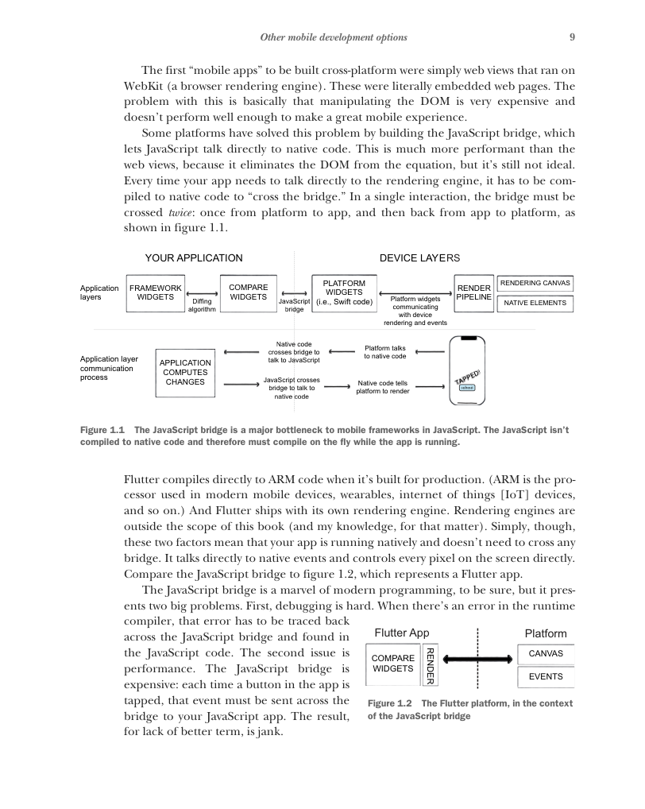

**Hình 1.1 – Cầu nối JavaScript là một nút thắt cổ chai lớn đối với các framework di động viết bằng JavaScript. Code JavaScript không được biên dịch sang mã native, do đó phải biên dịch "ngay tại chỗ" (*on the fly*) trong lúc ứng dụng đang chạy.**

Mô tả hình 1.1 (dịch các chữ trong hình). Hình chia làm hai vùng: **ỨNG DỤNG CỦA BẠN** (*YOUR APPLICATION*) ở bên trái và **CÁC TẦNG THIẾT BỊ** (*DEVICE LAYERS*) ở bên phải.

- Hàng trên – **Các tầng của ứng dụng** (*Application layers*), từ trái sang phải:
  `WIDGET CỦA FRAMEWORK` (*FRAMEWORK WIDGETS*) ⟷ (qua **thuật toán so sánh khác biệt** – *Diffing algorithm*) ⟷ `SO SÁNH WIDGET` (*COMPARE WIDGETS*) ⟷ (**cầu nối JavaScript** – *JavaScript bridge*) ⟷ `WIDGET CỦA NỀN TẢNG (ví dụ: code Swift)` (*PLATFORM WIDGETS (i.e., Swift code)*) ⟷ (**widget của nền tảng giao tiếp với việc render và sự kiện của thiết bị** – *Platform widgets communicating with device rendering and events*) ⟷ `ĐƯỜNG ỐNG RENDER` (*RENDER PIPELINE*) → `KHUNG VẼ RENDER` (*RENDERING CANVAS*) và `CÁC PHẦN TỬ NATIVE` (*NATIVE ELEMENTS*).
- Hàng dưới – **Quy trình giao tiếp ở tầng ứng dụng** (*Application layer communication process*): người dùng chạm vào nút "submit" trên điện thoại (**ĐÃ CHẠM!** – *TAPPED!*) →
  1. **Nền tảng nói chuyện với mã native** (*Platform talks to native code*);
  2. **Mã native đi qua cầu để nói chuyện với JavaScript** (*Native code crosses bridge to talk to JavaScript*);
  3. **ỨNG DỤNG TÍNH TOÁN CÁC THAY ĐỔI** (*APPLICATION COMPUTES CHANGES*);
  4. **JavaScript đi qua cầu để nói chuyện với mã native** (*JavaScript crosses bridge to talk to native code*);
  5. **Mã native bảo nền tảng render** (*Native code tells platform to render*).

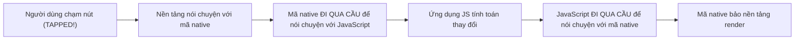

Flutter biên dịch trực tiếp sang **mã ARM** khi được build cho production. (ARM là kiến trúc bộ xử lý dùng trong các thiết bị di động hiện đại, thiết bị đeo, thiết bị Internet vạn vật [IoT], v.v.) Và Flutter đi kèm engine render **của riêng nó**. Engine render nằm ngoài phạm vi cuốn sách này (và cả ngoài hiểu biết của tôi nữa). Nhưng nói đơn giản, hai yếu tố này có nghĩa là ứng dụng của bạn chạy native và **không cần đi qua cây cầu nào**. Nó nói chuyện trực tiếp với các sự kiện native và điều khiển trực tiếp từng điểm ảnh (*pixel*) trên màn hình. Hãy so sánh cầu nối JavaScript với hình 1.2, biểu diễn một ứng dụng Flutter.

**Hình 1.2 – Nền tảng Flutter, đặt trong bối cảnh so sánh với cầu nối JavaScript**

Mô tả hình 1.2: bên trái là **Ứng dụng Flutter** (*Flutter App*) gồm khối `SO SÁNH WIDGET` (*COMPARE WIDGETS*) và khối `RENDER`; bên phải (sau một đường ranh giới đứt nét) là **Nền tảng** (*Platform*) gồm `CANVAS` (khung vẽ) và `EVENTS` (sự kiện). Giữa hai bên chỉ là **một mũi tên hai chiều trực tiếp** – không có cây cầu trung gian nào.

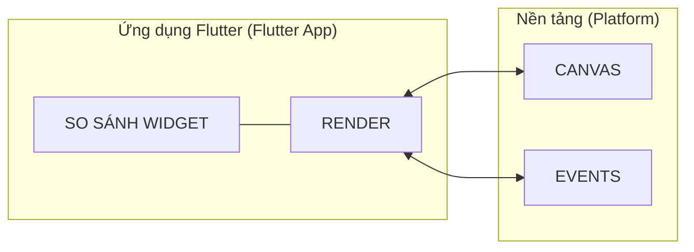

Cầu nối JavaScript chắc chắn là một kỳ tích của lập trình hiện đại, nhưng nó đặt ra hai vấn đề lớn. Thứ nhất, **gỡ lỗi rất khó**. Khi có lỗi trong trình biên dịch lúc chạy (*runtime compiler*), lỗi đó phải được lần ngược qua cầu nối JavaScript và tìm ra trong code JavaScript. Vấn đề thứ hai là **hiệu năng**. Cầu nối JavaScript rất "đắt": mỗi lần một nút trong ứng dụng được chạm, sự kiện đó phải được gửi qua cầu tới ứng dụng JavaScript của bạn. Kết quả, vì không tìm được từ nào hay hơn, là **jank** (hiện tượng giật, khựng hình – giao diện không mượt).

> 📝 **Giải thích thêm (không có trong sách):** Màn hình điện thoại thường làm mới 60 lần/giây, tức mỗi khung hình chỉ có khoảng **16,7 mili giây** (1000 ms / 60). Nếu việc "đi qua cầu" hai chiều cộng với tính toán làm một khung hình vượt quá 16,7 ms, khung hình đó bị lỡ – mắt người thấy giao diện "khựng" lại. Đó chính là *jank*. Flutter tránh được chi phí qua cầu nên dễ giữ được mốc 16,7 ms hơn.

> 💡 **Ví dụ bổ sung (không có trong sách):** Hãy hình dung bạn ở Việt Nam (ứng dụng JavaScript) và nhân viên thực thi ở Nhật (nền tảng native). Mỗi lần khách bấm nút, nhân viên Nhật phải gọi điện cho bạn qua phiên dịch viên (cây cầu), bạn quyết định, rồi lại gọi lại qua phiên dịch viên. Với Flutter, bạn và nhân viên ngồi chung một phòng, nói cùng một thứ tiếng – không cần phiên dịch.

Nhiều vấn đề trong số các vấn đề đa nền tảng này được Flutter giải quyết. Ở phần sau của chương, tôi sẽ cho bạn thấy bằng cách nào.

<details>
<summary>Các mảnh ảnh trích từ trang 9 (khung trang trí của hình 1.1)</summary>

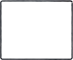

*Mảnh ảnh trích: khung chữ nhật bo góc, là một phần hình vẽ chiếc điện thoại ở hình 1.1.*
</details>


## 1.7 Lợi ích tức thì của Flutter (The immediate benefits of Flutter)

Tôi sẽ đưa ra một giả định về bạn. Vì bạn đang đọc cuốn sách này (và mục này), suy ra bạn tò mò về Flutter. Và cũng có khả năng bạn đang hoài nghi.

Những lý do khiến bạn hoài nghi là hoàn toàn chính đáng. Đây là một công nghệ mới, nghĩa là API sẽ có những thay đổi phá vỡ tương thích (*breaking changes*). Nghĩa là còn thiếu hỗ trợ cho những tính năng quan trọng. Có vẻ cũng có khả năng một ngày nào đó Google sẽ bỏ rơi nó hoàn toàn. Chưa kể Dart không được dùng rộng rãi, và nhiều thư viện bên thứ ba mà bạn muốn có thể chưa tồn tại.

Giờ thì tôi đã "bắt bài" được bạn, để tôi thay đổi suy nghĩ của bạn nhé. API nhiều khả năng sẽ không thay đổi, vì chính công ty đang phát triển Flutter và Dart dùng Dart nội bộ trong các ứng dụng chủ lực mang lại doanh thu lớn như Google AdWords.

Dart gần đây đã lên phiên bản 2.5, nghĩa là sẽ còn lâu nữa nó mới thay đổi nhiều. Trong tương lai gần, nhiều khả năng sẽ không có nhiều thay đổi phá vỡ tương thích.

Cuối cùng, đúng là còn thiếu tính năng, nhưng Flutter cho bạn toàn quyền kiểm soát để tự thêm các **plugin native** (gói mở rộng gọi xuống mã native của hệ điều hành). Thực tế, nhiều plugin quan trọng nhất cho hệ điều hành đã có sẵn, chẳng hạn plugin Google Maps, camera, dịch vụ định vị (*location services*) và bộ nhớ thiết bị (*device storage*). Và các tính năng mới liên tục được bổ sung. Đến lúc bạn đọc những dòng này, đoạn văn này có khi đã chẳng còn ý nghĩa nữa.

> 💡 **Ví dụ bổ sung (không có trong sách):** Thêm một plugin vào dự án Flutter rất đơn giản – khai báo trong file `pubspec.yaml` (tên gói và phiên bản dưới đây chỉ mang tính minh họa; hãy tra phiên bản mới nhất trên pub.dev):
> ```yaml
> dependencies:
>   flutter:
>     sdk: flutter
>   google_maps_flutter: ^2.0.0   # plugin bản đồ Google Maps
>   camera: ^0.10.0               # plugin camera
> ```
> Sau đó chạy `flutter pub get` là có thể `import` và dùng ngay trong code Dart.

### 1.7.1 Không có cầu nối JavaScript (No JavaScript bridge)

Cầu nối JavaScript, được dùng trong phần lớn các lựa chọn đa nền tảng, là một nút thắt cổ chai lớn cả trong quá trình phát triển lẫn trong hiệu năng của ứng dụng. Cuộn trang không mượt, ứng dụng không phải lúc nào cũng hiệu năng tốt, và chúng rất khó gỡ lỗi.

Flutter biên dịch thành mã native thực sự và được render bằng chính engine mà Chrome dùng để render (tên là **Skia**), nên không cần phải "dịch" Dart lúc chạy (*at runtime*). Điều này có nghĩa là ứng dụng không mất chút hiệu năng hay năng suất nào khi chạy trên thiết bị của người dùng.

### 1.7.2 Thời gian biên dịch (Compile time)

Nếu bạn đến từ phát triển di động native, một trong những nỗi khổ lớn của bạn là **chu kỳ phát triển** (*development cycle*). iOS nổi tiếng (theo nghĩa xấu) về thời gian biên dịch. Trong Flutter, một lần biên dịch đầy đủ thường mất **dưới 30 giây**, còn các lần biên dịch tăng dần (*incremental compiles*) mất **dưới một giây** nhờ hot reload. Ở công việc hằng ngày của tôi, chúng tôi phát triển tính năng cho client di động trước, vì chu kỳ phát triển của Flutter cho phép chúng tôi tiến rất nhanh. Chỉ khi đã chắc chắn về cách triển khai, chúng tôi mới viết những tính năng đó cho client web.

> 💡 **Ví dụ bổ sung (không có trong sách):** Một phiên làm việc điển hình với hot reload:
> 1. Chạy `flutter run`, ứng dụng mở trên máy ảo.
> 2. Bạn đổi `Text('Xin chào')` thành `Text('Chào bạn!')` rồi lưu file (hoặc gõ `r` trong terminal).
> 3. Chưa đầy một giây sau, chữ trên màn hình đổi – và **trạng thái hiện tại vẫn được giữ** (ví dụ giỏ hàng đang có 3 sản phẩm thì vẫn còn 3), bạn không phải điều hướng lại từ đầu.
> Gõ `R` (chữ hoa) sẽ là *hot restart*: khởi động lại ứng dụng nhanh nhưng mất trạng thái.

### 1.7.3 Viết một lần, kiểm thử một lần, triển khai mọi nơi (Write once, test once, deploy everywhere)

Bạn không chỉ được viết ứng dụng một lần rồi triển khai lên iOS và Android (và sắp tới là web!), bạn còn chỉ phải viết **kiểm thử** (*test*) một lần. Kiểm thử đơn vị (*unit testing*) với Dart khá dễ, và Flutter có kèm một thư viện để kiểm thử widget.

> 💡 **Ví dụ bổ sung (không có trong sách):** Một bài kiểm thử widget viết một lần, có giá trị cho cả bản iOS lẫn Android (giả sử `QuantityCounter` là widget đếm số lượng sẽ gặp ở mục 1.9.3):
> ```dart
> import 'package:flutter/material.dart';
> import 'package:flutter_test/flutter_test.dart';
>
> void main() {
>   testWidgets('Bấm nút + thì số lượng tăng lên 1', (WidgetTester tester) async {
>     await tester.pumpWidget(MaterialApp(home: QuantityCounter()));
>     expect(find.text('Qty: 0'), findsOneWidget);
>
>     await tester.tap(find.byIcon(Icons.add));
>     await tester.pump(); // yêu cầu Flutter dựng lại khung hình
>
>     expect(find.text('Qty: 1'), findsOneWidget);
>   });
> }
> ```
> Chạy bằng lệnh `flutter test`.

### 1.7.4 Chia sẻ mã nguồn (Code sharing)

Tôi sẽ công bằng ở đây: tôi cho rằng về mặt kỹ thuật, điều này cũng làm được với JavaScript. Nhưng chắc chắn không làm được trong phát triển native. Với Flutter và Dart, ứng dụng web và ứng dụng di động của bạn có thể **dùng chung toàn bộ code, trừ phần view** (giao diện hiển thị) của mỗi client. Bạn có thể dùng **tiêm phụ thuộc** (*dependency injection*) để chạy một ứng dụng AngularDart và một ứng dụng Flutter với cùng các model và controller. (Và trong tương lai rất gần, Flutter cũng sẽ có thể nhắm tới Web và Desktop.) Và hiển nhiên, ngay cả khi bạn không muốn chia sẻ code giữa ứng dụng web và ứng dụng di động, bạn vẫn đang chia sẻ toàn bộ code giữa ứng dụng iOS và Android.

Về mặt thực tế, điều này có nghĩa là bạn cực kỳ năng suất. Tôi đã nhắc rằng ở công việc hằng ngày, chúng tôi phát triển tính năng di động trước. Vì chúng tôi dùng chung logic nghiệp vụ giữa web và di động, một khi tính năng di động đã được hoàn thành, chúng tôi chỉ phải viết các view cho web, những view này chờ nhận đúng dữ liệu controller đó.

> 💡 **Ví dụ bổ sung (không có trong sách):** Một lớp logic thuần Dart, không phụ thuộc Flutter, có thể dùng chung cho cả ứng dụng Flutter lẫn AngularDart:
> ```dart
> // cart_controller.dart – chỉ dùng Dart thuần, không import Flutter
> class CartController {
>   final Map<String, int> _items = {};
>
>   void add(String productId) =>
>       _items[productId] = (_items[productId] ?? 0) + 1;
>
>   int get totalItems => _items.values.fold(0, (a, b) => a + b);
> }
> ```
> Phía Flutter, một widget hiển thị `controller.totalItems`; phía web, một component AngularDart hiển thị cùng giá trị đó. Chỉ có phần "view" là viết hai lần.

### 1.7.5 Năng suất và sự cộng tác (Productivity and collaboration)

Thời của những nhóm iOS và Android tách biệt đã qua. Thực tế, dù bạn dùng JavaScript hay Dart cho ứng dụng web, việc phát triển Flutter đủ quen thuộc để tất cả các nhóm của bạn được hợp nhất. Hoàn toàn không phải là quá khi kỳ vọng một lập trình viên web JavaScript cũng có thể phát triển hiệu quả bằng Flutter và Dart. Nếu bạn tin tôi ở điểm này, thì suy ra nhóm hợp nhất mới của bạn sẽ **năng suất gấp ba lần**.

### 1.7.6 Bảo trì mã nguồn (Code maintenance)

Không gì thỏa mãn bằng việc sửa một lỗi một lần và thấy nó được khắc phục trên tất cả các client. Chỉ trong những trường hợp rất đặc thù mới có lỗi xuất hiện trên ứng dụng iOS do Flutter tạo ra mà không có trên bản Android (và ngược lại). Trong 100% những trường hợp này, chúng chẳng phải lỗi thật, mà chỉ là vấn đề **thẩm mỹ** (*cosmetic issues*), vì Flutter tuân theo hệ thống thiết kế của hệ điều hành thiết bị trong các widget có sẵn của nó. Vì đó là những vấn đề như cỡ chữ và căn lề, chúng không đáng kể nếu xét đến thời gian kỹ sư bỏ ra để sửa.

> 📝 **Giải thích thêm (không có trong sách):** "Tuân theo hệ thống thiết kế của hệ điều hành" nghĩa là một số widget tự điều chỉnh theo nền tảng. Ví dụ: hiệu ứng cuộn quá đà ở iOS là "nảy" (*bouncing*), còn ở Android là hiệu ứng "phát sáng/kéo giãn" ở mép; font mặc định trên iOS là San Francisco, trên Android là Roboto. Vì thế chữ có thể chênh vài pixel giữa hai bản – đó là kiểu "lỗi thẩm mỹ" tác giả nhắc tới.

### 1.7.7 Kết luận: Flutter có dành cho bạn không? (The bottom line: Is Flutter for you?)

Bạn có thể dành cả ngày nghe người ta kể về ưu điểm hay nhược điểm của bất kỳ công nghệ nào. Nhưng rốt cuộc, tất cả đều là chuyện **đánh đổi** (*tradeoff*). Vậy bạn có nên quan tâm tới Flutter không? Tôi đã rải rác câu trả lời ở các phần trước, nhưng để tôi nói thẳng.

Bạn là **lập trình viên cá nhân** đang làm một dự án phụ (*side project*) hoặc một sản phẩm mới? Vậy câu trả lời đơn giản: **có**. Flutter tuyệt đối dành cho bạn. Thời gian bạn bỏ ra để làm quen với Dart và Flutter sẽ được đền đáp xứng đáng về lâu dài.

Bạn là **CTO** đang quyết định có nên để công ty áp dụng công nghệ này không? Chà, chuyện này phức tạp hơn một chút. Nếu bạn đang bắt đầu một dự án mới và muốn tận dụng kỹ năng của các lập trình viên web, thì chắc chắn rồi. Bạn sẽ có hiệu năng tốt hơn, một nhóm gắn kết hơn, và tất cả lập trình viên của bạn (di động lẫn web) đều có thể nắm bắt nhanh. Tuy nhiên, nếu bạn đã có một đội ngũ lớn kỹ sư iOS và Android, thì có lẽ là không. Nếu bạn có đủ nguồn lực để không phải bận tâm chuyện giữ các client đồng bộ tính năng với nhau (*parity*), thì tại sao phải viết lại chúng? Tại sao phải đánh cược vào một công nghệ mới? Flutter hướng tới việc trao quyền cho **bất kỳ ai** xây dựng ứng dụng chất lượng native, nhưng nếu bạn vốn đã có khả năng xây dựng ứng dụng native, có lẽ nó không dành cho bạn. (Đây là lý do Airbnb nổi tiếng với việc từ bỏ React Native.)

Lời bình cuối cùng của tôi là: bạn có thể có một ứng dụng Flutter mới chạy được trong khoảng **một giờ**, xuất phát từ con số không. Nếu bạn vốn đã phát triển iOS hoặc Android trên máy của mình, nhiều khả năng bạn đã có gần đủ công cụ cần thiết, và bạn có thể chạy được chỉ trong vài phút. Vậy thì cứ thử xem sao.

> 💡 **Ví dụ bổ sung (không có trong sách):** Bảng tự đánh giá nhanh dựa trên các lập luận của mục này:
>
> | Tình huống | Gợi ý theo tác giả |
> |---|---|
> | Lập trình viên cá nhân, dự án phụ / sản phẩm mới | Nên dùng Flutter |
> | Công ty bắt đầu dự án mới, đội ngũ chủ yếu là lập trình viên web | Nên dùng Flutter |
> | Công ty đã có đội iOS và Android lớn, đủ nguồn lực duy trì hai client | Có lẽ không cần chuyển |

## 1.8 Lợi ích tương lai của Flutter: Ứng dụng web và ứng dụng desktop (Future benefits of Flutter: Web apps and desktop apps)

Tại thời điểm viết sách, đội ngũ Flutter đã chính thức công bố **Flutter cho web** (còn được biết đến với tên **Hummingbird**). Dự án này cực kỳ thú vị. Khi nó ổn định, Flutter sẽ là framework đầu tiên thực sự "viết một lần, triển khai mọi nơi". Flutter đang phát triển chức năng để triển khai ứng dụng không chỉ lên iOS và Android, mà còn lên ChromeOS, trình duyệt, macOS, ứng dụng desktop Windows, và **Fuchsia** (hệ điều hành mới của Google).

Tính đến sự kiện Google I/O 2019, Flutter web đang ở giai đoạn **xem trước kỹ thuật** (*technical preview*). Ngay bây giờ, bạn có thể thử nghiệm nó và làm ứng dụng web. Dù vậy, tôi sẽ **không** nói về Flutter web trong cuốn sách này. Có hai lý do:

- Như đã nói, dự án hiện đang ở giai đoạn xem trước kỹ thuật. Điều đó có nghĩa là mọi thứ bạn học về nó đều có khả năng thay đổi.
- Quan trọng hơn, mục tiêu của Flutter web là nó "cứ thế mà chạy" (*just works*). Vì vậy, về lý thuyết, nếu bạn học mọi thứ trong cuốn sách này, thì khi Flutter web ổn định, bạn sẽ đã biết mọi thứ cần thiết để viết một ứng dụng web bằng Flutter.

> 📝 **Giải thích thêm (không có trong sách):** Kể từ sau thời điểm sách được viết, Flutter web đã đạt bản ổn định (Flutter 2.0, năm 2021), và hỗ trợ desktop cho Windows, macOS, Linux cũng lần lượt ổn định. Lệnh `flutter run -d chrome` sẽ chạy cùng một code base trong trình duyệt Chrome – đúng như kỳ vọng "cứ thế mà chạy" của tác giả.

## 1.9 Giới thiệu ngắn về cách Flutter hoạt động (A brief intro to how Flutter works)

Ở góc nhìn tổng quát, Flutter là một thư viện tầng giao diện (*view-layer library*) mang tính **phản ứng** (*reactive*), **khai báo** (*declarative*) và **có thể kết hợp** (*composable*), rất giống ReactJS trên web (nhưng đúng hơn là giống React trộn với trình duyệt, vì Flutter còn là một engine render hoàn chỉnh). Tóm gọn: bạn xây dựng giao diện di động bằng cách **ghép** nhiều thành phần nhỏ hơn lại với nhau, gọi là **widget**. **Mọi thứ đều là widget**, và widget chỉ đơn giản là những lớp Dart biết cách mô tả giao diện (*view*) của chính nó. Cấu trúc được định nghĩa bằng widget, kiểu dáng (*style*) được định nghĩa bằng widget, hoạt ảnh cũng vậy, và bất cứ thứ gì khác bạn nghĩ ra để tạo thành một giao diện cũng vậy.²

> **⚠️ CẢNH BÁO (WARNING)**
>
> "Mọi thứ đều là widget" là một câu nói có thể gây hiểu lầm, mà bạn sẽ thấy ở khắp nơi trên internet, kể cả trong tài liệu chính thức. Nó không có nghĩa là trong Flutter không có các đối tượng khác. Đúng hơn, nó có nghĩa là **mọi mảnh** trong ứng dụng của bạn đều là widget. Kiểu dáng, hoạt ảnh, danh sách, chữ, nút bấm, và thậm chí cả các trang (màn hình) đều là widget. Ví dụ, không có đối tượng nào tên là "App" định nghĩa gốc (*root*) của ứng dụng. Về mặt kỹ thuật, gốc của ứng dụng có thể là **bất kỳ widget nào**. Dĩ nhiên, trong Flutter SDK vẫn có những đối tượng khác (chẳng hạn **element**), mà chúng ta sẽ bàn ở phần sau.

> ² Giới thiệu ngắn về widget trong tài liệu chính thức: http://mng.bz/DNxa.

> 💡 **Ví dụ bổ sung (không có trong sách):** Để thấy "gốc của ứng dụng có thể là bất kỳ widget nào", đây là một ứng dụng Flutter hoàn chỉnh mà gốc chỉ là một widget `Text`:
> ```dart
> import 'package:flutter/material.dart';
>
> void main() {
>   runApp(
>     const Center(
>       child: Text(
>         'Xin chào Flutter!',
>         textDirection: TextDirection.ltr, // cần vì không có MaterialApp cung cấp hướng chữ
>       ),
>     ),
>   );
> }
> ```
> Không có lớp "App" bắt buộc nào cả; `MaterialApp` mà bạn hay thấy cũng chỉ là… một widget.

> 📝 **Giải thích thêm (không có trong sách):** **Khai báo** (*declarative*) nghĩa là bạn mô tả giao diện "trông như thế nào" ứng với một trạng thái, thay vì ra lệnh từng bước "thay đổi nó ra sao". Kiểu mệnh lệnh (*imperative*, như Android View cũ): `label.setText("Qty: 2")`. Kiểu khai báo (Flutter): `Text('Qty: $quantity')` – khi `quantity` đổi, Flutter tự dựng lại phần giao diện tương ứng.

Giả sử bạn đang xây dựng một ứng dụng **giỏ hàng** (*shopping cart*). Ứng dụng khá tiêu chuẩn: nó liệt kê sản phẩm, bạn có thể thêm vào giỏ bằng các nút Thêm (*Add*) và Bớt (*Remove*). Vậy thì, danh sách, các sản phẩm, các nút bấm, các hình ảnh, và mọi thứ khác đều là widget. Hình 1.3 cho thấy một số widget này có thể được viết code như thế nào. Ngoài widget ra, những lớp duy nhất bạn có khả năng phải viết là các lớp logic riêng của bạn, không liên quan tới Flutter.

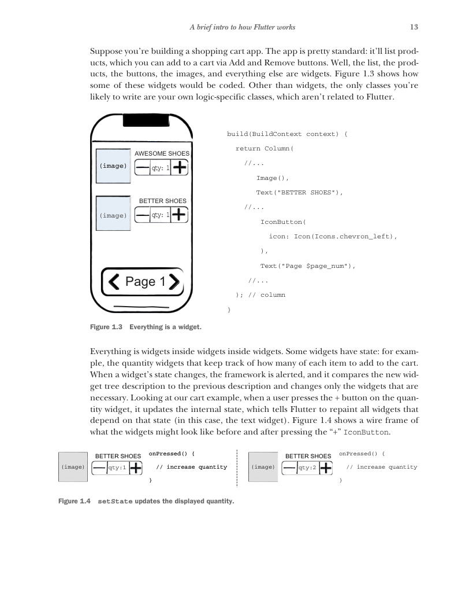

**Hình 1.3 – Mọi thứ đều là widget.**

Mô tả hình 1.3: bên trái là bản phác thảo (*wireframe*) một màn hình điện thoại gồm hai sản phẩm – "AWESOME SHOES" (Giày tuyệt vời) và "BETTER SHOES" (Giày tốt hơn). Mỗi sản phẩm có một ô ảnh "(image)" và một bộ đếm số lượng gồm nút "—", ô "qty: 1" (số lượng: 1) và nút "+". Dưới cùng là thanh phân trang "‹ Page 1 ›" (Trang 1). Bên phải là đoạn code tương ứng (một số widget được làm nổi bật):

```dart
build(BuildContext context) {
  return Column(
    //...
      Image(),
      Text("BETTER SHOES"),
    //...
      IconButton(
        icon: Icon(Icons.chevron_left),
      ),
      Text("Page $page_num"),
    //...
  ); // column
}
```

*(Lưu ý: đây là code minh họa giản lược trong hình, không phải code chạy được – các dấu `//...` biểu thị phần bị lược bỏ.)*

Mọi thứ là widget nằm trong widget nằm trong widget. Một số widget có **trạng thái** (*state*): ví dụ, các widget số lượng theo dõi xem cần thêm bao nhiêu món của mỗi sản phẩm vào giỏ. Khi trạng thái của một widget thay đổi, framework được báo, và nó **so sánh** bản mô tả cây widget mới với bản mô tả trước đó, rồi chỉ thay đổi những widget cần thiết. Nhìn vào ví dụ giỏ hàng, khi người dùng bấm nút + trên widget số lượng, nó cập nhật trạng thái bên trong, trạng thái này báo cho Flutter vẽ lại (*repaint*) tất cả widget phụ thuộc vào trạng thái đó (trong trường hợp này là widget chữ – text widget). Hình 1.4 cho thấy bản phác thảo các widget trông như thế nào trước và sau khi bấm `IconButton` "+".

**Hình 1.4 – `setState` cập nhật số lượng được hiển thị.**

Mô tả hình 1.4: hai trạng thái của cùng một dòng sản phẩm "BETTER SHOES" được đặt cạnh nhau, ngăn bởi đường đứt nét. Bên trái, bộ đếm hiển thị "qty:1"; bên phải, sau khi bấm "+", bộ đếm hiển thị "qty:2". Cạnh mỗi bên là đoạn code của hàm xử lý bấm nút:

```dart
onPressed() {
  // increase quantity   (tăng số lượng)
}
```

<details>
<summary>Các mảnh ảnh trích từ trang 13 (thành phần của hình 1.3)</summary>


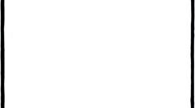
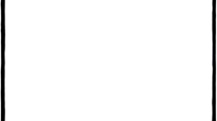
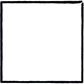

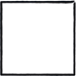

*Các mảnh ảnh trích này chỉ là những đường viền (khung điện thoại bo góc, ô vuông) dùng để vẽ wireframe của hình 1.3; xem trang render đầy đủ ở trên.*
</details>

Hai ý tưởng đó (widget và cập nhật trạng thái) thực sự là cốt lõi của những gì chúng ta – lập trình viên – quan tâm. Trong phần còn lại của chương, tôi muốn mổ xẻ chi tiết điều gì *thực sự* đang diễn ra.

### 1.9.1 Mọi thứ đều là widget (Everything is a widget)

Đây là ý tưởng cốt lõi trong Flutter. Mọi thứ đều là widget. Nhắc lại, điều này không có nghĩa là trong Flutter không có các loại đối tượng khác – có đấy. Ở phần sau của cuốn sách, tôi sẽ khám phá sâu những đối tượng khác này, nhưng là lập trình viên, bạn sẽ hiếm khi phải quan tâm tới thứ gì khác ngoài widget. Ý chính là trong Flutter không có `models`, `view models` hay bất kỳ loại lớp chuyên biệt nào khác (do framework áp đặt).

Một widget có thể định nghĩa bất kỳ khía cạnh nào của giao diện ứng dụng. Một số widget, như `Row`, định nghĩa các khía cạnh của **bố cục** (*layout*). Một số khác ít trừu tượng hơn và định nghĩa các **phần tử cấu trúc** (*structural elements*), như `Button` và `TextField`. Ngay cả gốc của ứng dụng cũng là một widget.

Dùng lại ví dụ giỏ hàng, hình 1.5 cho thấy bạn có thể viết code cho một số widget bố cục như thế nào, còn hình 1.6 cho thấy một số widget cấu trúc. Tuy nhiên, chắc chắn là còn nhiều widget hơn những gì ta nhìn thấy, vì chúng định nghĩa bố cục, kiểu dáng, hoạt ảnh, v.v.

Để bạn có hình dung, đây là một số widget phổ biến nhất:

- *Bố cục* (*Layout*) — `Row`, `Column`, `Scaffold`, `Stack`
- *Cấu trúc* (*Structures*) — `Button`, `Toast`, `MenuDrawer`
- *Kiểu dáng* (*Styles*) — `TextStyle`, `Color`
- *Hoạt ảnh* (*Animations*) — `FadeInPhoto`, các phép biến đổi (*transformations*)
- *Định vị và căn chỉnh* (*Positioning and alignment*) — `Center`, `Padding`

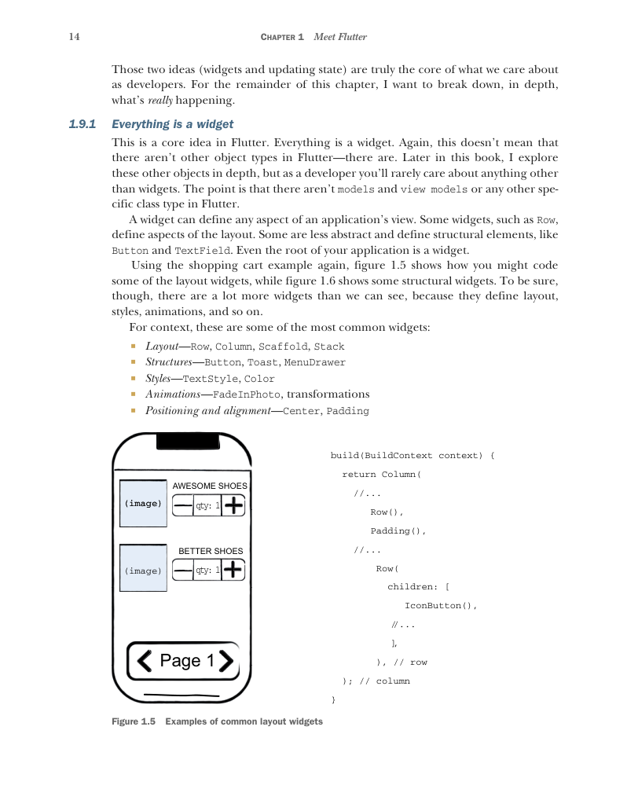

**Hình 1.5 – Ví dụ về các widget bố cục phổ biến**

Mô tả hình 1.5: cùng wireframe màn hình giỏ hàng như hình 1.3 (hai sản phẩm "AWESOME SHOES", "BETTER SHOES" với bộ đếm "qty: 1" và thanh "Page 1"), nhưng code bên cạnh làm nổi bật các widget **bố cục**:

```dart
build(BuildContext context) {
  return Column(
    //...
      Row(),
      Padding(),
    //...
      Row(
        children: [
          IconButton(),
          //...
        ],
      ), // row
  ); // column
}
```

Ý nghĩa: `Column` xếp các phần tử theo chiều dọc (các dòng sản phẩm, thanh phân trang); mỗi dòng sản phẩm là một `Row` (ảnh nằm ngang cạnh tên và bộ đếm); `Padding` tạo khoảng đệm; thanh phân trang là một `Row` chứa các `IconButton`.

<details>
<summary>Các mảnh ảnh trích từ trang 14 (thành phần của hình 1.5)</summary>

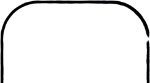
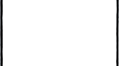
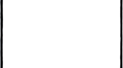
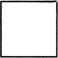

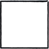

*Các mảnh viền dùng để vẽ wireframe hình 1.5.*
</details>

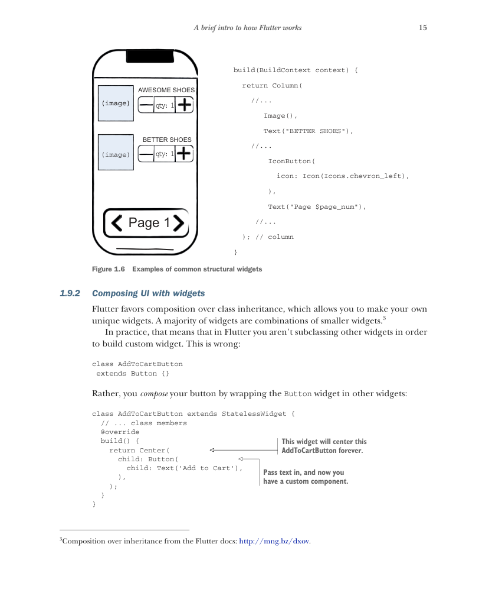

**Hình 1.6 – Ví dụ về các widget cấu trúc phổ biến**

Mô tả hình 1.6: vẫn wireframe màn hình giỏ hàng đó, nhưng code bên cạnh làm nổi bật các widget **cấu trúc** – những thứ người dùng thực sự nhìn thấy: ảnh, chữ, nút biểu tượng:

```dart
build(BuildContext context) {
  return Column(
    //...
      Image(),
      Text("BETTER SHOES"),
    //...
      IconButton(
        icon: Icon(Icons.chevron_left),
      ),
      Text("Page $page_num"),
    //...
  ); // column
}
```

<details>
<summary>Các mảnh ảnh trích từ trang 15 (thành phần của hình 1.6)</summary>

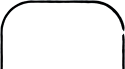
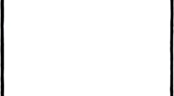

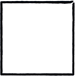


*Các mảnh viền dùng để vẽ wireframe hình 1.6.*
</details>

> 💡 **Ví dụ bổ sung (không có trong sách):** Phiên bản chạy được (dùng widget thật của Flutter hiện nay) cho một dòng sản phẩm trong hình 1.3–1.6, cho thấy widget bố cục và widget cấu trúc lồng vào nhau:
> ```dart
> Widget buildProductRow(String name, int qty) {
>   return Padding(                       // định vị: tạo khoảng đệm
>     padding: const EdgeInsets.all(8),
>     child: Row(                         // bố cục: xếp ngang
>       children: [
>         Container(width: 80, height: 80, color: Colors.grey), // chỗ cho ảnh
>         const SizedBox(width: 12),
>         Column(                         // bố cục: xếp dọc
>           crossAxisAlignment: CrossAxisAlignment.start,
>           children: [
>             Text(name, style: const TextStyle(fontWeight: FontWeight.bold)), // cấu trúc + kiểu dáng
>             Row(
>               children: [
>                 IconButton(icon: const Icon(Icons.remove), onPressed: () {}),
>                 Text('qty: $qty'),
>                 IconButton(icon: const Icon(Icons.add), onPressed: () {}),
>               ],
>             ),
>           ],
>         ),
>       ],
>     ),
>   );
> }
> ```

### 1.9.2 Dựng giao diện bằng cách kết hợp các widget (Composing UI with widgets)

Flutter ưu tiên **kết hợp** (*composition*) hơn **kế thừa lớp** (*class inheritance*), điều này cho phép bạn tạo ra những widget độc đáo của riêng mình. Phần lớn widget là sự kết hợp của các widget nhỏ hơn.³

Trên thực tế, điều đó có nghĩa là trong Flutter, bạn **không** tạo lớp con (*subclass*) từ các widget khác để xây dựng widget tùy biến. Cách này là **sai**:

```dart
class AddToCartButton
    extends Button {}
```

Thay vào đó, bạn *kết hợp* (*compose*) nút bấm của mình bằng cách bọc widget `Button` trong các widget khác:

```dart
class AddToCartButton extends StatelessWidget {
  // ... class members
  @override
  build() {
    return Center(            // (1)
      child: Button(          // (2)
        child: Text('Add to Cart'),
      ),
    );
  }
}
```

Chú thích:
1. Widget (`Center`) này sẽ căn giữa `AddToCartButton` này mãi mãi.
2. Truyền chữ vào, và giờ bạn đã có một thành phần (*component*) tùy biến.

> ³ "Kết hợp thay vì kế thừa" (*Composition over inheritance*) trong tài liệu Flutter: http://mng.bz/dxov.

Nếu bạn đến từ web, điều này tương tự cách React ưu tiên xây dựng những component nhỏ, tái sử dụng được rồi kết hợp chúng lại.

Widget có một vài **phương thức vòng đời** (*life-cycle methods*) và các thành viên đối tượng (*object members*) khác nhau. Tuy nhiên, phương thức quan trọng nhất là `build()`. Phương thức `build()` **bắt buộc phải có** trong mọi widget Flutter. Đây là phương thức trong đó bạn thực sự mô tả giao diện của mình bằng cách trả về các widget.

> 📝 **Giải thích thêm (không có trong sách):** Đoạn code trong sách là code minh họa giản lược. Với Flutter hiện nay, không có widget tên `Button` (có `ElevatedButton`, `TextButton`...), và `build` phải nhận tham số `BuildContext`, khai báo kiểu trả về `Widget`. Phiên bản chạy được tương đương:
> ```dart
> class AddToCartButton extends StatelessWidget {
>   const AddToCartButton({super.key, required this.label, required this.onPressed});
>
>   final String label;              // "Add to Cart" hoặc "Remove from Cart"
>   final VoidCallback onPressed;    // hàm được gọi khi bấm
>
>   @override
>   Widget build(BuildContext context) {
>     return Center(
>       child: ElevatedButton(
>         onPressed: onPressed,
>         child: Text(label),
>       ),
>     );
>   }
> }
> ```
>
> 💡 **Ví dụ bổ sung (không có trong sách):** Vì sao kết hợp tốt hơn kế thừa? Giả sử bạn muốn nút "Thêm vào giỏ" có viền đỏ và căn giữa. Nếu kế thừa từ `ElevatedButton`, bạn phải hiểu và ghi đè (*override*) cơ chế bên trong của nó – dễ vỡ khi Flutter nâng cấp. Với kết hợp, bạn chỉ cần bọc thêm: `Center(child: DecoratedBox(decoration: ..., child: ElevatedButton(...)))`. Mỗi widget làm đúng một việc, và bạn "lắp ghép" chúng như các khối LEGO.

### 1.9.3 Các loại widget (Widget types)

Phần lớn widget thuộc về hai nhóm: **stateless** (không trạng thái) và **stateful** (có trạng thái). Một `StatelessWidget` là widget mà bạn (lập trình viên) chấp nhận việc nó bị hủy. Nói cách khác, không có thông tin nào được lưu bên trong nó mà nếu bị mất đi thì sẽ gây ảnh hưởng. Toàn bộ trạng thái hoặc cấu hình của widget đều được **truyền vào** nó. Nhiệm vụ duy nhất của nó là hiển thị thông tin và giao diện. Vòng đời của nó phụ thuộc vào các tác nhân bên ngoài. Nó không báo cho framework khi nào cần gỡ nó khỏi cây (widget), hay khi nào cần dựng lại nó. Ngược lại, chính framework báo cho nó khi nào cần dựng lại. (Nếu điều này có vẻ khó hiểu, hãy đọc tiếp. Nó sẽ trở nên dễ hiểu khi được đặt cạnh các widget kiểu `StatefulWidget`.)

Trong ví dụ giỏ hàng, widget `AddToCartButton` là stateless. Nó không cần quản lý trạng thái, và nó không cần biết về bất kỳ phần nào khác của cây. Việc của nó chỉ là chờ được bấm và khi đó thì thực thi một hàm.

Điều này không có nghĩa là nút "Thêm vào giỏ" sẽ không bao giờ thay đổi. Có thể đến lúc nào đó bạn muốn cập nhật nó thành "Bỏ khỏi giỏ" (*Remove from Cart*): một widget khác sẽ truyền vào `String` biểu diễn chữ hiển thị trên nút (như "Add" hay "Remove"), và nút sẽ được vẽ lại khi từ được truyền vào thay đổi. Nó **phản ứng** với thông tin mới.

Ngược lại, một `StatefulWidget` trong ứng dụng giỏ hàng là widget `QuantityCounter`, vì nó đang quản lý một mẩu dữ liệu có trạng thái, theo dõi số lượng món bạn muốn thêm vào giỏ. Một đối tượng `StatefulWidget` có một đối tượng **`State`** đi kèm. Đối tượng `State` có những phương thức đặc biệt như `setState`, dùng để báo cho Flutter biết khi nào nó cần tính tới việc vẽ lại.

Các đối tượng `State` **sống lâu** (*long-lived*). Chúng có thể bảo Flutter vẽ lại, nhưng chúng cũng có thể *được bảo* phải vẽ lại vì stateful widget đi kèm đã bị các tác nhân bên ngoài cập nhật.⁴

Hãy xem lại ứng dụng giỏ hàng. Đến giờ, ta biết có khá nhiều thành phần trên màn hình. Các thành phần này được kết hợp với nhau thông qua sự phối hợp giữa các stateful widget và stateless widget. Quan trọng là có một `StatefulWidget` tên `QuantityCounter`: một widget tùy biến do tôi tạo ra bằng cách kết hợp nhiều widget có sẵn khác nhau. Hình 1.7 là wireframe của widget tùy biến này.

> ⁴ Xem phần giới thiệu chi tiết về Widget trong tài liệu chính thức: http://mng.bz/rPae.

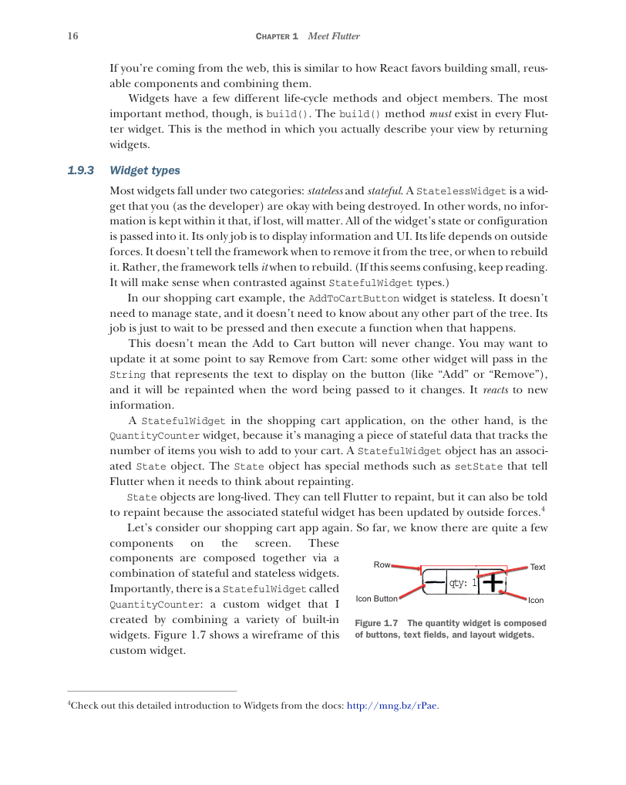

**Hình 1.7 – Widget số lượng được kết hợp từ các nút bấm, ô chữ và widget bố cục.**

Mô tả hình 1.7: một bộ đếm "— | qty: 1 | +" với các nhãn chú thích: **Row** (bao quanh toàn bộ, xếp ngang các thành phần), **Icon Button** (nút biểu tượng "—" và "+"), **Icon** (biểu tượng bên trong nút), **Text** (chữ "qty: 1").

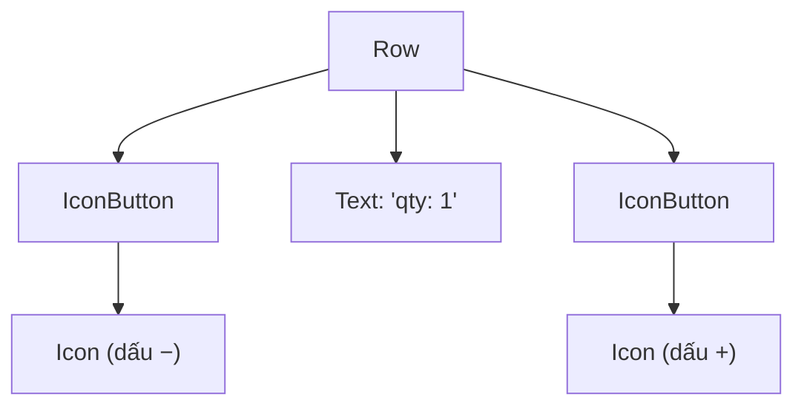

Phương thức `build` cho widget này sẽ trông giống như sau. Tôi đã chỉ ra những phần bạn cần quan tâm ngay lúc này.

**Listing 1.1 – Ví dụ phương thức `build` cho stateful widget tùy biến `QuantityCounter`**

```dart
Widget build(BuildContext context) {
  return Container(                 // (1)
    child: Row(
      children: List<Widget>[
        IconButton(
          icon: Icons.subtract,
          onPressed: () {           // (2)
            setState(() {           // (3)
              this.quantity--;
            });
          }),
        new Text("Qty: ${this.quantity}),   // (4)
        new IconButton(
          icon: Icons.add,
          onPressed: () {           // (5)
            setState(() {
              this.quantity++;
            });
          }),
      ],
    )
  );
}
```

Chú thích (callout) trong listing:
1. `build` luôn trả về một widget.
2. Thuộc tính có sẵn trên widget nút bấm, dùng để lắng nghe tương tác của người dùng.
3. Giảm bộ đếm số lượng (*quantity*) của state.
4. Widget sẽ được vẽ lại tại vị trí này trong cây mỗi khi số lượng của đối tượng state được gọi (thay đổi).
5. Callback này sẽ gọi `setState`, làm tăng bộ đếm số lượng của state.

*(Listing được chép nguyên văn từ sách – đây là code minh họa, có vài chỗ không biên dịch được, ví dụ chuỗi `"Qty: ${this.quantity}` thiếu dấu `"` đóng, `List<Widget>[...]` không phải cú pháp hợp lệ của Dart, và không có `Icons.subtract`. Xem phiên bản chạy được trong ví dụ bổ sung bên dưới.)*

Chắc chắn là còn thiếu nhiều phần bố cục và kiểu dáng ở đó, nhưng đó là phần "markup" (mô tả giao diện) bạn cần. Thông tin quan trọng trong khối code đó là những gì diễn ra **bên trong** các widget `IconButton` và `Text`.

Widget này có quyền truy cập vài phương thức từ lớp cơ sở `State`. Quan trọng nhất là `setState`. Mỗi lần nút + hoặc - được bấm, ứng dụng sẽ gọi `setState`. Phương thức này sẽ cập nhật phần trạng thái nào của widget mà bạn bảo nó cập nhật, và sẽ báo cho Flutter vẽ lại các widget phụ thuộc vào thay đổi trạng thái đó. Hình 1.8 là wireframe cho thấy widget số lượng có thể được cập nhật thế nào khi nút "+" được chạm.

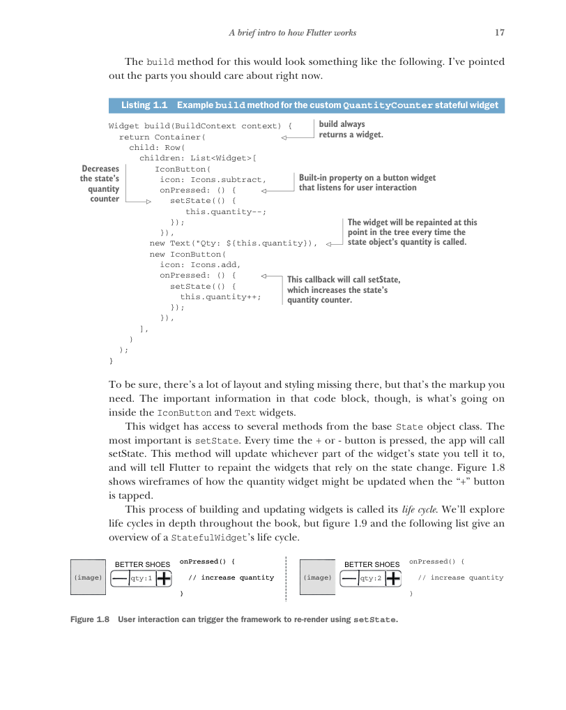

**Hình 1.8 – Tương tác của người dùng có thể kích hoạt framework render lại thông qua `setState`.**

Mô tả hình 1.8: giống hình 1.4 – dòng sản phẩm "BETTER SHOES" trước khi bấm hiển thị "qty:1", sau khi bấm "+" hiển thị "qty:2"; cạnh mỗi trạng thái là hàm `onPressed() { // increase quantity }` (tăng số lượng).

> 💡 **Ví dụ bổ sung (không có trong sách):** Phiên bản `QuantityCounter` hoàn chỉnh, chạy được với Flutter hiện nay. Chú ý cấu trúc **hai lớp**: lớp widget (`QuantityCounter`) và lớp `State` (`_QuantityCounterState`) giữ dữ liệu `quantity`:
> ```dart
> import 'package:flutter/material.dart';
>
> class QuantityCounter extends StatefulWidget {
>   const QuantityCounter({super.key});
>
>   @override
>   State<QuantityCounter> createState() => _QuantityCounterState();
> }
>
> class _QuantityCounterState extends State<QuantityCounter> {
>   int quantity = 0; // trạng thái sống lâu, nằm trong đối tượng State
>
>   @override
>   Widget build(BuildContext context) {
>     return Row(
>       mainAxisSize: MainAxisSize.min,
>       children: <Widget>[
>         IconButton(
>           icon: const Icon(Icons.remove),
>           onPressed: () {
>             setState(() {
>               if (quantity > 0) quantity--;
>             });
>           },
>         ),
>         Text('Qty: $quantity'),
>         IconButton(
>           icon: const Icon(Icons.add),
>           onPressed: () {
>             setState(() {
>               quantity++;
>             });
>           },
>         ),
>       ],
>     );
>   }
> }
> ```
> **Bài toán nhỏ:** Nếu bạn viết `quantity++;` mà **không** bọc trong `setState`, chuyện gì xảy ra? → Biến vẫn tăng trong bộ nhớ, nhưng Flutter không được báo rằng widget đã "bẩn" (*dirty*), nên không gọi lại `build` – màn hình vẫn hiện số cũ cho đến khi có lý do khác khiến widget được dựng lại.

Quá trình dựng và cập nhật widget này được gọi là **vòng đời** (*life cycle*) của nó. Chúng ta sẽ khám phá vòng đời kỹ lưỡng xuyên suốt cuốn sách, nhưng hình 1.9 và danh sách sau đây cho bạn cái nhìn tổng quan về vòng đời của một `StatefulWidget`.

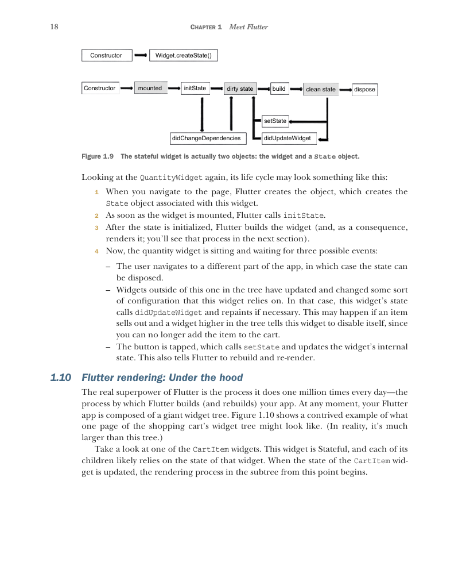

**Hình 1.9 – Stateful widget thực chất là hai đối tượng: widget và một đối tượng `State`.**

Mô tả hình 1.9:
- Hàng trên (đối tượng **widget**): `Constructor` (hàm khởi tạo) → `Widget.createState()`.
- Hàng dưới (đối tượng **State**): `Constructor` → `mounted` (đã gắn vào cây) → `initState` → `dirty state` (trạng thái "bẩn" – cần dựng lại) → `build` → `clean state` (trạng thái "sạch" – đã dựng xong) → `dispose` (hủy).
- Các vòng lặp quay ngược: từ `clean state` có thể đi tới `setState` hoặc `didUpdateWidget`, cả hai đều đưa widget trở lại `dirty state` để dựng lại; `didChangeDependencies` (khi các phụ thuộc thay đổi) cũng nối vào trước `dirty state`.

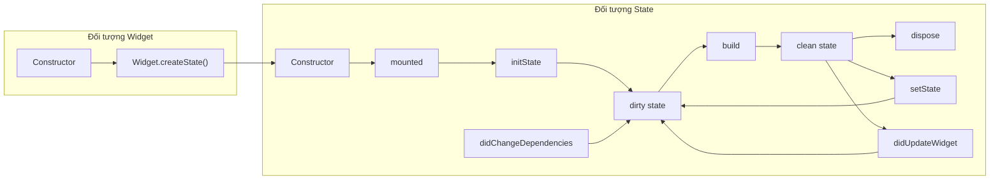

Nhìn lại `QuantityWidget` (tức `QuantityCounter`), vòng đời của nó có thể trông như sau:

1. Khi bạn điều hướng tới trang, Flutter tạo đối tượng (widget), đối tượng này tạo ra đối tượng `State` đi kèm với widget.
2. Ngay khi widget được gắn vào cây (*mounted*), Flutter gọi `initState`.
3. Sau khi state được khởi tạo, Flutter dựng (*build*) widget (và hệ quả là render nó; bạn sẽ thấy quá trình đó ở mục tiếp theo).
4. Lúc này, widget số lượng ngồi chờ một trong ba sự kiện có thể xảy ra:
   - Người dùng điều hướng sang phần khác của ứng dụng, khi đó state có thể bị hủy (*disposed*).
   - Các widget bên ngoài widget này trong cây đã cập nhật và thay đổi một cấu hình nào đó mà widget này phụ thuộc vào. Khi đó, state của widget này gọi `didUpdateWidget` và vẽ lại nếu cần. Điều này có thể xảy ra nếu một món hàng bán hết và một widget ở cao hơn trong cây bảo widget này tự vô hiệu hóa, vì bạn không thể thêm món đó vào giỏ nữa.
   - Nút được chạm, gọi `setState` và cập nhật trạng thái bên trong của widget. Điều này cũng báo cho Flutter dựng lại và render lại.

> 💡 **Ví dụ bổ sung (không có trong sách):** Bạn có thể "nhìn thấy" vòng đời bằng cách in log trong từng phương thức:
> ```dart
> class _QuantityCounterState extends State<QuantityCounter> {
>   int quantity = 0;
>
>   @override
>   void initState() {
>     super.initState();
>     print('initState: chạy MỘT lần khi State được gắn vào cây');
>   }
>
>   @override
>   void didUpdateWidget(covariant QuantityCounter oldWidget) {
>     super.didUpdateWidget(oldWidget);
>     print('didUpdateWidget: widget cha truyền cấu hình mới vào');
>   }
>
>   @override
>   void dispose() {
>     print('dispose: State bị hủy, hãy giải phóng tài nguyên ở đây');
>     super.dispose();
>   }
>
>   @override
>   Widget build(BuildContext context) {
>     print('build: dựng lại với quantity = $quantity');
>     return Text('Qty: $quantity');
>   }
> }
> ```
> Mở trang → thấy `initState` rồi `build`. Bấm nút (gọi `setState`) → chỉ thấy `build`. Rời trang → thấy `dispose`.

## 1.10 Quá trình render của Flutter: bên dưới lớp vỏ (Flutter rendering: Under the hood)

"Siêu năng lực" thực sự của Flutter chính là quy trình mà nó thực hiện cả triệu lần mỗi ngày – quy trình mà qua đó Flutter dựng (*build*) và dựng lại (*rebuild*) ứng dụng của bạn. Tại bất kỳ thời điểm nào, ứng dụng Flutter của bạn đều được kết hợp thành một **cây widget** (*widget tree*) khổng lồ. Hình 1.10 đưa ra một ví dụ giả định về cây widget của một trang trong ứng dụng giỏ hàng có thể trông như thế nào. (Trên thực tế, cây thật còn lớn hơn cây này rất nhiều.)

Hãy nhìn vào một trong các widget `CartItem`. Widget này là `Stateful`, và mỗi widget con của nó nhiều khả năng phụ thuộc vào trạng thái của widget đó. Khi trạng thái của widget `CartItem` được cập nhật, quá trình render trong **cây con** (*subtree*) tính từ điểm này sẽ bắt đầu.

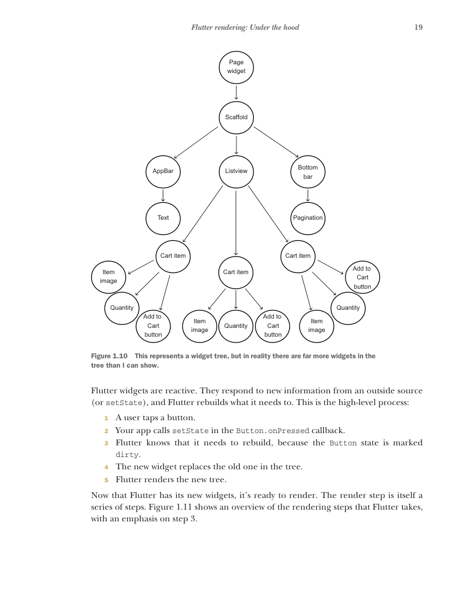

**Hình 1.10 – Sơ đồ này biểu diễn một cây widget, nhưng trong thực tế có nhiều widget trong cây hơn rất nhiều so với những gì tôi có thể vẽ ra.**

Mô tả hình 1.10: cây phân cấp từ trên xuống:
- `Page widget` (widget trang) → `Scaffold` (khung sườn trang).
- Từ `Scaffold` tách làm 3 nhánh:
  - `AppBar` (thanh tiêu đề trên) → `Text`.
  - `Listview` (danh sách cuộn) → ba nhánh `Cart item` (món hàng trong giỏ) và một nhánh `Pagination` (phân trang). Mỗi `Cart item` lại có 3 con: `Item image` (ảnh món hàng), `Quantity` (bộ đếm số lượng), `Add to Cart button` (nút thêm vào giỏ).
  - `Bottom bar` (thanh dưới cùng).

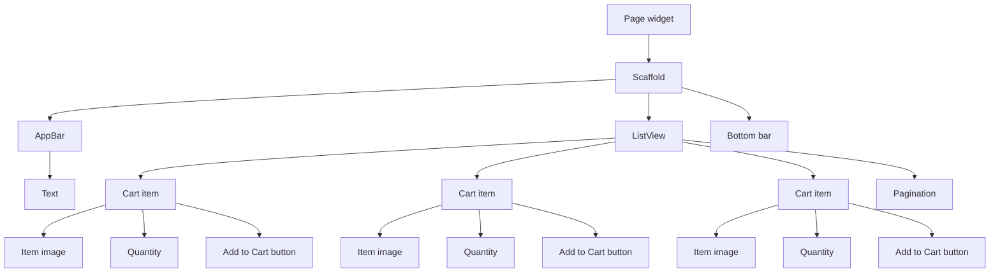

Các widget của Flutter có tính **phản ứng** (*reactive*). Chúng phản hồi lại thông tin mới từ một nguồn bên ngoài (hoặc từ `setState`), và Flutter sẽ dựng lại những gì cần dựng. Đây là quy trình ở mức tổng quan:

1. Người dùng chạm vào một nút bấm.
2. Ứng dụng của bạn gọi `setState` trong hàm callback `Button.onPressed`.
3. Flutter biết rằng nó cần dựng lại, vì trạng thái của `Button` đã được đánh dấu là **bẩn** (*dirty*).
4. Widget mới thay thế widget cũ trong cây.
5. Flutter render cây mới.

Giờ khi Flutter đã có các widget mới, nó sẵn sàng để render. Bản thân bước render cũng là một chuỗi các bước nhỏ. Hình 1.11 cho thấy tổng quan các bước render mà Flutter thực hiện, với trọng tâm nhấn mạnh ở bước 3.

Flutter khởi động quá trình render bằng cách chạy bất kỳ **bộ đếm nhịp hoạt ảnh** (*animation ticker*) nào. Nếu bạn cần vẽ lại – chẳng hạn vì bạn đang cuộn xuống một danh sách – thì vị trí bắt đầu của bất kỳ phần tử nào trên màn hình sẽ được dịch chuyển tăng dần từng chút tới vị trí kết thúc của nó, nhờ vậy tạo thành một hoạt ảnh mượt mà. Việc này được điều khiển bởi các *animation ticker*, thứ quyết định thời gian mà một phần tử có để di chuyển. Về hiệu quả, nó kiểm soát mức độ "kịch tính" (nhanh/chậm, mạnh/nhẹ) của hoạt ảnh.

Trong suốt một hoạt ảnh, Flutter dựng lại và vẽ lại ở **mọi khung hình** (*every frame* – tức là rất nhiều lần). Ở phần sau của cuốn sách, chúng ta sẽ đi sâu vào hoạt ảnh trong Flutter.

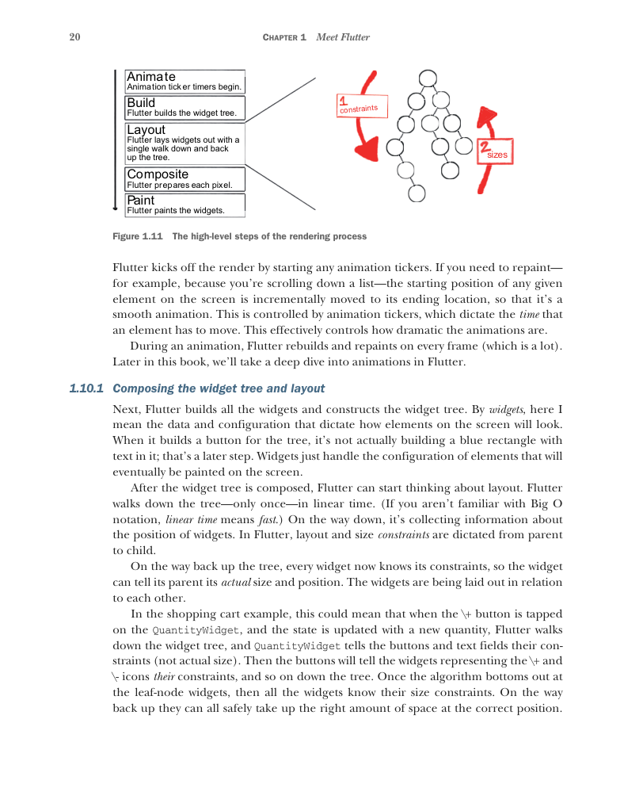

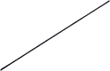

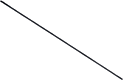

**Hình 1.11 – Các bước mức cao của quy trình render**

Mô tả hình 1.11 – năm bước tuần tự từ trên xuống:
1. **Animate** (Hoạt ảnh): Bộ đếm thời gian của animation ticker bắt đầu chạy (*Animation ticker timers begin*).
2. **Build** (Dựng): Flutter dựng cây widget (*Flutter builds the widget tree*).
3. **Layout** (Bố cục): Flutter sắp đặt bố cục các widget chỉ với **một lượt đi xuống rồi quay ngược lên** trên cây (*Flutter lays widgets out with a single walk down and back up the tree*) – đi xuống truyền `constraints` (ràng buộc kích thước), đi lên trả về `sizes` (kích thước thực tế).
4. **Composite** (Tổng hợp lớp): Flutter chuẩn bị từng điểm ảnh (*Flutter prepares each pixel*).
5. **Paint** (Vẽ): Flutter vẽ các widget (*Flutter paints the widgets*).

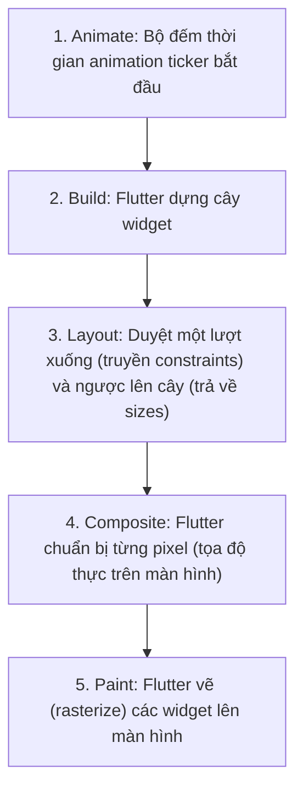

### 1.10.1 Kết hợp cây widget và bố cục (Composing the widget tree and layout)

Tiếp theo, Flutter dựng tất cả các widget và xây dựng cây widget. Khi nói "widget" ở đây, ý tôi là **dữ liệu và cấu hình** quy định các phần tử trên màn hình sẽ trông như thế nào. Khi Flutter dựng một nút bấm cho cây, nó chưa thực sự tạo ra một hình chữ nhật màu xanh có chữ bên trong; đó là bước sau. Các widget chỉ xử lý phần cấu hình của những phần tử mà cuối cùng sẽ được vẽ lên màn hình.

Sau khi cây widget đã được kết hợp xong, Flutter có thể bắt đầu tính đến chuyện **bố cục** (*layout*). Flutter duyệt xuống cây – **chỉ một lần duy nhất** – trong **thời gian tuyến tính** (*linear time*). (Nếu bạn chưa quen với ký hiệu Big O, thì thời gian tuyến tính $O(n)$ có nghĩa là **nhanh**.) Trên đường đi xuống, nó thu thập thông tin về vị trí của các widget. Trong Flutter, bố cục và **ràng buộc kích thước** (*size constraints*) được quy định **từ cha xuống con** (*from parent to child*).

Trên đường quay ngược lên cây, mọi widget giờ đã biết các ràng buộc của mình, nên widget có thể báo cho cha của nó biết **kích thước thực tế** và vị trí của nó. Các widget đang được sắp đặt bố cục trong mối tương quan với nhau.

Trong ví dụ giỏ hàng, điều này có thể có nghĩa là khi nút `+` được chạm trên `QuantityWidget`, và trạng thái được cập nhật với số lượng mới, Flutter sẽ duyệt xuống cây widget, và `QuantityWidget` báo cho các nút bấm cùng các ô chữ biết ràng buộc của chúng (chứ chưa phải kích thước thực tế). Rồi các nút bấm lại báo cho các widget biểu diễn biểu tượng `+` và `-` biết ràng buộc của chúng, và cứ thế đi xuống hết cây. Một khi thuật toán chạm đáy ở các **widget nút lá** (*leaf-node widgets* – các widget không còn con), thì tất cả các widget đều đã biết ràng buộc kích thước của mình. Trên đường quay ngược lên, tất cả chúng đều có thể yên tâm chiếm đúng phần không gian cần thiết tại đúng vị trí.

Hình 1.12 minh họa quy trình này (trên một cây nhỏ hơn rất nhiều so với bất kỳ ứng dụng Flutter thực tế nào).

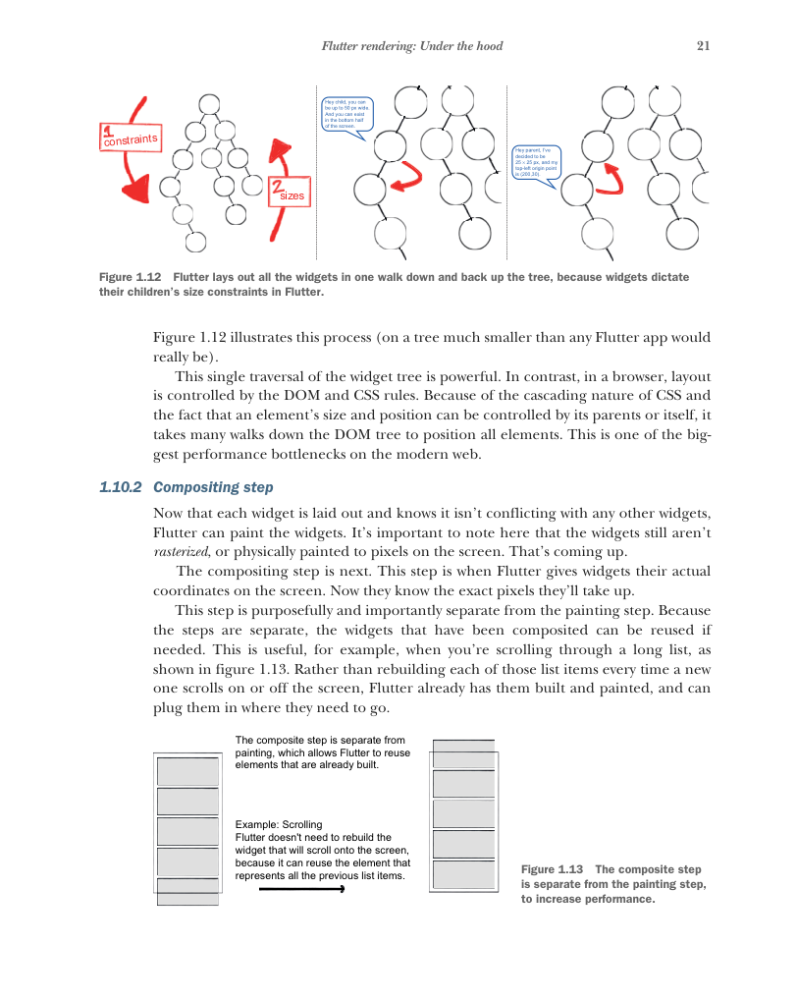

**Hình 1.12 – Flutter sắp đặt bố cục cho toàn bộ widget chỉ trong một lượt đi xuống rồi quay ngược lên cây, bởi trong Flutter, widget cha quy định ràng buộc kích thước cho các widget con.**

Mô tả hình 1.12:
- Mũi tên đi xuống (`constraints` – ràng buộc): Widget cha nói với widget con: *"Này con, con có thể rộng tối đa 50 px. Và con có thể nằm ở nửa dưới màn hình."* (*"Hey child, you can be up to 50 px wide. And you can exist in the bottom half of the screen."*)
- Mũi tên đi lên (`sizes` – kích thước): Widget con trả lời cha: *"Này cha, con quyết định có kích thước 25 × 25 px, và điểm gốc góc trên bên trái của con là (200, 30)."* (*"Hey parent, I've decided to be 25 × 25 px, and my top-left origin point is (200,30)."*)

Việc chỉ cần **duyệt cây widget một lượt duy nhất** như vậy cực kỳ mạnh mẽ. Ngược lại, trong trình duyệt web, bố cục được điều khiển bởi DOM và các quy tắc CSS. Do bản chất "tầng bậc" (*cascading*) của CSS và việc kích thước cùng vị trí của một phần tử có thể bị chi phối bởi cả cha của nó lẫn chính nó, trình duyệt phải duyệt xuống cây DOM **nhiều lần** mới định vị xong mọi phần tử. Đây là một trong những nút thắt cổ chai hiệu năng lớn nhất của web hiện đại.

> 💡 **Ví dụ bổ sung (không có trong sách):** Quy tắc vàng của bố cục Flutter thường được tóm tắt bằng một câu dễ nhớ: **"Constraints go down. Sizes go up. Parent sets position."** (Ràng buộc đi xuống. Kích thước đi lên. Cha đặt vị trí.)
> Bạn có thể kiểm chứng ngay các ràng buộc mà widget cha truyền xuống bằng `LayoutBuilder`:
> ```dart
> LayoutBuilder(
>   builder: (BuildContext context, BoxConstraints constraints) {
>     print('Ràng buộc từ cha: rộng tối đa = ${constraints.maxWidth}, '
>         'cao tối đa = ${constraints.maxHeight}');
>     return Container(width: 25, height: 25, color: Colors.blue);
>   },
> )
> ```

### 1.10.2 Bước compositing (Compositing step)

Giờ khi mỗi widget đã được sắp đặt bố cục và biết chắc rằng nó không xung đột với bất kỳ widget nào khác, Flutter có thể vẽ các widget. Điều quan trọng cần lưu ý ở đây là các widget vẫn **chưa được rasterize**, tức là chưa được vẽ vật lý thành các điểm ảnh (*pixels*) trên màn hình. Bước đó sắp tới ngay sau đây.

Bước tiếp theo là **bước tổng hợp lớp** (*compositing step*). Đây là bước Flutter gán cho các widget **tọa độ thực tế** trên màn hình. Giờ thì chúng biết chính xác những điểm ảnh nào mình sẽ chiếm giữ.

Bước này được tách riêng một cách có chủ đích và rất quan trọng khỏi bước vẽ (*painting*). Nhờ hai bước tách biệt, các widget đã được composite có thể được **tái sử dụng** khi cần. Điều này rất hữu ích, chẳng hạn khi bạn đang cuộn qua một danh sách dài như minh họa ở hình 1.13. Thay vì phải dựng lại từng mục trong danh sách mỗi khi có một mục mới cuộn vào hoặc cuộn ra khỏi màn hình, Flutter đã có sẵn chúng ở trạng thái đã dựng và đã vẽ, chỉ việc "cắm" chúng vào đúng chỗ cần đến.


**Hình 1.13 – Bước composite được tách riêng khỏi bước vẽ để tăng hiệu năng.**

Mô tả hình 1.13:
- Khung giải thích bên trái: *"Bước composite tách biệt khỏi bước vẽ, cho phép Flutter tái sử dụng các phần tử đã được dựng sẵn."* (*The composite step is separate from painting, which allows Flutter to reuse elements that are already built.*)
- Khung ví dụ bên phải (*Example: Scrolling* – Ví dụ: Cuộn trang): *"Flutter không cần dựng lại widget sắp cuộn vào màn hình, vì nó có thể tái sử dụng phần tử biểu diễn các mục danh sách trước đó."* Hai hình điện thoại cho thấy khi cuộn danh sách mặt hàng, mục vừa ra khỏi mép trên được tái sử dụng cho mục mới trượt vào từ mép dưới.

### 1.10.3 Vẽ lên màn hình (Paint to the screen)

Giờ thì các widget đã sẵn sàng. Engine kết hợp toàn bộ cây thành một khung nhìn có thể hiển thị (*renderable view*) và bảo hệ điều hành hiển thị nó. Quá trình này được gọi là **raster hóa** (*rasterizing* – chuyển mô tả hình học thành lưới điểm ảnh), và đó là bước cuối cùng.

Chúng ta vừa đi qua toàn bộ một framework chỉ trong vài đoạn văn. Khối lượng thông tin khá nhiều. Bạn chưa cần lo lắng nếu lúc này vẫn chưa nắm tường tận cách Flutter hoạt động, vì tôi sẽ còn "nhai đi nhai lại" chuyện này (nguyên văn: *beat this dead horse*) xuyên suốt cả cuốn sách. Dưới đây là bốn ý chính tôi muốn bạn ghi nhớ khi chúng ta đào sâu hơn vào Flutter, bởi đó là những điều thực sự quan trọng với chúng ta trong vai trò lập trình viên:

- Flutter có tính **phản ứng** (*reactive*).
- **Mọi thứ đều là widget** (*Everything is a widget*).
- Các đối tượng `State` **sống lâu** (*long-lived*) và thường được tái sử dụng.
- **Ràng buộc** (*constraints*) của widget được quy định từ các widget cha của chúng.

Nếu bạn muốn tìm hiểu thêm về cách Flutter render, hãy xem bài nói chuyện Google Tech Talk dài một tiếng giải thích về rendering engine tại: http://mng.bz/xlvg. Bài nói đó đã vài năm tuổi, nhưng thông tin trong đó vẫn còn nguyên giá trị.

> 📝 **Giải thích thêm (không có trong sách):** Bên dưới lớp vỏ, Flutter thực chất duy trì **ba cây song song**:
> 1. **Widget tree** (cây Widget): bản thiết kế nhẹ, bất biến (*immutable*), được tạo mới liên tục mỗi khi `build()` chạy.
> 2. **Element tree** (cây Element): "cầu nối" sống lâu trong bộ nhớ, giữ các đối tượng `State` và đối chiếu (*diff*) widget mới với widget cũ để chỉ cập nhật những gì thực sự thay đổi.
> 3. **RenderObject tree** (cây RenderObject): các đối tượng nặng làm nhiệm vụ tính toán bố cục (*layout*), tổng hợp (*composite*) và vẽ (*paint*). Nhờ cây Element đứng giữa, dù bạn tạo lại `Widget` liên tục trong `build()`, Flutter vẫn tái sử dụng được `RenderObject` cũ nên đạt tốc độ 60–120 khung hình/giây.

## 1.11 Lời cuối (Final note)

Nếu có một ấn tượng duy nhất tôi muốn để lại cho bạn ở cuối chương này, thì đó là: Flutter **đơn giản để sử dụng** và là một **công cụ mạnh mẽ**, nhưng để sử dụng nó **thật tốt** thì cần có sự nỗ lực. Đặc biệt nếu bạn không phải là lập trình viên web ReactJS, thì đây là một **mô hình tư duy mới** (*new paradigm*) trong việc tiếp cận giao diện người dùng. Nếu trong quá trình học từ cuốn sách này bạn thấy nản lòng, đừng vội cho rằng đó là lỗi của bạn. Thực tế chỉ có hai lời giải thích khả dĩ mà thôi. Thứ nhất, và có khả năng cao nhất, bạn cũng giống như mọi con người khác: lập trình vốn khó, và việc học cần có thời gian. Hãy đọc lại tài liệu, chợp mắt một giấc, rồi quay lại tiếp tục. Rồi bạn sẽ hiểu được thôi. Lời giải thích duy nhất còn lại là tôi đã làm chưa tốt việc truyền tải kiến thức sao cho dễ tiêu hóa, và tôi hoàn toàn hoan nghênh bạn "mắng vốn" tôi trên bất kỳ nền tảng mạng xã hội nào bạn chọn. Tôi dùng tài khoản `@ericwindmill` ở khắp mọi nơi.

## Tóm tắt (Summary)

- Flutter là một bộ SDK di động viết bằng ngôn ngữ Dart, trao cho mọi người khả năng xây dựng các ứng dụng di động đẹp mắt và có hiệu năng cao.
- Dart là một ngôn ngữ do Google tạo ra, có thể biên dịch sang JavaScript. Nó nhanh, có kiểu tĩnh chặt chẽ (*strictly typed*), và dễ học.
- Ưu điểm của việc sử dụng Flutter là nó biên dịch thẳng ra mã máy native của thiết bị (*native device code*), giúp nó đạt hiệu năng cao hơn các lựa chọn đa nền tảng khác. Nó cũng mang lại trải nghiệm lập trình viên (*developer experience*) tốt nhất hiện nay, nhờ trình biên dịch JIT của Dart và tính năng **hot reload** của Flutter.
- Flutter là lựa chọn lý tưởng cho bất kỳ ai muốn nhanh chóng tạo ra một ứng dụng đa nền tảng có hiệu năng cao. Nó có lẽ không phải là lựa chọn tốt nhất cho một công ty lớn đã có sẵn các đội ngũ phát triển native.
- Trong Flutter, **mọi thứ đều là widget**. Widget đơn giản là các lớp Dart mô tả khung nhìn (*view*) của chúng. Một giao diện người dùng được tạo ra bằng cách **kết hợp** (*composing*) nhiều widget nhỏ thành các cây widget hoàn chỉnh.
- Widget có hai loại chính: **stateless** (không trạng thái) và **stateful** (có trạng thái).
- Flutter cung cấp các công cụ quản lý trạng thái, chẳng hạn như các phương thức vòng đời của widget (*widget life-cycle methods*) và các đối tượng `State` đặc biệt.

---

## Bảng thuật ngữ của chương

| Thuật ngữ tiếng Anh | Thuật ngữ tiếng Việt | Giải thích ngắn |
|---|---|---|
| **SDK (Software Development Kit)** | Bộ công cụ phát triển phần mềm | Tập hợp đầy đủ thư viện, trình biên dịch, công cụ dòng lệnh, trình gỡ lỗi... để xây dựng ứng dụng cho một nền tảng. |
| **AOT (Ahead-Of-Time compilation)** | Biên dịch trước | Biên dịch toàn bộ mã nguồn Dart ra mã máy native trước khi đóng gói phát hành, giúp ứng dụng khởi động nhanh và chạy mượt. |
| **JIT (Just-In-Time compilation)** | Biên dịch tức thời | Biên dịch mã nguồn ngay trong lúc chương trình đang chạy; được Flutter dùng ở chế độ phát triển để hỗ trợ *hot reload*. |
| **Hot reload** | Nạp nóng | Tính năng nạp lại chỉ những phần code vừa sửa vào ứng dụng đang chạy trong chưa đầy một giây mà vẫn giữ nguyên trạng thái hiện tại. |
| **JavaScript bridge** | Cầu nối JavaScript | Cơ chế giao tiếp qua lại giữa mã JavaScript và các thành phần native trong các framework như React Native; thường gây nghẽn hiệu năng. |
| **Native app** | Ứng dụng gốc (native) | Ứng dụng được viết trực tiếp bằng ngôn ngữ và SDK chính thức của từng hệ điều hành (Swift/Objective-C cho iOS, Kotlin/Java cho Android). |
| **Cross-platform** | Đa nền tảng | Viết một bộ mã nguồn duy nhất nhưng biên dịch và chạy được trên nhiều hệ điều hành khác nhau (iOS, Android, web, desktop). |
| **OEM widget** | Widget gốc của hệ điều hành | Thành phần giao diện do chính nhà sản xuất hệ điều hành cung cấp; Flutter không dùng OEM widget mà tự vẽ lấy từng điểm ảnh. |
| **Widget** | Widget (thành phần giao diện) | Khối xây dựng cơ bản nhất trong Flutter; là một lớp Dart mô tả một phần giao diện hoặc cấu hình hiển thị. |
| **Widget tree** | Cây widget | Cấu trúc phân cấp cha–con của các widget tạo nên toàn bộ giao diện ứng dụng tại một thời điểm. |
| **Composition** | Kết hợp (lắp ghép) | Cách xây dựng widget phức tạp bằng cách lồng nhiều widget nhỏ đơn giản vào nhau, thay vì kế thừa lớp (*inheritance*). |
| **StatelessWidget** | Widget không trạng thái | Widget không tự lưu trữ trạng thái biến đổi bên trong; chỉ hiển thị dựa trên cấu hình được widget cha truyền vào. |
| **StatefulWidget** | Widget có trạng thái | Widget gắn liền với một đối tượng `State` sống lâu, có thể thay đổi dữ liệu nội bộ và tự yêu cầu vẽ lại qua `setState()`. |
| **State object** | Đối tượng trạng thái | Đối tượng lưu giữ dữ liệu biến đổi của một `StatefulWidget`, tồn tại xuyên suốt nhiều lần widget được dựng lại. |
| **Reactive** | Phản ứng (hướng phản ứng) | Mô hình trong đó giao diện tự động dựng và vẽ lại để phản ánh sự thay đổi của dữ liệu/trạng thái, lập trình viên không phải tự thao tác cập nhật từng phần tử UI. |
| **Life cycle** | Vòng đời | Chuỗi các giai đoạn và phương thức (`initState`, `build`, `didUpdateWidget`, `dispose`...) mà một widget/`State` trải qua từ lúc tạo đến lúc hủy. |
| **Dirty / Clean state** | Trạng thái "bẩn" / "sạch" | *Dirty* là trạng thái đánh dấu widget đã có dữ liệu thay đổi và cần được gọi `build()` lại ở khung hình kế tiếp; sau khi `build()` xong nó trở về *clean*. |
| **Animation ticker** | Bộ đếm nhịp hoạt ảnh | Bộ phát tín hiệu theo từng khung hình (thường 60 hoặc 120 lần/giây) báo cho Flutter cập nhật vị trí/trạng thái của hoạt ảnh. |
| **Constraints** | Ràng buộc kích thước | Giới hạn chiều rộng và chiều cao tối thiểu/tối đa mà widget cha truyền xuống cho widget con trong bước bố cục (*layout*). |
| **Compositing** | Tổng hợp lớp | Bước sắp xếp các lớp giao diện và gán tọa độ thực tế trên màn hình trước khi vẽ, cho phép tái sử dụng các phần tử khi cuộn hoặc chuyển cảnh. |
| **Rasterizing** | Raster hóa (vẽ điểm ảnh) | Bước cuối cùng của quá trình render, trong đó engine biến mô tả hình học của cây giao diện thành các điểm ảnh vật lý hiển thị trên màn hình. |
