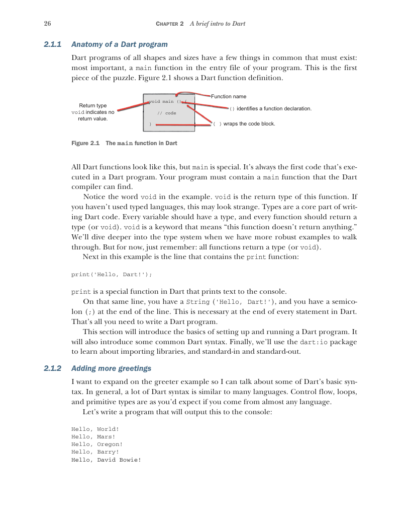
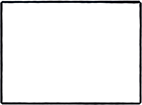
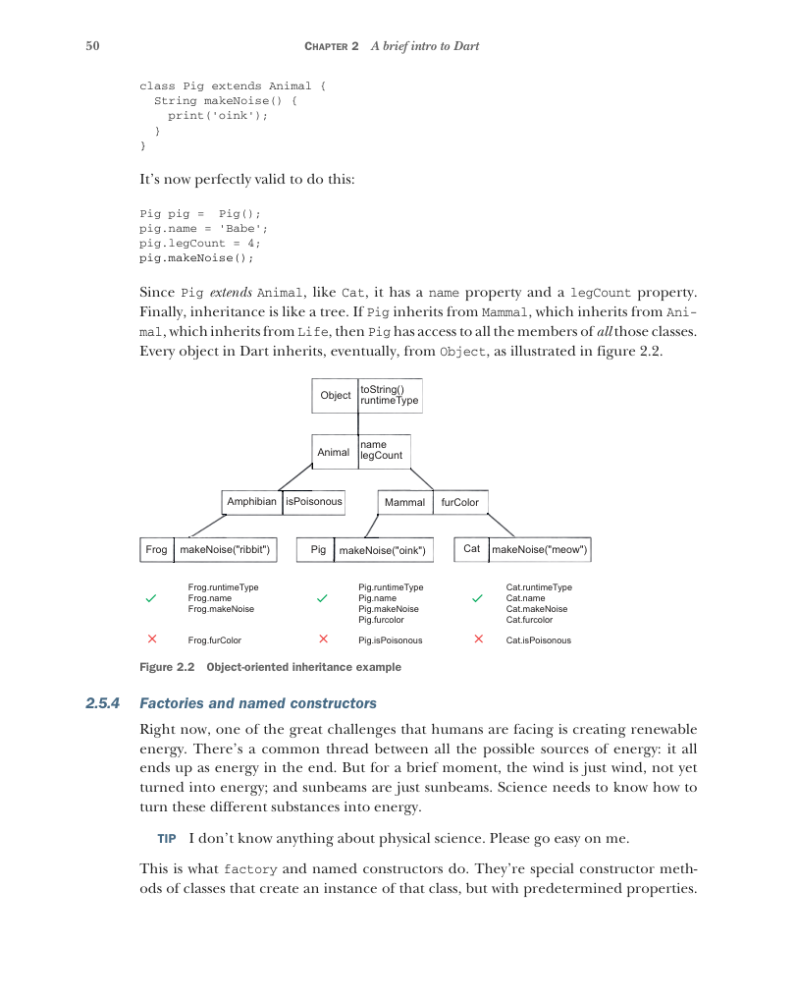
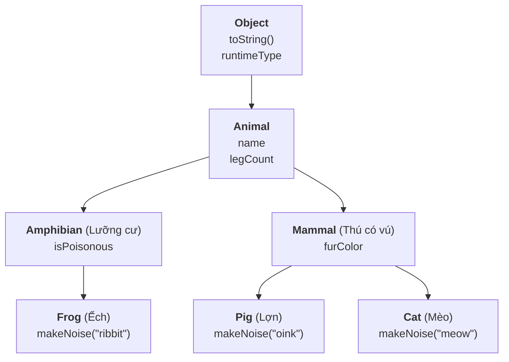

# Chương 2: Giới thiệu nhanh về Dart (A brief intro to Dart)

## Mục lục chương

- [Chương này bao gồm](#chương-này-bao-gồm-this-chapter-covers)
- [2.1 Xin chào, Dart! (Hello, Dart!)](#21-xin-chào-dart-hello-dart)
  - [2.1.1 Cấu trúc của một chương trình Dart (Anatomy of a Dart program)](#211-cấu-trúc-của-một-chương-trình-dart-anatomy-of-a-dart-program)
  - [2.1.2 Thêm nhiều lời chào hơn (Adding more greetings)](#212-thêm-nhiều-lời-chào-hơn-adding-more-greetings)
  - [2.1.3 Nhập/xuất (I/O) và các thư viện Dart (I/O and Dart libraries)](#213-nhậpxuất-io-và-các-thư-viện-dart-io-and-dart-libraries)
- [2.2 Các khái niệm lập trình phổ biến trong Dart (Common programming concepts in Dart)](#22-các-khái-niệm-lập-trình-phổ-biến-trong-dart-common-programming-concepts-in-dart)
  - [2.2.1 Giới thiệu hệ thống kiểu của Dart (Intro to Dart's type system)](#221-giới-thiệu-hệ-thống-kiểu-của-dart-intro-to-darts-type-system)
  - [2.2.2 Chú thích trong code (Comments)](#222-chú-thích-trong-code-comments)
  - [2.2.3 Biến và phép gán (Variables and assignment)](#223-biến-và-phép-gán-variables-and-assignment)
  - [2.2.4 Toán tử (Operators)](#224-toán-tử-operators)
  - [2.2.5 Các toán tử nhận biết null (Null-aware operators)](#225-các-toán-tử-nhận-biết-null-null-aware-operators)
- [2.3 Luồng điều khiển (Control flow)](#23-luồng-điều-khiển-control-flow)
  - [2.3.1 if và else (if and else)](#231-if-và-else-if-and-else)
  - [2.3.2 switch và case (switch and case)](#232-switch-và-case-switch-and-case)
  - [2.3.3 Dùng switch nâng cao (Advanced switch usage)](#233-dùng-switch-nâng-cao-advanced-switch-usage)
  - [2.3.4 Vòng lặp (Loops)](#234-vòng-lặp-loops)
- [2.4 Hàm (Functions)](#24-hàm-functions)
  - [2.4.1 Cấu trúc của một hàm Dart (Anatomy of a Dart function)](#241-cấu-trúc-của-một-hàm-dart-anatomy-of-a-dart-function)
  - [2.4.2 Tham số (Parameters)](#242-tham-số-parameters)
  - [2.4.3 Giá trị mặc định của tham số (Default parameter values)](#243-giá-trị-mặc-định-của-tham-số-default-parameter-values)
  - [2.4.4 Các khái niệm nâng cao về hàm (Advanced function concepts)](#244-các-khái-niệm-nâng-cao-về-hàm-advanced-function-concepts)
  - [2.4.5 Phạm vi từ vựng (Lexical scope)](#245-phạm-vi-từ-vựng-lexical-scope)
- [2.5 Lập trình hướng đối tượng (trong Dart) (Object-oriented programming (in Dart))](#25-lập-trình-hướng-đối-tượng-trong-dart-object-oriented-programming-in-dart)
  - [2.5.1 Lớp (Classes)](#251-lớp-classes)
  - [2.5.2 Hàm khởi tạo (Constructors)](#252-hàm-khởi-tạo-constructors)
  - [2.5.3 Kế thừa (Inheritance)](#253-kế-thừa-inheritance)
  - [2.5.4 Factory và hàm khởi tạo có tên (Factories and named constructors)](#254-factory-và-hàm-khởi-tạo-có-tên-factories-and-named-constructors)
  - [2.5.5 Kiểu liệt kê (Enumerators)](#255-kiểu-liệt-kê-enumerators)
- [Tóm tắt (Summary)](#tóm-tắt-summary)
- [Bảng thuật ngữ của chương](#bảng-thuật-ngữ-của-chương)

> 📝 **Giải thích thêm (không có trong sách):** Sách này được viết cho thời kỳ **Dart 2 trước khi có null safety** (null safety chính thức xuất hiện từ Dart 2.12, năm 2021, và bắt buộc từ Dart 3). Vì vậy một số đoạn code gốc (ví dụ `String name;` không gán giá trị, `int three = null;`, `[int z]` không có giá trị mặc định, `@required`) sẽ **không biên dịch được** trên Dart hiện đại. Bản dịch giữ nguyên code của sách, và ở những chỗ cần thiết sẽ có ghi chú "Giải thích thêm" cho biết cách viết tương đương trong Dart 3.

---

Cuốn sách này nói về việc xây dựng ứng dụng di động bằng Flutter. Nhưng bạn không thể viết một ứng dụng Flutter nếu chưa học một chút về ngôn ngữ lập trình Dart trước. Tin tốt là Dart cũng khá dễ học. Nếu bạn đã đủ quen thuộc với Dart để hiểu khối code sau đây, bạn có thể bỏ qua chương này:

```dart
class CompanyContext extends StateObject {
  final bool isLoading;
  String _companyId;

  CompanyContext({
    this.isLoading = false,
  });

  String get companyId => _companyId;

  void set companyId(String id) {
    _companyId = id;
    _initApp();
  }

  factory CompanyContext.loading() => CompanyContext(isLoading: true);

  @override
  String toString() =>
      'CompanyContext{isLoading: $isLoading, _companyId: $_companyId}';
}
```

### Chương này bao gồm (This chapter covers)

- Chương trình "Hello, World!" của Dart
- Cấu trúc (giải phẫu) của một chương trình Dart
- Cú pháp cơ bản của Dart như luồng điều khiển, vòng lặp và hàm
- Lập trình hướng đối tượng trong Dart
- Sử dụng các thư viện nhập/xuất (I/O) của Dart

> 📝 **Giải thích thêm (không có trong sách):** Đoạn code `CompanyContext` ở trên gói gọn gần như mọi thứ bạn sẽ học trong chương này:
> - `class ... extends StateObject` – khai báo lớp và **kế thừa** (mục 2.5.3).
> - `final bool isLoading;` – biến `final` (mục 2.2.3).
> - `String _companyId;` – dấu gạch dưới `_` ở đầu tên nghĩa là thành viên **riêng tư** (*private*) của thư viện.
> - `CompanyContext({this.isLoading = false})` – hàm khởi tạo với **tham số có tên** và **giá trị mặc định** (mục 2.4.2, 2.4.3, 2.5.2).
> - `String get companyId => ...` – một *getter* viết theo kiểu **arrow function** (mục 2.4.1).
> - `void set companyId(String id) {...}` – một *setter*: mỗi khi gán `companyId`, nó đồng thời gọi `_initApp()`.
> - `factory CompanyContext.loading()` – **factory constructor** có tên (mục 2.5.4).
> - `@override String toString()` – ghi đè phương thức của lớp cha `Object`, dùng **nội suy chuỗi** `$isLoading`.
>
> Nếu đọc lướt mà thấy chỗ nào lạ, hãy đọc tiếp chương này.

Trước khi tiếp tục, hãy chắc chắn rằng Dart đã được cài đặt trên máy của bạn. Hướng dẫn cài đặt có trong phụ lục A.

## 2.1 Xin chào, Dart! (Hello, Dart!)

Giống như mọi cuốn sách lập trình tử tế, chúng ta sẽ bắt đầu bằng một chương trình in ra dòng chữ "Hello, World" (đại loại thế) lên màn hình *console* (cửa sổ dòng lệnh). Trong trình soạn thảo văn bản yêu thích của bạn, hãy tạo một file mới tên là `hello_world.dart` trong thư mục `hello_world`. Viết đoạn code sau vào file:

```dart
void main() {
  print('Hello, Dart!');
}
```

Bây giờ, quay lại cửa sổ terminal, bạn có thể chạy code Dart bằng lệnh CLI (giao diện dòng lệnh) `dart`. Để làm theo các hướng dẫn này, hãy chắc chắn rằng bạn đang đứng đúng thư mục dự án – nơi chứa file `hello_world.dart`. Sau đó, chạy ví dụ "Hello, Dart":

```bash
$ dart hello_world.dart
// => Hello, Dart!
```

Nếu dòng "Hello, Dart!" thực sự được in ra, xin chúc mừng! Bạn đã viết chương trình Dart đầu tiên, và bạn chính thức trở thành một lập trình viên Dart!

> **Khung: Dòng lệnh (The command line)**
>
> Rất nhiều hướng dẫn trong cuốn sách này sẽ yêu cầu chạy lệnh trong terminal của máy bạn. Tôi là một fan lớn của giao diện đồ họa (GUI), và tôi không dùng dòng lệnh nhiều. Bạn không cần phải là một "phù thủy dòng lệnh" để dùng cuốn sách này. Chỉ cần biết rằng: bất cứ khi nào bạn thấy một dòng code bắt đầu bằng dấu `$`, đó là một lệnh để gõ vào terminal. Ký hiệu `=>` theo sau thể hiện giá trị trả về (nếu có). Ví dụ, lệnh `which dart` trong terminal của hầu hết các hệ thống Unix sẽ trả về đường dẫn tới Dart SDK của bạn. Bạn có thể dùng nó để đảm bảo Dart đã được cài đặt:
>
> ```bash
> $ which dart
> => /usr/local/bin/dart
> ```

> 📝 **Giải thích thêm (không có trong sách):** Bạn không gõ dấu `$` vào terminal – nó chỉ là ký hiệu "dấu nhắc lệnh". Tương tự, dòng `=> ...` là kết quả máy in ra, không phải thứ bạn gõ. Trên Windows, lệnh tương đương với `which dart` là `where dart`. Ngoài ra, `dart --version` cũng là cách nhanh để kiểm tra Dart đã cài và đang ở phiên bản nào.

### 2.1.1 Cấu trúc của một chương trình Dart (Anatomy of a Dart program)

Các chương trình Dart, dù to hay nhỏ, đều có một vài điểm chung bắt buộc phải có: quan trọng nhất là một hàm `main` trong file đầu vào (*entry file*) của chương trình. Đây là mảnh ghép đầu tiên của bức tranh. Hình 2.1 cho thấy một định nghĩa hàm trong Dart.

**Hình 2.1 – Hàm `main` trong Dart**



*(Hai ảnh trích sẵn dưới đây chỉ là hai khung nền trang trí của sơ đồ trong Hình 2.1 – một khung viền trắng và một khung nền xám – không chứa chữ.)*




Vẽ lại Hình 2.1 kèm các chú thích đã dịch:

```text
 Kiểu trả về (Return type):          Tên hàm (Function name)
 void nghĩa là không có                    │
 giá trị trả về.                           │
        │                                  ▼
        └──────────────────────────►  void main () {   ◄── () cho biết đây là một khai báo hàm
                                        // code
                                      }                ◄── { } bao bọc khối code (code block)
```

Mô tả hình: Khung code chứa `void main () { // code }`. Các mũi tên chỉ vào:
- `void` – **Kiểu trả về**: `void` nghĩa là hàm không trả về giá trị nào.
- `main` – **Tên hàm**.
- `()` – cặp ngoặc tròn **cho biết đây là một khai báo hàm**.
- `{ }` – cặp ngoặc nhọn **bao bọc khối code** của hàm.

Mọi hàm Dart đều trông như thế này, nhưng `main` thì đặc biệt. Nó luôn là đoạn code được thực thi đầu tiên trong một chương trình Dart. Chương trình của bạn bắt buộc phải chứa một hàm `main` mà trình biên dịch Dart có thể tìm thấy.

Hãy để ý từ `void` trong ví dụ. `void` là kiểu trả về (*return type*) của hàm này. Nếu bạn chưa từng dùng các ngôn ngữ có kiểu (*typed languages*), điều này có thể trông lạ lẫm. Kiểu (*type*) là một phần cốt lõi khi viết code Dart. Mọi biến đều nên có một kiểu, và mọi hàm đều nên trả về một kiểu (hoặc `void`). `void` là một từ khóa có nghĩa là "hàm này không trả về gì cả". Chúng ta sẽ đi sâu hơn vào hệ thống kiểu khi có những ví dụ phong phú hơn để phân tích. Nhưng bây giờ, chỉ cần nhớ: mọi hàm đều trả về một kiểu (hoặc `void`).

Tiếp theo trong ví dụ này là dòng chứa hàm `print`:

```dart
print('Hello, Dart!');
```

`print` là một hàm đặc biệt trong Dart dùng để in văn bản ra console.

Trên cùng dòng đó, bạn có một `String` – chuỗi ký tự – (`'Hello, Dart!'`), và có một dấu chấm phẩy (`;`) ở cuối dòng. Dấu chấm phẩy là bắt buộc ở cuối mỗi câu lệnh (*statement*) trong Dart. Đó là tất cả những gì bạn cần để viết một chương trình Dart.

Phần này sẽ giới thiệu những điều cơ bản về việc thiết lập và chạy một chương trình Dart. Nó cũng sẽ giới thiệu một số cú pháp Dart phổ biến. Cuối cùng, chúng ta sẽ dùng package `dart:io` để tìm hiểu về việc import thư viện, cùng với đầu vào chuẩn (*standard-in*) và đầu ra chuẩn (*standard-out*).

> 💡 **Ví dụ bổ sung (không có trong sách):** Thử "phá" chương trình để hiểu vai trò từng phần:
> ```dart
> void main() {
>   print('Hello, Dart!')   // quên dấu ;
> }
> ```
> Trình biên dịch sẽ báo lỗi kiểu `Error: Expected ';' after this.` Còn nếu bạn đổi tên `main` thành `mainn`, khi chạy `dart hello_world.dart` bạn sẽ nhận lỗi vì không tìm thấy hàm `main` – chương trình không biết bắt đầu từ đâu.

### 2.1.2 Thêm nhiều lời chào hơn (Adding more greetings)

Tôi muốn mở rộng ví dụ chào hỏi này để có thể nói về một số cú pháp cơ bản của Dart. Nhìn chung, rất nhiều cú pháp của Dart giống với nhiều ngôn ngữ khác. Luồng điều khiển, vòng lặp và các kiểu nguyên thủy (*primitive types*) đều đúng như bạn mong đợi nếu bạn đến từ gần như bất kỳ ngôn ngữ nào.

Hãy viết một chương trình in ra console như sau:

```text
Hello, World!
Hello, Mars!
Hello, Oregon!
Hello, Barry!
Hello, David Bowie!
```

Có rất nhiều điều để học từ những ví dụ đơn giản. Để bắt đầu, hãy tái cấu trúc (*refactor*) ví dụ cũ để tạo ra một hàm riêng chuyên việc in. File của bạn sẽ trông như thế này:

```dart
void main() {
  helloDart(); // (1)
}

void helloDart() { // (2)
  print('Hello, Dart!');
}
```

1. Để gọi một hàm, thêm `()` vào cuối tên hàm, không kèm thân hàm.
2. Một khai báo hàm thứ hai.

Tiếp theo, hàm `helloDart` cần được cho biết phải in cái gì, vì bạn không muốn nó in "Hello, Dart!" mãi mãi. Bạn sẽ làm điều này bằng cách truyền vào một cái tên để thay thế cho "World". Bạn truyền đối số (*argument*) vào hàm bằng cách đặt một kiểu và tên biến bên trong cặp `()` trong chữ ký hàm (*function signature*):

```dart
void helloDart(String name) { // (1)
  print('Hello, $name');
}
```

1. Hàm này bây giờ cần một đối số `name`. Cố gọi hàm này với bất cứ thứ gì khác ngoài đúng một đối số có kiểu `String` đều là lỗi.

Tuy nhiên, bạn không chỉ muốn in một cái tên; bạn muốn in một dãy tên. Các tên sẽ đến từ một `List` được viết cứng (*hard-coded*) trong code – `List` là cấu trúc dữ liệu cơ bản giống mảng (*array*) của Dart. Một `List` tự quản lý kích thước của nó và cung cấp tất cả các phương thức lập trình hàm mà bạn mong đợi ở một mảng, như `map` và `forEach`.

Hiện tại, bạn có thể tạo một list bằng hàm khởi tạo dạng literal (*list-literal constructor*) với cặp ngoặc vuông: `var myList = [a,b,c]`. Hãy thêm một list các tên vào hàm `main`:

```dart
void main() {
  List<String> greetings = [ // (1)
    'World',
    'Mars',
    'Oregon',
    'Barry',
    'David Bowie',
  ];
  helloDart();
}
```

1. Định nghĩa một kiểu tập hợp (*collection type*) chứa các đối tượng có kiểu: trong trường hợp này là một `List` chứa toàn các `String`. Một ví dụ khác có thể là `Map<int, String>`.

Hiện giờ chương trình đang có lỗi. Đoạn code này gọi `helloDart()` mà không truyền chuỗi nào làm đối số. Chúng ta cần truyền từng lời chào riêng lẻ vào lời gọi `helloDart()`. Để làm vậy, hãy lặp qua biến `greetings` và gọi hàm `helloDart()` trong mỗi lần lặp của vòng lặp:

```dart
void main() {
  List<String> greetings = [
    'World',
    'Mars',
    'Oregon',
    'Barry',
    'David Bowie',
  ];
  for (var name in greetings) {
    helloDart(name);
  }
}
```

Cuối cùng, cập nhật phương thức `helloDart` để in "Hello" theo sau là lời chào cụ thể. Việc này được thực hiện bằng nội suy chuỗi (*interpolation*). Nội suy chuỗi trong Dart dùng cú pháp `${}` cho các biểu thức, hoặc chỉ một dấu `$` cho một giá trị đơn. Đây là ví dụ đầy đủ.

**Listing 2.1 – Vòng lặp for-in trong Dart**

```dart
void main() {
  List<String> greetings = [
    'World',
    'Mars',
    'Oregon',
    'Barry',
    'David Bowie',
  ];
  for (var name in greetings) { // (1)
    helloDart(name);            // (2)
  }
}

void helloDart(String name) {
  print('Hello, $name');
}
```

1. Vòng lặp `for..in` giống như ở các ngôn ngữ khác. Nó đi qua từng phần tử của list đúng một lần, theo thứ tự, và đưa phần tử đó ra dưới dạng một biến dùng được trong khối code.
2. Truyền biến mà vòng lặp `for..in` đưa ra vào lời gọi `helloDart`.

Chỉ cần vậy thôi. Bây giờ chương trình sẽ chạy được.

> 💡 **Ví dụ bổ sung (không có trong sách):** Phân biệt `$bien` và `${bieu_thuc}`:
> ```dart
> void main() {
>   String name = 'Barry';
>   List<String> greetings = ['World', 'Mars'];
>   print('Hello, $name!');                       // Hello, Barry!
>   print('Tên có ${name.length} ký tự');          // Tên có 5 ký tự
>   print('Có ${greetings.length} lời chào');       // Có 2 lời chào
>   print('Viết hoa: ${name.toUpperCase()}');      // Viết hoa: BARRY
>   print('Sai: $name.length');                    // Sai: Barry.length  (chỉ lấy $name!)
> }
> ```
> Quy tắc: nếu chỉ chèn một biến, dùng `$ten`; nếu cần gọi thuộc tính, phương thức hay tính toán, phải bọc trong `${...}`.
>
> Lưu ý thêm: sách in `'Hello, $name'` (không có dấu `!`), nên kết quả thực tế là `Hello, World`, `Hello, Mars`,... Muốn khớp đúng output mẫu `Hello, World!` thì viết `'Hello, $name!'`.

### 2.1.3 Nhập/xuất (I/O) và các thư viện Dart (I/O and Dart libraries)

Tính năng cuối cùng trong ví dụ này là tương tác với người dùng. Người dùng sẽ có thể nói họ muốn chào ai.

Bước đầu tiên là import (nhập) thư viện. Dart SDK bao gồm nhiều thư viện, nhưng thư viện duy nhất được nạp vào chương trình của bạn theo mặc định là `dart:core`. Một số thư viện phổ biến trong Dart SDK là `dart:html`, `dart:async` và `dart:math`. Các thư viện khác nhau có sẵn trong các môi trường khác nhau. Ví dụ, `dart:html` không có trong Flutter SDK, vì trong một ứng dụng Flutter không có khái niệm HTML. Khi viết một ứng dụng phía máy chủ (*server-side*) hoặc ứng dụng dòng lệnh, bạn có lẽ sẽ dùng `dart:io`. Hãy bắt đầu từ đó.¹

Để import bất kỳ thư viện nào, bạn chỉ cần thêm một câu lệnh `import` ở đầu file Dart:

```dart
import 'dart:io';
```

> ¹ *Chú thích chân trang:* Để biết thêm thông tin về thư viện `dart:io`, hãy xem tài liệu chính thức tại http://mng.bz/5AmZ.

Chúng ta sẽ hầu như không dùng (nếu có) đầu vào và đầu ra chuẩn trong cuốn sách này sau phần này, nên đừng sa đà vào chi tiết của thư viện `io` lúc này. Chương trình sau hỏi tên từ người dùng trên dòng lệnh rồi chào người đó.

**Listing 2.2 – Nhập/xuất (I/O) trong Dart**

```dart
import 'dart:io';

void main() {                             // (1)
  stdout.writeln('Greet somebody');       // (2)
  String input = stdin.readLineSync();    // (3)
  return helloDart(input);
}

void helloDart(String name) {
  print('Hello, $name');
}
```

1. Một lần nữa, `main` là điểm bắt đầu của chương trình.
2. `stdout.writeln` về mặt chức năng giống hệt `print`, nhưng còn có thể được dùng để ghi văn bản vào file.
3. `readLineSync` là một hàm chặn (*blocking function*): nó dừng việc thực thi và chờ người dùng trả lời trên dòng lệnh.

Bạn có thể cải thiện chương trình này bằng cách lặp lại mọi thứ và liên tục hỏi tên, hoặc biến nó thành một trò chơi đoán số, kết thúc khi bạn đoán đúng số. Tôi sẽ để việc đó cho bạn tự làm.

> 📝 **Giải thích thêm (không có trong sách):** Trên Dart có null safety (Dart 2.12+), `stdin.readLineSync()` trả về `String?` (có thể null – ví dụ khi người dùng nhấn Ctrl+D). Vì vậy dòng `String input = stdin.readLineSync();` sẽ báo lỗi biên dịch. Cách viết hiện đại: `String input = stdin.readLineSync() ?? '';` (dùng toán tử `??` ở mục 2.2.5).

> 💡 **Ví dụ bổ sung (không có trong sách):** Lời giải gợi ý cho "trò chơi đoán số" mà tác giả để lại làm bài tập (viết theo Dart hiện đại):
> ```dart
> import 'dart:io';
> import 'dart:math';
>
> void main() {
>   final secret = Random().nextInt(10) + 1; // số bí mật từ 1 đến 10
>   while (true) {
>     stdout.write('Đoán một số từ 1 đến 10: ');
>     final guess = int.tryParse(stdin.readLineSync() ?? '');
>     if (guess == null) {
>       print('Hãy nhập một số!');
>     } else if (guess < secret) {
>       print('Lớn hơn nữa!');
>     } else if (guess > secret) {
>       print('Nhỏ hơn chút!');
>     } else {
>       print('Chính xác! Số bí mật là $secret');
>       break; // thoát vòng lặp (xem mục 2.3.4)
>     }
>   }
> }
> ```
> Chương trình dùng hai thư viện: `dart:io` (đọc/ghi console) và `dart:math` (lớp `Random`).

## 2.2 Các khái niệm lập trình phổ biến trong Dart (Common programming concepts in Dart)

Nếu mọi ngôn ngữ lập trình đều có thể được mô tả bằng danh mục bài hát của ban nhạc Beatles, thì Dart giống như album "những bài hay nhất" (*greatest hits*) của Beatles. Ai cũng yêu Beatles, vì Beatles tuyệt vời. Và ai cũng biết bài "Hey Jude". Nhưng khi bạn đang nghe album greatest hits của Beatles trong một bữa tiệc vui vẻ, sôi động, bạn không bao giờ phải lo rằng đột nhiên mình sẽ phải nghe bài "Within You Without You". Tôi yêu bài hát đó, nhưng nó không dành cho tất cả mọi người, và chắc chắn không phải là nhạc tiệc tùng. Khi viết code Dart, bạn không bao giờ phải sợ rằng mình sẽ gặp phải cú pháp hay hành vi khó giải thích: mọi thứ đều đúng như dự đoán, và trong trường hợp tệ nhất, cũng dễ hiểu thấu (*grok*) khi bạn tra tài liệu.

> 📝 **Giải thích thêm (không có trong sách):** Ý của phép ví von: "Hey Jude" là bài hit quen thuộc ai cũng thích; "Within You Without You" là một bài mang màu sắc nhạc Ấn Độ, thử nghiệm, kén người nghe. Dart chỉ gom những tính năng "quen thuộc, dễ chịu" từ các ngôn ngữ khác, không có những thứ kỳ quặc khiến bạn bất ngờ.

Có một vài khái niệm quan trọng bạn nên ghi nhớ khi viết code Dart:

- Dart là một ngôn ngữ hướng đối tượng và hỗ trợ đơn kế thừa (*single inheritance* – mỗi lớp chỉ kế thừa trực tiếp từ một lớp cha).
- Trong Dart, mọi thứ đều là đối tượng (*object*), và mọi đối tượng đều là một thể hiện (*instance*) của một lớp (*class*). Mọi đối tượng đều kế thừa từ lớp `Object`. Ngay cả các con số cũng là đối tượng, không phải kiểu nguyên thủy (*primitive*).
- Dart có kiểu (*typed*). Bạn không thể trả về một số từ một hàm đã khai báo rằng nó trả về một chuỗi.
- Dart hỗ trợ các hàm và biến cấp cao nhất (*top-level*, tức nằm ngoài mọi lớp), thường được gọi là các thành viên thư viện (*library members*).
- Dart có phạm vi từ vựng (*lexically scoped*).

Và Dart khá là "có chính kiến" (*opinionated*). Trong Dart, cũng như trong mọi ngôn ngữ lập trình, có nhiều cách khác nhau để làm một việc. Nhưng có cách đúng và có cách sai. Câu trích dẫn sau từ trang web của Dart tóm tắt điều này: "Các hướng dẫn (*guidelines*) mô tả những cách làm luôn luôn nên tuân theo. Hầu như sẽ không bao giờ có lý do chính đáng để đi chệch khỏi chúng."

> 💡 **Ví dụ bổ sung (không có trong sách):** "Mọi thứ đều là đối tượng" có nghĩa là bạn có thể gọi phương thức ngay trên một con số hay `null`:
> ```dart
> void main() {
>   print(3.isEven);            // false
>   print((-7).abs());          // 7
>   print(42.toString() + '!'); // 42!
>   print(3 is Object);         // true
>   print(null.toString());     // null
> }
> ```
> Trong Java, `int` là kiểu nguyên thủy nên bạn không thể viết `3.isEven`; trong Dart thì hoàn toàn được.

### 2.2.1 Giới thiệu hệ thống kiểu của Dart (Intro to Dart's type system)

Hệ thống kiểu (*type system*) trong Dart là thứ tôi sẽ bàn đến xuyên suốt cuốn sách. Hệ thống kiểu này khá đơn giản (xét trong số các hệ thống kiểu nói chung). Dù vậy, cần phải xem qua nó một chút trước khi tôi có thể nói về bất cứ điều gì khác. Nó phức tạp hơn nhiều chủ đề khác, chẳng hạn câu lệnh `if`, nhưng phải được học trước. Tôi khuyến khích bạn quay lại phần này bất cứ lúc nào trong suốt cuốn sách nếu cần ôn lại về hệ thống kiểu.

Trước khi trở thành lập trình viên Dart, tôi viết Ruby, Python và JavaScript – những ngôn ngữ động (*dynamic*). Chúng không có khái niệm về kiểu (ít nhất là đối với lập trình viên). Khi bắt đầu viết Dart, tôi thấy việc dùng kiểu là rào cản lớn nhất. (Nhưng bây giờ, tôi không muốn sống trong một thế giới không có chúng.)

Hiện tại có vài chỗ chính bạn cần biết về kiểu, phần còn lại sẽ được đề cập dần. Đầu tiên, khi khai báo biến, bạn gán cho chúng một kiểu:

```dart
String name; // Kiểu luôn đứng trước giá trị mà nó mô tả.
int age;
```

(Chú thích trong sách: Kiểu luôn đứng trước giá trị mà nó mô tả.)

Dùng kiểu sẽ ngăn bạn gán cho biến những giá trị không tương thích:

```dart
int greeting = 'hello';
```

Nếu bạn cố biên dịch file đó bằng cách chạy nó trong terminal, bạn sẽ gặp lỗi sau:

```text
Error: A value of type 'dart.core::String' can't
be assigned to a variable of type 'dart.core::int'.
Try changing the type of the left hand side,
or casting the right hand side to 'dart.core::int'.
```

*(Dịch nghĩa thông báo lỗi: "Lỗi: Một giá trị có kiểu `String` không thể được gán cho một biến có kiểu `int`. Hãy thử đổi kiểu ở vế trái, hoặc ép kiểu (cast) vế phải thành `int`.")*

> **Khung: Kiến thức đúng lúc – Các ngôn ngữ lập trình có kiểu (Just in time: Typed programming languages)**
>
> Một ngôn ngữ được gọi là có kiểu (*typed*) nếu kiểu của mọi biến đều được biết (hoặc được suy luận – *inferred*) tại thời điểm biên dịch (*compile-time*). Nói bằng ngôn ngữ đời thường, một ngôn ngữ là có kiểu nếu bạn, với tư cách lập trình viên, có thể (hoặc bắt buộc phải) gán kiểu một cách tường minh cho các biến trong code. Một ngôn ngữ là động (*dynamic*) nếu kiểu được suy luận tại thời điểm chạy (*runtime*). JavaScript, Python và Ruby là các ngôn ngữ động. (Tuy nhiên, bên dưới lớp vỏ, mọi ngôn ngữ đều có kiểu ở một mức độ nào đó.)
>
> Kiểu được sử dụng vì chúng giúp code của bạn an toàn hơn. Trình biên dịch sẽ không cho bạn truyền một chuỗi vào một hàm cần một số. Điều quan trọng là, trong Dart, việc kiểm tra kiểu này được thực hiện tại thời điểm biên dịch. Điều đó có nghĩa là bạn sẽ không bao giờ phát hành (*ship*) code bị sập chỉ vì một hàm không biết phải làm gì với một loại dữ liệu khác với loại nó mong đợi.
>
> Lợi ích lớn nhất của việc dùng hệ thống kiểu là nó làm giảm lỗi (*bug*).

Trước hết, đó là một thông báo lỗi khá là tốt, như các thông báo lỗi trong Dart thường vậy. (Cảm ơn đội ngũ Dart.) Nhưng hơn thế, đây chính là điều được gọi là an toàn kiểu (*type safe*). Kiểu đảm bảo ngay tại thời điểm biên dịch rằng các hàm của bạn đều nhận đúng loại dữ liệu. Điều này giảm số lỗi bạn gặp phải lúc chạy.

> **TIP (Mẹo):** Nếu bạn đang dùng một trong các IDE được gợi ý trong phụ lục và đã cài plugin Dart, bạn thậm chí sẽ không đi xa được đến bước đó. Trình phân tích code (*linter*) sẽ báo ngay cho bạn biết rằng bạn đang dùng sai kiểu. Tóm gọn lại, đó chính là giá trị của hệ thống kiểu.

> 💡 **Ví dụ bổ sung (không có trong sách):** So sánh với một ngôn ngữ động. Trong JavaScript:
> ```javascript
> function double(x) { return x * 2; }
> double("abc"); // NaN – không lỗi, chương trình vẫn chạy với kết quả vô nghĩa
> ```
> Trong Dart:
> ```dart
> int double(int x) => x * 2;
> void main() {
>   double('abc'); // LỖI BIÊN DỊCH: The argument type 'String' can't be assigned to the parameter type 'int'.
> }
> ```
> Lỗi ở Dart được phát hiện **trước khi** chương trình chạy, còn ở JavaScript thì lỗi lọt tới tay người dùng.

#### KIỂU DỮ LIỆU PHỨC HỢP (COMPLEX DATA TYPES)

Khi dùng các cấu trúc dữ liệu như `List` hay `Map`, bạn dùng `<` và `>` để định nghĩa kiểu của các giá trị bên trong `List`:

```dart
List<String> names;      // Một list các chuỗi
List<int> ages;          // Một list các số nguyên
Map<String, int> people; // Một map có khóa là chuỗi và giá trị là số nguyên
```

#### KIỂU TRONG HÀM (TYPES IN FUNCTIONS)

Nhớ lại phần trước, hàm `main` có kiểu trả về là `void`. Bất kỳ hàm nào được dùng vì tác dụng phụ (*side effects* – tức là vì việc nó làm, như in ra màn hình, chứ không phải vì giá trị nó trả về) đều nên có kiểu trả về này. Nó có nghĩa là hàm không trả về gì.

Tuy nhiên, các hàm khác nên khai báo thứ mà chúng sẽ trả về. Hàm sau trả về một `int`:

```dart
int addNums() {
  // return an int
}
```

Chỗ thứ hai bạn dùng kiểu trong hàm là khi định nghĩa các tham số:

```dart
int addNums(int x, int y) {
  return x + y;
}
```

#### KIỂU ĐỘNG (DYNAMIC TYPES)

Dart cũng hỗ trợ kiểu động. Khi bạn đặt một biến là `dynamic`, bạn đang bảo trình biên dịch chấp nhận bất kỳ kiểu nào cho biến đó:

```dart
dynamic myNumber = 'Hello';
```

Về mặt kỹ thuật, bạn có thể đánh dấu mọi thứ là `dynamic`, điều đó khiến Dart trở thành ngôn ngữ có kiểu tùy chọn (*optionally typed*). Và với việc đó, tôi chỉ có thể nói "Chúc may mắn!". Làm vậy sẽ loại bỏ lợi ích của việc dùng kiểu, mà vẫn bắt bạn phải viết chữ `dynamic` ở khắp nơi. Tôi chỉ ra điều này vì có một số trường hợp bạn không gán kiểu một cách tường minh:

```dart
var myString = 'Hello';
```

Cách này chạy được, nhưng nếu sau đó bạn cố gán `myString` bằng `3`, trình biên dịch sẽ báo lỗi. Một khi một biến đã được gán kiểu, đó là kiểu của nó mãi mãi. Ngoài ra, các hàm không bắt buộc phải được chú thích kiểu trả về:

```dart
myPrint() { // Để ý việc thiếu kiểu trả về.
  print('hello');
}
```

Cách này chạy được, nhưng kiểu vẫn được suy luận. Cố gán giá trị trả về của `myPrint` cho một biến sẽ gây lỗi:

```dart
// doesn't work
var printer = myPrint();
```

Cách này không chạy được, vì không có giá trị trả về nào.

> 📝 **Giải thích thêm (không có trong sách):** Sự khác nhau giữa `var` và `dynamic`:
> ```dart
> var a = 'Hello';   // a được SUY LUẬN là String, cố định mãi mãi
> a = 3;             // LỖI biên dịch: int không gán được cho String
>
> dynamic b = 'Hello';
> b = 3;             // OK – dynamic chấp nhận mọi kiểu
> b.fooBar();        // Biên dịch OK, nhưng CRASH lúc chạy (NoSuchMethodError)
> ```
> `var` chỉ là "để trình biên dịch tự đoán kiểu", còn `dynamic` là "tắt kiểm tra kiểu". Với hàm thiếu kiểu trả về như `myPrint()`, trên các phiên bản Dart hiện đại, kiểu trả về được coi là `dynamic`, nên dòng `var printer = myPrint();` thực tế vẫn biên dịch và `printer` nhận giá trị `null`; tuy nhiên ý chính của tác giả vẫn đúng: lấy "giá trị trả về" của một hàm không trả về gì là vô nghĩa, và nếu khai báo rõ `void myPrint()` thì việc gán `var printer = myPrint();` sẽ bị trình phân tích báo lỗi.

#### CÓ NÊN DÙNG KIỂU DYNAMIC KHÔNG? (SHOULD YOU EVER USE DYNAMIC TYPES?)

`dynamic` có lúc rất tiện. Việc dùng `dynamic` trong các map khá phổ biến. Có thể bạn đang làm việc với JSON:

```dart
Map<String, dynamic> json;
```

Nếu bạn đang chuyển đổi JSON thành một đối tượng Dart, bạn biết rằng khóa của `Map` sẽ là chuỗi, nhưng giá trị có thể là chuỗi, số, list, hoặc một map khác.

Còn với từ khóa `var`, tính hữu ích của nó là vấn đề phong cách code. Từ khóa `var` chỉ có thể được dùng để định nghĩa biến và không thể được dùng để định nghĩa một kiểu, khác với `dynamic`. Nói cách khác, cách viết sau là không hợp lệ:

```dart
Map<String, var> json; // Dùng var sai cách!
```

Vì vậy, phạm vi những chỗ có thể dùng `var` là nhỏ. Ở những chỗ hợp lệ, bạn nên ưu tiên dùng kiểu thực sự của biến mà bạn đang định nghĩa (nếu biến đó có thể gán lại). Nếu biến không nên được gán lại, người ta thường dùng `final` mà không kèm định nghĩa kiểu. Việc này hầu như luôn được làm trong thân hàm, chứ không phải với các thành viên của lớp. Ngoài những trường hợp đó, tốt hơn hết bạn nên dùng kiểu.

> 💡 **Ví dụ bổ sung (không có trong sách):** Một ví dụ thực tế với JSON, nơi `dynamic` thật sự cần thiết:
> ```dart
> import 'dart:convert';
>
> void main() {
>   final String raw = '{"name": "Nora", "age": 3, "tags": ["cat", "orange"]}';
>   final Map<String, dynamic> json = jsonDecode(raw);
>   String name = json['name'];        // giá trị là String
>   int age = json['age'];             // giá trị là int
>   List<dynamic> tags = json['tags']; // giá trị là List
>   print('$name, $age tuổi, tags: $tags');
> }
> ```
> Để ý cách viết theo khuyến nghị của tác giả: `final raw = ...` trong thân hàm (không cần kiểu), còn biến có thể gán lại thì ghi kiểu rõ ràng.

### 2.2.2 Chú thích trong code (Comments)

Dart hỗ trợ ba loại chú thích (*comment*):

```dart
// Inline comments

/*
Blocks of comments. It's not convention to use block comments in Dart.
*/

/// Documentation
///
/// This is what you should use to document your classes.
```

*(Dịch nghĩa: `//` – chú thích trên một dòng; `/* ... */` – khối chú thích, theo quy ước thì Dart không hay dùng khối chú thích; `///` – chú thích tài liệu, đây là loại bạn nên dùng để viết tài liệu cho các lớp của mình.)*

Nhìn chung, chú thích tài liệu với ba dấu gạch chéo được dùng để viết tài liệu cho code của bạn. Bất cứ thứ gì bạn nghĩ sẽ ở lại trong code mãi mãi đều nên dùng kiểu chú thích này. Chú thích trên dòng (*inline*) được dùng cho những ghi chú ngắn về điều gì đó trên một dòng cụ thể.

> 💡 **Ví dụ bổ sung (không có trong sách):**
> ```dart
> /// Tính tổng hai số nguyên [x] và [y].
> ///
> /// Ví dụ: `addNums(2, 3)` trả về `5`.
> int addNums(int x, int y) {
>   return x + y; // không cần kiểm tra tràn số ở đây
> }
> ```
> Chú thích `///` được công cụ `dart doc` dùng để sinh trang tài liệu HTML, và IDE sẽ hiển thị nó khi bạn rê chuột lên tên hàm. Cú pháp `[x]` tạo liên kết tới tham số hoặc tên khác.

### 2.2.3 Biến và phép gán (Variables and assignment)

Biến (*variable*) được dùng trong Dart để bảo một đối tượng hoặc lớp giữ lại một trạng thái cục bộ nào đó. Việc tạo một biến trong Dart diễn ra đúng như bạn mong đợi. Đây là một định nghĩa biến:

```dart
String name;
```

Dòng đó chỉ đơn giản báo cho chương trình biết rằng sẽ có một giá trị gọi là `name`, nhưng giá trị đó chưa được xác định (dù vậy, trong trường hợp này, nó sẽ là một `String`). Ở thời điểm này, `name` chưa được gán giá trị nào, nên giá trị của nó là `null`. Mọi biến chưa được gán trong Dart đều là `null`. `null` là một giá trị đặc biệt có nghĩa là "không có gì". Trong Dart, `null` là một đối tượng, giống như mọi thứ khác. Đó là lý do vì sao `int`, `String`, `List` và mọi thứ khác đều có thể được gán bằng `null`. Về mặt kỹ thuật, bạn có thể làm thế này:

```dart
int three = null;
```

Theo hướng dẫn phong cách (*style guide*) của Dart, bạn nên tránh gán tường minh các đối tượng bằng `null` (xem http://mng.bz/om52).

> 📝 **Giải thích thêm (không có trong sách):** Đây là điểm khác biệt lớn nhất giữa sách và Dart hiện đại. Từ khi có **sound null safety** (Dart 2.12, bắt buộc từ Dart 3), một biến kiểu `int` **không bao giờ** được phép chứa `null`; muốn chứa `null` phải thêm dấu `?`:
> ```dart
> int three = null;   // Dart 3: LỖI biên dịch
> int? maybe = null;  // OK – int? nghĩa là "int hoặc null"
> String? name;       // OK – mặc định là null
> String title;       // Biến cục bộ: OK nếu được gán trước khi dùng; với biến top-level/thuộc tính lớp: LỖI nếu không khởi tạo
> late String later;  // "hứa" sẽ gán trước khi đọc
> ```
> Khi đọc tiếp sách, mỗi khi thấy một biến chưa được gán (ví dụ `String name;` trong lớp), hãy hiểu rằng trên Dart 3 bạn cần viết `String? name;`, hoặc khởi tạo giá trị, hoặc dùng `late`.

#### FINAL, CONST VÀ STATIC (FINAL, CONST, AND STATIC)

Ba từ khóa này "mở rộng" kiểu của biến. Hai từ khóa đầu, `final` và `const`, khá giống nhau. Bạn nên dùng các từ khóa này nếu muốn biến trở thành bất biến (*immutable*) (nói cách khác, nếu bạn không bao giờ có ý định thay đổi giá trị của biến). Sự khác biệt giữa hai từ khóa này rất tinh tế.

Biến `final` chỉ có thể được gán một lần. Tuy nhiên, chúng có thể được khai báo trước khi được gán giá trị ở cấp lớp. Hay nói bằng ngôn ngữ đời thường, một biến `final` hầu như luôn là một biến của lớp sẽ được gán trong hàm khởi tạo (*constructor*). Nếu những thuật ngữ đó còn lạ lẫm, đừng lo. Chúng sẽ được đề cập kỹ sau.

Ngược lại, biến `const` sẽ không được khai báo trước khi gán. Hằng số (*constant*) là những biến luôn luôn giống nhau, dù thế nào đi nữa, ngay từ thời điểm biên dịch.

Cách viết sau được chấp nhận:

```dart
const String name = 'Nora';
```

Nhưng cách này thì không:

```dart
const String name = 'Nora $lastName';
```

Giá trị trong ví dụ thứ hai có thể thay đổi sau thời điểm biên dịch. Chẳng hạn, nó có thể là "Nora Smith" hoặc "Nora Williams". Do đó biến `name` không được phép đánh dấu là `const`.

Nên dùng biến `const` bất cứ khi nào có thể, vì chúng giúp tăng hiệu năng. Trong Flutter, có những công cụ đặc biệt giúp làm cho các lớp và widget của bạn trở thành `const`. Tôi sẽ đề cập điều đó sau.

Cuối cùng, có một bổ từ (*modifier*) gọi là `static`. Các phương thức `static` chỉ được dùng trong lớp, nên tôi cũng sẽ bàn về chúng sau.

> 💡 **Ví dụ bổ sung (không có trong sách):** Bài toán nhỏ – dòng nào hợp lệ?
> ```dart
> class Cat {
>   final String name;        // (a) final, được gán trong constructor
>   Cat(this.name);
> }
>
> void main() {
>   final now = DateTime.now();        // (b) OK: final nhận giá trị lúc CHẠY
>   // const later = DateTime.now();   // (c) LỖI: const cần giá trị lúc BIÊN DỊCH
>   const pi = 3.14159;                // (d) OK
>   final cat = Cat('Nora');
>   // cat.name = 'Ruby';              // (e) LỖI: final chỉ gán một lần
>   // pi = 3;                         // (f) LỖI: const không gán lại được
>   print('$now $pi ${cat.name}');
> }
> ```
> Mẹo nhớ: **`final` = "gán một lần, lúc nào cũng được (kể cả lúc chạy)"**; **`const` = "giá trị phải biết trước ngay khi biên dịch"**. Mọi `const` đều "final", nhưng không phải `final` nào cũng là `const`.

### 2.2.4 Toán tử (Operators)

Không có bất ngờ lớn nào trong các toán tử (*operators*) của Dart, như bạn có thể thấy trong bảng 2.1.

**Bảng 2.1 – Các toán tử trong Dart**

| Mô tả (Description) | Toán tử (Operators) |
|---|---|
| Số học (*Arithmetic*) | `*` `/` `%` `~/` `+` `-` |
| Quan hệ và kiểm tra kiểu (*Relational and type test*) | `>=` `>` `<=` `<` `as` `is` `is!` |
| So sánh bằng (*Equality*) | `==` `!=` |
| Logic và/hoặc (*Logical and/or*) | `&&` `\|\|` |
| Gán (*Assignment*) | `=` `*=` `/=` `~/=` `%=` `+=` `-=` `<<=` `>>=` `&=` `^=` `\|=` `??=` |
| Một ngôi (*Unary*) | `expr++` `expr--` `.` `?.` `-expr` `!expr` `~expr` `++expr` `--expr` |

Tôi muốn chỉ ra một vài toán tử trong số này được dùng thường xuyên nhưng có thể còn lạ với bạn:

- `~/` là ký hiệu của phép chia lấy phần nguyên (*integer division*). Nó không bao giờ trả về số thập phân, mà làm tròn kết quả phép chia của bạn về số nguyên gần nhất. `5 ~/ 2 == 2`
- `as` là từ khóa dùng để ép kiểu (*typecast*). Điều này liên quan hoàn toàn đến lớp và hướng đối tượng, nên tôi sẽ đề cập sau.
- `is` và `is!` kiểm tra xem hai đối tượng có cùng kiểu hay không. Chúng tương đương với `==` và `!=`.

Ở hàng "Một ngôi", hãy bỏ qua chữ "expr". Nó chỉ được dùng để các toán tử dễ đọc hơn.

> 📝 **Giải thích thêm (không có trong sách):** Hai lưu ý cho chính xác:
> - `~/` thực chất **cắt bỏ phần thập phân** (làm tròn về phía 0), không phải "làm tròn tới số gần nhất": `5 ~/ 2 == 2` (2.5 → 2), `7 ~/ 2 == 3` (3.5 → 3, chứ không phải 4), `-5 ~/ 2 == -2`.
> - `is`/`is!` kiểm tra một **đối tượng** có phải là thể hiện của một **kiểu** hay không (vế phải là tên kiểu), ví dụ `x is String`. "Tương đương với `==`/`!=`" nên hiểu là: `is` giống "bằng" về kiểu, `is!` giống "khác" về kiểu.
>
> 💡 **Ví dụ bổ sung (không có trong sách):**
> ```dart
> void main() {
>   print(7 / 2);     // 3.5  (phép / luôn trả về double)
>   print(7 ~/ 2);    // 3    (chia lấy nguyên)
>   print(7 % 2);     // 1    (chia lấy dư)
>
>   Object value = 'hello';
>   print(value is String);   // true
>   print(value is! int);     // true
>   String s = value as String; // ép kiểu Object -> String
>   print(s.length);          // 5
>
>   int count = 10;
>   count ~/= 3;              // count = count ~/ 3
>   print(count);             // 3
> }
> ```

### 2.2.5 Các toán tử nhận biết null (Null-aware operators)

Các toán tử nhận biết null (*null-aware operators*) là một trong những tính năng tôi thích nhất ở Dart. Trong bất kỳ ngôn ngữ nào, việc có những biến và giá trị bằng `null` bay lượn khắp nơi đều có thể gây rắc rối. Nó có thể làm sập chương trình của bạn. Lập trình viên thường phải viết `if (response == null) return` ở đầu một hàm để thực hiện các lời gọi bất đồng bộ. Đó không phải điều tệ nhất trên đời, nhưng nó không gọn gàng. Tôi dùng Go khá nhiều, và nó không phải một ngôn ngữ "phong phú" (*robust*). (Đó không phải phán xét, đó là sự thật.) Cứ khoảng 10 dòng code lại có một câu lệnh `if` kiểm tra `nil`. Điều này khiến các hàm trở nên rất "đồ sộ".

> 📝 **Giải thích thêm (không có trong sách):** Trong đoạn trên, tác giả chơi chữ với từ *robust*: ý ông là Go là ngôn ngữ tối giản, ít tính năng tiện lợi, nên code phải viết dài dòng (`if err != nil`, `if x == nil` liên tục), làm cho hàm "to/cồng kềnh". (`nil` trong Go tương đương với `null`.)

Các toán tử nhận biết null trong Dart giúp giải quyết vấn đề này. Về cơ bản, chúng là cách để nói: "Nếu đối tượng hay giá trị này là null, thì kệ nó đi: dừng ở đây thôi, nhưng đừng ném lỗi."

Quy tắc số một khi viết code Dart là ngắn gọn nhưng không cụt lủn (*concise but not pithy*). Bất cứ khi nào bạn có thể viết ít code hơn mà không hy sinh tính dễ đọc, có lẽ bạn nên làm vậy. Ba toán tử nhận biết null mà Dart cung cấp là `?.`, `??` và `??=`, và tôi sẽ giải thích chúng ngay sau đây.

#### TOÁN TỬ ?. (THE ?. OPERATOR)

Giả sử bạn muốn gọi một API và lấy thông tin về một `User`. Và có thể bạn không chắc liệu thông tin người dùng mà bạn muốn lấy có tồn tại hay không. Bạn có thể kiểm tra null theo cách thông thường như sau:

```dart
void getUserAge(String username) async {
  final request = new UserRequest(username);
  final response = await request.get(); // (1)
  User user = new User.fromResponse(response);
  if (user != null) {                   // (2)
    this.userAge = user.age;
  }
  // etc.
}
```

1. `await` là "đường cú pháp" (*syntactic sugar* – cách viết ngắn gọn cho dễ đọc) để viết code bất đồng bộ. Chúng ta sẽ tìm hiểu kỹ về nó sau.
2. Một phép kiểm tra null thông thường, không dùng toán tử nhận biết null.

Như vậy là ổn. Nó chạy được. Nhưng các toán tử nhận biết null làm mọi chuyện dễ dàng hơn nhiều. Toán tử sau về cơ bản nói rằng: "Này, gán `userAge` bằng `user.age`. Nhưng nếu đối tượng `user` là null, cũng không sao. Cứ gán `userAge` bằng null, thay vì ném lỗi":

```dart
void getUserAge(String username) async {
  final request = UserRequest(username);
  final response = await request.get();
  User user = new User.fromResponse(response);
  this.userAge = user?.age; // Phép kiểm tra null ngắn gọn đến thú vị
  // etc.
}
```

Nếu `user` thực sự là null, chương trình sẽ gán `userAge` bằng null, nhưng sẽ không ném lỗi, và mọi thứ sẽ ổn. Nếu bạn bỏ toán tử `?.` đi, việc gọi `age` trên một đối tượng `User` bằng null sẽ là lỗi. Thêm vào đó, code của bạn ngắn gọn hơn mà vẫn dễ đọc. Đó là điểm mấu chốt: code sạch và ngắn gọn.

> **NOTE (Lưu ý):** Cần chỉ ra rằng nếu bất kỳ đoạn code nào bên dưới dòng `this.userAge = user?.age;` dựa vào việc `userAge` không phải null, thì kết quả sẽ là lỗi.

#### TOÁN TỬ ?? (THE ?? OPERATOR)

Toán tử nhận biết null thứ hai có lẽ còn hữu ích hơn. Giả sử bạn muốn lấy cùng thông tin `User` như trên, nhưng nhiều trường (*field*) của người dùng không bắt buộc trong cơ sở dữ liệu của bạn. Không có gì đảm bảo rằng người dùng đó sẽ có tuổi. Khi đó bạn có thể dùng hai dấu chấm hỏi (`??`) để gán một giá trị "dự phòng" (*fallback*) hay giá trị mặc định.

Toán tử này nói rằng: "Này chương trình, thực hiện thao tác này với giá trị hoặc biến này. Nhưng nếu giá trị hoặc biến đó là null, thì dùng giá trị dự phòng này." Nó cho phép bạn gán một giá trị mặc định ở bất kỳ điểm nào trong quá trình xử lý, và nó cực kỳ tiện lợi:

```dart
void getUserAge(String username) async {
  final request = new UserRequest(username);
  final response = request.get();
  User user = new User.fromResponse(response);
  this.userAge = user.age ?? 18; // Nếu user.age là null, mặc định là 18
  // etc.
}
```

#### TOÁN TỬ ??= (THE ??= OPERATOR)

Toán tử null-safe cuối cùng này đạt được mục tiêu khá giống với toán tử trước, nhưng theo chiều ngược lại. Trong khi viết phần này, tôi nghĩ về việc mình chẳng bao giờ dùng toán tử này ngoài đời thực. Thế là tôi quyết định tìm hiểu một chút. Và bạn biết sao không? Tôi nên dùng nó. Nó tuyệt vời.

Toán tử này về cơ bản nói rằng: "Này, nếu đối tượng này là null, thì gán nó bằng giá trị này. Nếu không phải, cứ trả về đối tượng như cũ":

```dart
int x = 5
x ??= 3;
```

Ở dòng thứ hai, `x` sẽ không được gán bằng 3, vì nó đã có giá trị. Nhưng giống các toán tử nhận biết null khác, toán tử này nhằm làm cho code của bạn ngắn gọn hơn.²

> ² *Chú thích chân trang:* Để tìm hiểu thêm, hãy đọc bài blog "Null-Aware Operators in Dart" của Seth Ladd tại http://mng.bz/nvee.

> 📝 **Giải thích thêm (không có trong sách):** Đoạn code `int x = 5` trong sách thiếu dấu `;` ở cuối (lỗi in ấn); đúng ra là `int x = 5;`. Trên Dart 3, vì `x` có kiểu `int` (không thể null) nên trình phân tích sẽ cảnh báo rằng `??=` là thừa; để ví dụ có ý nghĩa, hãy khai báo `int? x`.

> 💡 **Ví dụ bổ sung (không có trong sách):** Một chương trình chạy được (Dart 3) minh họa cả ba toán tử:
> ```dart
> class User {
>   final String name;
>   final int? age; // tuổi có thể không có
>   User(this.name, [this.age]);
> }
>
> User? findUser(String username) =>
>     username == 'nora' ? User('Nora', 3) : (username == 'buck' ? User('Buck') : null);
>
> void main() {
>   User? a = findUser('nora');
>   User? b = findUser('buck');
>   User? c = findUser('ghost');
>
>   print(a?.age);        // 3
>   print(c?.age);        // null  (c là null nhưng không lỗi)
>   print(b?.age ?? 18);  // 18    (Buck không có tuổi -> dùng mặc định)
>   print(c?.name ?? 'Khách'); // Khách
>
>   String? greeting;
>   greeting ??= 'Xin chào';   // greeting đang null -> được gán
>   greeting ??= 'Hello';      // đã có giá trị -> giữ nguyên
>   print(greeting);           // Xin chào
> }
> ```
> Để ý cách kết hợp `c?.name ?? 'Khách'`: nếu `c` null thì `c?.name` ra null, rồi `??` thay bằng `'Khách'`.

## 2.3 Luồng điều khiển (Control flow)

Điều kỳ lạ nhất về công nghệ là chúng ta đối xử với máy tính như thể chúng thông minh, nhưng thực ra chúng rất ngốc. Chúng chỉ biết làm đại khái hai hay ba việc. Bạn có thể kỳ vọng một con người, hay thậm chí một chú chó, phản ứng phù hợp với vô số tình huống. Chó biết rằng nếu đói, chúng cần ăn để sống; và chúng biết thứ gì là thức ăn, thứ gì không phải. Chúng sẽ không vô tình ăn một hòn đá rồi hy vọng mọi chuyện sẽ ổn.

Máy tính thì không dễ làm việc cùng như vậy. Bạn phải nói cho chúng mọi thứ. Thật ra chúng khá là "đòi hỏi". Vì vậy chúng ta phải dốc sức đảm bảo rằng dù tình huống nào xảy ra, máy tính cũng biết cách xử lý. Về cơ bản đó là lý do chúng ta có luồng điều khiển (*control flow*), nền tảng của gần như mọi logic.

Luồng điều khiển trong Dart tương tự như ở hầu hết các ngôn ngữ bậc cao. Bạn có câu lệnh `if`, phép toán ba ngôi (*ternary*) và câu lệnh `switch`.

### 2.3.1 if và else (if and else)

Dart hỗ trợ `if`, `else if` và `else`, đúng như bạn mong đợi. Đây là một câu lệnh `if` tiêu chuẩn:

```dart
if (inPortland) {
  print('Bring an umbrella!');
} else {
  print('Check the weather first!');
}
```

*(Nghĩa: nếu đang ở Portland thì "Mang theo ô!", ngược lại thì "Hãy xem thời tiết trước!")*

Bên trong điều kiện, bạn có thể dùng `&&` cho "và" và `||` cho "hoặc":

```dart
if (inPortland && isSummer) {
  print('The weather is amazing!');
} else if(inPortland && isAnyOtherSeason) {
  print('Torrential downpour.');
} else {
  print ('Check the weather!');
}
```

*(Nghĩa: ở Portland và đang mùa hè → "Thời tiết tuyệt vời!"; ở Portland và mùa khác → "Mưa như trút nước."; còn lại → "Hãy xem thời tiết!")*

Cuối cùng, Dart là một ngôn ngữ "tỉnh táo", và một điều kiện bắt buộc phải cho ra giá trị Boolean. Chỉ có một cách để nói "đúng" (`true`) và một cách để nói "sai" (`false`). Trong một số ngôn ngữ, có khái niệm "truthiness" (tính "trông-như-đúng"), và mọi giá trị đều bị ép (*coerce*) thành `true` hoặc `false`. Trong những ngôn ngữ đó, bạn có thể viết `if (3) {`, và nó chạy được. Trong Dart thì không như vậy.

> 💡 **Ví dụ bổ sung (không có trong sách):**
> ```dart
> void main() {
>   int count = 3;
>   String name = '';
>
>   // if (count) { ... }      // LỖI: int không phải bool
>   // if (name) { ... }       // LỖI: String không phải bool
>
>   if (count != 0) print('Có $count phần tử');   // phải so sánh tường minh
>   if (name.isEmpty) print('Tên đang trống');
> }
> ```
> Trong JavaScript, `if ("")` là sai còn `if ("0")` lại là đúng – dễ gây nhầm lẫn. Dart loại bỏ hẳn sự mơ hồ này.

### 2.3.2 switch và case (switch and case)

Câu lệnh `switch` rất hữu ích khi có nhiều điều kiện khả dĩ cho một giá trị duy nhất. Các câu lệnh này so sánh `int`, `String` và các hằng số thời điểm biên dịch (*compile-time constants*) bằng `==`. Nói cách khác, bạn phải so sánh một giá trị với một giá trị cùng kiểu mà không thể thay đổi lúc chạy. Nếu nghe như thuật ngữ khó hiểu, đây là một ví dụ đơn giản:

```dart
int number = 1;
switch(number) {
  case 0:
    print('zero!');
    break; // (1)
  case 1:
    print('one!');
    break;
  case 2:
    print('two!');
    break;
  default:
    print('choose a different number!');
}
```

1. Câu lệnh `switch` phải được bảo thoát ra, nếu không nó sẽ thực thi mọi case. Các case luôn nên kết thúc bằng câu lệnh `break` hoặc `return`. Sẽ nói thêm về điều này ngay sau đây.

Đoạn code đó hoàn toàn hợp lệ. Biến `number` có thể có bất kỳ giá trị nào: nó có thể là 1, 2, 3, 4, 66, 975, -12 hoặc 55. Miễn nó là một `int`, đó là một giá trị khả dĩ cho `number`. Câu lệnh `switch` này đơn giản là một cách viết ngắn gọn hơn của một câu lệnh `if/else`. Đây là một khối `if/else` phức tạp quá mức, mà với nó bạn nên ưu tiên dùng câu lệnh `switch`:

```dart
int number = 1;
if (number == 0) {
  print('zero!');
} else if (number == 1) {
  print('one!');
} else if (number == 2) {
  print('two!');
} else {
  print('choose a different number!');
}
```

Tóm gọn lại, đó là những gì một câu lệnh `switch` làm. Nó cung cấp một cách ngắn gọn để kiểm tra bất kỳ số lượng giá trị nào. Tuy nhiên, quan trọng là phải nhớ rằng nó chỉ hoạt động với các hằng số (giá trị trong `case` phải là hằng, không đổi lúc chạy). Cách viết sau là không hợp lệ:

```dart
int five = 5;
switch(five) {
  case(five < 10): // (1)
    // do things...
}
```

1. `five < 10` không chắc chắn là hằng số tại thời điểm biên dịch và vì vậy không thể dùng được. Nó có thể đúng hoặc sai. Bạn không thể thực hiện tính toán trong dòng `case` của một câu lệnh `switch`.

> 📝 **Giải thích thêm (không có trong sách):** Sách viết "it only works with runtime constants", nhưng ý đúng (theo chính chú thích của sách) là **hằng số thời điểm biên dịch**. Lưu ý thêm: từ **Dart 3**, `switch` được nâng cấp mạnh với *pattern matching*, cho phép viết điều kiện kiểu này bằng mệnh đề `when`, hoặc pattern quan hệ:
> ```dart
> int five = 5;
> switch (five) {
>   case < 10:            // Dart 3: pattern quan hệ
>     print('nhỏ hơn 10');
>   case _ when five > 100: // Dart 3: guard 'when'
>     print('rất lớn');
>   default:
>     print('khác');
> }
> ```
> Đồng thời Dart 3 không còn bắt buộc `break` ở cuối mỗi case có nội dung (không có "rơi" ngầm định). Những gì sách trình bày đúng cho Dart 2.

### 2.3.3 Dùng switch nâng cao (Advanced switch usage)

Trong câu lệnh `switch`, bạn có thể "rơi qua" (*fall through*) nhiều case bằng cách không thêm câu lệnh `break` hoặc `return` ở cuối một case:

```dart
int number = 1;
switch(number) {
  case -1:
  case -2:
  case -3:
  case -4:
  case -5:
    print('negative!');
    break;
  case 1:
  case 2:
  case 3:
  case 4:
  case 5:
    print('positive!');
    break;
  case 0:
  default:
    print('zero!');
    break;
}
```

Trong ví dụ này, nếu số nằm trong khoảng từ -5 đến -1, code sẽ in ra `negative!`.

#### THOÁT KHỎI CÂU LỆNH SWITCH (EXITING SWITCH STATEMENTS)

Mỗi case trong câu lệnh `switch` nên kết thúc bằng một từ khóa giúp thoát khỏi `switch`. Nếu không, bạn sẽ gặp lỗi:

```dart
switch(number) {
  case 1:
    print(number);
    // ERROR!
  case 2:
    //...
```

Thông dụng nhất là bạn sẽ dùng `break` hoặc `return`. `break` chỉ đơn giản thoát ra khỏi `switch`; nó không có tác dụng gì khác. Nó không trả về giá trị. Trong Dart, câu lệnh `return` lập tức kết thúc việc thực thi của hàm, và do đó nó sẽ thoát ra khỏi câu lệnh `switch`.

Ngoài hai từ khóa đó, bạn có thể dùng từ khóa `throw`, dùng để ném ra một lỗi. (Sẽ nói thêm về `throw` sau; nó cũng luôn thoát khỏi hàm.) Cuối cùng, bạn có thể dùng câu lệnh `continue` kèm một nhãn (*label*) nếu muốn rơi qua case tiếp theo nhưng vẫn có logic riêng trong mỗi case:

```dart
String animal = 'tiger';
switch(animal) {
  case 'tiger':
    print('it's a tiger');
    continue alsoCat;
  case 'lion':
    print('it's a lion');
    continue alsoCat;
  alsoCat:
  case 'cat':
    print('it's a cat');
    break;
  // ...
}
```

Câu lệnh `switch` này sẽ in ra `it's a tiger` và `it's a cat` lên console.

> 📝 **Giải thích thêm (không có trong sách):** Code trong sách có một lỗi nhỏ: chuỗi `'it's a tiger'` dùng dấu nháy đơn bao ngoài nhưng bên trong lại có dấu nháy đơn (`it's`), nên Dart sẽ hiểu chuỗi kết thúc ở `'it'`. Để chạy được, hãy dùng nháy kép `"it's a tiger"` hoặc thoát ký tự `'it\'s a tiger'`. Cách hoạt động: khi `animal == 'tiger'`, in `it's a tiger`, rồi `continue alsoCat;` nhảy tới case có nhãn `alsoCat` (case `'cat'`), in tiếp `it's a cat`, rồi `break`.

#### TOÁN TỬ BA NGÔI (TERNARY OPERATOR)

Về mặt kỹ thuật, toán tử ba ngôi (*ternary operator*) đúng là một toán tử. Nhưng nó cũng phần nào là một cách thay thế cho `if/else`. Và tùy tình huống, nó cũng phần nào là một lựa chọn thay cho `??=`. Tôi dùng toán tử ba ngôi trong các widget Flutter khá nhiều. Biểu thức ba ngôi được dùng để gán giá trị theo điều kiện. Nó được gọi là "ba ngôi" vì có ba phần – điều kiện, giá trị nếu điều kiện đúng, và giá trị nếu điều kiện sai:

```dart
var nametag = user.title == 'Boss' ? user.name.toUpperCase() : user.name;
```

Đoạn code này nói rằng: "Nếu chức danh của người dùng này là 'Boss' (Sếp), hãy đổi tên cô ấy thành chữ in hoa. Nếu không, giữ nguyên."

Hình minh họa trong sách chú thích ba phần của biểu thức:

```text
var nametag = user.title == 'Boss'  ?  user.name.toUpperCase()  :  user.name;
              └───────┬─────────┘      └──────────┬──────────┘     └───┬───┘
     Điều kiện này đúng hay sai?    Nếu đúng, trả về         Nếu sai, trả về
                                     lựa chọn thứ nhất này.   lựa chọn này.
```

> 💡 **Ví dụ bổ sung (không có trong sách):** Ba cách viết tương đương:
> ```dart
> int age = 16;
>
> // 1. if/else
> String label1;
> if (age >= 18) {
>   label1 = 'Người lớn';
> } else {
>   label1 = 'Trẻ em';
> }
>
> // 2. Toán tử ba ngôi
> String label2 = age >= 18 ? 'Người lớn' : 'Trẻ em';
>
> // 3. Trong Flutter, ternary thường dùng để chọn widget:
> // child: isLoading ? CircularProgressIndicator() : Text('Xong!'),
> ```
> Toán tử ba ngôi là một **biểu thức** (cho ra giá trị), nên dùng được ở những chỗ mà câu lệnh `if` không đặt vào được, như giữa danh sách tham số của một widget.

### 2.3.4 Vòng lặp (Loops)

Bạn có thể lặp lại các biểu thức trong vòng lặp (*loop*) bằng cùng các từ khóa như ở nhiều ngôn ngữ khác. Có nhiều loại vòng lặp trong Dart:

- `for` tiêu chuẩn
- `for-in`
- `forEach`
- `while`
- `do while`

Mỗi loại này hoạt động y hệt như trong mọi ngôn ngữ lập trình mà tôi từng gặp. Vì vậy, tôi sẽ chỉ đưa ra vài ví dụ nhanh.

#### VÒNG LẶP FOR (FOR LOOPS)

Nếu bạn cần biết chỉ số (*index*), lựa chọn tốt nhất là vòng lặp `for` tiêu chuẩn:

```dart
for (var i = 0; i < 5; i++) {
  print(i);
}
```

Nếu bạn không quan tâm đến chỉ số, vòng lặp `for-in` là một lựa chọn tuyệt vời:

```dart
List<String> pets = ['Odyn', 'Buck', 'Yeti'];
for (var pet in pets) {
  print(pet);
}
```

Một cách thay thế, và có lẽ là cách lặp được ưa chuộng hơn nếu bạn không quan tâm đến chỉ số, là dùng phương thức `forEach` có trên các *iterable* (đối tượng có thể duyệt qua được):

```dart
List<String> pets = ['Abe', 'Buck', 'Yeti'];
pets.forEach((pet) => pet.bark());
```

`forEach` đặc biệt ở hai điểm. Thứ nhất, nó là một hàm mà bạn gọi trên một `List`. Hệ quả thực tế là nó tạo ra một phạm vi (*scope*) mới. Bất kỳ giá trị nào bạn truy cập được bên trong vòng lặp `forEach` đều không thể truy cập sau đó.

Thứ hai, logic bên trong khối `forEach` chỉ có thể tạo ra tác dụng phụ. Tức là, bạn không thể trả về giá trị. Các vòng lặp này nhìn chung hữu ích để thay đổi (*mutate*) các đối tượng, chứ không phải để tạo ra đối tượng mới.

> **NOTE (Lưu ý):** `forEach` là một hàm bậc cao (*higher-order function*). Chủ đề đó sẽ được tìm hiểu ngay sau đây.

> 📝 **Giải thích thêm (không có trong sách):** Trong ví dụ `pets.forEach((pet) => pet.bark());`, `pet` là `String` nên thực tế không có phương thức `bark()` – đây chỉ là code minh họa ý tưởng (giả như mỗi phần tử là một con chó). Ngoài ra, hướng dẫn phong cách hiện nay của Dart (lint `avoid_function_literals_in_foreach_calls`) lại khuyên **dùng `for-in`** thay vì `forEach` kèm hàm ẩn danh; `forEach` phù hợp nhất khi bạn truyền sẵn một hàm có tên, ví dụ `pets.forEach(print);`.

#### VÒNG LẶP WHILE (WHILE LOOPS)

Một lần nữa, vòng lặp `while` hoạt động đúng như bạn mong đợi. Chúng đánh giá điều kiện trước khi vòng lặp chạy – nghĩa là nó có thể không bao giờ chạy:

```dart
while(someConditionIsTrue) {
  // do some things
}
```

Ngược lại, vòng lặp `do-while` đánh giá điều kiện sau khi vòng lặp chạy. Vì vậy chúng luôn thực thi code trong khối ít nhất một lần:

```dart
do {
  // do somethings at least once
} while(someConditionIsTrue);
```

#### BREAK VÀ CONTINUE (BREAK AND CONTINUE)

Hai từ khóa này giúp bạn điều khiển luồng của vòng lặp. Dùng `continue` trong vòng lặp để nhảy ngay sang lần lặp tiếp theo, và dùng `break` để thoát hẳn khỏi vòng lặp:

```dart
for (var i = 0; i < 55; i++) {
  if (i == 5) {
    continue;
  }
  if (i == 10) {
    break;
  }
  print(i);
}
```

Vòng lặp này sẽ in ra:

```text
0
1
2
3
4
6
7
8
9
```

> 💡 **Ví dụ bổ sung (không có trong sách):** Bài toán – sự khác nhau giữa `while` và `do-while` khi điều kiện sai ngay từ đầu:
> ```dart
> void main() {
>   int n = 10;
>   while (n < 5) {
>     print('while: $n'); // KHÔNG bao giờ in
>     n++;
>   }
>
>   int m = 10;
>   do {
>     print('do-while: $m'); // In đúng 1 lần: "do-while: 10"
>     m++;
>   } while (m < 5);
> }
> ```
> Ứng dụng điển hình của `do-while`: hiện menu cho người dùng **ít nhất một lần**, rồi lặp lại cho tới khi họ chọn "Thoát".

## 2.4 Hàm (Functions)

Trong Dart, các hàm (*functions*) trông sẽ rất quen thuộc nếu bạn đến từ bất kỳ ngôn ngữ nào thuộc họ C. Chúng ta đã thấy vài ví dụ rồi qua hàm `main`. Bây giờ chúng ta sẽ đào sâu hơn vào hàm và xem cách viết chúng trong Dart. Đây là một hàm cơ bản:

```dart
void main() {
}
```

### 2.4.1 Cấu trúc của một hàm Dart (Anatomy of a Dart function)

Cấu trúc (giải phẫu) của một hàm khá đơn giản và trực diện:

```dart
String makeGreeting(String name) { // (1)
  return 'Hello, $name';
}
```

1. Chữ ký hàm (*Function signature*): `String makeGreeting(String name)` — trong đó `String` ở đầu là kiểu trả về (*Return type*).

Chữ ký hàm tuân theo khuôn mẫu: `ReturnType functionName(ArgumentType arg)` (KiểuTrảVề tênHàm(KiểuĐốiSố đốiSố)). Và mọi hàm có sử dụng `return` đều phải có một kiểu trả về — nếu không trả về giá trị nào, kiểu trả về của nó là `void`.

Điều quan trọng cần lưu ý là Dart là một ngôn ngữ hướng đối tượng thực thụ (*true object-oriented language*). Ngay cả các hàm cũng là đối tượng, mang kiểu `Function`. Bạn có thể truyền hàm đi khắp nơi và gán chúng cho các biến. Những ngôn ngữ hỗ trợ truyền hàm làm đối số và trả về hàm từ một hàm khác thường gọi các hàm như vậy là hàm bậc cao (*higher-order functions*). Chúng ta sẽ khám phá sâu về hàm bậc cao khi bắt đầu viết ứng dụng Flutter.

Dart cũng hỗ trợ một cú pháp viết tắt rất gọn cho bất kỳ hàm nào chỉ chứa duy nhất một biểu thức (*expression*). Nói cách khác, code bên trong khối thân hàm chỉ có một dòng phải không? Vậy thì nhiều khả năng nó chỉ là một biểu thức, và bạn có thể dùng cú pháp này cho ngắn gọn:

```dart
String makeGreeting(String name) => 'Hello, $name';
```

Trong cuốn sách này, chúng ta sẽ gọi đây là hàm mũi tên (*arrow function*). Các hàm mũi tên ngầm định trả về kết quả của biểu thức. `=> expression;` về bản chất hoàn toàn giống với `{ return expression; }`. Bạn không cần (và cũng không được phép) viết thêm từ khóa `return` vào đó.

> 💡 **Ví dụ bổ sung (không có trong sách):** So sánh hàm thông thường, hàm mũi tên và việc gán hàm vào biến kiểu `Function`:
> ```dart
> // Hàm viết đầy đủ
> int squareFull(int x) {
>   return x * x;
> }
>
> // Hàm mũi tên tương đương (ngắn gọn hơn khi chỉ có 1 biểu thức)
> int squareArrow(int x) => x * x;
>
> void main() {
>   // Vì hàm cũng là đối tượng (kiểu Function), ta có thể gán vào biến:
>   Function myFunc = squareArrow;
>   print(myFunc(6)); // 36
> }
> ```

### 2.4.2 Tham số (Parameters)

Các hàm trong Dart cho phép tham số vị trí (*positional parameters*), tham số có tên (*named parameters*), các tham số vị trí tùy chọn và tham số có tên tùy chọn, hoặc kết hợp tất cả chúng lại. Tham số vị trí đơn giản là những gì chúng ta đã thấy từ đầu chương tới giờ:

```dart
void debugger(String message, int lineNum) {
  // ...
}
```

Để gọi hàm đó, bạn bắt buộc phải truyền vào một `String` và một `int`, theo đúng thứ tự đó:

```dart
debugger('A bug!', 55);
```

#### THAM SỐ CÓ TÊN (NAMED PARAMETERS)

Dart hỗ trợ tham số có tên (*named parameters*). "Có tên" nghĩa là khi gọi hàm, bạn gắn từng đối số với một nhãn tên. Ví dụ sau gọi một hàm với hai tham số có tên:

```dart
debugger(message: 'A bug!', lineNum: 44);
```

Tham số có tên được khai báo hơi khác một chút. Bạn bọc bất kỳ tham số có tên nào trong cặp dấu ngoặc nhọn (`{ }`). Dòng sau định nghĩa một hàm nhận các tham số có tên:

```dart
void debugger({String message, int lineNum}) {
```

Theo mặc định, các tham số có tên là không bắt buộc (*optional*). Nhưng bạn có thể gắn chú thích (*annotate*) cho chúng để biến chúng thành bắt buộc:

```dart
Widget build({@required Widget child}) {
  //...
}
```

Để gắn chú thích cho biến bằng từ khóa `required` (`@required`), bạn phải sử dụng một thư viện Dart tên là `meta`. Chúng ta sẽ nói thêm về điều này khi bước vào phần làm việc với Flutter.

Khuôn mẫu bạn thấy ở đây sẽ trở nên cực kỳ quen thuộc khi chúng ta bắt đầu viết ứng dụng Flutter. Hiện tại, bạn chưa cần bận tâm quá nhiều về các chú thích (*annotations*).

> 📝 **Giải thích thêm (không có trong sách):** Từ Dart 2.12 (khi có *null safety*), `required` đã trở thành từ khóa tích hợp sẵn của ngôn ngữ thay vì chú thích `@required` từ gói `meta`. Trên Dart 3 hiện nay, bạn viết trực tiếp:
> ```dart
> Widget build({required Widget child}) {
>   // ...
> }
> ```
> Còn với các tham số có tên không bắt buộc, bạn phải đánh dấu kiểu có thể null (ví dụ `{String? message, int? lineNum}`) hoặc cung cấp giá trị mặc định.

#### THAM SỐ VỊ TRÍ TÙY CHỌN (POSITIONAL OPTIONAL PARAMETERS)

Cuối cùng, bạn có thể truyền các tham số vị trí nhưng không bắt buộc (*positional optional parameters*) bằng cách dùng cặp ngoặc vuông `[ ]`:

```dart
int addSomeNums(int x, int y, [int z]) {
  int sum = x + y;
  if (z != null) {
    sum += z;
  }
  return sum;
}
```

Bạn gọi hàm đó như sau:

```dart
addSomeNums(5, 4) // (1)
addSomeNums(5, 4, 3) // (2)
```

1. Tham số thứ ba là tùy chọn, nên bạn không cần truyền gì vào cho nó.
2. Bạn có thể truyền thêm đối số thứ ba vì bạn đã định nghĩa một tham số tùy chọn.

### 2.4.3 Giá trị mặc định của tham số (Default parameter values)

Bạn có thể định nghĩa các giá trị mặc định cho tham số tùy chọn bằng toán tử `=` ngay trong chữ ký hàm:

```dart
addSomeNums(int x, int y, [int z = 5]) => x + y + z;
```

> 💡 **Ví dụ bổ sung (không có trong sách):** Kết hợp tham số vị trí bắt buộc với tham số có tên kèm giá trị mặc định (cách viết cực kỳ phổ biến trong các widget Flutter):
> ```dart
> void printBanner(
>   String title, {
>   String border = '=',
>   int repeat = 10,
> }) {
>   final line = border * repeat;
>   print('$line $title $line');
> }
>
> void main() {
>   printBanner('XIN CHÀO');                          // ========== XIN CHÀO ==========
>   printBanner('FLUTTER', border: '*', repeat: 5);   // ***** FLUTTER *****
>   printBanner('DART', repeat: 3);                   // === DART ===
> }
> ```
> Nhờ tham số có tên và giá trị mặc định, lời gọi hàm vừa tự giải thích ý nghĩa của từng đối số (`border:`, `repeat:`), vừa cho phép bỏ qua những tham số không cần tùy chỉnh.

### 2.4.4 Các khái niệm nâng cao về hàm (Advanced function concepts)

Hàm là "cơm bữa" của việc tái sử dụng code vì chúng cho phép chúng ta tự định nghĩa vốn từ vựng riêng trong chương trình của mình. Trong một ứng dụng hoàn chỉnh, có thể có hàng ngàn dòng code. Rất dễ bị lạc lối trong đó. Khi được sử dụng đúng cách, các hàm bậc cao (*higher-order functions*) giúp bổ sung một tầng trừu tượng hóa (*abstraction*) vào code, khiến việc suy luận và nắm bắt logic trở nên dễ dàng hơn. Hãy xem hai ví dụ làm toán dưới đây:

```dart
List<int> nums = [1,2,3,4,5];

int i = 0;
int sum = 0;
while (i < nums.length) {
  sum += nums[i];
  i+=1;
}
print(sum);
```

```dart
List<int> nums = [1,2,3,4,5];

print(addNumbers(nums));
```

Có thể hàm `addNumbers` (không được hiển thị ở đây) bên trong cũng được cài đặt y hệt cách mà ví dụ đầu tiên cộng các con số. Nhưng ví dụ thứ hai bổ sung một tầng trừu tượng hóa rất đẹp và nói cho bạn biết chính xác nó đang làm gì, cứ như thể bạn đang đọc tiếng Anh vậy. Bạn không cần phải đọc từng dòng code một để hiểu chuyện gì đang diễn ra. Và như một điểm cộng thêm, bạn biết rằng nếu hàm `addNumbers` không có lỗi (*bug-free*), thì nó sẽ luôn không có lỗi mỗi lần bạn sử dụng nó trong ứng dụng. Tất nhiên đây chỉ là một ví dụ đơn giản, nhưng việc chia nhỏ các hàm thành những khối logic đơn nhiệm (*single-responsibility chunks of logic*) giúp việc viết chúng chuẩn xác trở nên dễ dàng hơn rất nhiều.

Việc tạo ra vốn từ vựng của riêng bạn bằng cách chia nhỏ các hàm được gọi là *trừu tượng hóa* (*abstraction*). Hãy nhớ rằng, máy tính rất ngốc. Chúng ta phải bảo chúng chính xác từng chút một những gì chúng ta muốn chúng làm. Nhưng con người thì thông minh. Chúng ta dùng sự trừu tượng hóa để viết các chỉ dẫn bậc thấp, tường minh cho máy tính, rồi gói gọn chúng lại trong những hàm nhỏ gọn gàng cho các lập trình viên tương lai sẽ đọc code của chúng ta.

Trong Dart, việc trừu tượng hóa logic như vậy khả thi là nhờ ngôn ngữ hỗ trợ các hàm bậc cao (*higher-order functions*). Một hàm được gọi là hàm bậc cao nếu nó nhận một hàm khác làm đối số hoặc nếu nó trả về một hàm. Nói cách khác, hàm bậc cao thao tác trên các hàm khác. Nếu bạn chưa chắc mình đã hiểu về hàm bậc cao, rất có thể bạn đã từng gặp chúng ở một ngôn ngữ khác rồi:

```dart
List<int> nums = [1,2,3];
nums.forEach((number) => print(number + 1));
```

`forEach` là một hàm bậc cao vì nó nhận một hàm làm đối số của nó. Một cách khác để viết đoạn code trên sẽ như thế này:

```dart
void addOneAndPrint(int num) {
  print(num +1);
}

nums.forEach(addOneAndPrint);
```

> **NOTE (Lưu ý):** Ví dụ `forEach` đầu tiên sử dụng một *hàm ẩn danh* (*anonymous function*), nghĩa là nó không có tên. Nó được định nghĩa ngay tại chỗ bên trong đối số truyền cho `forEach`, và sau khi thực thi xong, nó biến mất mãi mãi.

Trước đó, tôi đã đề cập rằng hàm cũng chỉ là đối tượng, giống như mọi thứ khác trong Dart. Đó là lý do bạn có thể sử dụng hàm giống như bất kỳ đối tượng nào khác, bao gồm cả việc truyền chúng đi quanh chương trình dưới dạng biến và giá trị trả về.

Trên thực tế, bạn hoàn toàn có thể xoay xở được mà không cần tự viết logic dùng hàm bậc cao của riêng mình. Nhưng bạn sẽ thường xuyên bắt gặp chúng ngoài thực tế khi xử lý các đối tượng `Iterable` (tập hợp có thể duyệt qua). (Chẳng hạn, `List` là một `Iterable`, vì bạn có thể duyệt từng phần tử qua nó.) Các đối tượng `Iterable` (và cả các đối tượng `Map`, ở một mức độ nhất định) cung cấp những hàm như `forEach`, `map` và `where` — đây đều là các hàm bậc cao thực hiện một tác vụ nào đó lên mọi phần tử trong danh sách. Tôi đã bàn về `forEach` rồi, giờ hãy xem một ví dụ sử dụng `map`.

`List.map` giống với `forEach` ở chỗ nó nhận một hàm làm đối số, và hàm đó được gọi với từng phần tử của danh sách làm đối số truyền vào. Điểm khác biệt so với `forEach` là nó trả về một giá trị từ mỗi lần gọi hàm, và các giá trị trả về đó được gom vào một danh sách (tập hợp) mới. Ví dụ:

```dart
List<int> smallNums = [1,2,3];
Iterable<int> biggerNums = smallNums.map((int n) => n * 2); // (1)
```

1. `List.map` nhận một hàm làm đối số của nó. Mỗi lần hàm bên trong được gọi, nó được truyền một phần tử của danh sách `smallNums` làm đối số.

Đoạn code này nhìn vào từng phần tử của `smallNums` và gọi một hàm trên phần tử đó. Trong trường hợp này, hàm đó là `(int n) => n * 2` *(trong bản in gốc của sách bị lỗi in ấn thành `(int n) ? num * 2`)*. Vì vậy nó sẽ gọi hàm đó một lần cho `1`, một lần cho `2`, và một lần cho `3`. Tập kết quả `biggerNums` là `(2, 4, 6)`. Dù bạn có thể không cần dùng quá nhiều hàm bậc cao, bạn sẽ sớm thấy chúng hữu ích đến mức nào trong quá trình phát triển Flutter.

> 💡 **Ví dụ bổ sung (không có trong sách):** Kết hợp hai hàm bậc cao `where` (lọc phần tử thỏa điều kiện) và `map` (biến đổi từng phần tử) trên danh sách:
> ```dart
> void main() {
>   List<int> prices = [50, 120, 80, 200, 30];
>
>   // Lọc các giá >= 100 rồi giảm giá 10% (nhân 0.9)
>   List<double> discounted = prices
>       .where((price) => price >= 100)
>       .map((price) => price * 0.9)
>       .toList();
>
>   print(discounted); // [108.0, 180.0]
> }
> ```
> Lưu ý rằng `.map(...)` và `.where(...)` trả về một `Iterable` (được tính toán lười – *lazy*); khi cần một `List` thực sự, ta gọi thêm `.toList()` ở cuối.

### 2.4.5 Phạm vi từ vựng (Lexical scope)

Dart có *phạm vi từ vựng* (*lexically scoped*). Mọi khối code đều có quyền truy cập tới các biến nằm "phía trên" (bao ngoài) nó. Phạm vi (*scope*) được xác định bởi cấu trúc của code, và bạn có thể biết những biến nào đang nằm trong phạm vi hiện tại bằng cách lần theo các cặp dấu ngoặc nhọn đi ra ngoài cho tới tận cấp cao nhất (*top level*):

```dart
String topLevel = 'Hello';

void firstFunction() {
  String secondLevel = 'Hi';
  print(topLevel);
  nestedFunction() {
    String thirdLevel = 'Howdy';
    print(topLevel);
    print(secondLevel);
    innerNestedFunction() {
      print(topLevel);
      print(secondLevel);
      print(thirdLevel);
    }
  }
  print(thirdLeve);
}

void main() => firstFunction();
```

Đây là một hàm hợp lệ, cho đến câu lệnh `print` cuối cùng (`print(thirdLeve);` — kể cả khi viết đúng chính tả là `thirdLevel`). Biến ở tầng thứ ba (`thirdLevel`) được định nghĩa bên trong `nestedFunction`, nên câu lệnh `print` ở cuối `firstFunction` nằm ngoài phạm vi của biến đó, bởi vì phạm vi của một biến chỉ giới hạn trong chính khối khai báo nó hoặc các khối con nằm bên trong nó (hay nhìn ngược lại: một khối chỉ thấy được biến của chính nó và của các khối bao phía trên nó). (Xin nhắc lại, một khối code được xác định bởi cặp dấu ngoặc nhọn `{ }`.)

> 💡 **Ví dụ bổ sung (không có trong sách):** Minh họa trực quan các tầng phạm vi từ ngoài vào trong:
> ```text
> ┌─ Tầng cao nhất (Top-level): có [topLevel] ────────────────────────────┐
> │                                                                       │
> │  ┌─ firstFunction(): thấy [topLevel], có thêm [secondLevel] ───────┐  │
> │  │                                                                 │  │
> │  │  ┌─ nestedFunction(): thấy [topLevel, secondLevel],          ┐  │  │
> │  │  │                    có thêm [thirdLevel]                   │  │  │
> │  │  │                                                           │  │  │
> │  │  │  ┌─ innerNestedFunction(): thấy cả 3 biến              ┐  │  │  │
> │  │  │  │  [topLevel, secondLevel, thirdLevel]                │  │  │  │
> │  │  │  └─────────────────────────────────────────────────────┘  │  │  │
> │  │  └───────────────────────────────────────────────────────────┘  │  │
> │  │                                                                 │  │
> │  │  // Ở đây KHÔNG thấy được [thirdLevel] vì đã ra ngoài khối của  │  │
> │  │  // nestedFunction()!                                           │  │
> │  └─────────────────────────────────────────────────────────────────┘  │
> └───────────────────────────────────────────────────────────────────────┘
> ```

## 2.5 Lập trình hướng đối tượng (trong Dart) (Object-oriented programming (in Dart))

Các ứng dụng hiện đại về cơ bản đều làm cùng một việc: chúng cung cấp cho chúng ta (những con người thông minh) một cách để xử lý và cộng tác trên các tập dữ liệu lớn. Một số ứng dụng hướng tới việc giao tiếp, như mạng xã hội và email. Một số hướng tới việc tổ chức sắp xếp, chẳng hạn như lịch và ứng dụng ghi chú. Một số chỉ đơn giản là giao diện kỹ thuật số nối vào một phần của thế giới thực vốn khó định hướng đối với các lập trình viên, như các ứng dụng hẹn hò. Nhưng tất cả chúng đều làm cùng một điều: cung cấp cho người dùng một cách thức trực quan, dễ chịu để tương tác với dữ liệu.

Dữ liệu đại diện cho thế giới thực. Mọi dữ liệu đều mô tả một thứ gì đó có thật. Đó chính là cốt lõi của lập trình hướng đối tượng (*object-oriented programming* – OOP): nó mang lại cho chúng ta một cách tuyệt vời để mô hình hóa dữ liệu theo các đối tượng trong thế giới thực. Nó lấy dữ liệu — thứ mà những chiếc máy tính ngốc nghếch ưa thích — và bổ sung thêm sự trừu tượng hóa để những con người thông minh có thể áp đặt ý chí của mình lên máy tính. Nó giúp code dễ đọc, dễ suy luận và có khả năng tái sử dụng rất cao.

Khi viết code Dart, rất có thể bạn sẽ muốn tạo các lớp (*classes*) riêng biệt cho mọi thứ có thể đại diện cho một "thứ" (*thing*) trong thế giới thực. Từ *thứ* (*thing*) là một từ được lựa chọn rất kỹ lưỡng, bởi vì nó hết sức mơ hồ. (Đây là một ví dụ tuyệt vời về điều có thể khiến một chiếc máy tính ngốc nghếch "nổ tung" nhưng một con người thông minh lại hiểu được ý nghĩa của nó.)

Hãy thử hình dung nếu chúng ta đang viết một hệ thống bán hàng tại quầy (*point-of-sale* – POS) dùng để bán hàng hóa cho khách hàng. Bạn nghĩ mình sẽ cần những loại lớp nào để đại diện cho các "thứ" (hay dữ liệu)? Một ứng dụng POS cần biết về những "thứ" gì? Có lẽ chúng ta cần các lớp để đại diện cho Khách hàng (`Customer`), Doanh nghiệp (`Business`), Nhân viên (`Employee`), Sản phẩm (`Product`) và Tiền (`Money`). Tất cả những lớp đó đều đại diện cho những thứ trong thế giới thực. Nhưng mọi chuyện bắt đầu rắc rối hơn từ đây.

Hãy cùng tôi suy ngẫm một vài câu hỏi:

- Chúng ta có thể muốn có một lớp cho Giao dịch (`Transaction`) và Đơn bán hàng (`Sale`). Trong đời thực, một giao dịch là một quy trình hoặc một sự kiện. Vậy nó nên được biểu diễn bằng một hàm hay một lớp?
- Nếu chúng ta bán chuối, chúng ta nên dùng lớp `Product` rồi gắn cho nó một thuộc tính mô tả loại sản phẩm? Hay chúng ta nên có hẳn một lớp `Banana` riêng?
- Chúng ta nên định nghĩa một biến cấp cao nhất (*top-level variable*) hay một lớp chỉ có duy nhất một thuộc tính? Chẳng hạn, nếu chỉ cần viết một hàm cộng hai số lại với nhau, chúng ta nên định nghĩa một lớp `Math` có phương thức `add`, hay chỉ cần viết hàm đó như một biến/hàm tĩnh toàn cục (*static, global*)?

Suy cho cùng, những quyết định này hoàn toàn thuộc về bạn — người lập trình viên. Không có một câu trả lời đúng duy nhất nào cả.

### 2.5.1 Lớp (Classes)

Quy tắc kinh nghiệm của tôi là: "Khi còn phân vân, hãy tạo một lớp mới." Hãy nhớ lại những câu hỏi vừa rồi: Một giao dịch nên được biểu diễn bằng một hàm của `Business` hay bằng một lớp riêng của chính nó? Tôi sẽ nói là hãy biến nó thành một lớp. Và điều đó đưa tôi quay trở lại lý do vì sao lúc nãy tôi dùng từ *thứ* (*thing*) đầy mơ hồ kia. Một "thứ" không chỉ là một vật thể vật lý hữu hình; nó có thể là một ý niệm, một sự kiện, một nhóm tính từ có liên hệ logic với nhau, v.v. Trong ví dụ này, tôi sẽ tạo một lớp trông như sau:

```dart
class TransactionEvent { // (1)
  // properties and methods
}
```

1. Sử dụng từ khóa `class` để định nghĩa một lớp mới.

Và có thể chỉ cần như vậy thôi. Nó có thể chẳng có thuộc tính (*properties*) nào và cũng chẳng có phương thức (*methods*) nào. Việc tạo các lớp cho những sự kiện giúp phát huy tối đa sức mạnh của tính an toàn kiểu (*type safety*) trong Dart.

Điểm mấu chốt là bạn có thể (và theo tôi là nên) tạo một lớp đại diện cho bất kỳ "thứ" gì không phải là một hành động rõ ràng mà bạn có thể thực hiện hoặc một từ chỉ dùng để mô tả chi tiết nào đó của một "thứ". Chẳng hạn, bạn (một con người) có thể đổi tiền (*exchange money*) với ai đó. Nói "Tôi đổi tiền" nghe hoàn toàn hợp lý. Nhưng nói "Tôi giao dịch" (*"I transaction"* — dùng danh từ làm động từ) thì không hợp lý chút nào, mặc dù giao dịch là một ý niệm. Vì vậy, việc có một lớp `Transaction` là hợp lý, còn lớp `ExchangeMoney` thì không.

Gần như toàn bộ code bạn viết trong Dart sẽ nằm bên trong các lớp. Và một lớp chính là một bản thiết kế (*blueprint*) cho một đối tượng. Tức là, lớp mô tả một đối tượng mà bạn có thể tạo ra. Bản thân đối tượng (*object*) mới là thứ nắm giữ dữ liệu và logic cụ thể. Ví dụ, một lớp `Cat` (Con mèo) có thể trông như thế này:

```dart
class Cat {
  String name;
  String color;
}
```

Lớp này mô tả một đối tượng có thể được tạo ra như sau:

```dart
Cat nora = new Cat();
nora.name = 'Nora';
nora.color = 'Orange';
```

Bản thân lớp `Cat` không hề chứa bất kỳ thông tin cụ thể nào. Nó chỉ là một bản thiết kế. Tuy nhiên, đối tượng `nora` lại là một thực thể (*instance*) của `Cat`. Nó có tên (`name`) và màu lông (`color`), và những thông tin đó không hề liên quan tới bất kỳ thực thể `Cat` mới nào được tạo ra trong tương lai. Ở phần sau của code, bạn hoàn toàn có thể tạo thêm một chú mèo mới:

```dart
Cat ruby = Cat();
nora.name = 'Ruby';
nora.color = 'Grey';
```

*(Lưu ý: Trong đoạn code gốc của sách có lỗi gõ nhầm `nora.name = 'Ruby'; nora.color = 'Grey';` thay vì `ruby.name = 'Ruby'; ruby.color = 'Grey';` — ý của tác giả là gán tên và màu cho thực thể `ruby` vừa tạo.)*

`nora` và `ruby` hoàn toàn tách biệt nhau. Chúng là các thực thể (*instances*) của lớp đó. Sau khi viết xong một lớp, nhìn chung bạn không tương tác trực tiếp với bản thân lớp đó, mà tương tác với các thực thể (tức các đối tượng được tạo ra bởi) lớp đó.

> **NOTE (Lưu ý):** Có một vài trường hợp ngoại lệ khi bạn muốn tương tác trực tiếp với bản thân lớp (chẳng hạn thông qua các thành viên `static`), tôi sẽ đề cập dần khi chúng ta đi tiếp.

> **Ghi chú về việc (không cần) dùng từ khóa `new` (A note about the (lack) of the `new` keyword)**
>
> Nếu bạn đến từ nhiều ngôn ngữ hướng đối tượng khác, hẳn bạn đã quen thấy từ khóa `new` được dùng để tạo các thực thể mới của một lớp. Trong Dart, từ khóa `new` này cũng hoạt động y như vậy, nhưng nó không còn cần thiết nữa. Trong Dart 2, bạn không cần dùng `new` hay `const` để tạo một đối tượng. Trình biên dịch sẽ tự suy luận điều đó giúp bạn. Động lực đằng sau tính năng ngôn ngữ này sẽ được giải thích kỹ hơn ở chương 3.
>
> Từ đây trở đi, tôi sẽ không dùng từ khóa `new` nữa, vì trong Dart việc dùng `new` bị xem là thói quen không tốt (*bad practice*).

### 2.5.2 Hàm khởi tạo (Constructors)

Bạn có thể cung cấp cho các lớp những chỉ dẫn đặc biệt về việc cần làm ngay khi một thực thể mới được tạo ra. Những hàm đặc biệt này được gọi là *hàm khởi tạo* (*constructors*).

Thông thường, khi tạo một lớp, bạn sẽ muốn truyền các giá trị vào cho nó hoặc thực hiện một số logic khởi tạo ban đầu. Bạn có thể sử dụng hàm khởi tạo để gán những giá trị đó vào các thuộc tính của một thực thể thuộc lớp đó:

```dart
class Animal {
  String name; // (1)
  String type;

  Animal(String name, String type) { // (2)
    this.name = name;
    this.type = type;
  }
}
```

1. Khai báo các thuộc tính của lớp này (ban đầu chúng có giá trị là `null`).
2. Hàm khởi tạo mặc định (*Default constructor*) — nhận các đối số truyền vào hàm khởi tạo.

Hàm khởi tạo mặc định (*default constructor*) được viết như một hàm có cùng tên với tên lớp. Mọi đối số cần được truyền vào hàm để gán cho các thuộc tính của lớp đều được định nghĩa giống hệt như các đối số của hàm bình thường. Bạn có thể truyền đối số vào hàm khởi tạo rồi gán chúng cho các thuộc tính thực thể có cùng tên (thông qua từ khóa `this`).

Trong một số ngôn ngữ, bạn bắt buộc phải gán tường minh từng thuộc tính với biến mà bạn truyền vào hàm khởi tạo, giống như ví dụ vừa rồi (chẳng hạn gọi `this.name = name` bên trong thân hàm khởi tạo). Dart cung cấp một "đường cú pháp" (*syntactic sugar*) rất gọn đẹp để giúp code đỡ dài dòng hơn. Bạn có thể đạt được kết quả y hệt chỉ với cách viết sau:

```dart
class Animal {
  String name, type;

  Animal(this.name, this.type); // (1)
}
```

1. Tự động gán các đối số truyền vào cho các thuộc tính có cùng tên của lớp.

Bạn có thể đặt bất kỳ đoạn code và logic nào bạn muốn vào bên trong hàm khởi tạo. Suy cho cùng, nó cũng chỉ là một hàm bình thường mà thôi:

```dart
class Animal {
  String name, type;

  Animal(this.name, this.type) {
    print('Hello from Animal!');
  }
}
```

Trước đó, tôi đã gọi hàm khởi tạo này là *hàm khởi tạo mặc định* (*default constructor*). Thực tế còn có những loại hàm khởi tạo khác, và một lớp có thể có nhiều hàm khởi tạo. Tôi sẽ trình bày về chúng ở phần sau của cuốn sách (và ngay trong mục 2.5.4 tới đây). Nhưng trước hết, tôi muốn nói về chủ đề quan trọng tiếp theo trong lập trình hướng đối tượng: *kế thừa* (*inheritance*).

> 💡 **Ví dụ bổ sung (không có trong sách):** Kết hợp cú pháp `this.property` với tham số có tên và giá trị mặc định trong hàm khởi tạo:
> ```dart
> class Product {
>   String name;
>   double price;
>   bool inStock;
>
>   // Hàm khởi tạo dùng tham số có tên và giá trị mặc định
>   Product({
>     required this.name,
>     required this.price,
>     this.inStock = true,
>   });
>
>   @override
>   String toString() => '$name ($price đ) - Còn hàng: $inStock';
> }
>
> void main() {
>   final item = Product(name: 'Cà phê sữa', price: 29000);
>   print(item); // Cà phê sữa (29000.0 đ) - Còn hàng: true
> }
> ```
> Đây chính là kiểu hàm khởi tạo mà bạn sẽ gặp ở hầu hết các widget trong Flutter!

### 2.5.3 Kế thừa (Inheritance)

Trong lập trình hướng đối tượng, *kế thừa* (*inheritance*) là ý tưởng cho rằng một lớp có thể kế thừa hoặc trở thành lớp con (*subclass*) của một lớp khác. Mèo là một loài cụ thể thuộc lớp thú có vú (*mammal*), nên lẽ tự nhiên là mèo sẽ có toàn bộ các chức năng và thuộc tính giống như mọi loài thú có vú khác. Bạn có thể viết lớp `Mammal` một lần duy nhất, rồi sau đó cả lớp `Dog` (Chó) lẫn lớp `Cat` (Mèo) đều có thể mở rộng (*extend*) lớp `Mammal`. Khi đó, cả hai lớp này sẽ tự động có toàn bộ chức năng của lớp `Mammal`:

```dart
class Cat extends Mammal {}
class Eric extends Human {}
class Honda extends Car {}
```

Khi một lớp kế thừa từ một lớp khác (lớp cha được gọi là *superclass*), về bản chất nó là một bản sao của lớp cha đó, và bạn có thể bổ sung thêm các chức năng mới — bất cứ thứ gì bạn định nghĩa thêm trong chính lớp con đó. (Ví dụ, `Cat` là một bản sao của lớp `Mammal`, nhưng bạn có thể thêm vào một hàm tên là `meow`.) Hãy xem một ví dụ nhỏ, cụ thể:

```dart
// superclass (lớp cha)
class Animal {
  String name;
  int legCount;
}

// subclass (lớp con)
class Cat extends Animal { // (1)
  String makeNoise() {
    print('purrrrrrr');
  }
}
```

1. Dùng từ khóa `extends` để kế thừa toàn bộ chức năng của một lớp cha (*superclass*).

*(Lưu ý nhỏ: Trong code gốc của sách, `makeNoise()` khai báo kiểu trả về là `String` nhưng bên trong chỉ gọi `print(...)` mà không có `return`; trong thực tế hàm chỉ in ra màn hình như vậy nên để kiểu trả về là `void`.)*

Trong ví dụ này, nếu chúng ta tạo một thực thể của `Cat`, nó sẽ có các thuộc tính tên là `name` và `legCount`:

```dart
Cat cat = Cat();
cat.name = 'Nora';
cat.legCount = 4;
cat.makeNoise();
```

Tất cả những biểu thức trên đều hoàn toàn hợp lệ. Bạn có thể đặt tên cho chú mèo vì nó đồng thời cũng là một `Animal`. Tuy nhiên, đoạn code sau đây thì **không** hợp lệ:

```dart
Cat cat = Animal();
cat.makeNoise();
```

`Animal` là lớp cha (*superclass*) và nó không hề có khái niệm hay mối liên hệ ngược nào tới các lớp con (*subclasses*) mở rộng từ nó (một `Animal` chung chung không chắc đã là `Cat` và không có phương thức `makeNoise()`).

Để mở rộng thêm về tính kế thừa, hãy xem chuyện gì xảy ra nếu chúng ta tạo một lớp nữa gần như giống hệt, nhưng dành cho một chú lợn (`Pig`):

```dart
class Pig extends Animal {
  String makeNoise() {
    print('oink');
  }
}
```

Bây giờ, viết như sau là hoàn toàn hợp lệ:

```dart
Pig pig = Pig();
pig.name = 'Babe';
pig.legCount = 4;
pig.makeNoise();
```

Vì `Pig` mở rộng từ `Animal`, nên giống như `Cat`, nó cũng có thuộc tính `name` và thuộc tính `legCount`. Cuối cùng, kế thừa giống như một cái cây phân cấp. Nếu `Pig` kế thừa từ `Mammal`, mà `Mammal` kế thừa từ `Animal`, còn `Animal` lại kế thừa từ `Life`, thì `Pig` có quyền truy cập tới tất cả các thành viên của *tất cả* những lớp đó. Mọi đối tượng trong Dart rốt cuộc đều kế thừa từ lớp gốc `Object`, như được minh họa trong hình 2.2.

**Hình 2.2 – Ví dụ về tính kế thừa trong lập trình hướng đối tượng (Object-oriented inheritance example)**





**Mô tả chi tiết Hình 2.2:**
Sơ đồ cây kế thừa bắt đầu từ lớp gốc cao nhất là **`Object`** (có sẵn phương thức `toString()` và thuộc tính `runtimeType`):
- **`Animal`** kế thừa từ `Object`, bổ sung thêm hai thuộc tính `name` (tên) và `legCount` (số chân).
- Từ `Animal` tách ra hai nhánh lớp con:
  1. **`Amphibian`** (Động vật lưỡng cư) kế thừa `Animal`, có thêm thuộc tính `isPoisonous` (có độc hay không). Lớp **`Frog`** (Ếch) kế thừa `Amphibian` và định nghĩa `makeNoise("ribbit")`.
  2. **`Mammal`** (Thú có vú) kế thừa `Animal`, có thêm thuộc tính `furColor` (màu lông). Hai lớp **`Pig`** (`makeNoise("oink")`) và **`Cat`** (`makeNoise("meow")`) cùng kế thừa từ `Mammal`.
- Do đó, ở cuối sơ đồ:
  - Đối với **`Frog`**: truy cập được `Frog.runtimeType`, `Frog.name`, `Frog.makeNoise` (và cả `Frog.isPoisonous`) (✓), nhưng **không** có `Frog.furColor` (✗) vì `furColor` nằm ở nhánh `Mammal`.
  - Đối với **`Pig`**: truy cập được `Pig.runtimeType`, `Pig.name`, `Pig.makeNoise`, `Pig.furColor` (✓), nhưng **không** có `Pig.isPoisonous` (✗) vì `isPoisonous` nằm ở nhánh `Amphibian`.
  - Đối với **`Cat`**: truy cập được `Cat.runtimeType`, `Cat.name`, `Cat.makeNoise`, `Cat.furColor` (✓), nhưng **không** có `Cat.isPoisonous` (✗).

### 2.5.4 Factory và hàm khởi tạo có tên (Factories and named constructors)

Ngay lúc này, một trong những thách thức lớn mà nhân loại đang đối mặt là tạo ra năng lượng tái tạo. Có một điểm chung giữa tất cả các nguồn năng lượng khả dĩ: rốt cuộc tất cả đều trở thành năng lượng. Nhưng trong một khoảnh khắc ngắn ngủi trước đó, gió vẫn chỉ là gió, chưa được biến thành năng lượng; và những tia nắng mặt trời cũng chỉ là tia nắng. Khoa học cần biết cách biến những dạng vật chất/hiện tượng khác nhau này thành năng lượng.

> **TIP (Mẹo vui):** Tôi chẳng biết gì về khoa học vật lý đâu. Xin hãy nhẹ tay với tôi nhé.

Đó chính là những gì mà hàm khởi tạo `factory` và *hàm khởi tạo có tên* (*named constructors*) thực hiện. Chúng là những phương thức khởi tạo đặc biệt của lớp, giúp tạo ra một thực thể của lớp đó nhưng với các thuộc tính đã được xác định/xử lý trước.

Các hàm khởi tạo có tên (*named constructors*) luôn trả về một thực thể *mới* của lớp. Các phương thức `factory` thì linh hoạt hơn một chút: chúng có thể trả về các thực thể đã được lưu sẵn trong bộ nhớ đệm (*cached instances*) hoặc trả về các thực thể thuộc kiểu con (*subtypes*). Trong code, lớp `Energy` (Năng lượng) đó có thể trông như thế này:

```dart
class Energy {
  int joules;

  Energy(this.joules); // (1)

  Energy.fromWind(int windBlows) { // (2)
    final joules = _convertWindToEnergy(windBlows);
    return Energy(joules); // (3)
  }

  factory Energy.fromSolar(int sunbeams) { // (4)
    if (appState.solarEnergy != null) return appState.solarEnergy;
    final joules = _convertSunbeamsToJoules(sunbeams);
    return appState.solarEnergy = Energy(joules);
  }
}
```

1. Hàm khởi tạo mặc định (*Default constructor*).
2. Sử dụng cú pháp `"Energy."` (`Energy.fromWind`) và trả về một thực thể của lớp đó giúp biến đây thành một hàm khởi tạo có tên (*named constructor*).
3. Mọi hàm khởi tạo đều phải trả về một thực thể của lớp đó.
4. Hàm khởi tạo `factory` có khả năng trả về một thực thể `Energy` đã tồn tại từ trước (`appState.solarEnergy`). Nếu chưa có, nó sẽ tạo một thực thể mới, gán lưu lại, rồi trả về thực thể đó.

> 📝 **Giải thích thêm (không có trong sách):** Có một chi tiết cú pháp rất quan trọng trong Dart cần lưu ý ở đoạn code `Energy.fromWind` của sách:
> - Trong Dart, một **hàm khởi tạo thông thường hoặc hàm khởi tạo có tên** (không có từ khóa `factory`) **không được phép dùng câu lệnh `return <giá_trị>;`** ở trong thân hàm, vì bản thân nó đã tự động khởi tạo và trả về đối tượng `this` rồi!
> - Để `Energy.fromWind` biên dịch được trong Dart, bạn có 3 cách viết chuẩn:
> ```dart
> class Energy {
>   int joules;
>
>   Energy(this.joules);
>
>   // Cách 1: Dùng danh sách khởi tạo (initializer list) với dấu hai chấm ':'
>   Energy.fromWind(int windBlows)
>       : joules = _convertWindToEnergy(windBlows);
>
>   // Cách 2: Hàm khởi tạo chuyển tiếp (redirecting constructor) dùng ': this(...)'
>   // Energy.fromWind(int windBlows) : this(_convertWindToEnergy(windBlows));
>
>   // Cách 3: Thêm từ khóa 'factory' nếu muốn tính toán rồi 'return Energy(joules);'
>   factory Energy.fromSolar(int sunbeams) {
>     final joules = _convertSunbeamsToJoules(sunbeams);
>     return Energy(joules);
>   }
> }
> ```
> Hãy nhớ: chỉ khi có từ khóa `factory`, bạn mới viết `return Energy(...);` bên trong thân hàm khởi tạo!

### 2.5.5 Kiểu liệt kê (Enumerators)

Kiểu liệt kê (*enumerators*), thường được gọi tắt là `enum`, là những lớp đặc biệt đại diện cho một số lượng xác định các hằng số. Giả sử bạn có một phương thức nhận vào một `String` rồi thực hiện vài phép thuật nào đó để đổi màu chữ trong ứng dụng:

```dart
void updateColor(String color) {
  if (color == 'red') {
    text.style.color = 'rgb(255,0,0)';
  } else if (color == 'blue') {
    text.style.color = 'rgb(0,0,255)';
  }
}
```

Cách này chạy rất ổn, trừ phi bạn truyền `"macaroni"` (mì ống), `"crab cakes"` (bánh cua), `"33445533"`, hay bất kỳ chuỗi linh tinh nào khác vào `updateColor`. Bạn có thể dùng một `enum` để mang lại cho mình sự an toàn về kiểu (*type safety*) mà không cần tới sự dài dòng của việc tạo cả một lớp đầy đủ. Suy cho cùng, đó chính là mục đích của `enum`: nó giúp code của bạn khó bị hỏng hơn và dễ đọc hơn.

Vì vậy, `enum Color` của bạn có thể trông như thế này:

```dart
enum Color { red, blue }
```

Trong code, bạn có thể truy cập các màu sắc như sau: `Color.red`. Các biến và trường dữ liệu giờ đây có thể mang kiểu `Color`, và chúng bắt buộc phải được gán bằng `Color.red` hoặc `Color.blue`. Hơn nữa, như một điểm cộng tuyệt vời, câu lệnh `switch` có thể kiểm tra trên một `enum` và bắt buộc bạn phải có câu lệnh `case` cho mọi giá trị có trong `enum` đó (hoặc phải có một nhánh `default` ở cuối).

Giờ đây hàm của bạn có thể trông như thế này:

```dart
enum Color { red, green, blue }

void updateColor(Color color) {
  switch(color) {
    case Color.red:
      // do stuff
    case Color.green:
      // do stuff
    case Color.blue:
      // do stuff
  }
}
```

*(Lưu ý: Trong Dart 2, mỗi nhánh `case` có lệnh bên trong vẫn cần kết thúc bằng `break;` hoặc `return;`; từ Dart 3 trở đi thì không cần `break;` nữa.)*

Sau đó, khi gọi hàm, bạn bắt buộc phải truyền vào một giá trị kiểu `Color`:

```dart
updateColor(Color.red);
updateColor(Color.green);
updateColor(Color.blue);
```

Nếu bạn cố truyền vào chuỗi `"macaroni"`, code sẽ báo lỗi ngay lập tức.

> 💡 **Ví dụ bổ sung (không có trong sách):** Sử dụng `enum` để quản lý trạng thái tải dữ liệu của màn hình (rất phổ biến trong ứng dụng Flutter):
> ```dart
> enum LoadStatus { initial, loading, success, error }
>
> String statusMessage(LoadStatus status) {
>   switch (status) {
>     case LoadStatus.initial:
>       return 'Chưa tải dữ liệu';
>     case LoadStatus.loading:
>       return 'Đang tải...';
>     case LoadStatus.success:
>       return 'Tải thành công!';
>     case LoadStatus.error:
>       return 'Có lỗi xảy ra!';
>   }
> }
>
> void main() {
>   print(statusMessage(LoadStatus.loading)); // Đang tải...
> }
> ```
> Nếu sau này bạn thêm một trạng thái mới vào `LoadStatus` (ví dụ `empty`), trình phân tích của Dart sẽ lập tức cảnh báo ở câu lệnh `switch` rằng bạn chưa xử lý hết các trường hợp!

> **Ghi chú về các tính năng khác của Dart (A note about more Dart features)**
>
> Chương này được thiết kế như một cái nhìn tổng quan về những mảnh ghép cốt lõi của Dart mà bạn sẽ cần để viết ứng dụng Flutter — nhưng thực tế Dart còn có nhiều thứ hơn thế nữa. Một số tính năng của Dart sẽ được thảo luận ở các phần sau trong cuốn sách này bao gồm: các tính năng bất đồng bộ (*asynchronous features*), kiểu tổng quát (*type generics*), lớp trừu tượng (*abstract classes* — còn được biết đến như các *interface*), và hàm sinh (*generator functions*). Những tính năng này rất thú vị và quan trọng, nhưng cần có nhiều ngữ cảnh thực tế mới mô tả chính xác được. Vì vậy, tôi sẽ bàn sâu về chúng khi thời điểm đến. Còn hiện tại, yêu cầu duy nhất là bạn nắm vững phần nền tảng của Dart.

---

## Tóm tắt (Summary)

- Cú pháp của Dart rất quen thuộc nếu bạn đã biết bất kỳ ngôn ngữ nào thuộc họ C.
- Dart là một ngôn ngữ lập trình hướng đối tượng, có kiểu nghiêm ngặt (*strictly typed*).
- Mọi chương trình Dart đều bắt đầu bằng một hàm `main` làm điểm khởi đầu (*entry point*) của ứng dụng.
- Các kiểu dữ liệu (*types*) được dùng để đảm bảo rằng code đang sử dụng đúng các giá trị vào đúng thời điểm. Thoạt nhìn chúng có vẻ rườm rà, nhưng lại vô cùng hữu ích để giảm thiểu lỗi (*bugs*).
- Các hàm bắt buộc phải trả về một kiểu dữ liệu cụ thể hoặc `void`.
- Hầu hết các toán tử trong Dart đều giống với toán tử ở các ngôn ngữ khác, nhưng có một vài toán tử đặc biệt như `~/`, `is` và `as`.
- Các toán tử nhận biết null (*null-aware operators*: `?.`, `??`, `??=`) rất hữu ích để thực hiện kiểm tra null, giúp đảm bảo các giá trị không bị `null` (hoặc được xử lý an toàn khi `null`).
- Về luồng điều khiển (*control flow*), Dart hỗ trợ câu lệnh `if/else`, cũng như câu lệnh `switch` và toán tử ba ngôi (*ternary operator*).
- Việc sử dụng `enum` kết hợp với câu lệnh `switch` buộc lập trình viên phải tính đến tất cả các trường hợp khả dĩ.
- Các vòng lặp trong Dart sẽ rất quen thuộc nếu bạn đến từ hầu hết các ngôn ngữ khác. Có vòng lặp `for`, vòng lặp `for-in` (và `forEach`), vòng lặp `while` và vòng lặp `do while`.
- Các hàm trong Dart cũng là đối tượng và có thể được truyền đi khắp nơi giống như bất kỳ giá trị nào khác. Khái niệm này được gọi là *hàm bậc cao* (*higher-order function*) trong nhiều ngôn ngữ.
- Dart là một ngôn ngữ lập trình hướng đối tượng thực thụ, và code của bạn sẽ sử dụng rất nhiều tới các lớp (*classes*), hàm khởi tạo (*constructors*) và tính kế thừa (*inheritance*).
- Có nhiều loại hàm khởi tạo: hàm khởi tạo mặc định (*default constructor*), hàm khởi tạo `factory` (*factory constructors*), và hàm khởi tạo có tên (*named constructors*).
- `enum` (kiểu liệt kê) là một loại lớp đặc biệt mang lại sự an toàn kiểu bổ sung khi có một số lượng lựa chọn đã được xác định trước cho một thuộc tính hoặc một biến.

---

## Bảng thuật ngữ của chương

| Thuật ngữ tiếng Anh | Thuật ngữ tiếng Việt | Giải thích ngắn |
| :--- | :--- | :--- |
| **Abstraction** | Trừu tượng hóa | Việc ẩn đi các chi tiết cài đặt bậc thấp phức tạp bên trong các hàm hoặc lớp có tên gọi giàu ý nghĩa, giúp con người dễ đọc và tái sử dụng code. |
| **Anonymous function** | Hàm ẩn danh | Hàm không có tên, thường được khai báo trực tiếp tại vị trí truyền đối số cho một hàm bậc cao (như `forEach`, `map`). |
| **Arrow function (`=>`)** | Hàm mũi tên | Cú pháp viết tắt cho hàm chỉ chứa một biểu thức duy nhất; tự động trả về giá trị của biểu thức đó mà không cần từ khóa `return`. |
| **Class** | Lớp | Bản thiết kế (*blueprint*) định nghĩa các thuộc tính (dữ liệu) và phương thức (hành vi) cho một loại đối tượng. |
| **Compile-time constant** | Hằng số thời điểm biên dịch | Giá trị không đổi và đã được xác định hoàn toàn ngay khi biên dịch chương trình (khai báo với `const`). |
| **Constructor** | Hàm khởi tạo | Phương thức đặc biệt của lớp, được gọi tự động khi tạo một thực thể mới nhằm khởi tạo các thuộc tính hoặc chạy logic ban đầu. |
| **Control flow** | Luồng điều khiển | Các cấu trúc (`if/else`, `switch`, toán tử ba ngôi, vòng lặp) quyết định thứ tự và điều kiện thực thi các câu lệnh trong chương trình. |
| **Default constructor** | Hàm khởi tạo mặc định | Hàm khởi tạo trùng tên với tên lớp và không có tên phụ đi kèm. |
| **Dynamic type (`dynamic`)** | Kiểu động | Kiểu đặc biệt tắt kiểm tra kiểu tĩnh, cho phép biến chứa bất kỳ kiểu giá trị nào và thay đổi kiểu lúc chạy. |
| **Entry point (`main`)** | Điểm khởi đầu | Hàm `main()` nơi chương trình Dart bắt đầu được thực thi. |
| **Enumerator (`enum`)** | Kiểu liệt kê | Lớp đặc biệt giới hạn giá trị của một kiểu trong một tập hợp các hằng số được định nghĩa trước. |
| **Expression** | Biểu thức | Một đoạn code có thể được tính toán để cho ra một giá trị (ví dụ `2 + 2`, `a ? b : c`). |
| **Factory constructor (`factory`)** | Hàm khởi tạo factory | Hàm khởi tạo đặc biệt dùng từ khóa `factory`, có thể trả về một thực thể có sẵn trong bộ nhớ đệm hoặc một thực thể của lớp con thay vì luôn tạo mới. |
| **Fall through** | Rơi qua (trong `switch`) | Hiện tượng gộp nhiều nhánh `case` liên tiếp hoặc chuyển tiếp sang `case` khác khi không kết thúc `case` bằng `break`/`return`. |
| **Function signature** | Chữ ký hàm | Phần khai báo đầu hàm gồm kiểu trả về, tên hàm và danh sách các tham số cùng kiểu của chúng. |
| **Generic type (`<T>`)** | Kiểu tổng quát (Generic) | Cách chỉ định kiểu phần tử bên trong một cấu trúc dữ liệu thông qua cặp ngoặc nhọn, ví dụ `List<int>`, `Map<String, int>`. |
| **Higher-order function** | Hàm bậc cao | Hàm nhận một hàm khác làm đối số hoặc trả về một hàm làm kết quả (ví dụ `forEach`, `map`, `where`). |
| **Inheritance (`extends`)** | Kế thừa | Cơ chế cho phép một lớp con (*subclass*) thừa hưởng toàn bộ thuộc tính và phương thức của một lớp cha (*superclass*). |
| **Instance** | Thực thể (đối tượng cụ thể) | Một đối tượng cụ thể được tạo ra từ bản thiết kế của một lớp. |
| **Iterable** | Tập hợp duyệt được | Đối tượng đại diện cho một chuỗi các phần tử có thể duyệt qua lần lượt (như `List`, `Set`). |
| **Lexical scope** | Phạm vi từ vựng | Quy tắc xác định phạm vi truy cập biến dựa trên cấu trúc lồng nhau của các cặp dấu ngoặc nhọn `{ }` trong mã nguồn. |
| **Named constructor** | Hàm khởi tạo có tên | Hàm khởi tạo được đặt thêm tên phụ theo cú pháp `ClassName.constructorName(...)` để làm rõ cách tạo đối tượng. |
| **Named parameter** | Tham số có tên | Tham số được khai báo trong `{ }`, khi gọi hàm phải chỉ rõ nhãn tên (`tenThamSo: giaTri`). |
| **Null-aware operators (`?.`, `??`, `??=`)** | Các toán tử nhận biết null | Nhóm toán tử giúp truy cập thuộc tính hoặc gán giá trị dự phòng một cách ngắn gọn và an toàn khi biến có thể mang giá trị `null`. |
| **Object-oriented programming (OOP)** | Lập trình hướng đối tượng | Mô hình lập trình tổ chức phần mềm xoay quanh các đối tượng (kết hợp dữ liệu và hành vi) thay vì chỉ dùng hàm và logic thuần túy. |
| **Positional parameter** | Tham số vị trí | Tham số truyền vào hàm dựa theo đúng thứ tự vị trí khai báo; có thể bắt buộc hoặc tùy chọn (đặt trong `[ ]`). |
| **Strict / Static typing** | Định kiểu nghiêm ngặt / tĩnh | Hệ thống kiểu mà mỗi biến đều gắn với một kiểu dữ liệu xác định và được kiểm tra ngay từ trước khi chạy chương trình. |
| **String interpolation (`$var`, `${expr}`)** | Nội suy chuỗi | Kỹ thuật nhúng trực tiếp giá trị của biến hoặc biểu thức vào bên trong một chuỗi ký tự bằng ký hiệu `$`. |
| **Subclass / Superclass** | Lớp con / Lớp cha | Trong quan hệ kế thừa, lớp mở rộng (`extends`) là lớp con (*subclass*), còn lớp được kế thừa là lớp cha (*superclass*). |
| **Ternary operator (`? :`)** | Toán tử ba ngôi | Biểu thức điều kiện ngắn gọn gồm 3 phần: `điều_kiện ? giá_trị_nếu_đúng : giá_trị_nếu_sai`. |
| **Type inference** | Suy luận kiểu | Khả năng của trình biên dịch tự động đoán biết kiểu dữ liệu của biến (khi dùng `var`, `final`, `const`) dựa vào giá trị gán cho nó. |
| **Type safety** | An toàn kiểu | Đặc tính của ngôn ngữ ngăn chặn việc dùng sai kiểu dữ liệu (như truyền chuỗi vào nơi cần số), giúp bắt lỗi sớm. |
