# Chương 3: Bước vào thế giới Flutter (Breaking into Flutter)

## Mục lục chương

- [Chương này bao gồm](#chương-này-bao-gồm-this-chapter-covers)
- [3.1 Giới thiệu ứng dụng đếm số (Intro to the counter app)](#31-giới-thiệu-ứng-dụng-đếm-số-intro-to-the-counter-app)
  - [3.1.1 Cấu trúc dự án Flutter (Flutter project structure)](#311-cấu-trúc-dự-án-flutter-flutter-project-structure)
  - [3.1.2 Giải phẫu một ứng dụng Flutter (Anatomy of a Flutter app)](#312-giải-phẫu-một-ứng-dụng-flutter-anatomy-of-a-flutter-app)
  - [3.1.3 Nhắc lại: mọi thứ đều là widget (Again, everything is a widget)](#313-nhắc-lại-mọi-thứ-đều-là-widget-again-everything-is-a-widget)
  - [3.1.4 Phương thức build (The build method)](#314-phương-thức-build-the-build-method)
  - [3.1.5 Constructor new và const trong Flutter (The new and const constructors in Flutter)](#315-constructor-new-và-const-trong-flutter-the-new-and-const-constructors-in-flutter)
  - [3.1.6 Hot reload](#316-hot-reload)
- [3.2 Widget: cây widget, các loại widget và đối tượng State (Widgets: The widget tree, widget types, and the State object)](#32-widget-cây-widget-các-loại-widget-và-đối-tượng-state-widgets-the-widget-tree-widget-types-and-the-state-object)
  - [3.2.1 Stateless widget (Stateless widgets)](#321-stateless-widget-stateless-widgets)
  - [3.2.2 Stateful widget (Stateful widgets)](#322-stateful-widget-stateful-widgets)
  - [3.2.3 setState](#323-setstate)
  - [3.2.4 initState](#324-initstate)
- [3.3 BuildContext](#33-buildcontext)
- [3.4 Nâng cấp ứng dụng đếm số bằng các widget quan trọng nhất (Enhancing the counter app with the most important widgets)](#34-nâng-cấp-ứng-dụng-đếm-số-bằng-các-widget-quan-trọng-nhất-enhancing-the-counter-app-with-the-most-important-widgets)
  - [3.4.1 RaisedButton](#341-raisedbutton)
- [3.5 Widget Text, Layout và UI có sẵn trong Flutter (Favor composition in Flutter (over inheritance))](#35-ưu-tiên-composition-thay-vì-kế-thừa-trong-flutter-favor-composition-in-flutter-over-inheritance)
  - [3.5.1 Composition là gì? (What is composition?)](#351-composition-là-gì-what-is-composition)
  - [3.5.2 Một ví dụ về composition trong Flutter (An example of composition in Flutter)](#352-một-ví-dụ-về-composition-trong-flutter-an-example-of-composition-in-flutter)
- [3.6 Giới thiệu layout trong Flutter (Intro to layout in Flutter)](#36-giới-thiệu-layout-trong-flutter-intro-to-layout-in-flutter)
  - [3.6.1 Row và Column (Row and Column)](#361-row-và-column-row-and-column)
  - [3.6.2 Ràng buộc bố cục trong Flutter (Layout constraints in Flutter)](#362-ràng-buộc-bố-cục-trong-flutter-layout-constraints-in-flutter)
  - [3.6.3 RenderObject](#363-renderobject)
  - [3.6.4 RenderObject và các ràng buộc (RenderObject and constraints)](#364-renderobject-và-các-ràng-buộc-renderobject-and-constraints)
  - [3.6.5 RenderBox và lỗi bố cục (RenderBoxes and layout errors)](#365-renderbox-và-lỗi-bố-cục-renderboxes-and-layout-errors)
  - [3.6.6 Widget nhiều con (Multi-child widgets)](#366-widget-nhiều-con-multi-child-widgets)
  - [3.6.7 Biểu tượng (Icons) và FloatingActionButton (Icons and the FloatingActionButton)](#367-biểu-tượng-icons-và-floatingactionbutton-icons-and-the-floatingactionbutton)
  - [3.6.8 Hình ảnh (Images)](#368-hình-ảnh-images)
  - [3.6.9 Widget Container (Container widget)](#369-widget-container-container-widget)
- [3.7 Cây element (The element tree)](#37-cây-element-the-element-tree)
  - [3.7.1 Element và widget (Elements and widgets)](#371-element-và-widget-elements-and-widgets)
  - [3.7.2 Khám phá cây element qua một ví dụ (Exploring the element tree with an example)](#372-khám-phá-cây-element-qua-một-ví-dụ-exploring-the-element-tree-with-an-example)
  - [3.7.3 Cây element và các đối tượng State (The element tree and State objects)](#373-cây-element-và-các-đối-tượng-state-the-element-tree-and-state-objects)
  - [3.7.4 Khóa của widget (Widget keys)](#374-khóa-của-widget-widget-keys)
- [3.8 Lời cuối (A final note)](#38-lời-cuối-a-final-note)
- [Tóm tắt (Summary)](#tóm-tắt-summary)
- [Bảng thuật ngữ của chương](#bảng-thuật-ngữ-của-chương)
- [Phần 2: Tương tác người dùng, định kiểu và hoạt ảnh trong Flutter (Part 2: Flutter user interaction, styles, and animations)](#phần-2-tương-tác-người-dùng-định-kiểu-và-hoạt-ảnh-trong-flutter-part-2-flutter-user-interaction-styles-and-animations)

---

Tôi đoán rằng, vì bạn đang đọc những dòng này, nên ít nhất bạn cũng đã thấy tò mò về Flutter. Tôi hy vọng đến cuối chương này, bạn sẽ thật sự hào hứng với nó. Trong chương này, tôi sẽ dẫn bạn đi qua mọi ngóc ngách của Flutter: cách dùng nó và cách nó vận hành "bên dưới nắp capô" (*under the hood*). Mục tiêu của chương là xây một nền móng vững chắc. Kế hoạch để làm được điều đó như sau:

1. Xem xét thật kỹ ứng dụng đếm số (*counter app*) — đây là ứng dụng được sinh ra tự động khi bạn tạo một dự án Flutter mới bằng CLI (công cụ dòng lệnh).
2. Làm cho ứng dụng đếm số "mạnh mẽ" hơn bằng cách thêm vài widget cơ bản.
3. Dành thời gian nói về `BuildContext`, cây widget (*widget tree*) và các element. Hiểu được cách những thứ này hoạt động chiếm tới 90% công việc gỡ lỗi (*debug*) Flutter.
4. Học các mẹo và công cụ mà đội ngũ Flutter đã tích hợp sẵn trong SDK giúp việc phát triển trở nên thú vị.

### Chương này bao gồm (This chapter covers)

- Mổ xẻ những điều cơ bản của Flutter thông qua ứng dụng Increment (ứng dụng tăng số)
- Các lớp widget của Flutter
- `BuildContext`, cây widget và cây element (*element tree*)
- Môi trường phát triển Flutter và các mẹo

> **NOTE (Ghi chú):** Nếu máy bạn chưa cài Flutter, bạn có thể tìm hướng dẫn cài đặt trong phần phụ lục. Nếu gặp khó khăn khi cài đặt, hãy tìm thêm trợ giúp trong tài liệu tại https://flutter.dev/get-started.

## 3.1 Giới thiệu ứng dụng đếm số (Intro to the counter app)

Bắt đầu với Flutter (sau khi đã cài đặt nó trên máy) dễ như chạy một lệnh trong terminal. Bất cứ khi nào bắt đầu một dự án Flutter mới, bạn đều làm bằng cách chạy `flutter create` trong terminal. Lệnh này sinh ra mã khởi đầu cho dự án của bạn.

> **WARNING (Cảnh báo):** Nếu bạn chưa để ý tới ghi chú ở phần trước, hãy chắc chắn rằng môi trường của bạn đã được thiết lập xong trước khi đi tiếp! Bạn có thể tìm hướng dẫn tải Flutter và tất cả các thành phần phụ thuộc của nó trong phụ lục A của cuốn sách này hoặc tại https://flutter.dev/get-started.

Hãy khởi động ứng dụng Flutter đầu tiên. Trong terminal, di chuyển tới thư mục mà bạn muốn đặt ứng dụng này:

```bash
$ cd ~/Desktop/flutter_in_action/
$ flutter create counter_app
$ cd counter_app && flutter pub get   # pub get lấy các gói phụ thuộc trong Dart; khi làm app Flutter phải đặt sau "flutter"
$ flutter run
```

*Chú thích bên cạnh lệnh trong sách:* Lệnh `pub get` lấy các gói phụ thuộc (*package dependencies*) trong Dart. Nếu bạn đang xây dựng một ứng dụng Flutter thì nó phải đi sau `flutter` (tức là `flutter pub get`).

Giờ hãy chạy ứng dụng. Hình 3.1 cho thấy những gì bạn sẽ thấy trên trình giả lập (*simulator*).

**Hình 3.1 – Ứng dụng đếm số của Flutter**


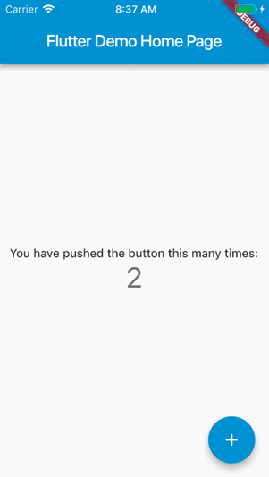

*Mô tả hình:* Hai ảnh chụp màn hình điện thoại. Thanh trên cùng màu xanh ghi "Flutter Demo Home Page" (Trang chủ Flutter Demo), góc phải có dải băng "DEBUG". Giữa màn hình là dòng chữ "You have pushed the button this many times:" (Bạn đã bấm nút số lần là:) và một con số lớn — ảnh trái là `0`, ảnh phải là `2`. Góc dưới bên phải là nút tròn nổi có dấu `+`.

Bạn có thể bấm nút đó và bộ đếm sẽ tăng lên. Vui ra phết (*It's a hoot*). Ứng dụng không làm được gì nhiều hơn thế, nhưng điều đáng chú ý là bắt đầu với Flutter dễ dàng biết bao!

Trên internet người ta gọi đây là "counter app" (ứng dụng đếm số). Nó tương đương với chương trình "hello world" trong Flutter. Bất cứ khi nào bạn bắt đầu một dự án mới, đây sẽ là điểm xuất phát của bạn.

### 3.1.1 Cấu trúc dự án Flutter (Flutter project structure)

Một dự án Flutter, ngay khi mới tạo, là một thư mục khá lớn. Tin tốt là phần lớn trong đó lúc này chưa quan trọng với chúng ta. Thực ra, nhiều thứ trong đó sẽ chẳng bao giờ quan trọng với bạn. Thư mục của bạn sẽ trông như thế này (kèm các chú thích của tác giả):

```text
counter_app
|- android            ← Ứng dụng Android đã biên dịch (lúc này chưa quan trọng)
|- ios                ← Ứng dụng iOS (cũng chưa quan trọng lúc này)
|- lib                ← Nơi bạn sẽ dành 99% thời gian
   |- main.dart       ← Điểm vào (entry point) của dự án: bắt buộc phải có, và phải chứa main()
|- test               ← Nơi bạn NÊN dành 50% thời gian, nhưng có lẽ chỉ dành 0,1%
   |- widget_test.dart
.gitignore
pubspec.yaml          ← Bắt buộc trong mọi dự án Dart: quản lý thư viện phụ thuộc và siêu dữ liệu (metadata)
pubspec.lock          ← File khóa (lock file) được sinh tự động, bạn KHÔNG nên sửa. Nó cập nhật khi bạn
                        cập nhật pubspec.yaml, và đảm bảo bạn không đưa vào các phiên bản gói không tương thích.
README.md
```

Ở thời điểm này, điều quan trọng nhất cần nhớ là: `lib` là nơi bạn sẽ thêm code cho một dự án Flutter, còn `main.dart` là điểm vào (*entry point*) của ứng dụng.

> 📝 **Giải thích thêm (không có trong sách):** Câu đùa "nơi bạn nên dành 50% thời gian nhưng có lẽ chỉ dành 0,1%" là ám chỉ thư mục `test` — lập trình viên ai cũng biết viết kiểm thử là quan trọng nhưng thường lười viết. Ví dụ nội dung tối thiểu của `pubspec.yaml`:
>
> ```yaml
> name: counter_app
> description: A new Flutter project.
> environment:
>   sdk: ">=2.1.0 <3.0.0"
> dependencies:
>   flutter:
>     sdk: flutter
> flutter:
>   uses-material-design: true
> ```
>
> Khi bạn thêm một gói vào mục `dependencies` rồi chạy `flutter pub get`, Flutter sẽ tải gói về và ghi chính xác phiên bản đã chọn vào `pubspec.lock`.

### 3.1.2 Giải phẫu một ứng dụng Flutter (Anatomy of a Flutter app)

Phần lớn ứng dụng đếm số nằm trong file `main.dart`. Đoạn mã khởi đầu được sinh ra trong `main.dart` đã được đội Flutter chú thích rất đẹp, và bạn có thể học được cả tấn thông tin chỉ từ những chú thích đó. Nhưng tôi muốn mổ xẻ những phần quan trọng nhất và làm rõ những chú thích ấy. Bắt đầu từ đầu file:

```dart
import 'package:flutter/material.dart'; // Import thư viện material
```

Một phần lớn của Flutter mà chúng ta tương tác thực chất chỉ là một thư viện Dart. Thư viện này bao gồm mọi thứ bạn cần để viết một ứng dụng Flutter, kể cả tất cả các widget đi kèm mặc định với SDK. Trong trường hợp này, ứng dụng đang import thư viện `material`, bao gồm tất cả các widget cơ sở cùng với những widget tuân theo hệ thống thiết kế Material Design của Google. Ngoài ra còn có `flutter/cupertino.dart`, cung cấp các thành phần mang phong cách iOS. Trong cuốn sách này chúng ta sẽ dùng Material.

> **NOTE (Ghi chú):** Thư viện Material và Cupertino có cùng các tính năng lõi, chỉ khác nhau ở những widget được đi kèm mặc định. Ở thời điểm hiện tại, thư viện Material "chắc chắn" (*robust*) hơn, và hầu hết các ví dụ, tài liệu và bài hướng dẫn trên internet đều dùng nó. Tôi dùng nó chỉ vì lý do đó. Không thư viện nào tốt hơn hay tệ hơn thư viện nào.

#### ĐIỂM VÀO CỦA ỨNG DỤNG (APPLICATION ENTRY POINT)

Ở đầu ứng dụng đếm số, bạn sẽ thấy một hàm `main`:

```dart
void main() => runApp(MyApp());
```

Giống như mọi chương trình Dart, một ứng dụng Flutter dùng hàm `main` làm điểm vào. Trong Flutter, bạn bọc widget cấp cao nhất (*top-level widget*) của mình trong một phương thức tên là `runApp`. Tối thiểu, ứng dụng của bạn sẽ chứa một dòng như thế. Trong một ứng dụng phức tạp hơn, bạn có thể làm nhiều việc hơn trong hàm `main`, nhưng bạn bắt buộc phải gọi `runApp` với widget cấp cao nhất được truyền vào làm đối số.

Hãy nhớ: mọi thứ đều là widget. Kể cả gốc (*root*) của ứng dụng! Không có đối tượng hay lớp đặc biệt nào cho việc này.

> 💡 **Ví dụ bổ sung (không có trong sách):** Một hàm `main` "làm nhiều việc hơn" có thể trông như sau — ví dụ cần khởi tạo vài thứ trước khi chạy app:
>
> ```dart
> import 'package:flutter/material.dart';
>
> void main() {
>   // Có thể làm việc khác ở đây: đọc cấu hình, thiết lập log, ...
>   final appTitle = 'Ứng dụng của tôi';
>   runApp(MyApp(title: appTitle)); // Bắt buộc: gọi runApp với widget gốc
> }
>
> class MyApp extends StatelessWidget {
>   final String title;
>   MyApp({this.title});
>
>   @override
>   Widget build(BuildContext context) {
>     return MaterialApp(title: title, home: Text(title));
>   }
> }
> ```
>
> Dù `main` có phức tạp tới đâu, điều bất biến là cuối cùng vẫn phải gọi `runApp(...)` với một widget.

### 3.1.3 Nhắc lại: mọi thứ đều là widget (Again, everything is a widget)

Trong Flutter, (gần như) mọi thứ đều là widget, và widget chỉ là những lớp Dart biết cách mô tả giao diện (*view*) của chúng. Chúng là những bản thiết kế (*blueprint*) mà Flutter dùng để vẽ các element lên màn hình. Lớp widget là mô hình hiển thị (*view model*) duy nhất mà Flutter biết đến. Không có controller hay view tách riêng.

> **NOTE (Ghi chú):** Như tôi đã nói trước đây và sẽ đi sâu hơn sớm thôi, trong Flutter còn có những loại đối tượng khác. Nhưng widget là lớp mô hình (*model class*) chỉ bảo những đối tượng kia phải làm gì. Là lập trình viên, tất cả những gì chúng ta quan tâm là viết các mô hình mà Flutter biết cách biến thành giao diện. Widget mang bản chất khai báo (*declarative*), và điều đó thật tuyệt. Chúng ta không phải lo chuyện thực sự vẽ (*render*) màn hình. Chúng ta (thường) không quan tâm tới từng điểm ảnh. Widget trừu tượng hóa những nỗi khổ đó giúp ta. Đây là một lý do khiến ta nói "mọi thứ đều là widget": vì mọi thứ ta quan tâm đều là widget.

Trong hầu hết các framework khác, đặc biệt trên web, widget được gọi là thành phần (*component*), và mô hình tư duy là tương tự. Một widget (hay component) là một lớp định nghĩa một mảnh cụ thể trong UI của bạn. Để xây dựng một ứng dụng, bạn tạo ra cả đống widget (hay component) rồi ghép chúng lại theo nhiều cách khác nhau để dần dần tạo thành những widget lớn hơn.

Tuy nhiên, một điểm khác biệt giữa component trong các framework khác (như ReactJS) và widget là: một widget có thể định nghĩa *bất kỳ* khía cạnh nào của giao diện ứng dụng. Có những widget, như `Row`, định nghĩa các khía cạnh của bố cục (*layout*). Có những widget ít trừu tượng hơn và định nghĩa các phần tử cấu trúc, như `Button` và `TextField`. Theme (chủ đề) định nghĩa màu sắc và phông chữ trong ứng dụng cũng là một widget. Animation (hoạt ảnh) cũng được định nghĩa bằng widget. Trong một framework dựa trên component trên web, bạn *có thể* xây một component chỉ có một nhiệm vụ là thêm khoảng đệm (*padding*) cho một widget con, nhưng bạn không bắt buộc phải làm thế. Bạn có thể dùng CSS để thêm padding cho bất kỳ component nào bạn muốn. Trong Flutter, bạn *chỉ* có thể tạo kiểu (*style*) cho widget bằng các widget khác. Muốn thêm padding, bạn dùng widget `Padding`.

Điểm mấu chốt là: mọi mảnh trong UI của bạn đều là widget. Ngay cả gốc của ứng dụng cũng là widget. Không có đối tượng đặc biệt nào tên là `App`. Bạn tự định nghĩa widget của mình, chẳng hạn `MyApp`, và nó lại trả về một widget khác trong phương thức `build` của nó.

Thư viện Flutter chứa đầy ắp các widget dựng sẵn. Khi bạn bắt đầu tạo widget của riêng mình, bạn sẽ làm điều đó bằng cách ghép các widget dựng sẵn này lại với nhau. Đây là một số widget phổ biến nhất:

- *Bố cục (Layout)* — `Row`, `Column`, `Scaffold`, `Stack`
- *Cấu trúc (Structures)* — `Button`, `Toast`, `MenuDrawer`
- *Kiểu dáng (Styles)* — `TextStyle`, `Color`, `Padding`
- *Hoạt ảnh (Animations)* — `FadeInPhoto`, các phép biến đổi (*transformations*)
- *Định vị và căn chỉnh (Positioning and alignment)* — `Center`, `Padding`

> 💡 **Ví dụ bổ sung (không có trong sách):** So sánh cách thêm padding trên web và trong Flutter:
>
> - Web (HTML + CSS): `<div style="padding: 8px">Xin chào</div>` — padding là một *thuộc tính kiểu* gắn vào thẻ.
> - Flutter: padding là một *widget riêng* bọc bên ngoài:
>
> ```dart
> Padding(
>   padding: EdgeInsets.all(8.0),
>   child: Text('Xin chào'),
> )
> ```
>
> Tương tự, muốn căn giữa thì bọc trong `Center`, muốn đổi theme thì bọc trong `Theme`. Đó chính là ý "mọi thứ đều là widget".

### 3.1.4 Phương thức build (The build method)

Mọi widget bạn tạo ra đều phải có một phương thức `build`, và phương thức đó phải trả về một widget khác. Trong hầu hết trường hợp, đó có thể là bất kỳ widget nào. Đây là một `StatelessWidget` tối giản:

```dart
class RedButton extends StatelessWidget {      // (1) Tên widget / tên lớp; (2) kế thừa lớp StatelessWidget
  Widget build(BuildContext context) {         // (3) Widget phải có phương thức build. Nó nhận BuildContext làm đối số duy nhất.
    return new RaisedButton(                   // (4) Phương thức build phải trả về một widget.
      // child elements
      // ...
```

Các chú thích trong hình của sách:
1. **The widget / class name** – Tên widget / tên lớp (`RedButton`).
2. **Extends the `StatelessWidget` class** – Kế thừa lớp `StatelessWidget`.
3. **Widgets must have a `build` method. It takes `BuildContext` as its only argument.** – Widget phải có phương thức `build`; nó nhận `BuildContext` làm đối số duy nhất.
4. **The `build` method must return a widget.** – Phương thức `build` phải trả về một widget.

(Trong sách, đoạn code trên được trình bày như một hình minh họa — khung xám có mũi tên đỏ chỉ vào từng phần, đoạn code bị cắt ở giữa có chủ đích. Xem trang gốc: 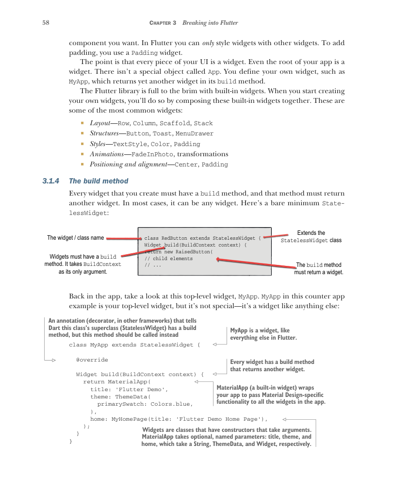)

*Hai ảnh trích từ trang này chỉ là phần nền khung xám của hình minh họa trên (không có nội dung riêng):*

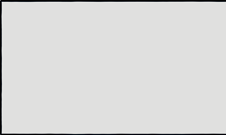
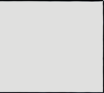

Quay lại ứng dụng, hãy xem widget cấp cao nhất này, `MyApp`. `MyApp` trong ví dụ ứng dụng đếm số là widget cấp cao nhất của bạn, nhưng nó không có gì đặc biệt — nó là một widget như mọi thứ khác:

```dart
class MyApp extends StatelessWidget {          // MyApp là một widget, như mọi thứ khác trong Flutter.

  @override                                    // Một annotation (trong framework khác gọi là decorator)
                                               // báo cho Dart rằng lớp cha của lớp này (StatelessWidget)
                                               // có phương thức build, nhưng phương thức này mới là cái được gọi.
  Widget build(BuildContext context) {         // Mọi widget đều có phương thức build trả về một widget khác.
    return MaterialApp(                        // MaterialApp (widget dựng sẵn) bọc ứng dụng để truyền chức năng
                                               // riêng của Material Design tới tất cả widget trong app.
      title: 'Flutter Demo',
      theme: ThemeData(
        primarySwatch: Colors.blue,
      ),
      home: MyHomePage(title: 'Flutter Demo Home Page'), // Widget là các lớp có constructor nhận đối số.
                                               // MaterialApp nhận các tham số có tên, tùy chọn: title, theme
                                               // và home, lần lượt có kiểu String, ThemeData và Widget.
    );
  }
}
```

Giải thích các chú thích trong sách:
- **`MyApp` là một widget**, như mọi thứ khác trong Flutter.
- **`@override`** là một annotation (trong các framework khác gọi là *decorator*), báo cho Dart rằng lớp cha của lớp này (`StatelessWidget`) có phương thức `build`, nhưng phương thức này (của lớp con) mới là cái cần được gọi thay vào đó.
- **Mọi widget đều có phương thức `build`** trả về một widget khác.
- **`MaterialApp`** (một widget dựng sẵn) bọc ứng dụng của bạn để truyền các chức năng riêng của Material Design tới tất cả các widget trong ứng dụng.
- **Widget là các lớp có constructor nhận đối số.** `MaterialApp` nhận các tham số có tên (*named parameters*), tùy chọn: `title`, `theme` và `home`, lần lượt nhận một `String`, một `ThemeData` và một `Widget`.

> 📝 **Giải thích thêm (không có trong sách):** "Tham số có tên, tùy chọn" trong Dart được khai báo trong cặp ngoặc nhọn `{}`. Ví dụ:
>
> ```dart
> class Greeting {
>   final String name;
>   final int times;
>   Greeting({this.name = 'bạn', this.times = 1}); // tham số có tên, tùy chọn, có giá trị mặc định
> }
>
> var g1 = Greeting();                        // name = 'bạn', times = 1
> var g2 = Greeting(times: 3, name: 'Lan');   // thứ tự không quan trọng vì gọi bằng tên
> ```
>
> `MaterialApp(title: ..., theme: ..., home: ...)` dùng đúng cơ chế này, nên code Flutter đọc rất giống mô tả cấu hình.

### 3.1.5 Constructor new và const trong Flutter (The new and const constructors in Flutter)

Trong Flutter, bạn sẽ tạo rất nhiều thể hiện (*instance*) của cùng các widget. Nhiều widget dựng sẵn có cả constructor thông thường lẫn constructor `const`. Các thể hiện widget bất biến (*immutable*) cho hiệu năng tốt hơn, vì vậy bạn nên luôn dùng `const` khi có thể. Flutter làm việc này trở nên dễ dàng bằng cách cho phép bạn bỏ hoàn toàn từ khóa `new` và `const`. Framework sẽ tự suy ra nên dùng cái nào, và luôn dùng `const` khi có thể:

```dart
Widget build(BuildContext context) {
  return Button(              // Cả lớp Button lẫn lớp Text đều KHÔNG được tạo bằng từ khóa new.
    child: Text("Submit"),
  );
}

// compared to

Widget build(BuildContext context) {
  return new Button(          // Dùng từ khóa new
    child: new Text("Submit"),
  );
}
```

Trên thực tế, điều này có nghĩa là bạn không phải cân nhắc widget nào có thể là hằng (*constant*) và widget nào không. Flutter sẽ lo việc đó cho bạn. Một lợi ích kèm theo là các phương thức `build` của bạn trông gọn gàng hơn. Ngoài ra, bạn có thể bỏ từ khóa `new` ở bất kỳ đâu trong ứng dụng, bất cứ khi nào bạn tạo một thể hiện của bất kỳ lớp nào. Nó không nhất thiết phải là widget. Kể từ Dart 2.3, tính năng này có thể dùng trong mọi môi trường Dart, không chỉ trong Flutter.

> 📝 **Giải thích thêm (không có trong sách):** Một constructor `const` tạo ra đối tượng được tính toán lúc biên dịch; hai biểu thức `const` giống hệt nhau sẽ trỏ tới *cùng một* đối tượng trong bộ nhớ, nên Flutter không phải tạo lại khi rebuild:
>
> ```dart
> class Point {
>   final int x, y;
>   const Point(this.x, this.y);
> }
>
> void main() {
>   var a = const Point(1, 2);
>   var b = const Point(1, 2);
>   print(identical(a, b)); // true – dùng chung một đối tượng
>   var c = Point(1, 2);    // không có const => đối tượng mới
>   print(identical(a, c)); // false
> }
> ```
>
> Lưu ý thực tế: ở các phiên bản Dart hiện đại, nếu bạn bỏ cả `new` lẫn `const` thì ngoài ngữ cảnh hằng (*const context*), Dart sẽ tạo đối tượng thường. Vì vậy công cụ lint của Flutter ngày nay thường khuyên bạn chủ động viết `const` cho các widget có thể là hằng (ví dụ `const Text('Submit')`).

### 3.1.6 Hot reload

Hot reload (nạp lại nóng) là một trong những điểm hấp dẫn nhất của Flutter đối với các lập trình viên di động native (*native mobile developers*). Nếu mục này không làm bạn phấn khích, tôi cũng chẳng biết giúp bạn thế nào nữa.

Một sự thật thú vị về Dart là nó có cả trình biên dịch trước (*ahead-of-time – AOT compiler*) lẫn trình biên dịch tức thời (*just-in-time – JIT compiler*). Trong Flutter, khi bạn đang phát triển trên máy của mình, nó dùng JIT. Nó được gọi là "just in time" (đúng lúc) vì nó biên dịch và chạy code khi cần. Khi bạn triển khai ứng dụng lên môi trường thật (*production*), Flutter dùng trình biên dịch AOT. Với lập trình viên chúng ta, điều đó có nghĩa là bạn có thể phát triển và biên dịch lại code thật nhanh trong lúc phát triển, mà không phải hy sinh hiệu năng native khi chạy production.

Hãy thử xem hot reload "nóng" đến mức nào. Trong ứng dụng đếm số, ở khoảng dòng 15, hãy thay đổi chuỗi văn bản truyền vào đối số `title` của `MyHomePage`:

```dart
// chapter_3/counter_app/lib/main.dart -- line ~15
home: MyHomePage(title: 'Flutter Home PageDemo'); // old
home: MyHomePage(title: 'Hot Reload Demo');       // updated
```

Kích hoạt hot reload. Bạn sẽ thấy thay đổi xảy ra ngay lập tức. Và đó mới chỉ là một ví dụ nhỏ xíu. Bạn hoàn toàn có thể thêm widget mới hoặc đổi màu theme, và nó vẫn nạp lại nhanh y như vậy. Hãy xem thêm một ví dụ nữa.

Ở khoảng dòng 12, trong constructor `ThemeData`, cập nhật đối số `primarySwatch` sang một màu khác:

```dart
// chapter_3/counter_app/lib/main.dart -- line ~12
theme: ThemeData(
  primarySwatch: Colors.blue, // old
),

theme: ThemeData(
  primarySwatch: Colors.indigo, // updated
),
```

Bấm hot reload lần nữa. Nếu mọi thứ ổn, thanh ứng dụng phía trên (*app bar*) và nút bấm sẽ đổi màu trong chưa đầy một giây. Thật đáng kinh ngạc.

> **Khung: Sử dụng hot reload (Using hot reload)**
>
> Tùy vào môi trường của bạn, có nhiều cách để kích hoạt hot reload:
>
> - Trong IntelliJ, Visual Studio Code hoặc Android Studio, có một nút Hot Reload, và phím tắt là Cmd-S (Ctrl-S trên máy chạy Windows hoặc Linux). Đây là tính năng đi kèm plugin Flutter cho các IDE này.
> - Nếu bạn dùng `flutter run` trong terminal, hãy gõ `r` trong terminal đó để hot reload.

> 💡 **Ví dụ bổ sung (không có trong sách):** Một điểm hay của hot reload là nó **giữ nguyên state**. Thử nghiệm: bấm nút `+` cho bộ đếm lên 5, rồi đổi `primarySwatch` sang `Colors.red` và lưu file. Màu đổi ngay nhưng con số vẫn là 5 — ứng dụng không khởi động lại từ đầu. Nếu bạn muốn reset cả state, dùng *hot restart* (gõ `R` viết hoa trong terminal `flutter run`), khi đó bộ đếm quay về 0. Lưu ý: những thay đổi trong `main()` hoặc trong `initState()` thường cần hot restart mới thấy hiệu lực, vì những đoạn code đó không chạy lại khi hot reload.

## 3.2 Widget: cây widget, các loại widget và đối tượng State (Widgets: The widget tree, widget types, and the State object)

Thư viện Flutter có rất nhiều widget dựng sẵn. Gần như tất cả chúng được tạo từ hai loại widget: `StatelessWidget` và `StatefulWidget`. Có thêm vài loại widget cấp cao khác mà chúng ta sẽ gặp xuyên suốt cuốn sách. Nhưng hơn 95% thời gian, bạn sẽ dùng hai loại này.

Mục tiêu chung khi phát triển UI với Flutter là ghép rất nhiều widget lại với nhau để xây dựng **cây widget** (*widget tree*). Một ứng dụng Flutter được biểu diễn bằng một cây widget, tương tự như DOM trên trình duyệt là một cấu trúc cây. Cây widget là một cấu trúc dữ liệu cây thật sự trong code, do Flutter xây dựng phía sau hậu trường, nhưng nó cũng là một cách hữu ích để nói về cấu trúc ứng dụng Flutter của bạn. Trong quá trình học Flutter, dù qua cuốn sách này hay ở nơi khác, bạn sẽ gặp cây widget khá thường xuyên.

Nói ngắn gọn, cây là một tập hợp các nút (*node*), mỗi nút là một widget. Mỗi lần bạn thêm một widget vào một phương thức `build`, bạn đang thêm một nút mới vào cây. Các nút được nối với nhau bằng quan hệ cha–con.

Hình 3.2 là biểu diễn trực quan đơn giản hóa của cây widget cho ứng dụng đếm số. Thực tế có thêm vài widget nữa trong đó, nhưng đừng lo về chi tiết lúc này. Và cũng đừng sa đà vào các widget khác nhau trong cây đó. Bây giờ bạn chỉ cần biết rằng cây widget là cách các ứng dụng Flutter được tổ chức.

**Hình 3.2 – Cây widget của ứng dụng đếm số**

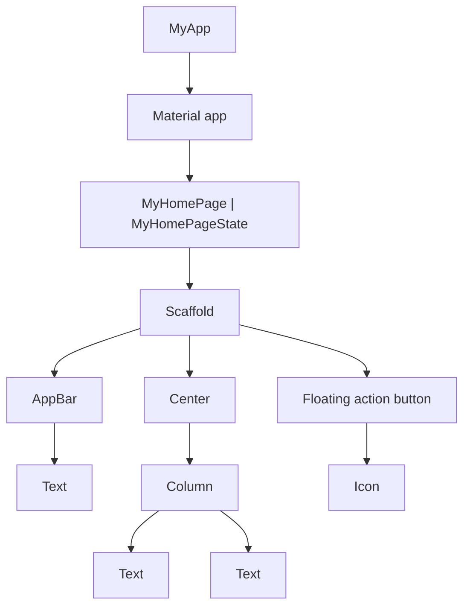

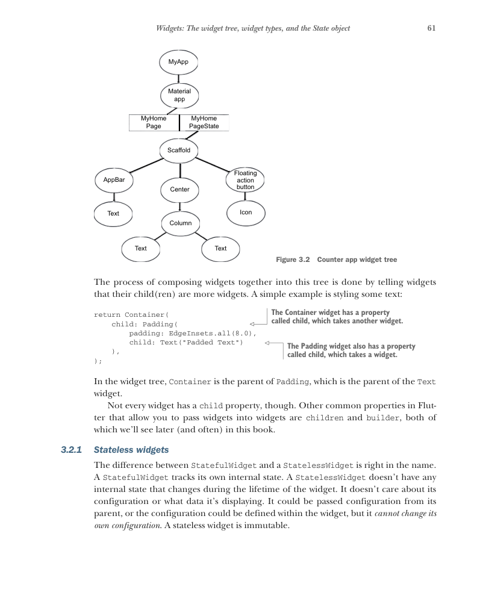

*Mô tả hình:* Gốc là `MyApp`, con của nó là `MaterialApp` ("Material app"), tiếp theo là một khối ghép đôi `MyHomePage` | `MyHomePageState` (stateful widget và đối tượng state của nó). Dưới đó là `Scaffold` (giàn giáo trang), có ba con: `AppBar` (thanh tiêu đề, chứa một `Text`), `Center` (căn giữa, chứa một `Column` gồm hai `Text`) và `FloatingActionButton` (nút hành động nổi, chứa một `Icon`).

Quá trình ghép các widget thành cây này được thực hiện bằng cách bảo các widget rằng con (hoặc các con) của chúng là những widget khác. Một ví dụ đơn giản là tạo kiểu cho một đoạn văn bản:

```dart
return Container(
  child: Padding(                    // Widget Container có thuộc tính child, nhận một widget khác.
    padding: EdgeInsets.all(8.0),
    child: Text("Padded Text")       // Widget Padding cũng có thuộc tính child, nhận một widget.
  ),
);
```

Trong cây widget, `Container` là cha của `Padding`, và `Padding` là cha của widget `Text`.

Tuy vậy, không phải widget nào cũng có thuộc tính `child`. Những thuộc tính phổ biến khác trong Flutter cho phép truyền widget vào widget là `children` và `builder`; chúng ta sẽ gặp cả hai về sau (và gặp thường xuyên) trong cuốn sách này.

> 💡 **Ví dụ bổ sung (không có trong sách):** Ba kiểu "nhận widget con" thường gặp:
>
> ```dart
> // 1. child – đúng một con
> Center(child: Text('Một con'))
>
> // 2. children – một danh sách con
> Column(children: [Text('Con 1'), Text('Con 2'), Text('Con 3')])
>
> // 3. builder – một hàm trả về widget, được gọi khi cần (thường kèm context)
> Builder(builder: (BuildContext context) => Text('Tạo bởi builder'))
> ```
>
> Cây tương ứng của ví dụ thứ 2: `Column` là cha, ba `Text` là con, nằm cùng một cấp (anh em).

### 3.2.1 Stateless widget (Stateless widgets)

Sự khác biệt giữa `StatefulWidget` và `StatelessWidget` nằm ngay trong tên gọi. Một `StatefulWidget` theo dõi trạng thái nội bộ (*internal state*) của chính nó. Một `StatelessWidget` không có trạng thái nội bộ nào thay đổi trong suốt vòng đời của widget. Nó không quan tâm tới cấu hình (*configuration*) của mình hay dữ liệu mà nó đang hiển thị. Nó có thể được widget cha truyền cấu hình vào, hoặc cấu hình có thể được định nghĩa bên trong widget, nhưng nó *không thể tự thay đổi cấu hình của chính mình*. Một stateless widget là bất biến (*immutable*).

> **NOTE (Ghi chú):** Khi học về widget, bạn sẽ thường xuyên gặp từ *configuration* (cấu hình). Từ này hơi mơ hồ, nhưng về cơ bản nó bao gồm mọi thứ bên trong widget của bạn: các biến được truyền vào và các ràng buộc kích thước (*size constraints*) của nó, cũng như các siêu thông tin (*meta information*) mà Flutter dùng nội bộ.

Hãy tưởng tượng bạn đã tạo một widget nút bấm tùy biến trong ứng dụng. Có thể nó luôn hiển thị chữ "Submit", như trong listing sau.

**Listing 3.1 – Một ví dụ widget nút bấm (An example button widget)**

```dart
class SubmitButton
    extends StatelessWidget {
  Widget build(context) {
    return Button(
      child: Text('Submit'),
    );
  }
}
```

Như vậy cũng được, nhưng có thể bạn muốn nút hiển thị "Submit" trong một số trường hợp và "Update" trong những trường hợp khác. Để lớp nút bấm dễ tái sử dụng hơn, bạn có thể bảo Flutter vẽ nút dựa trên cấu hình và dữ liệu của nó, như listing dưới đây.

**Listing 3.2 – Một widget có cấu hình (A widget with configuration)**

```dart
class SubmitButton extends StatelessWidget {
  final String buttonText;              // (1)
  SubmitButton(this.buttonText);        // (2)

  Widget build(context) {
    return Button(
      child: Text(buttonText),          // (3)
    );
  }
}
```

1. Mọi dữ liệu được truyền vào widget đều là một phần cấu hình của nó.
2. Trong Dart bạn có thể lược bỏ các constructor vô dụng, nên constructor này không có trong ví dụ trước. Giờ nó cần thiết để nút bấm biết phải chờ nhận một đối số khi được tạo.
3. Truyền vào một biến thay vì một chuỗi cố định (*string literal*). Giờ Flutter biết phải vẽ lại nút này mỗi khi biến được truyền vào thay đổi.

(Ghi chú của người dịch: bản in của sách có dấu `;` thừa sau `Text(buttonText)` — `child: Text(buttonText);` — gây lỗi cú pháp; ở trên đã sửa thành dấu phẩy.)

Dù theo cách nào, widget này vẫn tĩnh và không có logic, vì nó không thể tự cập nhật chính mình. Nó không quan tâm nút ghi chữ gì. Cấu hình của nó phụ thuộc vào các widget cha. Nó không biết cách yêu cầu được xây dựng lại (*rebuild*), khác với một stateful widget (mà chúng ta sẽ thấy ngay sau đây).

Khi tôi nói "không có logic", tôi không có ý rằng một stateful widget [ý tác giả: stateless widget] không thể có phương thức và thuộc tính như bất kỳ lớp nào khác. Nó có thể. Bạn có thể có phương thức cho stateless widget của mình, nhưng một stateless widget sẽ bị hủy hoàn toàn khi Flutter gỡ nó khỏi cây widget. Chúng ta sẽ nói thêm về cây widget và context ở phần sau của chương, nhưng điều quan trọng cần hiểu là một stateless widget không nên chịu trách nhiệm giữ bất kỳ dữ liệu nào mà bạn không muốn mất. Một khi nó đã đi rồi, là đi luôn.

> 💡 **Ví dụ bổ sung (không có trong sách):** Cách widget cha dùng `SubmitButton` ở Listing 3.2:
>
> ```dart
> Column(
>   children: [
>     SubmitButton('Submit'),
>     SubmitButton('Update'),
>   ],
> )
> ```
>
> Cùng một lớp nhưng hai cấu hình khác nhau. Nếu widget cha rebuild và truyền `'Save'` thay cho `'Update'`, Flutter tạo một **thể hiện mới** của `SubmitButton` với chữ mới — bản thân `SubmitButton` cũ không hề "thay đổi", vì nó bất biến (`final String buttonText`).

### 3.2.2 Stateful widget (Stateful widgets)

Một stateful widget có trạng thái nội bộ và có thể quản lý trạng thái đó. Mọi stateful widget đều có một đối tượng state (*state object*) tương ứng. Hình 3.3 lại cho thấy cây widget đơn giản hóa.

**Hình 3.3 – Cây widget ví dụ (Example widget tree)**

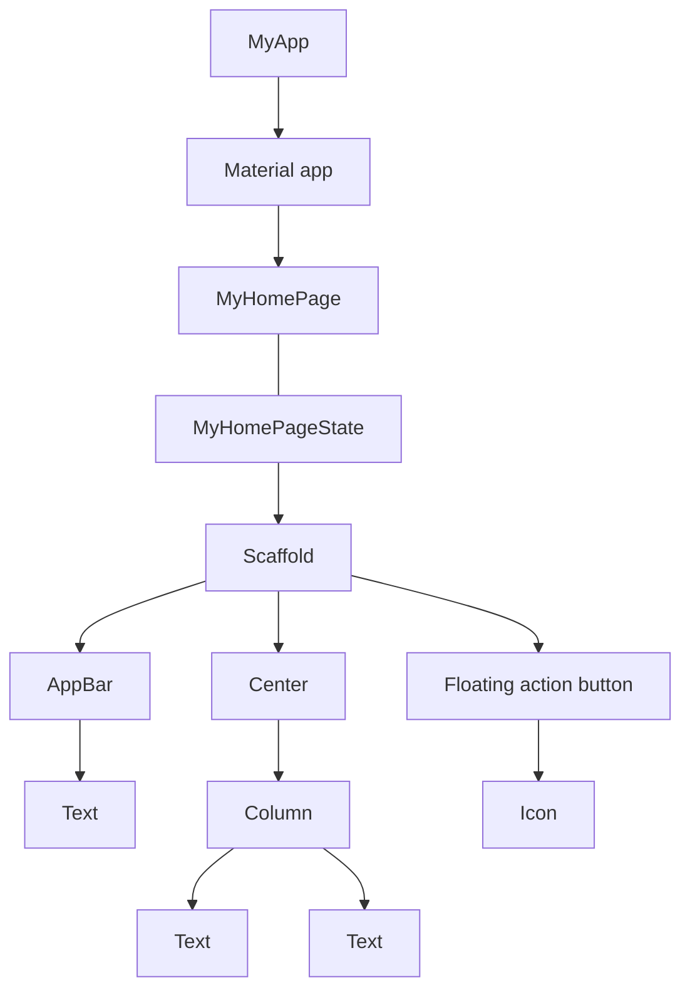

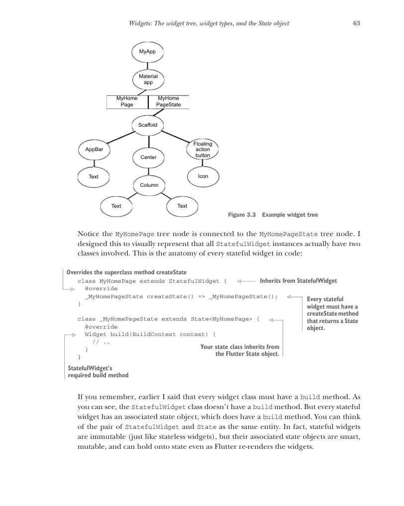

*Mô tả hình:* Giống cây ở Hình 3.2; điểm nhấn là nút `MyHomePage` được ghép liền với nút `MyHomePageState`, và `Scaffold` là con của `MyHomePageState`.

Hãy để ý nút `MyHomePage` trong cây được nối với nút `MyHomePageState`. Tôi vẽ như vậy để thể hiện trực quan rằng mọi thể hiện `StatefulWidget` thực ra có *hai* lớp tham gia. Đây là cấu trúc giải phẫu của mọi stateful widget trong code:

```dart
class MyHomePage extends StatefulWidget {                     // Kế thừa từ StatefulWidget
  @override                                                   // Ghi đè phương thức createState của lớp cha
  _MyHomePageState createState() => _MyHomePageState();       // Mọi stateful widget phải có phương thức createState
}                                                             // trả về một đối tượng State.

class _MyHomePageState extends State<MyHomePage> {            // Lớp state của bạn kế thừa đối tượng State của Flutter.
  @override
  Widget build(BuildContext context) {                        // Phương thức build bắt buộc của StatefulWidget
    // ..
  }
}
```

Các chú thích trong sách:
- **Inherits from `StatefulWidget`** – Kế thừa từ `StatefulWidget`.
- **Overrides the superclass method `createState`** – Ghi đè phương thức `createState` của lớp cha.
- **Every stateful widget must have a `createState` method that returns a `State` object.** – Mọi stateful widget phải có phương thức `createState` trả về một đối tượng `State`.
- **Your state class inherits from the Flutter `State` object.** – Lớp state của bạn kế thừa đối tượng `State` của Flutter.
- **StatefulWidget's required build method** – Phương thức `build` bắt buộc của StatefulWidget (nằm trong lớp State).

Nếu bạn còn nhớ, trước đó tôi đã nói rằng mọi lớp widget đều phải có phương thức `build`. Như bạn thấy, lớp `StatefulWidget` không có phương thức `build`. Nhưng mọi stateful widget đều có một đối tượng state đi kèm, và đối tượng đó *có* phương thức `build`. Bạn có thể coi cặp `StatefulWidget` và `State` là cùng một thực thể. Thực ra, các stateful widget là bất biến (giống hệt stateless widget), nhưng các đối tượng state đi kèm của chúng thì thông minh, có thể thay đổi (*mutable*), và có thể giữ lại trạng thái ngay cả khi Flutter vẽ lại các widget.

`MyHomePage` là một stateful widget vì nó quản lý trạng thái của bộ đếm ở giữa ứng dụng. Khi bạn chạm vào nút, nó kích hoạt một phương thức tên là `_incrementCounter`:

```dart
void _incrementCounter() {
  setState(() {      // Một trong các phương thức mà đối tượng State của Flutter dùng để quản lý trạng thái nội bộ
    _counter++;
  });
}
```

> **Khung: Giá trị riêng tư trong Dart bằng dấu gạch dưới (Private values in Dart with an underscore)**
>
> Trong ví dụ trước, hãy để ý tên lớp là `_MyHomePageState`. Nó bắt đầu bằng dấu gạch dưới, ký hiệu được dùng để đánh dấu lớp là *riêng tư* (*private*). Mọi câu lệnh (khai báo) đều có thể là riêng tư. Một giá trị cấp cao nhất (*top-level*) mà riêng tư, như lớp này, chỉ dùng được trong file hiện tại. Nếu một thành viên của lớp, như biến hay hàm, bị đánh dấu riêng tư, thì nó chỉ dùng được bên trong chính lớp đó.
>
> Xét lớp `Cat` sau:
>
> ```dart
> class Cat {
>   String name;
>   String _color;
>   void meow() => print("meow");
>   void _pur() => print("prrrr");
> }
> ```
>
> Rồi xét việc tương tác với nó:
>
> ```dart
> Cat nora = Cat();
> nora.name = "Nora";     // Okay
> nora._color = "Orange"; // Invalid!
> nora.meow();            // Okay
> nora._pur();            // Invalid!
> ```
>
> Biến và thành viên lớp riêng tư được dùng khá nhiều trong lập trình Dart, chỉ nhằm làm cho API của lớp dễ đọc hơn.

> 📝 **Giải thích thêm (không có trong sách):** Chính xác hơn, trong Dart "riêng tư" là riêng tư *theo thư viện* (*library-private*), tức là theo file `.dart`. Nếu đoạn code `nora._color = "Orange"` nằm *cùng file* với lớp `Cat`, trình biên dịch vẫn cho phép; lỗi chỉ xảy ra khi truy cập từ một file khác. Vì vậy ví dụ "Invalid!" ở trên đúng khi lớp `Cat` được khai báo trong file khác với nơi sử dụng.

### 3.2.3 setState

`setState` là phương thức Flutter quan trọng thứ ba bạn phải biết, sau `build` và `createState`. Nó chỉ tồn tại trên đối tượng state. Đại khái nó nói: "Này Flutter, hãy chạy đoạn code trong callback này (trường hợp này là tăng biến counter lên một), rồi vẽ lại tất cả các widget phụ thuộc vào state này để lấy cấu hình (trường hợp này là con số trên màn hình ở giữa ứng dụng)" (xem hình 3.4). Phương thức này nhận một đối số: một `VoidCallback` (hàm không tham số, không trả về giá trị).

**Hình 3.4 – `setState` bảo Flutter vẽ lại (setState tells Flutter to repaint.)**

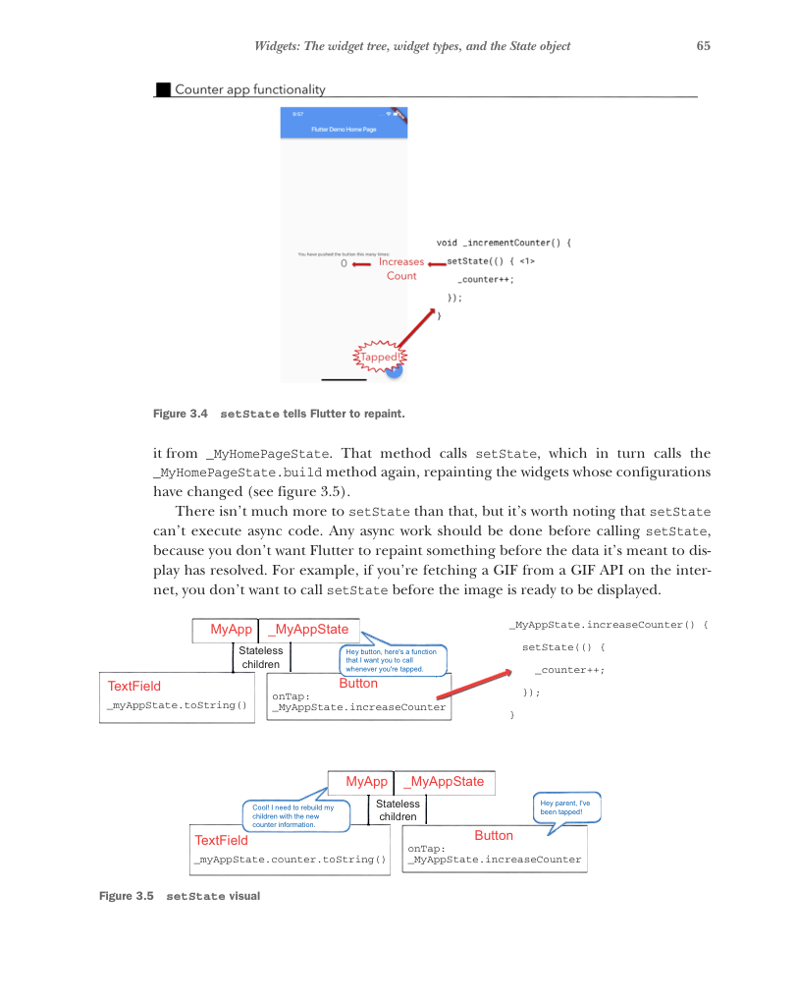

*Mô tả Hình 3.4:* Khung tiêu đề "Counter app functionality" (Chức năng của ứng dụng đếm số). Ảnh chụp ứng dụng đếm số; nút `+` có nhãn nổ "Tapped!" (Đã chạm!) với mũi tên chỉ tới đoạn code:

```dart
void _incrementCounter() {
  setState(() { <1>
    _counter++;
  });
}
```

Từ `setState` có mũi tên chỉ ngược về số `0` trên màn hình với nhãn "Increases Count" (Tăng số đếm).

Trong ví dụ này, đối tượng state là widget `_MyHomePageState`, và các con của nó tương tác và phụ thuộc vào state. Khi bạn bấm nút, nó gọi một phương thức được truyền cho nó từ `_MyHomePageState`. Phương thức đó gọi `setState`, và `setState` lại gọi phương thức `_MyHomePageState.build` một lần nữa, vẽ lại những widget có cấu hình đã thay đổi (xem hình 3.5).

`setState` không có gì nhiều hơn thế, nhưng điều đáng lưu ý là `setState` không thể thực thi code bất đồng bộ (*async*). Mọi công việc bất đồng bộ nên được làm *trước* khi gọi `setState`, vì bạn không muốn Flutter vẽ lại thứ gì đó trước khi dữ liệu mà nó cần hiển thị đã có. Ví dụ, nếu bạn đang lấy một ảnh GIF từ một API GIF trên internet, bạn không muốn gọi `setState` trước khi ảnh sẵn sàng để hiển thị.

**Hình 3.5 – Minh họa trực quan setState (setState visual)**

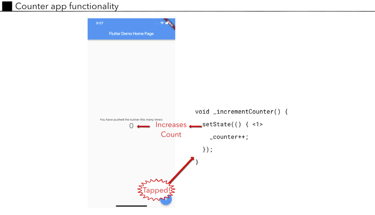

*Mô tả Hình 3.5:* Gồm hai sơ đồ trên–dưới:

- **Sơ đồ trên:** Khối `MyApp` | `_MyAppState`, bên dưới là các con "Stateless children" (các con không trạng thái): một `TextField` hiển thị `_myAppState.toString()` và một `Button` có `onTap: _MyAppState.increaseCounter`. Bong bóng thoại từ `_MyAppState` nói với nút: *"Hey button, here's a function that I want you to call whenever you're tapped."* (Này nút, đây là một hàm mà tôi muốn bạn gọi mỗi khi bị chạm.) Mũi tên chỉ tới code:
  ```dart
  _MyAppState.increaseCounter() {
    setState(() {
      _counter++;
    });
  }
  ```
- **Sơ đồ dưới:** Cùng cấu trúc, nhưng `TextField` giờ hiển thị `_myAppState.counter.toString()`. Nút nói: *"Hey parent, I've been tapped!"* (Này cha, con vừa bị chạm!). `_MyAppState` đáp: *"Cool! I need to rebuild my children with the new counter information."* (Tuyệt! Ta cần xây dựng lại các con với thông tin bộ đếm mới.)

```mermaid
sequenceDiagram
    participant S as _MyAppState
    participant B as Button
    participant T as TextField
    S->>B: Truyền hàm increaseCounter cho onTap
    B->>S: "Này cha, con vừa bị chạm!" (gọi increaseCounter)
    S->>S: setState(() { _counter++; })
    S->>S: gọi lại build()
    S->>T: Rebuild với counter mới
```

> 💡 **Ví dụ bổ sung (không có trong sách):** Làm đúng và làm sai với việc async và `setState`:
>
> ```dart
> // SAI: truyền hàm async cho setState – Flutter sẽ báo lỗi
> // vì callback trả về Future
> setState(() async {
>   _gifUrl = await fetchGifUrl();
> });
>
> // ĐÚNG: chờ dữ liệu xong rồi mới gọi setState
> Future<void> _loadGif() async {
>   final url = await fetchGifUrl(); // làm việc bất đồng bộ trước
>   setState(() {
>     _gifUrl = url;                  // chỉ cập nhật state đồng bộ bên trong
>   });
> }
> ```

### 3.2.4 initState

Đối tượng state còn có một phương thức tên là `initState`, được gọi ngay khi widget được gắn (*mounted*) vào cây. `State.initState` là phương thức trong đó bạn khởi tạo mọi dữ liệu cần thiết *trước khi* Flutter cố vẽ nó lên màn hình. Ví dụ, bạn có thể đăng ký lắng nghe (*subscribe*) các stream hoặc tính toán, chuyển một số dữ liệu sang định dạng thân thiện với con người.

Khi Flutter xây dựng một stateful widget và đối tượng state của nó, việc đầu tiên nó làm là chạy logic trong hàm `initState`. Ví dụ, bạn có thể muốn đảm bảo rằng một `String` được định dạng đúng trước khi phương thức `build` của widget được gọi và trước khi bất cứ thứ gì được vẽ ra:

```dart
class FirstNameTextState extends State<FirstNameText> {
  String name;

  FirstNameTextState(this.name);

  @override
  initState() {
    super.initState();          // State.initState được đánh dấu mustCallSuper ở lớp cha. Vì vậy bạn
    name = name.toUpperCase();  // phải gọi phần cài đặt initState của lớp cha trong phương thức bạn ghi đè.
  }

  Widget build(BuildContext context) {
    return Text(name);
  }
}
```

*Chú thích trong sách:* Phương thức `State.initState` được đánh dấu `mustCallSuper` ở lớp cha. Vì vậy bạn bắt buộc phải gọi phần cài đặt `initState` của lớp cha (`super.initState()`) bên trong phương thức mà bạn ghi đè.

Đối tượng state còn có vài phương thức *vòng đời* (*lifecycle*) khác, và ở một chương sau tôi sẽ bàn sâu về vòng đời của widget, bao gồm cả `initState`. Hình 3.6 cho thấy tất cả các phương thức và thứ tự chúng được gọi.

Hình này có khá nhiều thứ, và bạn đừng sa lầy vào nó. Tôi sẽ dành rất nhiều thời gian cho nó về sau! Còn bây giờ, điều quan trọng là biết rằng `initState` và `setState` tồn tại, và khi nào nên dùng chúng. `initState` được gọi một lần mỗi khi một đối tượng state được xây dựng. `setState` do chính bạn — lập trình viên — gọi, bất cứ khi nào bạn muốn Flutter vẽ lại.

**Hình 3.6 – Vòng đời của StatefulWidget (StatefulWidget lifecycle)**

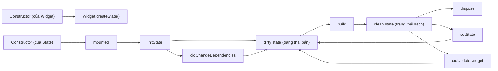

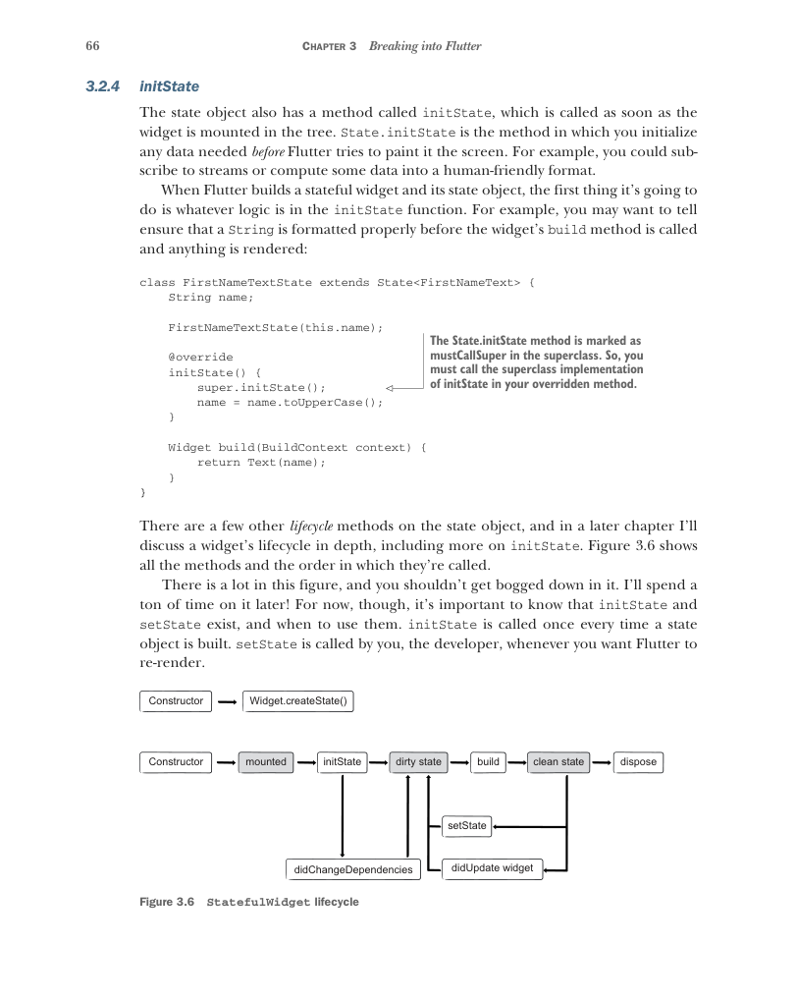

*Mô tả hình:* Hàng trên: `Constructor` → `Widget.createState()` (phía widget). Hàng dưới (phía state): `Constructor` → `mounted` (đã gắn vào cây) → `initState` → `dirty state` (trạng thái "bẩn", cần vẽ lại) → `build` → `clean state` (trạng thái "sạch", đã vẽ xong) → `dispose` (hủy). Từ `initState` có nhánh đi xuống `didChangeDependencies` rồi quay về `dirty state`. Từ `clean state` có hai nhánh quay lại `dirty state`: qua `setState` và qua `didUpdate widget` (`didUpdateWidget`, khi widget cha truyền cấu hình mới).

> 💡 **Ví dụ bổ sung (không có trong sách):** Một ví dụ thực tế kết hợp `initState` và `dispose` — đăng ký stream đồng hồ khi widget được gắn, và hủy đăng ký khi widget bị gỡ:
>
> ```dart
> import 'dart:async';
> import 'package:flutter/material.dart';
>
> class Clock extends StatefulWidget {
>   @override
>   _ClockState createState() => _ClockState();
> }
>
> class _ClockState extends State<Clock> {
>   DateTime _now = DateTime.now();
>   StreamSubscription<DateTime> _sub;
>
>   @override
>   void initState() {
>     super.initState(); // luôn gọi trước
>     _sub = Stream.periodic(Duration(seconds: 1), (_) => DateTime.now())
>         .listen((t) => setState(() => _now = t));
>   }
>
>   @override
>   void dispose() {
>     _sub.cancel();     // dọn dẹp để tránh rò rỉ bộ nhớ
>     super.dispose();
>   }
>
>   @override
>   Widget build(BuildContext context) => Text('$_now');
> }
> ```
>
> `initState` chạy đúng một lần; mỗi giây `setState` đưa state về "dirty" → `build` chạy lại → "clean".

## 3.3 BuildContext

`BuildContext` là một khái niệm khác trong Flutter có vai trò then chốt khi xây dựng ứng dụng, và nó liên quan mật thiết tới việc theo dõi toàn bộ cây widget — cụ thể là *vị trí* của các widget trong cây. Khi bạn cập nhật theme trong `ThemeData`, như chúng ta đã làm để đổi màu ứng dụng đếm số, nó cập nhật các widget con trên khắp cây widget. Điều này hoạt động thế nào? Nó gắn liền với ý tưởng về `BuildContext`.

Mọi phương thức `build` trong một widget đều nhận một đối số, `BuildContext`, là một tham chiếu tới vị trí của widget trong cây widget. Hãy nhớ, `build` được chính framework gọi, nên bạn không phải tự quản lý build context, nhưng bạn sẽ thường xuyên muốn tương tác với nó.

Một ví dụ cụ thể là phương thức `Theme.of`, một phương thức tĩnh (*static*) trên lớp `Theme`. Khi được gọi, `Theme.of` nhận một `BuildContext` làm đối số và trả về thông tin về theme *tại vị trí đó* trong cây widget. Đây là lý do mà trong ứng dụng đếm số, ta có thể gọi `Theme.of(buildContext).primaryColor` để tô màu widget. Lệnh đó lấy thông tin `Theme` cho *điểm này trong cây*, rồi trả về dữ liệu được lưu ở biến `primaryColor` trong lớp `Theme`.

Mỗi widget có build context riêng của nó, điều đó có nghĩa là nếu bạn có nhiều theme rải rác khắp cây, việc lấy theme của một widget có thể trả về kết quả khác với widget khác. Trong trường hợp cụ thể của theme trong ứng dụng đếm số, hay các phương thức `of` khác, bạn sẽ nhận được *cha gần nhất* trong cây thuộc kiểu đó (trường hợp này là `Theme`; xem hình 3.7).

**Hình 3.7 – Sử dụng Theme trong Flutter (Using Theme in Flutter)**

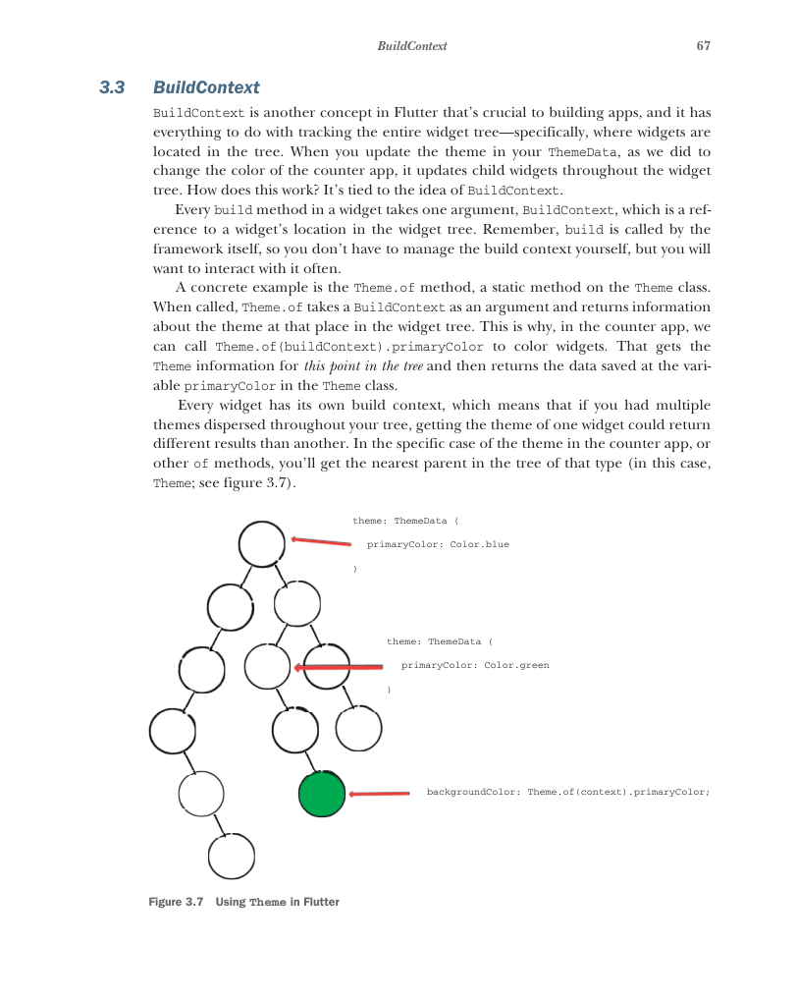

*Mô tả hình:* Một cây gồm các vòng tròn (nút). Ở nút gốc có chú thích `theme: ThemeData( primaryColor: Color.blue )`. Ở một nút tầng giữa có chú thích `theme: ThemeData( primaryColor: Color.green )`. Một nút lá nằm dưới nhánh của nút tầng giữa được tô màu xanh lá, có chú thích `backgroundColor: Theme.of(context).primaryColor;` — tức là nút này lấy màu từ theme *gần nhất* phía trên nó (màu xanh lá), chứ không phải theme ở gốc (xanh dương).

Các ảnh vòng tròn được trích từ hình này (các nút của cây):

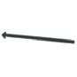
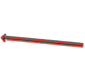
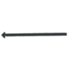
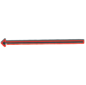
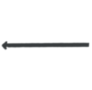
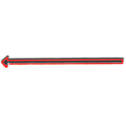

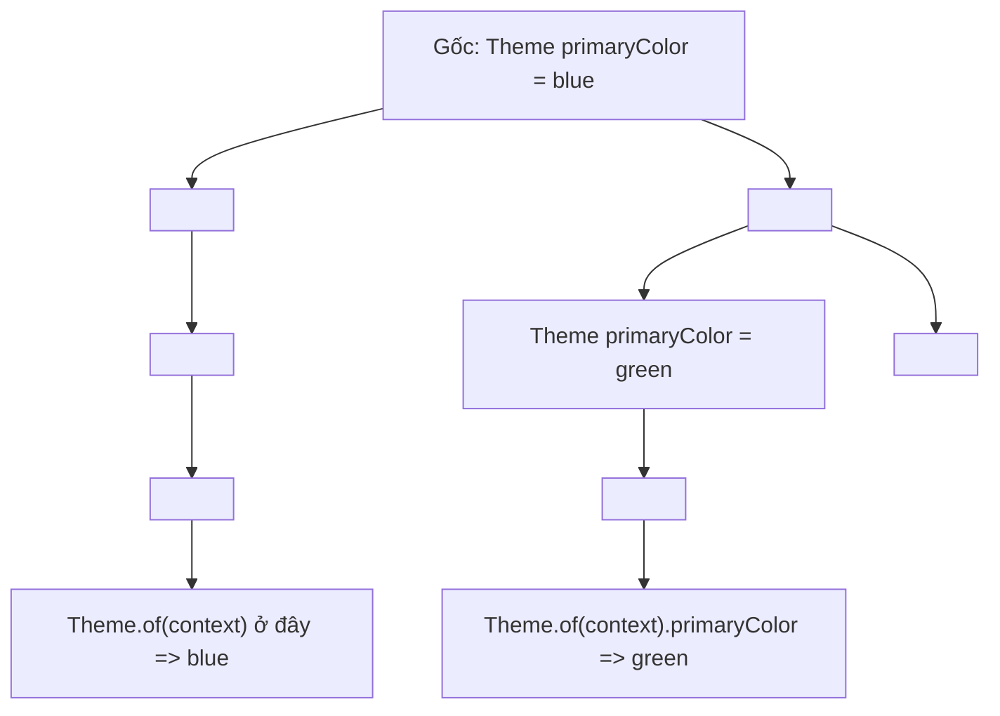

Build context được dùng theo nhiều cách để báo cho Flutter biết chính xác nơi và cách vẽ một số widget nhất định. Ví dụ, Flutter dùng build context để hiển thị hộp thoại (*modal*) và các route (màn hình điều hướng). Nếu bạn muốn hiển thị một modal mới, Flutter cần biết modal đó nên được chèn vào đâu trong cây. Việc này được thực hiện bằng cách truyền `BuildContext` vào phương thức tạo modal. Chúng ta sẽ thấy điều này kỹ hơn trong chương về định tuyến (*routing*). Điểm quan trọng về build context, ở thời điểm này, là nó chứa thông tin về *vị trí* của widget trong cây widget, chứ không phải về bản thân widget.

Widget, state và context được cho là ba viên đá góc tạo nên nền móng để phát triển một ứng dụng cơ bản trong Flutter. Giờ hãy đưa chúng vào thực hành.

> 💡 **Ví dụ bổ sung (không có trong sách):** Code tương ứng với Hình 3.7:
>
> ```dart
> MaterialApp(
>   theme: ThemeData(primaryColor: Colors.blue),     // theme ở gốc
>   home: Theme(
>     data: ThemeData(primaryColor: Colors.green),   // theme lồng bên trong
>     child: Builder(
>       builder: (BuildContext context) {
>         // context này nằm DƯỚI Theme màu xanh lá
>         return Container(
>           color: Theme.of(context).primaryColor,   // => Colors.green
>         );
>       },
>     ),
>   ),
> )
> ```
>
> Vì sao phải dùng `Builder`? Vì nếu gọi `Theme.of(context)` với `context` của chính widget đang tạo ra `Theme` xanh lá, context đó nằm *phía trên* `Theme` xanh lá trong cây, nên sẽ nhận được theme xanh dương. `Builder` tạo ra một context mới nằm bên dưới. Đây là lỗi "context sai vị trí" kinh điển mà tác giả nói chiếm phần lớn công việc debug.


## 3.4 Nâng cấp ứng dụng đếm số bằng các widget quan trọng nhất (Enhancing the counter app with the most important widgets)

Ứng dụng đếm số mặc định lúc này chưa hữu ích lắm. Bạn thậm chí còn không thể đặt lại (*reset*) số đếm. Trong mục này, chúng ta sẽ mở rộng chức năng của ứng dụng đếm số và khám phá vài widget quan trọng nhất trong Flutter. Theo tài liệu, các widget cơ bản tuyệt đối (phải biết) gồm:

- `Container`
- `Row`
- `Column`
- `Image`
- `Text`
- `Icon`
- `RaisedButton`
- `Scaffold`
- `AppBar`

Trong số này, `Column`, `Text`, `Icon`, `Scaffold` và `AppBar` đã có sẵn trong ứng dụng đếm số. Chúng ta sẽ thêm những widget còn lại để ứng dụng vui hơn một chút. Cuối cùng, ứng dụng đếm số cải tiến của bạn sẽ trông như hình 3.8.

**Hình 3.8 – Ứng dụng đếm số 2.0 hoàn chỉnh (Finished counter app 2.0)**

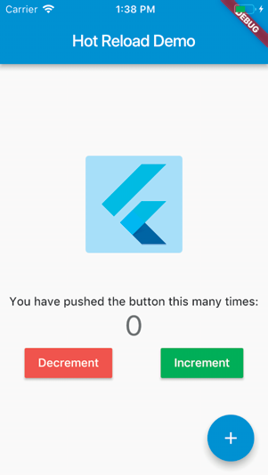

*Mô tả hình:* Thanh tiêu đề ghi "Hot Reload Demo". Giữa màn hình là logo Flutter trên nền xanh nhạt, bên dưới là dòng "You have pushed the button this many times:" và số `0`. Dưới con số là hai nút: nút đỏ "Decrement" (Giảm) bên trái và nút xanh lá "Increment" (Tăng) bên phải. Góc dưới phải là nút tròn nổi có dấu `+`.

### 3.4.1 RaisedButton

Trước hết, hãy thêm một nút để giảm bộ đếm. Toàn bộ chức năng này sẽ nằm trong lớp `_MyHomePageState`. Để giảm bộ đếm, chúng ta cần:

- Một nút để bấm
- Một hàm giảm `_counter` đi một

`RaisedButton` là một trong các nút dựa trên Material Design, và nó trông hơi nổi lên (*elevated*). Nút nổi (*raised button*) được dùng để tạo chiều sâu cho bố cục, trái ngược với `FlatButton` (nút phẳng). Để thêm nút, hãy bắt đầu trong phương thức `build` của `_MyHomePageState`, như listing sau.

**Listing 3.3 – Thêm một raised button vào `_MyHomePageState.build` (Adding a raised button to _MyHomePageState.build)**

```dart
// _MyHomePageState
Widget build(BuildContext context) {
  return Scaffold(
    // ...
    body: Center(
      child: Column(
        mainAxisAlignment: MainAxisAlignment.center,
        children: <Widget>[
          // ...
          RaisedButton(                               // (1) Thêm một RaisedButton
            child: Text("Decrement Counter"),
            onPressed: _decrementCounter,             // (2)
          ),
        ])),
    // ...
```

1. Thêm một `RaisedButton`.
2. `onPressed` là một thuộc tính của nút, nó chờ nhận một callback. Bằng cách truyền vào một callback, chúng ta có thể quản lý state ở widget cha này (một mẫu thiết kế phổ biến khác).

Để hoàn tất chức năng đó, chúng ta cần viết phương thức `_decrementCounter`:

```dart
void _decrementCounter() {
  setState(() => _counter--);   // setState nhận một callback làm đối số; callback này chỉ nên
}                               // cập nhật các mẩu state trong widget.
```

*Chú thích:* `setState` nhận một callback làm đối số, và callback đó chỉ nên làm đúng một việc là cập nhật các mẩu state trong widget.

Trong Flutter, tương tác phần lớn được xử lý thông qua các callback, như `onPressed`. Trong các widget do Flutter cung cấp và cả những widget bạn sẽ viết, bạn sẽ dùng callback để thực thi một hàm nào đó khi người dùng tương tác với ứng dụng. Trong các widget dựng sẵn, bạn sẽ thấy `onPressed`, `onTapped`, `onHorizontalDrag` và còn nhiều nữa. Chương 5 dành riêng cho tương tác người dùng, nơi tôi sẽ nói kỹ hơn về những thứ này.

> 💡 **Ví dụ bổ sung (không có trong sách):** Bài toán nhỏ: "Làm sao để bộ đếm không xuống số âm?" Chỉ cần thêm điều kiện trong callback:
>
> ```dart
> void _decrementCounter() {
>   if (_counter == 0) return;     // không làm gì nếu đã bằng 0
>   setState(() => _counter--);
> }
> ```
>
> Hoặc vô hiệu hóa nút khi số đếm bằng 0 — trong Flutter, truyền `onPressed: null` sẽ khiến nút bị mờ và không bấm được:
>
> ```dart
> RaisedButton(
>   child: Text("Decrement Counter"),
>   onPressed: _counter > 0 ? _decrementCounter : null,
> )
> ```

## 3.5 Ưu tiên composition thay vì kế thừa trong Flutter (Favor composition in Flutter (over inheritance))

> *Thiết kế phần mềm hướng đối tượng là khó, và thiết kế phần mềm hướng đối tượng có thể tái sử dụng còn khó hơn.*
> (*Designing object-oriented software is hard, and designing reusable object-oriented software is even harder.*)

Đây là câu mở đầu của cuốn *Design Patterns: Elements of Reusable Object-Oriented Software* (Mẫu thiết kế: các thành phần của phần mềm hướng đối tượng tái sử dụng được) của Erich Gamma và cộng sự, xuất bản năm 1994. Trong mọi lối lập trình hướng đối tượng, một trong những vấn đề thiết kế khó nhất là thiết lập mối quan hệ giữa các lớp. Có hai cách để tạo quan hệ giữa các lớp. Cách thứ nhất, **kế thừa** (*inheritance*), thiết lập quan hệ "là một" (*"is a"*). **Composition** (kết hợp/ghép thành phần) thiết lập quan hệ "có một" (*"has a"*). Ví dụ, một `Cowboy` (chàng cao bồi) *là một* `Human` (con người), và một `Cowboy` *có một* `Voice` (giọng nói). Kế thừa có xu hướng khiến bạn thiết kế đối tượng xoay quanh việc chúng *là gì*, còn composition xoay quanh việc chúng *làm gì*.

### 3.5.1 Composition là gì? (What is composition?)

Giả sử bạn muốn làm một trò chơi trong đó bạn là một chàng cao bồi phải bảo vệ miền Viễn Tây hoang dã khỏi người ngoài hành tinh thì sao? Có thể bạn sẽ có các lớp như sau:

```text
Human
  .rideHorse()

  Cowboy
    .chaseOutlaws()
    .fightAliens()

  Rancher
    .herdCattle()

Alien
  .flySpaceship()
  .invadeEarth()
```

(Thụt lề thể hiện kế thừa: `Cowboy` và `Rancher` kế thừa `Human`. `Human` có `rideHorse()` – cưỡi ngựa; `Cowboy` có `chaseOutlaws()` – truy đuổi tội phạm, `fightAliens()` – đánh người ngoài hành tinh; `Rancher` – chủ trang trại – có `herdCattle()` – chăn bò; `Alien` có `flySpaceship()` – lái phi thuyền, `invadeEarth()` – xâm lược Trái Đất.)

Tuyệt. Bạn đã tái sử dụng được phương thức `rideHorse` vì quả thật cả cao bồi lẫn chủ trang trại đều cưỡi ngựa. Bạn đang làm trò chơi "sát thủ" này rất hăng say thì nảy ra một ý tưởng điên rồ: người ngoài hành tinh học được nghệ thuật cưỡi ngựa cổ xưa. Chà, đó là một vấn đề. Người ngoài hành tinh *không phải* là con người, nên bạn không nên cho `Alien` kế thừa `Human`. Nhưng bạn cũng không muốn viết lại `rideHorse`.

Điều này lẽ ra đã tránh được nếu dùng composition ngay từ đầu, thay vì kế thừa. Bạn có thể có một lớp `HorseRiding` (kỹ năng cưỡi ngựa), có thể được thêm làm thành viên vào bất kỳ lớp nào. Nó sẽ trông giống thế này hơn:

```text
HorseRiding
  .rideHorse

Cowboy
  HorseRidingInstance.rideHorse()
  .chaseOutlaws()
  .fightAliens()

Rancher
  HorseRidingInstance.rideHorse()
  .herdCattle()

Alien
  HorseRidingInstance.rideHorse()
  .flySpaceship()
  .invadeEarth()
```

Thật tuyệt. Bất kể có bao nhiêu đối tượng cần cưỡi ngựa, bạn đều có một cách dễ dàng, tách rời (*decoupled*) để thêm chức năng đó.

Những bạn tò mò có thể hỏi: "Sao không biến tất cả các hành động thành lớp riêng rồi kế thừa hết?" Chà, đó không phải là ý tồi. Biết đâu chủ trang trại học được cách lái phi thuyền. Vậy giờ ta nên nghĩ thế nào về các đối tượng có những phương thức này?

Ừ thì, một `Cowboy` là một `HorseRider` (người cưỡi ngựa), một `AlienFighter` (người đánh ngoài hành tinh) và một `OutlawChaser` (người truy đuổi tội phạm). Tương tự, người ngoài hành tinh và chủ trang trại là tổ hợp những gì họ có thể làm:

```text
Alien = HorseRider + SpaceShipFlyer + EarthInvader
Rancher = HorseRider + CattleHerder
Cowboy = HorseRider + OutlawChaser + AlienFighter
```

Nếu bạn tạo các lớp đại diện cho `HorseRider`, `EarthInvader` và những thứ tương tự, thì bạn có thể *cài đặt* (*implement*) các hành động đó vào các lớp của mình. Đây chính là composition.

(Nếu bạn đang nghĩ: "Nghe giống ý tưởng đằng sau *lớp trừu tượng* (*abstract classes*) quá," thì bạn đúng rồi đấy. Chúng ta sẽ khám phá sâu về chúng trong phần 3 của cuốn sách.)

> 💡 **Ví dụ bổ sung (không có trong sách):** Viết ví dụ cao bồi bằng Dart thật, dùng composition (một thuộc tính kiểu `HorseRiding`):
>
> ```dart
> class HorseRiding {
>   void rideHorse(String who) => print('$who đang cưỡi ngựa');
> }
>
> class Cowboy {
>   final HorseRiding riding = HorseRiding();   // "có một" kỹ năng cưỡi ngựa
>   void rideHorse() => riding.rideHorse('Cao bồi');
>   void chaseOutlaws() => print('Đuổi tội phạm');
> }
>
> class Alien {
>   final HorseRiding riding = HorseRiding();   // người ngoài hành tinh cũng "có" kỹ năng này
>   void rideHorse() => riding.rideHorse('Người ngoài hành tinh');
>   void invadeEarth() => print('Xâm lược Trái Đất');
> }
>
> void main() {
>   Cowboy().rideHorse(); // Cao bồi đang cưỡi ngựa
>   Alien().rideHorse();  // Người ngoài hành tinh đang cưỡi ngựa
> }
> ```
>
> `Alien` không cần là `Human` mà vẫn dùng lại được logic cưỡi ngựa. (Dart còn có `mixin` — `class Alien with HorseRider` — là một cách khác để "ghép" hành vi.)

### 3.5.2 Một ví dụ về composition trong Flutter (An example of composition in Flutter)

Ví dụ ở listing 3.3 với `RaisedButton` đã dùng composition:

```dart
//...
RaisedButton(
  child: Text("Decrement Counter"),
  onPressed: () => _decrementCounter(),
),
//...
```

Để tạo một nút ghi "Decrement Counter", bạn *truyền vào* một widget khác (`Text`) chịu trách nhiệm hiển thị chữ.

Trong Flutter, hãy luôn ưu tiên composition (hơn kế thừa) để tạo ra các widget có thể tái sử dụng và tách rời. Hầu hết widget không biết trước con của chúng là gì. Điều này đặc biệt đúng với các widget như khối văn bản và hộp thoại (*dialog*), về cơ bản chúng chỉ là vật chứa (*container*) cho nội dung.

Một ví dụ "xịn" hơn về nút bấm có thể trông như sau:

```dart
class PanicButton extends StatelessWidget {
  final Widget display;
  final VoidCallback onPressed;

  PanicButton({this.display, this.onPressed});   // (1)

  Widget build(BuildContext context) {
    RaisedButton(
      color: Colors.red,                         // (2)
      child: display,                            // (3)
      onPressed: onPressed,                      // (4)
    );
  }
}
```

1. Cấu hình của widget này được truyền vào cho nó, kể cả widget cần hiển thị. Hãy tưởng tượng `display` được truyền vào là `Text("Panic")`.
2. Đặt màu nền của nút thành đỏ.
3. Widget văn bản này được truyền vào từ widget cha. Đây là điểm mấu chốt!
4. Callback cũng được truyền vào. Điều này giúp nút linh hoạt hết mức có thể. Nó không quan tâm tới callback và không bị gắn với bất kỳ chức năng cụ thể nào. Tất cả những gì nó quan tâm là hiển thị một nút và báo cho widget cha biết khi nút đó được bấm (thông qua callback).

(Ghi chú của người dịch: đoạn code trong sách thiếu từ khóa `return` trước `RaisedButton(` — khi viết thật, bạn cần `return RaisedButton(...)` vì `build` phải trả về một widget.)

Ở đây, dùng composition, tôi đang nói "Nút này *có* chữ", thay vì "Chữ này *là một* nút". Nếu bạn muốn nút hiển thị một biểu tượng (*icon*) thay vì chữ thì sao? Nó đã được thiết lập sẵn để làm điều đó. Tất cả những gì bạn cần làm là truyền vào một `Icon` thay vì `Text`. Nút không quan tâm con của nó là gì, nó chỉ biết là nó có một đứa con.

Bạn có thể nâng cấp thêm một bậc và truyền cả màu vào nếu muốn. Nút thậm chí cũng chẳng quan tâm điều đó, nó chỉ cần biết rằng nó sẽ được bảo mình có màu gì.

Dù sao thì, quay lại ứng dụng của bạn, giờ bạn đã có một nút để giảm bộ đếm đi một. Tiếp theo, chúng ta sẽ tiếp tục thêm thắt cho ứng dụng.

> 💡 **Ví dụ bổ sung (không có trong sách):** Cùng một `PanicButton`, ba cách dùng khác nhau mà không phải sửa lớp:
>
> ```dart
> PanicButton(display: Text('Panic'), onPressed: () => print('Hoảng loạn!'));
> PanicButton(display: Icon(Icons.warning), onPressed: _callPolice);
> PanicButton(
>   display: Row(children: [Icon(Icons.warning), Text('SOS')]),
>   onPressed: _sendSos,
> );
> ```
>
> Nếu dùng kế thừa, bạn có thể phải tạo `TextPanicButton`, `IconPanicButton`, `IconTextPanicButton`... — số lớp bùng nổ theo số tổ hợp. Composition tránh được điều đó.

## 3.6 Giới thiệu layout trong Flutter (Intro to layout in Flutter)

Những câu hỏi phổ biến nhất từ người mới làm Flutter là về bố cục (*layout*). Bộ máy vẽ (*rendering engine*) của Flutter độc đáo ở chỗ nó không dùng một hệ thống layout cụ thể nào. Ở tầng thấp tít bên dưới, nó (ban đầu) không coi màn hình là một hệ trục tọa độ Descartes (*Cartesian graph*). Nó không ép lập trình viên phải dùng flex layout, hệ tọa độ Descartes, hay các hệ thống phổ biến khác như "chiều rộng vào, chiều cao ra" (*width in, height out – WIHO*). Nó để việc đó cho chúng ta. Và thường thì chúng ta kết hợp, pha trộn các hệ thống đó để đạt được layout mong muốn.

Như ta đã biết, widget là những lớp cấp cao mô tả một giao diện. Có những đối tượng cấp thấp hơn biết cách vẽ các widget này lên màn hình. Trên thực tế, điều đó có nghĩa là hệ thống layout được trừu tượng hóa khỏi lập trình viên, mở ra khả năng dùng nhiều mô hình (*paradigm*) khác nhau cùng lúc. Có những widget dùng layout linh hoạt (*flexible layout*), thường được biết đến trên web với tên FlexBox. Và có những widget cho phép ta đặt widget một cách tường minh lên màn hình tại tọa độ cho trước. Trong mục này, tôi muốn khám phá một số widget layout phổ biến nhất.

Ngoài các widget layout, tôi cũng sẽ nói về **ràng buộc** (*constraints*) trong Flutter. Constraints là phần cốt lõi để hiểu layout. Tuy nhiên, nói gọn lại, constraints cho widget biết chúng *có thể* chiếm bao nhiêu không gian, và sau đó các widget tự quyết định chúng *sẽ* chiếm bao nhiêu. Ở mục 3.6.2, tôi nói kỹ về constraints.

> 📝 **Giải thích thêm (không có trong sách):** "Width in, height out" (WIHO) là kiểu layout của trang web truyền thống: phần tử nhận chiều rộng từ cha (ví dụ bằng chiều rộng trình duyệt), rồi tự tính chiều cao dựa trên nội dung (văn bản dài thì cao hơn). Flutter tổng quát hơn: cha truyền xuống *khoảng* cho phép cả chiều rộng lẫn chiều cao (min/max), con chọn kích thước trong khoảng đó.

### 3.6.1 Row và Column (Row and Column)

Kiểu layout được dùng phổ biến nhất trong Flutter được gọi là flexible layout (layout linh hoạt), giống hệt FlexBox. Bạn có thể dùng flex layout với các widget `Column` và `Row`. Ứng dụng đếm số đã có sẵn một widget `Column`, như listing sau.

**Listing 3.4 – Widget Column trong ứng dụng đếm số (Column widget in the counter app)**

```dart
// _MyHomePageState
body: Center(
  child: Column(                                      // (1)
    mainAxisAlignment: MainAxisAlignment.center,      // (2)
    children: <Widget>[                               // (3)
      Text('You have pushed the button this many times:'),
      Text(
        '$_counter',
        style: Theme.of(context).textTheme.display1,
      ),
      RaisedButton(
        child: Text("Decrement Counter"),
        onPressed: _decrementCounter,
      ),
    ],
  ),
),
```

1. `Column` – cái tên rất đúng: nó xếp tất cả các con của mình thành một cột.
2. Thuộc tính căn chỉnh (*alignment*) tương tự FlexBox trong CSS. Nó cho Flutter biết cách xếp các con của `Column` *trong mối quan hệ với nhau* ("với nhau" là điểm mấu chốt!).
3. Một số widget (chủ yếu là widget layout) nhận một *danh sách* widget làm `children`, thay vì một `child` duy nhất.

Widget `Row` hoạt động giống `Column` nhưng trên trục ngang. Nó lấy tất cả các con và xếp chúng lần lượt, cạnh nhau, từ trái sang phải.

> **TIP (Mẹo):** Trong một số ngôn ngữ (ý là ngôn ngữ nói, không phải ngôn ngữ lập trình), chữ được viết từ phải sang trái (*right-to-left – RTL*). Trong trường hợp đó, Flutter hỗ trợ thiết lập RTL và sẽ thay đổi hành vi của widget `Row`. Điều này nằm ngoài phạm vi chương này. Nếu bạn không phát triển ứng dụng sẽ được bản địa hóa sang một trong những ngôn ngữ RTL này, thì bạn không cần bận tâm.

Tôi muốn bọc nút giảm trong một `Row` trong ứng dụng ví dụ để có thể thêm một nút thứ hai bên cạnh. Trong cùng khối code đó, hãy bắt đầu bằng việc thêm `Row` bao quanh `RaisedButton`.

**Listing 3.5 – Bọc các widget trong một Row (Wrapping widgets in a Row)**

```dart
// _MyHomePageState.build

Row(                    // new
  children: <Widget>[   // new
    RaisedButton(
      color: Colors.red,
      child: Text(
        "Decrement",
        style: TextStyle(color: Colors.white),
      ),
      onPressed: _decrementCounter,
    ),
  ],                    // new
),                      // new
```

(Các dòng có chú thích `// new` là các dòng mới thêm vào.)

Khi bạn hot reload ứng dụng, nút Decrement giờ được căn về phía bên trái màn hình (xem hình 3.9). Đó là vì các widget linh hoạt cố chiếm nhiều không gian nhất có thể trên *trục chính* (*main axis*) của chúng. Widget `Row` giãn ra hết mức có thể theo chiều ngang, trong trường hợp này là rộng bằng cả màn hình, bị giới hạn bởi widget cha của nó (cột `Column`).

**Hình 3.9 – Widget Row với một con duy nhất và không căn chỉnh (Row widget with single child and no alignment)**

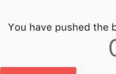
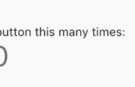
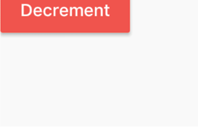
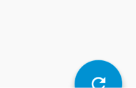

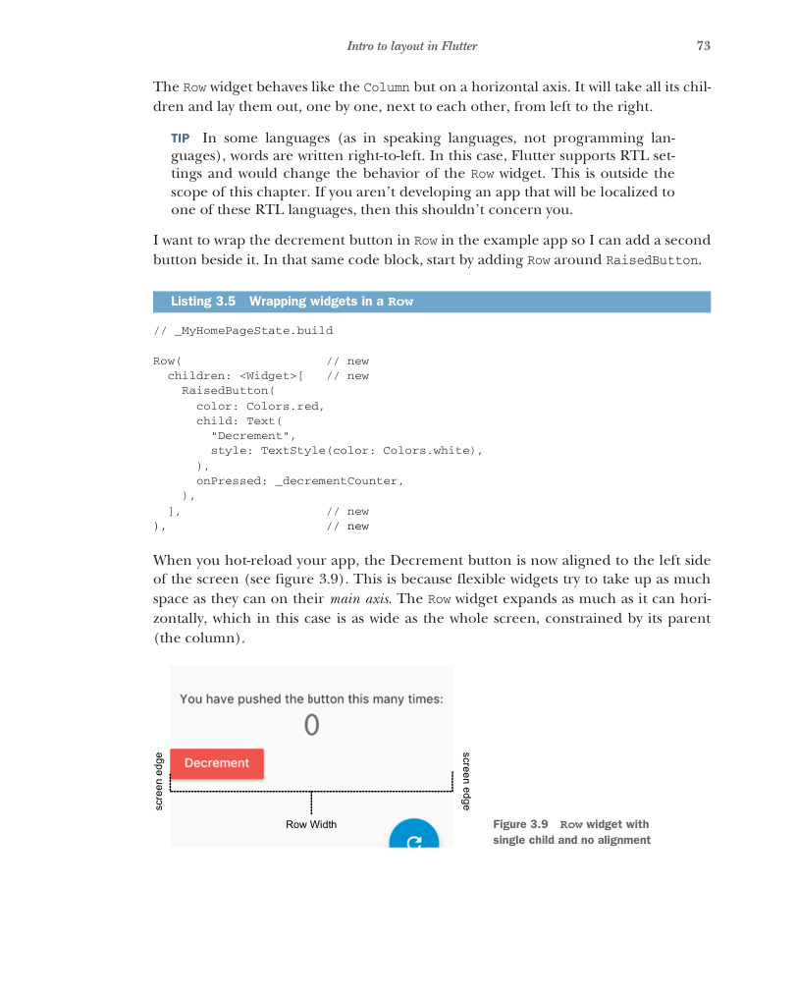

*Mô tả hình:* Ảnh chụp một phần ứng dụng: dòng "You have pushed the button this many times:", số `0`, và nút đỏ "Decrement" nằm sát mép trái. Một đường chấm chạy ngang từ mép trái ("screen edge" – mép màn hình) tới mép phải ("screen edge"), có nhãn "Row Width" (chiều rộng của Row) — cho thấy `Row` chiếm toàn bộ chiều rộng màn hình dù chỉ có một con nhỏ nằm bên trái. (Bốn ảnh trích ở trên là các mảnh ghép của ảnh chụp này.)

> 💡 **Ví dụ bổ sung (không có trong sách):** Hình dung trục chính (*main axis*) và trục phụ (*cross axis*):
>
> | Widget | Trục chính | Trục phụ |
> |---|---|---|
> | `Row` | Ngang (trái → phải) | Dọc |
> | `Column` | Dọc (trên → dưới) | Ngang |
>
> Thử đổi `Row(children: [...])` thành `Row(mainAxisAlignment: MainAxisAlignment.center, children: [...])` rồi hot reload: nút Decrement sẽ nhảy vào giữa, vì `Row` vẫn rộng hết màn hình nhưng giờ xếp con vào giữa trục chính.

### 3.6.2 Ràng buộc bố cục trong Flutter (Layout constraints in Flutter)

Bố cục (*layout*) và các ràng buộc (*constraints*) có tầm quan trọng cực kỳ lớn trong Flutter. Suy cho cùng, Flutter chủ yếu là một thư viện giao diện người dùng (UI) và một bộ máy kết xuất (*rendering engine*). Hiểu được cách các widget xác định kích thước của chúng sẽ giúp bạn tránh được rất nhiều cơn đau đầu về sau. Chắc chắn đến một lúc nào đó, bạn sẽ gặp một vài lỗi khi dùng `Row`, `Column` và các widget bố cục khác. Đó chính là các lỗi ràng buộc bố cục (*layout-constraint errors*). Khi các lập trình viên mới học Flutter lần đầu, gần như chắc chắn họ sẽ chạm trán lỗi `flutter layout infinite size error` (lỗi kích thước vô hạn trong bố cục Flutter).

Đây là một lỗi có thể khiến bạn đau đầu tìm cách sửa, trừ khi bạn hiểu cách các ràng buộc hoạt động. Tôi cần tạm rẽ sang một nhánh lý thuyết để bàn về cách Flutter biết cần phải vẽ những điểm ảnh (*pixels*) nào lên màn hình nhờ vào các ràng buộc.

### 3.6.3 RenderObject

Tôi đã nói nhiều lần rằng trong Flutter còn có một vài đối tượng khác ngoài widget. Một trong những đối tượng quan trọng nhất cần hiểu là `RenderObject`. Lớp này chủ yếu được sử dụng nội bộ bên trong framework. Bạn sẽ hiếm khi phải làm việc trực tiếp với nó.

Các đối tượng kết xuất (*render objects*) chịu trách nhiệm cho việc vẽ thực tế lên màn hình do Flutter thực hiện. Chúng được tạo nội bộ bởi framework, và tất cả các render object hợp lại tạo thành **cây kết xuất** (*render tree*), vốn tách biệt với cây widget (*widget tree*). Cây render được cấu thành từ các lớp cài đặt (`implement`) `RenderObject`. Và các render object đều có các widget tương ứng.

Là lập trình viên, chúng ta viết các widget nhằm cung cấp dữ liệu (chẳng hạn như các ràng buộc) cho một render object. Render object có các phương thức như `performLayout` và `paint`. Các phương thức này chịu trách nhiệm vẽ các điểm ảnh lên màn hình. Chúng quan tâm đến từng mẩu thông tin chính xác để điều khiển các điểm ảnh. Mọi công việc định kiểu (*styling*) và bố cục thực hiện trong các widget phần lớn chỉ là một tầng trừu tượng hóa bao bọc bên trên các render object.

Các render object này cũng không chứa bất kỳ trạng thái (*state*) hay logic nào. Theo thiết kế, chúng biết một số dữ liệu cơ bản về render object cha của mình, và chúng có khả năng duyệt thăm (*visit*) các con của mình, nhưng chúng không phối hợp với nhau trên quy mô toàn ứng dụng. Chúng không có khả năng tự đưa ra quyết định — chúng chỉ tuân theo mệnh lệnh.

Điều quan trọng là: các widget xây dựng các widget con trong phương thức `build` của chúng, các widget con lại tạo ra thêm nhiều widget khác, và cứ thế đi sâu xuống dưới cây cho đến khi chạm đáy tại một `RenderObjectWidget` (hoặc một tập hợp các `RenderObjectWidget`). Đây là những widget tạo ra các render object thực hiện việc vẽ lên màn hình.

Hãy xét một widget `Column`, vốn không phải là một `RenderObjectWidget` nút lá (*leaf*) trong cây widget. Một cột (`Column`) chỉ là một ý niệm bố cục trừu tượng; nó không phải là một thứ hữu hình mà bạn có thể nhìn thấy. Văn bản và màu sắc mới là những đối tượng cụ thể có thể vẽ ra được. Công việc của một cột là cung cấp các ràng buộc, chứ không phải vẽ bất cứ thứ gì lên màn hình.

> **NOTE (Ghi chú):** Các `RenderObject` không phải là mối bận tâm lớn đối với chúng ta trong vai trò lập trình viên, nhưng chúng là một mảnh ghép quan trọng trong mối quan hệ giữa các widget của bạn và cách Flutter thực sự vận hành. API của render object được mở công khai cho chúng ta, nhưng rất ít khả năng bạn sẽ cần dùng đến nó.

### 3.6.4 RenderObject và các ràng buộc (RenderObject and constraints)

Các render object gắn bó mật thiết với các ràng buộc bố cục (*layout constraints*). Mặc dù bạn có thể tự đặt các ràng buộc riêng lên widget bằng các widget ràng buộc (*constraint widgets*), nhưng các render object mới là bên chịu trách nhiệm cuối cùng trong việc cho framework biết kích thước vật lý thực sự của một widget. Các ràng buộc được truyền xuống một render object, và đối tượng đó cuối cùng sẽ quyết định: "Được rồi, với những ràng buộc này, tôi sẽ có kích thước từng này và nằm ở đúng vị trí này."

Nói cách khác, các ràng buộc quan tâm đến `minWidth` (chiều rộng tối thiểu), `minHeight` (chiều cao tối thiểu), `maxWidth` (chiều rộng tối đa) và `maxHeight` (chiều cao tối đa). Trong khi đó, kích thước (`Size`) lại quan tâm đến chiều rộng (`width`) và chiều cao (`height`) thực tế. Khi một hộp kết xuất (*render box*) nhận được các ràng buộc của mình, nó sẽ quyết định xem mình thực sự chiếm bao nhiêu trong khoảng không gian được cấp phát đó (tức là kích thước của nó).

Các render object khác nhau sẽ hành xử khác nhau. Lớp con của render object phổ biến nhất, bỏ xa các loại khác, là `RenderBox`, vốn tính toán kích thước của một widget bằng hệ tọa độ Descartes (*Cartesian coordinate system*). Nhìn chung, có ba loại render box:

- Những hộp cố gắng chiếm nhiều không gian nhất có thể, chẳng hạn như các hộp được dùng bởi widget `Center`
- Những hộp cố gắng có cùng kích thước với con của chúng, chẳng hạn như các hộp được dùng bởi widget `Opacity`
- Những hộp cố gắng có một kích thước cụ thể nhất định, chẳng hạn như các hộp được dùng bởi widget `Image`

Tính đến thời điểm này trong cuộc thảo luận về render object, ba kiểu hành vi đó là điều quan trọng nhất cần ghi nhớ. Ở giai đoạn này của cuốn sách, tôi sẽ không bàn đến việc tự viết các render object; tôi chỉ đưa ra lời giải thích mang tính nền tảng. Tuy nhiên, điều quan trọng cần nhớ là `RenderObject` của các widget khác nhau sẽ hành xử theo một trong ba cách đó.

> 💡 **Ví dụ bổ sung (không có trong sách):** Quy tắc vàng về bố cục trong Flutter thường được tóm tắt bằng một câu ngắn gọn: **"Constraints go down. Sizes go up. Parent sets position."** (Ràng buộc đi xuống. Kích thước đi lên. Cha đặt vị trí.)
>
> 1. **Cha → Con (Constraints go down):** Widget cha truyền xuống cho con một `BoxConstraints(minWidth, maxWidth, minHeight, maxHeight)`.
> 2. **Con → Cha (Sizes go up):** Trong phạm vi cho phép đó, con chọn một `Size(width, height)` cụ thể và báo ngược lên cho cha.
> 3. **Cha đặt vị trí (Parent sets position):** Cha xếp con vào tọa độ `(x, y)` phù hợp.

### 3.6.5 RenderBox và lỗi bố cục (RenderBoxes and layout errors)

Quay trở lại bài toán bố cục ban đầu: lỗi kích thước vô hạn `flutter layout infinite size error`. Lỗi này xảy ra khi các ràng buộc của một widget bảo với nó rằng nó có thể lớn vô hạn trên trục ngang hoặc trục dọc. Điều này hoàn toàn bắt nguồn từ các ràng buộc được truyền xuống cho nó và cách mà render object của nó hành xử.

Đôi khi, các ràng buộc được trao cho một hộp là *không bị giới hạn* (*unbounded*). Điều này xảy ra khi `maxHeight` hoặc `maxWidth` truyền cho một render box có giá trị là `double.INFINITY` (vô cực). Các ràng buộc không giới hạn thường xuất hiện trong `Row`, `Column` và các widget có thể cuộn (*scrollable*). Điều đó hoàn toàn hợp lý, bởi về mặt lý thuyết, một hàng (`Row`) có thể rộng vô hạn (tùy thuộc vào các con của nó). Thế nhưng bộ máy kết xuất lại không thể thực sự vẽ một widget rộng vô hạn, bởi chúng ta là những con người bị giới hạn bởi thời gian, còn máy tính thì bị giới hạn bởi năng lực xử lý và bộ nhớ.

`Row` và `Column` rất đặc biệt vì chúng là các hộp linh hoạt (*flex boxes*). Mặc định, các render object của chúng không nằm gọn trong ba nhóm hành vi của render object mà tôi đã nhắc tới ở trên. Chúng hành xử khác nhau tùy thuộc vào các ràng buộc do cha của chúng truyền xuống. Nếu nhận được các ràng buộc *có giới hạn* (*bounded constraints*), chúng sẽ cố gắng phình to hết mức có thể bên trong các giới hạn đó. Nếu nhận được các ràng buộc *không giới hạn* (*unbounded constraints*), chúng sẽ cố gắng vừa khít với các con của mình theo hướng trục chính (*main axis*). Ví dụ, một cột (`Column`) chứa đầy hình ảnh mà có ràng buộc không giới hạn thì sẽ cố gắng cao bằng tổng chiều cao của tất cả các hình ảnh cộng lại.

Ràng buộc truyền xuống cho các con của cột được quyết định bởi các ràng buộc truyền cho chính cột đó. Nếu bạn không biết để để ý điều này, nó có thể dẫn đến một lỗi rất khó chịu. Hãy để tôi làm rõ hơn bằng một ví dụ cụ thể. Đây là cách mà các `Column` lồng bên trong `Column` có thể gây ra lỗi chiều cao vô hạn (*infinite height*):

```dart
child: Column(                                            // (1)
  children: <Widget>[
    Column(                                               // (2)
      mainAxisAlignment: MainAxisAlignment.center,
      children: <Widget>[
        Expanded(                                         // (3)
          child: Text(
            'You have pushed the button this many times:',
          ),
        ),
      ],
    ),
  ],
),
```

1. `Column` bên ngoài cấp cho các con của nó chiều cao không giới hạn (*unbounded height*).
2. `Column` bên trong giờ đây nhận một ràng buộc không giới hạn, nên nó sẽ cố gắng ôm vừa khít các con của mình.
3. Widget `Expanded` lại bảo các con của nó hãy chiếm nhiều không gian nhất có thể trên trục chính của hộp flex.

Trong trường hợp này, cột bên trong sẽ cố gắng có kích thước bằng bất cứ kích thước nào mà con của nó muốn có, và bản thân nó lại không bị giới hạn bởi cha của mình. Widget `Expanded` sẽ reo lên: "Tuyệt vời! Mình không bị giới hạn chiều cao, mà bản tính của mình là cố gắng phình to hết mức có thể, nên mình sẽ giãn ra mãi mãi." Và thế là một lỗi sẽ được ném ra.

Ngoài ra, cũng cần lưu ý rằng các widget linh hoạt (*flexible widgets*), cũng như một số widget cuộn (*scrolling widgets*), luôn cố gắng chiếm nhiều không gian nhất có thể trên *trục phụ* (*cross axis*) của chúng. Một `Column` sẽ luôn cố gắng rộng bằng cha của nó, và một `Row` sẽ luôn cố gắng cao bằng cha của nó.

Bởi vì các widget truyền ràng buộc *đi xuống* dưới cây, nên có thể tồn tại một vài tầng ngăn cách giữa các hộp flex lồng nhau, và rồi ở đâu đó bên dưới bạn sẽ vô tình tạo ra một widget con giãn nở vô hạn. Điều này thường dẫn đến cái lỗi khó chịu đã nói ở trên. Cách giải quyết phổ biến là đảm bảo rằng bạn không dùng một widget cố phình to hết mức có thể bên trong các widget linh hoạt lồng nhau (*nested flexible widgets*).

Việc có các widget linh hoạt lồng nhau — chẳng hạn như các hàng (`Row`) chứa widget nằm bên trong một cột (`Column`) — là chuyện hết sức bình thường. Không có một công thức sửa lỗi vạn năng duy nhất nào cho vấn đề này vì các ràng buộc thay đổi tùy thuộc vào những widget bạn đang dùng. Tuy nhiên, nhìn chung, một khi bạn đã hiểu cách các widget linh hoạt hành xử, vấn đề này sẽ dễ xử lý hơn rất nhiều.

> 💡 **Ví dụ bổ sung (không có trong sách):** Làm sao để sửa đoạn code hai `Column` lồng nhau ở trên?
>
> Có hai cách phổ biến tùy theo ý đồ giao diện của bạn:
>
> - **Cách 1:** Nếu muốn `Column` bên trong chiếm toàn bộ phần chiều cao còn lại của `Column` bên ngoài (tức là truyền xuống cho `Column` trong một ràng buộc chiều cao *có giới hạn*), hãy bọc `Column` bên trong bằng một `Expanded`:
>   ```dart
>   Column(
>     children: <Widget>[
>       Expanded( // Cấp chiều cao xác định cho Column con
>         child: Column(
>           children: <Widget>[
>             Expanded(child: Text('Xin chào')),
>           ],
>         ),
>       ),
>     ],
>   )
>   ```
> - **Cách 2:** Nếu chỉ muốn `Column` bên trong cao vừa đủ chứa dòng chữ, hãy bỏ `Expanded` bao quanh `Text` đi (hoặc đổi thành `Flexible(fit: FlexFit.loose, ...)`).

### 3.6.6 Widget nhiều con (Multi-child widgets)

Giờ bạn đã nắm được kha khá thông tin về các ràng buộc và cách làm việc với các widget linh hoạt, hãy đưa chúng vào thực hành trong listing tiếp theo. Quay lại ứng dụng, hãy thêm nút thứ hai này vào hàng (`Row`), nút này sẽ tăng bộ đếm lên (xem hình 3.10).

**Listing 3.6 – Thêm nút thứ hai vào Row (Adding a second button to the Row)**

```dart
Row(
  children: <Widget>[
    RaisedButton(
      color: Colors.red,
      child: Text(
        "Decrement",
        style: TextStyle(color: Colors.white),
      ),
      onPressed: _decrementCounter,
    ),
    RaisedButton(                                   // (1)
      color: Colors.green,
      child: Text(
        "Increment",
        style: TextStyle(color: Colors.white),
      ),
      onPressed: _incrementCounter,
    ),
  ],
),
```

1. Widget mới được thêm vào.

**Hình 3.10 – Widget Row với nhiều con và không có căn chỉnh (Row widget with multiple children and no alignment)**

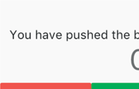
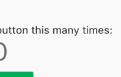
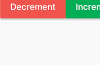
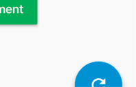

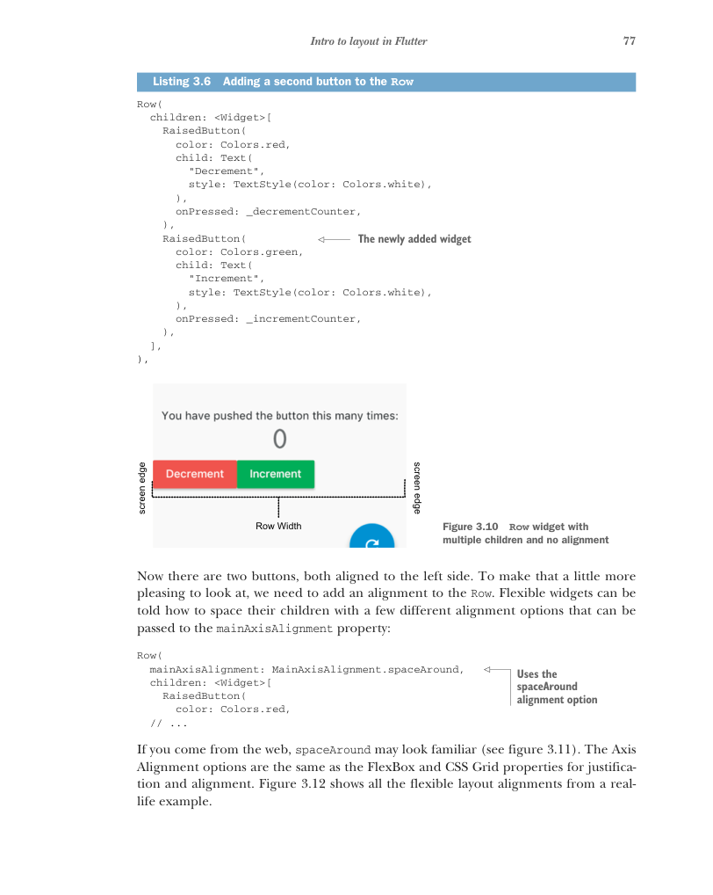

*Mô tả hình:* Trong ứng dụng, bên dưới dòng chữ "You have pushed the button this many times:" và số `0` giờ có hai nút nằm sát cạnh nhau ở phía bên trái màn hình: nút đỏ "Decrement" và nút xanh lá "Increment". Đường chấm "Row Width" vẫn trải rộng từ mép màn hình bên trái (`screen edge`) sang mép màn hình bên phải (`screen edge`).

Bây giờ đã có hai nút, cả hai đều dồn về phía bên trái. Để giao diện trông dễ nhìn hơn một chút, chúng ta cần thêm thuộc tính căn chỉnh (*alignment*) cho `Row`. Các widget linh hoạt có thể được chỉ dẫn cách phân bổ khoảng trống giữa các con của chúng thông qua một vài tùy chọn căn chỉnh khác nhau truyền vào thuộc tính `mainAxisAlignment`:

```dart
Row(
  mainAxisAlignment: MainAxisAlignment.spaceAround,   // (1)
  children: <Widget>[
    RaisedButton(
      color: Colors.red,
// ...
```

1. Sử dụng tùy chọn căn chỉnh `spaceAround`.

Nếu bạn xuất thân từ lập trình web, `spaceAround` hẳn trông rất quen thuộc (xem hình 3.11). Các tùy chọn Axis Alignment (căn chỉnh theo trục) hoàn toàn giống với các thuộc tính căn chỉnh và dàn đều (*justification and alignment*) trong FlexBox và CSS Grid. Hình 3.12 minh họa tất cả các kiểu căn chỉnh bố cục linh hoạt từ một ví dụ thực tế.

**Hình 3.11 – Widget Row với căn chỉnh spaceAround (Row widget with spaceAround alignment)**

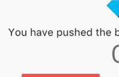
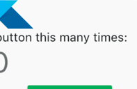
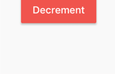
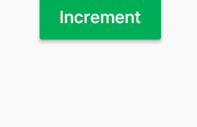

*Mô tả hình:* Khi dùng `MainAxisAlignment.spaceAround`, hai nút "Decrement" (màu đỏ) và "Increment" (màu xanh lá) được tách ra và phân bố cân đối trên chiều rộng của `Row` (giữa hai mép màn hình `screen edge`), có khoảng trống đều xung quanh mỗi nút.

**Hình 3.12 – Các kiểu căn chỉnh trong Flutter (Alignment styles in Flutter)**

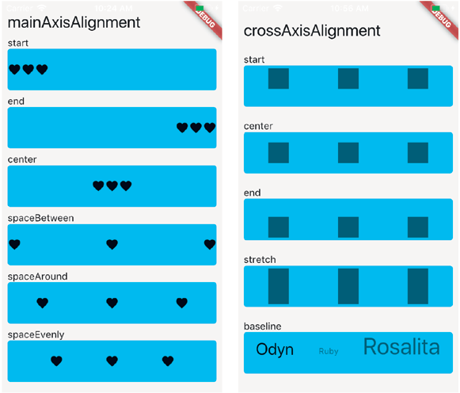

*Mô tả hình:* Hai ảnh chụp màn hình đặt cạnh nhau minh họa trực quan các giá trị của `mainAxisAlignment` (bên trái, với 3 biểu tượng trái tim trong khung xanh) và `crossAxisAlignment` (bên phải, với 3 hình khối/chữ trong khung xanh):
- Cột trái (`mainAxisAlignment`):
  - `start`: 3 trái tim dồn sát đầu hàng (bên trái).
  - `end`: 3 trái tim dồn sát cuối hàng (bên phải).
  - `center`: 3 trái tim chụm lại ở chính giữa hàng.
  - `spaceBetween`: trái tim đầu và cuối nằm sát hai mép, khoảng trống còn lại chia đều ở giữa.
  - `spaceAround`: khoảng trống bao quanh mỗi trái tim bằng nhau (khoảng cách giữa hai trái tim gấp đôi khoảng cách từ trái tim ngoài cùng tới mép).
  - `spaceEvenly`: mọi khoảng trống (giữa các trái tim và từ trái tim tới hai mép) đều bằng nhau hoàn toàn.
- Cột phải (`crossAxisAlignment`):
  - `start`: các phần tử dồn lên mép trên của hàng.
  - `center`: các phần tử nằm giữa theo chiều dọc.
  - `end`: các phần tử dồn xuống mép dưới của hàng.
  - `stretch`: các phần tử kéo giãn hết chiều cao của hàng.
  - `baseline`: các chữ có cỡ chữ khác nhau ("Odyn", "Ruby", "Rosalita") được căn thẳng hàng theo đường chân chữ (*baseline*).

Đó là những điều cơ bản về việc sử dụng các widget nhiều con `Row` và `Column`. Bạn sẽ thấy mình dùng chúng rất nhiều, vì vậy rất đáng để nắm vững những kiến thức cơ bản này.

### 3.6.7 Biểu tượng (Icons) và FloatingActionButton (Icons and the FloatingActionButton)

Trong Flutter, toàn bộ bộ biểu tượng Material Design (*Material Design icons*) đều được tích hợp sẵn và có thể truy cập dưới dạng các hằng số (*constants*). So với trải nghiệm của tôi trên nền tảng web, đây thực sự là một điều tuyệt vời. Biểu tượng là một phần cốt lõi khi xây dựng giao diện di động nơi không gian màn hình rất hạn chế. Trong Flutter, bạn không phải đi tìm một thư viện bên ngoài hay tải ảnh lên nếu bạn hài lòng với bộ biểu tượng theo phong cách Material Design. Có rất nhiều biểu tượng, và bạn có thể xem cũng như tìm kiếm toàn bộ chúng tại https://material.io/tools/icons. Bảng 3.1 liệt kê những biểu tượng mà tôi hay dùng nhất.

**Bảng 3.1 – Các biểu tượng Material Design phổ biến (Common Material Design icons)**

| Biểu tượng (Icon) | Tên hằng số (Const name) | Biểu tượng (Icon) | Tên hằng số (Const name) |
| :---: | :--- | :---: | :--- |
| ➕ | `Icons.add` | ✔️ | `Icons.check` |
| ▼ | `Icons.arrow_drop_down` | ▲ | `Icons.arrow_drop_up` |
| ➡️ | `Icons.arrow_forward` | ⬅️ | `Icons.arrow_back` |
| `‹` | `Icons.chevron_left` | `›` | `Icons.chevron_right` |
| ✖️ | `Icons.close` | ☰ | `Icons.menu` |
| ❤️ | `Icons.favorite` | ↻ | `Icons.refresh` |

Hiện tại trong ứng dụng đếm số, một `Icon` đang được sử dụng bên trong `FloatingActionButton`: biểu tượng dấu cộng (`Add`). Vì `Icons` là một lớp chứa các hằng số, bạn có thể truy cập `Icons` ở bất kỳ đâu trong ứng dụng của mình (truyền vào cho widget `Icon`). Widget `Icon`, như bạn có lẽ đã đoán ra, cũng là một widget. Bạn có thể sử dụng nó ở bất cứ đâu.

Nút `FloatingActionButton` là một ví dụ điển hình cho việc Flutter cung cấp sẵn cho bạn một widget đã được định kiểu đầy đủ, hoàn toàn miễn phí. Theo tài liệu của `FloatingActionButton` (http://mng.bz/079E): *"Floating action button (nút hành động nổi) là một nút biểu tượng hình tròn nằm lơ lửng phía trên nội dung nhằm làm nổi bật một hành động chính trong ứng dụng. Các nút hành động nổi thường được sử dụng nhất trong trường `Scaffold.floatingActionButton`."* Khi được dùng trong một `Scaffold` (như trong ứng dụng của chúng ta), nó sẽ tự động được đặt vào đúng vị trí cần thiết mà bạn không phải tốn chút công sức nào. Tuy nhiên, bạn vẫn có thể dùng nó ở bất kỳ đâu mình thích nếu muốn có một nút hình tròn mang kiểu dáng trông như đang "nổi lên" (*elevated*) với bóng đổ (*box shadow*).

Quay lại ứng dụng, chúng ta muốn `FloatingActionButton` (FAB) đặt lại (*reset*) bộ đếm về 0 chứ không phải tăng nó lên. Quá dễ! Các bước để thực hiện việc này là gì?

1. Viết một phương thức mới `resetCounter`, và truyền nó vào đối số `onPressed` của FAB.
2. Đổi biểu tượng được sử dụng trong FAB.

Trước hết, hãy viết phương thức đó. Tất cả những gì chúng ta muốn làm là đặt `_counter` trở lại bằng `0`. Ngoài ra, đừng quên rằng chúng ta cần báo cho Flutter biết để vẽ lại màn hình:

```dart
void _resetCounter() {
  setState(() => _counter = 0);
}
```

Đó là một phương thức đủ đơn giản. Giờ chúng ta phải cập nhật bản thân nút FAB.

Bước 1 là chọn đúng `Icon`. Tôi chọn `Icons.refresh`, giá trị này sẽ được truyền vào FAB. Trong FAB, hãy thay đổi biểu tượng và hàm được truyền vào callback `onPressed`:

```dart
floatingActionButton: FloatingActionButton(
  onPressed: _resetCounter,          // (1)
  tooltip: 'Reset Counter',          // (2)
  child: Icon(Icons.refresh),        // (3)
),
```

1. Gọi `_resetCounter` khi chạm vào, thay vì `_incrementCounter`.
2. Chú giải (*tooltip*) phản ánh chức năng của nút nhằm giúp ứng dụng dễ tiếp cận hơn (*more accessible*).
3. Đối số bắt buộc, không đặt tên của widget `Icon` nhận vào thông tin biểu tượng (`IconData` / `IconInfo`). Toàn bộ các biểu tượng Material Design đều có sẵn dưới dạng hằng số trên lớp `Icons`.

Khi bạn hot-reload ứng dụng, giờ đây nó sẽ phản ánh các thay đổi với biểu tượng và chức năng mới.

### 3.6.8 Hình ảnh (Images)

Flutter giúp việc thêm hình ảnh vào ứng dụng của bạn trở nên dễ dàng thông qua widget `Image`. Widget `Image` có các hàm khởi tạo (*constructors*) khác nhau tùy thuộc vào *nguồn* (*source*) ảnh của bạn: tức là ảnh được lưu cục bộ trong dự án hay được tải về từ internet.

Cách nhanh nhất để thêm một bức ảnh là dùng hàm khởi tạo `Image.network`. Bạn truyền cho nó một URL dưới dạng `String`, và nó sẽ tự lo liệu mọi thứ cho bạn. Ví dụ: `Image.network("https://funfreegifs.com/panda-bear")`. Bất kỳ URL nào trỏ tới một hình ảnh đều có thể truyền vào được.

Tuy nhiên, trong ứng dụng thực tế, nhiều khả năng bạn sẽ cần một số hình ảnh được lưu trữ cục bộ ngay trong dự án. Trong trường hợp này, bạn dùng hàm khởi tạo `Image.asset`. Hàm khởi tạo này hoạt động theo cùng một cách: bạn truyền vào đường dẫn tới bức ảnh trong dự án của mình, và nó sẽ tự phân giải ảnh đó cho bạn. Tuy nhiên, trước tiên bạn phải khai báo cho Flutter biết về bức ảnh đó trong file `pubspec.yaml`.

Trong ứng dụng đếm số này, hãy đặt một logo Flutter ở phía trên cùng của ứng dụng. Đã có sẵn một file ảnh logo Flutter trong kho mã nguồn GitHub của cuốn sách. Bức ảnh này cũng cần được thêm vào file `pubspec.yaml`. Nhân cơ hội này, tôi sẽ điểm qua nhanh nội dung file `pubspec.yaml` của một ứng dụng Flutter cơ bản. (Nếu bạn khởi tạo một dự án Flutter mới, file `pubspec.yaml` có sẵn các chú thích rất chi tiết mà bạn có thể thấy hữu ích.)

**Listing 3.7 – Thêm một hình ảnh vào file pubspec.yaml của Flutter (Adding an image to your Flutter pubspec.yaml file)**

```yaml
name: counter_app                           # (1)
description: A new Flutter project.         # (1)
version: 1.0.0+1                            # (1)

environment:                                # (2)
  sdk: ">=2.0.0-dev.68.0 <3.0.0"            # (2)

dependencies:                               # (3)
  flutter:
    sdk: flutter
  cupertino_icons: ^0.1.2                   # (4)

dev_dependencies:                           # (5)
  flutter_test:
    sdk: flutter

flutter:                                    # (6)
  uses-material-design: true                # (7)
  assets:                                   # (8)
    - flutter_logo_1080.png                 # (8)
```

1. Siêu dữ liệu (*metadata*) mô tả dự án của bạn.
2. Tham chiếu tới phiên bản Dart SDK của bạn, cần phải từ 2 trở lên.
3. Các gói phụ thuộc (*dependencies*) cần thiết trong phiên bản phát hành chính thức (*production*) của ứng dụng.
4. Cung cấp cho bạn quyền truy cập vào bộ biểu tượng phong cách iOS (*Cupertino*), nếu bạn muốn sử dụng chúng.
5. Các gói phụ thuộc chỉ dùng trong quá trình phát triển (*development only*).
6. Nơi bạn cấu hình Flutter.
7. Cờ (*flag*) đảm bảo bạn có quyền truy cập vào bộ biểu tượng Material Icons.
8. Phần quan trọng nhất ở đây: nơi bạn khai báo các tài nguyên (*assets*) của mình.

Bất kỳ tài nguyên (*assets*) nào bạn cần trong ứng dụng đều phải được liệt kê bên dưới mục `assets` trong file đặc tả (`pubspec.yaml`) của bạn. Nó *bắt buộc* phải tuân theo đúng định dạng này. Ngôn ngữ YAML rất nhạy cảm với khoảng trắng (*whitespace*). Bản thân các tài nguyên được liệt kê theo đường dẫn tương đối trong dự án của bạn (tác giả đặt file trực tiếp trong dự án; nếu nó nằm trong một thư mục tên là `images` thì dòng đó sẽ viết là `images/flutter_logo_1080.png`).

Giờ bạn đã thêm `flutter_logo_1080.png` vào mục `assets`, bạn sẽ phải khởi động lại (*restart*) ứng dụng của mình. Hot reload không hoạt động nếu bạn thay đổi các file cấu hình đặc tả (`pubspec.yaml`). Nhưng *hot restart* thì hoạt động, và nó nhanh hơn nhiều so với việc dừng hẳn rồi chạy lại ứng dụng từ đầu. Bạn có thể thực hiện hot restart bằng cách gõ phím `R` (chữ R hoa) vào cửa sổ terminal nơi bạn đang chạy lệnh `flutter run`.

Bây giờ bạn có thể truy cập bức ảnh đó trong ứng dụng đếm số bằng cách thêm một widget `Image` vào danh sách `children` của widget `Column`, như trong listing tiếp theo.

**Listing 3.8 – Thêm một hình ảnh vào ứng dụng Flutter của bạn (Adding an image to your Flutter app)**

```dart
children: <Widget>[
  Image.asset(
    'flutter_logo_1080.png',                        // (1)
    width: 100.0,                                   // (2)
  ),
  Text(
    'You have pushed the button this many times:',
  ),
```

1. Đối số đầu tiên của `Image.asset` nhận vào chính xác tên/đường dẫn mà bạn đã liệt kê trong `pubspec.yaml`.
2. Widget `Image` cho phép bạn đặt tường minh chiều rộng (`width`) và chiều cao (`height`) của bức ảnh. Nếu bạn không đặt, bức ảnh sẽ hiển thị lớn đúng bằng kích thước thật của nó tính theo điểm ảnh (*pixels*).

Bây giờ, nếu bạn hot reload, bạn sẽ nhìn thấy một bức ảnh trong ứng dụng của mình.

### 3.6.9 Widget Container (Container widget)

Bức ảnh hiện tại trông chưa được đẹp lắm. Nó chỉ nằm chễm chệ ngay sát phía trên dòng chữ mà chẳng có khoảng cách đệm nào cả. Hãy làm cho nó gọn gàng, đẹp mắt hơn bằng widget `Container`. Hình 3.13 cho thấy kết quả mà chúng ta hướng tới, và tất cả đều có thể thực hiện được bằng `Container`.

**Hình 3.13 – Biến đổi logo Flutter bằng widget Container (Transforming the Flutter logo with the Container widget)**

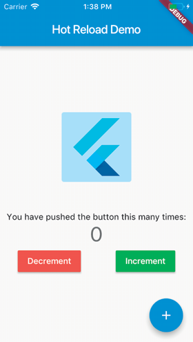
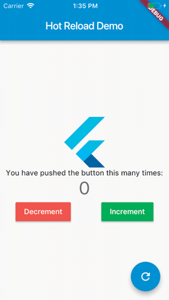

*Mô tả hình:* Hai ảnh chụp màn hình ứng dụng đặt cạnh nhau với mũi tên đỏ chỉ từ trái sang phải:
- Ảnh trái (trước khi bọc `Container`): Logo Flutter nằm sát ngay trên dòng chữ "You have pushed the button this many times:", không có khung nền hay khoảng cách tách biệt.
- Ảnh phải (sau khi bọc `Container`): Logo Flutter được bao quanh bởi một khung hình vuông bo góc màu xanh nhạt có khoảng đệm (*padding*) xung quanh logo, và có một khoảng cách lề dưới (*margin*) tách hẳn khung logo ra khỏi dòng chữ bên dưới.

Một số widget, chẳng hạn như `Container`, thay đổi cách chúng tự xác định kích thước dựa trên các đối số truyền vào hàm khởi tạo và các con của chúng. Trong trường hợp của `Container`, mặc định nó cố gắng phình to hết mức có thể; nhưng nếu bạn truyền cho nó một chiều rộng (`width`) chẳng hạn, hoặc khi nó bọc một widget con có kích thước xác định, nó sẽ cố gắng tôn trọng điều đó và lấy kích thước cụ thể ấy.

Widget `Container` là một widget "tiện lợi" (*convenience widget*) cung cấp hàng loạt thuộc tính mà nếu không có nó, bạn sẽ phải ghép từ nhiều widget riêng lẻ lại mới có được. Ví dụ, có một widget `Padding` chỉ làm đúng một việc là thêm khoảng đệm (*padding*) cho con của nó. Nhưng bản thân widget `Container` đã có sẵn thuộc tính `padding` (cùng nhiều thuộc tính khác).

Chắc chắn bạn sẽ dùng widget `Container` rất nhiều. Hãy nhìn vào tất cả những thuộc tính tùy chọn mà bạn có thể tận dụng (và đây mới chỉ là một phần) từ hàm khởi tạo của widget `Container`:

```dart
// Từ mã nguồn Flutter (From Flutter source code)
Container({
  Key key,
  this.alignment,
  this.padding,
  Color color,
  Decoration decoration,            // (1)
  this.foregroundDecoration,
  double width,
  double height,
  BoxConstraints constraints,
  this.margin,
  this.transform,
  this.child,
})
...
```

1. Tại `decoration`, bạn có thể thiết lập đủ mọi loại thuộc tính trang trí khác như đường viền (`Border`), bo góc (`BorderRadius`), đổ bóng (`BoxShadow`), ảnh nền (*background images*), và nhiều thứ nữa.

Chúng ta sẽ lần lượt khám phá tất cả những thuộc tính này theo thời gian, nhưng điểm mấu chốt là: nếu bạn cần định kiểu (*style*) cho một widget theo cách nào đó, hãy nghĩ ngay tới `Container`. Hãy bọc `Image.asset` của bạn trong một `Container`, rồi thêm các thuộc tính sau đây vào nó.

**Listing 3.9 – Thêm một widget Container (Adding a Container widget)**

```dart
Container(
  margin: EdgeInsets.only(bottom: 100.0),               // (1)
  padding: EdgeInsets.all(8.0),                         // (2)
  decoration: BoxDecoration(                            // (3)
    color: Colors.blue.withOpacity(0.25),               // (4)
    borderRadius: BorderRadius.circular(4.0),           // (5)
  ),
  child: Image.asset(                                   // (6)
    'flutter_logo_1080.png',
    width: 100.0,
  ),
),
```

1. `margin`: Tạo khoảng trống *giữa* các widget với nhau. Hàm khởi tạo `EdgeInsets.only` cho Flutter biết cần thêm lề ở phía nào (trong trường hợp này là 100 pixel lề ở phía dưới widget này).
2. `padding`: Thêm khoảng trống bao quanh bên trong widget hiện tại. Hàm khởi tạo `EdgeInsets.all` đặt khoảng đệm ở tất cả các cạnh. Hình 3.14 minh họa sự khác biệt giữa `margin` và `padding`.
3. `decoration`: Truyền cho `decoration` một lớp tên là `BoxDecoration`, dùng để trang trí các hộp.
4. `color`: Đặt màu nền (màu xanh dương với độ mờ `0.25`).
5. `borderRadius`: Lớp `BorderRadius` có nhiều hàm khởi tạo; hãy dùng `circular` khi bạn muốn bo tròn cả bốn góc của chiếc hộp.
6. `child`: Truyền hình ảnh vào thuộc tính `child` như thường lệ.

Hãy hot-reload thêm một lần nữa. Ứng dụng của bạn giờ sẽ trông giống như mục tiêu ban đầu ở hình 3.13 (và sự khác biệt giữa `margin` với `padding` được minh họa trong hình 3.14). Và quan trọng hơn, bạn đã học được toàn bộ những khái niệm nền tảng về việc xoay xở với giao diện người dùng (UI) trong Flutter.

**Hình 3.14 – Sử dụng thuộc tính margin so với thuộc tính padding (Using the margin property versus the padding property)**

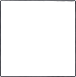

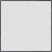
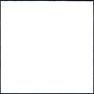

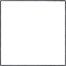

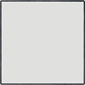
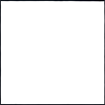


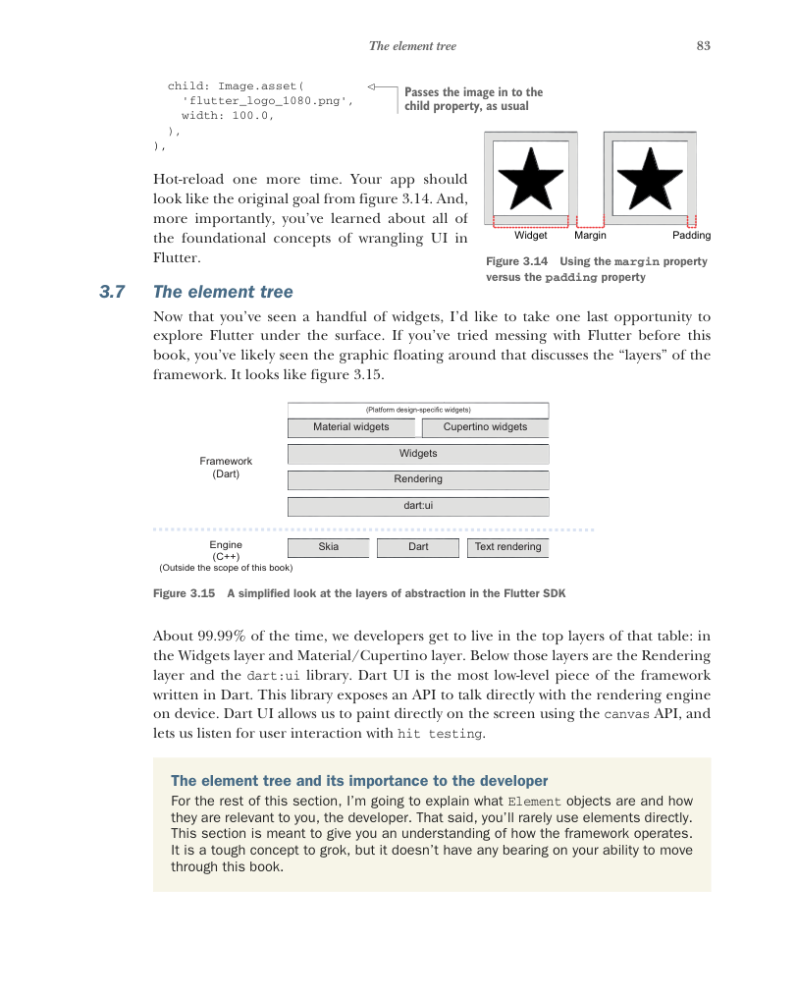

*Mô tả hình 3.14:* Hai hộp vuông chứa hình ngôi sao đặt cạnh nhau:
- `Widget`: phần nội dung bên trong hộp (hình ngôi sao).
- `Margin` (Lề ngoài): khoảng cách bên ngoài đường viền hộp, đẩy hai widget tách xa nhau ra.
- `Padding` (Đệm trong): khoảng cách bên trong đường viền hộp, tạo khoảng trống giữa viền của `Container` và nội dung `child` bên trong nó.

> 💡 **Ví dụ bổ sung (không có trong sách):** Một quy tắc quan trọng khi dùng `Container`: nếu bạn đã dùng thuộc tính `decoration: BoxDecoration(...)`, thì bạn **phải** đặt thuộc tính `color` ở **bên trong** `BoxDecoration` (như Listing 3.9), chứ không được đặt đồng thời cả `color` trực tiếp trên `Container` lẫn `decoration`. Nếu truyền cả hai, Flutter sẽ báo lỗi assertion ngay lập tức vì `color` trên `Container` thực chất chỉ là cách viết tắt cho `BoxDecoration(color: ...)`.

## 3.7 Cây element (The element tree)

Giờ bạn đã làm quen với một loạt widget, tôi muốn nhân cơ hội cuối cùng này để khám phá Flutter ở bên dưới bề mặt. Nếu bạn đã từng vọc vạch Flutter trước khi đọc cuốn sách này, rất có thể bạn đã bắt gặp sơ đồ minh họa các "tầng" (*layers*) của framework. Sơ đồ đó trông giống như hình 3.15.

**Hình 3.15 – Góc nhìn giản lược về các tầng trừu tượng trong Flutter SDK (A simplified look at the layers of abstraction in the Flutter SDK)**

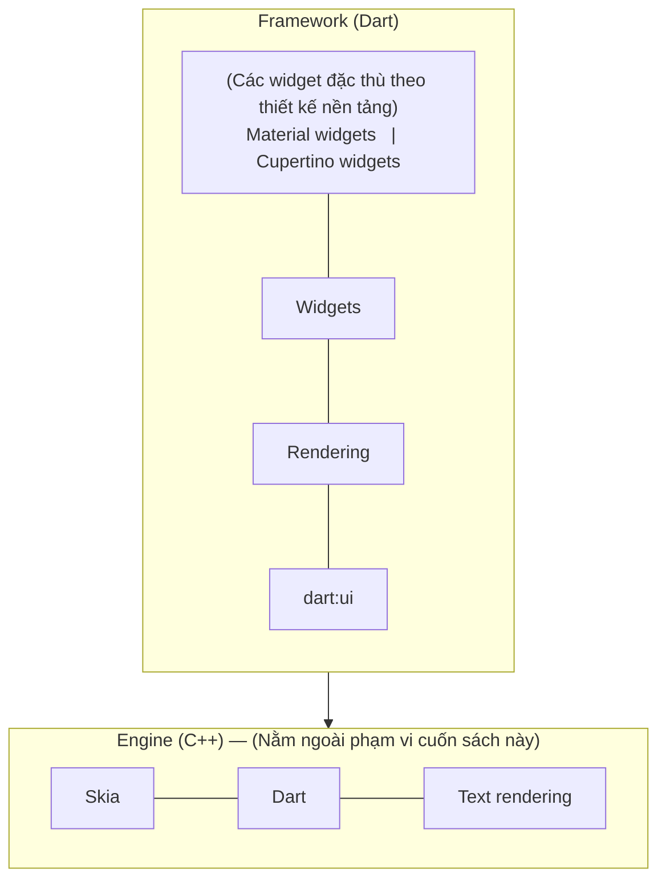

*(Xem hình gốc trên trang 109 đã nhúng ở trên: `images/pages/page-109.png`)*

*Mô tả hình 3.15:* Sơ đồ kiến trúc phân tầng của Flutter SDK chia thành hai phần lớn ngăn cách bởi một đường kẻ đứt nét:
1. **Framework (viết bằng Dart)** — từ trên xuống dưới gồm:
   - Tầng trên cùng (*Platform design-specific widgets* – Các widget đặc thù theo thiết kế nền tảng): **Material widgets** và **Cupertino widgets**.
   - **Widgets** (Tầng Widget).
   - **Rendering** (Tầng Kết xuất).
   - **dart:ui** (Thư viện giao tiếp cấp thấp nhất của Dart).
2. **Engine (viết bằng C++, nằm ngoài phạm vi cuốn sách này)** — gồm ba khối ngang hàng: **Skia** (bộ máy đồ họa 2D), **Dart** (máy ảo/runtime Dart), và **Text rendering** (kết xuất văn bản).

Khoảng 99,99% thời gian, lập trình viên chúng ta chỉ sống ở các tầng trên cùng của bảng đó: trong tầng Widgets và tầng Material/Cupertino. Bên dưới các tầng đó là tầng Rendering và thư viện `dart:ui`. Dart UI là mảnh ghép cấp thấp nhất của framework được viết bằng ngôn ngữ Dart. Thư viện này phơi bày một API để nói chuyện trực tiếp với bộ máy kết xuất (*rendering engine*) trên thiết bị. Dart UI cho phép chúng ta vẽ trực tiếp lên màn hình bằng API `canvas`, và cho phép lắng nghe tương tác của người dùng thông qua cơ chế kiểm tra điểm chạm (*hit testing*).

> **Cây element và tầm quan trọng của nó đối với lập trình viên (The element tree and its importance to the developer)**
>
> Trong phần còn lại của mục này, tôi sẽ giải thích các đối tượng `Element` là gì và chúng có liên quan như thế nào tới bạn — người lập trình viên. Tuy nói vậy, bạn sẽ hiếm khi phải sử dụng trực tiếp các element. Mục này nhằm mang lại cho bạn sự thấu hiểu về cách framework vận hành bên trong. Đây là một khái niệm khá "khó nhằn" để thấm hết (*grok*), nhưng việc chưa hiểu trọn vẹn nó cũng không ảnh hưởng gì tới khả năng đi tiếp các phần sau của cuốn sách.
>
> Hiểu được cơ chế hoạt động bên trong của Flutter sẽ rất hữu ích trong một vài tình huống "bẫy" (*gotcha*) dễ gây bối rối. Sự hiểu biết này có thể giúp bạn gỡ lỗi (*debug*) ứng dụng của mình trong tương lai, nhưng bạn đừng quá sa lầy hay căng thẳng vì nó. Biết qua về nó ngay từ bây giờ là điều tốt, nhưng bạn không nhất thiết phải hiểu tường tận 100% ngay lập tức. Sự thấu hiểu đó sẽ tự khắc đến theo thời gian.

Nói ngắn gọn về thư viện `dart:ui` thì việc viết một ứng dụng trực tiếp bằng nó sẽ là một quá trình cực kỳ gian khổ và lê thê, dù về lý thuyết bạn vẫn có thể làm được. Bạn sẽ phải tự tính toán tọa độ cho từng điểm ảnh (*pixel*) một trên màn hình và tự cập nhật màn hình ở mỗi khung hình (*frame*). Đó chính là lý do Flutter có các widget — những lớp trừu tượng cấp cao mang lại cho chúng ta cách tiếp cận khai báo (*declarative approach*) để xây dựng giao diện người dùng (UI). Chúng ta không cần phải bận tâm đến việc thao tác với từng điểm ảnh hay xử lý kiểm tra điểm chạm cấp thấp trên thiết bị.

Nhìn vào hình 3.15, giờ chỉ còn lại tầng nằm kẹp giữa tầng widgets và `dart:ui`: tầng **rendering** (kết xuất). Hóa ra trong ứng dụng Flutter của bạn còn có thêm một cái cây nữa: **cây phần tử** (*element tree*). Cây element biểu diễn cấu trúc ứng dụng của bạn theo cách rất giống với cây widget. Thực tế, ứng với mỗi widget trong cây widget sẽ có một element trong cây element.

Ở phần trước của cuốn sách, tôi đã mô tả các widget như những bản thiết kế (*blueprints*) mà Flutter sẽ dùng để vẽ các phần tử (*elements*) lên màn hình. Khi tôi dùng từ *elements* trong câu đó, tôi thực sự muốn nói đến lớp `Element` của Flutter theo đúng nghĩa đen. Các widget là những cấu hình (*configurations*) dành cho các element. Còn các element chính là những widget đã được hiện thực hóa và gắn (*mounted*) vào trong cây. Các element là những gì thực sự đang được hiển thị trên thiết bị của bạn tại bất kỳ thời điểm nào khi chạy một ứng dụng Flutter.

Mỗi `Element` cũng sở hữu một `RenderObject`. Tất cả các render object này hợp lại tạo thành cây kết xuất (*render tree*). Các render object là giao diện trung gian giữa mã nguồn cấp cao của chúng ta và thư viện `dart:ui` cấp thấp. Với góc nhìn đó, bạn có thể hình dung element chính là "lớp keo dán" (*glue*) kết nối giữa cây widget và cây render (xem hình 3.16).

**Hình 3.16 – Flutter framework quản lý ba cái cây, tương tác với nhau thông qua cây element (The Flutter framework manages three trees, which interact via the element tree.)**

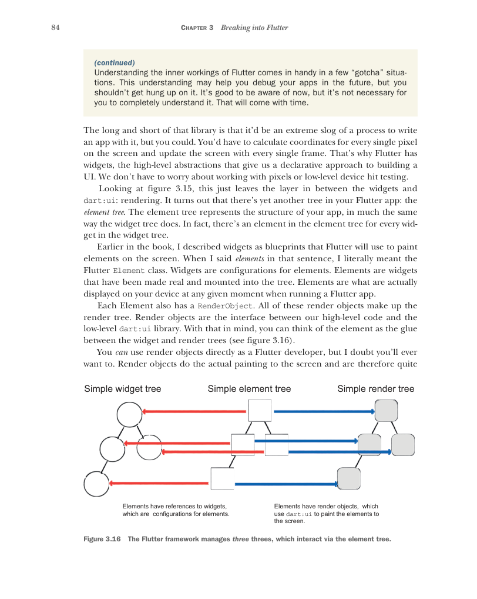

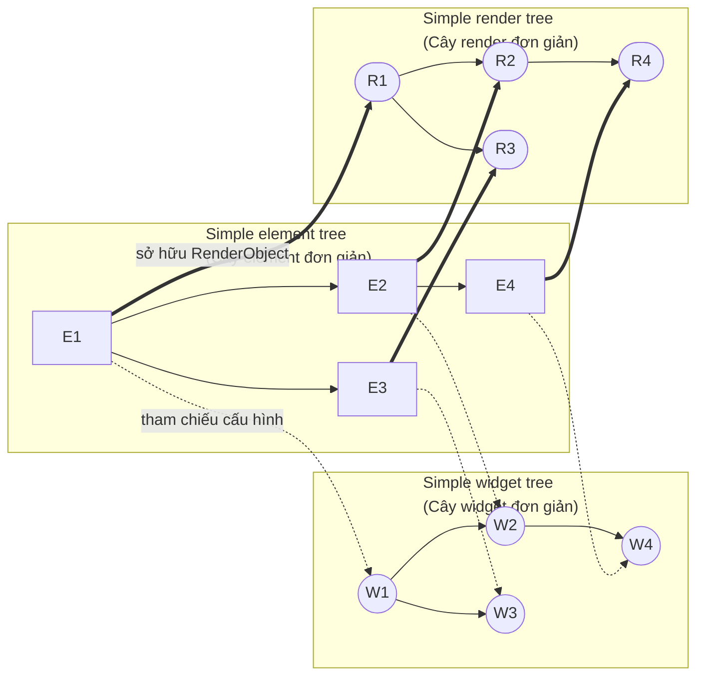

*Mô tả hình 3.16:* Ba cấu trúc cây có hình dáng tương ứng nhau đặt cạnh nhau từ trái sang phải:
- **Simple widget tree** (Cây widget đơn giản – các nút hình tròn): chứa cấu hình giao diện.
- **Simple element tree** (Cây element đơn giản – các nút hình vuông ở giữa): mỗi nút trong cây element có mũi tên đỏ trỏ sang nút tương ứng bên cây widget (*"Elements have references to widgets, which are configurations for elements"* – Các element giữ tham chiếu tới các widget, vốn là cấu hình cho các element) và có mũi tên xanh dương trỏ sang nút tương ứng bên cây render (*"Elements have render objects, which use `dart:ui` to paint the elements to the screen"* – Các element có các render object sử dụng `dart:ui` để vẽ các element lên màn hình).
- **Simple render tree** (Cây render đơn giản – các nút hình vuông bo góc màu xám bên phải).

Là lập trình viên Flutter, bạn *có thể* sử dụng trực tiếp các render object, nhưng tôi nghi ngờ chuyện bạn sẽ muốn làm thế. Các render object thực hiện việc vẽ thực tế lên màn hình nên chúng khá phức tạp và đắt đỏ về mặt tài nguyên (*expensive*). Đó là lý do tại sao có tới ba cái cây trong Flutter. Kiến trúc ba cây này trao cho framework khả năng xử lý thông minh ở bên trong: tái sử dụng các render object đắt đỏ trong khi vẫn vô tư hủy bỏ và tạo lại các widget rẻ tiền (*inexpensive widgets*).

Với tinh thần đó, tôi muốn nói sâu hơn về các element, còn cây render thì chúng ta không cần phải bận tâm thêm nữa. Tuy nhiên, mối quan hệ giữa các element và các widget lại rất đáng để tìm hiểu kỹ.

### 3.7.1 Element và widget (Elements and widgets)

Các element được tạo ra bởi các widget. Khi một widget mới được xây dựng (*built*), framework sẽ gọi `Widget.createElement(this)`. Widget này đóng vai trò là cấu hình ban đầu cho element, và element giữ một tham chiếu trỏ tới widget đã tạo ra nó. Các element được tạo ra cũng hợp thành một cái cây của riêng chúng. Hiểu một cách đơn giản nhất, cây element giống như bộ xương (*skeleton*) của ứng dụng. Nó nắm giữ cấu trúc khung của ứng dụng, nhưng không chứa bất kỳ chi tiết cụ thể nào mà các widget cung cấp. Khi cần, nó có thể tra cứu các chi tiết cấu hình thông qua các tham chiếu trỏ tới widget tương ứng của mình.

Các element khác với các widget ở chỗ chúng không bị xây dựng lại (*rebuilt*); chúng được *cập nhật* (*updated*). Khi một widget được xây dựng lại, hoặc một widget khác được chèn vào một vị trí nào đó trong cây bởi một phần tử tổ tiên (*ancestor*), một element có thể chỉ cần thay đổi tham chiếu của nó sang widget mới thay vì phải tự hủy đi tạo lại. Dĩ nhiên, các element vẫn có thể được tạo mới và bị hủy bỏ, và điều đó sẽ xảy ra khi người dùng điều hướng qua lại giữa các màn hình trong ứng dụng. Nhưng hãy thử xét một hiệu ứng chuyển động (*animation*). Hiệu ứng chuyển động gọi phương thức `build` sau mỗi lần thay đổi khung hình — tức là rất nhiều lần! (Thực tế là lên tới 60 lần mỗi giây.) Trong suốt quá trình diễn ra hoạt ảnh, widget ở mỗi khung hình vẫn có cùng kiểu dữ liệu (*type*) nhưng chỉ khác đi đôi chút về mặt cấu hình. (Nghĩa là một vài thuộc tính hiển thị đã thay đổi. Chẳng hạn, màu sắc của một widget có thể đậm nhạt khác đi một chút ở mỗi khung hình của hoạt ảnh.) Trong trường hợp này, bản thân element không cần phải xây dựng lại, bởi vì xét về mặt cấu trúc thì cái cây vẫn y hệt như cũ. Widget bị xây dựng lại ở mỗi khung hình, nhưng element chỉ việc cập nhật lại tham chiếu của nó trỏ sang widget mới đó mà thôi.

Và đây chính là bí quyết giúp Flutter thoải mái xây dựng lại các widget liên tục mà vẫn duy trì được hiệu năng cao (*performant*). Các widget chỉ là những bản thiết kế, và việc thay thế các widget trong cây là cực kỳ nhẹ nhàng, rẻ tiền mà không hề làm xáo trộn cái cây đang thực sự hiển thị trên màn hình, bởi phần việc đó đã do các element đảm nhận.

Còn một chi tiết quan trọng cuối cùng tôi muốn nhắc tới: các đối tượng trạng thái (`State` objects) thực chất được quản lý bởi các **element**, chứ không phải bởi các widget. Trên thực tế, ở bên dưới nắp capô, Flutter kết xuất giao diện dựa trên các element và các đối tượng `State`, chứ không mấy bận tâm tới các widget. Trong mục tiếp theo, chúng ta sẽ đi sâu hơn vào cách đối tượng `State` tương tác với các element và các widget.

Tất cả cơ chế này là cần thiết (và tối ưu), bởi vì các widget là *bất biến* (*immutable*). Vì bất biến nên chúng không thể thay đổi mối quan hệ của mình với các widget khác. Chúng không thể nhận một widget cha mới. Chúng buộc phải bị hủy đi và xây dựng lại. Ngược lại, các element là *khả biến* (*mutable*), nhưng chúng ta không phải tự tay cập nhật chúng. Nhờ vậy, chúng ta vừa có được tốc độ của các element khả biến, lại vừa có được sự an toàn của việc viết mã bất biến (thông qua các widget).

> **NOTE (Ghi chú):** Nhắc lại một lần nữa, các element — giống như các render object — hiếm khi là mối bận tâm của người lập trình viên, dù bạn vẫn có thể tự tạo element của riêng mình nếu muốn. Gần như lúc nào bạn cũng sẽ chỉ gắn bó với việc viết các widget mà thôi.

### 3.7.2 Khám phá cây element qua một ví dụ (Exploring the element tree with an example)

Để ứng dụng thêm phần sinh động (đồng thời minh họa cách cây element hoạt động), tôi muốn tráo đổi vị trí của hai nút Increment (Tăng) và Decrement (Giảm) mỗi khi nút Reset được nhấn. Để bắt đầu, hãy để tôi chỉ ra một số đoạn code liên quan trong ứng dụng đếm số.

**Listing 3.10 – Cấu hình `_MyHomePageState` (`_MyHomePageState` configuration)**

```dart
class _MyHomePageState extends State<MyHomePage> {
  int _counter = 0;
  bool _reversed = false;                                         // (1)
  List<UniqueKey> _buttonKeys = [UniqueKey(), UniqueKey()];       // (2)
  // ... phần còn lại của lớp (rest of class)
}
```

1. Biến boolean này sẽ được dùng để xác định xem hai nút có nên đổi chỗ cho nhau hay không.
2. Các khóa (*keys*) này sẽ đóng vai trò rất quan trọng, nhưng hiện tại bạn chỉ cần biết rằng chúng có tồn tại là được.

Để làm việc này dễ dàng hơn, tôi đã tạo một widget tên là `FancyButton`, như trong listing tiếp theo. Đây là một stateful widget tự quản lý màu nền của chính nó, đồng thời gọi một hàm callback được truyền vào khi nút được nhấn.

**Listing 3.11 – Widget tùy chỉnh `FancyButton` (The `FancyButton` custom widget)**

```dart
class FancyButton extends StatefulWidget {
  final VoidCallback onPressed;
  final Widget child;

  const FancyButton({Key key, this.onPressed, this.child}) : super(key: key);

  @override
  _FancyButtonState createState() => _FancyButtonState();
}

class _FancyButtonState extends State<FancyButton> {
  @override
  Widget build(BuildContext context) {
    return Container(
      child: RaisedButton(
        color: _getColors(),                        // (1)
        child: widget.child,
        onPressed: widget.onPressed,
      ),
    );
  }

  Color _getColors() {                              // (2)
    return _buttonColors.putIfAbsent(this, () => colors[next(0, 5)]);
  }
}

Map<_FancyButtonState, Color> _buttonColors = {};   // (3)
final _random = Random();                           // (3)
int next(int min, int max) => min + _random.nextInt(max - min);
List<Color> colors = [                              // (3)
  Colors.blue,
  Colors.green,
  Colors.orange,
  Colors.purple,
  Colors.amber,
  Colors.lightBlue,
];
```

1. Nút này tự quản lý màu sắc của chính nó.
2. Quản lý màu sắc cho tất cả các nút `FancyButton`.
3. Các hàm và biến bổ trợ (*helper methods*), được dùng để cho phép các nút tự quản lý trạng thái màu của riêng mình, đồng thời lấy màu ngẫu nhiên. Đoạn code này chỉ mang tính chất dàn dựng phục vụ ví dụ và không quan trọng đối với bài học chính ở đây.

Phương thức `_getColors` quản lý màu sắc cho *tất cả* các nút `FancyButton` bằng cách sử dụng phương thức `putIfAbsent` trên đối tượng `Map` của Dart. Phương thức này nói rằng: "Nếu trạng thái của nút này (`this`) đã có mặt trong map rồi, hãy cho tôi biết màu của nó. Ngược lại, hãy đưa nó vào map kèm theo màu mới này, rồi trả về màu đó."

Widget `FancyButton` được sử dụng trong phương thức `_MyHomePageState.build` (hiển thị trong listing tiếp theo). Đầu tiên, các nút được khởi tạo dưới dạng các biến, và sau đó sẽ được đưa vào cây widget ở phần trả về (`return`) của phương thức `build` này.

**Listing 3.12 – Cập nhật ứng dụng để sử dụng lớp `FancyButton` (Updated app to use the `FancyButton` class)**

```dart
// _MyHomePageState.build
  @override
  Widget build(BuildContext context) {
    final incrementButton = FancyButton(                        // (1)
      child: Text(
        "Increment",
        style: TextStyle(color: Colors.white),
      ),
      onPressed: _incrementCounter,
    );

    final decrementButton = FancyButton(                        // (2)
      child: Text(
        "Decrement",
        style: TextStyle(color: Colors.white),
      ),
      onPressed: _decrementCounter,
    );

    List<Widget> _buttons = <Widget>[incrementButton, decrementButton]; // (3)

    if (_reversed) {                                            // (4)
      _buttons = _buttons.reversed.toList();
    }
  }
```

1. `FancyButton` đại diện cho nút Increment (Tăng).
2. `FancyButton` đại diện cho nút Decrement (Giảm).
3. Tạo biến `_buttons` chứa danh sách hai nút; biến này lát nữa sẽ được truyền vào `children` của một `Row` để hiển thị các widget này.
4. Nếu thuộc tính `_reversed` là `true`, đảo ngược thứ tự của danh sách các nút. Vì đoạn logic này nằm trong phương thức `build`, nên hai nút sẽ được đổi chỗ bất cứ khi nào `setState` được gọi và `_reversed` đã được cập nhật.

Đối với cả hai nút `FancyButton`, cách cấu hình trông rất giống với cấu hình bạn cần cho một `RaisedButton` trong Flutter.

Tôi sẽ trình bày phần còn lại của phương thức `build` (và qua đó là cách dùng khóa – `Key`) ngay tiếp sau đây. Trước hết, tôi muốn bạn nhấn nút Reset và tráo đổi hai nút. Nút Reset khi được nhấn sẽ gọi phương thức `_resetCounter`:

```dart
void _resetCounter() {
  setState(() => _counter = 0);
  _swap();                            // (1)
}

void _swap() {
  setState(() {                       // (2)
    _reversed = !_reversed;
  });
}
```

1. Phương thức này quay sang gọi `_swap`, hàm sẽ tráo đổi vị trí của hai nút.
2. Phương thức này cập nhật giá trị boolean `_reversed` và gọi `setState`, qua đó kích hoạt một lần xây dựng lại (*rebuild*)!

Bạn có thể nhận thấy ứng dụng đang không hành xử theo đúng ý chúng ta muốn. Nếu code của bạn giống của tôi, thì khi bạn nhấn nút Reset, hai nút đúng là có đổi chỗ cho nhau thật (chữ "Increment" và "Decrement" cùng hàm xử lý đổi vị trí), nhưng **màu nền của hai nút lại không đổi chỗ**. Nghĩa là cái nút nằm bên trái vẫn giữ nguyên màu nền cũ của vị trí bên trái trước khi tráo đổi, mặc dù bản thân cái nút ở vị trí đó giờ đã là nút khác. Đây chính là hệ quả từ cách mà các element, các đối tượng `State` và các widget phối hợp hoạt động cùng nhau.

### 3.7.3 Cây element và các đối tượng State (The element tree and State objects)

Có một vài điều cần ghi nhớ trong đầu khi tôi giải thích chuyện gì đang xảy ra:

- Các đối tượng `State` thực chất được quản lý bởi cây element (*element tree*).
- Các đối tượng `State` có vòng đời dài (*long-lived*). Không giống như các widget, chúng không bị hủy đi và xây dựng lại mỗi khi các widget kết xuất lại (*re-render*).
- Các đối tượng `State` có thể được tái sử dụng.
- Các element nắm giữ các tham chiếu trỏ tới các widget.

Mối quan hệ giữa một stateful widget đơn lẻ, một element và một đối tượng `State` được minh họa trong hình 3.17.

**Hình 3.17 – Mối quan hệ giữa một element và một widget (The relationship between an element and a widget)**

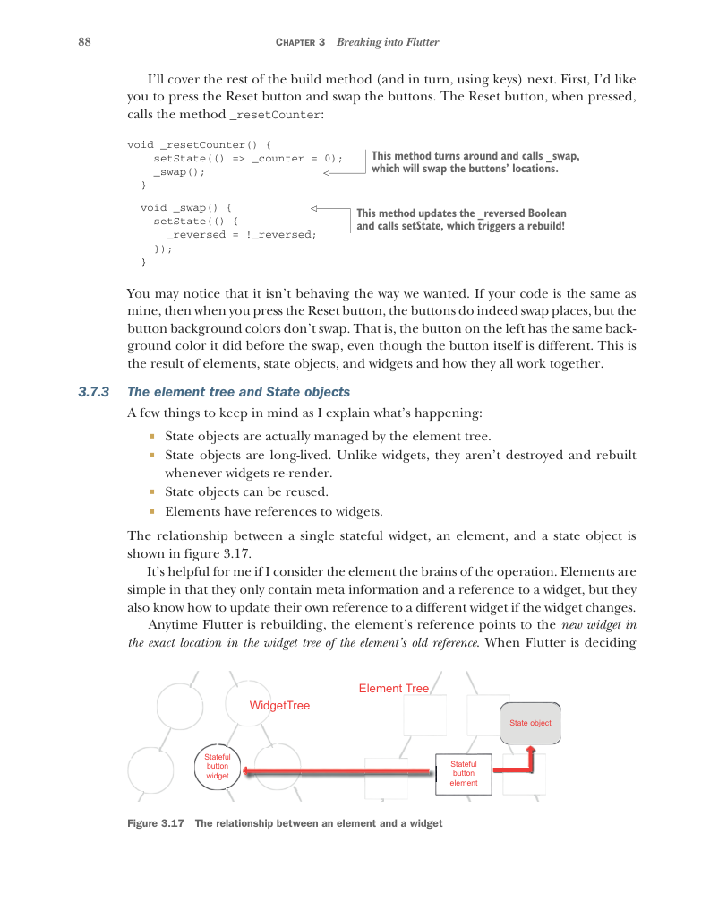

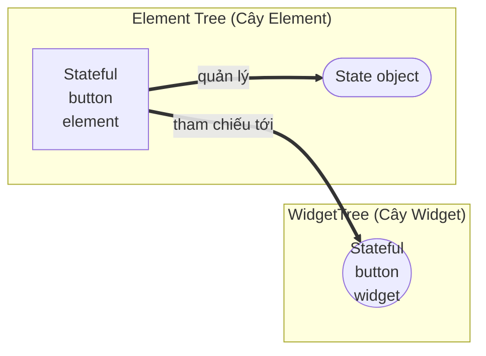

*Mô tả hình 3.17:* Bên trái là `WidgetTree` chứa một nút hình tròn `Stateful button widget`. Bên phải là `Element Tree` chứa một nút hình vuông `Stateful button element`. Từ `Stateful button element` có một mũi tên đỏ trỏ sang `Stateful button widget` (tham chiếu cấu hình) và một mũi tên đỏ khác trỏ lên `State object` (đối tượng trạng thái gắn liền với element đó).

Với cá nhân tôi, việc coi element là "bộ não" của toàn bộ chiến dịch giúp tôi dễ hình dung hơn rất nhiều. Các element rất đơn giản ở chỗ chúng chỉ chứa siêu thông tin (*meta information*) và một tham chiếu tới một widget, nhưng chúng cũng biết cách tự cập nhật tham chiếu của mình sang một widget khác nếu widget thay đổi.

Bất cứ khi nào Flutter đang xây dựng lại (*rebuilding*), tham chiếu của element sẽ trỏ tới *widget mới nằm ở đúng vị trí trong cây widget của tham chiếu cũ*. Khi Flutter quyết định xem cần xây dựng lại và vẽ lại thứ gì sau khi `build` được gọi, một element sẽ nhìn vào widget nằm ở chính xác cùng vị trí với widget trước đó mà nó từng tham chiếu tới (xem hình 3.18). Sau đó, nó sẽ quyết định xem widget đó có còn là một hay không (nếu vẫn như cũ thì nó chẳng cần làm gì cả), hay widget đã thay đổi cấu hình, hoặc đã biến thành một widget khác hẳn hoàn toàn (trong trường hợp đó nó cần kết xuất lại).

**Hình 3.18 – Mỗi element trỏ tới một widget khác nhau và biết kiểu của nó (Each element points to a different widget and knows its type.)**


*Mô tả hình 3.18:* Trước khi tráo đổi, trong `WidgetTree` có hai nút tròn: `A Stateful button` (màu xanh dương, ở vị trí trái) và `B Stateful button` (màu hồng/đỏ, ở vị trí phải). Trong `Element Tree` có hai element tương ứng: `A Stateful element` (giữ `A State object one` màu xanh dương) trỏ sang `A Stateful button`, và `B Stateful element` (giữ `B State object two` màu hồng) trỏ sang `B Stateful button`.

Vì vậy, khi bạn tráo đổi hai nút đó, chúng đổi chỗ cho nhau trong cây widget, nhưng tham chiếu của mỗi element vẫn trỏ vào đúng vị trí địa lý cũ. Mỗi element sẽ nhìn vào widget ở vị trí của mình và tự hỏi: "Widget này có thay đổi không? Hay nó là một widget mới hoàn toàn?" Theo lẽ thường, chúng ta kỳ vọng element sẽ nhận ra rằng thuộc tính màu sắc của widget đã thay đổi, nên nó phải cập nhật lại.

Vấn đề nằm ở chỗ những thông tin mà các element nhìn vào để giải mã xem thứ gì đã được cập nhật. Chúng chỉ nhìn vào đúng hai thuộc tính trên widget:

- Kiểu dữ liệu chính xác lúc chạy (*exact type at runtime* – `runtimeType`)
- Khóa của widget (*widget's key*, nếu có)

Trong ví dụ này, màu sắc của các widget không nằm trong cấu hình của widget; chúng nằm trong các đối tượng `State` (`_FancyButtonState`). Khi hai widget đổi chỗ, mỗi element trỏ tới widget mới được đặt vào vị trí của nó và hiển thị cấu hình mới (nhãn chữ `"Increment"` / `"Decrement"` mới), nhưng **vẫn giữ khư khư đối tượng `State` ban đầu của chính nó**. Cụ thể, element nhìn thấy widget mới được chèn vào vị trí này trong cây và nghĩ bụng: *"Chẳng có key nào cả, mà kiểu dữ liệu lúc chạy (`runtimeType`) thì vẫn là `FancyButton`, vậy nên mình chỉ cần cập nhật tham chiếu cấu hình widget chứ không cần thay đổi đối tượng State. Đây vẫn là loại widget đúng với đối tượng State hiện tại của mình."* (Xem hình 3.19).

**Hình 3.19 – Các element tưởng rằng chúng vẫn là cùng các widget cũ vì chúng có cùng kiểu dữ liệu (The elements think they’re the same widgets because they’re of the same type.)**


*(Xem hình 3.19 bản gốc trên trang 115 đã nhúng ở trên: `images/pages/page-115.png`)*

*Mô tả hình 3.19:* Trong `WidgetTree`, hai nút đã đổi chỗ: nút `B Stateful button` nhảy sang trái, nút `A Stateful button` nhảy sang phải. Thế nhưng bên `Element Tree`, `A Stateful element` (ở vị trí trái) nhìn sang vị trí trái của `WidgetTree` (giờ là `B`) và tự nhủ trong bong bóng thoại: *"Is this the same widget as the previous? Well, it's the same type, so I can just hold onto this state object."* ("Đây có phải là cùng widget như trước không nhỉ? Ồ, nó vẫn cùng kiểu dữ liệu mà, nên mình cứ giữ nguyên đối tượng state này thôi.") Kết quả là chữ trên nút thì đổi theo widget `B` và `A`, nhưng màu sắc (vốn nằm trong `State object`) thì vẫn giữ nguyên ở vị trí cũ!

Tình huống này dẫn chúng ta tới một tính năng khác của Flutter: **các khóa** (*keys*), thứ mà framework có thể dùng để định danh tường minh các widget.

> **Một lưu ý quan trọng về các element (An important note about elements)**
>
> Nếu bạn vẫn chưa tin rằng mình sẽ không phải làm việc trực tiếp với các element, hãy nghe câu chuyện thực tế này: trong suốt hai năm phát triển các ứng dụng thương mại (*production apps*) bằng Flutter, tôi mới chỉ tự viết một element đúng một lần duy nhất. Vấn đề tôi vừa thảo luận không được giải quyết bằng cách lặn sâu vào các element — nó được giải quyết bằng một tính năng phổ biến trong Flutter là **keys** (các khóa), thứ tôi sẽ trình bày ngay tiếp theo đây.
>
> Tôi không thể nhấn mạnh hơn nữa rằng việc nắm được kiến thức *cơ bản* về các element sẽ trang bị cho bạn sự thấu hiểu sâu sắc về cơ chế bên dưới nắp capô của Flutter vượt trội hơn hầu hết mọi người ngoài kia, nhưng đó cũng là tất cả những gì bạn cần: những điều cơ bản.

### 3.7.4 Khóa của widget (Widget keys)

Tiếp nối bài toán về `State` và `Element`, hãy để tôi giới thiệu giải pháp dễ nhất cho vấn đề này: **khóa** (*keys*). Khi làm việc với các widget nằm trong các tập hợp (*collections*), việc gắn khóa cho chúng sẽ giúp Flutter nhận biết được khi nào hai widget có cùng kiểu dữ liệu thực chất lại là hai cá thể khác nhau. Điều này đặc biệt hữu ích đối với các widget con của những widget nhiều con (*multi-child widgets*). Thường thì, giống như trong trường hợp ví dụ của chúng ta, tất cả các con trong một hàng (`Row`) hoặc một cột (`Column`) đều có cùng kiểu dữ liệu, nên lý tưởng nhất là cung cấp thêm cho Flutter một mẩu thông tin phụ để phân biệt các widget con đó với nhau. Trong ứng dụng của chúng ta, hãy giải quyết vấn đề bằng một `UniqueKey`:

```dart
_buttons = <Widget>[
  FancyButton(
    key: _buttonKeys.first,                         // (1)
    child: Text(
      "Decrement",
      style: TextStyle(color: Colors.white),
    ),
    onPressed: _decrementCounter,
  ),
  FancyButton(
    key: _buttonKeys.last,                          // (2)
    child: Text(
      "Increment",
      style: TextStyle(color: Colors.white),
    ),
    onPressed: _incrementCounter,
  ),
];
```

1. Khóa duy nhất (`UniqueKey`) cho phép Flutter định danh chính xác widget này giữa các widget có cùng kiểu dữ liệu.
2. Các thuộc tính getter `first` và `last` trên `List` lần lượt lấy ra phần tử đầu tiên và phần tử cuối cùng của danh sách `_buttonKeys`.

> 📝 **Giải thích thêm (không có trong sách):** Khi mỗi `FancyButton` có một `key` riêng (`_buttonKeys.first` và `_buttonKeys.last`), lúc hai nút đổi chỗ trong `Row`, `Element` ở vị trí đầu tiên kiểm tra widget mới tại vị trí đó: dù `runtimeType` vẫn là `FancyButton`, nhưng `key` đã khác! Khi phát hiện `key` không khớp, Flutter sẽ dò tìm trong danh sách con cùng cấp xem có `Element` nào đang mang đúng `key` đó không, rồi di chuyển toàn bộ `Element` (kèm theo `State` chứa màu sắc của nó) sang vị trí mới tương ứng. Nhờ vậy, cả nhãn chữ lẫn màu nền của hai nút đều đổi chỗ cùng nhau!

Còn khá nhiều điều thú vị để khám phá về các khóa, và chúng cực kỳ hữu ích. Tiếp theo, tôi sẽ nói về các loại khóa khác nhau.

#### CÁC LOẠI KHÓA VÀ KHI NÀO NÊN DÙNG CHÚNG (KEY TYPES AND WHEN TO USE THEM)

Có một số loại khóa: `ValueKey`, `ObjectKey`, `UniqueKey`, `GlobalKey` và `PageStorageKey`. Tất cả chúng đều có họ hàng với nhau theo một cách nào đó. `PageStorageKey` là lớp con (*subclass*) của `ValueKey<T>`, còn `ValueKey<T>` lại là lớp con của `LocalKey`. Và `LocalKey` là lớp con của `Key`. `ObjectKey` và `UniqueKey` cũng cài đặt (`implement` / kế thừa) `LocalKey`. `GlobalKey` là một lớp con của `Key`. Tất cả chúng đều có liên hệ với nhau, và tất cả đều thuộc kiểu `Key`.

Mối quan hệ phả hệ đó nghe có vẻ hơi rối rắm khó nhớ. May mắn thay, chẳng có lý do gì phải học thuộc lòng tất cả mối quan hệ kế thừa đó cả — tôi chỉ muốn nêu bật một ý: mối quan hệ họ hàng giữa các loại khóa không quan trọng. Suy cho cùng, tất cả chúng đều là khóa (`Key`). Điểm khác biệt nằm ở chỗ mỗi loại được thiết kế cho những trường hợp sử dụng cụ thể. Nói tóm lại, bạn có thể bắt đầu phân loại các khóa bằng cách chia toàn bộ chúng vào hai phe: **khóa toàn cục** (*global keys*) và **khóa cục bộ** (*local keys*).

> **NOTE (Ghi chú):** Việc sử dụng khóa, đặc biệt là khóa toàn cục (`GlobalKey`), nhìn chung là không cần thiết hoặc không được khuyến khích. Khóa toàn cục hầu như luôn có thể được thay thế bằng một hình thức quản lý trạng thái toàn cục (*global state management*) nào đó. Những ngoại lệ cho quy tắc này là vấn đề tráo đổi các stateful widget cùng kiểu mà chúng ta vừa thấy ở trên, và việc sử dụng một số khóa chuyên biệt như `PageStorageKey`.

#### KHÓA TOÀN CỤC (GLOBAL KEYS)

Khóa toàn cục (`GlobalKey`) được sử dụng để quản lý trạng thái và di chuyển các widget đi khắp nơi trong cây widget. Ví dụ, bạn có thể gắn một `GlobalKey` vào một widget hiển thị hộp kiểm (*checkbox*), và sử dụng widget đó trên nhiều trang (*pages*) màn hình khác nhau. Khóa này bảo với framework rằng hãy sử dụng cùng một thực thể (*instance*) của widget đó. Nhờ vậy, khi bạn điều hướng sang các trang khác nhau để xem hộp kiểm đó, trạng thái đã đánh dấu (*checked state*) của nó vẫn sẽ được giữ nguyên. Nếu bạn tích chọn nó ở trang A, nó cũng sẽ ở trạng thái đã tích chọn ở trang B.

Điều quan trọng cần lưu ý là việc dùng khóa toàn cục để quản lý trạng thái **không được khuyến khích** (bởi cả cá nhân tôi lẫn đội ngũ phát triển Flutter). Bạn sẽ muốn dùng một cách thức quản lý trạng thái bài bản và vững chắc hơn nhiều, điều mà tôi sẽ thảo luận xuyên suốt cuốn sách này. Khóa toàn cục không được dùng thường xuyên, và chúng gây ảnh hưởng xấu tới hiệu năng (*impact performance*); việc sử dụng khóa cục bộ phổ biến hơn nhiều. Ở phần sau của cuốn sách, tôi sẽ chỉ cho bạn cách dùng một khóa toàn cục khi đến thời điểm thích hợp.

#### KHÓA CỤC BỘ (LOCAL KEYS)

Các khóa cục bộ (`LocalKey`) đều giống nhau ở điểm: phạm vi tác dụng (*scope*) của chúng chỉ gói gọn trong ngữ cảnh xây dựng (`BuildContext` / cùng một widget cha chứa danh sách con) nơi bạn tạo ra khóa đó. Việc quyết định chọn loại nào phụ thuộc vào từng tình huống cụ thể:

- **`ValueKey<T>`** — Khóa theo giá trị (`ValueKey`) là lựa chọn tốt nhất khi đối tượng mà bạn đang gắn khóa có một thuộc tính cố định, duy nhất nào đó. Ví dụ, trong một ứng dụng danh sách công việc cần làm (*todo list app*), mỗi widget hiển thị một công việc có lẽ đều có một chuỗi `Todo.text` (hoặc `Todo.id`) không đổi và là duy nhất.
- **`ObjectKey`** — Khóa theo đối tượng (`ObjectKey`) là lựa chọn hoàn hảo khi bạn có các đối tượng thuộc cùng một kiểu, nhưng lại khác nhau ở tổ hợp giá trị các thuộc tính của chúng. Hãy xét một đối tượng tên là `Product` (Sản phẩm) trong một ứng dụng thương mại điện tử: hai sản phẩm có thể có cùng tên tiêu đề (hai người bán khác nhau có thể cùng bán cải Brussels – *Brussels sprouts*). Và một người bán có thể bán nhiều sản phẩm. Thứ làm nên tính duy nhất của một sản phẩm là sự kết hợp giữa tên sản phẩm và tên người bán. Vì vậy, khóa ở đây là một đối tượng được truyền vào `ObjectKey`:

```dart
Key key = ObjectKey({
  "seller": product.seller,
  "product": product.title
});
```

- **`UniqueKey`** — Khóa duy nhất (`UniqueKey`) có thể được sử dụng nếu bạn đang thêm khóa vào các phần tử con của một tập hợp mà bản thân các phần tử con đó không biết trước giá trị định danh của mình cho tới tận lúc chúng được khởi tạo. Trong ứng dụng mẫu của chúng ta, các thẻ/nút không biết màu sắc của chúng cho tới khi được tạo ra, vì vậy `UniqueKey` là một lựa chọn tốt. (Lưu ý: không nên tạo mới `UniqueKey()` trực tiếp bên trong hàm `build` vì mỗi lần `build` chạy lại sẽ sinh ra một khóa hoàn toàn mới khiến `State` bị mất; hãy lưu giữ chúng trong biến trạng thái hoặc trên đối tượng dữ liệu như `_buttonKeys` ở Listing 3.10).
- **`PageStorageKey`** — Đây là một loại khóa chuyên biệt dùng để lưu trữ thông tin của trang màn hình, chẳng hạn như vị trí cuộn (*scroll location*) khi người dùng chuyển tab rồi quay lại.

> 💡 **Ví dụ bổ sung (không có trong sách):** Minh họa sự khác nhau giữa `ValueKey`, `ObjectKey` và `UniqueKey` trong một danh sách `ListView`:
>
> ```dart
> // 1. Dùng ValueKey khi mỗi mục có sẵn một ID duy nhất (String hoặc int):
> ListView(
>   children: todos.map((todo) => TodoTile(
>     key: ValueKey<String>(todo.id),
>     todo: todo,
>   )).toList(),
> );
>
> // 2. Dùng ObjectKey khi cần so sánh theo tham chiếu đối tượng (identity):
> ListView(
>   children: items.map((item) => ItemTile(
>     key: ObjectKey(item),
>     item: item,
>   )).toList(),
> );
> ```

## 3.8 Lời cuối (A final note)

Nếu bạn đang thử nghiệm với Flutter lần đầu tiên, chương này có thể chứa đựng khá nhiều kiến thức cần tiêu hóa. Tôi vừa giới thiệu rất nhiều khái niệm vừa mang tính thực tiễn — những thứ bạn sẽ sử dụng hàng ngày khi viết ứng dụng Flutter — lại vừa có những khái niệm mang tính lý thuyết trừu tượng về cách Flutter vận hành bên trong.

Tôi khuyến khích bạn đừng quá sa lầy hay lo lắng về từng chi tiết nhỏ. Kể từ điểm này trở đi, cuốn sách hoàn toàn thiên về thực hành (*action-based*). Nghĩa là bạn sẽ học thông qua việc bắt tay vào viết code. Với tinh thần đó, tôi không cho rằng bạn nhất thiết phải hiểu trọn vẹn 100% cách các ràng buộc (*constraints*) hoạt động, hay cây element (*element tree*), hay hầu hết các khái niệm lý thuyết khác ngay lúc này. Tôi viết chương này nhằm giúp bạn tiếp xúc sớm với những khái niệm sẽ còn lặp đi lặp lại nhiều lần về sau, đồng nghĩa với việc càng gặp lại chúng nhiều, bạn sẽ càng hiểu chúng sâu sắc hơn.

Tôi nghĩ rằng chỉ cần bạn cảm thấy thoải mái với cú pháp cơ bản và cấu trúc giải phẫu của việc viết các widget là bạn đã ở một vị thế rất tốt rồi. Bạn sẽ còn gặp thêm rất nhiều cột (`Column`) và các widget linh hoạt khác. Bạn sẽ có vô số cơ hội để tự tay tạo ra các giao diện người dùng (UI). Chương này đóng vai trò là nền móng, để khi chúng ta lặn sâu vào các chủ đề khác — chẳng hạn như điều hướng (*routing*) — chúng ta có thể tập trung hoàn toàn vào việc điều hướng. Nhưng bạn sẽ có rất nhiều cơ hội để thực hành và ôn lại những gì đã được đề cập trong chương này.

## Tóm tắt (Summary)

- Trong Flutter, mọi thứ đều là widget, và các widget chỉ là những lớp Dart biết cách mô tả giao diện (*view*) của chúng.
- Một widget có thể định nghĩa bất kỳ khía cạnh nào của giao diện ứng dụng. Một số widget, chẳng hạn như `Row`, định nghĩa các khía cạnh về bố cục (*layout*). Một số khác ít trừu tượng hơn và định nghĩa các phần tử cấu trúc cụ thể, như `Button` (nút bấm) và `TextField` (ô nhập văn bản).
- Flutter ưu tiên **composition** (hợp thành) hơn **inheritance** (kế thừa). Composition định nghĩa mối quan hệ *"có một"* (*"has a"*), trong khi kế thừa định nghĩa mối quan hệ *"là một"* (*"is a"*).
- Mọi widget (stateless/stateful) đều phải chứa một phương thức `build`, và phương thức đó bắt buộc phải trả về một widget.
- Trong Flutter, các widget phải là bất biến (*immutable*), nhưng các đối tượng `State` thì không (chúng khả biến).
- Trong hầu hết các trường hợp, các widget đều có hàm khởi tạo hằng (`const` constructors). Bạn có thể — và nên — lược bỏ các từ khóa `new` và `const` khi khởi tạo các widget trong Flutter (khi không cần ép hằng biên dịch tường minh).
- Một `StatefulWidget` theo dõi trạng thái nội bộ của riêng nó thông qua một đối tượng `State` được liên kết. Một `StatelessWidget` thì "ngây thơ" (*dumb*) và sẽ bị hủy bỏ hoàn toàn khi Flutter gỡ nó khỏi cây widget.
- `setState` được dùng để báo cho Flutter biết cần cập nhật một trạng thái nào đó rồi vẽ lại màn hình (*repaint*). Không được truyền bất kỳ công việc bất đồng bộ (`async`) nào vào bên trong `setState`.
- `initState` và các phương thức vòng đời (*lifecycle methods*) khác là những công cụ mạnh mẽ nằm trên đối tượng `State`.
- `BuildContext` là một tham chiếu tới vị trí của một widget trong cây widget. Trên thực tế, điều này có nghĩa là widget của bạn có thể thu thập thông tin về vị trí của chính nó trong cây.
- Cây element (*element tree*) mới là phần thông minh thực sự. Nó quản lý các widget — vốn chỉ là những bản thiết kế (*blueprints*) cho các element đang thực sự được sử dụng trên màn hình.
- Trong Flutter, các widget được kết xuất bởi các đối tượng `RenderBox` (`RenderObject`) gắn liền với chúng. Các render box này chịu trách nhiệm cho widget biết kích thước vật lý thực sự của nó. Các đối tượng này nhận các ràng buộc (*constraints*) từ cha của chúng, rồi dùng các ràng buộc đó để quyết định kích thước thực tế của mình.
- Widget `Container` là một widget "tiện lợi" (*convenience widget*) cung cấp hàng loạt thuộc tính mà nếu không có nó, bạn sẽ phải lấy từ nhiều widget riêng lẻ khác nhau.
- Các widget `Row` và `Column` của Flutter sử dụng khái niệm bố cục linh hoạt (*flex layouts*), rất giống với FlexBox trong CSS.

---

## Bảng thuật ngữ của chương

| Thuật ngữ tiếng Anh | Thuật ngữ tiếng Việt | Giải thích ngắn |
| :--- | :--- | :--- |
| **Widget** | Widget (Phần tử giao diện) | Lớp cấu hình bất biến mô tả một phần giao diện người dùng trong Flutter; bản thiết kế (*blueprint*) cho `Element`. |
| **Widget tree** | Cây widget | Cấu trúc phân cấp dạng cây của toàn bộ các widget do lập trình viên khai báo thông qua các phương thức `build`. |
| **Element / Element tree** | Phần tử / Cây element | Thực thể khả biến được tạo từ widget và gắn (*mount*) vào cây lúc chạy; đóng vai trò cầu nối giữa cây widget, đối tượng `State` và cây render. |
| **RenderObject / Render tree** | Đối tượng kết xuất / Cây kết xuất | Lớp cấp thấp chịu trách nhiệm tính toán bố cục thực tế (`performLayout`) và vẽ điểm ảnh lên màn hình (`paint`). |
| **RenderBox** | Hộp kết xuất | Lớp con phổ biến nhất của `RenderObject`, tính toán kích thước và vị trí của widget trong hệ tọa độ Descartes 2 chiều (chiều rộng và chiều cao). |
| **StatelessWidget** | Widget phi trạng thái | Widget không lưu giữ trạng thái nội bộ thay đổi theo thời gian; chỉ phụ thuộc vào cấu hình được truyền từ cha. |
| **StatefulWidget** | Widget có trạng thái | Widget có thể thay đổi giao diện động trong suốt vòng đời nhờ gắn liền với một đối tượng `State` khả biến. |
| **State object** | Đối tượng trạng thái | Đối tượng sống dài hạn do cây element quản lý, lưu trữ dữ liệu khả biến của một `StatefulWidget` qua các lần rebuild. |
| **`setState`** | Phương thức cập nhật trạng thái | Phương thức trên lớp `State` dùng để cập nhật dữ liệu và đánh dấu widget là `dirty` nhằm báo cho Flutter gọi lại `build`. |
| **Lifecycle methods** | Các phương thức vòng đời | Các mốc phương thức được Flutter tự động gọi trên đối tượng `State` như `initState`, `didChangeDependencies`, `build`, `didUpdateWidget`, `dispose`. |
| **`BuildContext`** | Ngữ cảnh xây dựng | Giao diện đại diện cho vị trí của một widget trong cây (thực chất chính là `Element` tương ứng), dùng để tra cứu dữ liệu từ tổ tiên như `Theme.of(context)`. |
| **Hot reload / Hot restart** | Nạp nóng / Khởi động lại nóng | Tính năng nạp code mới vào ứng dụng đang chạy dưới 1 giây mà vẫn giữ nguyên `State` (*hot reload*), hoặc khởi tạo lại ứng dụng kèm `State` từ đầu (*hot restart*). |
| **Composition** | Hợp thành (Kết hợp) | Nguyên lý thiết kế hướng đối tượng theo quan hệ *"có một"* (*has-a*): ghép các widget/đối tượng nhỏ độc lập lại với nhau thay vì kế thừa phân cấp sâu (*is-a*). |
| **Layout constraints** | Ràng buộc bố cục | Giới hạn kích thước (`minWidth`, `maxWidth`, `minHeight`, `maxHeight`) mà widget cha truyền xuống cho widget con. |
| **Unbounded constraints** | Ràng buộc không giới hạn | Ràng buộc có chiều rộng hoặc chiều cao tối đa bằng vô cực (`double.INFINITY`), thường gặp trên trục chính của `Row`, `Column` hoặc widget cuộn. |
| **Main axis / Cross axis** | Trục chính / Trục phụ | Trong `Row`, trục chính là chiều ngang và trục phụ là chiều dọc; trong `Column`, trục chính là chiều dọc và trục phụ là chiều ngang. |
| **Margin / Padding** | Lề ngoài / Đệm trong | `margin` là khoảng trống bên ngoài viền của `Container` (tách biệt với các widget xung quanh); `padding` là khoảng trống bên trong viền (giữa viền và `child`). |
| **Key (`LocalKey`, `GlobalKey`)** | Khóa định danh widget | Định danh giúp Flutter phân biệt các widget cùng kiểu dữ liệu (`runtimeType`) khi cập nhật hoặc di chuyển vị trí trong cây. |

---

# Phần 2: Tương tác người dùng, định kiểu và hoạt ảnh trong Flutter (Part 2: Flutter user interaction, styles, and animations)


Về cốt lõi, Flutter là một bộ công cụ phát triển phần mềm (SDK) dùng để viết tầng giao diện (*view layer*) cho các ứng dụng di động (và sớm thôi là cả ứng dụng web). Nó bao gồm một bộ máy (*engine*) cùng rất nhiều cơ chế phức tạp diễn ra bên dưới nắp capô, nhưng trong phần này của cuốn sách, chúng ta chủ yếu quan tâm đến việc tự tay viết nên chính giao diện người dùng (UI) đó.

Phần này của cuốn sách sử dụng một ứng dụng thời tiết tĩnh (*static weather app*) để minh họa cách thức xây dựng khía cạnh giao diện người dùng của Flutter. Trước hết, tôi sẽ dẫn bạn đi qua một số tính năng nền tảng và các widget quan trọng mà bạn sẽ dùng đi dùng lại trong các ứng dụng Flutter. Các chương đầu trong phần này — chương 4, 5 và 6 — bao quát những kiến thức tối thiểu cốt lõi nhất mà bạn cần có để bắt đầu một dự án Flutter.

Trong các chương tiếp theo đó, tôi sẽ đi sâu hơn vào hai chủ đề quan trọng liên quan đến UI: biểu mẫu (*forms*) và cử chỉ (*gestures*) để xử lý dữ liệu đầu vào từ người dùng, cùng với hoạt ảnh (*animations*) giúp làm cho ứng dụng của bạn trở nên đẹp mắt và sống động.
