# Chương 4: Giao diện Flutter: Các widget quan trọng, theme và bố cục (Flutter UI: Important widgets, themes, and layout)

## Mục lục chương

- [Chương này đề cập đến](#chương-này-đề-cập-đến-this-chapter-covers)
- [4.1 Thiết lập và cấu hình một ứng dụng Flutter (Setting up and configuring a Flutter app)](#41-thiết-lập-và-cấu-hình-một-ứng-dụng-flutter-setting-up-and-configuring-a-flutter-app)
  - [4.1.1 Cấu hình: pubspec.yaml và main.dart](#411-cấu-hình-pubspecyaml-và-maindart-configuration-pubspecyaml-and-maindart)
  - [4.1.2 SystemChrome](#412-systemchrome)
- [4.2 Các widget cấu trúc và cấu hình thêm (Structural widgets and more configuration)](#42-các-widget-cấu-trúc-và-cấu-hình-thêm-structural-widgets-and-more-configuration)
  - [4.2.1 Widget MaterialApp](#421-widget-materialapp-materialapp-widget)
  - [4.2.2 Widget Scaffold](#422-widget-scaffold-the-scaffold-widget)
  - [4.2.3 Widget AppBar](#423-widget-appbar-appbar-widget)
- [4.3 Tạo kiểu và theme trong Flutter (Styling and themes in Flutter)](#43-tạo-kiểu-và-theme-trong-flutter-styling-and-themes-in-flutter)
  - [4.3.1 Widget Theme](#431-widget-theme-theme-widget)
  - [4.3.2 MediaQuery và phương thức of](#432-mediaquery-và-phương-thức-of-mediaquery-and-the-of-method)
  - [4.3.3 ScreenAwareSize](#433-phương-thức-screenawaresize-screenawaresize-method)
- [4.4 Các widget bố cục phổ biến (Common layout and UI widgets)](#44-các-widget-bố-cục-và-giao-diện-phổ-biến-common-layout-and-ui-widgets)
  - [4.4.1 Widget Stack](#441-widget-stack-stack-widget)
  - [4.4.2 Widget Table](#442-widget-table-table-widget)
  - [4.4.3 Widget TabBar](#443-widget-tabbar-tabbar-widget)
- [4.5 ListView và các builder (ListView and builders)](#45-listview-và-các-builder-listview-and-builders)
- [Tóm tắt (Summary)](#tóm-tắt-summary)
- [Bảng thuật ngữ của chương](#bảng-thuật-ngữ-của-chương)

---

Flutter không chỉ là một framework. Nó là cả một bộ công cụ phát triển phần mềm hoàn chỉnh (*SDK – Software Development Kit*). Và với tôi – một lập trình viên web – có lẽ phần thú vị nhất của SDK này là **thư viện khổng lồ các widget dựng sẵn** (*built-in widgets*), giúp việc xây dựng phần giao diện phía trước (*frontend*) của ứng dụng di động trở nên dễ dàng.

Chương này và hai chương tiếp theo nói hoàn toàn về giao diện người dùng (*user interface – UI*) và cách làm cho ứng dụng trở nên đẹp mắt. Chương này bao gồm việc khám phá một số widget có sẵn trong Flutter, bố cục (*layout*), tạo kiểu (*styling*) và nhiều thứ khác. Trong các chương sau, tôi sẽ đi sâu hơn một chút vào UI và nói về biểu mẫu (*forms*) và dữ liệu người dùng nhập vào (*user input*), cũng như hoạt ảnh (*animations*). Hình 4.1 cho thấy ứng dụng mà tôi sẽ dùng để giải thích UI của Flutter trong vài chương tới.

### Chương này đề cập đến (This chapter covers)

- Khởi động ứng dụng Flutter đầu tiên của bạn
- Các widget bố cục (*layout widgets*)
- Theme (chủ đề giao diện) và tạo kiểu (*styling*)
- Các phần tử biểu mẫu tùy biến (*custom form elements*)
- Các mẫu builder (*builder patterns*)

Riêng trong chương này, chúng ta sẽ xem xét các nhóm lớn sau:

- **Các widget cấu trúc** (*structural widgets*) – những widget phác ra "khung sườn" của ứng dụng.
- **Theme và tạo kiểu** – ứng dụng ví dụ dùng rất nhiều phần này. Chúng ta sẽ thiết lập bảng màu (*color scheme*) tùy biến và xem xét lớp `MediaQuery` để hỗ trợ việc tạo kiểu.
- **Các widget hỗ trợ bố cục.** Nhóm rộng này gồm các widget "viên gạch xây dựng" (*building-block widgets*) như `Table`, `Stack` và `BoxConstraint`, cũng như vài widget tiện lợi tuyệt vời như `TabBar` – những widget cung cấp sẵn tính năng "miễn phí" (bạn không phải tự viết).
- **Các widget bố cục bổ sung**, cụ thể là `ListView`. Widget này có thể cuộn được (*scrollable*) và sử dụng một thứ gọi là **mẫu builder** (*builder pattern*) trong Flutter.

Trước khi bắt đầu, tôi muốn nêu vài lưu ý và lời "rào trước":

- **Không có cách nào** để một cuốn sách hay một ứng dụng duy nhất có thể (hoặc nên) bao quát tất cả (thậm chí là phần lớn) các widget (hay tính năng) có sẵn của Flutter. Mục đích của cuốn sách này là **học**, và mặc dù bạn sẽ không học về từng widget một, bạn sẽ học được cách **tìm và sử dụng** thứ mình cần khi đến lúc. Tài liệu của Flutter thuộc hàng tốt nhất mà tôi từng thấy, và mọi mô tả widget đều rất đầy đủ. Đội ngũ Flutter đang làm việc chăm chỉ để bổ sung thêm widget và plugin mỗi ngày. Bạn có thể tìm tất cả các widget cùng mô tả của chúng trong Danh mục Widget chính thức (*Widget Catalog*): https://flutter.dev/docs/development/ui/widgets.
- Đây là sách về Flutter, nhưng **rất nhiều code trong ứng dụng ví dụ không liên quan gì đến Flutter**. Ví dụ, model thì chỉ là model, bất kể bạn dùng ngôn ngữ và framework nào. Dù vậy, tôi sẽ không để bạn phải băn khoăn: tôi sẽ chỉ ra đoạn code liên quan khi đến lúc thích hợp; chỉ là tôi sẽ không đi qua nó từng dòng một.

**Hình 4.1 – Ảnh chụp màn hình của ứng dụng thời tiết (weather app)**

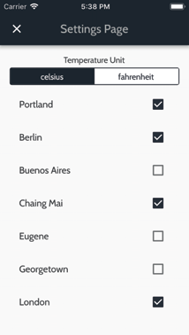
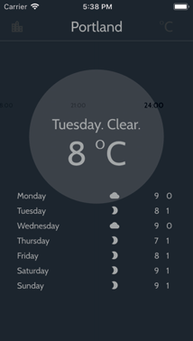
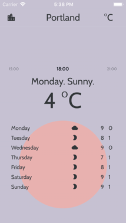
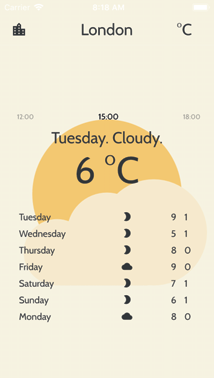

*Mô tả hình:* Bốn ảnh chụp màn hình của ứng dụng thời tiết:
1. **Settings Page** (Trang cài đặt): có nút "X" để đóng ở góc trái trên; mục "Temperature Unit" (Đơn vị nhiệt độ) với hai lựa chọn dạng nút bật/tắt `celsius` / `fahrenheit`; bên dưới là danh sách thành phố (Portland, Berlin, Buenos Aires, Chaing Mai, Eugene, Georgetown, London), mỗi thành phố có một ô đánh dấu (*checkbox*) để chọn hiển thị hay không.
2. **Portland ban đêm**: nền tối, thanh trên cùng có biểu tượng thành phố, tên "Portland" và nút "°C"; một dải giờ có thể vuốt ngang (…, 21:00, 24:00); ở giữa là hình mặt trăng (vòng tròn xám) với dòng chữ "Tuesday. Clear." (Thứ Ba. Trời quang.) và "8 °C"; bên dưới là bảng dự báo 7 ngày (Monday…Sunday) với biểu tượng thời tiết và nhiệt độ cao/thấp.
3. **Portland trời nắng**: nền tím nhạt, dải giờ 15:00 – 18:00 – 21:00, chữ "Monday. Sunny." và "4 °C", phía sau bảng dự báo có hình mặt trời màu hồng.
4. **London nhiều mây**: nền vàng kem, dải giờ 12:00 – 15:00 – 18:00, chữ "Tuesday. Cloudy." và "6 °C", có hình mặt trời vàng bị đám mây che.

Chương này được trình bày theo đúng thứ tự mà bạn nhiều khả năng sẽ viết code Flutter "ngoài đời thật". Hệ quả là một số widget được bàn đến đầu tiên, như `MaterialApp` và `Scaffold`, lại phức tạp hơn các widget được bàn về sau. Tôi khuyến khích bạn cố gắng đi hết chương, bởi vì ý tưởng đằng sau những widget phức tạp này sẽ trở nên rõ ràng khi bạn đã quen thuộc hơn với widget nói chung.

---

## 4.1 Thiết lập và cấu hình một ứng dụng Flutter (Setting up and configuring a Flutter app)

Trong mã nguồn đi kèm sách có thư mục `chapter_4_5_6`. Chương này bắt đầu từ đó.

> **TẢI MÃ NGUỒN (DOWNLOADING THE SOURCE CODE)**
> Mã nguồn của repository có thể được tải về như một phần của mã nguồn sách trên website của sách: www.manning.com/books/flutter-in-action.

**Listing 4.1 – Cấu trúc thư mục của ứng dụng thời tiết (Weather app file structure)**

```text
weather_app
├── README.md
├── lib
│   ├── controller
│   │   └── forecast_controller.dart
│   ├── main.dart
│   ├── models
│   │   └── // models...
│   ├── page
│   │   └── // pages...
│   ├── styles.dart
│   ├── utils
│   │   └── // many utils files...
│   └── widget
│       └── // all the custom widget's for this app
├── pubspec.lock
└── pubspec.yaml
```

Chú thích cho Listing 4.1:
- `controller/forecast_controller.dart`: **Controller** khởi tạo dữ liệu cho ứng dụng từ một repository (kho dữ liệu). Toàn bộ dữ liệu trong ứng dụng này đều là dữ liệu giả: nó được sinh ngẫu nhiên trong file `/utils/generate_weather_data`.
- `main.dart`: **Điểm vào** (*entry point*) của ứng dụng này.
- `styles.dart`: Ứng dụng này dùng rất nhiều màu. Tôi đã tạo một lớp `AppColors` để dễ tham chiếu tới các màu. Nó kế thừa (*extends*) lớp `Color` từ `dart:ui` – lớp mà Flutter dùng để định nghĩa màu. File này sẽ được đề cập trong chương này.
- `pubspec.yaml`: Chứa cấu hình đặc thù cho Flutter mà tôi chưa bàn đến.

Hãy bắt đầu với file `pubspec.yaml`.

### 4.1.1 Cấu hình: pubspec.yaml và main.dart (Configuration: pubspec.yaml and main.dart)

Mọi ứng dụng Dart đều cần một file `pubspec.yaml`, file này mô tả một số cấu hình cho ứng dụng. Dart có một **hệ thống build** (*build system*) để biên dịch ứng dụng của bạn, và điều đầu tiên nó làm khi bạn chạy ứng dụng là tìm file `pubspec.yaml`. Khi xây dựng một ứng dụng Flutter, có vài mục cấu hình cụ thể **bắt buộc phải có** trong `pubspec.yaml` thì ứng dụng mới chạy được.

**Listing 4.2 – Cấu hình pubspec.yaml cho ứng dụng thời tiết (pubspec.yaml configuration for the weather app)**

```yaml
# weather_app/pubspec.yaml
name: weather_app
description: Chapters 4-6, Flutter in Action by Eric Windmill
version: 1.0.0+1

environment:
  sdk: ">=2.0.0-dev.68.0 <3.0.0"

dependencies:
  flutter:
    sdk: flutter

flutter:
  uses-material-design: true   # (1)
  fonts:
    - family: Cabin            # (2)
      fonts:                   # (3)
        - asset: assets/fonts/Cabin-Regular.otf
        - asset: assets/fonts/Cabin-Bold.otf
# ...
```

Chú thích cho Listing 4.2:
1. Ứng dụng này dùng Material Design, và cờ (*flag*) `uses-material-design: true` báo cho Flutter biết cần đưa gói (*package*) material vào.
2. Khi nhập (*import*) một font chữ, hãy đặt cho nó một tên họ font (`family`) – tên này được dùng để tham chiếu tới font trong toàn bộ ứng dụng.
3. Liệt kê tất cả các biến thể font (*font variations*) bạn muốn dùng, giống như cách bạn đã liệt kê hình ảnh trong chương trước.

Ngoài việc khai báo tài nguyên (*assets*) và nhập thư viện (như đã bàn ở chương 3), đây là **toàn bộ thông tin** bạn cần cho file `pubspec.yaml` của Flutter.

Bên cạnh `pubspec.yaml`, ứng dụng của bạn **phải có một điểm vào**: một file chứa hàm `main`. Trong ứng dụng Flutter, theo quy ước, điểm vào là file có tên `main.dart`.

Hãy xem file `weather_app/main.dart`. Hàm `main()` chạy ứng dụng, giống như trong mọi chương trình Dart, nhưng nó cũng hữu ích để thiết lập một số cấu hình cho ứng dụng **trước khi** ứng dụng chạy, như listing sau đây cho thấy.

**Listing 4.3 – Hàm main của ứng dụng thời tiết (The weather app main function)**

```dart
void main() {
  // (1) Tạo một instance của AppSettings
  AppSettings settings = AppSettings();

  // Don't allow landscape mode
  // (2) Làm việc với lớp SystemChrome
  SystemChrome.setPreferredOrientations(
      [DeviceOrientation.portraitUp, DeviceOrientation.portraitDown])
      .then((_) => runApp(
            MyApp(settings: settings), // (3)
          ));
}
```

Chú thích cho Listing 4.3:
1. Tạo một instance (thể hiện/đối tượng) của `AppSettings`: một lớp tôi viết để **giả lập việc lưu trữ** (*persisting*) cài đặt của người dùng. Tôi sẽ giải thích chi tiết lớp này xuyên suốt chương.
2. Gọi tới lớp `SystemChrome` – đây là chủ đề của mục tiếp theo.
3. Bạn **bắt buộc** phải gọi `runApp` và truyền vào đó widget gốc (*root-level widget*) của bạn!

Hàm `main` của ứng dụng này **không cần làm gì khác ngoài việc gọi `runApp`**. Ứng dụng này tình cờ có một số cấu hình và thiết lập cần làm, nhưng nó được thêm vào chủ yếu để minh họa một điểm: hàm `main` của bạn bắt buộc phải gọi `runApp`, nhưng nó có thể thực thi bất cứ đoạn code nào bạn muốn, như mọi hàm Dart khác. Dưới đây là ví dụ hàm `main` tối giản nhất cho một ứng dụng Flutter:

```dart
main() => runApp(MyApp());
```

> 💡 **Ví dụ bổ sung (không có trong sách):** Một ứng dụng Flutter "nhỏ nhất có thể chạy được" chỉ cần `pubspec.yaml` có phần `dependencies: flutter: sdk: flutter` và một file `main.dart` như sau:
>
> ```dart
> import 'package:flutter/material.dart';
>
> void main() => runApp(MyApp());
>
> class MyApp extends StatelessWidget {
>   @override
>   Widget build(BuildContext context) {
>     return MaterialApp(
>       home: Scaffold(
>         body: Center(child: Text('Xin chào Flutter!')),
>       ),
>     );
>   }
> }
> ```
>
> Ở đây `main` chỉ làm đúng một việc là gọi `runApp`. Nếu bạn quên gọi `runApp`, chương trình Dart vẫn chạy xong hàm `main` nhưng màn hình sẽ trống trơn – vì Flutter không biết widget nào cần vẽ.

### 4.1.2 SystemChrome

`SystemChrome` là một lớp của Flutter cung cấp vài phương thức đơn giản để điều khiển cách ứng dụng của bạn hiển thị trên nền tảng gốc (*native platform* – tức Android hoặc iOS). Đây là một trong số rất ít lớp bạn sẽ dùng để tác động lên **chính thiết bị** (trừ khi bạn viết plugin, điều nằm ngoài phạm vi chương này).

Trong ứng dụng này, tôi dùng `SystemChrome.setPreferredOrientations` để giới hạn ứng dụng chỉ chạy ở **chế độ dọc** (*portrait mode*), như listing tiếp theo cho thấy. Lớp này cũng cung cấp các phương thức để điều khiển giao diện của các lớp phủ (*overlays*) của điện thoại. Ví dụ, nếu ứng dụng của bạn có tông màu sáng, bạn có thể đảm bảo rằng biểu tượng đồng hồ và pin trên thanh trạng thái (*status bar*) của điện thoại có màu tối (và ngược lại).

**Listing 4.4 – setPreferredOrientations trong ứng dụng thời tiết (setPreferredOrientations in the weather app)**

```dart
void main() {
  AppSettings settings = AppSettings();

  // Don't allow landscape mode
  SystemChrome.setPreferredOrientations([
    DeviceOrientation.portraitUp,
    DeviceOrientation.portraitDown,
  ])
      // (1) Dùng then(callback) để thực thi code bất đồng bộ khi Future hoàn tất.
      .then((_) => runApp(
            // (2) Đây cũng là điểm vào của ứng dụng.
            MyApp(settings: settings),
          ));
}
```

Chú thích cho Listing 4.4:
1. Dùng `then(callback)` để **thực thi code một cách bất đồng bộ** (*asynchronously*) khi một `Future` hoàn tất.
2. Đây cũng là điểm vào của ứng dụng. Việc truyền một widget vào `runApp` **luôn luôn** là điểm vào.

Lớp `SystemChrome` là thứ bạn **thiết lập một lần rồi quên đi**. Tôi giới thiệu nó với bạn ngay từ đầu để bạn biết là nó tồn tại, nhưng không cần dành quá nhiều thời gian cho nó. Nếu tò mò, bạn có thể tìm hiểu thêm tại: https://api.flutter.dev/flutter/services/SystemChrome-class.html.

> 💡 **Ví dụ bổ sung (không có trong sách):** Ứng dụng có nền sáng muốn biểu tượng trên thanh trạng thái màu tối có thể gọi:
>
> ```dart
> import 'package:flutter/services.dart';
>
> void main() {
>   SystemChrome.setSystemUIOverlayStyle(SystemUiOverlayStyle.dark);
>   runApp(MyApp());
> }
> ```
>
> `SystemUiOverlayStyle.dark` nghĩa là "biểu tượng màu tối" (dùng cho nền sáng); `SystemUiOverlayStyle.light` thì ngược lại. Lưu ý: ở các phiên bản Flutter mới, nếu bạn gọi các phương thức của `SystemChrome` trước `runApp`, bạn nên gọi `WidgetsFlutterBinding.ensureInitialized();` ở dòng đầu của `main`.

Trước khi đi tiếp, tôi cần giải thích hàm `then` được dùng trong listing 4.4. Lập trình bất đồng bộ (*asynchronous programming*) trong Dart có hẳn một chương riêng, nhưng nếu bạn chưa quen, dưới đây là phần giới thiệu nhanh.

> **Vừa đúng lúc: Future trong Dart (Just in time: Dart futures)**
>
> Toàn bộ chương 9 dành cho Dart bất đồng bộ, nhưng bạn sẽ không đi được xa trong Dart nếu không thấy vài phương thức async ở chỗ này chỗ kia. **Future** là lớp nền tảng của mọi hoạt động lập trình bất đồng bộ trong Dart.
>
> Một future rất giống việc nhận **tờ hóa đơn (biên nhận)** ở một tiệm burger phục vụ nhanh. Bạn – người gọi burger – nói với nhân viên rằng bạn muốn một chiếc burger. Người phục vụ ở tiệm nói: "Được rồi, đây là biên nhận của bạn. Tờ biên nhận này đảm bảo rằng vào một lúc nào đó trong tương lai, tôi sẽ đưa cho bạn một chiếc burger ngay khi nó sẵn sàng."
>
> Thế là bạn đợi cho đến khi nhân viên gọi số của bạn, và lúc đó họ thực hiện lời đảm bảo bằng một chiếc burger. **Tờ biên nhận chính là future.** Nó là sự đảm bảo rằng một giá trị sẽ tồn tại, nhưng giá trị đó chưa sẵn sàng ngay.
>
> Future có thể "then" được (*thenable* – tức "có thể gọi `.then`"), vì vậy khi bạn gọi một future, bạn luôn có thể viết:
>
> ```dart
> myFutureMethod().then((returnValue) => ... do some code ... );
> ```
>
> `Future.then` nhận vào một **callback** (hàm gọi lại), hàm này sẽ được thực thi khi giá trị của future được giải quyết (*resolves*). Ở tiệm burger, callback chính là việc bạn quyết định làm gì với chiếc burger khi nhận được nó (chẳng hạn như ăn nó). Giá trị truyền vào callback là giá trị trả về của future ban đầu:
>
> ```dart
> Future<Burger> orderBurgerFromServer() async {
>   // prepareBurger tốn thời gian (để nướng burger). Khi xong thì trả nó về.
>   return await prepareBurger();
> }
>
> orderBurgerFromServer()
>     // Callback — (Burger burger) => eatBurger(burger); — sẽ được truyền giá trị trả về
>     // của orderBurgerFromServer (không còn bọc trong future) khi future xử lý xong.
>     .then((Burger burger) => eatBurger(burger));
> ```
>
> Phương thức `orderBurgerFromServer` trả về kiểu `Future` với kiểu con (*subtype*) là `Burger` (trong chương trình, nó trông như `Future<Burger>`). Như vậy, `orderBurgerFromServer` sẽ xử lý, **rồi sau đó** callback sẽ được gọi với giá trị trả về được truyền vào làm đối số.
>
> Lập trình bất đồng bộ là một chủ đề lớn. Đây chỉ là phần giới thiệu; đừng quá sa lầy vào nó.

> 💡 **Ví dụ bổ sung (không có trong sách):** Bạn có thể chạy thử đoạn Dart thuần sau (ví dụ trên DartPad) để "cảm nhận" thứ tự thực thi:
>
> ```dart
> Future<String> orderBurger() {
>   return Future.delayed(Duration(seconds: 2), () => '🍔');
> }
>
> void main() {
>   print('1. Gọi món');
>   orderBurger().then((burger) => print('3. Nhận được $burger, ăn thôi!'));
>   print('2. Cầm biên nhận, ngồi chờ...');
> }
> ```
>
> Kết quả in ra theo thứ tự `1 → 2 → 3`: dòng 2 chạy ngay, không đợi burger; dòng 3 chỉ chạy sau 2 giây khi Future hoàn tất. Đó chính là lý do trong `main` của ứng dụng thời tiết, `runApp` được đặt **bên trong** `.then(...)`: ứng dụng chỉ khởi chạy sau khi việc khóa hướng màn hình đã xong.

Phần cấu hình ứng dụng đến đây là hết. Trong phần còn lại của chương, tôi sẽ nói về widget, bắt đầu với widget cấp cao nhất: `MyApp` trong file `weather_app/main.dart`.

---

## 4.2 Các widget cấu trúc và cấu hình thêm (Structural widgets and more configuration)

Có một vài widget tiện lợi (*convenience widgets*) mà nhiều khả năng bạn sẽ dùng trong **mọi** ứng dụng Flutter bạn xây dựng. Chúng cung cấp cấu hình và cấu trúc cho ứng dụng của bạn mà bạn chỉ phải bỏ ra rất ít công sức. Trong mục này, tôi sẽ giải thích widget `MaterialApp`, `Scaffold`, `AppBar` và `Theme`.

### 4.2.1 Widget MaterialApp (MaterialApp widget)

Widget `MaterialApp` mang lại rất nhiều lợi ích, có tác động lên **toàn bộ cây widget con** (*widget subtree*) bên dưới nó. Mục này là khởi đầu cho cuộc thảo luận về nhiều widget cung cấp chức năng hữu ích "miễn phí".

`MaterialApp` là một phần mở rộng của widget cấp cao nhất dạng tổng quát mà Flutter cung cấp: `WidgetsApp`. `WidgetsApp` là một widget tiện lợi giúp trừu tượng hóa (*abstracts away* – che đi phần phức tạp) một số tính năng mà hầu hết ứng dụng di động cần, chẳng hạn như thiết lập bộ điều hướng (*navigator*) và sử dụng một theme áp dụng cho toàn ứng dụng (*app-wide theme*). `WidgetsApp` hoàn toàn có thể tùy biến và **không giả định gì** về cấu hình mặc định, kiểu dáng, hay cách giao diện ứng dụng của bạn được cấu trúc. Vì vậy, dù nó che đi một số phần chức năng khó trong ứng dụng, nó lại **đòi hỏi nhiều công thiết lập hơn** so với `MaterialApp` hoặc `CupertinoApp`. Trong cuốn sách này, tôi sẽ không bận tâm về `WidgetsApp`, vì nó là lớp cơ sở (*base class*) cho hai lớp kia và hiếm khi được lập trình viên dùng trực tiếp.

`MaterialApp` còn tiện lợi hơn cả `WidgetsApp`. Nó bổ sung các chức năng và tùy chọn tạo kiểu đặc thù của Material Design vào ứng dụng của bạn. Nó không chỉ *giúp* thiết lập `Navigator` – nó **làm luôn việc đó cho bạn**. Nếu bạn dùng widget Material app, bạn không phải lo việc cài đặt các hoạt ảnh xảy ra khi người dùng chuyển giữa các trang: widget này lo phần đó cho bạn. Nó cũng cho phép bạn dùng các widget nằm riêng trong bộ sưu tập widget Material, và có rất nhiều widget như vậy.

Nó được gọi là Material app vì nó dựa vào các nguyên tắc thiết kế Material (*Material style guidelines*).¹ Ví dụ, hoạt ảnh chuyển trang từ route (tuyến/màn hình) này sang route khác được thiết kế đúng như bạn mong đợi trên một thiết bị Android. Và tất cả widget trong thư viện widget Material đều có "dáng vẻ" tiêu chuẩn của Google. Điều này có thể là một mối lo nếu bạn có một hệ thống thiết kế (*design system*) riêng không giống Material, nhưng **không có bất lợi nào khi dùng `MaterialApp`**, kể cả khi bạn không muốn dùng các nguyên tắc Material Design. Theme của bạn vẫn hoàn toàn tùy biến được. (Thực tế, ứng dụng ví dụ bạn sẽ xây dựng trông chẳng "Material" chút nào. Đó là cố ý, để nhấn mạnh điểm này.) Bạn có thể ghi đè hoạt ảnh điều hướng, và bạn không bắt buộc phải dùng các widget trong thư viện Material. Widget `MaterialApp` cung cấp khá nhiều sự tiện lợi, nhưng **mọi thứ đều có thể đảo ngược**.

> ¹ Xem đặc tả Material Design tại https://material.io/design.

Trong ứng dụng thời tiết, widget `MaterialApp` được dùng trong phương thức `build` của widget `MyApp`. Đây là quy ước được dùng trong mọi ứng dụng Flutter. Dưới đây là code trong file `main.dart` của ứng dụng, cho thấy lại hàm `main` cũng như widget gốc.

**Listing 4.5 – Widget cấp cao nhất trong main.dart (The top-level widget in main.dart)**

```dart
// weather_app/lib/main.dart
void main() {                                     // (1)
  AppSettings settings = AppSettings();

  // Don't allow landscape mode
  SystemChrome.setPreferredOrientations(
      [DeviceOrientation.portraitUp, DeviceOrientation.portraitDown])
      .then((_) => runApp(
            MyApp(settings: settings),            // (2)
          ));
}

class MyApp extends StatelessWidget {             // (3)
  final AppSettings settings;

  const MyApp({Key key, this.settings}) : super(key: key);

  @override
  Widget build(BuildContext context) {
    // ...
    return MaterialApp(                           // (4)
      title: 'Weather App',
      debugShowCheckedModeBanner: false,
      theme: theme,
      home: PageContainer(settings: settings),
    );
  }
}
```

Chú thích cho Listing 4.5:
1. Điểm vào của ứng dụng.
2. `runApp` được truyền vào `MyApp` – gốc (*root*) của ứng dụng Flutter của bạn.
3. `MyApp` chỉ là một widget, giống như mọi thứ khác.
4. Phương thức `build` của `MyApp` trả về một `MaterialApp` làm ứng dụng cấp cao nhất.

Một lần nữa, đây là cách làm tiêu chuẩn trong các ứng dụng Flutter. Widget cấp cao nhất của bạn là widget **do bạn tự viết**; trong trường hợp này là `MyApp`. Widget đó quay sang dùng `MaterialApp` trong phương thức `build` của nó. Điều này thực chất biến `MaterialApp` thành gốc của ứng dụng. Nhìn lại phương thức `build` đó, hãy nói về các đối số được truyền vào `MaterialApp`.

**Listing 4.6 – Phương thức build của widget MyApp (The build method of the MyApp widget)**

```dart
//
@override
Widget build(BuildContext context) {
  // ...
  return MaterialApp(                        // (1)
    title: 'Weather App',
    debugShowCheckedModeBanner: false,       // (2)
    theme: theme,                            // (3)
    home: PageContainer(settings: settings), // (4)
  );
}
```

Chú thích cho Listing 4.6:
1. Trả về một `MaterialApp`.
2. Cờ này tắt dải băng (*banner*) "DEBUG" hiển thị khi bạn đang phát triển ứng dụng và chạy nó trên máy cục bộ. Tôi tắt nó đi để ảnh chụp màn hình trong sách trông gọn gàng hơn.
3. `MaterialApp` đảm nhận theme cho toàn ứng dụng (sẽ được đề cập ngay sau đây).
4. `home` đại diện cho trang chủ của ứng dụng, có thể là **bất kỳ widget nào**. `PageContainer` là một widget được viết riêng cho ứng dụng thời tiết (sẽ đề cập sau).

> 📝 **Giải thích thêm (không có trong sách):** `MaterialApp` có thể ví như "hộp điện tổng" của ngôi nhà: nó cung cấp cho tất cả widget con những dịch vụ chung – `Navigator` (chuyển trang), `Theme` (màu sắc, font), `MediaQuery` (thông tin màn hình), localization (ngôn ngữ)… Vì các widget con lấy những dịch vụ này qua `BuildContext` (ví dụ `Theme.of(context)`), nên nếu bạn quên bọc ứng dụng trong `MaterialApp` (hoặc `WidgetsApp`/`CupertinoApp`), các widget Material như `Scaffold` hay `TextField` thường sẽ báo lỗi kiểu "No MaterialLocalizations found" hoặc "No MediaQuery widget found".

### 4.2.2 Widget Scaffold (The Scaffold widget)

Giống như widget `MaterialApp`, `Scaffold` là một widget tiện lợi được thiết kế để việc xây dựng ứng dụng (tuân theo các nguyên tắc Material) trở nên dễ dàng nhất có thể. Widget `MaterialApp` cung cấp **cấu hình và chức năng** cho ứng dụng. `Scaffold` là widget mang lại **cấu trúc** cho ứng dụng của bạn. Bạn có thể hình dung `MaterialApp` như hệ thống ống nước và điện của ngôi nhà, còn `Scaffold` là phần móng và tường.

Giống như `MaterialApp`, `Scaffold` (hình 4.2) cung cấp những chức năng mà nếu không có nó bạn sẽ phải tự viết. Một lần nữa, ngay cả khi bạn có phong cách thiết kế rất riêng, hoàn toàn không phải Material, bạn vẫn sẽ muốn dùng `Scaffold`. Theo tài liệu Flutter, `Scaffold` định nghĩa "bố cục trực quan Material Design cơ bản" (*basic Material Design visual layout*), nghĩa là nó có thể khiến ứng dụng của bạn trông giống thế này khá dễ dàng.

**Hình 4.2 – Sơ đồ các thuộc tính quan trọng nhất của widget Scaffold (Diagram of the most important Scaffold widget properties)**

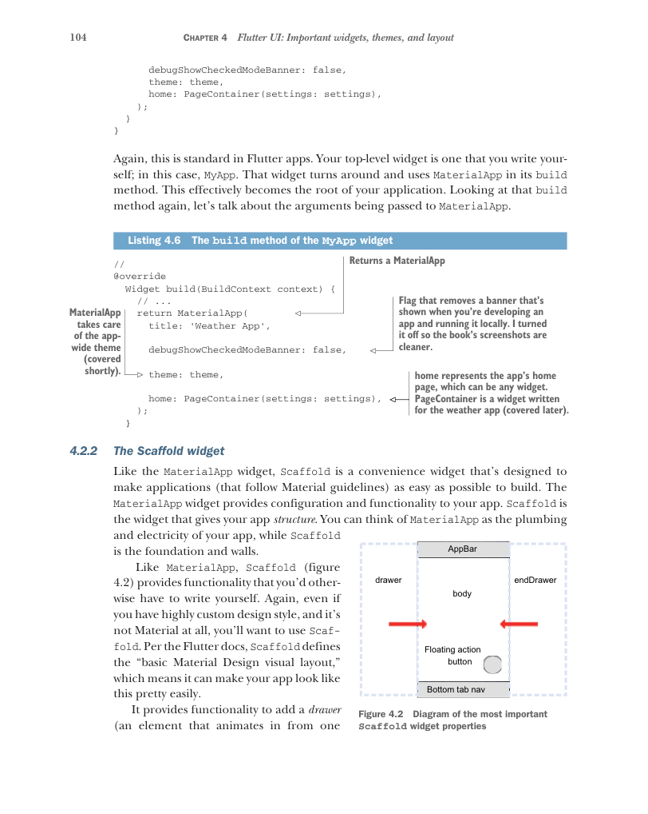

```text
 - - - - - - - - - - - - - - - - - - - - - - - - - - - - - -
|                 ┌────────────────────┐                     |
|                 │       AppBar       │                     |
|   drawer        ├────────────────────┤        endDrawer    |
|                 │        body        │                     |
|    ───────►     │                    │      ◄───────       |
|                 │  Floating action   │                     |
|                 │  button        ( ) │                     |
|                 ├────────────────────┤                     |
|                 │   Bottom tab nav   │                     |
|                 └────────────────────┘                     |
 - - - - - - - - - - - - - - - - - - - - - - - - - - - - - -
```

*Mô tả hình:* Màn hình điện thoại ở giữa gồm: **AppBar** (thanh ứng dụng) ở trên cùng; **body** (phần thân, nội dung chính) ở giữa; **Floating action button** (nút hành động nổi – nút tròn) ở góc dưới phải; **Bottom tab nav** (thanh điều hướng dạng tab ở đáy) ở dưới cùng. Hai bên ngoài màn hình là **drawer** (ngăn kéo, trượt vào từ bên trái – mũi tên đỏ chỉ sang phải) và **endDrawer** (ngăn kéo phía cuối, trượt vào từ bên phải – mũi tên đỏ chỉ sang trái).

`Scaffold` cung cấp chức năng để thêm một **drawer** (ngăn kéo – một phần tử trượt vào bằng hoạt ảnh từ một bên màn hình, thường được dùng cho menu) và một **bottom sheet** (tấm trượt đáy – một phần tử trượt vào tầm nhìn từ đáy màn hình, phổ biến trong các ứng dụng phong cách iOS). Trừ khi bạn cấu hình khác đi, `AppBar` trong một scaffold sẽ **tự động** được thiết lập để hiển thị một nút menu ở góc trên bên trái ứng dụng, nút này sẽ mở drawer; khi bạn không ở màn hình có menu, nút menu sẽ biến thành nút quay lại (*back button*). Những nút này đã được "đấu dây" sẵn và hoạt động đúng như mong đợi.

Tuy nhiên, điều quan trọng là bạn có thể **chọn lấy tính năng nào bạn muốn và bỏ tính năng nào bạn không muốn**. Nếu ứng dụng của bạn không có menu kiểu drawer, bạn chỉ cần không truyền drawer vào, và những nút menu tự động kia sẽ biến mất.

Widget `Scaffold` cung cấp nhiều tính năng tùy chọn, tất cả đều được cấu hình thông qua hàm khởi tạo (*constructor*). Dưới đây là phương thức khởi tạo của lớp `Scaffold`.

**Listing 4.7 – Danh sách thuộc tính đầy đủ của Scaffold (Scaffold full property list)**

```dart
// From Flutter source code. Scaffold constructor.
const Scaffold({
  Key key,
  this.appBar,
  this.body,
  this.floatingActionButton,
  this.floatingActionButtonLocation,
  this.floatingActionButtonAnimator,
  this.persistentFooterButtons,
  this.drawer,
  this.endDrawer,
  this.bottomNavigationBar,
  this.bottomSheet,
  this.backgroundColor,
  this.resizeToAvoidBottomPadding = true,
  this.primary = true,
}) : assert(primary != null), super(key: key);
```

Tôi muốn cho bạn xem đoạn này để bạn thấy rằng **không thuộc tính nào trong số này được đánh dấu `@required`** (bắt buộc). Bạn có thể dùng `AppBar`, nhưng không bắt buộc. Điều tương tự đúng với drawer, thanh điều hướng (*navigation bar*), v.v. Với ứng dụng này, tôi chỉ dùng `AppBar`. Một lần nữa, điểm mấu chốt là: ngay cả khi bạn xây dựng một ứng dụng mà bạn không muốn trông "Material", widget `Scaffold` vẫn rất có giá trị và tôi khuyên bạn nên dùng nó.

Trong ứng dụng thời tiết, bạn có thể thấy scaffold trong widget `ForecastPage`.² Việc **mỗi màn hình** khác nhau trong ứng dụng có `Scaffold` riêng là điều phổ biến.

> ² `ForecastPage` nằm trong file `weather_app/lib/page/forecast_page.dart`.

Phần tôi muốn chỉ ra ngay bây giờ nằm ở cuối file: câu lệnh `return` của phương thức `ForecastPageState.build`. Tôi chỉ muốn cho bạn thấy rằng `Scaffold` chỉ là một widget, và giống như nhiều widget khác, hầu hết các đối số của nó đều là tùy chọn, khiến nó có khả năng tùy biến rất cao:

```dart
// weather_app/lib/page/forecast_page.dart
return Scaffold(
  appBar: PreferredSize(...), // (1)
  body: GestureDetector(...), // (2)
```

Chú thích:
1. Bạn có thể truyền một widget vào đối số `appBar`, và widget đó sẽ được đặt ở phía trên cùng của màn hình ứng dụng. (`AppBar` và `PreferredSize` sẽ được đề cập trong mục tiếp theo.)
2. `body` là một đối số của `Scaffold` đại diện cho phần chính của màn hình. Nếu không có app bar, `body` về cơ bản chiếm toàn bộ màn hình.

Hãy nhớ lại hàm khởi tạo của `Scaffold`: nó có hơn 10 đối số có tên (*named arguments*). Ở đây, tôi chỉ dùng hai. Điểm mấu chốt là những widget này cho bạn rất nhiều thứ nhưng vẫn rất dễ tùy biến. Trong mục tiếp theo, tôi sẽ đưa ra các ví dụ cụ thể về cách scaffold được dùng trong ứng dụng thời tiết.

> 💡 **Ví dụ bổ sung (không có trong sách):** Một màn hình dùng nhiều "khe cắm" của `Scaffold` cùng lúc:
>
> ```dart
> Scaffold(
>   appBar: AppBar(title: Text('Hộp thư')),
>   drawer: Drawer(
>     child: ListView(children: [
>       ListTile(title: Text('Thư đến')),
>       ListTile(title: Text('Đã gửi')),
>     ]),
>   ),
>   body: Center(child: Text('Không có thư mới')),
>   floatingActionButton: FloatingActionButton(
>     onPressed: () {},
>     child: Icon(Icons.edit),
>   ),
>   bottomNavigationBar: BottomNavigationBar(items: [
>     BottomNavigationBarItem(icon: Icon(Icons.mail), label: 'Thư'),
>     BottomNavigationBarItem(icon: Icon(Icons.person), label: 'Danh bạ'),
>   ]),
> );
> ```
>
> Chỉ bằng việc truyền `drawer`, `AppBar` tự hiện nút "hamburger" (☰) ở góc trái; bấm vào là drawer trượt ra – bạn không phải viết dòng code xử lý nào. Nếu xóa dòng `drawer:`, nút ☰ cũng tự biến mất. (Ở Flutter cũ, `BottomNavigationBarItem` dùng `title: Text(...)` thay cho `label:`.)

### 4.2.3 Widget AppBar (AppBar widget)

Widget `AppBar` là một widget tiện lợi nữa, cho bạn thêm nhiều tính năng dùng ngay (*out of the box*). `AppBar` thường được dùng trong thuộc tính `Scaffold.appBar`, thuộc tính này cố định nó ở phía trên cùng màn hình với một chiều cao nhất định.

Tính năng đáng chú ý nhất của `AppBar` là nó cung cấp **tính năng điều hướng miễn phí**. Nó tự động chèn một nút menu nếu cha (*parent*) của app bar là một scaffold và đối số `drawer` không phải `null`. Và nếu `Navigator` của ứng dụng phát hiện bạn đang ở một trang có thể điều hướng "quay lại" (giống nút back của trình duyệt), nó tự động chèn một nút quay lại.

Trong widget `AppBar` (hình 4.3), có nhiều tham số nhận **widget** làm đối số. Các đối số này tương ứng với những vị trí cụ thể bên trong app bar.

**Hình 4.3 – Các thuộc tính quan trọng nhất của widget AppBar (Most important properties of the AppBar widget)**

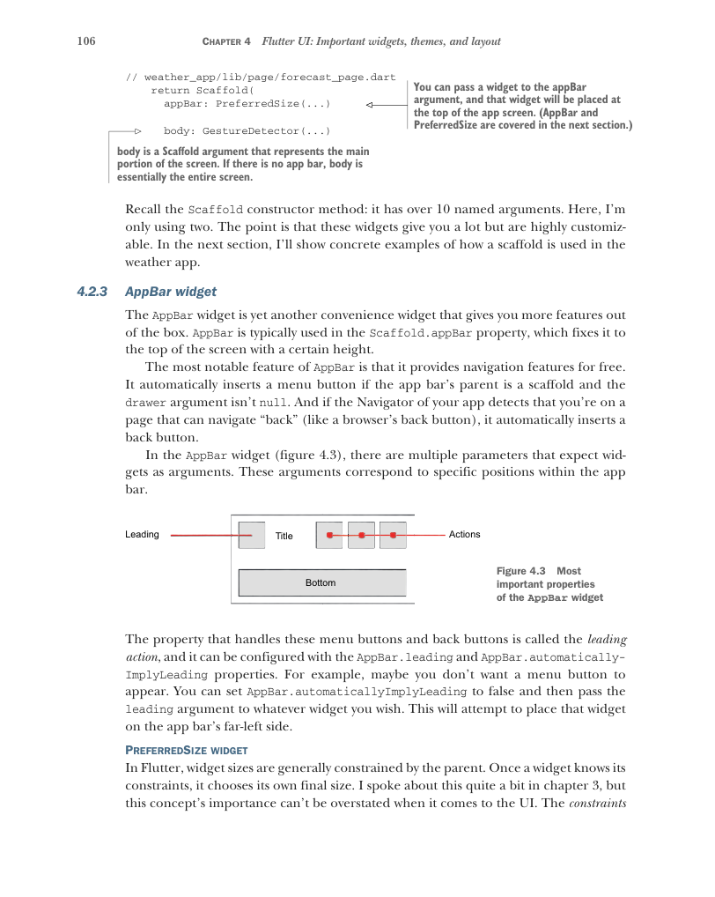

*(Hai ảnh trích tự động từ trang này chỉ là hai ô khung trống – mảnh của sơ đồ vector – được nhúng lại cho đầy đủ:)*

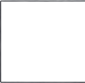
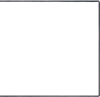

```text
            ┌───────────────────────────────────────────────┐
Leading ────┼─►[  ]   Title        [ ● ] [ ● ] [ ● ]◄────────┼──── Actions
            │                                               │
            │  ┌─────────────────────────────────────────┐  │
            │  │                 Bottom                  │  │
            │  └─────────────────────────────────────────┘  │
            └───────────────────────────────────────────────┘
```

*Mô tả hình:* Sơ đồ một app bar gồm: **Leading** (phần dẫn đầu – ô ở mép trái, nơi đặt nút menu/nút back); **Title** (tiêu đề) ngay sau leading; **Actions** (các hành động – một dãy nút ở bên phải); và **Bottom** (phần đáy – một dải nằm ở phía dưới app bar, thường dùng cho `TabBar`).

Thuộc tính xử lý các nút menu và nút back này được gọi là **hành động dẫn đầu** (*leading action*), và nó có thể được cấu hình qua các thuộc tính `AppBar.leading` và `AppBar.automaticallyImplyLeading`. Ví dụ, có thể bạn không muốn nút menu xuất hiện. Bạn có thể đặt `AppBar.automaticallyImplyLeading` thành `false` rồi truyền vào đối số `leading` bất kỳ widget nào bạn muốn. Flutter sẽ cố gắng đặt widget đó ở phía ngoài cùng bên trái của app bar.

> 💡 **Ví dụ bổ sung (không có trong sách):**
>
> ```dart
> AppBar(
>   automaticallyImplyLeading: false,           // không tự chèn nút menu/back
>   leading: Icon(Icons.wb_sunny),              // tự đặt một icon ở mép trái
>   title: Text('Thời tiết'),
>   actions: [
>     IconButton(icon: Icon(Icons.search), onPressed: () {}),
>     IconButton(icon: Icon(Icons.settings), onPressed: () {}),
>   ],
>   bottom: TabBar(tabs: [Tab(text: 'Hôm nay'), Tab(text: '7 ngày')]),
> )
> ```
>
> Mỗi đối số khớp với một vị trí trong hình 4.3: `leading` (trái), `title` (giữa-trái), `actions` (phải), `bottom` (dải dưới). Lưu ý: dùng `TabBar` trong `bottom` cần có một `TabController` – thường bằng cách bọc `Scaffold` trong `DefaultTabController(length: 2, child: ...)`; chủ đề này sẽ được bàn ở mục 4.4.3.

#### Widget PreferredSize (PreferredSize widget)

Trong Flutter, kích thước widget nói chung bị **ràng buộc bởi widget cha**. Khi một widget biết các ràng buộc (*constraints*) của mình, nó tự chọn kích thước cuối cùng. Tôi đã nói về điều này khá nhiều trong chương 3, nhưng tầm quan trọng của khái niệm này với UI thì không bao giờ là nói quá. **Các ràng buộc** mà widget cha truyền xuống cho widget cho biết widget đó *có thể to đến mức nào*, nhưng chúng không quan tâm đến kích thước cuối cùng của nó. Ưu điểm của hệ thống này (so với HTML chẳng hạn, nơi các phần tử tự kiểm soát ràng buộc của chính mình) là **sự linh hoạt**. Nó cho phép Flutter đưa ra những quyết định thông minh về việc widget của bạn nên trông như thế nào và gỡ bớt gánh nặng đó khỏi vai lập trình viên.

Tuy vậy, trong một số trường hợp, sự linh hoạt lại không được mong muốn. Bạn có thể muốn đặt kích thước **tường minh** cho widget. Một ví dụ điển hình là `AppBar`.

Lớp `AppBar` kế thừa một widget gọi là `PreferredSize` (kích thước ưu tiên), widget này cho phép bạn định nghĩa chiều cao và chiều rộng tường minh. Flutter sẽ cố hết sức để đảm bảo app bar có đúng kích thước đó khi màn hình được vẽ. Theo kinh nghiệm của tôi, widget này không được dùng phổ biến, nhưng nó là ví dụ cho một bài học quý giá.

Thuộc tính `Scaffold.appBar` mong đợi một widget **thuộc lớp `PreferredSize`**, vì nó muốn biết kích thước của app bar *trước khi* thiết lập các ràng buộc. Trong ứng dụng này, tôi dùng trực tiếp `PreferredSize`, thay vì dùng một app bar trong đối số `Scaffold.appBar`. Ứng dụng thực tế của điều này là: bạn có thể bọc **bất kỳ widget nào** trong một `PreferredSize` và dùng nó thay cho widget `AppBar` đặc thù của Material. Bài học ở đây, một lần nữa, là các widget Flutter mặc định đã rất đầy đủ, đồng thời vẫn tùy biến được. (Cũng có một ứng dụng thực tế khác, tôi sẽ đề cập ở chương 6.)

**Listing 4.8 – Dùng PreferredSize trong một scaffold (Using PreferredSize in a scaffold)**

```dart
// weather_app/lib/page/forecast_page.dart -- line ~217
return Scaffold(
  appBar: PreferredSize(            // (1)
    preferredSize: Size.fromHeight( // (2)
      ui.appBarHeight(context),
    ),
    child: TransitionAppbar( ... )  // (3)
  ),
);
```

Chú thích cho Listing 4.8:
1. Dùng `PreferredSize` để có thể đặt **bất kỳ widget nào** vào thuộc tính `Scaffold.appBar`. `AppBar` kế thừa `PreferredSize`, và `Scaffold.appBar` mong đợi một `PreferredSize`, chứ không nhất thiết phải là một `AppBar`.
2. Đối số thứ nhất của `PreferredSize`: `preferredSize`, nhận một đối tượng lớp `Size` định nghĩa chiều cao và chiều rộng.
3. Đối số thứ hai của `PreferredSize`: `child` (widget con). Trong trường hợp này là một widget tên `TransitionAppBar` (xem chương 6) – một `AppBar` có các hoạt ảnh tùy biến được viết thêm vào.

Giờ đã nói về `PreferredSize` ở mức tổng quan, hãy xem ứng dụng thời tiết để có ví dụ cụ thể. Mục đích của việc dùng `PreferredSize` trong ứng dụng này là vì widget `AppBar` có sẵn **không cung cấp cách tạo hoạt ảnh đổi màu** theo mặc định. Nếu bạn đã thử nghịch ứng dụng, có thể bạn đã nhận thấy màu sắc thay đổi khi thời điểm trong ngày thay đổi. Điều này đòi hỏi phải tạo một widget tùy biến, `TransitionAppBar`, sẽ được "mổ xẻ" ở chương 6; điều quan trọng cần lưu ý ở đây là tôi đã bọc nó trong một `PreferredSize`, nhờ đó `Scaffold` chấp nhận nó trong đối số `appBar`.

> **Import có đặt tên trong Dart (Named imports in Dart)**
>
> Có thể bạn đã để ý trong các ví dụ trước rằng tôi gọi `ui.appBarHeight`, nhưng `ui` dường như không phải là một lớp. `ui` tham chiếu tới file tiện ích (*utils*) được import kèm một cái tên:
>
> ```dart
> import 'package:weather_app/utils/flutter_ui_utils.dart' as ui;
> ```
>
> Cái tên này buộc bạn phải thêm tiền tố `ui.` trước bất kỳ lớp, phương thức hay biến nào trong thư viện đó.

> 💡 **Ví dụ bổ sung (không có trong sách):** Bọc một `Container` có màu gradient thành app bar tùy biến:
>
> ```dart
> Scaffold(
>   appBar: PreferredSize(
>     preferredSize: Size.fromHeight(80.0),
>     child: Container(
>       decoration: BoxDecoration(
>         gradient: LinearGradient(colors: [Colors.indigo, Colors.purple]),
>       ),
>       alignment: Alignment.bottomCenter,
>       padding: EdgeInsets.only(bottom: 12),
>       child: Text('App bar tự chế', style: TextStyle(color: Colors.white, fontSize: 20)),
>     ),
>   ),
>   body: ...,
> )
> ```
>
> Nếu bạn truyền thẳng `Container(...)` vào `appBar:` mà không bọc `PreferredSize`, Dart sẽ báo lỗi kiểu: `Container` không phải là `PreferredSizeWidget` – đúng như sách giải thích, `Scaffold` cần biết trước chiều cao mong muốn của app bar.

---

## 4.3 Tạo kiểu và theme trong Flutter (Styling and themes in Flutter)

Tạo kiểu cho ứng dụng trong Flutter có thể đơn giản hơn bạn nghĩ. Nếu bạn chăm chỉ thiết lập một **theme** (bộ chủ đề giao diện) ngay khi bắt đầu ứng dụng Flutter, bạn sẽ không phải làm nhiều để giữ cho ứng dụng trông nhất quán. Widget `Theme` cho phép bạn đặt nhiều kiểu mặc định trong ứng dụng, như màu sắc, kiểu chữ, kiểu nút bấm, v.v. Trong mục này, chúng ta sẽ xem cách dùng `Theme`, cũng như những phần quan trọng khác của việc tạo kiểu trong Flutter: media query, font chữ, hoạt ảnh và lớp `Color` của Flutter.

### 4.3.1 Widget Theme (Theme widget)

Widget `Theme` cho phép bạn khai báo các kiểu mà trong một số trường hợp sẽ được **tự động áp dụng** trên toàn ứng dụng. Trong những trường hợp kiểu của bạn không được áp dụng hoặc cần ghi đè, widget `Theme` có thể được truy cập ở **bất kỳ đâu** trong cây widget.

Để bạn hình dung có bao nhiêu kiểu liên quan đến màu sắc mà theme có thể điều khiển, dưới đây là một số (không phải tất cả) thuộc tính bạn có thể đặt trên widget này, chúng sẽ "thấm" khắp ứng dụng. Các thuộc tính sau ảnh hưởng tới **tất cả** widget trong ứng dụng:

- `brightness` (độ sáng – đặt theme tối hay sáng)
- `primarySwatch` (dải màu chính)
- `primaryColor` (màu chính)
- `accentColor` (màu nhấn)

Còn đây là một số thuộc tính điều khiển những tính năng cụ thể:

- `canvasColor` (màu nền "vải vẽ")
- `scaffoldBackgroundColor` (màu nền của scaffold)
- `dividerColor` (màu đường kẻ phân cách)
- `cardColor` (màu thẻ card)
- `buttonColor` (màu nút bấm)
- `errorColor` (màu báo lỗi)

Đó chỉ là 6 trong khoảng 20 thuộc tính dành riêng cho màu sắc. Nhưng còn gần 20 đối số khác bạn có thể truyền vào `Theme` để đặt mặc định cho font chữ, hoạt ảnh chuyển trang, kiểu biểu tượng (*icon*), và nhiều thứ khác. Một số đối số trong đó lại nhận vào các lớp, mà bản thân các lớp ấy cũng có thuộc tính riêng, mở ra khả năng tùy biến còn nhiều hơn nữa cho ứng dụng của bạn. Điểm mấu chốt là widget `Theme` rất mạnh mẽ và có thể gánh phần lớn công việc nặng nhọc thay bạn khi nói đến tạo kiểu.

Dù mức độ tùy biến theme như vậy là tốt, việc phải nghĩ về từng thuộc tính một có thể khiến bạn choáng ngợp. Nhưng Flutter đã tính đến điều đó. Nếu bạn dùng widget `MaterialApp` ở gốc ứng dụng, **mọi thuộc tính đều có giá trị mặc định**, và bạn có thể chỉ chọn ghi đè những thuộc tính mình quan tâm. Ví dụ, `Theme.primaryColor` ảnh hưởng tới gần như mọi widget trong ứng dụng: nó đổi màu tất cả widget sang màu thương hiệu của bạn. Ở ứng dụng mà tôi đang xây dựng tại công ty hiện tại, chúng tôi có một ứng dụng trông hoàn toàn đúng nhận diện thương hiệu (và không hề "Material"), và chúng tôi chỉ đặt **tám thuộc tính** trên theme.

Nói cách khác, bạn có thể can thiệp chi tiết đến từng li hoặc để mặc tùy thích. Tôi đã nói nhiều lần, nhưng một trong những khía cạnh của Flutter mà bạn nên tận dụng là nó làm rất nhiều thứ cho bạn, cho đến khi bạn quyết định mình cần kiểm soát nhiều hơn. Hãy xem cách bạn có thể triển khai một theme trong ứng dụng Flutter.

#### Sử dụng theme trong ứng dụng (Using themes in your app)

Lớp bạn dùng để cấu hình một theme có tên là `ThemeData`. Để thêm theme cho ứng dụng, bạn truyền một đối tượng `ThemeData` vào thuộc tính `MaterialApp.theme`. Bạn cũng có thể tự tạo widget `Theme` của riêng mình và truyền cho nó một đối tượng `ThemeData`. `Theme` chỉ là một widget, nghĩa là bạn có thể dùng nó **ở bất cứ đâu** bạn có thể dùng một widget!

Các thuộc tính theme mà một widget bất kỳ sử dụng được **kế thừa từ widget `Theme` gần nhất phía trên nó** trong cây. Trên thực tế, điều này có nghĩa là bạn có thể tạo nhiều widget `Theme` ở khắp ứng dụng, và chúng sẽ ghi đè theme cấp cao nhất cho mọi thứ trong cây con (*subtree*) đó. Hãy xem một ví dụ dùng `ThemeData` trong thực tế.

**Listing 4.9 – ThemeData trong ứng dụng thời tiết (ThemeData in the weather app)**

```dart
// weather_app/lib/main.dart
final theme = ThemeData(
  fontFamily: "Cabin",                    // (1)
  primaryColor: AppColor.midnightSky,     // (2)
  accentColor: AppColor.midnightCloud,
  primaryTextTheme:
      Theme.of(context).textTheme.apply(  // (3)
            bodyColor: AppColor.textColorDark,
            displayColor: AppColor.textColorDark,
          ),
  textTheme: Theme.of(context).textTheme.apply(
        bodyColor: AppColor.textColorDark,
        displayColor: AppColor.textColorDark,
      ),
);
```

Chú thích cho Listing 4.9:
1. Báo cho Flutter dùng font chữ mà bạn đã khai báo với nó trong file `pubspec.yaml`.
2. `AppColor` là một lớp tôi tạo ra vì ứng dụng này dùng gần như toàn màu tùy biến. Bạn có thể tìm lớp này trong `styles.dart`.
3. Phương thức `apply` của các lớp theme **sao chép theme hiện tại** nhưng thay đổi những thuộc tính bạn truyền vào.

Trường hợp còn lại mà bạn sẽ dùng `ThemeData` là khi bạn muốn đặt một thuộc tính kiểu một cách tường minh. Ví dụ, bạn có thể muốn đặt nền của một container là `accentColor` của theme. Ở bất cứ đâu trong ứng dụng, bạn đều có thể lấy được dữ liệu theme đó, nhờ vào `BuildContext`.

Ở phần trước của sách, tôi đã đề cập rằng `BuildContext` cung cấp thông tin về vị trí của một widget trong cây widget. Điều này bao gồm thông tin về một số widget nằm cao hơn trong cây, trong đó có `Theme`. Nếu bạn muốn biết `accentColor` của theme đối với một widget bất kỳ, bạn có thể nói: "Này `BuildContext`, màu nhấn được gán cho `ThemeData` gần nhất phía trên widget này trong cây là màu gì?" Trong mục tiếp theo, tôi sẽ giải thích câu đó kỹ hơn và làm nó bớt trừu tượng.

> 💡 **Ví dụ bổ sung (không có trong sách):** Theme lồng nhau và đọc theme qua `BuildContext`:
>
> ```dart
> MaterialApp(
>   theme: ThemeData(primaryColor: Colors.blue),       // theme toàn ứng dụng
>   home: Scaffold(
>     body: Column(children: [
>       Builder(builder: (context) => Container(
>         height: 50,
>         color: Theme.of(context).primaryColor,         // → xanh dương
>       )),
>       Theme(
>         data: Theme.of(context).copyWith(primaryColor: Colors.red), // ghi đè cho cây con
>         child: Builder(builder: (context) => Container(
>           height: 50,
>           color: Theme.of(context).primaryColor,       // → đỏ
>         )),
>       ),
>     ]),
>   ),
> );
> ```
>
> Ô thứ nhất "hỏi" theme gần nhất phía trên → gặp theme của `MaterialApp` (xanh). Ô thứ hai gặp widget `Theme` lồng bên trong trước → nhận màu đỏ. `Builder` được dùng để có một `BuildContext` *nằm dưới* `Theme` cần tra cứu. (Lưu ý: ở các phiên bản Flutter mới, `accentColor` đã bị thay bằng `colorScheme.secondary`.)

### 4.3.2 MediaQuery và phương thức of (MediaQuery and the of method)

Nếu bạn xuất thân từ phát triển web giống tôi, ban đầu bạn có thể thấy việc viết style trong Flutter khá cồng kềnh – đặc biệt là khoảng cách (*spacing*) và bố cục. Trên web, bạn dùng CSS; và trong CSS có rất nhiều **đơn vị đo** khác nhau mà bạn có thể dùng ở bất cứ chỗ nào liên quan đến kích thước. Ngoài pixel tiêu chuẩn, còn có các đơn vị đo dựa trên **tỷ lệ phần trăm** không gian mà phần tử có thể chiếm, cũng như đơn vị đo dựa trên kích thước của **khung nhìn** (*viewport*).

Trong Flutter, chỉ có **một đơn vị đo duy nhất: pixel logic** (*logical pixel*). Hệ quả là phần lớn các bài toán bố cục và kích thước được giải quyết bằng **toán học**, và phần lớn phép toán đó dựa trên kích thước màn hình. Ví dụ, bạn có thể muốn một widget rộng bằng một phần ba chiều rộng màn hình. Vì không có đơn vị phần trăm, bạn phải lấy kích thước màn hình bằng code thông qua widget `MediaQuery`.

`MediaQuery` là một widget tương tự `Theme` ở chỗ bạn có thể dùng `BuildContext` để truy cập nó ở bất cứ đâu trong ứng dụng. Việc này được thực hiện qua một phương thức của lớp `MediaQuery` tên là `of`. Phương thức `of` **tìm ngược lên cây**, tìm lớp `MediaQuery` gần nhất, và đưa cho bạn tham chiếu tới instance `MediaQuery` đó ở bất cứ đâu trong ứng dụng. Một vài widget có sẵn trong Flutter cung cấp phương thức `of`.

> **GHI CHÚ (NOTE):** Ở phần sau của sách, bạn sẽ thấy cách tạo những widget có phương thức `of` của riêng chúng, và cách truy cập state của các widget đó ở bất cứ đâu trong cây. Lúc này, điều duy nhất quan trọng là một số widget có sẵn có thể được truy cập ở bất cứ đâu trong ứng dụng.

Như đã nói, lớp `MediaQuery` rất tuyệt để lấy thông tin kích thước của **toàn bộ màn hình** mà ứng dụng được vẽ lên. Bạn truy cập thông tin đó bằng cách gọi phương thức tĩnh `MediaQuery.of(context).size`, phương thức này trả về một đối tượng `Size` chứa chiều rộng và chiều cao của thiết bị. Hãy để tôi phân tích kỹ hơn một chút.

Vì đây là **phương thức tĩnh** (*static method*), bạn gọi `of` trực tiếp trên lớp `MediaQuery`, chứ không phải trên một instance của lớp. Ngoài ra, phương thức `of` chỉ có thể cung cấp lớp `MediaQuery` nếu nó biết `BuildContext` nơi `of` được gọi. Đó là lý do bạn truyền vào `context`. Cuối cùng, `size` là một **getter** của lớp `MediaQuery`, đại diện cho chiều rộng và chiều cao của thiết bị.

Khi đã lấy được thông tin, bạn có thể dùng nó để xác định kích thước của một widget dựa trên kích thước màn hình. Ví dụ, để lấy 80% chiều rộng điện thoại, bạn có thể viết:

```dart
final width = MediaQuery.of(context).size.width * 0.8;
```

Một lần nữa, build context của một widget cho Flutter một tham chiếu tới vị trí của widget đó trong cây. Vì vậy, phương thức `of` – thứ luôn nhận một `context`, bất kể nó được định nghĩa trên đối tượng nào – về cơ bản nói rằng: "Này Flutter, cho tôi tham chiếu tới widget **gần nhất thuộc kiểu này** trong cây, ở phía trên tôi."

`MediaQuery` là nơi đầu tiên bạn nên tìm đến nếu muốn lấy thông tin cụ thể về **thiết bị vật lý** mà ứng dụng đang chạy, hoặc nếu bạn muốn tác động lên thiết bị. Bạn có thể dùng nó để:

- Hỏi xem điện thoại hiện đang ở hướng dọc (*portrait*) hay ngang (*landscape*)
- Tắt hoạt ảnh và đảo màu vì lý do trợ năng (*accessibility*)
- Hỏi điện thoại xem người dùng có phóng to hệ số cỡ chữ (*text-size factor*) không
- Đặt phần đệm (*padding*) cho toàn bộ ứng dụng

Trong ứng dụng thời tiết, tôi dùng `MediaQuery` để đảm bảo các widget được co giãn đúng kích thước dựa trên kích thước màn hình. Hãy xem một ví dụ.

> 💡 **Ví dụ bổ sung (không có trong sách):** Một vài cách dùng `MediaQuery` thường gặp:
>
> ```dart
> Widget build(BuildContext context) {
>   final mq = MediaQuery.of(context);
>   final isLandscape = mq.orientation == Orientation.landscape; // hướng màn hình
>   final textScale = mq.textScaleFactor;      // người dùng có phóng to chữ không
>   final topInset = mq.padding.top;           // chiều cao "tai thỏ"/status bar
>   return Container(
>     width: mq.size.width / 3,                // rộng 1/3 màn hình
>     margin: EdgeInsets.only(top: topInset),
>     child: Text(isLandscape ? 'Ngang' : 'Dọc'),
>   );
> }
> ```
>
> Bài toán: màn hình rộng 390 pixel logic → `width / 3` = 130 pixel logic. Trên một máy có mật độ điểm ảnh 3x, 130 pixel logic tương ứng 390 pixel vật lý; nhờ đơn vị logic, widget trông "to như nhau" trên các máy có mật độ khác nhau.

### 4.3.3 Phương thức ScreenAwareSize (ScreenAwareSize method)

Hãy nhớ lại đoạn code này trong scaffold của `ForecastPage`:

```dart
// weather_app/lib/page/forecast_page.dart -- line ~217
return Scaffold(
  appBar: PreferredSize(
    preferredSize: Size.fromHeight(ui.appBarHeight(context)),
    child: ...
  ),
),
```

Phương thức `Size.fromHeight` là một hàm khởi tạo của lớp `Size`, tạo một đối tượng `Size` với chiều cao cho trước và **chiều rộng vô hạn**. Còn lại là phương thức `ui.appBarHeight`.

Trong file `weather_app/lib/utils/flutter_ui_utils.dart`, bạn sẽ thấy code định nghĩa hàm `ui.appBarHeight(context)` từ đoạn code trước, như listing sau đây cho thấy.

**Listing 4.10 – Các phương thức tính kích thước theo màn hình (Screen-aware sizing methods)**

```dart
// weather_app/lib/utils/flutter_ui_utils.dart
final double kToolbarHeight = 56.0;                    // (1)

double appBarHeight(BuildContext context) {            // (2)
  return screenAwareSize(kToolbarHeight, context);
}

const double kBaseHeight = 1200.0;

double screenAwareSize(double size, BuildContext context) {
  double drawingHeight = MediaQuery.of(context).size.height   // (3)
      - MediaQuery.of(context).padding.top;
  return size * drawingHeight / kBaseHeight;
}
```

Chú thích cho Listing 4.10:
1. 56.0 là chiều cao mặc định của widget `AppBar` (sao chép từ mã nguồn Flutter).
2. Truyền `context` vào phương thức để tôi có thể dùng `context` lấy thông tin `MediaQuery`.
3. Phần lớn chức năng nằm ở dòng này. Tôi dùng `context` để lấy thông tin về ứng dụng và kích thước màn hình.

`MediaQuery.of(context).size` trả về một kích thước đại diện cho kích thước màn hình. `MediaQuery.of(context).padding` trả về một `Padding` cho biết chi tiết phần đệm của chính ứng dụng; tức là phần đệm giữa mép màn hình thiết bị và widget cấp cao nhất.

Mục đích của các phương thức này là cung cấp kích thước chính xác cho widget `PreferredSize` (và để thấy lớp `MediaQuery` hoạt động thực tế). Các phương thức này **ánh xạ chiều cao** của app bar trong ứng dụng thời tiết thành kích thước phù hợp trên một màn hình bất kỳ. Tức là, nếu màn hình "trung bình" cao 1.200 pixel, và trên màn hình đó app bar cao 56 pixel, thì các hàm này cho ra chiều cao tương đương của app bar trên một màn hình có kích thước bất kỳ.

> **GHI CHÚ (NOTE):** Widget `AppBar` có sẵn rất thông minh, nhưng chúng ta cần một widget tùy biến vì sau này ta sẽ thêm kiểu dáng và hoạt ảnh tùy biến cho nó.

> 💡 **Ví dụ bổ sung (không có trong sách) – tính tay `screenAwareSize`:**
> Giả sử màn hình cao 812 pixel logic, `padding.top` (vùng status bar/tai thỏ) = 44.
> - `drawingHeight` = 812 − 44 = 768
> - `appBarHeight` = 56 × 768 / 1200 = **35,84** pixel logic
>
> Trên một máy tính bảng cao 1366 và `padding.top` = 24: `drawingHeight` = 1342 → app bar = 56 × 1342 / 1200 ≈ **62,6**. Như vậy app bar luôn chiếm cùng một **tỷ lệ** (56/1200 ≈ 4,67%) chiều cao vùng vẽ, dù màn hình to hay nhỏ.

Một lần nữa, hàm này được dùng ở `ForecastPageState.Scaffold`:

```dart
// weather_app/lib/page/forecast_page.dart -- line ~217
return Scaffold(
  appBar: PreferredSize(
    preferredSize: Size.fromHeight(ui.appBarHeight(context)),
    child: ...
  ),
),
```

Đoạn code này cho scaffold (cha của preferred size) biết app bar **muốn** to đến mức nào. Cụ thể, nó bảo Flutter dùng một chiều cao để tạo một instance `Size` phù hợp với mọi màn hình.

Phải thừa nhận ví dụ này khá đặc thù. Phương thức `appBarHeight` chỉ hữu ích cho app bar. Phương thức `screenAwareSize` thì có thể tái sử dụng. Dù sao đi nữa, mục đích là để giới thiệu widget `MediaQuery`, thứ mà bạn nhiều khả năng sẽ dùng khá thường xuyên khi làm việc với tạo kiểu và bố cục.

Tạm thời, đó là tất cả về lớp `MediaQuery`. Chúng ta sẽ nói thêm về `MediaQuery` khi bắt đầu dùng widget `Canvas` ở phần sau của sách.

---

## 4.4 Các widget bố cục và giao diện phổ biến (Common layout and UI widgets)

Đây là mục lớn **cuối cùng** trong toàn bộ cuốn sách dành riêng cho từng widget bố cục cơ bản và các widget đại diện cho phần tử UI hữu hình. Tất nhiên, trong Flutter mọi thứ đều là widget, nên chúng ta sẽ không bao giờ ngừng nói về widget; nhưng sau mục này, chúng ta sẽ bàn về những widget phức tạp **làm việc gì đó** (*do stuff*) thay vì chỉ **hiển thị thứ gì đó** (*show stuff*). Cụ thể, trong mục này tôi đề cập `Stack`, `Table` và `TabBar`: ba widget có sẵn dùng để định nghĩa bố cục.

### 4.4.1 Widget Stack (Stack widget)

`Stack` đúng như tên gọi của nó ("chồng", "xếp chồng"). Nó được dùng để xếp các widget thành lớp (hoặc chồng chúng) **lên trên nhau** (hình 4.4). API của nó có thể được dùng để bảo Flutter chính xác vị trí đặt widget so với đường biên của stack trên màn hình. (Nếu bạn đến từ thế giới phát triển web, cái này rất giống `position: fixed` trong CSS.) Trong trường hợp này, tôi sẽ dùng nó để làm một nền "xịn" phản ánh thời điểm trong ngày và thời tiết hiện tại bằng hình ảnh. Màu của mặt trời sẽ được tạo hoạt ảnh để đổi màu khi thời điểm trong ngày thay đổi, và nó cũng sẽ hiển thị mây và tình trạng thời tiết nếu thời tiết hiện tại như vậy.

**Hình 4.4 – Nền của ứng dụng thời tiết (The background of the weather app)**

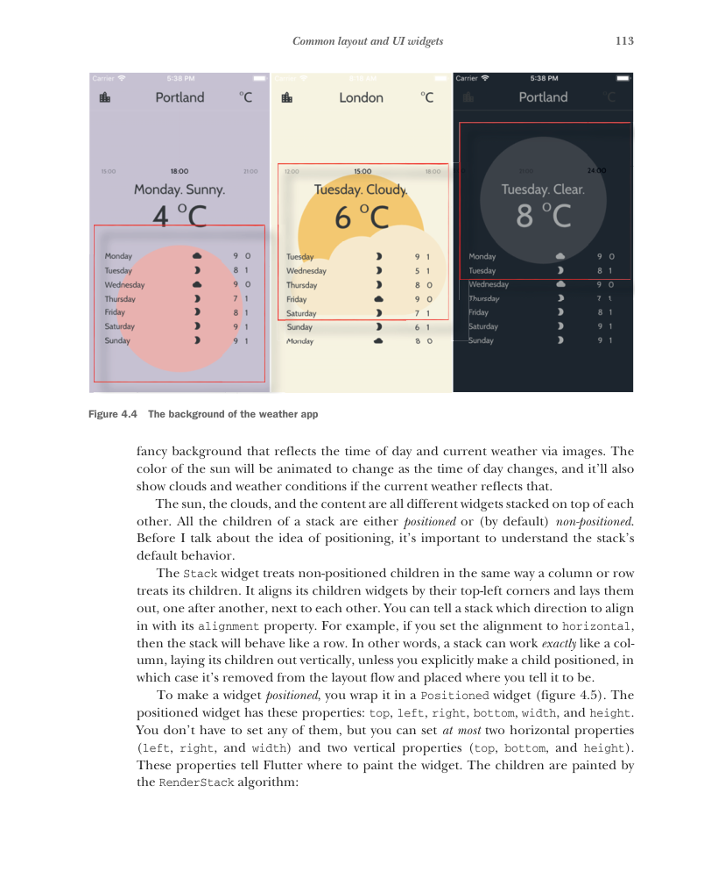

Các mảnh ảnh được trích từ hình 4.4:

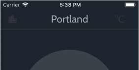
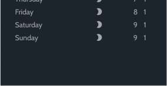
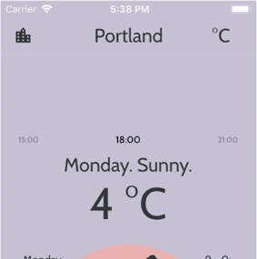
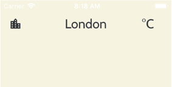
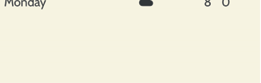
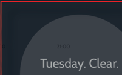
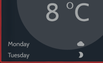
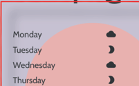
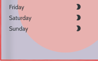
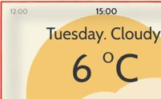
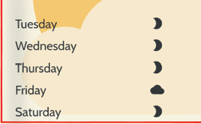

*Mô tả hình:* Ba màn hình của ứng dụng thời tiết đặt cạnh nhau: (1) Portland – "Monday. Sunny. 4 °C" trên nền tím nhạt, có hình mặt trời màu hồng; (2) London – "Tuesday. Cloudy. 6 °C" trên nền vàng kem, mặt trời vàng bị mây che; (3) Portland ban đêm – "Tuesday. Clear. 8 °C" trên nền tối, mặt trăng xám. Các khung viền đỏ khoanh vùng hình nền (mặt trời / mây / mặt trăng) – đó là những lớp widget nằm **phía sau** nội dung chữ, được xếp chồng nhờ `Stack`.

Mặt trời, mây và nội dung đều là các widget khác nhau được chồng lên nhau. Mọi con của một stack đều thuộc một trong hai loại: **được định vị** (*positioned*) hoặc (theo mặc định) **không được định vị** (*non-positioned*). Trước khi nói về khái niệm định vị, điều quan trọng là hiểu hành vi mặc định của stack.

Widget `Stack` đối xử với các con không được định vị **giống như cách một column hoặc row đối xử với con của nó**. Nó căn các widget con theo góc trên bên trái của chúng và bố trí chúng lần lượt, cái này cạnh cái kia. Bạn có thể bảo stack căn theo hướng nào bằng thuộc tính `alignment`. Ví dụ, nếu bạn đặt alignment thành `horizontal`, stack sẽ hành xử như một row. Nói cách khác, một stack có thể hoạt động **y hệt** một column, xếp các con theo chiều dọc, trừ khi bạn chủ động biến một con thành positioned – khi đó nó bị **tách khỏi luồng bố cục** và được đặt đúng chỗ bạn bảo.

Để biến một widget thành *positioned*, bạn bọc nó trong một widget `Positioned` (hình 4.5). Widget positioned có các thuộc tính: `top`, `left`, `right`, `bottom`, `width` và `height`. Bạn không bắt buộc phải đặt thuộc tính nào, nhưng bạn chỉ có thể đặt **tối đa** hai thuộc tính theo chiều ngang (`left`, `right` và `width`) và hai thuộc tính theo chiều dọc (`top`, `bottom` và `height`). Các thuộc tính này cho Flutter biết vẽ widget ở đâu. Các con được vẽ theo thuật toán `RenderStack`:

1. Nó bố trí tất cả các con **không được định vị** giống như một row hoặc column. Việc này cho stack biết kích thước cuối cùng của nó. Nếu không có con nào không được định vị, stack sẽ cố gắng to nhất có thể.
2. Nó bố trí tất cả các con **được định vị** tương đối với hộp vẽ (*render box*) của stack, dùng các thuộc tính `top`, `left`, v.v. Các thuộc tính định vị cho Flutter biết đặt con của stack ở đâu so với cạnh tương ứng. Ví dụ, `top: 10.0` sẽ đặt widget positioned lùi vào 10.0 pixel tính từ cạnh trên của hộp stack.
3. Khi mọi thứ đã được bố trí xong, Flutter vẽ các widget **theo thứ tự**, con đầu tiên nằm ở "đáy" của chồng.

**Hình 4.5 – Một ví dụ về cách sử dụng Positioned (An example of using Positioned)**

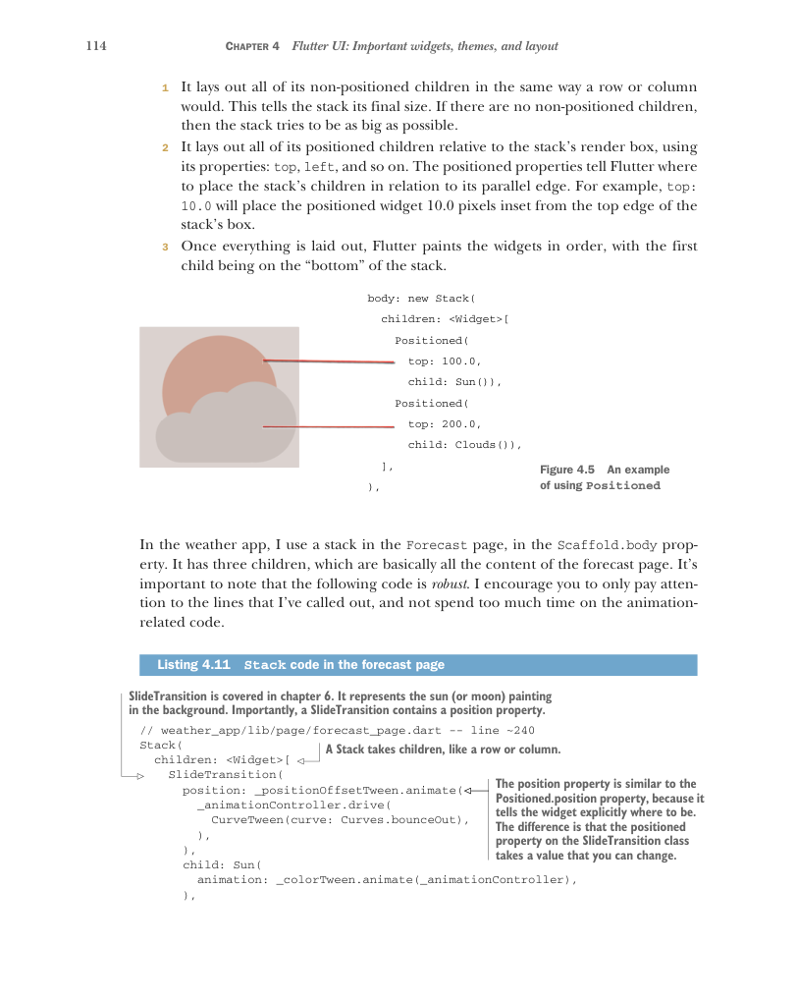

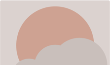

```dart
body: new Stack(
  children: <Widget>[
    Positioned(
      top: 100.0,
      child: Sun()),
    Positioned(
      top: 200.0,
      child: Clouds()),
  ],
),
```

*Mô tả hình:* Bên trái là hình mặt trời tròn màu hồng cam và đám mây xám nằm đè lên nửa dưới của mặt trời. Bên phải là đoạn code `Stack` với hai con `Positioned`: con thứ nhất (`Sun()`) có `top: 100.0` (đường kẻ đỏ nối vào hình mặt trời), con thứ hai (`Clouds()`) có `top: 200.0` (đường kẻ đỏ nối vào đám mây). Vì `Clouds()` đứng sau `Sun()` trong danh sách `children`, đám mây được vẽ đè lên trên mặt trời.

Trong ứng dụng thời tiết, tôi dùng một stack ở trang `Forecast`, trong thuộc tính `Scaffold.body`. Nó có ba widget con, về cơ bản là toàn bộ nội dung của trang dự báo. Cần lưu ý rằng đoạn code sau đây khá đầy đủ và phức tạp (*robust*). Tôi khuyến khích bạn chỉ chú ý tới những dòng được tôi chú thích, và đừng tốn quá nhiều thời gian vào phần code liên quan đến hoạt ảnh (*animation*).

**Listing 4.11 – Code Stack trong trang dự báo (Stack code in the forecast page)**

```dart
// weather_app/lib/page/forecast_page.dart -- line ~240
Stack(                                                           // (1)
  children: <Widget>[
    SlideTransition(                                             // (2)
      position: _positionOffsetTween.animate(                    // (3)
        _animationController.drive(
          CurveTween(curve: Curves.bounceOut),
        ),
      ),
      child: Sun(
        animation: _colorTween.animate(_animationController),
      ),
    ),
    SlideTransition(
      position: _cloudPositionOffsetTween.animate(
        _weatherConditionAnimationController.drive(
          CurveTween(curve: Curves.bounceOut),
        ),
      ),
      child: Clouds(
        isRaining: isRaining,
        animation: _cloudColorTween.animate(_animationController),
      ),
    ),
    Column(
      verticalDirection: VerticalDirection.up,
      children: <Widget>[
        forecastContent,
        mainContent,
        Flexible(child: timePickerRow),
      ],
    ),
  ],
),
```

Chú thích cho Listing 4.11:
1. `Stack` nhận `children` (danh sách các widget con), giống như một `Row` hoặc `Column`.
2. `SlideTransition` sẽ được trình bày ở chương 6. Nó đại diện cho hình vẽ mặt trời (hoặc mặt trăng) ở phần nền. Điều quan trọng là một `SlideTransition` có chứa thuộc tính `position`.
3. Thuộc tính `position` tương tự như thuộc tính định vị của `Positioned`, vì nó bảo rõ cho widget biết phải nằm ở đâu. Điểm khác biệt là thuộc tính `position` trên lớp `SlideTransition` nhận một giá trị mà bạn có thể **thay đổi theo thời gian** (để tạo hoạt ảnh dịch chuyển).

Để làm ví dụ minh họa, đây là hình thù của ứng dụng nếu nó **không có hoạt ảnh**. (Đây mới là bài học chính của phần này trong chương. Tôi chỉ cho bạn xem đoạn code trước để bạn không bị bối rối khi đọc mã nguồn thực tế.)

**Listing 4.12 – Ví dụ về code Stack không có hoạt ảnh (Example of non-animated Stack code)**

```dart
Stack(
  children: <Widget>[
    Positioned(
      left: 100.0,
      top: 100.0,
      child: Sun(...),
    ),
    Positioned(                              // (1)
      left: 110.0,
      top: 110.0,
      child: Clouds(...),
    ),
    Column(                                  // (2)
      children: <Widget>[
        forecastContent,
        mainContent,
        Flexible(child: timePickerRow),
      ]
    ),
  ],
),
```

Chú thích cho Listing 4.12:
1. Đám mây (`Clouds`) là widget con thứ hai trong stack, nên nó nằm đè lên mặt trời (`Sun`).
2. `Column` đại diện cho toàn bộ nội dung nằm ở **lớp trên cùng** (*topmost layer*) của stack.

`Stack` là widget "ruột" (*go-to widget*) của bạn nếu bạn muốn đặt các widget chồng lên nhau hoặc định vị chúng một cách tường minh trong mối tương quan với nhau.

> 💡 **Ví dụ bổ sung (không có trong sách):** Một trường hợp cực kỳ phổ biến của `Stack` + `Positioned` trong ứng dụng thực tế là gắn **huy hiệu số thông báo** (*badge*) ở góc trên bên phải của một biểu tượng, hoặc đặt nhãn giảm giá đè lên ảnh sản phẩm:
>
> ```dart
> Stack(
>   children: <Widget>[
>     // Con không định vị: quyết định kích thước của Stack (64x64)
>     Container(
>       width: 64,
>       height: 64,
>       decoration: BoxDecoration(
>         color: Colors.blueGrey.shade100,
>         borderRadius: BorderRadius.circular(12),
>       ),
>       child: Icon(Icons.shopping_cart, size: 32),
>     ),
>     // Con được định vị: nằm ở góc trên-phải (cách top 4px, right 4px)
>     Positioned(
>       top: 4,
>       right: 4,
>       child: CircleAvatar(
>         radius: 10,
>         backgroundColor: Colors.red,
>         child: Text('3', style: TextStyle(fontSize: 12, color: Colors.white)),
>       ),
>     ),
>   ],
> )
> ```
>
> Nhờ quy tắc vẽ theo thứ tự trong `children`, `Container` (giỏ hàng) được vẽ trước ở lớp dưới, còn `Positioned` (vòng tròn đỏ có số `3`) được vẽ sau nên nổi lên trên góc phải.

### 4.4.2 Widget Table (Table widget)

Widget đa-con tĩnh (*static multi-child widget*) cuối cùng mà tôi muốn giới thiệu với bạn là `Table` – widget sử dụng thuật toán bố cục dạng bảng để tạo ra một bảng gồm các widget (hình 4.6). Cùng với `Stack`, `Row` và `Column`, `Table` là một trong những viên gạch xây dựng cốt lõi của bố cục (tạm thời chưa xét đến các widget cuộn được). Trong ứng dụng thời tiết, bạn sẽ dùng một `Table` để bố trí dữ liệu thời tiết các ngày trong tuần ở nửa dưới màn hình.

**Hình 4.6 – Ảnh chụp màn hình cho thấy widget Table trong ngữ cảnh ứng dụng thời tiết (Screenshot showing the Table widget in the context of the weather app)**

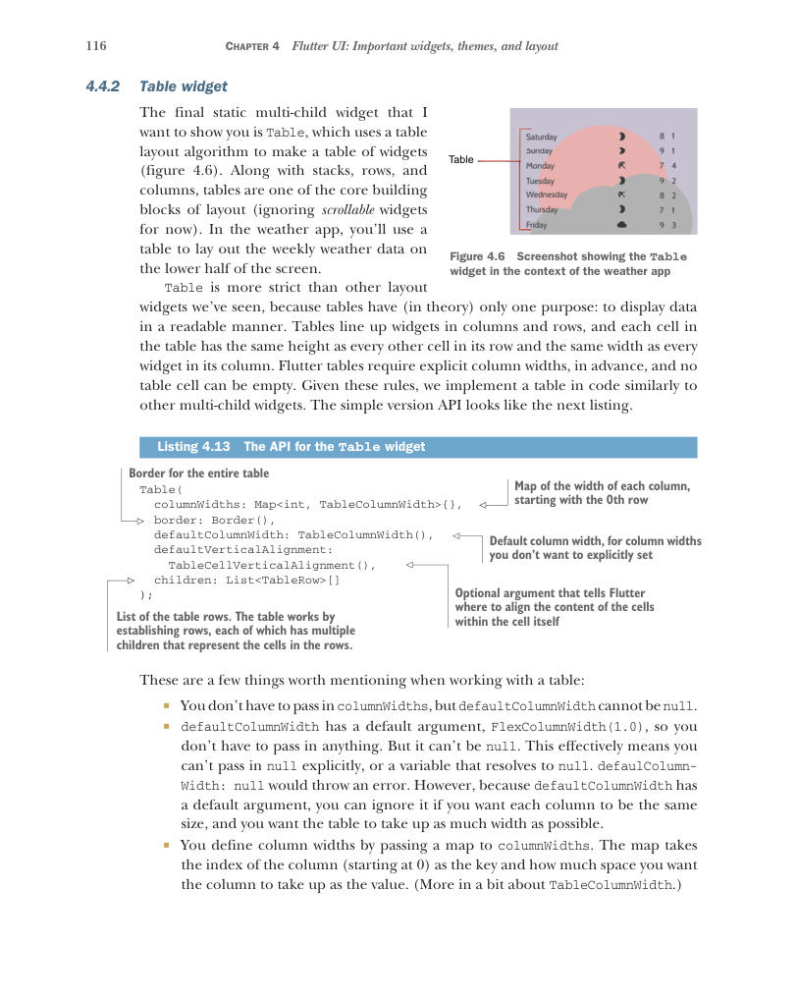

*Mô tả hình:* Khung khoanh đỏ có nhãn "Table" chỉ vào bảng dự báo 7 ngày (Saturday, Sunday, Monday, Tuesday, Wednesday, Thursday, Friday) nằm đè trên nền mặt trời và đám mây. Mỗi hàng gồm 4 cột thẳng hàng: tên thứ trong tuần, biểu tượng thời tiết (trăng/mây/mưa), nhiệt độ cao nhất (8, 9, 7, 9, 8, 7, 9) và nhiệt độ thấp nhất (1, 1, 4, 2, 2, 1, 3).

`Table` nghiêm ngặt (*strict*) hơn các widget bố cục khác mà chúng ta đã thấy, bởi vì về lý thuyết bảng chỉ có một mục đích duy nhất: hiển thị dữ liệu sao cho dễ đọc. Bảng xếp thẳng hàng các widget theo cột và hàng; mỗi ô (*cell*) trong bảng có **cùng chiều cao** với mọi ô khác trong cùng hàng và **cùng chiều rộng** với mọi widget trong cùng cột. Bảng trong Flutter yêu cầu phải biết trước chiều rộng cột một cách tường minh, và **không có ô nào trong bảng được phép để trống**. Với những quy tắc đó, chúng ta triển khai một bảng trong code tương tự như các widget đa-con khác. Phiên bản đơn giản của API trông như listing tiếp theo.

**Listing 4.13 – API của widget Table (The API for the Table widget)**

```dart
Table(
  columnWidths: Map<int, TableColumnWidth>{},              // (1)
  border: Border(),                                        // (2)
  defaultColumnWidth: TableColumnWidth(),                  // (3)
  defaultVerticalAlignment:
      TableCellVerticalAlignment(),                        // (4)
  children: List<TableRow>[]                               // (5)
);
```

Chú thích cho Listing 4.13:
1. `columnWidths`: Một `Map` quy định chiều rộng của từng cột, bắt đầu từ cột thứ 0.
2. `border`: Đường viền cho toàn bộ bảng.
3. `defaultColumnWidth`: Chiều rộng cột mặc định, áp dụng cho những cột mà bạn không muốn đặt chiều rộng tường minh.
4. `defaultVerticalAlignment`: Đối số tùy chọn cho Flutter biết căn chỉnh nội dung của các ô ở vị trí nào bên trong chính ô đó (theo chiều dọc).
5. `children`: Danh sách các hàng của bảng (`List<TableRow>`). Bảng hoạt động bằng cách thiết lập các hàng, mỗi hàng lại có nhiều widget con đại diện cho các ô trong hàng đó.

Có vài điều đáng lưu ý khi làm việc với một `Table`:

- Bạn không bắt buộc phải truyền `columnWidths`, nhưng `defaultColumnWidth` **không được phép là `null`**.
- `defaultColumnWidth` có đối số mặc định là `FlexColumnWidth(1.0)`, nên bạn không cần truyền gì cả. Nhưng nó không thể là `null`. Điều này thực chất có nghĩa là bạn không thể truyền `null` một cách tường minh, hoặc truyền vào một biến có giá trị là `null`. Viết `defaultColumnWidth: null` sẽ ném ra lỗi. Tuy nhiên, vì `defaultColumnWidth` đã có giá trị mặc định, bạn có thể bỏ qua nó nếu muốn mọi cột có cùng kích thước và muốn bảng chiếm nhiều chiều rộng nhất có thể.
- Bạn định nghĩa chiều rộng cột bằng cách truyền một `Map` vào `columnWidths`. `Map` này nhận chỉ số (*index*) của cột (bắt đầu từ `0`) làm khóa (*key*) và khoảng không gian bạn muốn cột đó chiếm làm giá trị (*value*). (Lát nữa ta sẽ nói thêm về `TableColumnWidth`.)
- Đối số `children` đòi hỏi kiểu `List<TableRow>`, nên bạn không thể cứ thế nhét đại bất kỳ widget nào vào đó một cách tùy tiện (*willy nilly*)! Cho đến giờ thì chuyện này khá hiếm gặp, nhưng chúng ta sẽ thấy nó xảy ra thường xuyên hơn khi đi vào các widget phức tạp hơn xuyên suốt cuốn sách.
- `border` là tùy chọn (không bắt buộc).
- `TableCellVerticalAlignment` chỉ có tác dụng nếu các con trong hàng của bạn là các widget `TableCell` – một widget nữa mà ta sẽ thấy ngay sau đây.

Với tất cả những điều đó, nếu bạn chỉ truyền vào `children` (vì các tham số còn lại đều là tùy chọn), thì tất cả các cột sẽ có cùng chiều rộng bởi vì chúng đều được co giãn theo kiểu *flex* (chúng tự định cỡ tương quan với nhau). Các phần tử trong một hàng phối hợp với nhau để chiếm hết toàn bộ chiều rộng. Tôi đã cấu hình widget `Table` hiển thị trên trang dự báo để có khoảng cách các cột như hình 4.7. (Các đường kẻ chấm được vẽ thêm cho ví dụ minh họa chứ không thực sự có trong code.)

**Hình 4.7 – Sơ đồ bảng có kẻ đường biên để thấy rõ các hàng và cột (Table diagram with borders to show rows and columns)**

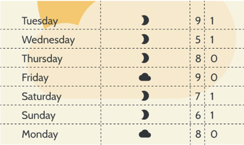

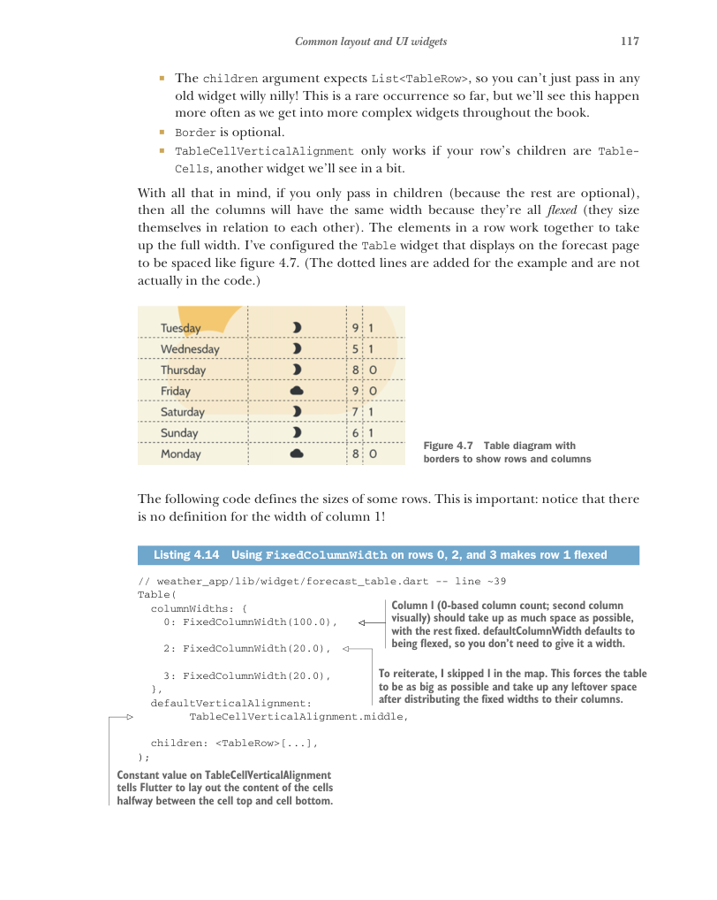

*Mô tả hình:* Bảng dự báo 7 ngày từ Tuesday đến Monday với các đường chấm kẻ chia rõ 7 hàng và 4 cột: cột 0 (tên thứ: Tuesday, Wednesday,…) có độ rộng cố định vừa đủ chữ; cột 1 (biểu tượng mặt trăng/mây ở giữa) giãn rộng nhất, chiếm toàn bộ phần trống còn lại; cột 2 (nhiệt độ cao: 9, 5, 8, 9, 7, 6, 8) và cột 3 (nhiệt độ thấp: 1, 1, 0, 0, 1, 1, 0) rất hẹp ở sát mép phải.

Đoạn code sau định nghĩa kích thước của một số cột. Điều này rất quan trọng: hãy để ý rằng **không có định nghĩa nào cho chiều rộng của cột 1**!

**Listing 4.14 – Dùng FixedColumnWidth ở các cột 0, 2 và 3 khiến cột 1 tự co giãn (flexed) (Using FixedColumnWidth on rows 0, 2, and 3 makes row 1 flexed)**

```dart
// weather_app/lib/widget/forecast_table.dart -- line ~39
Table(
  columnWidths: {
    0: FixedColumnWidth(100.0),                            // (1)
    2: FixedColumnWidth(20.0),                             // (2)
    3: FixedColumnWidth(20.0),
  },
  defaultVerticalAlignment:
      TableCellVerticalAlignment.middle,                   // (3)
  children: <TableRow>[...],
);
```

Chú thích cho Listing 4.14:
1. Cột 1 (đếm cột từ 0; tức là cột thứ hai nếu nhìn bằng mắt) cần chiếm nhiều không gian nhất có thể, còn các cột khác cố định. `defaultColumnWidth` mặc định là dạng co giãn (*flexed*), nên bạn không cần gán chiều rộng cho cột 1.
2. Nhắc lại: tôi đã bỏ qua khóa `1` trong `Map`. Việc này buộc bảng phải to nhất có thể và cột 1 sẽ chiếm toàn bộ không gian còn dư sau khi đã phân bổ các chiều rộng cố định cho các cột kia.
3. Giá trị hằng số `TableCellVerticalAlignment.middle` bảo Flutter bố trí nội dung của các ô nằm chính giữa khoảng từ mép trên đến mép dưới của ô.

Mảnh ghép còn lại của bức tranh là `TableRow`. Một hàng của bảng (`TableRow`) đơn giản hơn một chút so với một `Row` thông thường. Tuy nhiên, có hai cấu hình quan trọng cần ghi nhớ:

- **Mọi hàng trong một bảng phải có số lượng widget con bằng nhau.**
- Bạn có thể – nhưng không bắt buộc – sử dụng `TableCell` trong cây widget con của hàng. `TableCell` không nhất thiết phải là con trực tiếp của `TableRow`, miễn là ở đâu đó phía trên nó trong cây widget có một `TableRow` làm tổ tiên (*ancestor*).

Trong ứng dụng này, chúng ta sẽ dùng `TableCell` vì nó giúp việc căn chỉnh trở nên cực kỳ dễ dàng. Nó biết cách điều khiển việc căn chỉnh các con của mình trong ngữ cảnh của bảng.

Để hoàn thiện ví dụ này, hãy xem code của bản thân các ô. Bảng này có 4 cột và 7 hàng. Nếu phải viết tay 28 widget thì thật rườm rà, nên tôi sẽ **sinh tự động** (*generate*) từng hàng. Ở phần sau của chương này, chúng ta sẽ khám phá thứ mà Flutter gọi là **mẫu builder** (*builder pattern*) – một mẫu rất quan trọng và được dùng thường xuyên trong các ứng dụng Flutter. Bài học ngay sau đây là bước đệm cho phần đó.

#### SINH CÁC WIDGET TỪ HÀM KHỞI TẠO LIST.GENERATE() CỦA DART (GENERATING WIDGETS FROM DART’S LIST.GENERATE() CONSTRUCTOR)

Ở phần trước của cuốn sách, tôi đã nhấn mạnh với bạn rằng mọi thứ trong Flutter đều là code Dart. Hơn thế nữa, Dart có những tính năng khiến nó đặc biệt hữu ích khi làm ngôn ngữ xây dựng giao diện người dùng. Tại đây, tôi muốn cho bạn thấy một ví dụ cực kỳ gọn đẹp về lợi ích của việc mọi thứ đều là code Dart. Thay vì truyền một danh sách viết sẵn vào thuộc tính `children` của bảng, ta có thể dùng các hàm, hàm khởi tạo và lớp trả về các widget.

**Listing 4.15 – Code Table từ ứng dụng thời tiết (Table code from the weather app)**

```dart
// weather_app/lib/widget/forecast_table.dart -- line ~39
Table(
  columnWidths: {
    0: FixedColumnWidth(100.0),
    2: FixedColumnWidth(20.0),
    3: FixedColumnWidth(20.0),
  },
  defaultVerticalAlignment: TableCellVerticalAlignment.middle,
  children: List.generate(7, (int index) {                 // (1)
    ForecastDay day = forecast.days[index];                // (2)
    Weather dailyWeather =
        forecast.days[index].hourlyWeather[0];             // (3)
    final weatherIcon =
        _getWeatherIcon(dailyWeather);                     // (4)
    return TableRow(                                       // (5)
      children: [
        // ....
      ],
    ); // TableRow
  }),
); // Table
```

Chú thích cho Listing 4.15:
1. `List.generate`: Hàm khởi tạo của lớp `List` trong Dart. Nó nhận một số nguyên `int` (số lượng phần tử mà danh sách sẽ chứa) và một hàm gọi lại (*callback*) để sinh ra bấy nhiêu phần tử trong danh sách. Hàm callback nhận chỉ số hiện tại (`index`) làm đối số và được gọi đúng số lần bằng số nguyên được truyền vào; trong trường hợp này là 7 lần.
2. Dữ liệu mà các ô trong bảng của chúng ta sẽ hiển thị. Điểm thú vị là ta đang dùng `index` để lấy dữ liệu khác nhau ở mỗi vòng lặp của một hàng trong bảng. Hiện tại, bạn chỉ cần biết `forecast.days` là một biến đại diện cho danh sách các mô tả thời tiết theo từng ngày.
3. Thêm dữ liệu chúng ta cần. Không liên quan trực tiếp đến Flutter, nhưng cung cấp thông tin thời tiết theo giờ, được dùng để hiển thị nhiệt độ hiện tại.
4. Trả về biểu tượng (*icon*) thích hợp để biểu diễn thời tiết dựa trên tình trạng thời tiết hiện tại.
5. Trả về bất cứ thứ gì cần được chèn vào danh sách đang được sinh ra tại vị trí `index` hiện tại.

Hàm khởi tạo `List.generate` này sẽ thực thi vào **thời điểm dựng giao diện** (*build time*). Nếu khái niệm này có vẻ khó hiểu, bạn cứ hình dung `List.generate` như một vòng lặp là được. Về mặt chức năng, nó hoàn toàn giống với việc viết một đoạn như sau:

```dart
List<Widget> myList = [];
for (int i = 0; i < 7; i++) {
  myList.add(TableRow(...));
}
```

Giống hệt vòng lặp `for` đó, hàm khởi tạo `List.generate` trong đoạn code ví dụ sẽ chạy đoạn code bạn đưa cho nó 7 lần. (Tuy nhiên, cần lưu ý rằng giá trị `index` ở mỗi vòng lặp thực tế sẽ chạy từ `0` đến `6`.) Ở mỗi lần lặp, bạn có cơ hội thực hiện một số xử lý logic — vì bạn truy cập được một `index` khác nhau. Điều này có nghĩa là bạn có thể lấy dữ liệu cho widget này mà không cần biết trước dữ liệu cụ thể đó là gì.

`List.generate` là một tính năng của ngôn ngữ Dart chứ không riêng gì của Flutter. Tuy nhiên, nó cực kỳ hữu dụng trong Flutter khi bạn cần dựng nhiều widget cho một `Row`, `Column`, `Table` hoặc danh sách. Cụ thể, `List.generate` rất tuyệt khi bạn **biết trước số lượng phần tử** mình muốn có trong danh sách, và chúng có thể được tạo ra bằng code (*programmatically*). Trong ví dụ này, tất cả các phần tử của danh sách đều có cùng kiểu widget với cùng cấu trúc cấu hình, chỉ khác nhau về dữ liệu.

Nếu không dùng `List.generate`, chúng ta sẽ phải viết đoạn code dài dòng hơn rất nhiều, trông đại loại như thế này:

```dart
Table (
  children: [
    TableRow(
      children: [
        TableCell(),
        TableCell(),
        TableCell(),
        TableCell(),
      ]
    ),
    TableRow(
      children: [
        TableCell(),
        TableCell(),
        TableCell(),
        TableCell(),
      ]
    ),
    //... v.v., lặp lại 5 lần nữa
  ]
)
```

Ối chà (*Ack*)! Kể cả khi đã lược bỏ hết toàn bộ nội dung thực sự bên trong mỗi `TableCell`, bạn vẫn thấy ngay cách viết đó cồng kềnh đến mức nào, nhất là khi mỗi cụm hàng và ô đều giống hệt nhau. Dùng một hàm để dựng các hàng bằng code thật gọn gàng, và cách làm này rất phổ biến trong Flutter.

> **CẢNH BÁO (WARNING):** Một lưu ý nhỏ trong ví dụ này: cách này chỉ hoạt động đúng vì mảng dữ liệu đã được **sắp xếp theo thứ tự cụ thể**. Nếu bạn không thể đảm bảo thứ tự của danh sách dữ liệu trong khi thứ tự hiển thị lại quan trọng, thì đây có thể chưa phải là giải pháp tốt nhất của bạn.

Điểm quan trọng là đoạn code này đang tạo ra một danh sách các widget. Và bởi vì API của `List.generate` nhận một hàm callback làm đối số, bạn có thể viết code tạo từng widget ngay tại chỗ (*inline*) bên trong phương thức `build` của mình. Đây chẳng phải phát hiện gì quá vĩ đại, nhưng là một ví dụ cho thấy lợi thế của việc viết thuần bằng code Dart mà không cần đến một ngôn ngữ đánh dấu (*markup language*).

Phần code còn lại cần triển khai là bản thân các hàng của bảng, chúng chỉ hiển thị các widget cơ bản. `TableCell`, `Text`, `Icon` và `Padding` đều được sử dụng. Để bạn làm quen hơn với code Flutter, dưới đây là đoạn code của các hàng đó.

**Listing 4.16 – Ví dụ về các ô của bảng trong ứng dụng thời tiết (Table cell examples from the weather app)**

```dart
// weather_app/lib/widget/forecast_table.dart -- line ~52
children: List.generate(7, (int index) {
  ForecastDay day = forecast.days[index];
  Weather dailyWeather = forecast.days[index].hourlyWeather[0];
  final weatherIcon = _getWeatherIcon(dailyWeather);
  return TableRow(                                                   // (1)
    children: [
      TableCell(
        child: const Padding(
          padding: const EdgeInsets.all(4.0),
          child: ColorTransitionText(                                // (2)
            text: DateUtils.weekdays[dailyWeather.dateTime.weekday],
            style: textStyle,
            animation: textColorTween.animate(controller),
          ),
        ),
      ),
      TableCell(
        child: ColorTransitionIcon(                                  // (3)
          icon: weatherIcon,
          animation: textColorTween.animate(controller),
          size: 16.0,
        ),
      ),
      TableCell(
        child: ColorTransitionText(                                  // (4)
          text: _temperature(day.max).toString(),
          style: textStyle,
          animation: textColorTween.animate(controller),
        ),
      ),
      TableCell(
        child: ColorTransitionText(                                  // (5)
          text: _temperature(day.min).toString(),
          style: textStyle,
          animation: textColorTween.animate(controller),
        ),
      ),
    ],
  );
}),
// ...
```

Chú thích cho Listing 4.16:
1. Widget `TableRow` này sẽ được trả về một lần ứng với mỗi vòng lặp của `List.generate`.
2. Hiển thị thứ trong tuần (*day of the week*).
3. Hiển thị biểu tượng (*icon*) tương ứng với điều kiện thời tiết hiện tại.
4. Hiển thị nhiệt độ cao nhất trong ngày (*daily high temperature*).
5. Hiển thị nhiệt độ thấp nhất trong ngày (*daily low temperature*).

Đây là code giao diện Flutter tiêu chuẩn. Nó thêm bốn ô (`TableCell`) vào mỗi hàng bằng các widget `TableCell` tiêu chuẩn và các widget khác. Ngoài phần `List.generate` ra thì không có mánh khóe đặc biệt nào ở đây cả.

Cuối cùng, hãy xem đoạn code đưa widget `Table` này vào cây widget. Nó nằm trong phương thức `ForecastPageState.build`.

**Listing 4.17 – Một phần phương thức ForecastPageState.build (A portion of the ForecastPageState.build method)**

```dart
// weather_app/lib/page/forecast_page.dart
return Scaffold(
  appBar: // ...
  body: Stack(                                             // (1)
    children: <Widget>[
      // ... các widget mặt trời và mây được định vị (positioned)
      // Phần code quan trọng bắt đầu ở đây -- line ~264
      Column(
        verticalDirection: VerticalDirection.up,           // (2)
        children: <Widget>[
          forecastContent,                                 // (3)
          mainContent,                                     // (4)
          Flexible(child: timePickerRow),                  // (5)
        ],
      ),
    ],
  ),
);
```

Chú thích cho Listing 4.17:
1. `Stack` chứa toàn bộ nội dung của trang dự báo.
2. `verticalDirection: VerticalDirection.up` đảo ngược chiều sắp xếp của `Column`: widget con đầu tiên sẽ nằm ở **dưới đáy**.
3. `forecastContent`: Biến đại diện cho widget `Table`.
4. `mainContent`: Các widget khác trong ứng dụng thời tiết (phần hiển thị nhiệt độ lớn ở giữa).
5. `timePickerRow`: Đại diện cho một widget khác mà chúng ta sẽ tìm hiểu ngay sau đây.

Hãy xem xét `VerticalDirection.up` trước khi đi tiếp. Nó được dùng để **đảo ngược luồng sắp xếp mặc định** của `Column`. Tôi muốn nội dung của cột được căn sát đáy màn hình và được bố trí sao cho widget con đầu tiên trong danh sách nằm ở dưới cùng, widget con thứ hai nằm "phía trên" nó, và cứ thế tiếp tục. Chắc chắn có những cách khác (dài dòng hơn) để đạt được kết quả này, nhưng thật tuyệt vì bạn không phải tự viết code bố cục riêng.

Vậy là ta đã tìm hiểu khá nhiều về bảng (`Table`). Nhìn chung, cách sử dụng chúng không khác mấy so với bất kỳ widget nào khác, nhưng những bài học trong mục này rất có giá trị. Sắp tới, bạn sẽ học về **mẫu builder** (*builder pattern*), có nét tương đồng với phương thức `List.generate`.

> 💡 **Ví dụ bổ sung (không có trong sách):** Khi nào nên dùng `Table` thay vì nhiều `Row` lồng trong `Column`?
> Giả sử bạn hiển thị bảng điểm gồm 3 cột: **Môn học** (co giãn hết phần dư), **Hệ số** (rộng cố định 50px), **Điểm** (rộng cố định 60px). Nếu dùng nhiều `Row` rời rạc, các cột dễ bị lệch nhau khi độ dài chữ khác nhau; còn `Table` đảm bảo mọi hàng thẳng cột tuyệt đối:
>
> ```dart
> final scores = [
>   {'subject': 'Toán rời rạc', 'weight': '3', 'score': '8.5'},
>   {'subject': 'Lập trình Flutter', 'weight': '4', 'score': '9.2'},
> ];
>
> Table(
>   border: TableBorder.all(color: Colors.grey.shade300),
>   columnWidths: const {
>     // Không khai báo cột 0 -> cột 0 dùng defaultColumnWidth = FlexColumnWidth(1.0)
>     1: FixedColumnWidth(50.0),
>     2: FixedColumnWidth(60.0),
>   },
>   defaultVerticalAlignment: TableCellVerticalAlignment.middle,
>   children: List.generate(scores.length, (index) {
>     final item = scores[index];
>     return TableRow(
>       children: [
>         Padding(padding: EdgeInsets.all(8), child: Text(item['subject']!)),
>         Center(child: Text(item['weight']!)),
>         Center(child: Text(item['score']!)),
>       ],
>     );
>   }),
> )
> ```

### 4.4.3 Widget TabBar (TabBar widget)

Thẻ (*tab*) là một phần tử giao diện phổ biến trong các ứng dụng di động. Thư viện Material của Flutter cung cấp sẵn các widget tab giúp việc làm việc với các tab trở nên khá dễ dàng.

Widget `TabBar` có sẵn hiển thị các widget con của nó trong một vùng nhìn nằm ngang có thể cuộn được (*scrollable, horizontal view*), và làm cho chúng "chạm vào được" (*tappable*). Các widget trong thanh tab khi được chạm vào sẽ thực thi một hàm gọi lại (*callback*) mà bạn có thể truyền cho widget tab bar. Các tab thường được dùng nhất để chuyển đổi qua lại giữa các trang hoặc các thành phần giao diện khác nhau mà không thực sự điều hướng sang trang mới (*without actually navigating*). Vì vậy, hàm callback truyền cho các widget con của thanh tab thường được dùng để tráo đổi các widget hiển thị trên trang.

Hình 4.8 biểu diễn ý tưởng cơ bản đằng sau các tab. Khi bạn bấm vào một phần tử trên thanh tab, nội dung tab tương ứng sẽ thay đổi. Trong ứng dụng thời tiết bằng Flutter, tôi dùng một thanh tab để dựng hàng chọn giờ có thể bấm vào nhằm cập nhật nhiệt độ cho khung giờ đó trong ngày.

**Hình 4.8 – Sơ đồ các widget liên quan đến tab trong Flutter (Diagram of tab-related widgets in Flutter)**

```
+---------------------+  +-----------------------+  +---------------------+
| Tab bar content [0] |  |  Tab bar content [1]  |  | Tab bar content [2] |
|     (offscreen)     |  |  (đang hiển thị)      |  |     (offscreen)     |
+---------------------+  +-----------------------+  +---------------------+
                         |   ☆     [ ♥ ]    💬   |
                         +-----------+-----------+
                                     |
                              TabBar item [1]
                            (currently selected)
```

*Mô tả hình 4.8:* Ba khung nội dung nằm ngang: `Tab bar content [0] (offscreen)` (ngoài màn hình bên trái), `Tab bar content [1]` (đang hiển thị ở giữa màn hình), và `Tab bar content [2] (offscreen)` (ngoài màn hình bên phải). Phía dưới khung giữa là thanh `TabBar` có 3 biểu tượng (ngôi sao, trái tim, khung chat), trong đó mục ở giữa `TabBar item [1] (currently selected)` (trái tim) đang được chọn.

Widget `TabBar` (hình 4.9) có hai thành phần quan trọng: bản thân các widget con (trong trường hợp này là các widget hiển thị khung giờ trong ngày mà người dùng muốn chọn) và `TabController` (bộ điều khiển xử lý phần chức năng).

**Hình 4.9 – Đường viền chỉ ra thanh tab tương tác (The outline shows the interactive tab bar.)**

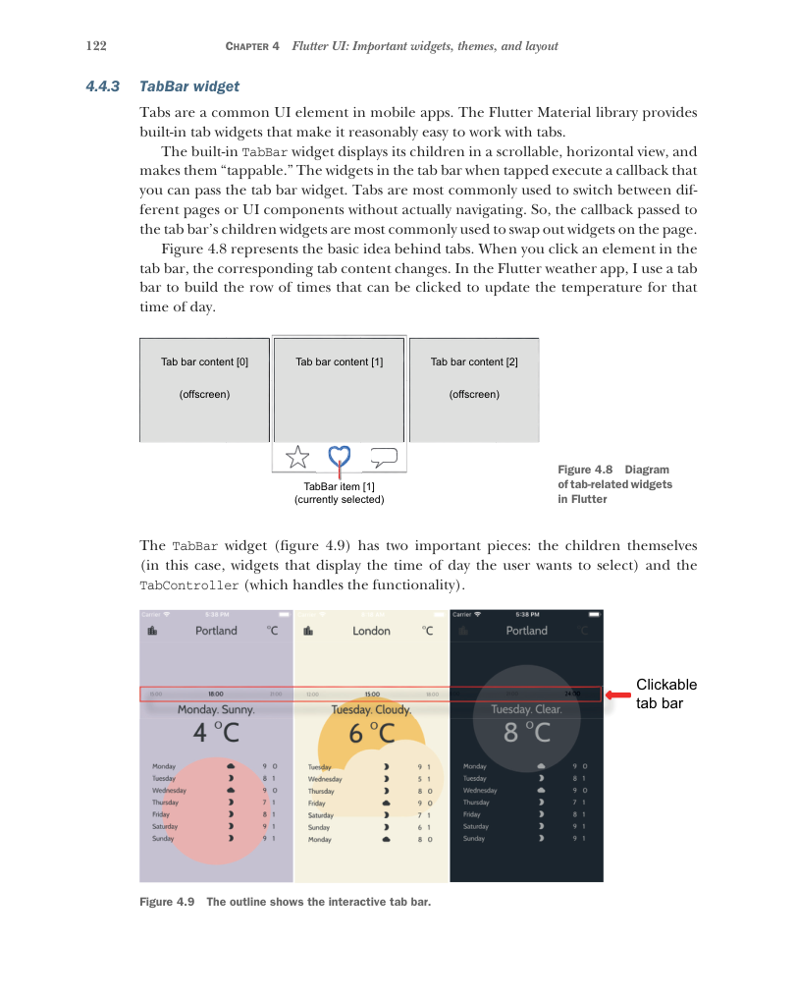

Các mảnh ảnh được trích từ trang 148 (Hình 4.9):

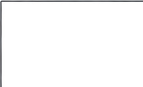
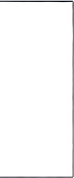
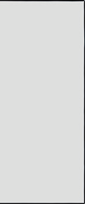
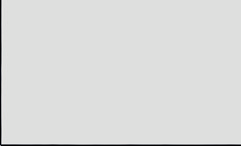
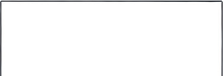
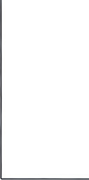
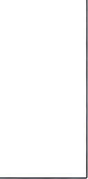
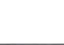
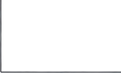
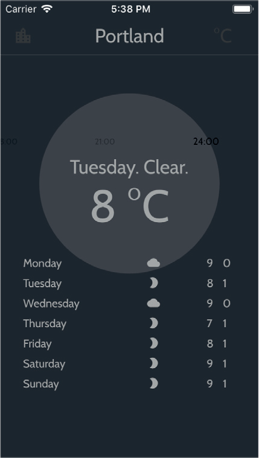
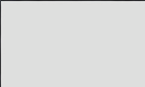
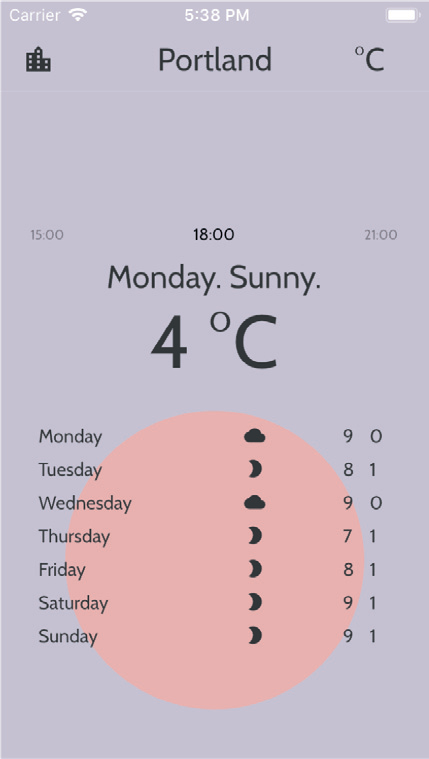


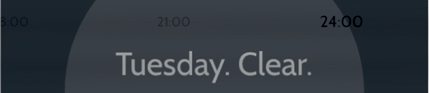
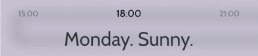
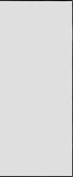
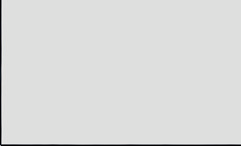
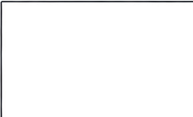
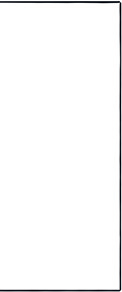
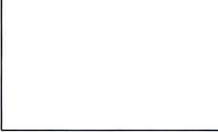
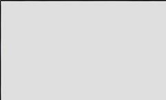

*Mô tả hình 4.9:* Ba màn hình ứng dụng thời tiết (Portland ban ngày 4 °C, London có mây 6 °C, Portland ban đêm 8 °C) với khung viền đỏ dài nằm ngang khoanh vùng dải giờ (`15:00  18:00  21:00`, `12:00  15:00  18:00`, `21:00  24:00`) kèm mũi tên đỏ chú thích "Clickable tab bar" (Thanh tab có thể bấm chọn).

#### WIDGET TABCONTROLLER (TABCONTROLLER WIDGET)

Trong Flutter, nhiều widget có liên quan đến tương tác người dùng đều đi kèm các bộ điều khiển (*controllers*) tương ứng để quản lý sự kiện. Ví dụ, có `TextEditingController` được dùng với các widget cho phép người dùng gõ chữ đầu vào. Trong trường hợp này, bạn đang dùng một `TabController`. Bộ điều khiển này chịu trách nhiệm thông báo cho ứng dụng Flutter biết khi nào một tab mới được chọn, để ứng dụng của bạn có thể cập nhật tab nhằm hiển thị nội dung mong muốn. Bộ điều khiển được khởi tạo ở vị trí cao hơn trong cây widget so với bản thân thanh tab, rồi được truyền xuống widget `TabBar`. Kiến trúc này là bắt buộc vì widget cha của thanh tab cũng đồng thời là widget cha của các widget hiển thị nội dung theo tab. Để xem một ví dụ cụ thể, code của thanh tab trong ứng dụng thời tiết nằm trong file `weather_app/lib/widget/time_picker_row.dart`. Hãy cùng xem.

Trong file đó, bạn sẽ thấy widget tùy biến tên là `TimePickerRow`. Đó là một `StatefulWidget` có mục đích chính là hiển thị các tab và đồng thời báo cho widget cha biết khi có sự kiện đổi tab xảy ra, thông qua `TabController`.

**Listing 4.18 – Thiết lập TabController và widget TabBar (TabController and TabBar widget setup)**

```dart
// weather_app/lib/widget/time_picker_row.dart
class TimePickerRow extends StatefulWidget {
  final List<String> tabItems;
  final ForecastController forecastController;
  final void Function(int) onTabChange;
  final int startIndex;
  // ...
}
```

Đó là những thuộc tính quan trọng được truyền vào bản thân widget, nhưng toàn bộ phần xử lý chức năng đều nằm trong đối tượng `State`.

**Listing 4.19 – Triển khai các tab của Flutter trong ứng dụng thời tiết (Implementing Flutter tabs in the weather app)**

```dart
// weather_app/lib/widget/time_picker_row.dart
// Toàn bộ widget TimePickerRow (Full TimePickerRow widget)
class TimePickerRow extends StatefulWidget {
  final List<String> tabItems;                             // (1)
  final ForecastController forecastController;             // (2)
  final Function onTabChange;                              // (3)
  final int startIndex;                                    // (4)

  const TimePickerRow({
    Key key,
    this.forecastController,
    this.tabItems,
    this.onTabChange,
    this.startIndex,
  }) : super(key: key);

  @override
  _TimePickerRowState createState() => _TimePickerRowState();
}

class _TimePickerRowState extends State<TimePickerRow>
    with SingleTickerProviderStateMixin {                  // (5)
  TabController _tabController;                            // (6)
  int activeTabIndex;

  @override
  void initState() {
    _tabController = TabController(                        // (7)
      length: utils.hours.length,
      vsync: this,                                         // (8)
      initialIndex: widget.startIndex,
    );
    _tabController.addListener(handleTabChange);           // (9)
    super.initState();
  }

  void handleTabChange() {
    if (_tabController.indexIsChanging) return;            // (10)
    widget.onTabChange(_tabController.index);
    setState(() {
      activeTabIndex = _tabController.index;
    });
  }
  // ...
}
```

Chú thích cho Listing 4.19:
1. `tabItems`: Thiết lập các thuộc tính được truyền vào widget. Trong trường hợp này, widget kỳ vọng nhận một danh sách các chuỗi (`List<String>`), được hiển thị thành các mốc giờ trong ngày ("12:00", "3:00", v.v.).
2. `forecastController`: Lớp giúp lấy dữ liệu dự báo dễ hơn. Nó không quan trọng đối với kiến thức Flutter, nên tôi sẽ bỏ qua lúc này.
3. `onTabChange`: Hàm callback do widget cha truyền xuống. Ở đây, nó được dùng để thông báo cho widget cha biết khi một tab mới được chọn.
4. `startIndex`: Cho `TabBar` biết tab nào được chọn theo mặc định. Trong trường hợp này là widget đại diện cho mốc giờ hiện tại trong ngày.
5. `SingleTickerProviderStateMixin`: Một mixin báo cho Flutter biết widget này có một số thuộc tính sẽ chạy hoạt ảnh (*animate*). `TabBar` có sẵn hoạt ảnh dựng sẵn nên cần tới mixin này (sẽ được bàn kỹ ở chương 6).
6. `_tabController`: Khai báo một bộ điều khiển tab (`TabController`) để xử lý chức năng của tab. Nó được khởi tạo trong `initState`.
7. Tạo bộ điều khiển. `TabController` bắt buộc phải biết sẽ có tổng cộng bao nhiêu tab tồn tại (`length`).
8. `vsync: this`: Tôi sẽ hẹn giải thích `vsync` ở chương 6 vì nó liên quan đến hoạt ảnh.
9. `_tabController.addListener(handleTabChange)`: Bạn có thể gắn một hàm lắng nghe (*listener*) vào bộ điều khiển của mình để thực thi hàm callback mỗi khi tab thay đổi.
10. `if (_tabController.indexIsChanging) return;`: Bước kiểm tra giúp ngăn việc kích hoạt một sự kiện mới ngay giữa lúc hoạt ảnh chuyển tab đang diễn ra.

> **Đúng lúc cần biết: Các bộ lắng nghe (Just in time: listeners)**
>
> Đây là lần đầu tiên chúng ta bắt gặp một *listener* (bộ lắng nghe / hàm lắng nghe) trong cuốn sách này. Listener không phải là một đối tượng hay kiểu đối tượng cụ thể nào, mà là một **quy ước đặt tên** (*naming convention*) được dùng cho các chức năng bất đồng bộ (*asynchronous functionality*) khác nhau. Có rất nhiều nơi trong thư viện Flutter bạn sẽ thấy các từ *listener*, *change notifier* (bộ thông báo thay đổi), và *stream* (luồng dữ liệu). Tất cả chúng đều là những biến thể và mảnh ghép khác nhau của cùng một khái niệm lập trình: **observables** (các đối tượng có thể quan sát được).
>
> Observables (được biết đến với tên gọi *streams* trong Dart) sẽ được trình bày kỹ lưỡng ở phần sau của cuốn sách. Chương 9 được dành trọn cho Dart bất đồng bộ (*async Dart*). Và trước đó, có một phần giải thích ngắn gọn khác ở chương 7. Nói ngắn gọn, chủ đề này vừa quan trọng vừa khó thấm (*difficult to grok*). Hiện tại, tôi sẽ chỉ tập trung vào ví dụ cụ thể này.
>
> Một *listener* là một mảnh ghép có cái tên rất sát nghĩa trong hệ sinh thái "observable". Nó thường chỉ một hàm được gọi để phản hồi lại một sự kiện nào đó sẽ xảy ra tại một thời điểm chưa biết trước. Hàm đó cứ ngồi chờ sẵn, lắng nghe xem khi nào có ai đó bảo: "Được rồi, đến lượt bạn thực thi đấy."
>
> Hàm `addListener` của bộ điều khiển tab được kích hoạt khi người dùng chuyển đổi các tab. Việc này trao cho bạn cơ hội cập nhật một số giá trị hoặc trạng thái (*state*) khi người dùng đổi tab. Như vậy, trong ví dụ cụ thể này, listener biết phải thực thi hàm callback đã cung cấp cho nó mỗi khi một tab trên thanh tab được chạm vào.

Cùng với các listener, `TabController` có các getter giúp bạn quản lý các tab và nội dung tương ứng của chúng. Bên trong phương thức `_handleTabChange`, bạn có thể viết một đoạn như sau để đảm bảo ứng dụng luôn biết tab nào đang là tab "hoạt động" (*active* – tức tab đang được hiển thị trên màn hình):

```dart
int activeTab;

void _handleTabChange() {
  setState(() =>
      this.activeTab = _tabController.index);              // (1)
}
```

Chú thích đoạn code:
1. `_tabController.index` trả về chỉ số (*index*) của tab hiện đang được chọn. Trong ví dụ này, tôi giả định rằng một số nội dung trên màn hình phụ thuộc vào mảnh trạng thái `activeTab` của chúng ta.

`setState` cũng rất quan trọng ở đây. Trong ứng dụng thời tiết, khi bạn chạm vào một mốc giờ khác trên thanh tab, giao diện sẽ vẽ lại (*re-render*) với điều kiện thời tiết của mốc giờ đó trong ngày. Điều này khả thi là nhờ `setState` bảo Flutter vẽ lại và hiển thị tab vừa mới được chọn khi vẽ lại. Getter `TabController.index` trỏ tới tab hiện đang hoạt động.

Lưu ý cuối cùng tôi muốn nói về `TabController` là bạn **không bao giờ phải tự sửa đổi trực tiếp** lớp này. Nó là một đối tượng dùng để lấy thông tin về các tab và cập nhật xem tab nào đang hoạt động. Nhưng bạn chỉ cần tương tác với nó, chứ không cần kế thừa (*extend*) nó thành một lớp tùy biến.

#### WIDGET TABBAR TRONG THỰC TẾ (TABBAR WIDGET IN PRACTICE)

Giờ bạn đã tiếp xúc với chức năng của các tab và cách dùng thanh tab trong Flutter, hãy xem ví dụ từ ứng dụng thời tiết trong listing tiếp theo. Mặc dù phần lớn chức năng của thanh tab nằm ở bộ điều khiển (`TabController`), nhưng chúng ta – những lập trình viên – lại quan tâm đến bản thân widget `TabBar` và việc truyền đối số cho nó. Đây là cách widget `TabBar` được sử dụng trong ứng dụng thời tiết.

**Listing 4.20 – Widget TabBar trong phương thức build (TabBar widget in the build method)**

```dart
// weather_app/lib/widget/time_picker_row.dart
@override
Widget build(BuildContext context) {
  return TabBar(
    labelColor: Colors.black,                                                  // (1)
    unselectedLabelColor: Colors.black38,                                      // (1)
    unselectedLabelStyle:                                                      // (1)
        Theme.of(context).textTheme.caption.copyWith(fontSize: 10.0),          // (1)
    labelStyle:                                                                // (1)
        Theme.of(context).textTheme.caption.copyWith(fontSize: 12.0),          // (1)
    indicatorColor: Colors.transparent,                                        // (1)
    labelPadding: EdgeInsets.symmetric(horizontal: 48.0, vertical: 8.0),       // (1)
    controller: _tabController,                                                // (2)
    tabs: widget.tabItems.map((t) => Text(t)).toList(),                        // (3)
    isScrollable: true,                                                        // (4)
  );
}
```

Chú thích cho Listing 4.20:
1. Các tùy chọn cấu hình của `TabBar` dùng để định nghĩa kiểu dáng (*styles*): màu nhãn đang chọn (`labelColor`), màu nhãn chưa chọn (`unselectedLabelColor`), kiểu chữ nhãn chưa chọn (`unselectedLabelStyle`), kiểu chữ nhãn đang chọn (`labelStyle`), màu vạch chỉ báo dưới tab (`indicatorColor` – đặt trong suốt), và khoảng đệm quanh nhãn (`labelPadding`).
2. `controller: _tabController`: Đối tượng `TabController` được truyền vào widget.
3. `tabs: widget.tabItems.map((t) => Text(t)).toList()`: Danh sách `tabItems` được truyền vào từ `ForecastPage`. Ở đây tôi dùng `Text`, nhưng nó có thể là bất kỳ widget nào (dùng `Icon` cũng rất phổ biến). Đây lại là một ví dụ nữa của việc dùng code Dart để tạo các widget một cách tự động: nó duyệt qua từng `String` trong `tabItems` và trả về một widget `Text` cho mỗi chuỗi đó.
4. `isScrollable: true`: Theo mặc định, các tab không cuộn được (chúng bị ép co lại cho vừa chiều ngang màn hình). Đối số này cho phép chúng cuộn ngang được.

Đến thời điểm này, bạn đã thấy tất cả các bộ phận chuyển động của `TabBar`. Lượng thông tin khá nhiều, nhưng những điểm cốt lõi cần nhớ là:

- Việc sử dụng tab đòi hỏi phải có một `TabController` và các widget con. Các widget con là những widget được hiển thị trên thanh tab và có thể chạm vào được (*tappable*).
- Chức năng chuyển đổi tab khi một widget trên thanh tab được chạm vào được thực hiện thông qua một hàm gọi lại (*callback*). Hàm callback này nên sử dụng các thuộc tính do `TabController` cung cấp để bảo Flutter biết khi nào cần vẽ một tab mới.

Đây là một mô hình tư duy (*mental paradigm*) phổ biến trong Flutter, và bạn sẽ học thêm về các bộ điều khiển có sẵn cũng như cách cập nhật Flutter để phản ánh tương tác người dùng ở chương 5.

> 💡 **Ví dụ bổ sung (không có trong sách):** Nếu bạn không cần xử lý sự kiện phức tạp trong listener của riêng mình, Flutter còn cung cấp `DefaultTabController` giúp tự quản lý `TabController` mà không cần viết `SingleTickerProviderStateMixin` hay `initState()`:
>
> ```dart
> DefaultTabController(
>   length: 3,
>   child: Scaffold(
>     appBar: AppBar(
>       title: Text(' Tin tức'),
>       bottom: TabBar(
>         tabs: [
>           Tab(icon: Icon(Icons.bolt), text: 'Mới nhất'),
>           Tab(icon: Icon(Icons.star), text: 'Nổi bật'),
>           Tab(icon: Icon(Icons.bookmark), text: 'Đã lưu'),
>         ],
>       ),
>     ),
>     body: TabBarView(
>       children: [
>         Center(child: Text('Danh sách tin mới nhất')),
>         Center(child: Text('Danh sách tin nổi bật')),
>         Center(child: Text('Danh sách tin đã lưu')),
>       ],
>     ),
>   ),
> )
> ```
>
> Ngược lại, khi bạn cần chạy logic tùy biến mỗi lần đổi tab (như ứng dụng thời tiết cần chạy lại hoạt ảnh mặt trời/mây và tính lại nhiệt độ theo giờ), việc tự khởi tạo `TabController` và gắn `addListener` như Listing 4.19 là lựa chọn chuẩn xác.

---

## 4.5 ListView và các builder (ListView and builders)

`ListView` có thể nói là widget quan trọng nhất từ đầu cuốn sách đến giờ. Điều này thể hiện rõ ngay từ độ dài đồ sộ của trang tài liệu về nó trên trang web Flutter (https://api.flutter.dev/flutter/widgets/ListView-class.html). Nó không chỉ được sử dụng thường xuyên, mà còn giới thiệu một số mẫu thiết kế (*patterns*) và ý tưởng mang tính sống còn trong việc viết các ứng dụng Flutter hiệu quả.

Widget `ListView` giống như một `Column` hoặc `Row` ở chỗ nó hiển thị các widget con thành một hàng dọc hoặc ngang. Tuy nhiên, điểm quan trọng là **nó có thể cuộn được** (*scrollable*). Nó thường được dùng khi chưa biết trước số lượng widget con. Ví dụ, bạn có thể dùng một `ListView` trong ứng dụng nhắc việc (*todo app*) để hiển thị tất cả các công việc cần làm. Có thể chẳng có công việc nào, hoặc có thể có rất nhiều. `ListView` cung cấp một cách để nói rằng: "Này, ứng với mỗi mẩu thông tin này, hãy tạo một widget và thêm nó vào danh sách này."

Trong ứng dụng thời tiết, tôi đang dùng một widget `ListView` bên trong widget `SettingsPage` tại file `lib/page/settings_page.dart` (hình 4.10). Nó sử dụng dữ liệu (được tạo giả lập) để dựng một danh sách cuộn được, cho phép bạn chọn những thành phố mà người dùng ứng dụng thời tiết quan tâm.

**Hình 4.10 – Trang cài đặt của ứng dụng thời tiết (Weather app settings page)**

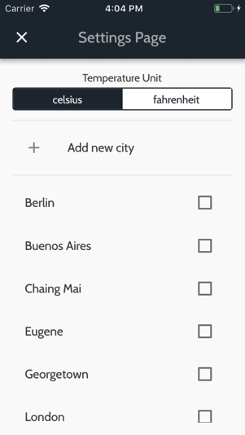

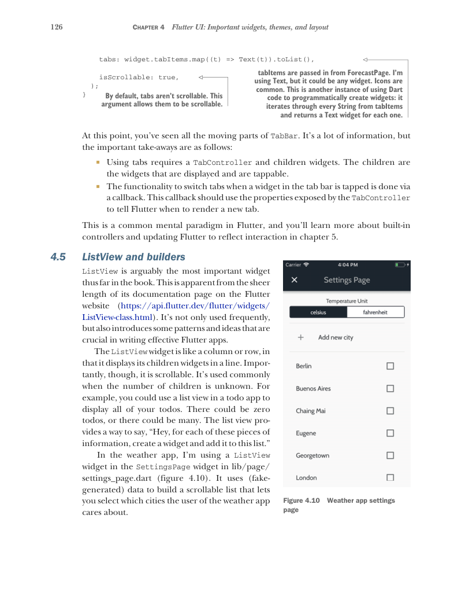

*Mô tả hình:* Màn hình `Settings Page` của ứng dụng thời tiết. Phía trên là phần chọn `Temperature Unit` (`celsius` đang được tô đậm, `fahrenheit` nền trắng), bên dưới là dòng `+ Add new city` (Thêm thành phố mới), và phần chính là một `ListView` hiển thị danh sách các thành phố (`Berlin`, `Buenos Aires`, `Chaing Mai`, `Eugene`, `Georgetown`, `London`), mỗi dòng có một ô đánh dấu (*checkbox*) ở bên phải.

Theo tài liệu chính thức, một `ListView` là một "danh sách các widget có thể cuộn được, được sắp xếp tuyến tính" (*scrollable list of widgets arranged linearly*). Nói bằng ngôn ngữ đời thường dễ hiểu thì nó là một `Row` hoặc `Column` cuộn được, tùy thuộc vào trục (*axis*) mà bạn chỉ định. Sức mạnh của `ListView` nằm ở sự linh hoạt của nó. Nó có một vài hàm khởi tạo (*constructors*) khác nhau cho phép bạn đưa ra lựa chọn dựa trên nội dung của danh sách. Nếu bạn có một số lượng phần tử ít và cố định (*static, small number of items*) cần hiển thị, bạn có thể tạo một `ListView` bằng hàm khởi tạo mặc định, và nó sẽ được tạo bằng đoạn code rất giống với `Row` hoặc `Column`. Đây là tùy chọn có hiệu năng cao nhất cho danh sách nhỏ, nhưng có thể không lý tưởng nếu bạn có hàng chục hay hàng trăm phần tử cần đưa vào danh sách, hoặc khi chưa biết trước số lượng phần tử.

Tuy nhiên, thứ tôi muốn tập trung vào chính là **mẫu builder** (*builder pattern*) trong Flutter. Mẫu builder xuất hiện ở khắp mọi nơi trong Flutter, và về bản chất nó bảo Flutter chỉ **tạo các widget khi cần đến** (*create widgets as needed*). Ở hàm khởi tạo `ListView` mặc định, Flutter khởi tạo tất cả các widget con cùng một lúc rồi mới kết xuất (*render*). Ngược lại, hàm khởi tạo `ListView.builder` nhận một hàm callback trong thuộc tính `itemBuilder`, và hàm callback đó trả về một widget. Trong trường hợp của chúng ta, hàm callback sẽ trả về một widget `ListTile` (cụ thể là `CheckboxListTile`). Builder này giúp Flutter thông minh hơn trong việc kết xuất các phần tử nếu bạn có một số lượng phần tử khổng lồ (hoặc vô hạn) cần hiển thị trong danh sách: **Flutter sẽ chỉ kết xuất những phần tử nào đang nằm trong vùng nhìn thấy trên màn hình**.

Hãy tưởng tượng một ứng dụng mạng xã hội như Twitter – về bản chất là một danh sách vô hạn các bài đăng (*tweets*). Sẽ không tài nào kết xuất toàn bộ các bài đăng trong danh sách đó mỗi khi có một trạng thái nào đó thay đổi, bởi vì số lượng bài đăng là vô hạn. Vì thế, nó chỉ kết xuất chúng khi cần, ngay khi người dùng cuộn các bài đăng đó vào vùng nhìn. Đây là bài toán phổ biến trong lập trình giao diện, và Flutter cung cấp `ListView` như một giải pháp dựng sẵn cho vấn đề này.

Hãy xem một ví dụ trong ứng dụng thời tiết. `ListView` được sử dụng trên trang `SettingsPage`.

**Listing 4.21 – Code ListView.builder trong trang cài đặt (ListView builder code in the settings page)**

```dart
// weather_app/lib/page/settings_page.dart -- line ~83
Expanded(                                                  // (1)
  child: ListView.builder(
    shrinkWrap: true,                                      // (2)
    itemCount: allAddedCities.length,                      // (3)
    itemBuilder: (BuildContext context, int index) {       // (4)
      final City city = allAddedCities[index];
      return Dismissible(
        // ...
        child: CheckboxListTile(                           // (5)
          value: city.active,
          title: Text(city.name),
          onChanged: (bool b) =>                           // (6)
              _handleCityActiveChange(b, city),
        ),
      );
    },
  ),
);
```

Chú thích cho Listing 4.21:
1. `Expanded`: `ListView` luôn giãn ra trên trục chính (*main axis*) của nó để to nhất có thể. Bởi vì trong ứng dụng này nó là con của một `Column`, nó sẽ giãn ra tới **vô cực** (*expand infinitely*) nếu `Expanded` không giới hạn kích thước của nó lại.
2. `shrinkWrap: true`: Một cách khác để bảo vệ khỏi lỗi kích thước vô hạn: bảo `ListView` cố gắng chỉ lấy kích thước vừa bằng tổng kích thước các con của nó.
3. `itemCount`: Một builder cần biết tổng cộng nó sẽ tạo ra bao nhiêu phần tử.
4. `itemBuilder`: Nhận một hàm callback; hàm này sẽ được truyền vào một `BuildContext` và chỉ số `index` của phần tử trong danh sách. Đây chính là hàm "builder": những hàm tương tự như thế này được sử dụng cực kỳ thường xuyên trong Flutter.
5. `CheckboxListTile`: Widget tiện lợi có sẵn trong Flutter; hiển thị một dòng danh sách kèm ô đánh dấu (*check box*) làm con trong các widget `ListView`.
6. `onChanged`: Điều khiển ô đánh dấu. Hàm bạn truyền vào sẽ được gọi khi mục đó được đánh dấu hoặc bỏ đánh dấu. Tôi đã viết phương thức `_handleCityActiveChange` để đảm bảo ứng dụng biết những thành phố nào đang được kích hoạt.

`ListView` có lẽ trông phức tạp hơn nhiều widget trước đó đã bàn trong sách. Mảnh ghép quan trọng của ví dụ này là **builder**. `ListView.builder` là một cách đơn giản để tạo ra một danh sách cuộn với số lượng phần tử có thể lên tới vô hạn. Đó thường là mục đích sử dụng của mẫu builder trong Flutter: tạo ra các widget hiển thị dữ liệu khi dữ liệu đó chưa được biết trước. Cũng đáng lưu ý rằng còn có một vài hàm khởi tạo khác cho `ListView`:

- **`ListView.separated`** tương tự như `ListView.builder` nhưng nhận **hai** phương thức builder: một phương thức để tạo các phần tử danh sách (`itemBuilder`) và phương thức thứ hai (`separatorBuilder`) để tạo widget ngăn cách (*separator*) đặt xen giữa các phần tử danh sách.
- **`ListView.custom`** cho phép bạn tạo một `ListView` với cơ chế quản lý các widget con tùy biến. Cách này không đơn giản chỉ là cập nhật hàm builder. Giả sử bạn có một `ListView` mà trong đó một số phần tử danh sách phải là một widget nhất định, còn các phần tử khác lại là một widget hoàn toàn khác, hoặc bạn cần kiểm soát chi tiết cách thu hồi/tái sử dụng phần tử. Đó là lúc `ListView.custom` phát huy tác dụng. Nó trao cho bạn quyền kiểm soát chi tiết (*fine-grained control*) đối với mọi khía cạnh trong cách `ListView` kết xuất các con của nó. Tôi sẽ nói thêm về việc tạo các phần tử danh sách tùy biến ở phần sau của cuốn sách.

`ListView` là một trong những widget đại diện một cách tuyệt đẹp cho tinh thần của toàn bộ Flutter. Nó sạch sẽ và thực dụng, nhưng lại vô cùng hữu ích. API của nó đủ đơn giản nhưng không hề gò ép (*pigeonhole*) bạn vào một khuôn mẫu cứng nhắc nào.

> 💡 **Ví dụ bổ sung (không có trong sách):** Sử dụng `ListView.separated` để hiển thị danh sách 1.000 đơn hàng có đường kẻ phân cách (`Divider`) ở giữa mà chỉ khởi tạo những dòng đang nằm trên màn hình:
>
> ```dart
> ListView.separated(
>   itemCount: 1000,
>   itemBuilder: (BuildContext context, int index) {
>     return ListTile(
>       leading: CircleAvatar(child: Text('${index + 1}')),
>       title: Text('Đơn hàng #${10000 + index}'),
>       subtitle: Text('Trạng thái: Đang giao hàng'),
>       trailing: Icon(Icons.chevron_right),
>     );
>   },
>   separatorBuilder: (BuildContext context, int index) {
>     return const Divider(height: 1);
>   },
> )
> ```
>
> Nhờ cơ chế *lazy building* (khởi tạo lười) của `itemBuilder`, dù `itemCount` là `1000`, tại mỗi thời điểm Flutter chỉ gọi `itemBuilder` cho khoảng 8–12 dòng đang hiển thị trên màn hình thiết bị, giúp cuộn mượt ở tốc độ 60fps mà không tốn bộ nhớ.

---

## Tóm tắt (Summary)

- Flutter bao gồm hàng loạt widget cấu trúc tiện lợi như `MaterialApp`, `Scaffold` và `AppBar`. Những widget này cung cấp sẵn cho bạn một khối lượng tính năng đáng kinh ngạc hoàn toàn "miễn phí": điều hướng (*navigation*), ngăn kéo menu (*menu drawers*), chủ đề giao diện (*theming*), và nhiều thứ khác.
- Sử dụng lớp `SystemChrome` để thao tác với các tính năng của chính thiết bị vật lý, chẳng hạn như buộc ứng dụng chỉ chạy ở chế độ màn hình ngang (*landscape*) hoặc dọc (*portrait*).
- Sử dụng `MediaQuery` để lấy thông tin về kích thước màn hình. Việc này rất hữu ích nếu bạn muốn định cỡ các widget theo cách đảm bảo chúng tự co giãn tỉ lệ theo kích thước màn hình.
- Sử dụng `Theme` để thiết lập các thuộc tính kiểu dáng có hiệu lực lên gần như mọi widget trong ứng dụng của bạn.
- Sử dụng widget `Stack` để xếp chồng các widget đè lên nhau ở bất kỳ đâu trên màn hình.
- Sử dụng widget `Table` để bố trí các widget theo dạng bảng.
- `ListView` và hàm khởi tạo `ListView.builder` của nó mang lại cho bạn một cách nhanh chóng, hiệu năng cao để tạo ra các danh sách có số lượng phần tử lớn hoặc vô hạn.

---

## Bảng thuật ngữ của chương

| Thuật ngữ tiếng Anh | Nghĩa tiếng Việt | Giải thích ngắn |
| :--- | :--- | :--- |
| **SDK (Software Development Kit)** | Bộ công cụ phát triển phần mềm | Tập hợp hoàn chỉnh gồm trình biên dịch, thư viện widget, công cụ dòng lệnh và tài liệu để xây dựng ứng dụng Flutter. |
| **Structural widget** | Widget cấu trúc | Các widget định hình bộ khung cấp cao của ứng dụng hoặc màn hình, như `MaterialApp`, `Scaffold`, `AppBar`. |
| **pubspec.yaml** | Tệp cấu hình gói dự án Dart/Flutter | Tệp định dạng YAML khai báo tên dự án, các gói phụ thuộc (*dependencies*), tài nguyên ảnh/phông chữ (*assets*) của ứng dụng. |
| **SystemChrome** | Lớp điều khiển giao diện hệ thống | Lớp trong gói `services.dart` dùng để điều chỉnh hướng màn hình, màu thanh trạng thái (*status bar*), thanh điều hướng hệ thống. |
| **MaterialApp** | Widget ứng dụng Material Design | Widget cấp cao bọc toàn bộ ứng dụng theo phong cách Material Design, cung cấp sẵn điều hướng (*routing*), `Theme`, `MediaQuery`. |
| **Scaffold** | Khung giàn giáo màn hình | Widget bố cục khung cho một màn hình chuẩn, có sẵn chỗ gắn `appBar`, `body`, `drawer`, `bottomSheet`, `floatingActionButton`. |
| **AppBar** | Thanh ứng dụng (thanh tiêu đề) | Thanh công cụ nằm ở đỉnh `Scaffold`, gồm vùng `leading`, `title`, `actions`, `flexibleSpace` và `bottom`. |
| **PreferredSizeWidget / PreferredSize** | Widget có kích thước ưu tiên | Giao diện/widget báo cho `Scaffold` biết chiều cao/rộng mong muốn của một widget tùy biến đặt vào vị trí `appBar`. |
| **Theme / ThemeData** | Chủ đề giao diện / Dữ liệu chủ đề | Cơ chế tập trung toàn bộ cấu hình màu sắc, kiểu chữ (`TextTheme`), biểu tượng để áp dụng thống nhất cho toàn ứng dụng hoặc một nhánh cây widget. |
| **MediaQuery** | Truy vấn thông tin phương tiện/màn hình | Lớp cung cấp thông tin về thiết bị hiện hành: kích thước màn hình (`size`), hướng xoay (`orientation`), vùng đệm hệ thống (`padding`), hệ số phóng chữ. |
| **`of(context)` method** | Phương thức tĩnh `of(context)` | Mẫu thiết kế trong Flutter (như `Theme.of(context)`, `MediaQuery.of(context)`) giúp tìm ngược lên cây widget để lấy tham chiếu đến widget cùng loại gần nhất. |
| **Logical pixel** | Điểm ảnh logic | Đơn vị đo kích thước độc lập mật độ màn hình trong Flutter; được Flutter tự quy đổi ra điểm ảnh vật lý (*physical pixel*) theo hệ số `devicePixelRatio`. |
| **Stack** | Widget xếp chồng | Widget đa-con cho phép xếp nhiều lớp widget chồng lên nhau theo trục Z (con đầu tiên ở dưới đáy, con cuối cùng ở trên cùng). |
| **Positioned** | Widget định vị trong Stack | Widget bọc một con của `Stack` để tách nó khỏi luồng bố cục mặc định và ghim vào vị trí cụ thể theo `top`, `bottom`, `left`, `right`, `width`, `height`. |
| **Table / TableRow / TableCell** | Bảng / Hàng của bảng / Ô của bảng | Bộ widget bố cục dữ liệu dạng lưới bảng nghiêm ngặt, trong đó mọi ô cùng hàng cao bằng nhau và mọi ô cùng cột rộng bằng nhau. |
| **FixedColumnWidth / FlexColumnWidth** | Chiều rộng cột cố định / Chiều rộng cột co giãn | Các chiến lược định cỡ cột trong `Table`: cố định theo số pixel hoặc tự co giãn chia phần không gian còn dư. |
| **TabBar / TabController** | Thanh thẻ (tab) / Bộ điều khiển tab | Cặp widget và bộ điều khiển dùng để hiển thị dải các thẻ bấm chọn được và đồng bộ trạng thái thẻ đang hoạt động. |
| **Listener** | Hàm lắng nghe sự kiện | Một hàm callback được đăng ký (qua `addListener`) để tự động chạy mỗi khi đối tượng được quan sát (như `TabController`) phát sinh thay đổi. |
| **ListView / ListView.builder** | Danh sách cuộn / Danh sách khởi tạo theo nhu cầu | Widget hiển thị danh sách tuyến tính có thể cuộn được; bản `.builder` chỉ khởi tạo các phần tử khi chúng cuộn vào vùng nhìn thấy trên màn hình. |
| **Builder pattern (trong Flutter)** | Mẫu thiết kế builder | Kỹ thuật truyền một hàm callback `(BuildContext context, int index)` để Flutter tạo các widget một cách linh hoạt hoặc tạo lười (*lazily*) theo nhu cầu. |
