# Chương 5: Tương tác người dùng – Form và cử chỉ (User interaction: Forms and gestures)

## Mục lục chương

- [Chương này đề cập](#chương-này-đề-cập-this-chapter-covers)
- [5.1 Tương tác người dùng và cử chỉ (User interaction and gestures)](#51-tương-tác-người-dùng-và-cử-chỉ-user-interaction-and-gestures)
  - [5.1.1 Widget GestureDetector (The GestureDetector widget)](#511-widget-gesturedetector-the-gesturedetector-widget)
  - [5.1.2 GestureDetector trong thực tế (GestureDetector in practice)](#512-gesturedetector-trong-thực-tế-gesturedetector-in-practice)
  - [5.1.3 Widget Dismissible (The Dismissible widget)](#513-widget-dismissible-the-dismissible-widget)
- [5.2 Form trong Flutter (Flutter forms)](#52-form-trong-flutter-flutter-forms)
  - [5.2.1 Widget Form (The Form widget)](#521-widget-form-the-form-widget)
  - [5.2.2 GlobalKey&lt;FormState&gt;](#522-globalkeyformstate)
  - [5.2.3 Cấu trúc của form AddCityPage (The structure of the AddCityPage form)](#523-cấu-trúc-của-form-addcitypage-the-structure-of-the-addcitypage-form)
  - [5.2.4 Hiện thực form trong ứng dụng thời tiết (Implementing the form in the weather app)](#524-hiện-thực-form-trong-ứng-dụng-thời-tiết-implementing-the-form-in-the-weather-app)
- [5.3 Các widget FormField (FormField widgets)](#53-các-widget-formfield-formfield-widgets)
  - [5.3.1 Widget TextFormField (The TextFormField widget)](#531-widget-textformfield-the-textformfield-widget)
  - [5.3.2 Widget DropdownFormButton (The DropdownFormButton widget)](#532-widget-dropdownformbutton-the-dropdownformbutton-widget)
  - [5.3.3 Form field tổng quát (Generic form fields)](#533-form-field-tổng-quát-generic-form-fields)
- [5.4 Giao diện form và làm việc với focus node (Form UI and working with focus nodes)](#54-giao-diện-form-và-làm-việc-với-focus-node-form-ui-and-working-with-focus-nodes)
  - [5.4.1 InputDecoration](#541-inputdecoration)
  - [5.4.2 Cải thiện giao diện bằng FocusNode (Improving the UI with FocusNodes)](#542-cải-thiện-giao-diện-bằng-focusnode-improving-the-ui-with-focusnodes)
- [5.5 Quản lý trạng thái form bằng các phương thức của form (Managing form state with form methods)](#55-quản-lý-trạng-thái-form-bằng-các-phương-thức-của-form-managing-form-state-with-form-methods)
  - [5.5.1 Form.onChange](#551-formonchange)
  - [5.5.2 FormState.save](#552-formstatesave)
  - [5.5.3 Form.onWillPop](#553-formonwillpop)
- [Tóm tắt (Summary)](#tóm-tắt-summary)
- [Bảng thuật ngữ của chương](#bảng-thuật-ngữ-của-chương)

---

Chương này nói về việc cho phép người dùng **tương tác** với ứng dụng Flutter của bạn. Suy cho cùng, mọi ứng dụng đều có một nhiệm vụ quan trọng: giúp con người làm việc với dữ liệu một cách dễ dàng. Và một mặt của sự tương tác đó là cho phép người dùng không chỉ *xem* dữ liệu, mà còn *thêm* dữ liệu và *thay đổi* nó. Chương này chính là về điều đó: cho phép người dùng thêm và sửa dữ liệu trong ứng dụng. Cụ thể, chương này đề cập đến hai kiểu tương tác khác nhau: **cử chỉ** (*gestures*) và **form** (biểu mẫu nhập liệu – *forms*).

### Chương này đề cập (This chapter covers)

- Tương tác người dùng bằng các bộ phát hiện cử chỉ (*gesture detectors*)
- Các widget tương tác đặc biệt như `Dismissible`
- Tạo form trong Flutter
- Ô nhập văn bản (*text input*), danh sách thả xuống (*drop-down list*) và các phần tử form khác
- Dùng key để quản lý form trong Flutter

---

## 5.1 Tương tác người dùng và cử chỉ (User interaction and gestures)

**Cử chỉ** (*gesture*) là bất kỳ loại sự kiện tương tác nào: chạm (*tap*), kéo (*drag*), lia/kéo tự do (*pan*) và nhiều loại khác. Trước tiên, tôi sẽ trình bày cách bạn phát hiện và phản hồi các cử chỉ này của người dùng. Thật lòng mà nói, phần này không có nhiều thứ phức tạp. Flutter có sẵn một widget tiện lợi cho phép bạn gắn bộ phát hiện cử chỉ vào **bất kỳ vị trí nào** trong cây widget (*widget tree*) mà bạn muốn.

Có thể bạn không để ý, nhưng thực ra bạn đã dùng cử chỉ rồi. Tất cả các widget nút bấm (*button*) có `onPressed` và `onTap` thực chất chỉ là những lớp bọc tiện lợi bên ngoài các bộ phát hiện cử chỉ. Bộ phát hiện cử chỉ cũng được dùng theo cách tương tự.

### 5.1.1 Widget GestureDetector (The GestureDetector widget)

Widget cốt lõi cho tương tác người dùng có tên là `GestureDetector` (bộ phát hiện cử chỉ). Bạn có thể bọc widget này quanh **bất kỳ widget nào khác** để khiến widget con đó "lắng nghe" tương tác từ người dùng. Khái niệm phát hiện cử chỉ không hề phức tạp: bạn bảo một widget hãy lắng nghe tương tác, và bạn đưa cho nó một hàm callback (*callback* – hàm sẽ được gọi lại) để thực thi khi phát hiện có tương tác.

`GestureDetector` chỉ cần được truyền vào hai thứ: một widget (widget con – *child* của nó) và một callback tương ứng với một cử chỉ. Đây là một ví dụ:

```dart
GestureDetector(
  onTap: () => print("tapped!"),
  child: Text("Tap Me"),
);
```

Mặc dù `GestureDetector` chỉ *cần* một callback cử chỉ, nhưng nó có thể nhận rất nhiều callback khác nhau và sẽ phản hồi khác nhau tùy theo cử chỉ mà nó phát hiện được. Đây là một số trong gần 30 cử chỉ mà nó có thể xử lý:

- `onTap`
- `onTapUp`
- `onTapDown`
- `onLongPress`
- `onDoubleTap`
- `onHorizontalDragStart`
- `onVerticalDragDown`
- `onPanDown`
- `onScaleStart`

Tất cả các tham số này sẽ gọi callback mà bạn truyền vào, và một số sẽ truyền ngược lại các "chi tiết" (*details*) về cử chỉ. Ví dụ, `onTapUp` truyền về một đối tượng `TapUpDetails`, đối tượng này cung cấp thuộc tính `globalPosition` – tức vị trí trên màn hình đã được chạm. Một số cử chỉ phức tạp hơn, như các cử chỉ liên quan đến kéo (*drag*), truyền về những thuộc tính thú vị hơn. Bạn có thể lấy thông tin về thời điểm bắt đầu kéo, vị trí bắt đầu kéo, vị trí kết thúc kéo và vận tốc (*velocity*) của cú kéo. Điều này cho phép bạn xử lý thao tác kéo dựa trên hướng, tốc độ, v.v.

> 📝 **Giải thích thêm (không có trong sách):** Ý nghĩa của một vài callback trong danh sách trên:
> - `onTapDown`: ngón tay vừa **chạm xuống** màn hình (có thể sẽ thành một cú tap).
> - `onTapUp`: ngón tay **nhấc lên** sau khi chạm – nhận `TapUpDetails`.
> - `onTap`: một cú chạm hoàn chỉnh (chạm xuống rồi nhấc lên tại cùng chỗ), được gọi sau `onTapUp`.
> - `onLongPress`: nhấn giữ lâu.
> - `onDoubleTap`: chạm hai lần liên tiếp nhanh.
> - `onHorizontalDragStart` / `onVerticalDragDown`: bắt đầu một cú kéo theo chiều ngang / ngón tay chạm xuống và *có thể* bắt đầu kéo theo chiều dọc.
> - `onPanDown`: ngón tay chạm xuống và có thể bắt đầu kéo tự do theo mọi hướng (pan).
> - `onScaleStart`: bắt đầu cử chỉ phóng to/thu nhỏ (thường bằng hai ngón tay – *pinch*).

> 💡 **Ví dụ bổ sung (không có trong sách):** Một widget nhỏ in ra tọa độ nơi người dùng chạm và tốc độ khi người dùng vuốt ngang:
>
> ```dart
> GestureDetector(
>   onTapUp: (TapUpDetails details) {
>     // globalPosition: tọa độ so với toàn màn hình
>     // localPosition: tọa độ so với chính widget này
>     print('Chạm tại ${details.globalPosition}');
>   },
>   onHorizontalDragEnd: (DragEndDetails details) {
>     final vx = details.velocity.pixelsPerSecond.dx;
>     if (vx > 0) {
>       print('Vuốt sang phải với tốc độ $vx px/s');
>     } else {
>       print('Vuốt sang trái với tốc độ ${-vx} px/s');
>     }
>   },
>   child: Container(width: 200, height: 200, color: Colors.amber),
> );
> ```
>
> Nếu người dùng vuốt ngang thật nhanh sang trái, bạn sẽ thấy dòng "Vuốt sang trái với tốc độ ... px/s" – đây chính là kiểu "xử lý kéo dựa trên hướng và tốc độ" mà tác giả nhắc tới.

### 5.1.2 GestureDetector trong thực tế (GestureDetector in practice)

Để tôi chỉ cho bạn cách dùng một bộ phát hiện cử chỉ qua một ví dụ cụ thể. Trong ứng dụng thời tiết (*weather app*), tôi đã dùng một widget `GestureDetector` trong trang Forecast (Dự báo) (hình 5.1). Nếu bạn chạm hai lần (*double-tap*) vào bất kỳ đâu trên màn hình, bạn sẽ thấy nhiệt độ chuyển đổi qua lại giữa độ F (Fahrenheit) và độ C (Celsius).

**Hình 5.1 – Hãy để ý nhiệt độ đã chuyển từ độ C sang độ F.**

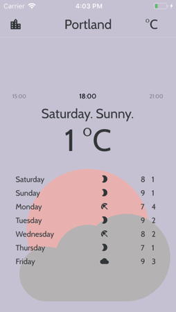
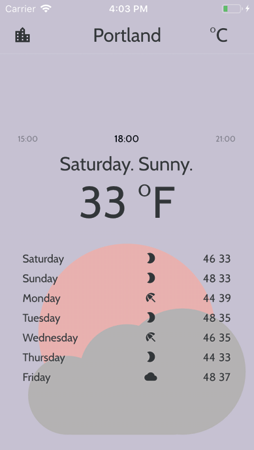

*Mô tả hình:* Hai ảnh chụp màn hình trang dự báo thời tiết của ứng dụng đặt cạnh nhau, giữa hai ảnh có chú thích "On double tap" (khi chạm hai lần). Ảnh bên trái hiển thị nhiệt độ theo độ C; ảnh bên phải, sau khi người dùng double tap, hiển thị cùng dự báo nhưng nhiệt độ theo độ F.

Việc hiện thực tính năng này hẳn sẽ trông quen thuộc, vì bạn đã thấy các widget nút bấm dùng callback cử chỉ rồi. Trong ví dụ này, tôi bọc toàn bộ phần thân (`body`) của `Scaffold` bằng một bộ phát hiện cử chỉ, bên trong widget `ForecastPageState`, như trong listing tiếp theo.

**Listing 5.1 – Sử dụng cử chỉ kéo (Using the drag gesture)**

```dart
// weather_app/lib/page/forecast_page.dart -- line ~ 246
body: GestureDetector(                       // (1)
  onDoubleTap: () {                          // (2)
    setState(() {
      widget.settings.selectedTemperature =
          widget.settings.selectedTemperature == TemperatureUnit.celsius
              ? TemperatureUnit.celsius
              : TemperatureUnit.fahrenheit;
    });
  },
  onVerticalDragUpdate: (DragUpdateDetails v)  // (3)
      => _handleDragEnd(v, context),
  child: ColorTransitionBox(                 // (4)
    ...
```

Chú thích trong listing:

1. `GestureDetector` là widget nền tảng lắng nghe tương tác từ người dùng.
2. Một trong rất nhiều cử chỉ được Flutter định nghĩa (ở đây là chạm hai lần – *double tap*).
3. Một cử chỉ khác phức tạp hơn, vì nó cung cấp chi tiết về cử chỉ. Nhiều cử chỉ truyền thông tin chi tiết về cử chỉ đó cho callback tương ứng trên bộ phát hiện cử chỉ.
4. `GestureDetector` nhận bất kỳ widget nào làm con. Widget con này giờ sẽ phản hồi các cử chỉ.

> 📝 **Giải thích thêm (không có trong sách):** Nếu đọc kỹ biểu thức ba ngôi (*ternary*) trong `onDoubleTap` như được in trong sách, bạn sẽ thấy: nếu đơn vị hiện tại là `celsius` thì gán lại… `celsius`, ngược lại thì gán `fahrenheit` – tức là về mặt logic nó không "lật" qua lại được. Đây nhiều khả năng là lỗi in ấn/lỗi nhỏ trong mã của sách; bản dịch giữ nguyên văn listing. Để thực sự chuyển đổi qua lại, hai nhánh nên được đảo:
>
> ```dart
> widget.settings.selectedTemperature =
>     widget.settings.selectedTemperature == TemperatureUnit.celsius
>         ? TemperatureUnit.fahrenheit
>         : TemperatureUnit.celsius;
> ```

Phần phức tạp nhất của ví dụ này là tham số `GestureDetector.onVerticalDragUpdate`. Callback được truyền vào `GestureDetector.onVerticalDragUpdate` sẽ được gọi **lặp đi lặp lại** khi bạn kéo ngón tay lên hoặc xuống trên màn hình. Mỗi lần được gọi, nó nhận thông tin về cú kéo dưới dạng tham số, là một thể hiện (*instance*) của lớp `DragUpdateDetails`. Lớp này cung cấp nhiều chi tiết, nhưng trong trường hợp này chúng ta chỉ quan tâm đến `DragUpdateDetails.globalPosition`. Mỗi khi `onVerticalDragUpdate` được gọi, bạn có cơ hội biết chính xác người dùng đang kéo tới vị trí nào trên màn hình, và bạn có thể thực hiện một hành động dựa trên vị trí đó.

Ví dụ, bạn có thể thấy điều này trong thực tế ở phương thức `ForecastPageState._handleDragEnd`, được gọi mỗi khi `onVerticalDragUpdate` được gọi. Nhìn ở mức tổng quát, hàm này làm cùng một việc như khi chọn một tab trong widget `TimePickerRow`. Tức là, khi kéo lên kéo xuống, bạn đang chọn một thời điểm mới trong ngày để hiển thị.

Tôi làm được điều này bằng cách chia màn hình (về mặt khái niệm) thành tám hàng (vì có tám thời điểm trong ngày để chọn trên thanh tab). Về cơ bản, một phần tám trên cùng của màn hình đại diện cho 3:00 (thời điểm sớm nhất) trong `TimePickerRow`. Phần tám thứ hai đại diện cho 6:00, và cứ thế.

Nếu bạn đang kéo ngón tay theo chiều dọc trên màn hình và đi vào đoạn một phần tám trên cùng, ứng dụng sẽ cập nhật để hiển thị dự báo cho thời điểm đó của hôm nay (3:00 sáng). Đây là đoạn mã trong ứng dụng.

**Listing 5.2 – Xử lý phần kết thúc của cử chỉ kéo (Handling the end of a drag gesture)**

```dart
// weather_app/lib/page/forecast_page.dart -- line ~90
void _handleDragEnd(DragUpdateDetails d, BuildContext context) {
  double screenHeight =
      MediaQuery.of(context).size.height;      // (1)
  double dragEnd = d.globalPosition.dy;        // (2)
  double percentage =
      (dragEnd / screenHeight) * 100.0;        // (3)
  int scaleToTimesOfDay =
      (percentage ~/ 12).toInt();              // (4)
  if (scaleToTimesOfDay > 7) scaleToTimesOfDay = 7;
  _handleStateChange(scaleToTimesOfDay);
}
```

Chú thích trong listing:

1. Dùng `MediaQuery` để lấy chiều cao màn hình; giá trị này sẽ được dùng để tính tám đoạn (theo khái niệm) của màn hình.
2. `globalPosition.dy` là vị trí trên trục y của màn hình nơi con trỏ (ngón tay) đang nằm khi `onVerticalDragUpdate` được gọi.
3. Dùng hai số ở trên để quy đổi vị trí thành một số trong khoảng 0 đến 100 (đại diện cho 100% chiều cao màn hình).
4. Quy đổi số đó về thang 0–7, vì chúng ta đang làm việc với một danh sách đánh chỉ số từ 0 để chọn thời điểm trong ngày, và có tám lựa chọn.

> 💡 **Ví dụ bổ sung (không có trong sách) – bài toán tính tay:** Giả sử màn hình cao `screenHeight = 800` px.
>
> | Ngón tay ở `dy` | `percentage` | `percentage ~/ 12` | Sau khi chặn `> 7` | Thời điểm hiển thị |
> |---|---|---|---|---|
> | 50 | 6.25 | 0 | 0 | 3:00 |
> | 130 | 16.25 | 1 | 1 | 6:00 |
> | 400 | 50.0 | 4 | 4 | 15:00 |
> | 770 | 96.25 | 8 | **7** | 24:00 (0:00 hôm sau) |
>
> Toán tử `~/` trong Dart là **chia lấy phần nguyên** (ví dụ `50.0 ~/ 12 == 4`). Vì 100 / 12 ≈ 8,33 nên ở vùng dưới cùng màn hình kết quả có thể là 8 – đó là lý do có dòng `if (scaleToTimesOfDay > 7) scaleToTimesOfDay = 7;` để không vượt ra ngoài danh sách 8 phần tử (chỉ số 0–7). Lưu ý: chia cho 12 nghĩa là mỗi "hàng" chiếm 12% màn hình chứ không đúng 12,5% (1/8) – một xấp xỉ đủ dùng.

Sau khi đã nắm phần giải thích về bộ phát hiện cử chỉ tổng quát, giờ tôi sẽ trình bày một widget phát hiện cử chỉ có sẵn rất phổ biến trong các ứng dụng di động hiện đại: widget `Dismissible`.

> **Khung: Tạo dữ liệu giả cho ứng dụng thời tiết (Generating mocked data for the weather app)**
>
> Nếu bạn thắc mắc các con số cho thời điểm trong ngày từ đâu ra, thì chúng được sinh ra trong lớp `WeatherDataRepository` – lớp này tạo dữ liệu giả (*fake data*) cho ứng dụng. Trong một phương thức tên là `dailyForecastGenerator`, tôi sinh ra tám bản dự báo mỗi ngày. Trên giao diện, đây chính là nguồn gốc của các lựa chọn trong `TimerPickerRow` (3:00, 6:00, 9:00, v.v.).
>
> Hàm này khá dài và hoàn toàn không quan trọng cho việc học Flutter; tôi chỉ chỉ ra nó cho minh bạch. Những dòng quan trọng đã được chú thích:
>
> ```dart
> // weather_app/lib/utils/generate_weather_data.dart -- line ~51
> ForecastDay dailyForecastGenerator(City city, int low, int high) {
>   List<Weather> forecasts = [];            // (1)
>   int runningMin = 555;
>   int runningMax = -555;
>   for (int i = 0; i < 8; i++) {            // (2)
>     startDateTime =
>         startDateTime.add(Duration(hours: 3));   // (3)
>     int temp = _random.nextInt(high);
>     final tempBuilder = Temperature(
>       current: temp,
>       temperatureUnit: TemperatureUnit.celsius,
>     );
>     forecasts.add(                         // (4)
>       Weather(
>         city: city,
>         dateTime: startDateTime,
>         description: randomDescription,
>         cloudCoveragePercentage:
>             generateCloudCoverageNum(randomDescription),
>         temperature: tempBuilder,
>       ),
>     );
>     runningMin = math.min(runningMin, temp);
>     runningMax = math.max(runningMax, temp);
>   }
>   final forecastDay = ForecastDay(
>     hourlyWeather: forecasts,
>     min: runningMin,
>     max: runningMax,
>     date: dailyDate,
>   );
>   dailyDate.add(Duration(days: 1));
>   return forecastDay;
> }
> ```
>
> Chú thích:
> 1. Mỗi ngày có tám bản dự báo, cứ ba giờ một lần, bắt đầu từ 3:00 sáng. Danh sách này sẽ chứa các điều kiện thời tiết đó.
> 2. Lặp từ 0 đến 7.
> 3. `startDateTime` ban đầu là 0:00 (nửa đêm). Mỗi vòng lặp cộng thêm ba giờ.
> 4. Đẩy một thể hiện `Weather` mới vào danh sách; trong ứng dụng này nó được sinh ngẫu nhiên.

### 5.1.3 Widget Dismissible (The Dismissible widget)

Widget `Dismissible` (có thể "vuốt để loại bỏ") đáng được nhấn mạnh vì nó "khó nhằn" hơn một số widget cử chỉ khác. Trước tiên, hãy xem nó được dùng thế nào trong ứng dụng thời tiết. Nếu bạn chưa chắc dismissible là gì, bạn sẽ nhận ra nó ngay khi nhìn hình 5.2.

**Hình 5.2 – Ví dụ về một widget `Dismissible` (Example of a Dismissible widget)**

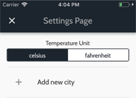
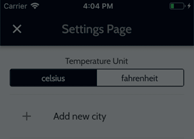

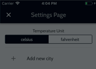
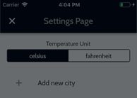
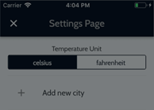

Toàn trang gốc (để thấy bố cục đầy đủ của hình và các mũi tên chú thích):

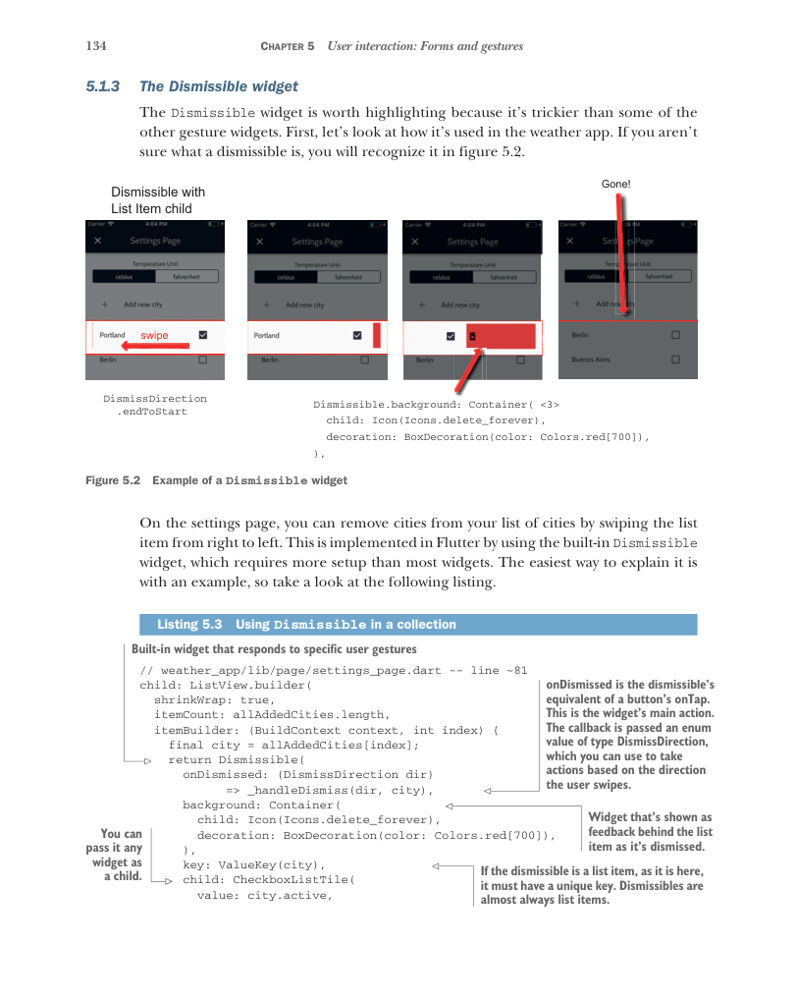

*Mô tả hình:* Bốn ảnh chụp liên tiếp của trang **Settings Page** (Trang cài đặt), có phần chọn "Temperature Unit" (đơn vị nhiệt độ: celsius / fahrenheit), dòng "+ Add new city" (Thêm thành phố mới) và danh sách thành phố (Portland, Berlin, Buenos Aires…), mỗi dòng có một ô check box.
- Ảnh 1 – chú thích "**Dismissible with List Item child**" (Dismissible với con là một mục danh sách): dòng Portland được khoanh đỏ, có mũi tên đỏ "**swipe**" (vuốt) chỉ sang trái. Bên dưới ghi `DismissDirection.endToStart` – hướng vuốt từ cuối về đầu (với ngôn ngữ viết trái-sang-phải là từ phải sang trái).
- Ảnh 2 và 3: dòng Portland trượt dần sang trái, để lộ một khối màu đỏ với biểu tượng thùng rác phía sau. Mũi tên chỉ vào phần này kèm đoạn mã:
  ```dart
  Dismissible.background: Container( <3>
    child: Icon(Icons.delete_forever),
    decoration: BoxDecoration(color: Colors.red[700]),
  ),
  ```
  (tức là phần nền đỏ chính là widget truyền cho thuộc tính `background`; "<3>" là ký hiệu tham chiếu tới chú thích số 3 của listing.)
- Ảnh 4 – chú thích "**Gone!**" (Biến mất!): dòng Portland đã bị xóa, danh sách chỉ còn Berlin và Buenos Aires.

Trên trang cài đặt, bạn có thể xóa thành phố khỏi danh sách thành phố của mình bằng cách vuốt mục danh sách từ phải sang trái. Điều này được hiện thực trong Flutter bằng widget có sẵn `Dismissible`, widget này đòi hỏi nhiều thiết lập hơn phần lớn các widget khác. Cách dễ nhất để giải thích nó là qua một ví dụ, vậy hãy xem listing sau.

**Listing 5.3 – Sử dụng `Dismissible` trong một tập hợp (Using Dismissible in a collection)**

```dart
// weather_app/lib/page/settings_page.dart -- line ~81
child: ListView.builder(
  shrinkWrap: true,
  itemCount: allAddedCities.length,
  itemBuilder: (BuildContext context, int index) {
    final city = allAddedCities[index];
    return Dismissible(                              // (1)
      onDismissed: (DismissDirection dir)            // (2)
          => _handleDismiss(dir, city),
      background: Container(                         // (3)
        child: Icon(Icons.delete_forever),
        decoration: BoxDecoration(color: Colors.red[700]),
      ),
      key: ValueKey(city),                           // (4)
      child: CheckboxListTile(                       // (5)
        value: city.active,
        title: Text(city.name),
        onChanged: (bool b) => _handleCityActiveChange(b, city),
      ),
    );
  }
),
```

Chú thích trong listing:

1. Widget có sẵn phản hồi các cử chỉ cụ thể của người dùng.
2. `onDismissed` là thứ tương đương với `onTap` của một nút bấm, nhưng dành cho dismissible. Đây là hành động chính của widget. Callback nhận vào một giá trị enum kiểu `DismissDirection`, bạn có thể dùng nó để thực hiện hành động khác nhau tùy theo hướng người dùng vuốt.
3. Widget được hiển thị làm phản hồi trực quan phía sau mục danh sách khi mục đó đang bị vuốt đi.
4. Nếu dismissible là một mục danh sách, như ở đây, nó **bắt buộc** phải có một key duy nhất. Dismissible hầu như lúc nào cũng là mục danh sách.
5. Bạn có thể truyền cho nó bất kỳ widget nào làm con.

Ngoài việc là một ví dụ tuyệt vời nữa về những gì bạn có sẵn "ngay khi mở hộp" với Flutter, `Dismissible` còn là một ví dụ quan trọng vì nó là một trong số rất ít widget **yêu cầu bạn truyền vào một `Key`**. Đây cũng là một ví dụ rất hay cho thấy vì sao key lại quan trọng. Chuyện gì sẽ xảy ra nếu bạn không đưa key cho một dismissible trong danh sách? Hãy tưởng tượng tình huống sau: có một danh sách gồm năm mục dismissible, và bạn vuốt bỏ mục thứ hai trong danh sách:

1. Dismissible số 2 bị vuốt và do đó bị gỡ khỏi cây widget.
2. Flutter biết đã đến lúc build lại (*rebuild*), vì `setState` được gọi khi widget bị loại bỏ.
3. Lúc này cây widget đã thay đổi, vì có ít hơn một widget `Dismissible`. Tất cả các element trong cây element (*element tree*) bắt đầu nhìn vào widget liên kết với chúng, như chúng vẫn luôn làm mỗi khi Flutter rebuild. Vì không có key, các element so sánh widget ở vị trí của mình với widget trước đó nằm ở vị trí đó trong cây, trước lần render lại.
4. Một element lên tiếng: "Này, widget của tôi đi đâu mất rồi! Ở vị trí của nó trong cây không còn gì nữa. Có lẽ nó là một trong những widget cùng kiểu khác trong tập hợp này."
5. Giờ thì có vấn đề, vì có năm element đang cố "nhận" chỉ bốn widget. Tất cả các dismissible còn lại đều đã có element trỏ tới. Element này cho rằng có lỗi, vì lẽ ra nó phải có một widget để trỏ tới.

Trong Flutter, việc có element không có widget nào để trỏ tới là một lỗi. Dùng key sẽ giải quyết chuyện này, vì khi nhìn vào các widget dismissible khác, element biết rằng chúng đều có key khác nhau, nên element hiểu rằng mình không còn cần thiết nữa.

> 📝 **Giải thích thêm (không có trong sách):** Nhắc lại ngắn gọn: Flutter có ba cây – *widget tree* (bản mô tả giao diện, nhẹ, tạo lại liên tục), *element tree* (các đối tượng sống lâu, giữ vị trí và state) và *render tree*. Khi rebuild, mỗi element kiểm tra "widget mới ở vị trí của tôi có cùng `runtimeType` và cùng `key` với widget cũ không?". Không có key, Flutter chỉ dựa vào **vị trí + kiểu**, nên rất dễ ghép nhầm. Có key (ví dụ `ValueKey(city)`), Flutter ghép widget–element theo **danh tính**, nên biết chính xác mục nào đã biến mất.

> 💡 **Ví dụ bổ sung (không có trong sách):** Một danh sách việc cần làm tối giản, vuốt để xóa, xử lý theo hướng vuốt và hiện `SnackBar`:
>
> ```dart
> class TodoList extends StatefulWidget {
>   @override
>   _TodoListState createState() => _TodoListState();
> }
>
> class _TodoListState extends State<TodoList> {
>   final List<String> _todos = ['Mua sữa', 'Học Flutter', 'Đi chạy bộ'];
>
>   @override
>   Widget build(BuildContext context) {
>     return ListView.builder(
>       itemCount: _todos.length,
>       itemBuilder: (context, index) {
>         final todo = _todos[index];
>         return Dismissible(
>           key: ValueKey(todo), // mỗi mục một key duy nhất
>           background: Container(color: Colors.green),      // vuốt trái → phải
>           secondaryBackground: Container(color: Colors.red), // vuốt phải → trái
>           onDismissed: (DismissDirection dir) {
>             setState(() => _todos.removeAt(index));
>             final action =
>                 dir == DismissDirection.startToEnd ? 'Hoàn thành' : 'Đã xóa';
>             ScaffoldMessenger.of(context)
>                 .showSnackBar(SnackBar(content: Text('$action: $todo')));
>           },
>           child: ListTile(title: Text(todo)),
>         );
>       },
>     );
>   }
> }
> ```
>
> Nếu bạn đổi `key: ValueKey(todo)` thành không có key, Flutter sẽ báo lỗi kiểu *"A dismissed Dismissible widget is still part of the tree"* – đúng với kịch bản năm element/bốn widget mà tác giả mô tả. (Lưu ý: `ScaffoldMessenger` là API của các phiên bản Flutter mới hơn sách; bản cũ dùng `Scaffold.of(context).showSnackBar`.)

Ngoài điều đó ra, `Dismissible` không khác mấy so với các widget tương tác người dùng khác. Và thực ra, đó chính là điểm mấu chốt. Có nhiều widget có sẵn tương tác tích hợp, và nhiều khả năng bạn sẽ tự tạo vài widget của riêng mình. Tất cả chúng đều tuân theo cùng những quy tắc cơ bản:

- Chúng thường bọc lấy những widget **không** có khả năng tương tác, và bổ sung chức năng phát hiện cử chỉ.
- Chúng cung cấp các callback truyền về chi tiết của sự kiện tương tác, cho bạn cơ hội xử lý dữ liệu theo bất kỳ cách nào bạn muốn.

Chắc chắn là widget `Dismissible` phức tạp hơn một chút so với những quy tắc cơ bản này. Ví dụ, trong Flutter sẽ là lỗi nếu không có widget nền (`background`) để hiển thị khi dismissible đang di chuyển trên màn hình. Widget nền được giải thích dễ nhất bằng hình 5.3, mà bạn đã thấy trước đó.

**Hình 5.3 – Ví dụ về một widget dismissible (Example of a dismissible widget)**


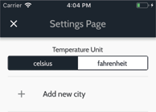
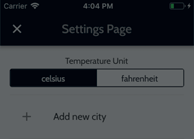

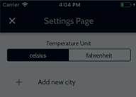
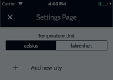

*Mô tả hình:* Hình 5.3 lặp lại đúng nội dung của hình 5.2: mục danh sách "Portland" (Dismissible với con là một List Item) bị vuốt (*swipe*) theo hướng `DismissDirection.endToStart`; trong khi trượt, phần `Dismissible.background` – một `Container` có `Icon(Icons.delete_forever)` và `BoxDecoration(color: Colors.red[700])` – hiện ra phía sau; cuối cùng mục đó "Gone!" (biến mất) khỏi danh sách.

Điều tôi muốn bạn rút ra từ mục này là: mọi widget phát hiện cử chỉ đều được hiện thực với các API tương tự nhau, mặc dù nhiều widget có những khía cạnh riêng buộc phải xử lý, chẳng hạn như phần nền của dismissible. Một bài học "tặng kèm" nữa: hãy biết rằng có rất nhiều widget phát hiện cử chỉ và widget tương tác có sẵn, giúp bạn bớt được rất nhiều mã giao diện mà lẽ ra bạn phải tự viết. (Bạn có thể tìm tất cả các widget tương tác trong phần này của danh mục widget chính thức: https://flutter.dev/docs/development/ui/widgets/interaction.)

Có một số widget tương tác khác với những gì ta đã thấy cho tới giờ: đó là các widget **nhận dữ liệu nhập**, như một ô nhập văn bản. Chúng tương tự, nhưng phức tạp hơn một chút. Các widget đó được trình bày ở phần còn lại của chương, nơi chúng ta sẽ xem xét form.

---

## 5.2 Form trong Flutter (Flutter forms)

Trên bất kỳ nền tảng nào, việc xử lý form và dữ liệu người dùng nhập vào đều có thể khá rắc rối. Thường có rất nhiều "bộ phận chuyển động": bạn có state cục bộ (*local state*) phải xử lý, có sự kiện phải lắng nghe, và có những giá trị nhập vào phải được "nhào nặn" thành thứ gì đó hữu ích cho cơ sở dữ liệu. Trong phần còn lại của chương, tôi sẽ dành nhiều thời gian trong một file, `add_city_page.dart`, và giải thích form hoạt động thế nào trong Flutter.

Cụ thể, có một form trên trang `add_city_page.dart` cho phép người dùng thêm thành phố mới vào danh sách các thành phố mà họ muốn xem thời tiết. Hãy nói về các yêu cầu để làm được điều đó:

- Tạo giao diện cho form, bao gồm các trường form (*form field*) để người dùng nhập dữ liệu liên quan.
- Hiện thực một cách để lấy toàn bộ dữ liệu khi người dùng gửi (*submit*) form. Lý tưởng nhất là tất cả diễn ra cùng một lúc, thay vì từng trường một. (Gợi ý: key rất hữu ích!)
- Kiểm tra hợp lệ (*validate*) dữ liệu để chắc chắn nó dùng được. Chức năng này thực ra có thể hữu ích hơn nếu làm theo từng trường, điều này thêm một lớp phức tạp mới.
- Chuyển dữ liệu cho phần logic nghiệp vụ (*business logic*), phần này sẽ biết cách gửi dữ liệu vào cơ sở dữ liệu.

> **NOTE (Ghi chú)** Trong chương này chúng ta không quan tâm đến logic nghiệp vụ hay cơ sở dữ liệu, nhưng chúng ta sẽ đề cập tới việc giao tiếp với các dịch vụ bên ngoài ở phần sau của cuốn sách.

Trong vài trang tới, tôi sẽ trình bày cách form trong Flutter hoạt động nói chung, rồi cho bạn xem phần hiện thực trong ứng dụng thời tiết.

### 5.2.1 Widget Form (The Form widget)

Widget `Form` là một kiểu "lớp bọc" cung cấp vài phương thức tiện dụng và tích hợp với tất cả các widget trường form nằm trong cây con (*subtree*) của nó. Nói ngắn gọn: form **quản lý state của tất cả các trường** trong form, nhờ đó bạn không cần tự xử lý state cho từng trường riêng lẻ. Trước khi đi quá sâu vào chi tiết, hãy xem ví dụ tổng quát từ ứng dụng thời tiết trong hình 5.4. Mọi chi tiết vụn vặt của từng trường đã được lược bỏ, để bạn thấy được các đặc điểm chính: `Form`, key kiểu `FormState`, và các trường form. Trong ứng dụng thời tiết, form này được tạo trong `weather_app/lib/page/add_city_page.dart`.

**Hình 5.4 – Một ví dụ về form (A form example)**

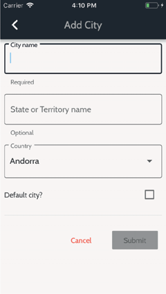

*Mô tả hình:* Bên trái là ảnh chụp màn hình trang Add City (ô "City name", ô "State or Territory name", ô chọn "Country", check box "Default city?", và hai nút Cancel/Submit). Bên cạnh là đoạn mã giả (*pseudo-code*) mô tả cấu trúc của form:

```dart
Form(
  key: GlobalKey<FormState>,
  child: Column(
    children: [
      TextFormField(),
      TextFormField(),
      DropdownButtonFormField(),
      FormField(child: Checkbox()),
      // ...
      Button(
        child: Text("Submit"),
        onPressed: FormState.save()
      // ...
```

Cách tương tác với `Form` theo kiểu "chuẩn" có sẵn của Flutter là truyền cho nó một key kiểu `FormState`. Widget sẽ liên kết global key (*khóa toàn cục*) đó với đối tượng state của chính form này, cho phép bạn truy cập đối tượng state ở bất cứ đâu. Đây là **tình huống duy nhất** mà tôi khuyên dùng global key.

Giống mọi widget khác, `Form` được quản lý bởi một `Element` liên kết với nó (hình 5.5). Element đó giữ một tham chiếu tới một đối tượng `FormState`, đối tượng này được Flutter tạo ra ở bên trong. Đối tượng state này là một thể hiện của lớp `State` – thứ được tạo ra cho mọi `StatefulWidget` – nhưng được mở rộng thêm chức năng. Điểm khác biệt là đối tượng state này được tạo nội bộ khi bạn tạo global key. Trên thực tế, điều này có nghĩa là bạn có thể truy cập nó ở khắp nơi trong form thông qua tham chiếu key này.

**Hình 5.5 – State của form được lưu trong cây element (The form state is saved in the element tree.)**

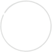
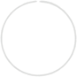

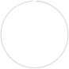
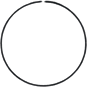

Các ảnh trích ở trên chỉ là các hình tròn/ô vuông nền mờ (các nút của cây); hình hoàn chỉnh (có chữ và mũi tên dạng vector) xem ở trang render:

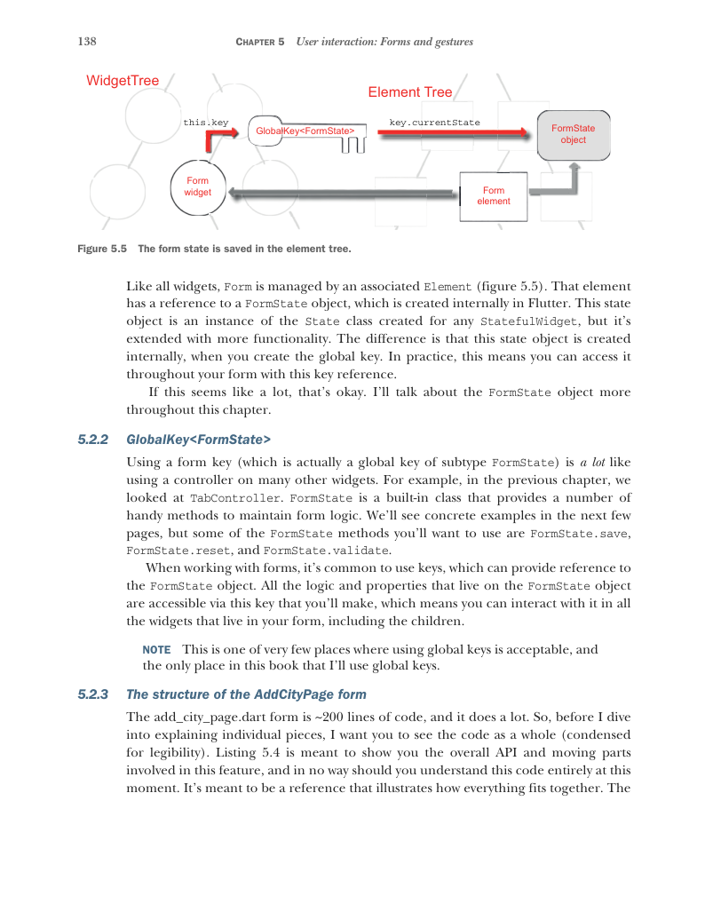

Vẽ lại bằng sơ đồ:

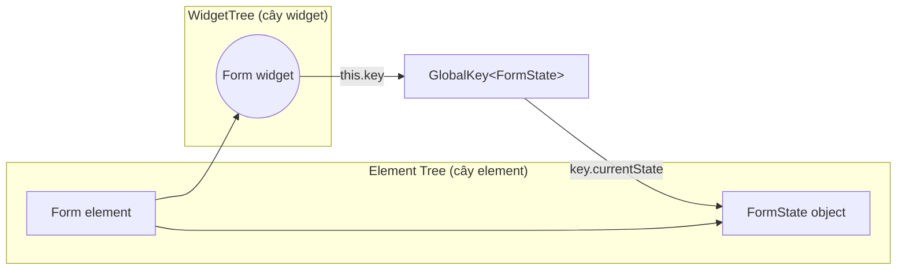

*Mô tả hình:* Bên trái là **WidgetTree** (cây widget) với nút "Form widget". Widget này có thuộc tính `this.key` trỏ tới một chiếc chìa khóa `GlobalKey<FormState>`. Từ chìa khóa, mũi tên `key.currentState` trỏ sang **Element Tree** (cây element) tới ô "FormState object" (đối tượng FormState). Trong cây element, "Form element" vừa trỏ ngược lại "Form widget", vừa giữ tham chiếu tới "FormState object". Ý chính: state thực sự nằm trong cây element, và global key là "lối tắt" để bạn với tới nó từ bất kỳ đâu.

Nếu những điều này có vẻ hơi nhiều, không sao cả. Tôi sẽ nói thêm về đối tượng `FormState` xuyên suốt chương này.

### 5.2.2 GlobalKey&lt;FormState&gt;

Dùng một form key (thực chất là một global key với kiểu con – *subtype* – là `FormState`) **rất** giống với việc dùng một controller trên nhiều widget khác. Ví dụ, ở chương trước chúng ta đã xem `TabController`. `FormState` là một lớp có sẵn cung cấp một số phương thức tiện dụng để duy trì logic của form. Chúng ta sẽ thấy ví dụ cụ thể trong vài trang tới, nhưng một số phương thức của `FormState` mà bạn sẽ muốn dùng là `FormState.save`, `FormState.reset` và `FormState.validate`.

Khi làm việc với form, việc dùng key là phổ biến, vì key có thể cung cấp tham chiếu tới đối tượng `FormState`. Toàn bộ logic và thuộc tính nằm trên đối tượng `FormState` đều có thể truy cập qua key mà bạn tạo ra, nghĩa là bạn có thể tương tác với nó trong mọi widget nằm trong form của bạn, kể cả các widget con.

> **NOTE (Ghi chú)** Đây là một trong số rất ít chỗ mà việc dùng global key là chấp nhận được, và cũng là chỗ duy nhất trong cuốn sách này mà tôi dùng global key.

> 💡 **Ví dụ bổ sung (không có trong sách):** Ba phương thức chính của `FormState` dùng qua key:
>
> ```dart
> final _formKey = GlobalKey<FormState>();
>
> // ...trong build():
> Form(
>   key: _formKey,
>   child: Column(children: [
>     TextFormField(
>       validator: (v) => (v == null || v.isEmpty) ? 'Không được bỏ trống' : null,
>       onSaved: (v) => print('Đã lưu: $v'),
>     ),
>     Row(children: [
>       ElevatedButton(
>         child: Text('Lưu'),
>         onPressed: () {
>           // validate(): gọi validator của MỌI trường, trả về true nếu tất cả hợp lệ
>           if (_formKey.currentState.validate()) {
>             // save(): gọi onSaved của MỌI trường
>             _formKey.currentState.save();
>           }
>         },
>       ),
>       TextButton(
>         child: Text('Xóa hết'),
>         // reset(): đưa mọi trường về giá trị ban đầu (initialValue) và xóa lỗi
>         onPressed: () => _formKey.currentState.reset(),
>       ),
>     ]),
>   ]),
> );
> ```
>
> Giống như `TabController` điều khiển `TabBar` từ bên ngoài, `_formKey.currentState` cho phép một nút bấm ở bất kỳ đâu điều khiển cả form.

### 5.2.3 Cấu trúc của form AddCityPage (The structure of the AddCityPage form)

Form trong `add_city_page.dart` dài khoảng 200 dòng mã và làm khá nhiều việc. Vì vậy, trước khi đi vào giải thích từng phần, tôi muốn bạn nhìn thấy toàn bộ mã (đã rút gọn cho dễ đọc). Listing 5.4 nhằm cho bạn thấy API tổng thể và các bộ phận liên quan trong tính năng này, và bạn hoàn toàn **không** cần phải hiểu hết đoạn mã này ngay lúc này. Nó là một tài liệu tham khảo minh họa cách mọi thứ khớp với nhau. Các đoạn mã còn lại trong chương sẽ là những mảnh được trích ra từ file này; tôi khuyến khích bạn quay lại xem ví dụ này khi cần.

**Listing 5.4 – Dàn ý của add_city_page.dart (add_city_page.dart outline)**

```dart
import ...

class AddNewCityPage extends StatefulWidget {
  final AppSettings settings;

  const AddNewCityPage({Key key, this.settings}) : super(key: key);

  @override
  _AddNewCityPageState createState() => _AddNewCityPageState();
}

class _AddNewCityPageState extends State<AddNewCityPage> {
  City _newCity = City.fromUserInput();          // (1)
  bool _formChanged = false;                     // (2)
  bool _isDefaultFlag = false;
  FocusNode focusNode;
  final GlobalKey<FormState> _formKey =          // (3)
      GlobalKey<FormState>();

  @override
  void initState() {...}

  @override
  void dispose() {...}

  bool validateTextFields() {...}

  @override
  Widget build(BuildContext context) {
    return Scaffold(
      appBar: AppBar(...),
      body: Padding(
        padding: ...
        child: Form(                             // (4)
          key: _formKey,
          onChanged: _onFormChange,
          onWillPop: _onWillPop,
          child: Column(
            children: <Widget>[
              Padding(
                padding: ...
                child: TextFormField(...),       // (5)
              ),
              Padding(
                padding: ...
                child: TextFormField(...),       // (6)
              ),
              CountryDropdownField(...),         // (7)
              FormField(...),                    // (8)
              Divider(...),
              Row(                               // (9)
                mainAxisAlignment: MainAxisAlignment.end,
                children: <Widget>[
                  Padding(
                    padding: ...
                    child: FlatButton(...),      // (10)
                  ),
                  Padding(
                    padding: ...
                    child: RaisedButton(         // (11)
                      color: Colors.blue[400],
                      child: Text("Submit"),
                      onPressed: _formChanged
                          ? () {
                              if (_formKey.currentState.validate()) {
                                _formKey.currentState.save();
                                _handleAddNewCity();
                                Navigator.pop(context);
                              } else {
                                FocusScope.of(context)
                                    .requestFocus(focusNode);
                              }
                            }
                          : null,
                    ),
                  )
                  // ... many more closing brackets
    );
  }

  void _onFormChange() {...}

  void _handleAddNewCity() {...}

  Future<bool> _onWillPop() {
    if (!_formChanged) return Future<bool>.value(true);
    return showDialog<bool>(
      context: context,
      builder: (BuildContext context) {
        // the dialog shown when leaving the page with un-submitted data
        return AlertDialog(...);
      }
  }
```

Chú thích trong listing:

1. Giá trị cuối cùng sẽ được gửi vào kho dữ liệu (*repository*).
2. Dùng để quản lý state giao diện của form.
3. Dùng để quản lý state hiện tại của form.
4. Gốc của `Form`. Mọi trường form sẽ là con cháu (*descendant*) của widget này.
5. Trường form City (tên thành phố).
6. Trường form State or Territory (bang hoặc vùng lãnh thổ).
7. Trường thả xuống (*drop-down*) trong form.
8. Check box cho "thành phố mặc định" (*default city*).
9. Phần dưới cùng của form, nơi người dùng hủy hoặc gửi dữ liệu đã nhập.
10. Nút Cancel (Hủy).
11. Nút Submit (Gửi).

(Comment gốc trong code: `// ... many more closing brackets` = "… còn rất nhiều dấu ngoặc đóng nữa"; `// the dialog shown when leaving the page with un-submitted data` = "hộp thoại hiển thị khi rời trang mà dữ liệu chưa được gửi".)

### 5.2.4 Hiện thực form trong ứng dụng thời tiết (Implementing the form in the weather app)

Hãy làm cho điều này cụ thể hơn bằng ví dụ từ ứng dụng thời tiết. Form được tạo trong file `weather_app/lib/page/add_city_page.dart`. Trong listing sau, tôi đã lược bỏ một số dòng không quan trọng; chúng ta sẽ xem ví dụ đầy đủ ngay sau đây.

**Listing 5.5 – Thiết lập form ban đầu trong ứng dụng thời tiết (Initial form setup in the weather app)**

```dart
// weather_app/lib/page/add_city_page.dart -- line ~ 9
class AddNewCityPage extends StatefulWidget {
  final AppSettings settings;

  const AddNewCityPage({Key key, this.settings}) : super(key: key);

  @override
  _AddNewCityPageState createState() => _AddNewCityPageState();
}

class _AddNewCityPageState extends State<AddNewCityPage> {
  // ...
  final GlobalKey<FormState> _formKey =        // (1)
      GlobalKey<FormState>();

  @override
  Widget build(BuildContext context) {
    return Scaffold(
      // ... appbar
      body: Padding(
        padding: EdgeInsets.symmetric(horizontal: 8.0),
        child: Form(                           // (2)
          key: _formKey,                       // (3)
          // ...
```

Chú thích trong listing:

1. Key này giờ có kiểu con là `FormState`, một đối tượng state có sẵn của Flutter. Flutter biết phải tạo một đối tượng `FormState` có thể truy cập giống như một key.
2. Tạo một widget `Form` mới. Đây là một stateful widget, và đối tượng state của nó được liên kết với key truyền vào thuộc tính `key`.
3. State của form này có thể được truy cập ở bất kỳ đâu trong cây con widget thông qua key.

Trong đoạn mã này, tôi đã tạo một form và đưa cho nó một key. Đây là chi tiết quan trọng cần nhớ khi tạo form. Giờ tôi có tham chiếu tới đối tượng state của form thông qua key đó.

> **NOTE (Ghi chú)** Cũng nên nói thêm rằng bạn **không bắt buộc** phải dùng widget `Form` trong Flutter thì người dùng mới nhập văn bản được. Bạn có thể đưa widget nhập văn bản (`TextInput`) vào ứng dụng và quản lý dữ liệu nhập của nó một cách riêng lẻ.

> 📝 **Giải thích thêm (không có trong sách):** Trong Flutter, widget nhập văn bản đơn lẻ thường dùng là `TextField`, quản lý giá trị bằng một `TextEditingController`:
>
> ```dart
> final _controller = TextEditingController();
> // ...
> TextField(controller: _controller);
> // Lấy giá trị bất kỳ lúc nào:
> print(_controller.text);
> ```
>
> Cách này phù hợp cho một ô tìm kiếm đơn lẻ. Khi có nhiều trường liên quan với nhau cần validate/lưu cùng lúc thì `Form` + `FormField` tiện hơn nhiều – đó là nội dung của mục tiếp theo.

---

## 5.3 Các widget FormField (FormField widgets)

Form trở nên hữu ích là nhờ chức năng mà `FormState` mang lại khi bạn làm việc với **nhiều trường nhập liệu có liên quan với nhau**. Để form quản lý được các ô nhập liệu này, chúng phải là các widget `FormField`. **Bất kỳ** widget nhập liệu nào cũng có thể được bọc trong một form field, không chỉ riêng widget nhập văn bản. Ví dụ, bạn có thể dùng một `Checkbox` trong form, nhưng nó nên được bọc trong một form field:

```dart
return FormField(
  child: Checkbox(
    //...
```

Có ba widget `FormField`:

- `FormField` – Trường tiêu chuẩn, có thể biến bất kỳ widget nhập liệu nào thành một form field.
- `TextFormField` – Một form field chuyên biệt bọc lấy một ô nhập văn bản (*text field*).
- `DropdownButtonFormField` – Một widget tiện lợi bọc một `DropdownButton` (nút thả xuống) trong một form field.

> 📝 **Giải thích thêm (không có trong sách):** Đoạn `FormField(child: Checkbox(...))` ở trên là cách viết rút gọn mang tính minh họa của tác giả. Trong API thật, `FormField` **không** có tham số `child` mà nhận một `builder` (hàm dựng giao diện, nhận `FormFieldState`) – bạn sẽ thấy đúng điều này ở mục 5.3.3 và Listing 5.10.

Trong ứng dụng thời tiết, trên trang Add City (Thêm thành phố), có bốn form field (hình 5.6). Tôi sẽ dùng chúng để giải thích các loại form field khác nhau và cách dùng form field nói chung.

**Hình 5.6 – Các loại form field (Form field types)**

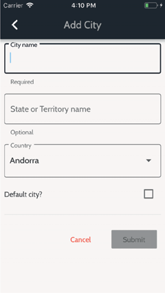

*Mô tả hình:* Ảnh chụp trang Add City với bốn trường, bên cạnh là mã giả cho biết mỗi trường ứng với biến nào:

```dart
Form(
  key: GlobalKey<FormState>,
  child: Column(
    children: [
      _titleField,             // ô "City name" – TextFormField
      _stateField,             // ô "State or Territory name" – TextFormField
      _countryDropdownField,   // ô chọn "Country" – trường thả xuống
      _isDefaultField,         // check box "Default city?" – FormField tổng quát
      // ...
      Button(
        child: Text("Submit"),
        onPressed: FormState.save()
      // ...
```

### 5.3.1 Widget TextFormField (The TextFormField widget)

Trong mục này, chúng ta sẽ xem xét từng loại trong ba loại có trong file `add_city_page.dart`. Để bắt đầu, hãy xem `TextFormField`: tôi đã tạo một biến cho nó tên là `_titleField`.

**Listing 5.6 – Ví dụ TextFormField (TextFormField example)**

```dart
// weather_app/lib/page/add_city_page.dart -- line ~77
Padding(
  padding: const EdgeInsets.symetric(verical: 8.0),
  child: TextFormField(                               // (1)
    onSaved: (String val) => _newCity.name = val,     // (2)
    decoration: InputDecoration(                      // (3)
      border: OutlineInputBorder(),
      helperText: "Required",
      labelText: "City name",
    ),
    autofocus: true,                                  // (4)
    autoValidate: true,                               // (5)
    validator: (String val) {
      if (val.isEmpty) return "Field cannot be left blank";
      return null;
    },
  ),
```

Chú thích trong listing:

1. `TextFormField` là sự kết hợp giữa `TextField` và `FormField`, và nhận nhiều tham số giống nhau.
2. Một phương thức đặc biệt của `FormField`: (`FormState`) gọi phương thức này trên tất cả các form field con.
3. `InputDecoration` là thuộc tính của `TextField`, nhưng không phải của các phần tử form khác.
4. Cũng là thuộc tính của `TextField`, dùng để đảm bảo đây là thứ đầu tiên được làm nổi bật (được focus) khi bạn điều hướng tới trang này.
5. Cho biết trường này có nên tự validate sau **mỗi lần** tương tác hay không. Lát nữa bạn sẽ thấy cách làm việc với validator.

(Các chuỗi trong code: `"Required"` = "Bắt buộc"; `"City name"` = "Tên thành phố"; `"Field cannot be left blank"` = "Không được để trống trường này".)

> 📝 **Giải thích thêm (không có trong sách):** Listing được giữ nguyên văn như sách, kể cả các lỗi chính tả `EdgeInsets.symetric(verical: 8.0)` – đúng ra phải là `EdgeInsets.symmetric(vertical: 8.0)` (như ở các listing sau). Ngoài ra, tên tham số thật trong API Flutter thời điểm sách viết là `autovalidate` (chữ v thường – như Listing 5.13), còn `autoValidate` là cách viết của tác giả. Ở các phiên bản Flutter mới, `autovalidate: bool` đã bị thay bằng `autovalidateMode: AutovalidateMode.onUserInteraction` (hoặc `.always`, `.disabled`).

Ba thuộc tính của `TextFormField` mà ta quan tâm lúc này là callback `validator`, cờ `autoValidate` và callback `onSaved`:

- **`validator`** là tham số có trên **mọi** form field, và nó mong đợi một callback. Với text form field, callback này nhận dữ liệu nhập của trường dưới dạng một `String`. Bất cứ thứ gì được trả về từ callback này sẽ được thêm vào trường dưới dạng **văn bản báo lỗi** (*error text*). Nếu nó không trả về gì hoặc trả về `null`, form field sẽ không hiển thị văn bản lỗi nào.

  Hàm `validator` là hàm đầu tiên trong số vài hàm được `FormState` xử lý trên tất cả form field trong cây con của nó. Bạn validate dữ liệu người dùng nhập vào các form field bằng cách gọi `FormState.validate()`, phương thức này sẽ "quay sang" gọi tất cả callback `validator` của các form field. Hoặc bạn có thể cho một widget tự động validate (`autoValidate`).
- **`autoValidate`** là một cờ Boolean trên form field. Khi đặt là `true`, nó gọi callback `validator` ngay lập tức mỗi khi form field thay đổi. Đây là cách tôi ưa thích, đơn giản vì nó cho người dùng phản hồi tức thì.
- **`onSaved`** hoạt động giống như `validator`. Đó là một tham số mà bạn truyền vào một callback. Callback đó được thực thi khi `FormState.save()` được gọi.

Ví dụ text field trong ứng dụng thời tiết, một lần nữa, được trình bày dưới đây.

**Listing 5.7 – Ví dụ TextFormField (TextFormField example)**

```dart
// weather_app/lib/page/add_city_page.dart -- line ~112
Widget get _titleField {
  // ...
    child: TextFormField(
      onSaved: (String val) => _newCity.name = val,    // (4)
      decoration: InputDecoration(
        // ...
      autofocus: true,
      autoValidate: true,                              // (2)
      validator: (String val) {                        // (1)
        if (val.isEmpty)                               // (3)
          return "Field cannot be left blank";
        return null;
      },
    ),
  ),
}
```

Chú thích trong listing:

1. Một phương thức đặc biệt của `FormField`: nhận một callback dùng để validate dữ liệu người dùng nhập.
2. Trường này sẽ được validate ngay khi nó nhận focus, và sau mỗi lần thay đổi.
3. Điều kiện validate duy nhất mà tôi kiểm tra là trường không bị để trống.
4. Khi `FormState.onSave` được gọi (tức `FormState.save()`), tôi muốn cập nhật thể hiện city mới với cái tên mới này.

> 💡 **Ví dụ bổ sung (không có trong sách) – validator nhiều điều kiện:** Giả sử ta muốn tên thành phố không trống, dài ít nhất 2 ký tự và không chứa chữ số:
>
> ```dart
> TextFormField(
>   decoration: InputDecoration(labelText: 'Tên thành phố'),
>   validator: (String val) {
>     if (val.isEmpty) return 'Không được để trống';
>     if (val.trim().length < 2) return 'Tên quá ngắn';
>     if (RegExp(r'\d').hasMatch(val)) return 'Tên không được chứa chữ số';
>     return null; // null = hợp lệ, không hiện lỗi
>   },
>   onSaved: (String val) => _newCity.name = val.trim(),
> );
> ```
>
> Với dữ liệu nhập lần lượt `""`, `"H"`, `"Hà Nội 2"`, `"Hà Nội"`, ô sẽ hiện lần lượt: "Không được để trống", "Tên quá ngắn", "Tên không được chứa chữ số", và không có lỗi. Chỉ khi mọi validator trong form trả về `null` thì `_formKey.currentState.validate()` mới trả về `true`.

### 5.3.2 Widget DropdownFormButton (The DropdownFormButton widget)

`DropdownFormButton` là một phần mở rộng khác của widget `FormField`. Nó hoạt động gần giống hệt `TextFormField`, ngoại trừ loại dữ liệu nó hiển thị và cách người dùng đưa ra lựa chọn. Trong ứng dụng thời tiết, hình 5.7 cho thấy `DropdownButtonFormField` trông như thế nào.

> 📝 **Giải thích thêm (không có trong sách):** Tên widget thật trong Flutter là `DropdownButtonFormField`; "DropdownFormButton" ở tiêu đề mục là cách gọi tắt của tác giả – cả hai đều chỉ cùng một thứ.

**Hình 5.7 – Ví dụ trường form thả xuống (Drop-down form field example)**

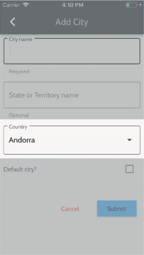
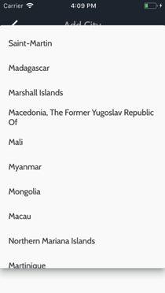

*Mô tả hình:* Ảnh trái: trường "Country" (Quốc gia) đang đóng, hiển thị giá trị đang chọn. Ảnh phải: chú thích "**When element is tapped, items are displayed.**" (Khi chạm vào phần tử, các mục sẽ hiện ra) – một danh sách dài các quốc gia bung ra để chọn. Kèm theo là đoạn mã:

```dart
DropDownExpanded<Country>(
  decoration: InputDecoration(
    border: OutlineInputBorder(),
    labelText: "Country",
  ),
  value: _newCity.country ?? Country.AD,
  onChanged: (Country newSelection) {
    setState(() =>
        _newCity.country = newSelection);
  },
  items: Country.ALL.map((Country country) {
    return DropdownMenuItem(
        value: country,
        child: Text(country.name));
    //...
```

(Trong bản PDF, sau `{` ở dòng `onChanged` có một ký tự `v` thừa – đó là ký tự rác/lỗi in và đã được bỏ.)

> **Khung: Flutter từng có một lỗi! (Flutter had a bug!)**
>
> Trong ví dụ này, tôi dùng một lớp tên là `DropDownExpanded`, do chính tôi viết. Nó là bản sao của widget `DropdownButtonFormField` về mọi mặt, chỉ khác ở chỗ nó có thể (tùy chọn) nhận thêm một cờ Boolean tên là `isExpanded`. Nếu `isExpanded` là `true`, phiên bản widget thả xuống của tôi sẽ chuyển thông tin đó cho widget con của nó, là một `DropdownButton`; và nếu `DropDownButton` có sẵn có `isExpanded` được đặt là `true`, nó sẽ bọc các con của nó trong một widget `Expanded`.
>
> Lỗi nằm ở chỗ `DropdownButtonFormField` có sẵn không nhận tham số `isExpanded`, nên chúng ta không bao giờ truy cập được thuộc tính đó của widget con (một `DropDownButton`) nếu đang dùng phiên bản form field của nút thả xuống.
>
> Đoạn mã bên trong `DropdownButton` sau đây tạo widget hiển thị giá trị của nút:
>
> ```dart
> Widget result = DefaultTextStyle(
>   style: _textStyle,
>   child: Container(
>     // ...
>     child: Row(
>       mainAxisAlignment: MainAxisAlignment.spaceBetween,
>       mainAxisSize: MainAxisSize.min,
>       children: <Widget>[
>         widget.isExpanded                       // (1)
>             ? Expanded(child: innerItemsWidget)
>             : innerItemsWidget,
>         // ...
> ```
>
> Chú thích (1): Đây là chỗ việc truyền `isExpanded` tạo ra khác biệt. Bọc các con trong `Expanded` có ý nghĩa nếu chiều rộng điện thoại quá nhỏ, vì nếu không có nó, widget sẽ cố to bao nhiêu tùy thích thay vì bị ràng buộc (*constrained*).
>
> Một lần nữa, vì thuộc tính `isExpanded` không được "phơi ra" trên lớp bọc form field của nút thả xuống, nên `widget.isExpanded` sẽ luôn là `false`.
>
> Đến lúc bạn đọc những dòng này, có thể lỗi đã được sửa. Nhưng đây là một bài học hay: nếu bạn muốn tinh chỉnh thứ gì đó trong Flutter cho phù hợp với mình, việc đó khá dễ làm theo nhiều cách. Mọi thứ đều có sẵn cho bạn – lập trình viên – trong API, và nó là mã nguồn mở.

> 📝 **Giải thích thêm (không có trong sách):** Lỗi này quả thật đã được khắc phục: các phiên bản Flutter sau này bổ sung tham số `isExpanded` cho `DropdownButtonFormField`, nên ngày nay bạn có thể viết `DropdownButtonFormField<Country>(isExpanded: true, ...)` mà không cần tự sao chép widget.

Quay lại ứng dụng thời tiết, hãy xem trường form thả xuống được dùng thế nào. Nó được hiện thực tương tự `TextFormField`, với khác biệt đáng chú ý là bạn truyền cho nó các mục (*items*) để hiển thị khi nút được chạm vào.

Với form field này, tôi đã tách thành một widget riêng, nhỏ hơn, để mã dễ đọc hơn một chút. Nó tên là `CountryDropdownField`, và bạn có thể tìm thấy nó tại `weather_app/lib/widget/country_dropdown_field.dart`.

**Listing 5.8 – Ví dụ DropdownButtonFormField (DropdownButtonFormField example)**

```dart
// weather_app/lib/widget/country_dropdown_field.dart
class CountryDropdownField extends StatelessWidget {
  final Function onChanged;
  final Country country;

  const CountryDropdownField({
    Key key,
    this.onChanged,
    this.country,
  }) : super(key: key);

  @override
  Widget build(BuildContext context) {
    return Padding(
      padding: const EdgeInsets.symmetric(vertical: 8.0),
      child: DropDownExpanded<Country>(
        isExpanded: true,
        decoration: InputDecoration(
          border: OutlineInputBorder(),
          labelText: "Country",
        ),
        value: country ?? Country.AD,                  // (1)
        onChanged: (Country newSelection)              // (2)
            => onChanged(newSelection),
        items: Country.ALL.map((Country country) {     // (3)
          return DropdownMenuItem(
            value: country,
            child: Text(country.name),
          );
        }).toList(),
      ),
    );
  }
}
```

Chú thích trong listing:

1. `value` là giá trị đang được chọn, sẽ hiển thị khi danh sách thả xuống đang đóng.
2. `onChanged` được gọi mỗi khi có lựa chọn mới. Trong các widget trường thả xuống của Flutter, lựa chọn mới được truyền vào callback của `onChanged`.
3. `items` mong đợi một danh sách gồm một loại widget cụ thể: `DropdownMenuItem<T>`. Tôi quyết định viết một hàm trả về `List<DropdownMenuItem<Country>>`, nhưng bạn cũng có thể dùng một list literal (danh sách viết trực tiếp).

Tôi chỉ mới chỉ ra những thuộc tính khác biệt trên widget này. Nó cũng nhận một callback `onSaved` và một callback `validator`, đúng như bạn mong đợi ở một form field.

Widget này được dựng trong ứng dụng từ `add_city_page.dart`. Mã được trình bày trong listing sau.

**Listing 5.9 – Tạo CountryDropdownField trong widget AddNewCity (Creating CountryDropdownField in the AddNewCity widget)**

```dart
// weather_app/lib/page/add_city_page.dart -- line ~93
CountryDropdownField(
  country: _newCity.country,
  onChanged: (newSelection) {
    setState(() => _newCity.country = newSelection);
  },
),
```

> 💡 **Ví dụ bổ sung (không có trong sách):** Một trường thả xuống chọn đơn vị nhiệt độ, có cả `validator` và `onSaved` (dùng widget chuẩn `DropdownButtonFormField`):
>
> ```dart
> enum Unit { celsius, fahrenheit }
>
> Unit _unit;            // chưa chọn gì
> Unit _savedUnit;
>
> DropdownButtonFormField<Unit>(
>   decoration: InputDecoration(
>     border: OutlineInputBorder(),
>     labelText: 'Đơn vị nhiệt độ',
>   ),
>   value: _unit,
>   items: const [
>     DropdownMenuItem(value: Unit.celsius, child: Text('Độ C')),
>     DropdownMenuItem(value: Unit.fahrenheit, child: Text('Độ F')),
>   ],
>   onChanged: (Unit u) => setState(() => _unit = u),
>   validator: (Unit u) => u == null ? 'Hãy chọn một đơn vị' : null,
>   onSaved: (Unit u) => _savedUnit = u,
> );
> ```
>
> Nếu người dùng bấm Submit mà chưa chọn gì, `validate()` trả về `false` và dưới ô hiện "Hãy chọn một đơn vị". Ở đây `items` được viết bằng list literal – cách thay thế mà tác giả nhắc tới ở chú thích 3.

### 5.3.3 Form field tổng quát (Generic form fields)

Nếu bạn muốn dùng bất kỳ loại nhập liệu nào khác, chẳng hạn như check box, bộ chọn ngày (*date picker*) hay thanh trượt (*slider*), bạn có thể bọc bất kỳ widget nào trong một widget `FormField`. Widget này cung cấp đúng những chức năng như hai form field trước mà tôi đã nói, mở rộng chức năng đó cho tất cả các widget nhập liệu khác.

Trong ứng dụng thời tiết, tôi dùng một `FormField` để bọc check box được thể hiện trong hình 5.8. Nó được hiện thực gần giống như các form field trước.

**Hình 5.8 – Một check box đóng vai trò form field (A check box as a form field)**

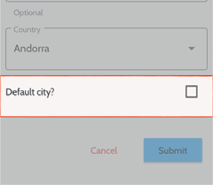

*Mô tả hình:* Ảnh chụp phần dưới của form: dòng chữ "Default city?" (Thành phố mặc định?) ở bên trái và một ô check box ở bên phải; kèm đoạn mã:

```dart
return FormField(
  onSaved: (val) => _newCity.active = _isDefaultFlag,
  enabled: _enabled,
  builder: (context) {
    return Row(
      mainAxisAlignment: MainAxisAlignment.spaceBetween,
      children: <Widget>[
        Text("Default city?"),
        Checkbox(
          value: _isDefaultFlag,
          onChanged: (val) {
            setState(() => _isDefaultFlag = val);
            //...
```

**Listing 5.10 – Hiện thực form field check box (Implementing the check box form field)**

```dart
class _AddNewCityPageState extends State<AddNewCityPage> {
  City _newCity = City.fromUserInput();
  bool _formChanged = false;
  bool _isDefaultFlag = false;                       // (1)
  final GlobalKey<FormState> _formKey = GlobalKey<FormState>();
  FocusNode focusNode;
  // ... other class members

  Widget build(BuildContext context) {
    return Scaffold(
      // ... parent widgets
      // ... begin check box region -- line ~ 99
      FormField(                                     // (2)
        onSaved: (val) => _newCity.active =          // (3)
            _isDefaultFlag,
        builder: (context) {                         // (4)
          return Row(
            mainAxisAlignment: MainAxisAlignment.spaceBetween,
            children: <Widget>[
              Text("Default city?"),
              Checkbox(                              // (5)
                value: _isDefaultFlag,
                onChanged: (val) {
                  setState(                          // (6)
                    () => _isDefaultFlag = val
                  );
                },
              ),
            ],
          );
        },
      ),
}
```

Chú thích trong listing:

1. Cờ Boolean dùng để quản lý state của check box.
2. Nhiều thuộc tính, chẳng hạn `onSaved`, giống hệt như ở các widget trước.
3. Callback `onSaved` hơi khác một chút, vì form field không biết trường này đang làm việc với kiểu dữ liệu gì. Đó là lý do tôi dùng `val` làm tham số mà không khai báo kiểu.
4. `FormField` nhận một `builder` thay vì một `child`. Bạn có thể trả về bất kỳ widget nào bạn muốn. Về mặt kỹ thuật, widget nào cũng có thể là một form field.
5. Check box này hoạt động y hệt bất kỳ check box nào bên ngoài form. Bạn đưa cho nó một giá trị Boolean để nó biết mình có đang được đánh dấu hay không.
6. Bạn nên gọi `setState` khi cập nhật cờ Boolean, để Flutter biết cần render lại với state mới của check box.

(Comment gốc: `// ... other class members` = "các thành viên khác của lớp"; `// ... parent widgets` = "các widget cha"; `// ... begin check box region -- line ~ 99` = "bắt đầu vùng check box – khoảng dòng 99".)

> 💡 **Ví dụ bổ sung (không có trong sách) – biến `Slider` thành form field có validate:** `FormField<T>` truyền cho `builder` một `FormFieldState<T>`; bạn dùng `state.value`, `state.didChange(...)` và `state.errorText` để nối widget bất kỳ vào cơ chế validate/save của form:
>
> ```dart
> FormField<double>(
>   initialValue: 0,
>   validator: (double v) => v < 10 ? 'Phải chọn ít nhất 10 km' : null,
>   onSaved: (double v) => _radiusKm = v,
>   builder: (FormFieldState<double> state) {
>     return Column(
>       crossAxisAlignment: CrossAxisAlignment.start,
>       children: [
>         Text('Bán kính tìm kiếm: ${state.value.round()} km'),
>         Slider(
>           value: state.value,
>           min: 0,
>           max: 100,
>           onChanged: state.didChange, // báo cho form biết giá trị mới
>         ),
>         if (state.hasError)
>           Text(state.errorText, style: TextStyle(color: Colors.red)),
>       ],
>     );
>   },
> );
> ```
>
> So với Listing 5.10 (dùng biến `_isDefaultFlag` riêng và `setState`), cách dùng `state.didChange` giúp giá trị nằm ngay trong `FormFieldState`, nên `reset()` của form cũng đưa slider về `initialValue` được.

Đó thực sự là tất cả những gì cần biết về chức năng của form field. Như mọi thứ trong Flutter, "đường cong học tập" (*learning curve*) đến từ việc biết mình *có thể* làm gì. Khi đã nắm được điều đó, bạn sẽ nhận ra phần lớn công việc giao diện đã được framework lo cho. Giờ bạn đã biết cách tạo form field, hãy kết hợp tất cả lại với phần định kiểu (*styling*), giao diện, và dùng key `FormState` đó để hoàn thiện chức năng.

---

## 5.4 Giao diện form và làm việc với focus node (Form UI and working with focus nodes)

Tôi muốn giải thích ngắn gọn về việc định kiểu cho form. Nhìn chung, nó theo đúng khuôn mẫu như định kiểu bất kỳ widget nào khác trong Flutter: bạn bọc các trường trong `Padding`, `Center` và các widget bố cục (*layout*) khác để xử lý vị trí, rồi định kiểu từng widget riêng lẻ bằng những thuộc tính mà chúng cung cấp. Ngoài định kiểu, tôi cũng muốn bàn về lớp `FocusNode`, được dùng để quản lý (bằng mã lệnh) trường nào sẽ nhận **focus** (*tiêu điểm* – trạng thái đang được chọn để nhập liệu, có con trỏ nhấp nháy và bàn phím hiện lên).

### 5.4.1 InputDecoration

Mọi ô nhập liệu và form field đều nhận một tham số tên là `decoration`, mà bạn truyền vào một `InputDecoration`. Đây là một khuôn mẫu phổ biến trong Flutter. Ví dụ, widget `Container` có một tham số `decoration`, mà bạn truyền vào một `BoxDecoration`.

Lớp `InputDecoration` nhận rất nhiều tham số mà bạn có thể dùng để định kiểu cho form field. Bạn có thể đặt màu nền, đổi màu tùy theo trường có đang được focus hay không, đổi hình dạng của trường, định kiểu toàn bộ văn bản – cả trong phần nhập lẫn các nhãn trợ giúp (*helper label*) – và nhiều thứ khác nữa.

Trong ứng dụng thời tiết, tôi chọn kiểu viền ngoài (*outlined*) như trong hình 5.9. Và khi bạn focus vào ô nhập, chữ nhãn (*label text*) sẽ có hiệu ứng chuyển động trượt lên phía trên. Trông khá "xịn".

**Hình 5.9 – Thêm hiệu ứng chuyển động giao diện mượt mà cho form field (Adding smooth UI animations to form fields)**

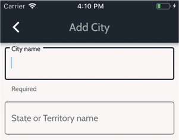
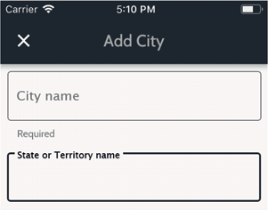

*Mô tả hình:* Hai ảnh của cùng một ô nhập có viền. Ảnh trái: chưa focus, chữ nhãn nằm bên trong ô. Giữa hai ảnh có chú thích "**On focused**" (Khi được focus). Ảnh phải: ô đã được focus, viền đổi màu và chữ nhãn thu nhỏ, trượt lên nằm trên đường viền phía trên.

Tất cả điều này được làm thông qua thuộc tính `decoration` và tôi không phải làm thêm gì cả. Tôi đã dùng một lớp khác do framework cung cấp để làm được điều đó. Đây là mã của text field thứ hai.

**Listing 5.11 – Ví dụ InputDecoration (InputDecoration example)**

```dart
// weather_app/lib/page/add_city_page.dart -- line ~75
Padding(
  padding: const EdgeInsets.symmetric(vertical: 8.0),
  child: TextFormField(
    focusNode: focusNode,
    onSaved: (String val) => print(val),
    decoration: InputDecoration(
      border: OutlineInputBorder(),                 // (1)
      helperText: "Optional",                       // (2)
      labelText: "State or Territory name",         // (3)
    ),
    validator: (String val) {                       // (4)
      if (val.isEmpty) {
        return "Field cannot be left blank";
      }
      return null;
    },
  ),
),
```

Chú thích trong listing:

1. `OutlineInputBorder` này, do Flutter cung cấp, làm toàn bộ phần việc nặng nhọc.
2. Văn bản trợ giúp (*helper text*) luôn được hiển thị, trừ khi có lỗi validate. Khi đó, thông báo lỗi sẽ thay thế văn bản trợ giúp.
3. Chữ nhãn (*label text*) luôn được hiển thị.
4. Validator này rất giống các phương thức validator trước đó.

(Chuỗi trong code: `"Optional"` = "Không bắt buộc"; `"State or Territory name"` = "Tên bang hoặc vùng lãnh thổ".)

Điều tôi muốn nói là: đó là một giao diện thuộc hàng đỉnh cao, nhưng không cần kéo thêm thư viện bên ngoài nào, và cũng không phải viết nhiều mã. Nó nằm sẵn trong thư viện widget có mặc định trong framework.

> 💡 **Ví dụ bổ sung (không có trong sách):** Một vài tham số khác của `InputDecoration` hay dùng:
>
> ```dart
> TextFormField(
>   decoration: InputDecoration(
>     labelText: 'Email',
>     hintText: 'vd: ban@example.com',      // gợi ý mờ khi ô trống
>     prefixIcon: Icon(Icons.email),         // biểu tượng phía trước
>     suffixText: '@gmail.com',              // chữ cố định phía sau
>     filled: true,
>     fillColor: Colors.grey[100],           // màu nền
>     border: OutlineInputBorder(
>       borderRadius: BorderRadius.circular(12), // bo góc
>     ),
>     focusedBorder: OutlineInputBorder(
>       borderSide: BorderSide(color: Colors.blue, width: 2), // viền khi focus
>     ),
>     errorStyle: TextStyle(fontStyle: FontStyle.italic),       // kiểu chữ lỗi
>   ),
> );
> ```
>
> Tất cả các hiệu ứng (đổi màu viền khi focus, nhãn trượt lên, chữ lỗi thay chữ trợ giúp) đều do framework tự lo – đúng như tác giả nói.

### 5.4.2 Cải thiện giao diện bằng FocusNode (Improving the UI with FocusNodes)

Hãy nhớ lại widget `TextFormField` mà bạn đã thấy trước đó. Widget này nhận một tham số có tên (*named argument*) là `autoFocus`. Ôn lại một chút:

```dart
// weather_app/lib/page/add_city_page.dart -- line ~112
TextFormField(
  onSaved: (String val) => _newCity.name = val,
  decoration: InputDecoration(
    border: OutlineInputBorder(),
    helperText: "Required",
    labelText: "City name",
  ),
  autofocus: true,           // Đảm bảo trường này có focus ngay khi trang được render
  autovalidate: _formChanged,
  validator: (String val) {
    if (val.isEmpty) return "Field cannot be left blank";
    return null;
  },
),
```

(Chú thích của sách cho dòng `autofocus: true`: *đảm bảo trường form này có focus ngay khi trang được render*.)

Trải nghiệm kiểu này là điều người dùng ngày nay mong đợi. Giảm số lần chạm hay số thao tác cần thiết sẽ góp phần rất lớn giúp ứng dụng của bạn trở nên dễ chịu khi sử dụng.

Ngoài `autofocus`, bạn còn có thể chuyển focus trong form bằng mã lệnh, nhờ một đối tượng tên là `FocusNode`. Trong ứng dụng của bạn, có thể bạn muốn đổi focus dựa trên một sự kiện bên ngoài hoặc một lỗi validate. Ví dụ, một người dùng đang đăng ký ứng dụng của bạn và vô tình để trống một trường bắt buộc trên form đăng ký. Một trải nghiệm người dùng tốt sẽ tự động đưa focus tới trường bị bỏ trống đó.

Trong ứng dụng thời tiết, form được thiết lập sao cho nó không cho người dùng gửi form nếu hai text field còn trống. Cụ thể, nếu người dùng bấm Submit mà trường State đang trống, thì lỗi validate sẽ hiện ra và focus sẽ được trao cho text field đó. Điều này được làm chỉ bằng vài dòng mã.

Để bắt đầu, bạn phải tạo một focus node. Không có gì đặc biệt ở đây; chúng ta chỉ khai báo và tạo một đối tượng `FocusNode`. Vì focus node là đối tượng **sống lâu** (*long-lived*), bạn quản lý vòng đời (*lifecycle*) của chúng bằng một đối tượng `State`. Chúng ta sẽ xem xét vòng đời kỹ hơn ở phần sau, nhưng vòng đời của widget cho bạn khả năng tạo và hủy các đối tượng sống lâu đồng bộ với chính widget đó. Hãy tạo một thể hiện `FocusNode` bên trong phương thức `initState()`, như sau:

```dart
// weather_app/lib/page/add_city_page.dart -- line ~17
class _AddNewCityPageState extends State<AddNewCityPage> {
  City _newCity = City.fromUserInput();
  bool _formChanged = false;
  bool _isDefaultFlag = false;
  final GlobalKey<FormState> _formKey = GlobalKey<FormState>();
  FocusNode focusNode;          // (1) Khai báo focus node

  @override
  void initState() {
    super.initState();
    focusNode = FocusNode();    // (2)
  }
```

Chú thích:

1. Khai báo (định nghĩa) focus node.
2. Để quản lý vòng đời, hãy tạo focus node trong phương thức `initState` để sau này có thể hủy (*dispose*) nó.

Một focus node được truyền cho một text field. Hãy truyền nó cho `TextFormField` thứ hai trong form, được gán cho biến `_stateName`:

```dart
// weather_app/lib/page/add_city_page.dart -- line ~75
Padding(
  padding: const EdgeInsets.symmetric(vertical: 8.0),
  child: TextFormField(
    focusNode: focusNode,                 // (1)
    onSaved: (String val) => print(val),
    decoration: InputDecoration(
      border: OutlineInputBorder(),
      helperText: "Optional",
      labelText: "State or Territory name",
    ),
    validator: (String val) {             // (2)
      if (val.isEmpty) {
        return "Field cannot be left blank";
      }
      return null;
    },
  ),
),
```

Chú thích:

1. Text form field có một tham số có tên là `focusNode`, mong đợi một focus node. Việc này liên kết focus node đó với widget này.
2. Chúng ta sẽ xem phương thức `FormState.validate` ngay sau đây. Lúc này, chỉ cần biết rằng validator này được gọi trước khi form được gửi và sẽ báo lỗi validate nếu giá trị trống.

Đó là tất cả những gì cần làm để liên kết một focus node với một widget. Giờ chúng ta phải nối phần logic. Hãy nhớ, mục tiêu là trao focus cho widget thứ hai mỗi khi người dùng cố gửi form trong khi các text field đang trống. Logic này nằm trong callback được truyền cho tham số `onPressed` của nút Submit:

```dart
// weather_app/lib/page/add_city_page.dart -- line ~80
RaisedButton(
  color: Colors.blue[400],
  child: Text("Submit"),
  onPressed: _formChanged
      ? () {
          if (_formKey.currentState.validate()) {   // (1)
            _formKey.currentState.save();
            _handleAddNewCity();
            Navigator.pop(context);
          } else {
            FocusScope.of(context)                  // (2)
                .requestFocus(focusNode);
          }
        }
      : null,
),
```

Chú thích:

1. Các phương thức của form state được bàn ở mục tiếp theo. `_formKey.currentState.validate()` trả về `false` nếu các callback validator thất bại.
2. `FocusScope` là widget quản lý việc chuyển focus tới các node thích hợp.

Dòng mã thực sự yêu cầu focus cho một node hẳn trông hơi quen. Nó lại dùng phương thức `of` "cũ kỹ" đó để lấy tham chiếu tới một widget ở nơi nào khác trong cây. Trong trường hợp này, nó lấy widget `FocusScope`. Lớp này có một phương thức tên là `requestFocus`, sẽ cố gắng trao focus cho text field được liên kết với focus node truyền vào. Trong trường hợp của chúng ta, đó là text field `_stateName`.

Đó là phần chính của việc dùng focus node. Nó có thể phức tạp hơn, nhưng nền tảng vẫn như vậy. Nếu bạn muốn trao focus cho bất kỳ text field nào bằng mã lệnh, bạn phải dùng một widget `FocusNode` và yêu cầu focus cho nó.

> 📝 **Giải thích thêm (không có trong sách):** Vì `FocusNode` là tài nguyên sống lâu, đừng quên hủy nó trong `dispose()` (Listing 5.4 có khai báo `void dispose() {...}` cho mục đích này):
>
> ```dart
> @override
> void dispose() {
>   focusNode.dispose();
>   super.dispose();
> }
> ```

> 💡 **Ví dụ bổ sung (không có trong sách) – chuyển focus sang ô kế tiếp khi bấm "Next" trên bàn phím:**
>
> ```dart
> final _passwordFocus = FocusNode();
>
> Column(children: [
>   TextFormField(
>     decoration: InputDecoration(labelText: 'Tên đăng nhập'),
>     autofocus: true,
>     textInputAction: TextInputAction.next, // phím Enter hiển thị thành "Next"
>     onFieldSubmitted: (_) =>
>         FocusScope.of(context).requestFocus(_passwordFocus),
>   ),
>   TextFormField(
>     focusNode: _passwordFocus,
>     obscureText: true,
>     decoration: InputDecoration(labelText: 'Mật khẩu'),
>   ),
> ]);
> ```
>
> Người dùng gõ tên đăng nhập, bấm "Next" là con trỏ nhảy ngay xuống ô mật khẩu – bớt được một lần chạm, đúng tinh thần "giảm số thao tác" mà tác giả nhấn mạnh.

---

## 5.5 Quản lý trạng thái form bằng các phương thức của form (Managing form state with form methods)

Đến đây, tôi đã nói về gần như mọi mảnh ghép cần thiết để dùng form trong Flutter. Hãy gắn kết tất cả lại và học cách dùng chính state của form. Cụ thể, chúng ta quan tâm đến cách phản hồi khi form thay đổi, và ứng dụng nên làm gì khi người dùng điền xong form. Những điều này đạt được nhờ vài phương thức của widget `Form` và của `FormState`.

Trong ứng dụng thời tiết, điểm khởi đầu tốt nhất lại là phần đầu phương thức `build` của form. Trước đó trong chương, tôi có cho xem sơ qua phần đầu của phương thức `build`, nhưng đã lược bỏ vài dòng quan trọng.

**Listing 5.12 – Các phương thức của form (Form methods)**

```dart
// weather_app/lib/page/add_city_page.dart -- line ~17
class _AddNewCityPageState extends State<AddNewCityPage> {
  City _newCity = City.fromUserInput();               // (1)
  bool _formChanged = false;                          // (2)
  bool _isDefaultFlag = false;
  final GlobalKey<FormState> _formKey = GlobalKey<FormState>();
  FocusNode focusNode;

  @override
  Widget build(BuildContext context) {
    return Scaffold(
      appBar: AppBar(
        //...
      body: Padding(
        padding: const EdgeInsets.symmetric(horizontal: 8.0),
        child: Form(
          key: _formKey,
          onChanged: _onFormChange,                   // (3)
          onWillPop: _onWillPop,                      // (4)
          child: Column(
            // ... form fields
          ),
        ),
      ),
    );
```

Chú thích trong listing:

1. Một đối tượng `City` trống, sẽ được gửi vào cơ sở dữ liệu khi form được gửi.
2. Cờ này được chuyển thành `true` ngay khi form được cập nhật lần đầu tiên. Ta có thể dùng nó để điều khiển cách form hoạt động tùy theo việc người dùng có thực sự đang cố dùng form hay không.
3. Được gọi khi **bất kỳ** form field nào thay đổi.
4. Được gọi khi người dùng sắp rời khỏi trang. Phương thức này cực kỳ hữu ích, như tôi sẽ cho bạn thấy ngay sau đây.

### 5.5.1 Form.onChange

`onChanged` và `onWillPop` là hai phương thức duy nhất mà bản thân form mong đợi. Trước tiên, hãy xem `onChanged` được dùng thế nào trong ứng dụng thời tiết:

```dart
// weather_app/lib/page/add_city_page.dart -- line ~160
void _onFormChange() {
  if (_formChanged) return;      // (1)
  setState(() {                  // (2)
    _formChanged = true;
  });
}
```

Chú thích:

1. Nếu `_formChanged` đã là `true` rồi, thì ngăn Flutter render lại bằng cách không cho `setState` được gọi.
2. Đặt cờ `_formChanged` thành `true` và gọi `setState` để Flutter biết cần render lại những widget phụ thuộc vào cờ này để cấu hình.

Điểm hay là Flutter biết render lại những widget dựa vào cờ này để cấu hình. Tôi dùng cờ đó cho hai việc. Thứ nhất, nó bảo Flutter đừng bận tâm tự động validate nếu form vẫn còn trống. Nếu bật `autoValidate`, callback bạn đưa cho validator sẽ được gọi ngay khi widget render, nghĩa là mọi trường đều sẽ không qua được validate và hiện lỗi trước cả khi người dùng có cơ hội gõ gì vào.

**Listing 5.13 – Tự động validate có điều kiện (Conditional auto-validation)**

```dart
// weather_app/lib/page/add_city_page.dart -- line ~112
TextFormField(
  onSaved: (String val) => _newCity.name = val,
  decoration: InputDecoration(
    border: OutlineInputBorder(),
    helperText: "Required",
    labelText: "City name",
  ),
  autofocus: true,
  autovalidate: _formChanged,     // (1)
  validator: (String val) {
    if (val.isEmpty) return "Field cannot be left blank";
    return null;
  },
),
```

Chú thích (1): Không tự động validate cho tới khi người dùng đã tương tác với form.

Công dụng thứ hai thú vị hơn với tôi: nút bấm sẽ bị **vô hiệu hóa** (*disabled*) nếu callback `onPressed` của nó là `null` (hình 5.10). Chẳng có lý do gì để người dùng gửi được thứ gì đó khi họ chưa hề thay đổi form, vì vậy ta có thể vô hiệu hóa nút ngay từ đầu bằng mã lệnh:

```dart
// weather_app/lib/page/add_city_page.dart -- line ~80
RaisedButton(
  color: Colors.blue[400],
  child: Text("Submit"),
  onPressed: _formChanged           // (1)
      ? () {
          if (_formKey.currentState.validate()) {
            _formKey.currentState.save();
            _handleAddNewCity();
            Navigator.pop(context);
          } else {
            FocusScope.of(context).requestFocus(focusNode);
          }
        }
      : null,
),
```

Chú thích (1): Nếu `formChanged` là `false`, callback phải là `null`, khiến nút bị vô hiệu hóa.

**Hình 5.10 – Nút bấm bị vô hiệu hóa nếu callback là `null` (Buttons are disabled if the callback is null.)**

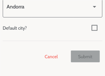

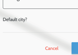
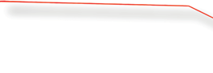
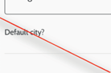

Bố cục đầy đủ của hình (trang render):

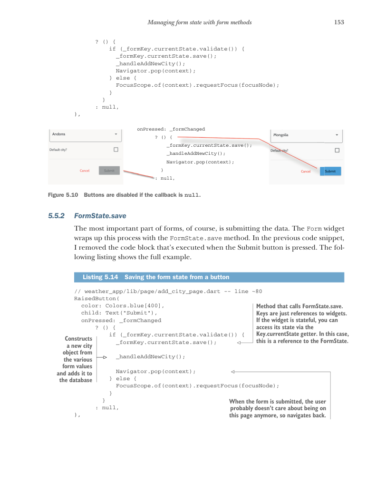

*Mô tả hình:* Bên trái: phần dưới form với Country = "Andorra", check box "Default city?", nút "Cancel" (đỏ) và nút "Submit" **màu xám (bị vô hiệu hóa)**; một mũi tên đỏ nối nút xám tới dòng `: null,` trong đoạn mã ở giữa. Bên phải: Country = "Mongolia" (người dùng đã thay đổi form), nút "Submit" **màu xanh (được bật)**; mũi tên đỏ nối nút xanh tới nhánh `? () {` của đoạn mã:

```dart
onPressed: _formChanged
    ? () {
        _formKey.currentState.save();
        _handleAddNewCity();
        Navigator.pop(context);
      }
    : null,
```

### 5.5.2 FormState.save

Tất nhiên, phần quan trọng nhất của form là **gửi dữ liệu**. Widget `Form` gói gọn quy trình này trong phương thức `FormState.save`. Trong đoạn mã trước, tôi đã lược bỏ khối mã được thực thi khi nút Submit được nhấn. Listing sau cho thấy ví dụ đầy đủ.

**Listing 5.14 – Lưu state của form từ một nút bấm (Saving the form state from a button)**

```dart
// weather_app/lib/page/add_city_page.dart -- line ~80
RaisedButton(
  color: Colors.blue[400],
  child: Text("Submit"),
  onPressed: _formChanged
      ? () {
          if (_formKey.currentState.validate()) {
            _formKey.currentState.save();          // (1)

            _handleAddNewCity();                   // (2)

            Navigator.pop(context);                // (3)
          } else {
            FocusScope.of(context).requestFocus(focusNode);
          }
        }
      : null,
),
```

Chú thích trong listing:

1. Phương thức gọi `FormState.save`. Key chỉ là tham chiếu tới widget. Nếu widget là stateful, bạn có thể truy cập state của nó qua getter `Key.currentState`. Trong trường hợp này, đây là tham chiếu tới `FormState`.
2. Tạo một đối tượng city mới từ các giá trị khác nhau của form và thêm nó vào cơ sở dữ liệu.
3. Khi form đã được gửi, có lẽ người dùng không còn muốn ở lại trang này nữa, nên điều hướng quay lại.

"Phép màu" thực sự nằm trong phương thức `_formKey.currentState.save()`. Tôi đã nhắc đến nó trước đây, nhưng phương thức này bảo form tìm tất cả các form field trong phần này của cây widget của ứng dụng và gọi `onSaved`. Riêng trong ứng dụng thời tiết, điều đó có nghĩa là ba phương thức được gọi, như trong listing sau.

**Listing 5.15 – Các phương thức được gọi khi form được lưu (Methods called when the form is saved)**

```dart
// weather_app/lib/page/add_city_page.dart -- line ~42
@override
Widget build(BuildContext context) {
  return Scaffold(
    appBar: AppBar(...),
    body: Padding(
      padding: const EdgeInsets.symmetric(horizontal: 8.0),
      child: Form(
        key: _formKey,
        onChanged: _onFormChange,
        onWillPop: _onWillPop,
        child: ListView(
          shrinkWrap: true,
          children: <Widget>[
            Padding(
              padding: const EdgeInsets.symmetric(vertical: 8.0),
              // Form field -- line ~42
              child: TextFormField(
                onSaved: (String val) =>          // (1)
                    _newCity.name = val,
                // ...
            Padding(
              padding: const EdgeInsets.symmetric(vertical: 8.0),
              // Form field -- line ~77
              child: TextFormField(
                focusNode: focusNode,
                onSaved: (String val) =>          // (2)
                    print(val),
                // ...
            // Begin check box Form Field -- line 99
            FormField(
              onSaved: (val) =>                   // (3)
                  _newCity.active = _isDefaultFlag,
              builder: (context) {
                // ... remainder of class
```

Chú thích trong listing:

1. Đặt tên thành phố trên đối tượng `City` mới bằng giá trị của text field đầu tiên.
2. Ở đây tôi chỉ in ra, vì tôi thực ra không quan tâm đến giá trị bang (*state*). Tôi chỉ đưa vào làm thêm một ví dụ.
3. Một lần nữa, đặt giá trị phù hợp lên đối tượng city mới khi form được gửi.

Đó là giá trị cốt lõi của widget `Form` tóm gọn trong một câu: các phương thức `onSaved` giúp làm việc dễ dàng với những form mà, về lý thuyết, có thể phức tạp hơn nhiều.

Phương thức `_handleAddNewCity()` không có gì đặc thù của Flutter, nhưng để cho thấy đầy đủ chức năng, nó đây:

```dart
// weather_app/lib/page/add_city_page.dart -- line ~167
void _handleAddNewCity() {
  final city = City(           // (1)
    name: _newCity.name,
    country: _newCity.country,
    active: true,
  );

  allAddedCities.add(city);    // (2)
}
```

Chú thích:

1. Tạo một thể hiện city mới để thêm vào danh sách các thành phố mà người dùng muốn xem thông tin thời tiết.
2. Thêm thành phố mới vào danh sách thành phố của người dùng.

> 💡 **Ví dụ bổ sung (không có trong sách) – lần theo luồng chạy khi bấm Submit:** Giả sử người dùng nhập City name = "Đà Nẵng", để trống ô State, chọn Country = Vietnam, tick "Default city?", rồi bấm Submit.
>
> 1. `_formChanged` đã là `true` (vì đã gõ phím) → nút đang bật, callback chạy.
> 2. `_formKey.currentState.validate()` gọi **tất cả** validator: ô City hợp lệ (trả `null`), nhưng ô State trống → trả `"Field cannot be left blank"` → `validate()` trả về `false`.
> 3. Nhánh `else` chạy: `FocusScope.of(context).requestFocus(focusNode)` → con trỏ nhảy vào ô State, dòng lỗi đỏ hiện dưới ô.
> 4. Người dùng gõ "Trung Bộ" vào ô State rồi bấm Submit lần nữa → `validate()` trả `true`.
> 5. `save()` gọi lần lượt ba `onSaved`: `_newCity.name = "Đà Nẵng"`, `print("Trung Bộ")`, `_newCity.active = true`.
> 6. `_handleAddNewCity()` tạo `City(name: "Đà Nẵng", country: Vietnam, active: true)` và thêm vào `allAddedCities`.
> 7. `Navigator.pop(context)` đưa người dùng quay lại trang trước.

Mẹo hay cuối cùng với form cho phép bạn "khéo léo" trong cách ứng dụng hoạt động khi người dùng muốn rời khỏi form.

### 5.5.3 Form.onWillPop

Hẳn bạn đã từng điền những form dài và phức tạp. Đặc biệt trong ứng dụng di động, không gì tệ hơn việc phải điền lại form chỉ vì bạn cần chuyển sang chỗ khác vì lý do nào đó.

Flutter có cách tích hợp sẵn để xử lý những tình huống như vậy thông qua phương thức `Form.onWillPop`. Phương thức này cho bạn cơ hội thực thi một hàm khi người dùng sắp rời khỏi trang form vì **bất kỳ** lý do gì. Trong ứng dụng thời tiết, tôi quyết định bắt người dùng xác nhận rằng họ muốn rời trang nếu họ đã bắt đầu điền form rồi cố bấm nút Back (Quay lại) (hình 5.11). Một lựa chọn tốt khác là lưu thông tin form theo cách nào đó, để bạn có thể điền sẵn form bằng thông tin đó nếu người dùng quay lại trang.

**Hình 5.11 – Hiển thị một hộp thoại cảnh báo (Displaying an alert dialog)**

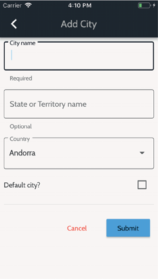
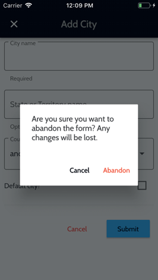
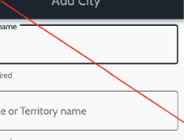
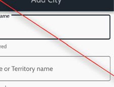
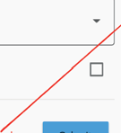
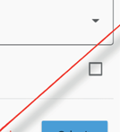


Bố cục đầy đủ của hình (trang render):

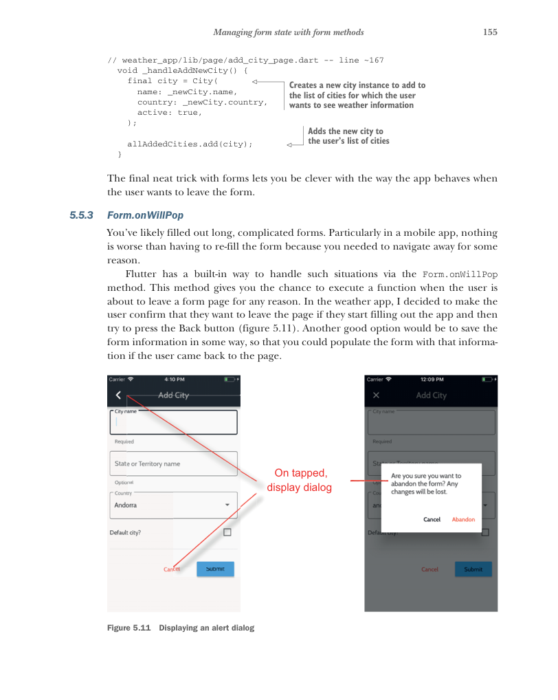

*Mô tả hình:* Bên trái là trang **Add City** đang được điền (City name, Required, State or Territory name, Optional, Country = Andorra, Default city?, nút Cancel và Submit). Hai đường đỏ nối nút mũi tên Back ở góc trên và nút "Cancel" tới dòng chú thích "**On tapped, display dialog**" (Khi chạm vào, hiển thị hộp thoại). Bên phải là cùng trang đó bị phủ mờ, ở giữa hiện một hộp thoại: "**Are you sure you want to abandon the form? Any changes will be lost.**" (Bạn có chắc muốn bỏ form này không? Mọi thay đổi sẽ bị mất.) với hai nút "**Cancel**" (Hủy – ở lại) và "**Abandon**" (Bỏ – màu đỏ).

Mã cho ứng dụng được xử lý hoàn toàn trong phương thức `_onWillPop`. Nó được gọi từ form tại đây:

```dart
// weather_app/lib/page/add_city_page.dart -- line ~50
body: Padding(
  padding: const EdgeInsets.symmetric(horizontal: 8.0),
  child: Form(
    key: _formKey,
    onChanged: _onFormChange,
    onWillPop: _onWillPop,
    child: Column(...)
  ),
);
```

Và listing này cho thấy phần chúng ta quan tâm.

**Listing 5.16 – Sử dụng onWillPop trên một trang form (Using onWillPop on a form page)**

```dart
// weather_app/lib/page/add_city_page.dart -- line ~176
Future<bool> _onWillPop() {                      // (1) (2)
  if (!_formChanged)                             // (3)
    return Future<bool>.value(true);
  return showDialog<bool>(                       // (4)
      context: context,
      builder: (BuildContext context) {
        return AlertDialog(                      // (5)
          content: Text(
              "Are you sure you want to abandon the form? Any changes will be lost."),
          actions: <Widget>[
            FlatButton(
              child: Text("Cancel"),
              onPressed: () =>
                  Navigator.pop(context, false), // (6)
              textColor: Colors.black,
            ),
            FlatButton(
              child: Text("Abandon"),
              textColor: Colors.red,
              onPressed: () =>
                  Navigator.pop(context, true),  // (7)
            ),
          ],
        );
      });
}
```

(Trong PDF, chuỗi trong `Text(...)` bị ngắt làm hai dòng do khổ giấy; một chuỗi Dart thường không thể xuống dòng ở giữa, nên ở đây đã được nối lại thành một dòng.)

Chú thích trong listing:

1. Được gọi khi người dùng đang điều hướng rời khỏi form.
2. Callback được truyền cho `Form.onWillPop` phải trả về một `Future<bool>`.
3. Nếu người dùng chưa thay đổi form, không có lý do gì phải lo lắng về việc rời trang, vì chẳng có thông tin nào bị mất.
4. Hiển thị một hộp thoại hỏi người dùng có muốn rời đi không. (`showDialog` là phương thức có sẵn của Flutter; xem chương 7.)
5. Một hộp thoại mong đợi một thông điệp, cùng các hành động để người dùng chọn, như Cancel và Save.
6. Nếu người dùng quyết định không muốn rời đi, gọi `Navigator.pop` – thao tác này gỡ hộp thoại (*modal*) và truyền giá trị `false` trở lại phương thức.
7. Nếu họ muốn rời đi, làm cùng thao tác đó nhưng truyền `true` trở lại từ hộp thoại.

Trong phần này có một chút về định tuyến (*routing*) và `Navigator`, sẽ được trình bày sâu ở phần sau. Lúc này, bạn chỉ cần biết vài điều:

- Một hộp thoại (*dialog*) cũng là một route (*tuyến* – một "màn hình" trong ngăn xếp điều hướng), theo cách nhìn của navigator.
- Bất kỳ route nào cũng có thể truyền một giá trị trở về route trước đó thông qua phương thức `pop`.

Vì vậy, về mặt kỹ thuật, phương thức `showDialog` đang điều hướng tới một route mới (hiển thị hộp thoại). Sau đó, khi người dùng chạm nút Cancel hoặc Abandon, modal (vốn là một route) truyền `false` hoặc `true` về cho hàm bên ngoài, `_onWillPop`. Hàm này trả về một `Future<bool>`, nên nó chỉ việc chờ giá trị trả về từ `showDialog`, rồi trả giá trị đó cho phương thức `Form.onWillPop`.

Định tuyến là một chủ đề lớn, và tôi không mong bạn hiểu hết chỉ qua một đoạn văn. Điểm mấu chốt là: khi phương thức `Form.onWillPop` được form gọi, nó mong đợi rốt cuộc sẽ nhận về một giá trị boolean. Nếu nhận `false`, nó sẽ **không** cho navigator quay về trang trước. Nếu nhận `true`, nó sẽ cho.

> 📝 **Giải thích thêm (không có trong sách):** Bảng tóm tắt các khả năng của `_onWillPop` trong ví dụ:
>
> | Tình huống | Giá trị `Future<bool>` trả về | Kết quả |
> |---|---|---|
> | Chưa thay đổi form (`_formChanged == false`) | `true` (ngay lập tức) | Quay lại trang trước, không hỏi gì |
> | Đã thay đổi, người dùng chọn **Cancel** | `false` | Ở lại trang form, dữ liệu còn nguyên |
> | Đã thay đổi, người dùng chọn **Abandon** | `true` | Rời trang, dữ liệu đã nhập bị bỏ |
> | Đã thay đổi, người dùng chạm ra ngoài hộp thoại | `null` (hộp thoại đóng mà không có giá trị) | Flutter coi như không cho pop – ở lại trang |
>
> Ở các phiên bản Flutter mới hơn, `Form.onWillPop`/`WillPopScope` dần được thay bằng `PopScope` (với `canPop` và `onPopInvoked`), nhưng ý tưởng "hỏi trước khi rời trang" vẫn y hệt.

> 💡 **Ví dụ bổ sung (không có trong sách) – viết `_onWillPop` bằng `async/await` cho dễ đọc:**
>
> ```dart
> Future<bool> _onWillPop() async {
>   if (!_formChanged) return true;
>   final bool leave = await showDialog<bool>(
>     context: context,
>     builder: (context) => AlertDialog(
>       content: Text('Bạn có chắc muốn bỏ form? Mọi thay đổi sẽ mất.'),
>       actions: [
>         TextButton(
>           child: Text('Hủy'),
>           onPressed: () => Navigator.pop(context, false),
>         ),
>         TextButton(
>           child: Text('Bỏ'),
>           onPressed: () => Navigator.pop(context, true),
>         ),
>       ],
>     ),
>   );
>   return leave ?? false; // chạm ra ngoài hộp thoại → coi như ở lại
> }
> ```
>
> Hành vi giống hệt Listing 5.16, chỉ khác là dùng `await` để "chờ" route hộp thoại pop về giá trị `true`/`false`.

---

## Tóm tắt (Summary)

- Tương tác người dùng trong Flutter được xử lý qua hai loại widget: widget nhập liệu (*inputs*) và bộ phát hiện cử chỉ (*gesture detectors*).
- Flutter xử lý cử chỉ và các sự kiện tương tác người dùng thông qua các widget `GestureDetector`.
- Nếu bạn muốn trao focus cho bất kỳ text field nào bằng mã lệnh, bạn phải dùng một widget `FocusNode` và yêu cầu focus cho nó.
- Một bộ phát hiện cử chỉ có thể lắng nghe nhiều cử chỉ thông qua các callback khác nhau của nó. Đây chỉ là 5 trong khoảng 30 callback:
  - `onTap`
  - `onLongPress`
  - `onDoubleTap`
  - `onVerticalDragDown`
  - `onPanDown`
- Các widget có sẵn cũng lắng nghe những cử chỉ này: `Dismissible`, `Button`, `FormField` và nhiều widget khác.
- Form trong Flutter là những lớp bọc tiện lợi quanh nhiều widget nhập liệu, giúp quản lý các form phức tạp dễ dàng hơn.
- State của một form có thể được quản lý bằng một `GlobalKey<FormState>`, là tham chiếu tới một đối tượng `FormState`.
- Form "biết" về các widget nằm bên dưới nó trong cây widget được bọc trong widget `FormField`, và có thể tận dụng mối quan hệ này.
- Form field cung cấp vài phương thức: `onChange`, `onSave` và `validator`. Các phương thức này được dùng để phản hồi hành động của người dùng và kết nối với `FormState`.
- Form có hai phương thức giá trị: `onChange` và `onWillPop`.

---

## Bảng thuật ngữ của chương

| Thuật ngữ (Anh) | Nghĩa tiếng Việt | Giải thích ngắn |
|---|---|---|
| Gesture | Cử chỉ | Mọi sự kiện tương tác bằng tay: chạm, kéo, lia, nhấn giữ, phóng to/thu nhỏ… |
| Gesture detector / `GestureDetector` | Bộ phát hiện cử chỉ | Widget bọc quanh widget khác để lắng nghe cử chỉ và gọi callback tương ứng |
| Callback | Hàm gọi lại | Hàm bạn truyền vào để framework gọi khi sự kiện xảy ra |
| Tap / Double tap / Long press | Chạm / Chạm hai lần / Nhấn giữ | Các cử chỉ chạm cơ bản |
| Drag | Kéo | Di chuyển ngón tay trên màn hình theo một trục (ngang/dọc) |
| Pan | Lia / kéo tự do | Kéo theo mọi hướng |
| Scale | Phóng/thu (co giãn) | Cử chỉ hai ngón để phóng to/thu nhỏ |
| `TapUpDetails`, `DragUpdateDetails` | Chi tiết cử chỉ | Đối tượng chứa thông tin như `globalPosition`, vận tốc… |
| Global position | Vị trí toàn cục | Tọa độ tính theo toàn màn hình |
| Velocity | Vận tốc | Tốc độ và hướng của cú kéo/vuốt |
| `MediaQuery` | Truy vấn thông tin màn hình | Lấy kích thước màn hình, mật độ điểm ảnh… |
| `Dismissible` | Widget vuốt để loại bỏ | Mục có thể vuốt sang một bên để xóa/loại khỏi danh sách |
| `DismissDirection` | Hướng loại bỏ | Enum cho biết hướng người dùng vuốt (vd `endToStart`) |
| Background (của Dismissible) | Nền | Widget hiển thị phía sau mục đang bị vuốt |
| Key / `ValueKey` | Khóa | Định danh giúp Flutter ghép đúng widget với element khi rebuild |
| Global key / `GlobalKey` | Khóa toàn cục | Key duy nhất toàn ứng dụng, cho phép truy cập state của widget từ bất cứ đâu |
| Element tree | Cây element | Cây đối tượng sống lâu giữ vị trí và state tương ứng với cây widget |
| Rebuild / re-render | Dựng lại / render lại | Flutter gọi lại `build` để cập nhật giao diện |
| Form | Biểu mẫu | Widget bọc nhiều trường nhập liệu, quản lý state chung của chúng |
| `FormState` | Trạng thái form | Đối tượng state của `Form`, có `save`, `reset`, `validate` |
| Form field / `FormField` | Trường form | Widget nhập liệu được form quản lý |
| `TextFormField` | Trường form văn bản | `TextField` + `FormField` |
| `DropdownButtonFormField` | Trường form thả xuống | `DropdownButton` bọc trong `FormField` |
| `DropdownMenuItem<T>` | Mục của danh sách thả xuống | Mỗi lựa chọn trong drop-down |
| Validator / validate | Bộ kiểm tra hợp lệ / kiểm tra hợp lệ | Hàm trả về chuỗi lỗi hoặc `null` nếu hợp lệ |
| Autovalidate | Tự động kiểm tra hợp lệ | Validate ngay mỗi khi trường thay đổi |
| `onSaved` | Khi lưu | Callback được gọi khi `FormState.save()` chạy |
| Submit | Gửi | Hành động gửi dữ liệu của form |
| `InputDecoration` | Trang trí ô nhập | Lớp định kiểu cho ô nhập: viền, nhãn, chữ trợ giúp, màu… |
| `OutlineInputBorder` | Viền bao ngoài | Kiểu viền quanh ô nhập, có hiệu ứng nhãn trượt lên khi focus |
| Helper text / Label text | Chữ trợ giúp / Chữ nhãn | Dòng chữ gợi ý dưới ô / tên của ô |
| Focus | Tiêu điểm | Trạng thái một ô đang được chọn để nhập |
| `FocusNode` | Nút tiêu điểm | Đối tượng đại diện khả năng nhận focus của một widget, dùng để điều khiển focus bằng mã |
| `FocusScope` | Phạm vi tiêu điểm | Widget quản lý việc chuyển focus giữa các node; có `requestFocus` |
| Autofocus | Tự động focus | Ô nhận focus ngay khi trang hiển thị |
| Lifecycle (`initState`, `dispose`) | Vòng đời | Các thời điểm tạo và hủy của đối tượng `State` |
| `onWillPop` | Khi sắp rời trang | Callback trả về `Future<bool>` quyết định có cho rời trang không |
| Route / routing | Tuyến / định tuyến | Một màn hình trong ngăn xếp điều hướng / việc chuyển giữa các màn hình |
| `Navigator.pop` | Đóng route hiện tại | Gỡ route trên cùng, có thể trả giá trị về route trước |
| `showDialog` / `AlertDialog` / modal | Hiển thị hộp thoại / hộp thoại cảnh báo / cửa sổ phương thức | Hộp thoại phủ lên trang hiện tại; bản thân nó cũng là một route |
| Mocked / fake data | Dữ liệu giả | Dữ liệu sinh ngẫu nhiên phục vụ demo |
