# Chương 6: Đẩy từng điểm ảnh: animation trong Flutter và sử dụng canvas (Pushing pixels: Flutter animations and using the canvas)

## Mục lục chương

- [Mở đầu chương](#mở-đầu-chương)
- [6.1 Giới thiệu animation trong Flutter (Introducing Flutter animations)](#61-giới-thiệu-animation-trong-flutter-introducing-flutter-animations)
  - [6.1.1 Tween (Tweens)](#611-tween-tweens)
  - [6.1.2 Đường cong animation (Animation curves)](#612-đường-cong-animation-animation-curves)
  - [6.1.3 Ticker provider (Ticker providers)](#613-ticker-provider-ticker-providers)
  - [6.1.4 AnimationController](#614-animationcontroller)
  - [6.1.5 AnimatedWidget](#615-animatedwidget)
  - [6.1.6 Cài đặt animation controller và tween cho phần nền (Implementing the animation controller and tween for the background)](#616-cài-đặt-animation-controller-và-tween-cho-phần-nền-implementing-the-animation-controller-and-tween-for-the-background)
- [6.2 CustomPainter và canvas (CustomPainter and the canvas)](#62-custompainter-và-canvas-custompainter-and-the-canvas)
  - [6.2.1 Các hình khối tạo nên đám mây (The shapes used to make up the clouds)](#621-các-hình-khối-tạo-nên-đám-mây-the-shapes-used-to-make-up-the-clouds)
  - [6.2.2 Định nghĩa CustomPainter và đối tượng Paint (Defining the CustomPainter and the Paint object)](#622-định-nghĩa-custompainter-và-đối-tượng-paint-defining-the-custompainter-and-the-paint-object)
  - [6.2.3 Phương thức paint của CustomPainter (The CustomPainter paint method)](#623-phương-thức-paint-của-custompainter-the-custompainter-paint-method)
- [6.3 Animation so le, TweenSequence và các animation dựng sẵn (Staggered animations, TweenSequence, and built-in animations)](#63-animation-so-le-tweensequence-và-các-animation-dựng-sẵn-staggered-animations-tweensequence-and-built-in-animations)
  - [6.3.1 Tạo một class trạng thái animation tùy biến (Creating a custom animation state class)](#631-tạo-một-class-trạng-thái-animation-tùy-biến-creating-a-custom-animation-state-class)
  - [6.3.2 Widget animation dựng sẵn: SlideTransition (Built-in animation widgets: SlideTransition)](#632-widget-animation-dựng-sẵn-slidetransition-built-in-animation-widgets-slidetransition)
  - [6.3.3 Xây dựng animation cho widget Clouds (Building animations for the Clouds widget)](#633-xây-dựng-animation-cho-widget-clouds-building-animations-for-the-clouds-widget)
  - [6.3.4 TweenSequence](#634-tweensequence)
- [6.4 Các widget chuyển màu tùy biến có thể tái sử dụng (Reusable custom color transition widgets)](#64-các-widget-chuyển-màu-tùy-biến-có-thể-tái-sử-dụng-reusable-custom-color-transition-widgets)
- [Tóm tắt (Summary)](#tóm-tắt-summary)
- [Bảng thuật ngữ của chương](#bảng-thuật-ngữ-của-chương)
- [Phần 3: Quản lý state và Dart bất đồng bộ (Part 3: State management and asynchronous Dart)](#phần-3-quản-lý-state-và-dart-bất-đồng-bộ-part-3-state-management-and-asynchronous-dart)

---

## Mở đầu chương

> **Chương này bao gồm (This chapter covers):**
>
> - Sử dụng `AnimatedWidget`
> - Sử dụng canvas và class `CustomPaint`
> - Class `Paint`
> - Animation controller, tween và ticker
> - `SlideTransition`, `TweenSequence` và các widget tiện ích khác

Các widget dựng sẵn (*built-in widgets*) mà bạn đã gặp cho tới giờ đều phục vụ việc xây dựng một giao diện có cấu trúc bằng Flutter. Trong chương này, chúng ta sẽ khám phá thêm vài widget mới để tạo animation (hoạt ảnh, chuyển động) tùy biến, đồng thời tìm hiểu widget Canvas. Những widget này được dùng để nói cho Flutter biết **chính xác** chúng ta muốn nó vẽ (*paint*) gì lên màn hình. Cụ thể, chúng ta sẽ xem xét hai thứ:

- **Animation** — Trong ứng dụng thời tiết (*weather app*), gần như mọi widget hiển thị trên màn hình đều chuyển động theo một cách nào đó. Toàn bộ chữ sẽ đổi màu, mọi vật thể ở nền sẽ đổi màu và di chuyển quanh màn hình, còn các icon sẽ thay đổi hình dạng và màu sắc. Điều thú vị nhất ở đây là ứng dụng vẫn sẽ mượt "như bơ" (*buttery smooth*), mặc dù gần như toàn bộ giao diện thay đổi sau mỗi lần người dùng tương tác.

  Phần lớn logic cần để xây dựng các animation này nằm trong `forecast_page`, và có vài phương thức nằm trong `forecast_controller`. Chúng ta sẽ đi qua hầu hết những phần đó ở mục tiếp theo — mục trình bày việc tạo animation cho class `Sun` (mặt trời) từ đầu đến cuối.

- **Canvas** — Chúng ta sẽ tự tay vẽ hình đám mây ở nền từ con số 0, bằng widget Canvas. Canvas (tấm vải vẽ) cho phép bạn nói với Flutter cần vẽ gì, tới từng điểm ảnh (*pixel*). Việc này đòi hỏi chút toán học — và nó rất vui.

Nhưng trước khi lao vào, chủ đề này cần một chút giải thích về khái niệm animation trong ứng dụng.

---

## 6.1 Giới thiệu animation trong Flutter (Introducing Flutter animations)

Sử dụng animation có lẽ là điều tốt nhất bạn có thể làm để khiến một ứng dụng trông trau chuốt (*polished*), mượt mà (*slick*) và trực quan (*intuitive*). Animation thường bị để tới cuối cùng mới nghĩ tới, vì chúng có thể đòi hỏi khá nhiều công sức. May mắn là nhiều widget dựng sẵn trong Flutter, đặc biệt là các widget Material Design, đã có sẵn animation chuyển động ngay khi dùng (*out of the box*). Và việc tự tạo animation tùy biến cũng không khó hơn là bao.

Nhìn chung, Flutter có hai loại animation chính: **animation dạng tween** (*tween animations*) và **animation dựa trên vật lý** (*physics-based animations*). Animation dạng tween — loại mà chúng ta xem xét trong chương này — là animation có **điểm bắt đầu và điểm kết thúc xác định**. Ví dụ, trong ứng dụng thời tiết, khi bạn chọn một mốc giờ khác và phần nền mặt trời cùng đám mây chuyển động tới vị trí mới trên màn hình, chúng đã biết vị trí kết thúc đó **trước khi** animation bắt đầu chạy.

Ngược lại, animation dựa trên vật lý phụ thuộc vào tương tác của người dùng. Một ví dụ điển hình là cú "vuốt hất" (*fling*) mà chắc bạn đã thấy trong nhiều ứng dụng: bạn vuốt ngón tay lên trên một danh sách dài có thể cuộn càng mạnh, thì danh sách cuộn càng nhanh và càng xa. Animation dựa trên vật lý nằm ngoài phạm vi của chương này, nhưng chúng đủ giống nhau và có chung nền tảng. Từ đây trở đi, khi tôi nói "animation", tôi đang nói cụ thể về animation dạng tween.

> **NOTE (Ghi chú)** Nếu bạn quan tâm tới animation vật lý, video này của Tensor Programming là tài liệu tốt nhất mà tôi tìm được: www.youtube.com/watch?v=LHZ0KSvTTqQ.

Một animation trong Flutter được xây dựng bằng cách kết hợp **bốn mảnh ghép** mà bạn phải cài đặt cho mỗi animation. Phần còn lại của mục này dành để giải thích những mảnh ghép đó:

- Một **tween**
- Một **curve** (đường cong)
- Một **animation controller** (bộ điều khiển animation)
- Một **ticker** (thông qua một `TickerProvider`)

> 📝 **Giải thích thêm (không có trong sách):** Có thể hình dung bốn mảnh ghép như một dàn nhạc:
>
> - **Ticker** là chiếc máy đếm nhịp (metronome): cứ mỗi khung hình (*frame*) nó "tích" một lần.
> - **AnimationController** là nhạc trưởng: nghe nhịp từ ticker và biết bản nhạc đã chạy được bao nhiêu phần trăm (một số từ 0.0 đến 1.0) dựa trên thời lượng (`duration`).
> - **Curve** quyết định "nhịp điệu" — chơi đều đều hay lúc đầu chậm rồi nhanh dần.
> - **Tween** chuyển con số 0.0–1.0 đó thành giá trị thật mà widget cần dùng: một màu, một vị trí, một độ mờ...
>
> ```mermaid
> flowchart LR
>     T["Ticker (mỗi frame một tick)"] --> C["AnimationController (giá trị 0.0 → 1.0 theo duration)"]
>     C --> Cu["Curve (biến đổi tốc độ)"]
>     Cu --> Tw["Tween (begin → end: màu, offset, ...)"]
>     Tw --> W["Widget được vẽ lại với giá trị mới"]
> ```

### 6.1.1 Tween (Tweens)

**Tween** là một đối tượng được cung cấp một **giá trị bắt đầu** và một **giá trị kết thúc** cho bất kỳ thuộc tính nào bạn đang tạo animation (chẳng hạn màu sắc, độ mờ đục — *opacity*, hoặc vị trí trên màn hình). Tween cho Flutter biết cách chuyển tiếp từ giá trị bắt đầu sang giá trị kết thúc. "Tween" là một cái tên rất hợp: nó là viết tắt của "*in-betweening*" (tạo các khung hình ở giữa).

Ví dụ, một tween thay đổi màu có thể có giá trị bắt đầu là `yellow` (vàng) và giá trị kết thúc là `red` (đỏ). Thư viện animation sẽ làm phần việc nặng nhọc là xác định các giá trị nằm giữa vàng và đỏ ở mỗi giai đoạn của animation.

> **NOTE (Ghi chú)** Khái niệm tween không phải riêng của Flutter. Viết animation trên rất nhiều nền tảng khác nhau đều liên quan tới tween. Hãy tham khảo bài viết Wikipedia này nếu bạn muốn tìm hiểu về tween nói chung: https://en.wikipedia.org/wiki/Inbetweening.

Tween ánh xạ giá trị tại một thời điểm bất kỳ trong animation sang một số nằm giữa 0.0 và 1.0. Nếu bạn muốn tạo animation cho một màu chuyển từ vàng sang đỏ, nó có thể trông giống hình 6.1 (nhưng với nhiều bước hơn rất nhiều so với những gì tôi có thể vẽ ra).

**Hình 6.1 – Ví dụ về các giá trị của tween**

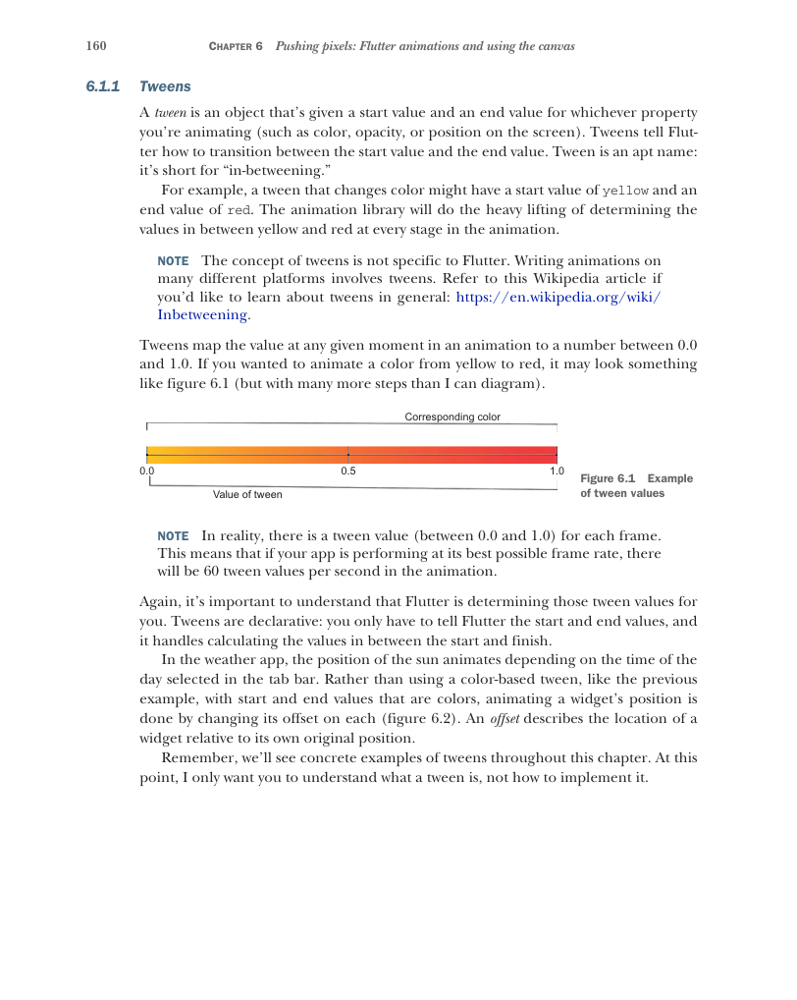

*Mô tả hình:* Một thanh màu nằm ngang chuyển dần từ vàng (bên trái) sang đỏ (bên phải). Phía trên thanh có nhãn "**Corresponding color**" (màu tương ứng). Phía dưới thanh đánh dấu các mốc **0.0**, **0.5**, **1.0** với nhãn "**Value of tween**" (giá trị của tween). Tức là: tại 0.0 màu là vàng, tại 0.5 là màu cam ở giữa, tại 1.0 là đỏ. (Hình 6.1 là hình vector, không có ảnh trích riêng; ảnh ở trên là ảnh render nguyên trang 160 của sách.)

```
Màu tương ứng (Corresponding color)
 vàng ███████████ cam ███████████ đỏ
 |---------------|---------------|
0.0             0.5             1.0
       Giá trị của tween (Value of tween)
```

> **NOTE (Ghi chú)** Trên thực tế, có một giá trị tween (giữa 0.0 và 1.0) cho **mỗi khung hình**. Điều này có nghĩa là nếu ứng dụng của bạn chạy ở tốc độ khung hình (*frame rate*) tốt nhất có thể, thì sẽ có 60 giá trị tween mỗi giây trong animation.

Một lần nữa, điều quan trọng cần hiểu là **Flutter tự xác định những giá trị tween đó cho bạn**. Tween mang tính khai báo (*declarative*): bạn chỉ cần nói cho Flutter giá trị bắt đầu và kết thúc, còn nó lo việc tính các giá trị ở giữa.

Trong ứng dụng thời tiết, vị trí của mặt trời chuyển động tùy theo mốc giờ trong ngày được chọn trên thanh tab (*tab bar*). Thay vì dùng một tween dựa trên màu như ví dụ trước (với giá trị đầu và cuối là màu), việc tạo animation cho vị trí của một widget được thực hiện bằng cách thay đổi **offset** của nó ở mỗi khung hình (hình 6.2). Một **offset** (độ dời) mô tả vị trí của một widget **so với vị trí ban đầu của chính nó**.

Hãy nhớ, chúng ta sẽ thấy các ví dụ cụ thể về tween xuyên suốt chương này. Ở thời điểm này, tôi chỉ muốn bạn hiểu tween **là gì**, chưa cần biết cách cài đặt nó.

**Hình 6.2 – Tween ánh xạ một giá trị vào khoảng từ 0.0 đến 1.0**

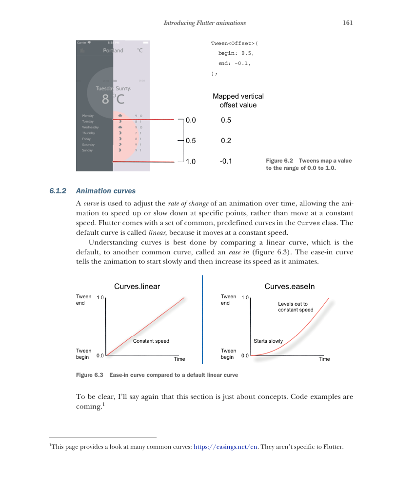

*Mô tả hình:* Bên trái là ảnh chụp màn hình ứng dụng thời tiết (thành phố Portland, "Tuesday Sunny. 8°C", danh sách các ngày từ Monday tới Sunday), có hình mặt trời màu hồng nhạt ở nền. Có hai đường kẻ đỏ nằm ngang đánh dấu vị trí trên và dưới của mặt trời. Bên phải, một thang đo đánh dấu giá trị tween **0.0**, **0.5**, **1.0**, và cột "**Mapped vertical offset value**" (giá trị offset theo chiều dọc được ánh xạ) tương ứng là **0.5**, **0.2**, **-0.1**. Phía trên có đoạn code:

```dart
Tween<Offset>(
  begin: 0.5,
  end: -0.1,
);
```

Nghĩa là: khi tween ở 0.0 thì offset dọc là 0.5; ở 0.5 thì offset là 0.2 (ở giữa); ở 1.0 thì offset là -0.1. (Lưu ý: trong code thật, `Tween<Offset>` nhận các giá trị kiểu `Offset`, ví dụ `Offset(0.0, 0.5)`; hình chỉ viết tắt phần giá trị dọc để minh họa.)

> 💡 **Ví dụ bổ sung (không có trong sách):** Tween tính giá trị ở giữa bằng phép **nội suy tuyến tính** (*linear interpolation*, hay "lerp"): `giá_trị = begin + (end - begin) * t`, với `t` là giá trị từ 0.0 đến 1.0.
>
> Với tween ở hình 6.2 (begin = 0.5, end = -0.1):
>
> | t | Tính toán | Offset dọc |
> |---|---|---|
> | 0.0 | 0.5 + (-0.6) × 0.0 | 0.5 |
> | 0.25 | 0.5 + (-0.6) × 0.25 | 0.35 |
> | 0.5 | 0.5 + (-0.6) × 0.5 | 0.2 |
> | 1.0 | 0.5 + (-0.6) × 1.0 | -0.1 |
>
> Trong Dart bạn có thể tự kiểm tra:
>
> ```dart
> final tween = Tween<double>(begin: 0.5, end: -0.1);
> print(tween.transform(0.5)); // 0.2
>
> final color = ColorTween(begin: Colors.yellow, end: Colors.red);
> print(color.transform(0.5)); // một màu cam nằm giữa vàng và đỏ
> ```

### 6.1.2 Đường cong animation (Animation curves)

Một **curve** (đường cong) được dùng để điều chỉnh **tốc độ thay đổi** (*rate of change*) của animation theo thời gian, cho phép animation tăng tốc hoặc giảm tốc ở những thời điểm cụ thể, thay vì di chuyển với tốc độ không đổi. Flutter đi kèm một tập hợp các curve phổ biến được định nghĩa sẵn trong class `Curves`. Curve mặc định được gọi là **linear** (tuyến tính), vì nó chuyển động với tốc độ không đổi.

Cách tốt nhất để hiểu curve là so sánh curve tuyến tính (mặc định) với một curve phổ biến khác gọi là **ease in** (hình 6.3). Curve ease-in bảo animation bắt đầu chậm, sau đó tăng tốc dần trong quá trình chuyển động.

**Hình 6.3 – Curve ease-in so với curve tuyến tính mặc định**

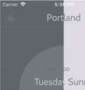
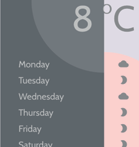
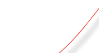
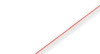

*(Các ảnh trên là những mảnh ảnh được trích từ trang 161; xem bố cục đầy đủ của hình 6.2 và 6.3 trong ảnh render trang ở trên: `images/pages/page-187.png`.)*

*Mô tả hình:* Có hai đồ thị đặt cạnh nhau.

- Bên trái: **Curves.linear**. Trục dọc đi từ "**Tween begin**" (điểm bắt đầu của tween, 0.0) lên "**Tween end**" (điểm kết thúc của tween, 1.0); trục ngang là "**Time**" (thời gian). Đường đồ thị là một đường thẳng chéo, có nhãn "**Constant speed**" (tốc độ không đổi).
- Bên phải: **Curves.easeIn**. Cùng hệ trục như trên, nhưng đường đồ thị là một đường cong: đoạn đầu gần như nằm ngang với nhãn "**Starts slowly**" (bắt đầu chậm), sau đó dốc dần lên với nhãn "**Levels out to constant speed**" (ổn định dần thành tốc độ không đổi).

```
Curves.linear                    Curves.easeIn
1.0 |          /                 1.0 |            /
    |        /                       |          /
    |      /                         |        /
    |    /                           |      /
    |  /                             |   _/
0.0 |/__________ Time            0.0 |__/________ Time
   tốc độ không đổi                  bắt đầu chậm, rồi nhanh dần
```

Để rõ ràng, tôi xin nhắc lại rằng mục này chỉ nói về khái niệm. Ví dụ code sẽ tới sau.¹

> ¹ *Chú thích chân trang:* Trang này cho bạn xem nhiều curve phổ biến: https://easings.net/en. Chúng không phải riêng của Flutter.

> 💡 **Ví dụ bổ sung (không có trong sách):** Curve thực chất là một hàm biến `t` (0.0–1.0) thành một `t'` mới (cũng thường trong khoảng 0.0–1.0), sau đó tween dùng `t'` để tính giá trị. Ví dụ, `Curves.easeIn` biến đổi gần giống hàm bậc ba `t' ≈ t³` (giá trị thật hơi khác vì Flutter dùng đường cong Bézier):
>
> | Thời gian trôi qua (t) | linear (t' = t) | easeIn (xấp xỉ) |
> |---|---|---|
> | 0.25 | 0.25 | ~0.09 |
> | 0.5 | 0.5 | ~0.32 |
> | 0.75 | 0.75 | ~0.62 |
> | 1.0 | 1.0 | 1.0 |
>
> Có thể dùng curve trong code bằng `CurvedAnimation` hoặc `CurveTween`:
>
> ```dart
> final curved = CurvedAnimation(parent: controller, curve: Curves.easeIn);
> final color = ColorTween(begin: Colors.yellow, end: Colors.red).animate(curved);
> ```

### 6.1.3 Ticker provider (Ticker providers)

**Ticker** đặc biệt ở chỗ chúng là khái niệm riêng của Flutter. Animation trên mọi nền tảng đều hoạt động tương tự nhau, nhưng các nền tảng khác có thể không gọi phần chức năng này là "ticker".

Ticker chứa phần logic nằm "dưới nắp capo" (*under the hood*) và **thổi sự sống** vào toàn bộ animation. Ticker có thể được dùng bởi bất kỳ đối tượng nào muốn được thông báo mỗi khi có một lần đổi khung hình. Bất cứ khi nào màn hình thay đổi trong Flutter — hay trên bất kỳ thiết bị số nào — thực ra đều có một loạt những lần vẽ lại (*re-render*) rất nhỏ, chưa tới một giây, khiến sự thay đổi trông tự nhiên.

> **NOTE (Ghi chú)** Flutter vẽ lại ở tốc độ 60 khung hình mỗi giây. Animation, về bản chất, là việc Flutter vẽ lại thật nhanh, trong khi vẽ các đối tượng đang chuyển động tại các mốc nhỏ, tăng dần, nằm giữa giá trị bắt đầu và giá trị cuối cùng của đối tượng. Việc này diễn ra nhanh đến mức với đôi mắt trần của con người chúng ta, nó trông thật mượt mà.

Ticker có vẻ phức tạp, nhưng cái tên rất hợp và dễ hiểu nếu bạn coi mỗi khung hình trong quá trình vẽ lại là một "tick" — giống như tiếng tích tắc của kim giây đồng hồ. Trong thực tế, ticker rất dễ dùng. Có thể bạn sẽ không bao giờ phải làm việc trực tiếp với một ticker, vì Flutter cung cấp một class tên là `TickerProvider` làm đúng như tên gọi của nó: **cung cấp một ticker cho widget của bạn**.

Cách phổ biến nhất để dùng nó là mở rộng một class `State` của `StatefulWidget` với mixin `TickerProviderStateMixin`. Việc này cho stateful widget của bạn mọi chức năng nội bộ cần thiết để được thông báo về việc đổi khung hình:

```dart
class _MyAnimationState extends State<MyAnimation>
    with TickerProviderStateMixin {}
```

Tôi buộc phải nhắc lại lần nữa: phần thảo luận này nói về khái niệm — chúng ta chưa viết code. Tuy nhiên, điểm khác biệt với ticker là việc thêm `with TickerProviderStateMixin` vào class của bạn là **tất cả code** bạn cần viết để sử dụng chúng. Class đó mở rộng widget của bạn với các phương thức đặc biệt cần cho việc xử lý animation, nhưng chúng chủ yếu được Flutter dùng nội bộ.

> 📝 **Giải thích thêm (không có trong sách):** Có hai mixin hay gặp:
>
> - `SingleTickerProviderStateMixin` — dùng khi State chỉ có **một** `AnimationController`. Nó nhẹ hơn một chút.
> - `TickerProviderStateMixin` — dùng khi State có **nhiều** `AnimationController` (như `_ForecastPageState` trong chương này, có hai controller).
>
> Một lợi ích ngầm của việc dùng mixin này: khi widget không hiển thị (ví dụ bị một route khác che mất), ticker sẽ bị "tắt tiếng" (*muted*), nên animation không tiêu tốn CPU/pin vô ích.

### 6.1.4 AnimationController

Cuối cùng, animation được điều phối bởi một đối tượng gọi là `AnimationController`. Đối tượng `AnimationController` làm đúng như tên gọi của nó: **điều khiển animation**. Nó biết về đối tượng `Ticker` — thứ thổi sự sống vào nó và báo cho controller mỗi khi có một khung hình mới, tức một "tick". Sau đó, animation controller biết cách nhìn vào các widget mà bạn muốn tạo animation, rồi tính giá trị cập nhật của chúng ở mỗi tick, dựa trên tween và curve của widget.

Class `AnimationController` chứa các phương thức để bắt đầu và dừng animation, đặt lại (*reset*) animation, chạy animation theo chiều ngược lại, và lặp lại nó mãi mãi. Class này cũng có các getter cung cấp thông tin về animation khi nó đang diễn ra. Các đối số bắt buộc duy nhất để tạo một `AnimationController` là một **ticker** và một **khoảng thời gian** (*duration* — animation kéo dài bao lâu từ đầu đến cuối). Vì đối tượng `State` của bạn mở rộng `TickerProviderStateMixin`, nên chính widget đó là ticker.

Trong listing 6.1, bạn có thể thấy cách tạo một animation controller. Đây là ví dụ tối giản về việc tạo một animation controller để tạo animation cho màu của một widget. Mục đích của nó là trình bày controller, chứ không phải tween và curve. Ngoài ra, đây là một ví dụ chung chung, không lấy từ ứng dụng thời tiết. Vì có quá nhiều thành phần chuyển động, nên việc xem một ví dụ đơn giản trước khi lặn vào code đã cài đặt là rất có giá trị.

**Listing 6.1 – Ví dụ về animation controller**

```dart
class _AnimatedContainerState extends State<AnimatedContainer>
    with TickerProviderStateMixin { // (1)
  AnimationController _controller;

  @override
  void initState() {
    super.initState();
    _controller = AnimationController(
      vsync: this, // (2)
      duration: new Duration(milliseconds: 1000), // (3)
    );
    startAnimation();
  }

  Future<void> startAnimation() async {
    await _controller.forward(); // (4)
  }

  @override
  Widget build(BuildContext context) {
    return Container(
      color: _colorTween.animate(_controller).value; // (5)
      child: //...
    );
  }
}
```

Giải thích các chú thích trong listing:

1. Mở rộng class với `TickerProviderStateMixin` khiến `this` (đối tượng `State`) trở thành một ticker.
2. Bạn phải truyền một ticker vào thuộc tính `vsync` của **mọi** animation controller. Trong trường hợp này (và hầu hết các trường hợp), ticker chính là bản thân đối tượng `State` (`this`).
3. Khoảng thời gian animation kéo dài từ đầu đến cuối, dùng class `Duration` của Dart.
4. `AnimationController.forward` bảo controller bắt đầu animation.
5. Bạn tạo animation cho một giá trị bằng cách gọi `animate` trên một tween và truyền vào đó một `AnimationController`. Lời gọi này trả về một `Animation`, từ đó bạn có thể lấy ra thuộc tính `value`. Thuộc tính `value` chính là thứ bạn thực sự muốn có được từ toàn bộ quá trình này.

> 📝 **Giải thích thêm (không có trong sách):** Listing 6.1 được chép nguyên văn từ sách và chỉ mang tính minh họa khái niệm, nên có vài điểm sẽ không biên dịch được nếu bạn chép y nguyên:
>
> - Dòng `color: _colorTween.animate(_controller).value;` kết thúc bằng dấu `;` — trong danh sách đối số phải là dấu `,`.
> - Biến `_colorTween` chưa được khai báo trong listing.
> - Chỉ gọi `.value` trong `build` thì widget **không tự vẽ lại** khi giá trị thay đổi; cần có thứ gì đó lắng nghe animation và gọi rebuild (đó chính là việc `AnimatedWidget` ở mục 6.1.5 làm, hoặc bạn có thể dùng `addListener` + `setState`).
> - Tên `AnimatedContainer` trùng với một widget có sẵn trong Flutter; trong code thật nên đặt tên khác.
> - Code của sách viết theo Dart trước thời null safety (khai báo `AnimationController _controller;` không có `late`). Với Dart hiện đại, bạn viết `late AnimationController _controller;`.

Đó là phần cốt lõi bạn cần cho **mọi** animation mà bạn sẽ từng làm trong Flutter: một controller để ... ờ ... điều khiển mọi thứ, một ticker để thổi sự sống, và một tween để ánh xạ giá trị của ticker đó sang một giá trị bạn có thể dùng. Còn curve, như bạn sẽ thấy, là không bắt buộc, vì mọi tween đều có giá trị curve mặc định.

> 💡 **Ví dụ bổ sung (không có trong sách):** Một ví dụ đầy đủ, chạy được (Dart có null safety), cho một hình vuông đổi màu từ vàng sang đỏ, chạy tới rồi chạy lui mãi mãi:
>
> ```dart
> class PulsingBox extends StatefulWidget {
>   const PulsingBox({super.key});
>   @override
>   State<PulsingBox> createState() => _PulsingBoxState();
> }
>
> class _PulsingBoxState extends State<PulsingBox>
>     with SingleTickerProviderStateMixin {
>   late final AnimationController _controller;
>   late final Animation<Color?> _color;
>
>   @override
>   void initState() {
>     super.initState();
>     _controller = AnimationController(
>       vsync: this,
>       duration: const Duration(seconds: 1),
>     )..repeat(reverse: true); // chạy tới rồi chạy lui, lặp vô hạn
>     _color = ColorTween(begin: Colors.yellow, end: Colors.red)
>         .animate(_controller);
>     _controller.addListener(() => setState(() {})); // vẽ lại mỗi tick
>   }
>
>   @override
>   void dispose() {
>     _controller.dispose(); // luôn giải phóng controller
>     super.dispose();
>   }
>
>   @override
>   Widget build(BuildContext context) {
>     return Container(width: 100, height: 100, color: _color.value);
>   }
> }
> ```
>
> Ở đây ta tự gọi `setState` trong listener. Mục 6.1.5 sẽ cho thấy cách gọn hơn với `AnimatedWidget`.

### 6.1.5 AnimatedWidget

Thứ cuối cùng mà một animation cần — vì nếu không có nó thì mọi thứ đều vô dụng — là **widget mà bạn thực sự muốn tạo animation**. Widget bạn muốn tạo animation không phải là widget mở rộng `TickerStateProviderMixin`, mà là **con** (hoặc các con) của widget đó. Các khái niệm đã bàn ở phần trước trong chương này đều nhằm thiết lập một animation. Nói ngắn gọn, tất cả chúng phối hợp với nhau để lấy ra một giá trị mới từ tween ở mỗi lần đổi khung hình. Tuy nhiên, giá trị đó cần được đưa cho một widget. Ví dụ, nếu bạn đang tạo animation cho màu của một đối tượng từ vàng sang đỏ, thì những khái niệm đã bàn cho đến giờ là về việc tính giá trị màu cập nhật ở mỗi lần đổi khung hình. Bây giờ bạn cần đưa giá trị màu đó cho một widget. Cách đơn giản nhất để làm điều này là dùng `AnimatedWidget`, một đối tượng dựng sẵn trong Flutter SDK.

`AnimatedWidget` là một class mở rộng `StatefulWidget` và có thêm chút chức năng. Tôi khuyến khích bạn xem mã nguồn của class `AnimatedWidget` trên GitHub (http://mng.bz/6w4G); có thể bạn sẽ ngạc nhiên vì nó đơn giản đến thế nào.

> **WARNING (Cảnh báo)** Trong animation có rất nhiều thành phần chuyển động. Đây là một ví dụ điển hình của loại khái niệm lúc đầu khó "thấm" (*grok*), nhưng sẽ "vỡ lẽ" dễ hơn khi bạn đã thấy bức tranh tổng thể. Với suy nghĩ đó, đừng sa lầy vào bất kỳ đoạn văn đơn lẻ nào. Hãy tiếp tục tiến lên, ngay cả khi bạn chưa chắc chắn lắm về điều gì đó. Các ví dụ sẽ làm cho các khái niệm trở nên cụ thể hơn.

Logic bên trong của một animated widget khá đơn giản. Nó là một stateful widget biết **tự build lại khi giá trị của thuộc tính `listenable` thay đổi**. Việc của bạn là truyền một đối tượng `Listenable` vào animated widget. `Listenable` là một class phát ra (*emit*) các giá trị mới một cách bất đồng bộ (*asynchronously*) tới bất kỳ đối tượng nào muốn lắng nghe nó. Trong ngữ cảnh animation, `AnimatedWidget` là một class "lắng nghe" các giá trị mới được phát ra từ một tween khi animation đang diễn ra.

Cụ thể hơn, `Animation` là một lớp con (*subclass*) của `Listenable`, và do đó một animated widget có thể phản hồi các giá trị mới từ một animation và build lại khi cần. Bạn có thể tạo và trả về một animation từ một phương thức trên các đối tượng `Tween`, được đặt tên rất hợp là `Tween.animate(AnimationController)`. Vậy nên, bạn có thể truyền giá trị trả về của lời gọi `Tween.animate` vào một `AnimatedWidget`, và widget đó sẽ biết phải build lại mỗi khi giá trị ấy cập nhật.

Hãy để tôi phân tích kỹ hơn bằng một ví dụ, vì có rất nhiều thành phần chuyển động. Hãy xem widget `Sun` từ ứng dụng thời tiết — widget đại diện cho phần nền của ứng dụng. Mặc dù vị trí của mặt trời dường như có chuyển động, và cả màu của nó nữa, nhưng hiện tại chúng ta tập trung vào animation màu. Chúng ta sẽ bắt đầu bằng việc xem chính widget `Sun`, chứ chưa xem widget cha — nơi tạo ra `AnimationController`.

Animation được tạo ở widget cha, trên một tween. Lát nữa tôi sẽ chỉ cho bạn cách nối tất cả lại với nhau, nhưng hiện tại, điều quan trọng cần hiểu là **một đối tượng `Animation` đang được truyền vào widget**, nên bạn không cần định nghĩa tween hay animation controller trong bản thân widget này. Việc đó do widget cha quản lý, phần tôi sẽ trình bày sau ít phút.

`Sun` là một animated widget yêu cầu một `Listenable` làm đối số, và đối số này cần được truyền thẳng lên lớp cha (*superclass*) của nó. Khi listenable đó đã được truyền lên superclass, chúng ta có thể làm cho animation có hiệu lực bằng cách sử dụng nó trong phương thức `Sun.build`.

**Listing 6.2 – Widget Sun hoàn chỉnh có animation**

```dart
// weather_app/lib/widget/sun_background.dart
class Sun extends AnimatedWidget { // (1)
  Sun({Key key, Animation<Color> animation})
      : super(key: key, listenable: animation); // (2)

  @override
  Widget build(BuildContext context) {
    final Animation<Color> animation = listenable; // (3)
    double maxWidth = MediaQuery.of(context).size.width;
    double margin = (maxWidth * .3) / 2;
    return AspectRatio(
      aspectRatio: 1.0,
      child: Container(
        margin: EdgeInsets.symmetric(horizontal: margin),
        constraints: BoxConstraints(
          maxWidth: maxWidth,
        ),
        decoration: BoxDecoration(
          shape: BoxShape.circle,
          color: animation.value, // (4)
        ),
      ),
    );
  }
}
```

Giải thích các chú thích trong listing:

1. Để dùng animated widget, hãy mở rộng (`extends`) `AnimatedWidget`. Các instance của `AnimatedWidget` bắt buộc phải được truyền vào một listenable.
2. Truyền một animation vào, thẳng lên superclass `AnimatedWidget`.
3. Ép kiểu (*type cast*) đối tượng `Listenable` sang kiểu `Animation` — một lớp con của `Listenable`.
4. Nơi giá trị của animation được sử dụng.

Bây giờ, trong chính phương thức `build` đó, bạn có thể truyền giá trị hiện tại của animation vào đối số `color` của `BoxDecoration`:

```dart
decoration: BoxDecoration(
  shape: BoxShape.circle,
  color: animation.value, // gán cho đối số color giá trị của animation
),
```

*Chú thích trong code:* Dòng `color: animation.value` gán cho đối số `color` giá trị của animation, mà trong bất kỳ khung hình đơn lẻ nào cũng là **một màu**.

Giờ thì animated widget này sẽ mang màu của giá trị animation ở bất kỳ khung hình nào. Animated widget tự build lại khi giá trị đó thay đổi, nên chúng ta không phải tự xử lý chức năng này.

Đó là tất cả những gì cần để biến một widget thành `AnimatedWidget`. Phần lớn công việc animation được thực hiện ở **phía trên** widget trong cây widget (*widget tree*) và được truyền xuống vào nó. Dưới đây là code cuối cùng của class `Sun` để tham khảo. (Nó giống hệt mẫu code trước.)

*Code cuối cùng của class `Sun` (không đánh số listing trong sách):*

```dart
// weather_app/lib/widget/sun_background.dart
class Sun extends AnimatedWidget {
  Sun({Key key, Animation<Color> animation})
      : super(key: key, listenable: animation); // (0)

  @override
  Widget build(BuildContext context) {
    final Animation<Color> animation = listenable; // (1)
    double maxWidth = MediaQuery.of(context).size.width;
    double margin = (maxWidth * .3) / 2;
    return AspectRatio(
      aspectRatio: 1.0,
      child: Container(
        margin: EdgeInsets.symmetric(horizontal: margin),
        constraints: BoxConstraints(
          maxWidth: maxWidth,
        ),
        decoration: BoxDecoration(
          shape: BoxShape.circle,
          color: animation.value, // (2)
        ),
      ),
    );
  }
}
```

Giải thích các chú thích trong code:

0. Truyền một animation vào, thẳng lên superclass `AnimatedWidget`.
1. Lấy một tham chiếu tới animation với **đúng kiểu** trong phương thức `build`.
2. Trích xuất giá trị từ animation.

> 📝 **Giải thích thêm (không có trong sách):** Dòng `final Animation<Color> animation = listenable;` dựa vào **ép kiểu ngầm** (*implicit downcast*) của Dart cũ. Với Dart hiện đại (null safety), bạn phải ép kiểu tường minh: `final animation = listenable as Animation<Color?>;`. Ngoài ra, phần constructor ngày nay thường viết `const Sun({super.key, required Animation<Color?> animation}) : super(listenable: animation);`.

> 💡 **Ví dụ bổ sung (không có trong sách):** Một `AnimatedWidget` nhỏ khác: chữ mờ dần theo animation `double`:
>
> ```dart
> class FadingText extends AnimatedWidget {
>   const FadingText({super.key, required Animation<double> opacity})
>       : super(listenable: opacity);
>
>   @override
>   Widget build(BuildContext context) {
>     final opacity = listenable as Animation<double>;
>     return Opacity(opacity: opacity.value, child: const Text('Xin chào'));
>   }
> }
>
> // Ở widget cha (có controller):
> // FadingText(opacity: Tween(begin: 1.0, end: 0.0).animate(_controller))
> ```
>
> Lưu ý: widget cha **không cần** gọi `setState` — `FadingText` tự lắng nghe `listenable` và tự build lại ở mỗi tick.

### 6.1.6 Cài đặt animation controller và tween cho phần nền (Implementing the animation controller and tween for the background)

Để màu của widget `Sun` chuyển động, bạn cần xây dựng đối tượng `Animation` thực sự, thứ sẽ được truyền vào đối số `Sun.animation`. Để bắt đầu, hãy xem đoạn code tạo một instance của widget `Sun` dưới đây. Nó chỉ có một dòng, nhưng chứa khá nhiều chức năng. Tôi sẽ phân tích từng mảnh một ở các trang tiếp theo.

**Listing 6.3 – Truyền một animation vào một animated widget**

```dart
//weather_app/lib/page/forecast_page.dart -- line ~257
Sun(
  animation: _colorTween.animate(_animationController),
),
```

*Chú thích trong listing:* Một animated widget (trong trường hợp này là `Sun`) nên được truyền vào một animation. Một animation được tạo bằng cách gọi `animate` trên một đối tượng tween và truyền vào đó một đối tượng `AnimationController`.

Đến đây, giả sử các biến `_colorTween` và `_animationController` đã tồn tại và hợp lệ, thì bạn đã thấy phần lớn chức năng cần để tạo animation cho màu nền mặt trời. Việc còn lại chỉ là tạo ra những biến đó.

Đối tượng `_colorTween` là một đối tượng `Tween`, còn `_animationController` là một `AnimationController` sẽ "quản lý" `_colorTween`. Hãy xem chúng được tạo ra như thế nào. Cả hai đều nằm trong class `_ForecastPageState`. Chương này thực ra dùng nhiều tween và hai animation controller. Ví dụ code sau đây trình bày toàn bộ các thành viên (*member*) của class, và tôi đã chú thích hai thành viên mà chúng ta quan tâm lúc này:

```dart
class _ForecastPageState extends State<ForecastPage>
    with TickerProviderStateMixin {
  int activeTabIndex = 0;
  ForecastController _forecastController;
  AnimationController _animationController; // (1)
  AnimationController _weatherConditionAnimationController;
  ColorTween _colorTween;
  ColorTween _backgroundColorTween;
  ColorTween _textColorTween;
  ColorTween _cloudColorTween;
  Tween<Offset> _positionOffsetTween;
  TweenSequence<Offset> _cloudPositionOffsetTween;
  ForecastAnimationState currentAnimationState;
  ForecastAnimationState nextAnimationState;
  Offset verticalDragStart;
  // ... rest of class definition
}
```

1. Animation controller mà chúng ta quan tâm lúc này.

*(Thành viên thứ hai mà ta quan tâm là `ColorTween _colorTween` — tween màu của mặt trời; xem listing 6.4.)*

Bây giờ, việc còn lại là gán hai biến này cho các instance của `Tween` và `AnimationController`. Với ứng dụng này, chúng ta sẽ kích hoạt animation khá thường xuyên. Thực ra, **mỗi lần state thay đổi** là một animation được thực thi. Điều đó bao gồm cả khi thành phố được chọn thay đổi và khi mốc giờ trong ngày được chọn trên thanh tab thay đổi. Nói cách khác, các giá trị animation cần sẵn sàng để chạy mỗi khi state thay đổi.

Để nối dây đúng cách, chúng ta nên tạo một `AnimationController` để gán cho biến `_animationController` ngay khi widget được tạo ra. Việc này có thể thực hiện trong phương thức `initState` trên đối tượng `State`.

> **NOTE (Ghi chú)** Nếu bạn nhìn vào code của phương thức `ForecastPage.initState`, nó chỉ gọi `_render()`. Phương thức `_render()` mới là nơi làm phần việc nặng. Tôi thiết kế như vậy vì chúng ta sẽ muốn lặp lại logic này không chỉ khi trang được build lần đầu, mà còn khi cấu hình của `ForecastPage` cập nhật. Việc này được xử lý thông qua một phương thức vòng đời (*lifecycle method*) trong Flutter. Chúng ta sẽ đi sâu vào nó ở phần sau của cuốn sách. Hiện tại, bạn cứ coi `_render` là phần logic trong `initState`.

`ForecastPageState._render` gọi một phương thức tên là `ForecastPage._handleStateChange`. Trong phương thức đó, bạn sẽ thấy phần bắt đầu của logic cho các animation này. Nhưng nó cũng gọi thêm các phương thức khác: `ForecastPage._buildAnimationController`, `ForecastPage._buildTweens` và `initAnimation`. Mục tiêu lúc này chỉ là tạo animation cho màu của mặt trời, nên tôi sẽ trình bày phần logic làm cụ thể việc đó. Trước tiên, listing sau đây thể hiện phần thiết lập chung cho đối tượng `State`.

**Listing 6.4 – Thiết lập đối tượng State để dùng animation**

```dart
class _ForecastPageState extends State<ForecastPage>
    with TickerProviderStateMixin {
  // ... class members
  ForecastController _forecastController;
  AnimationController _animationController;
  ColorTween _colorTween; // (1)

  @override
  void initState() {
    super.initState();
    _forecastController = ForecastController(widget.settings.activeCity);
    _render();
  }

  @override
  void didUpdateWidget(ForecastPage oldWidget) { // (2)
    super.didUpdateWidget(oldWidget);
    _render();
  }

  @override
  void dispose() {
    _animationController?.dispose(); // (3)
    _weatherConditionAnimationController?.dispose();
    super.dispose();
  }
  // ... rest of class
}
```

Giải thích các chú thích trong listing:

1. Tween duy nhất mà chúng ta quan tâm lúc này.
2. Đảm bảo các animation được kích hoạt khi cấu hình của widget này thay đổi.
3. Việc giải phóng (*dispose*) animation controller khi bạn đã dùng xong là rất quan trọng.

Một lần nữa, đây chỉ là code thiết lập class cơ bản. Các phương thức này quan trọng đối với chức năng, nhưng chúng ta không phải tương tác trực tiếp với chúng trong phần code còn lại.

Bây giờ hãy chuyển sang logic đặc thù của nghiệp vụ (*domain-specific logic*). Có vài phương thức, phương thức nào cũng hơi phức tạp. Tôi sẽ đi qua từng phương thức trong các listing sau. Điều quan trọng là bạn đừng để mình bị sa lầy. Ví dụ, phương thức `_render` quan trọng vì nó tham gia vào việc thiết lập dữ liệu animation ban đầu trong ứng dụng, nhưng nó **chỉ** làm việc thiết lập đó thôi. Chức năng animation của Flutter, cụ thể cho widget `Sun`, nằm ở phía sau phương thức `_render`. Tôi chỉ cho bạn xem để đầy đủ mà thôi.

**Listing 6.5 – Phương thức _ForecastPageState._render**

```dart
class _ForecastPageState extends State<ForecastPage>
    with TickerProviderStateMixin {
  // ... class members
  void initState() {...}
  void didUpdateWidget(ForecastPage oldWidget) {...}
  void dispose() {...}

  void _render() { // (1)
    _forecastController.city =
        widget.settings.activeCity;
    int startTime =
        _forecastController.selectedHourlyTemperature.dateTime.hour;
    currentAnimationState = // (2)
        AnimationUtil.getDataForNextAnimationState(
      selectedDay: _forecastController.selectedDay,
      currentlySelectedTimeOfDay: startTime,
    );
    final activeTabIndex =
        AnimationUtil.hours.indexOf(startTime);
    _handleStateChange(activeTabIndex);
  }
```

*(Sửa lỗi trích PDF: "`intstartTime`" thành `int startTime`; thêm dấu `;` bị thiếu sau `indexOf(startTime)`.)*

Giải thích các chú thích trong listing:

1. Phương thức này chủ yếu được dùng để thiết lập cấu hình cần thiết khi trang được render. Quan trọng là chúng ta cần đảm bảo `_forecastController` đồng bộ với state hiện tại của ứng dụng và hiển thị đúng thành phố.
2. Mảnh quan trọng nhất. Chúng ta sẽ xem kỹ hơn phương thức này ngay sau đây. Lúc này, bạn chỉ cần biết rằng nó cho toàn bộ đối tượng này biết **trạng thái animation hiện tại** của nó là gì; tức là tất cả các giá trị nó cần cho điểm bắt đầu của một animation.

Trong phạm vi chương này, phương thức `_render` về cơ bản giải mã (xác định) chỉ số tab bắt đầu và dữ liệu thời tiết dựa trên thời gian hiện tại. Ví dụ, khi bạn khởi chạy ứng dụng lúc 8:46 sáng, thì phương thức `_render` chịu trách nhiệm quyết định rằng tab được chọn ban đầu phải là tab có nhãn "9:00", và xác định dữ liệu thời tiết dựa trên mốc đó.

Tuy nhiên, sau khi ứng dụng đã khởi chạy, ứng dụng đã có state. Phương thức `_handleStateChange` dựa vào state này để thực thi đúng các animation và thay đổi dữ liệu. Vì vậy, phương thức `_handleStateChange` cũng được gọi để phản hồi một số tương tác của người dùng. Cụ thể, nó được gọi khi người dùng chọn một tab mới từ widget `TimePickerRow`.

**Listing 6.6 – Tạo widget TimePickerRow**

```dart
// weather_app/lib/page/forecast_page.dart -- line ~227
final timePickerRow = TimePickerRow(
  tabItems: Humanize.allHours(),
  forecastController: _forecastController,
  onTabChange: (int selectedTabIndex) => // (1)
      _handleStateChange(selectedTabIndex), // (2)
  startIndex: activeTabIndex,
);
```

Giải thích các chú thích trong listing:

1. Khi tab thay đổi do người dùng chạm vào một tab mới, widget này thực thi callback của nó. Callback truyền chỉ số tab mới được chọn vào `_handleStateChange`, thứ khởi động quá trình animation.
2. Truyền thông tin vào phương thức `_handleStateChange`, nơi diễn ra nhiều chức năng hơn nữa.

Hai phần trước, một lần nữa, không cần thiết cho bản thân animation, nhưng chúng là logic riêng của ứng dụng này để chuẩn bị state mà các animation cần để thực thi. Tôi cho bạn xem các phương thức này để vẽ nên một bức tranh đầy đủ trong đầu bạn về cách animation hoạt động từ đầu đến cuối. Code animation đặc thù của Flutter bắt đầu ngay sau đây, trong phương thức `_handleStateChange`.

Trước khi chuyển sang `_handleStateChange`, hãy nhớ lại mục tiêu của mục này. Ở mức cao nhất, đó là tạo animation cho màu của mặt trời — không hơn. Tôi đang cho bạn xem nhiều code hơn mức cần thiết để các mảnh ghép khớp vào nhau dễ hơn. Nhưng hãy nhớ, lúc này chúng ta chỉ quan tâm tới việc tạo `_colorTween` và `_animationController`. Chúng ta sẽ tới đó ngay thôi.

Ngoài ra, một điều quan trọng: phương thức `_render` chỉ là **một trong ba nơi** gọi `_handleStateChange`. Đó là vì về mặt kỹ thuật, state thay đổi bất cứ khi nào cấu hình của widget thay đổi (thông qua `initState` hoặc `didUpdateWidget`), và cả khi có một số tương tác của người dùng; cụ thể là khi người dùng chọn một mốc giờ mới từ `TimePickerRow`.

**Listing 6.7 – Phương thức _ForecastPageState._handleStateChange**

```dart
class _ForecastPageState extends State<ForecastPage>
    with TickerProviderStateMixin {
  // ... class members
  void initState() {...}
  void didUpdateWidget(ForecastPage oldWidget) {...}
  void dispose() {...}
  void _render() {...}

  void _handleStateChange(int activeIndex) {
    if (activeIndex == activeTabIndex) return; // (1)
    nextAnimationState = // (2)
        AnimationUtil.getDataForNextAnimationState(
      selectedDay: _forecastController.selectedDay,
      currentlySelectedTimeOfDay:
          _forecastController.selectedHourlyTemperature.dateTime.hour,
    );
    _buildAnimationController(); // (3)
    _buildTweens();              // (3)
    _initAnimation();            // (3)
    setState(() => activeTabIndex = activeIndex); // (4)
    int nextSelectedHour = // (5)
        AnimationUtil.getSelectedHourFromTabIndex(
      activeIndex,
      _forecastController.selectedDay,
    );
    _forecastController.selectedHourlyTemperature // (6)
        = ForecastDay.getWeatherForHour(
      _forecastController.selectedDay,
      nextSelectedHour,
    );
    currentAnimationState = nextAnimationState;
  }
```

*(Sửa lỗi trích PDF: "`intnextSelectedHour`" thành `int nextSelectedHour`.)*

Chú thích tổng quát của sách cho listing: Trong `_handleStateChange`, các tween và controller cần được xây dựng lại, vì các tween có nhiều giá trị bắt đầu và kết thúc khác nhau tùy theo mốc giờ trong ngày đang được chọn trong `TimePickerRow`.

Giải thích các chú thích trong listing:

1. Nếu người dùng chọn lại đúng tab cũ thì không có gì để tạo animation.
2. Trạng thái animation tiếp theo (`nextAnimationState`) đại diện cho **các giá trị kết thúc** của animation sắp được kích hoạt. (Nó cũng sẽ trở thành các giá trị bắt đầu cho chu kỳ animation tiếp theo.)
3. Các phương thức này xây dựng mọi đối tượng liên quan và gọi `AnimationController.forward()`.
4. Tại thời điểm này, nhiều giá trị trên đối tượng này đã được cập nhật. Mặc dù chỉ có `activeTabIndex` được gán bên trong callback của `setState`, nhưng **mọi** giá trị đã thay đổi trên đối tượng này đều sẽ được build một cách phù hợp.
5. Lấy giờ tương ứng với chỉ số tab được chọn.
6. Gán `selectedHourlyTemperature` trên controller bằng dữ liệu từ các giá trị mới. Bằng cách này, dữ liệu cho chu kỳ animation tiếp theo đã được nạp sẵn.

Ở phần trước của chương, bạn đã thấy `_colorTween` được tạo animation và truyền vào widget `Sun` như thế nào. Để nhắc lại, đây là đoạn code đó:

```dart
//weather_app/lib/page/forecast_page.dart -- line ~257
Sun(animation: _colorTween.animate(_animationController)),
```

Cho đến giờ, chúng ta vẫn chưa đào tới tận gốc việc xây dựng `_colorTween` hay `_animationController`. Tin hay không thì tùy, chúng được xây dựng trong các thành viên của class là `_buildAnimationController` và `_buildTween`, những thứ bạn đã thấy ở listing 6.6 trong phương thức `_handleStateChange`. Hãy xem chúng và hoàn tất quá trình này.

*(Ghi chú của người dịch: sách ghi "listing 6.6", nhưng thực ra các lời gọi này nằm ở listing 6.7; tên phương thức đúng là `_buildTweens`.)*

**Listing 6.8 – Các phương thức trợ giúp animation của _ForecastPageState**

```dart
// weather_app/page/forecast_page.dart
void _initAnimation() {
  _animationController.forward(); // (1)
  // ... other animationControllers
}

void _buildAnimationController() {
  _animationController?.dispose(); // (2)
  _animationController = AnimationController( // (3)
    duration: Duration(milliseconds: 500),
    vsync: this,
  );
}

void _buildTweens() {
  _colorTween = ColorTween( // (4)
    begin: currentAnimationState.sunColor,
    end: nextAnimationState.sunColor,
  );
  // ... a bunch more tweens
}
```

Giải thích các chú thích trong listing:

1. Phương thức `_initAnimation` quay sang gọi `AnimationController.forward`; `forward` là phương thức bảo animation bắt đầu.
2. `dispose` là phương thức của `AnimationController` bảo nó ngừng lắng nghe và ngừng dùng bất kỳ tài nguyên nào để tính toán hay thực thi animation. Gọi nó ngay trước khi xây dựng một animation controller mới đảm bảo tài nguyên được dọn dẹp đúng cách và animation được dừng đúng lúc.
3. Tạo (khởi tạo) một animation controller mới mỗi khi state thay đổi. Đây là một biện pháp phòng ngừa, vì một khi animation controller đã bị dispose thì nó không thể khởi động lại được.
4. `ColorTween` này quan tâm tới màu lúc animation bắt đầu — tức màu **hiện tại** của mặt trời. Và nó quan tâm tới màu lúc animation kết thúc — tức màu **tiếp theo** của mặt trời.

> **TIP (Mẹo)** Bạn sẽ thấy `dispose` trong nhiều class của Dart thực hiện một loại hành động thụ động nào đó. Chúng bao gồm các class cung cấp hoạt động bất đồng bộ, các đối tượng `State` của widget, animation controller, và nhiều thứ khác. Phương thức `dispose` luôn được dùng cho cùng một chức năng chung: **bảo một đối tượng ngừng sử dụng tài nguyên**.

Đã khá nhiều rồi, nhưng nó giải thích mọi thứ cần thiết để tạo animation **chỉ cho màu** của mặt trời. Còn rất nhiều đối tượng `Tween`, animated widget và thêm một `AnimationController` nữa cần thảo luận để thực thi toàn bộ animation của ứng dụng này.

Tuy nhiên, trước khi chuyển sang những mảnh animation đó, còn một việc khác cần hoàn thành: widget `Cloud` cần được tạo ra. Tôi khuyến khích bạn đi tiếp và cho não nghỉ ngơi khỏi animation một chút. Ở phần sau của chương, khi chúng ta quay lại animation, bạn sẽ đã được "khởi động" sẵn sàng để hấp thụ thêm khái niệm.

> **NOTE (Ghi chú)** "The Flutter Boring Development Show" (tạm dịch: "Chương trình phát triển nhàm chán của Flutter"), một loạt video của đội ngũ Flutter, đi sâu vào những chủ đề cụ thể. Video này sẽ cho bạn thấy cách cài đặt animation trong một ví dụ siêu đơn giản: https://www.youtube.com/watch?v=dNSteCm-cEY.

> 💡 **Ví dụ bổ sung (không có trong sách):** Hãy lần theo một lần người dùng chạm tab để thấy toàn bộ luồng chạy. Giả sử đang chọn tab "9:00" (mặt trời màu vàng nhạt) và người dùng chạm tab "18:00" (mặt trời màu cam đậm):
>
> ```mermaid
> sequenceDiagram
>     participant U as Người dùng
>     participant T as TimePickerRow
>     participant S as _ForecastPageState
>     participant Sun as Sun (AnimatedWidget)
>     U->>T: chạm tab "18:00"
>     T->>S: onTabChange(index)
>     S->>S: nextAnimationState = getDataForNextAnimationState(...)
>     S->>S: _buildAnimationController() (dispose cái cũ, tạo cái mới 500ms)
>     S->>S: _buildTweens() (ColorTween vàng nhạt → cam)
>     S->>S: _initAnimation() → controller.forward()
>     S->>S: setState(activeTabIndex = index)
>     loop mỗi frame trong 500ms (~30 frame)
>         S-->>Sun: animation.value = màu ở giữa
>         Sun->>Sun: build lại với màu mới
>     end
>     S->>S: currentAnimationState = nextAnimationState
> ```
>
> Lần chạm tiếp theo, tween sẽ bắt đầu từ màu cam (vì `currentAnimationState` đã được cập nhật), nên chuyển động luôn liền mạch.

---

## 6.2 CustomPainter và canvas (CustomPainter and the canvas)

Widget `Clouds` (những đám mây) phức tạp hơn mặt trời một chút. Nó chuyển động theo hai cách: nó **đổi màu**, và nó **tự định vị để trượt vào hoặc ra khỏi màn hình** khi cần. Ngoài ra, một điểm quan trọng: nó không chỉ được tạo thành từ các widget. Bản thân class `Clouds` là một widget; con của nó, `CustomPainter`, cũng là một widget. Nhưng con của painter thì **không phải** widget (xem hình 6.4): nó là một **custom painter** (họa sĩ tùy biến).

**Hình 6.4 – Canvas trong một cây widget**

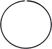
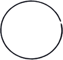
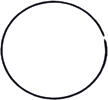
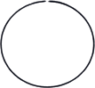
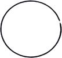
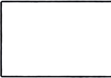

*(Các ảnh trên là những mảnh được trích từ trang 172; bố cục đầy đủ của hình 6.4 và 6.5 xem trong ảnh render trang dưới đây.)*

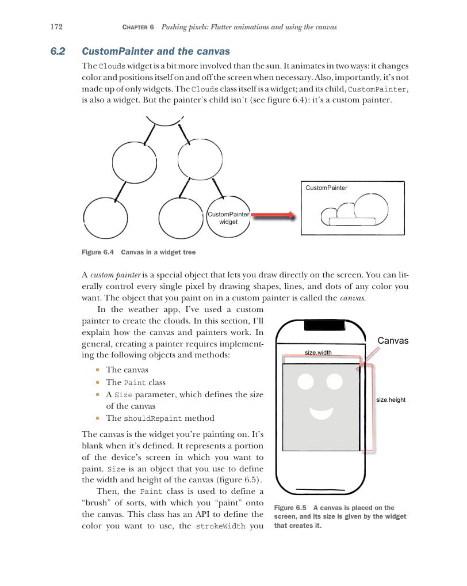

*Mô tả hình 6.4:* Một cây widget được vẽ bằng các vòng tròn (mỗi vòng tròn là một widget) nối với nhau bằng các đường kẻ. Ở hàng dưới cùng có một nút được ghi "**CustomPainter widget**". Từ nút đó có một mũi tên đỏ chỉ sang một khung chữ nhật có nhãn "**CustomPainter**", bên trong khung là hình vẽ đám mây. Ý nghĩa: nút cuối cùng của cây widget không có thêm widget con nào nữa, mà "con" của nó là một vùng vẽ tự do, nơi ta vẽ đám mây bằng tay.

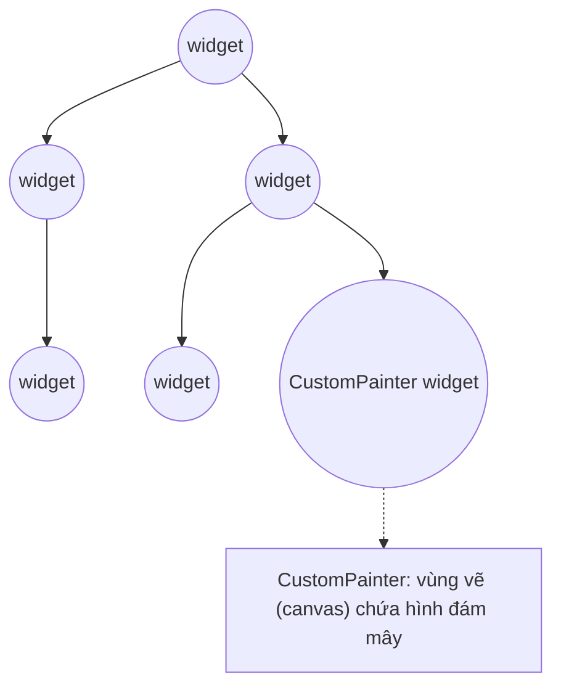

Một **custom painter** là một đối tượng đặc biệt cho phép bạn vẽ trực tiếp lên màn hình. Bạn có thể kiểm soát, theo đúng nghĩa đen, từng điểm ảnh một bằng cách vẽ các hình khối, đường kẻ và chấm với bất kỳ màu nào bạn muốn. Đối tượng mà bạn vẽ lên trong một custom painter được gọi là **canvas** (tấm vải vẽ).

Trong ứng dụng thời tiết, tôi đã dùng một custom painter để tạo ra các đám mây. Trong mục này, tôi sẽ giải thích canvas và painter hoạt động ra sao. Nhìn chung, việc tạo một painter đòi hỏi phải cài đặt các đối tượng và phương thức sau:

- Canvas
- Class `Paint`
- Một tham số `Size`, định nghĩa kích thước của canvas
- Phương thức `shouldRepaint`

**Canvas** là widget mà bạn đang vẽ lên. Nó trống trơn khi được định nghĩa. Nó đại diện cho một phần màn hình thiết bị mà bạn muốn vẽ trong đó. **`Size`** là một đối tượng bạn dùng để định nghĩa chiều rộng và chiều cao của canvas (hình 6.5).

**Hình 6.5 – Một canvas được đặt trên màn hình, và kích thước của nó do widget tạo ra nó cung cấp**

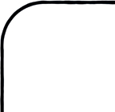
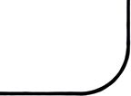


*Mô tả hình:* Một chiếc điện thoại, bên trong màn hình có một vùng chữ nhật màu xám (vẽ một khuôn mặt cười) — đó là **Canvas**. Cạnh trên của vùng được đánh dấu "**size.width**" (chiều rộng), cạnh bên được đánh dấu "**size.height**" (chiều cao). Ý nghĩa: canvas chỉ là một vùng trên màn hình, và kích thước của nó được truyền vào thông qua đối tượng `Size`.

```
┌──────────────────────┐
│      (điện thoại)    │
│  ←── size.width ──→  │
│  ┌────────────────┐ ↑│
│  │   o      o     │ ││
│  │     \____/     │ size.height
│  │    Canvas      │ ││
│  └────────────────┘ ↓│
└──────────────────────┘
```

Tiếp theo, class **`Paint`** được dùng để định nghĩa một kiểu "cây cọ", thứ mà bạn dùng để "vẽ" lên canvas. Class này có API để định nghĩa màu bạn muốn dùng (`color`), độ dày nét vẽ `strokeWidth` (tính bằng pixel), và các thuộc tính khác như `strokeCap`, định nghĩa hình dạng của đầu mút đường kẻ.

Các phương thức của đối tượng **`Canvas`** là thứ bạn dùng để nói cho Flutter biết **vẽ cái gì** bằng painter này. Nó có các phương thức như `drawRect` (vẽ hình chữ nhật) và `drawLine` (vẽ đường thẳng). Các phương thức này yêu cầu một đối tượng `Paint`, thứ quy định phong cách mà các hình được vẽ ra. Bạn sẽ sớm thấy ví dụ cụ thể.

Cuối cùng, phương thức **`shouldRepaint`** là một phương thức vòng đời được gọi bất cứ khi nào cấu hình của painter này thay đổi. Nó bắt buộc phải được định nghĩa và trả về một giá trị Boolean, và nó được dùng để báo cho Flutter **vẽ lại** canvas (hoặc khi nào **không** vẽ lại, vì cấu hình vẫn như cũ). Vẽ lại liên tục là tốn kém, và phương thức này cho bạn quyền kiểm soát quá trình vẽ lại.

> 📝 **Giải thích thêm (không có trong sách):** Tóm tắt "vai diễn" của từng thành phần bằng phép so sánh với người họa sĩ thật:
>
> | Thành phần | Trong đời thực | Trong Flutter |
> |---|---|---|
> | `CustomPaint` | Giá vẽ đặt trên tường | Widget đặt trong cây widget, nhận `size` và `painter` |
> | `CustomPainter` | Người họa sĩ | Class bạn viết, có `paint()` và `shouldRepaint()` |
> | `Canvas` | Tấm vải | Đối tượng cung cấp `drawCircle`, `drawRect`, `drawLine`... |
> | `Size` | Kích thước tấm vải | `size.width`, `size.height` |
> | `Paint` | Cây cọ + màu | `color`, `strokeWidth`, `strokeCap`, `style`... |

### 6.2.1 Các hình khối tạo nên đám mây (The shapes used to make up the clouds)

Trước khi lặn vào code, hãy xem hình 6.6, hình phác thảo các hình khối khác nhau được tạo ra bằng các đối tượng canvas và paint. Trên thực tế, bức vẽ đám mây là một tập hợp vài hình khối khác nhau được vẽ lên màn hình. Đừng mất nhiều thời gian vào hình này, vì tôi sẽ phân tích nó ngay sau đây.

**Hình 6.6 – Các ví dụ về phương thức draw của Canvas**

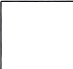
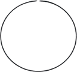


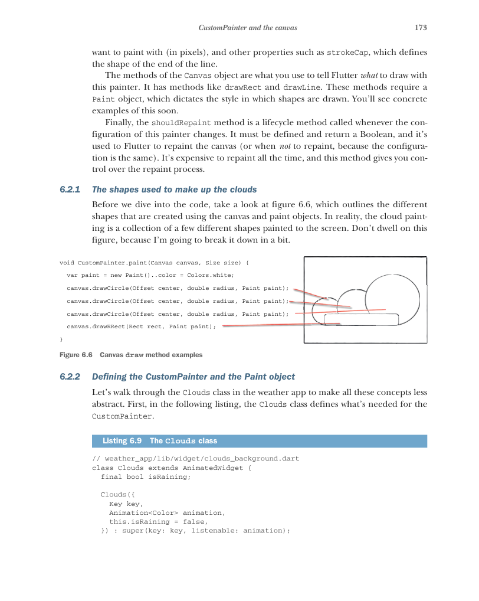

*Mô tả hình:* Bên trái là đoạn code giả (*pseudo-code*) dưới đây; bên phải là hình vẽ đám mây gồm ba hình tròn kích thước tăng dần từ trái sang phải và một hình chữ nhật bo góc dài nằm ngang ở dưới cùng. Các đường kẻ đỏ nối từng dòng `drawCircle` với từng hình tròn tương ứng, và dòng `drawRRect` với hình chữ nhật bo góc ở đáy.

```dart
void CustomPainter.paint(Canvas canvas, Size size) {
  var paint = new Paint()..color = Colors.white;
  canvas.drawCircle(Offset center, double radius, Paint paint);
  canvas.drawCircle(Offset center, double radius, Paint paint);
  canvas.drawCircle(Offset center, double radius, Paint paint);
  canvas.drawRRect(Rect rect, Paint paint);
}
```

*(Đây là code minh họa dạng "chữ ký phương thức" trong hình, không phải code chạy được.)*

### 6.2.2 Định nghĩa CustomPainter và đối tượng Paint (Defining the CustomPainter and the Paint object)

Hãy đi qua class `Clouds` trong ứng dụng thời tiết để tất cả các khái niệm này bớt trừu tượng. Đầu tiên, trong listing sau, class `Clouds` định nghĩa những gì cần thiết cho `CustomPainter`.

**Listing 6.9 – Class Clouds**

```dart
// weather_app/lib/widget/clouds_background.dart
class Clouds extends AnimatedWidget {
  final bool isRaining;

  Clouds({
    Key key,
    Animation<Color> animation,
    this.isRaining = false,
  }) : super(key: key, listenable: animation);

  Widget build(BuildContext context) {
    final Animation<Color> animation = listenable;

    Size screenSize = MediaQuery.of(context).size; // (1)
    Paint _paintBrush = Paint() // (2)
      ..color = animation.value
      ..strokeWidth = 3.0
      ..strokeCap = StrokeCap.round;

    return Container(
      height: 300.0,
      child: CustomPaint( // (3)
        size: screenSize, // (4)
        painter: CloudPainter( // (5)
          cloudPaint: _paintBrush,
          isRaining: isRaining,
        ),
      ),
    );
  }
}
```

Giải thích các chú thích trong listing:

1. Vì các đám mây di chuyển khắp phần nền, nên kích thước của canvas là **toàn bộ kích thước màn hình**.
2. Class `Paint` không nhận đối số nào, nhưng nó có các setter mà bạn có thể dùng để định nghĩa các đặc tính. Như bạn sẽ thấy, nhiều khả năng bạn sẽ muốn cập nhật các thuộc tính của class `Paint`, và tôi đoán đó là lý do nó được viết với setter thay vì tham số.
3. Khi dùng canvas để vẽ, bạn bọc nó trong `CustomPaint`, vốn là một widget. Bạn phải truyền cho nó một `size` và một `painter`.
4. Kích thước màn hình mà chúng ta đã lấy vài dòng trước đó.
5. Tôi đã định nghĩa một class mở rộng `CustomPainter`. `isRaining` (trời có mưa không) là một thuộc tính mà chúng ta sẽ xem xét sau.

> 📝 **Giải thích thêm (không có trong sách):** Dấu `..` trong `Paint()..color = ...` là **toán tử cascade** của Dart: nó cho phép gọi liên tiếp nhiều setter/phương thức trên **cùng một đối tượng** rồi trả về chính đối tượng đó. Đoạn trên tương đương:
>
> ```dart
> Paint _paintBrush = Paint();
> _paintBrush.color = animation.value;
> _paintBrush.strokeWidth = 3.0;
> _paintBrush.strokeCap = StrokeCap.round;
> ```

Nói ngắn gọn, class này định nghĩa một số đối tượng và thuộc tính mà chúng ta cần cho painter, chẳng hạn như chiều cao và đối tượng `Paint`.

Tiếp theo, hãy xem class `CloudPainter`, nơi chúng ta vẽ lên canvas. Listing này cho thấy mức **tối thiểu** bạn cần cho mọi đối tượng custom painter: một phương thức `paint` và một phương thức `shouldRepaint`.

**Listing 6.10 – Mức tối thiểu cho một custom painter**

```dart
// weather_app/lib/widget/clouds_background.dart -- line ~34
class CloudPainter extends CustomPainter {
  final bool isRaining;
  final Paint cloudPaint;
  CloudPainter({this.isRaining, this.cloudPaint}); // (1)

  @override
  void paint(Canvas canvas, Size size) { // (2)
    // paint on the canvas
  }

  @override
  bool shouldRepaint(CustomPainter oldDelegate) { // (3)
    return false;
  }
}
```

Giải thích các chú thích trong listing:

1. Các đối số của constructor là riêng cho ứng dụng này, nhưng bạn **không bắt buộc** phải truyền vào một `Paint`. Bạn có thể — và thường sẽ — tạo `Paint` ngay trong `CustomPainter`, thay vì truyền nó vào. Trong ứng dụng này, chúng ta cần nó được truyền vào để phục vụ khi thêm animation.
2. Một `CustomPainter` bắt buộc phải có phương thức `paint`. Nó tương tự như phương thức `build` trong widget. Đó là thứ mà framework Flutter kích hoạt để bắt đầu việc vẽ. Phương thức này được truyền vào một `Canvas` và một `Size` — thứ mà nó biết được vì chúng ta đã cho widget `CustomPaint` biết kích thước màn hình.
3. Phương thức này cũng bắt buộc, vì `CustomPainter` là một **class trừu tượng** (*abstract class*). Nó được gọi khi một instance mới của class delegate này được cung cấp cho render object (đối tượng render) tương ứng của nó. Nếu instance mới đại diện cho thông tin khác với instance cũ, thì phương thức nên trả về `true`; ngược lại, nó nên trả về `false`.

> 📝 **Giải thích thêm (không có trong sách):** Trong listing, `shouldRepaint` luôn trả về `false`. Điều này vẫn ổn trong ứng dụng thời tiết vì mỗi lần `Clouds` build lại (ở mỗi tick animation), một `CloudPainter` **mới** được tạo với `Paint` có màu mới — và vì `Clouds` là `AnimatedWidget`, cả widget `CustomPaint` được dựng lại. Tuy nhiên, cách viết chuẩn mực hơn là so sánh dữ liệu cũ và mới, ví dụ:
>
> ```dart
> @override
> bool shouldRepaint(CloudPainter oldDelegate) {
>   return oldDelegate.cloudPaint.color != cloudPaint.color ||
>       oldDelegate.isRaining != isRaining;
> }
> ```

Đến đây, tôi mới chỉ cho bạn thấy cách **thiết lập** một custom painter. Tiếp theo, chúng ta sẽ thực sự vẽ lên màn hình trong phương thức `CustomPainter.paint`.

### 6.2.3 Phương thức paint của CustomPainter (The CustomPainter paint method)

Logic của class này nằm trong phương thức `paint`. Cách giải thích đơn giản nhất cho việc vẽ lên canvas là: nó đòi hỏi bạn đưa ra chỉ dẫn **chính xác** về việc vẽ cái gì, ở đâu. Nếu bạn đang hướng dẫn một người bạn vẽ gì đó lên một tấm vải thật, bạn có thể nói: "Vẽ một đường màu đỏ từ góc trên bên trái tới chính giữa." Sau đó, bạn có thể tiếp tục bằng một lệnh khác: "Vẽ một hình tròn nhỏ màu xanh ở chính giữa."

Có hai điều cần lưu ý. Thứ nhất, **thứ tự là quan trọng**. Trong ví dụ với con người, hình tròn xanh sẽ đè lên đường kẻ đỏ vì nó được vẽ sau đường kẻ. Thứ hai, tôi muốn nhắc bạn rằng máy tính không thể giải mã những mệnh lệnh mơ hồ. Vì máy tính "ngốc", chúng ta phải đưa cho chúng các vị trí chính xác trong mệnh lệnh. Khác với người bạn thông minh của chúng ta, máy tính không biết "góc trên bên trái" là gì. **Sự chính xác là chìa khóa** trong các phương thức paint.

Trước khi xem code, hãy nghĩ về thứ chúng ta đang cố đạt được: đám mây trong hình 6.7. Dưới đây là vài ý chúng ta cần cân nhắc:

- Nó nằm ở giữa.
- Canvas là toàn bộ màn hình, nhưng hình vẽ không chiếm toàn bộ màn hình.
- Đám mây được tạo thành từ bốn hình khối: ba hình tròn và một hình chữ nhật bo góc.
- Màn hình điện thoại có đủ mọi kích cỡ khác nhau, nên chúng ta phải làm cho các số đo linh hoạt (*malleable*).

**Hình 6.7 – Ảnh chụp màn hình đám mây được tạo ra thông qua Canvas API**


*Mô tả hình:* Một đám mây màu xám gồm ba vòng tròn (nhỏ bên trái, vừa ở giữa, lớn bên phải) chồng lên nhau, đặt trên một đáy phẳng là hình chữ nhật bo góc.

Với tất cả những điều này trong đầu, chúng ta biết rằng mình cần đưa ra các mệnh lệnh dựa trên vị trí, phụ thuộc vào kích thước chính xác của thiết bị mà ứng dụng đang chạy. Chúng ta có thể dùng thuộc tính `Size` của painter cùng với toán học để có được các vị trí cụ thể này, rồi bảo painter vẽ bốn hình khối lên màn hình. Listing sau cho thấy kết quả cuối cùng trông như thế nào.

**Listing 6.11 – Một nửa phương thức CloudPainter.paint**

```dart
// weather_app/lib/widget/clouds_background.dart -- line ~41
@override
void paint(Canvas canvas, Size size) {
  double rectTop = 110.0; // (1)
  double rectBottom = rectTop + 40.0; // (2)
  double figureLeftEdge = size.width / 4;     // (3)
  double figureRightEdge = size.width - 90.0; // (3)
  double figureCenter = size.width / 2;       // (3)

  Rect cloudBaseRect = Rect.fromPoints( // (4)
    Offset(figureLeftEdge, rectTop),
    Offset(figureRightEdge, rectBottom),
  );
  RRect cloudBase = RRect.fromRectAndRadius( // (5)
    cloudBaseRect,
    Radius.circular(10.0),
  );

  canvas.drawCircle( // (6)
    Offset(figureLeftEdge + 5, 100.0),
    50.0, cloudPaint,
  );
  canvas.drawCircle(
    Offset(figureCenter, 70.0),
    60.0,
    cloudPaint,
  );
  canvas.drawCircle(
    Offset(figureRightEdge, 70.0),
    80.0,
    cloudPaint,
  );

  cloudPaint.strokeWidth = 3.0;
  canvas.drawRRect(cloudBase, cloudPaint); // (7)
  // ...
```

Giải thích các chú thích trong listing:

1. Dùng `rectTop` để đặt vị trí hình chữ nhật bo góc. Con số này hơi tùy ý, nhưng đúng về mặt thẩm mỹ.
2. Một lần nữa, tùy ý nhưng có chủ đích. Bốn mươi pixel trông vừa mắt, nhưng nó không dựa trên logic nào cả.
3. Các biến dùng để đặt đám mây dọc theo trục ngang của màn hình.
4. `Rect.fromPoints` tạo một hình chữ nhật từ offset của góc trên bên trái và góc dưới bên phải.
5. `RRect` là một hình chữ nhật có các góc bo tròn.
6. `Canvas.drawCircle` bảo canvas thực sự thực thi việc vẽ.
7. `Canvas.drawRRect` vẽ `RRect`.

Tôi dùng ba bước chung để định khung logic cho các phương thức paint của mình:

1. Định nghĩa các biến về không gian và vị trí (như `rectTop`)
2. Tạo các instance của hình, như `Rect`
3. Vẽ các hình lên canvas bằng các phương thức `Canvas.draw...`

Bước đầu tiên giúp code dễ hiểu và dễ suy luận hơn. Trong ví dụ này, `size.width / 4` sẽ trả về chính xác một phần tư chiều rộng của canvas, phần mà tôi dùng làm khoảng đệm (*padding*) bên trái. `size.width - 90.0` hơi tùy ý nhưng sẽ cho chính xác 90 pixel khoảng đệm bên phải. Tôi chọn 90 pixel vì các đám mây trông đẹp nhất khi hơi lệch khỏi tâm. (Đó là ý kiến của tôi thôi, nhưng tôi không phải là họa sĩ, nên bạn cứ nghe cho vui — *take it with a grain of salt*.)

Bước thứ hai là bước chuẩn bị. Canvas có các phương thức dựng sẵn để vẽ các hình phổ biến: `drawRect` vẽ hình chữ nhật, `drawLine` vẽ đường thẳng, v.v. Để vẽ một hình chữ nhật, bạn cần tạo một đối tượng hình chữ nhật để đưa cho phương thức `drawRect`. Class `Rect`, class `Line`, class `Circle` và mọi hình khác đều có các constructor dùng những phép đo khác nhau để định nghĩa hình. Ví dụ, tôi đã dùng `Rect.fromPoints`, constructor nhận hai offset và vẽ hình chữ nhật nhỏ nhất bao được cả hai điểm. Cũng có `Rect.fromLTWH`, nghĩa là "*from left, top, width, height*" (từ cạnh trái, cạnh trên, chiều rộng, chiều cao). Tôi khuyến khích bạn khám phá mọi lựa chọn để tạo hình khi bạn dùng custom painter lần tới; bạn có thể tìm thấy chúng trong tài liệu tại http://mng.bz/omZN.

Trong ví dụ này, tôi chọn dùng constructor `Rect.fromPoints` vì nó nhận hai đối tượng `Offset` làm tham số. Offset được dùng khá nhiều trong phát triển giao diện (*UI development*), và tôi thấy thoải mái khi làm việc với chúng. Đó là lý do duy nhất.

> **NOTE (Ghi chú)** Không constructor nào nhất thiết tốt hơn constructor nào. Đúng hơn, chúng là những phương tiện khác nhau để đạt cùng một mục đích.

Offset biểu diễn các điểm tính từ **gốc của vector**, tức là góc trên bên trái của canvas (trong trường hợp của chúng ta là góc trên bên trái của màn hình, vì canvas là toàn bộ phần nền của màn hình). Để tạo `rect` biểu diễn phần đáy của đám mây, hãy cung cấp cho constructor `Rect.fromPoints` điểm trên bên trái của hình chữ nhật và điểm dưới bên phải.

Cần lưu ý rằng **cho tới lúc này, chúng ta chưa vẽ gì lên canvas cả**. Chúng ta chỉ mới khai báo một instance của class `Rect`.

Hình chữ nhật mà chúng ta đang xây dựng làm đáy đám mây cần có các góc bo tròn. May mắn thay, Flutter cho chúng ta một class tên là `RRect`. Bạn có thể truyền hình chữ nhật đã xây dựng trước đó vào `RRect.fromRectAndRadius`, thứ sẽ xây dựng một hình chữ nhật bo góc, được gọi trong Canvas API là `RRect`.

> 💡 **Ví dụ bổ sung (không có trong sách):** Hãy thử tính các tọa độ cụ thể trên một điện thoại có chiều rộng logic `size.width = 400`:
>
> | Biến | Công thức | Giá trị |
> |---|---|---|
> | `rectTop` | 110.0 | 110 |
> | `rectBottom` | 110 + 40 | 150 |
> | `figureLeftEdge` | 400 / 4 | 100 |
> | `figureRightEdge` | 400 − 90 | 310 |
> | `figureCenter` | 400 / 2 | 200 |
>
> Như vậy:
>
> - Đáy mây là hình chữ nhật từ điểm (100, 110) đến (310, 150), bo góc bán kính 10.
> - Hình tròn 1: tâm (105, 100), bán kính 50.
> - Hình tròn 2: tâm (200, 70), bán kính 60.
> - Hình tròn 3: tâm (310, 70), bán kính 80.
>
> Trên một máy tính bảng rộng 800, `figureLeftEdge` = 200 và `figureRightEdge` = 710 — đám mây tự giãn ra theo màn hình, đúng mục tiêu "số đo linh hoạt". (Lưu ý: tọa độ y tăng dần **xuống dưới**, vì gốc (0, 0) nằm ở góc trên bên trái.)

Đi tiếp xuống phương thức `paint`, bạn có thể thấy chúng ta bắt đầu vẽ các hình tròn tạo nên phần còn lại của bức vẽ đám mây. Quan trọng là, tại thời điểm này, `RRect` vẫn **chưa** được vẽ lên canvas, mới chỉ được định nghĩa. Còn các hình tròn được định nghĩa **và** vẽ lên canvas chỉ trong những dòng code đơn lẻ. Để nhắc lại, đây là phương thức `paint`.

**Listing 6.12 – Phương thức CloudPainter.paint**

```dart
// weather_app/lib/widget/clouds_background.dart -- line ~38
@override
void paint(Canvas canvas, Size size) {
  double rectTop = 110.0;
  double rectBottom = rectTop + 40.0;
  double figureLeftEdge = size.width / 4;
  double figureRightEdge = size.width - 90.0;
  double figureCenter = size.width / 2;

  Rect cloudBaseRect = Rect.fromPoints(
    Offset(figureLeftEdge, rectTop),
    Offset(figureRightEdge, rectBottom),
  );
  RRect cloudBase = RRect.fromRectAndRadius(
    cloudBaseRect,
    Radius.circular(10.0),
  );

  canvas.drawCircle( // (1)
    Offset(figureLeftEdge + 5, 100.0),
    50.0, cloudPaint,
  );
  canvas.drawCircle(
    Offset(figureCenter, 70.0),
    60.0,
    cloudPaint,
  );
  canvas.drawCircle(
    Offset(figureRightEdge, 70.0),
    80.0,
    cloudPaint,
  );

  cloudPaint.strokeWidth = 3.0;
  canvas.drawRRect(cloudBase, cloudPaint);
  // ...
```

Giải thích chú thích trong listing:

1. Nơi các hình tròn bắt đầu được vẽ. Hãy để ý rằng quy trình vẽ các hình tròn này khác với quy trình vẽ hình chữ nhật, vì chúng ta không định nghĩa trước hình tròn.

`drawCircle` khác với việc vẽ hình chữ nhật, vì bạn không phải tạo trước một đối tượng hình tròn. Theo tôi, điều này hợp lý, vì một hình tròn không dựa trên nhiều điểm. Nó chỉ cần một `Offset` biểu diễn **tâm** của hình tròn, và một số `double` biểu diễn **bán kính** của hình tròn. Và để vẽ một hình tròn lên canvas, bạn sẽ cần một đối tượng `Paint`. Đó là lý do mỗi hình tròn trong ba hình được tạo ngay tại chỗ, thay vì được định nghĩa trước.

Có lẽ sẽ hữu ích nếu nhìn lại sơ đồ đám mây một lần nữa trước khi hoàn tất bức vẽ này. Bạn có thể thấy nó trong hình 6.8. Đi tiếp xuống phương thức `CloudPainter.paint`, chúng ta đang ở điểm đã định nghĩa xong hình chữ nhật bo góc và đã thực sự vẽ ba hình tròn lên màn hình. Giờ chúng ta chỉ cần vẽ phần đáy của đám mây, thứ cho chúng một cái đáy phẳng. Chúng ta đã làm phần khó là tạo `RRect`; giờ chỉ cần gọi `canvas.drawRRect` là xong. Phương thức này được gọi trong phương thức `paint`, và nó trông như sau:

```dart
canvas.drawRRect(cloudBase, cloudPaint);
```

Phương thức này yêu cầu một hình (*shape*), được biểu diễn bởi biến `cloudBase`, và một đối tượng `Paint`, mà chúng ta đã gán cho biến `cloudPaint` (xem hình 6.8).

**Hình 6.8 – Các ví dụ về phương thức draw của Canvas**


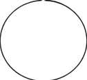

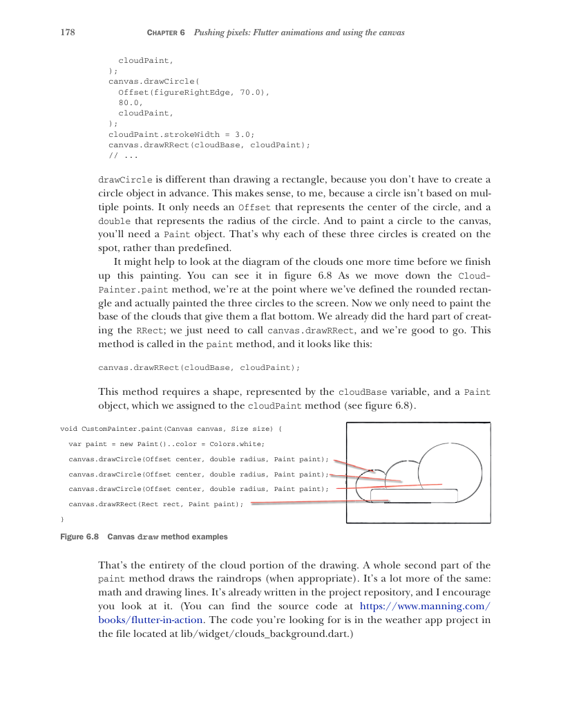

*Mô tả hình:* Giống hình 6.6 — đoạn code giả bên trái, hình đám mây bên phải, các đường nối mỗi lệnh `drawCircle` với một hình tròn và lệnh `drawRRect` với đáy bo góc:

```dart
void CustomPainter.paint(Canvas canvas, Size size) {
  var paint = new Paint()..color = Colors.white;
  canvas.drawCircle(Offset center, double radius, Paint paint);
  canvas.drawCircle(Offset center, double radius, Paint paint);
  canvas.drawCircle(Offset center, double radius, Paint paint);
  canvas.drawRRect(Rect rect, Paint paint);
}
```

Đó là toàn bộ phần đám mây của bức vẽ. Còn cả một phần thứ hai của phương thức `paint` dùng để vẽ những hạt mưa (khi thích hợp). Nó cũng toàn là những thứ tương tự: toán và vẽ đường thẳng. Phần đó đã được viết sẵn trong kho mã (*repository*) của dự án, và tôi khuyến khích bạn xem nó. (Bạn có thể tìm mã nguồn tại https://www.manning.com/books/flutter-in-action. Đoạn code bạn cần tìm nằm trong dự án weather app, ở file `lib/widget/clouds_background.dart`.)

Đến đây bạn sẽ thấy đám mây trên màn hình. Trông khá ổn, nhưng chúng ta cần làm cho nó chuyển động — cả màu sắc lẫn vị trí. Trong mục tiếp theo, chúng ta sẽ làm vài animation phức tạp hơn.

> 💡 **Ví dụ bổ sung (không có trong sách):** Bài toán nhỏ — vẽ các hạt mưa bằng `drawLine`. Đây **không phải** code của sách (code gốc nằm trong repository), chỉ là một cách làm minh họa cùng tinh thần "toán + vẽ đường":
>
> ```dart
> void _paintRain(Canvas canvas, Size size, Paint paint) {
>   const double dropLength = 12.0;
>   final double startX = size.width / 4;
>   final double endX = size.width - 90.0;
>   // 8 hạt mưa trải đều dưới đáy mây (đáy mây ở y = 150)
>   for (int i = 0; i < 8; i++) {
>     final double x = startX + (endX - startX) * i / 7;
>     final double y = 165.0 + (i.isEven ? 0 : 15); // so le cho tự nhiên
>     canvas.drawLine(
>       Offset(x, y),
>       Offset(x - 4, y + dropLength), // hơi nghiêng như gió thổi
>       paint, // strokeCap.round giúp đầu hạt mưa bo tròn
>     );
>   }
> }
> ```
>
> Gọi `_paintRain(canvas, size, cloudPaint)` ở cuối `paint` khi `isRaining == true`. Nhớ quy tắc "thứ tự là quan trọng": vẽ mưa sau mây thì mưa sẽ nằm đè lên mây nếu chúng giao nhau.

---

## 6.3 Animation so le, TweenSequence và các animation dựng sẵn (Staggered animations, TweenSequence, and built-in animations)

Giờ chúng ta đã vẽ xong các đám mây, đã đến lúc làm cho chúng chuyển động. Vậy nên, chúng ta sẽ quay lại với animation, xem thêm một số ví dụ khác và xây dựng tiếp trên nền tảng đã có từ đầu chương.

Mục này xoay quanh việc điều phối (*coordinating*) nhiều animation từ class `ForecastPageState`. Phần nền trong ứng dụng này chứa những animation phức tạp phải được thực thi theo một thứ tự cụ thể và với thời điểm (*timing*) cụ thể. Chúng ta sẽ lấy nhiều animation riêng lẻ và dàn dựng (*orchestrate*) chúng chỉ bằng **hai** animation controller.

Có khá nhiều widget được làm chuyển động theo một cách nào đó trong ứng dụng này. Tổng cộng, có **bảy tween** làm chuyển động cho **hơn 10 thuộc tính** trên nhiều widget khác nhau. Điều quan trọng là tất cả các animation này đều có liên quan với nhau. Tất cả chúng đều cần diễn ra cùng một lúc. Hãy nghĩ xem chuyện gì xảy ra khi bạn chọn một mốc giờ mới trên thanh tab (*tab bar*): thao tác đó làm thay đổi vị trí và màu sắc của hình nền mặt trời và mặt trăng. Nó cũng làm thay đổi màu nền của toàn bộ ứng dụng. Do đó, màu chữ trên khắp trang này cũng phải được đổi theo để có thể đọc rõ trên màu nền vừa cập nhật. Để giải thích cách dàn dựng toàn bộ quá trình này, tôi sẽ nói về một vài `AnimatedWidget` dựng sẵn như `SlideTransition`, cách sử dụng một class tùy biến để quản lý trạng thái (*state*) của animation, và tính năng tiện ích yêu thích của tôi liên quan đến animation: `TweenSequence`.

Cần lưu ý rằng, như tôi đã đề cập, việc điều phối tất cả những animation này đòi hỏi phải xây dựng bảy tween, mỗi tween đều có giá trị bắt đầu (*start*) và giá trị kết thúc (*end*) riêng. Một số tween được dùng để chuyển động màu sắc, và một số dùng để chuyển động vị trí. Nhưng mấu chốt là chúng ta sẽ làm việc với nhiều tween cùng lúc.

### 6.3.1 Tạo một class trạng thái animation tùy biến (Creating a custom animation state class)

Bản chất của ứng dụng này đòi hỏi hình vẽ mặt trời và mặt trăng ở phần nền tại bất kỳ thời điểm nào cũng phải phản ánh đúng kiểu thời tiết (*weather pattern*) — điều mà không thể nào biết trước được. Hơn thế nữa, màu chữ và màu nền của trang này cũng được làm chuyển động. Điều đó có nghĩa là nhiều thuộc tính của các widget này cần được tính toán lại mỗi khi state thay đổi. Cụ thể, mỗi lần người dùng chọn một mốc giờ mới trong ngày, ứng dụng cần xây dựng các tween dựa trên dữ liệu thời tiết của mốc giờ đó rồi kích hoạt các animation ngay lập tức. Phần còn lại của chương này được dành để tìm hiểu giải pháp của tôi cho bài toán đó.

Trước hết, hãy suy nghĩ qua các bước logic để cài đặt tất cả những animation khác nhau diễn ra sau mỗi lần thay đổi state. Chúng ta đã biết những gì cho tới giờ, và chúng ta muốn làm gì ở đây?

- Chúng ta biết rằng mọi tween trong một animation đều cần một điểm bắt đầu (*beginning*) và một điểm kết thúc (*end*).
- Chúng ta biết rằng, trong trường hợp của mình, chúng ta cần lấy các giá trị đó mỗi khi state được cập nhật — việc xảy ra khi người dùng chạm vào một mốc giờ mới trên thanh tab.
- Chúng ta biết rằng các giá trị đó dựa trên mốc giờ được chọn và dự báo thời tiết tại thời điểm đó. Ví dụ, các giá trị màu sắc và vị trí của mặt trời dựa trên thời điểm trong ngày, còn việc hiển thị hay ẩn đám mây và mưa lại dựa trên kiểu thời tiết.

Với những điều đó trong đầu, chúng ta cần hoàn thành những gì?

- Khi người dùng chạm (*on tap*), chúng ta cần thu thập toàn bộ dữ liệu thời gian và thời tiết cho mốc giờ được chọn. (Chúng ta cũng cần biết dữ liệu thời tiết hiện tại là gì để làm các giá trị bắt đầu cho các tween.)
- Với dữ liệu đó, chúng ta cần quyết định xem giá trị kết thúc (*end value*) cho từng tween là gì.
- Chúng ta cần xây dựng các tween, truyền chúng vào các widget, và gọi `forward` trên animation controller.

Trong ứng dụng, quy trình này bao gồm một vài bộ phận chuyển động (*moving parts*) phối hợp với nhau:

- **`ForecastAnimationState`** — Một class trợ giúp (*helper class*) mà tôi đã thêm vào để giúp việc suy luận trở nên dễ dàng hơn. Thực chất tất cả những gì nó làm chỉ là giữ tham chiếu tới mọi giá trị khác nhau mà animation này cần tại bất kỳ trạng thái bắt đầu hay kết thúc nào. Nó cũng có một `factory` constructor giúp chọn ra tất cả các giá trị chính xác dựa trên dữ liệu thời tiết và thời gian. Về cơ bản, nó là một câu lệnh `switch` khổng lồ được gán cứng (*hard-coded*).
- **`AnimationUtil.getDataForNextAnimationState`** — Điều phối logic cần thiết để tạo một `ForecastAnimationState`. Nó nói rằng: "Ồ, bạn vừa chọn chỉ số tab (*tab index*) đó hả? Được rồi, để tôi lấy dữ liệu thời gian và thời tiết tương ứng rồi xây dựng một `ForecastAnimationState` mới nhé." Trong ứng dụng, đoạn code trông như sau:

```dart
// weather_app/lib/utils/forecase_animation_utils.dart
class AnimationUtil {
  static ForecastAnimationState getDataForNextAnimationState({
    ForecastDay selectedDay,
    int currentlySelectedTimeOfDay, // (1)
  }) {
    final newSelection = ForecastDay.getHourSelection( // (2)
      selectedDay,
      currentlySelectedTimeOfDay,
    );

    final endAnimationState = ForecastAnimationState.stateForNextSelection( // (3)
      newSelection.dateTime.hour,
      newSelection.description,
    );
    return endAnimationState;
  }
```

Giải thích các chú thích trong đoạn code trên:

1. `currentlySelectedTimeOfDay`: Chỉ mốc giờ đang được chọn trên thanh tab. Giá trị có thể là 3, 6, 9, 12, 15, 18, 21 hoặc 24.
2. Biến `newSelection` sẽ là một đối tượng `Weather` gắn với thời điểm tương ứng trong ngày.
3. Tạo một trạng thái animation (*animation state*) dựa trên thông tin thời tiết.

Tiếp tục với các bộ phận chuyển động trong class trạng thái animation tùy biến của ứng dụng thời tiết:

- **`ForecastPageState.currentAnimationState` và `ForecastPageState.nextAnimationState`** — Được dùng để thiết lập giá trị cho tất cả các tween cần thiết trong phương thức `ForecastPageState._buildTweens`.
  Mỗi khi có sự thay đổi state và animation bắt đầu chạy, chúng ta sẽ lấy các giá trị cần hướng tới (*animate to*), xây dựng các tween, rồi gán `currentAnimationState` bằng các giá trị kết thúc của animation vừa được kích hoạt, bởi vì đó chính là nơi chúng ta muốn animation tiếp theo bắt đầu. Việc này diễn ra trong phương thức `ForecastPageState.handleStateChange`. Chúng ta đã thấy phương thức đó khi làm chuyển động cho mặt trời, nhưng hãy xem lại nó một lần nữa vì đây là một trong những phương thức phức tạp hơn của ứng dụng này.
- **Các giá trị từ những đối tượng `ForecastAnimationState`** — Cập nhật các tween, giúp những animation mà chúng ta đã viết cho tới giờ hoạt động đúng như mong đợi.

Những bộ phận này được thể hiện trong hai listing tiếp theo (6.13 và 6.14).

**Listing 6.13 – Phương thức ForecastPageState.handleStateChange**

```dart
// weather_app/lib/page/forecast_page.dart -- line ~78
void _handleStateChange(int activeIndex) {
  if (activeIndex == activeTabIndex) return;

  nextAnimationState = AnimationUtil.getDataForNextAnimationState( // (1)
    selectedDay: _forecastController.selectedDay,
    currentlySelectedTimeOfDay:
        _forecastController.selectedHourlyTemperature.dateTime.hour,
  );

  _buildAnimationController(); // (2)
  _buildTweens();
  _initAnimation();

  setState(() => activeTabIndex = activeIndex); // (3)

  int nextSelectedHour = AnimationUtil.getSelectedHourFromTabIndex( // (4)
    activeIndex,
    _forecastController.selectedDay,
  );

  _forecastController.selectedHourlyTemperature =
      ForecastDay.getWeatherForHour( // (5)
    _forecastController.selectedDay,
    nextSelectedHour,
  );
  currentAnimationState = nextAnimationState; // (6)
}
```

Giải thích các chú thích trong listing:

1. Lấy trạng thái animation tiếp theo dựa trên lựa chọn tab mới.
2. Xây dựng các animation controller và các tween.
3. Gọi `setState` để Flutter biết cần rebuild. Các animation đã đang được thực thi rồi, nhưng Flutter vẫn cần biết để đổi tab đang được chọn và dữ liệu thời tiết liên quan.
4. Lấy mốc giờ gắn với chỉ số tab (*tab index*) mới.
5. Lấy dữ liệu thời tiết gắn với mốc giờ vừa chọn và gán nó cho biến `selectedHourlyTemperature` của controller.
6. Sau khi animation kích hoạt, gán `ForecastPageState.currentAnimationState` bằng giá trị của `ForecastPageState.nextAnimationState` để sẵn sàng cho lần thay đổi state tiếp theo.

**Listing 6.14 – Phương thức ForecastPageState._buildTweens**

```dart
// weather_app/lib/page/forecast_page.dart -- line ~147
void _buildTweens() {
  _colorTween = ColorTween(
    begin: currentAnimationState.sunColor, // (1)
    end: nextAnimationState.sunColor,
  );
  _cloudColorTween = ColorTween(
    begin: currentAnimationState.cloudColor,
    end: nextAnimationState.cloudColor,
  );
  // ...
}
```

Giải thích chú thích trong listing:

1. Sử dụng các giá trị từ trạng thái animation (`currentAnimationState` và `nextAnimationState`) của chúng ta thay vì các màu tĩnh (*static colors*).

Đó là toàn bộ quy trình cần thiết để làm chuyển động màu sắc cho hai widget mặt trời và đám mây. Giờ đã có các tween, các animation controller và các widget cần làm chuyển động, những animation này sẽ hoạt động. Hơn nữa, hãy để tôi nhắc lại cho bạn nơi toàn bộ công sức này được sử dụng: chúng được truyền vào các widget mặt trời (`Sun`) và đám mây (`Clouds`).

**Listing 6.15 – Truyền các giá trị animation vào widget (Passing animation values into widgets)**

```dart
// weather_app/lib/page/forecast_page.dart -- line ~263
child: Stack(
  children: <Widget>[
    SlideTransition( // (1)
      // ...
      child: Sun(
        animation: _colorTween.animate( // (2)
          _animationController,
        ),
      ),
    ),
    SlideTransition(
      // ...
      child: Clouds(
        isRaining: isRaining,
        animation: _cloudColorTween.animate( // (3)
          _animationController,
        ),
      ),
    ),
  ],
),
```

Giải thích các chú thích trong listing:

1. `SlideTransition` sẽ được trình bày ngay sau đây.
2. Hãy nhớ rằng các `AnimatedWidget` cần được truyền vào một animation. Bạn có thể tạo một đối tượng `Animation` bằng cách gọi `Tween.animate`.
3. Một lần nữa, truyền animation vào widget, nhưng lần này tween được dùng cụ thể là tween theo dõi màu sắc của đám mây (`_cloudColorTween`).

> 💡 **Ví dụ bổ sung (không có trong sách):** Tại sao tác giả lại gom mọi thuộc tính đích vào một class `ForecastAnimationState` thay vì tính lẻ tẻ từng biến? Hãy hình dung nếu không có class trạng thái gom chung, mỗi khi người dùng bấm chọn giờ mới, bạn phải viết hàng loạt câu lệnh `if/else` rải rác cho màu bầu trời, màu mặt trời, tọa độ mặt trời, màu mây, tọa độ mây, màu chữ... Khi thêm một trạng thái thời tiết mới (ví dụ: sương mù), bạn dễ quên cập nhật một vài biến.
>
> Với mẫu thiết kế **State Snapshot** như `ForecastAnimationState`, bạn đóng gói toàn bộ "bức tranh đích" vào một đối tượng bất biến (*immutable*):
>
> ```dart
> class ThemeSnapshot {
>   final Color backgroundColor;
>   final Color textColor;
>   final Offset badgeOffset;
>
>   const ThemeSnapshot({
>     required this.backgroundColor,
>     required this.textColor,
>     required this.badgeOffset,
>   });
> }
> ```
>
> Khi chuyển từ `currentSnapshot` sang `nextSnapshot`, mọi `Tween(begin: currentSnapshot.x, end: nextSnapshot.x)` đều nhất quán tuyệt đối, và dòng cuối `currentSnapshot = nextSnapshot` bảo đảm lần chuyển tiếp sau luôn bắt đầu đúng từ đích của lần trước.

### 6.3.2 Widget animation dựng sẵn: SlideTransition (Built-in animation widgets: SlideTransition)

Các thành phần nền đám mây và mặt trời cũng làm chuyển động cả vị trí của chúng. Flutter cung cấp sẵn cho chúng ta một widget tuyệt vời cho đúng trường hợp sử dụng đó — vì Flutter tốt với chúng ta quá mà! Có một widget tên là `SlideTransition` giúp trượt (*slide*) widget con của nó ngang qua màn hình bằng cách sử dụng các tọa độ `Offset`. Flutter cũng đi kèm với `ScaleTransition` (chuyển tiếp tỷ lệ phóng), `SizeTransition` (chuyển tiếp kích thước), `FadeTransition` (chuyển tiếp độ mờ), cùng nhiều widget khác nữa.

Tất cả những widget này đều kế thừa `AnimatedWidget`, nên chúng ta có thể sử dụng chúng y hệt như cách dùng animation cho mặt trời và đám mây. Chúng ta chỉ cần truyền một animation vào thuộc tính `position` và truyền thêm một widget `child`. Vì chúng ta đã đang sử dụng một `Stack`, tất cả những gì cần làm là thay thế các widget `Positioned` bằng các widget `SlideTransition`, đồng thời truyền cùng các widget con đó vào thuộc tính `child`.

Bây giờ chúng ta cần xây dựng các tween. Chúng ta cần hai đối tượng `Tween<Offset>` khác nhau: một cho mặt trời và một cho đám mây. Mặt trời được điều khiển bởi biến `Tween<Offset> _positionOffsetTween`. Nó giống hệt như các tween mà chúng ta đã dùng cho tới giờ. Bạn có thể thấy nó trong `ForecastPageState._buildTweens`:

```dart
// weather_app/lib/page/forecast_page.dart -- line ~113
void _buildTweens() {
  // ...
  _positionOffsetTween = Tween<Offset>( // (1)
    begin: currentAnimationState.sunOffsetPosition,
    end: nextAnimationState.sunOffsetPosition,
  );
  // ...
```

Giải thích chú thích trong đoạn code trên:

1. Tween này được sử dụng giống hệt như một `ColorTween` mà chúng ta đã thấy trước đó. Nó chỉ theo dõi một kiểu dữ liệu khác mà thôi: một `Offset` thay vì một màu sắc (`Color`).

Giờ thì widget nền mặt trời cần biết về tween đó. Việc này được thiết lập trong phương thức `build` của cùng widget này:

```dart
// weather_app/lib/page/forecast_page.dart -- line ~263
child: Stack(
  children: <Widget>[
    SlideTransition( // (1)
      position: _positionOffsetTween.animate(
        _animationController.drive( // (2)
          CurveTween(curve: Curves.bounceOut),
        ),
      ),
      child: Sun(
        animation: _colorTween.animate(_animationController),
      ),
    ),
    SlideTransition( // (3)
      position: _cloudPositionOffsetTween.animate(
        _weatherConditionAnimationController.drive(
          CurveTween(curve: Curves.bounceOut),
        ),
      ),
      child: Clouds(
        isRaining: isRaining,
        animation: _cloudColorTween.animate(_animationController),
      ),
    ),
  ],
),
```

Giải thích các chú thích trong đoạn code trên:

1. `SlideTransition`: Một widget chuyển động dựng sẵn (*built-in animated widget*) làm chuyển động thuộc tính `position`. Nó thường được dùng thay cho widget `Positioned` và đóng vai trò là con của một `Stack`. Nó làm chuyển động vị trí cho widget `child` của mình.
2. `drive`: Bạn có thể gọi phương thức `drive` trên một animation controller để kiểm soát animation kỹ hơn. Nó cho phép bạn thay đổi hành vi mặc định của animation. Trong trường hợp này, tôi dùng `drive` để truyền vào `Curve` (thông qua `CurveTween`) nhằm làm cho quỹ đạo (*trajectory*) của animation khác đi.
3. `SlideTransition` thứ hai: Tôi đưa thêm phần chuyển tiếp trượt của `Clouds` vào đây như một ví dụ tương tự khác.

> 📝 **Giải thích thêm (không có trong sách):** Cần lưu ý một điểm rất quan trọng về hệ tọa độ của `SlideTransition`: giá trị `Offset(dx, dy)` truyền cho `SlideTransition.position` **không phải là số pixel tuyệt đối**, mà là **tỷ lệ nhân với kích thước của chính widget con (`child`)**.
>
> - `Offset(0.0, 0.0)` nghĩa là widget nằm ở vị trí gốc bình thường của nó.
> - `Offset(1.0, 0.0)` nghĩa là dịch sang phải một khoảng đúng bằng `1.0 × chiều rộng của child`.
> - `Offset(-1.0, 0.0)` nghĩa là dịch sang trái đúng bằng chiều rộng của `child` (trượt khuất hẳn sang mép trái màn hình nếu `child` rộng bằng màn hình).
> - `Offset(0.0, 0.5)` nghĩa là dịch xuống dưới một nửa chiều cao của `child`.
>
> Còn việc nối chuỗi `_positionOffsetTween.animate(_animationController.drive(CurveTween(curve: Curves.bounceOut)))` hoạt động theo hai bước: trước hết `_animationController.drive(CurveTween(...))` bẻ cong tiến độ tuyến tính `0.0 -> 1.0` của controller theo đường cong nảy `Curves.bounceOut`, sau đó `_positionOffsetTween.animate(...)` ánh xạ giá trị đã uốn cong đó sang tọa độ `Offset` thực tế.

### 6.3.3 Xây dựng animation cho widget Clouds (Building animations for the Clouds widget)

Phần trên hẳn trông khá giống với các animation đổi màu. Theo ý kiến của tôi, phần tiếp theo thú vị hơn: làm chuyển động cho các đám mây.

Lần đầu tiên viết animation này, tôi đã dùng cùng một animation controller để di chuyển các đám mây vào trong màn hình (*onscreen*) và ra khỏi màn hình (*offscreen*), dẫn đến kết quả không như ý muốn. Các đám mây di chuyển thẳng một mạch (theo đường chéo — *diagonally*) tới vị trí của chúng ở ngoài màn hình. Bởi vì hình đám mây và mặt trời cũng đồng thời di chuyển lên và xuống dựa theo thời점 trong ngày, nên hình 6.9 cho thấy những gì đã xảy ra. Cách chạy này không sai về mặt kỹ thuật, nhưng trông nó không đẹp mắt.

**Hình 6.9 – Animation trượt vị trí một bước (Single position slide animation)**

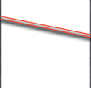
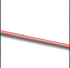
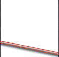

*Mô tả hình 6.9:* Sơ đồ gồm 4 khung màn hình nối tiếp nhau từ **Vị trí bắt đầu** (*Start position*) ở góc trên bên trái sang **Vị trí kết thúc** (*End position*) ở ngoài mép dưới bên phải. Khi chỉ dùng một bước trượt vị trí duy nhất, đám mây trượt chéo một đường thẳng tuột từ trên cao bên trái xuống góc dưới bên phải ra khỏi màn hình (mũi tên đỏ kéo chéo xuyên qua cả 4 khung).

Animation định vị này nên gồm **hai bước**. Nó cần di chuyển lên hoặc xuống trước, rồi sau đó mới trượt ngang vào hoặc ra khỏi màn hình như thể hiện trong hình 6.10.

**Hình 6.10 – Animation trượt vị trí so le (Staggered position slide animation)**

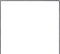
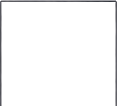

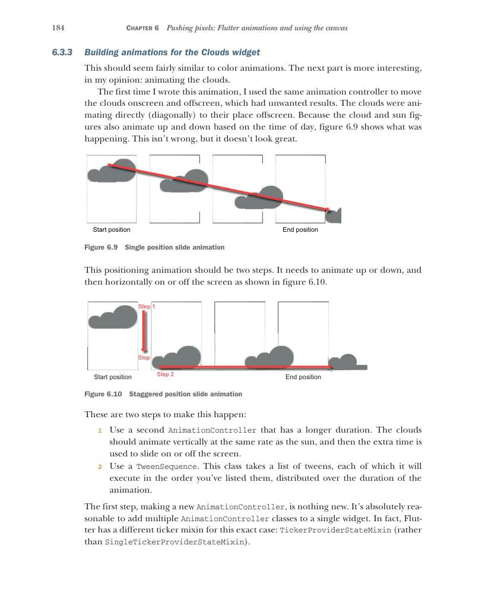

*Mô tả hình 6.10:* Sơ đồ gồm 4 khung màn hình từ **Vị trí bắt đầu** (*Start position*) đến **Vị trí kết thúc** (*End position*):
- **Bước 1 (*Step 1*):** Đám mây đi thẳng đứng từ trên xuống dưới theo mũi tên dọc màu đỏ, đến điểm **Dừng (*Stop*)** ở cùng độ cao đích.
- **Bước 2 (*Step 2*):** Từ điểm dừng đó, đám mây mới trượt ngang theo phương nằm ngang (mũi tên đỏ nằm ngang) qua các khung tiếp theo để đi ra khỏi màn hình tại *End position*.

Đây là hai bước để hiện thực hóa điều này:

1. Sử dụng một `AnimationController` thứ hai có thời lượng (*duration*) dài hơn. Các đám mây nên di chuyển theo chiều dọc với cùng tốc độ như mặt trời, và sau đó phần thời gian dư thêm sẽ được dùng để trượt ngang vào hoặc ra khỏi màn hình.
2. Sử dụng một `TweenSequence`. Class này nhận vào một danh sách các tween, và nó sẽ thực thi lần lượt từng tween theo đúng thứ tự bạn liệt kê, được phân bổ trải đều trên tổng thời lượng của animation.

Bước đầu tiên — tạo một `AnimationController` mới — không có gì mới lạ cả. Việc thêm nhiều đối tượng `AnimationController` vào một widget duy nhất là hoàn toàn hợp lý. Thực tế, Flutter có sẵn một ticker mixin khác dành riêng cho đúng trường hợp này: `TickerProviderStateMixin` (thay vì `SingleTickerProviderStateMixin`).

Tôi đã khai báo biến đó trong class `ForecastPageState`: `AnimationController _weatherConditionAnimationController`. Để sử dụng nó, bạn cần gán cho biến đó một đối tượng `AnimationController` mới trong `ForecastPageState._buildAnimationController`, rồi khởi tạo animation trong `ForecastPageState._initAnimation`. Phần này cũng tương tự những gì đã làm trước đó nên tôi sẽ không đi sâu vào, nhưng bạn có thể xem toàn bộ code trong các phương thức liên quan vừa nêu. (Tất cả đều nằm trong dự án weather app, ở file `lib/page/forecast_page.dart` trong mã nguồn.)

### 6.3.4 TweenSequence

Tuy nhiên, `TweenSequence` là kiến thức mới, nên hãy cùng bàn về nó. Một `TweenSequence` (chuỗi nối tiếp các tween) có thể được sử dụng ở bất kỳ nơi nào dùng được `Tween`, bởi vì bên dưới nắp máy (*under the hood*), nó chỉ là một tween phức hợp đi kèm với một API thân thiện cho lập trình viên.

Constructor của nó nhận một danh sách các `TweenSequenceItem`. Mỗi `TweenSequenceItem` yêu cầu hai tham số: một `tween` và trọng số (`weight`) của phần tử này. Trọng số của một phần tử mang tính tương đối so với tất cả các phần tử khác, vì vậy con số gán cho bất kỳ trọng số nào đều là tùy ý (*arbitrary*). Flutter sẽ cộng tổng tất cả các trọng số lại và chia thời lượng theo tỷ lệ trọng số của từng phần tử trên tổng đó.

> **TIP (Mẹo)** Tôi thích toán học của mình dễ suy luận, nên tôi thích dùng các trọng số có tổng bằng 100. Bạn không bắt buộc phải làm vậy. Yêu cầu duy nhất là tổng trọng số của tất cả các phần tử phải lớn hơn `0.0`.

Đoạn code dưới đây thuộc về phương thức `ForecastPageState._buildTweens`.

**Listing 6.16 – Phương thức ForecastPageState._buildTweens**

```dart
// weather_app/lib/page/forecast_page.dart --- line ~169
void buildTweens() {
  // ...
  // line ~135
  OffsetSequence cloudOffsetSequence =
      OffsetSequence.fromBeginAndEndPositions( // (1)
    currentAnimationState.cloudOffsetPosition,
    nextAnimationState.cloudOffsetPosition,
  );
  _cloudPositionOffsetTween = TweenSequence<Offset>( // (2)
    <TweenSequenceItem<Offset>>[
      TweenSequenceItem<Offset>(
        weight: 50.0, // (3)
        tween: Tween<Offset>( // (4)
          begin: cloudOffsetSequence.positionA,
          end: cloudOffsetSequence.positionB,
        ),
      ),
      TweenSequenceItem<Offset>(
        weight: 50.0,
        tween: Tween<Offset>(
          begin: cloudOffsetSequence.positionB,
          end: cloudOffsetSequence.positionC,
        ),
      ),
    ],
  );
```

Giải thích các chú thích trong listing:

1. `OffsetSequence` là một class trợ giúp (*helper class*) mà tôi đã viết để giúp đoạn logic này dễ suy luận hơn (xem listing 6.17).
2. Xây dựng một `TweenSequence<Offset>` mới, nhận vào một danh sách các `TweenSequenceItem`.
3. Gán cho phần tử một trọng số (`weight`) tùy ý.
4. Truyền vào một `Tween`.

`OffsetSequence` chỉ giúp việc đọc code bên trong `TweenSequence` dễ dàng hơn mà thôi. Bởi vì tôi biết chắc chắn 100% mọi lúc rằng tôi muốn có ba mốc `Offset` cho đám mây, và tôi biết rằng animation sẽ luôn di chuyển theo chiều dọc trước rồi mới theo chiều ngang, nên tôi có thể xác định được vị trí thứ hai (`positionB`) dựa trên vị trí bắt đầu và vị trí kết thúc.

**Listing 6.17 – Class OffsetSequence**

```dart
class OffsetSequence {
  final Offset positionA;
  final Offset positionB;
  final Offset positionC;

  OffsetSequence({this.positionA, this.positionB, this.positionC});

  factory OffsetSequence.fromBeginAndEndPositions(
    Offset offsetBegin,
    Offset offsetEnd,
  ) {
    return OffsetSequence(
      positionA: offsetBegin, // (1)
      positionB: Offset( // (2)
        offsetBegin.dx,
        offsetEnd.dy,
      ),
      positionC: offsetEnd, // (3)
    );
  }
}
```

Giải thích các chú thích trong listing:

1. `positionA`: Offset này là vị trí bắt đầu của đám mây (trong ví dụ này).
2. `positionB`: Bởi vì tôi biết animation sẽ luôn di chuyển theo chiều dọc rồi mới theo chiều ngang, tôi có thể xác định được vị trí thứ hai dựa trên vị trí bắt đầu và vị trí kết thúc (giữ nguyên hoành độ `offsetBegin.dx` và lấy tung độ mới `offsetEnd.dy`).
3. `positionC`: Offset này biểu diễn vị trí cuối cùng của đám mây.

Một lần nữa, tôi cho bạn xem đoạn code phụ trợ (*tangential code*) này để đảm bảo tính đầy đủ, nhưng trọng tâm chính vẫn là `TweenSequence`. Class này cực kỳ hữu ích để tạo các animation so le / nối tiếp (*staggering animations*). Tôi đã từng mất hàng giờ viết những đoạn code cực kỳ xấu xí để đạt được hiệu ứng tương tự trước khi biết đến sự tồn tại của class này. Bất cứ khi nào bạn muốn làm chuyển động cho **cùng một thuộc tính trên cùng một đối tượng nhiều lần trong một animation duy nhất**, đây chính là công cụ mà bạn nên tìm tới.

Bước cuối cùng của animation này, một lần nữa, là bọc widget `Clouds` bằng một `SlideTransition` trong phương thức `build`. Chúng ta đã thấy đoạn code này ở phần trước, nhưng rất đáng để xem lại:

```dart
// weather_app/lib/page/forecast_page.dart -- line ~277
SlideTransition(
  position: _cloudPositionOffsetTween.animate( // (1)
    _weatherConditionAnimationController.drive(
      CurveTween(curve: Curves.bounceOut),
    ),
  ),
  child: Clouds(
    isRaining: isRaining,
    animation: _cloudColorTween.animate( // (2)
      _animationController,
    ),
  ),
),
```

Giải thích các chú thích trong đoạn code trên:

1. Làm chuyển động vị trí của các đám mây.
2. Làm chuyển động màu sắc của các đám mây.

> 💡 **Ví dụ bổ sung (không có trong sách):** Hãy xem cách `TweenSequence` chia thời gian bằng một bài toán cụ thể. Giả sử `_weatherConditionAnimationController` có tổng thời lượng là `1000ms` (1 giây), đám mây bắt đầu ở `positionA = Offset(0.0, -0.2)` và cần bay tới đích ngoài màn hình `positionC = Offset(-1.0, 0.3)`:
>
> - Nhờ `OffsetSequence.fromBeginAndEndPositions`, điểm trung gian tự động được tính là `positionB = Offset(0.0, 0.3)` (cùng `dx = 0.0` như điểm đầu, nhưng đã hạ xuống `dy = 0.3` của điểm cuối).
> - Chặng 1 có `weight: 50.0`, chặng 2 có `weight: 50.0` $\Rightarrow$ tổng trọng số là `100.0`.
> - Trong **500ms đầu tiên** ($50 / 100 \times 1000\text{ms}$), đám mây đi từ `Offset(0.0, -0.2)` xuống `Offset(0.0, 0.3)` — tức là chỉ đi thẳng đứng từ trên xuống.
> - Trong **500ms tiếp theo**, đám mây đi từ `Offset(0.0, 0.3)` sang `Offset(-1.0, 0.3)` — tức là chỉ trượt ngang sang trái ra khỏi màn hình.
>
> Nếu bạn muốn đám mây rơi xuống thật nhanh rồi trôi ngang chậm rãi, bạn chỉ cần đổi trọng số thành `weight: 25.0` cho chặng 1 (chiếm 250ms) và `weight: 75.0` cho chặng 2 (chiếm 750ms) mà không cần sửa bất kỳ dòng logic tọa độ nào!

Như vậy, bạn vừa xem xong animation phức tạp nhất trong ứng dụng. Tuy nhiên, rõ ràng vẫn còn nhiều animation khác đang diễn ra. Cụ thể, có rất nhiều widget mà màu sắc của chúng chuyển động mỗi khi state thay đổi. Tiếp theo, tôi muốn chỉ cho bạn một "công thức" (*recipe*) chung cho cách tất cả những widget đó chuyển động.

---

## 6.4 Các widget chuyển màu tùy biến có thể tái sử dụng (Reusable custom color transition widgets)

Trong thư mục `lib/widget/`, bạn sẽ nhận thấy bốn class tương tự nhau:

- `ColorTransitionText`
- `ColorTransitionIcon`
- `ColorTransitionBox`
- `TransitionAppbar`

Bốn class này được sử dụng xuyên suốt ứng dụng để chuyển tiếp (*transition*) tất cả các màu sắc. `ColorTransitionBox` làm chuyển động màu nền, còn `TransitionAppbar` làm chuyển động màu của thanh ứng dụng (*app bar*). Hai class còn lại làm đúng những gì tên gọi của chúng mô tả (chuyển màu chữ và chuyển màu icon). Bởi vì màu nền của ứng dụng thay đổi rất mạnh (từ sáng sang tối và ngược lại), chữ và các icon của ứng dụng cũng phải đổi màu theo để người dùng có thể đọc được.

Từ đây, tôi sẽ đi nhanh qua `ColorTransitionBox`, và để phần còn lại cho bạn tự khám phá nếu muốn:

```dart
// weather_app/lib/widget/color_transition_box.dart
class ColorTransitionBox extends AnimatedWidget { // (1)
  final Widget child;

  ColorTransitionBox({
    this.child,
    Key key,
    Animation<Color> animation, // (2)
  }) : super(key: key, listenable: animation);

  @override
  Widget build(BuildContext context) {
    final Animation<Color> animation = listenable; // (3)
    return DecoratedBox(
      decoration: BoxDecoration(
        color: animation.value, // (4)
      ),
      child: child,
    );
  }
}
```

Giải thích các chú thích trong đoạn code trên:

1. Cả bốn class chuyển màu (*color transition classes*) đều là những đối tượng `AnimatedWidget` đơn giản.
2. Đừng quên truyền vào một `animation`.
3. Lấy một tham chiếu mới tới animation đó trong mỗi lần `build`.
4. Gán giá trị hiện tại của animation (`animation.value`) cho thuộc tính `color`.

Các bước để cài đặt animation này cũng tương tự như các bước đã được trình bày nhiều lần trong chương này:

- Xây dựng một tween mới (các biến đã được khai báo sẵn)
- Thay thế các widget cần thiết bằng phiên bản chuyển động tương ứng của chúng (ví dụ: thay các widget `Text` bằng `TransitionText` / `ColorTransitionText`)
- Truyền vào một animation thông qua phương thức `Tween.animate(AnimationController)`

Nếu có một điều duy nhất bạn đọng lại sau chương này, tôi hy vọng đó là: Flutter cung cấp một bộ API để tạo animation cho ứng dụng của bạn, và nó đơn giản hơn nhiều thư viện animation trên các nền tảng khác. Các animation trong ứng dụng của bạn hiếm khi cần phải phức tạp hơn những gì được trình bày trong chương này. Bạn hoàn toàn có thể đào sâu hơn và làm mọi thứ phức tạp lên. Nhưng sao phải làm thế? Thư viện animation dựng sẵn của Flutter đã bao phủ mọi trường hợp sử dụng mà tôi từng gặp. Tôi chưa bao giờ phải tự viết các phương thức `lerp` tùy biến hay đi sâu hơn `AnimatedWidget` là mấy. Flutter đã giải quyết bài toán này rất tốt cho chúng ta, và chúng ta nên tận dụng điều đó. Điều này đặc biệt tiện lợi bởi vì animation thường được coi là thứ "có thì tốt" (*nice to haves*), nhưng một khi chúng đã dễ tiếp cận đến vậy, chẳng có lý do gì để không trau chuốt lại giao diện người dùng (*UI*) bằng animation cả.

> 💡 **Ví dụ bổ sung (không có trong sách):** Dựa theo mẫu `ColorTransitionBox` ở trên, bạn có thể dễ dàng tự viết `ColorTransitionText` và `ColorTransitionIcon` chỉ trong vài dòng code để dùng lại ở mọi màn hình (ví dụ khi chuyển đổi giao diện Sáng/Tối mượt mà):
>
> ```dart
> class ColorTransitionText extends AnimatedWidget {
>   final String text;
>   final TextStyle style;
>
>   const ColorTransitionText({
>     Key? key,
>     required this.text,
>     required this.style,
>     required Animation<Color?> animation,
>   }) : super(key: key, listenable: animation);
>
>   @override
>   Widget build(BuildContext context) {
>     final animation = listenable as Animation<Color?>;
>     return Text(
>       text,
>       style: style.copyWith(color: animation.value),
>     );
>   }
> }
> ```
>
> Nhờ kế thừa `AnimatedWidget`, chỉ riêng widget `Text` bên trong mới tự rebuild khi màu thay đổi trên từng khung hình, không làm ảnh hưởng đến hiệu năng của cây widget bao quanh.

---

## Tóm tắt (Summary)

- Nhiều widget Material Design đã có sẵn các animation dựng sẵn (*built-in animations*). Nếu bạn đang sử dụng thư viện Material, bạn nên kiểm tra chắc chắn xem những widget mình đang dùng đã được làm chuyển động sẵn hay chưa. Bạn có thể ghi đè (*override*) bất kỳ widget dựng sẵn nào, nhưng làm vậy có thể gây lãng phí thời gian nếu animation đã được tích hợp sẵn rồi.
- Các animation đòi hỏi lập trình viên phải cài đặt tối thiểu ba thành phần: một **controller** (`AnimationController`), một **tween** (`Tween`), và một **ticker**. Flutter sẽ tự lo phần đường cong (*curve*) cho bạn nếu bạn không muốn tùy biến nó.
- Các **Tween** ánh xạ các giá trị của một thuộc tính có thể chuyển động (*animatable property*) vào một thang số (*number scale*).
- Các **Ticker** là thứ thổi sức sống vào các animation, gọi hàm callback của chúng mỗi khi chuyển khung hình (*frame change*).
- Các class có thuộc tính là những đối tượng `AnimationController` nên kế thừa mixin `SingleTickerProviderStateMixin` hoặc `TickerProviderStateMixin`.
- Tất cả các widget kế thừa `AnimatedWidget` đều yêu cầu một `Animation` làm tham số — đối tượng cung cấp giá trị của bất kỳ thuộc tính nào mà bạn đang làm chuyển động.
- Bạn có thể vẽ chính xác những gì mình muốn, tới từng điểm ảnh (*pixel by pixel*), bằng cách sử dụng widget `CustomPaint`.
- Widget `CustomPaint` nhận một đối tượng kế thừa `CustomPainter` và có phương thức `paint`.
- Việc vẽ lên canvas nhìn chung bao gồm việc vẽ một loạt các hình khối (*shapes*) và đường thẳng (*lines*) bằng cách sử dụng class `Canvas`.
- Class `TweenSequence` cực kỳ hữu ích để tạo các animation so le / nối tiếp (*staggered animations*).

---

## Bảng thuật ngữ của chương

| Thuật ngữ tiếng Anh | Nghĩa tiếng Việt | Giải thích ngắn |
|---|---|---|
| **Tween animation** | Animation dạng tween (in-betweening) | Hoạt ảnh có điểm bắt đầu và điểm kết thúc xác định trước khi chạy; Flutter tự nội suy các giá trị ở giữa. |
| **Physics-based animation** | Animation dựa trên vật lý | Hoạt ảnh mô phỏng tương tác vật lý thực tế (như lực vuốt hất, lò xo, ma sát) phụ thuộc vào thao tác của người dùng. |
| **Tween** | Đối tượng nội suy khoảng giữa | Class ánh xạ tiến độ từ `0.0` đến `1.0` của `AnimationController` sang dải giá trị bắt đầu (`begin`) và kết thúc (`end`) thuộc kiểu dữ liệu bất kỳ (như `double`, `Color`, `Offset`). |
| **Linear interpolation (`lerp`)** | Nội suy tuyến tính | Phép toán tính giá trị trung gian giữa hai mốc bắt đầu và kết thúc tại một tỷ lệ tiến độ `t` nhất định. |
| **Animation curve (`Curve`)** | Đường cong gia tốc animation | Đường cong toán học điều chỉnh tốc độ thay đổi giá trị của animation theo thời gian (ví dụ: `Curves.linear`, `Curves.easeIn`, `Curves.bounceOut`). |
| **Ticker** | Bộ đếm nhịp khung hình | Đối tượng phát tín hiệu một lần trên mỗi khung hình (thường là 60 lần/giây) để báo cho `AnimationController` cập nhật giá trị mới. |
| **`SingleTickerProviderStateMixin`** | Mixin cung cấp một Ticker | Mixin gắn vào class `State` khi widget chỉ sử dụng duy nhất một `AnimationController`, đồng thời giúp tự hủy animation khi widget không hiển thị. |
| **`TickerProviderStateMixin`** | Mixin cung cấp nhiều Ticker | Mixin gắn vào class `State` khi widget cần điều phối hai hoặc nhiều `AnimationController` cùng lúc. |
| **`AnimationController`** | Bộ điều khiển animation | Đối tượng quản lý vòng đời, thời lượng (`duration`) và trạng thái phát (`forward`, `reverse`, `stop`, `repeat`) của một animation. |
| **`AnimatedWidget`** | Widget chuyển động tự lắng nghe | Class cơ sở cho các widget nhận vào một `Listenable` (thường là `Animation`) và tự động rebuild mỗi khi giá trị animation thay đổi mà không cần gọi `setState` thủ công. |
| **`CustomPaint` / `CustomPainter`** | Widget vẽ tùy biến / Bộ vẽ tùy biến | `CustomPaint` là widget cung cấp khung vẽ, còn `CustomPainter` là class trừu tượng chứa logic vẽ từng điểm ảnh trong phương thức `paint(Canvas, Size)` và kiểm tra vẽ lại trong `shouldRepaint`. |
| **`Canvas`** | Tấm vải vẽ | Bề mặt đồ họa 2D cung cấp các phương thức vẽ hình học cấp thấp như `drawCircle`, `drawRect`, `drawRRect`, `drawLine`, `drawPath`. |
| **`Paint`** | Cọ vẽ | Đối tượng cấu hình màu sắc (`color`), độ dày nét (`strokeWidth`), kiểu đầu nét (`strokeCap`), độ khử răng cưa (`isAntiAlias`) khi vẽ lên `Canvas`. |
| **`Offset` / `Rect` / `RRect`** | Độ lệch tọa độ / Hình chữ nhật / Hình chữ nhật bo góc | Các class hình học 2D dùng để xác định vị trí điểm `(dx, dy)` tính từ gốc `(0, 0)` ở góc trên bên trái và định nghĩa khung hình chữ nhật hoặc hình chữ nhật bo tròn góc trên canvas. |
| **`SlideTransition`** | Widget chuyển tiếp trượt vị trí | Một `AnimatedWidget` dựng sẵn của Flutter giúp dịch chuyển vị trí của widget con dựa trên một `Animation<Offset>`. |
| **Staggered animation** | Animation so le / nối tiếp theo chặng | Kỹ thuật phối hợp nhiều thay đổi thuộc tính diễn ra nối tiếp nhau hoặc lệch pha nhau theo kịch bản thời gian xác định. |
| **`TweenSequence` / `TweenSequenceItem`** | Chuỗi nối tiếp các Tween / Phần tử trong chuỗi Tween | Công cụ cho phép ghép nhiều `Tween` nối tiếp nhau trong cùng một animation, phân bổ thời lượng cho từng chặng dựa theo trọng số (`weight`). |

---

# Phần 3: Quản lý state và Dart bất đồng bộ (Part 3: State management and asynchronous Dart)

Phần này sẽ khác một chút, nhưng chỉ một chút thôi. Cho tới thời điểm này của cuốn sách, bạn đã học cách xây dựng những ứng dụng đẹp mắt và đầy đủ chức năng bằng Flutter. Nhưng đó mới chỉ là một nửa cuộc chiến. Trong phần này, tôi sẽ tiếp tục giải thích những khía cạnh cốt lõi của bộ Flutter SDK, chẳng hạn như định tuyến (*routing*), nhưng đồng thời tôi cũng sẽ bắt đầu đề cập tới một số chủ đề không chỉ bó hẹp trong phạm vi riêng của Flutter. Cụ thể đó là: **quản lý trạng thái** (*state management*).

Flutter không áp đặt quan điểm cứng nhắc (*isn't opinionated*) về cách quản lý state. Quyền cân nhắc ưu và nhược điểm của các mẫu quản lý state (*state management patterns*) khác nhau hoàn toàn nằm ở bạn. Dù vậy, tôi đã quyết định đưa ra một lựa chọn và hướng dẫn **mẫu BLoC** (*bloc pattern*). Sau chương về định tuyến (*routing*), tôi sẽ giải thích mẫu BLoC là gì, cũng như trình bày các công cụ đặc thù của Flutter giúp ích cho việc cài đặt mẫu thiết kế này. Cuối cùng, thông qua việc sử dụng mẫu BLoC, chúng ta sẽ tìm hiểu một tính năng đặc trưng của ngôn ngữ Dart là **stream** (luồng dữ liệu bất đồng bộ), và cách chúng phối hợp nhịp nhàng với Flutter để giúp lập trình bất đồng bộ (*asynchronous programming*) trở nên dễ dàng hơn.
