# Chương 7: Định tuyến trong Flutter – chuyên sâu (Flutter routing in depth)

## Mục lục chương

- [Chương này đề cập đến những gì](#chương-này-đề-cập-đến-những-gì-this-chapter-covers)
- [Lời mở đầu](#lời-mở-đầu)
- [7.1 Định tuyến trong Flutter (Routing in Flutter)](#71-định-tuyến-trong-flutter-routing-in-flutter)
  - [7.1.1 Ứng dụng Farmers Market (The Farmers Market app)](#711-ứng-dụng-farmers-market-the-farmers-market-app)
  - [7.1.2 Mã nguồn của ứng dụng (The app source code)](#712-mã-nguồn-của-ứng-dụng-the-app-source-code)
- [7.2 Định tuyến khai báo và route có tên (Declarative routing and named routes)](#72-định-tuyến-khai-báo-và-route-có-tên-declarative-routing-and-named-routes)
  - [7.2.1 Khai báo route (Declaring routes)](#721-khai-báo-route-declaring-routes)
  - [7.2.2 Điều hướng tới route có tên (Navigating to named routes)](#722-điều-hướng-tới-route-có-tên-navigating-to-named-routes)
  - [7.2.3 Widget MaterialDrawer và menu đầy đủ (MaterialDrawer widget and the full menu)](#723-widget-materialdrawer-và-menu-đầy-đủ-materialdrawer-widget-and-the-full-menu)
  - [7.2.4 Các mục menu và widget phù hợp: ListView và ListItem (Menu items and the appropriate widgets: ListView and ListItems)](#724-các-mục-menu-và-widget-phù-hợp-listview-và-listitem-menu-items-and-the-appropriate-widgets-listview-and-listitems)
  - [7.2.5 NavigatorObserver: Tô sáng route đang hoạt động bằng RouteAware](#725-navigatorobserver-tô-sáng-route-đang-hoạt-động-bằng-routeaware-navigatorobserver-highlighting-the-active-route-with-routeaware)
- [7.3 Định tuyến "tức thời" (Routing on the fly)](#73-định-tuyến-tức-thời-routing-on-the-fly)
  - [7.3.1 MaterialRouteBuilder](#731-materialroutebuilder)
  - [7.3.2 showSnackBar, showBottomSheet và những thứ tương tự](#732-showsnackbar-showbottomsheet-và-những-thứ-tương-tự-showsnackbar-showbottomsheet-and-the-like)
- [7.4 Hiệu ứng chuyển trang khi định tuyến (Routing animations)](#74-hiệu-ứng-chuyển-trang-khi-định-tuyến-routing-animations)
- [Tóm tắt (Summary)](#tóm-tắt-summary)
- [Bảng thuật ngữ của chương](#bảng-thuật-ngữ-của-chương)

---

## Chương này đề cập đến những gì (This chapter covers)

- Thiết lập các route có tên (*named routes*).
- Xây dựng route "ngay tại chỗ", tức là tạo route lúc ứng dụng đang chạy (*building routes on the fly*).
- Sử dụng `Navigator` – bộ điều hướng của Flutter.
- Tạo hiệu ứng chuyển trang tùy biến (*custom page transition animations*).

## Lời mở đầu

Khi lên kế hoạch cho chương này, tôi đã cố trả lời mấy câu hỏi: "Tại sao?" hay "Ai quan tâm chứ?". Đây là những câu hỏi chuẩn mà nhà xuất bản Manning khuyến khích tác giả tự hỏi trước khi viết một chương. Và lần này thì trả lời quá dễ: **bất kỳ ai không muốn làm một ứng dụng chỉ có đúng một trang**. Vậy nên mới có một chương về định tuyến (*routing* – cơ chế chuyển qua lại giữa các trang/màn hình của ứng dụng).

Định tuyến có thể là một nỗi khổ thật sự trên nhiều nền tảng (dù lẽ ra không cần phải như vậy!). Điều này thấy rõ nhất trong thế giới web. Có vô số thư viện được viết ra *chỉ* để làm phần định tuyến cho các framework khác nhau. Và nhân nói về web, tôi nghĩ những người đứng sau **React Router** đã tìm ra lời giải "chuẩn bài". Nó dễ dùng và linh hoạt. Nó khớp với phong cách xây dựng UI theo kiểu phản ứng (*reactive*) và ghép nối được (*composable*) của React.

Theo tài liệu của họ, họ làm "định tuyến động" (*dynamic routing*) chứ không phải định tuyến tĩnh. Trong lịch sử, phần lớn cách định tuyến là kiểu khai báo (*declarative*), và các route được cấu hình **trước khi** ứng dụng được vẽ ra màn hình. Những người tạo ra React Router (https://reacttraining.com/react-router/) giải thích điều này rất hay trong tài liệu của họ:

> "Khi chúng tôi nói *định tuyến động*, ý chúng tôi là việc định tuyến diễn ra **trong lúc** ứng dụng của bạn đang render. Chứ không phải nằm trong một file cấu hình hay một quy ước nào đó bên ngoài ứng dụng đang chạy."
>
> (*"When we say dynamic routing, we mean routing that takes place as your app is rendering. Not in a configuration or convention outside of a running app."*)

Tôi nhắc tới React Router lúc này là vì mô hình tư duy (*mental model*) cần có để định tuyến trong Flutter **giống hệt** như vậy. Và thật lòng mà nói, tôi đã không biết nên tiếp cận chủ đề này thế nào, nên tôi đi học hỏi những người thông minh hơn mình rất nhiều. (Cảm ơn đội React Router nhé.)

> 📝 **Giải thích thêm (không có trong sách):** Hãy hình dung sự khác biệt giữa "tĩnh" và "động" như sau:
> - **Định tuyến tĩnh**: giống như sơ đồ tòa nhà dán ở cửa – mọi phòng (trang) đã được vẽ sẵn, đánh số sẵn trước khi ai đó bước vào. Muốn có phòng mới thì phải sửa sơ đồ.
> - **Định tuyến động**: giống như một người dẫn đường đi cùng bạn – khi bạn cần, anh ta có thể "dựng" ngay một căn phòng mới (một trang mới) dựa trên thông tin lúc đó (ví dụ: sản phẩm bạn vừa bấm vào), mà không cần nó có trong sơ đồ từ trước.

---

## 7.1 Định tuyến trong Flutter (Routing in Flutter)

Ưu điểm của định tuyến động là sự **linh hoạt**. Bạn có thể có một ứng dụng siêu phức tạp mà không cần khai báo bất kỳ route nào, vì bạn có thể tạo trang mới "ngay tại chỗ" (*on the fly*). `Navigator` của Flutter cũng cho bạn lựa chọn khai báo trước các route và trang, nếu bạn muốn đi theo hướng tĩnh. Và bạn có thể (và có lẽ sẽ) trộn lẫn các route tĩnh với các route "tạo tức thời".

> **GHI CHÚ (NOTE)** Định tuyến trong Flutter thực ra không bao giờ thật sự tĩnh, nhưng bạn có thể khai báo tất cả route ngay từ đầu, nên mô hình tư duy là như nhau.

Trong Flutter, **trang (page) chỉ là các widget** mà ta gán cho các route. Còn route thì được quản lý bởi `Navigator`, mà `Navigator` thì (bạn đoán đúng rồi đấy) cũng chỉ là một widget! Widget `Navigator` là một lớp trừu tượng bọc quanh một widget sắp xếp các con của nó theo kiểu **ngăn xếp** (*stack* – xếp chồng lên nhau, cái vào sau nằm trên cùng). Vì chúng là widget, bạn có thể lồng các `Navigator` lên xuống khắp ứng dụng một cách tùy thích. (Router trong router trong router....) Nhưng trước khi đi vào phần "làm thế nào", hãy xem qua ứng dụng mà tôi dùng làm ví dụ tham chiếu cho vài chương tới.

> 📝 **Giải thích thêm (không có trong sách):** Một số khái niệm cần nắm ngay từ đầu:
> - **Route**: một "mục" trong ngăn xếp điều hướng. Thường là một trang toàn màn hình, nhưng cũng có thể là hộp thoại, bottom sheet, menu...
> - **Navigator**: widget quản lý ngăn xếp các route; cung cấp các thao tác như `push` (đẩy route mới lên trên cùng) và `pop` (lấy route trên cùng ra).
> - Vì `Navigator` là widget, bạn có thể đặt một `Navigator` thứ hai bên trong một trang – ví dụ, một ứng dụng có thanh tab dưới đáy, mỗi tab có ngăn xếp trang riêng của nó.

### 7.1.1 Ứng dụng Farmers Market (The Farmers Market app)

Tôi sống ở Portland, bang Oregon, nơi mọi người mê chợ nông sản (*Farmers Market*). Ý tôi là mê một cách sâu sắc. Mê một cách bất thường luôn. Thế nên tôi nghĩ mình sẽ làm giàu bằng cách nhảy vào thị trường đó. Hình 7.1 cho thấy ứng dụng tôi làm ra để mọi người mua rau củ và các món ngon khác từ nông dân.

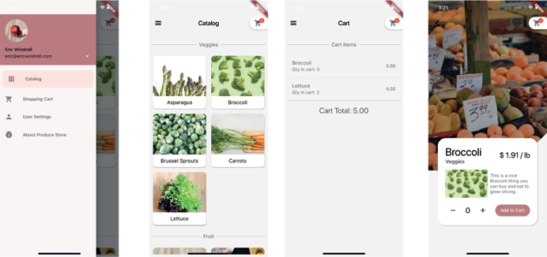

**Hình 7.1 – Ảnh chụp màn hình ứng dụng Farmers Market**

*Mô tả hình:* Hình gồm các ảnh chụp màn hình của ứng dụng: trang danh mục sản phẩm (catalog) với lưới các loại rau củ (có ảnh và tên sản phẩm), trang giỏ hàng, menu ngăn kéo bên trái và trang chi tiết sản phẩm. Tất cả các trang đều có chung thanh ứng dụng (app bar) với nút menu và biểu tượng giỏ hàng.

Cấu trúc định tuyến của ứng dụng không quá phức tạp. Nó chỉ có bốn trang. Nhiệm vụ của chúng ta trong chương này là nối menu với một số route và tạo vài route "tức thời". Sau đó, ta sẽ làm nó thêm "xịn" với một vài hiệu ứng chuyển trang.

Điều thú vị về các route trong ứng dụng này – theo ý kiến hết sức thiên vị của tôi – là **tất cả các trang đều dùng chung các thành phần cấu trúc**. Thanh ứng dụng (*app bar*), biểu tượng giỏ hàng, menu, một phần chức năng và cả `Scaffold` đều chỉ được viết **một lần**, rồi tôi truyền cấu hình vào tùy theo route. Điều này khả thi nhờ hai lý do: cách bạn ghép nối (*compose*) UI trong Flutter, và việc `Navigator` là một widget **không bắt buộc phải nằm ở cấp cao nhất** (top-level).

> 💡 **Ví dụ bổ sung (không có trong sách):** Ý tưởng "viết khung chung một lần, truyền cấu hình theo route" có thể hình dung đơn giản như sau (đây là phác thảo, không phải mã thật của ứng dụng):
> ```dart
> enum PageType { Catalog, Cart, Settings }
>
> class PageContainer extends StatelessWidget {
>   final PageType pageType;
>   const PageContainer({this.pageType});
>
>   @override
>   Widget build(BuildContext context) {
>     // Khung chung: AppBar + Drawer + Scaffold chỉ viết một lần
>     return Scaffold(
>       appBar: AppBar(title: Text(_titleFor(pageType))),
>       drawer: AppMenu(),
>       body: _bodyFor(pageType), // Phần thân thay đổi theo route
>     );
>   }
>
>   String _titleFor(PageType t) =>
>       {PageType.Catalog: "The Farmers Market",
>        PageType.Cart: "My Cart",
>        PageType.Settings: "Settings"}[t];
>
>   Widget _bodyFor(PageType t) {
>     switch (t) {
>       case PageType.Cart: return CartPage();
>       case PageType.Settings: return UserSettingsPage();
>       default: return CatalogPage();
>     }
>   }
> }
> ```
> Mỗi route chỉ cần trả về `PageContainer(pageType: ...)` với loại trang khác nhau – đúng như cách Listing 7.3 phía dưới làm.

### 7.1.2 Mã nguồn của ứng dụng (The app source code)

Trong kho Git (*repository*) của sách, bạn sẽ tìm thấy các file liên quan tới cuốn sách và đặc biệt là tới ứng dụng này. Listing dưới đây liệt kê các file đó.

**Listing 7.1 – Các file quan trọng của ứng dụng thương mại điện tử Farmers Market**

```text
lib
├── blocs                              // (1)
│   ├── app_bloc.dart
│   ├── cart_bloc.dart
│   ├── catalog_bloc.dart
│   └── user_bloc.dart
├── menu                               // (2)
│   └── app_menu_drawer.dart
├── page                               // (3)
│   ├── base
│   │   ├── page_background_image.dart
│   │   ├── page_base.dart
│   │   └── page_container.dart
│   ├── cart_page.dart
│   ├── catalog_page.dart
│   ├── product_detail_page.dart
│   └── user_settings_page.dart
├── utils
│   ├── material_route_transition.dart // (4)
│   └── styles.dart
├── widget                             // (5)
│   ├── add_to_cart_bottom_sheet.dart
│   ├── appbar_cart_icon.dart
│   ├── catalog.dart
│   └── product_detail_card.dart
├── app.dart                           // (6)
└── main.dart
```

Chú thích của sách cho từng phần:

1. **`blocs`** – Đây là nơi chứa logic. Ta sẽ xem xét các bloc này ở một chương sau.
2. **`menu`** – Ta sẽ tìm hiểu menu thật kỹ trong chương này.
3. **`page`** – Các trang (phần lớn) đã được dựng sẵn ở chương này, nhưng ta sẽ "nối dây" rất nhiều thứ cho chúng ở đây.
4. **`material_route_transition.dart`** – File trong thư mục này là phần vui nhất của chương. Nó là một hiệu ứng chuyển động tùy biến khi đi từ trang này sang trang khác.
5. **`widget`** – Hầu hết các file này liên quan tới việc điều hướng "tức thời".
6. **`app.dart`** – Widget gốc của dự án, nơi ta sẽ bắt đầu ở mục tiếp theo.

---

## 7.2 Định tuyến khai báo và route có tên (Declarative routing and named routes)

Nếu bạn từng làm ứng dụng web hay ứng dụng di động trên gần như bất kỳ nền tảng nào khác, có lẽ bạn đã từng làm việc với **định tuyến khai báo** (*declarative routing*). Trên các nền tảng ứng dụng khác mà tôi từng dùng (như Ruby on Rails, Django và các thư viện front-end của một quá khứ không xa lắm), các route được định nghĩa trong một file "routes" riêng, và **bạn khai báo gì thì bạn có nấy**. Trong AngularDart, trang định nghĩa route của bạn có thể trông như listing tiếp theo.

**Listing 7.2 – Định nghĩa route của AngularDart Router**

```dart
static final routes = [
  new RouteDefinition(
    routePath: new RoutePath(path: '/user/1'); // Tên (đường dẫn) của route
    component: main.AppMainComponentNgFactory), // Component sẽ render tại route đó
  new RouteDefinition(
    routePath:
      new RoutePath(path: '/404');
    component: page_not_found.PageNotFoundComponentNgFactory)
  //... etc.
];
```

Chú thích:
- `routePath: new RoutePath(path: '/user/1')` – **tên của route**.
- `component: ...` – **component cần render** tại route đó.

> 📝 **Giải thích thêm (không có trong sách):** Đoạn mã trên được chép nguyên văn từ sách, kể cả dấu `;` sau `RoutePath(...)` – trong Dart thật, giữa các đối số phải là dấu phẩy `,`. Vì đây chỉ là ví dụ minh họa ý tưởng, đừng sao chép trực tiếp vào dự án.

Hiểu được mã Angular không quan trọng. Đây là một ví dụ về khai báo route **từ trước** (*up-front*), được viết bằng Dart. Điểm mấu chốt là bạn nói **rõ ràng** với ứng dụng rằng bạn muốn có những route nào và mỗi route dẫn tới view (giao diện) nào. Mỗi `RouteDefinition` có một đường dẫn (*path*) và một component (có lẽ là một trang). Việc này thường được làm ở cấp cao nhất của ứng dụng. Chuyện khá bình thường thôi.

Flutter có hỗ trợ cách làm này. Mặc dù route và trang vẫn được dựng **trong lúc ứng dụng chạy**, bạn có thể tiếp cận chúng với mô hình tư duy rằng chúng là **tĩnh**. Ứng dụng di động thường có tới hàng chục trang, và có lẽ sẽ dễ suy luận hơn nếu bạn định nghĩa chúng một lần rồi tham chiếu tới chúng bằng tên, thay vì tạo các route không tên rải rác khắp ứng dụng.

Route trong Flutter tuân theo quy ước đường dẫn quen thuộc trong lập trình, ví dụ `/users/1/inbox` hay `/login`. Và đúng như bạn đoán, route của trang chủ ứng dụng là `/` (một dấu gạch chéo đơn).

### 7.2.1 Khai báo route (Declaring routes)

Sử dụng route có tên gồm hai phần. Phần thứ nhất là **định nghĩa các route**. Trong ứng dụng thương mại điện tử mà bạn xây dựng ở chương này, các route có tên được thiết lập trong file `lib/app.dart`. Nếu mở file đó, bạn sẽ thấy một widget `MaterialApp` với các route đã được thiết lập; còn trong file `utils/e_commerce_routes.dart`, bạn sẽ thấy các biến tĩnh (*static*) chứa tên route thật sự. (Việc này chỉ để tôi có thể dùng route một cách an toàn mà không sợ gõ sai chuỗi.)

**Listing 7.3 – Định nghĩa route trong widget MaterialApp**

```dart
// e_commerce/lib/app.dart -- line ~ 51
// ...
return MaterialApp(
  debugShowCheckedModeBanner: false,
  theme: _theme,
  routes: {
    // Tên của route (key) => component cần render tại route đó (value)
    ECommerceRoutes.catalogPage: (context) =>
        PageContainer(pageType: PageType.Catalog),
    // Định nghĩa các route có tên còn lại ở đây.
    ECommerceRoutes.cartPage: (context) =>
        PageContainer(pageType: PageType.Cart),
    ECommerceRoutes.userSettingsPage: (context) =>
        PageContainer(pageType: PageType.Settings),
    ECommerceRoutes.addProductFormPage: (context) =>
        PageContainer(pageType: PageType.AddProductForm),
  },
  navigatorObservers: [routeObserver], // Sẽ nói về routeObserver sớm thôi. Tạm thời đừng bận tâm.
);

// e_commerce/lib/utils/e_commerce_routes.dart
// Lớp ECommerceRoutes ánh xạ tới các route này để an toàn nhờ biến hằng.
class ECommerceRoutes {
  static final catalogPage = '/';
  static final cartPage = '/cart';
  static final userSettingsPage = '/settings';
  static final cartItemDetailPage = '/itemDetail';
  static final addProductFormPage = '/addProduct';
}
```

Các chú thích trong sách:
- `ECommerceRoutes.catalogPage` – **tên của route**.
- `PageContainer(pageType: PageType.Catalog)` – **component cần render** tại route đó.
- Định nghĩa các route có tên còn lại ở đây. Route có tên được định nghĩa trong một **`Map`**, trong đó **key** là tên route (ví dụ `/`) và **value** là một **hàm trả về widget**.
- `navigatorObservers: [routeObserver]` – Ta sẽ tìm hiểu `routeObserver` sớm thôi. Bây giờ đừng lo về nó.
- Lớp `ECommerceRoutes` ánh xạ tới các route này để đảm bảo an toàn bằng biến hằng (tránh gõ sai chuỗi).

> 💡 **Ví dụ bổ sung (không có trong sách):** Vì sao nên dùng `ECommerceRoutes.cartPage` thay vì gõ trực tiếp `"/cart"`? Giả sử ở một chỗ bạn gõ nhầm:
> ```dart
> Navigator.pushNamed(context, "/crat"); // gõ nhầm – trình biên dịch KHÔNG phát hiện
> Navigator.pushNamed(context, ECommerceRoutes.crtPage); // gõ nhầm – trình biên dịch BÁO LỖI ngay
> ```
> Dòng đầu chỉ lỗi khi chạy (Flutter không tìm thấy route `/crat`), còn dòng thứ hai bị phát hiện ngay lúc biên dịch. Gom tên route vào một lớp cũng giúp đổi tên route ở một chỗ duy nhất.

### 7.2.2 Điều hướng tới route có tên (Navigating to named routes)

Điều hướng tới route có tên dễ như dùng phương thức `Navigator.pushNamed`. Phương thức `pushNamed` cần một `BuildContext` và một tên route, nên bạn có thể dùng nó ở bất kỳ đâu có quyền truy cập `BuildContext`. Nó trông như thế này:

```dart
final value = await Navigator.pushNamed(context, "/cart");
```

**Đẩy vào (push) và lấy ra (pop)** route là "cơm ăn nước uống hằng ngày" của việc định tuyến trong Flutter. Nhớ lại rằng `Navigator` (hình 7.2) sắp xếp các con của nó (các trang) theo kiểu "ngăn xếp". Ngăn xếp hoạt động theo nguyên tắc "**vào sau, ra trước**" (*last in, first out* – LIFO), giống như các ngăn xếp trong khoa học máy tính. Nếu bạn đang ở trang chủ và điều hướng tới một trang mới, bạn "push" trang mới đó lên đỉnh ngăn xếp (nằm đè lên trang chủ). Phần tử trên cùng của ngăn xếp là thứ bạn thấy trên màn hình. Nếu bạn push thêm một route nữa – gọi nó là trang ba – rồi muốn quay về trang chủ, bạn sẽ phải "pop" hai lần.

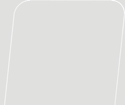


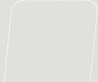
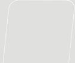

*(Các ảnh trên là các mảnh ghép rời của hình 7.2 được trích từ PDF – những tấm "thẻ trang" và mũi tên. Hình hoàn chỉnh nằm trong trang render dưới đây.)*

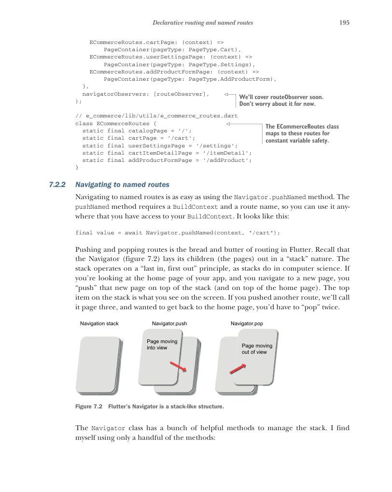

**Hình 7.2 – Navigator của Flutter là một cấu trúc dạng ngăn xếp.**

*Mô tả hình:* Hình có ba phần:
- **Navigation stack** (ngăn xếp điều hướng): một chồng các tấm thẻ (mỗi thẻ là một trang) xếp chồng lên nhau.
- **Navigator.push**: một trang mới đang trượt vào và nằm lên đỉnh chồng – nhãn "*Page moving into view*" (trang đang di chuyển vào tầm nhìn).
- **Navigator.pop**: trang trên cùng đang trượt ra khỏi chồng – nhãn "*Page moving out of view*" (trang đang di chuyển ra khỏi tầm nhìn).

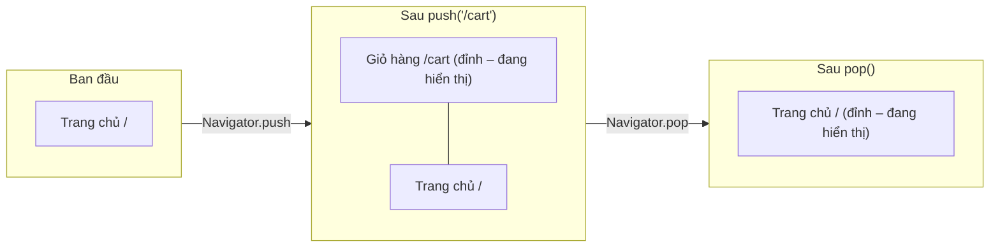

Lớp `Navigator` có cả loạt phương thức hữu ích để quản lý ngăn xếp. Bản thân tôi thấy mình chỉ dùng một nhúm trong số đó:

- `pop`
- `popUntil`
- `canPop`
- `push`
- `pushNamed`
- `popAndPushNamed`
- `replace`
- `pushAndRemoveUntil`

> 📝 **Giải thích thêm (không có trong sách):** Ý nghĩa ngắn gọn của từng phương thức:
>
> | Phương thức | Tác dụng |
> |---|---|
> | `pop` | Lấy route trên cùng ra khỏi ngăn xếp (quay lại trang trước), có thể kèm một giá trị trả về. |
> | `popUntil` | Pop liên tục cho tới khi gặp route thỏa điều kiện (ví dụ `ModalRoute.withName('/')`). |
> | `canPop` | Trả về `true` nếu còn route bên dưới để quay lại. |
> | `push` | Đẩy một đối tượng `Route` (ví dụ `MaterialPageRoute`) lên đỉnh. |
> | `pushNamed` | Đẩy route theo tên đã khai báo trong `routes`. |
> | `popAndPushNamed` | Pop route hiện tại rồi push route có tên mới. |
> | `replace` | Thay một route cụ thể trong ngăn xếp bằng route khác. |
> | `pushAndRemoveUntil` | Push route mới và xóa các route bên dưới cho tới khi điều kiện thỏa (hay dùng sau khi đăng nhập/đăng xuất). |

Một lưu ý quan trọng về việc push route có tên là chúng **trả về một `Future`**. Nếu bạn chưa quen với từ khóa `await`, nó được dùng để đánh dấu các biểu thức trả về một giá trị bất đồng bộ (*asynchronous*). Ta chưa đi vào Dart bất đồng bộ lúc này. Nhưng phiên bản ngắn gọn là: khi bạn gọi `Navigator.pushNamed`, nó **ngay lập tức** trả về một đối tượng `Future` (một "lời hứa" về giá trị trong tương lai), như muốn nói: "Này, tôi *chưa* có giá trị cho bạn, nhưng tôi sẽ có ngay khi quá trình này kết thúc." Trong ngữ cảnh định tuyến cụ thể, điều này có nghĩa là: "Ngay khi người dùng điều hướng quay lại đây từ trang họ đang đứng, tôi sẽ đưa cho bạn bất kỳ giá trị nào họ truyền về từ trang đó." Ở phần sau của chương, ta sẽ tìm hiểu sâu hơn về việc truyền giá trị giữa các route.

> 💡 **Ví dụ bổ sung (không có trong sách):** Bài toán: trang chủ mở trang "Chọn màu", người dùng chọn một màu rồi quay lại; trang chủ cần biết màu nào đã được chọn.
> ```dart
> // Trang chủ
> Future<void> _pickColor(BuildContext context) async {
>   final color = await Navigator.pushNamed(context, '/pickColor');
>   // Dòng này chỉ chạy SAU KHI trang '/pickColor' bị pop
>   print('Người dùng đã chọn: $color'); // ví dụ: "đỏ", hoặc null nếu bấm nút Back
> }
>
> // Trang chọn màu
> ElevatedButton(
>   onPressed: () => Navigator.pop(context, 'đỏ'), // trả "đỏ" về cho trang trước
>   child: Text('Chọn màu đỏ'),
> );
> ```
> Lưu ý: nếu người dùng bấm nút Back của hệ thống thay vì nút chọn, `Future` hoàn tất với giá trị `null`, nên hãy luôn kiểm tra `null`.

Trong kho mã dự án thương mại điện tử, bạn có thể tìm thấy ví dụ dùng `Navigator.pushNamed` trong widget `AppBarCartIcon` ở file `lib/widget/appbar_cart_icon.dart`. Hình 7.3 cho thấy widget này.

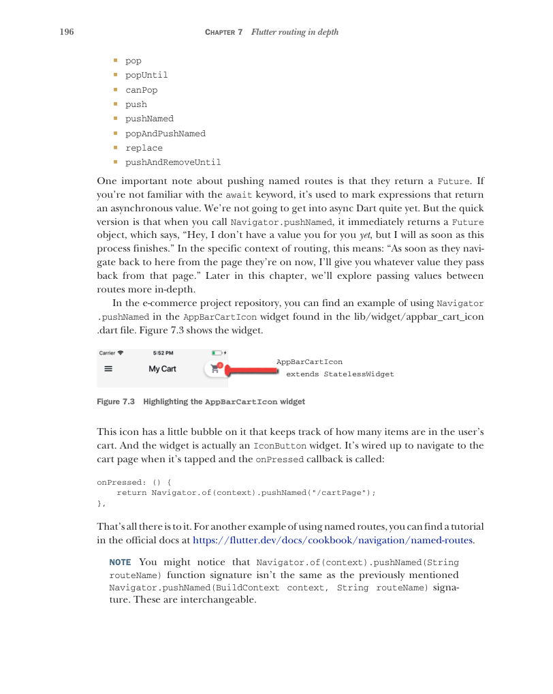

**Hình 7.3 – Tô sáng widget `AppBarCartIcon`**

*Mô tả hình:* Ảnh chụp thanh ứng dụng của trang "My Cart" (Giỏ hàng của tôi), bên phải có biểu tượng giỏ hàng với một chấm đỏ nhỏ. Mũi tên chỉ vào biểu tượng đó với nhãn "`AppBarCartIcon` extends `StatelessWidget`" (AppBarCartIcon kế thừa StatelessWidget).

Biểu tượng này có một bong bóng nhỏ theo dõi số lượng món hàng trong giỏ của người dùng. Và widget này thực chất là một widget `IconButton`. Nó được nối dây để điều hướng tới trang giỏ hàng khi được chạm vào và callback `onPressed` được gọi:

```dart
onPressed: () {
  return Navigator.of(context).pushNamed("/cartPage");
},
```

Chỉ có vậy thôi. Để xem thêm một ví dụ khác về route có tên, bạn có thể tìm hướng dẫn trong tài liệu chính thức tại https://flutter.dev/docs/cookbook/navigation/named-routes.

> **GHI CHÚ (NOTE)** Bạn có thể để ý thấy chữ ký hàm `Navigator.of(context).pushNamed(String routeName)` không giống với chữ ký `Navigator.pushNamed(BuildContext context, String routeName)` đã nhắc tới trước đó. Hai cách này **có thể dùng thay thế cho nhau**.

> 📝 **Giải thích thêm (không có trong sách):** `Navigator.of(context)` tìm `NavigatorState` gần nhất phía trên `context` trong cây widget, rồi gọi phương thức trên nó. `Navigator.pushNamed(context, name)` là phương thức tĩnh tiện lợi, bên trong nó làm đúng việc `Navigator.of(context).pushNamed(name)`. Ngoài ra, hãy để ý rằng đoạn mã của `AppBarCartIcon` dùng chuỗi `"/cartPage"`, trong khi `ECommerceRoutes.cartPage` ở Listing 7.3 là `'/cart'` – đây chính là loại lỗi gõ chuỗi mà lớp `ECommerceRoutes` giúp phòng tránh; trong mã thật bạn nên dùng `ECommerceRoutes.cartPage`.

### 7.2.3 Widget MaterialDrawer và menu đầy đủ (MaterialDrawer widget and the full menu)

Nếu bạn đã từng thấy một ứng dụng theo phong cách Material Design, có lẽ bạn đã quen với kiểu ngăn kéo ứng dụng (*app drawer* – menu trượt ra từ cạnh trái màn hình) như trong hình 7.4.

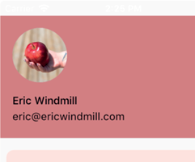
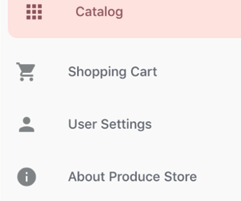


**Hình 7.4 – Ảnh chụp màn hình menu ngăn kéo trong ứng dụng Farmers Market**

*Mô tả hình:* Ảnh (được trích thành ba mảnh) cho thấy menu ngăn kéo: phần đầu có ảnh đại diện hình tròn (quả táo trong tay), tên "Eric Windmill" và email; bên dưới là các mục menu có biểu tượng: Catalog (đang được tô sáng), Shopping Cart (giỏ hàng), User Settings (cài đặt người dùng) và About Produce Store (giới thiệu cửa hàng). Phần bên phải màn hình bị phủ một lớp mờ.

Vì chương này nói về định tuyến, tôi nghĩ giờ là lúc thích hợp để tìm hiểu cách xây dựng menu đó. Trước hết, hãy nghĩ xem ta thật sự muốn nó làm gì:

1. Menu phải hiện ra khi người dùng chạm vào một nút menu.
2. Phải có một mục menu cho mỗi trang; chạm vào thì điều hướng tới route tương ứng.
3. Phải có một mục menu "About" (Giới thiệu), hiển thị một hộp thoại (*modal*) chứa thông tin ứng dụng.
4. Phải có phần đầu menu (*menu header*) hiển thị thông tin người dùng. Khi chạm vào phần cài đặt người dùng, nó phải điều hướng tới trang cài đặt người dùng.
5. Menu phải tô sáng route nào đang hoạt động.
6. Menu phải đóng lại khi một mục menu được chọn, hoặc khi người dùng chạm vào lớp phủ (*overlay*) ở bên phải menu.
7. Khi menu mở hoặc đóng, nó phải có hiệu ứng chuyển động trượt vào/ra mượt mà.

Menu ngăn kéo cụ thể này là sự kết hợp của **chỉ năm widget bắt buộc**, tất cả đều có sẵn trong Flutter:

- `Drawer`
- `ListView`
- `UserAccountsDrawerHeader`
- `ListTile`
- `AboutListTile`

`Drawer` là widget "chứa" menu này. Nó nhận một widget duy nhất trong đối số `child`. Bạn có thể truyền cho nó bất cứ thứ gì bạn muốn (vì mọi thứ đều là widget). Một `Drawer` thường sẽ được truyền cho một `Scaffold` qua đối số `drawer`.

Nếu bạn cũng có một `AppBar` trong một scaffold có drawer, thì Flutter sẽ **tự động** đặt biểu tượng phía bên cạnh trên app bar thành một nút menu, nút này sẽ mở menu khi được chạm. Menu sẽ trượt ra một cách mượt mà, và đóng lại khi bạn vuốt nó sang trái hoặc chạm vào lớp phủ bên phải.

> 📝 **Giải thích thêm (không có trong sách):** Sách viết là "right-side icon" (biểu tượng phía bên phải), nhưng trên thực tế với `drawer` thông thường, nút menu (biểu tượng ☰ "hamburger") nằm ở **vị trí `leading`, tức bên trái** app bar – bạn có thể thấy điều này trong hình 7.3 và 7.9. Nếu bạn dùng `endDrawer` thì nút menu mới nằm ở bên phải.

> **GHI CHÚ (NOTE)** Bạn có thể tắt nút menu tự động bằng cách đặt `Scaffold.automaticallyImplyLeading` thành `false`.

> 📝 **Giải thích thêm (không có trong sách):** Trong các phiên bản Flutter hiện tại, thuộc tính `automaticallyImplyLeading` nằm trên widget **`AppBar`** (ví dụ `AppBar(automaticallyImplyLeading: false, ...)`), chứ không phải trên `Scaffold`.

> 💡 **Ví dụ bổ sung (không có trong sách):** Một drawer tối giản, chỉ vài dòng là đã có nút ☰, hiệu ứng trượt, lớp phủ mờ và vuốt để đóng:
> ```dart
> Scaffold(
>   appBar: AppBar(title: Text('Demo Drawer')),
>   drawer: Drawer(
>     child: ListView(
>       children: [
>         ListTile(title: Text('Trang chủ'), onTap: () => Navigator.pop(context)),
>         ListTile(title: Text('Giỏ hàng'), onTap: () => Navigator.pop(context)),
>       ],
>     ),
>   ),
>   body: Center(child: Text('Nội dung')),
> );
> ```
> Lưu ý thú vị: drawer đang mở cũng là một route trên ngăn xếp của `Navigator`, nên `Navigator.pop(context)` sẽ **đóng drawer**.

### 7.2.4 Các mục menu và widget phù hợp: ListView và ListItem (Menu items and the appropriate widgets: ListView and ListItems)

Tiếp theo là `ListView`. Một *list view* là một widget bố cục (*layout widget*) sắp xếp các widget bên trong một vùng chứa có thể cuộn được (*scrollable container*). Mặc định nó xếp các con theo chiều dọc, nhưng nó có thể tùy biến khá nhiều. Ta sẽ nói kỹ về cuộn và các widget cuộn được ở chương tiếp theo. Còn bây giờ, bạn có thể dùng widget này giống hệt như dùng một `Column`. Bạn chỉ cần truyền cho nó một vài `children` – tất cả đều là widget.

`ListTile` là một widget có hai đặc điểm đặc biệt: chúng có **chiều cao cố định**, nên rất lý tưởng cho menu, và chúng **"có chính kiến"** (*opinionated* – tức là đã định sẵn bố cục và kiểu dáng theo một khuôn mẫu nhất định). Không giống các widget tổng quát khác vốn mong đợi một đối số tên là `child`, `ListTile` có các thuộc tính như `title`, `subtitle` và `leading` (hình 7.5). Nó cũng được trang bị sẵn thuộc tính `onTap`.

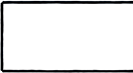
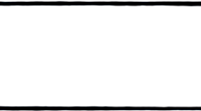

*(Hai ảnh trên là các phần tử đồ họa rời được trích từ hình 7.5. Hình hoàn chỉnh có trong trang render bên dưới.)*

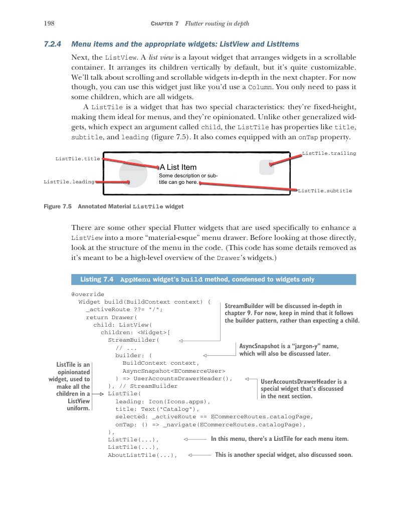

**Hình 7.5 – Widget `ListTile` của Material, có chú thích**

*Mô tả hình:* Một hộp chữ nhật biểu diễn một `ListTile`:
- **`ListTile.leading`** – vòng tròn xám ở đầu bên trái (thường là biểu tượng hoặc ảnh đại diện).
- **`ListTile.title`** – dòng chữ lớn "A List Item" (Một mục danh sách).
- **`ListTile.subtitle`** – dòng chữ nhỏ bên dưới: "Some description or subtitle can go here." (Một mô tả hoặc phụ đề có thể đặt ở đây.)
- **`ListTile.trailing`** – ô vuông xám nhỏ ở cuối bên phải.

```text
┌──────────────────────────────────────────────────────────┐
│  (  )    A List Item                               [■]   │
│ leading  Some description or subtitle can go here. trailing
│          ↑ title / subtitle                              │
└──────────────────────────────────────────────────────────┘
```

Có một vài widget Flutter đặc biệt khác được dùng riêng để "nâng cấp" một `ListView` thành một menu ngăn kéo mang đậm chất Material hơn. Trước khi xem trực tiếp các widget đó, hãy nhìn cấu trúc của menu trong mã. (Đoạn mã này đã lược bớt một số chi tiết vì nó chỉ nhằm cho cái nhìn tổng quan về các widget của `Drawer`.)

**Listing 7.4 – Phương thức `build` của widget `AppMenu`, rút gọn chỉ còn các widget**

```dart
@override
Widget build(BuildContext context) {
  _activeRoute ??= "/";
  return Drawer(
    child: ListView(
      children: <Widget>[
        StreamBuilder(                       // (1)
          // ...
          builder: (                         // (2)
            BuildContext context,
            AsyncSnapshot<ECommerceUser>
          ) => UserAccountsDrawerHeader(),   // (3)
        ), // StreamBuilder
        ListTile(                            // (4)
          leading: Icon(Icons.apps),
          title: Text("Catalog"),
          selected: _activeRoute == ECommerceRoutes.catalogPage,
          onTap: () => _navigate(ECommerceRoutes.catalogPage),
        ),
        ListTile(...),                       // (5)
        ListTile(...),
        AboutListTile(...),                  // (6)
      ],
    ),
  );
}
```

Chú thích:
1. `StreamBuilder` sẽ được bàn kỹ ở chương 9. Bây giờ, chỉ cần nhớ rằng nó tuân theo **mẫu builder** (*builder pattern*) thay vì nhận một `child`.
2. `AsyncSnapshot` là một cái tên khá "nặng thuật ngữ", cũng sẽ được giải thích sau.
3. `UserAccountsDrawerHeader` là một widget đặc biệt sẽ được bàn ở phần tiếp theo.
4. `ListTile` là một widget "có chính kiến", được dùng để làm cho mọi con trong một `ListView` **đồng đều** nhau.
5. Trong menu này, mỗi mục menu là một `ListTile`.
6. Đây là một widget đặc biệt khác, cũng sẽ được bàn sớm.

> 📝 **Giải thích thêm (không có trong sách):** Toán tử `??=` trong dòng `_activeRoute ??= "/";` nghĩa là "chỉ gán nếu biến đang là `null`". Lần đầu `build` chạy, `_activeRoute` chưa có giá trị nên được gán `"/"` (trang catalog); những lần sau nó giữ nguyên giá trị hiện có.

Trước hết, tôi muốn bàn về các widget khác nhau trong drawer ở mức tổng quan, bắt đầu với **hai widget đặc biệt**, vì chúng có trường hợp sử dụng rất cụ thể. Sau đó, tôi sẽ chuyển sang `ListTile`, vốn tổng quát hơn. Vài trang nữa, ta sẽ xem các chi tiết mã "tới từng chân tơ kẽ tóc".

`UserAccountsDrawerHeader` là một widget Material dùng để hiển thị các thông tin quan trọng của người dùng. Hãy tưởng tượng một ứng dụng của Google như Gmail, cho phép bạn chuyển đổi giữa các tài khoản người dùng chỉ với một lần chạm nút. Giao diện kiểu Gmail đó **có sẵn trong Flutter**, thông qua `UserAccountsDrawerHeader`. Ứng dụng của ta không cần đến tính năng này. Ở đây không có bài học gì cả. Nó chỉ là một ví dụ tuyệt vời cho thấy Flutter cho bạn bao nhiêu thứ "miễn phí".

Cuối cùng là `AboutListTile`. Widget này có thể được truyền vào danh sách `ListView.children`, và được cấu hình chỉ trong vài dòng mã, như listing sau cho thấy.

**Listing 7.5 – Widget Material `AboutListTile` của Flutter**

```dart
// e_commerce/lib/menu/app_menu_drawer.dart -- line ~81
AboutListTile(
  icon: Icon(Icons.info),
  applicationName: "Produce Store",
  aboutBoxChildren: <Widget>[
    Text("Thanks for reading Flutter in Action!"),
  ],
),
```

Chỉ với chừng ấy mã Flutter, bạn đã có một nút menu hoạt động đầy đủ, hiển thị một hộp thoại khi được chạm, kèm luôn nút để đóng hộp thoại. Hình 7.6 cho thấy nó trông như thế nào.

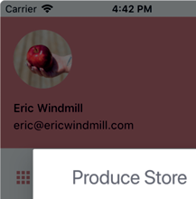
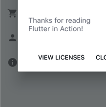

**Hình 7.6 – Ảnh chụp màn hình hộp thoại About (Giới thiệu ứng dụng)**

*Mô tả hình:* Phía sau là menu ngăn kéo (bị làm tối), phía trước là một hộp thoại tiêu đề "Produce Store", nội dung "Thanks for reading Flutter in Action!" (Cảm ơn bạn đã đọc Flutter in Action!), và hai nút: "VIEW LICENSES" (xem giấy phép) và "CLOSE" (đóng). Toàn bộ hộp thoại này – kể cả trang xem giấy phép của các thư viện – đều do Flutter tạo sẵn.

Với tất cả những điều đó, tôi nghĩ danh sách yêu cầu của chúng ta giờ trở thành thế này (những gì Flutter đã lo hộ coi như đã xong):

- ~~Menu phải hiện ra khi người dùng chạm vào một nút menu.~~
- ~~Phải có một mục menu cho mỗi trang; chạm vào thì điều hướng tới route tương ứng.~~
- ~~Phải có một mục menu "About", hiển thị một hộp thoại chứa thông tin ứng dụng.~~
- ~~Phải có phần đầu menu hiển thị thông tin người dùng. Khi chạm vào phần cài đặt người dùng, nó phải điều hướng tới trang cài đặt người dùng.~~
- ~~Menu phải tô sáng route nào đang hoạt động.~~
- ~~Menu phải đóng lại khi một mục menu được chọn, hoặc khi người dùng chạm vào lớp phủ ở bên phải menu.~~
- ~~Khi menu mở hoặc đóng, nó phải có hiệu ứng chuyển động trượt vào/ra mượt mà.~~

*(Ghi chú của người dịch: trong bản PDF, danh sách này được lặp lại để ngụ ý rằng mọi yêu cầu coi như đã được giải quyết – câu tiếp theo của tác giả thừa nhận đó là cách nói hơi phóng đại; ở đây dùng gạch ngang để thể hiện ý "đã xong".)*

Nói vậy thì hơi *quá lời* một chút. Tất nhiên, bạn vẫn phải thực sự viết năm dòng mã cho `AboutListTile`. Nhưng như thế vẫn dễ hơn rất, rất nhiều so với việc tự viết logic hiển thị một hộp thoại rồi lại viết bố cục cho chính hộp thoại đó.

#### TRIỂN KHAI MENU NGĂN KÉO (Implementing the menu drawer)

Với tất cả kiến thức về widget ở trên, phần lớn công việc đã được làm sẵn cho bạn. Phần chính của việc triển khai menu này nằm ở **định tuyến**. Điều này thật hợp lý, vì đây là một chương về định tuyến. Phần lớn công việc này được thực hiện trong file `lib/menu/app_menu_drawer.dart`.

Để bắt đầu, các mục menu khi được chạm phải điều hướng tới một trang mới. Trong phương thức `build`, có một `ListTile` cho mỗi mục menu. Một `ListTile` trông như listing tiếp theo.

**Listing 7.6 – Mục menu ngăn kéo trong một widget `ListTile`**

```dart
// e_commerce/lib/menu/app_menu_drawer.dart -- line ~63
ListTile(
  leading: Icon(Icons.apps),
  title: Text("Catalog"),
  selected:
      _activeRoute == ECommerceRoutes.catalogPage, // (1)
  onTap: () =>
      _navigate(ECommerceRoutes.catalogPage),      // (2)
),
```

Chú thích:
1. Nếu `selected` là `true`, `ListTile` sẽ cấu hình màu sắc của các con để phản ánh route đang hoạt động. Tôi sẽ nói thêm về điều này ở phần tiếp theo.
2. `ListTile.onTap` là chỗ hoàn hảo để gọi một phương thức điều hướng tới route mới.

Chạm vào mục danh sách đó sẽ gọi `AppMenu._navigate`, trông như đoạn mã sau.

**Listing 7.7 – Điều hướng từ widget `AppMenu`**

```dart
void _navigate(String route) {
  Navigator.popAndPushNamed(context, route); // (1)
}
```

Chú thích:
1. `Navigator.popAndPushNamed` là một phương thức khác để quản lý ngăn xếp route, giống như `push` và `pushNamed`. Tuy nhiên phương thức này **pop trang hiện tại ra trước**, để đảm bảo không có một chồng trang khổng lồ.

> 📝 **Giải thích thêm (không có trong sách):** Khi `_navigate` được gọi, route trên đỉnh ngăn xếp lúc đó chính là **drawer đang mở**. Vì vậy `popAndPushNamed` sẽ: (1) pop drawer – menu đóng lại (đáp ứng yêu cầu số 6), rồi (2) push trang mới. Nhờ vậy, mỗi lần chọn một mục menu, ngăn xếp không phình thêm một "lớp drawer" nào.

Bạn có thể thấy thêm một ví dụ về việc đưa trang vào ngăn xếp trong widget `UserAccountsDrawerHeader`, cũng trong chính phương thức `build` này.

**Listing 7.8 – Cách dùng `UserAccountsDrawerHeader` trong widget `AppMenu`**

```dart
UserAccountsDrawerHeader(
  currentAccountPicture: CircleAvatar(                     // (1)
    backgroundImage:
        AssetImage("assets/images/apple-in-hand.jpg"),
  ),
  accountEmail: Text(s.data.contact),                      // (2)
  accountName: Text(s.data.name),                          // (3)

  onDetailsPressed: () {
    Navigator.pushReplacementNamed(                        // (4)
        context, ECommerceRoutes.userSettingsPage);
  },
),
```

Chú thích:
1. Nhận một `CircleAvatar` làm con – widget này cắt mọi hình ảnh thành hình tròn.
2. Nhận một số thông tin quan trọng của người dùng, như thông tin liên lạc và tên.
3. Truyền vào thông tin người dùng lấy từ `AsyncSnapshot` đã nhắc tới ở trên (biến `s`), đây là một cách để lấy dữ liệu một cách bất đồng bộ. (Sẽ nói thêm về điều này sớm.)
4. `Navigator.pushReplacementNamed` đảm bảo ngăn xếp route sẽ không cứ thế thêm trang mới mãi. Nó sẽ **xóa route mà bạn đang điều hướng đi** khi route mới đã chạy xong hiệu ứng xuất hiện.

> 💡 **Ví dụ bổ sung (không có trong sách):** So sánh ba cách điều hướng, giả sử ngăn xếp hiện tại là `[/, /cart]` (đỉnh là `/cart`) và ta muốn tới `/settings`:
>
> | Lệnh | Ngăn xếp sau khi chạy |
> |---|---|
> | `pushNamed('/settings')` | `[/, /cart, /settings]` |
> | `pushReplacementNamed('/settings')` | `[/, /settings]` (`/cart` bị thay thế, sau khi hiệu ứng vào của `/settings` xong) |
> | `popAndPushNamed('/settings')` | `[/, /settings]` (`/cart` bị pop trước – chạy hiệu ứng pop – rồi mới push) |
>
> Hai cách sau cho kết quả ngăn xếp giống nhau; khác biệt chủ yếu nằm ở thứ tự và hiệu ứng chuyển động.

### 7.2.5 NavigatorObserver: Tô sáng route đang hoạt động bằng RouteAware (NavigatorObserver: Highlighting the active route with RouteAware)

Một khía cạnh thú vị khác của router trong Flutter là các **observer** (*người quan sát* – đối tượng lắng nghe và nhận thông báo khi có sự kiện). Bạn sẽ không đi được xa trong lập trình Dart nếu không dùng observer, stream (*luồng dữ liệu*) và việc phát ra sự kiện (*emitting events*). Có hẳn một chương dành cho chủ đề đó ở phần sau của cuốn sách, nhưng bây giờ, tôi sẽ tập trung riêng vào `NavigatorObserver`. Một *navigator observer* (hình 7.7) là một đối tượng thông báo cho bất kỳ widget nào đang lắng nghe rằng: "Này, `Navigator` đang thực hiện một sự kiện nào đó, nếu bạn quan tâm." Đó thực sự là công việc duy nhất của nó – nhưng là một công việc quan trọng.

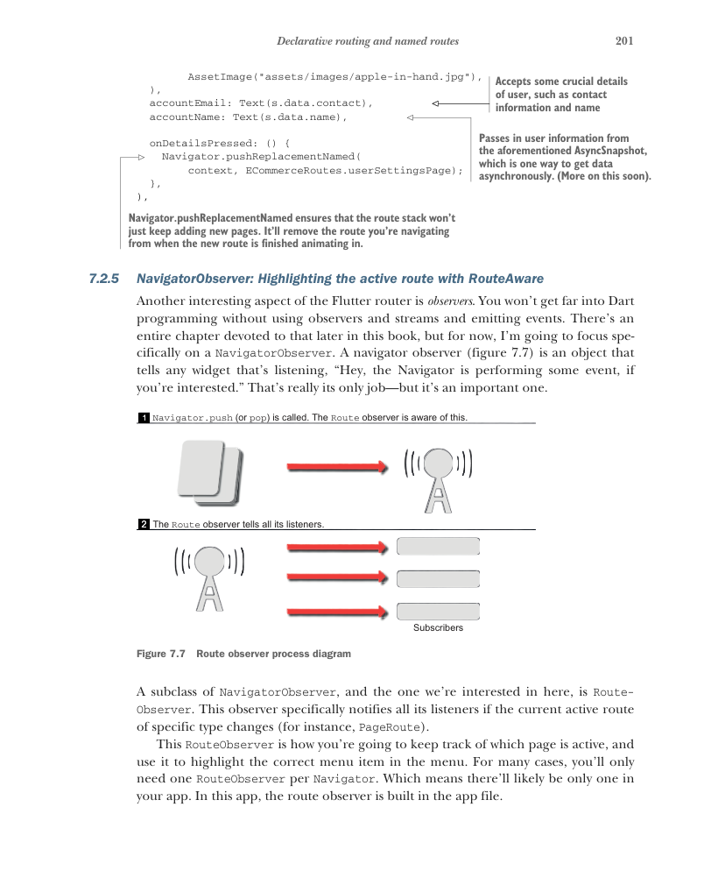

**Hình 7.7 – Sơ đồ quy trình của route observer**

*Mô tả hình:* Hình gồm hai bước:
1. **`Navigator.push` (hoặc `pop`) được gọi. `Route` observer nhận biết được điều này.** – Bên trái là chồng trang, mũi tên đỏ chỉ sang một "tháp phát sóng" (biểu tượng của observer).
2. **`Route` observer báo cho tất cả những người lắng nghe của nó.** – Tháp phát sóng có ba mũi tên đỏ chỉ tới ba ô chữ nhật, được gắn nhãn **Subscribers** (những người đăng ký).

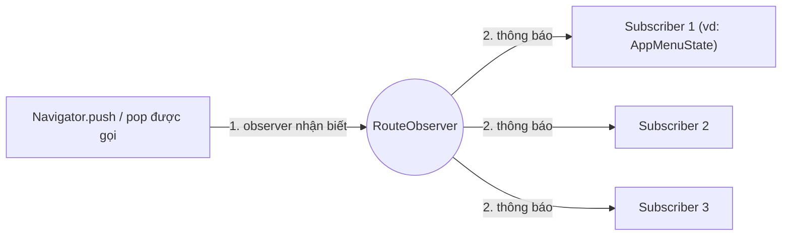

Một lớp con của `NavigatorObserver`, và cũng là lớp ta quan tâm ở đây, là **`RouteObserver`**. Observer này đặc biệt thông báo cho mọi người lắng nghe của nó nếu route đang hoạt động hiện tại thuộc một **kiểu cụ thể** thay đổi (ví dụ: `PageRoute`).

`RouteObserver` này chính là cách bạn sẽ theo dõi trang nào đang hoạt động, rồi dùng nó để tô sáng đúng mục trong menu. Trong nhiều trường hợp, bạn chỉ cần **một `RouteObserver` cho mỗi `Navigator`**. Điều đó có nghĩa là có lẽ trong ứng dụng của bạn chỉ có một cái duy nhất. Trong ứng dụng này, route observer được tạo trong file app.

```dart
final RouteObserver<Route> routeObserver =  // (1)
    RouteObserver<Route>();

class ECommerceApp extends StatefulWidget {
  @override
  _ECommerceAppState createState() => _ECommerceAppState();
}
// ... rest of file
```

Chú thích:
1. Khi cho nó kiểu `<Route>`, observer sẽ thông báo cho người lắng nghe về **mọi** thay đổi route. Ngược lại, nếu dùng `<PageRoute>` thì nó chỉ thông báo về các route dạng trang (*page route*).

Tôi tạo observer ở **phạm vi toàn cục** (*global scope*), không được bảo vệ an toàn bởi bất kỳ lớp nào, vì tôi cần nó hiển thị (truy cập được) trong toàn bộ ứng dụng. Ngoài ra, nếu đặt nó vào một lớp, nó sẽ là thành viên duy nhất của lớp đó, điều này không cần thiết. Cách làm này phổ biến với các đối tượng `RouteObserver`. Sau đó, bạn cần báo cho `MaterialApp` biết về nó, trong cùng file, như listing sau.

**Listing 7.9 – Truyền route observer vào widget `MaterialApp`**

```dart
// e_commerce/lib/app.dart -- line ~51
return MaterialApp(
  debugShowCheckedModeBanner: false,
  theme: _theme,
  home: PageContainer(pageType: PageType.Catalog,),
  routes: { ... }
  navigatorObservers: [routeObserver], // (1)
);
```

Chú thích:
1. Báo cho `MaterialApp` biết về `routeObserver` mà nó cần thông báo mỗi khi một sự kiện định tuyến xảy ra.

> 📝 **Giải thích thêm (không có trong sách):** `routes: { ... }` là cách viết tắt của sách cho phần map route ở Listing 7.3 (trong mã thật cần có dấu phẩy sau `}`). Lưu ý thêm: nếu đã khai báo `home`, bạn không được khai báo thêm route `'/'` trong `routes` (Flutter sẽ báo lỗi vì trùng). Listing 7.3 dùng route `'/'` còn Listing 7.9 dùng `home` – đây là hai cách khác nhau để chỉ định trang chủ, chỉ chọn một.

Thế là xong phần thiết lập; giờ bạn có thể lắng nghe observer đó trên **bất kỳ đối tượng `State` nào**. Tuy nhiên nó phải là widget có trạng thái (*stateful*), vì bạn sẽ cần dùng một số phương thức vòng đời (*lifecycle method*) của state. Với mục đích của chúng ta, việc này sẽ diễn ra trong widget `AppMenu` mà bạn đã làm việc cùng ở phần này. Trước tiên, đối tượng state cần được mở rộng bằng mixin **`RouteAware`**, như sau:

```dart
// e-commerce/lib/menu/app_menu_drawer.dart -- line ~14
class AppMenu extends StatefulWidget {
  @override
  AppMenuState createState() => AppMenuState();
}

class AppMenuState extends State<AppMenu>
    with RouteAware { ... } // (1)
```

Chú thích:
1. `with` là từ khóa của Dart cần dùng để sử dụng mixin.

Mixin `RouteAware` này là một lớp trừu tượng cung cấp giao diện (*interface*) để tương tác với một route observer. Giờ thì đối tượng state của bạn đã có quyền truy cập các phương thức `didPop`, `didPush` và một vài phương thức khác.

> 📝 **Giải thích thêm (không có trong sách):** **Mixin** là cách "trộn" thêm các phương thức của một lớp vào lớp khác mà không cần kế thừa trực tiếp (Dart chỉ cho kế thừa đơn – một lớp cha). `RouteAware` cung cấp bốn phương thức có thể ghi đè:
> - `didPush()` – route hiện tại vừa được push lên và đang hiển thị.
> - `didPop()` – route hiện tại vừa bị pop ra.
> - `didPushNext()` – một route mới vừa được push đè lên trên route hiện tại (route hiện tại bị che).
> - `didPopNext()` – route nằm trên vừa bị pop, route hiện tại lại hiện ra.

Để cập nhật menu với route đang hoạt động chính xác, ta cần được thông báo khi có một trang mới trên ngăn xếp. Có hai bước để làm việc đó: thứ nhất, lắng nghe các thay đổi từ route observer, và thứ hai, lắng nghe observer để được thông báo khi route thay đổi.

**Listing 7.10 – Lắng nghe route observer**

```dart
// e_commerce/lib/menu/app_menu_drawer.dart -- line ~19
class AppMenuState extends State<AppMenu> with RouteAware {
  String _activeRoute;                    // (1)
  UserBloc _bloc;

  @override
  void didChangeDependencies() {          // (2)
    super.didChangeDependencies();
    routeObserver.subscribe(              // (3)
      this,
      ModalRoute.of(context),
    );
    _bloc = AppStateContainer.of(context) // (4)
        .blocProvider.userBloc;
  }
  // ... rest of class
}
```

Chú thích:
1. Biến của lớp mà tôi dùng để theo dõi route đang hoạt động.
2. Đây là một phương thức vòng đời của widget, và là chỗ đúng để bắt đầu lắng nghe các stream và observer mới. Ta sẽ tìm hiểu điều này ở chương tiếp theo.
3. Truy cập biến toàn cục `routeObserver` đã tạo; `subscribe` là phương thức để lắng nghe observer. Phương thức này cần một đối tượng `RouteAware` (đối tượng state này chính là như vậy, vì nó dùng lớp `RouteAware`), và route mà bạn quan tâm – trong trường hợp này là route bạn đang đứng.¹
4. Các dòng liên quan tới `UserBloc` tạm thời có thể bỏ qua. Tôi đưa chúng vào cho đầy đủ.

> **Chú thích chân trang ¹:** Một `ModalRoute` là một route che phủ màn hình, kể cả khi nó không mờ đục (*opaque*) trên toàn bộ màn hình. Nói cách khác, đó là bất kỳ route nào **vô hiệu hóa tương tác** với các route nằm bên dưới nó. Ví dụ như các trang, cửa sổ bật lên (*popup*) và ngăn kéo (*drawer*).

Giờ widget này đã nhận biết được các thay đổi route, nó cần cập nhật biến route đang hoạt động mỗi khi có bất kỳ hoạt động nào của `Navigator`. Việc này được làm trong phương thức `didPush` mà nó thừa hưởng từ `RouteAware`:

```dart
// e_commerce/lib/menu/app_menu_drawer.dart -- line ~30
@override
void didPush() {                           // (1)
  _activeRoute =
      ModalRoute.of(context).settings.name; // (2)
}
```

Chú thích:
1. Được gọi khi một route được push lên ngăn xếp. Việc này xảy ra trong lúc chính menu đang chuyển động trượt ra khỏi màn hình. Vì vậy, lần tiếp theo bạn dựng drawer (bằng cách mở menu), phương thức `build` sẽ được gọi lại. Do đó, gọi `setState` ở đây là thừa.
2. Dòng này lấy **tên của route hiện tại**. Việc dùng `context` để lấy thông tin cấu hình route (*route settings*) tương tự như dùng theme (đã bàn ở chương 4), nhưng mô thức đó sẽ được giải thích kỹ ở chương tiếp theo.

Theo ý kiến của tôi, sử dụng navigation observer và `RouteAware` là chủ đề phức tạp nhất trong chương này. Danh sách tài liệu sau có thể giúp ích nếu bạn muốn đọc thêm các ví dụ:

- https://api.flutter.dev/flutter/widgets/RouteObserver-class.html
- https://stackoverflow.com/questions/46165705/flutter-how-the-navigatorobserver-class-works

> 💡 **Ví dụ bổ sung (không có trong sách):** Một ví dụ độc lập, hoàn chỉnh hơn: một trang tự ghi log khi nó bị che hoặc hiện lại – hữu ích để, chẳng hạn, tạm dừng video khi người dùng mở trang khác và phát tiếp khi quay lại. Đừng quên **hủy đăng ký** trong `dispose` để tránh rò rỉ bộ nhớ (sách không đề cập tới bước này):
> ```dart
> final RouteObserver<ModalRoute<void>> routeObserver = RouteObserver<ModalRoute<void>>();
>
> class VideoPage extends StatefulWidget {
>   @override
>   _VideoPageState createState() => _VideoPageState();
> }
>
> class _VideoPageState extends State<VideoPage> with RouteAware {
>   @override
>   void didChangeDependencies() {
>     super.didChangeDependencies();
>     routeObserver.subscribe(this, ModalRoute.of(context)!);
>   }
>
>   @override
>   void dispose() {
>     routeObserver.unsubscribe(this); // quan trọng!
>     super.dispose();
>   }
>
>   @override
>   void didPushNext() => print('Bị trang khác che → tạm dừng video');
>
>   @override
>   void didPopNext() => print('Trang trên đã đóng → phát tiếp video');
>
>   @override
>   Widget build(BuildContext context) => Scaffold(body: Text('Video'));
> }
> // Và nhớ: MaterialApp(navigatorObservers: [routeObserver], ...)
> ```
> (Ví dụ này viết theo cú pháp null-safety của Dart hiện đại – dấu `!`; mã trong sách được viết trước khi có null-safety.)

---

## 7.3 Định tuyến "tức thời" (Routing on the fly)

Định tuyến "tức thời" (*routing on the fly*) là ý tưởng rằng bạn có thể điều hướng tới một trang **chưa hề tồn tại cho tới khi nó được tạo ra** để đáp lại một sự kiện. Ví dụ, bạn có thể muốn điều hướng tới một trang mới khi người dùng chạm vào một mục trong danh sách. Bạn không cần thiết lập route này từ trước, vì route chỉ là widget. Đây là một đoạn mã ví dụ.

**Listing 7.11 – Mã ví dụ minh họa định tuyến tức thời**

```dart
void _showListItemDetailPage() async {
  await Navigator.push(              // (1)
    context,
    MaterialPageRoute(               // (2)
      builder: (context) => SettingsPage(
        settings: settings,
      ),
      fullscreenDialog: true,        // (3)
    ),
  );
}
```

Chú thích:
1. Nhớ lại rằng route có tên được điều hướng tới qua `Navigator.pushNamed`. Còn `Navigator.push` thì cần một **widget** thay vì một **tên route**.
2. Đây chỉ là một widget có sẵn, được làm ra để hiển thị giống như một trang ...
3. ... nếu bạn muốn như vậy! Dòng này bảo Flutter hiển thị nó ở chế độ toàn màn hình.

> 📝 **Giải thích thêm (không có trong sách):** Nói chính xác hơn, `Navigator.push` nhận một đối tượng **`Route`** (ở đây là `MaterialPageRoute`), và route đó lại nhận một hàm `builder` trả về widget của trang. `fullscreenDialog: true` khiến trang trượt lên từ dưới (trên iOS) và app bar hiện nút ✕ thay vì mũi tên quay lại – phù hợp cho các màn hình kiểu "soạn thư mới" hay "thêm mục".

Trong Flutter, **mọi thứ trông giống một widget mới trên ngăn xếp route đều là một route**. Hộp thoại modal, bottom sheet (*bảng trượt lên từ cạnh dưới*), snack bar (*thanh thông báo ngắn ở đáy màn hình*) và dialog (*hộp thoại*) đều là route, và chúng là những ứng viên hoàn hảo cho định tuyến tức thời.

### 7.3.1 MaterialRouteBuilder

Chỗ quan trọng đầu tiên mà ta định tuyến tức thời trong ứng dụng này là khi chạm vào một sản phẩm trong trang catalog và điều hướng tới trang chi tiết sản phẩm.

> **GHI CHÚ (NOTE)** Trên trang này có rất nhiều widget và khái niệm chưa được đề cập trong sách, như `StreamBuilder`, Sliver và đủ thứ "hay ho" khác. Ta sẽ tìm hiểu chúng ở phần sau của cuốn sách.

Khoảng dòng 93 trong file `lib/widget/catalog.dart`, tôi dựng `ProductDetailCard` (hình 7.8) – widget này lắng nghe một cú chạm để điều hướng sang trang khác.

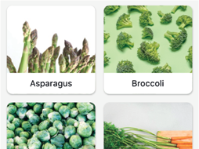

**Hình 7.8 – Ảnh chụp màn hình các thẻ chi tiết sản phẩm**

*Mô tả hình:* Lưới các thẻ sản phẩm trong trang catalog (mỗi thẻ có ảnh rau củ và tên sản phẩm); một thẻ được chỉ ra với nhãn `ProductDetailCard`.

Mã cho thẻ chi tiết sản phẩm trông như sau:

```dart
// e_commerce/lib/widget/catalog.dart -- line ~93
return ProductDetailCard(
  key: ValueKey(_product.imageTitle.toString()),
  onTap: () => _toProductDetailPage(_product), // (1)
  onLongPress: () => _showQuickAddToCart(context, _product),
  product: _product,
);
```

Chú thích:
1. `onTap` này phản hồi một cử chỉ (*gesture*) và gọi phương thức quan trọng với chúng ta: `_toProductDetailPage`.

Khi mục đó được chạm, listing tiếp theo cho thấy phương thức sẽ được thực thi.

**Listing 7.12 – Điều hướng tới một route mới theo kiểu tức thời**

```dart
// e_commerce/lib/widget/catalog.dart -- line ~37
Future _toProductDetailPage(Product product) async {
  await Navigator.push(                  // (1)
    context,
    MaterialPageRoute(                   // (2)
      builder: (context) =>              // (3)
        ProductDetailPageContainer(
          product: product,
        ),
    ),
  );
}
```

*(Trong sách, dòng cuối in là `}\` – ký tự `\` là lỗi in ấn và đã được bỏ đi.)*

Chú thích:
1. Giống như cách định tuyến trước đó, bạn có thể dùng `Navigator.push` để thêm một trang mới vào ngăn xếp.
2. `MaterialPageRoute` là một lớp con của `PageRoute`, và nó cung cấp toàn bộ chức năng của widget Material tại vị trí mới trong cây widget.
3. Các đối tượng route như `MaterialPageRoute` cần một đối số `builder`, nhận một callback và trả về một widget.

Thế là xong phần điều hướng tới các trang chưa được thiết lập sẵn. Các route không che toàn bộ màn hình cũng tương tự. Chúng bao gồm hộp thoại modal, dialog, bottom sheet và nhiều thứ khác.²

> **Chú thích chân trang ²:** Để xem một ví dụ thứ hai siêu đơn giản về định tuyến không dùng route có tên, hãy xem trang này trong tài liệu chính thức: https://flutter.dev/docs/cookbook/navigation/navigation-basics.

> 💡 **Ví dụ bổ sung (không có trong sách):** Bài toán: danh sách 1.000 sản phẩm, mỗi sản phẩm có trang chi tiết riêng. Với route có tên, bạn khó khai báo trước 1.000 route; còn với định tuyến tức thời, chỉ cần truyền chính đối tượng sản phẩm vào constructor của trang:
> ```dart
> ListView.builder(
>   itemCount: products.length,
>   itemBuilder: (context, i) => ListTile(
>     title: Text(products[i].name),
>     onTap: () => Navigator.push(
>       context,
>       MaterialPageRoute(
>         builder: (_) => ProductDetailPage(product: products[i]),
>       ),
>     ),
>   ),
> );
> ```
> Dữ liệu được truyền thẳng, có kiểu rõ ràng (`Product`), không cần mã hóa vào chuỗi như `/product/42`.

### 7.3.2 showSnackBar, showBottomSheet và những thứ tương tự (showSnackBar, showBottomSheet, and the like)

Flutter có sẵn widget và logic giúp việc dùng những route **không phải là trang** – như hộp thoại modal và snackbar – trở nên siêu dễ. Về mặt kỹ thuật chúng vẫn là route, nhưng bên dưới, chúng chỉ không được render như một trang hoàn chỉnh. Chúng vẫn là widget được thêm vào ngăn xếp của `Navigator`, chứ không được gắn vào một trang (hình 7.9).

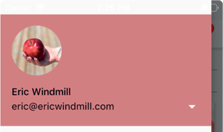
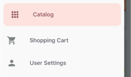
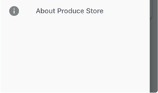
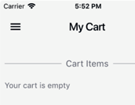

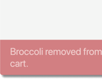
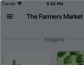
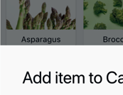
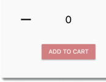

*(Các ảnh trên là các mảnh của ba ảnh chụp màn hình trong hình 7.9 được trích rời từ PDF. Hình hoàn chỉnh xem trong trang render dưới đây.)*

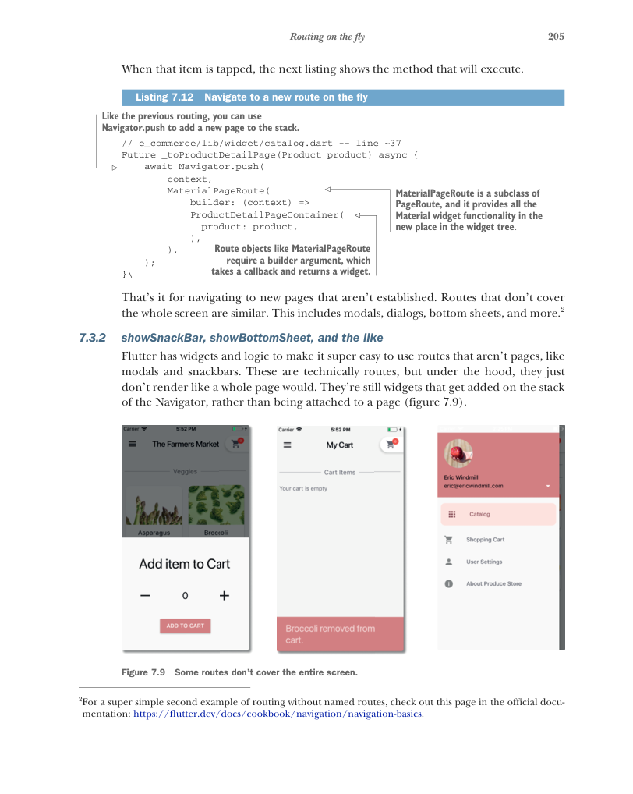

**Hình 7.9 – Một số route không che toàn bộ màn hình.**

*Mô tả hình:* Ba ảnh chụp màn hình đặt cạnh nhau:
1. **Bottom sheet**: trên trang "The Farmers Market" (mục Veggies có Asparagus – măng tây, Broccoli – súp lơ xanh), một bảng trượt lên từ đáy với tiêu đề "Add item to Cart" (Thêm món vào giỏ), nút "−", số lượng "0", nút "+" và nút "ADD TO CART" (Thêm vào giỏ). Phần trang phía trên bị làm tối.
2. **Snackbar**: trang "My Cart" với mục "Cart Items" và dòng "Your cart is empty" (Giỏ hàng của bạn đang trống); ở đáy có một thanh thông báo "Broccoli removed from cart." (Đã xóa súp lơ xanh khỏi giỏ hàng.)
3. **Drawer**: menu ngăn kéo với thông tin người dùng (Eric Windmill, eric@ericwindmill.com) và các mục Catalog (đang được tô sáng), Shopping Cart, User Settings, About Produce Store.

Trong ứng dụng này, ta dùng bottom sheet (thứ phổ biến trong các ứng dụng iOS) và một snackbar. Chúng giống nhau ở chỗ đều xuất hiện từ đáy màn hình và chỉ che một phần màn hình. Tuy nhiên chúng khác nhau, vì bottom sheet là một **`ModalRoute`**. Nghĩa là khi nó đang hiển thị, bạn **không thể** tương tác với trang bên dưới. Còn snack bar thì không cản trở ứng dụng, nên bạn vẫn có thể tương tác trong khi nó đang hiển thị.

Bottom sheet được cài đặt ngay trong widget `Catalog` đó, và được kích hoạt bằng cách **nhấn giữ** một `ProductDetailCard`, thông qua phương thức `ProductDetailCard.onLongPress`:

```dart
// e_commerce/lib/widget/catalog.dart -- line ~93
return ProductDetailCard(
  key: ValueKey(_product.imageTitle.toString()),
  onTap: () => _toProductDetailPage(_product),
  onLongPress: () =>
      _showQuickAddToCart(_product), // (1)
  product: _product,
);
```

Chú thích:
1. Khi nhấn giữ, hiển thị một bottom sheet.

*(Lưu ý: ở đoạn mã này sách gọi `_showQuickAddToCart(_product)` với một đối số, trong khi ở mục 7.3.1 và định nghĩa phương thức bên dưới nhận hai đối số `(context, product)`. Đây là sự không nhất quán trong bản gốc; phiên bản hai đối số mới khớp với định nghĩa phương thức.)*

Phương thức `_showQuickAddToCart` này có nhiệm vụ hiển thị `BottomSheet` (hình 7.10), chờ người dùng tương tác với nó, và lắng nghe dữ liệu mà bottom sheet truyền về.

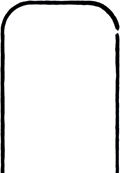
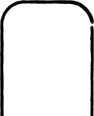
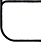

*(Các ảnh trên là các mảnh rời của hình 7.10. Hình hoàn chỉnh xem trong trang render dưới đây.)*

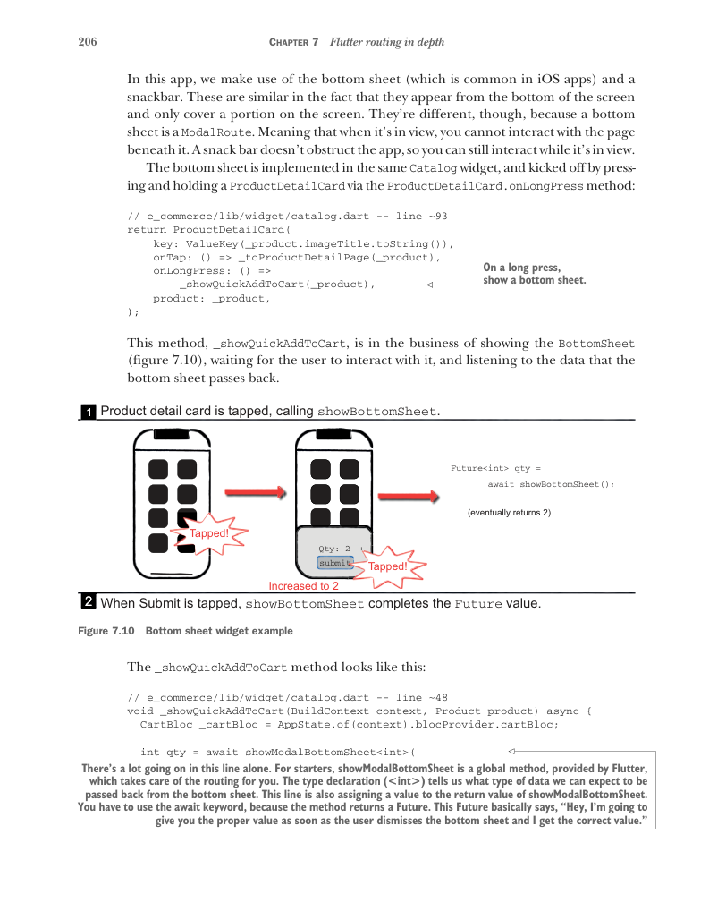

**Hình 7.10 – Ví dụ về widget bottom sheet**

*Mô tả hình:* Hình có hai bước:
1. **Thẻ chi tiết sản phẩm được chạm, gọi `showBottomSheet`.** – Màn hình điện thoại bên trái có lưới ô vuông, một ô có nhãn "Tapped!" (Đã chạm!). Mũi tên chỉ sang màn hình thứ hai, nơi một bottom sheet trượt lên với "− Qty: 2 +" (số lượng: 2) và nút "submit"; chú thích đỏ "Increased to 2" (Đã tăng lên 2), và nút submit có nhãn "Tapped!". Mũi tên tiếp theo chỉ sang đoạn mã `Future<int> qty = await showBottomSheet();` kèm ghi chú "(eventually returns 2)" (cuối cùng trả về 2).
2. **Khi Submit được chạm, `showBottomSheet` hoàn tất giá trị của `Future`.**

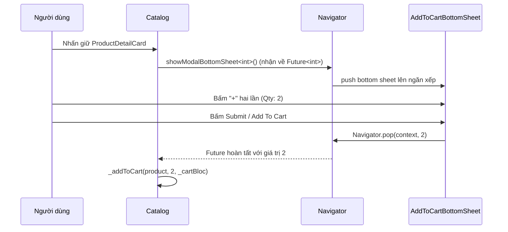

Phương thức `_showQuickAddToCart` trông như sau:

```dart
// e_commerce/lib/widget/catalog.dart -- line ~48
void _showQuickAddToCart(BuildContext context, Product product) async {
  CartBloc _cartBloc = AppState.of(context).blocProvider.cartBloc;

  int qty = await showModalBottomSheet<int>(       // (1)
    context: context,                              // (2)
    builder: (BuildContext context) {              // (3)
      return AddToCartBottomSheet(
        key: Key(product.id),
      );
    });

  _addToCart(product, qty, _cartBloc);
}
```

Chú thích:
1. Chỉ riêng dòng này đã có rất nhiều chuyện diễn ra. Trước hết, `showModalBottomSheet` là một **phương thức toàn cục** do Flutter cung cấp, nó lo phần định tuyến giúp bạn. Khai báo kiểu (`<int>`) cho ta biết kiểu dữ liệu có thể mong đợi được truyền về từ bottom sheet. Dòng này cũng gán giá trị trả về của `showModalBottomSheet` cho một biến. Bạn phải dùng từ khóa `await`, vì phương thức này trả về một `Future`. `Future` này về cơ bản nói rằng: "Này, tôi sẽ đưa bạn giá trị đúng ngay khi người dùng đóng bottom sheet và tôi nhận được giá trị chính xác."
2. Mọi route đều cần một `BuildContext` để Flutter biết nên chèn chúng vào **chỗ nào trong cây** widget.
3. Mọi phương thức thay đổi route đều cần một callback trả về một widget.

Để hoàn thiện phần cài đặt này, ta cần xem mã của `AddToCartBottomSheet`. Bên trong widget đó có một `RaisedButton`, tương ứng với nút này trên màn hình (hình 7.11).

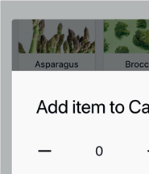

**Hình 7.11 – Ảnh chụp màn hình bottom sheet trong ứng dụng Farmers Market**

*Mô tả hình:* Bottom sheet "Add item to Cart" với nút "−", số lượng "0", nút "+" và nút màu hồng "ADD TO CART" bên dưới.

Phần mã `AddToCartBottomSheet` này dài gần 100 dòng, nhưng phần lớn chỉ là dựng widget Flutter cơ bản. Tôi muốn chỉ ra vài đoạn để hoàn thành bài học cụ thể này. (Gợi ý: phần quan trọng nhất của bài học này là `RaisedButton` gần cuối đoạn mã.)

**Listing 7.13 – Các đoạn mã chọn lọc từ widget `AddToCartBottomSheet`**

```dart
// e_commerce/lib/widget/add_to_cart_bottom_sheet.dart
class AddToCartBottomSheet extends StatefulWidget {   // (1)
  const AddToCartBottomSheet({Key key}) : super(key: key);

  @override
  _AddToCartBottomSheetState createState() => _AddToCartBottomSheetState();
}

class _AddToCartBottomSheetState extends State<AddToCartBottomSheet> {
  int _quantity = 0;
  // ...

  @override
  Widget build(BuildContext context) {
    return ConstrainedBox(                              // (2)
      constraints: BoxConstraints(
        minWidth: MediaQuery.of(context).size.width,
        minHeight: MediaQuery.of(context).size.height / 2,
      ),
      child: Column(
        children: <Widget>[
          Padding(
            // ...
            child: Text("Add item to Cart"),
          ),
          Padding(
            // ...
            child: Row(                                 // (3)
              children: <Widget>[
                IconButton(...) // decrease qty button
                Text(...) // current quanity
                IconButton(...) // increase qty button
              ],
            ),
          ),
          RaisedButton(                                 // (4)
            color: AppColors.primary[500],
            textColor: Colors.white,
            child: Text(
              "Add To Cart".toUpperCase(),
            ),
            onPressed: () =>
                Navigator.of(context).pop(_quantity),   // (5)
          )
        ],
      ),
    );
  }
}
```

Chú thích:
1. Tôi làm nổi bật dòng đầu tiên này chỉ để cho thấy rằng loại route "một phần" đặc biệt này – một bottom sheet – **chỉ là một widget**. Không có gì đặc biệt về nó cả.
2. Đây là một ví dụ tốt về việc dùng ràng buộc kích thước hộp (*box constraints*), ở đây đang giới hạn kích thước của bottom sheet (rộng bằng màn hình, cao tối thiểu bằng nửa màn hình).
3. Hàng (`Row`) này là nơi người dùng điều chỉnh số lượng họ muốn thêm vào giỏ (nút giảm số lượng, số lượng hiện tại, nút tăng số lượng).
4. `RaisedButton` này là nơi chứa những phần quan trọng nhất của bài học.
5. Dòng duy nhất này là thứ ta quan tâm cụ thể cho việc định tuyến.

*(Ghi chú: comment `// current quanity` được giữ nguyên văn như sách – chữ "quanity" là lỗi chính tả của "quantity". Dấu `}` đóng lớp ở cuối được thêm vào cho đúng cú pháp; sách bỏ qua nó vì chỉ trích đoạn.)*

Đây là một nút khá bình thường. Phần ta quan tâm là callback `onPressed` của nó. Khi nút được nhấn, nó **pop route trên cùng ra khỏi `Navigator`** (chính là bottom sheet), và rồi truyền biến đó (`_quantity`) ngược về cho đoạn mã đã thêm route này vào ngăn xếp. Nhớ lại rằng route này được thêm vào ngăn xếp bởi phương thức `Catalog._showQuickAddToCart`. Hãy xem lại đoạn mã đó như listing tiếp theo.

**Listing 7.14 – Xem lại phương thức `_showQuickAddToCart`**

```dart
// e_commerce/lib/widget/catalog.dart -- line ~48
void _showQuickAddToCart(BuildContext context, Product product) async {
  CartBloc _cartBloc = AppState.of(context).blocProvider.cartBloc;
  int qty = await showModalBottomSheet<int>(  // (1)
    context: context,
    builder: (BuildContext context) {
      return AddToCartBottomSheet(            // (2)
        key: Key(product.id),
      );
    });
  _addToCart(product, qty, _cartBloc);        // (3)
}
```

Chú thích:
1. Phương thức này push một bottom sheet lên ngăn xếp `Navigator`. Và nó đang **chờ (await) một phản hồi**, phản hồi này có thể được lưu vào một biến.
2. Đây là nơi ta dựng widget `AddToCartBottomSheet`.
3. Đây rồi, mục đích của cả bài tập này. Ta truyền giá trị trả về từ bottom sheet vào một phương thức khác.

Điểm mấu chốt của cả mục này là: **bottom sheet và những thứ tương tự hành xử y hệt như route**. Và khi bạn pop các route này ra khỏi `Navigator`, bạn có thể truyền dữ liệu về màn hình trước đó, như ta đang làm với biến `qty`.

> 📝 **Giải thích thêm (không có trong sách):** Nếu người dùng đóng bottom sheet bằng cách chạm vào vùng tối phía trên hoặc vuốt xuống (thay vì bấm "Add To Cart"), `Future` sẽ hoàn tất với giá trị `null`. Trong mã thực tế nên kiểm tra trước khi thêm vào giỏ:
> ```dart
> if (qty != null && qty > 0) {
>   _addToCart(product, qty, _cartBloc);
> }
> ```

Các widget kiểu bật lên (*pop-up*) khác cũng dùng dễ như vậy. Ví dụ, để hiển thị một snackbar, bạn có thể gọi `showSnackbar`, phương thức này nằm trên một scaffold: `Scaffold.of(context).showSnackBar(Widget content);`.

> 💡 **Ví dụ bổ sung (không có trong sách):** Hai ví dụ "route tức thời" dạng pop-up khác:
> ```dart
> // 1) Dialog xác nhận, trả về bool
> final ok = await showDialog<bool>(
>   context: context,
>   builder: (context) => AlertDialog(
>     title: Text('Xóa khỏi giỏ hàng?'),
>     actions: [
>       TextButton(onPressed: () => Navigator.pop(context, false), child: Text('Hủy')),
>       TextButton(onPressed: () => Navigator.pop(context, true), child: Text('Xóa')),
>     ],
>   ),
> );
> if (ok == true) { /* xóa sản phẩm */ }
>
> // 2) Snackbar (cách viết trong sách: Scaffold.of(context).showSnackBar(...);
> //    ở Flutter hiện đại API này đã chuyển sang ScaffoldMessenger)
> ScaffoldMessenger.of(context).showSnackBar(
>   SnackBar(content: Text('Broccoli removed from cart.')),
> );
> ```
> Dialog là `ModalRoute` (chặn tương tác bên dưới, có thể trả giá trị qua `pop`), còn snackbar không chặn tương tác.

---

## 7.4 Hiệu ứng chuyển trang khi định tuyến (Routing animations)

Mảnh ghép cuối cùng của câu đố định tuyến là làm cho nó **đẹp**, và đó là phần tôi thích nhất khi viết ứng dụng. Tin hay không thì tùy, nhưng gần như chẳng tốn công gì để thêm hiệu ứng chuyển route tùy biến. Thực ra, công sức thật sự nằm ở việc viết chính hiệu ứng chuyển động, nếu bạn muốn làm nó siêu cầu kỳ. Nhưng như bạn đã thấy ở ứng dụng trước, Flutter cho bạn khá nhiều hiệu ứng có sẵn.

Trước khi đi sâu, hãy xem xét cách chuyển trang hoạt động mặc định trong Flutter. Những sự thật sau đây rất quan trọng:

- **Trang chỉ là widget**, nên chúng có thể được tạo hiệu ứng chuyển động như mọi widget khác.
- **Trang có hiệu ứng chuyển mặc định, khác nhau tùy nền tảng**: kiểu iOS hoặc kiểu Material.
- **Mọi hiệu ứng chuyển đều liên quan tới hai trang**: một trang đang đi vào tầm nhìn, và một trang đang rời khỏi tầm nhìn.

Với những điều đó trong đầu, ta bắt đầu nhé. Hiệu ứng chuyển được xử lý bởi `PageRoute`, hoặc trong trường hợp của ta là `MaterialPageRoute`, lớp này kế thừa `PageRoute`, `PageRoute` kế thừa `ModalRoute`, và `ModalRoute` kế thừa `TransitionRoute`. Ở đâu đó trong mớ hỗn độn này có một phương thức tên là **`buildTransitions`**, phương thức này – cùng với những thứ khác – nhận **hai animation** làm đối số. Một cái dành cho chính nó khi nó rời đi, và cái thứ hai để phối hợp với route đang thay thế nó. `MaterialPageRoute` đã cài đặt sẵn các hiệu ứng chuyển, nghĩa là bạn có thể ghi đè (*override*) `MaterialPageRoute.buildTransitions`.

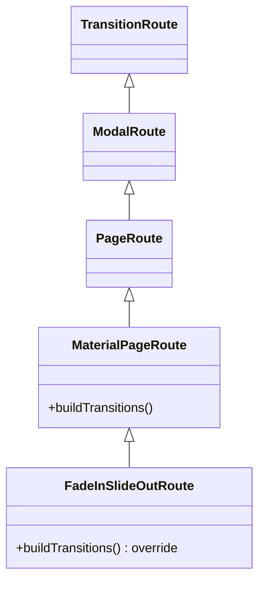

Tất cả những gì phương thức này phải làm là **trả về một widget**. Và khi ghi đè nó, bạn không phải lo viết `AnimationController` hay `Tween` – tất cả đã được lớp cha lo. Điều đó có nghĩa là bạn chỉ cần trả về một trang được bọc trong một widget có hiệu ứng, và nó sẽ chuyển động tương ứng. Hãy xem đoạn mã để thấy điều này bớt trừu tượng hơn. Nó nằm trong file `lib/util/material_route_transition.dart`.

> 📝 **Giải thích thêm (không có trong sách):** Hai đối số animation trong `buildTransitions`:
> - `animation` – điều khiển chuyển động của **chính route này** khi nó được push vào (chạy từ 0.0 → 1.0) hoặc bị pop ra (chạy ngược 1.0 → 0.0).
> - `secondaryAnimation` – chạy khi **một route khác được push đè lên trên** route này (hoặc bị pop khỏi phía trên nó), để route này có thể phối hợp chuyển động "nhường chỗ".
>
> `AnimationController` là bộ điều khiển thời gian của hiệu ứng, còn `Tween` ánh xạ giá trị 0→1 thành một khoảng giá trị khác (ví dụ vị trí, độ mờ). Lớp cha `TransitionRoute` đã tạo sẵn chúng cho bạn.

**Listing 7.15 – Viết một hiệu ứng chuyển trang tùy biến**

```dart
// e_commerce/lib/util/material_route_transition.dart
class FadeInSlideOutRoute<T> extends
    MaterialPageRoute<T> {                                       // (1)
  FadeInSlideOutRoute({WidgetBuilder builder, RouteSettings settings})
      : super(builder: builder, settings: settings);

  @override
  Widget buildTransitions(                                       // (2)
    BuildContext context,
    Animation<double> animation,
    Animation<double> secondaryAnimation,
    Widget child,
  ) {
    if (settings.isInitialRoute) return child;
    if (animation.status == AnimationStatus.reverse) {
      return super.buildTransitions(
        context,
        animation,
        secondaryAnimation,
        child,
      );
    }
    return FadeTransition(                                       // (3)
      opacity: animation,
      child: child,
    );
  }
}
```

Chú thích:
1. Để viết hiệu ứng chuyển này, ta dựa rất nhiều vào những gì Flutter cung cấp sẵn. Kế thừa `MaterialPageRoute`, và truyền các thuộc tính của lớp này lên lớp cha bằng cách gọi `super`.
2. Phương thức được ghi đè này được gọi **nội bộ** (Flutter tự gọi), nên ta không phải loay hoay dựng chính hiệu ứng chuyển động, nhưng bạn vẫn có thể làm nếu muốn!
3. Trả về một `FadeTransition` có sẵn của Flutter, và truyền vào nó animation do lớp cha tạo ra. Từ giờ, bất cứ khi nào bạn push một `FadeInSlideOutRoute` lên ngăn xếp, nó sẽ dùng các hiệu ứng này.

Chắc chắn là ví dụ này có chút trừu tượng. Nhưng dòng quan trọng nhất, hơn hẳn mọi dòng khác, là câu lệnh `return`. Phương thức `buildTransitions` này ghi đè phương thức cùng tên trên lớp cha `MaterialPageRoute` – lớp cha mới là nơi làm toàn bộ phần việc khó: tính toán cách chuyển động giữa các trang và thực thi các hiệu ứng chuyển đó.

`FadeTransition` bảo `buildTransitions` dựng cụ thể một hiệu ứng làm **trang mới hiện dần lên** (*fade in*). Và `buildTransitions` được gọi nội bộ. Ta không bao giờ gọi nó tường minh trong mã. Nếu bạn muốn tạo một thứ được tùy biến ở mức rất cao, bạn sẽ cần tự gọi `buildTransitions`, và có lẽ bạn sẽ dùng `WidgetsApp` thay vì `MaterialApp` ở gốc ứng dụng.

> 📝 **Giải thích thêm (không có trong sách):** Đọc kỹ logic của Listing 7.15 sẽ thấy vì sao lớp có tên "Fade In – Slide Out":
> - Nếu là route khởi đầu (`isInitialRoute`) → trả về `child`, không có hiệu ứng.
> - Nếu animation đang chạy **ngược** (`AnimationStatus.reverse`, tức trang đang bị pop) → dùng hiệu ứng mặc định của `MaterialPageRoute` (trượt ra – *slide out*).
> - Còn lại (trang đang được push vào) → **mờ dần hiện lên** (*fade in*).
>
> Lưu ý: thuộc tính `RouteSettings.isInitialRoute` đã bị loại bỏ trong các phiên bản Flutter mới; mã trong sách viết cho phiên bản cũ.

Với tất cả những điều đó, `FadeTransition` mới là thứ mà chúng ta – các lập trình viên – thật sự quan tâm. Bạn cũng có thể dùng một trong nhiều hiệu ứng chuyển khác mà thư viện Material của Flutter cung cấp:

- `SlideTransition`
- `SizeTransition`
- `RotationTransition`
- `AlignTransition`
- và nhiều nữa

Tất cả đều do framework cung cấp, và việc dùng chúng cũng đơn giản y như vậy.

Để dùng hiệu ứng này, tất cả những gì bạn cần làm là vào `Catalog._toProductDetailPage` và **thay `MaterialPageRoute` bằng `FadeInSlideOutRoute`**. Giờ khi bạn chạm vào một thẻ chi tiết sản phẩm, các route sẽ mờ dần. Tôi đoán cũng nên nói rằng bạn có thể làm nó cầu kỳ và "điên rồ" tới mức nào tùy thích. Giới hạn duy nhất là hiệu ứng mà bạn viết ra.

Cuối cùng, nếu bạn muốn đọc thêm một lời giải thích khác, bài viết này của Divyanshu Bhargava trên Medium khá hay: https://medium.com/flutter-community/everything-you-need-to-know-about-flutter-page-route-transition-9ef5c1b32823.

> 💡 **Ví dụ bổ sung (không có trong sách):** Áp dụng hiệu ứng mới vào Listing 7.12 – chỉ đổi đúng một tên lớp:
> ```dart
> Future _toProductDetailPage(Product product) async {
>   await Navigator.push(
>     context,
>     FadeInSlideOutRoute(            // trước đây: MaterialPageRoute
>       builder: (context) => ProductDetailPageContainer(product: product),
>     ),
>   );
> }
> ```
> Và nếu muốn trang mới **trượt lên từ dưới** thay vì mờ dần, chỉ cần thay `FadeTransition` trong `buildTransitions` bằng `SlideTransition`:
> ```dart
> return SlideTransition(
>   position: Tween<Offset>(
>     begin: const Offset(0, 1), // bắt đầu ở dưới mép màn hình
>     end: Offset.zero,          // kết thúc ở vị trí bình thường
>   ).animate(animation),
>   child: child,
> );
> ```

---

## Tóm tắt (Summary)

- Flutter dùng **định tuyến động**, giúp việc định tuyến linh hoạt và mượt mà hơn nhiều.
- `Navigator` của Flutter cho phép bạn tạo route "tức thời" trong mã, ngay khi có một tương tác nào đó của người dùng xảy ra hoặc ứng dụng nhận được dữ liệu mới.
- Flutter hỗ trợ định tuyến (gần như) tĩnh bằng **route có tên**. (Mặc dù về mặt kỹ thuật, các route này vẫn được tạo ra trong lúc ứng dụng chạy.)
- Định nghĩa các route có tên trong widget `MaterialApp`, hoặc trong bất kỳ widget App cấp cao nhất nào mà bạn đang dùng.
- `Navigator` quản lý tất cả các route theo kiểu **ngăn xếp**.
- Việc điều hướng tới các route được thực hiện bằng cách gọi các biến thể của `Navigator.push` và `Navigator.pop`.
- Các lời gọi `Navigator.push` trả về một `Future` chờ một giá trị sẽ được route mới truyền về.
- Tạo một menu ngăn kéo đầy đủ theo phong cách Material trong Flutter cần tới vài widget cực kỳ "hào phóng": `Drawer`, `ListView`, `ListTile`, `AboutListTile` và `DrawerHeader`.
- Bạn có thể nắm bắt các thay đổi định tuyến bằng cách thiết lập một `RouteObserver` và đăng ký (*subscribe*) với nó trên đối tượng state của bất kỳ widget nào.
- Một số thành phần UI được quản lý bằng `Navigator` và về mặt kỹ thuật là route, dù chúng không phải là trang – ví dụ snackbar, bottom sheet, drawer và menu.
- Bạn có thể lắng nghe tương tác của người dùng bằng widget `GestureDetector`.
- Cài đặt hiệu ứng chuyển trang tùy biến được thực hiện bằng cách **kế thừa các lớp Route**.

> 📝 **Giải thích thêm (không có trong sách):** Tóm tắt của sách có nhắc tới `GestureDetector`, dù chương này không trình bày trực tiếp widget đó. Các callback `onTap`/`onLongPress` của `ProductDetailCard` (mục 7.3.1, 7.3.2) chính là loại tương tác mà `GestureDetector` giúp lắng nghe: bọc một widget bất kỳ trong `GestureDetector(onTap: ..., onLongPress: ..., child: ...)` là widget đó có thể phản hồi cú chạm và nhấn giữ.

---

## Bảng thuật ngữ của chương

| Thuật ngữ (English) | Nghĩa tiếng Việt | Giải thích ngắn |
|---|---|---|
| Routing | Định tuyến | Cơ chế chuyển qua lại giữa các trang/màn hình của ứng dụng. |
| Route | Route (tuyến) | Một mục trên ngăn xếp điều hướng – thường là một trang, cũng có thể là dialog, bottom sheet, drawer. |
| Dynamic routing | Định tuyến động | Định tuyến diễn ra trong lúc ứng dụng đang chạy/render, không cần cấu hình trước. |
| Static / declarative routing | Định tuyến tĩnh / khai báo | Khai báo sẵn toàn bộ route trước khi ứng dụng chạy. |
| Named route | Route có tên | Route được đăng ký bằng một chuỗi tên (vd `/cart`) trong `MaterialApp.routes`. |
| Routing on the fly | Định tuyến tức thời | Tạo route ngay tại chỗ khi có sự kiện, không cần khai báo trước. |
| Navigator | Bộ điều hướng | Widget quản lý các route theo kiểu ngăn xếp. |
| Stack (LIFO) | Ngăn xếp (vào sau ra trước) | Cấu trúc dữ liệu: phần tử thêm vào sau cùng được lấy ra trước tiên. |
| Push / Pop | Đẩy vào / Lấy ra | Thêm route lên đỉnh ngăn xếp / bỏ route ở đỉnh ra. |
| Future | Future (giá trị tương lai) | Đối tượng đại diện cho một giá trị bất đồng bộ sẽ có sau. |
| await | await (chờ) | Từ khóa Dart để chờ một `Future` hoàn tất. |
| BuildContext | Ngữ cảnh dựng | Vị trí của widget trong cây widget; dùng để tìm `Navigator`, theme... |
| Drawer | Ngăn kéo (menu trượt) | Menu trượt ra từ cạnh màn hình, truyền vào `Scaffold.drawer`. |
| ListView | ListView | Widget bố cục xếp các con trong vùng cuộn được. |
| ListTile | ListTile | Hàng có chiều cao cố định với `leading`, `title`, `subtitle`, `trailing`, `onTap`. |
| Opinionated widget | Widget "có chính kiến" | Widget đã định sẵn bố cục/kiểu dáng theo khuôn mẫu. |
| UserAccountsDrawerHeader | Phần đầu drawer chứa tài khoản | Widget Material hiển thị ảnh, tên, email người dùng (kiểu Gmail). |
| AboutListTile | Mục "Giới thiệu" | Mục menu tự mở hộp thoại thông tin ứng dụng và trang giấy phép. |
| Modal | Hộp thoại modal | Cửa sổ che lên trang và chặn tương tác với phần bên dưới. |
| Overlay | Lớp phủ | Lớp mờ phủ lên nội dung phía sau menu/dialog. |
| Observer | Người quan sát | Đối tượng lắng nghe và nhận thông báo khi có sự kiện. |
| NavigatorObserver | NavigatorObserver | Observer nhận thông báo về các sự kiện của `Navigator`. |
| RouteObserver | RouteObserver | Lớp con của `NavigatorObserver`, báo cho subscriber khi route (kiểu cụ thể) thay đổi. |
| RouteAware | RouteAware | Mixin cung cấp `didPush`, `didPop`, `didPushNext`, `didPopNext`. |
| Mixin | Mixin | Cách "trộn" phương thức của một lớp vào lớp khác, dùng từ khóa `with`. |
| Subscribe / Subscriber | Đăng ký / Người đăng ký | Đăng ký nhận thông báo từ observer / đối tượng đã đăng ký. |
| Lifecycle method | Phương thức vòng đời | Phương thức Flutter gọi ở các thời điểm trong đời một `State` (vd `didChangeDependencies`). |
| ModalRoute | ModalRoute | Route che màn hình và chặn tương tác với route bên dưới (trang, popup, drawer). |
| PageRoute / MaterialPageRoute | Route dạng trang | Route toàn trang; `MaterialPageRoute` có hiệu ứng chuyển kiểu Material/iOS. |
| Bottom sheet | Bảng trượt từ đáy | Bảng trượt lên từ đáy màn hình; bản modal chặn tương tác. |
| Snackbar | Thanh thông báo ngắn | Thông báo ngắn ở đáy màn hình, không chặn tương tác. |
| Dialog | Hộp thoại | Cửa sổ nhỏ bật lên, là một route. |
| Box constraints | Ràng buộc kích thước | Giới hạn chiều rộng/cao tối thiểu–tối đa của widget. |
| Page transition animation | Hiệu ứng chuyển trang | Chuyển động khi một trang vào/rời màn hình. |
| buildTransitions | buildTransitions | Phương thức của route trả về widget bọc hiệu ứng chuyển; Flutter tự gọi. |
| AnimationController / Tween | Bộ điều khiển hiệu ứng / Khoảng nội suy | Điều khiển thời gian hiệu ứng / ánh xạ 0→1 sang khoảng giá trị khác. |
| FadeTransition | Hiệu ứng mờ dần | Widget làm con hiện/ẩn dần theo độ mờ. |
| Override | Ghi đè | Định nghĩa lại phương thức của lớp cha trong lớp con. |
| GestureDetector | Bộ nhận diện cử chỉ | Widget lắng nghe chạm, nhấn giữ, vuốt... |
