# Chương 8: Quản lý state trong Flutter (Flutter state management)

**Mục lục chương**

- [Mở đầu chương](#mở-đầu-chương)
- [8.1 Tìm hiểu sâu về StatefulWidget (Deep dive into StatefulWidgets)](#81-tìm-hiểu-sâu-về-statefulwidget-deep-dive-into-statefulwidgets)
  - [8.1.1 Cây widget và cây element (The widget tree and the element tree)](#811-cây-widget-và-cây-element-the-widget-tree-and-the-element-tree)
  - [8.1.2 Vòng đời của StatefulWidget và khi nào làm gì (The StatefulWidget lifecycle and when to do what)](#812-vòng-đời-của-statefulwidget-và-khi-nào-làm-gì-the-statefulwidget-lifecycle-and-when-to-do-what)
- [8.2 Quản lý state thuần Flutter: InheritedWidget (Pure Flutter state management: The InheritedWidget)](#82-quản-lý-state-thuần-flutter-inheritedwidget-pure-flutter-state-management-the-inheritedwidget)
  - [8.2.1 Tạo một kho trung tâm bằng bộ đôi InheritedWidget/StatefulWidget](#821-tạo-một-kho-trung-tâm-bằng-bộ-đôi-inheritedwidgetstatefulwidget-creating-a-central-store-wth-an-inheritedwidgetstatefulwidget-team)
  - [8.2.2 Phương thức inheritFromWidgetOfExactType và of](#822-phương-thức-inheritfromwidgetofexacttype-và-of-the-inheritfromwidgetofexacttype-and-of-methods)
  - [8.2.3 Dùng phương thức of để nâng state lên (Use the of method to lift up state)](#823-dùng-phương-thức-of-để-nâng-state-lên-use-the-of-method-to-lift-up-state)
  - [8.2.4 Các mẫu quản lý state ngoài Flutter (State management patterns beyond Flutter)](#824-các-mẫu-quản-lý-state-ngoài-flutter-state-management-patterns-beyond-flutter)
- [8.3 Bloc: Thành phần logic nghiệp vụ (Blocs: Business Logic Components)](#83-bloc-thành-phần-logic-nghiệp-vụ-blocs-business-logic-components)
  - [8.3.1 Bloc hoạt động như thế nào? (How do blocs work?)](#831-bloc-hoạt-động-như-thế-nào-how-do-blocs-work)
  - [8.3.2 Triển khai kiến trúc bloc (Implementing the bloc architecture)](#832-triển-khai-kiến-trúc-bloc-implementing-the-bloc-architecture)
  - [8.3.3 Giới thiệu stream và Dart bất đồng bộ (Intro to streams and async Dart)](#833-giới-thiệu-stream-và-dart-bất-đồng-bộ-intro-to-streams-and-async-dart)
  - [8.3.4 Triển khai stream trong CartBloc (Implementing streams in the CartBloc)](#834-triển-khai-stream-trong-cartbloc-implementing-streams-in-the-cartbloc)
- [Tóm tắt (Summary)](#tóm-tắt-summary)
- [Bảng thuật ngữ của chương](#bảng-thuật-ngữ-của-chương)

---

## Mở đầu chương

Chương này sẽ là chương tôi thích nhất, vì hai lý do. Thứ nhất, không có **một** cách duy nhất để quản lý state (*state management* – quản lý "trạng thái" của ứng dụng, tức là dữ liệu có thể thay đổi theo thời gian và quyết định giao diện hiển thị ra sao), dù là trong Flutter hay ở bất kỳ đâu khác. Có rất nhiều mẫu (*pattern*) quản lý state khác nhau, và dân lập trình ai cũng có ý kiến riêng về từng mẫu. Thứ hai, các lập trình viên (kể cả tôi) thì... *rất nhiệt huyết*... với ý kiến của mình. (Nói vui: ai cũng bảo vệ "trường phái" của mình đến cùng.)

Vì vậy, tôi sẽ không thể đi sâu vào mọi mẫu quản lý state đang thịnh hành hiện nay. Tôi đã suy nghĩ rất nhiều về việc nên trình bày những mẫu nào, và đi đến một "phép thử" gồm hai tiêu chí để quyết định:

1. Nó có giúp bạn mở rộng kỹ năng Flutter và Dart không?
2. Nó có đủ "trung lập" (*unopinionated* – không áp đặt quá nhiều quy ước riêng) để các khái niệm của nó có thể áp dụng ở nơi khác không?

**Chương này bao gồm:**

- `StatefulWidget` và đối tượng state (*state object*)
- Cây widget (*widget tree*) so với cây element (*element tree*)
- Vòng đời (*lifecycle*) của đối tượng state
- `InheritedWidget` và bloc cho việc quản lý state
- Giới thiệu về stream và Dart bất đồng bộ (*async Dart*)

Đây là những gì tôi chọn cho chương này nói chung:

- **Tìm hiểu sâu về `StatefulWidget`.** Đây là kiến thức bạn cần biết bất kể bạn chọn cách quản lý state nào.
- **`InheritedWidget`.** Inherited widget (widget "kế thừa", cho phép widget con cháu truy cập dữ liệu từ nó) là loại widget "thứ ba" (bên cạnh stateless và stateful). Bản thân nó đã đủ để xử lý state trong một ứng dụng nhỏ, và mọi thư viện "nặng ký" hơn nhiều khả năng đều dùng nó ở bên dưới (*under the hood*). Gần như chắc chắn bất kỳ ứng dụng Flutter nào bạn dùng cũng sẽ dùng inherited widget, kể cả khi nó còn dùng thêm một thư viện "xịn" nào đó.
- **Mẫu BLoC của Google** để quản lý state ứng dụng. Về cơ bản, tôi quyết định đây là mẫu đáng bỏ thời gian nhất, vì nó không dài dòng (*verbose*) và không cần thư viện bên ngoài. Những mẫu như Redux có rất nhiều mã khuôn mẫu (*boilerplate code* – đoạn mã lặp đi lặp lại bắt buộc phải viết). Bạn phải kéo thêm một thư viện bên ngoài vào, và các thư viện đó cực kỳ áp đặt quan điểm riêng (*opinionated*).

> **NOTE (Ghi chú):** Có một số thư viện mã nguồn mở trừu tượng hóa (*abstract away*) phần triển khai mẫu bloc. Một vài thư viện trong số đó rất tuyệt và được dùng rộng rãi. Dù vậy, khái niệm bloc không phụ thuộc vào bất kỳ cách triển khai cụ thể nào.

Mục tiếp theo nói về stateful widget và đối tượng state. Phần đó chủ yếu mang tính khái niệm. Việc viết code sẽ bắt đầu ở mục sau đó.

> 📝 **Giải thích thêm (không có trong sách):** "State" là bất kỳ dữ liệu nào có thể thay đổi trong lúc ứng dụng chạy và ảnh hưởng tới giao diện: số món hàng trong giỏ, người dùng đã đăng nhập hay chưa, nội dung ô nhập liệu, ... "Quản lý state" là trả lời ba câu hỏi: (1) dữ liệu này nằm ở đâu, (2) ai được phép thay đổi nó, (3) khi nó đổi thì những widget nào cần vẽ lại. Mỗi mẫu (lifting state up, InheritedWidget, BLoC, Redux, ...) là một cách trả lời khác nhau cho ba câu hỏi đó.

---

## 8.1 Tìm hiểu sâu về StatefulWidget (Deep dive into StatefulWidgets)

Ôn lại một chút. Một `StatefulWidget` có hai nhiệm vụ. Thứ nhất, nó giữ các biến bất biến (*immutable*), giống hệt `StatelessWidget`, và không thuộc tính nào trên `StatefulWidget` có thể bị cập nhật. Nhiệm vụ thứ hai của nó là tạo ra một đối tượng `State` đi kèm.

**Listing 8.1 – Ví dụ về StatefulWidget**

```dart
class ItemCounter extends StatefulWidget {
  final String name; // (1)

  ItemCounter({this.name});

  @override
  _ItemCounterState createState() => // (2)
      _ItemCounterState();
}
```

Chú thích trong Listing 8.1:

1. Thuộc tính này là bất biến. Nó được đánh dấu `final`.
2. Tạo ra một đối tượng state đi kèm.

Đối tượng `State` thì có nhiều nhiệm vụ. Các nhiệm vụ cơ bản của nó là theo dõi một state nội bộ (có thể thay đổi – *mutable*) và dựng (*build*) các widget con bằng `State.build`. Nhưng đối tượng state trong Flutter có thể phức tạp hơn thế một chút. Bạn nên biết chúng được đối xử khác biệt thế nào trong cây widget, cũng như cách xử lý vòng đời của chúng.

> 💡 **Ví dụ bổ sung (không có trong sách):** Một phiên bản đầy đủ, chạy được, của `ItemCounter` để thấy rõ "phần bất biến" và "phần thay đổi được":
>
> ```dart
> import 'package:flutter/material.dart';
>
> class ItemCounter extends StatefulWidget {
>   final String name; // bất biến: do widget cha truyền vào
>   ItemCounter({this.name});
>
>   @override
>   _ItemCounterState createState() => _ItemCounterState();
> }
>
> class _ItemCounterState extends State<ItemCounter> {
>   int count = 0; // thay đổi được: sống trong đối tượng State
>
>   @override
>   Widget build(BuildContext context) {
>     return GestureDetector(
>       onTap: () => setState(() => count++),
>       // widget.name: đọc thuộc tính bất biến của StatefulWidget
>       child: Text('${widget.name}: $count'),
>     );
>   }
> }
> ```
>
> Nếu cha truyền `name` mới, Flutter tạo một **widget** `ItemCounter` mới, nhưng `count` vẫn giữ nguyên vì nó nằm trong **đối tượng State** (được tái sử dụng – xem mục 8.1.1).

### 8.1.1 Cây widget và cây element (The widget tree and the element tree)

Flutter biết cách hiển thị widget lên màn hình bằng cách dựng **cây element** (*element tree*). Cây widget không được hiển thị trực tiếp, vì widget chỉ là những "bản thiết kế" (*blueprint*) cho các element có thể hiển thị được. Chúng ta, những lập trình viên, dựng một cây widget gồm các bản thiết kế, và Flutter ở bên trong sẽ ánh xạ (*map*) nó sang một cây element.

Hãy cùng ôn lại cách các loại widget khác nhau tương tác với cây element. Một widget *stateless* được ánh xạ một-một với một element. Khi ứng dụng đang hiển thị và Flutter đang "bò" (*crawl*) qua cây widget, nó sẽ nói: "Này cây element, bạn tạo giúp tôi một element tương ứng với widget này được không?" Và cây element làm đúng như vậy.

Cây element (hình 8.1) không xử lý các widget *stateful* theo cùng cách đó. Khi Flutter yêu cầu cây element tạo một stateful widget, cây element sẽ nói: "Được thôi. Này stateful widget mới, bạn tạo giúp tôi một đối tượng state nhé?" Và stateful widget làm vậy.

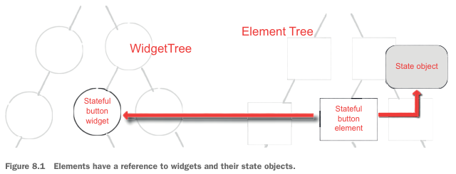

**Hình 8.1 – Các element có tham chiếu tới widget và tới đối tượng state của chúng.**

Mô tả hình: Bên trái là **WidgetTree** (cây widget) gồm các vòng tròn; một vòng tròn được tô đậm là **Stateful button widget** (widget nút có state). Bên phải là **Element Tree** (cây element) gồm các ô vuông; một ô là **Stateful button element** (element của nút có state). Từ element này có một mũi tên đỏ chỉ ngược sang widget tương ứng bên cây widget, và một mũi tên khác chỉ lên **State object** (đối tượng state). Ý nghĩa: element đứng giữa, giữ tham chiếu đến cả widget (bản thiết kế) lẫn đối tượng state (nơi chứa dữ liệu thay đổi được).

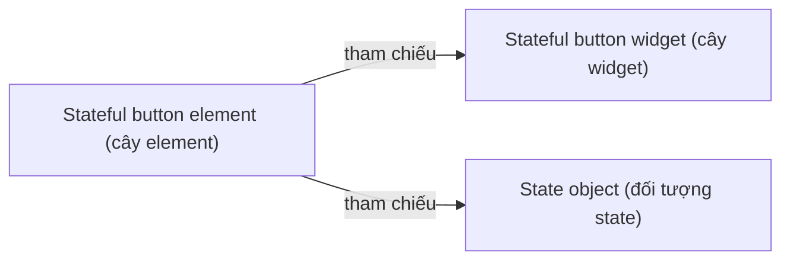

Các mảnh ảnh trích từ trang PDF của hình 8.1 (các nút/vòng tròn rời rạc của sơ đồ, giữ lại cho đầy đủ):

    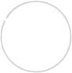 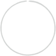  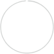 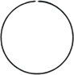 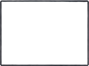 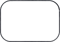 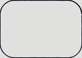

Nếu chuyện này được xử lý bên trong, tại sao ta phải quan tâm? Hiểu nó rất có ích, vì đối tượng state và element là những thứ **sống lâu** (*long-lived*). Nếu `StatefulWidget` bị thay thế trong cây, và widget mới có **cùng kiểu** (và có **cùng key**), thì element tương ứng vẫn tiếp tục trỏ đến cùng vị trí đó trong cây và tham chiếu tới stateful widget mới, nhưng đối tượng `State` đi kèm thì vẫn nằm nguyên chỗ cũ và được **tái sử dụng**.

Flutter cung cấp các phương thức trên đối tượng state cho phép bạn phản ứng với những thay đổi trong cây element. Các phương thức này được gọi theo một trình tự cụ thể. Trình tự này thường được gọi là **vòng đời** (*lifecycle*) của widget.

> 💡 **Ví dụ bổ sung (không có trong sách):** Hiệu ứng "tái sử dụng State" có thể gây bất ngờ. Giả sử bạn có:
>
> ```dart
> bool showA = true;
> // ...
> Column(children: [
>   showA ? ItemCounter(name: 'A') : ItemCounter(name: 'B'),
> ])
> ```
>
> Bạn bấm vào `A` 3 lần (count = 3), rồi đổi `showA = false`. Màn hình sẽ hiện `B: 3` chứ không phải `B: 0`! Lý do: widget mới cùng kiểu `ItemCounter`, cùng vị trí, không có key khác → element giữ nguyên, `State` cũ (với `count = 3`) được tái sử dụng, chỉ có `widget.name` đổi thành `'B'`. Muốn Flutter coi đây là hai widget khác nhau (tạo State mới), hãy thêm key: `ItemCounter(key: ValueKey('A'), name: 'A')` và `ItemCounter(key: ValueKey('B'), name: 'B')`.

### 8.1.2 Vòng đời của StatefulWidget và khi nào làm gì (The StatefulWidget lifecycle and when to do what)

Tôi thích nghĩ về vòng đời theo hai phần. Phần thứ nhất, "luồng chính" (*the main thread* – ở đây tác giả dùng theo nghĩa "mạch chính", không phải luồng hệ điều hành), là một chuỗi các phương thức sẽ được gọi theo thứ tự và **ít nhất một lần** trong vòng đời của đối tượng state, bất kể chuyện gì xảy ra. Phần thứ hai là ba phương thức có thể được gọi tùy theo các sự kiện khác nhau. Cả ba đều kích hoạt việc dựng lại (*rebuild*).

> **NOTE (Ghi chú):** Sau mục này, chúng ta sẽ bắt đầu viết code. Trong code, bạn sẽ thấy các phương thức vòng đời này được sử dụng, và tôi sẽ giải thích điều gì đang xảy ra với chúng. Trước đó, sẽ có ích nếu tôi cho bạn một cái nhìn tổng quan nhanh về toàn bộ quá trình. Đừng sa lầy vào chi tiết vội.

Hình 8.2 thể hiện vòng đời theo thứ tự.

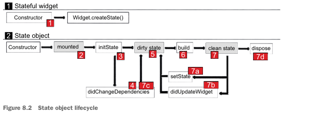

**Hình 8.2 – Vòng đời của đối tượng State.**

Mô tả hình: Hình có hai hàng.
- Hàng **1 – Stateful widget**: `Constructor` (hàm khởi tạo) → `Widget.createState()` (bước 1).
- Hàng **2 – State object** (đối tượng state): `Constructor` → `mounted` (đã gắn vào cây, bước 2) → `initState` (bước 3) → `dirty state` (trạng thái "bẩn", bước 5) → `build` (bước 6) → `clean state` (trạng thái "sạch", bước 7) → `dispose` (bước 7d).
- Các nhánh phụ: từ `initState` đi xuống `didChangeDependencies` (bước 4), rồi quay lên `dirty state` (nhãn 7c cho trường hợp gọi lại về sau). Từ `clean state` có hai nhánh quay lại `dirty state`: qua `setState` (7a) và qua `didUpdateWidget` (7b).

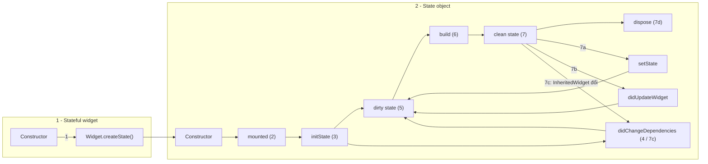

Trong hình:

1. Hàm khởi tạo (*constructor*) của lớp state được gọi (như với mọi lớp trong Dart). Widget chưa nằm trong cây, nên phần lớn việc khởi tạo đặc thù cho state **không nên** làm ở đây.
2. Đối tượng state được gắn với một `BuildContext`, tức là một vị trí, trong cây. Lúc này widget được coi là đã "gắn kết" (*mounted*). Bạn có thể kiểm tra một widget đã được mounted hay chưa bằng `Widget.mounted`.
3. `State.initState` được gọi. Phương thức này được gọi **đúng một lần**. Nên dùng nó để khởi tạo các thuộc tính trên đối tượng `State` phụ thuộc vào stateful widget đi kèm hoặc vào build context.
4. `State.didChangeDependencies` được gọi. Phương thức này đặc biệt vì nó được gọi một lần ngay sau `initState`, nhưng cũng có thể được gọi lại về sau trong vòng đời (tôi sẽ nói ngay sau đây). Đây là nơi bạn nên làm các việc khởi tạo có liên quan tới một `InheritedWidget`.
5. Tại thời điểm này, state được coi là "bẩn" (*dirty*) – đó là cách Flutter theo dõi những widget nào cần được dựng lại. Bất cứ khi nào một đối tượng state cần được build, kể cả lần đầu tiên, nó đều tự đánh dấu mình là dirty.
6. Đối tượng state đã được khởi tạo hoàn chỉnh, và phương thức `State.build` được gọi.
7. Sau một lần build mới, state được đánh dấu là "sạch" (*clean*). Cho tới lúc này, vòng đời đi trên một đường ray duy nhất. Khi state sạch, không có gì xảy ra cả. Đối tượng state được hiển thị đúng như dự định, và nó đang chờ framework đưa ra chỉ dẫn tiếp theo. Lúc này, một vài điều có thể xảy ra:
   - a. `state.setState` được gọi từ code của bạn – việc này **luôn** đánh dấu state là dirty.
   - b. Một widget tổ tiên (*ancestor*) có thể yêu cầu vị trí này trong cây được dựng lại. Nếu vị trí đó được dựng lại với cùng kiểu widget và cùng key, framework sẽ gọi `didUpdateWidget` với widget **cũ** làm đối số. Việc này cũng đánh dấu state là dirty, và do đó dựng lại state.
   - c. Nếu widget của bạn phụ thuộc vào một `InheritedWidget`, và inherited widget đó thay đổi, thì framework gọi `didChangeDependencies`. Tại thời điểm này, widget sẽ được dựng lại.
   - d. Cuối cùng, có một hành động chắc chắn sẽ xảy ra. Đối tượng state sẽ bị gỡ khỏi cây, vì vậy `State.disposed` (tức phương thức `dispose`) được gọi. Đây là nơi bạn nên dọn dẹp mọi tài nguyên mà widget đã dùng, chẳng hạn dừng các animation đang chạy hoặc đóng các stream. Một khi `disposed` đã được gọi, widget không bao giờ có thể build lại nữa. Gọi `setState` vào lúc này là một lỗi.

Danh sách trên chỉ là phần "nhập môn" cho phần còn lại của chương. Một lần nữa, chưa cần sa lầy vào chi tiết.

> 💡 **Ví dụ bổ sung (không có trong sách):** Một widget đồng hồ đếm giây minh họa "khi nào làm gì" trong vòng đời:
>
> ```dart
> import 'dart:async';
> import 'package:flutter/material.dart';
>
> class Ticker extends StatefulWidget {
>   final Duration interval;
>   Ticker({this.interval = const Duration(seconds: 1)});
>
>   @override
>   _TickerState createState() => _TickerState();
> }
>
> class _TickerState extends State<Ticker> {
>   Timer _timer;
>   int _seconds = 0;
>   Color _color;
>
>   @override
>   void initState() {
>     super.initState();
>     // (3) Chạy đúng 1 lần: khởi tạo thứ phụ thuộc vào widget.interval
>     _timer = Timer.periodic(widget.interval, (_) {
>       setState(() => _seconds++); // (7a) đánh dấu dirty -> build lại
>     });
>   }
>
>   @override
>   void didChangeDependencies() {
>     super.didChangeDependencies();
>     // (4)/(7c) Đọc InheritedWidget (Theme) ở đây, không phải ở constructor
>     _color = Theme.of(context).primaryColor;
>   }
>
>   @override
>   void didUpdateWidget(Ticker oldWidget) {
>     super.didUpdateWidget(oldWidget);
>     // (7b) Cha build lại với interval khác -> tạo lại timer
>     if (oldWidget.interval != widget.interval) {
>       _timer.cancel();
>       _timer = Timer.periodic(widget.interval, (_) {
>         setState(() => _seconds++);
>       });
>     }
>   }
>
>   @override
>   Widget build(BuildContext context) =>
>       Text('$_seconds s', style: TextStyle(color: _color)); // (6)
>
>   @override
>   void dispose() {
>     _timer.cancel(); // (7d) dọn dẹp, nếu không timer sẽ gọi setState sau khi dispose -> lỗi
>     super.dispose();
>   }
> }
> ```

Tiếp theo, bạn sẽ thấy các mẫu *quản lý state* khác nhau. Quản lý state là sự kết hợp giữa việc truyền dữ liệu đi khắp ứng dụng, và cả việc hiển thị lại (*re-render*) các phần của ứng dụng vào đúng thời điểm. Mọi việc hiển thị lại trong Flutter đều phụ thuộc vào đối tượng `State` và vòng đời của nó.

---


## 8.2 Quản lý state thuần Flutter: InheritedWidget (Pure Flutter state management: The InheritedWidget)

Cách quản lý state cơ bản nhất trong Flutter đơn giản là truyền state đi khắp cây, từ widget này sang widget khác. Việc này có thể trở nên cồng kềnh, và tôi không thể khuyên bạn làm vậy. Thay vào đó, bạn có thể thử một phiên bản khá hơn một chút, gọi là **nâng state lên** (*lifting state up*).

Nâng state lên (hình 8.3) là một mẫu trong đó state có thể thay đổi sống ở **tít trên cao** của cây widget, và được quản lý bằng cách truyền các thuộc tính xuống thật sâu dưới cây, đồng thời truyền xuống cả các phương thức gọi `setState` xuống tận dưới cây. Điều này có thể khiến state của bạn khó suy luận (*hard to reason about* – khó hình dung ai đang thay đổi nó và khi nào), và cần rất nhiều code thừa để truyền một thuộc tính đi từ widget này sang widget khác.

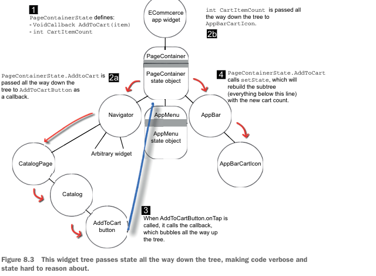

**Hình 8.3 – Cây widget này truyền state xuống tận đáy cây, khiến code dài dòng và state khó suy luận.**

Mô tả hình (các chữ trong hình đã được dịch): Cây gồm gốc là **ECommcerce app widget** (widget ứng dụng thương mại điện tử) → **PageContainer** cùng **PageContainer state object**. Bên dưới PageContainer có ba nhánh: **Navigator**, **AppMenu** (kèm **AppMenu state object**) và **AppBar**. Dưới Navigator là **CatalogPage** và một **Arbitrary widget** (widget bất kỳ); dưới CatalogPage là **Catalog**, dưới Catalog là **AddToCart button** (nút "Thêm vào giỏ"). Dưới AppBar là **AppBarCartIcon** (biểu tượng giỏ hàng trên thanh app bar). Các chú thích đánh số:

- **1** – `PageContainerState` định nghĩa: `VoidCallback AddToCart(item)` và `int CartItemCount`.
- **2a** – `PageContainerState.AddtoCart` được truyền xuống tận đáy cây tới `AddToCartButton` dưới dạng một callback (mũi tên đỏ đi Navigator → CatalogPage → Catalog → AddToCart button).
- **2b** – `int CartItemCount` được truyền xuống tận đáy cây tới `AppBarCartIcon`.
- **3** – Khi `AddToCartButton.onTap` được gọi, nó gọi callback, và callback này "nổi bọt" (*bubbles*) ngược lên tận đỉnh cây (đường kẻ xanh).
- **4** – `PageContainerState.AddToCart` gọi `setState`, việc này sẽ dựng lại cả cây con (mọi thứ bên dưới vạch này) với số lượng giỏ hàng mới.

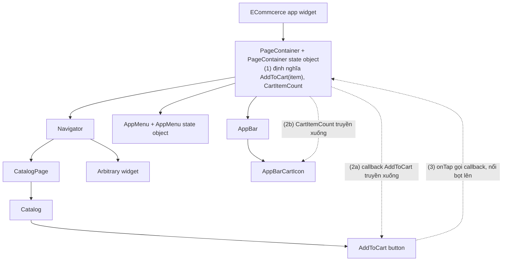

Các mảnh ảnh trích từ trang PDF của hình 8.3 (các nút của sơ đồ cây, giữ lại cho đầy đủ):

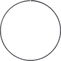 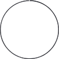 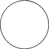 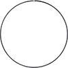 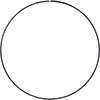 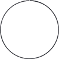 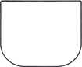 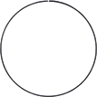 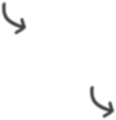 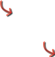 

Quan trọng hơn, nó khiến việc phát triển khổ sở hơn mức cần thiết. Nếu bạn có một cây trông như hình 8.3, và bạn quyết định muốn `AppBarCartIcon` là con của `CartPage` hơn, bạn sẽ phải xóa toàn bộ code truyền thuộc tính xuống biểu tượng đó, rồi thêm toàn bộ code để truyền thông tin đó xuống qua `Navigator` và tới trang giỏ hàng (hình 8.4).

May mắn thay, Flutter cho chúng ta một cách tốt hơn: `InheritedWidget`. Nhiều khả năng bạn đã gặp inherited widget rồi: `Theme`, `MediaQuery` và `Scaffold` đều là inherited. Những widget này đặc biệt, vì **bất kỳ widget nào trong cây con** của inherited widget đều có thể truy cập inherited widget đó. Bạn không cần truyền thuộc tính từ widget này sang widget khác, vì bạn có thể lấy thuộc tính trực tiếp từ `InheritedWidget`. Nhờ vậy, nếu muốn di chuyển widget đi chỗ khác trong cây lúc phát triển, bạn không cần sửa code của bất kỳ widget nào khác. Bạn cứ việc di chuyển nó.

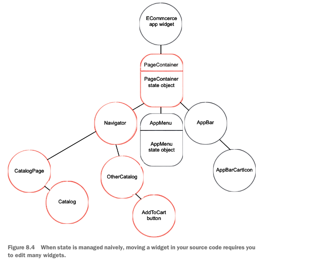

**Hình 8.4 – Khi state được quản lý một cách ngây thơ, việc di chuyển một widget trong mã nguồn đòi hỏi bạn phải sửa nhiều widget.**

Mô tả hình: Cây tương tự hình 8.3: **ECommcerce app widget** → **PageContainer / PageContainer state object** → **Navigator**, **AppMenu / AppMenu state object**, **AppBar** → **AppBarCartIcon**. Dưới Navigator giờ có **CatalogPage** (→ **Catalog**) và **OtherCatalog** (→ **AddToCart button**). Các nút được viền **đỏ** (PageContainer, Navigator, CatalogPage, Catalog, OtherCatalog, AddToCart button) là những widget phải sửa code chỉ vì một widget bị dời chỗ – minh họa cái giá của việc truyền state "bằng tay".

Các mảnh ảnh trích từ trang PDF của hình 8.4 (giữ lại cho đầy đủ):

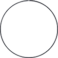 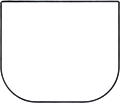 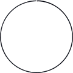 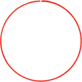 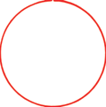 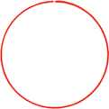 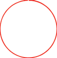 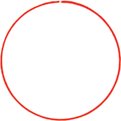 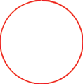  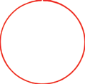 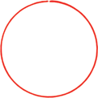 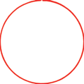 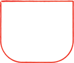 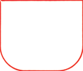 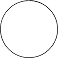

> 💡 **Ví dụ bổ sung (không có trong sách):** "Lifting state up" ở dạng thô nhất trông như sau – chú ý `count` và `onAdd` phải được truyền qua **mọi** tầng trung gian, kể cả những tầng không hề dùng tới chúng:
>
> ```dart
> class PageContainer extends StatefulWidget {
>   @override
>   _PageContainerState createState() => _PageContainerState();
> }
>
> class _PageContainerState extends State<PageContainer> {
>   int cartItemCount = 0;
>   void addToCart() => setState(() => cartItemCount++);
>
>   @override
>   Widget build(BuildContext context) => Column(children: [
>         MyAppBar(count: cartItemCount),          // tầng trung gian 1
>         CatalogPage(onAdd: addToCart),           // tầng trung gian 1
>       ]);
> }
>
> class CatalogPage extends StatelessWidget {
>   final VoidCallback onAdd;                      // không dùng, chỉ chuyển tiếp
>   CatalogPage({this.onAdd});
>   @override
>   Widget build(BuildContext context) => Catalog(onAdd: onAdd);
> }
>
> class Catalog extends StatelessWidget {
>   final VoidCallback onAdd;                      // lại chuyển tiếp
>   Catalog({this.onAdd});
>   @override
>   Widget build(BuildContext context) =>
>       RaisedButton(onPressed: onAdd, child: Text('Add to cart'));
> }
> ```
>
> Mỗi lần dời `RaisedButton` sang chỗ khác, bạn lại phải sửa chữ ký (constructor) của cả chuỗi `CatalogPage`, `Catalog`, ... Đây chính là "nỗi đau" mà hình 8.4 mô tả, và `InheritedWidget` sinh ra để giải quyết.

### 8.2.1 Tạo một kho trung tâm bằng bộ đôi InheritedWidget/StatefulWidget (Creating a Central Store wth an InheritedWidget/StatefulWidget team)

Phần code khuôn mẫu để dùng inherited widget làm công cụ quản lý state có thể khá dài dòng. Nếu xem tài liệu của lớp `InheritedWidget`, bạn sẽ thấy nó là loại widget thứ ba, và quan trọng là nó **không** phải phần mở rộng của lớp stateful widget. Theo tài liệu, widget này là một "lớp cơ sở cho các widget lan truyền thông tin xuống cây một cách hiệu quả" (*base class for widgets that efficiently propagate information down the tree*).¹

Điểm mấu chốt là inherited widget được thiết kế để **gửi** thông tin đi, chứ không phải để **được gửi** thông tin tới. Điều đó có nghĩa là bạn phải kết hợp một stateful widget với một inherited widget thì mới khiến nó hoạt động như một kho lưu trữ trung tâm (*central storage*). Trong code, hãy bắt đầu bằng cách xem file `lib/main.dart`, nơi `runApp` được gọi:

```dart
// e_commerce/lib/main.dart -- line ~36
runApp(
  AppStateContainer( // (1)
    blocProvider: blocProvider,
    child: ECommerceApp(),
  ),
);
```

Chú thích:

1. Lớp này, `AppStateContainer`, là một `StatefulWidget`. Phương thức `State.build` của nó trả về một `InheritedWidget`.

Nếu bạn thấy bối rối với đoạn code mẫu và lời giải thích tương ứng ở trên, bạn không hề đơn độc. Nó hơi lắt léo. Nhưng "mánh" của toàn bộ chuyện này nằm ở lớp `AppState`. Một phần lớn code bắt buộc phải viết thêm nằm trong phương thức `AppStateContainer.of`, phương thức này cung cấp cho phần còn lại của ứng dụng một cách để tương tác với lớp `AppState`.

> ¹ *Chú thích chân trang:* Tài liệu có tại https://docs.flutter.dev/flutter/widgets/InheritedWidget-class.html.

> 📝 **Giải thích thêm (không có trong sách):** Tại sao phải "ghép đôi"? Vì `InheritedWidget` là bất biến – bạn không thể gọi `setState` trên nó. Cách làm là để một `StatefulWidget` (ở đây là `AppStateContainer` + `AppState`) giữ dữ liệu thay đổi được; mỗi khi dữ liệu đổi, `AppState` gọi `setState`, hàm `build` của nó tạo ra **một** inherited widget **mới** (`_AppStoreContainer`) chứa dữ liệu mới. Flutter so sánh inherited widget mới với cái cũ (qua `updateShouldNotify`) để quyết định có báo cho các widget con phụ thuộc vào nó hay không. Tóm lại: StatefulWidget lo phần "thay đổi", InheritedWidget lo phần "phân phát xuống cây".

### 8.2.2 Phương thức inheritFromWidgetOfExactType và of (The inheritFromWidgetOfExactType and of methods)

Nếu muốn lấy thông tin từ một inherited widget ở phía dưới cây widget, nhiều khả năng bạn sẽ cung cấp một tham chiếu tới inherited widget đó thông qua một phương thức tên là `of`. Phương thức này tìm ngược lên cây và tìm inherited widget **cha gần nhất** thuộc kiểu đó. Ví dụ, khi bạn gọi `Theme.of(BuildContext).primaryColor`, Flutter đang tìm ngược lên cây để lấy widget `Theme` gần nhất, như trong hình 8.5, và lấy thuộc tính `primaryColor` từ nó.

Phương thức `of` là một **quy ước** của Flutter, không phải thứ bạn có sẵn ngay. Phần lớn các phương thức `of` được định nghĩa ngay trên chính các inherited widget, và chúng thường quay sang gọi `BuildContext.inheritFromWidgetOfExactType` với `BuildContext` mà bạn cung cấp. `inheritFromWidgetOfExactType` mới là phương thức thực sự tìm ngược lên cây, và nó dựa vào `BuildContext` để truy cập cây và xem xét các tổ tiên.

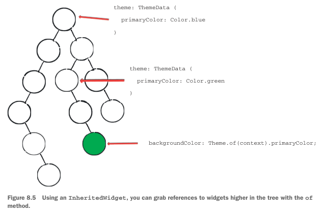

**Hình 8.5 – Dùng một `InheritedWidget`, bạn có thể lấy tham chiếu tới các widget ở cao hơn trong cây bằng phương thức `of`.**

Mô tả hình: Một cây gồm nhiều vòng tròn. Ở nút gốc có chú thích `theme: ThemeData ( primaryColor: Color.blue )`. Ở một nút tầng giữa (nhánh bên phải) có chú thích `theme: ThemeData ( primaryColor: Color.green )`. Ở một nút lá được tô **xanh lá** nằm dưới nút tầng giữa đó có chú thích `backgroundColor: Theme.of(context).primaryColor;`. Ý nghĩa: `Theme.of(context)` tìm `Theme` **gần nhất** phía trên, tức `Theme` màu xanh lá, chứ không phải `Theme` màu xanh dương ở gốc – nên nút lá có màu xanh lá.

Các mảnh ảnh trích từ trang PDF của hình 8.5 (giữ lại cho đầy đủ):

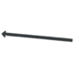 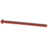 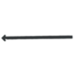 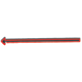 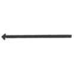 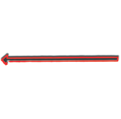

Vì phương thức này là `static`, nó có thể được gọi từ bất kỳ đâu, mà không cần tham chiếu tới một thể hiện (*instance*) nào của lớp. Phương thức `of` thực sự là "bí mật" của inherited widget.

**Listing 8.2 – Phương thức of tự viết**

```dart
// e_commerce/lib/blocs/app_state.dart -- line ~13
class AppStateContainer extends StatefulWidget {
  final Widget child;
  final BlocProvider blocProvider;
  const AppStateContainer({
    Key key,
    @required this.child,
    @required this.blocProvider,
  }) : super(key: key);

  @override
  State<StatefulWidget> createState() => AppState();

  static AppState of(BuildContext context) { // (1)
    return (context.inheritFromWidgetOfExactType(_AppStoreContainer)
        as _AppStoreContainer).appData; // (2)
  }
}
```

Chú thích trong Listing 8.2:

1. Phương thức `of` phải được truyền vào một đối tượng `BuildContext`. Đó là đối tượng duy nhất có thể tự do xem xét cây widget.
2. Lấy tham chiếu tới `InheritedWidget` bạn muốn bằng phương thức `inheritFromWidgetOfExactType`, và trả về thuộc tính `appData` trên widget đó (mà như bạn sẽ thấy, là một `StatefulWidget` – chính xác hơn là đối tượng state của nó).

Phương thức đó có bốn phần quan trọng:

- **`AppState`** – Widget mà bạn muốn truy cập. Trong trường hợp này, nó là một đối tượng state.
- **`BuildContext`** – Bạn không muốn một thể hiện `AppState` **mới**. Bạn muốn đúng cái đã được tạo ra, đang quản lý state, và nằm phía trên một vị trí bất kỳ trong cây widget. Nói cách khác, cái gắn với build context hiện tại.
- **`inheritedWidgetOfExactType`** – Một phương thức trên các thể hiện của `BuildContext`, có thể tìm một inherited widget tổ tiên thuộc kiểu được truyền vào.
- **Câu lệnh `as`** – Ép kiểu (*type casting*) inherited widget về lớp con của nó, để bạn truy cập được các thành viên của inherited widget được trả về. Ở đây, ta muốn trả về `appData`. Quan trọng là: `appData` là một thuộc tính do tôi tự định nghĩa, bạn sẽ thấy ngay sau đây. Nó không phải thứ có sẵn trên mọi cách triển khai `InheritedWidget`.

Với tất cả những điều đó trong đầu, chúng ta có thể xem widget `_AppStoreContainer` – inherited widget được `AppStateContainer.of` lấy ra.

**Listing 8.3 – Xử lý một đối tượng state bằng inherited widget**

```dart
// e_commerce/lib/blocs/app_state.dart -- line ~52
class _AppStoreContainer extends InheritedWidget {
  final AppState appData; // (1)
  final BlocProvider blocProvider;

  _AppStoreContainer({
    Key key,
    @required this.appData, // (2)
    @required child, // (3)
    @required this.blocProvider,
  }) : super(key: key, child: child); // (4)

  @override
  bool updateShouldNotify(_AppStoreContainer oldWidget) // (5)
      => oldWidget.appData != this.appData;
}
```

Chú thích trong Listing 8.3:

1. Thuộc tính `appData` chính là `AppState` (đối tượng state) được tạo bởi `AppState`.
2. Inherited widget này cần một đối tượng `AppState`.
3. Widget này cũng cần một widget con (`child`).
4. `child` có thể được chuyển thẳng lên lớp cha (*superclass*). Bản thân ứng dụng này không cần đụng tới nó.
5. Đây là phương thức duy nhất khác bắt buộc phải có khi tạo một inherited widget. Tôi sẽ nói về nó một chút sau.

Vậy là giờ chúng ta có một phương thức tên `of` trả về tham chiếu tới thuộc tính `InheritedWidget.appData` ở **bất kỳ đâu** trong cây con của widget. Và `InheritedWidget.appData` chỉ đơn giản là một đối tượng state! Điều này có nghĩa là bạn có thể truy cập **cùng một** đối tượng state ở bất kỳ đâu trong ứng dụng. Nếu điều đó không làm bạn phấn khích, thì tôi chẳng biết điều gì sẽ làm được nữa. Đây là một trong những tính năng có sẵn của Flutter mà tôi thích nhất.

Cuối cùng, tôi chỉ muốn xem qua phương thức `AppState.build`.

**Listing 8.4 – Phương thức AppState.build**

```dart
// e_commerce/lib/blocs/app_state.dart -- line ~36
class AppState extends State<AppStateContainer> {
  BlocProvider get blocProvider => widget.blocProvider;

  @override
  Widget build(BuildContext context) {
    return _AppStoreContainer( // (1)
      appData: this, // (2)
      blocProvider: widget.blocProvider,
      child: widget.child, // (3)
    );
  }
}
```

Chú thích trong Listing 8.4:

1. Trả về một thể hiện của inherited widget `_AppStoreContainer`.
2. Truyền chính nó (`this`) vào làm thuộc tính `appData`.
3. Chuyển thẳng `child` của `StatefulWidget` đi kèm sang inherited widget. Hãy nhớ rằng `child` này được truyền vào từ phương thức `runApp`, và nó đại diện cho phần còn lại của cây widget.

Chú thích thứ ba trong đoạn code mẫu trên dẫn tới một điểm thú vị. Widget `child` được truyền vào stateful widget `AppStateContainer`, rồi được chuyển cho đối tượng state `AppState` thông qua `widget.child`, rồi được truyền tiếp qua phương thức `build` vào `_AppStoreContainer`, và chính `_AppStoreContainer` lại chuyển thẳng widget con này lên lớp cha của nó. (Điều này được minh họa trong hình 8.6.) Điều đó có nghĩa là trong toàn bộ phần triển khai quản lý state này, ta **không bao giờ** phải đụng vào widget con. (Tất nhiên là bạn có thể. Hoàn toàn hợp lệ nếu bạn làm cho phương thức `build` của lớp `AppState` phong phú hơn, như với bất kỳ đối tượng state thông thường nào.)

#### Phương thức updateShouldNotify (The updateShouldNotify method)

Xin rẽ ngang một chút, tôi cần nói về phương thức bắt buộc duy nhất trên lớp `InheritedWidget`: `updateShouldNotify`. Khi một inherited widget được dựng lại, có thể nó cần báo cho tất cả các widget phụ thuộc vào dữ liệu của nó rằng chúng cũng phải dựng lại. Phương thức này được gọi sau các lần dựng lại và luôn nhận widget **cũ** làm đối số. Điều này cho bạn cơ hội kiểm tra xem Flutter có nên dựng lại hay không. Ví dụ, nếu widget mới được dựng lại với dữ liệu y hệt, thì chẳng cần bắt Flutter làm công việc tốn kém đó. Đây là một ví dụ:

```dart
// e_commerce/lib/blocs/app_state.dart -- line ~64
bool updateShouldNotify(_AppStoreContainer oldWidget) =>
    oldWidget.appData != this.appData;
```

> 💡 **Ví dụ bổ sung (không có trong sách):** Một inherited widget nhỏ, độc lập, để thấy rõ vai trò của `updateShouldNotify`:
>
> ```dart
> class CartCount extends InheritedWidget {
>   final int count;
>   CartCount({Key key, @required this.count, @required Widget child})
>       : super(key: key, child: child);
>
>   static CartCount of(BuildContext context) =>
>       context.inheritFromWidgetOfExactType(CartCount) as CartCount;
>
>   @override
>   bool updateShouldNotify(CartCount old) => old.count != count;
> }
> ```
>
> Giả sử widget cha build lại 10 lần mỗi giây (vì một animation chẳng hạn) nhưng `count` vẫn là `3`. Mỗi lần như vậy một `CartCount` mới được tạo, nhưng `updateShouldNotify` trả về `false` → các widget con đã gọi `CartCount.of(context)` **không** bị build lại vô ích. Chỉ khi `count` đổi từ `3` lên `4`, hàm trả về `true` và các widget phụ thuộc mới được gọi `didChangeDependencies` rồi build lại.
>
> *(Lưu ý phiên bản: ở các bản Flutter mới hơn, `inheritFromWidgetOfExactType` đã được thay bằng `context.dependOnInheritedWidgetOfExactType<CartCount>()`; ý tưởng hoàn toàn giống nhau.)*

### 8.2.3 Dùng phương thức of để nâng state lên (Use the of method to lift up state)

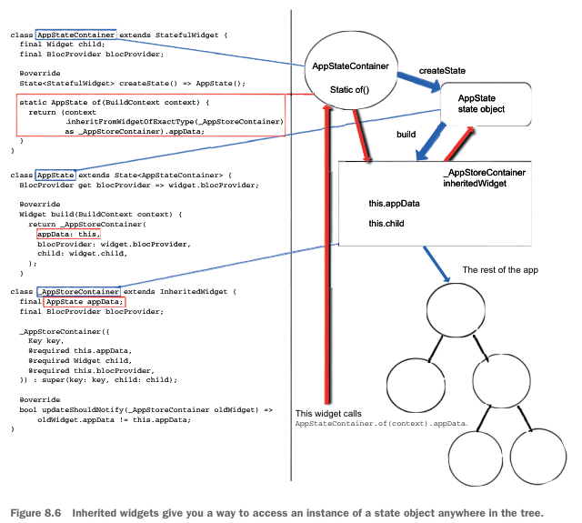

**Hình 8.6 – Inherited widget cho bạn một cách để truy cập một thể hiện của đối tượng state ở bất kỳ đâu trong cây.**

Mô tả hình: Bên trái là code của ba lớp (giống Listing 8.2, 8.3, 8.4): `AppStateContainer extends StatefulWidget` (có `createState() => AppState()` và `static AppState of(BuildContext context)`), `AppState extends State<AppStateContainer>` (hàm `build` trả về `_AppStoreContainer(appData: this, blocProvider: widget.blocProvider, child: widget.child)`), và `_AppStoreContainer extends InheritedWidget` (có `final AppState appData;` và `updateShouldNotify`). Các tên lớp được đóng khung và nối bằng đường kẻ sang sơ đồ bên phải. Bên phải: nút **AppStateContainer** (có **Static of()**) → mũi tên **createState** → **AppState state object** (đối tượng state AppState) → mũi tên **build** → **_AppStoreContainer inheritedWidget**, bên trong chứa **this.appData** và **this.child**. Từ đó có mũi tên xuống **The rest of the app** (phần còn lại của ứng dụng) – một cây con các vòng tròn. Ở dưới cùng có chú thích: **This widget calls `AppStateContainer.of(context).appData`** (widget này gọi `AppStateContainer.of(context).appData`), với mũi tên đỏ đi thẳng lên `Static of()`, rồi từ đó trỏ tới inherited widget và đối tượng `AppState`.

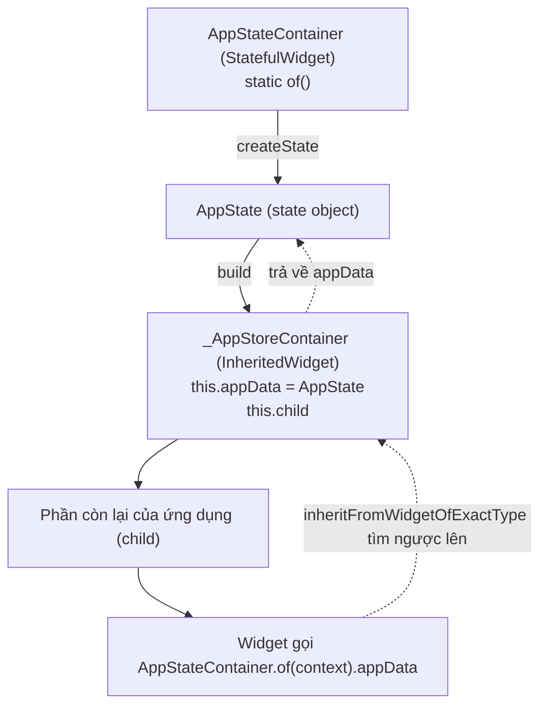

Các mảnh ảnh trích từ trang PDF của hình 8.6 (giữ lại cho đầy đủ):

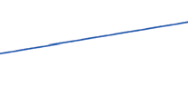 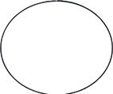       

Theo một nghĩa nào đó, dùng một inherited widget ở đỉnh cây là một kiểu "nâng state lên" gọn gàng hơn. State của bạn vẫn sống trong một widget ở đỉnh cây, nhưng dễ quản lý và dễ suy luận hơn. Với cách này, tất cả các phương thức `setState` của bạn có thể sống trong đối tượng state `AppState`, và bạn có thể gọi chúng bằng `AppState.of(context).callMyMethod()`.

Khi bất kỳ phương thức nào làm thay đổi state của một inherited widget được gọi, nó cần biết liệu thay đổi đó có nên kích hoạt việc dựng lại các widget ở phía dưới cây hay không. Hãy cùng đi qua một ví dụ, bắt đầu từ lớp `AppState`, nơi state thực sự được thay đổi. Trong lớp đó, hãy tìm dòng chú thích ghi "lifting state up region" (vùng nâng state lên). Trong Listing 8.5, bạn sẽ thấy vài thành viên của lớp dùng phương pháp nâng state lên. Ở bất kỳ đâu trong ứng dụng, bạn có thể gọi `AppState.of(context).updateCartCount`, và nó sẽ gọi phương thức `updateCartCount` trong lớp `AppState`.

**Listing 8.5 – Chức năng điều khiển số lượng bằng InheritedWidget**

```dart
// e_commerce/lib/blocs/app_state.dart -- line ~49
class AppState extends State<AppStateContainer> {
  BlocProvider get blocProvider => widget.blocProvider;

  // ... build method and other class members

  // 'LIFTING STATE UP' REGION:
  int cartCount = 0;
  void updateCartCount(int count) {
    setState(() => cartCount += count); // (1)
  }
}
```

Chú thích trong Listing 8.5:

1. Gọi `setState` là quan trọng, vì nó khiến các widget liên quan được dựng lại.

Khi `AppState.setState` được gọi, nó tự dựng lại chính mình. Việc này khiến inherited widget con của nó được dựng lại, và rồi nó gọi `updateShouldNotify` ở bên trong. Nếu hàm đó trả về `true`, thì `didChangeDependencies` được gọi trên các stateful widget phụ thuộc vào inherited widget này, và sau đó chúng cũng sẽ được dựng lại.

Tôi dùng phương thức `updateCartCount` đó trong `AddToCartBottomSheet`. Hãy để ý rằng lớp này đã ghi đè (*override*) `didChangeDependencies`, như trong listing tiếp theo. Điều này quan trọng nếu bạn dùng inherited widget, vì nếu các widget mà `AddToCartBottomSheet` phụ thuộc vào thay đổi vì bất kỳ lý do gì, thì các widget sẽ cần gán lại tham chiếu của chúng tới inherited widget đã được cập nhật.

**Listing 8.6 – Ghi đè phương thức didChangeDependencies**

```dart
// e_commerce/lib/widget/add_to_cart_bottom_sheet.dart -- line ~49
class _AddToCartBottomSheetState extends State<AddToCartBottomSheet> {
  int _quantity;
  AppState state; // (1)

  @override
  void didChangeDependencies() {
    super.didChangeDependencies(); // (2)
    state = AppStateManager.of(context); // (3)
  }

  @override
  Widget build(BuildContext context) {
    return ConstrainedBox(...),
      child: Column(
        children: <Widget>[
          // ...
          RaisedButton(
            color: AppColors.primary[500],
            textColor: Colors.white,
            child: Text(
              "Add To Cart".toUpperCase(),
            ),
            onPressed: () =>
                state.updateCartTotal(_quantity) // (4)
          )
        ],
      ),
    );
}
```

Chú thích trong Listing 8.6:

1. Định nghĩa một thành viên cấp lớp (*class-level member*) tham chiếu tới `AppStateContainer`.
2. Phương thức ghi đè này phải **luôn** gọi `super`.
3. Tham chiếu tới lớp `AppStateContainer` ở thời điểm đầu tiên làm vậy là an toàn. Hãy nhớ rằng phương thức `of` trả về tham chiếu tới `AppStateContainer.appData`, tức là đối tượng state, chứ không phải chính inherited widget.
4. Lời gọi tới chính inherited widget. Sẽ nói thêm về chỗ này ngay sau đây.

> 📝 **Giải thích thêm (không có trong sách):** Code trong listing được chép nguyên văn từ sách, nên có vài chỗ không khớp tên mà bạn nên biết khi đọc mã nguồn thật: sách dùng lẫn `AppStateManager.of` và `AppStateContainer.of` (cùng ý nghĩa: lấy `AppState`), và gọi `state.updateCartTotal` trong khi Listing 8.5 định nghĩa `updateCartCount`. Ngoặc của `ConstrainedBox(...)` cũng là dạng viết tắt minh họa (dấu `...` thay cho các tham số bị lược), không phải code biên dịch được nguyên trạng. Ngoài ra, lý do gọi `of(context)` trong `didChangeDependencies` chứ không phải trong `initState` là: trong `initState`, Flutter chưa cho phép đăng ký phụ thuộc vào inherited widget (sẽ báo lỗi), còn `didChangeDependencies` được gọi ngay sau đó và mỗi khi inherited widget đổi – đúng như bước 4 và 7c ở mục 8.1.2.

Để đơn giản hóa ví dụ code, đây là `RaisedButton` được "nhặt" riêng ra từ ví dụ trên – nút này đang thực hiện lời gọi tới chính widget quản lý state.

**Listing 8.7 – Gọi phương thức từ inherited widget trong bottom sheet**

```dart
// e_commerce/lib/blocs/add_to_cart_bottom_sheet.dart -- line ~75
//...
RaisedButton(
  color: AppColors.primary[500],
  textColor: Colors.white,
  child: Text(
    "Add To Cart".toUpperCase(),
  ),
  onPressed: () => state.updateCartTotal(_quantity) // (1)

//    onPressed: () =>
//        Navigator.of(context).pop(_quantity), // (2)
)
```

Chú thích trong Listing 8.7:

1. Vì thuộc tính `state` của widget là một thể hiện cụ thể của lớp `AppState`, bạn có thể gọi `updateCartTotal`; hãy chắc chắn là bạn đang cập nhật đúng state.
2. Hãy chắc chắn dòng này đang được **comment lại**! Ứng dụng này chuyển qua lại giữa hai kiến trúc quản lý state trong chương này, và một số phương thức sẽ cần được comment hoặc bỏ comment.

Đó là toàn bộ mẫu nâng state lên. Nếu bạn dùng inherited widget làm kho (*store*), thì mọi thay đổi đối với state toàn ứng dụng nên được thực hiện trong lớp `AppState` đó. Điều này giúp bạn ít bị rơi vào những tình huống "dính nhớp" với việc quản lý state hơn (so với chuyện truyền state đi lung tung tùy hứng – *willy-nilly*).

> 💡 **Ví dụ bổ sung (không có trong sách):** Bài toán: thêm nút "Xóa giỏ hàng" ở một trang bất kỳ, sâu tùy ý trong cây. Với kho `AppState`, bạn chỉ cần:
>
> ```dart
> // Trong AppState (vùng 'LIFTING STATE UP'):
> void clearCart() {
>   setState(() => cartCount = 0);
> }
>
> // Ở bất kỳ widget nào bên dưới AppStateContainer:
> FlatButton(
>   child: Text('Clear cart'),
>   onPressed: () => AppStateContainer.of(context).clearCart(),
> )
> ```
>
> Diễn biến: `clearCart` → `setState` → `AppState.build` tạo `_AppStoreContainer` mới → `updateShouldNotify` → các widget đã gọi `AppStateContainer.of(context)` (như biểu tượng giỏ hàng) nhận `didChangeDependencies` và build lại, hiển thị `0`. Không có widget trung gian nào phải sửa.
>
> *(Lưu ý: ở đây `updateShouldNotify` so sánh `oldWidget.appData != this.appData`, nhưng `appData` luôn là **cùng một** đối tượng `AppState`, nên phép so sánh này thực tế trả về `false`. Trong thực hành, các widget con vẫn được vẽ lại chủ yếu vì chúng nằm trong cây con được build lại từ `widget.child`... nếu `child` là cùng instance thì Flutter có thể bỏ qua. Vì vậy, khi tự viết, người ta thường so sánh **giá trị** cụ thể, ví dụ lưu `cartCount` vào inherited widget và so `old.cartCount != cartCount`, để chắc chắn việc thông báo hoạt động đúng.)*

### 8.2.4 Các mẫu quản lý state ngoài Flutter (State management patterns beyond Flutter)

Ở đầu chương, tôi đã bày tỏ nỗi lo âu về các lựa chọn và quan điểm xoay quanh việc quản lý state. Để nói thêm một chút về chuyện đó, tôi muốn bàn về tất cả các lựa chọn trong Flutter.

Điều quan trọng cần lưu ý là Flutter **chỉ là tầng hiển thị** (*rendering layer*) của ứng dụng. (Ý tôi là, nó còn hơn thế nhiều, và nó cho chúng ta rất nhiều thứ, nhưng xét về mặt viết code thì nó là một thư viện UI.) Với suy nghĩ đó, bạn có thể dùng bất kỳ mẫu quản lý state nào bạn muốn. Flutter không quan tâm nó lấy dữ liệu bằng cách nào, nó chỉ quan tâm tới việc vẽ dữ liệu đó lên màn hình.

Có những thư viện tuyệt vời do cộng đồng làm ra (ví dụ: Redux, MobX và ScopedMode – tức ScopedModel).² Tất nhiên, không có lựa chọn nào tốt hơn lựa chọn nào. Và ai cũng có quan điểm. Nhưng đừng nghe những quan điểm đó – hãy dùng những mẫu phù hợp với bạn.

> ² *Chú thích chân trang:* Bạn có thể xem những ví dụ code xuất sắc về các kiểu quản lý state và kiến trúc khác nhau tại http://fluttersamples.com/, một trang web hữu ích của Brian Egan – một người dẫn dắt cộng đồng. Tìm Brian tại: https://github.com/brianegan.

Mới sáng nay thôi, trên Twitter, tôi thấy một tên tuổi lớn trong giới JavaScript tweet điều gì đó về việc *event emitter* (bộ phát sự kiện) tệ hại thế nào. Anh này chắc chắn là người xuất chúng, nhưng tôi lại mê kiến trúc hướng sự kiện (*event-based architecture*). Chúng tôi có quan điểm khác nhau, và như thế thật tuyệt.

Dù vậy, tôi không thể trình bày hết mọi thứ, nên tôi sẽ trình bày cái tôi thích nhất. Nhưng quan trọng hơn, tôi sẽ trình bày cái tôi tin là hữu ích nhất cho việc học các khái niệm tổng quát khi viết ứng dụng Flutter: mẫu **B.L.o.C.** Các thư viện khác, như Redux, rất tuyệt vì chúng trừu tượng hóa rất nhiều logic. Miễn là bạn tuân theo mẫu, nhiều khả năng nó sẽ chạy. Nhưng vì mục đích giảng dạy, tôi không muốn trừu tượng hóa đi nhiều đến thế.

Ở bên dưới, Redux dùng inherited widget và event emitter. Mẫu BLoC thì làm việc **trực tiếp** với những thứ này. Rất khó tiến xa trong lập trình Dart hay Flutter mà không có stream và `InheritedWidget`, nên tôi muốn bạn học xem chúng khớp vào bức tranh tổng thể như thế nào. Rồi khi bạn muốn chuyển sang Redux, mọi thứ sẽ dễ hiểu hơn nhiều vì bạn đã có một nền móng tốt.

> 📝 **Giải thích thêm (không có trong sách):** Có thể so sánh nhanh các hướng tiếp cận được nhắc tới (mang tính định hướng, không phải đánh giá hơn kém):
>
> | Cách tiếp cận | State nằm ở đâu | Cách thông báo thay đổi |
> |---|---|---|
> | Lifting state up thuần | `State` của widget tổ tiên | Truyền callback xuống, `setState` ở trên |
> | InheritedWidget + StatefulWidget | `State` ở đỉnh cây, phát qua InheritedWidget | `setState` + `updateShouldNotify` |
> | BLoC | Các lớp bloc thuần Dart | Stream (widget lắng nghe output stream) |
> | Redux | Một store duy nhất | Action → reducer → state mới, phát xuống qua InheritedWidget |
> | MobX | Các observable | Tự động theo dõi phụ thuộc (reaction) |

---

## 8.3 Bloc: Thành phần logic nghiệp vụ (Blocs: Business Logic Components)

B.L.o.C. là viết tắt của *Business Logic Components* – Thành phần logic nghiệp vụ (từ giờ trở đi ta gọi đơn giản là *bloc*). Mẫu (*pattern*) này lần đầu được công bố tại hội nghị Dart Conference (còn gọi là DartConf) năm 2018, và mục đích của nó là làm cho phần logic nghiệp vụ của giao diện người dùng (UI) có khả năng tái sử dụng cao. Cụ thể tại DartConf, nó được giới thiệu như một cách hay để chia sẻ toàn bộ logic UI giữa Flutter và AngularDart (framework web viết bằng Dart).

Châm ngôn (*mantra*) của mẫu bloc là: các widget nên "ngây ngô" (*dumb* – chỉ biết hiển thị, không tự suy nghĩ hay tính toán) nhất có thể, còn logic nghiệp vụ thì phải sống trong các thành phần tách biệt. Bản thân ý tưởng này tất nhiên không phải điều gì độc nhất vô nhị so với các hướng tiếp cận khác, nhưng "ác quỷ nằm ở chi tiết" (*the devil is in the details* – cái hay và cái khó đều nằm ở những quy định cụ thể). Nhìn chung, các bloc mang bản chất như vậy vì hai lý do chính:

- API công khai (*public API*) của chúng chỉ bao gồm các đầu vào (*input*) và đầu ra (*output*) đơn giản.
- Các bloc phải có khả năng tiêm phụ thuộc (*injectable*), đồng nghĩa với việc độc lập nền tảng (*platform-agnostic*). Điều này có nghĩa là bạn có thể dùng chính các bloc đó cho cả Flutter lẫn web.

Đó tất nhiên là những ý tưởng rộng, nhưng chúng được làm rõ hơn nhờ các quy tắc "bất di bất dịch" (*non-negotiable rules*) sau đây. Những quy tắc này đã được mô tả trong bài nói chuyện gốc tại DartConf 2018 và được chia thành hai nhóm: quy tắc thiết kế ứng dụng (*application design*) và quy tắc giao diện (*UI rules*).

Đối với thiết kế ứng dụng:

1. Đầu vào và đầu ra **chỉ** là các *sink* (đầu nhận sự kiện) và *stream* (luồng dữ liệu)! Không hàm (*function*), không hằng số (*constant*), không biến (*variable*)! Nếu bạn chưa quen với stream, hãy tạm gác câu hỏi lại thêm vài đoạn văn nữa.
2. Các phụ thuộc (*dependencies*) phải có thể tiêm vào được (*injectable*). Nếu bạn đang `import` bất kỳ thư viện Flutter nào vào trong bloc, thì đó là công việc của UI chứ không phải logic nghiệp vụ, và những thứ đó cần được chuyển sang tầng UI.
3. Không được phép rẽ nhánh theo nền tảng (*platform-branching*). Nếu bạn thấy mình đang viết trong bloc kiểu như `if (device == browser)…`, thì bạn cần xem xét lại.
4. Còn lại bạn muốn làm gì tùy ý, miễn là tuân thủ các quy tắc trên.

Đối với chức năng UI:

1. Nhìn chung, các bloc và các trang Flutter cấp cao nhất (*top-level pages*) có mối quan hệ một-một (1:1). Trên thực tế, điểm cốt lõi là mỗi chủ đề state mang tính logic (*logical state subject*) sẽ có một bloc riêng của nó. Ví dụ, trong ứng dụng Farmers Market (Chợ Nông Sản), tôi có một `CartBloc` (bloc giỏ hàng) và một `Catalog` bloc (bloc danh mục sản phẩm).
2. Các thành phần giao diện nên gửi đầu vào ở dạng nguyên bản (*as is*), bởi vì không nên có logic nghiệp vụ nằm trong widget! Nếu bạn cần định dạng văn bản hay tuần tự hóa (*serialize*) một model, việc đó phải được làm ở trong bloc.
3. Các đầu ra phải được truyền tới widget ở trạng thái sẵn sàng sử dụng ngay (*ready to use*). Ví dụ, nếu bạn có một con số cần được chuyển đổi thành chuỗi tiền tệ hiển thị được, việc đó phải được làm ở trong bloc.
4. Mọi sự rẽ nhánh (*branching*) ở giao diện chỉ nên dựa trên logic Boolean đơn giản từ bloc. Bạn nên tự giới hạn ở một stream Boolean duy nhất trong bloc cho mỗi quyết định hiển thị. Ví dụ, trong Flutter, viết `color: bloc.isDestructive ? Colors.red : Colors.blue` là chấp nhận được. Nhưng sẽ bị coi là sai nếu bạn phải dùng các mệnh đề Boolean phức tạp như `if (bloc.buttonIsDestructive && bloc.buttonIsEnabled && bloc.userIsAdmin) { …`. Nếu bạn thấy mình đang làm vậy, nhiều khả năng bạn có thể chuyển phần logic này vào trong bloc.

Tất nhiên, tôi (hay diễn giả tại DartConf) là ai mà lại đi áp đặt những quy tắc cứng nhắc lên cách bạn thiết kế ứng dụng của mình chứ? Các quy tắc này nhằm đảm bảo ứng dụng Flutter của bạn đơn giản và "ngây ngô" nhất có thể, nhưng suy cho cùng chúng cũng chỉ là những lời gợi ý. Với tất cả những thông tin đó, hình 8.7 cho thấy kiến trúc tầng hiển thị (*view layer architecture*) cơ bản của một ứng dụng Flutter sử dụng các bloc trông như thế nào.


**Hình 8.7 – Khi dùng các bloc, các widget ở tầng hiển thị của bạn có thể tham chiếu tới cùng một vài lớp quản lý state xuyên suốt cây widget.**

Mô tả hình: Bên trái là cây widget gồm **PageContainer** (kèm **PageContainer state object**) làm gốc. Bên dưới có 3 nhánh:
- **Navigator** → dẫn tới **CatalogPage** (→ **Catalog** → **AddToCart button**) và **AddProductPage**.
- **AppMenu** (kèm **AppMenu state object**).
- **AppBar** → **AppBarCartIcon**.

Bên phải cây widget là hai khối bloc tách biệt: **CatalogBloc** và **CartBloc**. Các đường kẻ đỏ cho thấy nhiều widget ở các vị trí rất khác nhau trong cây cùng nối trực tiếp tới các bloc này: `AppBarCartIcon` nối tới `CatalogBloc` và `CartBloc`, `AddProductPage` nối tới `CartBloc`, `AddToCart button` nối tới `CartBloc`. Phía ngoài cùng bên phải có hai mũi tên hai chiều màu xanh dương kèm chú thích: *"Blocs can talk to outside sources, such as an MVC backend."* (Các bloc có thể giao tiếp với các nguồn bên ngoài, chẳng hạn một backend MVC).


Các mảnh ảnh trích từ trang PDF của hình 8.7 (các nút rời của sơ đồ, giữ lại cho đầy đủ):

              

> **NOTE (Ghi chú):** Sơ đồ trong hình 8.7 không biểu diễn cách dữ liệu chảy từ các widget tới các bloc. Nó chỉ cho thấy nhiều widget cùng giao tiếp với một vài bloc đại diện cho một mảnh state hợp lý; trong trường hợp này là bloc giỏ hàng (`CartBloc`) và bloc danh mục (`CatalogBloc`).

Các bloc này đóng vai trò là người trung gian (*middleman*) giữa các dịch vụ (*services*), các hệ thống backend, và thậm chí giữa hai widget với nhau. Nếu bạn đang dùng bloc, sẽ không có nhiều trường hợp bạn cần dùng tới `StatefulWidget`. (Ngoại lệ phổ biến là các widget nằm trong biểu mẫu – *form* – và giữ state cục bộ chưa được gửi đi.)

Ở bất cứ đâu có thể, các widget của bạn nên là những stateless widget "ngây ngô" mà nhiệm vụ duy nhất chỉ là dựng lại khi được bảo. Flutter cung cấp sẵn một giải pháp tích hợp để tránh phải dùng `StatefulWidget` khi làm việc với các bloc, thứ mà chúng ta sẽ tìm hiểu ở một chương sau viết về Flutter bất đồng bộ (*async Flutter*).

> 💡 **Ví dụ bổ sung (không có trong sách):** Để thấy rõ 4 quy tắc UI của BLoC trong thực tế, hãy so sánh cách viết **vi phạm** quy tắc (đặt logic trong Widget) và cách viết **đúng chuẩn BLoC** (đặt logic trong BLoC):
>
> ```dart
> // ❌ VI PHẠM quy tắc UI số 3 & 4: Widget tự định dạng tiền tệ và tự tính toán điều kiện phức tạp
> class PriceTag extends StatelessWidget {
>   final double rawPrice;
>   final double taxRate;
>   final bool isVip;
>   final bool hasCoupon;
>   final bool storeOpen;
>   PriceTag({this.rawPrice, this.taxRate, this.isVip, this.hasCoupon, this.storeOpen});
>
>   @override
>   Widget build(BuildContext context) {
>     // Widget phải tự tính toán và format chuỗi:
>     final total = rawPrice * (1 + taxRate);
>     final formatted = '\$${total.toStringAsFixed(2)}';
>     // Điều kiện boolean phức tạp ngay trên UI:
>     final canDiscount = isVip && hasCoupon && storeOpen;
>     return Text(
>       formatted,
>       style: TextStyle(color: canDiscount ? Colors.green : Colors.black),
>     );
>   }
> }
>
> // ✅ ĐÚNG CHUẨN BLoC: BLoC xuất sẵn chuỗi đã định dạng (`Stream<String>`)
> // và một cờ boolean đơn giản (`Stream<bool>`). Widget hoàn toàn "ngây ngô".
> ```

### 8.3.1 Bloc hoạt động như thế nào? (How do blocs work?)

Nhìn chung, các bloc có hai nhiệm vụ. Chúng phơi bày (*expose*) các stream cho phép các widget cập nhật state (dữ liệu chảy vào), và chúng báo cho các widget biết khi nào có thông tin mới để các widget hiển thị lại (*re-render* – dữ liệu chảy ra).

Hình 8.8 cho thấy cách một người dùng có thể thanh toán (*check out*) trong một ứng dụng thương mại điện tử. Nó cũng cho thấy cách một nguồn bên ngoài có thể cung cấp cho bloc thông tin mới, và bloc sẽ biết cách cập nhật các widget liên quan. Tuy nhiên, điểm quan trọng là: đó là **hai quy trình khác nhau**. Có thể quy trình thứ hai là kết quả của quy trình thứ nhất, nhưng chúng vẫn hoàn toàn tách biệt.

Trong sơ đồ này, hãy bắt đầu ở góc trên bên trái và nói về các bước 1–3:

1. Người dùng có thể chạm vào nút `Submit`, việc này gọi `CartBloc.checkOut`.
2. Phương thức này xử lý bất kỳ logic nghiệp vụ nào nó cần, chẳng hạn tuần tự hóa một số model thành JSON, rồi gọi ra một dịch vụ (*service*).
3. Dịch vụ đó gọi `hypotheticalBackend.submitPayment` (hàm gửi thanh toán trên một backend giả định).


**Hình 8.8 – Cách hai widget có thể tương tác với cùng một bloc để quản lý state.**

Mô tả hình (gồm hai luồng đánh số 1–2–3 riêng biệt):
- **Luồng trên (dữ liệu đi vào bloc):**
  - **1**: *"User clicks a Submit button to buy a product."* (Người dùng bấm nút `submit` trên màn hình điện thoại để mua sản phẩm).
  - **2**: *"Widget calls `CartBloc.checkOut`."* (Widget `AddToCartButton` gọi `checkOut() => _cartBloc.submitOrder;`).
  - **3**: *"`CartBloc` handles logic such as calling out to services and updating internal state."* (`CartBloc` xử lý logic trong `submitOrder() => create new Order object; call BackEnd.submitPayment` rồi gọi ra ngoài).
- **Luồng dưới (dữ liệu từ ngoài chảy qua bloc ra UI):**
  - **1**: *"`CartBloc` gets new information from outside source or any other widget."* (`CartBloc` nhận thông tin mới từ nguồn bên ngoài hoặc widget khác qua `onItemSoldOut() => check if users cart contains item. remove if needed. update cart total quantity.`).
  - **2**: *"`AppBarCartIcon` is rebuilt."* (Widget `AppBarCartIcon` nhận giá trị mới `_quantity = _bloc.cartTotalQuantity` và được dựng lại).
  - **3**: *"User sees updated view."* (Người dùng nhìn thấy giao diện đã cập nhật – huy hiệu số `2` màu đỏ trên góc màn hình điện thoại).


Các mảnh ảnh trích từ trang PDF của hình 8.8 (giữ lại cho đầy đủ):

       

Đó là kết thúc của quy trình thứ nhất. Quy trình bắt đầu ở góc dưới bên phải không được kích hoạt trực tiếp bởi quy trình trước, mà bởi việc backend phản hồi lại thông tin mới – thứ mà bloc này đang lắng nghe:

1. Có thể thông tin trả về cho món hàng này là giao dịch đã thành công. Khi bloc nhận được thông tin đó từ backend, nó sẽ nói: "Tuyệt, tôi sẽ cập nhật một số state nội bộ cho người dùng."
2. Vì ứng dụng được tạo nên từ các widget "ngây ngô" chỉ làm những gì được bảo, chúng đang ngồi chờ được bảo phải dựng lại khi state nội bộ nói trên cập nhật.
3. Các widget dựng lại để hiển thị thông tin mới.

Một lần nữa, hai quy trình đó có liên hệ với nhau vì quy trình sau phụ thuộc vào quy trình đầu, nhưng chúng cũng độc lập với nhau, và quy trình này hoàn toàn có thể xảy ra mà không cần quy trình kia. Đó là nguyên lý cơ bản (*basic tenet*) của các bloc: chúng nhận thông tin hoặc dữ liệu vào, biến đổi/xử lý nó, rồi truyền kết quả về cho bên thích hợp.

### 8.3.2 Triển khai kiến trúc bloc (Implementing the bloc architecture)

Kiến trúc của mẫu bloc không khác nhiều so với ví dụ `InheritedWidget` (như trong Listing 8.3). Điểm khác biệt duy nhất là đối tượng `AppState` được truyền đi thông qua inherited widget giờ đây sẽ phơi bày (*expose*) các bloc cho phần còn lại của các widget. Hãy nói về những việc cần xảy ra để cơ chế này hoạt động:

- Hoàn tác (*revert*) hoặc cập nhật một số đoạn code đã thay đổi cho phần ví dụ `InheritedWidget` trước đó.
- Đưa (*feed*) các bloc vào một inherited widget.
- Kết nối các bloc với bất kỳ API bên ngoài nào mà chúng cần.

Chúng ta sẽ bàn về những gì nằm bên trong các bloc ở mục tiếp theo, nhưng trước hết, hãy đấu nối (*wire up*) toàn bộ hệ thống lại với nhau.

#### APPSTATEMANAGER VÀ BLOCPROVIDER (APPSTATEMANAGER AND BLOCPROVIDER)

Việc đầu tiên bạn phải làm để cơ chế này chạy được là bỏ chú thích (*uncomment*) một số đoạn code! Để ngừng sử dụng các phương thức "nâng state lên" từ mục trước, bạn hãy mở widget `AppBarCartIcon`, đóng chú thích (*comment out*) widget `Text` ở khoảng dòng ~43, và bỏ chú thích phần `StreamBuilder` ngay bên dưới đó. Sau khi làm xong, nó sẽ trông như thế này.

**Listing 8.8 – Các bloc làm việc với stream builder (đầu ra của chúng đều là các stream)**

```dart
// ecommerce/lib/widget/appbar_cart_icon -- line ~41
//child: Text(
//  AppStateContainer.of(context).cartCount.toString(),
//  style: TextStyle(fontSize: 8.0, color: Colors.white),
//  textAlign: TextAlign.center,
//),
child: StreamBuilder( // (1)
  initialData: 0,
  stream: _bloc.cartItemCount,
  builder: (BuildContext context, AsyncSnapshot snapshot) => Text(
    snapshot.data.toString(),
    style: TextStyle(fontSize: 8.0, color: Colors.white),
    textAlign: TextAlign.center,
  ),
),
```

Chú thích trong Listing 8.8:

1. Đừng lo lắng về việc `StreamBuilder` nghĩa là gì ngay lúc này!

Và đồng thời, hãy đổi lại các hàm gọi lại `onPressed` trong `RaisedButton` ở `AddToCartBottomSheet`:

```dart
// ecommerce/lib/widget/add_to_cart_bottomsheet.dart -- line ~75
RaisedButton(
  color: AppColors.primary[500],
  textColor: Colors.white,
  child: Text(
    "Add To Cart".toUpperCase(),
  ),
//  onPressed: () => state.updateCartTotal(_quantity)
  onPressed: () => Navigator.of(context).pop(_quantity),
```

Sau khi hoàn tất hai việc đó, chúng ta có thể nói kỹ hơn về cách các bloc hoạt động.

Giải pháp tôi chọn để làm việc với các bloc có sử dụng lớp `InheritedWidget` mà bạn đã viết trước đó, nhưng cần lưu ý rằng các bloc và các inherited widget chẳng hề quan tâm đến sự tồn tại của nhau. Bạn hoàn toàn có thể dùng các bloc bằng cách truyền thủ công chúng xuống cây widget. (Dù vậy, việc truyền các bloc đi khắp cây là điều có thể làm nhưng không nên làm. Cách dễ nhất vẫn là kết hợp chúng với các `InheritedWidget` đóng vai trò làm bộ cung cấp – *provider*.)

Để bắt đầu, hãy tìm đến file `lib/bloc/app_state.dart` (hoặc `lib/blocs/app_state.dart`). Những đoạn code sau đây trong file này là thứ chúng ta quan tâm lúc này.

**Listing 8.9 – Lớp BlocProvider (giúp code gọn gàng hơn)**

```dart
class BlocProvider {
  CartBloc cartBloc;
  CatalogBloc catalogBloc;
  BlocProvider({@required this.cartBloc, @required this.catalogBloc});
}
```

Lớp này chỉ được dùng thuần túy để giúp việc truyền các bloc đi khắp nơi trở nên dễ dàng và gọn gàng hơn. Nó được định nghĩa ở cuối file, nhưng lại được sử dụng ở đầu file – nơi tôi muốn bắt đầu giải thích chức năng. Hãy nhớ lại rằng đây chính là lớp đã định nghĩa phương thức `of`.

**Listing 8.10 – Stateful widget AppStateContainer**

```dart
class AppStateContainer extends StatefulWidget {
  final Widget child;
  final BlocProvider blocProvider; // (1)
  const AppStateContainer({
    Key key,
    @required this.child,
    @required this.blocProvider, // (2)
  }) : super(key: key);

//...
```

Chú thích trong Listing 8.10:

1. Widget này nhận một đối tượng `BlocProvider` làm đối số trong hàm khởi tạo của nó.
2. Tôi đã đánh dấu đối số này là `@required` (bắt buộc), bởi vì ứng dụng sẽ không thể hoạt động nếu thiếu logic nghiệp vụ.

Tiếp theo, lớp state đi kèm là `AppState` có hai đoạn code liên quan: một getter đơn giản và phương thức `build`.

**Listing 8.11 – Các phần liên quan của lớp AppState**

```dart
class AppState extends State<AppStateManager> {
  BlocProvider get blocProvider => widget.blocProvider; // (1)

  //...

  @override
  Widget build(BuildContext context) {
    return AppStateContainer(
      appData: this, // (2)
      blocProvider: widget.blocProvider, // (3)
      child: widget.child,
    );
  }
}
```

Chú thích trong Listing 8.11:

1. Getter này tham chiếu tới `blocProvider` để các lớp bên ngoài có thể truy cập.
2. Hãy nhớ lại rằng từ khóa `this` là một biến trỏ tới chính thể hiện đối tượng hiện tại này.
3. Truyền các bloc xuyên qua cho inherited widget.

> 📝 **Giải thích thêm (không có trong sách):** Ở Listing 8.11 (chép nguyên văn từ sách), tác giả viết nhầm hai tên lớp so với Listing 8.2–8.4 trước đó: `State<AppStateManager>` thực chất là `State<AppStateContainer>`, và câu lệnh `return AppStateContainer(...)` trong hàm `build` thực chất là `return _AppStoreContainer(...)` (tức trả về lớp con của `InheritedWidget`). Khi đọc đối chiếu với mã nguồn ở mục 8.2.2, bạn sẽ thấy cấu trúc hoàn toàn khớp với Listing 8.4.

Chỉ cần có vậy thôi. Giờ đây các bloc đó sẽ được phơi bày cho toàn bộ ứng dụng.

#### THAM CHIẾU TỚI CÁC BLOC TRONG CÁC WIDGET (REFERENCING THE BLOCS IN WIDGETS)

Việc tham chiếu tới các bloc trong các widget cũng giống hệt như việc tham chiếu tới các thuộc tính khác của `InheritedWidget` ở phần trước của chương này. Tôi sẽ cho bạn xem một ví dụ từ file `lib/widget/appbar_cart_icon.dart`. Đầu tiên, ở ngay đầu phương thức `AppBarCartIcon.build`, tôi lấy một tham chiếu tới `CartBloc`:

```dart
// ecommerce/lib/widget/appbar_cart_icon.dart -- line ~14
CartBloc _bloc = AppStateContainer.of(context).blocProvider.cartBloc;
```

Sau đó, trong cùng file này, hãy kéo xuống khoảng dòng ~49, chỗ `StreamBuilder`.

> **WARNING (Cảnh báo):** Đừng sa lầy vào đoạn code ngắn này. Sẽ có hẳn một chương riêng sắp tới nói về Flutter bất đồng bộ (*async Flutter*), bao gồm cả `StreamBuilder`. Tôi đã chú thích phần quan trọng nhất ở bên dưới.

**Listing 8.12 – Ví dụ về stream builder trong Flutter**

```dart
child: StreamBuilder(
  initialData: 0,
  stream: _bloc.cartItemCount, // (1)
  builder: (BuildContext context, AsyncSnapshot snapshot) => Text(
    snapshot.data.toString(),
    style: TextStyle(fontSize: 8.0, color: Colors.white),
    textAlign: TextAlign.center,
  ),
),
```

Chú thích trong Listing 8.12:

1. Thuộc tính `stream` trỏ tới nguồn thông tin. Trong trường hợp này, nó sống trên bloc của chúng ta, và nó gửi xuống các số nguyên (`int`).

Tại thời điểm này, các bloc đã được đấu nối xong và làm việc cùng với các `InheritedWidget` – thứ phơi bày các bloc cho phần còn lại của ứng dụng. Giờ thì chúng ta có thể triển khai bản thân lớp bloc đó, nhưng chỉ sau khi tìm hiểu qua về *stream* trong Dart.

> 💡 **Ví dụ bổ sung (không có trong sách):** Hãy hình dung đường đi khi một widget cần lấy `CartBloc` thông qua kiến trúc vừa dựng:
>
> ```dart
> // 1. Ở main(): khởi tạo các bloc và truyền vào AppStateContainer
> final cartBloc = CartBloc(cartService);
> final catalogBloc = CatalogBloc(catalogService);
> runApp(
>   AppStateContainer(
>     blocProvider: BlocProvider(cartBloc: cartBloc, catalogBloc: catalogBloc),
>     child: MyApp(),
>   ),
> );
>
> // 2. Ở bất kỳ StatelessWidget nào dưới cây:
> @override
> Widget build(BuildContext context) {
>   final cartBloc = AppStateContainer.of(context).blocProvider.cartBloc;
>   return StreamBuilder<int>(
>     initialData: 0,
>     stream: cartBloc.cartItemCount,
>     builder: (context, snapshot) => Text('Giỏ hàng: ${snapshot.data}'),
>   );
> }
> ```
>
> Nhờ `StreamBuilder`, bản thân widget ngoài cùng vẫn là `StatelessWidget` – mỗi khi `cartBloc.cartItemCount` phát ra số mới, chỉ phần bên trong `builder` của `StreamBuilder` tự động dựng lại!

### 8.3.3 Giới thiệu stream và Dart bất đồng bộ (Intro to streams and async Dart)

Stream (*luồng dữ liệu*) là một phần rất lớn của lập trình Dart. Một stream vừa là một đối tượng cụ thể trong Dart, vừa là một khái niệm lập trình bất đồng bộ (*asynchronous programming concept*). Trong nhiều ngôn ngữ khác, các stream được gọi là *observable* (đối tượng có thể quan sát). Nhìn từ góc độ tổng quan, các stream chỉ đơn giản cung cấp một cách để phát ra (*emit*) các sự kiện và để các lớp khác lắng nghe (*listen*) cũng như phản hồi lại những sự kiện đó.

> **NOTE (Ghi chú):** `Stream` thực chất là một lớp (*class*) cụ thể, và chỉ là một mảnh ghép trong mẫu thiết kế observable (*observable pattern*). Tuy nhiên, nhìn chung, từ *stream* thường được dùng để chỉ toàn bộ khái niệm này nói chung.

Từ *stream* (dòng suối / luồng chảy) rất hợp với lớp này, bởi vì một stream phát ra các giá trị mới lặp đi lặp lại, thường xuyên và kéo dài bao lâu tùy theo nhu cầu của nó. Thông tin được phát ra bởi một `StreamController` (bộ điều khiển luồng) rồi chảy "xuôi theo dòng stream" (*down the stream*). Ở một nơi khác trong ứng dụng, các đối tượng có thể "lắng nghe" (*listen*) dòng stream đó và bắt lấy các giá trị đang trôi xuống. Sẽ rất hữu ích nếu bạn hình dung cơ chế stream như một tập hợp gồm ba mảnh ghép, mà mỗi mảnh đều có một nhiệm vụ cụ thể:

- **`StreamController`** là đối tượng mà bạn truyền các giá trị mới vào, rồi nó quay sang phát (*emit*) sự kiện đó đi.

> **NOTE (Ghi chú):** `Sink` là một kiểu con (*subtype*) cụ thể của stream controller – kiểu tiêu chuẩn dùng cho đầu vào. Khi thảo luận về mặt khái niệm, từ *sink* thường được dùng để chỉ đầu nhận của một stream controller.

- **Bản thân `Stream`**, tức tập hợp tất cả các sự kiện mới được phát ra từ bộ điều khiển (*controller*).
- **`Listener` (bộ lắng nghe)**, là đối tượng được thông báo mỗi khi có thông tin mới được phát xuôi theo dòng stream.

Để có một ví dụ bớt trừu tượng hơn, hãy xét ứng dụng Farmers Market của chúng ta. Mỗi lần một món hàng được thêm vào giỏ hàng của người dùng, biểu tượng giỏ hàng cần cập nhật số lượng món hàng mới. Bạn có thể đạt được điều này bằng một stream.

Khi một món hàng được thêm vào giỏ, code của bạn cũng sẽ đưa số lượng đã cập nhật cho `StreamController`. Bộ điều khiển này "thêm con số đó vào một stream", về bản chất nghĩa là nó gửi một thông điệp tới tất cả những ai đang lắng nghe stream đó. Mỗi lần một *listener* nhận được thông báo, nó sẽ gọi một hàm gọi lại (*callback*) do bạn cung cấp. Ví dụ, biểu tượng giỏ hàng gọi một hàm làm thay đổi biến số lượng rồi gọi `setState`, kích hoạt việc hiển thị lại (*re-render*). Tôi không muốn nói dai dòng về khái niệm này, nhưng tôi sẽ đưa thêm một ví dụ hình tượng nữa, bởi vì nó cực kỳ quan trọng cho phần còn lại của chương, mà lại không hề dễ nuốt.

Hãy tưởng tượng một *stream* như một dòng suối nước thật sự ngoài đời. `StreamController`, khi được trao một giá trị mới, sẽ ném giá trị mới đó xuống dòng suối. Giá trị đó sẽ trôi xuôi theo dòng nước, và bất kỳ *listener* nào đang đứng bên bờ lắng nghe dòng suối đó cũng sẽ nhìn thấy giá trị mới trôi qua rồi thực hiện bất kỳ hành động nào bạn muốn với thông tin mới đó.

Thực ra bạn đã từng làm việc với cơ chế giống như stream một lần trong cuốn sách này rồi. Các `RouteObserver` (bộ quan sát định tuyến) trong Flutter hoạt động theo đúng cách của các stream. Khi một route thay đổi, `Navigator` gửi một thông điệp tới tất cả các route observer và nói: "Này, báo cho bạn biết nhé, route vừa thay đổi đấy." Sau đó, route observer sẽ thực hiện hành động thích hợp.

Ý tưởng đơn lẻ quan trọng nhất cần nắm vững với các stream là: **bạn không biết khi nào, hoặc liệu có bao giờ, bạn sẽ nhận được thông tin mới hay không**. Thay vì phải tự tay xác định thời điểm cần cập nhật code để phản hồi một sự kiện, các bộ lắng nghe stream (*stream listeners*) cứ ngồi đó, kiên nhẫn chờ đợi thông tin mới tới.

> 💡 **Ví dụ bổ sung (không có trong sách):** Hình ảnh "dòng suối" của tác giả khi viết thành code Dart thuần túy sẽ trông như sau – gồm đủ 3 mảnh ghép (`StreamController` / `Sink`, `Stream`, và `Listener`):
>
> ```dart
> import 'dart:async';
>
> void main() {
>   // 1. Tạo StreamController (người đứng ở đầu nguồn dòng suối)
>   final controller = StreamController<int>();
>
>   // 2. Lấy ra Stream (dòng nước) và đăng ký Listener (người đứng ở hạ nguồn chờ đón)
>   controller.stream.listen((int count) {
>     print('Listener nhận được số lượng mới: $count');
>   });
>
>   // 3. Đưa dữ liệu vào qua Sink (thả giá trị xuống dòng suối)
>   controller.sink.add(1);
>   controller.sink.add(2);
>   controller.sink.add(5);
>
>   // Đóng luồng khi không dùng nữa để giải phóng tài nguyên
>   controller.close();
> }
> ```

### 8.3.4 Triển khai stream trong CartBloc (Implementing streams in the CartBloc)

Đó là cách các stream hoạt động về mặt khái niệm, nhưng việc bắt tay vào triển khai chúng tất nhiên là một chuyện khác. Ngay lúc đang viết những dòng này, tôi chợt nhận ra rằng các bloc chính là ví dụ hoàn hảo để dạy về stream, bởi vì toàn bộ logic của stream đều nằm cạnh nhau ngay trong một lớp duy nhất. Trong phần còn lại của chương này, bạn sẽ triển khai lớp `CartBloc` và tôi sẽ giải thích code của các stream dọc đường đi.

Nền tảng của mọi bloc là các đầu vào (*inputs*) và đầu ra (*outputs*). Như tôi đã đề cập trước đó, bản chất của các bloc xoay quanh việc nhận vào một số dữ liệu, xử lý hoặc biến đổi dữ liệu đó ngay bên trong bản thân bloc, rồi xuất dữ liệu ra ngoài nếu cần. Các đầu vào về cơ bản là bất cứ điều gì chúng ta muốn **"bảo"** (*tell*) bloc làm, còn các đầu ra về cơ bản là bất cứ điều gì chúng ta muốn **"hỏi"** (*ask*) bloc.

API đầu vào/đầu ra cho `CartBloc` sẽ rất đơn giản. Nó sẽ trông như sau:

- **Đầu vào (*Inputs*)**
  - Thêm một món hàng vào giỏ hàng (*Add an item to the cart*)
  - Xóa một món hàng khỏi giỏ hàng (*Remove an item from the cart*)
- **Đầu ra (*Outputs*)**
  - Lấy toàn bộ các món hàng trong giỏ (*Get all items in cart*)
  - Lấy tổng số lượng món hàng trong giỏ (*Get number of items in the cart*)

#### THÊM MỘT MÓN HÀNG VÀO GIỎ HÀNG (ADD AN ITEM TO THE CART)

Để thêm một món hàng vào giỏ hàng từ các widget trong ứng dụng, tốt nhất là bạn hãy làm cho thao tác đó càng đơn giản và "ngây ngô" càng tốt dưới góc nhìn của widget. Lý tưởng nhất, bạn có thể thêm một món hàng vào giỏ bằng cách gọi:

```dart
CartBloc.addProductSink.add(Product item, int qty)
```

Đi theo mô hình đó (và tôi đang làm đúng như vậy), đây là các bước bạn cần thực hiện để triển khai chức năng này trong bloc:

1. Triển khai `CartBloc.addProductSink`. Một *sink* là một kiểu của `StreamController`. Gọi phương thức `add` trên một sink sẽ khiến nó phát (*stream*) bất kỳ dữ liệu nào vừa được thêm vào đó.
2. Lắng nghe (*listen*) stream từ `addProductSink`.
3. Khi stream nhận được thông báo, gọi dịch vụ (*service*) thực hiện việc thêm món hàng vào giỏ hàng của người dùng trong cơ sở dữ liệu.

Đó là toàn bộ quy trình xử lý đầu vào (*input process*). Hãy nhớ rằng, đầu vào và đầu ra là tách biệt nhau. Có thể lời gọi dịch vụ sẽ làm cập nhật một đầu ra nào đó, nhưng bản thân đầu vào không bận tâm tới chuyện đó. Việc triển khai đầu vào được thực hiện trong file `lib/blocs/cart_bloc.dart`, tuân theo ba bước sau:

1. Định nghĩa một `StreamController`:

```dart
// ecommerce/lib/blocs/cart_bloc.dart
class CartBloc {
  //...
  StreamController<AddToCartEvent> addProductSink = // (1)
      StreamController<AddToCartEvent>();
```

Chú thích cho bước 1:

- `(1)` Khi định nghĩa một stream controller, hãy nhớ chỉ định kiểu dữ liệu cụ thể (*subtype*) cho nó (`StreamController<AddToCartEvent>`). Ngoài ra, đây là một đầu vào (*input*), nên nó cần được phơi bày công khai (*publicly exposed*).

2. Lắng nghe stream:

```dart
  CartBloc(this._service) {
    addProductSink.stream.listen( // (1)
      (_handleAddItemsToCart)
    );
  }
```

Chú thích cho bước 2:

- `(1)` `StreamController.stream` là một đối tượng stream – tức là đối tượng mà các đối tượng khác có thể lắng nghe được. Phương thức `listen` trên stream nhận một hàm gọi lại (*callback*), và hàm đó sẽ được gọi mỗi khi có một giá trị mới được truyền vào stream controller.

3. Viết phương thức `_handleAddItemsToCart`:

```dart
  void _handleAddItemsToCart(AddToCartEvent e) { // (1)
    _service.addToCart(e.product, e.qty);
  }
```

Chú thích cho bước 3:

- `(1)` Trong phạm vi mục đích của chúng ta ở đây, thực sự không có logic nghiệp vụ nào phức tạp, nhưng nếu có thì đây chính là nơi xử lý nó. Ví dụ, nếu bạn muốn tuần tự hóa (*serialize*) một đối tượng sang JSON trước khi gửi đi.

Cuối cùng, để thực sự đẩy một sản phẩm vào stream đó, hãy xem trong file `lib/widget/catalog.dart`, tại phương thức có tên `_addToCart`:

```dart
// ecommerce/lib/widget/catalog.dart -- line ~43
void _addToCart(Product product, int quantity, CartBloc _bloc) {
  _bloc.addProductSink.add( // (1)
    AddToCartEvent(product, quantity), // (2)
  );
}
```

Chú thích cho đoạn code gọi từ widget:

- `(1)` `StreamController.add` là phương thức bạn dùng để thêm một sự kiện mới vào một stream, từ đó stream sẽ phát (*emit*) giá trị mới này tới các bộ lắng nghe (*listeners*) của nó.
- `(2)` `AddToCartEvent` là một lớp nhỏ do tôi tự tạo để mang lại tính an toàn kiểu (*type-safety*) cho các sink và giúp đơn giản hóa code (gom cả `product` và `quantity` vào một đối tượng sự kiện duy nhất).

Đó là toàn bộ quy trình. Nhìn chung, mọi stream trong Dart đều hoạt động theo cách đó (cùng với một số biến thể mà chúng ta sẽ tìm hiểu ở chương nói về Flutter bất đồng bộ).

Tôi muốn dừng lại ở đây một chút để nói rằng các *observable* và *stream* thực sự rất khó hình dung trọn vẹn nếu bạn chưa quen làm việc với chúng. Nếu bạn chưa hiểu thấu ngay trong lần đọc đầu tiên, đừng buồn hay nản chí. Hãy đi chợp mắt một giấc, ăn vài miếng pizza, rồi quay lại và thử đọc lại lần nữa.

#### XÓA MỘT MÓN HÀNG KHỎI GIỎ HÀNG / TRIỂN KHAI ĐẦU RA (REMOVE AN ITEM FROM THE CART)

> 📝 **Giải thích thêm (không có trong sách):** Trong sách gốc, tiêu đề phụ ở đây được in là *"REMOVE AN ITEM FROM THE CART"*, nhưng nội dung ngay bên dưới thực chất chuyển sang giải thích về **mặt bên kia của bloc: các đầu ra (*outputs*)** thông qua ví dụ đếm số lượng món hàng trong giỏ (`cartItemCount`). Chúng tôi giữ nguyên tiêu đề gốc của sách và ghi chú rõ để bạn khỏi bỡ ngỡ.

Mặt bên kia của các bloc là các **đầu ra** (*outputs*). Các đầu ra đều là những stream, nên cách thiết lập cũng tương tự. Một trong các đầu ra của ứng dụng Farmers Market là số lượng món hàng trong giỏ (*cart item quantity*). Tôi sẽ dùng nó làm ví dụ.

Các sự kiện đầu ra thường được khởi phát từ một nguồn bên ngoài, chẳng hạn như một API. Đầu ra mà chúng ta đang làm việc phụ thuộc vào một sự kiện diễn ra trong ứng dụng (người dùng thêm hoặc xóa một món hàng khỏi giỏ của họ), nhưng dữ liệu đó lại đến từ phía backend của chúng ta. (Tôi đã tạo một backend giả lập – *mock backend* – bắt chước dịch vụ Firestore của Firebase. Firestore hoạt động theo thời gian thực – *real-time* – và có tính phản ứng – *reactive*, nên bạn có thể bảo nó thông báo cho bạn bất cứ khi nào một giá trị mà bạn quan tâm được cập nhật.) Trong ứng dụng Farmers Market, tôi đã yêu cầu Firestore giả lập thông báo cho tôi mỗi khi số lượng món hàng trong giỏ thay đổi. Sự kiện đầu ra là kết quả của thông báo đó, chứ không phải được kích hoạt trực tiếp ngay trong code phía client.

Sau khi đã giải thích rõ bối cảnh đó, tôi sẽ chỉ cho bạn cách triển khai một đầu ra. Toàn bộ phần code này nằm trong file `lib/bloc/cart_bloc.dart` (hoặc `lib/blocs/cart_bloc.dart`).

1. Khởi tạo các đối tượng bạn cần:

```dart
// e_commerce/lib/bloc/cart_bloc.dart -- line 26
StreamController _cartItemCountStreamController =
    BehaviorSubject<int>(seedValue: 0); // (1)

Stream<int> get cartItemCount => // (2)
    _cartItemCountStreamController.stream;
```

Chú thích cho bước 1:

- `(1)` `BehaviorSubject` là một loại `StreamController` "xịn" hơn (đến từ thư viện `rxdart`), cung cấp cho bạn thêm một số tính năng bổ sung: quan trọng nhất là một giá trị mồi khởi tạo (*seed value*). Ngay khi ứng dụng vừa khởi chạy, nếu chưa có bất kỳ dữ liệu nào trong Firestore, hoặc nếu dữ liệu chỉ đơn giản là chưa tải xong, nó sẽ lập tức phát giá trị mồi (`0`) ra ngoài ngay.
- `(2)` Stream này (`cartItemCount`) là stream công khai hướng ra bên ngoài (*public-facing stream*) mà giao diện UI của bạn sẽ lắng nghe để lấy thông tin từ đó.

2. Thêm dữ liệu vào stream controller từ một nguồn bên ngoài. Tôi thiết lập việc này ngay trong hàm khởi tạo (*constructor*) của lớp `CartBloc`:

```dart
// e_commerce/lib/bloc/cart_bloc.dart -- line 30
CartBloc(this._service) {
  //...
  _service
      .streamCartCount()
      .listen((int count) => // (1)
          _cartItemCountStreamController.add(count));
```

Chú thích cho bước 2:

- `(1)` Bất cứ khi nào bạn nhận được một giá trị mới từ cơ sở dữ liệu thời gian thực, hãy thêm giá trị đó vào `_cartItemCountStreamController`.

> **NOTE (Ghi chú):** `_service.streamCartCount` là một phương thức nằm trên một dịch vụ bên ngoài (*external service*). Bản thân nó cũng được triển khai bằng stream, nhưng nó không liên quan gì tới khái niệm bloc cả, nên bạn đừng để bị nhầm lẫn bởi nó. Bản triển khai Firestore cho Flutter sử dụng stream bởi vì nó hoạt động theo thời gian thực (*real-time*). Nó hoàn toàn có thể chỉ đơn giản là một phương thức thông thường được gọi mỗi khi bạn nhận được phản hồi thành công sau khi gọi một REST API.

#### HOÀN THIỆN CÁC BLOC (COMPLETE THE BLOCS)

Về mặt kỹ thuật, những gì vừa trình bày chỉ là một phần nhỏ trong toàn bộ chức năng bloc của ứng dụng này, nhưng tất cả các phần chức năng còn lại cũng chỉ là việc lặp lại đúng các bước trên. Việc thiết lập các bloc có thể được tóm gọn thành ba khía cạnh: dựng khung kiến trúc (*the architecture*), triển khai các đầu vào (*implementing inputs*), và triển khai các đầu ra (*implementing outputs*).

Với tinh thần đó, tôi khuyến khích bạn tự tìm hiểu các chức năng bloc còn lại trong ứng dụng này để luyện tập thêm. Đây là những chức năng chưa được trình bày chi tiết trong chương này (nhưng sử dụng hoàn toàn cùng các khái niệm đó):

- **Cart bloc (`CartBloc`)**
  - Đầu vào xóa sản phẩm khỏi giỏ hàng (*Remove from cart input*)
  - Đầu ra danh sách các món hàng trong giỏ (*Cart items output*)
- **Catalog bloc (`CatalogBloc`)**
  - Đầu vào thêm sản phẩm mới (*Add new product input*)
  - Đầu vào cập nhật sản phẩm hiện có (*Update existing product input*)
  - Đầu ra tất cả sản phẩm (*All products output*)
  - Đầu ra các sản phẩm theo từng danh mục (*Products by category output*)

`CatalogBloc` ở thời điểm này khá thú vị. Đầu ra "các sản phẩm theo từng danh mục" (*products by category output*) hơi lắt léo vì nó thực chất là một **danh sách các stream** (*a list of streams*). Nếu đây là lần đầu tiên bạn làm việc với stream, phần đó có thể sẽ hơi "khoai", nhưng tôi sẽ trình bày chi tiết hơn về nó ở chương viết về lập trình bất đồng bộ (ngay chương tiếp theo).

> 💡 **Ví dụ bổ sung (không có trong sách):** Để ghép nối toàn bộ các mảnh rời rạc ở mục 8.3.4 thành một bức tranh hoàn chỉnh, dưới đây là một lớp `CartBloc` thu gọn nhưng đầy đủ cả **Input (`Sink`)** lẫn **Output (`Stream`)** và một phương thức `dispose()` để đóng các `StreamController` đúng chuẩn:
>
> ```dart
> import 'dart:async';
>
> // Lớp sự kiện đóng gói dữ liệu đầu vào (đảm bảo type-safety cho Sink)
> class AddToCartEvent {
>   final String productName;
>   final int qty;
>   AddToCartEvent(this.productName, this.qty);
> }
>
> class CartBloc {
>   int _totalCount = 0;
>
>   // 1. INPUT: StreamController nhận sự kiện thêm sản phẩm từ Widget
>   final StreamController<AddToCartEvent> addProductSink =
>       StreamController<AddToCartEvent>();
>
>   // 2. OUTPUT: StreamController (ẩn, private) + getter Stream (công khai) phát tổng số lượng ra Widget
>   final StreamController<int> _cartItemCountController =
>       StreamController<int>.broadcast();
>   Stream<int> get cartItemCount => _cartItemCountController.stream;
>
>   CartBloc() {
>     // Lắng nghe đầu vào, xử lý logic nghiệp vụ, rồi đẩy kết quả sang đầu ra
>     addProductSink.stream.listen(_handleAddItemsToCart);
>   }
>
>   void _handleAddItemsToCart(AddToCartEvent event) {
>     _totalCount += event.qty;
>     // Phát giá trị tổng mới ra Output Stream cho các StreamBuilder lắng nghe
>     _cartItemCountController.add(_totalCount);
>   }
>
>   void dispose() {
>     addProductSink.close();
>     _cartItemCountController.close();
>   }
> }
> ```

---

## Tóm tắt (Summary)

- Vòng đời của một stateful widget (*stateful widget lifecycle*) cho phép kiểm soát chi tiết (*fine-grain control*) việc dựng lại các widget trong Flutter thông qua các phương thức:
  - `initState`
  - `didChangeDependencies`
  - `build`
  - `widgetDidUpdate` (tức `didUpdateWidget`)
  - `setState`
  - `dispose`
- Các đối tượng `State` có vòng đời dài (*long-lived*) và thậm chí có thể được tái sử dụng (*reused*).
- Chỉ với các stateful widget, bạn đã có thể triển khai một mẫu quản lý state gọi là "nâng state lên" (*lifting state up*).
- Các `InheritedWidget` là những widget đặc biệt được tối ưu hóa để truyền dữ liệu xuống dọc theo cây widget. Bạn có thể truy cập `InheritedWidget` ở bất kỳ đâu trong cây con của nó bằng một phương thức `of` gọi tới `inheritFromWidgetOfExactType`.
- Kết hợp một `InheritedWidget` và một `StatefulWidget` mang lại cho bạn một cách gọn gàng hơn để nâng state lên.
- Mẫu bloc (*BLoC pattern*) là một mẫu quản lý state khuyến khích thiết kế API đơn giản và các thành phần logic nghiệp vụ có thể tái sử dụng.
- Đầu vào (*inputs*) và đầu ra (*outputs*) của các bloc chỉ nên lần lượt là các *sink* và các *stream*.
- Các *stream*, còn được biết đến với tên gọi *observable*, là những công dân hạng nhất (*first-class citizens*) trong ngôn ngữ Dart và được sử dụng cho lập trình bất đồng bộ, hướng phản ứng (*reactive, asynchronous programming*).
- Các stream phát (*emit*) các sự kiện tới các bộ lắng nghe (*listeners*) – những đối tượng luôn kiên nhẫn ngồi chờ bản cập nhật từ các stream.

---

## Bảng thuật ngữ của chương

| Thuật ngữ tiếng Anh | Nghĩa tiếng Việt | Giải thích ngắn |
|---|---|---|
| **State** | Trạng thái | Dữ liệu có thể thay đổi theo thời gian trong vòng đời ứng dụng và quyết định giao diện hiển thị ra sao. |
| **State management** | Quản lý state (trạng thái) | Cách tổ chức, lưu trữ, cập nhật dữ liệu trạng thái và thông báo cho các thành phần giao diện vẽ lại khi dữ liệu đổi. |
| **Widget tree** | Cây widget | Cây cấu trúc gồm các đối tượng `Widget` (các bản thiết kế bất biến) do lập trình viên khai báo. |
| **Element tree** | Cây element | Cây nội bộ do Flutter tạo ra và duy trì để ánh xạ các widget lên màn hình, giữ tham chiếu tới cả `Widget` và đối tượng `State`. |
| **State object** | Đối tượng state | Thể hiện của lớp `State<T>` đi kèm với một `StatefulWidget`, tồn tại lâu dài trong cây element và chứa dữ liệu khả biến (*mutable*). |
| **Mounted** | Đã gắn kết | Trạng thái khi đối tượng `State` đã được gắn với một `BuildContext` (một vị trí cụ thể) trong cây element. |
| **Dirty state / Clean state** | Trạng thái bẩn / Trạng thái sạch | Cách đánh dấu nội bộ của Flutter: *dirty* là cần phải gọi `build()` để vẽ lại ở khung hình tiếp theo; *clean* là vừa được dựng xong và chưa có thay đổi mới. |
| **Lifecycle** | Vòng đời | Trình tự các phương thức (`initState`, `didChangeDependencies`, `build`, `didUpdateWidget`, `setState`, `dispose`) được Flutter gọi trên đối tượng `State`. |
| **Lifting state up** | Nâng state lên | Mẫu thiết kế đưa state lên một widget tổ tiên chung ở trên cao rồi truyền dữ liệu và hàm callback xuống cho các widget con cháu. |
| **`InheritedWidget`** | Widget kế thừa | Loại widget cơ sở thứ ba trong Flutter, cho phép truyền dữ liệu xuống cây hiệu quả để mọi widget con cháu có thể đọc trực tiếp mà không cần truyền qua từng tầng. |
| **`inheritFromWidgetOfExactType`** | Kế thừa từ widget cùng kiểu chính xác | Phương thức trên `BuildContext` tìm ngược lên cây để lấy `InheritedWidget` tổ tiên gần nhất có kiểu chỉ định và đăng ký phụ thuộc vào nó. |
| **`updateShouldNotify`** | Kiểm tra có nên thông báo cập nhật | Phương thức bắt buộc trong `InheritedWidget`, so sánh widget mới với widget cũ để quyết định có gọi `didChangeDependencies` và dựng lại các widget phụ thuộc hay không. |
| **BLoC (Business Logic Component)** | Thành phần logic nghiệp vụ | Mẫu kiến trúc tách rời hoàn toàn logic nghiệp vụ ra khỏi giao diện (Widget), giao tiếp với bên ngoài chỉ qua các *Sink* (đầu vào) và *Stream* (đầu ra). |
| **Stream / Observable** | Luồng dữ liệu / Đối tượng quan sát được | Chuỗi các sự kiện hoặc dữ liệu bất đồng bộ được phát ra theo thời gian mà các đối tượng khác có thể đăng ký lắng nghe. |
| **`StreamController`** | Bộ điều khiển luồng | Đối tượng quản lý một `Stream`, cho phép đẩy dữ liệu mới vào đầu nhận (`sink`) và phát sự kiện ra đầu phát (`stream`). |
| **`Sink`** | Đầu nhận sự kiện | Giao diện đầu vào của một `StreamController`, nơi ta gọi `.add(event)` để đưa dữ liệu mới vào luồng. |
| **Listener** | Bộ lắng nghe | Đối tượng đăng ký qua phương thức `.listen(callback)` trên một `Stream` để nhận thông báo và xử lý mỗi khi có dữ liệu mới chảy qua. |
| **`StreamBuilder`** | Widget dựng giao diện từ Stream | Widget tích hợp sẵn của Flutter tự động lắng nghe một `Stream` và gọi lại hàm `builder` để vẽ lại giao diện mỗi khi stream phát ra giá trị mới. |
| **`BehaviorSubject`** | Chủ thể giữ giá trị gần nhất | Một dạng `StreamController` nâng cao (trong thư viện `rxdart`) hỗ trợ giá trị mồi khởi tạo (*seed value*) và luôn phát lại giá trị mới nhất cho người lắng nghe mới. |
