# Chương 9: Dart bất đồng bộ, Flutter bất đồng bộ và cuộn vô hạn (Async Dart and Flutter and infinite scrolling)

## Mục lục chương

- [Mở đầu chương](#mở-đầu-chương)
- [9.1 Dart bất đồng bộ (Async Dart)](#91-dart-bất-đồng-bộ-async-dart)
  - [9.1.1 Ôn lại Future (Future recap)](#911-ôn-lại-future-future-recap)
  - [9.1.2 Từ khóa async/await (The async/await keywords)](#912-từ-khóa-asyncawait-the-asyncawait-keywords)
  - [9.1.3 Bắt lỗi với Future (Catching errors with futures)](#913-bắt-lỗi-với-future-catching-errors-with-futures)
  - [9.1.4 Bắt lỗi với try và catch (Catching errors with try and catch)](#914-bắt-lỗi-với-try-và-catch-catching-errors-with-try-and-catch)
- [9.2 Sink và Stream (và StreamController)](#92-sink-và-stream-và-streamcontroller-sinks-and-streams-and-streamcontrollers)
  - [9.2.1 Giải phẫu observer pattern với stream của Dart](#921-giải-phẫu-observer-pattern-với-stream-của-dart-anatomy-of-the-observer-pattern-with-dart-streams)
  - [9.2.2 Cài đặt stream (Implementing streams)](#922-cài-đặt-stream-implementing-streams)
  - [9.2.3 Broadcast stream (Broadcasting streams)](#923-broadcast-stream-broadcasting-streams)
  - [9.2.4 Stream bậc cao (Higher-order streams)](#924-stream-bậc-cao-higher-order-streams)
- [9.3 Dùng stream trong bloc (Using streams in blocs)](#93-dùng-stream-trong-bloc-using-streams-in-blocs)
  - [9.3.1 Bloc dùng input và output](#931-bloc-dùng-input-và-output-blocs-use-inputs-and-outputs)
  - [9.3.2 Cài đặt một input cho bloc](#932-cài-đặt-một-input-cho-bloc-implementing-a-bloc-input)
- [9.4 Flutter bất đồng bộ: StreamBuilder](#94-flutter-bất-đồng-bộ-streambuilder-async-flutter-streambuilder)
- [9.5 Widget cuộn vô hạn và tùy biến](#95-widget-cuộn-vô-hạn-và-tùy-biến-infinite-and-custom-scrollable-widgets)
  - [9.5.1 CustomScrollView và sliver](#951-customscrollview-và-sliver-customscrollview-and-slivers)
  - [9.5.2 Scroll view của widget Catalog](#952-scroll-view-của-widget-catalog-catalog-widget-scroll-view)
  - [9.5.3 Widget SliverGrid](#953-widget-slivergrid-the-slivergrid-widget)
  - [9.5.4 Delegate](#954-delegate-delegates)
  - [9.5.5 Sliver tùy biến (Custom slivers)](#955-sliver-tùy-biến-custom-slivers)
- [Tóm tắt (Summary)](#tóm-tắt-summary)
- [Bảng thuật ngữ của chương](#bảng-thuật-ngữ-của-chương)
- [Phần 4: Vượt ra ngoài nền tảng (Beyond foundations)](#phần-4-vượt-ra-ngoài-nền-tảng-beyond-foundations)

---

## Mở đầu chương

Chương này có lẽ chứa những khái niệm khó "nhét vào đầu" nhất của cả cuốn sách — trừ khi bạn đã quen với lập trình giao diện bất đồng bộ (*async UI programming*). Phần đầu chương chỉ nói về các khái niệm bất đồng bộ (*asynchronous*) và cách cài đặt chúng trong Dart. Sau đó, tác giả mới xem xét các khái niệm ấy hữu ích ra sao trong Flutter.

> **NOTE (Ghi chú):** Nếu bạn đã thấy thoải mái với đoạn code (Listing 9.1) dưới đây, bạn có thể bỏ qua và nhảy thẳng tới mục 9.2, nơi bắt đầu phần dành cho Flutter.

**Chương này bao gồm (*This chapter covers*):**

- Future trong Dart
- Stream và sink trong Dart
- Async builder (widget dựng giao diện từ dữ liệu bất đồng bộ) trong Flutter
- Sliver và các widget cuộn được (*scrollable widgets*)
- Vật lý cuộn (*scroll physics*)

**Listing 9.1 – Ví dụ code Dart dùng stream và sink**

```dart
// Streams and Sinks
StreamController<bool> _controller = StreamController<bool>();
Stream get onEvent => _controller.stream;

void handleEvent() {
  onEvent.listen((val) => print(val));
}

// async / await
void getRequest() async {
  var response = await http.get(url);
  return response;
}
```

Nếu bạn chưa thấy thoải mái với listing này thì… thắt dây an toàn vào nhé. Lập trình bất đồng bộ là thứ **bắt buộc** trong các giao diện người dùng hiện đại, nhưng lúc đầu nó có thể khá khó "thấm" (*grok* – hiểu thấu).

Lập trình Dart dùng rất nhiều một mẫu (*pattern*) bất đồng bộ cụ thể, mà trong nhiều ngôn ngữ khác được gọi là **observable** (đối tượng "quan sát được"). (Observable cũng là khái niệm nền tảng của các thư viện Rx – *Reactive Extensions*.) Trong Dart, observable được gọi là **stream** (luồng dữ liệu). Bạn sẽ không đi được xa trong bất kỳ đoạn code Dart nào trước khi phải đụng tới stream. Thực tế, tác giả khẳng định stream là thứ cần thiết để lập trình Flutter hiệu quả.

Tuy vậy, stream không phải tính năng bất đồng bộ duy nhất của Dart. Future, completer, stream, sink, hai từ khóa `async` và `await`, và từ khóa `listen` là các lớp hoặc tính năng của Dart mà bạn sẽ gặp thường xuyên, và tất cả đều cung cấp chức năng bất đồng bộ. Stream có lẽ là thứ khó hiểu nhất, nên ta sẽ bắt đầu từ những điều cơ bản rồi xây dần lên tới stream.

> 📝 **Giải thích thêm (không có trong sách):** "Đồng bộ" (*synchronous*) nghĩa là chương trình chạy từng dòng, dòng sau phải đợi dòng trước xong hẳn. "Bất đồng bộ" (*asynchronous*) nghĩa là chương trình có thể bắt đầu một việc tốn thời gian (gọi mạng, đọc file, hẹn giờ...), rồi **không đứng chờ** mà đi làm việc khác, khi việc kia xong thì quay lại xử lý kết quả. Với giao diện, điều này cực kỳ quan trọng: nếu UI đứng chờ một request HTTP mất 3 giây thì trong 3 giây đó ứng dụng sẽ "đơ", người dùng không bấm, không cuộn được gì. Dart chạy code của bạn trên một luồng (isolate) duy nhất với một *event loop*, nên bất đồng bộ là cách để không chặn luồng đó.

---

## 9.1 Dart bất đồng bộ (Async Dart)

Trong mục này, tác giả sẽ nói ngắn gọn về lớp `Future` trước, rồi tập trung sâu vào stream. Tác giả cũng giải thích một số tính năng tiện lợi như `async`/`await`. Bắt đầu từ mục sau, ta sẽ quay lại Flutter và xem tất cả những điều này gắn với ứng dụng Farmers Market (ứng dụng chợ nông sản mẫu của sách) như thế nào.

### 9.1.1 Ôn lại Future (Future recap)

`Future` là lớp nền tảng của mọi hoạt động lập trình bất đồng bộ trong Dart. Ở chương 4 đã có một đoạn ngắn về lớp `Future`, nhưng ở đây tác giả muốn đưa thêm một vài ví dụ cụ thể bên cạnh phần giải thích.

Hãy tưởng tượng bạn đến một nhà hàng bán hamburger. Trong nhà hàng, bạn gọi burger ở quầy và nhận một tờ biên lai. **Future rất giống tờ biên lai đó.** Bạn — người gọi burger — nói với nhân viên phục vụ rằng bạn muốn mua một chiếc burger. Nhân viên đưa bạn một tờ biên lai, thứ đảm bảo rằng bạn sẽ nhận được burger ngay khi nó làm xong.

Vậy là bạn chờ cho tới khi nhân viên gọi số của bạn, rồi họ thực hiện lời hứa trên tờ biên lai — giống như "người gọi" (*caller*) trong hình 9.1. Trong kịch bản này, tờ biên lai đại diện cho **future**. Biên lai là bằng chứng mua hàng của bạn, một biểu tượng chứng tỏ bạn đang chờ một chiếc burger. Nó là lời đảm bảo rằng một giá trị **sẽ** tồn tại, nhưng giá trị đó chưa sẵn sàng. **Chiếc burger mới là giá trị, chứ không phải future.**

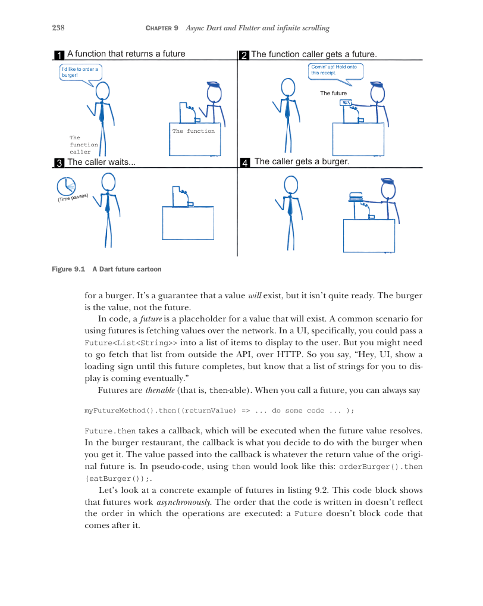

**Hình 9.1 – Tranh vui minh họa future trong Dart (*A Dart future cartoon*)**

Hình gồm 4 khung tranh:

1. **"Một hàm trả về một future" (*A function that returns a future*)** – Người gọi hàm (*The function caller*) nói: "Tôi muốn gọi một chiếc burger!" (*I'd like to order a burger!*) với nhân viên đứng sau quầy — quầy chính là "hàm" (*The function*).
2. **"Người gọi hàm nhận được một future" (*The function caller gets a future.*)** – Nhân viên nói: "Có ngay! Giữ lấy biên lai này nhé." (*Comin' up! Hold onto this receipt.*) và đưa ra tờ biên lai — được chú thích là "future" (*The future*).
3. **"Người gọi chờ…" (*The caller waits...*)** – Có chiếc đồng hồ với chú thích "(Thời gian trôi qua)" (*Time passes*).
4. **"Người gọi nhận được burger" (*The caller gets a burger.*)** – Nhân viên đưa chiếc burger cho khách.

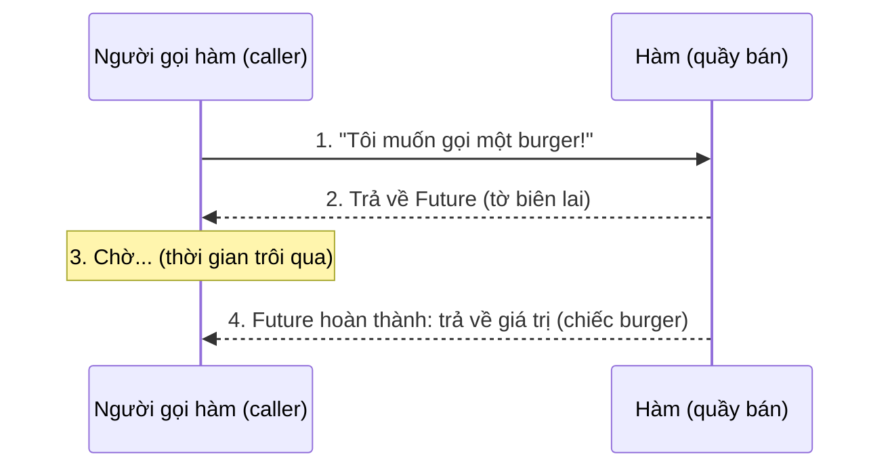

Trong code, **future là một chỗ giữ chỗ (*placeholder*) cho một giá trị sẽ tồn tại**. Một tình huống phổ biến dùng future là lấy dữ liệu qua mạng. Cụ thể trong UI, bạn có thể truyền một `Future<List<String>>` vào một danh sách các mục để hiển thị cho người dùng. Nhưng có thể bạn phải đi lấy danh sách đó từ bên ngoài, qua HTTP. Vì vậy bạn nói: "Này UI, hãy hiển thị biểu tượng đang tải cho tới khi future này hoàn thành, nhưng hãy biết rằng một danh sách chuỗi để hiển thị đang trên đường tới."

Future có tính chất ***thenable*** (tức là "then-được" – có thể gọi `.then`). Khi gọi một future, bạn luôn có thể viết:

```dart
myFutureMethod().then((returnValue) => ... do some code ... );
```

`Future.then` nhận một callback (hàm gọi lại), callback này sẽ được thực thi khi giá trị của future được giải quyết (*resolves* – tức có kết quả). Trong nhà hàng burger, callback là việc bạn quyết định làm với chiếc burger khi nhận được nó. Giá trị được truyền vào callback chính là giá trị trả về của future ban đầu. Viết bằng mã giả, dùng `then` trông như sau: `orderBurger().then(eatBurger());`.

Hãy xem một ví dụ cụ thể về future trong Listing 9.2. Khối code này cho thấy future hoạt động **bất đồng bộ**. Thứ tự viết code không phản ánh thứ tự các thao tác được thực thi: một `Future` không chặn (*block*) phần code đứng sau nó.

**Listing 9.2 – Một ví dụ về Future**

```dart
void main() {
  print("A");
  futurePrint(Duration(milliseconds: 1), "B")
      .then((status) => print(status));
  print("C");
  futurePrint(Duration(milliseconds: 2), "D")
      .then((status) => print(status));
  print("E");
}

Future<String> futurePrint(Duration dur, String msg) {
  return Future.delayed(dur)
      .then((onValue) => msg);
}

// prints
// A
// C
// E
// B
// D
```

Chú thích của tác giả cho listing:

- `Duration` là một lớp của Dart dùng để định nghĩa một khoảng thời gian. Trong trường hợp này, nó biểu diễn 1 ms.
- Mọi future đều được dùng bằng cách gọi callback mà bạn đưa cho chúng khi callback truyền vào future hoàn thành. Ở đây, `Future.delayed` là một constructor đặc biệt khởi động một bộ hẹn giờ (bạn cho nó biết thời lượng), và khi bộ hẹn giờ đó kết thúc, nó gọi callback của mình.

Dù đơn giản, ví dụ này cho thấy hàm `then` làm gì. Nó nói: "Khi hàm đầu tiên làm xong thì thực thi callback. Nhưng phải đợi nó xong rồi mới được thực thi." Nói cách khác, ví dụ đang gọi `futurePrint`, hàm này biết rằng không được in cho tới khi khoảng thời gian chỉ định trôi qua. Trong lúc `futurePrint` đang đợi khoảng thời gian trôi qua, phần còn lại của code vẫn tiếp tục được xử lý. **Đây chính là điều làm nên tính bất đồng bộ.** (Vì máy tính chạy rất nhanh, chỉ cần chờ một mili giây là đủ đảm bảo việc in được thực hiện sau các lệnh `print` không bị trì hoãn.)

> 💡 **Ví dụ bổ sung (không có trong sách):** Hãy dò từng bước Listing 9.2 như một "event loop":
>
> | Thời điểm | Việc xảy ra | Màn hình |
> |---|---|---|
> | t=0 | `print("A")` | A |
> | t=0 | Gọi `futurePrint(1ms,"B")` → hẹn giờ 1 ms, trả về ngay một Future chưa xong | |
> | t=0 | `print("C")` | C |
> | t=0 | Gọi `futurePrint(2ms,"D")` → hẹn giờ 2 ms | |
> | t=0 | `print("E")`, `main` kết thúc | E |
> | t≈1ms | Hẹn giờ B xong → callback `then` in "B" | B |
> | t≈2ms | Hẹn giờ D xong → in "D" | D |
>
> Ngay cả khi bạn đổi thời lượng thành `Duration.zero`, kết quả vẫn là A C E B D, vì callback của Future luôn được xếp lịch chạy **sau** khi đoạn code đồng bộ hiện tại chạy xong.

Trong nhiều ngôn ngữ, kể cả Dart, có những từ khóa đặc biệt giúp viết code bất đồng bộ gọn và dễ đọc hơn. Ta sẽ khám phá chúng ngay sau đây.

### 9.1.2 Từ khóa async/await (The async/await keywords)

Theo ý kiến của tác giả, hai từ khóa `async` và `await` là cách dễ nhất để hiểu lập trình bất đồng bộ. Nói gọn: bạn có thể đánh dấu bất kỳ hàm nào là `async`, rồi bảo hàm đó `await` (chờ) bất kỳ tiến trình bất đồng bộ nào hoàn thành trước khi đi tiếp. Về cơ bản, nó giống như nói: "Này hàm, nếu thấy chữ `await` ở đâu, cứ dừng ngay tại đó và đợi nó xong rồi mới chạy sang dòng tiếp theo." Theo một cách nào đó, các từ khóa này biến code bất đồng bộ thành code đồng bộ (về mặt khái niệm).

Có những tiến trình bất đồng bộ **phải** hoàn thành thì các tiến trình theo sau mới chạy đúng. Ví dụ, nếu bạn có một tiến trình cần dữ liệu do một API bên ngoài cung cấp, thì việc lấy dữ liệu đó phải hoàn tất trước. Hãy xem điều gì xảy ra trong listing tiếp theo khi ta dùng lại ví dụ trước nhưng thêm vài từ khóa `await` vào; `await` sẽ bảo code tạm dừng cho tới khi dòng đó hoàn thành.

**Listing 9.3 – Ví dụ về async và await**

```dart
void main() async { // (1) Đánh dấu hàm là bất đồng bộ bằng từ khóa async.
  print("A");
  await futurePrint(Duration(milliseconds: 1), "B") // (2) Đánh dấu dòng (phải là một future) mà bạn muốn tạm dừng bằng await.
      .then((status) => print(status));
  print("C");
  await futurePrint(Duration(milliseconds: 2), "D") // (3) Đánh dấu dòng (phải là một future) mà bạn muốn tạm dừng bằng await.
      .then((status) => print(status));
  print("E");
}

Future<String> futurePrint(Duration dur, String msg) {
  return Future.delayed(dur).then((onValue) => msg);
}

// prints   // (4) Giờ các chữ cái được in theo thứ tự bảng chữ cái!
// A
// B
// C
// D
// E
```

Chú thích của tác giả:

1. Đánh dấu hàm là bất đồng bộ bằng từ khóa `async`.
2. Đánh dấu dòng (dòng này phải là một future) mà bạn muốn tạm dừng tại đó bằng `await`.
3. Tương tự, đánh dấu dòng (phải là một future) muốn tạm dừng bằng `await`.
4. Giờ các chữ cái được in theo thứ tự bảng chữ cái!

Điểm mấu chốt ở đây là bạn có thể **biến code bất đồng bộ thành đồng bộ**. Nghe chắc chắn là lạ, nhưng điều này thường rất tiện. Ví dụ trên là ví dụ "dàn dựng", vì bạn hoàn toàn có thể đạt cùng hiệu quả bằng cách viết đơn giản:

```dart
void main() {
  print("A");
  print("B");
  print("C");
  print("D");
  print("E");
}
```

Điều này chỉ khả thi vì trong ví dụ của ta, ta biết chính xác code bất đồng bộ sẽ làm gì: in các chữ cái. Ngoài đời thực, nhiều khả năng bạn đang chờ một thông tin nào đó từ một lời gọi HTTP, và bạn muốn "tạm dừng" code cho tới khi lời gọi HTTP đó hoàn tất. Listing sau minh họa mã giả cho việc lấy dữ liệu bất đồng bộ.

**Listing 9.4 – Lấy dữ liệu bất đồng bộ**

```dart
void main() async {
  // Bạn muốn code tạm dừng cho tới khi lời gọi HTTP hoàn tất,
  // nếu không biến user sẽ không có dữ liệu.
  var user = await http.get("http://my-database.com/user/1");
  print(user);
}
```

Chú thích: Bạn muốn code tạm dừng cho tới khi lời gọi HTTP kết thúc, nếu không sẽ không có dữ liệu trong biến `user`.

> 💡 **Ví dụ bổ sung (không có trong sách):** So sánh hai cách viết cùng một việc — lấy hồ sơ người dùng rồi lấy danh sách đơn hàng của người đó (việc thứ hai phụ thuộc kết quả việc thứ nhất):
>
> ```dart
> // Cách 1: dùng then (lồng callback)
> void loadWithThen() {
>   fetchUser(1).then((user) {
>     return fetchOrders(user.id);
>   }).then((orders) {
>     print('Có ${orders.length} đơn hàng');
>   });
> }
>
> // Cách 2: dùng async/await (đọc như code tuần tự)
> Future<void> loadWithAwait() async {
>   final user = await fetchUser(1);
>   final orders = await fetchOrders(user.id);
>   print('Có ${orders.length} đơn hàng');
> }
> ```
>
> Hai hàm làm đúng cùng một việc. Lưu ý: hàm `async` luôn trả về một `Future` (ở đây là `Future<void>`), nên nơi gọi `loadWithAwait()` cũng có thể `await` nó. `await` chỉ "dừng" hàm hiện tại, **không** làm đơ cả ứng dụng — event loop vẫn tiếp tục xử lý việc khác (ví dụ vẽ lại UI).

### 9.1.3 Bắt lỗi với Future (Catching errors with futures)

Bắt lỗi trong code bất đồng bộ là việc quan trọng. Hãy xem xét: bạn có một hàm bất đồng bộ gọi tới một API, nhưng máy chủ của API đó đang sập. Bạn không muốn ứng dụng của mình bị crash chỉ vì nó phụ thuộc vào dữ liệu cụ thể — bạn muốn nó thất bại một cách nhẹ nhàng, êm ái (*fail gracefully*). Có hai cách bắt lỗi với code bất đồng bộ, nhờ đó bạn có thể xử lý lỗi hoặc các lời gọi mạng thất bại mà không làm gián đoạn trải nghiệm người dùng.

Cách thứ nhất để bắt lỗi được dùng với các kiểu future "thuần" thông thường. Có một phương thức tên là `catchError` cho việc này, như trong listing sau.

**Listing 9.5 – Phương thức catchError**

```dart
Future futrePrint(Duration dur, String msg) async {
  return Future.delayed(dur).then((onValue) => msg);
}

main() {
  futrePrint(Duration(milliseconds: 2), "D")
      .then((status) => print(status))
      .catchError((err) => print(err)); // Nếu có lỗi trong đoạn code này, lỗi sẽ được in ra thay vì làm crash ứng dụng.
}
```

Chú thích: Nếu có lỗi trong đoạn code này, lỗi sẽ được in ra thay vì làm ứng dụng của bạn bị crash.

(Ghi chú nhỏ: tên hàm `futrePrint` bị viết thiếu chữ "u" là đúng như trong sách gốc; nó chỉ là tên hàm, không ảnh hưởng tới việc chạy.)

Giống như `async` và `await` giúp viết code bất đồng bộ rõ ràng hơn so với dùng trực tiếp đối tượng `Future`, cũng có một cách đẹp hơn để bắt lỗi: khối `try`/`catch`, thứ rất phổ biến trong nhiều ngôn ngữ. Hãy xem nó ngay sau đây.

### 9.1.4 Bắt lỗi với try và catch (Catching errors with try and catch)

Khối `try`/`catch` đặc biệt hữu ích với các thao tác `async`/`await`. Trong ví dụ sau, code trong khối `try` sẽ chạy trong mọi trường hợp. Nếu nó hoàn tất thành công (tức là không có lỗi nào), trình biên dịch sẽ bỏ qua khối `catch` và cứ thế tiếp tục với phần code khác như mong đợi. Khối `catch` là một "lưới an toàn" (*fail-safe*) sẽ được thực thi nếu có lỗi trong khối `try`.

**Listing 9.6 – try/catch với các lời gọi bất đồng bộ**

```dart
void main() async {
  try { // Nếu bất cứ thứ gì thất bại trong toàn bộ khối try ({...}), khối catch sẽ chạy.
    print("A");
    await futrePrint(Duration(milliseconds: 1), "B")
        .then((status) => print(status));
    print("C");
    await futrePrint(Duration(milliseconds: 2), "D")
        .then((status) => print(status)).catchError((err) => print);
    print("E");
  } catch(err) {
    // Khối catch sẽ không chạy nếu không có lỗi.
    print("Err!! -- $err");
  }
}
```

Chú thích của tác giả:

- Nếu bất cứ thứ gì thất bại trong toàn bộ khối `try` (`{...}`), thì khối `catch` sẽ chạy.
- Khối `catch` sẽ không chạy nếu không có lỗi. Điều này cực kỳ hữu ích trong lập trình bất đồng bộ, và ta sẽ dùng nó ở phần sau của chương.

> 💡 **Ví dụ bổ sung (không có trong sách):** Một hàm tải dữ liệu "thất bại êm ái" — nếu mạng lỗi thì trả về danh sách rỗng thay vì làm crash ứng dụng:
>
> ```dart
> Future<List<String>> loadProductNames() async {
>   try {
>     final names = await fakeApiCall(); // có thể ném lỗi
>     return names;
>   } catch (err) {
>     print('Không tải được sản phẩm: $err');
>     return <String>[]; // giá trị dự phòng
>   } finally {
>     print('Đã thử tải xong'); // luôn chạy, dù thành công hay thất bại
>   }
> }
>
> Future<List<String>> fakeApiCall() async {
>   await Future.delayed(Duration(milliseconds: 10));
>   throw Exception('Server đang sập');
> }
> ```
>
> Gọi `print(await loadProductNames());` sẽ in: `Không tải được sản phẩm: Exception: Server đang sập`, rồi `Đã thử tải xong`, rồi `[]`. Khối `finally` (không được nhắc trong sách) là phần tùy chọn, luôn chạy sau `try`/`catch`.

Cho tới giờ, mọi thứ tác giả trình bày trong chương này chỉ là phần "nhập môn" (*primer*). "Phần thịt" thực sự quan trọng là làm việc với stream. Nói chung, bạn nên nhớ một vài khái niệm sau:

- Future là nền tảng của lập trình bất đồng bộ trong Dart.
- Bạn có thể dùng `Future.then` hoặc `async`/`await` để kiểm soát việc code nên tạm dừng để chờ code bất đồng bộ, hay cứ tiếp tục chạy và lo về future khi nó xong.
- `onError` và `try`/`catch` đều được dùng để xử lý lỗi trong Dart bất đồng bộ.

---


## 9.2 Sink và Stream (và StreamController) (Sinks and streams (and StreamControllers))

Có vẻ như một trong những mối bận tâm lớn nhất khi xây dựng giao diện là cách xử lý dữ liệu bất đồng bộ — chẳng hạn hiển thị một danh sách thông tin trong khi bạn phải lấy thông tin đó bằng một HTTP request trước đã. **Stream** là cách mà nhóm phát triển Flutter đã chọn để xử lý việc hiển thị dữ liệu lấy từ internet. Stream là một phần lớn của lập trình Dart. Bạn sẽ không đi xa được trong Dart mà không gặp stream, vì chúng là "công dân hạng nhất" (*first-class citizens*) trong Dart.

Stream là một mẫu lập trình bất đồng bộ, trong các ngôn ngữ khác thường được gọi là **observable**. Nhìn từ trên cao, stream cung cấp một cách để các lớp hoặc đối tượng trở nên **phản ứng** (*reactive*). Nó cho phép chúng chờ đợi một cách thụ động, chỉ thực thi code khi được thông báo rằng có một sự kiện (*event*) xảy ra. Nếu điều này nghe trừu tượng hay khó hiểu, cứ đọc tiếp đã. Các ví dụ sẽ giúp củng cố nó.

> **NOTE (Ghi chú):** `Stream` thực ra là một lớp cụ thể trong Dart và chỉ là **một mảnh** của mẫu observable. Tuy nhiên, nói chung, từ *stream* được dùng để mô tả toàn bộ khái niệm.

Theo ý kiến của tác giả, mẫu stream (hay mẫu *observer* – người quan sát) phản ánh đời thực nhiều hơn các mẫu kiến trúc khác. Trong một ngày, bạn được cập nhật thông tin bao nhiêu lần qua email, qua các ứng dụng, hay qua những cuộc trò chuyện ngoài đời, và bạn phản ứng lại với chúng? Có thể bạn nhận được một email yêu cầu hoàn thành một nhiệm vụ. Bạn không thể nào biết rằng mình cần hoàn thành nhiệm vụ đó cho tới khi email bảo bạn làm. Vậy là bạn **phản ứng** với việc nhận email. (Đây là gợi ý cho lý do vì sao nó được gọi là lập trình phản ứng – *reactive programming*.)

Trong các ví dụ đời thực, bạn không chủ động (*proactive*). Lại dùng ví dụ email: người ta thường gửi một email như là phản hồi cho một email họ vừa nhận. Bạn đang phản ứng với một email. Điều này có nghĩa là bạn không phải lúc nào cũng đi hỏi tất cả đồng nghiệp: "Này, tôi có nên gửi email cho anh không?" Thay vào đó, bạn thậm chí không nghĩ tới chuyện đó cho tới khi nó được đưa tới sự chú ý của bạn.

Trong code, mẫu observer chính là như vậy. Sẽ có một đối tượng chờ đợi thụ động để được một đối tượng khác thông báo. Mỗi khi được cập nhật, nó thực hiện hành động thích hợp.

Mở rộng ví dụ future với chiếc burger: một **subscriber** (người đăng ký nhận thông báo) có thể là người đầu bếp thực sự làm burger. Công việc của người đầu bếp hoàn toàn mang tính phản ứng. Đầu bếp biết cách làm burger khi có người gọi, nhưng không chủ động đi tìm người ăn burger để làm cho họ. Đầu bếp chỉ ngồi cạnh bếp nướng, chờ được bảo nấu món gì.

Phần chủ động của mối quan hệ này do nhân viên phục vụ đứng sau quầy thu ngân đảm nhận. Nhân viên này nhận đơn từ khách, rồi quay lại chuyển đơn đó (thông qua một **sự kiện** – *event*) cho đầu bếp. Sự kiện là một khái niệm. Nói chung, nó là bất cứ thứ gì xảy ra trong code mà khởi động quá trình một stream thông báo cho một subscriber. Hình 9.2 mô tả mối quan hệ này.

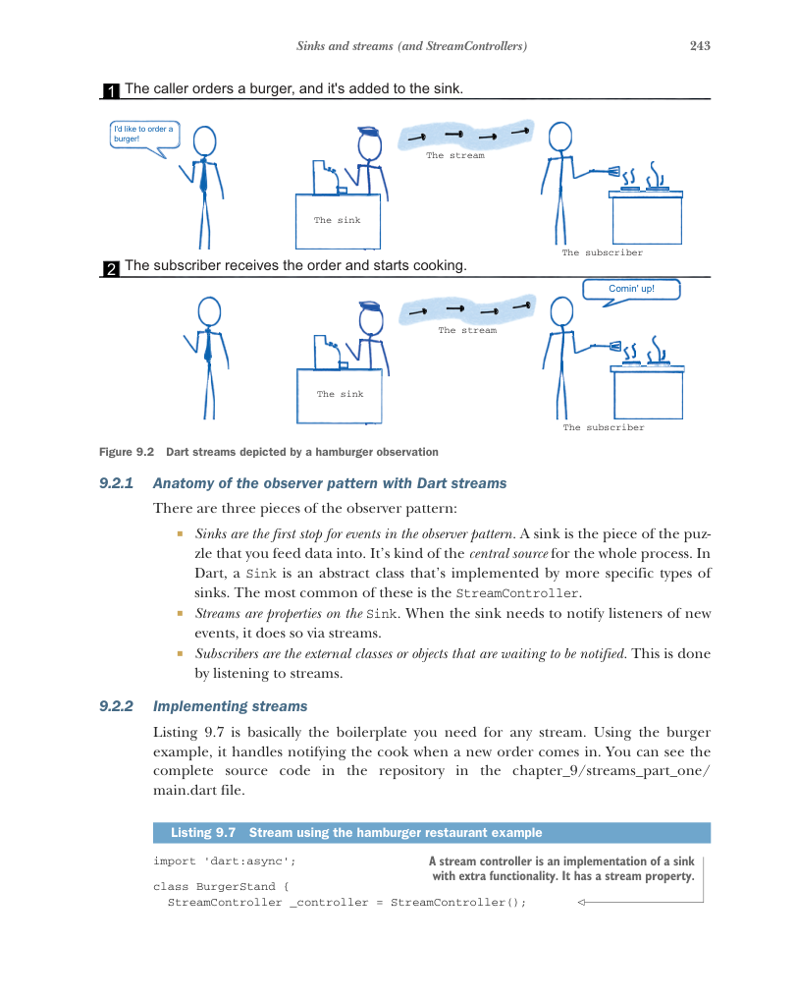

**Hình 9.2 – Stream của Dart được mô tả bằng ví dụ quan sát ở quán hamburger (*Dart streams depicted by a hamburger observation*)**

Hình gồm 2 khung:

1. **"Người gọi đặt một burger, và nó được thêm vào sink" (*The caller orders a burger, and it's added to the sink.*)** – Khách nói "Tôi muốn gọi một burger!"; nhân viên đứng sau quầy thu ngân được chú thích là **sink**; từ quầy có một dải "ống" chứa các mũi tên chạy sang phải, chú thích là **stream** (*The stream*); ở cuối dải là đầu bếp đứng cạnh bếp, chú thích là **subscriber** (*The subscriber*).
2. **"Subscriber nhận đơn và bắt đầu nấu" (*The subscriber receives the order and starts cooking.*)** – Đầu bếp nói "Có ngay!" (*Comin' up!*) và bắt đầu nướng.

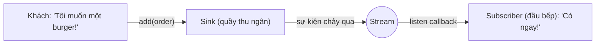

### 9.2.1 Giải phẫu observer pattern với stream của Dart (Anatomy of the observer pattern with Dart streams)

Mẫu observer có ba mảnh:

- ***Sink là điểm dừng đầu tiên của sự kiện trong mẫu observer.*** Sink (nghĩa đen là "bồn chứa/miệng hứng") là mảnh ghép mà bạn **đổ dữ liệu vào**. Nó giống như *nguồn trung tâm* của toàn bộ quá trình. Trong Dart, `Sink` là một lớp trừu tượng (*abstract class*), được cài đặt bởi các loại sink cụ thể hơn. Loại phổ biến nhất trong số đó là `StreamController`.
- ***Stream là thuộc tính nằm trên `Sink`.*** Khi sink cần thông báo cho những người lắng nghe (*listener*) về sự kiện mới, nó làm việc đó thông qua stream.
- ***Subscriber là các lớp hoặc đối tượng bên ngoài đang chờ được thông báo.*** Việc này được thực hiện bằng cách lắng nghe (*listen*) stream.

> 📝 **Giải thích thêm (không có trong sách):** Có thể hình dung `StreamController` như một đường ống nước: đầu vào của ống là **sink** (`controller.sink` hoặc gọi thẳng `controller.add(...)`), đầu ra của ống là **stream** (`controller.stream`), còn người mở vòi hứng nước ở đầu ra là **subscriber** (người gọi `stream.listen(...)`). Bạn đổ gì vào đầu vào thì người hứng ở đầu ra sẽ nhận được đúng thứ đó, theo đúng thứ tự.

### 9.2.2 Cài đặt stream (Implementing streams)

Listing 9.7 về cơ bản là phần code khung (*boilerplate*) bạn cần cho bất kỳ stream nào. Dùng ví dụ burger, nó xử lý việc báo cho đầu bếp khi có đơn hàng mới. Bạn có thể xem mã nguồn đầy đủ trong repository, ở file `chapter_9/streams_part_one/main.dart`.

**Listing 9.7 – Stream dùng ví dụ nhà hàng hamburger**

```dart
import 'dart:async';

class BurgerStand {
  // (1) StreamController là một cài đặt của sink, có thêm chức năng. Nó có thuộc tính stream.
  StreamController _controller = StreamController();
  // (2) Getter này công khai stream để các hàm khác có thể lắng nghe.
  Stream get onNewOrder => _controller.stream;
  // (3) Lớp Cook chỉ để ví dụ rõ ràng hơn. (Theo OOP, một quầy burger sẽ có các Cook.)
  Cook cook = Cook();

  // (4) Phương thức này cần được gọi một lần, nó mở ra "cuộc trò chuyện" giữa stream và đầu bếp.
  void deliverOrderToCook() {
    // (5) Cách đơn giản nhất để lắng nghe stream là listen. Khi có giá trị mới được thêm vào sink, callback này sẽ được gọi.
    onNewOrder.listen((newOrder) {
      cook.prepareOrder(newOrder);
    });
  }

  void newOrder(String order) {
    // (6) StreamController.add(value) (hoặc Sink) là phương thức dùng để báo cho controller về một sự kiện/dữ liệu mới.
    _controller.add(order);
  }
}

class Cook {
  void prepareOrder(newOrder) {
    print("preparing $newOrder");
  }
}

main() {
  var burgerStand = BurgerStand();
  burgerStand.deliverOrderToCook();

  burgerStand.newOrder("Burger");
  burgerStand.newOrder("Fries");
  burgerStand.newOrder("Fries, Animal Style");
  burgerStand.newOrder("Chicken nugs");
}
```

Chú thích của tác giả (tương ứng các số trong comment):

1. Một stream controller là một cài đặt của sink, kèm thêm chức năng. Nó có thuộc tính `stream`.
2. Getter này công khai stream, để các hàm khác có thể lắng nghe nó.
3. Lớp `Cook` này chỉ để làm ví dụ rõ ràng hơn. (Trong lập trình hướng đối tượng, một quầy burger sẽ có các `Cook`.)
4. Phương thức này cần được gọi một lần; nó mở ra cuộc trò chuyện giữa stream và đầu bếp.
5. Phương thức đơn giản nhất để lắng nghe stream là `listen`. Khi có một giá trị mới được thêm vào sink, callback này sẽ được gọi.
6. `StreamController.add(value)` (hoặc của `Sink`) là phương thức dùng để báo cho controller về một sự kiện hoặc dữ liệu mới. Nó khởi động quá trình chuyển thông tin mới tới một subscriber (hay còn gọi là listener).

Khi chạy, chương trình in ra:

```text
preparing Burger
preparing Fries
preparing Fries, Animal Style
preparing Chicken nugs
```

(Ghi chú: "Animal Style" là cách chế biến khoai tây chiên nổi tiếng của chuỗi In-N-Out ở Mỹ – một câu đùa nhỏ của tác giả; "Chicken nugs" là gà viên chiên.)

Hình 9.3 thể hiện cùng ví dụ này, nhưng có nhiều chú thích hơn.

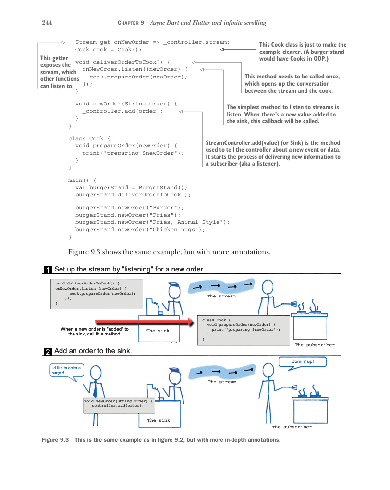

**Hình 9.3 – Đây là cùng ví dụ như hình 9.2, nhưng có chú thích chuyên sâu hơn (*This is the same example as in figure 9.2, but with more in-depth annotations.*)**

Hình gồm 2 khung:

1. **"Thiết lập stream bằng cách 'lắng nghe' đơn hàng mới" (*Set up the stream by "listening" for a new order.*)** – Cạnh nhân viên quầy (**sink**) là hộp code `deliverOrderToCook()` (gọi `onNewOrder.listen(...)`). Một mũi tên đỏ lớn chạy từ quầy sang đầu bếp, chú thích: "Khi một đơn mới được 'thêm' vào sink, hãy gọi phương thức này" (*When a new order is "added" to the sink, call this method.*), chỉ tới hộp code lớp `Cook` với `prepareOrder`. Phía trên là dải **stream**, cuối là **subscriber** (đầu bếp).
2. **"Thêm một đơn vào sink" (*Add an order to the sink.*)** – Khách nói "Tôi muốn gọi một burger!", cạnh quầy là hộp code `newOrder(String order) { _controller.add(order); }`; đầu bếp (subscriber) đáp "Có ngay!".

Các mảnh ảnh được trích ra từ hình này (là các khung hộp chứa code trong hình):


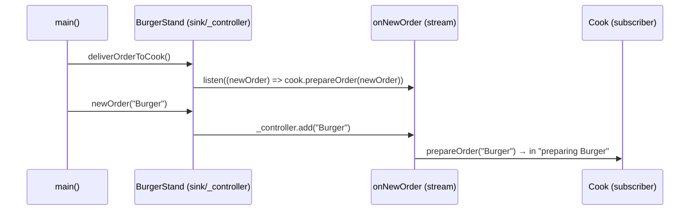

> 💡 **Ví dụ bổ sung (không có trong sách):** Một chi tiết hay bị bỏ qua: việc gửi sự kiện của stream cũng là **bất đồng bộ**. Thử đoạn sau:
>
> ```dart
> import 'dart:async';
>
> void main() {
>   final controller = StreamController<String>();
>   controller.stream.listen((order) => print('Bếp nhận: $order'));
>   controller.add('Burger');
>   print('Quầy đã nhận đơn xong');
>   controller.close(); // nên đóng controller khi không dùng nữa
> }
> ```
>
> Kết quả in ra là `Quầy đã nhận đơn xong` **trước**, rồi mới tới `Bếp nhận: Burger`. Lý do: `add` chỉ "xếp hàng" sự kiện; listener được gọi ở lượt sau của event loop. Ngoài ra, trong ứng dụng thật nên gọi `close()` cho controller khi không còn dùng để tránh rò rỉ tài nguyên.

### 9.2.3 Broadcast stream (Broadcasting streams)

Trong code burger của ta, người đầu bếp có lẽ đang khá cuống. Anh ta phải lo cả quầy burger, quầy khoai tây chiên, lẫn quầy gà viên. Quá nhiều việc. Quán burger này có lẽ cần thuê thêm một đầu bếp thứ hai và chia bớt trách nhiệm.

Trong code, điều đó nghĩa là sẽ có hai đầu bếp cùng lắng nghe nhân viên phục vụ và phản ứng dựa trên thông tin. Nhưng theo mặc định, **sink chỉ có thể được lắng nghe một lần**. Đây là lúc **broadcast stream** (stream phát sóng) xuất hiện. `StreamController.broadcast()` là một constructor trả về một controller có thể được **nhiều subscriber** lắng nghe. Điều này được thể hiện trong hình 9.4.

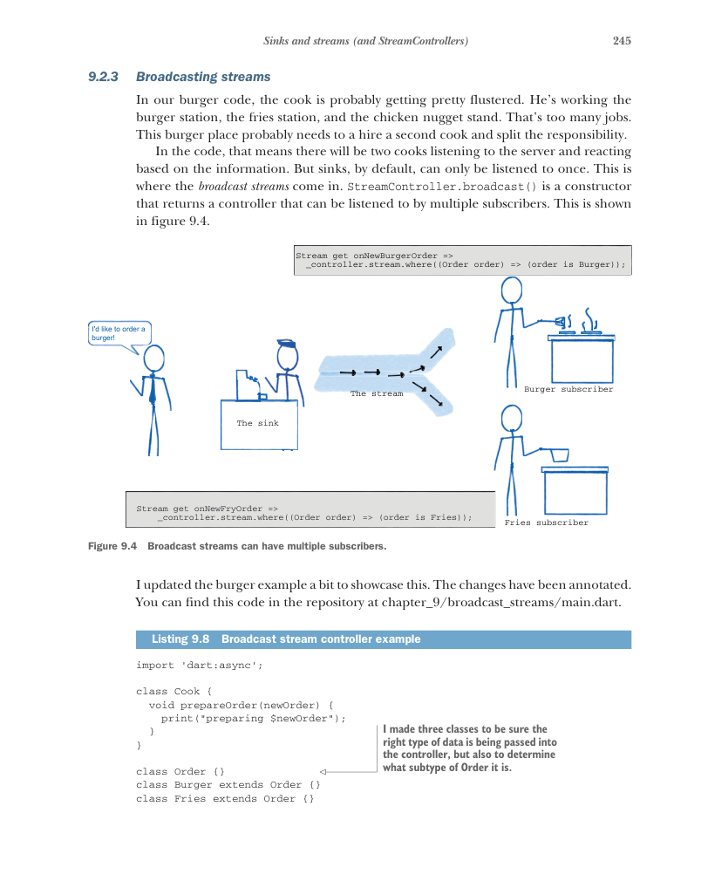

**Hình 9.4 – Broadcast stream có thể có nhiều subscriber (*Broadcast streams can have multiple subscribers.*)**

Trong hình: khách nói "Tôi muốn gọi một burger!" với nhân viên quầy (**sink**). Dải **stream** chảy ra từ quầy rồi **tách làm hai nhánh**. Nhánh trên dẫn tới đầu bếp nướng burger, chú thích **"Burger subscriber"**, kèm hộp code:

```dart
Stream get onNewBurgerOrder =>
    _controller.stream.where((Order order) => (order is Burger));
```

Nhánh dưới dẫn tới đầu bếp chiên khoai, chú thích **"Fries subscriber"**, kèm hộp code:

```dart
Stream get onNewFryOrder =>
    _controller.stream.where((Order order) => (order is Fries));
```

Mảnh ảnh được trích ra từ hình này (chi tiết rổ chiên khoai của "Fries subscriber"):


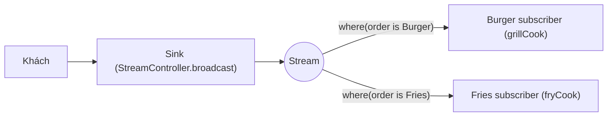

Tác giả đã cập nhật ví dụ burger một chút để minh họa điều này. Những thay đổi đã được chú thích. Bạn có thể tìm thấy code này trong repository tại `chapter_9/broadcast_streams/main.dart`.

**Listing 9.8 – Ví dụ về broadcast stream controller**

```dart
import 'dart:async';

class Cook {
  void prepareOrder(newOrder) {
    print("preparing $newOrder");
  }
}

// (1) Tạo ba lớp để chắc chắn đúng kiểu dữ liệu được truyền vào controller,
//     đồng thời để xác định đó là kiểu con nào của Order.
class Order {}
class Burger extends Order {}
class Fries extends Order {}

class BurgerStand {
  StreamController<Order> _controller = StreamController.broadcast();
  // (2) Giờ có hai đầu bếp, mỗi người một thiết bị nấu.
  Cook grillCook = Cook();
  Cook fryCook = Cook();

  // (3) Phần thú vị bắt đầu ở đây. Cả hai getter cùng lắng nghe một stream,
  //     nhưng chỉ phát ra những sự kiện có đúng kiểu.
  Stream get onNewBurgerOrder =>
      _controller.stream.where((Order order) => (order is Burger));
  Stream get onNewFryOrder =>
      _controller.stream.where((Order order) => (order is Fries));

  // (4) Trong phương thức này giờ có hai listener trên cùng một stream,
  //     nhưng nó chỉ chuyển sự kiện tới đúng đầu bếp.
  void deliverOrderToCook() {
    onNewBurgerOrder.listen((newOrder) {
      grillCook.prepareOrder(newOrder);
    });
    onNewFryOrder.listen((newOrder) {
      fryCook.prepareOrder(newOrder);
    });
  }

  // (5) Phương thức newOrder mong đợi một kiểu Order (hoặc kiểu con của nó).
  void newOrder(Order order) {
    _controller.add(order);
  }
}

main() {
  var burgerStand = BurgerStand();
  burgerStand.deliverOrderToCook();
  burgerStand.newOrder(Burger());
  burgerStand.newOrder(Fries());
}
```

Chú thích của tác giả:

1. Tác giả tạo ba lớp để đảm bảo đúng kiểu dữ liệu được truyền vào controller, nhưng cũng để xác định đó là kiểu con (*subtype*) nào của `Order`.
2. Giờ đã có hai đầu bếp, mỗi người phụ trách một thiết bị nấu.
3. Đây là nơi phần thú vị bắt đầu. Cả hai getter này cùng lắng nghe **một** stream, nhưng chỉ phát ra (*emit*) những sự kiện có kiểu đúng. Điều này được giải thích chi tiết hơn ở phía sau.
4. Trong phương thức này, giờ có hai listener trên cùng một stream, nhưng nó chỉ chuyển sự kiện tới đúng đầu bếp.
5. Phương thức `newOrder` mong đợi một kiểu `Order` (hoặc kiểu con).

Điểm quan trọng của tất cả những điều trên là **cả hai getter đều tham chiếu tới cùng một stream**. Vì vậy, khi hai listener được tạo trong phương thức `deliverOrderToCook`, chúng được gọi trên hai tham chiếu khác nhau tới stream (`onNewBurgerOrder` và `onNewFryOrder`), nhưng chúng đang lắng nghe cùng một stream (như trong hình 9.5). Điều này sẽ không thể thực hiện trên một stream thông thường — chỉ broadcast stream mới làm được.

Ngoài ra, cũng đáng lưu ý rằng `where` là một trong nhiều phương thức trên list (danh sách) thực hiện một hành động nào đó trên từng phần tử của list. Các phương thức cùng loại phổ biến hơn là `forEach` và `map`. Về cơ bản, `List.where` lọc bỏ mọi phần tử trong list mà callback truyền vào không trả về `true`.

Trong trường hợp này, `onNewBurgerOrder` đang nói: "Tôi chỉ quan tâm tới các phần tử của stream này mà kiểu của phần tử là `Burger`." Nó hoạt động được vì cả `Burger` và `Fries` đều là lớp con của `Order`.

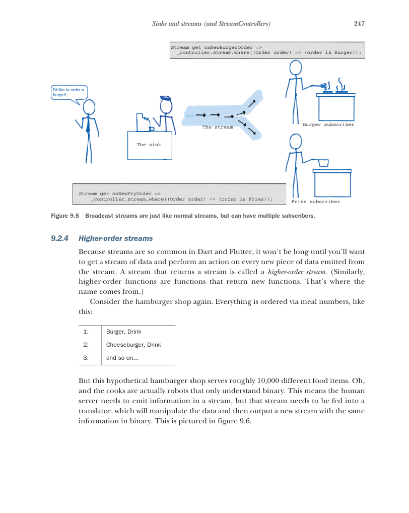

**Hình 9.5 – Broadcast stream giống hệt stream thông thường, nhưng có thể có nhiều subscriber (*Broadcast streams are just like normal streams, but can have multiple subscribers.*)**

Hình 9.5 giống hệt hình 9.4: sink (quầy) → stream tách đôi → "Burger subscriber" (với getter `onNewBurgerOrder` lọc `order is Burger`) và "Fries subscriber" (với getter `onNewFryOrder` lọc `order is Fries`).

Mảnh ảnh được trích ra từ hình này (chi tiết rổ chiên khoai):


> 💡 **Ví dụ bổ sung (không có trong sách):** Điều gì xảy ra nếu bạn dùng `StreamController()` thường thay cho `.broadcast()` trong Listing 9.8? Lần `listen` thứ hai sẽ ném lỗi lúc chạy:
>
> ```text
> Bad state: Stream has already been listened to.
> ```
>
> Thêm vào đó, với kiểu in mặc định, chương trình ở Listing 9.8 (bản broadcast) sẽ in ra `preparing Instance of 'Burger'` rồi `preparing Instance of 'Fries'`. Nếu muốn in đẹp hơn, có thể override `toString()` trong lớp `Burger`/`Fries`, ví dụ `String toString() => 'Burger';`.
>
> Một lưu ý nữa: broadcast stream **không lưu lại** sự kiện cho người đến muộn. Nếu bạn `add` một đơn hàng trước khi có ai `listen`, đơn đó sẽ bị mất. Đây là lý do `deliverOrderToCook()` được gọi trước các lệnh `newOrder(...)`.

### 9.2.4 Stream bậc cao (Higher-order streams)

Vì stream rất phổ biến trong Dart và Flutter, sẽ chẳng bao lâu nữa bạn sẽ muốn lấy một stream dữ liệu và thực hiện một hành động trên **từng mẩu dữ liệu mới** được phát ra từ stream đó. Một stream trả về một stream được gọi là **stream bậc cao** (*higher-order stream*). (Tương tự, *hàm bậc cao* – *higher-order functions* – là những hàm trả về hàm mới. Cái tên bắt nguồn từ đó.)

Hãy xem lại quán hamburger. Mọi thứ được gọi theo số suất ăn, như sau:

| Số | Món |
|---|---|
| 1: | Burger, Drink (burger, đồ uống) |
| 2: | Cheeseburger, Drink (burger phô mai, đồ uống) |
| 3: | and so on... (và cứ thế…) |

Nhưng quán hamburger giả định này phục vụ khoảng **10.000** món khác nhau. À, và các đầu bếp thực ra là **robot chỉ hiểu hệ nhị phân**. Điều này có nghĩa là nhân viên phục vụ (con người) cần phát thông tin vào một stream, nhưng stream đó cần được đưa vào một **bộ dịch** (*translator*), bộ dịch này sẽ biến đổi dữ liệu rồi xuất ra một **stream mới** chứa cùng thông tin nhưng ở dạng nhị phân. Điều này được minh họa trong hình 9.6.

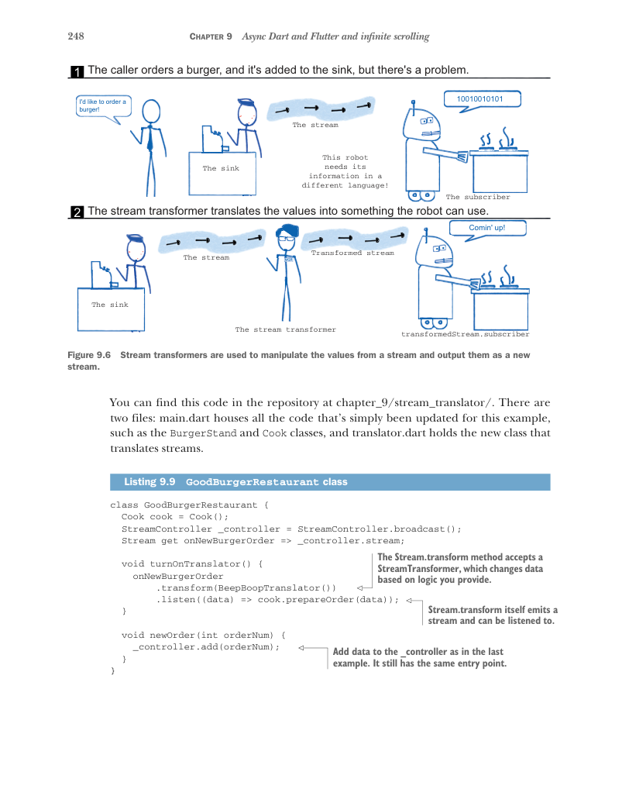

**Hình 9.6 – Stream transformer (bộ biến đổi stream) được dùng để biến đổi các giá trị từ một stream và xuất chúng ra thành một stream mới (*Stream transformers are used to manipulate the values from a stream and output them as a new stream.*)**

Hình gồm 2 khung:

1. **"Người gọi đặt một burger, và nó được thêm vào sink, nhưng có một vấn đề" (*The caller orders a burger, and it's added to the sink, but there's a problem.*)** – Khách: "Tôi muốn gọi một burger!" → quầy (**sink**) → **stream** → robot đầu bếp (**subscriber**) nói "10010010101". Chú thích giữa hình: "Con robot này cần thông tin ở một ngôn ngữ khác!" (*This robot needs its information in a different language!*).
2. **"Stream transformer dịch các giá trị thành thứ mà robot dùng được" (*The stream transformer translates the values into something the robot can use.*)** – Quầy (**sink**) → **stream** → một người đeo kính ở giữa, chú thích **"stream transformer"** → **"Transformed stream"** (stream đã biến đổi) → robot, chú thích `transformedStream.subscriber`, nói "Có ngay!".

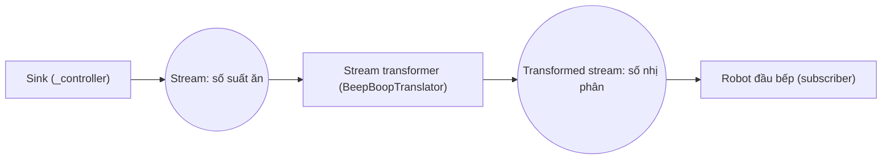

Bạn có thể tìm code này trong repository tại `chapter_9/stream_translator/`. Có hai file: `main.dart` chứa toàn bộ code chỉ đơn giản được cập nhật cho ví dụ này, chẳng hạn các lớp `BurgerStand` và `Cook`; còn `translator.dart` chứa lớp mới dùng để dịch (biến đổi) stream.

**Listing 9.9 – Lớp GoodBurgerRestaurant**

```dart
class GoodBurgerRestaurant {
  Cook cook = Cook();
  StreamController _controller = StreamController.broadcast();
  Stream get onNewBurgerOrder => _controller.stream;

  void turnOnTranslator() {
    onNewBurgerOrder
        // (1) Phương thức Stream.transform nhận một StreamTransformer,
        //     thứ thay đổi dữ liệu dựa trên logic do bạn cung cấp.
        .transform(BeepBoopTranslator())
        // (2) Bản thân Stream.transform phát ra một stream và có thể được lắng nghe.
        .listen((data) => cook.prepareOrder(data));
  }

  void newOrder(int orderNum) {
    // (3) Thêm dữ liệu vào _controller như ví dụ trước. Nó vẫn có cùng điểm vào.
    _controller.add(orderNum);
  }
}
```

Chú thích của tác giả:

1. Phương thức `Stream.transform` nhận một `StreamTransformer`, thứ thay đổi dữ liệu dựa trên logic bạn cung cấp.
2. Bản thân `Stream.transform` phát ra một stream và có thể được lắng nghe.
3. Thêm dữ liệu vào `_controller` như trong ví dụ trước. Nó vẫn có cùng điểm vào (*entry point*).

Và `StreamTransformer` trông như listing sau.

**Listing 9.10 – Lớp stream transformer tùy biến**

```dart
// (1) Kế thừa StreamTransformerBase, lớp bao bọc một transformer và chức năng của nó.
class BeepBoopTranslator<S, T>
    extends StreamTransformerBase<S, T> {
  // (2) Lớp này nên có một StreamTransformer.
  final StreamTransformer<S, T> transformer;

  // (3) Khởi tạo transformer bằng phương thức static này khi tạo đối tượng.
  BeepBoopTranslator() : transformer =
      createTranslator();

  // (4) Đây là phương thức bắt buộc override vì StreamTransformer sẽ gọi nó bên trong.
  //     Ở đây chỉ cần gọi bind của transformer riêng của nó.
  @override
  Stream<T> bind(Stream<S> stream) =>
      transformer.bind(stream);

  // continued in next code block
```

Chú thích của tác giả:

1. Kế thừa `StreamTransformerBase`, lớp này bao bọc (*wraps*) một transformer và chức năng của nó.
2. Lớp này nên có một `StreamTransformer`.
3. Khởi tạo transformer bằng phương thức static này khi tạo đối tượng.
4. Đây là phương thức bắt buộc phải override, vì `StreamTransformer` sẽ gọi nó bên trong. Tác giả chỉ cần gọi `bind` của transformer riêng của nó.

**Listing 9.11 – Lớp stream transformer tùy biến (tiếp theo)**

```dart
  // (1) Phương thức này là nơi chứa "hàng thật".
  static StreamTransformer<S, T>
      createTranslator<S, T>() =>
          // (2) Một StreamTransformer mới nhận một callback; nó tự động truyền vào
          //     inputStream (stream gốc đang được biến đổi) và thuộc tính cancelOnError của stream đó.
          StreamTransformer<S, T>(
            (Stream inputStream, bool cancelOnError) {
              // (3) Trong callback này, bạn tạo một StreamController mới ở bên trong.
              //     Stream của controller này được trả về sau khi dữ liệu được biến đổi.
              StreamController controller;
              StreamSubscription subscription;
              controller = StreamController<T>(
                // (4) Khi được lắng nghe, lấy inputStream gốc, lắng nghe nó, dùng callback
                //     để biến đổi dữ liệu rồi phát vào controller mới.
                onListen: () {
                  subscription = inputStream.listen(
                      (data) => controller.add(binaryNum(data)),
                      onDone: controller.close,
                      onError: controller.addError,
                      cancelOnError: cancelOnError);
                },
                onPause: ([Future<dynamic> resumeSignal]) =>
                    subscription.pause(resumeSignal),
                onResume: () => subscription.resume(),
                onCancel: () => subscription.cancel(),
              );
              // (5) Trả về hàm listen trên stream mới.
              return controller.stream.listen(null);
            },
          );

  static int binaryNum(int tenBased) {
    // convert num into binary
  }
}
```

Chú thích của tác giả:

1. Phương thức này là nơi chứa "hàng thật" (*where the goods are*) — phần quan trọng nhất.
2. Một `StreamTransformer` mới nhận một callback; nó tự động truyền cho callback `inputStream` (stream gốc đang bị biến đổi) và thuộc tính `cancelOnError` của stream đó.
3. Bên trong callback này, bạn tạo một `StreamController` mới, nằm bên trong. Stream của controller này được trả về sau khi dữ liệu đã được biến đổi.
4. Khi có người lắng nghe (`onListen`), bạn có thể lấy `inputStream` gốc, lắng nghe nó, và dùng callback của nó để biến đổi dữ liệu rồi phát dữ liệu đó vào controller mới. Nghe thì phức tạp, nhưng nói bằng ngôn ngữ đơn giản nhất: stream controller (khi được lắng nghe) sẽ quay lại, lắng nghe stream gốc, dùng callback của nó để biến đổi dữ liệu, rồi phát ra dữ liệu mới đó.
5. Trả về hàm `listen` trên stream mới.

Tác giả nhận ra rằng đoạn code trên có thể khiến mọi thứ khó hơn, nhưng việc truyền qua lại và biến đổi stream vốn dĩ khó. Nếu bạn hiểu trọn vẹn mọi thứ cho tới phần stream bậc cao, nhưng chưa hiểu phần này, tác giả khuyên bạn cứ đi tiếp và đừng lo về stream bậc cao cho tới khi thực sự cần. Stream là thứ mà bạn phải làm quen dần bằng cách gặp đi gặp lại chúng nhiều lần.

> 💡 **Ví dụ bổ sung (không có trong sách):** Với nhu cầu đơn giản như "đổi mỗi số thành chuỗi nhị phân", bạn không nhất thiết phải tự viết cả một lớp transformer. Dart có sẵn nhiều cách ngắn gọn:
>
> ```dart
> import 'dart:async';
>
> void main() {
>   final orders = StreamController<int>();
>
>   // Cách 1: map – biến đổi từng phần tử
>   orders.stream
>       .map((n) => n.toRadixString(2)) // 5 -> "101"
>       .listen((bin) => print('Robot nhận: $bin'));
>
>   // Cách 2 (tương đương): StreamTransformer.fromHandlers
>   // final toBinary = StreamTransformer<int, String>.fromHandlers(
>   //   handleData: (n, sink) => sink.add(n.toRadixString(2)),
>   // );
>   // orders.stream.transform(toBinary).listen(print);
>
>   orders.add(1);  // Robot nhận: 1
>   orders.add(2);  // Robot nhận: 10
>   orders.add(42); // Robot nhận: 101010
>   orders.close();
> }
> ```
>
> Lưu ý: phương thức `binaryNum` trong sách chỉ là "khung" (thân hàm để trống với comment *convert num into binary*); nếu muốn chạy thật thì cần cài đặt nó, ví dụ `return int.parse(tenBased.toRadixString(2));`. Ngoài ra, code trong sách được viết cho Dart trước thời *null safety*; với Dart 3 bạn cần khai báo `late StreamController controller;` và `late StreamSubscription subscription;`, còn callback `onPause` của `StreamController` trong các phiên bản Dart hiện nay là hàm **không tham số**, nên thường viết `onPause: () => subscription.pause()`.

---


## 9.3 Dùng stream trong bloc (Using streams in blocs)

Để có một ví dụ bớt trừu tượng hơn, hãy xem ứng dụng Farmers Market của ta. Mỗi lần một sản phẩm được thêm vào giỏ hàng của người dùng, biểu tượng giỏ hàng phải cập nhật số lượng sản phẩm mới. Logic để làm việc này được thực hiện trong `CatalogBloc` thông qua stream.

Khi một sản phẩm được thêm vào giỏ, code của bạn sẽ thêm số lượng tăng thêm vào stream controller. Sau đó controller sẽ gửi một thông điệp tới mọi đối tượng đã đăng ký (*subscribed*) stream. Mỗi lần một listener được thông báo, nó sẽ gọi hàm callback mà bạn cung cấp. Ví dụ, biểu tượng giỏ hàng có thể gọi một hàm thay đổi số lượng nó đang hiển thị, rồi gọi `setState`, kích hoạt việc vẽ lại (*re-render*). Phần chức năng liên quan riêng tới UI đã được bàn ở chương trước, nên giờ tác giả sẽ tập trung vào code của bloc.

> 📝 **Giải thích thêm (không có trong sách):** **Bloc** (*Business Logic Component* – thành phần logic nghiệp vụ) là một mẫu quản lý state đã được giới thiệu ở chương 8. Ý tưởng cốt lõi: widget không tự xử lý logic, mà chỉ (1) **đẩy sự kiện vào** bloc qua các *sink* (input) và (2) **lắng nghe kết quả** từ bloc qua các *stream* (output). Bloc giống một "hộp đen" có cổng vào và cổng ra, bên trong toàn là stream.

### 9.3.1 Bloc dùng input và output (Blocs use inputs and outputs)

Có ba cách thiết lập stream khác nhau trong bloc dưới đây. Cách đầu tiên phát (*stream*) toàn bộ sản phẩm trong danh mục. Vì vậy, khi có một sản phẩm mới được thêm, nó sẽ đẩy ra một danh sách sản phẩm đã cập nhật. Đây là một **output** (đầu ra) của bloc. Stream này có cách thiết lập khá tiêu chuẩn:

```dart
// e_commerce/lib/blocs/catalog_bloc.dart
class CatalogBloc {
  // _productStreamController là "đối tượng" (subject) được lắng nghe ở đây. Khi có giá trị
  // được thêm vào controller này, stream allProducts sẽ phát thông báo tới các listener của nó.
  StreamController _productStreamController =
      StreamController<List<Product>>();
  // Ở những nơi khác trong ứng dụng, các widget có thể đăng ký (subscribe) allProducts.
  Stream<List<Product>> get allProducts =>
      _productStreamController.stream;

  // ...
  final _productInputController =
      StreamController<ProductEvent>.broadcast();
  // ...

  CatalogBloc(this._service) {
    _productInputController.stream
        .where((ProductEvent event) => event is UpdateProductEvent)
        .listen(_handleProductUpdate);
    _productInputController.stream
        .where((ProductEvent event) => event is AddProductEvent)
        .listen(_handleAddProduct);
  }
}
```

Chú thích của tác giả:

- Ở những nơi khác trong ứng dụng, các widget có thể đăng ký (*subscribe*) `allProducts`.
- `_productStreamController` là đối tượng được lắng nghe ở đây. Khi có giá trị được thêm vào controller này, stream `allProducts` sẽ phát một thông báo tới các listener của nó. Các input của bloc này sẽ được trình bày kỹ trong vài đoạn nữa.

Ví dụ thứ hai là một output khác, và nó cho phép các widget lắng nghe các **danh mục sản phẩm** (*product categories*) khác nhau. Đó là cách tác giả chia trang danh mục (catalog) theo từng loại. Cụ thể, tác giả đang nói tới việc mỗi danh mục có tiêu đề (header) riêng, như trong hình 9.7.

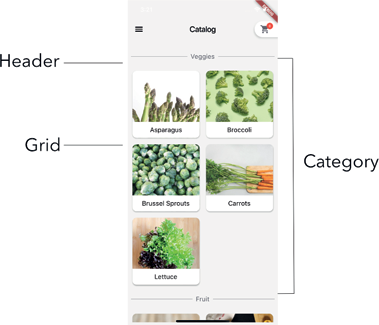

**Hình 9.7 – Trang danh mục (catalog) của ứng dụng Farmers Market; mỗi trang có header riêng (*The catalog page from the Farmers Market app; each page has its own header.*)**

Ảnh chụp màn hình trang "Catalog" với biểu tượng giỏ hàng góc trên phải. Các chú thích bên cạnh: **Header** (tiêu đề) chỉ vào dòng chữ "Veggies" (rau củ) có kẻ ngang hai bên; **Grid** (lưới) chỉ vào lưới 2 cột các thẻ sản phẩm: Asparagus (măng tây), Broccoli (bông cải xanh), Brussel Sprouts (cải Brussels), Carrots (cà rốt), Lettuce (rau diếp); dấu ngoặc **Category** (danh mục) bao toàn bộ khối từ header "Veggies" tới hết lưới, ngay trước header của danh mục tiếp theo là "Fruit" (trái cây).

Output này phức tạp hơn. Về cơ bản nó dùng cùng một mẫu, nhưng tác giả đã tạo một stream controller mới cho mỗi `ProductCategory` bằng code (một cách tự động, theo vòng lặp).

**Listing 9.12 – Nhiều stream, mỗi danh mục một stream**

```dart
// e_commerce/lib/blocs/catalog_bloc.dart
class CatalogBloc {
  StreamController _productStreamController =
      BehaviorSubject<List<Product>>(
    seedValue: populateCatalog().availableProducts,
  );
  Stream<List<Product>> get allProducts => _productStreamController.stream;

  // This is the new stream controller
  // (1) Danh sách các stream và stream controller.
  List<StreamController> _controllersByCategory = [];
  List<Stream<List<Product>>> productStreamsByCategory = [];

  CatalogBloc(this._service) {
    _productInputController.stream
        .where((ProductEvent event) => event is UpdateProductEvent)
        .listen(_handleProductUpdate);
    _productInputController.stream
        .where((ProductEvent event) => event is AddProductEvent)
        .listen(_handleAddProduct);

    // This is the new code
    // (2) Trong constructor, lặp qua từng ProductCategory.
    ProductCategory.values.forEach(
      (ProductCategory category) {
        // (3) Với mỗi danh mục, tạo một stream controller mới.
        var _controller =
            StreamController<List<Product>>();
        // (4) Đừng để ý nhiều tới dòng này: đây là service giả lập việc
        //     đăng ký một cơ sở dữ liệu thời gian thực như Firestore.
        _service.streamProductCategory(category)
            .listen((List<Product> data) {
          // (5) Khi service đẩy dữ liệu mới, callback này chạy và thực thi
          //     _controller.add(data), thêm dữ liệu vào đúng controller của danh mục.
          return _controller.add(data);
        });
        // (6) Thêm stream controller mới vào danh sách các stream controller.
        return _controllersByCategory.add(
          _controller
        );
      });

    // (7) Tạo một tham chiếu tới stream của từng controller và đưa chúng vào một danh sách mới.
    _controllersByCategory.forEach(
      (StreamController<List<Product>> controller,
    ) {
      productStreamsByCategory.add(controller.stream);
    });
  }
```

Chú thích của tác giả:

1. Các danh sách stream và stream controller. Về hiệu quả, việc này tương đương với việc tạo một stream và một stream controller mới cho mỗi danh mục sản phẩm.
2. Trong constructor, lặp qua từng `ProductCategory`.
3. Với mỗi danh mục, tạo một stream controller mới.
4. Bạn không nên quá chú ý vào phần này. Tác giả đã tạo một service giả (*fake service*) mô phỏng việc đăng ký nhận dữ liệu từ một cơ sở dữ liệu thời gian thực như Firestore.
5. Khi service đẩy dữ liệu mới, callback này chạy và thực thi phương thức `_controller.add(data)`, thêm dữ liệu vào stream controller của đúng danh mục.
6. Thêm stream controller mới vào danh sách các stream controller.
7. Tạo một tham chiếu tới stream của từng controller và đưa chúng vào một danh sách mới.

> 📝 **Giải thích thêm (không có trong sách):** `BehaviorSubject` không thuộc thư viện chuẩn của Dart mà đến từ gói **RxDart**. Nó là một `StreamController` kiểu broadcast đặc biệt: luôn **nhớ giá trị mới nhất** và phát lại giá trị đó ngay lập tức cho bất kỳ listener nào đăng ký sau. `seedValue` là giá trị khởi đầu (trong các phiên bản RxDart mới, tham số này được thay bằng constructor `BehaviorSubject.seeded(value)`). Điều này rất hợp với UI: widget đăng ký muộn vẫn nhận ngay danh sách sản phẩm hiện tại thay vì phải chờ sự kiện tiếp theo.

Nếu bạn chưa quen với stream, đoạn code này có vẻ khá phức tạp và khó hiểu. Không sao cả; bạn không nên tự trách mình. Đây có lẽ là đoạn code phức tạp nhất trong cả cuốn sách. Code thì chắc chắn là khó hiểu, nhưng sẽ dễ hơn nếu nghĩ tới một phiên bản đơn giản hơn của nó. Tác giả hoàn toàn có thể viết thế này thay vào đó:

**Listing 9.13 – Một cách dài dòng hơn để tạo danh sách controller**

```dart
StreamController _veggieStreamController =
    StreamController<List<Product>>();
Stream<List<Product>> get veggieProducts =>
    _productStreamController.stream;

StreamController _fruitStreamController =
    StreamController<List<Product>>();
Stream<List<Product>> get fruitProducts =>
    _productStreamController.stream;

StreamController _proteinStreamController =
    StreamController<List<Product>>();
Stream<List<Product>> get proteanProducts =>
    _productStreamController.stream;
// etc.
```

(Ghi chú: trong sách gốc, các getter ở listing này đều trả về `_productStreamController.stream`; theo ý đồ minh họa, mỗi getter lẽ ra trả về stream của controller tương ứng, ví dụ `_veggieStreamController.stream`. Tên `proteanProducts` cũng là lỗi chính tả của `proteinProducts` trong bản gốc. Code được giữ nguyên văn.)

Rốt cuộc, đoạn code này chỉ đang tạo ra một danh sách các controller và một danh sách stream, mỗi controller một stream. Sau đó, trong UI ở widget `Catalog`, tác giả lặp qua `CatalogBlog.productStreamsByCategory` (ý là `CatalogBloc`) và tạo widget dựa trên từng stream. Tác giả sẽ trình bày phần đó trong vài trang tới.

Điều quan trọng hơn, cho mục đích của ta, là **cùng một mẫu đang được lặp lại** ở đây. Khái niệm stream có thể trực quan với bạn, hoặc có thể thấy "điên rồ". Cách cài đặt stream có thể dễ nhớ, hoặc không. Nhưng dù thế nào, mẫu cài đặt stream không thay đổi. Bạn cần ba mảnh:

- Một `StreamController` (hoặc `Sink`)
- Một `Stream`
- Một subscriber (còn gọi là *observer* hay *listener*)

> 💡 **Ví dụ bổ sung (không có trong sách):** Một phiên bản thu nhỏ, chạy được trên DartPad, của ý tưởng "mỗi danh mục một stream":
>
> ```dart
> import 'dart:async';
>
> enum Category { veggies, fruit }
>
> void main() {
>   final controllers = <Category, StreamController<List<String>>>{};
>   final streams = <Category, Stream<List<String>>>{};
>
>   for (final c in Category.values) {
>     controllers[c] = StreamController<List<String>>();
>     streams[c] = controllers[c]!.stream;
>   }
>
>   // "UI" đăng ký từng stream
>   streams[Category.veggies]!.listen((l) => print('Rau củ: $l'));
>   streams[Category.fruit]!.listen((l) => print('Trái cây: $l'));
>
>   // "Service" đẩy dữ liệu vào đúng controller
>   controllers[Category.veggies]!.add(['Cà rốt', 'Bông cải']);
>   controllers[Category.fruit]!.add(['Cam']);
> }
> ```
>
> Kết quả: `Rau củ: [Cà rốt, Bông cải]` và `Trái cây: [Cam]`. Đủ ba mảnh: controller (sink), stream, và subscriber.

### 9.3.2 Cài đặt một input cho bloc (Implementing a bloc input)

Cách dùng stream còn lại trong `CatalogBloc` là các **input** (đầu vào) của bloc. Nhớ lại từ chương trước rằng input trong bloc **luôn là sink**. Trong bloc này, có các sink để thêm sản phẩm mới vào danh mục hoặc cập nhật sản phẩm hiện có. Tác giả sẽ đi qua việc tạo một sản phẩm mới.

Bạn đã thấy đoạn code sau trong các ví dụ trước, nhưng giờ tác giả sẽ giải thích kỹ hơn về cách dùng chúng, đặc thù cho bloc. Bloc trong listing tiếp theo dùng stream làm input để làm việc với state bên ngoài widget.

**Listing 9.14 – Stream làm input để làm việc với state bên ngoài widget**

```dart
// lib/e_commerce/blocs/catalog_bloc.dart -- line ~28
// ...
// (1) Tạo broadcast stream.
final _productInputController =
    StreamController<ProductEvent>.broadcast();
// (2) Tham chiếu tới sink của stream controller đó.
Sink<ProductEvent> get addNewProduct =>
    _productInputController.sink;

CatalogBloc(this._service) {
  // (3) Trong constructor, lắng nghe controller và gọi callback _handleAddProduct
  //     mỗi khi có sự kiện mới thuộc kiểu AddProductEvent.
  _productInputController.stream
      .where((ProductEvent event) => event is AddProductEvent)
      .listen(_handleAddProduct);
}
// ...

// line ~67
_handleAddProduct(ProductEvent event) {
  var product = Product(
      category: event.product.category,
      title: event.product.title,
      cost: event.product.cost,
      imageTitle: ImageTitle.SlicedOranges); // This is faked.
  // (4) Gọi service giả và thêm sản phẩm mới vào đó.
  //     Ngoài đời thực, việc này có lẽ sẽ thêm sản phẩm vào cơ sở dữ liệu.
  _service.addNewProduct(product);
}
```

Chú thích của tác giả:

1. Tạo broadcast stream.
2. Tham chiếu tới sink của stream controller đó.
3. Trong constructor, lắng nghe controller và gọi callback `_handleAddProduct` bất cứ khi nào có một sự kiện mới thuộc kiểu `AddProductEvent`.
4. Gọi service giả và thêm một sản phẩm mới vào đó. Ngoài đời thực, việc này có lẽ sẽ thêm sản phẩm vào một cơ sở dữ liệu.

(Comment `// This is faked.` trong code nghĩa là "chỗ này làm giả" — ảnh sản phẩm luôn được gán cứng là cam cắt lát.)

Một lần nữa, đây là khá nhiều thứ. Nhưng toàn bộ khoảng 20 dòng code trong ví dụ này chỉ phục vụ **một mục tiêu duy nhất**. Đoạn code về cơ bản nói: "Này ứng dụng, tôi đang công khai một sink tên là `addNewProduct`. Bạn có thể thêm dữ liệu vào stream `addNewProduct` này, và tôi sẽ thêm dữ liệu đó vào cơ sở dữ liệu thông qua `_productInputController.stream` trong constructor."

Ở phía UI, tất cả được xử lý trong widget `AddProductForm`. Có một phương thức được gọi khi form (biểu mẫu) giao tiếp với bloc được gửi đi (*submitted*). Dòng liên quan được chú thích ở đây:

```dart
// e_commerce/lib/page/add_product_form.dart -- line ~272
void _submitForm() {
  _formKey.currentState.save();
  // Gọi CatalogBloc.addNewProduct.add và truyền vào một sự kiện mới kiểu AddProductEvent,
  // khép kín vòng ví dụ này. Nó sẽ khởi động quá trình thêm sản phẩm vào cơ sở dữ liệu.
  _bloc.addNewProduct.add(
    AddProductEvent(_newProduct),
  );
  _userBloc.addNewProductToUserProductsSink.add(
    NewUserProductEvent(_newProduct),
  );
  Navigator.of(context).pop();
}
```

Chú thích của tác giả: Gọi `CatalogBloc.addNewProduct.add` và truyền vào một sự kiện mới kiểu `AddProductEvent`, khép kín vòng tròn của ví dụ này. Nó sẽ khởi động quá trình thêm sản phẩm vào cơ sở dữ liệu.

```mermaid
flowchart LR
    F["AddProductForm._submitForm()"] -->|"addNewProduct.add(AddProductEvent)"| SK["Sink addNewProduct"]
    SK --> PC["_productInputController (broadcast)"]
    PC -->|"where(event is AddProductEvent)"| H["_handleAddProduct"]
    H --> SV["_service.addNewProduct(product)"]
    SV -->|"streamProductCategory"| OUT["productStreamsByCategory (output)"]
    OUT --> UI["Catalog widget vẽ lại"]
```

Với tất cả kiến thức về stream đó, giờ ta có thể nói về phần tác giả yêu thích nhất của Flutter. `StreamBuilder` là một tính năng của Flutter tiêu thụ (*consume*) các stream dữ liệu và biến chúng thành widget, mà ta chẳng phải làm gì thêm. Nó thật sự đáng kinh ngạc.

---

## 9.4 Flutter bất đồng bộ: StreamBuilder (Async Flutter: StreamBuilder)

`StreamBuilder` là một lớp sinh ra widget, nhưng làm việc đó với dữ liệu bất đồng bộ. Ví dụ, nếu bạn muốn hiển thị danh sách sản phẩm trong một ứng dụng thương mại điện tử, nhưng biết rằng danh sách sản phẩm có sẵn luôn thay đổi, bạn sẽ muốn dùng một stream builder. Lớp này **tự động lắng nghe** stream mà bạn truyền vào, và cập nhật, vẽ lại widget nó tạo ra khi stream có thông tin mới. Tất nhiên, bạn có thể tự viết một widget hay một widget builder làm việc này. Nhưng điều tuyệt vời ở Flutter là bạn không phải làm. Nó làm thay bạn, để bạn có thể tập trung vào những vấn đề thú vị hơn khi viết ứng dụng.

Stream builder được dùng khắp nơi trong ứng dụng này, nhưng tác giả lại dùng widget `Catalog` làm ví dụ chính. Widget đó gồm một widget `CustomScrollView` duy nhất, widget này gọi một phương thức do tác giả viết là `_buildSlivers`, và truyền giá trị trả về của phương thức đó vào custom scroll view. Việc này tạo ra các phần tử danh sách cho scroll view. Phần code quan trọng lúc này nằm trong phương thức `_buildSlivers`.

> **NOTE (Ghi chú):** Từ *slivers* chỉ một loại widget cụ thể. Đừng lo về nó trong ví dụ code này. Tác giả sẽ nói kỹ về sliver ở cuối chương.

**Listing 9.15 – StreamBuilder hiển thị dữ liệu liên tục thay đổi**

```dart
// e_commerce/lib/widget/catalog.dart -- line ~66
List<Widget> _buildSlivers(BuildContext context) {
  if (slivers.isNotEmpty && slivers != null) {
    return slivers;
  }
  _bloc.productStreamsByCategory.forEach(
    (Stream<List<Product>> dataStream) {
      // (1) Lớp StreamBuilder có tổ tiên là StatefulWidget, nên có thể dùng ở bất cứ đâu
      //     bạn dùng một widget. Builder này hiển thị tiêu đề danh mục.
      slivers.add(StreamBuilder(
          // (2) StreamBuilder luôn cần được cho biết stream của nó là gì.
          stream: dataStream,
          // (3) Builder cũng cần đối số builder, luôn được truyền BuildContext hiện tại
          //     và một snapshot của stream.
          builder: (context, AsyncSnapshot snapshot) {
            return CustomSliverHeader(
              headerText:
                  // (4) Bạn có thể dùng snapshot để trích các mẩu dữ liệu từ bloc.
                  Humanize.productCategoryFromEnum(
                    snapshot?.data?.first?.category,
                  ) ?? "header",
            );
          }));

      // (5) Một stream builder khác cho chính các sản phẩm.
      //     Stream builder này quan tâm tới cùng thông tin.
      slivers.add(StreamBuilder(
          stream: dataStream,
          builder: (context, AsyncSnapshot<List<Product>> snapshot) {
            return SliverGrid(
              gridDelegate: SliverGridDelegateWithFixedCrossAxisCount(
                crossAxisCount: 2,
                mainAxisSpacing: 8.0,
                crossAxisSpacing: 8.0,
              ),
              // (6) Delegate rất đặc thù cho custom scroll view (giải thích kỹ ở cuối chương).
              delegate: SliverChildBuilderDelegate(
                (BuildContext context, int index) {
                  // (7) Lấy thông tin sản phẩm từ snapshot bằng index.
                  var _product =
                      snapshot.data[index];
                  return ProductDetailCard(
                    key: ValueKey(_product.imageTitle.toString()),
                    onTap: () => _toProductDetailPage(_product),
                    onLongPress: () => _showQuickAddToCart(context, _product),
                    product: _product,
                  );
                },
                childCount: snapshot.data?.length ?? 0,
              ),
            );
          }));
    });
  return slivers;
}
```

Chú thích của tác giả:

1. Lớp `StreamBuilder` có tổ tiên là `StatefulWidget`, nên nó có thể được dùng ở bất cứ đâu bạn dùng một widget. Builder này hiển thị tiêu đề của danh mục.
2. `StreamBuilder` luôn cần được cho biết stream của nó là gì. Trong trường hợp này, đó là một stream trong danh sách stream của catalog bloc, mỗi stream đại diện cho một danh mục.
3. Builder cũng cần một đối số `builder`, hàm này luôn được truyền `BuildContext` hiện tại và một **snapshot** (ảnh chụp nhanh) của stream mà bạn đã cho builder biết. Snapshot là dữ liệu trong stream **tại thời điểm này**.
4. Bạn có thể dùng snapshot để trích các mẩu dữ liệu từ bloc.
5. Một stream builder khác dành cho chính các sản phẩm. Stream builder này quan tâm tới cùng một thông tin (cùng `dataStream`).
6. Delegate rất đặc thù cho custom scroll view (sẽ được trình bày kỹ ở phần sau chương này). Lúc này, chỉ cần biết rằng delegate này được dùng cho từng `Product` trong snapshot — vốn là một danh sách sản phẩm.
7. Lấy thông tin sản phẩm từ snapshot bằng cách dùng index (chỉ số), thứ luôn có sẵn trong snapshot.

Một lần nữa, tác giả biết đó là khá nhiều. Đáng tiếc là ta đã tới một chỗ trong sách mà các tính năng đều dựa vào nhau để giải thích, theo kiểu vòng tròn. Ghi nhớ điều đó, mục này là về widget `StreamBuilder`. Điều cần rút ra ở đây là **Flutter có sẵn các widget xử lý stream dữ liệu**. Nếu bạn có một danh sách widget có thể thay đổi bất kỳ lúc nào ứng dụng biết được dữ liệu mới, Flutter đã lo sẵn cho bạn.

> 💡 **Ví dụ bổ sung (không có trong sách):** Một `StreamBuilder` tối giản, xử lý đủ các trạng thái của snapshot (đang chờ, có lỗi, có dữ liệu) — điều mà ứng dụng thật nên làm:
>
> ```dart
> import 'dart:async';
> import 'package:flutter/material.dart';
>
> class CartBadge extends StatelessWidget {
>   final Stream<int> cartCount; // ví dụ: output của một bloc
>   const CartBadge({super.key, required this.cartCount});
>
>   @override
>   Widget build(BuildContext context) {
>     return StreamBuilder<int>(
>       stream: cartCount,
>       initialData: 0,
>       builder: (context, AsyncSnapshot<int> snapshot) {
>         if (snapshot.hasError) {
>           return const Icon(Icons.error);
>         }
>         if (!snapshot.hasData) {
>           return const CircularProgressIndicator();
>         }
>         return Text('Giỏ hàng: ${snapshot.data}');
>       },
>     );
>   }
> }
> ```
>
> Mỗi khi bloc gọi `controller.add(3)`, `StreamBuilder` tự gọi lại `builder` với `snapshot.data == 3` và chỉ vẽ lại phần widget này — bạn không cần `setState` hay tự `listen`/hủy đăng ký. (Code dùng cú pháp Flutter hiện đại có null safety, khác với code trong sách.)

Điều này cuối cùng đã đưa ta tới mảng chức năng lớn cuối cùng của Flutter mà có lẽ bạn sẽ cần cho mọi ứng dụng: hành vi cuộn hạng nhất (*first-class scroll behavior*).

---

## 9.5 Widget cuộn vô hạn và tùy biến (Infinite and custom scrollable widgets)

Danh mục sản phẩm (*catalog*) trong widget Farmers Market rất đặc biệt vì về mặt lý thuyết, nó có thể dài vô hạn (*infinitely long*). Nó dài bao nhiêu là tùy dữ liệu trong cơ sở dữ liệu bảo nó dài bấy nhiêu. Hiện có khoảng 20 sản phẩm nên nó dài chừng đó, nhưng nó hoàn toàn có thể dài tới 5.000 sản phẩm.

Đây là chức năng khá tiêu chuẩn trong một giao diện người dùng (UI) hiện đại. Instagram, Facebook và Twitter đều dùng cuộn vô hạn (*infinite scrolling*) trong các tính năng cốt lõi của họ. Những dịch vụ đó có thể dùng các kỹ thuật khác nhau để xử lý việc dựng (*render*) một danh sách với số lượng phần tử chưa biết trước và có khả năng vô hạn, nhưng không nghi ngờ gì nữa, đây là một tính năng phổ biến mà ta phải xử lý.

Đây là cuốn sách về việc tạo giao diện người dùng, nên tác giả sẽ tập trung vào các khía cạnh UI của việc cuộn. Trong thực tế, nhiều khả năng bạn sẽ muốn tải dần (*fetch incrementally*) các phần tử từ một dịch vụ (API/backend), nhưng đây chưa phải thực tế đó. Phần này bàn về bài toán giả định rằng bạn có một số lượng phần tử danh sách chưa biết trước, và có lẽ là nhiều hơn mức có thể vừa vặn trên một màn hình đơn lẻ.

### 9.5.1 CustomScrollView và sliver (CustomScrollView and slivers)

Lớp cơ sở (*base class*) cho các widget cuộn vô hạn trong Flutter là `CustomScrollView`. Widget `ListView` được xây dựng bên trên lớp này. `ListView` là widget cuộn được dùng phổ biến nhất, vì nó chỉ sắp xếp các widget theo tuyến tính (giống như `Column` hoặc `Row`), nhưng có thể cuộn được. Tất cả widget con của một `ListView` đều được truyền vào thuộc tính `children` của nó, y hệt như một `Row` hay `Column`.

`CustomScrollView` hơi khác một chút; nó làm việc trực tiếp với các **sliver** (mảnh cắt/phần cắt trong vùng cuộn). Sliver thực chất chỉ là những phần của một khung nhìn cuộn được (*portions of scrollable views*). Thật ra, về cơ bản chúng chỉ là các widget, nhưng chúng được dựng một cách lười biếng (*lazily build* — chỉ khởi tạo khi cần) khi được cuộn vào vùng nhìn thấy, nhờ vậy chúng đạt hiệu năng cao (*performant*). Nếu bạn muốn xây dựng một danh sách cuộn kết hợp cả lưới (*grid*) và cột (*column*), sử dụng sliver là lựa chọn tốt hơn. Bạn vẫn có thể đạt được một scroll view phức tạp bằng `ListView`, nhưng nhiều khả năng nó sẽ bị giật lag (*janky*) nếu danh sách đó được tùy biến theo bất kỳ cách nào.

Trong widget `Catalog`, tác giả đã dùng `CustomScrollView` vì có một tiêu đề tùy biến (*custom header*) cho mỗi danh mục, và các tiêu đề này "ghim" (*pin*) vào đỉnh màn hình khi cuộn. Nhìn chung, hành vi phi tiêu chuẩn như vậy sẽ mượt mà hơn trong các custom scroll view.

> **NOTE (Ghi chú):** Mọi widget cuộn được (*scrollables*) đều hoạt động tương tự nhau. Thực tế, chúng không khác mấy so với khi làm việc cùng bất kỳ widget đa phần tử con (*multi-child widgets*) nào khác, như `Row` và `Column`. Hơn nữa, đây là cơ hội tốt để nói về sliver bởi vì mọi người dường như hay bị chúng làm cho choáng ngợp. Bản thân tác giả cũng từng sợ sliver, cho tới khi nhận ra chúng về cơ bản chỉ là các widget ở mức thấp hơn (*lower-level widgets*) mà thôi.

Định nghĩa chính thức về sliver từ tài liệu của Flutter giúp bạn dễ hình dung: *"A sliver is a portion of a scrollable area. You can use slivers to achieve custom scrolling effects."* (Sliver là một phần của vùng cuộn được. Bạn có thể dùng sliver để đạt được các hiệu ứng cuộn tùy biến.) Tác giả muốn nói thêm về chúng, nhưng thực sự không còn nhiều điều để nói. Đây đơn giản là những widget tồn tại chuyên biệt bên trong các custom scroll view.

### 9.5.2 Scroll view của widget Catalog (Catalog widget scroll view)

Trong ứng dụng, tác giả cài đặt custom scroll view ở widget `Catalog`, sử dụng hai phương thức — `CatalogState.build` và `CatalogState._buildSlivers` — cùng một vài widget. Trước hết, hãy nhìn vào phương thức `build`:

```dart
// e_commerce/lib/widget/catalog.dart -- line ~107
@override
Widget build(BuildContext context) {
  return CustomScrollView(
    slivers: _buildSlivers(context), // [1]
    physics: BouncingScrollPhysics(), // [2]
  );
}
```

Chú thích của tác giả:

1. Một `CustomScrollView` mong đợi nhận vào một danh sách các sliver (`slivers`).
2. `physics` (vật lý cuộn) cho phép bạn thay đổi cách thức vùng cuộn phản hồi. Tác giả sẽ đề cập tới phần này ngay sau đây.

Đây là cách cài đặt khá tiêu chuẩn cho kiểu scroll view này. Nhưng đáng lưu ý là `CustomScrollView` có khá nhiều tùy chọn cấu hình giúp bạn kiểm soát sâu hơn. Bạn có thể cho nó cuộn ngang (*horizontal*) thay vì cuộn dọc (*vertical*). Bạn có thể dùng các bộ điều khiển cuộn (`ScrollController`) để quản lý việc lưu và phát hiện vị trí cuộn. Tinh thần chủ đạo của widget này là *tùy biến* (*custom*) — và cái tên thứ hai của nó hẳn sẽ là *hiệu năng cao* (*performant*). Mọi hoạt động thực sự diễn ra bên trong phương thức `_buildSlivers`.

> 📝 **Giải thích thêm (không có trong sách):** Thuộc tính `physics: BouncingScrollPhysics()` quy định hiệu ứng vật lý khi người dùng cuộn chạm tới rìa danh sách. `BouncingScrollPhysics` tạo hiệu ứng nảy đàn hồi kiểu iOS (khi kéo quá đầu/cuối danh sách sẽ có khoảng đàn hồi rồi bật ngược lại), trong khi `ClampingScrollPhysics` là hiệu ứng dừng cứng kèm vệt sáng kiểu Android mặc định.

**Listing 9.16 – Widget `StreamBuilder` (`StreamBuilder widget`)**

```dart
// e_commerce/lib/widget/catalog.dart -- line ~67
List<Widget> _buildSlivers(BuildContext context) {
  _bloc.productStreamsByCategory.forEach(( // [1]
    Stream<List<Product>> dataStream
  ) {
    slivers.add(StreamBuilder( // [2]
      stream: dataStream,
      builder: (context, AsyncSnapshot<List<Product>> snapshot) {
        return CustomSliverHeader( // [3]
          headerText:
              snapshot?.data?.first?.category.toString() ?? "header",
        );
      }));
    slivers.add(StreamBuilder( // [4]
      stream: dataStream,
      builder: (context, AsyncSnapshot<List<Product>> snapshot) {
        return SliverGrid( // [5]
          gridDelegate: // [6]
              SliverGridDelegateWithFixedCrossAxisCount(
            crossAxisCount: 2,
            mainAxisSpacing: 8.0,
            crossAxisSpacing: 8.0,
          ),
          delegate: SliverChildBuilderDelegate( // [7]
            (BuildContext context, int index) {
              var _product = snapshot.data[index];
              return ProductDetailCard(
                key: ValueKey(_product.imageTitle.toString()),
                onTap: () => _toProductDetailPage(_product),
                onLongPress: () => _showQuickAddToCart(context, _product),
                product: _product,
              );
            },
            childCount: snapshot.data?.length ?? 0,
          ),
        );
      }));
  });
  return slivers;
}
```

Chú thích của tác giả:

1. `_bloc.productStreamsByCategory` là một danh sách các stream (`List<Stream<List<Product>>>`).
2. Với mỗi stream trong số đó, ta muốn tạo một `StreamBuilder` mới cho tiêu đề danh mục rồi thêm nó vào danh sách `slivers`.
3. `StreamBuilder` cần trả về một sliver (ở đây là `CustomSliverHeader`) bởi vì đây là một `CustomScrollView`.
4. Tiếp theo, vẫn bên trong cùng vòng lặp duyệt qua danh sách stream đó, ta tạo lưới (*grid*) thực sự chứa các sản phẩm thuộc danh mục ấy.
5. `SliverGrid` là một sliver builder do Flutter cung cấp, dùng để bố cục các phần tử theo dạng lưới (*grid view*).
6. `SliverGrid` có hai delegate (bộ ủy thác): một cho bố cục lưới (`gridDelegate`) và một cho các ô trong lưới (`delegate`). Điều này cũng sẽ được giải thích ở phần sau.
7. Các sliver builder đa phần tử con (*multi-child sliver builders*) sử dụng các delegate để tạo ra các sliver mới. Chúng tương tự như các widget builder, và tác giả sẽ giải thích chúng ngay sau đây.

Đây có lẽ là phần dựng widget phức tạp nhất mà tác giả đã thực hiện trong ứng dụng này, vì vậy hãy cùng đi qua nó ở mức tổng quan trước khi đi sâu vào chi tiết của sliver grid và các delegate. Trước tiên, hãy nhớ lại danh sách các stream từ `CatalogBloc` — nơi cung cấp một danh sách các stream được tách riêng theo từng danh mục, như thể hiện trong listing tiếp theo.

**Listing 9.17 – Output của Catalog bloc cho sản phẩm theo từng danh mục (`Catalog bloc output for products, by category`)**

```dart
// e_commerce/lib/blocs/catalog_bloc.dart
List<StreamController<List<Product>>> _controllersByCategory = [];
List<Stream<List<Product>>> productStreamsByCategory = [];

// ...
ProductCategory.values.forEach((ProductCategory category) {
  var _controller = BehaviorSubject<List<Product>>();
  _service.streamProductCategory(category).listen((List<Product> data) {
    return _controller.add(data);
  });
  return _controllersByCategory.add(_controller);
});

_controllersByCategory
    .forEach((StreamController<List<Product>> controller) {
  productStreamsByCategory.add(controller.stream);
});
```

Ta tận dụng output này trong phương thức `CatalogState._buildSlivers`. Ta lấy danh sách các stream đó thông qua output `_bloc.productStreamsByCategory`, và lặp qua nó để tạo một tiêu đề (*heading*) cùng một lưới (*grid*) cho mỗi danh mục như minh họa ở Hình 9.8.

**Hình 9.8 – Trang catalog được chia thành các danh mục (`The catalog page is broken into categories.`)**


*Mô tả Hình 9.8:* Ảnh chụp màn hình trang **Catalog** của ứng dụng. Mỗi danh mục (**Category**, ví dụ *Veggies* ở trên và *Fruit* ở dưới) bao gồm hai phần: phần tiêu đề (**Header**) nằm ngang có chữ tên danh mục (*Veggies*) ở giữa hai đường kẻ, và phần lưới (**Grid**) bên dưới hiển thị các thẻ sản phẩm xếp thành 2 cột (*Asparagus*, *Broccoli*, *Brussel Sprouts*, *Carrots*, *Lettuce*).

Trong vòng lặp đó, thực chất có hai bước. Bước thứ nhất: tạo phần tiêu đề (header) bằng vòng lặp này và thêm nó vào danh sách `slivers` sẽ được phương thức trả về, như đoạn code dưới đây.

**Listing 9.18 – Một sliver tiêu đề cho danh mục hiện tại (`A header sliver for the current category`)**

```dart
// e_commerce/lib/widget/catalog.dart -- line ~67
List<Widget> _buildSlivers(BuildContext context) {
  if (slivers.isNotEmpty && slivers != null) {
    return slivers;
  }
  _bloc.productStreamsByCategory.forEach(
    (Stream<List<Product>> dataStream
  ) {
    slivers.add(StreamBuilder(
      stream: dataStream,
      builder: (context, AsyncSnapshot<List<Product>> snapshot) {
        return CustomSliverHeader(
          onTap: (String text) => print(text),
          headerText:
              Humanize.productCategoryFromEnum(
                snapshot?.data?.first?.category
              ) ?? "header",
        );
      }));
    slivers.add(StreamBuilder(...));
  });
  return slivers;
}
```

Sau đó, thêm phần thân (*body*) của mục này, tức là các thẻ sản phẩm (*product cards*) thuộc cùng danh mục đó. Khối code dưới đây xử lý việc hiển thị sản phẩm cho một danh mục, như thể hiện trong listing tiếp theo. Bản thân dữ liệu sản phẩm đến từ một stream, nên ta lại có thể dùng `StreamBuilder` ở đây.

**Listing 9.19 – Hiển thị các sản phẩm của một danh mục (`Display the products for a category`)**

```dart
List<Widget> _buildSlivers(BuildContext context) {
  if (slivers.isNotEmpty && slivers != null) {
    return slivers;
  }
  _bloc.productStreamsByCategory.forEach(
    (Stream<List<Product>> dataStream) {
      slivers.add(StreamBuilder(...));
      // important code for this sample:
      slivers.add(StreamBuilder(
        stream: dataStream,
        builder: (context, AsyncSnapshot<List<Product>> snapshot) {
          return SliverGrid(
            gridDelegate: SliverGridDelegateWithFixedCrossAxisCount(
              // ...
            ),
            delegate: SliverChildBuilderDelegate(
              (BuildContext context, int index) {
                var _product = snapshot.data[index];
                return ProductDetailCard(
                  key: ValueKey(_product.imageTitle.toString()),
                  // ...
                  product: _product,
                );
              },
              // ...
            ),
          );
        }));
    });
  return slivers;
}
```

Tại đây, `StreamBuilder` nhận `dataStream` đó (stream của một danh mục đơn lẻ) và biến nó thành một `snapshot` trong hàm `builder`. Khi đó, delegate có thể lấy ra sản phẩm cụ thể bằng cách truy cập theo chỉ số (`index`) vào `snapshot.data`. Phần còn lại của chương này sẽ giải thích các thuật ngữ và widget mới của Flutter xuất hiện ở đây, như `SliverGrid` và các delegate.

### 9.5.3 Widget SliverGrid (The SliverGrid widget)

Widget `SliverGrid` sắp xếp các widget con của nó theo bố cục hai chiều (*two-dimensional arrangement*). Bạn cho sliver grid biết có bao nhiêu cột, và nó sẽ bày chúng theo đúng thứ tự, từ trái sang phải trước. Khi hàng đó đã đầy, nó sẽ bắt đầu lại từ phía bên trái của hàng tiếp theo. Bản thân `SliverGrid` là một widget khá đơn giản, chỉ nhận đúng hai thuộc tính: `SliverGrid.gridDelegate` (trong sách in nhầm là `gridDeletate`) và `SliverGrid.delegate`.

### 9.5.4 Delegate (Delegates)

**Delegate** (bộ ủy thác) là một lớp chuyên cung cấp các widget con cho sliver. Một số delegate, như bạn sẽ thấy ngay sau đây, là các lớp bọc (*wrapper*) quanh những hàm builder, trong khi một số khác cung cấp thông tin bố cục (*layout information*). Chúng dành riêng cho các sliver — vốn thường khởi tạo các widget con của mình một cách lười biếng (*lazily*).

Tại bất kỳ thời điểm nào, một delegate chỉ tạo ra những widget đang hiển thị trong vùng nhìn thấy (*viewport*). Mục đích của việc này là **hiệu năng** (*performance*). Bạn đâu muốn Flutter phải dựng 500 phần tử danh sách mỗi lần người dùng cuộn màn hình, và sliver giải quyết trọn vẹn vấn đề đó giúp bạn. Không những dựng lười biếng các widget con, chúng còn hủy (*destroy*) một cách hiệu quả các phần tử (`Element`) và trạng thái (`State`) khi chúng bị cuộn ra khỏi vùng nhìn thấy, rồi thay thế bằng một sliver mới ở cùng vị trí. Các delegate đều có điểm chung, nên tác giả sẽ trình bày hai loại tiêu biểu để bạn nắm rõ cách chúng hoạt động.

#### SLIVERCHILDBUILDERDELEGATE: BUILDER DELEGATE CƠ BẢN (SLIVERCHILDBUILDERDELEGATE: THE BASIC BUILDER DELEGATE)

`SliverChildBuilderDelegate`, được trình bày trong Listing 9.20, là một lớp bọc quanh các hàm của builder và phơi bày một số hành vi cuộn mang tính ngữ nghĩa (*semantic scrolling behavior*). Thứ chúng ta quan tâm là hàm `builder`. Hàm của builder này trông giống hệt các hàm builder mà ta đã gặp ở những nơi khác. Trên thực tế, lớp này về cơ bản chỉ là một hàm builder chuyên dựng lười biếng các widget con cho sliver.

**Listing 9.20 – Cách sử dụng `SliverChildBuilderDelegate` (`SliverChildBuilderDelegate usage`)**

```dart
// e_commerce/lib/widget/catalog.dart -- line ~90
delegate: SliverChildBuilderDelegate( // [1]
  (BuildContext context, int index) { // [2]
    var _product = snapshot.data[index];
    return ProductDetailCard( // [3]
      key: ValueKey(_product.imageTitle.toString()),
      onTap: () => _toProductDetailPage(_product),
      onLongPress: () => _showQuickAddToCart(context, _product),
      product: _product,
    );
  },
  childCount: snapshot.data?.length ?? 0, // [4]
),
```

Chú thích của tác giả:

1. Truyền `SliverChildBuilderDelegate` vào đối số `SliverGrid.delegate` (trong ví dụ này).
2. Hàm builder được truyền vào (nhận `BuildContext context` và `int index`).
3. Hàm builder trả về một widget như thường lệ (ở đây là `ProductDetailCard`).
4. Số lượng phần tử con (`childCount`) là cần thiết vì Flutter dùng thông tin này để hoạt động hiệu quả hơn.

Đó là tất cả những gì bạn cần để tạo các phần tử con cho sliver. Ở bên dưới hậu trường, các sliver nghe có vẻ phức tạp, nhưng hãy cứ nghĩ về chúng như những widget bình thường thì sẽ thấy chẳng có gì xa lạ cả.

#### SLIVERGRIDDELEGATEWITHFIXEDCROSSAXISCOUNT: MỘT DELEGATE CÓ TÊN DÀI, NÊN TRÔNG ĐÁNG SỢ, NHƯNG THỰC RA ĐƠN GIẢN (SLIVERGRIDDELEGATEWITHFIXEDCROSSAXISCOUNT: A DELEGATE WITH A LONG NAME, AND THEREFORE INTIMIDATING, BUT ACTUALLY SIMPLE)

Như tác giả đã đề cập, còn có các delegate dùng để định nghĩa bố cục và cấu trúc (*layout and structure*). Lớp có cái tên dài dằng dặc này — `SliverGridDelegateWithFixedCrossAxisCount` — là một trong số đó. (Ngoài ra còn có `SliverGridDelegateWithMaxCrossAxisExtent`.) Về cơ bản, delegate này chịu trách nhiệm quy định số lượng cột của lưới trong trang catalog.

```dart
// e_commerce/lib/widget/catalog.dart -- line ~83
return SliverGrid(
  gridDelegate: // [1]
      SliverGridDelegateWithFixedCrossAxisCount(
    crossAxisCount: 2, // [2]
    mainAxisSpacing: 8.0, // [3]
    crossAxisSpacing: 8.0, // [3]
  ),
  delegate: SliverChildBuilderDelegate(...),
);
```

Chú thích của tác giả:

1. Sử dụng delegate này bằng cách truyền nó vào thuộc tính `SliverGrid.gridDelegate`.
2. `crossAxisCount` là bắt buộc; trong ví dụ này, nó định nghĩa số lượng cột (2 cột trên trục phụ ngang khi cuộn dọc).
3. Hai thuộc tính còn lại (`mainAxisSpacing` và `crossAxisSpacing`) định nghĩa khoảng cách giữa các ô trong lưới (theo trục chính và trục phụ).

Không có gì phức tạp ở delegate này (hay các layout delegate khác). Chúng là thành phần bắt buộc phải khai báo, nhưng rất dễ hiểu và trực diện.

### 9.5.5 Sliver tùy biến (Custom slivers)

Mảnh ghép cuối cùng về sliver đáng để bàn tới là bạn hoàn toàn có thể (giống như mọi thứ khác trong Flutter) tự tạo các lớp sliver của riêng mình. Tác giả đã làm điều này trong trang catalog bằng cách tạo một sliver tùy biến đóng vai trò làm tiêu đề cho mỗi danh mục. Ở khoảng dòng ~74 trong file catalog, widget này được trả về từ `StreamBuilder` đầu tiên:

```dart
slivers.add(StreamBuilder(
  stream: dataStream,
  builder: (context, AsyncSnapshot<List<Product>> snapshot) {
    return CustomSliverHeader(
      onTap: (String text) => print(text),
      headerText:
          Humanize.productCategoryFromEnum(
            snapshot?.data?.first?.category
          ) ?? "header",
    );
  }));
```

Lớp `CustomSliverHeader` đó là một widget tùy biến. Toàn bộ code của nó nằm trong file `sliver_header.dart`.

Tất cả những gì thực sự diễn ra trong file đó là tác giả tạo ra một widget tên `CustomSliverHeader`, widget này trả về `SliverPersistentHeader` dựng sẵn của Flutter, và bản thân `SliverPersistentHeader` lại sử dụng một sliver delegate tùy biến. Chỉ gõ câu đó ra thôi nghe đã thấy rối rắm rồi, nên khi bạn nhìn vào đoạn code dưới đây, hãy nhớ điểm mấu chốt này: **sliver nhìn chung chỉ là các widget dành cho những vùng cuộn có khả năng dài vô hạn, và lợi thế của việc dùng chúng là Flutter xử lý việc dựng hình thông minh hơn nhiều**.

Trước hết là lớp widget `CustomSliverHeader`, được làm nổi bật trong Hình 9.9.

**Listing 9.21 – Thiết lập cho tiêu đề tùy biến (`The setup for the custom header`)**

```dart
// e_commerce/lib/widget/scrollables/sliver_header.dart
class CustomSliverHeader extends StatelessWidget { // [1]
  final String headerText;
  final GestureTapCallback onTap;

  const CustomSliverHeader(
      {Key key, this.scrollPosition, this.headerText, this.onTap})
      : super(key: key);

  @override
  Widget build(BuildContext context) {
    return SliverPersistentHeader( // [2]
      pinned: true, // [3]
      delegate: SliverAppBarDelegate( // [4]
        minHeight: Spacing.matGridUnit(scale: 4),
        maxHeight: Spacing.matGridUnit(scale: 8),
        child: Container(
          color: Theme.of(context).backgroundColor,
          child: GestureDetector(
            onTap: () => onTap(this.headerText),
            child: Stack(
              children: <Widget>[
                Center(
                  child: Container(
                    decoration: BoxDecoration(
                      color: AppColors.textColor,
                    ),
                    height: .5,
                  ),
                ),
                Center(
                  child: Container(
                    padding: EdgeInsets.symmetric(
                      horizontal: Spacing.matGridUnit(),
                    ),
                    decoration: BoxDecoration(
                      color: Theme.of(context).backgroundColor,
                    ),
                    child: Text(
                      headerText,
                      style: Theme.of(context).textTheme.subhead,
                    ),
                  ),
                ),
              ],
            ),
          ),
        ),
      ),
    );
  }
}
```

Chú thích của tác giả:

1. Đây chỉ là một `StatelessWidget` tiêu chuẩn.
2. Widget sliver dựng sẵn của Flutter là `SliverPersistentHeader` được sử dụng để làm các tiêu đề.
3. Thuộc tính `pinned`, khi đặt là `true`, mang lại hiệu ứng cho các tiêu đề: chúng không bị cuộn trôi mất khỏi màn hình mà xếp chồng lại ở phía trên cùng.
4. `SliverAppBarDelegate` cũng là một lớp sliver tùy biến (sẽ được bàn ngay tiếp theo).

**Hình 9.9 – Mỗi danh mục có một tiêu đề, vốn là một sliver (`Each category has a title, which is a sliver.`)**

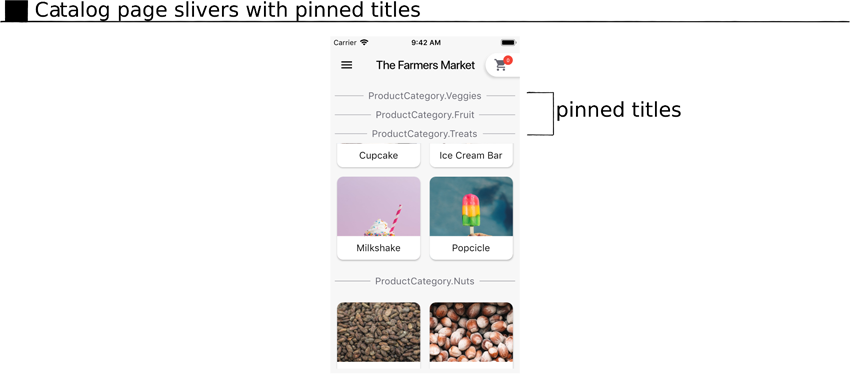

*Mô tả Hình 9.9:* Hình minh họa tiêu đề **"Catalog page slivers with pinned titles"** (Các sliver trên trang Catalog với tiêu đề được ghim). Khi người dùng cuộn xuống tới danh mục `ProductCategory.Treats` (hiển thị các món *Cupcake*, *Ice Cream Bar*, *Milkshake*, *Popcicle*) và `ProductCategory.Nuts` bên dưới, các tiêu đề của những danh mục đã cuộn qua ở phía trên (`ProductCategory.Veggies`, `ProductCategory.Fruit`, `ProductCategory.Treats`) không biến mất khỏi màn hình mà được ghim cố định và xếp chồng lên nhau ở ngay đầu trang (**pinned titles**).

Điểm khác biệt lớn giữa widget thông thường và sliver widget là sliver (cụ thể là delegate của nó) có phương thức `shouldRebuild`, như bạn có thể thấy trong đoạn code của `SliverAppBarDelegate` dưới đây. Bạn tạo các sliver tùy biến bằng cách kế thừa (*extend*) một lớp dựng sẵn của Flutter có cài đặt giao diện sliver.

**Listing 9.22 – Sliver tùy biến (`Custom slivers`)**

```dart
// e_commerce/lib/widget/scrollables/sliver_header.dart -- line ~58
class SliverAppBarDelegate
    extends SliverPersistentHeaderDelegate { // [1]
  final double minHeight; // [2]
  final double maxHeight; // [2]
  final Widget child; // [2]

  SliverAppBarDelegate({
    @required this.minHeight, // [3]
    @required this.maxHeight, // [3]
    @required this.child,
  });

  @override
  double get minExtent => minHeight;

  @override
  double get maxExtent => math.max(maxHeight, minHeight);

  @override
  Widget build( // [4]
      BuildContext context, double shrinkOffset, bool overlapsContent) {
    return SizedBox.expand(child: child);
  }

  @override
  shouldRebuild(SliverAppBarDelegate oldDelegate) { // [5]
    return maxHeight != oldDelegate.maxHeight ||
        minHeight != oldDelegate.minHeight ||
        child != oldDelegate.child;
  }
}
```

Chú thích của tác giả:

1. Để tạo một sliver, hãy kế thừa một lớp sliver (ở đây là `SliverPersistentHeaderDelegate`) giống như cách bạn kế thừa khi tạo một widget.
2. Những giá trị thành viên này không khác gì so với khi tạo một widget; chúng là các thuộc tính của lớp dùng để cấu hình sliver. Tất nhiên, những thuộc tính cụ thể này (`minHeight`, `maxHeight`, `child`) là đặc thù của riêng sliver này.
3. Truyền vào chiều cao tối thiểu (`minHeight`) và tối đa (`maxHeight`) vì sliver này nằm trong một vùng cuộn dọc. Trong lớp cơ sở, chúng được đặt tên là `minExtent` và `maxExtent` (độ rộng/kích thước tối thiểu và tối đa) bởi vì vùng cuộn cũng có thể nằm ngang.
4. Phương thức `build` của sliver hơi khác một chút. Cụ thể, ngoài `BuildContext context`, bạn còn được truyền thêm hai thông tin: `shrinkOffset` (độ lệch co lại khi cuộn) và `overlapsContent` (cho biết sliver có đang đè lên nội dung khác hay không).
5. `shouldRebuild` chính là thứ làm nên sự đặc biệt của sliver. Nó được dùng để quyết định xem một sliver có cần phải dựng lại (*rebuild*) hay không.

Phương thức `shouldRebuild` là phương thức mới ở đây (nhưng chẳng phải cái tên của nó đã tự giải thích hết rồi sao?). Đối với lập trình viên chúng ta, đây chính là yếu tố cốt lõi giúp các sliver đạt hiệu năng cao. Về cơ bản, điều bạn muốn nói với Flutter qua phương thức này là: *"Nếu đây vẫn là cùng một widget đó và có cùng kích thước đó, thì đừng dựng lại nó khi người dùng cuộn."*

Hai giá trị `minExtent` và `maxExtent` rất quan trọng, bởi vì các sliver có thể thay đổi kích thước (co giãn) nếu được cấu hình như vậy, dựa trên các sliver khác đang có mặt trong vùng nhìn thấy (*viewport*). Tuy nhiên, trong trường hợp khi cuộn, kích thước hiển thị của sliver sẽ nằm trong khoảng từ `minExtent` đến `maxExtent`.

> 💡 **Ví dụ bổ sung (không có trong sách):** Kết hợp `CustomScrollView`, `SliverPersistentHeader` (co giãn chiều cao theo `shrinkOffset`) và `SliverGrid` trong một màn hình hoàn chỉnh độc lập để bạn có thể chạy thử ngay:
>
> ```dart
> import 'dart:math' as math;
> import 'package:flutter/material.dart';
>
> class StickyCategoryCatalogDemo extends StatelessWidget {
>   const StickyCategoryCatalogDemo({super.key});
>
>   @override
>   Widget build(BuildContext context) {
>     final categories = <String, List<String>>{
>       'Rau củ (Veggies)': ['Măng tây', 'Bông cải xanh', 'Cà rốt', 'Xà lách'],
>       'Trái cây (Fruit)': ['Táo', 'Cam', 'Chuối', 'Dâu tây'],
>     };
>
>     return Scaffold(
>       appBar: AppBar(title: const Text('Farmers Market')),
>       body: CustomScrollView(
>         physics: const BouncingScrollPhysics(),
>         slivers: [
>           for (final entry in categories.entries) ...[
>             SliverPersistentHeader(
>               pinned: true,
>               delegate: _CategoryHeaderDelegate(
>                 minHeight: 36,
>                 maxHeight: 56,
>                 title: entry.key,
>               ),
>             ),
>             SliverGrid(
>               gridDelegate: const SliverGridDelegateWithFixedCrossAxisCount(
>                 crossAxisCount: 2,
>                 mainAxisSpacing: 8,
>                 crossAxisSpacing: 8,
>                 childAspectRatio: 2.2,
>               ),
>               delegate: SliverChildBuilderDelegate(
>                 (context, index) => Card(
>                   child: Center(child: Text(entry.value[index])),
>                 ),
>                 childCount: entry.value.length,
>               ),
>             ),
>           ],
>         ],
>       ),
>     );
>   }
> }
>
> class _CategoryHeaderDelegate extends SliverPersistentHeaderDelegate {
>   final double minHeight;
>   final double maxHeight;
>   final String title;
>
>   _CategoryHeaderDelegate({
>     required this.minHeight,
>     required this.maxHeight,
>     required this.title,
>   });
>
>   @override
>   double get minExtent => minHeight;
>
>   @override
>   double get maxExtent => math.max(maxHeight, minHeight);
>
>   @override
>   Widget build(
>       BuildContext context, double shrinkOffset, bool overlapsContent) {
>     return SizedBox.expand(
>       child: Container(
>         color: overlapsContent ? Colors.green.shade100 : Colors.grey.shade200,
>         alignment: Alignment.center,
>         child: Text(
>           title,
>           style: const TextStyle(fontWeight: FontWeight.bold),
>         ),
>       ),
>     );
>   }
>
>   @override
>   bool shouldRebuild(covariant _CategoryHeaderDelegate oldDelegate) {
>     return maxHeight != oldDelegate.maxHeight ||
>         minHeight != oldDelegate.minHeight ||
>         title != oldDelegate.title;
>   }
> }
> ```
>
> Khi bạn cuộn danh sách, mỗi tiêu đề danh mục sẽ thu nhỏ dần từ `maxHeight` (56px) về `minHeight` (36px), đổi màu nền khi đè lên nội dung (`overlapsContent == true`), và ghim chặt ở đầu màn hình nhờ `pinned: true`.

---

## Tóm tắt (Summary)

- Lập trình bất đồng bộ (*asynchronous programming*) tuy khó, nhưng đóng vai trò vô cùng quan trọng trong phát triển giao diện người dùng (UI).
- `Future` cung cấp những giá trị hiện chưa tồn tại, nhưng sẽ sớm có trong tương lai.
- Từ khóa `async` và `await` giúp lập trình bất đồng bộ dễ dàng hơn vì chúng dễ đọc hơn so với việc nối chuỗi các phương thức trên `Future`. Về mặt chức năng, chúng thực hiện cùng một công việc.
- Các đối tượng `StreamController` được dùng để định nghĩa các `Stream` (luồng đầu ra) và `Sink` (cổng đầu vào).
- `Sink` là điểm đầu vào (*entry point*) của dữ liệu cho một stream.
- `Stream` là thứ mà các đoạn code khác lắng nghe (*listen*) để nhận dữ liệu từ luồng ngay khi dữ liệu sẵn sàng. Các stream có thể được biến đổi (*transformed*), và những hàm nhận vào các stream rồi trả ra một stream chứa dữ liệu đã biến đổi được gọi là **stream bậc cao** (*higher-order streams*).
- Một **bloc** (*Business Logic Component* — thành phần logic nghiệp vụ) dựa vào các stream để xây dựng các đầu vào (*inputs*) và đầu ra (*outputs*) mà widget của bạn có thể tương tác, đóng vai trò là phần logic quản lý trạng thái (*state management logic*) cho widget.
- Flutter cung cấp các widget bất đồng bộ thông qua lớp `StreamBuilder`, giúp việc viết UI bất đồng bộ gọn gàng và sạch sẽ hơn nhiều.
- `StreamBuilder` thường (nhưng không bắt buộc) được sử dụng để xây dựng các khung nhìn cuộn động và cuộn vô hạn (*infinite and dynamic scroll views*). Những khung nhìn này thường được dựng bằng widget `CustomScrollView`.
- Một `Sliver` là một widget đặc biệt có khả năng quyết định việc dựng lại (*rebuilding*) một cách thông minh, giúp các vùng cuộn hoạt động hiệu quả hơn.
- Một `Sliver` khởi tạo các phần tử con của nó thông qua các lớp/hàm ủy thác được gọi là **delegate**.

---

## Bảng thuật ngữ của chương

| Thuật ngữ tiếng Anh | Nghĩa tiếng Việt | Giải thích ngắn |
|---|---|---|
| Asynchronous (async) | Bất đồng bộ | Mô hình thực thi không chặn luồng chính trong khi chờ một tác vụ tốn thời gian (như gọi mạng, đọc DB, hẹn giờ) hoàn tất. |
| `Future<T>` | Đối tượng Future (giá trị tương lai) | Đại diện cho một giá trị kiểu `T` (hoặc một lỗi) hiện chưa có nhưng sẽ sẵn sàng ở một thời điểm trong tương lai. |
| `async` / `await` | Từ khóa bất đồng bộ / chờ | Cú pháp giúp viết code xử lý `Future` theo phong cách tuần tự dễ đọc như code đồng bộ mà không làm đơ UI. |
| Callback hell | Địa ngục callback | Tình trạng lồng ghép quá nhiều hàm callback nối tiếp nhau (`.then(...)`) khiến code rối rắm, khó đọc và khó bảo trì. |
| `Stream<T>` | Luồng dữ liệu bất đồng bộ | Chuỗi các sự kiện/giá trị kiểu `T` được phát ra nối tiếp nhau theo thời gian; các thành phần khác có thể đăng ký lắng nghe (`listen`). |
| `Sink<T>` | Điểm nhận / Cổng đầu vào của luồng | Đầu vào nơi ta đẩy dữ liệu mới vào `StreamController` thông qua phương thức `.add()`. |
| `StreamController<T>` | Bộ điều khiển luồng | Lớp quản lý và kết nối cả hai đầu `sink` (đầu vào) và `stream` (đầu ra) của một luồng dữ liệu. |
| Broadcast stream | Luồng quảng bá | Loại stream cho phép nhiều đối tượng lắng nghe (*multiple listeners*) cùng một lúc, thay vì chỉ một listener duy nhất. |
| `BehaviorSubject<T>` | Chủ thể giữ giá trị gần nhất (RxDart) | Một `StreamController` dạng broadcast đặc biệt của thư viện `rxdart`, tự động lưu lại sự kiện mới nhất và phát ngay giá trị đó cho bất kỳ listener mới nào vừa đăng ký. |
| Higher-order stream | Stream bậc cao | Hàm hoặc bộ biến đổi (`StreamTransformer`) nhận đầu vào là một stream và trả về một stream mới với dữ liệu đã qua xử lý. |
| BLoC (Business Logic Component) | Thành phần logic nghiệp vụ | Kiến trúc quản lý trạng thái tách biệt logic nghiệp vụ khỏi UI, chỉ giao tiếp qua `Sink` (input) và `Stream` (output). |
| `StreamBuilder<T>` | Widget dựng UI từ Stream | Widget tích hợp sẵn của Flutter tự động lắng nghe một `Stream` và dựng lại cây widget con mỗi khi có `AsyncSnapshot` mới. |
| `AsyncSnapshot<T>` | Ảnh chụp nhanh bất đồng bộ | Đối tượng chứa trạng thái và dữ liệu (`data`, `error`, `connectionState`) của một `Stream` hoặc `Future` tại thời điểm hiện tại. |
| Infinite scrolling | Cuộn vô hạn | Kỹ thuật giao diện cho phép cuộn qua một danh sách có số lượng phần tử chưa biết trước hoặc rất lớn mà chỉ dựng các phần tử đang hiển thị. |
| `CustomScrollView` | Khung nhìn cuộn tùy biến | Widget cuộn mức thấp làm việc trực tiếp với các `Sliver` để kết hợp nhiều kiểu bố cục (danh sách, lưới, tiêu đề ghim) mượt mà. |
| Sliver | Mảnh/phần của vùng cuộn | Widget chuyên biệt bên trong `CustomScrollView`, chỉ dựng lười biếng các phần tử nằm trong vùng nhìn thấy (*viewport*) để tối ưu hiệu năng. |
| `SliverGrid` | Lưới Sliver | Sliver sắp xếp các widget con theo bố cục lưới hai chiều trong `CustomScrollView`. |
| Delegate | Bộ ủy thác | Đối tượng cung cấp các widget con một cách lười biếng (như `SliverChildBuilderDelegate`) hoặc định nghĩa cấu trúc bố cục (như `SliverGridDelegateWithFixedCrossAxisCount`) cho một sliver. |
| `SliverPersistentHeader` | Tiêu đề Sliver bền vững | Sliver hiển thị phần tiêu đề có thể co giãn kích thước và ghim cố định (`pinned: true`) ở đầu vùng cuộn khi người dùng cuộn qua. |
| `shouldRebuild` | Phương thức kiểm tra dựng lại | Phương thức trên sliver delegate giúp Flutter biết có cần dựng lại sliver khi cấu hình hoặc kích thước thay đổi hay không. |

---

# Phần 4: Vượt ra ngoài nền tảng (Beyond foundations)

Theo suy nghĩ của tác giả, tiêu đề của phần này thực ra còn gây tranh cãi. Trong phần này, tác giả bàn về hai chủ đề chính: **tương tác với dữ liệu bên ngoài** (*interacting with outside data*) và **kiểm thử** (*testing*). Tác giả không chắc liệu những chủ đề này có thực sự nằm "vượt ra ngoài nền tảng" hay không. Nhưng quả thật, cả hai đều không phải là điều kiện bắt buộc để tạo ra được một ứng dụng.

Chương 10, bàn về việc làm việc với dữ liệu, không phải là yêu cầu bắt buộc bởi vì nó đưa ra những giả định nhất định: chương này trình bày cách dùng một thư viện HTTP, làm việc với JSON, và chạm một chút tới Firebase. Đây đều là những lựa chọn công cụ cực kỳ phổ biến, nhưng không phải là những lựa chọn duy nhất. Theo nghĩa đó, chúng là tùy chọn (*optional*).

Kiểm thử (*testing*), tất nhiên, cũng là tùy chọn. Đúng ra nó không nên là tùy chọn, nhưng thực tế lại vậy. Nếu bạn đang học Flutter lần đầu tiên, có thể bạn chưa mấy bận tâm tới chuyện viết test. Xét cho cùng, có lẽ bạn cần phải biết mình đang kiểm thử cái gì trước đã. Dù nói vậy, Flutter thực sự giúp việc kiểm thử trở nên khá dễ dàng, và đó là một kỹ năng vô cùng giá trị. Đây cũng là chủ đề thú vị nhất, nên tác giả đã để dành phần tuyệt nhất cho đoạn kết của cuốn sách.
