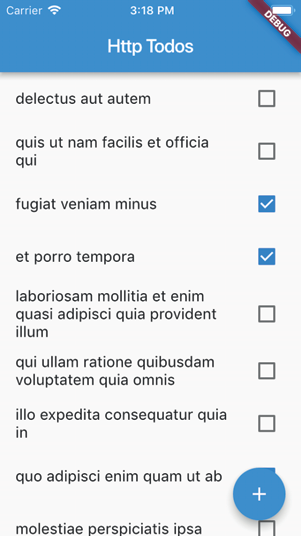
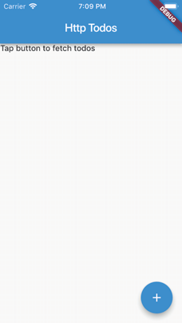
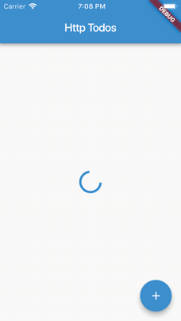
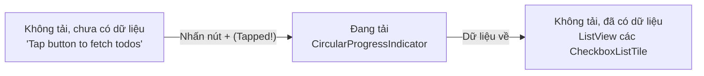
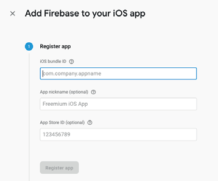
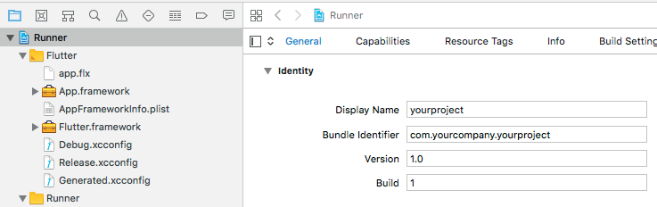
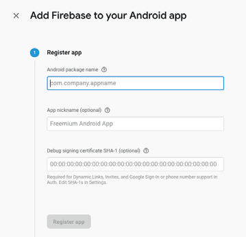
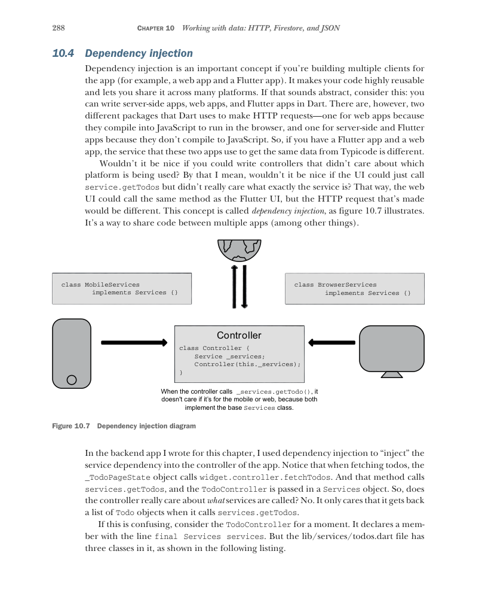
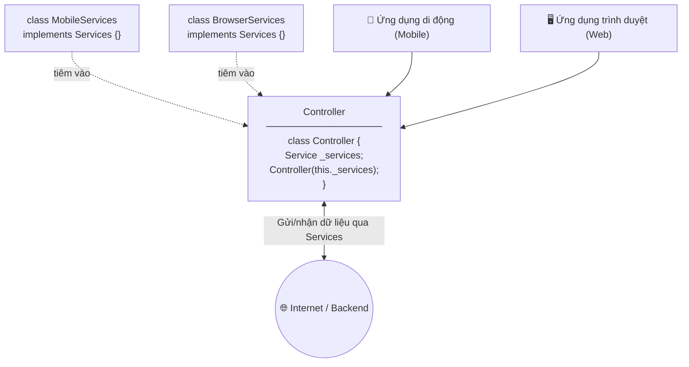

# Chương 10: Làm việc với dữ liệu: HTTP, Firestore và JSON (Working with data: HTTP, Firestore, and JSON)

## Mục lục chương

- [Chương này bao gồm](#chương-này-bao-gồm-this-chapter-covers)
- [10.1 HTTP và Flutter (HTTP and Flutter)](#101-http-và-flutter-http-and-flutter)
  - [10.1.1 Package http (HTTP package)](#1011-package-http-http-package)
  - [10.1.2 Request GET (GET requests)](#1012-request-get-get-requests)
- [10.2 Tuần tự hóa JSON (JSON serialization)](#102-tuần-tự-hóa-json-json-serialization)
  - [10.2.1 Tuần tự hóa thủ công (Manual serialization)](#1021-tuần-tự-hóa-thủ-công-manual-serialization)
  - [10.2.2 Tuần tự hóa JSON tự động sinh code (Auto-generated JSON serialization)](#1022-tuần-tự-hóa-json-tự-động-sinh-code-auto-generated-json-serialization)
  - [10.2.3 Cập nhật class Todo (Updating the Todo class)](#1023-cập-nhật-class-todo-updating-the-todo-class)
  - [10.2.4 Ghép tất cả lại trong UI (Bringing it all together in the UI)](#1024-ghép-tất-cả-lại-trong-ui-bringing-it-all-together-in-the-ui)
- [10.3 Làm việc với Firebase trong Flutter (Working with Firebase in Flutter)](#103-làm-việc-với-firebase-trong-flutter-working-with-firebase-in-flutter)
  - [10.3.1 Cài đặt Firestore (Installing Firestore)](#1031-cài-đặt-firestore-installing-firestore)
  - [10.3.2 Tạo một project Firestore (Create a Firestore project)](#1032-tạo-một-project-firestore-create-a-firestore-project)
  - [10.3.3 Cấu hình ứng dụng (Configure your app)](#1033-cấu-hình-ứng-dụng-configure-your-app)
  - [10.3.4 Thêm Firebase vào pubspec (Add Firebase to your pubspec)](#1034-thêm-firebase-vào-pubspec-add-firebase-to-your-pubspec)
  - [10.3.5 Sử dụng Firestore (Using Firestore)](#1035-sử-dụng-firestore-using-firestore)
- [10.4 Tiêm phụ thuộc (Dependency injection)](#104-tiêm-phụ-thuộc-dependency-injection)
- [Tóm tắt (Summary)](#tóm-tắt-summary)
- [Bảng thuật ngữ của chương](#bảng-thuật-ngữ-của-chương)

---

## Chương này bao gồm (This chapter covers)

- Tuần tự hóa (*serializing*) dữ liệu JSON
- Dùng HTTP để giao tiếp với backend
- Dùng Firebase làm backend
- Dùng cơ sở dữ liệu NoSQL Firestore
- Dùng tiêm phụ thuộc (*dependency injection*) để viết code tái sử dụng được

Đến thời điểm này của cuốn sách, nếu bạn đã đọc theo đúng thứ tự, bạn đã sẵn sàng xây dựng một frontend hoàn chỉnh, đủ chất lượng để đưa vào sản xuất (*production-ready*) bằng Flutter. Thật đấy, bạn đã "học xong" rồi! Nếu bạn làm ở một công ty đang cân nhắc xây dựng ứng dụng bằng Flutter, bạn đã có đủ mọi thông tin cần thiết để bắt đầu dự án đó, hoặc để thuyết phục sếp rằng Flutter đáng để đầu tư.

Nhưng có vô số chủ đề khác — tuy trong Flutter cũng tương tự như ở nhiều SDK khác — vẫn rất cần thiết khi viết ứng dụng. Trong phần còn lại của cuốn sách, tôi sẽ tạm rời khỏi trọng tâm "thuần Flutter" để nói về những chủ đề mà bạn cần vận dụng trong *bất kỳ* ứng dụng di động nào. Đặc biệt với ứng dụng mà chúng ta sẽ xây dựng trong chương này, có lẽ bạn sẽ muốn biết cách làm việc với một backend hoặc một kho dữ liệu (*data store*). Và để nói chuyện được với hầu hết mọi backend, bạn sẽ cần chuyển các đối tượng Dart sang một định dạng dữ liệu phổ quát nào đó, ví dụ như JSON. Đó chính là nội dung của chương này: giao tiếp với backend.

Với tinh thần đó, phần công việc về giao diện (UI) trong phần còn lại của cuốn sách khá nhẹ nhàng. Thực tế, ứng dụng tôi làm trong chương này trông giống như hình 10.1. Nó rất đơn giản. Đó là chủ ý. Trong chương này, không có lý do gì để sa đà vào việc ứng dụng *trông* thế nào, mà cần tập trung vào việc nó *tương tác* với các phần mềm khác ra sao.

**Hình 10.1 – Ảnh chụp màn hình ứng dụng todo được xây dựng trong chương này**




*Mô tả hình:* Hai ảnh chụp màn hình iOS của ứng dụng có thanh tiêu đề "Http Todos" và một nút tròn nổi (*floating action button*) có dấu "+" ở góc dưới bên phải. Ảnh thứ nhất hiển thị danh sách các todo (ví dụ "delectus aut autem", "quis ut nam facilis et officia qui", "fugiat veniam minus"...), mỗi dòng có một ô checkbox ở bên phải, một vài ô đã được đánh dấu. Ảnh thứ hai là trạng thái ban đầu, chỉ có dòng chữ "Tap button to fetch todos" (Nhấn nút để tải danh sách todo).

---

## 10.1 HTTP và Flutter (HTTP and Flutter)

Trong lúc viết cuốn sách này và suy nghĩ nên xây dựng ứng dụng nào làm ví dụ, tôi đã cố hết sức để loại bỏ càng nhiều phần "cài đặt, thiết lập" (*setup*) ra khỏi các ứng dụng càng tốt. Tôi không muốn đưa vào những mục kiểu như lấy dữ liệu thời tiết từ một API công khai cụ thể nào đó. Thông tin như vậy chỉ có ích nếu bạn tình cờ đang viết một ứng dụng thời tiết.

Ý tưởng đó tiếp tục được giữ trong chương này và chương sau (ở một mức độ nào đó). Trong nửa đầu chương, tôi muốn bàn về việc giao tiếp qua HTTP, nhưng không muốn tập trung vào bản thân backend. Vì vậy, tôi dùng một dịch vụ miễn phí của Typicode tên là JSONPlaceholder, dùng để giả lập (*mock*) các lời gọi API bất kỳ qua mạng.¹ Điểm mấu chốt là bạn không phải viết code backend hay thiết lập cơ sở dữ liệu gì cả. Bạn có thể gửi các lời gọi HTTP tới dịch vụ của Typicode, và nó sẽ trả về những đối tượng JSON đã được định sẵn.

> ¹ Dịch vụ Typicode JSONPlaceholder có tại https://jsonplaceholder.typicode.com/.

Mục tiêu của phần đầu chương này là thực hiện các request HTTP GET và POST để mô phỏng việc dùng một backend "thật". Dùng Typicode, tôi sẽ lấy về một danh sách todo, chuyển nó thành các đối tượng Dart mà ta có thể dùng, rồi hiển thị chúng lên màn hình. Tôi cũng sẽ viết một request POST để cập nhật todo khi nó được đánh dấu là hoàn thành. Nói chung, việc này gồm bốn bước:

1. Thêm package `http` của Flutter vào project.
2. Lấy danh sách todo từ Typicode bằng package `http`.
3. Chuyển đổi phản hồi (*response*) JSON thành các đối tượng Dart.
4. Hiển thị dữ liệu bằng một `ListView`.

> 📝 **Giải thích thêm (không có trong sách):** HTTP có nhiều "phương thức" (*method*). Hai phương thức hay gặp nhất:
> - **GET**: "cho tôi xin dữ liệu" — chỉ đọc, không thay đổi gì trên server. Ví dụ `GET https://jsonplaceholder.typicode.com/todos` trả về danh sách todo.
> - **POST**: "tôi gửi dữ liệu này lên cho anh" — thường dùng để tạo mới/cập nhật. Ví dụ gửi một todo mới dạng JSON trong phần thân (*body*) của request.
>
> Lưu ý: JSONPlaceholder là dịch vụ giả lập — nó trả lời như thể đã lưu dữ liệu của bạn, nhưng thực ra không lưu gì cả. Rất hợp để học.

### 10.1.1 Package http (HTTP package)

Với Flutter, package `http` giúp việc giao tiếp với các API khác qua HTTP trở nên dễ dàng. Để bắt đầu, package này phải được thêm vào file `pubspec.yaml` như trong listing sau.

**Listing 10.1 – Thêm dependency HTTP vào ứng dụng Flutter**

```yaml
# backend/pubspec.yaml -- line ~19
dependencies:
  http: ^0.12.0+2   # Đây là phiên bản mới nhất của package tại thời điểm viết sách.
                    # Tôi rất khuyên bạn dùng đúng phiên bản này khi làm theo sách.
                    # Tôi không thể đảm bảo các phiên bản mới hơn chạy được với code trong sách.
```

Chú thích trong sách cho Listing 10.1:
- `http: ^0.12.0+2` — đây là phiên bản mới nhất của package ở thời điểm viết sách. Tác giả rất khuyên bạn dùng chính phiên bản này khi làm theo sách, vì không thể đảm bảo các phiên bản mới hơn sẽ chạy được với code trong sách.

Sau khi thêm một dependency, bạn phải chạy `flutter packages get` trong terminal ở thư mục gốc của project. Lệnh này tải package về và làm cho code của nó dùng được trong project Flutter của bạn. Từ đây, chúng ta có thể chuyển sang dùng package trong project.

```bash
flutter packages get
```

> 📝 **Giải thích thêm (không có trong sách):** Ký hiệu `^0.12.0+2` gọi là *caret syntax*: "chấp nhận mọi phiên bản tương thích kể từ 0.12.0+2". Với phiên bản dạng `0.x`, Dart hiểu là `>=0.12.0+2 <0.13.0`. Ở các phiên bản Flutter hiện đại, lệnh `flutter pub get` tương đương với `flutter packages get`.

### 10.1.2 Request GET (GET requests)

Giờ package `http` đã được cài, bạn có thể xem nó được dùng thế nào trong thư mục `services` của ứng dụng. Tôi khuyên bạn đọc đoạn code này cùng các nhận xét đi kèm phía sau trước khi kịp bối rối. Sau khi cho bạn xem ví dụ, tôi sẽ giải thích sâu các khái niệm, nhưng có ngữ cảnh trước sẽ giúp bạn hiểu dễ hơn.

**Listing 10.2 – Một request HTTP GET**

```dart
// data_backend/lib/firestore/services.dart -- line ~13
class HttpServices implements Services {       // (1)
  Client client = Client();                    // (2)

  Future<List<Todo>> getTodos() async {        // (3)
    final response =
        await client.get(                      // (4)
      'https://jsonplaceholder.typicode.com/todos',
    );

    if (response.statusCode == 200) {          // (5)
      var all =
          AllTodos.fromJson(                   // (6)
        json.decode(response.body),
      );
      return all.todos;                        // (7)
    } else {
      throw Exception('Failed to load todos '); // (8)
    }
  }
}
```

Giải thích các chú thích trong Listing 10.2:
1. `HttpServices` là một class tự viết, không phải do package cung cấp. Nó chứa tất cả các lời gọi qua HTTP. Sẽ nói thêm về nó ngay sau đây!
2. `Client` là một class có trong package `http`, cung cấp các phương thức để thực hiện request HTTP.
3. `getTodos` là hàm tôi viết để thực hiện request GET. Nó trả về một danh sách các đối tượng `Todo` để Flutter hiển thị.
4. Dòng này mới thực sự gửi request HTTP. Bạn phải `await` nó, vì các lời gọi mạng phải là bất đồng bộ (*asynchronous*) thì mới hoạt động được.
5. Dòng này kiểm tra request có thành công hay không. Nếu thành công, ta đã có dữ liệu cần thiết để đi tiếp.
6. Dòng này biến dữ liệu từ request HTTP thành dữ liệu ta dùng được, bằng cách giải tuần tự hóa (*de-serializing*) phần thân (*body*) của phản hồi. Tuần tự hóa JSON sẽ được trình bày sau vài trang nữa, nhưng về cơ bản dòng này nói: "Hãy biến chuỗi JSON này thành một đối tượng Dart mà ta dùng được trong ứng dụng."
7. Trả về các đối tượng `Todo` dưới dạng một danh sách.
8. Ngược lại, lời gọi đã thất bại và cần ném ra (*throw*) một lỗi.

Trông có vẻ đơn giản — và đúng là đơn giản thật. Thực hiện request HTTP chẳng có gì nhiều. (Tất nhiên, server JSON này không yêu cầu header hay xác thực, nên đây là một ví dụ cơ bản.)² Điều quan trọng là việc thực hiện request HTTP trong Flutter (và trong các ứng dụng Dart phía server) khá đơn giản, dễ hiểu.³

> ² Nếu bạn chưa quen với request HTTP và cần thêm thông tin về header, bạn có thể xem bài viết tổng quan về HTTP này: https://developer.mozilla.org/en-US/docs/Web/HTTP/Headers.
>
> ³ Bạn cũng có thể xem repository này để có thêm ví dụ về package `http`: https://github.com/dart-lang/http.

Tuy nhiên, công bằng mà nói, có một phần code thiết yếu đã bị lướt qua nhiều nhất trong ví dụ: dùng tuần tự hóa JSON để biến thông tin nhận được "qua dây" (*over the wire*, tức qua mạng) thành các đối tượng Dart mà ta dùng được. Phần này thực ra phức tạp hơn bản thân request HTTP, và tôi sẽ trình bày nó ngay sau đây.

> 💡 **Ví dụ bổ sung (không có trong sách):** Code trong sách dùng `http: ^0.12.0`, khi đó `client.get` nhận trực tiếp một `String`. Từ `http` 0.13 trở đi, bạn phải truyền vào một `Uri` (và Dart đã có null safety). Phiên bản tương đương hiện đại, có thêm header và request POST (bước "cập nhật todo" mà sách nhắc tới ở đầu mục 10.1):
>
> ```dart
> import 'dart:convert';
> import 'package:http/http.dart' as http;
>
> Future<List<dynamic>> fetchTodosModern() async {
>   final response = await http.get(
>     Uri.parse('https://jsonplaceholder.typicode.com/todos'),
>     headers: {'Accept': 'application/json'},
>   );
>   if (response.statusCode == 200) {
>     return json.decode(response.body) as List<dynamic>;
>   }
>   throw Exception('Failed to load todos (${response.statusCode})');
> }
>
> Future<void> markCompleted(int id) async {
>   final response = await http.post(
>     Uri.parse('https://jsonplaceholder.typicode.com/todos'),
>     headers: {'Content-Type': 'application/json'},
>     body: json.encode({'id': id, 'completed': true}),
>   );
>   // JSONPlaceholder trả về 201 (Created) kèm dữ liệu vừa "tạo" (giả lập).
>   print('${response.statusCode}: ${response.body}');
> }
> ```
>
> Bài toán nhỏ: nếu server trả về mã 404, hàm `getTodos` trong Listing 10.2 sẽ làm gì? → Nó rơi vào nhánh `else` và ném ra `Exception('Failed to load todos ')`; nơi gọi hàm (ví dụ controller) nên bắt lỗi bằng `try/catch` để hiển thị thông báo cho người dùng thay vì để ứng dụng crash.

---

## 10.2 Tuần tự hóa JSON (JSON serialization)

Trước hết, chúng ta muốn nói gì khi dùng từ tuần tự hóa (*serialization*)? Trong ngữ cảnh gọi mạng, đây là thuật ngữ có nghĩa đại loại là "chuyển các đối tượng trong một ngôn ngữ lập trình sang một định dạng dữ liệu chuẩn, gọn nhẹ, có thể gửi qua mạng". Giải tuần tự hóa (*de-serialization*) là chiều ngược lại. Đó là việc chuyển dữ liệu chuẩn hóa, gọn nhẹ đó trở lại thành code, đặc thù cho ngôn ngữ lập trình bạn đang dùng. Thường thì định dạng dữ liệu chuẩn đó là JSON, và đó là định dạng tôi tập trung trong cuốn sách này.

> **CÒN NHỮNG LỰA CHỌN KHÁC (THERE ARE OTHER OPTIONS)** — Tất nhiên còn có những định dạng dữ liệu chuẩn hóa khác có thể gửi qua request HTTP, chẳng hạn XML. Các nguyên lý cơ bản vẫn giữ nguyên bất kể định dạng nào. Trong sách này, tôi nói cụ thể về việc biến JSON thành đối tượng Dart và biến đối tượng Dart trở lại thành JSON.

Trong ứng dụng Flutter, bạn có hai lựa chọn khi nói đến tuần tự hóa:

- Tuần tự hóa thủ công (*manual serialization*)
- Tuần tự hóa tự động sinh code bằng một package (*auto-generated serialization*)

Tôi muốn nói về cả hai. Tuần tự hóa thủ công đáng làm trong các ứng dụng nhỏ với những class không quá đồ sộ. Và nếu bạn chưa quen với tuần tự hóa, xem nó được cài đặt thủ công sẽ giúp làm rõ khái niệm. Dù vậy, tự động sinh class có khả năng tuần tự hóa dễ hơn rất nhiều khi viết code Dart, và trong thực tế bạn gần như lúc nào cũng muốn làm vậy. Nếu bạn là một lập trình viên ứng dụng lâu năm, có lẽ bạn có thể nhảy thẳng tới phần về tự động sinh code, vì ở đó tôi sẽ bàn về package Dart (và Flutter) cung cấp chức năng này cho bạn.

> 💡 **Ví dụ bổ sung (không có trong sách):** Hình dung tuần tự hóa như việc **đóng gói đồ để gửi bưu điện**. Một đối tượng Dart `Todo(1, 1, 'Đi chợ', false)` sống trong bộ nhớ của ứng dụng — bạn không thể "gửi" trực tiếp vùng nhớ đó qua mạng. Bạn phải "đóng gói" nó thành một chuỗi văn bản mà ai cũng đọc được:
>
> ```text
> Đối tượng Dart  --(serialize / toJson + json.encode)-->  '{"userId":1,"id":1,"title":"Đi chợ","completed":false}'
> Chuỗi JSON      --(json.decode + fromJson / deserialize)-->  Todo(userId: 1, id: 1, title: 'Đi chợ', completed: false)
> ```
>
> Phía nhận (dù viết bằng Python, Java hay Dart) sẽ "mở gói" chuỗi đó thành đối tượng trong ngôn ngữ của riêng nó.

### 10.2.1 Tuần tự hóa thủ công (Manual serialization)

Cho đến giờ, tôi mới cho bạn xem đúng một listing code trong chương này: thực hiện một request HTTP GET. Request GET đó trả về một đối tượng JSON. Đối tượng JSON đó thực ra chỉ là một chuỗi (*string*) với cách định dạng và vị trí đặt dấu ngoặc nhọn, dấu hai chấm... rất cụ thể. Khi nhận được từ request GET, nó trông như listing sau.

**Listing 10.3 – Đối tượng JSON từ lời gọi getPosts**

```json
// JSON
'[
  {
    "userId": 1,
    "id": 1,
    "title": "delectus aut autem",
    "completed": false
  },
  {
    "userId": 1,
    "id": 2,
    "title": "quis ut nam facilis et officia qui",
    "completed": false
  },
  {
    "userId": 1,
    "id": 3,
    "title": "fugiat veniam minus",
    "completed": false
  },
  // ... more todos
]
```

Hãy để ý dấu nháy ở ngoài cùng của đối tượng này. Điều quan trọng cần hiểu là "map" này thực chất chỉ là một chuỗi, nhưng chuỗi này tình cờ có định dạng rất cụ thể. Nếu bạn tạm bỏ qua việc nó thực ra là một chuỗi, bạn sẽ thấy dữ liệu này là một danh sách (*list*) các map. (Quan trọng là: ở cấp cao nhất nó cũng có thể là một `Map`. Ví dụ này chỉ tình cờ là một `List`, nhưng nói chung JSON cung cấp một cách tổ chức dữ liệu chỉ dùng map, list, số, boolean và chuỗi.)

> 📝 **Giải thích thêm (không có trong sách):** Sách viết "JSON object from getPosts call" trong tiêu đề Listing 10.3, nhưng thực chất đây là kết quả của lời gọi `getTodos` tới endpoint `/todos` (có lẽ tên cũ trong bản nháp của tác giả). Ngoài ra, JSON chuẩn còn có giá trị `null`, và JSON thật **không cho phép** comment như `// ... more todos` — dòng đó chỉ là chú thích của tác giả để rút gọn.

Bây giờ, để dùng dữ liệu đó trong một ứng dụng Flutter, ta có thể chuyển chuỗi JSON thành các đối tượng Dart. Khi các todo đã thành những đối tượng mà code Dart của chúng ta hiểu được, ta có thể dùng chúng để cấu hình các widget trong UI.

Trước tiên, để tôi cho bạn xem cách bạn có thể dùng các đối tượng này trong widget. Sau đó, tôi sẽ đi ngược lại và chỉ cho bạn cách biến JSON thành đối tượng Dart.

> **NHÌN LẠI ListView (REVISITING THE ListView)** — Ví dụ sau dùng widget `ListView`, đã được bàn đến từ tận chương 3. Việc dùng widget này không phải trọng tâm lúc này, nhưng nếu bạn không nhớ API của widget đó, có lẽ nên xem lại. Dù vậy, những phần mới và quan trọng hơn đều nằm trong khối `if/else`.

**Listing 10.4 – Dùng todos trong UI**

```dart
// Imagine todos is a variable that's a list of Todo objects that have been
// converted from JSON. A pseudo-code example would be:
// List<Todo> todos = TodoController.getTodosAsObjects();
ListView.builder(
    itemCount: todos != null ? todos.length : 1,   // (1)
    itemBuilder: (ctx, idx) {                      // (2)
      if (todos != null) {
        return CheckboxListTile(                   // (3)
          onChanged: (bool val) => updateTodo(todos[idx], val),
          value: todos[idx].completed,
          title: Text(todos[idx].title),
        );
      } else {
        return Text("Tap button to fetch todos");  // (4)
      }
    });
```

(Dịch phần comment đầu listing: "Hãy tưởng tượng `todos` là một biến chứa danh sách các đối tượng `Todo` đã được chuyển đổi từ JSON. Một ví dụ dạng mã giả sẽ là: `List<Todo> todos = TodoController.getTodosAsObjects();`".)

Giải thích các chú thích trong Listing 10.4:
1. Lúc chạy, `todos` có kiểu `List<Todo>`, nên nó phải có độ dài (`length`), kể cả khi bằng 0. Chúng ta cung cấp giá trị dự phòng là 1 vì `itemCount` không được phép null trong widget `ListView` (ở đây, nếu `todos` là null thì vẫn cần 1 phần tử để hiện dòng chữ hướng dẫn).
2. Hãy nhớ rằng callback của `ListView.builder` cung cấp chỉ số (*index*) của todo trong danh sách mà ta đang dùng để cấu hình các phần tử con của `ListView`.
3. Trong phương thức builder, `value` và `title` của `CheckboxListTile` tương ứng với một todo. Nếu các todo đã được tải về và chuyển thành đối tượng Dart, chúng có thể được dùng để cấu hình các phần tử con của `ListView`.
4. Ngược lại, ta vẫn cần tải chúng về, nên hiển thị lời nhắc bấm nút.

Ví dụ code này chỉ để cho thấy cách bạn cấu hình UI (đọc là: widget) từ các đối tượng Dart. Mục đích là chứng minh rằng bạn có khả năng sẽ dùng một thứ như `ListView`, vì bạn không biết trước độ dài của danh sách dữ liệu trước khi chạy (*runtime*).

Tuy nhiên, trước khi dùng được các đối tượng đó trong UI, bạn phải tải dữ liệu về rồi "nhào nặn" (*massage*) nó thành đối tượng Dart. Đó là phần cốt lõi của mục này. Nói chung, việc này gồm ba bước:

1. Tải dữ liệu qua HTTP, kết quả trả về là một khối (*blob*) JSON.
2. Phân tích (*parse*) JSON thành một đối tượng Dart chung chung (như một `Map`).
3. Biến đối tượng đó thành một kiểu cụ thể (`Todo`).

> **VỀ BƯỚC 2 (ABOUT STEP 2)** — Bước 2 là một bước trung gian cần thiết, vì Dart cung cấp sẵn cách biến một chuỗi JSON thành một `Map`. Nếu không có bước này, bạn sẽ phải biến chuỗi JSON thẳng thành một đối tượng (như `Todo`), và điều đó sẽ đòi hỏi một thuật toán khá "khó nhằn".

Cuối cùng, xin lưu ý thêm: ứng dụng này có thêm một bước nữa, vì JSON thực ra là một `List` gồm các phần tử kiểu `Map`. Thư viện JsonSerialization của Dart (và hầu hết thư viện của các ngôn ngữ khác) được thiết kế đặc biệt để xử lý JSON biểu diễn một *đối tượng*, chứ không phải JSON có cấp cao nhất là một danh sách. (Điều này hợp lý nếu bạn nghĩ tới một ngôn ngữ hướng đối tượng như Dart. Tuần tự hóa xoay quanh việc biến dữ liệu thô thành những viên gạch xây dựng nên ngôn ngữ: các đối tượng. Điều này sẽ rõ hơn khi kết thúc mục này.) Tuy nhiên, bây giờ hãy chỉ xem cách biến *một* todo trong JSON thành một `Todo`. JSON trong ví dụ này sẽ trông như listing tiếp theo.

**Listing 10.5 – Ví dụ một todo từ dịch vụ Typicode JSONPlaceholder**

```json
{
  "userId": 1,
  "id": 1,
  "title": "delectus aut autem",
  "completed": false
}
```

Như bạn thấy, nó chỉ là một map. Một tập hợp các khóa (*key*) và giá trị (*value*). Có lẽ các khóa và giá trị đó có thể được biến thành các thuộc tính (*property*) trên một đối tượng. Để bắt đầu, class `Todo` trông như đoạn code sau.

**Listing 10.6 – Class Todo**

```dart
// shared/lib/src/todo_model.dart
class Todo {
  final int userId;      // Để ý rằng mỗi thuộc tính phản ánh một khóa trong map JSON.
  final int id;
  final String title;
  bool completed;

  Todo(
    this.userId,
    this.id,
    this.title,
    this.completed,
  );
  // ...
```

Chú thích trong sách: Để ý rằng mỗi thuộc tính (`userId`, `id`, `title`, `completed`) phản ánh một khóa trong map JSON.

Có thể điều này đã hiển nhiên vào lúc này, nhưng dù sao tôi vẫn muốn dẫn bạn qua một ví dụ chuyển đổi map đó thành một `Todo`. Bước đầu tiên thực ra là viết phương thức biến một `Map` của Dart thành `Todo`. (Chúng ta sẽ lo việc chuyển chuỗi từ phản hồi HTTP thành `Map` ở bước tiếp theo.)

Để chuyển đổi `Map` đó, theo quy ước (*convention*), ta viết một phương thức factory cho class tên là `fromJson()`. Phương thức này nhận một `Map` làm đối số rồi tạo ra một `Todo` mới từ `Map` đó. `Todo.fromJson` trông như listing tiếp theo.

**Listing 10.7 – Các phương thức factory fromJson**

```dart
class Todo {
  final int userId;
  final int id;
  final String title;
  bool completed;

  Todo(this.userId, this.id, this.title, this.completed);

  factory Todo.fromJson(
    Map<String, dynamic> json,          // (1)
  ) {
    return Todo(
      json['userId'] as int,            // (2)
      json['id'] as int,
      json['title'] as String,
      json['completed'] as bool
    );
  }
}
```

Giải thích các chú thích trong Listing 10.7:
1. Tên đối số `json` thực ra hơi gây hiểu nhầm, vì vào lúc này nó đã là một `Map` rồi (không còn là chuỗi JSON). Nhưng đó là quy ước.
2. Với mỗi thuộc tính trong class `Todo`, lấy thuộc tính tương ứng ra khỏi JSON, vì trong trường hợp này tên các thuộc tính đều giống nhau.

Phương thức `fromJson` trong ví dụ này khá đơn giản. Bạn đúng nghĩa đen chỉ đang trích xuất thuộc tính từ map bằng cú pháp ngoặc vuông. Dùng từ khóa `as` đảm bảo các thuộc tính có đúng kiểu, hoặc nó sẽ ném lỗi nếu không thể chuyển sang đúng kiểu.

Đó là phần lớn những gì (lập trình viên) cần làm để chuyển JSON thành đối tượng. Chắc bạn cũng đoán được rằng một class đồ sộ, phức tạp sẽ kém vui hơn nhiều khi giải tuần tự hóa thủ công. (Ví dụ, hãy tưởng tượng một class có các thuộc tính chứa đối tượng `List` và các đối tượng tùy biến khác. Tưởng tượng rằng thay vì `userId`, `Todo` có một thuộc tính chỉ định một đối tượng `User`. Bạn sẽ phải gọi `User.fromJson` bên trong phương thức `Todo.fromJson`. Lát nữa tôi sẽ chỉ cho bạn một cách làm việc đó thật dễ dàng.)

> 💡 **Ví dụ bổ sung (không có trong sách):** Đây chính là tình huống "class lồng nhau" mà tác giả nhắc tới, làm thủ công trông như sau:
>
> ```dart
> class User {
>   final int id;
>   final String name;
>   User(this.id, this.name);
>
>   factory User.fromJson(Map<String, dynamic> json) =>
>       User(json['id'] as int, json['name'] as String);
> }
>
> class TodoWithUser {
>   final int id;
>   final String title;
>   final User user;          // đối tượng lồng nhau
>   final List<String> tags;  // danh sách
>
>   TodoWithUser(this.id, this.title, this.user, this.tags);
>
>   factory TodoWithUser.fromJson(Map<String, dynamic> json) {
>     return TodoWithUser(
>       json['id'] as int,
>       json['title'] as String,
>       User.fromJson(json['user'] as Map<String, dynamic>), // gọi fromJson của class con
>       (json['tags'] as List).map((e) => e as String).toList(),
>     );
>   }
> }
>
> // JSON đầu vào:
> // {"id": 7, "title": "Học Dart", "user": {"id": 1, "name": "An"}, "tags": ["dart", "flutter"]}
> ```
>
> Chỉ với 2 class mà đã khá dài dòng và dễ gõ sai tên khóa — đó là lý do mục 10.2.2 dùng công cụ sinh code tự động.

Tuy nhiên vẫn còn một bước nữa, và nó nằm trong request GET mà ta đã xem trước đó, như trong listing tiếp theo.

**Listing 10.8 – Phân tích dữ liệu ra khỏi một phản hồi HTTP**

```dart
// backend/lib/services/todos.dart -- line 18
Future<List<Todo>> getTodos() async {
  final response =
      await client.get('https://jsonplaceholder.typicode.com/todos');
  if (response.statusCode == 200) {
    // If the call to the server was successful, parse the JSON
    var all =
        AllTodos.fromJson(
      json.decode(response.body),   // Phần quan trọng của dòng này là phương thức json.decode.
    );
    // ...
```

(Comment trong code: "Nếu lời gọi tới server thành công, hãy phân tích JSON".) Chú thích trong sách: Phần quan trọng của dòng này là phương thức `json.decode`.

Hãy nhớ rằng phương thức factory `Todo.fromJson` yêu cầu đối số có kiểu `Map<String, dynamic>`, nhưng dữ liệu ta nhận từ phản hồi thực ra là một `String`. Thư viện chuẩn của Dart có sẵn một bộ chuyển đổi JSON rất tiện. Chỉ cần gọi `json.decode(String)` là nó sẽ biến chuỗi đó thành một `Map` cho bạn. Về mặt kỹ thuật, bạn có thể tự mình giải mã khối JSON, nhưng trong Dart không bao giờ có tình huống nào bạn cần viết đoạn code đó. Vì vậy, ở đây tôi sẽ không tốn thời gian chỉ cho bạn cách làm phép chuyển đổi đó thủ công.

> 📝 **Giải thích thêm (không có trong sách):** `json` là một hằng có sẵn trong thư viện `dart:convert` (cần `import 'dart:convert';`). Sách không cho xem class `AllTodos`; vì JSON ở cấp cao nhất là một danh sách, `json.decode` sẽ trả về `List<dynamic>` (không phải `Map`). Một cài đặt `AllTodos.fromJson` hợp lý trông như sau:
>
> ```dart
> import 'dart:convert';
>
> class AllTodos {
>   final List<Todo> todos;
>   AllTodos(this.todos);
>
>   factory AllTodos.fromJson(List<dynamic> json) {
>     return AllTodos(
>       json.map((item) => Todo.fromJson(item as Map<String, dynamic>)).toList(),
>     );
>   }
> }
>
> void main() {
>   const body = '[{"userId":1,"id":1,"title":"delectus aut autem","completed":false}]';
>   final all = AllTodos.fromJson(json.decode(body));
>   print(all.todos.first.title); // delectus aut autem
> }
> ```
>
> Đây chính là "bước thêm" mà tác giả nói: duyệt qua từng `Map` trong `List` và gọi `Todo.fromJson` cho mỗi phần tử.

### 10.2.2 Tuần tự hóa JSON tự động sinh code (Auto-generated JSON serialization)

Có nhiều package có thể sinh (*generate*) class Dart cho bạn. Package đơn giản nhất, và cũng là cái tôi thích dùng, tên là `json_serializable`. Khi dùng package này, bạn vẫn viết class như trước nay, và bạn cũng viết một phương thức `fromJson` và `toJson` trên các class đó. Hai phương thức này, `fromJson` và `toJson`, chỉ là những "cuống" (*stub*) gọi tới các phương thức mà package sinh ra cho bạn. Nói ngắn gọn, bạn không phải tự viết đoạn code rườm rà trích xuất từng cặp khóa–giá trị. Package này khá "ngon lành".

Để dùng `json_serializable`, bạn thực ra cần thêm ba dependency vào project:

```yaml
# backend/package.yaml -- line ~9
dependencies:
  flutter:
    sdk: flutter
  http: ^0.12.0
  json_annotation: ^2.0.0     # (1)

dev_dependencies:
  flutter_test:
    sdk: flutter
  build_runner: ^1.0.0        # (2)
  json_serializable: ^2.0.0   # (3)
```

Giải thích các chú thích:
1. `json_annotation` cung cấp một cách đơn giản để báo cho project biết cần sinh các phương thức tuần tự hóa JSON cho class này.
2. `build_runner` là package bạn dùng để chạy package `json_serializable`. Nó cũng bao gồm việc chạy ứng dụng web Dart ở chế độ phát triển (*development mode*).
3. `json_serializable` là package thực sự biết cách sinh code.

Sau khi cài xong các package đó và đã chạy `flutter packages get`, bạn có thể bắt đầu viết đoạn code cần thiết để sinh ra các phương thức `fromJson` và `toJson`. Để minh họa, hãy bắt đầu bằng việc cập nhật class `Todo`.

> 📝 **Giải thích thêm (không có trong sách):** Tại sao `build_runner` và `json_serializable` nằm trong `dev_dependencies`? Vì chúng chỉ cần lúc *phát triển* (để sinh code trên máy bạn), chứ không được đóng gói vào ứng dụng gửi tới người dùng. Ngược lại, `json_annotation` nằm trong `dependencies` vì annotation `@JsonSerializable()` xuất hiện trong chính code của ứng dụng. (Tên file trong comment là `package.yaml` theo đúng sách, nhưng trong project Flutter file này thực chất là `pubspec.yaml`.)

### 10.2.3 Cập nhật class Todo (Updating the Todo class)

Class `Todo` trong project, có dùng `json_serializable`, thực tế trông như listing sau. Nó có mọi thứ bạn cần để sinh ra code tuần tự hóa và giải tuần tự hóa JSON.

**Listing 10.9 – Tạo một model có thể tuần tự hóa**

```dart
import 'package:json_annotation/json_annotation.dart';  // (1)

part 'todo.g.dart';                                      // (2)

@JsonSerializable()                                      // (3)
class Todo {
  final int userId;
  final int id;
  final String title;
  bool completed;

  Todo(this.userId, this.id, this.title, this.completed);

  factory Todo.fromJson(Map<String, dynamic> json) =>
      _$TodoFromJson(json);                              // (4)

  Map<String, dynamic> toJson() =>
      _$TodoToJson(this);                                // (5)
}
```

Giải thích các chú thích trong Listing 10.9:
1. Import package `json_annotation`.
2. Cho phép class `Todo` truy cập các thành viên private trong file được sinh ra. Mọi file có đuôi `*.g.dart` đều là file được sinh tự động.
3. Báo cho bộ sinh code biết class này cần được sinh logic (tuần tự hóa).
4. Phương thức factory này sẽ gọi một phương thức được sinh ra, `_$TodoFromJson(json)`.
5. Việc tạo JSON từ một class cũng gọi một phương thức được sinh ra.

Nếu đây là một project mới và code sinh ra chưa tồn tại, bạn sẽ thấy lỗi trong file đó, vì `todo.g.dart` chưa tồn tại, và các phương thức đang được gọi từ file đó cũng chưa có. (Thực tế, nếu bạn đang làm theo source code của sách, bạn có thể xóa file `todo.g.dart` khỏi repo để tận mắt chứng kiến "phép màu".) Để sinh file đó, bạn cần mở terminal và chạy:

```bash
flutter packages pub run build_runner build
```

Khi chạy lệnh này ở thư mục gốc của project, `build_runner` sẽ tìm tất cả các class cần sinh code và sinh code cho chúng. (Nhắc lại, đó là các class được đánh dấu bằng annotation `@JsonSerializable()`.) Package sẽ tạo mới (hoặc ghi đè) file `todo.g.dart`, file này chứa logic như sau.

**Listing 10.10 – Code được sinh ra bởi package json_serialization**

```dart
// backend/lib/model/todo.g.dart
// GENERATED CODE - DO NOT MODIFY BY HAND

part of 'todo.dart';

// ************************************************************************
// JsonSerializableGenerator
// ************************************************************************

Todo _$TodoFromJson(Map<String, dynamic> json) {   // (1)
  return Todo(
    json['userId'] as int,
    json['id'] as int,
    json['title'] as String,
    json['completed'] as bool,
  );
}

Map<String, dynamic> _$TodoToJson(Todo instance) =>  // (2)
    <String, dynamic>{
      'userId': instance.userId,
      'id': instance.id,
      'title': instance.title,
      'completed': instance.completed
    };
```

(Dòng comment đầu file nghĩa là: "CODE ĐƯỢC SINH TỰ ĐỘNG – KHÔNG SỬA BẰNG TAY".)

Giải thích các chú thích trong Listing 10.10:
1. Code được sinh ra bao gồm phương thức này, biến JSON thành một `Todo`...
2. ... và phương thức này, làm điều ngược lại (biến `Todo` thành JSON).

Đó là tất cả những gì cần làm để tận dụng các package sinh chức năng tuần tự hóa cho bạn. Nếu bạn có một ứng dụng lớn với nhiều class đồ sộ, chạy một lệnh trong terminal nhanh hơn rất nhiều so với tự viết code phân tích các map.

> 💡 **Ví dụ bổ sung (không có trong sách):** Giả sử khóa trong JSON từ server là `snake_case` (ví dụ `"user_id"`) còn bạn muốn thuộc tính Dart là `userId`. Với `json_serializable` bạn chỉ cần thêm annotation, không phải sửa code parse:
>
> ```dart
> @JsonSerializable()
> class Todo {
>   @JsonKey(name: 'user_id')
>   final int userId;
>   final int id;
>   final String title;
>   @JsonKey(defaultValue: false)   // nếu JSON thiếu khóa này thì dùng false
>   bool completed;
>
>   Todo(this.userId, this.id, this.title, this.completed);
>
>   factory Todo.fromJson(Map<String, dynamic> json) => _$TodoFromJson(json);
>   Map<String, dynamic> toJson() => _$TodoToJson(this);
> }
> ```
>
> Chạy lại `build_runner build` (hoặc `build_runner watch` để tự sinh lại mỗi khi lưu file), file `todo.g.dart` sẽ dùng `json['user_id']`. Khi tuần tự hóa ngược, `json.encode(todo.toJson())` cho ra `{"user_id":1,"id":1,"title":"...","completed":false}`. Nếu gặp lỗi xung đột file cũ, thêm cờ `--delete-conflicting-outputs`.

### 10.2.4 Ghép tất cả lại trong UI (Bringing it all together in the UI)

Giờ bạn đã biết ứng dụng có thể lấy dữ liệu qua mạng, và biết dữ liệu đó có thể được tuần tự hóa thành các class Dart đúng nghĩa, đã đến lúc ghép tất cả lại cho mục đích ban đầu: hiển thị thông tin đó lên UI. Để tập trung vào nhiệm vụ trước mắt, tôi chọn gần như không dùng mẫu quản lý state (*state management pattern*) nào cả. Thông tin được lấy trực tiếp từ một controller ngay trong các widget. Có ba phần code liên quan:

- Controller cho Todo (*Todo controller*)
- Các cập nhật trong `main.dart`
- Các widget trong `todo_page.dart`

#### TODO CONTROLLER

Đây là một class về cơ bản đóng vai trò người đưa tin giữa các service HTTP và các widget. Nó chịu trách nhiệm nói cho UI biết các todo là gì và cần hiển thị gì. Nghe hơi trừu tượng, nên hãy xem code trong listing tiếp theo.

**Listing 10.11 – Todo controller**

```dart
// backend/lib/controllers/todo.dart
class TodoController {
  final Services services;                           // (1)
  List<Todo> todos;                                  // (2)

  StreamController<bool> onSyncController =          // (3)
      StreamController();
  Stream<bool> get onSync => onSyncController.stream;

  TodoController(this.services);

  Future<List<Todo>> fetchTodos() async {            // (4)
    onSyncController.add(true);                      // (5)
    todos = await services.getTodos();               // (6)
    onSyncController.add(false);                     // (7)
    return todos;
  }
}
```

Giải thích các chú thích trong Listing 10.11:
1. Các service được truyền vào class (qua constructor).
2. Các todo này là thứ cuối cùng sẽ được hiển thị.
3. Stream này báo cho UI biết các todo có đang được tải hay không. Nếu đang tải, UI nên hiển thị một widget loading nào đó.
4. Đây là phương thức sẽ nói chuyện với các service.
5. Báo cho ứng dụng biết danh sách đang được tải, để nó biết là không nên cố hiển thị danh sách.
6. Thực hiện lời gọi lấy todo. Đây là lời gọi `await`, nên hàm sẽ tạm dừng cho đến khi lời gọi xong.
7. Giờ ta đã có các todo, nên ứng dụng có thể hiển thị chúng ở nơi thích hợp.

Phương thức controller này, nói bằng "tiếng người", là: "Ồ, UI ơi, bạn muốn có dữ liệu để hiển thị à? Được thôi, vậy hãy đặt trạng thái của bạn là đang tải trong lúc tôi đi lấy dữ liệu từ các service." Một lúc sau. Rồi nó nói: "Xong rồi, tôi có dữ liệu cho bạn đây, bạn không còn đang tải nữa, bạn có thể hiển thị cái này."

Mục đích của controller này về cơ bản là giữ cho UI "ngốc" (*dumb*) nhất có thể. UI biết đến controller này vì nó được truyền vào từ `main.dart`.

> 📝 **Giải thích thêm (không có trong sách):** `StreamController` (trong `dart:async`) giống như một "đài phát thanh": controller gọi `add(true)` / `add(false)` để phát tin, còn bất kỳ ai `listen` vào `onSync` (ở đây là widget) sẽ nhận được tin. Trình tự khi người dùng bấm nút:
>
> ```text
> UI bấm nút → controller.fetchTodos()
>    onSync phát: true   → UI: isLoading = true  → hiện vòng xoay
>    await services.getTodos() ... (chờ mạng)
>    onSync phát: false  → UI: isLoading = false
>    trả về todos        → UI: setState(todos = ...) → hiện ListView
> ```
>
> Lưu ý thực tế: nếu `services.getTodos()` ném lỗi, dòng `add(false)` sẽ không bao giờ chạy và UI sẽ quay mãi. Nên bọc trong `try { ... } finally { onSyncController.add(false); }`.

#### TẠO CONTROLLER TRONG HÀM MAIN (CREATE THE CONTROLLER IN THE MAIN FUNCTION)

Hàm `main` có thể được dùng cho mọi công việc thiết lập cần làm trước khi ứng dụng render. Trong trường hợp này, ta cần tạo các controller và service mà ứng dụng sẽ dùng.

**Listing 10.12 – Gốc của ứng dụng Flutter**

```dart
void main() async {
  var services = HttpServices();                 // (1)
  var controller = TodoController(services);     // (2)
  runApp(TodoApp(controller: controller));       // (3)
}

class TodoApp extends StatelessWidget {
  final TodoController controller;

  TodoApp({this.controller});

  @override
  Widget build(BuildContext context) {
    return MaterialApp(
      home: TodoPage(controller: controller),    // (4)
    );
  }
}
```

Giải thích các chú thích trong Listing 10.12:
1. Tạo một instance của class thực hiện các lời gọi HTTP thật sự.
2. Tạo một instance của controller, controller này gọi tới các service đó.
3. Truyền controller vào ứng dụng.
4. Truyền controller tiếp xuống widget cần dùng nó.

Chẳng có gì nhiều ở đây. Tôi chỉ muốn cho bạn xem đoạn này để khi tôi cho bạn xem widget, bạn biết nó lấy tham chiếu tới controller từ đâu.

#### GIAO DIỆN TRANG TODO (TODO PAGE UI)

Trang Todo, trình bày trong listing 10.13, là một `StatefulWidget` chỉ đơn giản lấy các todo và hiển thị chúng trong một danh sách (hình 10.2).

**Hình 10.2 – Ảnh chụp màn hình ứng dụng Todo trên iOS**


*Mô tả hình:* Hai ảnh chụp màn hình iPhone (có dải "DEBUG" ở góc phải). Một ảnh là danh sách todo với các checkbox; ảnh còn lại là màn hình trống chỉ có dòng "Tap button to fetch todos" (Nhấn nút để tải todo) và nút "+" ở góc dưới.

Đối tượng state của widget này có ba nhiệm vụ:

1. Hiển thị một `ListView` các todo.
2. Thay vào đó, hiển thị một `CircularProgressIndicator` nếu todo đang được tải.
3. Tải các todo khi một nút được nhấn.

**Listing 10.13 – Trang danh sách Todo**

```dart
// backend/lib/todo_page.dart -- line ~14
class _TodoPageState extends State<TodoPage> {
  List<Todo> todos;
  bool isLoading = false;                          // (1)

  void initState() {
    super.initState();
    widget.controller.onSync.listen(               // (2)
        (bool syncState) => setState(() {
              isLoading = syncState;
            }));
  }

  void _getTodos() async {
    var newTodos =
        await widget.controller.fetchTodos();      // (3)
    setState(() => todos = newTodos);              // (4)
  }
  // ...
```

Giải thích các chú thích trong Listing 10.13:
1. Theo mặc định, các todo không ở trạng thái đang tải.
2. Khi widget này render, nó báo cho controller biết rằng nó cần được thông báo khi nào các todo đang được tải.
3. Phương thức này gọi tới controller.
4. Dùng `setState` để Flutter biết cần render lại khi bạn đã lấy được các todo.

Đó là nửa đầu của đối tượng `_TodoPageState`. Đó là phần chức năng, để bạn có ngữ cảnh cho các widget trong phương thức `build`, như trong listing sau.

**Listing 10.14 – Phương thức build của _TodoPageState**

```dart
// backend/lib/todo_page.dart -- line ~37
Widget get body => isLoading                       // (1)
    ? CircularProgressIndicator()                  // (2)
    : ListView.builder(                            // (3)
        itemCount:
            todos != null ? todos.length : 1,
        itemBuilder: (ctx, idx) {
          if (todos != null) {                     // (4)
            return CheckboxListTile(               // (5)
              onChanged: (bool val) => updateTodo(todos[idx], val),
              value: todos[idx].completed,
              title: Text(todos[idx].title),
            );
          } else {
            return Text("Tap button to fetch todos");
          }
        });

@override
Widget build(BuildContext context) {
  return Scaffold(
    appBar: AppBar(
      title: Text("Http Todos"),
    ),
    body: Center(child: body),                     // (6)
    floatingActionButton: FloatingActionButton(
      onPressed: () => _getTodos(),                // (7)
      child: Icon(Icons.add),
    ),
  );
}
```

Giải thích các chú thích trong Listing 10.14:
1. Phần thân (`body`) của widget này sẽ thay đổi tùy theo `isLoading`, mà `isLoading` lại thay đổi để phản hồi stream `controller.onSync`.
2. `CircularProgressIndicator` là một widget Material có sẵn, hiển thị một vòng xoay chờ (*spinner*) (sẽ thấy ở hình sau).
3. Các todo được hiển thị bằng "người bạn cũ" của chúng ta, `ListView.builder`.
4. Nếu không có todo nào, tôi muốn hiển thị một widget khác so với khi có todo.
5. `CheckboxListTile` được dùng để hiển thị từng todo riêng lẻ.
6. Hiển thị giá trị của widget `body` (chú thích số 1 trong danh sách này).
7. Ứng dụng này không tự động tải todo; bạn phải bảo nó làm điều đó bằng cách nhấn một nút.

Màn hình này thực ra có ba trạng thái: Đang tải; Không tải, nhưng chưa có dữ liệu; và Không tải, và đã có dữ liệu. Hình 10.3 cho thấy ví dụ của các trạng thái này.

**Hình 10.3 – Tiến trình của ứng dụng Todo**





*Mô tả hình:* Ba ảnh chụp màn hình nối với nhau bằng mũi tên đỏ từ trái sang phải. (1) Bên trái: trạng thái "Không tải, chưa có dữ liệu" — chỉ có dòng chữ "Tap button to fetch todos"; nút "+" có nhãn hình tia nổ "Tapped!" (Đã nhấn!). (2) Ở giữa: trạng thái "Đang tải" — vòng xoay `CircularProgressIndicator` ở giữa màn hình. (3) Bên phải: trạng thái "Không tải, đã có dữ liệu" — danh sách todo với các checkbox.



Cho đến giờ, chương này có lẽ khá dễ hiểu nếu bạn vừa quen với Flutter vừa là một người làm ứng dụng lâu năm. Tải JSON qua HTTP và giải tuần tự hóa JSON đó không phải là việc đặc thù của Flutter. Hơn nữa, Flutter và Dart cung cấp những API đơn giản để làm việc đó.

Nhưng đây (chưa hẳn) là cách làm "kiểu Flutter". Đội ngũ Flutter có vẻ rất chuộng dùng Firebase làm backend. (Để rõ ràng và không xuyên tạc ai: họ không nói như vậy. Tôi suy ra điều đó vì phần lớn áp đảo các hướng dẫn và tài liệu chính thức của Google đều dùng Firebase.) Vì vậy, phần còn lại của chương này sẽ dành cho việc dùng Firebase thay vì package `http`. Hãy coi đó là một cách khác để làm cùng một việc: giao tiếp với backend bên ngoài.

> 💡 **Ví dụ bổ sung (không có trong sách):** Code trong sách gọi `updateTodo(todos[idx], val)` nhưng không cho xem phần thân. Một cài đặt đơn giản trong `_TodoPageState` có thể là:
>
> ```dart
> void updateTodo(Todo todo, bool completed) async {
>   setState(() => todo.completed = completed);   // cập nhật UI ngay (optimistic update)
>   await widget.controller.services.updateTodo(todo); // gửi lên backend
> }
> ```
>
> Đây là lý do thuộc tính `completed` trong class `Todo` không có từ khóa `final` (khác với `userId`, `id`, `title`): nó là thứ duy nhất có thể thay đổi sau khi tạo. Phương thức `updateTodo` trong `Services` (xem Listing 10.18) sẽ là nơi gửi request POST/PUT với `json.encode(todo.toJson())`.

---

## 10.3 Làm việc với Firebase trong Flutter (Working with Firebase in Flutter)

Firebase là một nền tảng đám mây (*cloud platform*) của Google cung cấp rất nhiều tính năng. Nói đơn giản nhất, nó là một backend-dưới-dạng-dịch-vụ (*backend-as-a-service*). Nó có thể xử lý xác thực (*auth*), có cơ sở dữ liệu, có thể dùng để lưu trữ file như hình ảnh, và còn làm được nhiều hơn thế. Thật sự đó là một sản phẩm khá đáng kinh ngạc, vì nó bao trùm mọi thứ. Tuy nhiên, trong cuốn sách này, tôi muốn tập trung vào một dịch vụ cơ sở dữ liệu thuộc Firebase, tên là Firestore.

> **TIỀM NĂNG THỰC SỰ CỦA FIRESTORE (THE TRUE POTENTIAL OF FIRESTORE)** — Về mặt kỹ thuật, Firestore không chỉ là một cơ sở dữ liệu. Nó còn xử lý việc giao tiếp giữa ứng dụng của bạn và dữ liệu trong Firestore, và làm điều đó theo một cách có chủ kiến riêng (*opinionated*, tức là đã quy định sẵn cách làm). Công bằng mà nói, nên coi nó là một giải pháp trọn gói cho việc lưu trữ dữ liệu và làm việc với dữ liệu trong ứng dụng.

Xin nhắc lại, Firestore không chỉ là một cơ sở dữ liệu NoSQL. Nó còn cung cấp cách tương tác với dữ liệu theo kiểu *phản ứng* (*reactively*). Cụ thể, bạn có thể đăng ký theo dõi (*subscribe*) dữ liệu.

Khi code đăng ký theo dõi dữ liệu trong Firestore, code đó sẽ biết khi nào dữ liệu được chỉ định thay đổi, và ứng dụng của bạn có thể phản ứng tương ứng. Trong ứng dụng đơn giản này, chúng ta sẽ không quan tâm tới điều đó, nhưng nên nhớ rằng Firestore rất mạnh trong lập trình phản ứng (*reactive programming*). (Có lẽ đây là lý do đội Flutter dùng Firestore trong các ví dụ thường xuyên đến vậy. Chúng hợp nhau như bơ đậu phộng với mứt — một cặp "trời sinh" trong bánh mì kẹp kiểu Mỹ.)

> 💡 **Ví dụ bổ sung (không có trong sách):** "Đăng ký theo dõi dữ liệu" trông thế nào trong code? Với API `cloud_firestore` cùng thời với sách (0.9.x), `snapshots()` trả về một `Stream<QuerySnapshot>`; kết hợp với `StreamBuilder` (chương 9) UI tự cập nhật mỗi khi ai đó thêm/sửa todo trên server:
>
> ```dart
> StreamBuilder<QuerySnapshot>(
>   stream: Firestore.instance.collection('todos').snapshots(),
>   builder: (context, snapshot) {
>     if (!snapshot.hasData) return CircularProgressIndicator();
>     final todos = snapshot.data.documents
>         .map((ds) => Todo.fromJson(ds.data))
>         .toList();
>     return ListView(
>       children: todos.map((t) => Text(t.title)).toList(),
>     );
>   },
> );
> ```
>
> (Ở phiên bản mới, tên đã đổi: `FirebaseFirestore.instance`, `snapshot.data!.docs`, `ds.data()`.)

### 10.3.1 Cài đặt Firestore (Installing Firestore)

Thật không may, tôi phải phá vỡ quy tắc duy nhất mà tôi đã cố bám theo suốt cuốn sách: tránh phần thiết lập. Firebase không thể dùng được nếu không cấu hình gì đó trong các thư mục `android` và `ios` của project Flutter. Đây là lần đầu tiên (và duy nhất) trong cuốn sách này bạn cần đụng tới code đặc thù của từng nền tảng (*platform-specific*). Vì vậy, xin hãy kiên nhẫn trong khi tôi hướng dẫn từng bước để làm công việc đơn điệu này.

Tin tốt là việc này dễ như sao chép và dán, vì không có logic gì cả. Nếu không gặp trục trặc, bạn có thể thiết lập xong trong vài phút. Một tin tốt khác là bạn không phải viết chút Objective-C hay Java nào; bạn chỉ phải cập nhật cấu hình.

Nói chung, bạn cần làm theo các bước sau (các mục tiếp theo sẽ trình bày chi tiết quy trình này):

1. Đăng ký một tài khoản Firebase (miễn phí).
2. Tạo một project Firebase mới.
3. Thêm cơ sở dữ liệu Firestore vào project.
4. Đăng ký ứng dụng Android hoặc iOS của bạn với Firestore.
5. Táy máy với các thư mục native.
6. Thêm Firebase và Firestore vào file `pubspec.yaml`.
7. Sử dụng chúng.

> **LỜI MIỄN TRỪ VỀ VIỆC CÀI ĐẶT FIRESTORE (A DISCLAIMER ABOUT INSTALLING FIRESTORE)** — Một lời miễn trừ to tướng ở đây: đây (với một số độc giả) là một cuốn sách giấy. Mà sách thì không có WiFi hay gói dữ liệu di động, nên bạn không thể bấm vào link. Dù vậy, tôi sẽ nói chính xác bạn cần vào những trang web nào để có hướng dẫn chuyên sâu về cài đặt Firestore. Và tất cả đều được tài liệu hóa rất kỹ. Những bước này hẳn là đủ nếu bạn không gặp vấn đề gì. Nếu bạn gặp vấn đề và lời giải thích của tôi không giúp được gì, Google đã cung cấp hướng dẫn rất chi tiết này: https://codelabs.developers.google.com/codelabs/flutter-firebase/.

> **NoSQL trong hai đoạn văn (NoSQL in two paragraphs)**
>
> Firestore là một cơ sở dữ liệu NoSQL, giống như Mongo (MongoDB) (nhưng nó còn hơn thế nhiều). Trước hết, tôi phải nói rõ rằng NoSQL (và SQL) nằm ngoài phạm vi cuốn sách này.
>
> Giải thích ngắn gọn về cơ sở dữ liệu NoSQL là thế này: cơ sở dữ liệu NoSQL lưu dữ liệu của bạn dưới dạng các đối tượng lồng nhau, giống như một khối JSON khổng lồ. Dữ liệu không được cấu trúc theo một cách cụ thể, và không có bảng (*table*). Không có quan hệ (*relationship*), và bạn không thể nối (*join*) các bảng dữ liệu như trong SQL. Thay vào đó, có các collection và document. Collection (*tập hợp*) biểu diễn một `List` các document, còn document (*tài liệu*) về cơ bản là các đối tượng `Map` biểu diễn các bản ghi dữ liệu. Document có thể có collection làm thuộc tính. Trong một ứng dụng lớn, dữ liệu của bạn về cơ bản sẽ trở thành một map khóa–giá trị khổng lồ.
>
> Đó là cách Firestore lưu dữ liệu. Nó cung cấp một khối dữ liệu phi cấu trúc giống JSON. Thực tế, mỗi document trong một collection có thể có các thuộc tính khác với các document "anh em" của nó. Điều này không lý tưởng, nhưng là có thể.

> 💡 **Ví dụ bổ sung (không có trong sách):** So sánh cùng một dữ liệu todo trong SQL và trong Firestore:
>
> ```text
> SQL (bảng):                         Firestore (collection/document):
> +----+--------+-------------+       todos/                      <- collection
> | id | userId | title       |         ├─ abc123                 <- document
> +----+--------+-------------+         │    { userId: 1, title: "Đi chợ", completed: false }
> | 1  | 1      | Đi chợ      |         │    └─ subtodos/          <- collection lồng trong document
> | 2  | 1      | Nấu cơm     |         │         └─ x1 { title: "Mua rau" }
> +----+--------+-------------+         └─ def456
>                                            { userId: 1, title: "Nấu cơm", completed: true, priority: 2 }
> ```
>
> Để ý document `def456` có thêm trường `priority` mà `abc123` không có — đúng như sách nói, các document "anh em" có thể khác thuộc tính nhau.

### 10.3.2 Tạo một project Firestore (Create a Firestore project)

Trước tiên, bạn phải vào firebase.google.com và tạo một tài khoản. Đây là quy trình tiêu chuẩn, nhanh gọn. Sau đó, tạo một project. Trong Firebase, về cơ bản bạn sẽ có một project mới cho mỗi ứng dụng bạn xây dựng. Dưới đây là một số hướng dẫn lấy trực tiếp từ tài liệu Firebase:⁴

1. Trong Firebase console, nhấn **Add Project** (Thêm project); sau đó chọn hoặc nhập tên project.
2. (Tùy chọn) Sửa project ID. Firebase tự động gán một ID duy nhất cho project Firebase của bạn. Sau khi Firebase cấp phát tài nguyên cho project, bạn không thể đổi project ID nữa. Nếu muốn dùng một định danh cụ thể, bạn phải sửa project ID ngay trong bước thiết lập này.
3. Làm theo các bước thiết lập còn lại trong Firebase console, rồi nhấn **Create Project** (Tạo project).
4. Firebase tự động cấp phát tài nguyên cho project của bạn. Khi quá trình hoàn tất, bạn sẽ được đưa tới trang tổng quan (*overview*) của project trong Firebase console.

> ⁴ Các bước này lấy từ https://firebase.google.com/docs/flutter/setup.

> 📝 **Giải thích thêm (không có trong sách):** Bước 3 trong danh sách tổng quát ở mục 10.3.1 ("Thêm cơ sở dữ liệu Firestore vào project") được làm trong console: vào mục **Firestore Database** (thời điểm sách viết là **Database**) → **Create database** → chọn chế độ *test mode* (cho phép đọc/ghi tự do trong thời gian thử nghiệm) → tạo collection `todos` và thêm vài document có các trường `userId`, `id`, `title`, `completed` để ứng dụng có dữ liệu mà đọc.

### 10.3.3 Cấu hình ứng dụng (Configure your app)

Giờ đến phần "vui" đây. Trước khi có thể dùng các package Firebase trong Flutter, ta cần báo cho các nền tảng ứng dụng native (iOS và Android) biết rằng ta đang dùng chúng. Quy trình khác nhau giữa hai nền tảng, nên bạn hãy làm theo hướng dẫn cho nền tảng bạn dùng khi phát triển. Ví dụ, tôi kiểm thử Flutter hoàn toàn trên iOS, nên tôi sẽ không bận tâm thêm Firebase vào ứng dụng Android trừ khi định phát hành ứng dụng lên production.

#### CẤU HÌNH IOS (CONFIGURE IOS)

1. Trong Firebase console, chọn **Project Overview** ở thanh điều hướng bên trái. Sau đó nhấn nút **iOS** bên dưới dòng *Get started by adding Firebase to your app* (Bắt đầu bằng cách thêm Firebase vào ứng dụng). Bạn sẽ thấy hộp thoại như trong hình 10.4.

**Hình 10.4 – Ảnh chụp màn hình từ giao diện web của Firebase**



*Mô tả hình:* Hộp thoại "Add Firebase to your iOS app" (Thêm Firebase vào ứng dụng iOS), bước 1 "Register app" (Đăng ký ứng dụng), gồm các ô: "iOS bundle ID" (ví dụ gợi ý `com.company.appname`), "App nickname (optional)" (Biệt danh ứng dụng – tùy chọn, gợi ý "Freemium iOS App"), "App Store ID (optional)" (ID trên App Store – tùy chọn, gợi ý "123456789"), và nút "Register app" (Đăng ký ứng dụng).

2. Giá trị quan trọng cần cung cấp là iOS bundle ID, bạn sẽ lấy được qua ba bước sau.
3. Trong công cụ dòng lệnh, đi tới thư mục cấp cao nhất của ứng dụng Flutter.
4. Chạy lệnh `open ios/Runner.xcworkspace` để mở Xcode.

   ```bash
   open ios/Runner.xcworkspace
   ```

5. Trong Xcode, nhấn vào mục `Runner` ở cấp cao nhất trong khung bên trái để hiện tab **General** ở khung bên phải như trong hình 10.5. Sao chép giá trị **Bundle Identifier**.

**Hình 10.5 – Ảnh chụp màn hình Xcode, cho thấy nơi cấu hình cơ sở dữ liệu Firestore**



*Mô tả hình:* Cửa sổ Xcode. Khung bên trái là cây thư mục: `Runner` (cấp cao nhất) → thư mục `Flutter` (chứa `app.flx`, `App.framework`, `AppFrameworkInfo.plist`, `Flutter.framework`, `Debug.xcconfig`, `Release.xcconfig`, `Generated.xcconfig`) và bên dưới là thư mục con cũng tên `Runner`. Khung bên phải đang mở tab **General**, mục **Identity**: Display Name = `yourproject`, Bundle Identifier = `com.yourcompany.yourproject`, Version = `1.0`, Build = `1`.

6. Quay lại hộp thoại Firebase, dán Bundle Identifier vừa sao chép vào ô **iOS bundle ID**, rồi nhấn **App** (Register app).
7. Tiếp tục trong Firebase, làm theo hướng dẫn để tải file cấu hình `GoogleService-Info.plist`.
8. Quay lại Xcode. Để ý rằng `Runner` có một thư mục con cũng tên là `Runner` (như trong hình 10.5).
9. Kéo file `GoogleService-Info.plist` (vừa tải về) thả vào thư mục con `Runner` đó.
10. Trong hộp thoại hiện ra trong Xcode, nhấn **Finish**.
11. Quay lại Firebase console. Ở bước thiết lập, nhấn **Next**, rồi bỏ qua các bước còn lại và quay về trang chính của Firebase console.

#### CẤU HÌNH ANDROID (CONFIGURE ANDROID)

Tôi nghĩ Android đỡ rườm rà hơn khi thiết lập, vì bạn không phải đụng tới ứng dụng bên thứ ba nào như Xcode:

1. Trong Firebase Console, chọn **Project Overview** ở thanh điều hướng bên trái, rồi nhấn nút **Android** bên dưới dòng *Get started by adding Firebase to your app*. Bạn sẽ thấy hộp thoại như trong hình 10.6.
2. Giá trị quan trọng cần cung cấp là tên package Android (*Android package name*), bạn sẽ lấy được qua hai bước sau.
3. Trong thư mục ứng dụng Flutter, mở file `android/app/src/main/AndroidManifest.xml`.
4. Trong phần tử `manifest`, tìm giá trị chuỗi của thuộc tính `package`. Giá trị này chính là tên package Android (đại loại như `com.yourcompany.yourproject`). Sao chép giá trị này.
5. Trong hộp thoại Firebase, dán tên package vừa sao chép vào ô **Android package name**.
6. Nhấn **App** (Register app).
7. Tiếp tục trong Firebase, làm theo hướng dẫn để tải file cấu hình `google-services.json`.
8. Đi tới thư mục ứng dụng Flutter của bạn; rồi chuyển file `google-services.json` (vừa tải về) vào thư mục `android/app`.
9. Quay lại Firebase console, bỏ qua các bước còn lại và quay về trang chính của Firebase console.
10. Cuối cùng, bạn cần plugin Google Services Gradle để đọc file `google-services.json` do Firebase sinh ra. Trong IDE hoặc trình soạn thảo, mở `android/app/build.gradle` và thêm dòng sau làm dòng cuối cùng của file:

    ```groovy
    apply plugin: 'com.google.gms.google-services'
    ```

11. Mở `android/build.gradle`. Sau đó, bên trong thẻ `buildscript`, thêm một dependency mới:

    ```groovy
    buildscript {
        repositories {
            // ...
        }
        dependencies {
            // ...
            classpath 'com.google.gms:google-services:3.2.1'   // new (mới thêm)
        }
    }
    ```

Và bạn đã xong!

**Hình 10.6 – Ảnh chụp màn hình từ giao diện web của Firebase**



*Mô tả hình:* Hộp thoại "Add Firebase to your Android app" (Thêm Firebase vào ứng dụng Android), bước 1 "Register app", gồm các ô: "Android package name" (Tên package Android, gợi ý `com.company.appname`), "App nickname (optional)" (gợi ý "Freemium Android App"), "Debug signing certificate SHA-1 (optional)" (Chứng chỉ ký debug SHA-1 – tùy chọn, dạng `00:00:...:00`) kèm dòng ghi chú "Required for Dynamic Links, Invites, and Google Sign-In or phone number support in Auth. Edit SHA-1s in Settings." (Bắt buộc với Dynamic Links, Invites và Google Sign-In hoặc đăng nhập bằng số điện thoại trong Auth. Sửa SHA-1 trong phần Settings.), và nút "Register app".

> 📝 **Giải thích thêm (không có trong sách):** Hai file Gradle có vai trò khác nhau. `android/build.gradle` (cấp project) khai báo *nơi lấy* plugin (dòng `classpath`), còn `android/app/build.gradle` (cấp module ứng dụng) *áp dụng* plugin đó (`apply plugin`). Plugin sẽ đọc `google-services.json` và sinh ra các tài nguyên Android chứa API key, project ID... để thư viện Firebase biết kết nối tới project nào. Ngày nay, cách thiết lập nhanh hơn là dùng FlutterFire CLI (`flutterfire configure`), nó tự sinh file `firebase_options.dart` cho cả hai nền tảng.

### 10.3.4 Thêm Firebase vào pubspec (Add Firebase to your pubspec)

Tôi xin lỗi nếu phần vừa rồi làm bạn mệt mỏi. Cấu hình và thiết lập là phần tôi ghét nhất khi làm phần mềm. Nhưng giờ ta có thể quay lại với Flutter. Bước thiết lập cuối cùng là thêm đúng các package vào file `pubspec.yaml`. Listing tiếp theo cho thấy danh sách dependency hoàn chỉnh của ứng dụng ví dụ này.

**Listing 10.15 – File pubspec hoàn chỉnh**

```yaml
# backend/pubspec.yaml
dependencies:
  flutter:
    sdk: flutter
  http: ^0.12.0
  json_annotation: ^2.0.0
  firebase_core: ^0.3.4      # (1)
  cloud_firestore: ^0.9.1    # (2)
```

Giải thích các chú thích trong Listing 10.15:
1. Firebase core cần thiết cho mọi tính năng của Firebase.
2. Cloud Firestore là package dành riêng cho cơ sở dữ liệu, thứ mà ta sẽ dùng.

### 10.3.5 Sử dụng Firestore (Using Firestore)

Nhìn từ trên cao, giờ có hai bước để dùng Firebase. Thứ nhất, viết các service nói chuyện với Firestore. Thứ hai, gọi các service đó trong ứng dụng. (Tất nhiên đây là cách giải thích quá đơn giản hóa.)

Trước hết, hãy nói về các service trong listing tiếp theo. Tất cả nằm trong file `lib/services/todo.dart`.

**Listing 10.16 – Cài đặt các service Firebase**

```dart
import 'package:cloud_firestore/cloud_firestore.dart';   // (1)

class FirebaseServices implements Services {              // (2)
  // ...
  @override
  Future<List<Todo>> getTodos() async {
    QuerySnapshot snapshot =                              // (3)
        await Firestore
            .instance
            .collection("todos")
            .getDocuments();
    AllTodos todos =
        AllTodos.fromSnapshot(snapshot);                  // (4)
    return todos.todos;
  }
}
```

Giải thích các chú thích trong Listing 10.16:
1. Import package Firestore để ta dùng được API của nó.
2. Class này cài đặt (*implements*) cùng một interface với class dùng package `http`, để ta có thể dùng tiêm phụ thuộc (*dependency injection*). Nếu điều đó nghe như vô nghĩa, hãy tạm "ghim" các thắc mắc lại vài trang. Chương này kết thúc bằng một mục về tiêm phụ thuộc.
3. Firebase dùng các đối tượng gọi là snapshot (*ảnh chụp nhanh*), biểu diễn các bản ghi trong cơ sở dữ liệu tại một thời điểm duy nhất. Tôi sẽ trình bày kỹ điều này sau.
4. `AllTodos.fromSnapshot` là một phương thức tôi tự viết, sẽ được trình bày sau.

Phần quan trọng của đoạn code đó, với mục này, là dòng xử lý đối tượng `QuerySnapshot`. Có nhiều thứ diễn ra ở đó. Hãy để tôi nói từng phần một.

`QuerySnapshot` là một class biểu diễn một số dữ liệu từ cơ sở dữ liệu tại một thời điểm bất kỳ. Thuật ngữ *snapshot* được dùng vì Firestore là một cơ sở dữ liệu thời gian thực (*real-time database*), nên về lý thuyết dữ liệu thay đổi liên tục. Một snapshot nói rằng: "Đây là dữ liệu bạn muốn, đúng vào thời điểm bạn yêu cầu." Đây là thuật ngữ phổ biến trong các cơ sở dữ liệu NoSQL.

Ở phía bên kia dấu bằng, phần quan trọng đầu tiên là `Firestore.instance`. `instance` là một getter tĩnh (*static getter*) trên package Firestore, biểu diễn chính cơ sở dữ liệu. Mọi lời gọi tới Firestore trong ứng dụng của bạn đều bắt đầu bằng việc lấy `Firestore.instance`.

Tiếp theo, `collection` là một phương thức lấy một collection từ cơ sở dữ liệu. Có hai loại đối tượng trong Firestore: document và collection (là một `Map` các document). `collection` nhận một đường dẫn (*path*) tương ứng với dữ liệu trong cơ sở dữ liệu. Ở đây, `todos` là một collection cấp cao nhất trong cơ sở dữ liệu. Nếu bạn muốn tìm các todo con (*sub-todos*) của một todo, đường dẫn có thể là `todos/$id/subtodos`, trong đó `id` đại diện cho một todo cụ thể, còn `subtodos` là một collection trên document đó. (Ứng dụng này không xử lý dữ liệu lồng nhau, nên đó chỉ là ví dụ.) Và cuối cùng, `getDocuments` lấy tất cả các document trong collection đó và trả về chúng dưới dạng một `QuerySnapshot`.

Vậy, nhìn từ trên cao, hàm này về cơ bản nói: "Này Firestore, đưa tôi tất cả các document bạn có nằm dưới khóa `todos` vào đúng thời điểm này." Sau đó hàm truyền `QuerySnapshot` đó cho `AllTodos.fromSnapshot`, phương thức này biến snapshot thành các class Dart mà ta quan tâm. Phương thức `AllTodos.fromSnapshot` trông như listing sau.

**Listing 10.17 – Chuyển một QuerySnapshot của Firestore thành đối tượng Dart**

```dart
factory AllTodos.fromSnapshot(QuerySnapshot s) {
  List<Todo> todos = s.documents.map<Todo>(       // (1)
      (DocumentSnapshot ds) {
    return Todo.fromJson(ds.data);                // (2)
  }).toList();
  return AllTodos(todos);
}
```

Giải thích các chú thích trong Listing 10.17:
1. Duyệt qua tất cả các document riêng lẻ (có kiểu `DocumentSnapshot`)...
2. ... và biến chúng thành các đối tượng `Todo`, thứ mà UI của chúng ta biết cách hiển thị.

Đó là một ví dụ đơn giản, và có thể bạn thấy dường như còn nhiều thứ tôi chưa nói tới, nhưng dùng Firestore là như vậy đó. Nếu bạn hiểu tốt về stream — điều mà hy vọng bạn đã có từ chương trước — và làm việc được với `QuerySnapshot` cùng `Firestore.instance`, thì đó là 99% những gì bạn cần biết để làm việc với Firestore. Về cơ bản, dùng Firestore xoay quanh việc tạo truy vấn (*query*) rồi giải tuần tự hóa dữ liệu thành đối tượng Dart.

> 💡 **Ví dụ bổ sung (không có trong sách):** Interface `Services` (Listing 10.18) còn có `updateTodo` và `addTodo`. Với API `cloud_firestore` 0.9.x, chúng có thể được cài đặt như sau — để ý ta lại dùng `toJson()` sinh tự động ở mục 10.2.3, vì Firestore nhận dữ liệu dạng `Map`:
>
> ```dart
> @override
> Future<Todo> updateTodo(Todo todo) async {
>   // Giả sử id của document trùng với todo.id
>   await Firestore.instance
>       .collection('todos')
>       .document('${todo.id}')
>       .updateData({'completed': todo.completed});
>   return todo;
> }
>
> @override
> Future addTodo() async {
>   final todo = Todo(1, DateTime.now().millisecondsSinceEpoch, 'Todo mới', false);
>   await Firestore.instance.collection('todos').add(todo.toJson());
> }
>
> // Truy vấn có điều kiện: chỉ lấy các todo chưa xong
> Future<List<Todo>> getIncompleteTodos() async {
>   final snapshot = await Firestore.instance
>       .collection('todos')
>       .where('completed', isEqualTo: false)
>       .getDocuments();
>   return AllTodos.fromSnapshot(snapshot).todos;
> }
> ```

---

## 10.4 Tiêm phụ thuộc (Dependency injection)

Tiêm phụ thuộc (*dependency injection*) là một khái niệm quan trọng nếu bạn đang xây dựng nhiều ứng dụng khách (*clients*) khác nhau cho cùng một sản phẩm (chẳng hạn một ứng dụng web và một ứng dụng Flutter). Kỹ thuật này giúp code của bạn có tính tái sử dụng rất cao và cho phép bạn chia sẻ code giữa nhiều nền tảng. Nếu điều đó nghe có vẻ trừu tượng, hãy thử nghĩ thế này: bạn có thể viết ứng dụng phía server (*server-side apps*), ứng dụng web (*web apps*) và ứng dụng Flutter đều bằng ngôn ngữ Dart. Tuy nhiên, có hai package khác nhau mà Dart dùng để thực hiện các request HTTP — một package dành cho ứng dụng web vì chúng biên dịch sang JavaScript để chạy trên trình duyệt, và một package dành cho ứng dụng server-side cũng như Flutter vì chúng không biên dịch sang JavaScript. Do đó, nếu bạn có một ứng dụng Flutter và một ứng dụng web, phần service mà hai ứng dụng này dùng để lấy cùng một dữ liệu từ Typicode sẽ khác nhau.

Chẳng phải sẽ rất tuyệt nếu bạn có thể viết các controller không cần bận tâm nền tảng nào đang được sử dụng sao? Ý tôi là, chẳng phải sẽ rất hay nếu tầng giao diện (UI) chỉ cần gọi `service.getTodos` mà không thực sự quan tâm `service` đó cụ thể là gì? Bằng cách đó, UI trên web có thể gọi cùng một phương thức như UI trên Flutter, dù request HTTP thực sự được gửi đi bên dưới là khác nhau. Khái niệm này được gọi là *tiêm phụ thuộc* (*dependency injection*), như hình 10.7 minh họa. Đây là một cách để chia sẻ code giữa nhiều ứng dụng (cùng nhiều lợi ích khác).

**Hình 10.7 – Sơ đồ tiêm phụ thuộc (Dependency injection diagram)**






*Mô tả hình:* Sơ đồ minh họa cơ chế tiêm phụ thuộc:
- Ở trung tâm là hộp **Controller**:
  ```dart
  class Controller {
    Service _services;
    Controller(this._services);
  }
  ```
- Bên trái là biểu tượng điện thoại di động trỏ mũi tên vào `Controller`, phía trên là khối `class MobileServices implements Services {}`.
- Bên phải là biểu tượng màn hình máy tính (trình duyệt web) trỏ mũi tên vào `Controller`, phía trên là khối `class BrowserServices implements Services {}`.
- Ở giữa phía trên là biểu tượng quả địa cầu (Internet/Backend) có hai mũi tên hai chiều kết nối với tầng xử lý.
- Chú thích bên dưới hộp Controller: *"When the controller calls `_services.getTodo()`, it doesn't care if it's for the mobile or web, because both implement the base `Services` class."* (Khi controller gọi `_services.getTodo()`, nó không quan tâm đó là bản dành cho di động hay web, bởi vì cả hai đều cài đặt class cơ sở `Services`).

Trong ứng dụng làm việc với backend mà tôi viết cho chương này, tôi đã dùng kỹ thuật tiêm phụ thuộc để "tiêm" (*inject*) phụ thuộc service vào trong controller của ứng dụng. Hãy để ý rằng khi tải danh sách todo, đối tượng `_TodoPageState` gọi `widget.controller.fetchTodos`. Và phương thức đó lại gọi `services.getTodos`, trong khi `TodoController` được truyền vào một đối tượng kiểu `Services`. Vậy, bản thân controller có thực sự quan tâm *những service cụ thể nào* được gọi không? Không hề. Nó chỉ quan tâm rằng nó nhận về một danh sách các đối tượng `Todo` khi gọi `services.getTodos`.

Nếu điều này gây bối rối, hãy xem xét `TodoController` một chút. Nó khai báo một thuộc tính thành viên bằng dòng `final Services services`. Nhưng file `lib/services/todos.dart` lại có tới ba class bên trong, như thể hiện trong listing tiếp theo.

**Listing 10.18 – Sử dụng class trừu tượng cho việc tiêm phụ thuộc (Use abstract classes for dependency injection)**

```dart
abstract class Services {
  Future<List<Todo>> getTodos();
  Future<Todo> updateTodo(Todo todo);
  Future addTodo();
}

class HttpServices implements Services {
  // ...
}

class FirebaseServices implements Services {
  // ...
}
```

Class đầu tiên là class trừu tượng (*abstract class*). Trong một số ngôn ngữ lập trình, khái niệm này tương tự như một *interface* (giao diện). Nếu bạn chưa quen với interface, thì đó là một class mà bạn không thể trực tiếp khởi tạo thực thể (*instance*) từ nó, nhưng nó đóng vai trò như một bản cam kết buộc các class khác mà bạn tạo ra phải tuân thủ đúng khuôn mẫu.

Hai class tiếp theo cài đặt (*implement*) class trừu tượng đó, về thực chất là tuyên bố: "Tôi thuộc kiểu `Services`, nhưng các phương thức của tôi có logic xử lý riêng, có thể khác với những class khác cũng cài đặt `Services`."

Để làm cho ví dụ này cụ thể hơn, hãy nhìn vào file `main.dart`. Ngay ở đầu hàm `main`, bạn có thể tiêm service phù hợp vào trong controller, như trong listing tiếp theo.

**Listing 10.19 – Sử dụng tiêm phụ thuộc (Using dependency injection)**

```dart
// backend/lib/main.dart
void main() async {
//  var services = HttpServices();
  var services = FirebaseServices();          // (1)
  var controller = TodoController(services);  // (2)
```

Giải thích các chú thích trong Listing 10.19:
1. Tạo một thực thể (*instance*) của `Services` được thiết lập chuyên biệt để dùng Firebase (dòng `HttpServices()` phía trên đã được comment lại — bạn có thể đổi qua lại chỉ bằng một dòng).
2. Truyền đối tượng `Services` đó vào trong controller.

Điểm mấu chốt ở đây là controller không hề bận tâm nó nhận được thực thể nào của class `Services`, bởi vì nó chỉ việc gọi `services.getTodos`. Do class cơ sở `Services` đã khai báo rằng nó sẽ có một hàm tên là `getTodos`, nên mọi class cài đặt (`implements`) nó đều bắt buộc phải có phương thức đó và trả về cùng một kiểu dữ liệu từ phương thức đó. Vì vậy, cả hai class `HttpServices` và `FirebaseServices` đều sẽ có một phương thức tên là `getTodos` trả về một `Future<List<Todo>>`.

Trong thực tế, ví dụ này có phần hơi gượng ép để làm mẫu. Hiếm khi nào bạn lại có hai bản cài đặt service khác nhau cho cùng một ứng dụng khách (như cùng trong một ứng dụng Flutter), nhưng bạn rất có thể sẽ có bản cài đặt `Services` khác nhau giữa một ứng dụng web và một ứng dụng Flutter. Nhờ sử dụng tiêm phụ thuộc, cả hai ứng dụng đều có thể dùng chung cùng một class controller, đồng nghĩa với việc bạn không phải viết lại tầng logic (*logic layer* — tức controller) của ứng dụng.

Để đưa ra một ví dụ cụ thể, tôi đã viết một ứng dụng web sử dụng cùng các model và controller với ứng dụng Flutter. Tất cả những gì ứng dụng web này làm là tải danh sách todo khi ứng dụng khởi động và in chúng ra bảng điều khiển (*console*). Nhưng ví dụ này cho thấy tiêm phụ thuộc hữu ích như thế nào khi có nhiều ứng dụng khách (*multiple clients*).

Tôi đã tạo hai project mới để thực hiện điều này: `shared`, là nơi chứa các controller và model dùng chung, và `data_backend_web`, là một ứng dụng web Dart tối giản. Đây không phải là cuốn sách dạy viết ứng dụng web, nên tôi sẽ chỉ đưa ra những đoạn code liên quan trong listing tiếp theo. Hãy nhớ lại cách ứng dụng Flutter được khởi chạy trong file `main.dart` như sau:

**Listing 10.20 – Khởi chạy ứng dụng Flutter và chia sẻ code với ứng dụng web (Starting up the Flutter app)**

```dart
void main() async {
  var services = FirebaseServices();          // (1)
  var controller = TodoController(services);  // (2)

  runApp(TodoApp(controller: controller));    // (3)
}
```

Giải thích các chú thích ở phần khởi chạy Flutter trong Listing 10.20:
1. Tạo một thực thể mới của `FirebaseServices`, vốn dành riêng cho Flutter. Các service này nằm trong project Flutter.
2. Tạo một thực thể mới của `TodoController` và truyền `services` vào cho nó. Đây là một class đa nền tảng (*cross-platform class*). Nó không quan tâm mình nhận được service cụ thể nào, chỉ cần đó là một bản cài đặt của class `Services`.
3. Chạy ứng dụng với `controller` đó.

Và class `FirebaseServices` được tạo như thế này:

```dart
class FirebaseServices implements Services {
```

Hãy nhớ rằng từ khóa `implements` có nghĩa là class này cam kết sẽ có đầy đủ tất cả các phương thức giống hệt như những gì `Services` đã khai báo. Đây chính là cách giúp ứng dụng tin chắc rằng nó có thể gọi `services.getTodos`, và phương thức đó chắc chắn tồn tại cũng như trả về đúng cùng một kiểu dữ liệu, bất kể bên trong phương thức đó thực hiện công việc gì. Tiếp theo, trong project `shared`, service `WebHttp` cũng được cài đặt theo đúng cách tương tự:

```dart
class WebHttp implements Services {
  Client client = Client();

  @override
  Future<List<Todo>> getTodos() async {
    // ...
```

Class `Services` được cài đặt (`implements`) để đảm bảo rằng class `WebHttp` có thể được sử dụng ở bất cứ nơi nào yêu cầu kiểu dữ liệu là class `Services`. Cuối cùng, để làm rõ trọn vẹn ý tưởng này, đây là cách bạn khởi chạy ứng dụng web:

```dart
// data_backend_web/lib/main.dart
import 'package:shared/shared.dart';          // (1)

void main() {
  var service = WebHttp();                    // (2)
  var controller = TodoController(service);   // (3)
  runApp(controller);                         // (4)
}
```

Giải thích các chú thích ở phần `main` của ứng dụng web:
1. Import thư viện `shared`, nơi chứa phần code dùng chung.
2. Tạo một thực thể mới của service `WebHttp`, vốn dành riêng cho ứng dụng web.
3. Tạo một thực thể mới của `TodoController` và truyền service đó vào cho nó. Đây là một class đa nền tảng. Nó không quan tâm mình nhận được service nào, chỉ cần đó là một bản cài đặt của class `Services`.
4. Chạy ứng dụng với `controller` đó.

Và hàm `runApp` của ứng dụng web trông như sau:

```dart
runApp(TodoController controller) async {
  List<Todo> todos = await controller.services.getTodos();
  todos.forEach((Todo t) => print(t.toString()));
}
```

Đó là toàn bộ ví dụ, và sức mạnh nằm ở chỗ bạn đã tái sử dụng được hoàn toàn code của các model và controller. Trong một ứng dụng lớn và chặt chẽ, cách làm này mang lại lợi ích rất nhanh chóng vì một vài lý do:

- Bất cứ khi nào có lỗi (*bug*) ở tầng logic, chỉ cần sửa một lần là sửa được ở mọi nơi.
- Các ứng dụng khách (*clients*) của bạn luôn nhất quán với nhau. Khi thêm một tính năng mới vào sản phẩm, bạn chỉ phải viết phần logic một lần, rồi viết phần UI hai lần. Tầng UI nhìn chung ít phát sinh lỗi phức tạp hơn, nên đây là một lợi thế rất đáng giá.
- Bổ sung cho ý vừa rồi: cách kiến trúc này phần nào buộc bạn phải giữ cho tầng UI "ngây ngô" (*dumb* — tức chỉ lo hiển thị, không ôm đồm logic nghiệp vụ) hết mức có thể, nhờ vậy việc suy luận và tìm nguyên nhân khi có lỗi trở nên dễ dàng hơn nhiều.

Đây là một cách tiếp cận đầy sức mạnh để chia sẻ code viết bằng Dart giữa ứng dụng web và ứng dụng di động (điều nay đã trở nên khả thi trong hệ sinh thái Dart nhờ có Flutter). Nếu bạn đang xây dựng một sản phẩm có nhiều ứng dụng khách trên các nền tảng khác nhau, đây là cách tuyệt vời để đảm bảo mọi ứng dụng luôn đồng bộ với nhau. Ở công việc hàng ngày của tôi, mỗi khi ứng dụng có lỗi, chúng tôi chỉ cần sửa một lần (thường là sửa trên Flutter vì môi trường phát triển của Flutter quá tuyệt vời), và nó lập tức hoạt động đúng trên cả web lẫn di động. Điều đó tiết kiệm một lượng thời gian và nguồn lực khổng lồ.

> 💡 **Ví dụ bổ sung (không có trong sách):** Ngoài việc chia sẻ code giữa Mobile và Web, tiêm phụ thuộc còn cực kỳ hữu ích khi viết **Unit Test** (kiểm thử đơn vị). Bạn có thể tạo một class `MockServices implements Services` trả về dữ liệu giả ngay trong bộ nhớ mà không cần kết nối mạng hay gọi tới Firebase thật:
>
> ```dart
> class MockServices implements Services {
>   final List<Todo> _fakeDb = [
>     Todo(1, 1, 'Học Dependency Injection', false),
>     Todo(1, 2, 'Viết Unit Test với MockServices', true),
>   ];
>
>   @override
>   Future<List<Todo>> getTodos() async {
>     // Trả về dữ liệu giả ngay lập tức, không cần mạng
>     return List<Todo>.from(_fakeDb);
>   }
>
>   @override
>   Future<Todo> updateTodo(Todo todo) async {
>     todo.completed = !todo.completed;
>     return todo;
>   }
>
>   @override
>   Future addTodo() async {
>     _fakeDb.add(Todo(1, _fakeDb.length + 1, 'Todo thử nghiệm', false));
>   }
> }
>
> // Khi chạy kiểm thử, TodoController hoạt động bình thường với MockServices:
> void main() async {
>   final controller = TodoController(MockServices());
>   final todos = await controller.fetchTodos();
>   assert(todos.length == 2);
>   print('Kiểm thử thành công với ${todos.length} todos!');
> }
> ```

---

## Tóm tắt (Summary)

- Google đã cung cấp sẵn các package cho giao thức HTTP nếu bạn muốn làm việc với một hệ thống backend truyền thống.
- Ngoài ra còn có các package Firebase, giúp bạn sử dụng Firebase làm backend một cách dễ dàng. Firebase cung cấp một cơ sở dữ liệu NoSQL phản ứng (*reactive*) tên là Firestore — một sự kết hợp tuyệt vời khi đi cùng Flutter.
- Việc tách logic của controller ra khỏi tầng giao diện (UI) và biến nó thành tầng trung gian (*middleman*) giữa UI và các service giúp tầng logic của bạn có khả năng tái sử dụng rất cao.
- Bạn có thể chia sẻ code giữa ứng dụng web và ứng dụng di động bằng cách sử dụng kỹ thuật tiêm phụ thuộc (*dependency injection*).
- Bất kể bạn đang dùng loại backend nào, việc tuần tự hóa JSON (*JSON serialization*) đều giúp bạn thu thập dữ liệu từ các nguồn bên ngoài và chuyển đổi chúng thành các đối tượng Dart chuẩn chỉnh.
- Tuần tự hóa JSON có thể được thực hiện thủ công hoặc bằng các package tự động sinh code (*code generation*).

---

## Bảng thuật ngữ của chương

| Thuật ngữ tiếng Anh | Thuật ngữ tiếng Việt | Giải thích ngắn |
|---|---|---|
| **JSON Serialization** | Tuần tự hóa JSON | Quá trình chuyển đổi qua lại giữa cấu trúc dữ liệu dạng chuỗi/Map JSON và các đối tượng (*objects*) trong ngôn ngữ lập trình (như Dart). |
| **Deserialization** | Giải tuần tự hóa | Quá trình đọc dữ liệu thô (như chuỗi JSON hoặc `DocumentSnapshot`) và khôi phục thành các đối tượng kiểu mạnh (*strongly typed objects*) trong Dart. |
| **HTTP Request (`GET`, `POST`)** | Yêu cầu HTTP (`GET`, `POST`) | Các phương thức giao thức mạng dùng để lấy dữ liệu (`GET`) hoặc gửi/cập nhật dữ liệu (`POST`) tới một máy chủ backend. |
| **HTTP Client** | Trình khách HTTP | Đối tượng quản lý kết nối HTTP bền vững, cho phép thực hiện nhiều request liên tiếp tới cùng một server mà không phải mở lại kết nối mới mỗi lần. |
| **Code Generation (`build_runner`, `json_serializable`)** | Tự động sinh mã nguồn | Kỹ thuật dùng công cụ đọc các chú thích (*annotations* như `@JsonSerializable()`) trên class để tự động tạo file `.g.dart` chứa code chuyển đổi JSON. |
| **Firestore (Cloud Firestore)** | Cơ sở dữ liệu Cloud Firestore | Cơ sở dữ liệu đám mây NoSQL thời gian thực (*real-time*), lưu trữ dữ liệu theo mô hình tập hợp (*collection*) và tài liệu (*document*) thuộc bộ công cụ Firebase của Google. |
| **Collection & Document** | Tập hợp & Tài liệu | Hai đơn vị cấu trúc dữ liệu cốt lõi trong Firestore: mỗi *collection* là một tập hợp chứa nhiều *document*, và mỗi *document* lưu các cặp khóa-giá trị (tương tự một đối tượng JSON). |
| **`QuerySnapshot` / `DocumentSnapshot`** | Ảnh chụp nhanh truy vấn / tài liệu | Đối tượng đại diện cho trạng thái dữ liệu của một tập kết quả truy vấn (`QuerySnapshot`) hoặc một tài liệu đơn lẻ (`DocumentSnapshot`) trong Firestore tại đúng thời điểm truy vấn. |
| **Abstract Class / Interface** | Lớp trừu tượng / Giao diện | Lớp chỉ khai báo chữ ký các phương thức mà không cài đặt chi tiết, đóng vai trò bản hợp đồng buộc các lớp cài đặt (`implements`) phải tuân theo. |
| **Dependency Injection (DI)** | Tiêm phụ thuộc | Mẫu thiết kế (*design pattern*) trong đó các đối tượng phụ thuộc (như `Services`) được truyền từ bên ngoài vào (ví dụ qua hàm khởi tạo của `TodoController`) thay vì tự khởi tạo cứng bên trong, giúp tách biệt giao diện với hạ tầng và tái sử dụng code đa nền tảng. |
