# Chương 11: Kiểm thử ứng dụng Flutter (Testing Flutter apps)

## Mục lục chương

- [Mở đầu chương](#mở-đầu-chương)
- [11.1 Kiểm thử trong Flutter (Tests in Flutter)](#111-kiểm-thử-trong-flutter-tests-in-flutter)
  - [11.1.1 Unit test cho Dart (Dart unit tests)](#1111-unit-test-cho-dart-dart-unit-tests)
  - [11.1.2 Dùng mockito để kiểm thử các phương thức cần phụ thuộc bên ngoài (Using mockito to test methods that need external dependencies)](#1112-dùng-mockito-để-kiểm-thử-các-phương-thức-cần-phụ-thuộc-bên-ngoài-using-mockito-to-test-methods-that-need-external-dependencies)
  - [11.1.3 Widget test trong Flutter (Flutter widget tests)](#1113-widget-test-trong-flutter-flutter-widget-tests)
  - [11.1.4 Integration test trong Flutter (Flutter integration tests)](#1114-integration-test-trong-flutter-flutter-integration-tests)
  - [11.1.5 Đo hiệu năng bằng integration test (Performance profiling integration tests)](#1115-đo-hiệu-năng-bằng-integration-test-performance-profiling-integration-tests)
- [11.2 Khả năng tiếp cận với các widget Semantics (Accessibility with the semantics widgets)](#112-khả-năng-tiếp-cận-với-các-widget-semantics-accessibility-with-the-semantics-widgets)
- [11.3 Bước tiếp theo với Flutter (Next steps with Flutter)](#113-bước-tiếp-theo-với-flutter-next-steps-with-flutter)
- [Tóm tắt (Summary)](#tóm-tắt-summary)
- [Bảng thuật ngữ của chương](#bảng-thuật-ngữ-của-chương)

---

## Mở đầu chương

Trong khoảng 100 buổi phỏng vấn mà tôi đã phải "chịu đựng" trong đời, một trong những câu hỏi phổ biến nhất mà người phỏng vấn đưa ra là: *"Ở công việc hiện tại, bạn làm loại kiểm thử (testing) nào?"*

Để che giấu sự non kém của mình bằng chút hài hước, và hy vọng người phỏng vấn sẽ quên luôn chuyện họ quan tâm tới việc kiểm thử code mà chuyển sang câu khác, tôi luôn trả lời: *"Không nhiều bằng mức chúng tôi nên làm."* Câu này có thể dịch thẳng ra là: *"Chẳng có tí nào cả!"* Niềm an ủi duy nhất tôi có được là biết rằng mình không đơn độc. (Và, nói cho rõ, chiêu đó chưa bao giờ hiệu quả.)

Theo tôi, lý do họ hỏi về chuyện đó là vì kiểm thử rất quan trọng, nhưng lại thường bị nghĩ tới sau cùng (*afterthought*). Và đó chính là nội dung của chương cuối cùng này: những chủ đề quan trọng nhưng hay bị lãng quên. Đầu tiên, tôi muốn nói về việc kiểm thử ứng dụng Flutter. Về cuối chương, tôi sẽ trình bày một số tính năng hỗ trợ khả năng tiếp cận (*accessibility*) có sẵn trong Flutter. Bạn có thể coi chương này là *"những thứ bạn tuyệt đối nên làm cho một ứng dụng chạy thật (production), nhưng có lẽ không cần thiết cho những dự án chẳng bao giờ rời khỏi máy của bạn."*

**Chương này bao gồm:**

- Viết unit test (kiểm thử đơn vị) cho Dart
- Giả lập (*mock*) các lời gọi HTTP
- Viết widget test cho Flutter
- Viết integration test (kiểm thử tích hợp) cho Flutter bằng Flutter drive
- Các widget hỗ trợ khả năng tiếp cận (accessibility) trong Flutter

> 📝 **Giải thích thêm (không có trong sách):** Có một mô hình quen thuộc gọi là "kim tự tháp kiểm thử" (*testing pyramid*): ở đáy là thật nhiều **unit test** (nhanh, rẻ, kiểm thử từng hàm/lớp riêng lẻ), ở giữa là **widget test** (trong thế giới Flutter – kiểm thử từng phần giao diện), trên đỉnh là ít **integration test** (chậm, tốn kém, nhưng kiểm thử toàn bộ ứng dụng như người dùng thật). Ba loại test trong chương này khớp đúng với ba tầng của kim tự tháp đó.

---

## 11.1 Kiểm thử trong Flutter (Tests in Flutter)

Việc kiểm thử trong Flutter có thể chia thành ba nhóm:

- **Unit test của Dart** (*Dart unit tests*) — Dùng khi bạn cần kiểm thử các lớp (class) hoặc hàm (function), nhưng không có widget nào liên quan. Tôi sẽ dùng package `mockito` cho phần này để kiểm thử các lời gọi HTTP.
- **Widget test** (*Widget tests*) — Dùng khi bạn muốn làm những kiểm thử đơn giản trên widget (thành phần giao diện của Flutter).
- **Integration test** (*kiểm thử tích hợp*) — Những bài test "đi xuyên qua" ứng dụng của bạn giống như một người dùng thật, để đảm bảo các tính năng lớn hoạt động đúng, đồng thời cung cấp phản hồi về hiệu năng (*performance*).

Để chạy những bài test này, tôi sẽ tiếp tục dùng ứng dụng todo (danh sách việc cần làm) đơn giản từ chương trước. Tôi hiểu lập luận rằng nên kiểm thử một ứng dụng "đồ sộ" hơn, nhưng tôi nghĩ sẽ hữu ích hơn khi làm việc với một ứng dụng không khiến bạn bị sa lầy trong mã nguồn. Hình 11.1 cho thấy lại ứng dụng đó một lần nữa.

**Hình 11.1 – Ứng dụng todo**

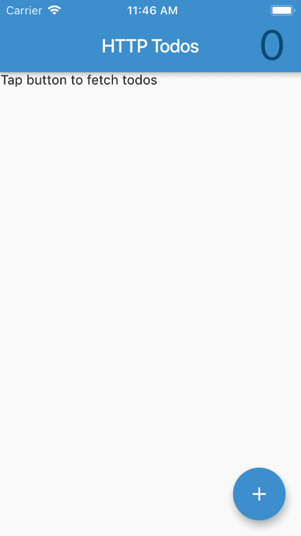

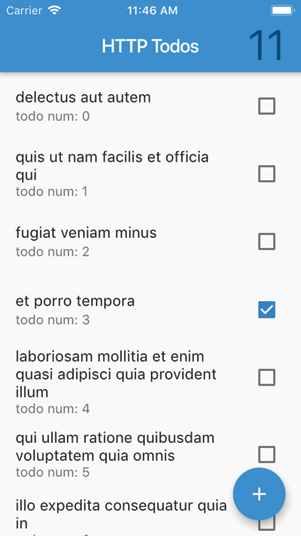

*Mô tả hình:* Hai ảnh chụp màn hình ứng dụng todo. Ảnh thứ nhất là trạng thái ban đầu: thanh tiêu đề (AppBar) màu xanh có chữ **"HTTP Todos"**, góc phải có con số **0** (bộ đếm số todo đã hoàn thành), phần thân chỉ có dòng chữ **"Tap button to fetch todos"** (Nhấn nút để tải danh sách todo), góc dưới bên phải là nút tròn nổi (FloatingActionButton) có dấu **+**. Ảnh thứ hai là trạng thái sau khi đã nhấn nút: danh sách các todo (ví dụ "delectus aut autem", kèm dòng phụ "todo num: 0"...) được hiển thị.

### 11.1.1 Unit test cho Dart (Dart unit tests)

Nhóm test đầu tiên chẳng liên quan trực tiếp gì tới Flutter cả. Bạn có thể kiểm thử bất kỳ ứng dụng web hay server viết bằng Dart theo đúng cách tiếp cận này. Unit test phù hợp nhất để kiểm thử **một lớp hoặc một phương thức duy nhất**. Trong bối cảnh Flutter, bạn sẽ thường kiểm thử các controller, bloc, model hoặc các hàm tiện ích (*utility functions*). Unit test cũng có thể kiểm thử các phần phụ thuộc (*dependencies*) bằng cách dùng package `mockito`. Về cơ bản, package này cho phép bạn tạo ra các lớp giả (*mock classes*) thay thế cho những lớp gọi ra HTTP hay bất kỳ nguồn bên ngoài nào khác. Nó khá là tiện.

#### Thiết lập cho unit test Dart (Setup for Dart unit tests)

Trước hết, cần thêm các phụ thuộc phù hợp cho việc kiểm thử. Trong mục này, có hai phụ thuộc kiểm thử quan trọng: `test` và `mockito`, như trong listing sau.

**Listing 11.1 – Các phụ thuộc trong pubspec của ứng dụng Todo**

```yaml
# backend/pubspec.yaml
dev_dependencies:
  flutter_test:
    sdk: flutter
  flutter_driver:
    sdk: flutter
  build_runner: ^1.0.0
  json_serializable: ^2.0.0
  mockito: 4.0.0   # mockito cho phép bạn giả lập (mock) trong các bài test.
  test: any        # test là thư viện kiểm thử tiêu chuẩn của Dart.
```

Chú thích của listing:
- `mockito` cho phép bạn tạo các đối tượng giả (mock) trong test.
- `test` là thư viện kiểm thử tiêu chuẩn của Dart.

Sau khi bạn đã thêm những dòng này vào file `pubspec.yaml` và chạy `flutter pub get`, bạn có thể tạo file test. File này nên nằm trong một thư mục tên là `test` ở thư mục gốc của dự án:

```text
backend
├── lib
├── pubspec.lock
├── pubspec.yaml
└── test                 <- Thêm thư mục này và file bên trong.
    └── dart_test.dart
```

(Chú thích trong sách: *Thêm thư mục và file này.*)

Đó là tất cả phần thiết lập bạn cần để bắt đầu viết test.

> 💡 **Ví dụ bổ sung (không có trong sách):** Cách chạy test sau khi thiết lập xong:
>
> ```bash
> # Chạy toàn bộ test trong thư mục test/
> flutter test
>
> # Chỉ chạy một file
> flutter test test/dart_test.dart
>
> # Với dự án Dart thuần (không phải Flutter)
> dart test
> ```
>
> Lưu ý: tên file test theo quy ước nên kết thúc bằng `_test.dart` thì lệnh `flutter test` mới tự động tìm thấy khi chạy cả thư mục.

#### Đoạn code cần kiểm thử (The code to test)

Tôi đã cố tình làm cho một số chức năng trong ứng dụng này phức tạp hơn mức cần thiết để phục vụ cho các ví dụ, nhờ vậy chúng ta có thể nói qua một vài ví dụ về unit test Dart cơ bản. Code sẽ trở nên phức tạp hơn và "đúng đắn" hơn khi chúng ta đi tiếp trong chương.

Hình 11.2 cho thấy hai khung nhìn của ứng dụng todo. Tính năng mà đoạn code này ứng với là **bộ đếm Completed Todo** (số todo đã hoàn thành) nằm trên thanh AppBar, ở phía bên phải của hình.

**Hình 11.2 – Ví dụ về số todo đã hoàn thành**


*Mô tả hình:* Hai ảnh cắt phần trên của ứng dụng. Mũi tên trong sách chỉ vào con số ở góc phải AppBar với nhãn **"Completed Todos count"** (số lượng todo đã hoàn thành). Ảnh thứ hai cho thấy AppBar "HTTP Todos" và danh sách bắt đầu bằng "delectus aut autem / todo num: 0", "quis ut nam facilis et officia qui"...

Trạng thái (*state*) của tính năng đó được điều khiển trong file `todos_controller.dart` bởi hai lớp: bản thân controller và một lớp tên là `CompletedTodoCounter`. Lớp thứ hai chính là đoạn code "cố tình làm màu" (*contrived*), và là thứ tôi muốn kiểm thử đầu tiên. Đây là đoạn code chúng ta quan tâm.

**Listing 11.2 – Đoạn code có thể kiểm thử của bộ đếm todo đã hoàn thành**

```dart
// backend/lib/controllers/todo_controller.dart

// (1) Lớp này cung cấp cách theo dõi số lượng todo đã hoàn thành.
class CompletedTodoCounter {
  int completed = 0;

  void increaseCounter() => completed++;
  void decreaseCounter() => completed--;
  void resetCounter() => completed = 0;
}

class TodoController {
  // (2) Trong lớp controller, tạo một instance mới của bộ đếm.
  var counter = CompletedTodoCounter();

  // ... other class methods

  // (3) Mỗi lần được gọi, phương thức này duyệt qua tất cả todo và tìm
  // những todo đã hoàn thành. Về cơ bản nó hoạt động bằng cách
  // đưa bộ đếm về 0 rồi đếm lại từ đầu.
  int getCompletedTodos() {
    counter.resetCounter();
    todos?.forEach((Todo t) {
      if (t.completed) {
        counter.increaseCounter();
      }
    });
    return counter.completed;
  }
}
```

Chú thích của listing:
1. Lớp `CompletedTodoCounter` cung cấp một cách để theo dõi số todo đã hoàn thành.
2. Trong lớp controller, tạo một instance mới của bộ đếm.
3. Mỗi lần được gọi, phương thức `getCompletedTodos` duyệt qua tất cả todo và tìm những cái đã hoàn thành. Về cơ bản nó hoạt động bằng cách cho bộ đếm bắt đầu lại từ đầu và đếm lại.

Lý do đoạn code này "làm màu" là vì có quá nhiều code chỉ để giữ một con số đếm. Nhưng lý do tôi làm theo cách này sẽ trở nên dễ hiểu khi chúng ta chuyển sang dùng một thư viện kiểm thử tên là `mockito`.

#### Viết unit test Dart (Writing Dart unit tests)

Unit test của Dart dựa trên ba hàm chính từ thư viện `test`: **`test`**, **`expect`** và **`group`**. Cách dễ nhất để giải thích cách viết test là cho xem vài ví dụ. Đây chưa phải ví dụ đầy đủ, mà là ví dụ về một bài test đơn lẻ — bài test cơ bản nhất có thể. Nếu bạn đã từng viết test bằng bất kỳ ngôn ngữ hiện đại nào khác, đoạn này sẽ rất dễ đọc.

Bài test này về cơ bản nói rằng: *"Chạy một bài test mới tên là `counter increases`, rồi kiểm thử nó bằng cách gọi hàm mà tôi đã cung cấp. Sau khi tạo instance và gọi `increaseCounter`, thuộc tính `counter.completed` phải có giá trị là 1."*

**Listing 11.3 – Unit test cơ bản trong Dart**

```dart
// backend/test/dart_test.dart

// (1) Mọi bài test bắt đầu bằng việc gọi hàm test: tham số đầu là mô tả,
//     tham số thứ hai là một hàm callback — nơi bạn viết nội dung test.
test("counter increases", () {
  // (2) Thiết lập mọi thứ cho bài test: tạo một instance CompletedTodoCounter.
  final counter = CompletedTodoCounter();

  // (3) Chúng ta cần gọi một hàm để kiểm thử.
  counter.increaseCounter();

  // (4) Bài test đạt (pass) nếu các hàm expect của nó cho kết quả đúng.
  expect(counter.completed, 1);
// ...
```

Chú thích của listing:
1. Mọi bài test bắt đầu bằng việc gọi hàm `test`, hàm này nhận phần mô tả làm tham số đầu tiên và một hàm callback làm tham số thứ hai. Hàm callback là nơi bạn viết bài test.
2. Chúng ta thiết lập mọi thứ cho bài test, tạo một instance của `CompletedTodoCounter`.
3. Chúng ta cần gọi một hàm để kiểm thử.
4. Bài test đạt nếu các hàm `expect` của nó đánh giá là đúng (true).

Hàm `expect` (hình 11.3) hoạt động bằng cách nhận vào một **`actual`** (giá trị thực tế) làm tham số đầu tiên — đó là thứ bạn đang kiểm thử — và một **`matcher`** (bộ so khớp), là kết quả mong đợi cho `actual`. Nếu hai thứ giống nhau, bài test sẽ đạt. Ngược lại, `expect` sẽ ném ra lỗi và làm bài test thất bại.

**Hình 11.3 – Phương thức `expect` trong framework kiểm thử**

```text
      expect(counter.completed, 1);
             └───────┬───────┘  │
                     │          └──► Matcher: giá trị mà bạn mong đợi
                     │               giá trị kia phải bằng
                     └─────────────► Actual: giá trị bạn đang kiểm thử
```

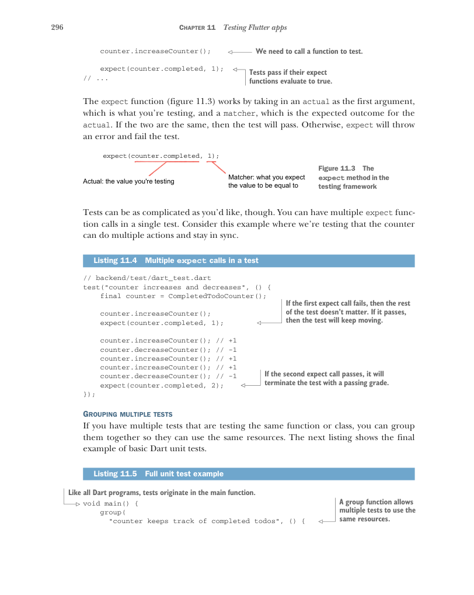

*Mô tả hình:* Dòng code `expect(counter.completed, 1);` được gạch chân hai phần: phần `counter.completed` có nhãn **"Actual: the value you're testing"** (Actual: giá trị bạn đang kiểm thử); phần `1` có nhãn **"Matcher: what you expect the value to be equal to"** (Matcher: thứ bạn mong giá trị kia bằng với).

Tuy vậy, bài test có thể phức tạp tùy ý bạn. Bạn có thể có nhiều lời gọi hàm `expect` trong một bài test. Hãy xem ví dụ sau, nơi chúng ta kiểm thử rằng bộ đếm có thể thực hiện nhiều thao tác mà vẫn giữ đúng giá trị (đồng bộ).

**Listing 11.4 – Nhiều lời gọi `expect` trong một bài test**

```dart
// backend/test/dart_test.dart
test("counter increases and decreases", () {
  final counter = CompletedTodoCounter();

  counter.increaseCounter();
  // (1) Nếu lời gọi expect đầu tiên thất bại, phần còn lại của bài test
  //     không còn ý nghĩa. Nếu nó đạt, bài test sẽ tiếp tục chạy.
  expect(counter.completed, 1);

  counter.increaseCounter(); // +1
  counter.decreaseCounter(); // -1
  counter.increaseCounter(); // +1
  counter.increaseCounter(); // +1
  counter.decreaseCounter(); // -1
  // (2) Nếu lời gọi expect thứ hai đạt, bài test sẽ kết thúc với kết quả "đạt".
  expect(counter.completed, 2);
});
```

Chú thích của listing:
1. Nếu lời gọi `expect` đầu tiên thất bại thì phần còn lại của bài test không quan trọng nữa. Nếu nó đạt, bài test sẽ tiếp tục chạy.
2. Nếu lời gọi `expect` thứ hai đạt, bài test sẽ kết thúc với "điểm đạt".

#### Gom nhóm nhiều bài test (Grouping multiple tests)

Nếu bạn có nhiều bài test cùng kiểm thử một hàm hoặc một lớp, bạn có thể gom chúng lại thành nhóm để chúng có thể dùng chung tài nguyên. Listing tiếp theo là ví dụ cuối cùng về unit test Dart cơ bản.

**Listing 11.5 – Ví dụ unit test đầy đủ**

```dart
// (1) Giống mọi chương trình Dart, test bắt đầu từ hàm main.
void main() {
  // (2) Hàm group cho phép nhiều bài test dùng chung tài nguyên.
  group(
    "counter keeps track of completed todos", () {
      // (3) Instance CompletedTodoCounter này sẽ được dùng trong nhiều bài test.
      final counter = CompletedTodoCounter();

      // (4) Đây là bài test đầu tiên trong nhóm, có dùng counter.
      test("counter increases and decreases", () {
        counter.increaseCounter();
        expect(counter.completed, 1);

        counter.increaseCounter(); // +1
        counter.decreaseCounter(); // -1
        counter.increaseCounter(); // +1
        counter.increaseCounter(); // +1
        counter.decreaseCounter(); // -1
        expect(counter.completed, 2);
      });

      // (5) Bài test này cũng dùng counter.
      test("counter resets to 0", () {
        counter.increaseCounter();
        counter.increaseCounter();
        counter.increaseCounter();
        counter.increaseCounter();
        counter.resetCounter();
        expect(counter.completed, 0);
      });
    });
}
```

Chú thích của listing:
1. Giống như mọi chương trình Dart, test bắt nguồn từ hàm `main`.
2. Hàm `group` cho phép nhiều bài test dùng chung tài nguyên.
3. Instance `CompletedTodoCounter` này sẽ được dùng trong nhiều bài test.
4. Đây là bài test đầu tiên trong nhóm, sử dụng counter.
5. Bài test này cũng dùng counter.

Ưu điểm của việc dùng group với nhiều bài test — thay vì ít bài test mà mỗi bài có nhiều lời gọi `expect` — là các bài test trở nên **mô-đun** (*modular*) hơn. Một số bài test có thể đạt, một số có thể thất bại. Trong ví dụ này, hoàn toàn có thể xảy ra chuyện các phương thức `increaseCounter` và `decreaseCounter` hoạt động đúng, nhưng `resetCounter` thì không. Kiểm thử theo cách này sẽ bắt được điều đó.

> 📝 **Giải thích thêm (không có trong sách):** Trong Listing 11.5, `counter` được dùng **chung** giữa hai bài test, nên trạng thái của bài trước sẽ "rò" sang bài sau. Bài thứ nhất kết thúc với `completed == 2`; bài thứ hai tăng thêm 4 lần (thành 6) rồi reset về 0 — vẫn đạt vì có `resetCounter()`. Nhưng nếu bạn viết bài test kiểu "tăng 1 lần thì phải bằng 1" ở vị trí thứ hai, nó sẽ **thất bại** vì giá trị khởi đầu không phải 0. Để mỗi bài test độc lập, cách phổ biến là dùng `setUp`:
>
> ```dart
> void main() {
>   group("CompletedTodoCounter", () {
>     late CompletedTodoCounter counter;
>
>     // setUp chạy TRƯỚC MỖI bài test trong group -> mỗi test có counter mới.
>     setUp(() {
>       counter = CompletedTodoCounter();
>     });
>
>     test("bắt đầu từ 0", () {
>       expect(counter.completed, 0);
>     });
>
>     test("tăng một lần thì bằng 1", () {
>       counter.increaseCounter();
>       expect(counter.completed, 1);
>     });
>   });
> }
> ```
>
> (Từ khóa `late` thuộc Dart có null-safety; trong phiên bản Dart dùng ở sách, bạn chỉ cần khai báo `CompletedTodoCounter counter;`.)

> 💡 **Ví dụ bổ sung (không có trong sách) – Bài toán nhỏ:** Hãy viết test cho `TodoController.getCompletedTodos()` với danh sách 3 todo, trong đó 2 cái đã hoàn thành. Lời giải (giả sử `todos` là thuộc tính có thể gán được của controller và `Todo(userId, id, title, completed)`):
>
> ```dart
> test("getCompletedTodos đếm đúng số todo đã xong", () {
>   final controller = TodoController(MockServices());
>   controller.todos = [
>     Todo(1, 1, "a", true),
>     Todo(1, 2, "b", false),
>     Todo(1, 3, "c", true),
>   ];
>   expect(controller.getCompletedTodos(), 2);
>   // Gọi lại lần nữa vẫn phải ra 2 (vì hàm reset bộ đếm trước khi đếm)
>   expect(controller.getCompletedTodos(), 2);
> });
> ```
>
> Lần gọi thứ hai cho thấy vì sao `resetCounter()` quan trọng: thiếu nó, kết quả sẽ thành 4.

### 11.1.2 Dùng mockito để kiểm thử các phương thức cần phụ thuộc bên ngoài (Using mockito to test methods that need external dependencies)

Khi dùng HTTP trong ứng dụng thử nghiệm, chúng ta muốn chắc chắn rằng ứng dụng hoạt động như ta muốn, **bất kể** phản hồi của lời gọi HTTP là gì. Ví dụ, có thể API mà ta lấy dữ liệu todo đang bị sập và trả về thông báo 404. Thật đáng tiếc, nhưng ta chẳng làm được gì về việc đó. Và ta nên lường trước rằng chuyện này thỉnh thoảng sẽ xảy ra. Vì vậy, ta có thể "giả lập" (*mock*) tất cả các tình huống mà ta lo ngại có thể xảy ra.

Bạn có thể xử lý việc này bằng cách viết các phiên bản giả (*mock*) thay thế của các lớp. Nhớ lại rằng các service trong ứng dụng này đều dựa trên một lớp trừu tượng (*abstract class*) tên là `Services`. Bạn có thể tạo một bản cài đặt (*implementation*) mới của lớp đó mà không làm gì thật cả. Thực ra tôi đã làm vậy cho một bài test ở phần sau. Bản giả trông như listing sau.

**Listing 11.6 – Lớp service giả (mock)**

```dart
// backend/lib/controllers/todo_controller.dart
class MockServices implements Services {
  // ...
  // Thay vì thực hiện lời gọi HTTP, tôi có thể trả về dữ liệu giả.
  // Dữ liệu này giống hệt dữ liệu ta nhận được từ lời gọi HTTP thật
  // tới Typicode, vì thế mới có mấy câu tiếng Latin.
  @override
  Future<List<Todo>> getTodos() async {
    return [
      Todo(1, 1, "delectus aut autem", false),
      Todo(1, 2, "quis ut nam facilis et officia qui", false),
      Todo(1, 3, "fugiat veniam minus", false),
      Todo(1, 4, "et porro tempora", true),
      Todo(1, 8, "et porro tempora", true),
      Todo(1, 9, "et porro tempora", true),
      Todo(1, 10, "et porro tempora", true),
      Todo(1, 11, "et porro tempora", true),
      Todo(1, 12, "et porro tempora", true),
      Todo(1, 13, "et porro tempora", true),
      Todo(1, 14, "et porro tempora", true),
      Todo(1, 15, "et porro tempora", true),
      Todo(1, 16, "et porro tempora", true),
    ];
  }
  // ...
```

Chú thích của listing: *Thay vì thực hiện lời gọi HTTP, tôi có thể trả về dữ liệu giả. Đây là cùng dữ liệu mà ta sẽ nhận lại từ lời gọi HTTP thật tới Typicode — vì thế mới có tiếng Latin.*

> 📝 **Giải thích thêm (không có trong sách):** "Typicode" ở đây là dịch vụ JSONPlaceholder (`jsonplaceholder.typicode.com`) — một API giả miễn phí, trả về dữ liệu mẫu bằng chữ Latin "lorem ipsum" vô nghĩa. Đó là lý do các tiêu đề todo trông như "delectus aut autem".

Như vậy là ổn, nhưng nó có thể nhanh chóng trở thành gánh nặng nếu bạn có một ứng dụng lớn với hàng trăm service, và bạn phải viết service giả cho từng cái. Đó là lúc `mockito` xuất hiện.

Mục đích của `mockito` là kiểm thử rằng ứng dụng của bạn phản ứng một cách êm đẹp (*gracefully*) với những phụ thuộc bên ngoài mà nó không kiểm soát được. Nó cung cấp một cách để kiểm thử chức năng của ứng dụng dễ dàng hơn, dựa trên một tập hợp các hành vi có thể đoán trước của phụ thuộc bên ngoài. Điều này gỡ bỏ một số rào cản khiến việc kiểm thử trở nên khổ sở, nhờ đó khuyến khích bạn viết nhiều test hơn!

Chúng ta sẽ dùng nó để giả lập lời gọi `getTodos` trên lớp service. Đây là hình dáng của phương thức `getTodos` gốc (chúng ta không cần thay đổi nó; chỉ để nhắc lại thôi).

**Listing 11.7 – `getTodos` thực hiện một yêu cầu HTTP**

```dart
// backend/test/http_test.dart
Future<List<Todo>> getTodos(Client client) async {
  final response =
      await client.get('https://jsonplaceholder.typicode.com/todos');
  if (response.statusCode == 200) {
    var all = AllTodos.fromJson(json.decode(response.body));
    return all.todos;
  } else {
    throw Exception('Failed to load todos');
  }
}
```

Cách dùng package `mockito` được minh họa dễ nhất bằng code. Vậy hãy xem listing tiếp theo rồi tôi sẽ dẫn bạn đi qua những gì đang diễn ra.

**Listing 11.8 – Dùng mockito để tạo "stub" cho một lời gọi HTTP**

```dart
// backend/test/http_test.dart

// (1) Tạo một lớp giả cho HTTP client (từ dart:http)
//     bằng cách extends Mock và implements Client.
class MockClient extends Mock implements Client {}

void main() {
  // (2) Chạy test như bình thường.
  group('getTodos', () {
    test('returns a list of todos if the http call completes', () async {
      // (3) Tạo một instance của mock client đó.
      final client = MockClient();

      // (4) Hàm when của mockito về cơ bản chặn lời gọi không cho nó
      //     thực sự diễn ra, để bạn kiểm soát phản hồi.
      when(client.get(
        'https://jsonplaceholder.typicode.com/todos')
      ).thenAnswer(
        // (5) thenAnswer nhận một callback và trả về bất kỳ
        //     loại phản hồi nào bạn muốn.
        (_) async => Response('[]', 200)
      );

      // (6) Giờ mới thật sự gọi hàm bạn muốn kiểm thử; mockito sẽ chặn
      //     lời gọi client.get() vì ta đã bảo nó làm vậy trong hàm when.
      expect(
        await getTodos(client),
        isInstanceOf<List<Todo>>(),
      );
    });
```

Chú thích của listing:
1. Tạo một lớp giả của HTTP client (từ `dart:http`) bằng cách kế thừa (`extends`) `Mock` và cài đặt (`implements`) `Client`.
2. Chạy test như bình thường.
3. Tạo một instance của mock client đó.
4. Hàm `when` của mockito về cơ bản ngăn lời gọi thực sự xảy ra, để bạn có thể kiểm soát phản hồi.
5. `thenAnswer` nhận một callback và trả về bất kỳ kiểu phản hồi nào bạn thích.
6. Bây giờ mới thực sự gọi hàm mà bạn muốn kiểm thử; mockito sẽ chặn lời gọi `client.get()` vì ta đã yêu cầu nó làm vậy trong lời gọi hàm `when`.

Phần lớn những gì đang diễn ra nằm ở lời gọi `when`/`thenAnswer`, nên tôi muốn phân tích kỹ phần đó.

Bài test này sẽ gọi `getTodos`, nhưng thay vì truyền vào một `Client` thật từ thư viện `dart:http`, nó truyền vào một client giả. Client giả này biết rằng nó phải làm giả bất kỳ lời gọi nào được thực hiện trên nó (mà ta bảo nó làm giả) thông qua hàm `when`. Xin nhắc lại, lời gọi hàm `when` trông thế này:

```dart
when(client.get('https://jsonplaceholder.typicode.com/todos'))
    .thenAnswer((_) async => Response('[]', 200));
```

Vậy là khi phương thức `get` được gọi trên lớp `Client` đã bị giả lập, nó biết phải trả về `Response('[]', 200));` thay vì thực sự thực hiện lời gọi HTTP rồi phản hồi. Khá là hay.

Đây là một bài test khác giả lập một lời gọi thất bại:

```dart
// backend/test/http_test.dart
test('throws an exception if the http call completes with an error', () {
  // Tạo mock client.
  final client = MockClient();

  // Bảo mockito canh chừng các lời gọi tới Client.get.
  when(client.get(
    'https://jsonplaceholder.typicode.com/todos')
  ).thenAnswer(
    // Phản hồi bằng một response thất bại: 404 Not Found.
    (_) async => Response('Not Found', 404)
  );

  // Kiểm tra rằng hàm ném ra exception khi lời gọi thất bại.
  expect(getTodos(client), throwsException);
});
```

Chú thích của đoạn code:
- Tạo client giả (mock client).
- Bảo mockito tìm các lời gọi tới `Client.get`.
- Phản hồi bằng một response thất bại: **404 Not Found**.
- Kiểm thử rằng hàm ném ra một exception khi lời gọi thất bại.

Mục đích của `mockito` là kiểm thử rằng ứng dụng của bạn phản ứng một cách êm đẹp với những phụ thuộc bên ngoài mà nó không thể kiểm soát. Đó là một công cụ mạnh mẽ nên mang theo trong "túi đồ nghề" của bạn.

> 📝 **Giải thích thêm (không có trong sách):** Vì sao `getTodos` nhận `Client client` làm tham số? Đó là kỹ thuật **tiêm phụ thuộc** (*dependency injection*): thay vì tự tạo `Client()` bên trong hàm, ta truyền nó từ ngoài vào. Nhờ vậy, khi chạy thật ta truyền `Client()` thật; khi test ta truyền `MockClient()`. Nếu hàm tự tạo client bên trong, mockito không có cách nào "chen" vào được.
>
> Lưu ý về phiên bản: sách dùng `mockito: 4.0.0`. Ở các phiên bản mockito mới (5.x, có null-safety), cách `class MockClient extends Mock implements Client {}` viết tay không còn được khuyến nghị; thay vào đó bạn dùng annotation `@GenerateMocks([http.Client])` rồi chạy `dart run build_runner build` để sinh lớp mock. Ngoài ra, package `http` mới yêu cầu `client.get(Uri.parse('...'))` thay vì truyền chuỗi, và `isInstanceOf<T>()` được thay bằng `isA<T>()`.

> 💡 **Ví dụ bổ sung (không có trong sách):** Ngoài `thenAnswer`, mockito còn có `thenReturn` (trả về giá trị đồng bộ) và `thenThrow` (ném lỗi), cùng `verify` để kiểm tra một phương thức đã được gọi bao nhiêu lần. Ví dụ giả lập mất mạng và kiểm tra rằng `get` được gọi đúng một lần:
>
> ```dart
> test('ném exception khi mất kết nối mạng', () async {
>   final client = MockClient();
>   when(client.get('https://jsonplaceholder.typicode.com/todos'))
>       .thenThrow(SocketException('No Internet'));
>
>   // expectLater + await: đợi Future hoàn tất (với lỗi) rồi mới đi tiếp
>   await expectLater(getTodos(client), throwsA(isA<SocketException>()));
>
>   // Đảm bảo client.get đã được gọi đúng 1 lần
>   verify(client.get('https://jsonplaceholder.typicode.com/todos')).called(1);
> });
> ```
>
> (`SocketException` nằm trong `dart:io`.) Ví dụ này cho thấy bạn có thể mô phỏng cả những tình huống rất khó tái hiện trong thực tế, như rớt mạng giữa chừng.

### 11.1.3 Widget test trong Flutter (Flutter widget tests)

Widget test trong Flutter được xây dựng dựa trên unit test của Dart. Tuy nhiên, thay vì dùng package `test`, bạn dùng package `flutter_test`. API thì giống nhau, nhưng có thêm các phương thức để kiểm thử widget và giao diện (UI). Nhìn chung, việc kiểm thử diễn ra như sau:

1. Cho bài test biết widget nào được dùng làm điểm vào (*entry point*). Bài test sẽ dựng (*build*) widget đó và cây con (*subtree*) của nó.
2. Tìm các widget trong cây con đó.
3. Kiểm tra rằng một số thuộc tính nhất định trong cây widget này là đúng.

Không khác biệt lắm, nhưng có vài điểm cần lưu ý và một số "thuật ngữ chuyên môn" (*jargon*) mới mà bạn có thể cần học. Trong mục này, trước tiên tôi sẽ cho bạn xem một ví dụ code về widget test. Ví dụ đó sẽ có vài thuật ngữ lạ mà có lẽ bạn chưa biết. Không sao cả, vì ví dụ code này chỉ ở đây để cung cấp bối cảnh. Sau đó, việc giải thích các thuật ngữ sẽ dễ hơn. Nhưng trước hết, dĩ nhiên, ta phải thiết lập một chút.

#### Thiết lập test Flutter (Set up Flutter tests)

Ứng dụng đã được cấu trúc sẵn để làm test, và thật ra chỉ có một điểm khác biệt trong cách thiết lập widget test: thêm đúng thư viện vào file `pubspec.yaml`. Nó trông như sau:

```yaml
# backend/pubspec.yaml
dev_dependencies:
  # Import package flutter_test, package này bạn phải chỉ định một SDK.
  # Nó được thêm vào file pubspec theo mặc định khi bạn tạo dự án Flutter mới.
  flutter_test:
    sdk: flutter
  flutter_driver:
    sdk: flutter
  build_runner: ^1.0.0
  json_serializable: ^2.0.0
  mockito: 4.0.0
  test: any
```

Chú thích trong sách: *Import package `flutter_test`, package mà bạn phải chỉ định SDK cho nó. Nó được thêm vào file pubspec theo mặc định khi bạn tạo một dự án Flutter mới.*

Thật ra, phần thiết lập cho mảng này chỉ có vậy thôi.

#### Viết widget test (Writing widget tests)

Trước tiên, hãy xem một ví dụ trong listing tiếp theo. Bài test này đảm bảo rằng có một tiêu đề trong `AppBar` của widget.

**Listing 11.9 – Hàm widget test cơ bản**

```dart
// backend/test/widget_test.dart

// (1) Thay vì test, gọi testWidgets; callback được truyền vào một WidgetTester.
testWidgets(
  'App has a title', (WidgetTester tester) async {
    // (2) Tôi dùng lớp MockServices từ file lib/services/todos.dart.
    //     Nó chẳng liên quan gì đến package mockito. Lúc này ta chưa
    //     thực sự quan tâm tới services, nhưng chúng là bắt buộc để chạy app.
    var services = MockServices();

    // (3) pumpWidget dựng widget bạn truyền vào và các lớp con của nó.
    //     Ở đây nó dựng toàn bộ ứng dụng vì tôi truyền vào widget gốc của app.
    await tester.pumpWidget(
      TodoApp(controller: TodoController(services))
    );

    // (4) Một phần lớn của flutter_test là lớp Finder,
    //     dùng để tìm những widget cụ thể.
    final titleFinder = find.text("HTTP Todos");

    // (5) expect vẫn như cũ, nhưng khi test Flutter, bạn có thể dùng nhiều
    //     đối tượng Matcher có sẵn — cũng là một phần lớn của việc test widget.
    expect(titleFinder, findsOneWidget);
  });
```

Chú thích của listing:
1. Thay vì `test`, ta gọi `testWidgets`; callback được truyền vào một `WidgetTester`.
2. Tôi đang dùng lớp `MockServices` từ file `lib/services/todos.dart`. Nó không liên quan gì tới package `mockito`. Lúc này ta không thực sự quan tâm tới services, nhưng chúng là bắt buộc để chạy ứng dụng.
3. `pumpWidget` dựng widget mà bạn truyền vào cùng các lớp con của nó. Trong trường hợp này, nó dựng toàn bộ ứng dụng vì tôi đã truyền vào widget gốc của ứng dụng.
4. Một phần quan trọng của `flutter_test` là lớp `Finder`, được dùng để tìm những widget cụ thể.
5. `expect` vẫn như vậy, nhưng khi kiểm thử Flutter, bạn có thể dùng nhiều đối tượng `Matcher` có sẵn — chúng cũng là một phần lớn của việc kiểm thử widget.

Bạn có thể thấy cách tiếp cận chung khi viết test là giống nhau. Điểm khác là bạn phải dùng một số phương thức và đối tượng của `flutter_test` để bài test hoạt động. Tôi sẽ đi qua chúng ở đây:

1. **Đối tượng Finder** (*Finder objects*) — Finder là những đối tượng quét cây widget và tìm widget theo các thuộc tính cụ thể. Đối tượng `find` là một tập hợp của nhiều `CommonFinders`, bao gồm `byText`, `byWidget`, `byKey` và `byType` (cùng một số khác). Bạn sẽ dùng các finder này gần như mọi lúc. Lời gọi `find.byText` mà tôi dùng trong hàm test trước đó tìm kiếm *theo đúng nghĩa đen* một widget có chính xác dòng chữ đó.
2. **Đối tượng Matcher** (*Matcher objects*) — Matcher giống như trong unit test. Chúng cung cấp cách để so sánh trường hợp thực tế với điều bạn mong đợi. Vì widget phức tạp hơn các giá trị đơn giản (như một số `int` trong ví dụ unit test ở đầu chương), thư viện `flutter_test` đi kèm với nhiều matcher có sẵn làm giúp bạn phần việc khó. Các matcher phổ biến nhất là `findsNothing`, `findsOneWidget` và `findsNWidgets(int n)`. Kiểm thử widget phần lớn là đảm bảo chúng tồn tại, và đó là lúc những matcher này phát huy tác dụng.
3. **Lớp WidgetTester** (*WidgetTester class*) — Lớp `WidgetTester` là nền tảng của mọi chức năng trong `flutter_test`. Mục đích của nó là tương tác với widget theo đúng cách người dùng sẽ làm. Nó có thể nhấn (*tap*) vào widget, kéo (*drag*) và vuốt (*swipe*) trên widget, và nhập chữ vào các ô nhập liệu (*text field*).
4. **`WidgetTester.pump` (và các phương thức tương tự)** — Có một nhóm phương thức liên quan tới việc "bơm" (*pumping*) widget tester. Cách đơn giản nhất để mô tả những phương thức này là chúng gọi `Widget.build`. Bất cứ khi nào có thứ gì trong bài test mô phỏng tương tác của người dùng, bạn cần "pump" ứng dụng trước khi làm bất cứ điều gì khác. Điều này sẽ dễ hiểu hơn khi bạn xem listing code tiếp theo.

> 📝 **Giải thích thêm (không có trong sách):** Trong môi trường test, Flutter **không** tự vẽ khung hình theo thời gian thực như trên điện thoại. Thời gian là "giả" và chỉ trôi khi bạn bảo nó trôi. Mỗi lần gọi `pump()` giống như bạn nói: "Hãy vẽ khung hình tiếp theo đi". `pump(Duration(...))` thì cho đồng hồ giả tiến thêm một khoảng rồi vẽ; còn `pumpAndSettle()` gọi `pump` liên tục cho tới khi không còn khung hình nào được lên lịch (ví dụ mọi animation đã chạy xong) hoặc hết thời gian chờ.

Với tất cả những điều đó trong đầu, hãy để tôi đi lại một lượt mẫu code vừa rồi.

**Listing 11.10 – Hàm widget test cơ bản**

```dart
// backend/test/widget_test.dart
testWidgets(
  // (1) WidgetTester là thứ cần thiết cho các chức năng kiểm thử Flutter.
  'App has a title', (WidgetTester tester) async {
    var services = MockServices();

    // (2) pumpWidget về cơ bản gọi build trên widget được truyền vào.
    //     Phải làm việc này trước khi bạn tìm hay kiểm thử bất cứ thứ gì.
    await tester.pumpWidget(
      TodoApp(controller: TodoController(services)),
    );

    // (3) find.text tìm trong cây widget một widget có chữ
    //     đúng nguyên văn là "HTTP Todos".
    final titleFinder = find.text("HTTP Todos");

    // (4) findsOneWidget là một Matcher kiểm tra đúng điều đó:
    //     có một widget trong cây thỏa mãn các tham số kia.
    expect(titleFinder, findsOneWidget);
  });
```

Chú thích của listing:
1. `WidgetTester` là thứ cần thiết cho chức năng kiểm thử của Flutter.
2. `pumpWidget` về cơ bản gọi `build` trên widget được truyền vào. Việc này phải được làm trước khi bạn cố tìm hay kiểm thử bất cứ thứ gì.
3. `find.text` tìm trong cây widget một widget có chữ đúng nguyên văn là *HTTP Todos*.
4. `findOneWidget` (tức `findsOneWidget`) là một Matcher kiểm tra đúng điều đó: có **một** widget trong cây thỏa mãn các tham số kia.

Nói ngắn gọn là test Flutter không khác mấy so với unit test Dart, miễn là bạn biết API để tương tác với widget. Nhưng package `flutter_test` cung cấp nhiều cách tương tác với widget hơn nữa. Bạn có thể làm những việc như nhấn nút, kéo trên màn hình và nhập chữ vào ô nhập liệu.

Hãy xem xét ứng dụng todo của chương này và cách nó hoạt động. Khi bạn mở ứng dụng, nó không làm gì cả. Nhưng sau khi nhấn vào `FloatingActionButton`, ứng dụng thực hiện một lời gọi HTTP để lấy dữ liệu, rồi hiển thị dữ liệu đó dưới dạng một danh sách todo.

Để kiểm thử rằng nút này thực hiện lời gọi và hiển thị danh sách, ta cần bộ test nhấn vào `FloatingActionButton`. Việc đó hoàn toàn khả thi, và khá dễ trong Flutter. Listing sau cho thấy cách làm, cùng với việc tìm widget theo key.

**Listing 11.11 – Tìm và nhấn vào một nút**

```dart
// backend/test/widget_test.dart
testWidgets(
  'finds and taps the floating action button',
  (WidgetTester tester) async {
    var services = MockServices();

    // (1) tester.pumpWidget dựng ứng dụng.
    await tester.pumpWidget(
      TodoApp(controller: TodoController(services))
    );

    // (2) Bạn có thể tìm widget theo Key duy nhất của nó. Theo tôi đây là
    //     cách dễ nhất, và tôi sẽ nói kỹ hơn ở phần sau.
    Finder floatingActionButton =
        find.byKey(Key('get-todos-button'));

    // (3) Bạn có thể nhấn nút bằng tester.tap và truyền cho nó một Finder.
    await tester.tap(floatingActionButton);

    // rebuild the app
    // (4) Đây là phần quan trọng! Bạn phải pump lại ứng dụng mỗi khi gọi một
    //     hàm có gọi setState. pumpAndSettle gọi pump lặp đi lặp lại trong
    //     khoảng thời gian bạn truyền vào. Hữu ích cho công việc bất đồng bộ.
    await tester.pumpAndSettle(
      Duration(seconds: 2),
    );

    // (5) Tôi tìm một todo cụ thể để chắc chắn nó tồn tại. Cách này hoạt động
    //     vì tôi biết dữ liệu giả là gì, nên có thể tìm chính xác nó.
    final firstTodoFinder =
        find.text("delectus aut autem");
    expect(firstTodoFinder, findsOneWidget);
  });
```

Chú thích của listing:
1. `tester.pumpWidget` dựng ứng dụng.
2. Bạn có thể tìm widget theo `Key` duy nhất của chúng. Theo ý kiến của tôi, đây là cách dễ nhất để làm việc đó, và tôi sẽ đi sâu hơn ở phần sau.
3. Bạn có thể nhấn nút bằng cách dùng `tester.tap` và truyền cho nó một `Finder`.
4. Đây là phần quan trọng! Bạn phải pump lại ứng dụng bất cứ khi nào bạn gọi một hàm có gọi `setState`. `pumpAndSettle` gọi `pump` lặp đi lặp lại trong khoảng thời gian bạn truyền vào. Hữu ích cho công việc bất đồng bộ.
5. Tôi tìm một todo cụ thể để chắc rằng nó tồn tại. Cách này hoạt động vì tôi biết dữ liệu giả là gì, nên có thể tìm đích danh nó.

Có hai điều cần lưu ý trước khi tôi chuyển sang integration test. Thứ nhất, tìm phần tử theo key rất dễ, và đó là cách tôi khuyên dùng khi bạn tìm một widget duy nhất. Trong ví dụ trước, tôi tìm `FloatingActionButton` theo key của nó. Đoạn code trong ứng dụng chỉ đơn giản gắn một `Key` lên nó, như trong listing tiếp theo.

**Listing 11.12 – Tìm widget theo key trong test**

```dart
// backend/lib/todo_page.dart -- line ~ 78
floatingActionButton: FloatingActionButton(
  // Kiểu Key nào cũng được. Ở đây tôi chỉ dùng loại Key tiêu chuẩn.
  key: Key("get-todos-button"),
  onPressed: () => _getTodos(),
  child: Icon(Icons.add),
),

// And look for it with a test
// backend/test/widget_test.dart
testWidgets(
  'finds and taps the floating action button', (WidgetTester tester) async {
    var services = MockServices();
    await tester.pumpWidget(TodoApp(controller: TodoController(services)));
    // Chỉ cần đảm bảo đó là cùng giá trị String.
    Finder floatingActionButton =
        find.byKey(Key('get-todos-button'));
```

Chú thích của listing:
- Bất kỳ kiểu `Key` nào cũng dùng được. Ở đây tôi chỉ dùng loại tiêu chuẩn.
- Chỉ cần đảm bảo đó là (cùng) giá trị String.

Tôi nghĩ phần đó khá dễ hiểu. Điểm đáng chú ý còn lại của bài test trước là tất cả những chỗ nhắc tới `pump`. Có hai điều cần ghi nhớ:

- Widget bạn đang kiểm thử **phải được bọc trong một App và một `Scaffold`**, vì chúng cung cấp các đối tượng như `MediaQuery` và các ngữ cảnh (*context*) khác cho bài test. Điều này có nghĩa là bạn nên truyền vào toàn bộ ứng dụng khi "pump" nó. Nếu bạn không muốn pump cả một ứng dụng khổng lồ, bạn có thể tạo một ứng dụng test nhỏ xíu bọc widget bạn muốn kiểm thử trong một `MaterialApp` và `Scaffold`.
- Bạn phải pump widget **mỗi khi** bạn muốn `Widget.build` được gọi! Vì vậy, sau bất kỳ cú nhấn hay tương tác nào khác, bạn phải gọi `pump`. Và sau bất kỳ lời gọi `setState` nào trong các widget của bạn, bạn phải pump!

Những bài test này lý tưởng cho việc kiểm thử widget đơn giản, nhưng có thể trở nên cồng kềnh nếu bạn cố kiểm thử toàn bộ một luồng giao diện (*UI workflow*). May thay, có một số công cụ hay bạn có thể dùng để viết integration test, vì Flutter đã nghĩ đến mọi thứ.

> 💡 **Ví dụ bổ sung (không có trong sách):** Minh họa ý "tạo một ứng dụng test nhỏ xíu bọc widget trong `MaterialApp` và `Scaffold`", kèm cách nhập chữ bằng `enterText`. Giả sử ta có một widget `CounterButton` tự viết, mỗi lần nhấn thì tăng số hiển thị:
>
> ```dart
> class CounterButton extends StatefulWidget {
>   @override
>   _CounterButtonState createState() => _CounterButtonState();
> }
>
> class _CounterButtonState extends State<CounterButton> {
>   int count = 0;
>   @override
>   Widget build(BuildContext context) {
>     return Column(children: [
>       Text('Count: $count'),
>       TextField(key: Key('name-field')),
>       ElevatedButton(
>         key: Key('inc-button'),
>         onPressed: () => setState(() => count++),
>         child: Text('+'),
>       ),
>     ]);
>   }
> }
>
> testWidgets('nhấn nút thì số đếm tăng', (WidgetTester tester) async {
>   // Bọc widget trong MaterialApp + Scaffold để có MediaQuery, Theme...
>   await tester.pumpWidget(MaterialApp(home: Scaffold(body: CounterButton())));
>
>   expect(find.text('Count: 0'), findsOneWidget);
>
>   await tester.tap(find.byKey(Key('inc-button')));
>   // Chưa pump -> giao diện vẫn là khung hình cũ, vẫn thấy 'Count: 0'!
>   await tester.pump(); // gọi lại build sau setState
>   expect(find.text('Count: 1'), findsOneWidget);
>   expect(find.text('Count: 0'), findsNothing);
>
>   // Nhập chữ vào ô TextField
>   await tester.enterText(find.byKey(Key('name-field')), 'Flutter');
>   await tester.pump();
>   expect(find.text('Flutter'), findsOneWidget);
> });
> ```
>
> Nếu bạn bỏ dòng `await tester.pump();` sau `tap`, phép kiểm tra `Count: 1` sẽ thất bại — đúng như cảnh báo của tác giả: sau mỗi `setState` phải pump.

### 11.1.4 Integration test trong Flutter (Flutter integration tests)

Tới giờ thì chẳng còn là bí mật gì nữa: tôi là một fan lớn của những vấn đề mà Flutter đã giải quyết sẵn cho bạn. Kiểm thử tích hợp (*integration testing*) cũng không ngoại lệ. Có một thư viện integration test do đội ngũ Flutter xây dựng, cung cấp một cách hay để chạy integration test. Nó giúp dễ dàng kiểm thử mọi thứ phối hợp với nhau ra sao, và đo đạc hiệu năng (*profile the performance*) ứng dụng của bạn.

Việc này được thực hiện bằng package `flutter_driver`. Test với Flutter driver được viết tương tự widget test, nhưng package này thực sự được tạo ra để **mô phỏng một người dùng**. Driver test chạy ứng dụng thật rồi tương tác với nó. Bạn có thể ngồi xem nó cuộn qua ứng dụng của bạn và nhấn vào các nút mà bạn đã mô tả. Nếu bạn từng dùng thứ gì đó như Selenium Driver, cái này cũng tương tự. Nếu chưa, hãy chuẩn bị để "trầm trồ".

> 📝 **Giải thích thêm (không có trong sách):** Selenium là công cụ tự động hóa trình duyệt web: bạn viết script "mở trang này, gõ chữ vào ô kia, bấm nút nọ", và một trình duyệt thật sẽ tự làm theo. `flutter_driver` làm điều tương tự cho ứng dụng Flutter trên máy ảo/thiết bị thật. (Lưu ý về phiên bản: từ Flutter 2.x trở đi, đội Flutter khuyến nghị dùng package `integration_test` thay cho `flutter_driver`; nhưng ý tưởng và phần lớn khái niệm trong mục này vẫn giữ nguyên giá trị.)

#### Thiết lập Flutter driver (Set up Flutter driver)

Package `flutter_driver` hơi "khó tính" về khâu thiết lập hơn so với các loại test trước mà ta đã xem. Nhưng nó vẫn đủ đơn giản. Trước tiên, dĩ nhiên, bạn cần import package vào `pubspec.yaml`.

**Listing 11.13 – Các phụ thuộc trong pubspec của ứng dụng Todo**

```yaml
# backend/pubspec.yaml
dev_dependencies:
  flutter_test:
    sdk: flutter
  # (1) flutter_driver là package bạn quan tâm. Nó cũng nhận một SDK.
  flutter_driver:
    sdk: flutter
  build_runner: ^1.0.0
  json_serializable: ^2.0.0
  mockito: 4.0.0
  # (2) Bạn bắt buộc phải import test.
  test: any
```

Chú thích của listing:
1. `flutter_driver` là package bạn cần quan tâm. Nó cũng nhận một SDK.
2. Bạn phải import `test`. Trong các ví dụ trước, `test` và `flutter_test` về cơ bản có thể dùng thay thế cho nhau. Nhưng bạn **không thể** dùng bất kỳ phần nào của Flutter SDK trong cùng file với `flutter_driver`, nên bạn cần `test` ở đây. Thêm `flutter_test` vào phụ thuộc của ứng dụng thì vẫn ổn; chỉ đừng dùng nó trong cùng file với các driver test.

Sau khi đã import những phụ thuộc đó, bạn cần tạo các file liên quan. Các file driver nên nằm trong một thư mục riêng, tách biệt khỏi phần còn lại của các test. Theo quy ước, thư mục này thường được đặt tên là `test_driver`. Nó nằm ở thư mục gốc của dự án Flutter.

Sau đó bạn cần thêm hai file: một file để chạy ứng dụng và một file để chạy các bài test. Hãy nhớ rằng ứng dụng thực sự chạy khi bạn dùng `flutter_driver`. Nó phải chạy trong một tiến trình (*process*) khác, và do đó phải nằm trong một file khác. Đây là hình dạng dự án cuối cùng:

```text
backend
├── lib
├── pubspec.lock
├── pubspec.yaml
├── test
│   ├── dart_test.dart
│   ├── http_test.dart
│   └── widget_test.dart
└── test_driver          <- Thêm thư mục này và hai file bên trong.
    ├── app.dart
    └── app_test.dart
```

(Chú thích trong sách: *Thêm thư mục này và hai file trong đó.*)

File chạy ứng dụng (`app.dart`) chỉ có vài dòng code. Listing sau cho thấy nó trông thế nào.

**Listing 11.14 – Thiết lập extension của flutter_driver**

```dart
// backend/test_drive/app_test.dart
import 'package:flutter_driver/driver_extension.dart';
// Import ứng dụng của bạn.
import 'package:backend/main.dart' as app;

void main() {
  // This line enables the extension
  // (Bật extension.)
  enableFlutterDriverExtension();

  // run the app
  // (Chạy ứng dụng.)
  app.main();
}
```

Chú thích của listing:
- Import ứng dụng của bạn.
- Bật extension (`enableFlutterDriverExtension()`).
- Chạy ứng dụng (`app.main()`).

> 📝 **Giải thích thêm (không có trong sách):** Để ý rằng dòng chú thích đường dẫn trong Listing 11.14 của sách ghi `test_drive/app_test.dart`, còn Listing 11.15 ghi `test_drive/app.dart`, trong khi văn bản nói file chạy ứng dụng là `app.dart` và file test là `app_test.dart` (thư mục `test_driver`). Có vẻ sách đã ghi nhầm/đảo tên file trong comment. Quy ước chuẩn của `flutter drive` là: `test_driver/app.dart` chứa `enableFlutterDriverExtension()` + `app.main()`, còn `test_driver/app_test.dart` (cùng tên, thêm hậu tố `_test`) chứa các bài test. Bản dịch giữ nguyên comment như sách.

File đó chỉ có vậy thôi. Tất nhiên, trong những ứng dụng thực sự phức tạp, bạn có thể phải làm một số bước thiết lập trong file này, chẳng hạn bất cứ thứ gì cần được tiền xử lý trong ứng dụng.

Cuối cùng, bạn phải có một thiết bị được kết nối để chạy ứng dụng trên đó. Bất cứ thứ gì bạn thường dùng (máy ảo iOS, máy ảo của Android Studio, hoặc một thiết bị thật được kết nối) đều được. Nhưng ứng dụng chạy thật sự, nên nó phải có chỗ để chạy.

#### Viết test cho flutter_driver (Write tests for flutter_driver)

Các bài test nằm trong file `test_app.dart`. Một lần nữa, các bài test không khác biệt lắm. Bạn dùng Finder (dù chúng được gọi hơi khác một chút), Matcher và cùng các lời gọi `expect`. Điểm khác chủ yếu nằm ở phần thiết lập. Bạn có quyền dùng một số hàm đặc biệt dùng để kết nối tới Flutter driver. Phần thiết lập được trình bày trong listing tiếp theo.

**Listing 11.15 – Viết integration test với flutter_driver**

```dart
// backend/test_drive/app.dart
import 'package:flutter_driver/flutter_driver.dart';
// (1) Nhớ rằng bạn phải dùng package test thay vì package flutter_test.
import 'package:test/test.dart';

void main() {
  group("Todo App", () {
    // (2) Dùng Finder cũng tương tự. Ở đây tôi tìm nhiều widget theo key của chúng.
    final buttonFinder =
        find.byValueKey("get-todos-button");
    final completedTodoCounter = find.byValueKey("counter");
    final listViewFinder = find.byValueKey("list-view");
    final lastTodoFinder = find.byValueKey("todo-19");
    final lastTodoSubtitleFinder = find.byValueKey('todo-19-subtitle');

    // (3) Tạo một tham chiếu tới FlutterDriver mà bạn sẽ dùng
    //     giống như lớp WidgetTester trong các ví dụ trước.
    FlutterDriver driver;

    // Connect to the Flutter driver before running any tests
    // (4) Gọi FlutterDriver.connect để thiết lập driver.
    setUpAll(() async {
      driver = await FlutterDriver.connect();
    });

    // Close the connection to the driver after the tests have completed
    // (5) Bạn cũng phải đóng kết nối bằng driver.close, nếu không
    //     các tiến trình sẽ tiếp tục chạy trong ứng dụng của bạn.
    tearDownAll(() async {
      if (driver != null) {
        driver.close();
      }
    });
```

Chú thích của listing:
1. Hãy nhớ, bạn phải dùng package `test` thay vì package `flutter_test`.
2. Dùng Finder cũng tương tự. Ở đây, tôi tìm nhiều widget theo key của chúng.
3. Tạo một tham chiếu tới `FlutterDriver` mà bạn sẽ dùng giống như lớp `WidgetTester` trong các ví dụ trước.
4. Gọi `driver.connect` (tức `FlutterDriver.connect()`) để thiết lập driver.
5. Bạn cũng phải đóng kết nối bằng `driver.close`, nếu không các tiến trình sẽ tiếp tục chạy trong ứng dụng của bạn.

(Các comment tiếng Anh trong code: *"Connect to the Flutter driver before running any tests"* = Kết nối tới Flutter driver trước khi chạy bất kỳ test nào; *"Close the connection to the driver after the tests have completed"* = Đóng kết nối tới driver sau khi các test đã chạy xong.)

Phần thiết lập chỉ có vậy. Về cơ bản: kết nối tới driver trước khi chạy test, và đóng kết nối khi bạn xong việc. Đóng kết nối về thực chất là dừng chạy ứng dụng.

> 📝 **Giải thích thêm (không có trong sách):** `setUpAll`/`tearDownAll` chạy **một lần** cho cả nhóm (trước bài test đầu tiên / sau bài test cuối cùng), khác với `setUp`/`tearDown` chạy trước/sau **mỗi** bài test. Với driver test, việc kết nối tới ứng dụng khá tốn thời gian, nên ta chỉ kết nối một lần rồi dùng chung cho mọi bài test. Hệ quả: các bài test trong nhóm chạy **nối tiếp trên cùng một ứng dụng**, trạng thái của bài trước ảnh hưởng bài sau (ví dụ bài "taps fab button" tải todo xong thì bài "can scroll to bottom" mới có danh sách để cuộn).

Về các bài test, tôi quyết định kiểm thử hai điều. Thứ nhất, `FloatingActionButton` có thể được nhấn và sẽ dẫn tới việc tải các todo, như trong hình 11.4.

Tôi kiểm thử điều đó bằng cách kiểm tra số todo đã hoàn thành. (Cách này chỉ hoạt động vì tôi biết dữ liệu test. Nếu không, sẽ không an toàn khi giả định rằng tập dữ liệu luôn có nhiều hơn 0 todo đã hoàn thành. Nhưng vì tôi đang dùng một API giả, tôi biết dữ liệu sẽ giống nhau mỗi lần.)

**Hình 11.4 – Các todo đã hoàn thành trong ứng dụng todo**

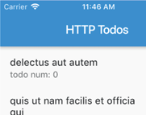


*Mô tả hình:* Giống hình 11.2: hai ảnh cắt phần trên của ứng dụng, mũi tên chỉ vào con số ở góc phải AppBar với nhãn **"Completed Todos count"** (số todo đã hoàn thành); trước khi nhấn nút con số là 0, sau khi tải danh sách thì con số khác 0.

Thứ hai, tôi kiểm thử để chắc rằng danh sách todo cuộn được, và số mục trong danh sách todo đúng như tôi mong đợi. Bài test này nhằm cho thấy hai điều: sức mạnh của `flutter_driver` (bạn có thể ngồi xem nó cuộn qua ứng dụng của bạn) và cách dùng package `flutter_driver` để đo hiệu năng ứng dụng. Tôi sẽ bàn thêm về điều đó ngay sau đây.

Đây là các bài test tôi đã viết cho ứng dụng todo:

```dart
//lib/test_drive/test_app.dart
test('taps fab button', () async {
  // (1) driver.tap thay cho tester.tap.
  await driver.tap(buttonFinder);
  expect(
    // (2) driver.getText cũng tương tự. isNot là một Matcher
    //     về cơ bản có nghĩa là != (khác).
    await driver.getText(completedTodoCounter),
    isNot("0"),
  );
});

test('can scroll to bottom', () async {
  final timeline =
      // (3) traceAction được dùng để đo hiệu năng (profiling). Sẽ nói thêm ngay!
      await driver.traceAction(() async {
    // (4) driver.scrollUntilVisible sẽ làm đúng như tên gọi: cuộn cho tới khi thấy.
    await driver.scrollUntilVisible(
      // (5) listViewFinder là một finder tôi viết để tìm ListView trong ứng dụng.
      listViewFinder,
      // (6) lastTodoFinder tìm todo cuối cùng. Tham số này là thứ
      //     bạn truyền vào để bài test tìm kiếm.
      lastTodoFinder,
      // (7) Đây là số pixel driver sẽ cuộn mỗi lần.
      dyScroll: -150.0,
    );
    expect(
      await driver.getText(lastTodoSubtitleFinder),
      "todo num: 19",
    );
```

Chú thích của đoạn code:
1. `driver.tap` thay thế cho `tester.tap`.
2. `driver.getText` cũng tương tự. `isNot` là một Matcher có nghĩa gần như là `!=`.
3. `traceAction` được dùng để đo hiệu năng (*profiling*). Sẽ nói thêm về nó ngay sau đây!
4. `driver.scrollUntilVisible` sẽ làm đúng như tên gọi của nó.
5. `listViewFinder` là một finder tôi viết để tìm `ListView` trong ứng dụng.
6. `lastTodoFinder` tìm todo cuối cùng. Tham số này là thứ bạn truyền vào để bài test tìm kiếm.
7. Đây là số pixel driver sẽ cuộn mỗi lần thao tác. Nó sẽ cuộn xuống 150 pixel rồi dừng, tìm widget, rồi cuộn thêm 150 pixel nữa nếu chưa thấy, cứ thế tiếp tục. Tốt nhất là đừng đặt một con số có thể lớn hơn khung nhìn (*viewport*) của thiết bị mà ứng dụng đang chạy.

Về cơ bản có ba điểm khác biệt lớn trong bài test đó so với widget test.

Thứ nhất, `tester` được thay bằng `driver`. Nhưng dù là cái này hay cái kia, đó đều là đối tượng bạn dùng để truy cập phần lớn tính năng kiểm thử.

Điểm thứ hai thì ít tinh tế hơn (dễ thấy hơn). Phương thức `scrollUntilVisible` trên `driver` rất mạnh! Thực ra bạn cũng có thể cuộn với package `flutter_test` thông thường, nhưng nó không "thông minh" bằng. `scrollUntilVisible` làm được nhiều thứ hơn cho bạn. Trong ví dụ test, bài test sẽ đạt nếu nó có thể nhấn nút, hiển thị vài todo, và cuộn xuống cho tới khi tìm thấy một todo có Key `todo-19`. Nếu có 5.000 todo, nó cũng xử lý được. Nó chỉ cuộn một chút, kiểm tra xem mục đó đã hiện ra chưa, rồi tiếp tục. `scrollUntilVisible` chỉ là một ví dụ về những gì `flutter_driver` có thể làm. Nó giúp dễ dàng mô phỏng việc sử dụng thực tế của người dùng.

Điểm khác biệt lớn cuối cùng trong bài test này (so với widget test) là phương thức `driver.traceAction`. Nó được dùng để đo hiệu năng ứng dụng của bạn, và tôi sẽ nói về nó tiếp theo.

> 📝 **Giải thích thêm (không có trong sách):** Vì sao `dyScroll` là số **âm** (`-150.0`)? Trong hệ tọa độ màn hình, trục y hướng xuống dưới. Để nội dung danh sách đi lên (tức là ta "cuộn xuống" để xem mục phía dưới), ngón tay phải vuốt **từ dưới lên**, tức là dịch chuyển theo hướng y âm. Vì vậy giá trị âm nghĩa là "kéo nội dung lên, xem tiếp phần bên dưới".
>
> Ngoài ra, để `find.byValueKey("todo-19")` hoạt động, trong code ứng dụng các widget phải được gắn `ValueKey` tương ứng, ví dụ trong `ListView.builder`: `ListTile(key: ValueKey('todo-$index'), subtitle: Text('todo num: $index', key: ValueKey('todo-$index-subtitle')), ...)`. `find.byValueKey` của driver chỉ tìm được widget có key là `ValueKey<String>` hoặc `ValueKey<int>`.

> 💡 **Ví dụ bổ sung (không có trong sách):** Một bài test driver khác — nhập chữ vào ô tìm kiếm (giả sử ứng dụng có `TextField` gắn `Key('search-field')`):
>
> ```dart
> test('gõ chữ vào ô tìm kiếm', () async {
>   final searchField = find.byValueKey('search-field');
>   await driver.tap(searchField);          // focus vào ô nhập
>   await driver.enterText('porro');        // gõ chữ như người dùng
>   await driver.waitFor(find.text('porro')); // chờ cho tới khi chữ xuất hiện
> });
> ```
>
> `waitFor` là một điểm mạnh khác của driver: thay vì phải tự `pump`, nó tự chờ cho tới khi widget xuất hiện (hoặc báo lỗi khi hết thời gian).

### 11.1.5 Đo hiệu năng bằng integration test (Performance profiling integration tests)

Lý do tôi cố ý viết một bài test liên quan tới việc cuộn là vì cuộn là một tác vụ tốn kém đối với ứng dụng di động. Trong khi cuộn, ứng dụng vẽ lại nhiều lần mỗi giây. Nếu bạn tò mò thì Flutter vẽ ở tốc độ 60 FPS (*frames per second* – khung hình mỗi giây). Khi bạn cuộn, ứng dụng vẽ lại toàn bộ trang hết lần này tới lần khác. Đó là một animation được tạo sẵn cho bạn, nghĩa là việc cuộn bị "giật" (*janky*) không phải là điều quá khó xảy ra. `flutter_driver` cung cấp cách để giữ cho ứng dụng của bạn không bị giật (*jank-free*), thông qua tính năng đo hiệu năng có sẵn của nó.

Tóm lại, bạn có thể bảo ứng dụng ghi lại các chỉ số hiệu năng (*performance metrics*) trong bất kỳ integration test nào, và nó sẽ đưa cho bạn dữ liệu kết quả. Việc đo hiệu năng hoàn toàn xoay quanh bản thân giao diện, chẳng hạn các animation mượt tới đâu, việc vẽ đạt bao nhiêu FPS, v.v. Bạn có thể dùng những kết quả đó để cố gắng xác định chính xác đâu là điểm nghẽn hiệu năng (*performance bottleneck*) của ứng dụng, xét về mặt giao diện. (Ví dụ, nếu dữ liệu cho thấy hiệu năng kém trong một bài test có cuộn, có lẽ các mục trong vùng cuộn quá tốn kém để vẽ.)

> 📝 **Giải thích thêm (không có trong sách):** 60 FPS nghĩa là mỗi khung hình chỉ có khoảng **1000 ms / 60 ≈ 16,67 ms** để hoàn tất. Đây được gọi là "ngân sách khung hình" (*frame budget*). Nếu việc dựng (build) hoặc vẽ (rasterize) một khung hình vượt quá ~16 ms, khung hình đó bị lỡ (*missed frame*), và mắt người sẽ thấy giật.

Đo hiệu năng ứng dụng với `flutter_driver` thật ra chỉ cần hai bước nhanh. Đầu tiên, cho nó biết bài test nào cần đo bằng phương thức `traceAction`. Sau đó xuất bản tóm tắt bằng một đối tượng tên là `TimelineSummary`. Bài test tôi cho bạn xem lúc nãy (bài test cuộn) thực ra chưa đầy đủ. Đây là đoạn code đầy đủ.

**Listing 11.16 – Đo hiệu năng ứng dụng của bạn với flutter_driver**

```dart
// backend/test_drive/app_test.dart
test('can scroll to bottom', () async {
  final timeline =
      // (1) traceAction cho flutter_driver biết cần theo dõi cái gì.
      //     Bạn truyền bài test của mình vào dưới dạng một callback.
      await driver.traceAction(() async {
    await driver.scrollUntilVisible(
      listViewFinder,
      lastTodoFinder,
      dyScroll: -150.0,
    );
    expect(await driver.getText(lastTodoSubtitleFinder), "todo num: 19");
  });

  // (2) TimelineSummary là lớp sẽ phân tích toàn bộ dữ liệu từ traceAction
  //     và biến nó thành thứ dễ "tiêu hóa". Ta truyền cho nó kết quả của
  //     traceAction qua biến timeline.
  final summary =
      TimelineSummary.summarize(timeline);

  // (3) Phương thức này tạo một file mới chứa toàn bộ dữ liệu. Tham số đầu
  //     (scrolling_summary) là tên bạn muốn đặt cho file mới;
  //     pretty: true giúp con người đọc được.
  await summary.writeSummaryToFile(
    "scrolling_summary", pretty: true,
  );

  // (4) writeTimelineToFile ghi toàn bộ timeline; quá nhiều để đọc,
  //     nhưng nó có mục đích riêng (xem phần sau).
  await summary.writeTimelineToFile(
    "scrolling_timeline",
  );
});
```

Chú thích của listing:
1. `traceAction` cho `flutter_driver` biết cần theo dõi cái gì. Bạn truyền bài test của mình vào dưới dạng một callback.
2. `TimelineSummary` là lớp sẽ phân tích (*parse*) toàn bộ dữ liệu từ `traceAction` và biến nó thành thứ dễ hiểu. Ta truyền cho nó kết quả của `traceAction` thông qua biến `timeline`.
3. Phương thức này tạo một file mới chứa toàn bộ dữ liệu. Tham số đầu tiên (`scrolling_summary`) là tên bạn muốn đặt cho file mới; `pretty: true` giúp con người đọc được.
4. `writeTimelineToFile` ghi toàn bộ timeline; nó quá nhiều để đọc, nhưng có mục đích riêng của nó (sẽ cho thấy ở phần sau).

Tất cả những thứ này đều rất hay. Hy vọng chúng ta đều đồng ý rằng việc Flutter tự đo hiệu năng ứng dụng cho bạn thật là tuyệt. Nhưng đọc được dữ liệu lại là chuyện khác. Trước hết, để thực sự chạy bài test, hãy làm hai bước:

1. Đảm bảo bạn có một thiết bị đang chạy (máy ảo iOS).
2. Chạy lệnh `flutter drive --target=test_driver/app.dart` ở thư mục gốc dự án.

```bash
flutter drive --target=test_driver/app.dart
```

Việc này sẽ mất một phút vì `flutter_driver` phải build rồi chạy ứng dụng giống như khi bạn chạy ứng dụng ở chế độ phát triển. Khi các bài test chạy xong, hai file được tạo ra, và cả hai đều nằm trong thư mục `build` — thư mục được tạo ra khi bạn chạy một ứng dụng Flutter. File thứ nhất, `backend/build/scrolling_summary.json`, chứa đầy JSON cung cấp một số thông tin nhanh. File của tôi trông thế này:

```json
// backend/build/scrolling_summary.json
{
  "average_frame_build_time_millis": 4.57943661971831,
  "90th_percentile_frame_build_time_millis": 8.045,
  "99th_percentile_frame_build_time_millis": 10.86,
  "worst_frame_build_time_millis": 13.751,
  "missed_frame_build_budget_count": 0,
  "average_frame_rasterizer_time_millis": 2.4071690140845066,
  "90th_percentile_frame_rasterizer_time_millis": 2.85,
  "99th_percentile_frame_rasterizer_time_millis": 3.234,
  "worst_frame_rasterizer_time_millis": 3.551,
  "missed_frame_rasterizer_budget_count": 0,
  "frame_count": 71,
  // ...
```

> 📝 **Giải thích thêm (không có trong sách) – đọc các trường trong file tóm tắt:**
>
> | Trường | Ý nghĩa |
> |---|---|
> | `average_frame_build_time_millis` | Thời gian trung bình (ms) để dựng (build) một khung hình trên luồng UI |
> | `90th_percentile_frame_build_time_millis` | 90% khung hình được dựng nhanh hơn hoặc bằng giá trị này |
> | `99th_percentile_frame_build_time_millis` | 99% khung hình được dựng nhanh hơn hoặc bằng giá trị này |
> | `worst_frame_build_time_millis` | Khung hình dựng chậm nhất |
> | `missed_frame_build_budget_count` | Số khung hình dựng vượt ngân sách (~16 ms) – tức bị lỡ |
> | `..._frame_rasterizer_time_millis` | Các chỉ số tương tự nhưng cho bước raster (vẽ ra điểm ảnh trên luồng GPU/raster) |
> | `missed_frame_rasterizer_budget_count` | Số khung hình raster vượt ngân sách |
> | `frame_count` | Tổng số khung hình được ghi nhận trong lúc chạy `traceAction` |
>
> Với số liệu của tác giả: khung hình tệ nhất mất 13,751 ms để build — vẫn dưới 16,67 ms, nên không khung hình nào bị lỡ.

Với tôi, chừng này hơi quá nhiều để "tiêu hóa". Những con số đó thực sự chỉ có giá trị khi bạn đã chạy nhiều lần test và có thể thấy các điểm dữ liệu thay đổi theo thời gian. Bản thân chúng không có nhiều ngữ cảnh. Nhưng bạn có thể thấy `missed_frame_build_budget_count` bằng 0. Thế là tốt. Điều đó có nghĩa là Flutter đã xử lý được mọi khung hình mới mà nó cố vẽ. Tuy nhiên, còn có một bộ dữ liệu chi tiết hơn nữa giúp việc này dễ hiểu hơn. Đó là file `scrolling_timeline.json`.

Bản thân file đó là một mớ hỗn độn. Có quá nhiều con số đến mức chẳng hiểu nổi. Nhưng có một công cụ bên trong trình duyệt Chrome của Google có thể hiển thị dữ liệu này dưới dạng biểu đồ. Việc phân tích dữ liệu đo hiệu năng nằm ngoài phạm vi cuốn sách này, nhưng tôi sẽ chỉ cho bạn cách mở được nó và chia sẻ vài mẹo hay.

Công cụ biến dữ liệu thành biểu đồ là miễn phí. Và nếu bạn dùng trình duyệt Chrome, bạn đã có sẵn công cụ đó. Trong trình duyệt Chrome, bạn có thể vào địa chỉ `chrome://tracing/`. (Gõ nó vào thanh địa chỉ và mở trang.) Những gì bạn sẽ thấy được trình bày trong hình 11.5.

**Hình 11.5 – Công cụ đo hiệu năng của Chrome**

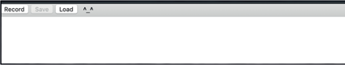

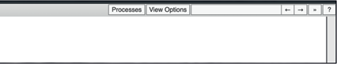

*Mô tả hình:* Thanh công cụ trên cùng của trang `chrome://tracing` với các nút **Record** (Ghi), **Save** (Lưu), **Load** (Tải), và bên phải là **Processes** (Tiến trình), **View Options** (Tùy chọn hiển thị) cùng các nút điều hướng `←`, `→`, `»`, `?`. Một mũi tên đỏ chỉ vào nút **Load** với dòng chú thích **"Load in a file."** (Tải một file vào đây). Phần còn lại của trang trống trơn.

Về cơ bản là một màn hình trống! Nhưng trên màn hình đó, hãy nhấn nút **Load** và mở file `scrolling_timeline.json`. Giờ dữ liệu đã được tải, và bạn sẽ thấy những gì trong hình 11.6.

**Hình 11.6 – Hình ảnh trực quan của dữ liệu profiler**

Hình gốc trong sách được trích ra thành nhiều mảnh ảnh nhỏ, nhúng lần lượt dưới đây, kèm ảnh render nguyên trang để xem hình hoàn chỉnh:

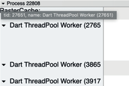
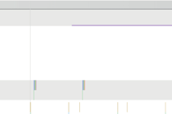
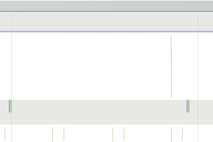
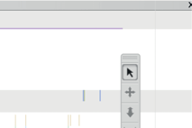
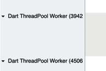
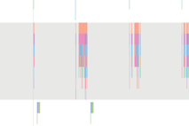
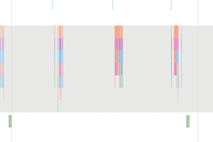
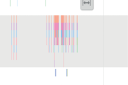

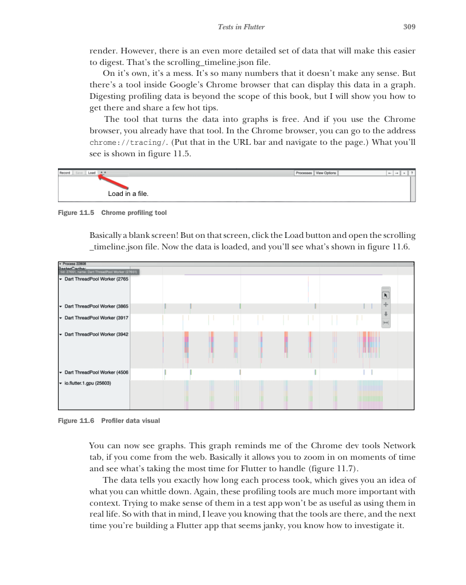

*Mô tả hình:* Giao diện `chrome://tracing` sau khi nạp file. Cột bên trái liệt kê các luồng (thread) thuộc một tiến trình ("Process 22808"): nhiều dòng **"Dart ThreadPool Worker (…)"** (các luồng làm việc của Dart) và **"io.flutter.1.gpu (25603)"** (luồng GPU/raster của Flutter). Bên phải là trục thời gian nằm ngang; mỗi vạch/khối màu là một sự kiện (một đoạn công việc) trên luồng tương ứng, khối càng rộng nghĩa là công việc đó càng tốn thời gian. Góc phải có thanh công cụ nhỏ (con trỏ chọn, phóng to `+`, thu nhỏ, và căn khung).

Giờ bạn có thể thấy các biểu đồ. Biểu đồ này làm tôi nhớ tới tab **Network** trong Chrome dev tools, nếu bạn xuất thân từ mảng web. Về cơ bản, nó cho phép bạn phóng to vào từng thời điểm và xem cái gì đang khiến Flutter tốn nhiều thời gian xử lý nhất (hình 11.7).

**Hình 11.7 – Các tiến trình cụ thể và thời gian chạy của chúng**

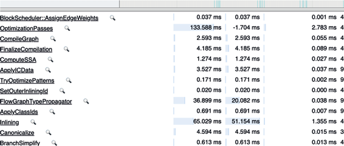

*Mô tả hình:* Ảnh phóng to một đoạn thời gian trong `chrome://tracing`: các khối màu xếp chồng theo tầng thể hiện từng tác vụ và các tác vụ con mà Flutter thực hiện (ví dụ các bước dựng khung hình, vẽ, raster...). Khi chọn một khối, phía dưới hiển thị chi tiết như tên tác vụ, thời điểm bắt đầu và **thời lượng** (*duration*) của nó — nhờ đó biết chính xác mỗi tiến trình tốn bao lâu.

Dữ liệu cho bạn biết chính xác mỗi tiến trình mất bao lâu, điều này cho bạn ý tưởng về những gì có thể "gọt bớt". Một lần nữa, các công cụ đo hiệu năng này quan trọng hơn nhiều khi có ngữ cảnh. Cố hiểu chúng trong một ứng dụng thử nghiệm sẽ không hữu ích bằng dùng chúng trong thực tế. Vậy nên, với điều đó trong đầu, tôi để lại cho bạn kiến thức rằng các công cụ ấy luôn sẵn có, và lần tới khi bạn xây dựng một ứng dụng Flutter có vẻ bị giật, bạn đã biết cách điều tra nó.

> 💡 **Ví dụ bổ sung (không có trong sách) – Bài toán:** Giả sử sau khi thêm ảnh đại diện lớn vào mỗi todo, bạn chạy lại bài test cuộn và nhận được: `"worst_frame_build_time_millis": 41.2`, `"missed_frame_build_budget_count": 9`, `"frame_count": 70`. Hãy nhận xét.
>
> **Lời giải:** Ngân sách mỗi khung hình ở 60 FPS ≈ 16,67 ms. Khung hình tệ nhất mất 41,2 ms — gấp khoảng 2,5 lần ngân sách, tức là tại thời điểm đó màn hình "đứng hình" khoảng 2–3 khung. Có 9/70 ≈ 13% khung hình bị lỡ — người dùng chắc chắn thấy giật. Đúng như sách gợi ý, nghi phạm số một là "các mục trong vùng cuộn quá tốn kém để vẽ": nên giảm kích thước ảnh (dùng `cacheWidth`/`cacheHeight` của `Image`), dùng `ListView.builder` để chỉ dựng những mục đang hiển thị, rồi chạy lại test và so sánh số liệu với lần trước — chính là "xem các điểm dữ liệu thay đổi theo thời gian" như tác giả nói.

---

## 11.2 Khả năng tiếp cận với các widget Semantics (Accessibility with the semantics widgets)

Nói chung, khả năng tiếp cận (*accessibility*) là việc đảm bảo ứng dụng của bạn ai cũng dùng được. Ví dụ tiêu biểu nhất là cách dùng màu trên màn hình. Rất nhiều người bị mù màu, và điều quan trọng là màu sắc bạn dùng trong bất kỳ ứng dụng Flutter, ứng dụng web, hay theo đúng nghĩa đen là bất cứ thứ gì con người phải đọc, đều phải đọc được với tất cả mọi người, kể cả khi thị lực của họ bị suy giảm; chẳng hạn dùng độ tương phản mạnh giữa chữ và nền của nó.

Đây là một chủ đề khá ngắn trong Flutter vì phần lớn các nguyên tắc và thực hành không dành riêng cho Flutter; ví dụ, dùng hình ảnh có độ tương phản cao hay dùng chữ đủ lớn. Bạn có thể (và nhiều người đã) viết cả những cuốn sách về khả năng tiếp cận. Tôi khuyến khích bạn học hết những gì có thể và áp dụng những thực hành đó. Dù vậy, Flutter có một họ widget được dùng riêng cho khả năng tiếp cận: các widget **Semantics** (ngữ nghĩa).

Widget Semantics được dùng giống như cách thuộc tính `alt` trên thẻ `<a>` trong HTML được dùng. Nó cung cấp thông tin về việc ứng dụng làm gì và hoạt động ra sao. Widget `Semantics` chú thích (*annotate*) cây widget bằng một mô tả về con trực tiếp (*direct child*) của nó. Ví dụ, bạn có thể dùng semantics để chú thích cho một widget `Button` về việc nút đó làm gì. Hoặc bạn có thể dùng nó để chú thích cho một đoạn chữ nào đó có thể khó đọc đối với người khiếm thị. Widget này cho phép trình đọc màn hình (*screen reader*) hiểu được điều gì đang diễn ra và thông báo lại cho người dùng.

> 📝 **Giải thích thêm (không có trong sách):** Trong HTML, thuộc tính `alt` thường gặp nhất ở thẻ `` (văn bản thay thế cho ảnh), còn với liên kết `<a>` người ta hay dùng `aria-label` hoặc `title`. Ý của tác giả là: giống như `alt` mô tả bằng chữ cho trình đọc màn hình biết một phần tử là gì, `Semantics` mô tả bằng chữ cho trình đọc màn hình (TalkBack trên Android, VoiceOver trên iOS) biết một widget là gì và làm gì.

Trong Flutter, như ta đã học, có nhiều cây (*tree*) biểu diễn ứng dụng. Widget `Semantics` cũng hoạt động như vậy. Có (thêm một) cây nữa gọi là **cây ngữ nghĩa** (*semantics tree*) chứa thông tin ngữ nghĩa cho các trình đọc màn hình. Một phần công việc xây dựng một cây ngữ nghĩa tốt đã được làm sẵn cho bạn, nhưng bạn cũng có thể tự bổ sung vào.

Bạn thêm các nút (*node*) vào cây ngữ nghĩa bằng cách đơn giản là bọc widget bằng một widget `Semantics` làm cha. Đây là một ví dụ:

```dart
// (1) Semantics là một widget, giống như mọi thứ khác.
Semantics(
  // (2) Nếu true, tạo một node mới trong cây ngữ nghĩa.
  container: true,
  // (3) properties mang lại sức mạnh cho widget Semantics.
  properties: SemanticsProperties(
    // (4) button nên là true nếu con là một nút bấm.
    button: true,
    // (5) hint này được cung cấp cho trình đọc màn hình.
    hint: "Performs action when pressed",
    // (6) onTap là một trong nhiều callback có thể truyền vào.
    onTap: () => { ... },
  ),
  // (7) Sau đó bạn chỉ việc đưa cho nó một child như mọi widget khác.
  child: Button(
    // ...
```

Chú thích của đoạn code:
1. `Semantics` là một widget, giống như mọi thứ khác.
2. Nếu `true`, tạo một node mới trong cây ngữ nghĩa. Bạn có thể không muốn nó là `true` nếu node đó và cha của nó thực chất là một thành phần UI duy nhất (như một nút bấm và dòng chữ bên trong nó).
3. Các thuộc tính (`properties`) mang lại sức mạnh cho widget Semantics. Có rất nhiều thuộc tính, nhưng những cái này đại diện cho khá nhiều trong số đó.
4. `button` nên là `true` nếu con là một nút bấm; nó cho trình đọc màn hình biết đây có phải là một thành phần có thể thao tác được hay không. Cũng có những thuộc tính như `textField` (cho ô nhập chữ) và `checked` (cho checkbox).
5. `hint` này được cung cấp cho trình đọc màn hình để người dùng biết thành phần này làm gì. (Chuỗi `"Performs action when pressed"` = "Thực hiện hành động khi được nhấn".)
6. `onTap` là một trong nhiều callback có thể truyền vào để phản hồi các hành động mà công cụ hỗ trợ tiếp cận (như trình đọc màn hình) có thể thực hiện.
7. Sau đó bạn chỉ việc đưa cho nó một `child` như mọi thứ khác.

Đó là phần lớn những gì bạn cần nhớ khi dùng widget Semantics. Widget này có rất, rất nhiều thuộc tính. Nhưng điều quan trọng cần lưu ý ở đây là Flutter có quan tâm tới khả năng tiếp cận và cung cấp cách để làm ứng dụng dễ tiếp cận hơn. Bạn tuyệt đối nên dùng chúng để ứng dụng của mình sẵn sàng cho production.

> 📝 **Giải thích thêm (không có trong sách):** Đoạn code của sách mang tính minh họa (pseudo-code): `onTap: () => { ... }` và `Button(...)` không phải code chạy được nguyên văn. Trong các phiên bản Flutter hiện nay, các thuộc tính như `button`, `label`, `hint`, `onTap` được truyền **trực tiếp** vào constructor của `Semantics` (constructor `Semantics.fromProperties` mới nhận đối tượng `SemanticsProperties`).

> 💡 **Ví dụ bổ sung (không có trong sách):** Gắn nhãn cho một nút chỉ có biểu tượng (icon) — trường hợp rất hay gặp, vì trình đọc màn hình không thể "đọc" một hình dấu `+`:
>
> ```dart
> Semantics(
>   button: true,
>   label: 'Tải danh sách việc cần làm',
>   hint: 'Nhấn đúp để tải',
>   child: FloatingActionButton(
>     key: Key("get-todos-button"),
>     onPressed: () => _getTodos(),
>     child: Icon(Icons.add),
>   ),
> )
> ```
>
> Với VoiceOver/TalkBack bật, khi người dùng chạm vào nút, điện thoại sẽ đọc kiểu như: "Tải danh sách việc cần làm, nút. Nhấn đúp để tải." Bạn cũng có thể kiểm thử điều này bằng widget test: `expect(tester.getSemantics(find.byKey(Key('get-todos-button'))), matchesSemantics(label: 'Tải danh sách việc cần làm', isButton: true, ...))` — một cách kết hợp hai chủ đề của chương này. (Thực tế `FloatingActionButton` còn có sẵn thuộc tính `tooltip`, vừa hiện chú thích khi nhấn giữ vừa được dùng làm nhãn ngữ nghĩa.)

---

## 11.3 Bước tiếp theo với Flutter (Next steps with Flutter)

*(Bật bài "You're Still the One" của Shania Twain trên máy hát tự động.)*

*"Looks like we made it…"* ("Có vẻ như chúng ta đã làm được rồi…")

*(Danh đề cuối phim bắt đầu chạy…)*

Chà, vậy là ta đã ở đây. Cuối cuốn sách. Và hãy nhìn xem bạn đã đi được xa tới mức nào. Khi tôi đang viết những dòng này, tôi vui mừng mà nói rằng có một số điều lớn lao, thú vị sắp tới với Flutter trong tương lai gần. Vậy nên, cuộc hành trình chưa kết thúc (chưa đâu).

Trong lúc chờ đợi, tôi hy vọng bạn sẽ tiếp tục dùng Flutter, tiếp tục học, và thậm chí có thể đóng góp lại cho cộng đồng. Tôi không thể nào trình bày mọi thứ trong một cuốn sách, và Flutter phát triển nhanh tới mức tôi muốn chỉ ra một số nguồn tài liệu yêu thích mà tôi nghĩ là những bước hợp lý để học thêm về Flutter:

- **FlutterSamples.com** — Trang này là một bộ sưu tập các ứng dụng Flutter minh họa những cách khác nhau để tiếp cận kiến trúc ứng dụng Flutter và state của nó. Nó bao gồm các ứng dụng mẫu dùng bloc, Redux, inherited widget, và nhiều hơn nữa.
- **Accessibility Handbook** — Cuốn sách này (của O'Reilly Media) đã gần 10 năm tuổi, nhưng nó vẫn là cuốn sách "kinh điển" cần tìm đến về khả năng tiếp cận cho website. Những nguyên tắc tương tự áp dụng cho di động.
- **Kênh YouTube của Flutter** — Đội ngũ quan hệ nhà phát triển (*developer relations*) của Flutter dồn rất nhiều công sức vào tài liệu học tập và tài liệu hướng dẫn. Tôi nghĩ đó là một trong những điều khiến Flutter trở thành một sản phẩm tuyệt vời như vậy. Có hàng tấn video hữu ích về mọi chủ đề trên kênh YouTube chính thức của Flutter.
- **CodeMagic** — Đây là một nền tảng CD/CI (*triển khai liên tục / tích hợp liên tục*) được tạo ra dành riêng cho Flutter. Và nó dễ dùng. Không gì tuyệt hơn thế.

Cuối cùng, nếu bạn thực sự tò mò về cách Flutter hoạt động "dưới nắp capo" theo kiểu chi tiết, đậm chất khoa học máy tính, hãy xem bài viết tên là **"Inside Flutter"** trên website của Flutter. Bạn sẽ tìm thấy nó tại https://flutter.dev/docs/resources/inside-flutter.

> 📝 **Giải thích thêm (không có trong sách):** CI (*Continuous Integration*) là việc tự động build và chạy test mỗi khi có code mới được đẩy lên; CD (*Continuous Delivery/Deployment*) là tự động đóng gói và phát hành ứng dụng. Kết hợp với chương này: bạn có thể cấu hình một nền tảng CI/CD (như CodeMagic, GitHub Actions…) để mỗi lần push code, nó tự chạy `flutter test` (unit + widget test), thậm chí chạy integration test trên máy ảo, và chặn việc phát hành nếu có test thất bại.

---

## Tóm tắt (Summary)

- Có ba cách để kiểm thử code Flutter: unit test của Dart, widget test và integration test.
- Unit test rất phù hợp để kiểm thử các lớp và hàm.
- Bạn có thể "giả lập" (mock) các lớp bằng thư viện `mockito` — đặc biệt hữu ích với những lớp thực hiện lời gọi tới service.
- Widget test phù hợp nhất để kiểm thử các widget cụ thể.
- Widget test dùng các đối tượng `Matcher` và `Finder` để so sánh điều bạn mong đợi xảy ra với điều thực sự đã xảy ra.
- Integration test có thể kiểm thử cách tất cả các bộ phận chuyển động của một tính năng phối hợp với nhau.
- Integration test trong Flutter được thực hiện bằng package `flutter_driver`.
- Bạn có thể đo hiệu năng ứng dụng của mình bằng integration test.
- Test viết bằng `flutter_driver` tương tự widget test. Cả hai đều dùng khái niệm "pump" widget để mô phỏng một ứng dụng đang chạy.
- Khả năng tiếp cận (accessibility) là điều quan trọng trong các ứng dụng production.
- Flutter giúp bạn viết ứng dụng dễ tiếp cận hơn thông qua widget `Semantics`. Hãy dùng nó!

---

## Bảng thuật ngữ của chương

| Thuật ngữ (English) | Nghĩa tiếng Việt | Giải thích ngắn |
|---|---|---|
| Unit test | Kiểm thử đơn vị | Kiểm thử một lớp hoặc một hàm riêng lẻ, không liên quan tới widget |
| Widget test | Kiểm thử widget | Kiểm thử một widget (và cây con của nó) bằng package `flutter_test` |
| Integration test | Kiểm thử tích hợp | Kiểm thử toàn bộ ứng dụng chạy thật, mô phỏng người dùng |
| `test` / `expect` / `group` | Các hàm cốt lõi của thư viện test | Khai báo bài test / so sánh kết quả / gom nhóm bài test dùng chung tài nguyên |
| Actual | Giá trị thực tế | Tham số đầu của `expect` – thứ đang được kiểm thử |
| Matcher | Bộ so khớp | Mô tả kết quả mong đợi (ví dụ `1`, `findsOneWidget`, `isNot("0")`, `throwsException`) |
| Mock | Đối tượng giả | Bản thay thế giả cho một phụ thuộc thật (HTTP client, service...) |
| Stub | Gài sẵn phản hồi | Quy định trước kết quả mà một lời gọi giả sẽ trả về (`when(...).thenAnswer(...)`) |
| mockito | (tên package) | Thư viện tạo mock và stub trong Dart |
| Dependency (external) | Phụ thuộc (bên ngoài) | Thứ mà code cần nhưng không kiểm soát được, như API, database |
| Dependency injection | Tiêm phụ thuộc | Truyền phụ thuộc từ ngoài vào (như truyền `Client` vào `getTodos`) để dễ thay bằng mock |
| Finder | Bộ tìm | Đối tượng quét cây widget để tìm widget theo text, key, type... |
| `CommonFinders` | Các finder thông dụng | Tập hợp `byText`, `byWidget`, `byKey`, `byType`... nằm trong đối tượng `find` |
| `WidgetTester` | Bộ kiểm thử widget | Đối tượng tương tác với widget như người dùng: tap, drag, nhập chữ |
| Pump | "Bơm" (dựng lại khung hình) | Gọi `Widget.build` trong môi trường test; cần sau mỗi tương tác / `setState` |
| `pumpAndSettle` | Bơm cho tới khi ổn định | Gọi `pump` lặp lại trong khoảng thời gian cho trước; hữu ích cho việc bất đồng bộ |
| Key | Khóa định danh | Giá trị gắn vào widget để tìm nó chính xác trong test |
| `flutter_driver` | (tên package) | Package chạy integration test, điều khiển ứng dụng thật trên thiết bị |
| `FlutterDriver` | Trình điều khiển Flutter | Đối tượng kết nối tới ứng dụng đang chạy, vai trò giống `WidgetTester` |
| `setUpAll` / `tearDownAll` | Thiết lập / dọn dẹp một lần | Chạy một lần trước/sau toàn bộ nhóm test |
| `scrollUntilVisible` | Cuộn tới khi thấy | Cuộn từng đoạn và kiểm tra cho tới khi widget mục tiêu hiện ra |
| Profiling | Đo hiệu năng | Ghi lại các chỉ số thời gian dựng/vẽ khung hình để tìm điểm nghẽn |
| `traceAction` | Ghi vết hành động | Bọc một đoạn test để ghi timeline hiệu năng |
| `TimelineSummary` | Bản tóm tắt timeline | Phân tích dữ liệu từ `traceAction`, ghi ra file tóm tắt và timeline |
| FPS (frames per second) | Khung hình mỗi giây | Flutter vẽ ở 60 FPS, tức ~16,67 ms mỗi khung |
| Jank / janky | Giật, khựng | Hiện tượng giao diện không mượt do lỡ khung hình |
| Frame budget | Ngân sách khung hình | Thời gian tối đa cho một khung hình (~16 ms ở 60 FPS) |
| Bottleneck | Điểm nghẽn | Chỗ làm chậm toàn bộ hệ thống |
| `chrome://tracing` | Công cụ tracing của Chrome | Công cụ trong Chrome hiển thị file timeline dưới dạng biểu đồ |
| Accessibility | Khả năng tiếp cận | Đảm bảo ứng dụng ai cũng dùng được, kể cả người khuyết tật |
| Screen reader | Trình đọc màn hình | Phần mềm đọc to nội dung màn hình (TalkBack, VoiceOver) |
| Semantics widget | Widget ngữ nghĩa | Widget chú thích ý nghĩa của widget con cho công cụ hỗ trợ tiếp cận |
| Semantics tree | Cây ngữ nghĩa | Cây chứa thông tin ngữ nghĩa dành cho trình đọc màn hình |
| CI/CD | Tích hợp liên tục / Triển khai liên tục | Tự động build, test và phát hành mỗi khi code thay đổi |
