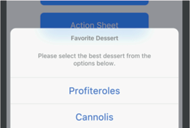
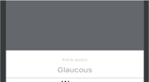
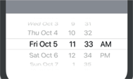
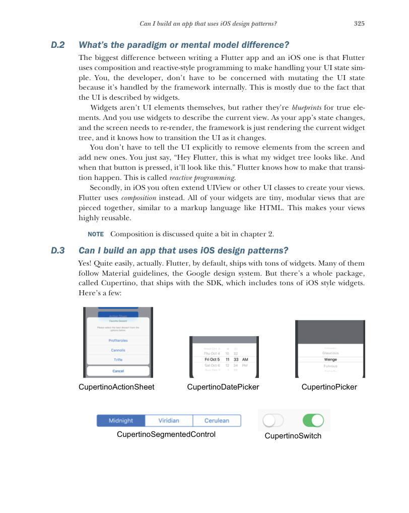

# Phụ lục A–E

> Phần này gồm 5 phụ lục của sách *Flutter in Action*: cài đặt Dart 2 và Flutter (A), trình quản lý gói Pub (B), Flutter dành cho lập trình viên web (C), Flutter dành cho lập trình viên iOS (D) và Flutter dành cho lập trình viên Android (E).

## Mục lục

- [Phụ lục A: Cài đặt Dart 2 (Installation: Dart2)](#phụ-lục-a-cài-đặt-dart-2-installation-dart2)
  - [A.1 Cài đặt Dart 2 (Installation: Dart2)](#a1-cài-đặt-dart-2-installation-dart2)
    - [A.1.1 Mac OS](#a11-mac-os)
    - [A.1.2 Windows OS](#a12-windows-os)
    - [A.1.3 Linux](#a13-linux)
  - [A.2 Cài đặt Flutter SDK (Installation: Flutter SDK)](#a2-cài-đặt-flutter-sdk-installation-flutter-sdk)
    - [A.2.1 Mac OS](#a21-mac-os)
    - [A.2.2 Windows](#a22-windows)
    - [A.2.3 Linux](#a23-linux)
  - [A.3 Công cụ và đôi lời về trình soạn thảo (Tooling and a quick note on text editors)](#a3-công-cụ-và-đôi-lời-về-trình-soạn-thảo-tooling-and-a-quick-note-on-text-editors)
  - [A.4 DartPad](#a4-dartpad)
- [Phụ lục B: Trình quản lý gói Pub (The Pub package manager)](#phụ-lục-b-trình-quản-lý-gói-pub-the-pub-package-manager)
  - [B.1 Gói được lưu trữ trên Pub và cách đánh phiên bản (Hosted packages and versioning with Pub)](#b1-gói-được-lưu-trữ-trên-pub-và-cách-đánh-phiên-bản-hosted-packages-and-versioning-with-pub)
  - [B.2 Dùng gói trên máy của bạn hoặc từ GitHub (Using packages on your machine or from GitHub)](#b2-dùng-gói-trên-máy-của-bạn-hoặc-từ-github-using-packages-on-your-machine-or-from-github)
    - [B.2.1 Git](#b21-git)
    - [B.2.2 Gói cục bộ (Local packages)](#b22-gói-cục-bộ-local-packages)
  - [B.3 Sử dụng các gói (Using the packages)](#b3-sử-dụng-các-gói-using-the-packages)
- [Phụ lục C: Flutter dành cho lập trình viên web (Flutter for web developers)](#phụ-lục-c-flutter-dành-cho-lập-trình-viên-web-flutter-for-web-developers)
  - [C.1 Tin tốt trước đã (The good news first)](#c1-tin-tốt-trước-đã-the-good-news-first)
  - [C.2 Flutter xử lý bố cục thế nào? Có thứ gì tương đương flexbox không?](#c2-flutter-xử-lý-bố-cục-thế-nào-có-thứ-gì-tương-đương-flexbox-không-how-is-layout-handled-in-flutter-is-there-a-flexbox-equivalent)
  - [C.3 Còn định vị tuyệt đối thì sao?](#c3-còn-định-vị-tuyệt-đối-thì-sao-what-about-using-an-absolute-position)
  - [C.4 Những thứ cơ bản: viền, padding, margin và màu sắc?](#c4-những-thứ-cơ-bản-viền-padding-margin-và-màu-sắc-what-about-the-basics-borders-padding-margin-and-color)
  - [C.5 Định dạng kiểu chữ (Manipulating text style)](#c5-định-dạng-kiểu-chữ-manipulating-text-style)
  - [C.6 Style toàn cục (Global styles)](#c6-style-toàn-cục-global-styles)
- [Phụ lục D: Flutter dành cho lập trình viên iOS (Flutter for iOS developers)](#phụ-lục-d-flutter-dành-cho-lập-trình-viên-ios-flutter-for-ios-developers)
  - [D.1 Thứ gì tương đương UIView trong Flutter?](#d1-thứ-gì-tương-đương-uiview-trong-flutter-whats-the-equivalent-of-uiview-in-flutter)
  - [D.2 Khác biệt về tư duy (mental model) là gì?](#d2-khác-biệt-về-mô-hình-tư-duy-là-gì-whats-the-paradigm-or-mental-model-difference)
  - [D.3 Tôi có thể làm app theo mẫu thiết kế iOS không?](#d3-tôi-có-thể-làm-app-theo-mẫu-thiết-kế-ios-không-can-i-build-an-app-that-uses-ios-design-patterns)
  - [D.4 Làm bố cục phức tạp như UITableView thế nào?](#d4-làm-bố-cục-phức-tạp-như-uitableview-thế-nào-how-to-i-make-complex-layouts-like-uitableview)
  - [D.5 Thứ gì giống Storyboard?](#d5-thứ-gì-giống-storyboard-whats-similar-to-storyboard)
  - [D.6 Vẽ lên màn hình thế nào?](#d6-vẽ-lên-màn-hình-thế-nào-how-do-you-draw-to-the-screen)
  - [D.7 Thêm dependency (như CocoaPods) thế nào?](#d7-thêm-dependency-như-cocoapods-thế-nào-how-do-i-add-dependencies-like-cocoa-pods)
  - [D.8 Tương tác với thiết bị và dùng API native thế nào?](#d8-tương-tác-với-thiết-bị-và-dùng-api-native-thế-nào-how-do-i-interact-with-the-device-and-use-native-apis)
  - [D.9 Có thứ gì tương đương CoreData không?](#d9-có-thứ-gì-tương-đương-coredata-không-is-there-an-equivalent-to-coredata)
- [Phụ lục E: Flutter dành cho lập trình viên Android (Flutter for Android developers)](#phụ-lục-e-flutter-dành-cho-lập-trình-viên-android-flutter-for-android-developers)
  - [E.1 Thứ gì tương đương view trong Flutter?](#e1-thứ-gì-tương-đương-view-trong-flutter-whats-the-equivalent-of-a-view-in-flutter)
  - [E.2 Khác biệt về tư duy là gì?](#e2-khác-biệt-về-mô-hình-tư-duy-là-gì-whats-the-paradigm-or-mental-model-difference)
  - [E.3 File layout XML ở đâu?](#e3-file-layout-xml-ở-đâu-wheres-the-xml-layout-file)
  - [E.4 Vẽ lên màn hình thế nào?](#e4-vẽ-lên-màn-hình-thế-nào-how-do-i-draw-to-the-screen)
  - [E.5 Thứ gì tương đương intent?](#e5-thứ-gì-tương-đương-intent-trong-flutter-whats-the-equivalent-of-an-intent-in-flutter)
  - [E.6 Thứ gì tương đương runOnUiThread()?](#e6-thứ-gì-tương-đương-runonuithread-trong-flutter-whats-the-equivalent-of-runonuithread-in-flutter)
  - [E.7 Thứ gì tương đương file Gradle? Thêm dependency thế nào?](#e7-thứ-gì-tương-đương-file-gradle-thêm-dependency-thế-nào-whats-the-equivalent-of-a-gradle-file-how-do-i-add-dependencies)
  - [E.8 Thứ gì tương đương LinearLayout? Còn ScrollView?](#e8-thứ-gì-tương-đương-linearlayout-còn-scrollview-thì-sao-whats-the-equivalent-of-a-linearlayout-what-about-scrollview)
  - [E.9 Truy cập shared preferences hoặc SQLite thế nào?](#e9-truy-cập-shared-preferences-hoặc-sqlite-thế-nào-how-do-i-access-shared-preferences-or-sqlite)
- [Bảng thuật ngữ của chương](#bảng-thuật-ngữ-của-chương)

---

## Phụ lục A: Cài đặt Dart 2 (Installation: Dart2)

### A.1 Cài đặt Dart 2 (Installation: Dart2)

Để chạy được Dart trên máy, bạn cần cài **Dart SDK** (*Software Development Kit* – bộ công cụ phát triển phần mềm: gồm trình biên dịch, máy ảo Dart VM, thư viện chuẩn và các công cụ dòng lệnh).

> **DART 2**
>
> Các hướng dẫn dưới đây cài đặt Dart 2. Cuốn sách này dùng Dart 2; Dart 1 sẽ **không** chạy được! Nếu máy bạn đã có sẵn Dart SDK, hãy chắc chắn rằng đó là phiên bản 2.0.0 trở lên.

Cài Dart SDK khá đơn giản nếu bạn dùng dòng lệnh (*command line*). Cách cài sẽ khác nhau tùy hệ điều hành bạn đang dùng.

#### A.1.1 Mac OS

Nếu bạn dùng máy Mac, nhiều khả năng máy đã có sẵn một chương trình tên là **Homebrew**. Nếu chưa, bạn cần cài nó. Homebrew là một chương trình dòng lệnh cho phép bạn tải về và quản lý các gói phần mềm (*software packages*) ngay từ terminal. Ta có thể cài nó dễ dàng bằng dòng lệnh. Trước tiên, hãy kiểm tra xem nó đã được cài chưa.

> **Khung: Dòng lệnh (The command line)**
>
> Nhiều hướng dẫn trong sách này yêu cầu bạn chạy lệnh trong cửa sổ dòng lệnh của máy. Bạn không cần phải là "phù thủy dòng lệnh" mới đọc được sách này. (Bản thân tôi là fan cuồng của giao diện đồ họa – GUI – và cũng chẳng mấy khi dùng dòng lệnh.) Bạn chỉ cần biết: hễ thấy một dòng code bắt đầu bằng ký tự `$`, đó là một lệnh để gõ vào terminal. Trong các ví dụ sau, ký hiệu `=>` được dùng để chỉ giá trị mà lệnh trả về. Ví dụ, lệnh `which dart` trong terminal của OS X trả về đường dẫn tới Dart SDK của bạn như sau:
>
> ```bash
> $ which dart
> => /usr/local/bin/dart
> ```

> ⚠️ **CẢNH BÁO (WARNING):** Nếu bạn sao chép và dán các lệnh dòng lệnh, nhớ bỏ ký tự `$` ở đầu đi.

```bash
$ brew -v
```

Nếu terminal in ra `Homebrew 1.x.x` thì bạn đã sẵn sàng. Nếu không, bạn cần cài Homebrew. Hướng dẫn cài Homebrew qua dòng lệnh có tại https://brew.sh. Homebrew sẽ dẫn bạn đi qua từng bước ngay trong terminal.

Bước thứ hai, cài Dart SDK. Nhờ có Homebrew, việc này dễ không tưởng:

```bash
$ brew tap dart-lang/dart
$ brew install dart
```

Giờ, trong terminal, chạy lệnh sau để chắc chắn mọi thứ đã vào đúng chỗ:

```bash
$ dart -v
=> Dart VM version: 2.x.x...
```

> 📝 **Giải thích thêm (không có trong sách):**
> - `brew tap dart-lang/dart` nghĩa là "thêm kho công thức (*tap*) của nhóm Dart vào Homebrew", để Homebrew biết lấy gói `dart` ở đâu.
> - `brew install dart` mới thực sự tải và cài SDK.
> - Về sau, muốn nâng cấp Dart chỉ cần chạy `brew upgrade dart`.
> - Lưu ý: từ Flutter bản 1.21 trở đi, Flutter SDK đã **kèm sẵn** Dart SDK (nằm trong `flutter/bin/cache/dart-sdk`). Vì thế nếu bạn chỉ làm Flutter, cài Flutter (mục A.2) là đã có Dart; cài Dart riêng chỉ cần khi bạn muốn viết chương trình Dart thuần (dòng lệnh, server…).

#### A.1.2 Windows OS

Trên Windows, cách dễ nhất để cài Dart là thông qua trình quản lý gói **Chocolatey**. Khi máy đã có Chocolatey, bạn chỉ cần chạy:

```bash
C:\> choco install dart-sdk
```

#### A.1.3 Linux

Cách dễ nhất để cài trên Ubuntu là làm theo chuỗi bước dưới đây. Dùng tất cả các lệnh này sẽ đảm bảo Dart tự động được cập nhật mỗi khi có phiên bản mới nhất được phát hành.

Bước thiết lập chỉ cần làm một lần:

```bash
$ sudo apt-get update
$ sudo apt-get install apt-transport-https
$ sudo sh -c 'curl https://dl-ssl.google.com/linux/linux_signing_key.pub | apt-key add -'
$ sudo sh -c 'curl https://storage.googleapis.com/download.dartlang.org/linux/debian/dart_stable.list > /etc/apt/sources.list.d/dart_stable.list'
```

Giờ thì cài Dart SDK:

```bash
$ sudo apt-get update
$ sudo apt-get install dart
```

> 📝 **Giải thích thêm (không có trong sách):** Bốn lệnh thiết lập ở trên làm các việc sau:
> 1. `apt-get update` – làm mới danh sách gói.
> 2. Cài `apt-transport-https` – để `apt` tải được gói qua HTTPS.
> 3. Tải khóa ký (*signing key*) của Google và thêm vào `apt-key` – để `apt` tin tưởng các gói do Google ký.
> 4. Thêm file `dart_stable.list` vào `/etc/apt/sources.list.d/` – khai báo kho (*repository*) chứa Dart bản ổn định.
>
> Vì Dart giờ đến từ một kho `apt`, mỗi lần bạn chạy `sudo apt-get upgrade`, Dart sẽ được nâng lên bản mới nhất — đó là lý do tác giả nói "Dart tự động cập nhật".

### A.2 Cài đặt Flutter SDK (Installation: Flutter SDK)

Để cài Flutter, bạn cần vào trang web của Flutter để tải về file zip chứa SDK: https://flutter.dev/get-started/install/. Từ đó, bạn có thể làm theo các hướng dẫn trên trang vì chúng cực kỳ chi tiết. Nếu bạn không quan tâm tới chi tiết, tôi sẽ đưa ra các bước chính xác ngay sau đây:

#### A.2.1 Mac OS

1. Tải SDK từ https://flutter.dev/get-started/install/.
2. Giải nén các file vào đúng chỗ:

   ```bash
   $ cd ~
   $ unzip ~/Downloads/flutter_macos_v0.9.4-beta.zip
   ```

3. Thêm Flutter vào biến `PATH` (tạm thời):

   ```bash
   $ export PATH=`pwd`/flutter/bin:$PATH
   ```

4. Mở file `bash_profile` để cập nhật `PATH` vĩnh viễn:

   ```bash
   $ cd ~
   $ nano .bash_profile
   ```

5. Thêm dòng sau vào `bash_profile`:

   ```bash
   $ export PATH=$HOME/flutter/bin:$PATH
   ```

6. Chạy `flutter doctor` trong terminal.

   Đây là một công cụ dòng lệnh rất tiện: nó cho bạn biết máy còn cần thêm thứ gì nữa để chạy được Flutter. Một số công cụ khá phổ biến (như Xcode và Android Studio), nên tôi sẽ không hướng dẫn từng cái một. Nếu bạn chạy `flutter doctor`, nó sẽ cho bạn biết chính xác bạn còn cần những công cụ nào để thiết lập xong môi trường.

> 📝 **Giải thích thêm (không có trong sách):**
> - Bước 3 dùng `` `pwd` `` (thư mục hiện tại – lúc này là `~`) nên chỉ có tác dụng trong cửa sổ terminal đang mở; đóng terminal là mất. Bước 4–5 ghi vào file cấu hình shell để lần nào mở terminal cũng có.
> - Khi ghi vào file `.bash_profile`, dòng cần thêm là `export PATH=$HOME/flutter/bin:$PATH` (**không** có ký tự `$` ở đầu – đúng như cảnh báo ở mục A.1.1).
> - Các máy Mac đời mới (macOS Catalina trở đi) dùng shell mặc định là **zsh**, khi đó bạn cần sửa file `~/.zshrc` thay cho `~/.bash_profile`. Sau khi sửa, chạy `source ~/.zshrc` (hoặc mở terminal mới) để áp dụng.
> - Tên file zip `flutter_macos_v0.9.4-beta.zip` là phiên bản lúc sách được viết; bạn hãy thay bằng tên file thực tế mình tải về.

> 💡 **Ví dụ bổ sung (không có trong sách):** Một kết quả `flutter doctor` điển hình có thể trông như sau (dấu `[✓]` là đã ổn, `[!]` là còn thiếu sót, `[✗]` là chưa có):
>
> ```bash
> $ flutter doctor
> Doctor summary (to see all details, run flutter doctor -v):
> [✓] Flutter (Channel stable, ...)
> [!] Android toolchain - develop for Android devices
>     ✗ Android licenses not accepted. To resolve this, run: flutter doctor --android-licenses
> [✓] Xcode - develop for iOS and macOS
> [✓] Android Studio
> [✓] VS Code
> [✓] Connected device (1 available)
> ```
>
> Ở đây `flutter doctor` chỉ ra đúng một việc còn thiếu và gợi ý luôn lệnh cần chạy (`flutter doctor --android-licenses`). Bạn cứ sửa lần lượt theo gợi ý cho tới khi tất cả đều là `[✓]`.

#### A.2.2 Windows

1. Tải SDK từ https://flutter.dev/get-started/install/.
2. Giải nén file zip và đặt thư mục `flutter` bên trong vào vị trí cài đặt mong muốn cho Flutter SDK (ví dụ `C:\src\flutter`). **Đừng** cài Flutter vào thư mục như `C:\Program Files\`; thư mục đó đòi hỏi quyền nâng cao (quyền quản trị).
3. Tìm file `flutter_console.bat` bên trong thư mục `flutter` và khởi động nó bằng cách nhấp đúp.
4. Thêm Flutter vào `PATH` nếu bạn thích dùng dòng lệnh. Vào **Control Panel > User Accounts > User Accounts > Change my environment variables**. Trong phần **User Variables**, kiểm tra xem có mục nào tên là `Path` không:
   - Nếu mục đó đã tồn tại, nối thêm đường dẫn đầy đủ tới `flutter\bin` vào cuối, dùng dấu `;` để ngăn cách với các giá trị sẵn có.
   - Nếu mục đó chưa tồn tại, tạo một biến người dùng mới tên `Path`, với giá trị là đường dẫn đầy đủ tới `flutter\bin`.
5. Khởi động lại Windows để thay đổi này được áp dụng hoàn toàn.
6. Chạy `flutter doctor` trong terminal.

   Đây là một công cụ dòng lệnh rất tiện: nó cho bạn biết máy còn cần thêm thứ gì nữa để chạy được Flutter. Một số công cụ khá phổ biến (như Xcode và Android Studio), nên tôi sẽ không hướng dẫn từng cái một. Nếu bạn chạy `flutter doctor`, nó sẽ cho bạn biết chính xác bạn còn cần những công cụ nào để thiết lập xong môi trường.

> 💡 **Ví dụ bổ sung (không có trong sách):** Giả sử biến `Path` của bạn hiện là
> `C:\Windows\system32;C:\Program Files\Git\cmd`
> và bạn đã giải nén Flutter vào `C:\src\flutter`. Sau bước 4, giá trị mới sẽ là:
> `C:\Windows\system32;C:\Program Files\Git\cmd;C:\src\flutter\bin`
> Mở một cửa sổ Command Prompt **mới** rồi gõ `where flutter`; nếu thấy in ra `C:\src\flutter\bin\flutter` (và `flutter.bat`) là đã thành công.

#### A.2.3 Linux

1. Tải SDK từ https://flutter.dev/get-started/install/.
2. Giải nén các file vào đúng chỗ:

   ```bash
   $ cd ~/development
   $ tar xf ~/Downloads/flutter_linux_v0.9.4-beta.tar.xz
   ```

3. Thêm Flutter vào `PATH` (tạm thời):

   ```bash
   $ export PATH=`pwd`/flutter/bin:$PATH
   ```

4. Mở file `bash_profile` để cập nhật `PATH` vĩnh viễn:

   ```bash
   $ cd ~
   $ nano .bash_profile
   ```

5. Thêm dòng sau vào `bash_profile`:

   ```bash
   $ export PATH=$HOME/development/flutter/bin:$PATH
   ```

6. Chạy `flutter doctor` trong terminal.

   Đây là một công cụ dòng lệnh rất tiện: nó cho bạn biết máy còn cần thêm thứ gì nữa để chạy được Flutter. Một số công cụ khá phổ biến (như Xcode và Android Studio), nên tôi sẽ không hướng dẫn từng cái một. Nếu bạn chạy `flutter doctor`, nó sẽ cho bạn biết chính xác bạn còn cần những công cụ nào để thiết lập xong môi trường.

> 📝 **Giải thích thêm (không có trong sách):** Khác với Mac, ở đây SDK được giải nén vào `~/development` nên đường dẫn trong `PATH` là `$HOME/development/flutter/bin`. Nếu thư mục `~/development` chưa có, hãy tạo trước bằng `mkdir -p ~/development`. Trên nhiều bản phân phối Linux, file cấu hình shell được đọc khi mở terminal là `~/.bashrc` (chứ không phải `~/.bash_profile`), nên nếu sau khi mở terminal mới mà `which flutter` không ra gì, hãy thêm dòng `export` vào `~/.bashrc`.

### A.3 Công cụ và đôi lời về trình soạn thảo (Tooling and a quick note on text editors)

Thế giới có rất nhiều trình soạn thảo văn bản (*text editor*). Và tôi chắc chúng đều tuyệt cả. Tuy nhiên, tôi là lập trình viên, nên tôi có chính kiến (và tôi đúng), và bạn nên dùng IntelliJ. Nhưng chủ nghĩa tư bản bảo rằng ta sống tốt hơn khi có nhiều lựa chọn. Để làm Flutter, tôi chỉ có thể giới thiệu hai trình soạn thảo sau:

- VS Code
- JetBrains IntelliJ

Cả hai trình soạn thảo này đều có plugin (phần mở rộng) cho Dart được hỗ trợ chính thức.

VS Code có lẽ là IDE (*Integrated Development Environment* – môi trường phát triển tích hợp) hoàn toàn miễn phí tốt nhất hiện có. Mọi lập trình viên web trên hành tinh đều đang "nhảy tàu" sang VS Code. Đó là sự trở lại của IDE trong thế giới web. Và nó là một lựa chọn tuyệt vời.

Dù vậy, IntelliJ mới thật sự đầy đủ tính năng, và tôi khuyên bạn dùng nó. Một phần đáng tiếc của việc viết code là ta còn phải lo quản lý cả dự án, và một IDE như IntelliJ khiến cuộc sống của bạn dễ thở hơn nhiều ở khoản đó. IntelliJ Community Edition là miễn phí, và các tính năng cho Dart và Flutter được hỗ trợ đầy đủ trong bản miễn phí này.

Một trong những điều tuyệt nhất của cộng đồng Dart là nó… ờ… *gọn gàng* (*concise*), so với các ngôn ngữ khác dùng để viết web app mà tôi sẽ không nêu tên ở đây. Nhờ các plugin IDE này và các công cụ khác, bạn không phải loay hoay với linter (công cụ kiểm tra lỗi/phong cách code), formatter (công cụ định dạng code) hay mấy thứ tương tự. Nếu bạn dùng các plugin, tất cả những thứ đó đều có sẵn miễn phí. Trong Dart, chỉ có một cách để làm: cách đúng. Tôi đùa thôi (một chút).

Trước khi sang phần tiếp theo, bạn nên cài một trong hai trình soạn thảo này, cùng với plugin Dart.

> 📝 **Giải thích thêm (không có trong sách):** Khi làm Flutter, ngoài plugin **Dart** bạn nên cài thêm plugin **Flutter** (ở cả VS Code lẫn IntelliJ/Android Studio). Plugin Flutter cung cấp nút chạy app, hot reload, chọn thiết bị giả lập, và Flutter DevTools. Về chuyện "không phải loay hoay với formatter": Dart có sẵn lệnh `dart format` (trước đây là `dartfmt`) — toàn bộ cộng đồng dùng chung một kiểu định dạng, nên gần như không có tranh cãi "tab hay space" như ở các ngôn ngữ khác.

### A.4 DartPad

Ngay bây giờ bạn chưa phải thiết lập hay cài đặt gì cả, vì với ví dụ này bạn có thể dùng **DartPad**. DartPad là một trình soạn thảo chạy trên trình duyệt, cho phép bạn viết và chạy Dart, HTML và CSS. Bạn có thể tìm thấy nó tại https://dartpad.dartlang.org/.

DartPad là một công cụ khá giá trị để thử nghiệm những mẩu logic nhỏ. Nó đáng để bạn đánh dấu (bookmark) trong trình duyệt và dùng như một công cụ khi bạn muốn thử đi thử lại thật nhanh với các đoạn code Dart ngắn.

> 💡 **Ví dụ bổ sung (không có trong sách):** Dán đoạn sau vào DartPad và bấm **Run** để kiểm tra nhanh vài tính năng Dart mà không cần cài gì:
>
> ```dart
> void main() {
>   var names = ['An', 'Bình', 'Chi'];
>   for (var name in names) {
>     print('Xin chào, $name!');
>   }
>   final lengths = names.map((n) => n.length).toList();
>   print('Độ dài các tên: $lengths');
> }
> ```
>
> Kết quả ở khung Console:
>
> ```
> Xin chào, An!
> Xin chào, Bình!
> Xin chào, Chi!
> Độ dài các tên: [2, 4, 3]
> ```
>
> (Ngày nay DartPad có địa chỉ mới là https://dartpad.dev và còn chạy được cả code Flutter.)

---

## Phụ lục B: Trình quản lý gói Pub (The Pub package manager)

**Pub** là trình quản lý gói (*package manager*) của Dart. Đó là nơi bạn kéo về các thư viện mã nguồn mở, cũng như thư viện của chính bạn. Hầu hết các gói (*package*) bạn sẽ dùng đều nằm ở https://pub.dartlang.org/. Tại đây bạn sẽ thấy các gói do nhóm Flutter và nhóm Dart phát hành, cũng như do các thành viên trong cộng đồng Dart phát hành.

Dart có một cộng đồng gọn gàng. Ở một số ngôn ngữ khác, như JavaScript hay Java, cứ mỗi vấn đề bạn gặp trong code lại có khoảng 45 đến 445 thư viện để giải quyết. Trong Dart, cộng đồng có vẻ ưa đóng góp vào các gói hiện có hơn là phát hành gói mới — kiểu "nước lên thì thuyền lên" (*a rising tide lifts all boats*). Điều này tiết kiệm thời gian, công sức và giúp bạn yên tâm về các gói mình đang dùng.

Bạn dùng các gói trên Pub bằng cách khai báo những gói mình muốn dùng trong một file tên là `pubspec.yaml`. Mọi ứng dụng Dart đều phải có một file pubspec, và nó phải nằm ở thư mục gốc (*root*) của dự án. Khi bạn chạy hoặc build bất kỳ app Dart nào, đây là thứ đầu tiên mà engine tìm đến.

Một file `pubspec.yaml` mới tinh trông như sau:

```yaml
# Phần trên cùng mô tả siêu dữ liệu (metadata) của dự án.
name: my_dart_app
description: An absolute bare-bones dart app.
# version: 1.0.0
# homepage: https://www.example.com
# author: eric <email@example.com>

# environment mô tả bạn đang dùng phiên bản Dart nào.
environment:
  sdk: '>=2.0.0 <3.0.0'

# Phần dependencies là nơi bạn bảo Dart kéo về các gói khác,
# cũng như dev_dependencies (xem chú thích 1 bên dưới).
# dependencies:
#   path: ^1.4.1

dev_dependencies:
  build_runner: ^0.10.0
  build_web_compilers: ^0.4.0
```

Chú thích bên cạnh code trong sách:

- **Phần trên cùng** (`name`, `description`, `version`, `homepage`, `author`) mô tả siêu dữ liệu (*metadata*) của dự án.
- **`environment`** mô tả bạn đang dùng phiên bản Dart nào.
- **Dependencies** là nơi bạn bảo Dart kéo về các gói khác, cũng như `dev_dependencies`.¹

¹ *Chú thích chân trang:* `dev_dependencies` thường liên quan tới việc chạy app trên máy của bạn trong lúc phát triển, nhưng không được dùng khi bạn build app (bản phát hành), vì lúc đó không cần đến chúng.

> 📝 **Giải thích thêm (không có trong sách):** YAML dùng **thụt lề** để thể hiện cấp bậc, nên `sdk:` phải thụt vào bên dưới `environment:`, và tên các gói phải thụt vào dưới `dependencies:`/`dev_dependencies:`. Dòng bắt đầu bằng `#` là chú thích (comment) – trong file mẫu, `version`, `homepage`, `author` và `dependencies` đang bị "comment" lại, bạn bỏ dấu `#` khi muốn dùng. Sau khi sửa `pubspec.yaml`, chạy `dart pub get` (hoặc `flutter pub get` với dự án Flutter; thời sách viết là `pub get`) để Pub tải các gói về; Pub sẽ ghi phiên bản chính xác được chọn vào file `pubspec.lock`.

> 💡 **Ví dụ bổ sung (không có trong sách):** Một `pubspec.yaml` thực tế của một app Flutter nhỏ có thể như sau — `http` và `shared_preferences` là gói cần cho app khi chạy thật, còn `flutter_test` chỉ dùng lúc viết test nên nằm ở `dev_dependencies`:
>
> ```yaml
> name: weather_app
> description: Ứng dụng xem thời tiết đơn giản.
> version: 1.0.0+1
>
> environment:
>   sdk: '>=2.12.0 <3.0.0'
>
> dependencies:
>   flutter:
>     sdk: flutter
>   http: ^0.13.0
>   shared_preferences: ^2.0.0
>
> dev_dependencies:
>   flutter_test:
>     sdk: flutter
>
> flutter:
>   assets:
>     - assets/images/
> ```

### B.1 Gói được lưu trữ trên Pub và cách đánh phiên bản (Hosted packages and versioning with Pub)

Mọi dependency (gói phụ thuộc) được lưu trữ trên website Pub đều theo cùng một cấu trúc: `tên: phiên bản` (*title: version*). Có một số ký tự đặc biệt, như `^`, dùng để mô tả một *khoảng* phiên bản. Cách mô tả phiên bản chặt chẽ nhất là dùng các toán tử so sánh, ví dụ:

```yaml
sdk: '>=2.0.0 <3.0.0'
```

Dòng này về cơ bản nói rằng: "Cho tôi phiên bản mới nhất trong khoảng từ 2.0.0 đến 3.0.0, nhưng không bao gồm 3.0.0."

Với các gói lưu trữ trên Pub, bạn cũng có thể dùng cú pháp dấu mũ (*caret*, `^`) để định nghĩa một khoảng. Ví dụ, `path: ^1.4.1` tương đương với câu: "Cho tôi phiên bản mới nhất mà vẫn được đảm bảo tương thích ngược (*backwards compatible*) với 1.4.1."

> ⚠️ **CẢNH BÁO (WARNING):** Nếu bạn dùng ký tự `>` trong pubspec, dòng chứa `>` phải được đặt trong dấu nháy. Nếu không có dấu nháy, nó sẽ bị đọc như cú pháp YAML và làm hỏng mọi thứ.

> 💡 **Ví dụ bổ sung (không có trong sách):** Pub theo quy ước *semantic versioning* (`MAJOR.MINOR.PATCH`). Cú pháp `^` được hiểu như sau:
>
> | Khai báo | Tương đương | Ví dụ bản được nhận | Ví dụ bản bị loại |
> |---|---|---|---|
> | `^1.4.1` | `'>=1.4.1 <2.0.0'` | 1.4.1, 1.5.0, 1.9.3 | 1.4.0, 2.0.0 |
> | `^0.10.0` | `'>=0.10.0 <0.11.0'` | 0.10.0, 0.10.7 | 0.11.0 |
> | `'>=2.0.0 <3.0.0'` | (chính nó) | 2.0.0, 2.7.2 | 3.0.0 |
>
> Lưu ý hàng thứ hai: với gói có phiên bản bắt đầu bằng `0.`, Dart coi số MINOR là "phá vỡ tương thích", nên `^0.10.0` chỉ cho phép tới **trước** 0.11.0. Đó chính là trường hợp của `build_runner: ^0.10.0` trong file mẫu ở trên.
>
> Còn về cảnh báo dấu nháy: viết `sdk: >=2.0.0 <3.0.0` (không nháy) thì trình đọc YAML có thể hiểu sai ký tự `>` (trong YAML, `>` ở đầu giá trị là ký hiệu "khối văn bản gập dòng"), khiến `pub get` báo lỗi phân tích file.

### B.2 Dùng gói trên máy của bạn hoặc từ GitHub (Using packages on your machine or from GitHub)

Cuối cùng, bạn có thể dùng cả các gói **không** được lưu trữ trên Pub. Điều này hữu ích khi bạn đang phát triển một gói, hoặc không muốn công khai mã nguồn gói của mình.

#### B.2.1 Git

Để dùng gói từ Git, hãy khai báo gói trong file `pubspec.yaml` tương tự như ví dụ sau:

```yaml
dependencies:
  cool_package:
    git: git://github.com/cool_company/cool_packages.git
```

Hoặc bạn có thể dùng một nhánh (*branch*) cụ thể của repo Git:

```yaml
dependencies:
  kittens:
    git:
      url: git://github.com/munificent/kittens.git
      ref: some-branch
```

Và bạn còn có thể dùng thư mục con của một repo (hữu ích nếu bạn có các dự án kiểu *mono-repo* – nhiều gói nằm chung một repo):

```yaml
dependencies:
  kittens:
    git:
      url: git://github.com/munificent/cats.git
      path: path/to/kittens
```

> 📝 **Giải thích thêm (không có trong sách):** `ref` không chỉ nhận tên nhánh mà còn nhận tên tag (ví dụ `v1.2.0`) hoặc mã commit (ví dụ `a1b2c3d`) — ghim vào một tag/commit giúp bản build ổn định, không bị thay đổi khi nhánh có commit mới. Ngày nay GitHub đã ngừng hỗ trợ giao thức `git://` không mã hóa, nên trong thực tế bạn nên dùng URL dạng `https://github.com/...git` (hoặc `git@github.com:...` cho repo riêng tư dùng SSH).

#### B.2.2 Gói cục bộ (Local packages)

Bạn có thể chỉ cho Pub nơi tìm một gói nằm trên máy của bạn bằng `path`, như sau:

```yaml
dependencies:
  cool_local_package:
    path: /Users/me/cool_local_package
```

> 💡 **Ví dụ bổ sung (không có trong sách):** `path` cũng nhận đường dẫn **tương đối** (tính từ thư mục chứa `pubspec.yaml`). Giả sử bạn có cấu trúc:
>
> ```
> my_workspace/
> ├── my_app/            ← app chính, có pubspec.yaml
> └── packages/
>     └── ui_kit/        ← gói tự viết, cũng có pubspec.yaml riêng
> ```
>
> Trong `my_app/pubspec.yaml` bạn viết:
>
> ```yaml
> dependencies:
>   ui_kit:
>     path: ../packages/ui_kit
> ```
>
> Mọi chỉnh sửa trong `ui_kit` sẽ được `my_app` thấy ngay mà không cần phát hành gói lên Pub — rất tiện khi đang phát triển gói.

### B.3 Sử dụng các gói (Using the packages)

Dù gói đến từ đâu (Pub, Git hay máy cục bộ), cách dùng gói trong code Dart của bạn luôn giống nhau. Để dùng thư viện từ `cool_package`, hãy import nó ở đầu file Dart bằng cách chỉ ra file điểm vào (*entry point*) của gói. Thông thường, file điểm vào sẽ có tên giống tên của cả gói. Ví dụ:

```dart
import "package:cool_package/cool_package.dart";
```

> 💡 **Ví dụ bổ sung (không có trong sách):** Với gói `http` trên Pub, sau khi khai báo `http: ^0.13.0` và chạy `pub get`, bạn dùng nó như sau (đặt tiền tố `as http` để tránh trùng tên):
>
> ```dart
> import 'package:http/http.dart' as http;
>
> Future<void> main() async {
>   final response =
>       await http.get(Uri.parse('https://jsonplaceholder.typicode.com/todos/1'));
>   print(response.statusCode); // 200
>   print(response.body);       // {"userId": 1, "id": 1, ...}
> }
> ```
>
> Chú ý: điểm vào của gói `http` là `http.dart` – đúng quy ước "tên file điểm vào giống tên gói" mà tác giả nhắc tới. Chuỗi `package:<tên_gói>/<đường_dẫn>` luôn trỏ vào thư mục `lib/` của gói đó.

---

## Phụ lục C: Flutter dành cho lập trình viên web (Flutter for web developers)

Tài liệu chính thức của Flutter có một trang tuyệt vời dành cho những người đến từ thế giới web, nên trong phụ lục này tôi chỉ muốn đề cập tới những câu hỏi và mối bận tâm phổ biến nhất mà các lập trình viên web mới làm quen Flutter hay hỏi. Tôi sẽ trình bày theo dạng một loạt câu hỏi và trả lời.

Tôi khuyên bạn đọc chương mở đầu (hoặc hai chương đầu) trước khi đọc phần này — kể cả khi bạn đã cực kỳ thành thạo JavaScript và chưa từng thấy một dòng code Flutter nào. Rất nhiều thuật ngữ trong phần này là thuật ngữ riêng của Flutter.

Ngoài ra, có rất nhiều thứ bạn sẽ không tìm thấy ở đây. Ví dụ: animation (hoạt ảnh). Animation là một phần lớn của việc viết giao diện (UI) và có thể khá thử thách. Nhưng đã có nguyên một chương trong sách này nói về animation trong Flutter. Tài liệu này chủ yếu để chỉ cho bạn đúng hướng, vì mọi thông tin bạn muốn đều nằm trong các chương của cuốn sách.

### C.1 Tin tốt trước đã (The good news first)

Tin tốt gồm hai phần. Thứ nhất, Flutter chịu ảnh hưởng rất lớn từ ReactJS. Nếu bạn đến từ thế giới web hiện đại, mô hình lập trình (*paradigm*) rất giống nhau. Thứ hai, toàn bộ ngôn ngữ Dart "nằm gọn" bên trong JavaScript về mặt ngữ nghĩa (*semantically*) — tức là mọi khái niệm của Dart đều có thứ tương ứng trong JavaScript. Vì thế thực sự không có mấy cái "bẫy" (*gotchas*) nào. Ngoài chuyện làm việc với class và kiểu dữ liệu (*typing*), hai ngôn ngữ khá giống nhau.

Và cuối cùng, tôi là một lập trình viên web. Tôi không phải lập trình viên iOS hay Android. Nên tôi có thể chia sẻ với bạn hiểu biết tốt nhất của mình và những vật lộn của chính tôi khi chuyển từ web sang Flutter. Những "linh hồn tội nghiệp" đang đọc phần iOS cho Flutter và Android cho Flutter có lẽ sẽ thấy thiếu thốn hơn.

Điểm khác biệt lớn giữa phát triển web và phát triển Flutter là: **mọi thứ đều là code Dart**. Không có ngôn ngữ đánh dấu (*markup language*, như HTML) hay ngôn ngữ định kiểu (*styling language*, như CSS). Tất cả chỉ là Dart viết trực tiếp (*in-line*). Trong cộng đồng JS, mọi người đang cãi nhau về CSS-in-JS, còn trong thế giới Flutter, chúng tôi thậm chí còn chẳng viết HTML. Hay ho phết.

Với suy nghĩ đó, phần này của sách hoàn toàn nói về những thứ tương đương với HTML và CSS trong Flutter. Bạn không cần bận tâm về JavaScript vì nó tương tự. Và trên di động không có DOM, nên cũng không cần nói về các handler (trình xử lý sự kiện DOM).

> 💡 **Ví dụ bổ sung (không có trong sách):** So sánh cùng một "thẻ" giao diện viết bằng HTML/CSS và bằng Flutter:
>
> ```html
> <div style="padding: 16px; background: #2196F3;">
>   <p style="color: white; font-size: 20px;">Xin chào</p>
> </div>
> ```
>
> ```dart
> Container(
>   padding: const EdgeInsets.all(16.0),
>   color: Colors.blue,
>   child: Text(
>     'Xin chào',
>     style: TextStyle(color: Colors.white, fontSize: 20.0),
>   ),
> )
> ```
>
> Thẻ `<div>` + thuộc tính CSS trở thành widget `Container` với các tham số; thẻ `<p>` trở thành widget `Text`; còn "style" là một đối tượng Dart (`TextStyle`). Cấu trúc lồng nhau vẫn y như cây DOM — chỉ khác là toàn bộ được viết bằng Dart.

### C.2 Flutter xử lý bố cục thế nào? Có thứ gì tương đương flexbox không? (How is layout handled in Flutter? Is there a flexbox equivalent?)

Có! Có thứ tương đương flexbox. Thực tế, theo mặc định, gần như chắc chắn bạn sẽ dùng Flex trong app Flutter của mình. Flutter đi kèm rất nhiều widget bố cục (*layout widget*), trong đó có `Row` và `Column`, tự chúng đã áp dụng các quy tắc Flex. Khi dùng các widget đó, bạn có thể bảo các widget con cách sắp xếp bằng những thuộc tính kiểu `justify-content` và các thuộc tính khác mà bạn đã quen. Listing dưới đây là một ví dụ.

**Listing 3.1 – Widget `Column` trong app đếm số (counter app)**

> *(Đây là Listing 3.1 của chương 3 được sách dùng lại trong phụ lục C; trong phụ lục nó vẫn mang số hiệu "Listing 3.1".)*

```dart
// Column widget example
body: new Center(
  child: new Column(           // (1)
    mainAxisAlignment: MainAxisAlignment.center,   // (2)
    children: <Widget>[
      new Text(
        'You have pushed the button this many times:',
      ),
      new Text(
        '$_counter',
      ),
    ],
    // ...
```

Chú thích:

1. `Column` được đặt tên rất chuẩn: nó xếp tất cả các con của nó theo chiều dọc.
2. Thuộc tính căn chỉnh (`mainAxisAlignment`) này tương tự như flexbox trong CSS. Nó cho Flutter biết cách sắp xếp các con của `Column` trong mối quan hệ với nhau.

Widget `Row` hoạt động giống widget `Column`, nhưng theo trục ngang. Cuối cùng, ngoài `Center`, bạn có thể dùng các giá trị sau của `MainAxisAlignment`:

- `Start`
- `End`
- `Center`
- `SpaceAround`
- `SpaceBetween`
- `SpaceEvenly`

Để tìm hiểu sâu về `Row` và `Column`, hãy đọc chương 2.

> 📝 **Giải thích thêm (không có trong sách):** Trong code Dart thật, các giá trị này viết thường chữ cái đầu: `MainAxisAlignment.start`, `.end`, `.center`, `.spaceAround`, `.spaceBetween`, `.spaceEvenly`. Bảng đối chiếu nhanh với CSS flexbox:
>
> | CSS flexbox | Flutter |
> |---|---|
> | `display: flex; flex-direction: row` | `Row` |
> | `display: flex; flex-direction: column` | `Column` |
> | `justify-content: flex-start / flex-end / center` | `mainAxisAlignment: MainAxisAlignment.start / .end / .center` |
> | `justify-content: space-around / space-between / space-evenly` | `MainAxisAlignment.spaceAround / .spaceBetween / .spaceEvenly` |
> | `align-items: ...` | `crossAxisAlignment: CrossAxisAlignment...` |
> | `flex: 1` trên phần tử con | bọc con trong `Expanded` (hoặc `Flexible`) |
>
> Từ khóa `new` trong Listing là cách viết Dart 1/đầu Dart 2; từ Dart 2 trở đi `new` là tùy chọn và thường được bỏ đi.

> 💡 **Ví dụ bổ sung (không có trong sách):** Thanh điều hướng có logo bên trái, nút bên phải — trong CSS bạn dùng `justify-content: space-between`, trong Flutter:
>
> ```dart
> Row(
>   mainAxisAlignment: MainAxisAlignment.spaceBetween,
>   children: <Widget>[
>     Text('MyLogo'),
>     Row(
>       children: <Widget>[
>         TextButton(onPressed: () {}, child: Text('Đăng nhập')),
>         TextButton(onPressed: () {}, child: Text('Đăng ký')),
>       ],
>     ),
>   ],
> )
> ```

### C.3 Còn định vị tuyệt đối thì sao? (What about using an absolute position?)

Để đặt một widget ở vị trí tuyệt đối theo tọa độ x-y, hãy lồng nó trong một widget `Positioned`, và bản thân `Positioned` lại được lồng trong một widget `Stack`. `Positioned` cho bạn dùng các thuộc tính như `top`, `left`, `right` và `bottom`, tương tự CSS. Đây là một ví dụ:

```dart
// Stack and Positioned
Stack(                          // (1)
  children: [
    Positioned(                 // (2)
      child: Text("Lorem ipsum"),
      left: 24.0,
      top: 24.0,
    ),
    Text("Not positioned"),     // (3)
  ],
),
```

Chú thích:

1. Tất cả con của một `Stack` đều có thể được định vị.
2. Widget này về cơ bản tương đương với `position: absolute` trong CSS.
3. Bất kỳ con nào của `Stack` mà không được định vị (không bọc trong `Positioned`) sẽ được bố trí như trong một `Column` (hoặc `Row` nếu bạn đổi trục chính thành nằm ngang).

Để tìm hiểu sâu về `Row` và `Column`, hãy đọc chương 2. Để tìm hiểu sâu về `Positioned`, hãy xem chương 4.

> 📝 **Giải thích thêm (không có trong sách):** Có thể nghĩ `Stack` giống một `div` có `position: relative`, còn mỗi `Positioned` bên trong là một phần tử `position: absolute` với `top/left/right/bottom` tính từ mép của `Stack`. Các con được vẽ theo thứ tự trong danh sách: con đứng sau sẽ nằm **đè lên** con đứng trước (giống `z-index` tăng dần). Trong ví dụ trên, `Text("Not positioned")` được vẽ sau nên nằm trên cùng. (Trên thực tế, với `Stack` hiện nay các con không định vị được căn theo `alignment` của `Stack` – mặc định là góc trên-trái – và chồng lên nhau.)

> 💡 **Ví dụ bổ sung (không có trong sách):** Bài toán quen thuộc trên web: đặt một "huy hiệu" số thông báo màu đỏ ở góc trên-phải của icon chuông.
>
> ```dart
> Stack(
>   children: <Widget>[
>     Icon(Icons.notifications, size: 40.0),
>     Positioned(
>       right: 0.0,
>       top: 0.0,
>       child: Container(
>         padding: const EdgeInsets.all(4.0),
>         decoration: BoxDecoration(
>           color: Colors.red,
>           shape: BoxShape.circle,
>         ),
>         child: Text('3', style: TextStyle(color: Colors.white, fontSize: 10.0)),
>       ),
>     ),
>   ],
> )
> ```
>
> Tương đương CSS: `.wrapper { position: relative } .badge { position: absolute; top: 0; right: 0; }`.

### C.4 Những thứ cơ bản: viền, padding, margin và màu sắc? (What about the basics: Borders, padding, margin, and color?)

Giống như mọi thứ khác trong Flutter, những thứ này được xử lý bằng widget. Bạn có thể thêm padding (khoảng đệm bên trong) cho bất kỳ widget nào bằng cách bọc nó trong `Padding`:

```dart
Padding(
  padding: const EdgeInsets.all(16.0),   // (1)
  child: Text("Wrap me up"),
),
```

Chú thích:

1. Bạn có thể thêm padding quanh mọi cạnh theo cách này, hoặc dùng `EdgeInsets.only(top: 8.0)` để thêm padding ở những cạnh cụ thể.

Bạn cũng có thể thêm padding bằng `Container`. Widget `Container` là một widget "tiện lợi" (*convenience widget*): nó cung cấp cả một loạt thuộc tính mà nếu không có nó, bạn sẽ phải lấy từ các widget riêng lẻ (như widget `Padding`) — những widget chỉ thêm đúng một thuộc tính cho con của chúng. Nhiều khả năng bạn sẽ dùng widget `Container` rất nhiều. Nó có thể dùng để đặt padding, margin, màu nền, viền, bo góc (*border-radius*), chiều rộng, chiều cao, đổ bóng (*box-shadow*), và còn nhiều nữa.

> 💡 **Ví dụ bổ sung (không có trong sách):** Một "card" có margin, padding, nền trắng, viền xám, bo góc 8px và đổ bóng — viết bằng một `Container` duy nhất:
>
> ```dart
> Container(
>   width: 300.0,
>   margin: const EdgeInsets.symmetric(vertical: 8.0, horizontal: 16.0),
>   padding: const EdgeInsets.all(16.0),
>   decoration: BoxDecoration(
>     color: Colors.white,
>     border: Border.all(color: Colors.grey, width: 1.0),
>     borderRadius: BorderRadius.circular(8.0),
>     boxShadow: [
>       BoxShadow(color: Colors.black26, blurRadius: 4.0, offset: Offset(0, 2)),
>     ],
>   ),
>   child: Text('Nội dung card'),
> )
> ```
>
> Đối chiếu CSS: `width: 300px; margin: 8px 16px; padding: 16px; background: white; border: 1px solid grey; border-radius: 8px; box-shadow: 0 2px 4px rgba(0,0,0,.26);`. Lưu ý: khi đã dùng `decoration` thì màu phải đặt **trong** `BoxDecoration`, không được đặt đồng thời tham số `color` của `Container` (Flutter sẽ báo lỗi).

### C.5 Định dạng kiểu chữ (Manipulating text style)

Bạn thay đổi kiểu chữ thông qua `TextStyle`. Đối tượng này có thể được truyền làm đối số cho widget `Text`, và nó cho phép bạn đặt những thứ như `fontSize`, `fontWeight`, `fontFamily` và `color`. Đây là một ví dụ:

```dart
// TextStyle example
Text(
  "Lorem ipsum",
  style: TextStyle(
    color: Colors.white,
    fontSize: 24.0,
    fontWeight: FontWeight.w900,
    letterSpacing: 4.0,
  ),
),
// ...
```

> 📝 **Giải thích thêm (không có trong sách):** Sách gọi `TextStyle` là "widget", nhưng chính xác thì `TextStyle` là một class mô tả kiểu chữ (không phải widget, không tự hiển thị được); nó chỉ được truyền vào tham số `style` của `Text`. Các thuộc tính tương ứng CSS: `color` ↔ `color`, `fontSize` ↔ `font-size`, `fontWeight: FontWeight.w900` ↔ `font-weight: 900`, `letterSpacing` ↔ `letter-spacing`, `fontFamily` ↔ `font-family`. Nếu muốn một đoạn văn có nhiều kiểu chữ khác nhau (như `<span>` trong `<p>`), hãy dùng `RichText`/`Text.rich` với các `TextSpan`.

### C.6 Style toàn cục (Global styles)

Thay cho các khai báo CSS toàn cục, Flutter có widget `Theme`. `Theme` có thể dùng để đặt đủ loại style sẽ áp dụng ở mọi nơi. Cụ thể, bạn sẽ dùng nó để đặt các tùy chọn màu sắc và tùy chọn chữ, như font chữ (*font family*). Cả một mục của chương 4 dành để nói về widget `Theme`.

> 💡 **Ví dụ bổ sung (không có trong sách):** Tương tự việc viết `body { font-family: 'Roboto'; } a { color: teal; }` trong file CSS chung, ở Flutter bạn khai báo theme một lần trong `MaterialApp`:
>
> ```dart
> MaterialApp(
>   theme: ThemeData(
>     primarySwatch: Colors.teal,
>     fontFamily: 'Roboto',
>   ),
>   home: MyHomePage(),
> )
> ```
>
> Ở bất kỳ widget con nào, bạn đọc lại giá trị bằng `Theme.of(context)`, ví dụ `color: Theme.of(context).primaryColor`. Đổi theme ở một chỗ, toàn app thay đổi theo — giống sửa biến CSS toàn cục.

---

## Phụ lục D: Flutter dành cho lập trình viên iOS (Flutter for iOS developers)

Tài liệu chính thức của Flutter có một trang tuyệt vời về iOS, và tôi không phải chuyên gia iOS. Vì vậy, trong phụ lục này tôi muốn đề cập tới những câu hỏi phổ biến nhất mà lập trình viên iOS mới làm quen Flutter hay hỏi, cũng như cách bạn có thể làm một app mang lại cảm giác quen thuộc cho người dùng iOS. Tôi sẽ trình bày theo dạng một loạt câu hỏi và trả lời.

Tôi khuyên bạn đọc chương mở đầu (hoặc hai chương đầu) trước khi đọc phụ lục này — kể cả khi bạn đã cực kỳ thành thạo iOS và chưa từng thấy một dòng code Flutter nào. Rất nhiều thuật ngữ trong phần này là thuật ngữ riêng của Flutter.

Ngoài ra, có rất nhiều thứ bạn sẽ không tìm thấy ở đây. Ví dụ: animation. Animation là một phần lớn của việc viết UI và có thể khá thử thách. Nhưng đã có nguyên một chương trong sách này về animation trong Flutter. Tài liệu này chủ yếu để chỉ cho bạn đúng hướng, vì mọi thông tin bạn muốn đều nằm trong các chương của cuốn sách.

### D.1 Thứ gì tương đương UIView trong Flutter? (What's the equivalent of UIView in Flutter?)

Trong iOS, bạn tạo UI bằng các đối tượng view là thể hiện (*instance*) của `UIView`. Trong Flutter, mọi thứ đều là widget, và widget là thứ gần nhất để so sánh với `UIView`. Chúng không hoàn toàn giống nhau vì widget đảm nhận nhiều việc hơn, nhưng chúng đều được dùng để dựng UI. Với mục đích của chúng ta, như vậy là đủ gần. Vậy, nếu widget là `UIView`, thì khác biệt nằm ở đâu?

Thứ nhất, widget là **bất biến** (*immutable*). Chúng là những bản thiết kế (*blueprint*) nhẹ cho UI, bị hủy ngay khi cần thay đổi. Mỗi khi cấu hình hoặc state (trạng thái) của một widget thay đổi, Flutter vẽ lại cây widget (*widget tree*) liên quan. Nhưng widget chỉ là bản mô tả cho các phần tử (*element*) thật, và bản thân chúng không được vẽ trực tiếp lên màn hình.

Ngoài ra, vì tính bất biến, một widget không thay đổi các widget con của nó. Thay vì nói: "Này phần tử UI, gỡ con ABC ra và thay bằng XYZ", bạn chỉ việc vẽ lại phần tử UI đó với con là XYZ.

> **GHI CHÚ (NOTE):** Widget và việc cập nhật view được giải thích chi tiết ở chương 1 và chương 3.

> 💡 **Ví dụ bổ sung (không có trong sách):** Trong UIKit, khi người dùng đăng nhập xong, bạn có thể viết `loginButton.removeFromSuperview(); view.addSubview(avatarView)`. Trong Flutter, bạn chỉ mô tả "khi nào hiển thị gì":
>
> ```dart
> Widget build(BuildContext context) {
>   return isLoggedIn ? AvatarWidget() : LoginButton();
> }
> ```
>
> Khi `isLoggedIn` đổi (trong `setState`), Flutter gọi lại `build`, tạo ra widget mới, rồi tự tìm cách cập nhật màn hình. Bạn không bao giờ "gỡ" hay "gắn" view bằng tay.

### D.2 Khác biệt về mô hình tư duy là gì? (What's the paradigm or mental model difference?)

Khác biệt lớn nhất giữa viết app Flutter và viết app iOS là Flutter dùng **kết hợp** (*composition*) và lập trình theo phong cách phản ứng (*reactive-style programming*) để việc xử lý state của UI trở nên đơn giản. Bạn, người lập trình, không phải bận tâm tới việc thay đổi (*mutate*) state của UI, vì việc đó được framework xử lý bên trong. Điều này chủ yếu là do UI được mô tả bằng các widget.

Bản thân widget không phải là phần tử UI, mà là *bản thiết kế* (*blueprint*) cho các phần tử thật. Bạn dùng widget để mô tả view hiện tại. Khi state của app thay đổi và màn hình cần render lại, framework chỉ việc render cây widget hiện tại, và nó biết cách chuyển đổi UI khi có thay đổi.

Bạn không phải bảo UI một cách tường minh là gỡ phần tử khỏi màn hình rồi thêm phần tử mới. Bạn chỉ nói: "Này Flutter, cây widget của tôi trông thế này. Và khi nút kia được bấm, nó sẽ trông thế kia." Flutter biết cách thực hiện sự chuyển đổi đó. Cách làm này gọi là *lập trình phản ứng* (*reactive programming*).

Thứ hai, trong iOS bạn thường kế thừa (*extend*) `UIView` hoặc các class UI khác để tạo view. Flutter thì dùng *kết hợp* (*composition*). Mọi widget của bạn là những view nhỏ xíu, dạng mô-đun, được ghép lại với nhau, tương tự như một ngôn ngữ đánh dấu như HTML. Điều này khiến các view của bạn có khả năng tái sử dụng rất cao.

> **GHI CHÚ (NOTE):** Kết hợp (composition) được bàn khá nhiều ở chương 2.

> 💡 **Ví dụ bổ sung (không có trong sách):** Muốn một "nút bo tròn có icon" trong UIKit, bạn thường tạo `class RoundedIconButton: UIButton` và override các phương thức. Trong Flutter, bạn **ghép** các widget có sẵn lại thành widget mới:
>
> ```dart
> class RoundedIconButton extends StatelessWidget {
>   final IconData icon;
>   final String label;
>   final VoidCallback onTap;
>
>   const RoundedIconButton({required this.icon, required this.label, required this.onTap});
>
>   @override
>   Widget build(BuildContext context) {
>     return GestureDetector(
>       onTap: onTap,
>       child: Container(
>         padding: const EdgeInsets.symmetric(horizontal: 16.0, vertical: 8.0),
>         decoration: BoxDecoration(
>           color: Colors.blue,
>           borderRadius: BorderRadius.circular(20.0),
>         ),
>         child: Row(
>           mainAxisSize: MainAxisSize.min,
>           children: <Widget>[
>             Icon(icon, color: Colors.white),
>             SizedBox(width: 8.0),
>             Text(label, style: TextStyle(color: Colors.white)),
>           ],
>         ),
>       ),
>     );
>   }
> }
> ```
>
> Class này chỉ kế thừa `StatelessWidget` (lớp cơ sở chung), mọi "hành vi" đều đến từ việc lồng `GestureDetector`, `Container`, `Row`, `Icon`, `Text` — đó chính là composition.

### D.3 Tôi có thể làm app theo mẫu thiết kế iOS không? (Can I build an app that uses iOS design patterns?)

Có! Thực ra là khá dễ. Theo mặc định, Flutter đi kèm hàng tấn widget. Nhiều widget trong số đó tuân theo hướng dẫn Material — hệ thống thiết kế của Google. Nhưng còn có nguyên một gói tên là **Cupertino**, đi kèm sẵn trong SDK, gồm hàng tấn widget theo phong cách iOS. Đây là một vài widget:

- `CupertinoActionSheet`
- `CupertinoPicker`
- `CupertinoDatePicker`
- `CupertinoSwitch`
- `CupertinoSegmentedControl`

Trong sách, danh sách này được minh họa bằng ảnh chụp màn hình của từng widget (hình không có số hiệu):



*CupertinoActionSheet* – một bảng hành động trượt lên từ dưới màn hình, tiêu đề "Favorite Dessert" (Món tráng miệng yêu thích), dòng mô tả "Please select the best dessert from the options below." (Hãy chọn món tráng miệng ngon nhất trong các lựa chọn dưới đây), các lựa chọn "Profiteroles", "Cannolis", "Trifle" và nút "Cancel" (Hủy) tách riêng ở dưới cùng.



*CupertinoPicker* – bánh xe chọn kiểu iOS, đang hiển thị các mục tên màu "Mikado", "Glaucous", "Wenge" (mục đang chọn), "Fulvous"…



*CupertinoDatePicker* – bánh xe chọn ngày giờ, gồm cột ngày ("Thu Oct 4", **"Fri Oct 5"** đang chọn, "Sat Oct 6"…), cột giờ (11), cột phút (33) và cột AM/PM.

Hai widget còn lại (`CupertinoSegmentedControl` và `CupertinoSwitch`) được vẽ dạng vector nên không có ảnh trích riêng; toàn bộ trang minh họa được render lại dưới đây:



- *CupertinoSegmentedControl* – một thanh gồm ba ô liền nhau "Midnight" (đang chọn, nền xanh), "Viridian", "Cerulean" — tương đương `UISegmentedControl`.
- *CupertinoSwitch* – công tắc bật/tắt kiểu iOS: một cái ở trạng thái tắt (xám), một cái ở trạng thái bật (xanh lá).

```
 ┌──────────┬──────────┬──────────┐
 │ Midnight │ Viridian │ Cerulean │     ( ○‿‿‿ )   ( ‿‿‿● )
 └──────────┴──────────┴──────────┘       tắt         bật
   CupertinoSegmentedControl              CupertinoSwitch
```

> 💡 **Ví dụ bổ sung (không có trong sách):** Một màn hình dùng toàn widget Cupertino:
>
> ```dart
> import 'package:flutter/cupertino.dart';
>
> void main() => runApp(CupertinoApp(home: SettingsPage()));
>
> class SettingsPage extends StatefulWidget {
>   @override
>   _SettingsPageState createState() => _SettingsPageState();
> }
>
> class _SettingsPageState extends State<SettingsPage> {
>   bool _wifiOn = true;
>
>   @override
>   Widget build(BuildContext context) {
>     return CupertinoPageScaffold(
>       navigationBar: CupertinoNavigationBar(middle: Text('Cài đặt')),
>       child: Center(
>         child: Row(
>           mainAxisAlignment: MainAxisAlignment.center,
>           children: <Widget>[
>             Text('Wi-Fi'),
>             CupertinoSwitch(
>               value: _wifiOn,
>               onChanged: (bool value) => setState(() => _wifiOn = value),
>             ),
>           ],
>         ),
>       ),
>     );
>   }
> }
> ```
>
> `CupertinoApp`, `CupertinoPageScaffold`, `CupertinoNavigationBar` đóng vai trò giống `MaterialApp`, `Scaffold`, `AppBar` nhưng có giao diện iOS. Bạn cũng có thể dùng `Platform.isIOS` (từ `dart:io`) để chọn hiển thị widget Material hay Cupertino tùy nền tảng.

### D.4 Làm bố cục phức tạp như UITableView thế nào? (How to I make complex layouts like UITableView?)

Trong iOS, bạn có thể hiển thị một danh sách phần tử bằng `UITableView` hoặc `UICollectionView`. Trong Flutter, việc này có thể làm bằng các widget `ListView`, `GridView` và `Table`.

Widget `ListView` đặc biệt là một ví dụ tuyệt vời để so sánh Flutter với iOS. Không như iOS, bạn không cần xác định trước số hàng hay kích thước các ô (*cell*). Một phần là nhờ tính bất biến của widget, bạn chỉ việc truyền một danh sách widget cho `ListView` và nó cứ thế chạy.

> 💡 **Ví dụ bổ sung (không có trong sách):** Không có `numberOfRowsInSection`, không có `cellForRowAt`, không có `dequeueReusableCell`:
>
> ```dart
> final fruits = ['Táo', 'Cam', 'Xoài'];
>
> ListView(
>   children: fruits.map((f) => ListTile(title: Text(f))).toList(),
> )
> ```
>
> Với danh sách rất dài (hàng nghìn mục), dùng `ListView.builder` — nó chỉ tạo widget cho những hàng đang hiện trên màn hình, tương tự cơ chế tái sử dụng ô của `UITableView` nhưng bạn không phải tự quản lý:
>
> ```dart
> ListView.builder(
>   itemCount: 10000,
>   itemBuilder: (context, index) => ListTile(title: Text('Hàng số $index')),
> )
> ```

### D.5 Thứ gì giống Storyboard? (What's similar to Storyboard?)

Nói ngắn gọn: không có gì cả. Mọi thứ đều là widget, kể cả cấu trúc app và chính các bố cục. Bạn dùng widget để thêm padding cho các widget khác, thay vì đặt ràng buộc (*constraint*) trong Storyboard.

> 📝 **Giải thích thêm (không có trong sách):** Thay cho việc kéo thả và đặt Auto Layout constraint kiểu "cách mép trái 16pt, căn giữa theo chiều dọc", bạn viết `Padding(padding: EdgeInsets.only(left: 16), child: Align(alignment: Alignment.centerLeft, child: ...))`. Bù lại cho việc không có trình thiết kế trực quan, Flutter có **hot reload**: sửa code, lưu file, và giao diện trên giả lập cập nhật gần như tức thì mà vẫn giữ nguyên state.

### D.6 Vẽ lên màn hình thế nào? (How do you draw to the screen?)

Trong iOS, bạn có thể dùng CoreGraphics để vẽ lên màn hình. Flutter có thứ "na ná" gọi là `Canvas`. Nó tương tự canvas của HTML. Bạn vẽ lên canvas — thứ được một widget chứa bên trong — bằng class `CustomPainter`, class mà bạn dùng để chạy thuật toán vẽ các đường và hình lên màn hình. Có cả một mục lớn về chủ đề này ở chương 6 của sách.

> 💡 **Ví dụ bổ sung (không có trong sách):** Vẽ một hình tròn đỏ — tương tự `UIBezierPath(ovalIn:)` + `fill()` trong CoreGraphics:
>
> ```dart
> class CirclePainter extends CustomPainter {
>   @override
>   void paint(Canvas canvas, Size size) {
>     final paint = Paint()..color = Colors.red;
>     canvas.drawCircle(Offset(size.width / 2, size.height / 2), 50.0, paint);
>   }
>
>   @override
>   bool shouldRepaint(CirclePainter oldDelegate) => false;
> }
>
> // Sử dụng: widget CustomPaint "chứa" canvas
> CustomPaint(size: Size(200, 200), painter: CirclePainter())
> ```

### D.7 Thêm dependency (như CocoaPods) thế nào? (How do I add dependencies (like Cocoa Pods)?)

Dependency được thêm thông qua một file YAML (*YAML Ain't Markup Language*) tên là `pubspec.yaml` nằm ở thư mục gốc dự án. File này tương tự `Podfile` trong iOS. File pubspec dùng trình quản lý gói Pub của Dart để khai báo và tải về các dependency. Cũng chính file này có thể dùng để khai báo cho app biết về các tài nguyên (*asset*) như hình ảnh và font chữ.

> **GHI CHÚ (NOTE):** Xem phụ lục về trình quản lý gói Pub (Phụ lục B) để biết thêm.

> 💡 **Ví dụ bổ sung (không có trong sách):** Đối chiếu nhanh:
>
> | CocoaPods | Flutter / Pub |
> |---|---|
> | `Podfile` | `pubspec.yaml` |
> | `pod 'Alamofire', '~> 5.0'` | `dio: ^5.0.0` (dưới `dependencies:`) |
> | `pod install` | `flutter pub get` |
> | `Podfile.lock` | `pubspec.lock` |
> | Thêm ảnh vào `Assets.xcassets` | Khai báo dưới `flutter: assets:` trong `pubspec.yaml` |

### D.8 Tương tác với thiết bị và dùng API native thế nào? (How do I interact with the device and use native APIs?)

Có lẽ khác biệt lớn nhất giữa phát triển di động native và phát triển Flutter là Flutter không có quyền truy cập trực tiếp vào SDK nền tảng của thiết bị. App Flutter của bạn thực chất được đặt (*host*) bên trong một `ViewController` trên iOS, nhưng bạn không thể giao tiếp trực tiếp với nó.

Flutter giải quyết vấn đề này bằng cách tạo ra các **kênh nền tảng** (*platform channels*), có thể giao tiếp với `ViewController`. Theo tài liệu chính thức: "Platform channel về bản chất là một cơ chế nhắn tin bất đồng bộ (*asynchronous messaging mechanism*), làm cầu nối giữa code Dart với `ViewController` chủ (host) và framework iOS mà nó chạy trên đó. Bạn có thể dùng platform channel để thực thi một phương thức ở phía native, hoặc để lấy dữ liệu từ các cảm biến của thiết bị, chẳng hạn."

Phần lớn công việc với platform channel sẽ được đưa vào app của bạn dưới dạng một **plugin** — thứ đóng gói cả code native lẫn code Dart, và cung cấp ra ngoài một API Dart. Bạn có thể tự viết plugin để làm việc này; về cơ bản là viết code native iOS, vì phần code Dart thường khá đơn giản. Tuy nhiên điều này không bắt buộc, vì đã có cả tấn plugin trên trình quản lý gói Pub giao tiếp với các API native. Đây là vài ví dụ:

- `image_picker` để truy cập camera
- `geolocator` để truy cập cảm biến GPS

> **GHI CHÚ (NOTE):** Xem phụ lục về trình quản lý gói Pub (Phụ lục B) để biết thêm.

> 💡 **Ví dụ bổ sung (không có trong sách):** Phía Dart của một platform channel đơn giản để hỏi mức pin:
>
> ```dart
> import 'package:flutter/services.dart';
>
> const platform = MethodChannel('samples.flutter.dev/battery');
>
> Future<int> getBatteryLevel() async {
>   final int level = await platform.invokeMethod('getBatteryLevel');
>   return level;
> }
> ```
>
> Phía iOS (Swift, trong `AppDelegate`), bạn tạo một `FlutterMethodChannel` cùng tên `'samples.flutter.dev/battery'`, lắng nghe lời gọi `getBatteryLevel`, đọc `UIDevice.current.batteryLevel` rồi trả kết quả về qua `result(...)`. Vì là nhắn tin bất đồng bộ nên phía Dart nhận về một `Future`. Một plugin như `image_picker` chính là gói sẵn cả hai phía này cho bạn.

### D.9 Có thứ gì tương đương CoreData không? (Is there an equivalent to CoreData?)

Không hẳn. Nhưng CoreData trong iOS thực ra chỉ là một lớp bọc mỏng bên trên một cơ sở dữ liệu SQL. Có một gói Flutter tên là **SQFLite** (`sqflite`) mà bạn có thể dùng để mô phỏng chức năng này.

> 📝 **Giải thích thêm (không có trong sách):** Nói chính xác hơn, CoreData là framework quản lý đồ thị đối tượng (*object graph*) và thường dùng SQLite làm kho lưu trữ bên dưới. `sqflite` cho bạn làm việc trực tiếp với SQLite bằng câu lệnh SQL (xem ví dụ ở mục E.9). Nếu muốn trải nghiệm gần CoreData hơn (làm việc với đối tượng thay vì SQL thuần), cộng đồng có các gói ORM/cơ sở dữ liệu như `drift` (trước đây là `moor`), `floor`, `hive` hay `isar`.

---

## Phụ lục E: Flutter dành cho lập trình viên Android (Flutter for Android developers)

Tài liệu chính thức của Flutter có một trang tuyệt vời về Android, và tôi không phải chuyên gia Android. Vì vậy, trong phụ lục này tôi muốn đề cập tới những câu hỏi phổ biến nhất mà lập trình viên Android mới làm quen Flutter hay hỏi. Tôi sẽ trình bày theo dạng một loạt câu hỏi và trả lời.

Tôi khuyên bạn đọc chương mở đầu (hoặc hai chương đầu) trước khi đọc phụ lục này — kể cả khi bạn đã cực kỳ thành thạo Android và chưa từng thấy một dòng code Flutter nào. Rất nhiều thuật ngữ trong phần này là thuật ngữ riêng của Flutter.

Ngoài ra, có rất nhiều thứ bạn sẽ không tìm thấy ở đây. Ví dụ: animation. Animation là một phần lớn của việc viết UI và có thể khá thử thách. Nhưng đã có nguyên một chương trong sách này về animation trong Flutter. Tài liệu này chủ yếu để chỉ cho bạn đúng hướng, vì mọi thông tin bạn muốn đều nằm trong các chương của cuốn sách.

### E.1 Thứ gì tương đương view trong Flutter? (What's the equivalent of a view in Flutter?)

Trong Android, bạn tạo mọi phần tử UI bằng view (`View`). Trong Flutter, mọi thứ đều là widget, và widget là thứ gần nhất để so sánh với view. (Widget không hoàn toàn giống view, vì chúng còn đảm nhận nhiều thứ hơn là chỉ UI, nhưng widget cũng được dùng để dựng UI của app di động.) Với mục đích của chúng ta, như vậy là đủ gần. Vậy, nếu widget là view, thì khác biệt nằm ở đâu?

Thứ nhất, widget là bất biến (*immutable*). Chúng là những bản thiết kế nhẹ cho UI, bị hủy ngay khi cần thay đổi. Mỗi khi cấu hình hoặc state của một widget thay đổi, Flutter vẽ lại cây widget liên quan. Nhưng widget chỉ là bản mô tả cho các phần tử thật và bản thân chúng không được vẽ trực tiếp lên màn hình.

Ngoài ra, vì tính bất biến, một widget không thay đổi các widget con của nó. Không có thứ gì tương đương `addChild()` hay `removeChild()`. Thay vì nói: "Này phần tử UI, gỡ con ABC ra và thay bằng XYZ", bạn chỉ việc vẽ lại phần tử UI đó với con là XYZ.

> **GHI CHÚ (NOTE):** Widget và việc cập nhật "view" được giải thích chi tiết ở chương 1 và chương 3.

> 💡 **Ví dụ bổ sung (không có trong sách):** Trong Android bạn có thể viết `textView.setText("Đã tải xong")` để đổi chữ trên một view đang tồn tại. Trong Flutter không có `setText`; bạn đổi **state** rồi để `build` tạo lại widget `Text` mới:
>
> ```dart
> class StatusLabel extends StatefulWidget {
>   @override
>   _StatusLabelState createState() => _StatusLabelState();
> }
>
> class _StatusLabelState extends State<StatusLabel> {
>   String _status = 'Đang tải...';
>
>   void _onLoaded() {
>     setState(() {
>       _status = 'Đã tải xong';
>     });
>   }
>
>   @override
>   Widget build(BuildContext context) {
>     return GestureDetector(onTap: _onLoaded, child: Text(_status));
>   }
> }
> ```

### E.2 Khác biệt về mô hình tư duy là gì? (What's the paradigm or mental model difference?)

Khác biệt lớn nhất giữa viết app Flutter và viết app Android là Flutter dùng kết hợp (*composition*) và lập trình theo phong cách phản ứng (*reactive-style programming*) để việc xử lý state của UI trở nên đơn giản. Bạn, người lập trình, không phải bận tâm tới việc thay đổi state của UI, vì việc đó được framework xử lý bên trong. Điều này chủ yếu là do UI được mô tả bằng các widget.

Bản thân widget không phải là phần tử UI, mà là *bản thiết kế* cho các phần tử thật. Bạn dùng widget để mô tả view hiện tại. Khi state của app thay đổi và màn hình cần render lại, framework chỉ việc render cây widget hiện tại, và nó biết cách chuyển đổi UI khi có thay đổi.

Bạn không phải bảo UI một cách tường minh là gỡ phần tử khỏi màn hình rồi thêm phần tử mới. Bạn chỉ nói: "Này Flutter, cây widget của tôi trông thế này. Và khi nút kia được bấm, nó sẽ trông thế kia." Flutter biết cách thực hiện sự chuyển đổi đó. Cách làm này gọi là *lập trình phản ứng* (*reactive programming*).

Thứ hai, trong Android bạn thường kế thừa (*extend* hoặc *subclass*) `View` để tạo view. Flutter thì dùng *kết hợp*. Mọi widget của bạn là những view nhỏ xíu, dạng mô-đun, được ghép lại với nhau, tương tự như một ngôn ngữ đánh dấu như HTML. Điều này khiến các view của bạn có khả năng tái sử dụng rất cao.

> **GHI CHÚ (NOTE):** Kết hợp (composition) được bàn khá nhiều ở chương 2.

> 📝 **Giải thích thêm (không có trong sách):** Nếu bạn đã dùng **Jetpack Compose**, mô hình này sẽ rất quen: một hàm `@Composable` mô tả UI theo state, và Compose tự "recompose" khi state đổi — giống hệt `build()` + `setState()` của Flutter. Khác biệt chỉ là cú pháp (hàm Kotlin so với class widget Dart).

### E.3 File layout XML ở đâu? (Where's the XML layout file?)

Nói ngắn gọn: bạn không viết markup nữa. Mọi thứ đều là code Dart. Mọi thứ đều là widget, kể cả cấu trúc app và chính các bố cục. Bạn dùng widget để dựng cây widget, cây này đảm nhận style, bố cục và cấu trúc (cùng nhiều thứ khác).

> 💡 **Ví dụ bổ sung (không có trong sách):** Layout XML Android:
>
> ```xml
> <LinearLayout
>     android:orientation="vertical"
>     android:padding="16dp">
>     <TextView android:text="Tên đăng nhập" />
>     <EditText android:hint="Nhập tên" />
>     <Button android:text="Tiếp tục" />
> </LinearLayout>
> ```
>
> viết lại bằng Flutter:
>
> ```dart
> Padding(
>   padding: const EdgeInsets.all(16.0),
>   child: Column(
>     crossAxisAlignment: CrossAxisAlignment.start,
>     children: <Widget>[
>       Text('Tên đăng nhập'),
>       TextField(decoration: InputDecoration(hintText: 'Nhập tên')),
>       ElevatedButton(onPressed: () {}, child: Text('Tiếp tục')),
>     ],
>   ),
> )
> ```
>
> Không còn `findViewById`: widget được viết thẳng trong code nên bạn truyền dữ liệu và callback trực tiếp cho chúng.

### E.4 Vẽ lên màn hình thế nào? (How do I draw to the screen?)

Flutter có một API dựa trên cùng engine render với Android (*Skia*); nó cũng được gọi là `Canvas`. Bạn vẽ lên canvas — thứ được một widget chứa bên trong — bằng class `CustomPainter`, class mà bạn dùng để chạy thuật toán vẽ của mình. Nó vẽ các đường và hình lên màn hình. Có cả một mục lớn về chủ đề này ở chương 6 của sách, nhưng nhìn chung canvas của Flutter sẽ mang lại cảm giác rất quen thuộc với lập trình viên Android.

> 📝 **Giải thích thêm (không có trong sách):** Trong Android bạn override `onDraw(Canvas canvas)` của một `View` tùy biến và dùng `Paint`; trong Flutter bạn override `paint(Canvas canvas, Size size)` của `CustomPainter` và cũng dùng `Paint` — các hàm `drawLine`, `drawRect`, `drawCircle`, `drawPath` gần như giống tên. (Xem ví dụ `CirclePainter` ở mục D.6.) Lý do là cả hai đều dựa trên thư viện đồ họa Skia (ghi chú: Flutter bản mới trên iOS chuyển sang engine Impeller, nhưng API `Canvas` không đổi).

### E.5 Thứ gì tương đương intent trong Flutter? (What's the equivalent of an intent in Flutter?)

Nói ngắn gọn: không có gì cả. Flutter không thực sự có khái niệm activity. Thay vào đó, bạn điều hướng giữa các màn hình bằng một navigator (`Navigator`) và các route (tuyến đường). Cách này gần với định tuyến (*routing*) trên web hơn nhiều.

> 💡 **Ví dụ bổ sung (không có trong sách):** Thay vì `startActivity(Intent(this, DetailActivity::class.java).putExtra("id", 42))`:
>
> ```dart
> // Mở màn hình chi tiết, truyền dữ liệu qua constructor
> Navigator.push(
>   context,
>   MaterialPageRoute(builder: (context) => DetailScreen(id: 42)),
> );
>
> // Hoặc dùng route có tên, giống URL trên web
> Navigator.pushNamed(context, '/detail', arguments: 42);
>
> // Quay lại (tương đương finish()), có thể trả kết quả về
> Navigator.pop(context, 'kết quả');
> ```
>
> `Navigator.push` trả về một `Future` hoàn thành khi màn hình kia `pop` — thay cho cặp `startActivityForResult`/`onActivityResult`.

---

### E.6 Thứ gì tương đương runOnUiThread() trong Flutter? (What's the equivalent of runOnUiThread() in Flutter?)

Thứ tương đương gần nhất là **Isolate** trong Dart. Nhưng chúng không hoàn toàn giống nhau, bởi Dart là ngôn ngữ đơn luồng (*single-threaded*) và vận hành theo vòng lặp sự kiện (*event-loop driven*). Không có luồng UI (*UI thread*) riêng biệt, và cũng không cần chạy UI ở một luồng khác.

Bạn có thể dùng các đối tượng `Isolate` để thực hiện những tính toán nặng mà không làm nghẽn vòng lặp sự kiện, nhưng đối với UI thì việc đó không cần thiết. Ở chỗ làm hàng ngày của tôi, chúng tôi có nhiều ứng dụng client trên web và di động viết bằng Dart, và tôi nghĩ chúng tôi chẳng dùng tới một `Isolate` nào cả. Thay vào đó, bạn có thể dùng các tính năng bất đồng bộ (*asynchronous features*) của Dart để chạy code thực hiện công việc bất đồng bộ.

> **GHI CHÚ (NOTE):** Chương 9 dành trọn cho lập trình bất đồng bộ trong Dart và Flutter.

> 💡 **Ví dụ bổ sung (không có trong sách):** Trong Android, khi gọi mạng ở background thread xong, bạn phải dùng `runOnUiThread { textView.text = result }` (hoặc `Dispatchers.Main` trong Kotlin Coroutines) mới được cập nhật UI. Trong Flutter, `async`/`await` vẫn chạy trên cùng isolate chính (nhờ event loop), nên sau khi `await` kết quả mạng, bạn gọi `setState` ngay tại chỗ:
>
> ```dart
> Future<void> _fetchUser() async {
>   // Lời gọi I/O bất đồng bộ — không chặn UI dù vẫn ở trên cùng isolate
>   final response = await http.get(Uri.parse('https://example.com/user'));
>   // Không cần runOnUiThread! Cập nhật state trực tiếp:
>   setState(() {
>     _userName = response.body;
>   });
> }
> ```
>
> Chỉ khi bạn có tác vụ **ngốn CPU thuần túy** (như giải mã ảnh lớn hay phân tích file JSON hàng chục MB) làm giật khung hình, bạn mới cần tách sang một `Isolate` riêng bằng hàm tiện ích `compute(parseBigJson, rawJson)` của Flutter.

### E.7 Thứ gì tương đương file Gradle? Thêm dependency thế nào? (What's the equivalent of a Gradle file? How do I add dependencies?)

Dependency được thêm thông qua một file YAML (*YAML Ain't Markup Language*) tên là `pubspec.yaml` nằm ở thư mục gốc của dự án. File này tương tự như một file Gradle (`build.gradle`) trong Android. File pubspec dùng trình quản lý gói Pub của Dart để khai báo và tải về các dependency. Cũng chính file này có thể được dùng để khai báo cho app của bạn biết về các tài nguyên (*asset*) như hình ảnh và font chữ.

> **GHI CHÚ (NOTE):** Xem phụ lục về trình quản lý gói Pub (Phụ lục B) để biết thêm.

> 💡 **Ví dụ bổ sung (không có trong sách):** Đối chiếu nhanh giữa Gradle trong Android và Pub trong Flutter:
>
> | Android (Gradle) | Flutter (Pub) |
> |---|---|
> | `app/build.gradle` | `pubspec.yaml` |
> | `implementation 'com.squareup.okhttp3:okhttp:4.10.0'` | `http: ^0.13.0` (dưới mục `dependencies:`) |
> | `testImplementation 'junit:junit:4.13'` | `test:` (dưới mục `dev_dependencies:`) |
> | Nhấn *Sync Now* hoặc `./gradlew build` | Chạy `flutter pub get` |
> | Thư mục `res/drawable`, `assets/` | Khai báo đường dẫn dưới `flutter: assets:` trong `pubspec.yaml` |
>
> Lưu ý: trong dự án Flutter vẫn có thư mục `android/` chứa `build.gradle` thật — dùng khi bạn cần cấu hình riêng cho phần vỏ Android native (như `minSdkVersion` hay signing key). Nhưng mọi gói Dart/Flutter đều khai báo trong `pubspec.yaml`.

### E.8 Thứ gì tương đương LinearLayout? Còn ScrollView thì sao? (What's the equivalent of a LinearLayout? What about ScrollView?)

Mọi việc dựng bố cục đều được thực hiện bằng widget. Flutter cung cấp sẵn cả tấn widget ngay từ đầu (*out of the box*). Tôi không nghĩ bạn sẽ bao giờ phải tự viết một widget bố cục tùy biến, vì đã có sẵn quá nhiều rồi. Cụ thể, bạn có thể dùng widget `Row` hoặc `Column` thay cho `LinearLayout`. Còn widget cuộn tiêu chuẩn trong Flutter được gọi là `ListView`.

> **GHI CHÚ (NOTE):** `Row` và `Column` được bàn ở chương 3 của cuốn sách này. Việc cuộn (*scrolling*) được bàn ở nhiều chỗ trong sách, nhưng cụ thể nhất là ở chương 9.

> 💡 **Ví dụ bổ sung (không có trong sách):** Bảng ánh xạ nhanh các view bố cục quen thuộc của Android sang widget Flutter:
>
> | Android ViewGroup | Widget Flutter tương đương |
> |---|---|
> | `LinearLayout` (`orientation="horizontal"`) | `Row(children: [...])` |
> | `LinearLayout` (`orientation="vertical"`) | `Column(children: [...])` |
> | `FrameLayout` / xếp chồng nhiều lớp | `Stack(children: [...])` |
> | `ScrollView` (cuộn một khối nội dung) | `SingleChildScrollView(child: ...)` hoặc `ListView(children: [...])` |
> | `RecyclerView` (danh sách dài, tái sử dụng item) | `ListView.builder(itemCount: ..., itemBuilder: ...)` |
> | `android:layout_weight="1"` | `Expanded(flex: 1, child: ...)` đặt bên trong `Row`/`Column` |

### E.9 Truy cập shared preferences hoặc SQLite thế nào? (How do I access shared preferences or SQLite?)

Trong Android, bạn có thể lưu một tập nhỏ các cặp khóa–giá trị (*key-value pairs*) bằng API `SharedPreferences`. Trong Flutter, bạn truy cập tính năng này bằng plugin `shared_preferences` (*Shared_Preferences*). Plugin này bọc (*wrap*) chức năng của cả `SharedPreferences` trên Android lẫn `NSUserDefaults` (thứ tương đương bên iOS).

Trong Android, bạn dùng SQLite để lưu dữ liệu có cấu trúc mà bạn có thể truy vấn bằng SQL. Trong Flutter, bạn truy cập tính năng này bằng plugin `sqflite` (*SQFlite*).

> 💡 **Ví dụ bổ sung (không có trong sách):** Cách dùng `shared_preferences` để lưu một cặp key-value và `sqflite` để truy vấn bảng SQLite:
>
> ```dart
> import 'package:shared_preferences/shared_preferences.dart';
> import 'package:sqflite/sqflite.dart';
>
> // 1. Lưu và đọc bằng shared_preferences (tương tự getSharedPreferences().edit())
> Future<void> saveCounter(int count) async {
>   final prefs = await SharedPreferences.getInstance();
>   await prefs.setInt('counter', count);
>   final saved = prefs.getInt('counter') ?? 0;
>   print('Đã lưu: $saved');
> }
>
> // 2. Mở DB và truy vấn bằng sqflite (tương tự SQLiteOpenHelper)
> Future<void> demoSqlite() async {
>   final db = await openDatabase(
>     'notes.db',
>     version: 1,
>     onCreate: (Database db, int version) async {
>       await db.execute(
>         'CREATE TABLE notes (id INTEGER PRIMARY KEY, title TEXT)',
>       );
>     },
>   );
>
>   await db.insert('notes', {'id': 1, 'title': 'Học Flutter'});
>   final List<Map<String, dynamic>> rows = await db.query('notes');
>   print(rows); // [{id: 1, title: Học Flutter}]
> }
> ```
>
> Cả hai plugin đều hoạt động bất đồng bộ (`Future`/`async`/`await`) để không bao giờ làm khựng giao diện khi đọc/ghi đĩa.

---

## Bảng thuật ngữ của chương

| Thuật ngữ tiếng Anh | Nghĩa tiếng Việt | Giải thích ngắn |
|---|---|---|
| Asset | Tài nguyên | Các file tĩnh đi kèm ứng dụng như hình ảnh, biểu tượng, font chữ, được khai báo trong `pubspec.yaml`. |
| Box model | Mô hình hộp | Cách CSS/Flutter tính kích thước phần tử gồm nội dung, vùng đệm (`padding`), viền (`border`) và lề ngoài (`margin`). |
| Caret syntax (`^`) | Cú pháp dấu mũ | Ký hiệu trong `pubspec.yaml` (ví dụ `^1.2.3`) cho phép cập nhật lên phiên bản mới nhất nhưng không vượt quá phiên bản chính kế tiếp (`<2.0.0`). |
| Chocolatey | Chocolatey | Trình quản lý gói dòng lệnh phổ biến dành cho hệ điều hành Windows, dùng để cài Dart SDK. |
| CocoaPods / Podfile | CocoaPods / Podfile | Trình quản lý dependency và file khai báo thư viện trong hệ sinh thái iOS (tương đương Pub và `pubspec.yaml` trong Flutter). |
| Composition | Kết hợp / Ghép phần tử | Mô hình thiết kế trong đó các widget phức tạp được tạo bằng cách lắp ghép nhiều widget nhỏ, chuyên biệt lại với nhau thay vì kế thừa lớp. |
| Cupertino | Gói widget Cupertino | Bộ widget đi kèm Flutter SDK mô phỏng ngôn ngữ thiết kế iOS của Apple (`CupertinoSwitch`, `CupertinoPicker`, ...). |
| `CustomPainter` / `Canvas` | Lớp vẽ tùy biến / Bề mặt vẽ | API đồ họa cấp thấp (dựa trên engine Skia) cho phép vẽ trực tiếp đường thẳng, hình khối, văn bản lên màn hình. |
| DartPad | DartPad | Công cụ biên dịch và chạy thử code Dart trực tiếp trên trình duyệt tại `dartpad.dartlang.org` (nay là `dartpad.dev`). |
| Dependency | Gói phụ thuộc | Thư viện hoặc gói bên ngoài mà dự án cần để hoạt động (khai báo ở `dependencies`) hoặc chỉ cần lúc phát triển/kiểm thử (`dev_dependencies`). |
| Flexbox | Bố cục hộp linh hoạt | Mô hình dàn trang một chiều của CSS; trong Flutter, `Row` và `Column` vận hành theo nguyên lý gần như tương tự. |
| Gradle | Gradle | Hệ thống build và quản lý dependency tiêu chuẩn của Android (vai trò quản lý gói tương đương `pubspec.yaml`). |
| Homebrew | Homebrew | Trình quản lý gói dòng lệnh trên macOS (`brew`), dùng để cài đặt Dart SDK và nhiều công cụ khác. |
| Hosted package | Gói lưu trữ trực tuyến | Gói được đăng tải và quản lý phiên bản trên kho tập trung Pub (`pub.dev`). |
| Immutable | Bất biến | Tính chất không thể thay đổi sau khi khởi tạo; mọi widget trong Flutter đều bất biến, khi state đổi thì widget mới được tạo ra. |
| Isolate | Isolate (luồng cô lập) | Đơn vị thực thi song song trong Dart có bộ nhớ riêng biệt, không chia sẻ trạng thái, giao tiếp qua truyền thông điệp — dùng cho tác vụ nặng về CPU. |
| `ListView` | Danh sách cuộn | Widget cuộn tiêu chuẩn của Flutter, thay thế cho `UITableView` (iOS), `RecyclerView` hay `ScrollView` (Android). |
| `Navigator` & `Route` | Bộ điều hướng & Tuyến đường | Cơ chế chuyển đổi giữa các màn hình trong Flutter (thay cho `Intent`/Activity trong Android hay Storyboard segue trong iOS). |
| `PATH` variable | Biến môi trường `PATH` | Danh sách các thư mục mà hệ điều hành tìm kiếm khi người dùng gõ lệnh trong terminal (cần thêm `flutter/bin` vào đây). |
| Platform channel | Kênh nền tảng | Cơ chế nhắn tin bất đồng bộ nối code Dart của Flutter với code native của máy chủ (iOS `ViewController` / Android `Activity`) để gọi API thiết bị. |
| Plugin | Gói plugin | Loại gói đặc biệt đóng gói cả code Dart lẫn code native (iOS/Android) bên trên platform channel, giúp truy cập camera, GPS, bộ nhớ... |
| Pub | Trình quản lý gói Pub | Hệ thống quản lý gói chính thức của Dart và Flutter, điều khiển qua lệnh `pub` / `flutter pub`. |
| `pubspec.yaml` | File cấu hình `pubspec.yaml` | File định dạng YAML ở gốc dự án Dart/Flutter, khai báo tên gói, phiên bản, các dependency, tài nguyên (ảnh, font)... |
| Reactive programming | Lập trình phản ứng | Mô hình trong đó giao diện tự động được dựng lại như một hàm của state hiện tại, thay vì lập trình viên tự gọi lệnh thêm/xóa phần tử UI. |
| Semantic versioning | Đánh số phiên bản ngữ nghĩa | Quy ước đánh phiên bản 3 số `MAJOR.MINOR.PATCH` (chính.phụ.vá lỗi) giúp xác định mức độ tương thích ngược khi nâng cấp gói. |
| `shared_preferences` | Plugin `shared_preferences` | Gói Flutter lưu trữ dữ liệu dạng khóa–giá trị nhỏ gọn, bọc bên trên `SharedPreferences` (Android) và `NSUserDefaults` (iOS). |
| `sqflite` | Plugin `sqflite` | Gói Flutter cho phép tạo và truy vấn cơ sở dữ liệu quan hệ SQLite trên cả iOS và Android. |
| Transitive dependency | Phụ thuộc bắc cầu | Gói mà dự án của bạn không khai báo trực tiếp, nhưng được kéo về vì một gói bạn dùng lại phụ thuộc vào nó. |
| Unconstrained version | Phiên bản không ràng buộc | Khai báo gói trong `pubspec.yaml` mà không chỉ định số phiên bản (hoặc dùng `any`), khiến Pub lấy bất kỳ phiên bản mới nhất nào. |
| Widget | Widget | Bản thiết kế (blueprint) bất biến mô tả một phần giao diện hoặc hành vi trong Flutter; "mọi thứ trong Flutter đều là widget". |
