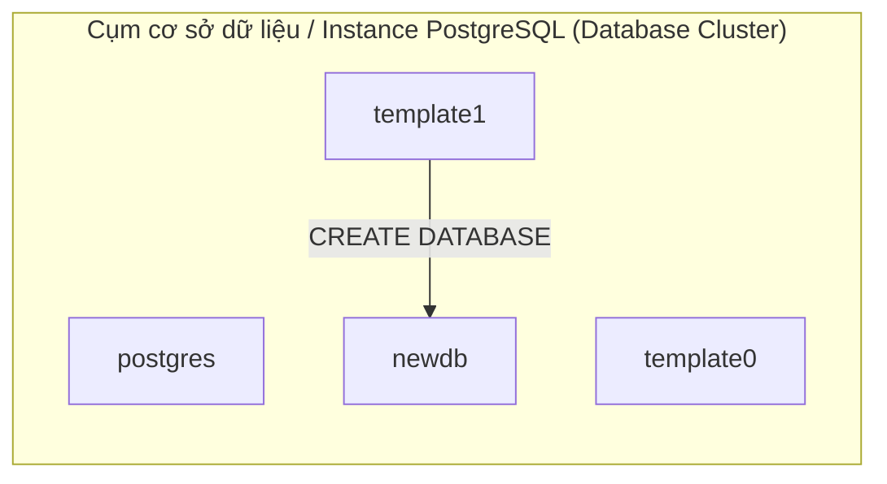
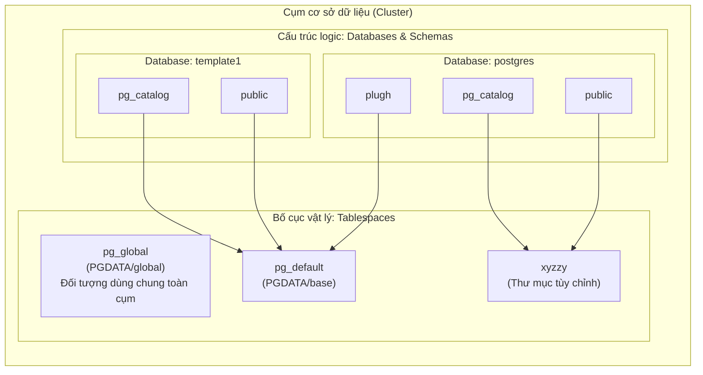
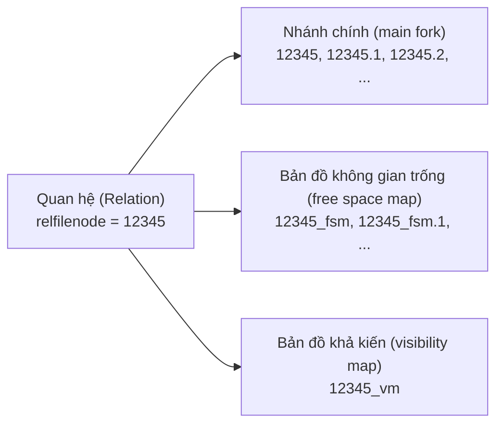
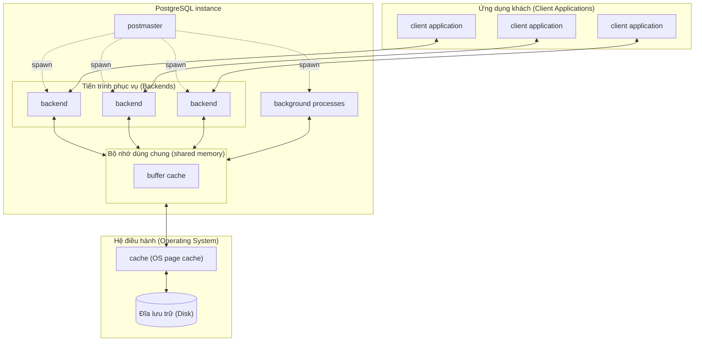

# CHƯƠNG 1: Giới thiệu (Introduction)

## 1.1 Tổ chức dữ liệu (1.1 Data Organization)

### Cơ sở dữ liệu (Databases)

PostgreSQL là một chương trình thuộc nhóm các hệ quản trị cơ sở dữ liệu (database management systems — DBMS). Khi chương trình này đang chạy, ta gọi nó là một *máy chủ PostgreSQL* (PostgreSQL server), hay một *instance* (phiên bản đang chạy).

Dữ liệu do PostgreSQL quản lý được lưu trữ trong các *cơ sở dữ liệu* (databases).[^1] Một instance PostgreSQL duy nhất có thể phục vụ nhiều cơ sở dữ liệu cùng một lúc; tập hợp các cơ sở dữ liệu này được gọi là một *cụm cơ sở dữ liệu* (database cluster).

Để có thể sử dụng cụm cơ sở dữ liệu, trước tiên bạn phải *khởi tạo* (initialize / tạo) nó.[^2] Thư mục chứa toàn bộ các tệp liên quan đến cụm thường được gọi là `PGDATA`, theo tên biến môi trường trỏ tới thư mục này.

Các bản cài đặt từ những gói dựng sẵn (pre-built packages) có thể thêm các "lớp trừu tượng" (abstraction layers) riêng lên trên cơ chế thông thường của PostgreSQL bằng cách thiết lập tường minh tất cả các tham số cần thiết cho các tiện ích. Trong trường hợp này, máy chủ cơ sở dữ liệu chạy như một dịch vụ của hệ điều hành, và có thể bạn sẽ không bao giờ trực tiếp đụng tới biến `PGDATA`. Tuy nhiên, bản thân thuật ngữ này đã rất phổ biến, nên tôi sẽ sử dụng nó trong suốt cuốn sách.

Sau khi khởi tạo cụm, `PGDATA` chứa ba cơ sở dữ liệu giống hệt nhau:

- `template0` được dùng cho các trường hợp như khôi phục dữ liệu từ bản sao lưu logic (logical backup) hoặc tạo một cơ sở dữ liệu với bảng mã ký tự (encoding) khác; cơ sở dữ liệu này không bao giờ được phép chỉnh sửa.
- `template1` đóng vai trò làm khuôn mẫu (template) cho tất cả các cơ sở dữ liệu khác mà người dùng có thể tạo trong cụm.
- `postgres` là một cơ sở dữ liệu thông thường mà bạn có thể sử dụng tùy ý.



> 📝 **Giải thích thêm (không có trong sách):** Trong nhiều hệ quản trị cơ sở dữ liệu khác (như MySQL), từ "cluster" thường chỉ nhiều máy chủ kết nối với nhau. Tuy nhiên, trong thuật ngữ của PostgreSQL, "database cluster" chỉ đơn giản là một tập hợp các database được quản lý bởi *một* instance PostgreSQL duy nhất và dùng chung một thư mục dữ liệu (`PGDATA`).

---

### Danh mục hệ thống (System Catalog)

Siêu dữ liệu (metadata) của tất cả các đối tượng trong cụm (chẳng hạn như bảng, chỉ mục, kiểu dữ liệu hoặc hàm) được lưu trữ trong các bảng thuộc *danh mục hệ thống* (system catalog).[^3] Mỗi cơ sở dữ liệu có một tập hợp bảng (và khung nhìn — views) riêng để mô tả các đối tượng của cơ sở dữ liệu đó. Một số bảng danh mục hệ thống là dùng chung cho toàn bộ cụm; chúng không thuộc về bất kỳ cơ sở dữ liệu cụ thể nào (về mặt kỹ thuật, một cơ sở dữ liệu giả với ID bằng `0` được sử dụng), nhưng có thể được truy cập từ tất cả các cơ sở dữ liệu.

Danh mục hệ thống có thể được xem bằng các truy vấn SQL thông thường, trong khi mọi thao tác chỉnh sửa trên đó đều được thực hiện thông qua các lệnh DDL (Data Definition Language). Trình khách `psql` cũng cung cấp hàng loạt lệnh (như `\d`, `\dt`, `\l`) giúp hiển thị nội dung của danh mục hệ thống.

Tên của tất cả các bảng trong danh mục hệ thống đều bắt đầu bằng `pg_`, ví dụ như `pg_database`. Tên cột bắt đầu bằng một tiền tố gồm ba chữ cái thường tương ứng với tên bảng, ví dụ như `datname`.

Trong tất cả các bảng danh mục hệ thống, cột được khai báo làm khóa chính có tên là `oid` (object identifier — định danh đối tượng); kiểu dữ liệu của nó, cũng có tên là `oid`, là một số nguyên 32-bit.

Cách triển khai định danh đối tượng `oid` về cơ bản giống với `sequence`, nhưng nó đã xuất hiện trong PostgreSQL từ rất sớm. Điểm đặc biệt của nó là các giá trị `oid` duy nhất được sinh ra từ một bộ đếm dùng chung sẽ được sử dụng trong nhiều bảng khác nhau của danh mục hệ thống. Khi giá trị `oid` được cấp phát vượt quá giá trị tối đa, bộ đếm sẽ được đặt lại (reset). Để đảm bảo mọi giá trị trong một bảng cụ thể là duy nhất, `oid` tiếp theo được cấp phát sẽ được kiểm tra qua chỉ mục duy nhất (unique index); nếu giá trị đó đã được sử dụng trong bảng này, bộ đếm sẽ tăng lên và việc kiểm tra được lặp lại.[^4]

> 💡 **Ví dụ bổ sung (không có trong sách):** Bạn có thể trực tiếp truy vấn danh mục hệ thống trong `psql` để xem danh sách các cơ sở dữ liệu cùng `oid` của chúng:
> ```sql
> SELECT oid, datname FROM pg_database;
> ```
> Kết quả sẽ trả về các cơ sở dữ liệu như `postgres`, `template0`, `template1` cùng mã `oid` tương ứng.

---

### Lược đồ (Schemas)

*Lược đồ* (schemas)[^5] là các không gian tên (namespaces) dùng để lưu trữ tất cả các đối tượng của một cơ sở dữ liệu. Ngoài các lược đồ do người dùng tự tạo, PostgreSQL cung cấp sẵn một số lược đồ định nghĩa trước:

- `public` là lược đồ mặc định cho các đối tượng của người dùng trừ khi có thiết lập khác.
- `pg_catalog` được dùng cho các bảng danh mục hệ thống.
- `information_schema` cung cấp một góc nhìn thay thế cho danh mục hệ thống theo đúng chuẩn SQL.
- `pg_toast` được dùng cho các đối tượng liên quan đến cơ chế TOAST.
- `pg_temp` chứa các bảng tạm (temporary tables). Mặc dù các người dùng khác nhau tạo bảng tạm trong các lược đồ riêng biệt có tên dạng `pg_temp_N`, mọi người đều tham chiếu đến đối tượng của mình thông qua bí danh `pg_temp`.

Mỗi lược đồ bị giới hạn trong phạm vi một cơ sở dữ liệu cụ thể, và mọi đối tượng cơ sở dữ liệu đều thuộc về một lược đồ nào đó.

Nếu lược đồ không được chỉ định tường minh khi truy cập một đối tượng, PostgreSQL sẽ chọn lược đồ phù hợp đầu tiên từ *đường dẫn tìm kiếm* (search path). Đường dẫn tìm kiếm dựa trên giá trị của tham số `search_path`, và được ngầm mở rộng thêm hai lược đồ `pg_catalog` và (nếu cần) `pg_temp`. Điều này có nghĩa là các lược đồ khác nhau có thể chứa các đối tượng có tên giống hệt nhau.

---

### Không gian bảng (Tablespaces)

Khác với cơ sở dữ liệu và lược đồ — vốn xác định sự phân bổ logic của các đối tượng cơ sở dữ liệu — *không gian bảng* (tablespaces) xác định bố cục vật lý của dữ liệu. Về thực chất, một tablespace là một thư mục trong hệ thống tệp (file system). Bạn có thể phân bổ dữ liệu giữa các tablespace sao cho dữ liệu lưu trữ lâu dài (archive) nằm trên các ổ đĩa chậm, trong khi dữ liệu đang được cập nhật thường xuyên nằm trên các ổ đĩa nhanh.

Một tablespace có thể được sử dụng bởi nhiều cơ sở dữ liệu khác nhau, và mỗi cơ sở dữ liệu có thể lưu trữ dữ liệu ở nhiều tablespace. Điều đó có nghĩa là cấu trúc logic và bố cục dữ liệu vật lý không phụ thuộc lẫn nhau.

Mỗi cơ sở dữ liệu có một *tablespace mặc định* (default tablespace). Tất cả các đối tượng cơ sở dữ liệu đều được tạo trong tablespace này trừ khi có chỉ định vị trí khác. Các đối tượng danh mục hệ thống liên quan đến cơ sở dữ liệu này cũng được lưu trữ tại đây.



Trong quá trình khởi tạo cụm, hai tablespace được tạo sẵn:

- `pg_default` nằm trong thư mục `PGDATA/base`; nó được dùng làm tablespace mặc định trừ khi một tablespace khác được chọn tường minh cho mục đích này.
- `pg_global` nằm trong thư mục `PGDATA/global`; nó lưu trữ các đối tượng danh mục hệ thống dùng chung cho toàn bộ cụm.

Khi tạo một tablespace tùy chỉnh, bạn có thể chỉ định bất kỳ thư mục nào; PostgreSQL sẽ tạo một liên kết tượng trưng (symbolic link) trỏ tới vị trí này trong thư mục `PGDATA/pg_tblspc`. Thực tế, tất cả các đường dẫn được PostgreSQL sử dụng đều là đường dẫn tương đối so với thư mục `PGDATA`, điều này cho phép bạn di chuyển thư mục này sang một vị trí khác (tất nhiên là với điều kiện bạn đã dừng máy chủ).

Sơ đồ minh họa trên kết hợp cơ sở dữ liệu, lược đồ và tablespace lại với nhau. Ở đây, cơ sở dữ liệu `postgres` sử dụng tablespace `xyzzy` làm tablespace mặc định, trong khi cơ sở dữ liệu `template1` sử dụng `pg_default`. Các đối tượng cơ sở dữ liệu khác nhau nằm tại giao điểm của các tablespace và lược đồ.

---

### Quan hệ (Relations)

Dù có nhiều điểm khác biệt, bảng (tables) và chỉ mục (indexes) — những đối tượng cơ sở dữ liệu quan trọng nhất — có một điểm chung: chúng đều bao gồm các dòng (rows). Điều này khá hiển nhiên khi ta nghĩ đến bảng, nhưng cũng hoàn toàn đúng với các nút B-tree (B-tree nodes), vốn chứa các giá trị được đánh chỉ mục và các tham chiếu đến những nút khác hoặc đến các dòng trong bảng.

Một số đối tượng khác cũng có cấu trúc tương tự; ví dụ như chuỗi số tự tăng (`sequences` — về bản chất là các bảng chỉ có một dòng) và khung nhìn vật chất hóa (`materialized views` — có thể coi là các bảng "lưu giữ" kết quả của truy vấn tương ứng). Ngoài ra còn có các khung nhìn thông thường (`regular views`), vốn không lưu trữ dữ liệu nhưng về các mặt khác lại rất giống bảng.

Trong PostgreSQL, tất cả những đối tượng này được gọi chung bằng thuật ngữ *quan hệ* (`relation`).

Theo quan điểm của tôi, đây không phải là một thuật ngữ hay vì nó dễ gây nhầm lẫn giữa bảng cơ sở dữ liệu với "quan hệ thực thụ" (genuine relations) được định nghĩa trong lý thuyết quan hệ (relational theory). Ở đây ta có thể thấy rõ dấu ấn di sản học thuật của dự án và khuynh hướng của người sáng lập, Michael Stonebraker, khi muốn nhìn nhận mọi thứ như một quan hệ. Trong một công trình của mình, ông thậm chí còn đưa ra khái niệm "quan hệ có thứ tự" (ordered relation) để chỉ một bảng mà thứ tự các dòng được xác định bởi một chỉ mục.

Bảng danh mục hệ thống dành cho các quan hệ ban đầu có tên là `pg_relation`, nhưng theo trào lưu hướng đối tượng, nó nhanh chóng được đổi tên thành `pg_class`, cái tên mà ngày nay chúng ta đã quen thuộc. Tuy nhiên, các cột của nó vẫn giữ nguyên tiền tố `rel` (như `relname`, `relkind`, `relfilenode`).

---

### Tệp và nhánh (Files and Forks)

Tất cả thông tin gắn với một quan hệ được lưu trữ trong nhiều *nhánh* (forks) khác nhau,[^6] mỗi nhánh chứa một loại dữ liệu riêng biệt.

Ban đầu, một nhánh được biểu diễn bằng một tệp duy nhất. Tên tệp bao gồm một ID dạng số (`oid`), có thể kèm theo một hậu tố tương ứng với loại nhánh.

Theo thời gian, tệp sẽ lớn dần lên, và khi kích thước của nó đạt tới `1 GB`, một tệp khác của nhánh này sẽ được tạo ra (những tệp như vậy đôi khi được gọi là các *phân đoạn* — segments). Số thứ tự của phân đoạn được thêm vào cuối tên tệp.

Giới hạn kích thước tệp `1 GB` được thiết lập từ lịch sử nhằm hỗ trợ các hệ thống tệp khác nhau vốn không thể xử lý được các tệp quá lớn. Bạn có thể thay đổi giới hạn này khi biên dịch PostgreSQL từ mã nguồn (`./configure --with-segsize`).



Như vậy, một quan hệ duy nhất được biểu diễn trên đĩa bằng nhiều tệp. Ngay cả một bảng nhỏ không có chỉ mục cũng sẽ có ít nhất ba tệp, tương ứng với số lượng các nhánh bắt buộc.

Mỗi thư mục tablespace (ngoại trừ `pg_global`) chứa các thư mục con riêng biệt cho từng cơ sở dữ liệu cụ thể. Toàn bộ tệp của các đối tượng thuộc cùng một tablespace và cùng một cơ sở dữ liệu đều nằm trong cùng một thư mục con. Bạn cần lưu ý điều này vì nếu có quá nhiều tệp trong một thư mục duy nhất, hệ thống tệp có thể xử lý không hiệu quả.

Có một số loại nhánh tiêu chuẩn như sau:

**Nhánh chính (main fork)** biểu diễn dữ liệu thực tế: các dòng của bảng hoặc các dòng của chỉ mục. Nhánh này có mặt ở mọi quan hệ (ngoại trừ `views`, vốn không chứa dữ liệu).

Các tệp của nhánh chính được đặt tên theo ID dạng số của chúng, được lưu dưới dạng giá trị `relfilenode` trong bảng `pg_class`.

Hãy cùng xem đường dẫn đến tệp thuộc về một bảng được tạo trong tablespace `pg_default`:

```sql
=> CREATE UNLOGGED TABLE t(
  a integer,
  b numeric,
  c text,
  d json
);
=> INSERT INTO t VALUES (1, 2.0, 'foo', '{}');
=> SELECT pg_relation_filepath('t');
 pg_relation_filepath 
----------------------
 base/16384/16385
(1 row)
```

Thư mục `base` tương ứng với tablespace `pg_default`, thư mục con tiếp theo (`16384`) dành cho cơ sở dữ liệu, và tại đây chúng ta tìm thấy tệp mình đang tìm kiếm (`16385`):

```sql
=> SELECT oid FROM pg_database WHERE datname = 'internals';
  oid  
-------
 16384
(1 row)

=> SELECT relfilenode FROM pg_class WHERE relname = 't';
 relfilenode 
-------------
       16385
(1 row)
```

Đây là tệp tương ứng trong hệ thống tệp:

```sql
=> SELECT size
FROM pg_stat_file('/usr/local/pgsql/data/base/16384/16385');
 size 
------
 8192
(1 row)
```

**Nhánh khởi tạo (initialization fork)**[^7] chỉ có ở các bảng không ghi nhật ký (`unlogged tables` — được tạo với mệnh đề `UNLOGGED`) và các chỉ mục của chúng. Các đối tượng này giống hệt các đối tượng thông thường, ngoại trừ việc mọi thao tác thực hiện trên chúng không được ghi vào nhật ký ghi trước (write-ahead log — WAL). Điều này giúp các thao tác nhanh hơn đáng kể, nhưng bạn sẽ không thể khôi phục dữ liệu nhất quán nếu xảy ra sự cố. Do đó, PostgreSQL đơn giản là xóa tất cả các nhánh của những đối tượng này trong quá trình phục hồi và ghi đè nhánh chính bằng nhánh khởi tạo, qua đó tạo ra một tệp rỗng (dummy file).

Bảng `t` ở trên được tạo dưới dạng `unlogged`, nên nhánh khởi tạo có tồn tại. Nó có cùng tên với nhánh chính nhưng thêm hậu tố `_init`:

```sql
=> SELECT size
FROM pg_stat_file('/usr/local/pgsql/data/base/16384/16385_init');
 size 
------
    0
(1 row)
```

**Bản đồ không gian trống (free space map)**[^8] theo dõi dung lượng còn trống bên trong các trang dữ liệu. Kích thước của nó thay đổi liên tục: tăng lên sau khi dọn dẹp (`vacuuming`) và thu nhỏ lại khi các phiên bản dòng mới xuất hiện. Bản đồ không gian trống được sử dụng để nhanh chóng tìm ra một trang có đủ chỗ chứa dữ liệu mới đang được chèn vào.

Tất cả các tệp liên quan đến bản đồ không gian trống đều có hậu tố `_fsm`. Ban đầu, không có tệp nào như vậy được tạo ra; chúng chỉ xuất hiện khi cần thiết. Cách dễ nhất để thấy chúng là chạy lệnh `VACUUM` trên bảng:

```sql
=> VACUUM t;
=> SELECT size
FROM pg_stat_file('/usr/local/pgsql/data/base/16384/16385_fsm');
 size  
-------
 24576
(1 row)
```

Để tăng tốc độ tìm kiếm, bản đồ không gian trống được tổ chức dưới dạng cây; nó chiếm ít nhất ba trang (vì thế mới có kích thước tệp 24576 byte đối với một bảng gần như trống rỗng).

Bản đồ không gian trống được cung cấp cho cả bảng và chỉ mục. Tuy nhiên, vì một dòng chỉ mục không thể được thêm vào một trang tùy ý (ví dụ, B-tree xác định vị trí chèn dựa trên thứ tự sắp xếp), PostgreSQL chỉ theo dõi những trang đã được làm trống hoàn toàn và có thể được tái sử dụng trong cấu trúc chỉ mục.

**Bản đồ khả kiến (visibility map)**[^9] giúp kiểm tra nhanh xem một trang có cần được `vacuum` hay đóng băng (`frozen`) hay không. Với mục đích này, nó cung cấp hai bit cho mỗi trang của bảng:

- **Bit thứ nhất** được bật cho các trang chỉ chứa các phiên bản dòng mới nhất (up-to-date). Quá trình `Vacuum` sẽ bỏ qua những trang như vậy vì không có gì cần dọn dẹp. Bên cạnh đó, khi một giao dịch cố gắng đọc một dòng từ trang này, không cần thiết phải kiểm tra tính khả kiến (visibility) của nó nữa, nhờ vậy có thể sử dụng phương thức quét chỉ mục đơn thuần (*index-only scan*).
- **Bit thứ hai** (được bổ sung từ phiên bản `v. 9.6`) được bật cho các trang chỉ chứa các phiên bản dòng đã được đóng băng (frozen). Tôi sẽ dùng thuật ngữ *bản đồ đóng băng* (freeze map) để chỉ phần này của nhánh.

Các tệp bản đồ khả kiến có hậu tố `_vm`. Chúng thường là các tệp nhỏ nhất:

```sql
=> SELECT size
FROM pg_stat_file('/usr/local/pgsql/data/base/16384/16385_vm');
 size 
------
 8192
(1 row)
```

Bản đồ khả kiến được cung cấp cho bảng, nhưng không có cho chỉ mục.

---

### Trang dữ liệu (Pages)

Để thuận tiện cho việc đọc/ghi (I/O), tất cả các tệp đều được chia logic thành các *trang* (pages, hoặc *khối* — blocks), đại diện cho lượng dữ liệu tối thiểu có thể được đọc hoặc ghi. Do đó, nhiều thuật toán nội bộ của PostgreSQL được tinh chỉnh để xử lý theo từng trang.

Kích thước trang thường là `8 kB`. Nó có thể được cấu hình ở một mức độ nhất định (lên tới `32 kB`), nhưng chỉ tại thời điểm biên dịch (`./configure --with-blocksize`), và hầu như không ai làm điều này. Một khi đã được biên dịch và khởi chạy, instance chỉ có thể làm việc với các trang có cùng kích thước; không thể tạo các tablespace hỗ trợ các kích thước trang khác nhau.

Bất kể thuộc nhánh nào, mọi tệp đều được máy chủ xử lý theo cách gần như giống nhau. Các trang trước tiên được đưa vào *bộ nhớ đệm trang* (buffer cache — nơi các tiến trình có thể đọc và cập nhật chúng), và sau đó được ghi xuống đĩa (flushed) khi cần thiết.

---

### TOAST

Mỗi dòng phải nằm gọn trong một trang duy nhất: không có cách nào để nối tiếp một dòng sang trang kế tiếp. Để lưu trữ các dòng có kích thước dài, PostgreSQL sử dụng một cơ chế đặc biệt gọi là **TOAST**[^10] (*The Oversized Attributes Storage Technique* — Kỹ thuật lưu trữ thuộc tính quá khổ).

TOAST bao gồm nhiều chiến lược khác nhau. Bạn có thể chuyển các giá trị thuộc tính dài sang một bảng dịch vụ riêng biệt, sau khi đã cắt chúng thành những "mảnh nhỏ" (toasts). Một lựa chọn khác là nén giá trị dài sao cho cả dòng nằm vừa trong trang. Hoặc bạn có thể kết hợp cả hai: trước tiên nén giá trị, sau đó cắt nhỏ và di chuyển nó.

Nếu bảng chính chứa các thuộc tính có khả năng dài, một bảng TOAST riêng sẽ được tạo ngay lập tức cho bảng đó — một bảng TOAST duy nhất cho tất cả các thuộc tính. Ví dụ, nếu một bảng có cột kiểu `numeric` hoặc `text`, một bảng TOAST sẽ được tạo ngay cả khi cột đó không bao giờ lưu trữ bất kỳ giá trị dài nào.

Đối với chỉ mục, cơ chế TOAST chỉ có thể cung cấp khả năng nén; việc chuyển thuộc tính dài sang một bảng riêng không được hỗ trợ. Điều này giới hạn kích thước của các khóa (keys) có thể đánh chỉ mục (cách triển khai thực tế phụ thuộc vào từng lớp toán tử — operator class cụ thể).

Theo mặc định, chiến lược TOAST được chọn dựa trên kiểu dữ liệu của cột. Cách dễ nhất để xem lại các chiến lược đang sử dụng là chạy lệnh `\d+` trong `psql`, nhưng tôi sẽ truy vấn danh mục hệ thống để có kết quả hiển thị gọn gàng hơn:

```sql
=> SELECT attname, atttypid::regtype,
  CASE attstorage
    WHEN 'p' THEN 'plain'
    WHEN 'e' THEN 'external'
    WHEN 'm' THEN 'main'
    WHEN 'x' THEN 'extended'
  END AS storage
FROM pg_attribute
WHERE attrelid = 't'::regclass AND attnum > 0;
 attname | atttypid | storage  
---------+----------+----------
 a       | integer  | plain
 b       | numeric  | main
 c       | text     | extended
 d       | json     | extended
(4 rows)
```

PostgreSQL hỗ trợ các chiến lược sau:

- `plain` có nghĩa là TOAST không được sử dụng (chiến lược này áp dụng cho các kiểu dữ liệu được biết là "ngắn", chẳng hạn như kiểu `integer`).
- `extended` cho phép vừa nén thuộc tính vừa lưu trữ chúng trong một bảng TOAST riêng.
- `external` quy định rằng các thuộc tính dài được lưu trong bảng TOAST ở trạng thái không nén.
- `main` yêu cầu các thuộc tính dài phải được nén trước; chúng sẽ chỉ được chuyển sang bảng TOAST nếu việc nén không đủ giúp thu gọn kích thước.

Về tổng thể, thuật toán hoạt động như sau.[^11] PostgreSQL hướng tới mục tiêu có ít nhất bốn dòng trên mỗi trang. Vì vậy, nếu kích thước của dòng vượt quá một phần tư kích thước trang, không tính phần tiêu đề (header) — đối với trang kích thước chuẩn thì ngưỡng này vào khoảng `2000 bytes` — chúng ta phải áp dụng cơ chế TOAST cho một số giá trị. Tuân theo quy trình dưới đây, PostgreSQL sẽ dừng lại ngay khi độ dài dòng không còn vượt quá ngưỡng nữa:

1. Trước tiên, duyệt qua các thuộc tính có chiến lược `external` và `extended`, bắt đầu từ thuộc tính dài nhất. Các thuộc tính `extended` được nén lại, và nếu giá trị thu được (tính riêng lẻ, chưa xét các thuộc tính khác) vượt quá một phần tư trang, nó sẽ được chuyển ngay sang bảng TOAST. Các thuộc tính `external` được xử lý tương tự, ngoại trừ việc bỏ qua bước nén.
2. Nếu sau lượt đầu tiên mà dòng vẫn không vừa trang, các thuộc tính còn lại sử dụng chiến lược `external` hoặc `extended` sẽ lần lượt được chuyển sang bảng TOAST, từng cái một.
3. Nếu cách đó vẫn chưa đủ, PostgreSQL thử nén các thuộc tính sử dụng chiến lược `main`, nhưng vẫn giữ chúng nằm trong trang của bảng chính.
4. Nếu dòng vẫn chưa đủ ngắn, các thuộc tính `main` mới bị chuyển sang bảng TOAST.

Giá trị ngưỡng mặc định (`v. 11`) là `2000 bytes`, nhưng có thể được định nghĩa lại ở cấp độ bảng bằng tham số lưu trữ `toast_tuple_target`.

Đôi khi việc thay đổi chiến lược mặc định cho một số cột sẽ rất hữu ích. Nếu bạn biết trước rằng dữ liệu trong một cột cụ thể không thể nén được (ví dụ, cột lưu ảnh JPEG), bạn có thể đặt chiến lược `external` cho cột đó; điều này giúp tránh những nỗ lực nén dữ liệu vô ích. Chiến lược có thể được thay đổi như sau:

```sql
=> ALTER TABLE t ALTER COLUMN d SET STORAGE external;
```

Nếu lặp lại truy vấn kiểm tra, ta sẽ nhận được kết quả sau:

```sql
 attname | atttypid | storage  
---------+----------+----------
 a       | integer  | plain
 b       | numeric  | main
 c       | text     | extended
 d       | json     | external
(4 rows)
```

Các bảng TOAST nằm trong một lược đồ riêng gọi là `pg_toast`; lược đồ này không nằm trong đường dẫn tìm kiếm (`search_path`), nên các bảng TOAST thường bị ẩn đi. Đối với bảng tạm, các lược đồ `pg_toast_temp_N` được sử dụng, tương tự như `pg_temp_N`.

Hãy xem xét cơ chế hoạt động bên trong của quá trình này. Giả sử bảng `t` chứa ba thuộc tính có khả năng dài; điều đó có nghĩa là phải có một bảng TOAST tương ứng. Đây là bảng đó:

```sql
=> SELECT relnamespace::regnamespace, relname
FROM pg_class
WHERE oid = (
  SELECT reltoastrelid
  FROM pg_class WHERE relname = 't'
);
 relnamespace |    relname     
--------------+----------------
 pg_toast     | pg_toast_16385
(1 row)

=> \d+ pg_toast.pg_toast_16385
              TOAST table "pg_toast.pg_toast_16385"
   Column   |  Type   | Storage 
------------+---------+---------
 chunk_id   | oid     | plain
 chunk_seq  | integer | plain
 chunk_data | bytea   | plain
Owning table: "public.t"
Indexes:
    "pg_toast_16385_index" PRIMARY KEY, btree (chunk_id, chunk_seq)
Access method: heap
```

Rất hợp lý khi các mảnh (chunks) thu được của dòng bị "toast" đều sử dụng chiến lược `plain`: không tồn tại cơ chế TOAST cấp hai.

Bên cạnh bản thân bảng TOAST, PostgreSQL còn tạo một chỉ mục tương ứng trong cùng lược đồ. Chỉ mục này luôn được sử dụng để truy cập các mảnh TOAST. Tên của chỉ mục được hiển thị trong kết quả trên, nhưng bạn cũng có thể xem nó bằng truy vấn sau:

```sql
=> SELECT indexrelid::regclass FROM pg_index
WHERE indrelid = (
  SELECT oid
  FROM pg_class WHERE relname = 'pg_toast_16385'
);
          indexrelid           
-------------------------------
 pg_toast.pg_toast_16385_index
(1 row)

=> \d pg_toast.pg_toast_16385_index
    Unlogged index "pg_toast.pg_toast_16385_index"
  Column   |  Type   | Key? | Definition 
-----------+---------+------+------------
 chunk_id  | oid     | yes  | chunk_id
 chunk_seq | integer | yes  | chunk_seq
primary key, btree, for table "pg_toast.pg_toast_16385"
```

Như vậy, một bảng TOAST làm tăng số lượng tệp nhánh tối thiểu mà bảng sử dụng lên đến tám tệp: ba cho bảng chính, ba cho bảng TOAST và hai cho chỉ mục TOAST.

Cột `c` sử dụng chiến lược `extended`, nên các giá trị của nó sẽ được nén:

```sql
=> UPDATE t SET c = repeat('A',5000);
=> SELECT * FROM pg_toast.pg_toast_16385;
 chunk_id | chunk_seq | chunk_data 
----------+-----------+------------
(0 rows)
```

Bảng TOAST đang trống: các ký tự lặp lại đã được nén bằng thuật toán LZ, nên giá trị nằm gọn ngay trong trang của bảng chính.

Và bây giờ hãy tạo giá trị này từ các ký tự ngẫu nhiên:

```sql
=> UPDATE t SET c = (
  SELECT string_agg( chr(trunc(65+random()*26)::integer), '')
  FROM generate_series(1,5000)
)
RETURNING left(c,10) || '...' || right(c,10);
        ?column?         
-------------------------
 YEYNNDTSZR...JPKYUGMLDX
(1 row)

UPDATE 1
```

Chuỗi này không thể nén được, vì vậy nó được đưa vào bảng TOAST:

```sql
=> SELECT chunk_id,
  chunk_seq,
  length(chunk_data),
  left(encode(chunk_data,'escape')::text, 10) || '...' ||
  right(encode(chunk_data,'escape')::text, 10)
FROM pg_toast.pg_toast_16385;
 chunk_id | chunk_seq | length |        ?column?         
----------+-----------+--------+-------------------------
    16390 |         0 |   1996 | YEYNNDTSZR...TXLNDZOXMY
    16390 |         1 |   1996 | EWEACUJGZD...GDBWMUWTJY
    16390 |         2 |   1008 | GSGDYSWTKF...JPKYUGMLDX
(3 rows)
```

Ta có thể thấy các ký tự đã bị cắt thành từng mảnh. Kích thước mảnh được chọn sao cho một trang của bảng TOAST có thể chứa được bốn dòng. Giá trị này thay đổi đôi chút giữa các phiên bản tùy thuộc vào kích thước phần tiêu đề của trang.

Khi một thuộc tính dài được truy cập, PostgreSQL tự động khôi phục lại giá trị gốc và trả về cho trình khách; mọi thứ diễn ra hoàn toàn trong suốt đối với ứng dụng. Nếu các thuộc tính dài không tham gia vào truy vấn, bảng TOAST sẽ không bị đọc chút nào. Đây là một trong những lý do bạn nên tránh dùng dấu sao (`SELECT *`) trong các giải pháp chạy thực tế (production).

Từ phiên bản `v. 13`, nếu trình khách chỉ truy vấn một trong những mảnh đầu tiên của một giá trị dài, PostgreSQL sẽ chỉ đọc các mảnh cần thiết, ngay cả khi giá trị đó đã được nén.

Tuy nhiên, việc nén và cắt nhỏ dữ liệu tiêu tốn rất nhiều tài nguyên; việc khôi phục lại giá trị gốc cũng tương tự. Đó là lý do tại sao việc lưu trữ dữ liệu cồng kềnh trong PostgreSQL không phải là một ý tưởng hay, đặc biệt nếu dữ liệu này được sử dụng thường xuyên và không đòi hỏi logic giao dịch (chẳng hạn như các tài liệu kế toán được scan). Một giải pháp thay thế có thể tốt hơn là lưu dữ liệu đó trong hệ thống tệp, và chỉ giữ tên của các tệp tương ứng trong cơ sở dữ liệu. Nhưng khi đó, hệ quản trị cơ sở dữ liệu sẽ không thể đảm bảo tính nhất quán dữ liệu (cho các tệp bên ngoài).

---

## 1.2 Tiến trình và bộ nhớ (1.2 Processes and Memory)

Một instance máy chủ PostgreSQL bao gồm nhiều tiến trình tương tác lẫn nhau.

Tiến trình đầu tiên được khởi chạy khi bật máy chủ là `postgres`, theo truyền thống được gọi là `postmaster`. Nó sinh ra (spawns) tất cả các tiến trình khác (các hệ thống giống Unix sử dụng lời gọi hệ thống `fork` cho mục đích này) và giám sát chúng: nếu bất kỳ tiến trình nào gặp sự cố, `postmaster` sẽ khởi động lại nó (hoặc khởi động lại toàn bộ máy chủ nếu có nguy cơ dữ liệu dùng chung đã bị hỏng).

Vì tính đơn giản của nó, mô hình đa tiến trình (process model) đã được sử dụng trong PostgreSQL ngay từ những ngày đầu, và kể từ đó luôn có những cuộc thảo luận bất tận về việc chuyển sang dùng luồng (threads). Mô hình hiện tại có một số nhược điểm: việc cấp phát bộ nhớ dùng chung tĩnh không cho phép thay đổi kích thước các cấu trúc như bộ nhớ đệm trang (buffer cache) ngay khi đang chạy; các thuật toán song song khó triển khai hơn và kém hiệu quả hơn so với tiềm năng; các phiên làm việc (sessions) gắn chặt với từng tiến trình. Việc sử dụng luồng nghe có vẻ đầy hứa hẹn, mặc dù nó đi kèm với những thách thức liên quan đến tính cô lập (isolation), khả năng tương thích hệ điều hành và quản lý tài nguyên. Tuy nhiên, việc triển khai chúng đòi hỏi phải viết lại mã nguồn một cách triệt để và mất nhiều năm công sức, nên quan điểm bảo thủ hiện vẫn chiếm ưu thế: chưa có thay đổi nào như vậy được kỳ vọng trong tương lai gần.

Hoạt động của máy chủ được duy trì bởi các tiến trình nền (background processes). Dưới đây là các tiến trình chính:

- `startup` khôi phục hệ thống sau sự cố.
- `autovacuum` dọn dẹp dữ liệu cũ/thừa (stale data) khỏi các bảng và chỉ mục.
- `wal writer` ghi các bản ghi WAL xuống đĩa.
- `checkpointer` thực hiện các điểm kiểm tra (checkpoints).
- `writer` (background writer) ghi các trang bẩn (dirty pages — trang đã bị sửa đổi) xuống đĩa.
- `stats collector` thu thập số liệu thống kê sử dụng cho instance.
- `wal sender` gửi các bản ghi WAL tới máy bản sao (replica).
- `wal receiver` nhận các bản ghi WAL trên máy bản sao (replica).

Một số tiến trình trong số này sẽ kết thúc sau khi hoàn thành nhiệm vụ, số khác chạy nền liên tục, và một số có thể được tắt đi.

Mỗi tiến trình được quản lý bởi các tham số cấu hình, đôi khi lên tới hàng chục tham số. Để thiết lập máy chủ một cách toàn diện, bạn phải hiểu rõ cơ chế hoạt động bên trong của nó. Tuy nhiên, những suy luận chung chung sẽ chỉ giúp bạn chọn được các giá trị khởi đầu tương đối hợp lý; về sau, các thiết lập này phải được tinh chỉnh dựa trên dữ liệu giám sát thực tế (monitoring data).

Để cho phép các tiến trình tương tác với nhau, `postmaster` cấp phát *bộ nhớ dùng chung* (shared memory), vùng nhớ này khả dụng cho tất cả các tiến trình.

Vì đĩa cứng (đặc biệt là HDD, nhưng SSD cũng vậy) chậm hơn RAM rất nhiều, PostgreSQL sử dụng cơ chế *đệm* (caching): một phần của RAM dùng chung được dành riêng cho các trang vừa mới đọc, với hy vọng chúng sẽ được cần đến nhiều hơn một lần và chi phí truy cập đĩa lặp đi lặp lại sẽ được giảm thiểu. Dữ liệu đã sửa đổi cũng được ghi xuống đĩa sau một khoảng trễ nhất định, chứ không ghi ngay lập tức.

*Bộ nhớ đệm trang* (buffer cache) chiếm phần lớn nhất trong bộ nhớ dùng chung; vùng nhớ này cũng chứa các bộ đệm khác được máy chủ sử dụng để tăng tốc truy cập đĩa.

Hệ điều hành cũng có bộ nhớ đệm (OS page cache) riêng. PostgreSQL (hầu như) không bao giờ bỏ qua cơ chế của hệ điều hành để dùng I/O trực tiếp (direct I/O), do đó dẫn đến hiện tượng *đệm kép* (double caching).



Trong trường hợp xảy ra sự cố (như mất điện hoặc treo hệ điều hành), dữ liệu lưu trên RAM bị mất sạch, bao gồm cả dữ liệu trong bộ nhớ đệm trang. Các tệp còn lại trên đĩa có các trang được ghi ở những thời điểm khác nhau. Để có thể khôi phục tính nhất quán của dữ liệu, PostgreSQL duy trì *nhật ký ghi trước* (write-ahead log — WAL) trong suốt quá trình hoạt động, giúp lặp lại các thao tác bị mất khi cần thiết.

---

## 1.3 Máy khách và giao thức máy khách-máy chủ (1.3 Clients and the Client-Server Protocol)

Một nhiệm vụ khác của tiến trình `postmaster` là lắng nghe các kết nối đến. Ngay khi có một máy khách mới xuất hiện, `postmaster` sinh ra một tiến trình `backend` riêng biệt.[^12] Máy khách thiết lập kết nối và bắt đầu một *phiên làm việc* (session) với tiến trình `backend` này. Phiên làm việc tiếp tục cho đến khi máy khách ngắt kết nối hoặc kết nối bị mất.

Máy chủ phải sinh ra một `backend` riêng cho mỗi máy khách. Nếu có nhiều máy khách cùng cố gắng kết nối, điều này có thể trở thành một vấn đề lớn:

- Mỗi tiến trình đều cần RAM để đệm các bảng danh mục hệ thống, các câu lệnh chuẩn bị sẵn (prepared statements), kết quả truy vấn trung gian và các dữ liệu khác. Càng nhiều kết nối được mở, càng tốn nhiều bộ nhớ.
- Nếu các kết nối ngắn và diễn ra thường xuyên (máy khách thực hiện một truy vấn nhỏ rồi ngắt kết nối), chi phí để thiết lập kết nối, sinh ra một tiến trình mới và thực hiện việc đệm cục bộ vô ích sẽ cao một cách bất hợp lý.
- Càng nhiều tiến trình được khởi chạy, càng mất nhiều thời gian để quét danh sách tiến trình đó, mà thao tác này lại được thực hiện rất thường xuyên. Hệ quả là hiệu năng có thể suy giảm khi số lượng máy khách tăng lên.

Vấn đề này có thể được giải quyết bằng *gộp kết nối* (connection pooling), giúp giới hạn số lượng `backend` được sinh ra. PostgreSQL không tích hợp sẵn tính năng này, nên chúng ta phải dựa vào các giải pháp bên thứ ba: trình quản lý gộp kết nối tích hợp trong máy chủ ứng dụng hoặc các công cụ bên ngoài (như PgBouncer[^13] hoặc Odyssey[^14]). Cách tiếp cận này thường có nghĩa là mỗi `backend` trên máy chủ có thể lần lượt thực thi các giao dịch của nhiều máy khách khác nhau. Điều này đặt ra một số ràng buộc khi phát triển ứng dụng, vì bạn chỉ được phép sử dụng các tài nguyên có phạm vi cục bộ trong một giao dịch (transaction-local), chứ không phải toàn bộ phiên làm việc (session-local).

Để hiểu được nhau, máy khách và máy chủ phải sử dụng cùng một *giao thức giao tiếp* (interfacing protocol).[^15] Giao thức này thường dựa trên thư viện chuẩn `libpq`, nhưng cũng có các bản triển khai tùy chỉnh khác.

Nói một cách khái quát nhất, giao thức này cho phép các máy khách kết nối tới máy chủ và thực thi các truy vấn SQL.

Một kết nối luôn được thiết lập tới một cơ sở dữ liệu cụ thể dưới danh nghĩa một vai trò (role) hoặc người dùng (user) cụ thể. Mặc dù máy chủ hỗ trợ một cụm gồm nhiều cơ sở dữ liệu, bạn bắt buộc phải thiết lập một kết nối riêng tới từng cơ sở dữ liệu mà bạn muốn sử dụng trong ứng dụng của mình. Tại bước này, quá trình xác thực (authentication) được thực hiện: tiến trình `backend` xác minh danh tính của người dùng (ví dụ, bằng cách yêu cầu mật khẩu) và kiểm tra xem người dùng này có quyền kết nối tới máy chủ và tới cơ sở dữ liệu được chỉ định hay không.

Các truy vấn SQL được truyền tới tiến trình `backend` dưới dạng chuỗi văn bản. Tiến trình sẽ phân tích cú pháp (parse) chuỗi văn bản đó, tối ưu hóa truy vấn, thực thi nó và trả kết quả về cho máy khách.

> 💡 **Ví dụ bổ sung (không có trong sách):** Khi sử dụng PgBouncer ở chế độ *transaction pooling*, một ứng dụng web có thể mở 1.000 kết nối tới PgBouncer, nhưng PgBouncer chỉ duy trì khoảng 20–50 kết nối `backend` thực sự tới PostgreSQL. Nhờ vậy, RAM tiêu thụ của máy chủ PostgreSQL giảm đi đáng kể và tránh được hiện tượng nghẽn cổ chai do chuyển ngữ cảnh (context switching) giữa hàng nghìn tiến trình. Tuy nhiên, lúc này ứng dụng không nên dùng `SET work_mem = ...` ở cấp phiên (session) mà phải dùng `SET LOCAL work_mem = ...` bên trong giao dịch để tránh ảnh hưởng sang giao dịch của máy khách khác.

---

## Bảng thuật ngữ chương (Chapter Glossary)

| Thuật ngữ (English) | Tiếng Việt | Giải thích ngắn gọn |
|---|---|---|
| Instance | Phiên bản chạy (Instance) | Một máy chủ PostgreSQL đang chạy, quản lý một cụm cơ sở dữ liệu. |
| Database cluster | Cụm cơ sở dữ liệu | Tập hợp các cơ sở dữ liệu được quản lý bởi một instance PostgreSQL duy nhất. |
| `PGDATA` | Thư mục `PGDATA` | Thư mục chứa toàn bộ tệp dữ liệu và cấu hình của một cụm cơ sở dữ liệu. |
| System catalog | Danh mục hệ thống | Tập hợp các bảng (bắt đầu bằng `pg_`) lưu siêu dữ liệu của mọi đối tượng trong cụm. |
| Object identifier (`oid`) | Định danh đối tượng | Số nguyên 32-bit dùng làm khóa chính định danh các đối tượng trong danh mục hệ thống. |
| Schema | Lược đồ | Không gian tên (namespace) bên trong một cơ sở dữ liệu dùng để tổ chức các đối tượng. |
| Tablespace | Không gian bảng | Thư mục vật lý trên hệ thống tệp nơi lưu trữ dữ liệu của các đối tượng cơ sở dữ liệu. |
| Relation | Quan hệ | Thuật ngữ chung trong PostgreSQL chỉ bảng, chỉ mục, sequence, view, materialized view. |
| Fork | Nhánh | Một loại tệp dữ liệu gắn với quan hệ (như `main`, `_init`, `_fsm`, `_vm`). |
| Free Space Map (`_fsm`) | Bản đồ không gian trống | Nhánh theo dõi dung lượng còn trống trong từng trang để tìm chỗ chèn dữ liệu mới. |
| Visibility Map (`_vm`) | Bản đồ khả kiến | Nhánh dùng 2 bit mỗi trang để đánh dấu trang toàn dòng mới nhất hoặc đã đóng băng. |
| Page / Block | Trang / Khối dữ liệu | Đơn vị đọc/ghi tối thiểu trên tệp dữ liệu của PostgreSQL (mặc định 8 kB). |
| TOAST | Cơ chế TOAST | *The Oversized Attributes Storage Technique* — kỹ thuật nén và cắt nhỏ giá trị cột quá dài. |
| `postmaster` | Tiến trình `postmaster` | Tiến trình chính (`postgres`) khởi tạo, giám sát các tiến trình nền/backend và lắng nghe kết nối. |
| Buffer cache | Bộ nhớ đệm trang | Vùng bộ nhớ dùng chung (shared memory) lưu các trang dữ liệu vừa đọc hoặc mới sửa đổi. |
| Write-Ahead Log (WAL) | Nhật ký ghi trước | Nhật ký ghi lại các thay đổi trước khi áp dụng lên tệp dữ liệu để phục hồi sau sự cố. |
| Backend process | Tiến trình phục vụ | Tiến trình riêng biệt được `postmaster` tạo ra để xử lý phiên làm việc của một máy khách. |
| Connection pooling | Gộp kết nối | Kỹ thuật tái sử dụng một số lượng giới hạn các `backend` cho nhiều kết nối máy khách. |

---

[^1]: postgresql.org/docs/14/managing-databases.html
[^2]: postgresql.org/docs/14/app-initdb.html
[^3]: postgresql.org/docs/14/catalogs.html
[^4]: `backend/catalog/catalog.c`, hàm `GetNewOidWithIndex`
[^5]: postgresql.org/docs/14/ddl-schemas.html
[^6]: postgresql.org/docs/14/storage-file-layout.html
[^7]: postgresql.org/docs/14/storage-init.html
[^8]: postgresql.org/docs/14/storage-fsm.html (`backend/storage/freespace/README`)
[^9]: postgresql.org/docs/14/storage-vm.html
[^10]: postgresql.org/docs/14/storage-toast.html (`include/access/heaptoast.h`)
[^11]: `backend/access/heap/heaptoast.c`
[^12]: `backend/tcop/postgres.c`, hàm `PostgresMain`
[^13]: pgbouncer.org
[^14]: github.com/yandex/odyssey
[^15]: postgresql.org/docs/14/protocol.html
