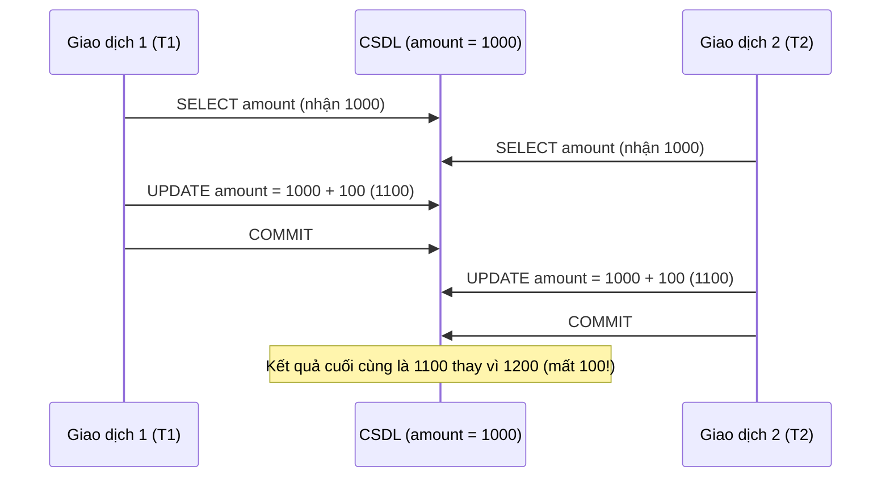
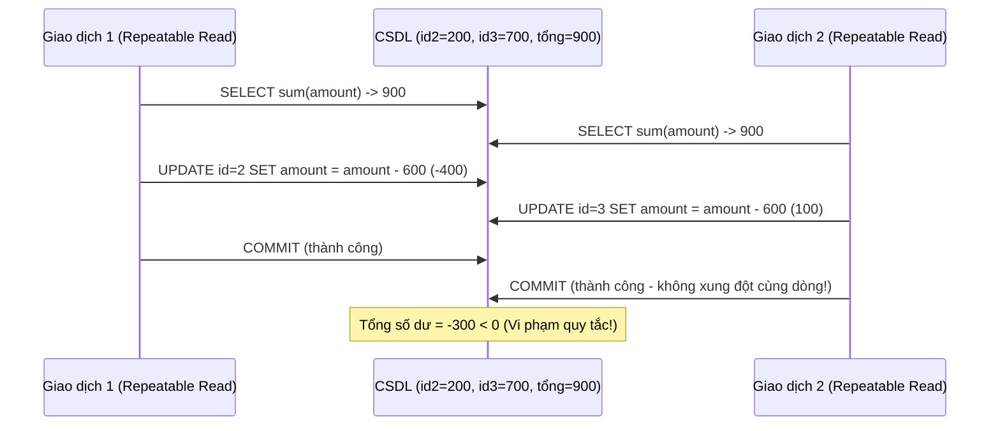

# Phần I: Cô lập và MVCC (Part I: Isolation and MVCC)

# CHƯƠNG 2: Cô lập (Chapter 2: Isolation)

## 2.1 Tính nhất quán (2.1 Consistency)

Tính năng cốt lõi của các cơ sở dữ liệu quan hệ là khả năng đảm bảo tính nhất quán dữ liệu (data consistency), tức là tính đúng đắn của dữ liệu.

Một sự thật ai cũng biết là ở cấp độ cơ sở dữ liệu, ta có thể tạo các ràng buộc toàn vẹn (integrity constraints), chẳng hạn như `NOT NULL` hoặc `UNIQUE`. Hệ quản trị cơ sở dữ liệu đảm bảo rằng những ràng buộc này không bao giờ bị phá vỡ, nhờ đó tính toàn vẹn dữ liệu (data integrity) không bao giờ bị xâm phạm.

Nếu mọi ràng buộc cần thiết đều có thể được phát biểu ở cấp độ cơ sở dữ liệu, thì tính nhất quán sẽ được đảm bảo. Nhưng một số điều kiện quá phức tạp để làm điều đó, chẳng hạn như chúng đụng chạm đến nhiều bảng cùng một lúc. Và ngay cả khi một ràng buộc có thể được định nghĩa trong cơ sở dữ liệu, nhưng vì lý do nào đó nó không được định nghĩa, điều đó cũng không có nghĩa là ràng buộc ấy được phép bị vi phạm.

Do đó, tính nhất quán dữ liệu chặt chẽ hơn tính toàn vẹn, nhưng hệ quản trị cơ sở dữ liệu không hề biết "tính nhất quán" thực sự có nghĩa là gì. Nếu một ứng dụng phá vỡ tính nhất quán mà không phá vỡ tính toàn vẹn, hệ quản trị cơ sở dữ liệu không có cách nào để phát hiện ra. Hệ quả là chính ứng dụng phải đặt ra các tiêu chí cho tính nhất quán dữ liệu, và chúng ta phải tin tưởng rằng ứng dụng được viết đúng đắn và sẽ không bao giờ có lỗi.

Nhưng nếu ứng dụng luôn chỉ thực thi các chuỗi toán tử đúng đắn, thì hệ quản trị cơ sở dữ liệu đóng vai trò gì ở đây?

Trước hết, một chuỗi toán tử đúng đắn có thể *tạm thời* phá vỡ tính nhất quán dữ liệu, và — nghe có vẻ lạ — điều đó hoàn toàn bình thường.

Một ví dụ kinh điển nhưng dễ hiểu là việc chuyển tiền từ tài khoản này sang tài khoản khác. Một quy tắc nhất quán có thể được phát biểu như sau: việc chuyển tiền không bao giờ được làm thay đổi tổng số dư của các tài khoản liên quan. Khá khó (mặc dù vẫn có thể) để diễn đạt quy tắc này thành một ràng buộc toàn vẹn trong SQL, vì vậy hãy giả sử rằng nó được định nghĩa ở cấp độ ứng dụng và vẫn hoàn toàn mờ mịt đối với hệ quản trị cơ sở dữ liệu. Một giao dịch chuyển tiền gồm hai thao tác: thao tác thứ nhất rút một khoản tiền từ một tài khoản, còn thao tác thứ hai cộng khoản tiền đó vào tài khoản kia. Thao tác thứ nhất phá vỡ tính nhất quán dữ liệu, còn thao tác thứ hai khôi phục lại nó.

Nếu thao tác thứ nhất thành công, nhưng thao tác thứ hai lại thất bại (vì một sự cố nào đó), tính nhất quán dữ liệu sẽ bị phá vỡ. Những tình huống như vậy là không thể chấp nhận được, nhưng sẽ tốn rất nhiều công sức để phát hiện và xử lý chúng ở cấp độ ứng dụng. May mắn thay điều đó không cần thiết — vấn đề có thể được giải quyết hoàn toàn bởi chính hệ quản trị cơ sở dữ liệu nếu nó biết rằng hai thao tác này cấu thành một thể thống nhất không thể chia cắt, tức là một **giao dịch (transaction)**.

Nhưng còn có một khía cạnh tinh tế hơn nữa ở đây. Dù hoàn toàn đúng đắn khi đứng một mình, các giao dịch có thể bắt đầu hoạt động sai khi chạy song song. Đó là bởi vì các thao tác thuộc về những giao dịch khác nhau thường bị xen kẽ vào nhau. Sẽ không có vấn đề gì nếu hệ quản trị cơ sở dữ liệu hoàn tất toàn bộ các thao tác của một giao dịch rồi mới chuyển sang giao dịch tiếp theo, nhưng hiệu năng của việc thực thi tuần tự sẽ thấp đến mức khó tin.

Việc thực thi đồng thời thực sự của các giao dịch chỉ có thể đạt được trên các hệ thống có phần cứng phù hợp: bộ xử lý đa nhân, mảng đĩa cứng, v.v. Nhưng lập luận tương tự cũng đúng đối với một máy chủ thực thi các lệnh một cách tuần tự theo chế độ chia sẻ thời gian (time-sharing). Để khái quát hóa, cả hai tình huống này đôi khi được gọi chung là **thực thi đồng thời (concurrent execution)**.

Các giao dịch vốn đúng đắn nhưng hành xử sai khi chạy cùng nhau sẽ dẫn đến **các bất thường đồng thời (concurrency anomalies)**, hay còn gọi là **hiện tượng (phenomena)**.

Đây là một ví dụ đơn giản. Để lấy được dữ liệu nhất quán từ cơ sở dữ liệu, ứng dụng tối thiểu không được nhìn thấy bất kỳ thay đổi nào do các giao dịch chưa cam kết (uncommitted) khác thực hiện. Nếu không (trong trường hợp một số giao dịch bị hoàn tác — rolled back), nó sẽ nhìn thấy trạng thái cơ sở dữ liệu chưa từng tồn tại. Một bất thường như vậy được gọi là **đọc bẩn (dirty read)**. Ngoài ra còn có rất nhiều bất thường khác phức tạp hơn.

Khi chạy các giao dịch đồng thời, cơ sở dữ liệu phải đảm bảo rằng kết quả của việc thực thi đó sẽ giống như kết quả của *một trong các* cách thực thi tuần tự khả dĩ. Nói cách khác, nó phải cô lập các giao dịch với nhau, qua đó xử lý mọi bất thường có thể xảy ra.

Tóm lại, một giao dịch là một tập hợp các thao tác đưa cơ sở dữ liệu từ một trạng thái đúng này sang một trạng thái đúng khác (**tính nhất quán — consistency**), với điều kiện nó được thực thi trọn vẹn (**tính nguyên tử — atomicity**) và không bị ảnh hưởng bởi các giao dịch khác (**tính cô lập — isolation**). Định nghĩa này kết hợp các yêu cầu hàm ý bởi ba chữ cái đầu tiên trong từ viết tắt **ACID**. Chúng đan xen chặt chẽ với nhau đến mức việc thảo luận chúng cùng lúc là hoàn toàn hợp lý. Thực tế, yêu cầu **tính bền vững (durability)** cũng khó có thể tách rời: sau một sự cố, hệ thống vẫn có thể chứa một số thay đổi do các giao dịch chưa cam kết thực hiện, và bạn phải xử lý việc đó để khôi phục tính nhất quán dữ liệu.

Do đó, hệ quản trị cơ sở dữ liệu giúp ứng dụng duy trì tính nhất quán dữ liệu bằng cách tính đến ranh giới giao dịch, ngay cả khi nó không hề biết các quy tắc nhất quán ngầm định là gì.

Đáng tiếc là việc cô lập hoàn toàn rất khó triển khai và có thể ảnh hưởng tiêu cực đến hiệu năng. Hầu hết các hệ thống thực tế sử dụng các mức cô lập yếu hơn, ngăn chặn được một số bất thường nhưng không phải tất cả. Điều đó có nghĩa là công việc duy trì tính nhất quán dữ liệu một phần rơi vào tay ứng dụng. Và đó chính xác là lý do tại sao việc hiểu rõ mức cô lập nào đang được sử dụng trong hệ thống, những gì được đảm bảo ở mức này và những gì không, cũng như cách đảm bảo mã nguồn của bạn sẽ đúng đắn trong những điều kiện như vậy lại vô cùng quan trọng.

> 📝 **Giải thích thêm (không có trong sách):**
> Trong ACID:
> - **Atomicity (Tính nguyên tử):** "Tất cả hoặc không có gì" — hoặc mọi lệnh trong giao dịch đều thành công, hoặc không lệnh nào có hiệu lực.
> - **Consistency (Tính nhất quán):** Dữ liệu chuyển từ trạng thái hợp lệ này sang trạng thái hợp lệ khác theo đúng các ràng buộc và quy tắc nghiệp vụ.
> - **Isolation (Tính cô lập):** Các giao dịch chạy đồng thời không làm xáo trộn nhau, kết quả tương đương một thứ tự tuần tự nào đó.
> - **Durability (Tính bền vững):** Khi giao dịch đã `COMMIT`, dữ liệu được lưu bền vững kể cả khi mất điện hay sập máy chủ.

---

## 2.2 Các mức cô lập và bất thường trong chuẩn SQL (2.2 Isolation Levels and Anomalies in SQL Standard)

Chuẩn SQL quy định bốn mức cô lập.[^1] Các mức này được định nghĩa dựa trên danh sách các bất thường có thể hoặc không thể xảy ra trong quá trình thực thi giao dịch đồng thời. Vì vậy, khi nói về các mức cô lập, chúng ta phải bắt đầu từ các bất thường.

Chúng ta cần nhớ rằng chuẩn chỉ là một cấu trúc lý thuyết: nó tác động đến thực tiễn, nhưng thực tiễn vẫn khác biệt với nó theo rất nhiều cách. Đó là lý do mọi ví dụ ở đây đều mang tính giả định. Xử lý các giao dịch trên tài khoản ngân hàng, những ví dụ này khá dễ hiểu, nhưng tôi phải thừa nhận rằng chúng chẳng liên quan gì đến nghiệp vụ ngân hàng thực tế.

Điều thú vị là lý thuyết cơ sở dữ liệu thực sự cũng khác với chuẩn: nó được phát triển sau khi chuẩn đã được thông qua, và thực tiễn khi đó đã đi trước khá xa.

### Cập nhật bị mất (Lost Update)

Bất thường **cập nhật bị mất (lost update)** xảy ra khi hai giao dịch cùng đọc một dòng trong bảng, sau đó một giao dịch cập nhật dòng này, và cuối cùng giao dịch kia cập nhật cùng dòng đó mà không tính đến bất kỳ thay đổi nào do giao dịch thứ nhất thực hiện.

Giả sử có hai giao dịch cùng muốn tăng số dư của cùng một tài khoản thêm $100. Giao dịch thứ nhất đọc giá trị hiện tại ($1,000), sau đó giao dịch thứ hai đọc cùng giá trị đó. Giao dịch thứ nhất tăng số dư (làm cho nó thành $1,100) và ghi giá trị mới vào cơ sở dữ liệu. Giao dịch thứ hai làm điều tương tự: nó cũng thu được $1,100 sau khi tăng số dư và ghi giá trị này. Kết quả là khách hàng bị mất $100.

Chuẩn SQL nghiêm cấm cập nhật bị mất ở tất cả các mức cô lập.



### Đọc bẩn và Read Uncommitted (Dirty Reads and Read Uncommitted)

Bất thường **đọc bẩn (dirty read)** xảy ra khi một giao dịch đọc được những thay đổi chưa cam kết (uncommitted) do một giao dịch khác thực hiện.

Ví dụ, giao dịch thứ nhất chuyển $100 vào một tài khoản trống nhưng chưa cam kết thay đổi này. Một giao dịch khác đọc trạng thái tài khoản (đã được cập nhật nhưng chưa cam kết) và cho phép khách hàng rút tiền — mặc dù sau đó giao dịch thứ nhất bị ngắt và các thay đổi của nó bị hoàn tác (rollback), khiến tài khoản thực chất là trống.

Chuẩn SQL cho phép đọc bẩn ở mức **Read Uncommitted**.

### Đọc không lặp lại và Read Committed (Non-Repeatable Reads and Read Committed)

Bất thường **đọc không lặp lại (non-repeatable read)** xảy ra khi một giao dịch đọc cùng một dòng hai lần, trong khi một giao dịch khác cập nhật (hoặc xóa) dòng này ở khoảng giữa hai lần đọc đó và cam kết thay đổi. Hệ quả là giao dịch thứ nhất nhận được các kết quả khác nhau.

Ví dụ, giả sử có một quy tắc nhất quán cấm tài khoản ngân hàng có số dư âm. Giao dịch thứ nhất định trừ $100 khỏi số dư tài khoản. Nó kiểm tra giá trị hiện tại, thấy $1,000, và quyết định thao tác này hợp lệ. Cùng lúc đó, một giao dịch khác rút toàn bộ tiền khỏi tài khoản này và cam kết thay đổi. Nếu giao dịch thứ nhất kiểm tra lại số dư tại thời điểm này, nó sẽ nhận được $0 (nhưng quyết định rút tiền đã được đưa ra rồi, và thao tác này gây ra thấu chi — overdraft).

Chuẩn SQL cho phép đọc không lặp lại ở các mức **Read Uncommitted** và **Read Committed**.

### Đọc bóng ma và Repeatable Read (Phantom Reads and Repeatable Read)

Bất thường **đọc bóng ma (phantom read)** xảy ra khi cùng một giao dịch thực thi hai truy vấn giống hệt nhau trả về một tập hợp các dòng thỏa mãn một điều kiện cụ thể, trong khi một giao dịch khác thêm một số dòng mới thỏa mãn điều kiện này và cam kết các thay đổi trong khoảng thời gian giữa hai truy vấn đó. Kết quả là giao dịch thứ nhất nhận được hai tập hợp dòng khác nhau.

Ví dụ, giả sử có một quy tắc nhất quán cấm một khách hàng có nhiều hơn ba tài khoản. Giao dịch thứ nhất định mở một tài khoản mới, nên nó kiểm tra xem hiện tại có bao nhiêu tài khoản (giả sử là có hai tài khoản) và quyết định thao tác này hợp lệ. Đúng lúc này, giao dịch thứ hai cũng mở một tài khoản mới cho khách hàng này và cam kết thay đổi. Nếu giao dịch thứ nhất kiểm tra lại số lượng tài khoản đang mở, nó sẽ nhận được con số ba (nhưng nó đã đang mở thêm một tài khoản nữa rồi, và cuối cùng khách hàng có tới bốn tài khoản).

Chuẩn SQL cho phép đọc bóng ma ở các mức cô lập **Read Uncommitted**, **Read Committed**, và **Repeatable Read**.

### Không có bất thường và Serializable (No Anomalies and Serializable)

Chuẩn SQL cũng định nghĩa mức **Serializable**, mức này không cho phép bất kỳ bất thường nào. Điều này không đồng nghĩa với việc chỉ cấm cập nhật bị mất và đọc bẩn, đọc không lặp lại, đọc bóng ma. Trên thực tế, có một số lượng lớn hơn nhiều các bất thường đã biết so với những gì chuẩn quy định, và một số lượng chưa biết các bất thường vẫn chưa được phát hiện.

Mức Serializable phải ngăn chặn *mọi* bất thường. Điều đó có nghĩa là lập trình viên ứng dụng không cần phải bận tâm đến việc cô lập. Nếu các giao dịch thực thi các chuỗi toán tử đúng đắn khi chạy một mình, thì việc thực thi đồng thời cũng không thể phá vỡ tính nhất quán dữ liệu.

Để minh họa ý tưởng này, tôi sẽ sử dụng một bảng quen thuộc được cung cấp trong chuẩn SQL; cột cuối cùng được thêm vào để làm rõ:

| Mức cô lập | Cập nhật bị mất (lost update) | Đọc bẩn (dirty read) | Đọc không lặp lại (non-repeatable read) | Đọc bóng ma (phantom read) | Các bất thường khác (other anomalies) |
| :--- | :---: | :---: | :---: | :---: | :---: |
| Read Uncommitted | — | có | có | có | có |
| Read Committed | — | — | có | có | có |
| Repeatable Read | — | — | — | có | có |
| Serializable | — | — | — | — | — |

### Tại sao lại là những bất thường này? (Why These Anomalies?)

Trong tất cả các bất thường có thể có, tại sao chuẩn SQL chỉ đề cập đến một vài loại, và tại sao lại chính xác là những loại này?

Dường như không ai biết chắc chắn. Nhưng không loại trừ khả năng các bất thường khác đơn giản là chưa được xem xét khi các phiên bản đầu tiên của chuẩn được thông qua, bởi vì lý thuyết lúc đó tụt hậu khá xa so với thực tiễn.

Bên cạnh đó, người ta giả định rằng việc cô lập phải dựa trên các khóa (locks). Giao thức khóa hai pha (two-phase locking — **2PL**) được sử dụng rộng rãi yêu cầu các giao dịch phải khóa các dòng bị ảnh hưởng trong quá trình thực thi và chỉ giải phóng khóa khi hoàn tất. Nói một cách đơn giản, giao dịch càng lấy nhiều khóa thì càng được cô lập tốt hơn khỏi các giao dịch khác. Và hệ quả là hiệu năng hệ thống càng kém đi, vì các giao dịch phải xếp hàng chờ truy cập vào cùng một dòng thay vì chạy đồng thời.

Tôi tin rằng phần lớn sự khác biệt giữa các mức cô lập chuẩn được định nghĩa bởi số lượng khóa cần thiết để triển khai chúng.

Nếu các dòng sắp được cập nhật bị khóa cho thao tác ghi nhưng không khóa cho thao tác đọc, chúng ta có mức cô lập **Read Uncommitted**, cho phép đọc dữ liệu trước khi nó được cam kết.

Nếu các dòng sắp được cập nhật bị khóa cho cả thao tác đọc và ghi, chúng ta có mức **Read Committed**: bị cấm đọc dữ liệu chưa cam kết, nhưng một truy vấn có thể trả về các giá trị khác nhau nếu được chạy nhiều hơn một lần (đọc không lặp lại).

Khóa cả các dòng cần đọc lẫn các dòng cần cập nhật cho mọi thao tác sẽ cho chúng ta mức **Repeatable Read**: một truy vấn lặp lại sẽ trả về cùng một kết quả.

Tuy nhiên, mức **Serializable** đặt ra một vấn đề: không thể khóa một dòng chưa hề tồn tại. Điều đó để lại kẽ hở cho hiện tượng đọc bóng ma xảy ra: một giao dịch có thể thêm một dòng thỏa mãn điều kiện của truy vấn trước đó, và dòng này sẽ xuất hiện trong kết quả truy vấn tiếp theo.

Do đó, các khóa thông thường không thể mang lại sự cô lập hoàn toàn: để đạt được điều đó, chúng ta phải khóa các **điều kiện (vị từ — predicates)** thay vì khóa các dòng. Những **khóa vị từ (predicate locks)** như vậy đã được giới thiệu từ năm 1976 khi System R đang được phát triển; tuy nhiên, tính ứng dụng thực tế của chúng bị giới hạn ở các điều kiện đơn giản mà ta có thể biết rõ hai vị từ khác nhau có xung đột hay không. Theo tôi được biết, khóa vị từ dưới dạng nguyên bản như dự định chưa bao giờ được triển khai trong bất kỳ hệ thống nào.

---

## 2.3 Các mức cô lập trong PostgreSQL (2.3 Isolation Levels in PostgreSQL)

Theo thời gian, các giao thức dựa trên khóa để quản lý giao dịch dần được thay thế bằng giao thức **Cô lập Ảnh chụp (Snapshot Isolation — SI)**. Ý tưởng đằng sau cách tiếp cận này là mỗi giao dịch truy cập vào một ảnh chụp nhất quán (consistent snapshot) của dữ liệu tại một thời điểm cụ thể. Ảnh chụp này bao gồm tất cả các thay đổi hiện hành đã được cam kết trước khi ảnh chụp được tạo.

Cô lập ảnh chụp giảm thiểu số lượng khóa cần thiết. Trên thực tế, một dòng sẽ chỉ bị khóa khi có các nỗ lực cập nhật đồng thời. Trong mọi trường hợp khác, các thao tác có thể được thực thi đồng thời: ghi không bao giờ khóa đọc, và đọc không bao giờ khóa bất cứ thứ gì.

PostgreSQL sử dụng một biến thể đa phiên bản của giao thức SI. Kiểm soát đồng thời đa phiên bản (**Multiversion Concurrency Control — MVCC**) hàm ý rằng tại bất kỳ thời điểm nào, hệ thống cơ sở dữ liệu có thể chứa nhiều phiên bản của cùng một dòng, nhờ đó PostgreSQL có thể đưa phiên bản phù hợp vào trong ảnh chụp thay vì phải hủy bỏ các giao dịch đang cố đọc dữ liệu cũ.

Dựa trên ảnh chụp, cơ chế cô lập của PostgreSQL khác với các yêu cầu quy định trong chuẩn SQL — trên thực tế, nó thậm chí còn chặt chẽ hơn. Đọc bẩn bị cấm ngay từ thiết kế. Về mặt kỹ thuật, bạn có thể chỉ định mức Read Uncommitted, nhưng hành vi của nó sẽ giống hệt như Read Committed, nên tôi sẽ không nhắc đến mức này nữa. Repeatable Read không cho phép cả đọc không lặp lại lẫn đọc bóng ma (mặc dù nó không đảm bảo cô lập hoàn toàn). Tuy nhiên, trong một số trường hợp, vẫn có rủi ro mất thay đổi ở mức Read Committed.

| Mức cô lập | Cập nhật bị mất (lost updates) | Đọc bẩn (dirty reads) | Đọc không lặp lại (non-repeatable reads) | Đọc bóng ma (phantom reads) | Các bất thường khác (other anomalies) |
| :--- | :---: | :---: | :---: | :---: | :---: |
| Read Committed | có | — | có | có | có |
| Repeatable Read | — | — | — | — | có |
| Serializable | — | — | — | — | — |

Trước khi khám phá các cơ chế bên trong của tính cô lập, hãy cùng thảo luận từng mức trong ba mức cô lập dưới góc độ người dùng.

Để phục vụ mục đích này, chúng ta sẽ tạo bảng `accounts`; Alice và Bob mỗi người sẽ có $1,000, nhưng Bob sẽ có hai tài khoản:

```sql
=> CREATE TABLE accounts(
  id integer PRIMARY KEY GENERATED BY DEFAULT AS IDENTITY,
  client text,
  amount numeric
);
=> INSERT INTO accounts VALUES
  (1, 'alice', 1000.00), (2, 'bob', 100.00), (3, 'bob', 900.00);
```

### Read Committed

**Không có đọc bẩn (No dirty reads).** Rất dễ để kiểm tra rằng việc đọc dữ liệu bẩn không được phép. Hãy bắt đầu một giao dịch. Theo mặc định, nó sử dụng mức cô lập Read Committed[^2]:

```sql
=> BEGIN;
=> SHOW transaction_isolation;
 transaction_isolation
-----------------------
 read committed
(1 row)
```

Chính xác hơn, mức mặc định được thiết lập bởi tham số sau đây, và có thể thay đổi khi cần:

```sql
=> SHOW default_transaction_isolation;
 default_transaction_isolation
-------------------------------
 read committed
(1 row)
```

Giao dịch đang mở rút một ít tiền từ tài khoản của khách hàng nhưng chưa cam kết các thay đổi này. Tuy nhiên, nó vẫn sẽ nhìn thấy thay đổi của chính mình, vì điều này luôn được phép:

```sql
=> UPDATE accounts SET amount = amount - 200 WHERE id = 1;
=> SELECT * FROM accounts WHERE client = 'alice';
 id | client | amount
----+--------+--------
  1 | alice  | 800.00
(1 row)
```

Trong phiên (session) thứ hai, chúng ta bắt đầu một giao dịch khác cũng sẽ chạy ở mức Read Committed:

```sql
=> BEGIN;
=> SELECT * FROM accounts WHERE client = 'alice';
 id | client | amount
----+--------+---------
  1 | alice  | 1000.00
(1 row)
```

Đúng như dự đoán, giao dịch thứ hai không nhìn thấy bất kỳ thay đổi chưa cam kết nào — đọc bẩn bị nghiêm cấm.

**Đọc không lặp lại (Non-repeatable reads).** Bây giờ hãy để giao dịch thứ nhất cam kết các thay đổi. Sau đó giao dịch thứ hai sẽ lặp lại cùng truy vấn đó:

```sql
=> COMMIT;
```

```sql
=> SELECT * FROM accounts WHERE client = 'alice';
 id | client | amount
----+--------+--------
  1 | alice  | 800.00
(1 row)
=> COMMIT;
```

Truy vấn nhận được phiên bản dữ liệu đã cập nhật — và đó chính xác là điều được hiểu là bất thường đọc không lặp lại, vốn được phép ở mức Read Committed.

Một bài học thực tế: trong một giao dịch, bạn không được đưa ra bất kỳ quyết định nào dựa trên dữ liệu đã đọc bởi toán tử trước đó, vì mọi thứ có thể thay đổi ở khoảng giữa. Dưới đây là một ví dụ mà các biến thể của nó xuất hiện trong mã nguồn ứng dụng thường xuyên đến mức có thể coi là một **anti-pattern** kinh điển:

```sql
IF (SELECT amount FROM accounts WHERE id = 1) >= 1000 THEN
  UPDATE accounts SET amount = amount - 1000 WHERE id = 1;
END IF;
```

Trong khoảng thời gian trôi qua giữa bước kiểm tra và bước cập nhật, các giao dịch khác có thể tự do thay đổi trạng thái của tài khoản, nên việc "kiểm tra" như vậy hoàn toàn vô dụng. Để hiểu rõ hơn, bạn có thể tưởng tượng rằng các toán tử ngẫu nhiên của những giao dịch khác bị "chêm" vào giữa các toán tử của giao dịch hiện tại. Ví dụ như thế này:

```sql
IF (SELECT amount FROM accounts WHERE id = 1) >= 1000 THEN
    UPDATE accounts SET amount = amount - 200 WHERE id = 1;
    COMMIT;
  UPDATE accounts SET amount = amount - 1000 WHERE id = 1;
END IF;
```

Nếu mọi thứ hỏng bét ngay khi các toán tử bị sắp xếp xen kẽ, thì đoạn mã đó là sai. Đừng tự huyễn hoặc rằng bạn sẽ không bao giờ gặp rắc rối này: bất cứ điều gì có thể sai sẽ sai. Những lỗi như vậy rất khó tái hiện, và hệ quả là việc sửa chúng là một thách thức thực sự.

Làm thế nào bạn có thể sửa đoạn mã này? Có một vài lựa chọn:

- **Thay thế mã thủ tục bằng mã khai báo (declarative).**
  Ví dụ, trong trường hợp cụ thể này rất dễ biến câu lệnh `IF` thành một ràng buộc `CHECK`:
  ```sql
  ALTER TABLE accounts
    ADD CHECK (amount >= 0);
  ```
  Bây giờ bạn không cần bất kỳ bước kiểm tra nào trong mã nữa: chỉ cần chạy lệnh cập nhật và xử lý ngoại lệ sẽ được ném ra nếu có hành vi vi phạm ràng buộc toàn vẹn.

- **Sử dụng một toán tử SQL duy nhất.**
  Tính nhất quán dữ liệu có thể bị xâm phạm nếu một giao dịch được cam kết trong khoảng thời gian trống giữa các toán tử của một giao dịch khác, làm thay đổi khả năng hiển thị dữ liệu. Nếu chỉ có một toán tử duy nhất, sẽ không có khoảng trống nào như vậy.

  PostgreSQL có đủ năng lực để giải quyết các tác vụ phức tạp chỉ với một câu lệnh SQL duy nhất. Cụ thể, nó cung cấp các biểu thức bảng thông dụng (**CTE** — Common Table Expressions) có thể chứa các toán tử như `INSERT`, `UPDATE`, `DELETE`, cũng như toán tử `INSERT ON CONFLICT` thực hiện logic sau: chèn dòng nếu nó chưa tồn tại, ngược lại thì thực hiện cập nhật.

- **Áp dụng khóa tường minh (explicit locks).**
  Giải pháp cuối cùng là tự đặt khóa độc quyền (exclusive lock) lên tất cả các dòng cần thiết (`SELECT FOR UPDATE`) hoặc thậm chí lên toàn bộ bảng (`LOCK TABLE`). Cách tiếp cận này luôn hiệu quả, nhưng nó làm mất hết mọi ưu điểm của MVCC: một số thao tác vốn có thể thực thi đồng thời sẽ phải chạy tuần tự.

> 💡 **Ví dụ bổ sung (không có trong sách):**
> Thay vì dùng `IF ... THEN UPDATE ...`, bạn có thể gộp thành một câu lệnh SQL duy nhất an toàn ở mức `Read Committed`:
> ```sql
> UPDATE accounts
> SET amount = amount - 1000
> WHERE id = 1 AND amount >= 1000
> RETURNING amount;
> ```
> Nếu không có dòng nào được trả về, ứng dụng biết ngay số dư không đủ mà không sợ bị race condition giữa bước kiểm tra và bước trừ tiền.

**Lệch đọc (Read skew).** Tuy nhiên, mọi chuyện không đơn giản chỉ có vậy. Cách triển khai của PostgreSQL còn cho phép các bất thường khác ít được biết đến hơn, không được quy định bởi chuẩn SQL.

Giả sử giao dịch thứ nhất đã bắt đầu một lệnh chuyển tiền giữa các tài khoản của Bob:

```sql
=> BEGIN;
=> UPDATE accounts SET amount = amount - 100 WHERE id = 2;
```

Trong khi đó, giao dịch kia bắt đầu duyệt qua tất cả các tài khoản của Bob để tính tổng số dư của anh ấy. Nó bắt đầu với tài khoản thứ nhất (tất nhiên là nhìn thấy trạng thái trước đó của tài khoản):

```sql
=> BEGIN;
=> SELECT amount FROM accounts WHERE id = 2;
 amount
--------
 100.00
(1 row)
```

Tại thời điểm này, giao dịch thứ nhất hoàn tất thành công:

```sql
=> UPDATE accounts SET amount = amount + 100 WHERE id = 3;
=> COMMIT;
```

Giao dịch thứ hai đọc trạng thái của tài khoản thứ hai (và nhìn thấy giá trị đã được cập nhật):

```sql
=> SELECT amount FROM accounts WHERE id = 3;
 amount
---------
 1000.00
(1 row)
=> COMMIT;
```

Kết quả là giao dịch thứ hai thu được $1,100 vì nó đã đọc dữ liệu không nhất quán. Một bất thường như vậy được gọi là **lệch đọc (read skew)**.

Làm thế nào bạn có thể tránh bất thường này ở mức Read Committed? Câu trả lời rất rõ ràng: hãy sử dụng một toán tử duy nhất. Ví dụ như thế này:

```sql
SELECT sum(amount) FROM accounts WHERE client = 'bob';
```

Từ nãy đến giờ tôi vẫn khẳng định rằng khả năng hiển thị dữ liệu chỉ có thể thay đổi giữa các toán tử, nhưng liệu có thực sự như vậy không? Điều gì xảy ra nếu truy vấn chạy trong một thời gian dài? Trong trường hợp này nó có thể nhìn thấy các phần dữ liệu khác nhau ở các trạng thái khác nhau không?

Hãy kiểm tra thử. Một cách tiện lợi để làm điều đó là thêm độ trễ vào một toán tử bằng cách gọi hàm `pg_sleep`. Khi đó dòng thứ nhất sẽ được đọc ngay lập tức, nhưng dòng thứ hai sẽ phải đợi hai giây:

```sql
=> SELECT amount, pg_sleep(2) -- hai giây
   FROM accounts WHERE client = 'bob';
```

Trong khi câu lệnh này đang được thực thi, hãy bắt đầu một giao dịch khác để chuyển tiền ngược lại:

```sql
=> BEGIN;
=> UPDATE accounts SET amount = amount + 100 WHERE id = 2;
=> UPDATE accounts SET amount = amount - 100 WHERE id = 3;
=> COMMIT;
```

Kết quả cho thấy toán tử đã nhìn thấy toàn bộ dữ liệu ở trạng thái tương ứng với thời điểm *bắt đầu thực thi* của nó, điều này chắc chắn là đúng đắn:

```text
 amount  | pg_sleep
---------+----------
    0.00 |
 1000.00 |
(2 rows)
```

Nhưng mọi chuyện cũng không đơn giản đến thế. Nếu truy vấn chứa một hàm được khai báo là `VOLATILE`, và hàm này thực thi một truy vấn khác, thì dữ liệu mà truy vấn lồng nhau này nhìn thấy sẽ *không* nhất quán với kết quả của truy vấn chính.

Hãy kiểm tra số dư trong các tài khoản của Bob bằng hàm sau:

```sql
=> CREATE FUNCTION get_amount(id integer) RETURNS numeric
AS $$
  SELECT amount FROM accounts a WHERE a.id = get_amount.id;
$$ VOLATILE LANGUAGE sql;
=> SELECT get_amount(id), pg_sleep(2)
   FROM accounts WHERE client = 'bob';
```

Chúng ta sẽ chuyển tiền giữa các tài khoản một lần nữa trong khi truy vấn có độ trễ đang được thực thi:

```sql
=> BEGIN;
=> UPDATE accounts SET amount = amount + 100 WHERE id = 2;
=> UPDATE accounts SET amount = amount - 100 WHERE id = 3;
=> COMMIT;
```

Trong trường hợp này, chúng ta sẽ nhận được dữ liệu không nhất quán — $100 đã bị biến mất:

```text
 get_amount | pg_sleep
------------+----------
     100.00 |
     800.00 |
(2 rows)
```

Tôi muốn nhấn mạnh rằng hiệu ứng này chỉ có thể xảy ra ở mức cô lập Read Committed, và chỉ khi hàm là `VOLATILE`. Rắc rối ở chỗ PostgreSQL sử dụng chính xác mức cô lập này và phân loại tính biến động (volatility category) này theo mặc định. Vì vậy chúng ta phải thừa nhận rằng cái bẫy được giăng một cách rất tinh vi.

**Lệch đọc thay vì cập nhật bị mất (Read skew instead of lost updates).** Bất thường lệch đọc cũng có thể xảy ra bên trong một toán tử duy nhất trong quá trình cập nhật — mặc dù theo một cách hơi bất ngờ.

Hãy xem điều gì xảy ra nếu hai giao dịch cố gắng sửa đổi cùng một dòng. Bob hiện có tổng cộng $1,000 trong hai tài khoản:

```sql
=> SELECT * FROM accounts WHERE client = 'bob';
 id | client | amount
----+--------+--------
  2 | bob    | 200.00
  3 | bob    | 800.00
(2 rows)
```

Bắt đầu một giao dịch sẽ làm giảm số dư của Bob:

```sql
=> BEGIN;
=> UPDATE accounts SET amount = amount - 100 WHERE id = 3;
```

Cùng lúc đó, giao dịch kia sẽ tính tiền lãi cho tất cả các tài khoản khách hàng có tổng số dư từ $1,000 trở lên:

```sql
=> UPDATE accounts SET amount = amount * 1.01
   WHERE client IN (
     SELECT client
     FROM accounts
     GROUP BY client
     HAVING sum(amount) >= 1000
   );
```

Việc thực thi toán tử `UPDATE` về cơ bản gồm hai giai đoạn. Đầu tiên, các dòng cần cập nhật được chọn dựa trên điều kiện đã cho. Vì giao dịch thứ nhất chưa cam kết, giao dịch thứ hai không thể nhìn thấy kết quả của nó, nên việc chọn các dòng để tính lãi không bị ảnh hưởng. Do đó, các tài khoản của Bob thỏa mãn điều kiện, và số dư của anh ấy phải được tăng thêm $10 sau khi thao tác `UPDATE` hoàn tất.

Ở giai đoạn thứ hai, các dòng đã chọn được cập nhật lần lượt từng dòng một. Giao dịch thứ hai phải chờ vì dòng có `id = 3` đang bị khóa: nó đang được cập nhật bởi giao dịch thứ nhất.

Trong lúc đó, giao dịch thứ nhất cam kết các thay đổi của mình:

```sql
=> COMMIT;
```

```sql
=> SELECT * FROM accounts WHERE client = 'bob';
 id | client |  amount
----+--------+----------
  2 | bob    | 202.0000
  3 | bob    | 707.0000
(2 rows)
```

Một mặt, lệnh `UPDATE` không được phép nhìn thấy bất kỳ thay đổi nào do giao dịch thứ nhất thực hiện. Nhưng mặt khác, nó không được làm mất bất kỳ thay đổi nào đã cam kết.

Sau khi khóa được giải phóng, toán tử `UPDATE` **đọc lại (re-reads)** dòng cần cập nhật (nhưng chỉ dòng này thôi!). Kết quả là Bob nhận được $9 tiền lãi, dựa trên tổng số dư là $900. Nhưng nếu anh ấy có $900, các tài khoản của anh ấy ngay từ đầu đã không nên được đưa vào kết quả truy vấn. Do đó, giao dịch của chúng ta đã trả về dữ liệu sai: các dòng khác nhau đã được đọc từ các ảnh chụp khác nhau. Thay vì cập nhật bị mất, chúng ta lại quan sát thấy bất thường lệch đọc một lần nữa.

**Cập nhật bị mất (Lost updates).** Tuy nhiên, thủ thuật đọc lại dòng bị khóa sẽ không giúp chống lại cập nhật bị mất nếu dữ liệu bị sửa đổi bởi các toán tử SQL khác nhau.

Đây là một ví dụ mà chúng ta đã thấy trước đó. Ứng dụng đọc và ghi nhận (bên ngoài cơ sở dữ liệu) số dư hiện tại của tài khoản Alice:

```sql
=> BEGIN;
=> SELECT amount FROM accounts WHERE id = 1;
 amount
--------
 800.00
(1 row)
```

Trong khi đó, giao dịch kia cũng làm điều tương tự:

```sql
=> BEGIN;
=> SELECT amount FROM accounts WHERE id = 1;
 amount
--------
 800.00
(1 row)
```

Giao dịch thứ nhất tăng giá trị đã ghi nhận trước đó thêm $100 và cam kết thay đổi này:

```sql
=> UPDATE accounts SET amount = 800.00 + 100 WHERE id = 1
   RETURNING amount;
 amount
--------
 900.00
(1 row)
UPDATE 1
=> COMMIT;
```

Giao dịch thứ hai làm điều tương tự:

```sql
=> UPDATE accounts SET amount = 800.00 + 100 WHERE id = 1
   RETURNING amount;
 amount
--------
 900.00
(1 row)
UPDATE 1
=> COMMIT;
```

Đáng tiếc là Alice đã bị mất $100. Hệ quản trị cơ sở dữ liệu không biết rằng giá trị $800 được ghi nhận kia có liên quan gì đến `accounts.amount`, nên nó không thể ngăn chặn bất thường cập nhật bị mất. Ở mức cô lập Read Committed, đoạn mã này là sai.

### Repeatable Read

**Không có đọc không lặp lại và đọc bóng ma (No non-repeatable and phantom reads).** Đúng như tên gọi, mức cô lập Repeatable Read[^3] phải đảm bảo việc đọc lặp lại được (repeatable reading). Hãy kiểm tra điều đó và đảm bảo rằng hiện tượng đọc bóng ma cũng không thể xảy ra. Để làm điều này, chúng ta sẽ bắt đầu một giao dịch đưa các tài khoản của Bob về trạng thái trước đó và tạo một tài khoản mới cho Charlie:

```sql
=> BEGIN;
=> UPDATE accounts SET amount = 200.00 WHERE id = 2;
=> UPDATE accounts SET amount = 800.00 WHERE id = 3;
=> INSERT INTO accounts VALUES (4, 'charlie', 100.00);
=> SELECT * FROM accounts ORDER BY id;
 id | client  | amount
----+---------+--------
  1 | alice   | 900.00
  2 | bob     | 200.00
  3 | bob     | 800.00
  4 | charlie | 100.00
(4 rows)
```

Trong phiên thứ hai, hãy bắt đầu một giao dịch khác, với mức Repeatable Read được chỉ định tường minh trong lệnh `BEGIN` (mức của giao dịch thứ nhất không quan trọng):

```sql
=> BEGIN ISOLATION LEVEL REPEATABLE READ;
=> SELECT * FROM accounts ORDER BY id;
 id | client |  amount
----+--------+----------
  1 | alice  |   900.00
  2 | bob    | 202.0000
  3 | bob    | 707.0000
(3 rows)
```

Bây giờ giao dịch thứ nhất cam kết các thay đổi của mình, và giao dịch thứ hai lặp lại cùng truy vấn đó:

```sql
=> COMMIT;
```

```sql
=> SELECT * FROM accounts ORDER BY id;
 id | client |  amount
----+--------+----------
  1 | alice  |   900.00
  2 | bob    | 202.0000
  3 | bob    | 707.0000
(3 rows)
=> COMMIT;
```

Giao dịch thứ hai vẫn nhìn thấy dữ liệu y hệt như trước: cả dòng mới lẫn các bản cập nhật dòng đều không hiển thị. Ở mức cô lập này, bạn không phải lo lắng rằng điều gì đó sẽ thay đổi giữa các toán tử.

**Lỗi tuần tự hóa thay vì cập nhật bị mất (Serialization failures instead of lost updates).** Như chúng ta đã thấy, nếu hai giao dịch cập nhật cùng một dòng ở mức Read Committed, nó có thể gây ra bất thường lệch đọc: giao dịch đang chờ phải đọc lại dòng bị khóa, nên nó nhìn thấy trạng thái của dòng này tại một thời điểm khác so với các dòng khác.

Một bất thường như vậy không được phép xảy ra ở mức cô lập Repeatable Read, và nếu nó xảy ra, giao dịch chỉ có thể bị hủy bỏ với một **lỗi tuần tự hóa (serialization failure)**. Hãy kiểm tra bằng cách lặp lại kịch bản tính tiền lãi:

```sql
=> SELECT * FROM accounts WHERE client = 'bob';
 id | client | amount
----+--------+--------
  2 | bob    | 200.00
  3 | bob    | 800.00
(2 rows)
=> BEGIN;
=> UPDATE accounts SET amount = amount - 100.00 WHERE id = 3;
```

```sql
=> BEGIN ISOLATION LEVEL REPEATABLE READ;
=> UPDATE accounts SET amount = amount * 1.01
   WHERE client IN (
     SELECT client
     FROM accounts
     GROUP BY client
     HAVING sum(amount) >= 1000
   );
```

```sql
=> COMMIT;
```

```text
ERROR:  could not serialize access due to concurrent update
```

```sql
=> ROLLBACK;
```

Dữ liệu vẫn giữ được tính nhất quán:

```sql
=> SELECT * FROM accounts WHERE client = 'bob';
 id | client | amount
----+--------+--------
  2 | bob    | 200.00
  3 | bob    | 700.00
(2 rows)
```

Lỗi tương tự sẽ được ném ra bởi bất kỳ thao tác cập nhật dòng đồng thời nào, ngay cả khi chúng tác động đến các cột khác nhau.

Chúng ta cũng sẽ nhận được lỗi này nếu cố gắng cập nhật số dư dựa trên giá trị đã lưu trước đó:

```sql
=> BEGIN ISOLATION LEVEL REPEATABLE READ;
=> SELECT amount FROM accounts WHERE id = 1;
 amount
--------
 900.00
(1 row)
```

```sql
=> BEGIN ISOLATION LEVEL REPEATABLE READ;
=> SELECT amount FROM accounts WHERE id = 1;
 amount
--------
 900.00
(1 row)
```

```sql
=> UPDATE accounts SET amount = 900.00 + 100.00 WHERE id = 1
   RETURNING amount;
 amount
---------
 1000.00
(1 row)
UPDATE 1
=> COMMIT;
```

```sql
=> UPDATE accounts SET amount = 900.00 + 100.00 WHERE id = 1
   RETURNING amount;
ERROR:  could not serialize access due to concurrent update
=> ROLLBACK;
```

Một bài học thực tế: nếu ứng dụng của bạn đang sử dụng mức cô lập Repeatable Read cho các giao dịch ghi, nó phải sẵn sàng **thử lại (retry)** các giao dịch đã kết thúc bằng lỗi tuần tự hóa. Đối với các giao dịch chỉ đọc (read-only), kết cục như vậy là không thể xảy ra.

**Lệch ghi (Write skew).** Như chúng ta đã thấy, cách triển khai mức cô lập Repeatable Read của PostgreSQL ngăn chặn được tất cả các bất thường được mô tả trong chuẩn SQL. Nhưng không phải tất cả các bất thường có thể có: không ai biết có bao nhiêu bất thường tồn tại. Tuy nhiên, một sự thật quan trọng đã được chứng minh chắc chắn: cô lập ảnh chụp chỉ không ngăn chặn được **hai** bất thường, bất kể ngoài kia có bao nhiêu bất thường khác đi nữa.

Bất thường đầu tiên là **lệch ghi (write skew)**.

Hãy định nghĩa quy tắc nhất quán sau: được phép có số dư âm ở một số tài khoản của khách hàng miễn là *tổng* số dư không âm.

Giao dịch thứ nhất lấy tổng số dư các tài khoản của Bob:

```sql
=> BEGIN ISOLATION LEVEL REPEATABLE READ;
=> SELECT sum(amount) FROM accounts WHERE client = 'bob';
  sum
--------
 900.00
(1 row)
```

Giao dịch thứ hai cũng lấy được tổng số dư tương tự:

```sql
=> BEGIN ISOLATION LEVEL REPEATABLE READ;
=> SELECT sum(amount) FROM accounts WHERE client = 'bob';
  sum
--------
 900.00
(1 row)
```

Giao dịch thứ nhất hoàn toàn có lý khi giả định rằng nó có thể trừ $600 từ một trong các tài khoản:

```sql
=> UPDATE accounts SET amount = amount - 600.00 WHERE id = 2;
```

Giao dịch thứ hai cũng đi đến kết luận tương tự, nhưng lại trừ tiền từ tài khoản kia:

```sql
=> UPDATE accounts SET amount = amount - 600.00 WHERE id = 3;
=> COMMIT;
```

```sql
=> COMMIT;
=> SELECT * FROM accounts WHERE client = 'bob';
 id | client | amount
----+--------+---------
  2 | bob    | -400.00
  3 | bob    |  100.00
(2 rows)
```

Tổng số dư của Bob lúc này bị âm, mặc dù cả hai giao dịch đều hoàn toàn đúng đắn nếu chạy riêng lẻ.



**Bất thường giao dịch chỉ đọc (Read-only transaction anomaly).** Bất thường giao dịch chỉ đọc là bất thường thứ hai và cũng là bất thường cuối cùng được phép xảy ra ở mức cô lập Repeatable Read. Để quan sát bất thường này, chúng ta phải chạy ba giao dịch: hai trong số đó sẽ cập nhật dữ liệu, trong khi giao dịch thứ ba sẽ là giao dịch chỉ đọc.

Nhưng trước tiên hãy khôi phục số dư của Bob:

```sql
=> UPDATE accounts SET amount = 900.00 WHERE id = 2;
=> SELECT * FROM accounts WHERE client = 'bob';
 id | client | amount
----+--------+--------
  3 | bob    | 100.00
  2 | bob    | 900.00
(2 rows)
```

Giao dịch thứ nhất tính tiền lãi được cộng dồn dựa trên tổng số dư của Bob và cộng khoản tiền này vào một trong các tài khoản của anh ấy:

```sql
=> BEGIN ISOLATION LEVEL REPEATABLE READ; -- 1
=> UPDATE accounts SET amount = amount + (
     SELECT sum(amount) FROM accounts WHERE client = 'bob'
   ) * 0.01
   WHERE id = 2;
```

Sau đó giao dịch thứ hai rút một ít tiền từ tài khoản còn lại của Bob và cam kết thay đổi này:

```sql
=> BEGIN ISOLATION LEVEL REPEATABLE READ; -- 2
=> UPDATE accounts SET amount = amount - 100.00 WHERE id = 3;
=> COMMIT;
```

Nếu giao dịch thứ nhất được cam kết tại thời điểm này, sẽ không có bất thường nào xảy ra: chúng ta có thể coi như giao dịch thứ nhất được cam kết *trước* giao dịch thứ hai (nhưng không thể ngược lại — giao dịch thứ nhất đã nhìn thấy trạng thái của tài khoản có `id = 3` trước khi bất kỳ bản cập nhật nào được thực hiện bởi giao dịch thứ hai).

Nhưng hãy tưởng tượng rằng ngay tại thời điểm này, chúng ta bắt đầu một giao dịch chỉ đọc để truy vấn một tài khoản không bị ảnh hưởng bởi hai giao dịch đầu tiên:

```sql
=> BEGIN ISOLATION LEVEL REPEATABLE READ; -- 3
=> SELECT * FROM accounts WHERE client = 'alice';
 id | client | amount
----+--------+---------
  1 | alice  | 1000.00
(1 row)
```

Và chỉ đến lúc này giao dịch thứ nhất mới được cam kết:

```sql
=> COMMIT;
```

Giao dịch thứ ba lúc này phải nhìn thấy trạng thái nào? Khi đã bắt đầu, nó có thể nhìn thấy các thay đổi của giao dịch thứ hai (vốn đã được cam kết), nhưng không nhìn thấy thay đổi của giao dịch thứ nhất (vốn chưa được cam kết). Nhưng như chúng ta đã xác lập ở trên, giao dịch thứ hai phải được coi như bắt đầu *sau* giao dịch thứ nhất. Bất kỳ trạng thái nào mà giao dịch thứ ba nhìn thấy cũng sẽ không nhất quán — đây chính xác là ý nghĩa của **bất thường giao dịch chỉ đọc**:

```sql
=> SELECT * FROM accounts WHERE client = 'bob';
 id | client | amount
----+--------+--------
  2 | bob    | 900.00
  3 | bob    |   0.00
(2 rows)
=> COMMIT;
```

> 📝 **Giải thích thêm (không có trong sách):**
> Tại sao trạng thái `(id 2 = 900.00, id 3 = 0.00)` lại không thể xảy ra trong bất kỳ thứ tự tuần tự nào?
> - Nếu T1 chạy trước T2: T1 tính lãi trên `900 + 100 = 1000` (lãi `10`), `id 2` thành `910`, sau đó T2 trừ `100` ở `id 3` -> kết quả `(910, 0)`.
> - Nếu T2 chạy trước T1: T2 trừ `100` ở `id 3` thành `0`, sau đó T1 tính lãi trên `900 + 0 = 900` (lãi `9`), `id 2` thành `909` -> kết quả `(909, 0)`.
> - Không có bất kỳ thứ tự tuần tự nào cho ra `(900, 0)`! Nhưng giao dịch chỉ đọc T3 lại thấy đúng trạng thái `(900, 0)` đó.

### Serializable

Mức cô lập **Serializable**[^4] ngăn chặn *tất cả* các bất thường có thể xảy ra. Mức này thực chất được xây dựng bên trên cơ chế cô lập ảnh chụp (snapshot isolation). Những bất thường không xảy ra ở mức Repeatable Read (như đọc bẩn, đọc không lặp lại, hay đọc bóng ma) cũng không thể xảy ra ở mức Serializable. Và hai bất thường vốn xảy ra được (lệch ghi và bất thường giao dịch chỉ đọc) sẽ được phát hiện theo một cách đặc biệt để hủy bỏ giao dịch, gây ra lỗi tuần tự hóa đã quá quen thuộc.

**Không có bất thường (No anomalies).** Hãy kiểm chứng rằng kịch bản lệch ghi của chúng ta cuối cùng sẽ kết thúc bằng một lỗi tuần tự hóa:

```sql
=> BEGIN ISOLATION LEVEL SERIALIZABLE;
=> SELECT sum(amount) FROM accounts WHERE client = 'bob';
   sum
----------
 910.0000
(1 row)
```

```sql
=> BEGIN ISOLATION LEVEL SERIALIZABLE;
=> SELECT sum(amount) FROM accounts WHERE client = 'bob';
   sum
----------
 910.0000
(1 row)
```

```sql
=> UPDATE accounts SET amount = amount - 600.00 WHERE id = 2;
```

```sql
=> UPDATE accounts SET amount = amount - 600.00 WHERE id = 3;
=> COMMIT;
COMMIT
```

```sql
=> COMMIT;
ERROR:  could not serialize access due to read/write dependencies among transactions
DETAIL:  Reason code: Canceled on identification as a pivot, during commit attempt.
HINT:  The transaction might succeed if retried.
```

Kịch bản với bất thường giao dịch chỉ đọc cũng sẽ dẫn đến lỗi tương tự.

**Trì hoãn một giao dịch chỉ đọc (Deferring a read-only transaction).** Để tránh các tình huống khi một giao dịch chỉ đọc có thể gây ra bất thường làm xâm phạm tính nhất quán dữ liệu, PostgreSQL cung cấp một giải pháp thú vị: giao dịch này có thể bị **trì hoãn (deferred)** cho đến khi việc thực thi nó trở nên an toàn. Đây là trường hợp *duy nhất* mà một câu lệnh `SELECT` có thể bị chặn bởi các thao tác cập nhật dòng.

Chúng ta sẽ kiểm chứng bằng cách lặp lại kịch bản đã minh họa cho bất thường giao dịch chỉ đọc:

```sql
=> UPDATE accounts SET amount = 900.00 WHERE id = 2;
=> UPDATE accounts SET amount = 100.00 WHERE id = 3;
=> SELECT * FROM accounts WHERE client = 'bob' ORDER BY id;
 id | client | amount
----+--------+--------
  2 | bob    | 900.00
  3 | bob    | 100.00
(2 rows)
=> BEGIN ISOLATION LEVEL SERIALIZABLE; -- 1
=> UPDATE accounts SET amount = amount + (
     SELECT sum(amount) FROM accounts WHERE client = 'bob'
   ) * 0.01
   WHERE id = 2;
```

```sql
=> BEGIN ISOLATION LEVEL SERIALIZABLE; -- 2
=> UPDATE accounts SET amount = amount - 100.00 WHERE id = 3;
=> COMMIT;
```

Hãy khai báo tường minh giao dịch thứ ba là `READ ONLY` và `DEFERRABLE`:

```sql
=> BEGIN ISOLATION LEVEL SERIALIZABLE READ ONLY DEFERRABLE; -- 3
=> SELECT * FROM accounts WHERE client = 'alice';
```

Nỗ lực chạy truy vấn này làm giao dịch bị chặn (block) — nếu không, nó đã gây ra một bất thường rồi.

Và chỉ khi giao dịch thứ nhất được cam kết, giao dịch thứ ba mới có thể tiếp tục thực thi:

```sql
=> COMMIT;
```

```text
 id | client | amount
----+--------+---------
  1 | alice  | 1000.00
(1 row)
=> SELECT * FROM accounts WHERE client = 'bob';
 id | client |  amount
----+--------+----------
  2 | bob    | 910.0000
  3 | bob    |     0.00
(2 rows)
=> COMMIT;
```

Do đó, nếu một ứng dụng sử dụng mức cô lập Serializable, nó phải sẵn sàng thử lại các giao dịch đã kết thúc bằng lỗi tuần tự hóa. (Mức Repeatable Read cũng đòi hỏi cách tiếp cận tương tự trừ khi ứng dụng chỉ giới hạn ở các giao dịch chỉ đọc.)

Mức cô lập Serializable mang lại sự dễ dàng trong lập trình, nhưng cái giá bạn phải trả là chi phí phát sinh (overhead) do việc phát hiện bất thường và buộc phải chấm dứt một tỷ lệ nhất định các giao dịch. Bạn có thể giảm bớt tác động này bằng cách sử dụng tường minh mệnh đề `READ ONLY` khi khai báo các giao dịch chỉ đọc. Nhưng câu hỏi chính, tất nhiên, là tỷ lệ các giao dịch bị hủy bỏ lớn đến mức nào — vì những giao dịch này sẽ phải được thử lại. Sẽ không quá tệ nếu PostgreSQL chỉ hủy bỏ những giao dịch dẫn đến xung đột dữ liệu và thực sự không tương thích với nhau. Nhưng cách tiếp cận như vậy chắc chắn sẽ tiêu tốn quá nhiều tài nguyên, vì nó đòi hỏi phải theo dõi các thao tác trên từng dòng một.

Cách triển khai hiện tại cho phép **dương tính giả (false positives)**: PostgreSQL có thể hủy bỏ một số giao dịch hoàn toàn an toàn chỉ đơn giản là vì chúng "kém may mắn". Sự "may mắn" của chúng phụ thuộc vào nhiều yếu tố, chẳng hạn như sự hiện diện của các chỉ mục (indexes) phù hợp hay lượng RAM khả dụng, nên hành vi thực tế rất khó dự đoán trước.

Nếu bạn sử dụng mức Serializable, nó phải được tuân thủ bởi *tất cả* các giao dịch của ứng dụng. Khi kết hợp với các mức khác, Serializable hành xử như Repeatable Read mà không có bất kỳ thông báo nào. Vì vậy, nếu bạn quyết định sử dụng mức Serializable, hãy sửa đổi giá trị tham số `default_transaction_isolation` cho phù hợp — mặc dù ai đó vẫn có thể ghi đè nó bằng cách thiết lập tường minh một mức khác.

Ngoài ra còn có các hạn chế khác; ví dụ, các truy vấn chạy ở mức Serializable không thể thực thi trên các bản sao đọc (replicas). Và mặc dù chức năng của mức này liên tục được cải thiện, các giới hạn hiện tại và chi phí phát sinh khiến nó kém hấp dẫn hơn.

---

## 2.4 Nên sử dụng mức cô lập nào? (2.4 Which Isolation Level to Use?)

**Read Committed** là mức cô lập mặc định trong PostgreSQL, và rõ ràng đây là mức được sử dụng trong đại đa số các ứng dụng. Mức này tiện lợi ở chỗ nó chỉ cho phép hủy bỏ giao dịch khi có lỗi xảy ra; nó không hủy bỏ bất kỳ giao dịch nào để bảo toàn tính nhất quán dữ liệu. Nói cách khác, lỗi tuần tự hóa không thể xảy ra, nên bạn không cần phải lo việc thử lại giao dịch.

Nhược điểm của mức này là có một số lượng lớn các bất thường có thể xảy ra, vốn đã được thảo luận chi tiết ở trên. Lập trình viên phải luôn ghi nhớ chúng trong đầu và viết mã theo cách ngăn chặn chúng phát sinh. Nếu không thể định nghĩa tất cả các hành động cần thiết trong một câu lệnh SQL duy nhất, bạn buộc phải dùng đến khóa tường minh. Phần khó khăn nhất là mã nguồn rất khó kiểm thử các lỗi liên quan đến mất nhất quán dữ liệu; những lỗi như vậy có thể xuất hiện theo những cách khó lường và gần như không thể tái hiện, nên chúng cũng rất khó sửa.

Mức cô lập **Repeatable Read** loại bỏ được một số vấn đề về tính nhất quán, nhưng tiếc thay, không phải tất cả. Vì vậy, bạn không chỉ phải nhớ về các bất thường còn lại, mà còn phải sửa đổi ứng dụng để xử lý đúng đắn các lỗi tuần tự hóa, điều này chắc chắn là bất tiện. Tuy nhiên, đối với các giao dịch chỉ đọc, mức này là một sự bổ sung hoàn hảo cho mức Read Committed; nó có thể rất hữu ích cho những trường hợp như lập báo cáo liên quan đến nhiều truy vấn SQL.

Và cuối cùng, mức cô lập **Serializable** cho phép bạn không phải lo lắng chút nào về tính nhất quán dữ liệu, giúp đơn giản hóa việc viết mã đi rất nhiều. Điều duy nhất ứng dụng cần làm là khả năng thử lại bất kỳ giao dịch nào bị hủy bỏ với lỗi tuần tự hóa. Tuy nhiên, số lượng giao dịch bị hủy bỏ và chi phí phát sinh đi kèm có thể làm giảm đáng kể thông lượng hệ thống. Bạn cũng nên nhớ rằng mức Serializable không được hỗ trợ trên các replica và không thể kết hợp với các mức cô lập khác.

---

## Bảng thuật ngữ chương (Chapter Glossary)

| Thuật ngữ (English) | Tiếng Việt | Giải thích ngắn gọn |
| :--- | :--- | :--- |
| Isolation | Cô lập | Tính chất đảm bảo các giao dịch chạy đồng thời không ảnh hưởng sai lệch lẫn nhau |
| Consistency | Tính nhất quán | Dữ liệu luôn đúng đắn theo ràng buộc toàn vẹn và quy tắc nghiệp vụ |
| Concurrency anomaly / Phenomenon | Bất thường đồng thời / Hiện tượng | Lỗi logic xảy ra khi các giao dịch đúng đắn chạy xen kẽ nhau |
| Lost update | Cập nhật bị mất | Hai giao dịch cùng đọc một dòng rồi ghi đè lên thay đổi của nhau |
| Dirty read | Đọc bẩn | Đọc được dữ liệu thay đổi từ một giao dịch chưa cam kết |
| Non-repeatable read | Đọc không lặp lại | Đọc cùng một dòng hai lần trong một giao dịch nhưng ra kết quả khác nhau do giao dịch khác đã sửa và cam kết |
| Phantom read | Đọc bóng ma | Chạy lại cùng một truy vấn điều kiện nhưng thấy xuất hiện thêm dòng mới do giao dịch khác vừa chèn và cam kết |
| Two-phase locking (2PL) | Khóa hai pha | Giao thức giữ khóa trong suốt quá trình thực thi và chỉ giải phóng khi giao dịch kết thúc |
| Predicate lock | Khóa vị từ | Khóa dựa trên điều kiện tìm kiếm thay vì khóa từng dòng cụ thể |
| Snapshot Isolation (SI) | Cô lập ảnh chụp | Giao dịch đọc dữ liệu từ một ảnh chụp nhất quán tại một thời điểm |
| MVCC (Multiversion Concurrency Control) | Kiểm soát đồng thời đa phiên bản | Lưu nhiều phiên bản của cùng một dòng để đọc không chặn ghi và ghi không chặn đọc |
| Read skew | Lệch đọc | Đọc các phần dữ liệu khác nhau ở các thời điểm/ảnh chụp khác nhau dẫn đến dữ liệu không nhất quán |
| Write skew | Lệch ghi | Hai giao dịch cùng đọc một tập dữ liệu, rồi cập nhật các dòng khác nhau làm vi phạm ràng buộc chung |
| Read-only transaction anomaly | Bất thường giao dịch chỉ đọc | Giao dịch chỉ đọc nhìn thấy trạng thái không thể tương ứng với bất kỳ thứ tự tuần tự nào của các giao dịch ghi |
| Serialization failure | Lỗi tuần tự hóa | Lỗi PostgreSQL ném ra khi giao dịch không thể hoàn tất an toàn mà không gây bất thường |
| False positive | Dương tính giả | Giao dịch thực tế an toàn nhưng vẫn bị hủy bỏ để phòng ngừa bất thường |

[^1]: postgresql.org/docs/14/transaction-iso.html
[^2]: postgresql.org/docs/14/transaction-iso.html#XACT-READ-COMMITTED
[^3]: postgresql.org/docs/14/transaction-iso.html#XACT-REPEATABLE-READ
[^4]: postgresql.org/docs/14/transaction-iso.html#XACT-SERIALIZABLE
