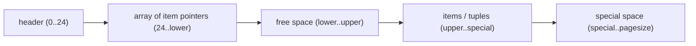
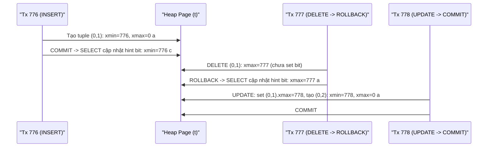

# CHƯƠNG 3: Trang và Tuple (Chapter 3: Pages and Tuples)

## 3.1 Cấu trúc trang (3.1 Page Structure)

Mỗi trang (page) có một bố cục bên trong nhất định, thường bao gồm các phần sau[^1]:

* Phần đầu trang (page header)
* Một mảng các con trỏ mục (an array of item pointers)
* Vùng trống (free space)
* Các mục / phiên bản dòng (items / row versions)
* Vùng đặc biệt (special space)

### Phần đầu trang (Page Header)

Phần đầu trang nằm ở các địa chỉ thấp nhất và có kích thước cố định. Nó lưu trữ nhiều thông tin khác nhau về trang (xem phần trình bày về checksum và trang dữ liệu), chẳng hạn như mã kiểm tra (checksum) và kích thước của tất cả các phần khác trong trang.

Các kích thước này có thể dễ dàng hiển thị bằng extension `pageinspect`[^2]. Hãy cùng xem trang đầu tiên của bảng `accounts` (việc đánh số trang bắt đầu từ 0):

```sql
=> CREATE EXTENSION pageinspect;
=> SELECT lower, upper, special, pagesize
   FROM page_header(get_raw_page('accounts',0));
 lower | upper | special | pagesize
-------+-------+---------+----------
   152 |  6904 |    8192 |     8192
(1 row)
```

Sơ đồ bố cục của một trang dữ liệu (8192 byte):

```
+--------+-------------------------+------------+-------+---------------+
| header | array of item pointers  | free space | items | special space |
+--------+-------------------------+------------+-------+---------------+
0       24                       lower        upper  special         pagesize
```



[^1]: `postgresql.org/docs/14/storage-page-layout.html`, `include/storage/bufpage.h`
[^2]: `postgresql.org/docs/14/pageinspect.html`

### Vùng đặc biệt (Special Space)

Vùng đặc biệt nằm ở phần đối diện của trang, chiếm các địa chỉ cao nhất. Nó được một số loại index sử dụng để lưu trữ thông tin phụ trợ; ở các index khác và trong các trang của bảng (table pages), vùng này có kích thước bằng 0.

Nhìn chung, bố cục của các trang index khá đa dạng; nội dung của chúng phụ thuộc rất nhiều vào từng loại index cụ thể. Ngay cả cùng một index cũng có thể có nhiều loại trang khác nhau: ví dụ, cây B-tree có một trang siêu dữ liệu (metadata page) với cấu trúc đặc biệt (trang số 0) và các trang thông thường rất giống với trang của bảng.

### Tuple (Tuples)

Các dòng (rows) chứa dữ liệu thực tế được lưu trữ trong cơ sở dữ liệu, cùng với một số thông tin bổ sung. Chúng nằm ngay trước vùng đặc biệt (special space).

Trong trường hợp của bảng, chúng ta phải làm việc với các *phiên bản dòng* (row versions) chứ không phải các dòng đơn thuần, bởi vì cơ chế kiểm soát đồng thời đa phiên bản (MVCC — multiversion concurrency control) đòi hỏi phải có nhiều phiên bản của cùng một dòng. Các index không sử dụng cơ chế MVCC này; thay vào đó, chúng phải tham chiếu đến tất cả các phiên bản dòng hiện có, dựa vào các quy tắc hiển thị (visibility rules) để chọn ra phiên bản phù hợp.

Cả phiên bản dòng trong bảng lẫn các mục trong index (index entries) thường được gọi chung là *tuple*. Thuật ngữ này được mượn từ lý thuyết quan hệ (relational theory) — đó là một di sản khác từ quá khứ học thuật của PostgreSQL.

### Con trỏ mục (Item Pointers)

Mảng các con trỏ trỏ tới các tuple đóng vai trò như bảng mục lục (table of contents) của trang. Nó nằm ngay sau phần đầu trang (page header).

Các mục index (index entries) phải bằng cách nào đó tham chiếu đến các heap tuple cụ thể. PostgreSQL sử dụng các định danh tuple 6-byte (TIDs — tuple identifiers) cho mục đích này. Mỗi TID bao gồm số hiệu trang của nhánh chính (main fork) và một tham chiếu đến một phiên bản dòng cụ thể nằm trong trang đó.

Về mặt lý thuyết, các tuple có thể được tham chiếu trực tiếp bằng độ lệch (offset) tính từ đầu trang. Nhưng khi đó, sẽ không thể di chuyển các tuple bên trong trang mà không làm hỏng các tham chiếu này, điều này sẽ dẫn đến phân mảnh trang (page fragmentation) và các hệ quả khó chịu khác.

Vì lý do này, PostgreSQL sử dụng cách đánh địa chỉ gián tiếp (indirect addressing): một định danh tuple (TID) tham chiếu đến số thứ tự con trỏ tương ứng, và con trỏ này chỉ định độ lệch hiện tại của tuple. Nếu tuple được di chuyển bên trong trang, TID của nó vẫn giữ nguyên; chỉ cần sửa đổi con trỏ (vốn cũng nằm ngay trong trang này) là đủ.

Mỗi con trỏ chiếm chính xác 4 byte và chứa các dữ liệu sau:

* Độ lệch (offset) của tuple tính từ đầu trang
* Độ dài của tuple
* Một số bit xác định trạng thái của tuple

### Vùng trống (Free Space)

Các trang có thể còn lại một lượng vùng trống giữa các con trỏ và các tuple (được phản ánh trong bản đồ vùng trống — free space map). Không có hiện tượng phân mảnh bên trong trang: toàn bộ vùng trống khả dụng luôn được gom lại thành một khối liên tục duy nhất[^3].

> 📝 **Giải thích thêm (không có trong sách):**
> Cơ chế gián tiếp qua `Item Pointer` (còn gọi là `Line Pointer` hay `lp`) giúp PostgreSQL thực hiện dọn dẹp/nén trang nội bộ (`PageRepairFragmentation`) rất hiệu quả: các tuple được dồn sát về phía cuối trang để gom toàn bộ vùng trống vào giữa (`lower..upper`), trong khi các `lp` ở đầu trang chỉ cần cập nhật lại `lp_off` mà không làm thay đổi `(page_no, lp)` — tức `ctid` / `TID` mà các index đang trỏ tới.

[^3]: `backend/storage/page/bufpage.c`, hàm `PageRepairFragmentation`

---

## 3.2 Bố cục phiên bản dòng (3.2 Row Version Layout)

Mỗi phiên bản dòng chứa một phần đầu (header) theo sau bởi dữ liệu thực tế. Phần đầu bao gồm nhiều trường, trong đó có các trường sau:

* `xmin`, `xmax`: đại diện cho các ID giao dịch (transaction IDs); chúng được dùng để phân biệt giữa phiên bản này với các phiên bản khác của cùng một dòng.
* `infomask`: cung cấp một tập hợp các bit thông tin xác định các thuộc tính của phiên bản.
* `ctid`: là một con trỏ trỏ tới phiên bản cập nhật tiếp theo của cùng một dòng.
* `null bitmap`: là một mảng bit đánh dấu các cột có thể chứa giá trị `NULL`.

Kết quả là phần đầu (header) trở nên khá lớn: nó đòi hỏi ít nhất 23 byte cho mỗi tuple, và giá trị này thường bị vượt quá do có thêm `null bitmap` và phần đệm bắt buộc (mandatory padding) dùng để căn chỉnh dữ liệu (data alignment). Trong một bảng "hẹp" (ít cột hoặc cột nhỏ), kích thước của các siêu dữ liệu (metadata) khác nhau có thể dễ dàng vượt qua kích thước của dữ liệu thực tế được lưu trữ.

Bố cục dữ liệu trên đĩa hoàn toàn trùng khớp với biểu diễn dữ liệu trong RAM. Trang cùng với các tuple của nó được đọc vào bộ nhớ đệm (buffer cache) nguyên trạng, không qua bất kỳ phép biến đổi nào. Đó là lý do tại sao các tệp dữ liệu không tương thích giữa các nền tảng khác nhau[^4].

Một trong những nguyên nhân gây không tương thích là thứ tự byte (byte order / endianness). Ví dụ, kiến trúc x86 là little-endian, z/Architecture là big-endian, còn ARM có thứ tự byte có thể cấu hình được.

Một lý do khác là việc căn chỉnh dữ liệu theo ranh giới từ máy (machine word boundaries), điều mà nhiều kiến trúc yêu cầu. Ví dụ, trên hệ thống x86 32-bit, các số nguyên (kiểu `integer`, chiếm 4 byte) được căn chỉnh theo ranh giới từ 4-byte, giống như các số thực dấu phẩy động độ chính xác kép (kiểu `double precision`, 8 byte). Nhưng trên hệ thống 64-bit, các giá trị `double` được căn chỉnh theo ranh giới từ 8-byte.

Việc căn chỉnh dữ liệu làm cho kích thước của một tuple phụ thuộc vào thứ tự các trường trong bảng. Ảnh hưởng này thường không đáng kể, nhưng trong một số trường hợp nó có thể dẫn đến sự gia tăng kích thước đáng kể.

Dưới đây là một ví dụ:

```sql
=> CREATE TABLE padding(
     b1 boolean,
     i1 integer,
     b2 boolean,
     i2 integer
   );
=> INSERT INTO padding VALUES (true,1,false,2);
=> SELECT lp_len FROM heap_page_items(get_raw_page('padding', 0));
 lp_len
--------
     40
(1 row)
```

Tôi đã sử dụng hàm `heap_page_items` của extension `pageinspect` để hiển thị một số chi tiết về các con trỏ và tuple.

> **Thuật ngữ `heap`:** Trong PostgreSQL, các bảng thường được gọi là *heap*. Đây lại là một thuật ngữ hơi khó hiểu nữa, gợi ý sự tương đồng giữa việc cấp phát không gian cho các tuple và việc cấp phát bộ nhớ động. Chắc chắn có thể thấy một số nét tương đồng, nhưng các bảng được quản lý bằng những thuật toán hoàn toàn khác. Chúng ta có thể hiểu thuật ngữ này theo nghĩa "mọi thứ được chất đống lộn xộn vào một đống (heap)", trái ngược với các index có thứ tự.

Kích thước của dòng là 40 byte. Phần header của nó chiếm 24 byte, một cột kiểu `integer` chiếm 4 byte, và các cột `boolean` chiếm 1 byte mỗi cột. Tổng dữ liệu thực là 34 byte, và 6 byte đã bị lãng phí cho việc căn chỉnh 4-byte của các cột `integer`.

Nếu chúng ta xây dựng lại bảng, không gian sẽ được sử dụng hiệu quả hơn:

```sql
=> DROP TABLE padding;
=> CREATE TABLE padding(
     i1 integer,
     i2 integer,
     b1 boolean,
     b2 boolean
   );
=> INSERT INTO padding VALUES (1,2,true,false);
=> SELECT lp_len FROM heap_page_items(get_raw_page('padding', 0));
 lp_len
--------
     34
(1 row)
```

Một vi tối ưu hóa (micro-optimization) khác có thể áp dụng là đặt các cột có độ dài cố định và không thể chứa giá trị `NULL` lên đầu bảng. Việc truy cập vào các cột như vậy sẽ hiệu quả hơn vì có thể lưu đệm (cache) độ lệch (offset) của chúng bên trong tuple[^5].

> 💡 **Ví dụ bổ sung (không có trong sách):**
> Trong bảng `padding` đầu tiên (`b1 boolean, i1 integer, b2 boolean, i2 integer`), tại sao lại mất đúng 40 byte?
> - Tuple header: 24 byte (từ byte 0 đến 23, đã căn chỉnh 8-byte).
> - `b1` (1 byte): nằm ở byte 24.
> - Để căn chỉnh `i1` (4 byte, yêu cầu địa chỉ chia hết cho 4), PostgreSQL chèn **3 byte đệm** (byte 25, 26, 27).
> - `i1` (4 byte): nằm ở byte 28..31.
> - `b2` (1 byte): nằm ở byte 32.
> - Để căn chỉnh `i2` (4 byte, yêu cầu chia hết cho 4), PostgreSQL lại chèn **3 byte đệm** (byte 33, 34, 35).
> - `i2` (4 byte): nằm ở byte 36..39.
> Tổng cộng: 40 byte (lãng phí 6 byte padding). Khi xếp `i1, i2, b1, b2`, `i1` ở 24..27, `i2` ở 28..31, `b1` ở 32, `b2` ở 33 — tổng 34 byte, không mất byte đệm nào!

[^4]: `include/access/htup_details.h`
[^5]: `backend/access/common/heaptuple.c`, hàm `heap_deform_tuple`

---

## 3.3 Các thao tác trên Tuple (3.3 Operations on Tuples)

Để nhận diện các phiên bản khác nhau của cùng một dòng, PostgreSQL đánh dấu mỗi phiên bản bằng hai giá trị: `xmin` và `xmax`. Các giá trị này xác định "thời gian hiệu lực" của mỗi phiên bản dòng, nhưng thay vì dùng thời gian thực tế, chúng dựa vào các ID giao dịch (transaction IDs) luôn tăng dần.

* Khi một dòng được tạo mới, giá trị `xmin` của nó được gán bằng ID giao dịch của câu lệnh `INSERT`.
* Khi một dòng bị xóa, giá trị `xmax` của phiên bản hiện tại của nó được gán bằng ID giao dịch của câu lệnh `DELETE`.
* Với một mức độ trừu tượng nhất định, câu lệnh `UPDATE` có thể được xem như hai thao tác tách biệt: `DELETE` và `INSERT`. Đầu tiên, giá trị `xmax` của phiên bản dòng hiện tại được gán bằng ID giao dịch của câu lệnh `UPDATE`. Sau đó, một phiên bản mới của dòng này được tạo ra; giá trị `xmin` của nó sẽ giống với giá trị `xmax` của phiên bản trước đó.

Bây giờ hãy đi sâu vào một số chi tiết ở mức thấp của các thao tác khác nhau trên tuple[^6].

Cho các thử nghiệm này, chúng ta sẽ cần một bảng hai cột có tạo một index trên một trong hai cột đó:

```sql
=> CREATE TABLE t(
     id integer GENERATED ALWAYS AS IDENTITY,
     s  text
   );
=> CREATE INDEX ON t(s);
```

[^6]: `backend/access/transam/README`

### Chèn dữ liệu (Insert)

Bắt đầu một giao dịch và chèn một dòng:

```sql
=> BEGIN;
=> INSERT INTO t(s) VALUES ('FOO');
```

Đây là ID giao dịch hiện tại:

```sql
=> SELECT pg_current_xact_id(); -- txid_current() trước v.13
 pg_current_xact_id
--------------------
                776
(1 row)
```

> **Ghi chú về thuật ngữ:** Để biểu thị khái niệm giao dịch (transaction), PostgreSQL sử dụng từ `xact`, có thể bắt gặp cả trong tên các hàm SQL lẫn trong mã nguồn. Do đó, một transaction ID có thể được gọi là `xact ID`, `TXID`, hoặc đơn giản là `XID`. Chúng ta sẽ liên tục bắt gặp những từ viết tắt này.

Hãy xem nội dung của trang. Hàm `heap_page_items` có thể cung cấp cho chúng ta toàn bộ thông tin cần thiết, nhưng nó hiển thị dữ liệu "nguyên trạng", nên định dạng đầu ra hơi khó đọc:

```sql
=> SELECT * FROM heap_page_items(get_raw_page('t',0)) \gx
-[ RECORD 1 ]---------------
lp          | 1
lp_off      | 8160
lp_flags    | 1
lp_len      | 32
t_xmin      | 776
t_xmax      | 0
t_field3    | 0
t_ctid      | (0,1)
t_infomask2 | 2
t_infomask  | 2050
t_hoff      | 24
t_bits      |
t_oid       |
t_data      | \x0100000009464f4f
```

Để dễ đọc hơn, chúng ta có thể lược bỏ bớt một số thông tin và diễn giải một vài cột:

```sql
=> SELECT '(0,'||lp||')' AS ctid,
     CASE lp_flags
       WHEN 0 THEN 'unused'
       WHEN 1 THEN 'normal'
       WHEN 2 THEN 'redirect to '||lp_off
       WHEN 3 THEN 'dead'
     END AS state,
     t_xmin as xmin,
     t_xmax as xmax,
     (t_infomask & 256) > 0  AS xmin_committed,
     (t_infomask & 512) > 0  AS xmin_aborted,
     (t_infomask & 1024) > 0 AS xmax_committed,
     (t_infomask & 2048) > 0 AS xmax_aborted
   FROM heap_page_items(get_raw_page('t',0)) \gx
-[ RECORD 1 ]--+-------
ctid           | (0,1)
state          | normal
xmin           | 776
xmax           | 0
xmin_committed | f
xmin_aborted   | f
xmax_committed | f
xmax_aborted   | t
```

Những gì vừa được thực hiện ở trên là:

* Con trỏ `lp` được chuyển đổi sang định dạng chuẩn của một tuple ID: `(số trang, số con trỏ)`.
* Trạng thái `lp_flags` được diễn giải thành chữ. Ở đây nó có giá trị `normal`, nghĩa là nó thực sự trỏ tới một tuple.
* Trong số tất cả các bit thông tin, trước mắt chúng ta chỉ tách ra hai cặp. Các bit `xmin_committed` và `xmin_aborted` cho biết giao dịch `xmin` đã được commit hay bị abort. Các bit `xmax_committed` và `xmax_aborted` cung cấp thông tin tương tự về giao dịch `xmax`.

Extension `pageinspect` (từ phiên bản 13) cung cấp hàm `heap_tuple_infomask_flags` để giải thích tất cả các bit thông tin, nhưng ở đây tôi chỉ lấy ra những bit cần thiết tại thời điểm này để hiển thị ở dạng cô đọng hơn.

Hãy quay lại thí nghiệm của chúng ta. Câu lệnh `INSERT` đã thêm con trỏ số `1` vào trang heap; nó tham chiếu tới tuple đầu tiên, hiện cũng là tuple duy nhất.

Trường `xmin` của tuple được gán bằng ID giao dịch hiện tại (`776`). Giao dịch này vẫn đang hoạt động, vì vậy các bit `xmin_committed` và `xmin_aborted` chưa được bật.

Trường `xmax` chứa giá trị `0`, đây là một con số giả (dummy number) cho biết tuple này chưa bị xóa và đang đại diện cho phiên bản hiện tại của dòng. Các giao dịch khác sẽ bỏ qua con số này vì bit `xmax_aborted` đã được bật.

Có thể thấy hơi lạ khi bit tương ứng với một giao dịch bị hủy (aborted) lại được bật cho một giao dịch chưa từng xảy ra. Nhưng xét từ góc độ cô lập (isolation), không có sự khác biệt nào giữa hai trường hợp này: một giao dịch bị hủy không để lại dấu vết gì, do đó coi như nó chưa từng tồn tại.

Chúng ta sẽ sử dụng câu truy vấn này nhiều lần, vì vậy tôi sẽ gói nó vào một hàm. Nhân tiện, tôi cũng sẽ làm cho kết quả đầu ra súc tích hơn bằng cách ẩn các cột bit thông tin và hiển thị trạng thái của các giao dịch ngay cùng với ID của chúng.

```sql
=> CREATE FUNCTION heap_page(relname text, pageno integer)
   RETURNS TABLE(ctid tid, state text, xmin text, xmax text)
   AS $$
     SELECT (pageno,lp)::text::tid AS ctid,
       CASE lp_flags
         WHEN 0 THEN 'unused'
         WHEN 1 THEN 'normal'
         WHEN 2 THEN 'redirect to '||lp_off
         WHEN 3 THEN 'dead'
       END AS state,
       t_xmin || CASE
         WHEN (t_infomask & 256) > 0 THEN ' c'
         WHEN (t_infomask & 512) > 0 THEN ' a'
         ELSE ''
       END AS xmin,
       t_xmax || CASE
         WHEN (t_infomask & 1024) > 0 THEN ' c'
         WHEN (t_infomask & 2048) > 0 THEN ' a'
         ELSE ''
       END AS xmax
     FROM heap_page_items(get_raw_page(relname,pageno))
     ORDER BY lp;
   $$ LANGUAGE sql;
```

Bây giờ những gì đang diễn ra trong phần đầu tuple đã trở nên rõ ràng hơn nhiều:

```sql
=> SELECT * FROM heap_page('t',0);
 ctid  | state  | xmin | xmax
-------+--------+------+------
 (0,1) | normal | 776  | 0 a
(1 row)
```

Bạn cũng có thể lấy thông tin tương tự nhưng ít chi tiết hơn từ chính bảng đó bằng cách truy vấn các cột giả (pseudocolumns) `xmin` và `xmax`:

```sql
=> SELECT xmin, xmax, * FROM t;
 xmin | xmax | id |  s
------+------+----+-----
  776 |    0 |  1 | FOO
(1 row)
```

### Xác nhận giao dịch (Commit)

Một khi giao dịch đã hoàn tất thành công, trạng thái của nó phải được lưu trữ bằng cách nào đó — phải ghi nhận lại rằng giao dịch đó đã được commit. Cho mục đích này, PostgreSQL sử dụng một cấu trúc đặc biệt gọi là `CLOG` (commit log)[^7]. Nó được lưu trữ dưới dạng các tệp trong thư mục `PGDATA/pg_xact` chứ không phải dưới dạng một bảng trong system catalog.

Trước đây, các tệp này nằm trong `PGDATA/pg_clog`, nhưng từ phiên bản 10 thư mục này đã được đổi tên[^8]: không ít quản trị viên cơ sở dữ liệu chưa quen với PostgreSQL đã xóa nhầm nó khi đi tìm chỗ trống trên đĩa, vì nghĩ rằng "log" là thứ gì đó không cần thiết.

`CLOG` được chia thành nhiều tệp chỉ nhằm mục đích thuận tiện. Các tệp này được truy cập theo từng trang thông qua các buffer trong bộ nhớ dùng chung (shared memory) của máy chủ[^9].

Giống như phần đầu của một tuple, `CLOG` chứa hai bit cho mỗi giao dịch: `committed` và `aborted`.

Khi được commit, một giao dịch được đánh dấu trong `CLOG` bằng bit `committed`. Khi bất kỳ giao dịch nào khác truy cập vào một trang heap, nó phải trả lời câu hỏi: giao dịch `xmin` đã kết thúc hay chưa?

* **Nếu chưa**, thì tuple được tạo ra không được phép hiển thị.
  Để kiểm tra xem giao dịch có còn đang hoạt động hay không, PostgreSQL sử dụng một cấu trúc khác nằm trong bộ nhớ dùng chung của instance; nó được gọi là `ProcArray`. Cấu trúc này chứa danh sách tất cả các tiến trình đang hoạt động, kèm theo giao dịch hiện tại (đang chạy) tương ứng được chỉ định cho mỗi tiến trình.
* **Nếu rồi**, thì nó đã được commit hay bị abort? Trong trường hợp bị abort, tuple tương ứng cũng không thể hiển thị.

Chính bước kiểm tra này là lúc cần đến `CLOG`. Nhưng ngay cả khi các trang `CLOG` gần nhất được lưu trong bộ đệm bộ nhớ, việc thực hiện kiểm tra này mỗi lần truy cập vẫn rất tốn kém. Một khi đã xác định được, trạng thái giao dịch sẽ được ghi thẳng vào phần đầu của tuple — cụ thể hơn là vào các bit thông tin `xmin_committed` và `xmin_aborted`, vốn còn được gọi là *các bit gợi ý* (hint bits). Nếu một trong các bit này đã được bật, thì trạng thái của giao dịch `xmin` được coi là đã biết, và giao dịch tiếp theo sẽ không cần phải truy cập vào `CLOG` hay `ProcArray` nữa.

Tại sao các bit này không được thiết lập bởi chính giao dịch thực hiện việc chèn dòng? Vấn đề là tại thời điểm chèn, vẫn chưa thể biết giao dịch này có hoàn tất thành công hay không. Và đến khi nó được commit, thì lúc đó không còn biết rõ những tuple và trang nào đã bị thay đổi. Nếu một giao dịch tác động đến nhiều trang, việc theo dõi chúng có thể quá tốn kém. Bên cạnh đó, một số trang trong số này có thể không còn nằm trong cache nữa; việc đọc lại chúng từ đĩa chỉ để cập nhật các hint bit sẽ làm chậm quá trình commit một cách nghiêm trọng.

Mặt trái của việc giảm chi phí này là bất kỳ giao dịch nào (thậm chí cả một câu lệnh `SELECT` chỉ đọc) đều có thể bắt đầu thiết lập các hint bit, từ đó để lại một loạt các trang bị "bẩn" (dirtied pages) trong bộ nhớ đệm (buffer cache).

Cuối cùng, hãy commit giao dịch đã bắt đầu với câu lệnh `INSERT`:

```sql
=> COMMIT;
```

Chưa có gì thay đổi trong trang dữ liệu (nhưng chúng ta biết rằng trạng thái giao dịch đã được ghi vào `CLOG`):

```sql
=> SELECT * FROM heap_page('t',0);
 ctid  | state  | xmin | xmax
-------+--------+------+------
 (0,1) | normal | 776  | 0 a
(1 row)
```

Bây giờ, giao dịch đầu tiên truy cập vào trang (theo cách "tiêu chuẩn", không dùng `pageinspect`) phải xác định trạng thái của giao dịch `xmin` và cập nhật các hint bit:

```sql
=> SELECT * FROM t;
 id |  s
----+-----
  1 | FOO
(1 row)

=> SELECT * FROM heap_page('t',0);
 ctid  | state  | xmin  | xmax
-------+--------+-------+------
 (0,1) | normal | 776 c | 0 a
(1 row)
```

[^7]: `include/access/clog.h`, `backend/access/transam/clog.c`
[^8]: `commitfest.postgresql.org/13/750`
[^9]: `backend/access/transam/clog.c`

### Xóa dữ liệu (Delete)

Khi một dòng bị xóa, trường `xmax` của phiên bản hiện tại của nó được gán bằng ID giao dịch thực hiện việc xóa, và bit `xmax_aborted` bị tắt (unset).

Trong khi giao dịch này đang hoạt động, giá trị `xmax` đóng vai trò như một khóa dòng (row lock). Nếu một giao dịch khác định cập nhật hoặc xóa dòng này, nó sẽ phải chờ cho đến khi giao dịch `xmax` hoàn tất.

Hãy thử xóa một dòng:

```sql
=> BEGIN;
=> DELETE FROM t;
=> SELECT pg_current_xact_id();
 pg_current_xact_id
--------------------
                777
(1 row)
```

ID giao dịch đã được ghi vào trường `xmax`, nhưng các bit thông tin thì chưa được thiết lập:

```sql
=> SELECT * FROM heap_page('t',0);
 ctid  | state  | xmin  | xmax
-------+--------+-------+------
 (0,1) | normal | 776 c | 777
(1 row)
```

### Hủy giao dịch (Abort)

Cơ chế hủy bỏ một giao dịch tương tự như cơ chế commit và diễn ra nhanh không kém, nhưng thay vì bật bit `committed`, nó bật bit `aborted` trong `CLOG`. Mặc dù câu lệnh tương ứng được gọi là `ROLLBACK`, không có việc hoàn tác dữ liệu thực tế nào xảy ra: tất cả các thay đổi do giao dịch bị hủy tạo ra trong các trang dữ liệu vẫn nằm nguyên tại chỗ.

```sql
=> ROLLBACK;
=> SELECT * FROM heap_page('t',0);
 ctid  | state  | xmin  | xmax
-------+--------+-------+------
 (0,1) | normal | 776 c | 777
(1 row)
```

Khi trang được truy cập, trạng thái giao dịch được kiểm tra, và tuple nhận được hint bit `xmax_aborted`. Bản thân con số `xmax` vẫn nằm lại trong trang, nhưng sẽ không còn ai bận tâm đến nó nữa:

```sql
=> SELECT * FROM t;
 id |  s
----+-----
  1 | FOO
(1 row)

=> SELECT * FROM heap_page('t',0);
 ctid  | state  | xmin  | xmax
-------+--------+-------+-------
 (0,1) | normal | 776 c | 777 a
(1 row)
```

### Cập nhật dữ liệu (Update)

Một thao tác cập nhật được thực hiện giống như thể tuple hiện tại bị xóa đi, và sau đó một tuple mới được chèn vào:

```sql
=> BEGIN;
=> UPDATE t SET s = 'BAR';
=> SELECT pg_current_xact_id();
 pg_current_xact_id
--------------------
                778
(1 row)
```

Câu truy vấn trả về một dòng duy nhất (phiên bản mới của nó):

```sql
=> SELECT * FROM t;
 id |  s
----+-----
  1 | BAR
(1 row)
```

Nhưng trang dữ liệu vẫn giữ cả hai phiên bản:

```sql
=> SELECT * FROM heap_page('t',0);
 ctid  | state  | xmin  | xmax
-------+--------+-------+------
 (0,1) | normal | 776 c | 778
 (0,2) | normal | 778   | 0 a
(2 rows)
```

Trường `xmax` của phiên bản đã bị xóa trước đó chứa ID giao dịch hiện tại (`778`). Giá trị này được ghi đè lên giá trị cũ (`777`) vì giao dịch trước đó đã bị hủy. Bit `xmax_aborted` bị tắt vì trạng thái của giao dịch hiện tại vẫn chưa được biết.

Để hoàn tất thí nghiệm này, hãy commit giao dịch:

```sql
=> COMMIT;
```



---

## 3.4 Chỉ mục (3.4 Indexes)

Bất kể thuộc loại nào, các chỉ mục (indexes) không sử dụng cơ chế phân phiên bản dòng (row versioning); mỗi dòng chỉ được biểu diễn bởi đúng một tuple (ở đây tác giả muốn nói đến việc bản thân index không tự quản lý nhiều phiên bản bằng `xmin`/`xmax` trên mỗi index entry, mà mỗi phiên bản dòng trong heap có một index entry tương ứng trỏ tới nó). Nói cách khác, phần đầu của dòng trong index (index row headers) không chứa các trường `xmin` và `xmax`.

Các mục index trỏ tới tất cả các phiên bản của dòng tương ứng trong bảng. Để xác định xem phiên bản dòng nào là hiển thị (visible), các giao dịch phải truy cập vào bảng (trừ khi trang cần tìm có mặt trong bản đồ hiển thị — visibility map).

Để thuận tiện, hãy tạo một hàm đơn giản sử dụng `pageinspect` để hiển thị tất cả các mục index trong trang (các trang index cây B-tree lưu trữ chúng dưới dạng một danh sách phẳng):

```sql
=> CREATE FUNCTION index_page(relname text, pageno integer)
   RETURNS TABLE(itemoffset smallint, htid tid)
   AS $$
     SELECT itemoffset,
            htid -- ctid trước v.13
     FROM bt_page_items(relname,pageno);
   $$ LANGUAGE sql;
```

Trang index tham chiếu đến cả hai heap tuple, phiên bản hiện tại và phiên bản trước đó:

```sql
=> SELECT * FROM index_page('t_s_idx',1);
 itemoffset | htid
------------+-------
          1 | (0,2)
          2 | (0,1)
(2 rows)
```

Vì `'BAR' < 'FOO'`, con trỏ trỏ tới tuple thứ hai (`(0,2)`) đứng trước trong index.

---

## 3.5 TOAST (3.5 TOAST)

Một bảng `TOAST` về thực chất là một bảng thông thường, và nó có cơ chế phân phiên bản riêng không phụ thuộc vào các phiên bản dòng của bảng chính. Tuy nhiên, các dòng của bảng `TOAST` được xử lý theo cách mà chúng không bao giờ bị cập nhật (updated); chúng chỉ có thể được thêm vào hoặc xóa đi, nên cơ chế phân phiên bản của chúng có phần mang tính nhân tạo.

Mỗi lần sửa đổi dữ liệu đều dẫn đến việc tạo ra một tuple mới trong bảng chính. Nhưng nếu một thao tác cập nhật (update) không ảnh hưởng đến bất kỳ giá trị dài nào được lưu trong `TOAST`, tuple mới sẽ tham chiếu đến giá trị đã được "toast" sẵn có. Chỉ khi một giá trị dài bị cập nhật, PostgreSQL mới tạo ra cả tuple mới trong bảng chính lẫn các "toast" mới.

> 📝 **Giải thích thêm (không có trong sách):**
> Nhờ cơ chế này, nếu bạn có một bảng chứa cột `text` hoặc `jsonb` rất lớn (đã được đưa ra bảng TOAST) và bạn chỉ `UPDATE` một cột nhỏ khác (như `updated_at` hay `status`), PostgreSQL không cần sao chép lại dữ liệu lớn trong bảng TOAST mà chỉ trỏ lại con trỏ TOAST cũ ở tuple mới trong bảng chính.

---

## 3.6 Giao dịch ảo (3.6 Virtual Transactions)

Để sử dụng tiết kiệm các ID giao dịch (transaction IDs), PostgreSQL cung cấp một cơ chế tối ưu đặc biệt.

Nếu một giao dịch là chỉ đọc (read-only), nó không ảnh hưởng đến khả năng hiển thị của dòng theo bất kỳ cách nào. Đó là lý do tại sao một giao dịch như vậy ban đầu được cấp một *ID ảo* (`VXID` — virtual XID)[^10], bao gồm ID của tiến trình backend và một số tuần tự. Việc cấp phát một `VXID` ảo không đòi hỏi bất kỳ sự đồng bộ hóa nào giữa các tiến trình khác nhau, nên nó diễn ra rất nhanh. Tại thời điểm này, giao dịch vẫn chưa có một ID thực sự nào:

```sql
=> BEGIN;
=> -- txid_current_if_assigned() trước v.13
=> SELECT pg_current_xact_id_if_assigned();
 pg_current_xact_id_if_assigned
--------------------------------
(1 row)
```

Tại các thời điểm khác nhau, hệ thống có thể chứa một số `VXID` ảo đã từng được sử dụng. Và điều đó hoàn toàn bình thường: các `VXID` ảo chỉ tồn tại trong RAM, và chỉ tồn tại trong khi các giao dịch tương ứng còn đang hoạt động; chúng không bao giờ được ghi vào các trang dữ liệu và không bao giờ xuống tới đĩa.

Một khi giao dịch bắt đầu sửa đổi dữ liệu, nó sẽ nhận được một ID duy nhất thực sự (actual unique ID):

```sql
=> UPDATE accounts
   SET amount = amount - 1.00;
=> SELECT pg_current_xact_id_if_assigned();
 pg_current_xact_id_if_assigned
--------------------------------
                            780
(1 row)
=> COMMIT;
```

[^10]: `backend/access/transam/xact.c`

---

## 3.7 Giao dịch con (3.7 Subtransactions)

### Điểm lưu (Savepoints)

SQL hỗ trợ các điểm lưu (savepoints), cho phép hủy bỏ một số thao tác bên trong một giao dịch mà không cần hủy bỏ toàn bộ giao dịch đó. Nhưng kịch bản như vậy không phù hợp với quy trình xử lý đã mô tả ở trên: trạng thái của một giao dịch áp dụng cho tất cả các thao tác của nó, và không có việc hoàn tác dữ liệu vật lý nào được thực hiện.

Để triển khai tính năng này, một giao dịch chứa savepoint được tách thành nhiều *giao dịch con* (subtransactions)[^11], nhờ vậy trạng thái của chúng có thể được quản lý riêng biệt.

Các giao dịch con có ID riêng (lớn hơn ID của giao dịch chính). Trạng thái của một giao dịch con được ghi vào `CLOG` theo cách thông thường; tuy nhiên, các giao dịch con đã commit sẽ nhận cả hai bit `committed` và `aborted` cùng lúc. Quyết định cuối cùng phụ thuộc vào trạng thái của giao dịch chính: nếu giao dịch chính bị hủy (aborted), tất cả các giao dịch con của nó cũng sẽ bị coi là đã hủy.

Thông tin về các giao dịch con được lưu trữ trong thư mục `PGDATA/pg_subtrans`. Việc truy cập tệp được sắp xếp thông qua các buffer nằm trong bộ nhớ dùng chung của instance và có cấu trúc giống như các buffer của `CLOG`[^12].

> **Lưu ý:** Đừng nhầm lẫn giao dịch con (subtransactions) với giao dịch độc lập (autonomous transactions). Khác với giao dịch con, giao dịch độc lập không phụ thuộc vào nhau theo bất kỳ cách nào. PostgreSQL nguyên bản (vanilla PostgreSQL) không hỗ trợ giao dịch độc lập, và có lẽ như vậy là tốt nhất: chúng chỉ cần thiết trong những trường hợp rất hiếm gặp, nhưng việc chúng có sẵn trong các hệ quản trị cơ sở dữ liệu khác thường kích thích sự lạm dụng, vốn có thể gây ra rất nhiều rắc rối.

Hãy làm rỗng bảng (`TRUNCATE`), bắt đầu một giao dịch mới và chèn một dòng:

```sql
=> TRUNCATE TABLE t;
=> BEGIN;
=> INSERT INTO t(s) VALUES ('FOO');
=> SELECT pg_current_xact_id();
 pg_current_xact_id
--------------------
                782
(1 row)
```

Bây giờ hãy tạo một savepoint và chèn một dòng khác:

```sql
=> SAVEPOINT sp;
=> INSERT INTO t(s) VALUES ('XYZ');
=> SELECT pg_current_xact_id();
 pg_current_xact_id
--------------------
                782
(1 row)
```

Lưu ý rằng hàm `pg_current_xact_id` trả về ID của giao dịch chính, chứ không phải ID của giao dịch con.

```sql
=> SELECT *
   FROM heap_page('t',0) p
   LEFT JOIN t ON p.ctid = t.ctid;
 ctid  | state  | xmin | xmax | id |  s
-------+--------+------+------+----+-----
 (0,1) | normal | 782  | 0 a  |  2 | FOO
 (0,2) | normal | 783  | 0 a  |  3 | XYZ
(2 rows)
```

Hãy hoàn tác về savepoint (`ROLLBACK TO sp`) và chèn dòng thứ ba:

```sql
=> ROLLBACK TO sp;
=> INSERT INTO t(s) VALUES ('BAR');
=> SELECT *
   FROM heap_page('t',0) p
   LEFT JOIN t ON p.ctid = t.ctid;
 ctid  | state  | xmin | xmax | id |  s
-------+--------+------+------+----+-----
 (0,1) | normal | 782  | 0 a  |  2 | FOO
 (0,2) | normal | 783  | 0 a  |    |
 (0,3) | normal | 784  | 0 a  |  4 | BAR
(3 rows)
```

Trang dữ liệu vẫn chứa dòng đã được thêm bởi giao dịch con bị hủy (`(0,2)` với `xmin = 783`).

Hãy commit các thay đổi:

```sql
=> COMMIT;
=> SELECT * FROM t;
 id |  s
----+-----
  2 | FOO
  4 | BAR
(2 rows)

=> SELECT * FROM heap_page('t',0);
 ctid  | state  | xmin  | xmax
-------+--------+-------+------
 (0,1) | normal | 782 c | 0 a
 (0,2) | normal | 783 a | 0 a
 (0,3) | normal | 784 c | 0 a
(3 rows)
```

Bây giờ chúng ta có thể thấy rõ rằng mỗi giao dịch con đều có trạng thái riêng của nó.

SQL không cho phép sử dụng giao dịch con một cách trực tiếp, tức là bạn không thể bắt đầu một giao dịch mới trước khi hoàn tất giao dịch hiện tại:

```sql
=> BEGIN;
BEGIN
=> BEGIN;
WARNING:  there is already a transaction in progress
BEGIN
=> COMMIT;
COMMIT
=> COMMIT;
WARNING:  there is no transaction in progress
COMMIT
```

Các giao dịch con được sử dụng một cách ngầm định: để triển khai savepoints, xử lý ngoại lệ (exceptions) trong `PL/pgSQL`, và trong một số trường hợp đặc biệt khác.

[^11]: `backend/access/transam/subtrans.c`
[^12]: `backend/access/transam/slru.c`

### Lỗi và tính nguyên tử (Errors and Atomicity)

Điều gì xảy ra nếu một lỗi phát sinh trong quá trình thực thi một câu lệnh?

```sql
=> BEGIN;
=> SELECT * FROM t;
 id |  s
----+-----
  2 | FOO
  4 | BAR
(2 rows)

=> UPDATE t SET s = repeat('X', 1/(id-4));
ERROR:  division by zero
```

Sau khi gặp lỗi, toàn bộ giao dịch bị coi là đã hủy (aborted) và không thể thực hiện thêm bất kỳ thao tác nào nữa:

```sql
=> SELECT * FROM t;
ERROR:  current transaction is aborted, commands ignored until end of transaction block
```

Và ngay cả khi bạn cố gắng commit các thay đổi, PostgreSQL sẽ báo rằng giao dịch đã bị rollback:

```sql
=> COMMIT;
ROLLBACK
```

Tại sao lại bị cấm tiếp tục thực thi giao dịch sau khi xảy ra lỗi? Vì các thao tác đã thực thi trước đó không bao giờ bị hoàn tác vật lý, nên nếu được phép tiếp tục, chúng ta sẽ có thể truy cập vào một phần các thay đổi được tạo ra trước khi lỗi xảy ra — điều đó sẽ phá vỡ tính nguyên tử (atomicity) của câu lệnh, và kéo theo là của chính giao dịch đó.

Ví dụ, trong thí nghiệm của chúng ta, toán tử đã kịp cập nhật một trong hai dòng trước khi xảy ra lỗi:

```sql
=> SELECT * FROM heap_page('t',0);
 ctid  | state  | xmin  | xmax
-------+--------+-------+------
 (0,1) | normal | 782 c | 785
 (0,2) | normal | 783 a | 0 a
 (0,3) | normal | 784 c | 0 a
 (0,4) | normal | 785   | 0 a
(4 rows)
```

Nói thêm bên lề, `psql` cung cấp một chế độ đặc biệt cho phép bạn tiếp tục một giao dịch sau khi gặp lỗi giống như thể câu lệnh bị lỗi đã được rollback:

```sql
=> \set ON_ERROR_ROLLBACK on
=> BEGIN;
=> UPDATE t SET s = repeat('X', 1/(id-4));
ERROR:  division by zero
=> SELECT * FROM t;
 id |  s
----+-----
  2 | FOO
  4 | BAR
(2 rows)

=> COMMIT;
COMMIT
```

Như bạn có thể đoán ra, `psql` đơn giản là đã thêm một savepoint ngầm định trước mỗi câu lệnh khi chạy ở chế độ này; trong trường hợp xảy ra lỗi, một lệnh rollback tới savepoint sẽ được kích hoạt. Chế độ này không được bật mặc định vì việc phát hành các savepoint (ngay cả khi không rollback về chúng) gây ra chi phí phụ trội (overhead) đáng kể.

---

## Bảng thuật ngữ chương (Chapter Glossary)

| Thuật ngữ (English) | Tiếng Việt | Giải thích ngắn gọn |
| :--- | :--- | :--- |
| Page Header | Phần đầu trang | Vùng kích thước cố định (24 byte) ở đầu trang, lưu checksum và các con trỏ vị trí (`lower`, `upper`, `special`). |
| Item Pointer (`lp`) | Con trỏ mục | Mảng 4-byte ngay sau page header, trỏ gián tiếp tới vị trí (offset) và độ dài của từng tuple trong trang. |
| Special Space | Vùng đặc biệt | Vùng ở cuối trang dùng để lưu thông tin phụ trợ cho một số loại index (bằng 0 đối với bảng). |
| Tuple | Tuple / Bản ghi vật lý | Cách gọi chung cho phiên bản dòng trong bảng (heap tuple) và mục trong index (index tuple). |
| TID (`ctid`) | Định danh tuple | Con trỏ vật lý 6-byte gồm `(số trang, số thứ tự con trỏ)`, dùng để xác định vị trí một phiên bản dòng. |
| Heap | Bảng dữ liệu (Heap) | Thuật ngữ trong PostgreSQL chỉ cấu trúc lưu trữ bảng, nơi các dòng không bắt buộc sắp xếp theo thứ tự. |
| Data Alignment & Padding | Căn chỉnh dữ liệu & Byte đệm | Việc căn chỉnh trường dữ liệu theo ranh giới từ máy (4 hoặc 8 byte), có thể tạo ra các byte đệm trống giữa các cột. |
| `xmin`, `xmax` | ID giao dịch tạo / xóa | Hai trường trong tuple header lưu XID của giao dịch đã tạo (`xmin`) và đã xóa/cập nhật (`xmax`) phiên bản dòng. |
| `CLOG` (`pg_xact`) | Nhật ký commit | Cấu trúc lưu trạng thái hoàn tất (`committed` / `aborted`) của các giao dịch trong thư mục `PGDATA/pg_xact`. |
| `ProcArray` | Mảng tiến trình | Cấu trúc trong shared memory chứa danh sách các tiến trình đang hoạt động và XID hiện tại của chúng. |
| Hint Bits | Bit gợi ý | Các bit trong `t_infomask` của tuple header (`xmin_committed`, `xmax_aborted`, v.v.) giúp tránh phải tra cứu lại `CLOG` và `ProcArray`. |
| Virtual XID (`VXID`) | ID giao dịch ảo | ID tạm thời trong RAM cấp cho giao dịch chưa ghi dữ liệu, giúp tiết kiệm XID thực sự. |
| Subtransaction | Giao dịch con | Giao dịch lồng bên trong giao dịch chính, dùng để hiện thực `SAVEPOINT` và khối xử lý ngoại lệ trong `PL/pgSQL`. |
| `ON_ERROR_ROLLBACK` | Tự động rollback khi lỗi | Chế độ trong `psql` tự chèn savepoint ngầm trước mỗi lệnh để có thể tiếp tục giao dịch sau khi một lệnh bị lỗi. |
