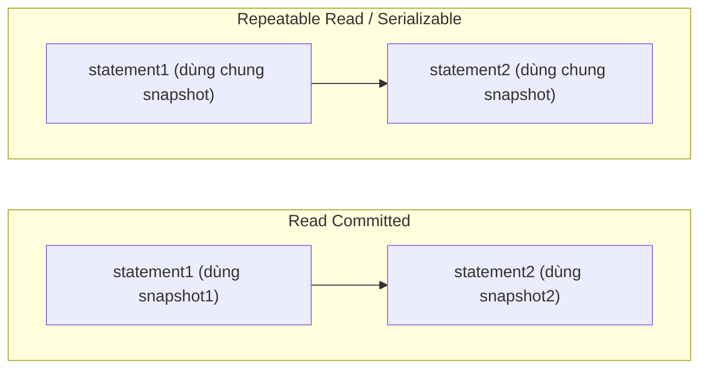
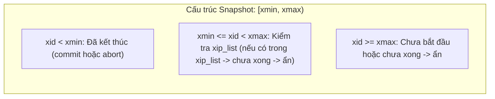

# CHƯƠNG 4: Snapshot (CHAPTER 4: SNAPSHOTS)

## 4.1 Snapshot là gì? (4.1 What is a Snapshot?)

Một trang dữ liệu (data page) có thể chứa nhiều phiên bản của cùng một dòng, mặc dù mỗi giao dịch (transaction) chỉ được phép nhìn thấy tối đa một phiên bản trong số đó. Tập hợp các phiên bản đang hiển thị (visible) của tất cả các dòng khác nhau tạo thành một **snapshot** (ảnh chụp nhanh dữ liệu). Một snapshot chỉ bao gồm dữ liệu hiện tại đã được commit tính đến thời điểm nó được tạo, do đó cung cấp một góc nhìn nhất quán (theo nghĩa ACID) về dữ liệu tại thời điểm cụ thể đó.

Để đảm bảo tính cô lập (isolation), mỗi giao dịch sử dụng snapshot của riêng mình. Điều này có nghĩa là các giao dịch khác nhau có thể nhìn thấy các snapshot khác nhau được chụp tại các thời điểm khác nhau, nhưng bản thân mỗi snapshot vẫn luôn nhất quán.

- Ở mức cô lập **Read Committed**, một snapshot được chụp vào đầu mỗi câu lệnh (statement), và nó chỉ có hiệu lực trong suốt thời gian thực thi câu lệnh đó.
- Ở các mức **Repeatable Read** và **Serializable**, một snapshot được chụp vào đầu câu lệnh đầu tiên của giao dịch, và nó giữ nguyên hiệu lực cho đến khi toàn bộ giao dịch kết thúc.



> 📝 **Giải thích thêm (không có trong sách):**
> Tại sao ở mức `Repeatable Read`, snapshot lại được chụp ở *câu lệnh đầu tiên* chứ không phải ngay khi gõ `BEGIN`?
> Vì câu lệnh `BEGIN` trong PostgreSQL chỉ khởi tạo trạng thái giao dịch ở mức tối thiểu (chưa cấp phát `xid` thực sự và chưa lấy snapshot). Nếu bạn mở một giao dịch `BEGIN ISOLATION LEVEL REPEATABLE READ;` rồi chờ 10 phút mới chạy `SELECT ...`, dữ liệu bạn thấy là dữ liệu tại thời điểm chạy `SELECT`, chứ không phải thời điểm gõ `BEGIN`.

---

## 4.2 Khả năng hiển thị của phiên bản dòng (4.2 Row Version Visibility)

Một snapshot không phải là bản sao vật lý của tất cả các tuple (bộ dữ liệu) cần thiết. Thay vào đó, nó được định nghĩa bởi một vài con số, còn khả năng hiển thị của tuple (tuple visibility) được xác định theo những quy tắc nhất định.

Khả năng hiển thị của tuple được xác định bởi các trường `xmin` và `xmax` trong phần header của tuple (tức là ID của các giao dịch thực hiện thao tác chèn và xóa) cùng với các bit gợi ý (hint bits) tương ứng. Vì các khoảng `xmin–xmax` không giao nhau, mỗi dòng chỉ được đại diện trong bất kỳ snapshot nào bởi tối đa một phiên bản của nó.

Các quy tắc hiển thị chính xác khá phức tạp[^1], vì chúng phải tính đến nhiều kịch bản khác nhau và các trường hợp biên (corner cases). Một cách rất đại khái, ta có thể mô tả chúng như sau: một tuple sẽ hiển thị trong một snapshot nếu snapshot đó bao gồm các thay đổi của giao dịch `xmin` nhưng loại trừ các thay đổi của giao dịch `xmax` (nói cách khác, tuple đó đã xuất hiện và chưa bị xóa tại thời điểm chụp snapshot).

Đến lượt mình, các thay đổi của một giao dịch sẽ hiển thị trong một snapshot nếu giao dịch này đã được commit trước khi snapshot được tạo. Như một ngoại lệ, các giao dịch luôn có thể nhìn thấy các thay đổi chưa commit của chính mình. Nếu một giao dịch bị hủy bỏ (aborted), các thay đổi của nó sẽ không hiển thị trong bất kỳ snapshot nào.

Hãy xem xét một ví dụ đơn giản. Trong minh họa dưới đây, các đoạn thẳng biểu diễn vòng đời của các giao dịch (từ thời điểm bắt đầu đến thời điểm commit):

```text
xid
  1  |-------| (commit trước snapshot)
  2  |-------------| (đang chạy khi chụp snapshot)
  3            |---------| (bắt đầu sau snapshot)
             ^
          snapshot
```

Ở đây, các quy tắc hiển thị được áp dụng cho các giao dịch như sau:
- **Giao dịch 1** đã được commit trước khi tạo snapshot, nên các thay đổi của nó **hiển thị**.
- **Giao dịch 2** đang hoạt động (active) tại thời điểm tạo snapshot, nên các thay đổi của nó **không hiển thị**.
- **Giao dịch 3** được bắt đầu sau khi tạo snapshot, nên các thay đổi của nó cũng **không hiển thị** (bất kể giao dịch này đã hoàn thành hay chưa).

[^1]: `backend/access/heap/heapam_visibility.c`

---

## 4.3 Cấu trúc của Snapshot (4.3 Snapshot Structure)

Đáng tiếc là minh họa ở trên không giống với cách PostgreSQL thực sự nhìn nhận bức tranh này.[^2] Vấn đề nằm ở chỗ hệ thống không biết các giao dịch được commit vào *thời điểm nào*. Hệ thống chỉ biết khi nào chúng được bắt đầu (thời điểm này được xác định bởi ID giao dịch), còn thời điểm hoàn thành của chúng không được ghi lại ở đâu để phục vụ việc kiểm tra hiển thị.

Thời điểm commit có thể được theo dõi[^3] nếu bạn bật tham số `track_commit_timestamp` (mặc định là `off`), nhưng chúng không tham gia vào quá trình kiểm tra hiển thị dưới bất kỳ hình thức nào (mặc dù việc theo dõi chúng vẫn hữu ích cho các mục đích khác, chẳng hạn như áp dụng trong các giải pháp sao chép dữ liệu bên ngoài).

Bên cạnh đó, PostgreSQL luôn ghi lại thời điểm commit và rollback trong các bản ghi WAL (Write-Ahead Log) tương ứng, nhưng thông tin này chỉ được dùng cho việc khôi phục tại một thời điểm (point-in-time recovery - PITR).

Thông tin duy nhất mà ta có thể biết là *trạng thái hiện tại* của một giao dịch. Thông tin này nằm trong bộ nhớ dùng chung (shared memory) của máy chủ: cấu trúc `ProcArray` chứa danh sách tất cả các phiên làm việc (session) đang hoạt động và các giao dịch của chúng. Một khi giao dịch đã hoàn thành, ta không thể biết được liệu nó có đang hoạt động tại thời điểm tạo snapshot hay không.

Vì vậy, để tạo một snapshot, chỉ ghi nhận thời điểm chụp thôi là chưa đủ: hệ thống còn phải thu thập trạng thái của tất cả các giao dịch tại chính thời điểm đó. Nếu không, về sau sẽ không thể phân biệt được tuple nào phải hiển thị trong snapshot và tuple nào phải bị loại trừ.

Hãy nhìn vào thông tin mà hệ thống có được tại thời điểm snapshot được tạo và một khoảng thời gian sau đó (vòng tròn trắng biểu thị giao dịch đang hoạt động, còn vòng tròn đen biểu thị giao dịch đã hoàn thành):

```text
xid
  1  |-------○          (tại thời điểm tạo snapshot: đang chạy)
  2  |----●             (tại thời điểm tạo snapshot: đã commit)
  3           (chưa bắt đầu)
             ^
          tại thời điểm tạo snapshot...

xid
  1  |-----------●      (một lúc sau: đã commit)
  2  |----●             (một lúc sau: đã commit)
  3           |------●  (một lúc sau: đã commit)
```

Giả sử chúng ta không biết rằng tại thời điểm tạo snapshot, giao dịch thứ nhất vẫn đang thực thi và giao dịch thứ ba chưa bắt đầu. Khi đó, trông chúng sẽ giống hệt giao dịch thứ hai (vốn đã commit tại thời điểm đó), và sẽ không thể lọc chúng ra được.

Vì lý do này, PostgreSQL không thể tạo một snapshot thể hiện trạng thái nhất quán của dữ liệu tại một thời điểm tùy ý trong quá khứ, ngay cả khi tất cả các tuple cần thiết vẫn còn nằm trong các trang heap (heap pages). Hệ quả là không thể triển khai các truy vấn hồi cứu (retrospective queries — đôi khi còn gọi là *temporal queries* hay *flashback queries*).

Điều thú vị là tính năng này từng được tuyên bố là một trong những mục tiêu của Postgres và đã được triển khai ngay từ thuở sơ khai, nhưng nó đã bị loại bỏ khỏi hệ quản trị cơ sở dữ liệu khi quyền bảo trì dự án được chuyển giao cho cộng đồng.[^4]

Do đó, một snapshot bao gồm một số giá trị được lưu lại tại thời điểm nó được tạo:[^5]

- **`xmin`** là cận dưới (lower boundary) của snapshot, được biểu thị bằng ID của giao dịch đang hoạt động lâu nhất (cũ nhất).
  Tất cả các giao dịch có ID nhỏ hơn `xmin` chắc chắn hoặc là đã commit (nên thay đổi của chúng được đưa vào snapshot), hoặc đã bị hủy bỏ (nên thay đổi của chúng bị bỏ qua).
- **`xmax`** là cận trên (upper boundary) của snapshot, được biểu thị bằng giá trị lớn hơn ID của giao dịch đã hoàn thành gần nhất đúng 1 đơn vị. Cận trên xác định thời điểm snapshot được chụp.
  Tất cả các giao dịch có ID lớn hơn hoặc bằng `xmax` hoặc là vẫn đang chạy, hoặc chưa tồn tại tại thời điểm chụp, nên thay đổi của chúng không thể hiển thị.
- **`xip_list`** là danh sách ID của tất cả các giao dịch đang hoạt động (trừ các giao dịch ảo — virtual transactions, vốn không ảnh hưởng đến khả năng hiển thị dưới bất kỳ hình thức nào).

Snapshot cũng bao gồm một vài tham số khác, nhưng tạm thời ta sẽ bỏ qua chúng.

Dưới dạng đồ họa, một snapshot có thể được biểu diễn như một hình chữ nhật bao gồm các giao dịch từ `xmin` đến `xmax`:



```text
xid
  1  |-----------○------|   (thuộc xip_list -> ẩn)
  2  |----●             |   (không thuộc xip_list -> hiện)
  3                     |-------> (xid >= xmax -> ẩn)
     ^                  ^
    xmin               xmax
```

Để hiểu rõ cách các quy tắc hiển thị được xác định bởi snapshot, chúng ta sẽ tái hiện kịch bản trên với bảng `accounts`.

```sql
=> TRUNCATE TABLE accounts;
```

Giao dịch đầu tiên chèn dòng đầu tiên vào bảng và vẫn giữ trạng thái mở (chưa commit):

```sql
=> BEGIN;
=> INSERT INTO accounts VALUES (1, 'alice', 1000.00);
=> SELECT pg_current_xact_id();
 pg_current_xact_id 
--------------------
                790
(1 row)
```

Giao dịch thứ hai chèn dòng thứ hai và commit thay đổi này ngay lập tức:

```sql
=> BEGIN;
=> INSERT INTO accounts VALUES (2, 'bob', 100.00);
=> SELECT pg_current_xact_id();
 pg_current_xact_id 
--------------------
                791
(1 row)
=> COMMIT;
```

Tại thời điểm này, hãy tạo một snapshot mới trong một phiên làm việc khác. Ta có thể chỉ cần chạy một câu lệnh truy vấn bất kỳ cho mục đích này, nhưng ta sẽ dùng một hàm đặc biệt để xem ngay thông tin của snapshot đó:

```sql
=> BEGIN ISOLATION LEVEL REPEATABLE READ;
=> -- txid_current_snapshot() trước phiên bản 13
SELECT pg_current_snapshot();
 pg_current_snapshot 
---------------------
 790:792:790
(1 row)
```

Hàm này hiển thị các thành phần của snapshot, phân cách bởi dấu hai chấm: `xmin`, `xmax`, và `xip_list` (danh sách các giao dịch đang hoạt động; trong trường hợp cụ thể này chỉ gồm một phần tử là `790`).

Sau khi snapshot đã được chụp, hãy commit giao dịch thứ nhất:

```sql
=> COMMIT;
```

Giao dịch thứ ba được bắt đầu *sau* khi tạo snapshot. Nó sửa đổi dòng thứ hai, làm xuất hiện một tuple mới:

```sql
=> BEGIN;
=> UPDATE accounts SET amount = amount + 100 WHERE id = 2;
=> SELECT pg_current_xact_id();
 pg_current_xact_id 
--------------------
                792
(1 row)
=> COMMIT;
```

Snapshot của chúng ta chỉ nhìn thấy duy nhất một tuple:

```sql
=> SELECT ctid, * FROM accounts;
 ctid  | id | client | amount 
-------+----+--------+--------
 (0,2) |  2 | bob    | 100.00
(1 row)
```

Nhưng thực tế bảng đang chứa tới ba tuple:

```sql
=> SELECT * FROM heap_page('accounts',0);
 ctid  | state  | xmin  | xmax  
-------+--------+-------+-------
 (0,1) | normal | 790 c | 0 a
 (0,2) | normal | 791 c | 792 c
 (0,3) | normal | 792 c | 0 a
(3 rows)
```

Vậy PostgreSQL chọn hiển thị những phiên bản nào? Theo các quy tắc ở trên, các thay đổi chỉ được đưa vào snapshot nếu chúng được thực hiện bởi các giao dịch đã commit thỏa mãn các tiêu chí sau:
- Nếu `xid < xmin`, các thay đổi được hiển thị vô điều kiện (như trường hợp giao dịch đã tạo ra bảng `accounts`).
- Nếu `xmin <= xid < xmax`, các thay đổi chỉ được hiển thị nếu ID giao dịch tương ứng **không** nằm trong `xip_list`.

Phân tích từng tuple:
- Dòng đầu tiên `(0,1)` **không hiển thị** vì nó được chèn bởi giao dịch `790`, giao dịch này nằm trong `xip_list` (mặc dù nó nằm trong khoảng `[xmin, xmax)` của snapshot).
- Phiên bản mới nhất của dòng thứ hai `(0,3)` **không hiển thị** vì ID giao dịch tương ứng (`792`) nằm trên cận trên của snapshot (`792 >= xmax`).
- Nhưng phiên bản đầu tiên của dòng thứ hai `(0,2)` **hiển thị**: thao tác chèn dòng được thực hiện bởi giao dịch `791` nằm trong khoảng snapshot và không có mặt trong `xip_list` (việc chèn có hiệu lực), trong khi thao tác xóa dòng (bởi lệnh `UPDATE`) được thực hiện bởi giao dịch `792` có ID nằm trên cận trên của snapshot (việc xóa chưa có hiệu lực đối với snapshot này).

```sql
=> COMMIT;
```

[^2]: `include/utils/snapshot.h`, `backend/utils/time/snapmgr.c`
[^3]: `backend/access/transam/commit_ts.c`
[^4]: Joseph M. Hellerstein, *Looking Back at Postgres*. https://arxiv.org/pdf/1901.01973.pdf
[^5]: `backend/storage/ipc/procarray.c`, hàm `GetSnapshotData`

---

## 4.4 Khả năng hiển thị các thay đổi của chính giao dịch (4.4 Visibility of Transactions’ Own Changes)

Mọi thứ trở nên phức tạp hơn một chút khi xác định quy tắc hiển thị cho các thay đổi của *chính giao dịch hiện tại*: trong một số trường hợp, chỉ một phần các thay đổi đó được phép hiển thị. Ví dụ, một con trỏ (cursor) được mở tại một thời điểm cụ thể không được phép nhìn thấy bất kỳ thay đổi nào xảy ra sau đó trong cùng giao dịch, bất kể mức cô lập là gì.

Để giải quyết những tình huống như vậy, phần header của tuple cung cấp một trường đặc biệt (hiển thị dưới dạng các cột giả `cmin` và `cmax`) cho biết số thứ tự của thao tác (command ID) bên trong giao dịch. Cột `cmin` xác định thao tác chèn, trong khi `cmax` được dùng cho thao tác xóa. Để tiết kiệm dung lượng, hai giá trị này được lưu chung trong một trường duy nhất của tuple header thay vì hai trường riêng biệt. Người ta giả định rằng một dòng cụ thể hầu như không bao giờ vừa bị chèn vừa bị xóa trong cùng một giao dịch. (Nếu điều đó thực sự xảy ra, PostgreSQL sẽ ghi một mã định danh kết hợp đặc biệt — combo identifier — vào trường này, và các giá trị `cmin`, `cmax` thực tế sẽ được tiến trình backend lưu trữ riêng trong bộ nhớ trong trường hợp này.[^6])

Để minh họa, hãy bắt đầu một giao dịch và chèn một dòng vào bảng:

```sql
=> BEGIN;
=> INSERT INTO accounts VALUES (3, 'charlie', 100.00);
=> SELECT pg_current_xact_id();
 pg_current_xact_id 
--------------------
                793
(1 row)
```

Mở một con trỏ để chạy câu truy vấn trả về số lượng dòng trong bảng này:

```sql
=> DECLARE c CURSOR FOR SELECT count(*) FROM accounts;
```

Chèn thêm một dòng nữa:

```sql
=> INSERT INTO accounts VALUES (4, 'charlie', 200.00);
```

Bây giờ hãy mở rộng kết quả đầu ra thêm một cột để hiển thị giá trị `cmin` cho các dòng được chèn bởi giao dịch của chúng ta (đối với các dòng khác thì giá trị này không có ý nghĩa):

```sql
=> SELECT xmin, CASE WHEN xmin = 793 THEN cmin END cmin, *
FROM accounts;
 xmin | cmin | id | client  | amount  
------+------+----+---------+---------
  790 |      |  1 | alice   | 1000.00
  792 |      |  2 | bob     |  200.00
  793 |    0 |  3 | charlie |  100.00
  793 |    1 |  4 | charlie |  200.00
(4 rows)
```

Truy vấn của con trỏ chỉ lấy được ba dòng; dòng được chèn sau khi con trỏ đã mở không lọt vào snapshot của con trỏ vì điều kiện `cmin < 1` không được thỏa mãn:

```sql
=> FETCH c;
 count 
-------
     3
(1 row)
```

Tất nhiên, con số `cmin` này (command ID của snapshot) cũng được lưu trong snapshot, nhưng không thể hiển thị nó bằng bất kỳ phương tiện SQL nào.

> 💡 **Ví dụ bổ sung (không có trong sách):**
> Cơ chế `cmin`/`cmax` cũng là lý do khiến câu lệnh `UPDATE accounts SET amount = amount + 100;` không rơi vào vòng lặp vô tận (Halloween Problem). Khi lệnh `UPDATE` quét bảng và tạo ra các phiên bản dòng mới với `cmin` hiện tại, bản thân câu lệnh `UPDATE` đó đang chạy với snapshot có `curcid` (current command ID) bằng đúng giá trị `cmin` vừa tạo, nên nó sẽ không nhìn thấy và không cập nhật lại các phiên bản mới do chính nó vừa sinh ra!

[^6]: `backend/utils/time/combocid.c`

---

## 4.5 Đường chân trời giao dịch (4.5 Transaction Horizon)

Như đã đề cập trước đó, cận dưới của snapshot được đại diện bởi `xmin`, tức là ID của giao dịch cũ nhất đang hoạt động tại thời điểm snapshot được tạo. Giá trị này rất quan trọng vì nó định nghĩa **đường chân trời** (horizon) của giao dịch sử dụng snapshot đó.

Nếu một giao dịch không có snapshot nào đang hoạt động (ví dụ, ở mức cô lập Read Committed trong khoảng thời gian nghỉ giữa các câu lệnh), đường chân trời của nó được xác định bởi chính ID giao dịch của nó nếu đã được cấp phát.

Tất cả các giao dịch nằm *ngoài đường chân trời* (những giao dịch có `xid < xmin`) được đảm bảo là đã kết thúc (committed hoặc aborted). Điều này có nghĩa là một giao dịch chỉ có thể nhìn thấy các phiên bản dòng hiện hành (hoặc hợp lệ) đối với các giao dịch nằm ngoài đường chân trời của nó.

Như bạn có thể đoán, thuật ngữ này lấy cảm hứng từ khái niệm *chân trời sự kiện* (event horizon) trong vật lý học. PostgreSQL theo dõi đường chân trời hiện tại của tất cả các tiến trình; các giao dịch có thể xem đường chân trời của chính mình trong bảng `pg_stat_activity`:

```sql
=> BEGIN;
=> SELECT backend_xmin FROM pg_stat_activity
WHERE pid = pg_backend_pid();
 backend_xmin 
--------------
          793
(1 row)
```

Các giao dịch ảo (virtual transactions) không có ID giao dịch thực, nhưng chúng vẫn sử dụng snapshot giống như các giao dịch thông thường, vì vậy chúng cũng có đường chân trời riêng. Ngoại lệ duy nhất là các giao dịch ảo không có snapshot đang hoạt động: khái niệm đường chân trời không có ý nghĩa đối với chúng, và chúng hoàn toàn "trong suốt" đối với hệ thống khi xét đến snapshot và khả năng hiển thị (mặc dù cột `pg_stat_activity.backend_xmin` đôi khi vẫn có thể chứa giá trị `xmin` của một snapshot cũ).

Chúng ta cũng có thể định nghĩa **đường chân trời của cơ sở dữ liệu** (database horizon) theo cách tương tự. Để làm điều này, ta lấy đường chân trời của tất cả các giao dịch trong cơ sở dữ liệu này và chọn ra giá trị xa nhất — tức là giá trị `xmin` cũ nhất (nhỏ nhất).[^7] Vượt ra ngoài đường chân trời này, các tuple heap lỗi thời (outdated heap tuples) sẽ không bao giờ còn hiển thị đối với bất kỳ giao dịch nào trong cơ sở dữ liệu. Những tuple như vậy có thể được dọn dẹp an toàn bởi tiến trình **vacuum** — đây chính là lý do tại sao khái niệm đường chân trời lại cực kỳ quan trọng xét trên góc độ thực tế.

```text
xid
  1   2   3   4   5   6   7   8   9   10
  <===========|------------------------->
   Các tuple  ^
   lỗi thời   database horizon (xmin cũ nhất)
   có thể bị
   vacuum dọn
```

Hãy rút ra một vài kết luận quan trọng:
- Nếu một giao dịch (bất kể là giao dịch thực hay giao dịch ảo) ở mức cô lập **Repeatable Read** hoặc **Serializable** chạy trong một thời gian dài, nó sẽ giữ chân đường chân trời của cơ sở dữ liệu và trì hoãn việc dọn dẹp của vacuum.
- Một giao dịch thực ở mức cô lập **Read Committed** cũng giữ chân đường chân trời của cơ sở dữ liệu theo cách tương tự, ngay cả khi nó không thực thi bất kỳ câu lệnh nào (đang ở trạng thái `"idle in transaction"`).
- Một giao dịch ảo ở mức cô lập **Read Committed** chỉ giữ chân đường chân trời *trong khi đang thực thi câu lệnh*.

Chỉ có **một đường chân trời duy nhất cho toàn bộ cơ sở dữ liệu**, vì vậy nếu nó bị giữ lại bởi một giao dịch nào đó, hệ thống sẽ không thể vacuum bất kỳ dữ liệu nào nằm trong đường chân trời này — ngay cả khi dữ liệu đó chưa từng được truy cập bởi giao dịch kia.

Các bảng dùng chung toàn cụm (cluster-wide tables) của system catalog có một đường chân trời riêng có tính đến tất cả các giao dịch ở mọi cơ sở dữ liệu. Ngược lại, các bảng tạm (temporary tables) không cần quan tâm đến bất kỳ giao dịch nào ngoại trừ các giao dịch đang được thực thi bởi tiến trình hiện tại.

Hãy quay lại thí nghiệm hiện tại của chúng ta. Giao dịch đang hoạt động của phiên đầu tiên vẫn đang giữ chân đường chân trời của cơ sở dữ liệu; ta có thể thấy điều này bằng cách tăng bộ đếm giao dịch:

```sql
=> SELECT pg_current_xact_id();
 pg_current_xact_id 
--------------------
                794
(1 row)
=> SELECT backend_xmin FROM pg_stat_activity
WHERE pid = pg_backend_pid();
 backend_xmin 
--------------
          793
(1 row)
```

Và chỉ khi giao dịch này hoàn thành, đường chân trời mới tiến về phía trước, và các tuple lỗi thời mới có thể được vacuum:

```sql
=> COMMIT;
=> SELECT backend_xmin FROM pg_stat_activity
WHERE pid = pg_backend_pid();
 backend_xmin 
--------------
          795
(1 row)
```

Trong một thế giới lý tưởng, bạn nên tránh kết hợp các giao dịch chạy lâu (long transactions) với các thao tác cập nhật thường xuyên (vốn sinh ra nhiều phiên bản dòng mới), vì điều đó sẽ dẫn đến tình trạng phình to bảng và chỉ mục (table and index bloating).

> 💡 **Ví dụ bổ sung (không có trong sách):**
> Trong thực tế vận hành, một phiên kết nối bị kẹt ở trạng thái `idle in transaction` (ví dụ ứng dụng mở `BEGIN;` rồi quên `COMMIT;` do lỗi code) trên một bảng nhỏ ít người đụng tới vẫn có thể khiến một bảng giao dịch lớn khác (như `orders` có hàng triệu `UPDATE` mỗi giờ) bị phình to hàng chục GB vì `autovacuum` không thể xóa các dòng chết mới hơn `backend_xmin` của phiên bị kẹt đó! Bạn có thể kiểm tra các phiên đang giữ chân horizon bằng câu lệnh:
> ```sql
> SELECT pid, state, backend_xmin, now() - xact_start AS duration, query
> FROM pg_stat_activity
> WHERE backend_xmin IS NOT NULL
> ORDER BY age(backend_xmin) DESC;
> ```

[^7]: `backend/storage/ipc/procarray.c`, hàm `ComputeXidHorizons`

---

## 4.6 Snapshot của System Catalog (4.6 System Catalog Snapshots)

Mặc dù system catalog (danh mục hệ thống) cũng bao gồm các bảng thông thường, chúng không thể được truy cập thông qua snapshot đang được sử dụng bởi giao dịch hoặc câu lệnh thông thường. Snapshot dùng cho system catalog phải đủ "mới" (fresh) để bao gồm tất cả các thay đổi mới nhất; nếu không, các giao dịch có thể nhìn thấy định nghĩa cột bảng đã lỗi thời hoặc bỏ sót các ràng buộc toàn vẹn (integrity constraints) mới được thêm vào.

Dưới đây là một ví dụ đơn giản:

```sql
=> BEGIN TRANSACTION ISOLATION LEVEL REPEATABLE READ;
=> SELECT 1; -- một snapshot cho giao dịch được tạo tại đây
```

Giả sử ở một phiên khác, ta thêm ràng buộc `NOT NULL` cho cột `amount`:

```sql
=> ALTER TABLE accounts
ALTER amount SET NOT NULL;
```

Sau đó quay lại phiên `REPEATABLE READ` ban đầu và thử chèn giá trị `NULL`:

```sql
=> INSERT INTO accounts(client, amount)
VALUES ('alice', NULL);
ERROR:  null value in column "amount" of relation "accounts" violates not-null constraint
DETAIL:  Failing row contains (1, alice, null).
=> ROLLBACK;
```

Ràng buộc toàn vẹn xuất hiện *sau* khi tạo snapshot vẫn được câu lệnh `INSERT` nhìn thấy. Có vẻ như hành vi này phá vỡ tính cô lập, nhưng nếu giao dịch chèn dữ liệu chạm tới bảng `accounts` trước lệnh `ALTER TABLE`, thì lệnh `ALTER TABLE` đã bị chặn (blocked) cho đến khi giao dịch chèn này hoàn tất.

Nhìn chung, máy chủ hành xử như thể một snapshot riêng biệt được tạo cho mỗi truy vấn vào system catalog. Nhưng cách triển khai thực tế tất nhiên phức tạp hơn nhiều[^8] vì việc tạo snapshot liên tục sẽ ảnh hưởng tiêu cực đến hiệu năng; bên cạnh đó, nhiều đối tượng trong system catalog được lưu vào bộ nhớ đệm (cached), và hệ thống cũng phải tính đến điều đó.

[^8]: `backend/utils/time/snapmgr.c`, hàm `GetCatalogSnapshot`

---

## 4.7 Xuất Snapshot (4.7 Exporting Snapshots)

Trong một số tình huống, các giao dịch chạy đồng thời bắt buộc phải nhìn thấy cùng một snapshot. Ví dụ, nếu tiện ích `pg_dump` được chạy ở chế độ song song (parallel mode), tất cả các tiến trình con của nó phải nhìn thấy cùng một trạng thái cơ sở dữ liệu để tạo ra bản sao lưu nhất quán.

Chúng ta không thể giả định rằng các snapshot sẽ giống hệt nhau chỉ vì các giao dịch được bắt đầu "cùng một lúc". Để đảm bảo tất cả các giao dịch đều nhìn thấy cùng một dữ liệu, ta phải sử dụng cơ chế **xuất snapshot** (snapshot export).

Hàm `pg_export_snapshot` trả về một mã định danh (ID) của snapshot, mã này có thể được truyền cho một giao dịch khác (ở bên ngoài hệ quản trị cơ sở dữ liệu):

```sql
=> BEGIN ISOLATION LEVEL REPEATABLE READ;
=> SELECT count(*) FROM accounts;
 count 
-------
     4
(1 row)
=> SELECT pg_export_snapshot();
 pg_export_snapshot  
---------------------
 00000004-0000006E-1
(1 row)
```

Trước khi thực thi câu lệnh đầu tiên, giao dịch kia có thể nhập (import) snapshot này bằng cách chạy lệnh `SET TRANSACTION SNAPSHOT`. Mức cô lập bắt buộc phải đặt là `Repeatable Read` hoặc `Serializable` vì ở mức `Read Committed`, các câu lệnh sẽ tự dùng snapshot riêng của chúng:

```sql
=> DELETE FROM accounts;
=> BEGIN ISOLATION LEVEL REPEATABLE READ;
=> SET TRANSACTION SNAPSHOT '00000004-0000006E-1';
```

Bây giờ giao dịch thứ hai sẽ sử dụng snapshot của giao dịch thứ nhất, và kết quả là nó sẽ nhìn thấy bốn dòng (thay vì không dòng nào):

```sql
=> SELECT count(*) FROM accounts;
 count 
-------
     4
(1 row)
```

Rõ ràng là giao dịch thứ hai sẽ không nhìn thấy bất kỳ thay đổi nào do giao dịch thứ nhất thực hiện sau khi xuất snapshot (và ngược lại): các quy tắc hiển thị thông thường vẫn được áp dụng.

Vòng đời của snapshot được xuất trùng với vòng đời của giao dịch đã xuất nó.

```sql
=> COMMIT;
=> COMMIT;
```

---

## Bảng thuật ngữ chương (Chapter Glossary)

| Thuật ngữ (English) | Tiếng Việt | Giải thích ngắn gọn |
|---|---|---|
| Snapshot | Ảnh chụp nhanh dữ liệu | Tập hợp các con số (`xmin`, `xmax`, `xip_list`) xác định trạng thái nhất quán của dữ liệu tại một thời điểm. |
| Visibility | Khả năng hiển thị | Quy tắc xác định xem một phiên bản tuple có được phép nhìn thấy bởi một snapshot hay không. |
| Transaction Horizon | Đường chân trời giao dịch | Mốc `xmin` của một giao dịch; các giao dịch có `xid < xmin` đều đã kết thúc. |
| Database Horizon | Đường chân trời cơ sở dữ liệu | Giá trị `xmin` nhỏ nhất trong toàn bộ cơ sở dữ liệu, quyết định các tuple chết nào có thể được `VACUUM` dọn dẹp. |
| `xip_list` | Danh sách giao dịch đang chạy | Danh sách các `xid` của những giao dịch đang hoạt động (trừ giao dịch ảo) tại thời điểm chụp snapshot. |
| `cmin` / `cmax` | Số thứ tự lệnh chèn / xóa | Command ID bên trong một giao dịch, dùng để phân biệt khả năng hiển thị các thay đổi của chính giao dịch đó (ví dụ với cursor). |
| Combo identifier | Mã định danh kết hợp | Giá trị đặc biệt thay thế cho `cmin`/`cmax` khi một dòng vừa bị chèn vừa bị xóa trong cùng một giao dịch. |
| System Catalog Snapshot | Snapshot danh mục hệ thống | Snapshot luôn mới được dùng riêng khi đọc các bảng hệ thống để đảm bảo thấy được thay đổi DDL và ràng buộc mới nhất. |
| Snapshot Export | Xuất snapshot | Cơ chế chia sẻ cùng một snapshot giữa nhiều giao dịch song song thông qua `pg_export_snapshot()` và `SET TRANSACTION SNAPSHOT`. |
| Table/Index Bloat | Phình to bảng và chỉ mục | Hiện tượng dung lượng bảng/chỉ mục tăng lớn do các phiên bản dòng chết chưa thể được dọn dẹp (thường vì bị giữ đường chân trời). |
