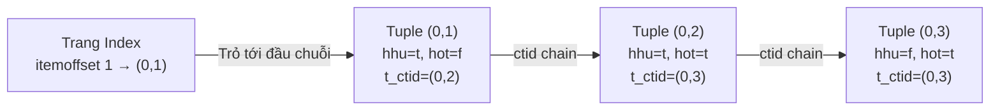
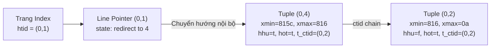

# CHƯƠNG 5: Dọn dẹp trang và Cập nhật HOT (CHAPTER 5: Page Pruning and HOT Updates)

## 5.1 Dọn dẹp trang (Page Pruning)

Trong khi một trang heap đang được đọc hoặc cập nhật, PostgreSQL có thể thực hiện một quá trình dọn dẹp trang nhanh chóng, gọi là *pruning* (dọn dẹp trang).[^1] Quá trình này xảy ra trong các trường hợp sau:

- Thao tác `UPDATE` trước đó không tìm thấy đủ không gian để đặt tuple mới vào cùng một trang. Sự kiện này được ghi nhận trong phần header của trang.
- Trang heap chứa nhiều dữ liệu hơn mức cho phép của tham số lưu trữ `fillfactor` (tính theo phần trăm, tối đa `100`).

Một thao tác `INSERT` chỉ có thể thêm một dòng mới vào trang nếu trang đó được lấp đầy ít hơn `fillfactor` phần trăm. Phần không gian còn lại được giữ riêng cho các thao tác `UPDATE` (mặc định không có không gian nào được dành riêng như vậy, tức `fillfactor = 100`).

Dọn dẹp trang loại bỏ các tuple không thể nhìn thấy được trong bất kỳ snapshot nào nữa (tức là những tuple đã nằm ngoài đường chân trời cơ sở dữ liệu — *database horizon*, tr. 88). Quá trình này không bao giờ vượt ra ngoài phạm vi một trang heap duy nhất, nhưng bù lại nó được thực hiện rất nhanh. Các con trỏ (pointer) trỏ tới những tuple đã bị dọn dẹp vẫn được giữ nguyên tại chỗ vì chúng có thể đang được tham chiếu từ một index — vốn nằm ở một trang khác.

Cũng vì lý do đó, cả bản đồ khả kiến (*visibility map*) lẫn bản đồ không gian trống (*free space map*) đều không được cập nhật lại (như vậy phần không gian thu hồi được sẽ dành cho các lệnh cập nhật `UPDATE`, chứ không dành cho các lệnh chèn `INSERT`).

Vì một trang có thể bị dọn dẹp ngay trong lúc đọc, bất kỳ câu lệnh `SELECT` nào cũng có thể gây ra sửa đổi trên trang. Đây là một trường hợp nữa bên cạnh việc thiết lập trì hoãn các bit thông tin (*information bits*, tr. 71).

> 📝 **Giải thích thêm (không có trong sách):** Việc `SELECT` có thể làm thay đổi trang (dirty page) là điều khiến nhiều người mới tìm hiểu PostgreSQL bất ngờ. Khi một câu lệnh `SELECT` đọc một trang heap mà thấy trang đó có cờ đánh dấu cần dọn dẹp (ví dụ từ một lệnh `UPDATE` trước đó không đủ chỗ), PostgreSQL tranh thủ dọn dẹp các tuple chết ngay trên trang đang nằm trong bộ nhớ (shared buffers) và đánh dấu trang là dirty để ghi xuống đĩa sau. Vì mọi thao tác dọn dẹp chỉ diễn ra trong phạm vi một trang duy nhất nên chi phí khóa (lock) rất nhẹ và cực kỳ nhanh.

Hãy cùng xem quá trình dọn dẹp trang thực sự hoạt động như thế nào. Chúng ta sẽ tạo một bảng gồm hai cột và đánh index trên từng cột:

```sql
=> CREATE TABLE hot(id integer, s char(2000)) WITH (fillfactor = 75);
=> CREATE INDEX hot_id ON hot(id);
=> CREATE INDEX hot_s ON hot(s);
```

Nếu cột `s` chỉ chứa các chữ cái Latin, mỗi tuple heap sẽ có kích thước cố định là `2004` byte, cộng thêm `24` byte phần header. Tham số lưu trữ `fillfactor` được đặt là `75%`. Điều này có nghĩa là trang có đủ không gian trống cho bốn tuple, nhưng chúng ta chỉ có thể chèn mới (`INSERT`) tối đa ba tuple.

Hãy chèn một dòng mới và cập nhật nó vài lần:

```sql
=> INSERT INTO hot VALUES (1, 'A');
=> UPDATE hot SET s = 'B';
=> UPDATE hot SET s = 'C';
=> UPDATE hot SET s = 'D';
```

Bây giờ trang chứa bốn tuple:

```sql
=> SELECT * FROM heap_page('hot',0);
 ctid  | state  | xmin  | xmax
−−−−−−−+−−−−−−−−+−−−−−−−+−−−−−−−
 (0,1) | normal | 801 c | 802 c
 (0,2) | normal | 802 c | 803 c
 (0,3) | normal | 803 c | 804
 (0,4) | normal | 804   | 0 a
(4 rows)
```

Đúng như dự đoán, chúng ta vừa vượt quá ngưỡng `fillfactor`. Bạn có thể nhận biết điều này qua hiệu số giữa `pagesize` và `upper` (tr. 62) — nó lớn hơn `75%` kích thước trang, tức là `6144` byte:

```sql
=> SELECT upper, pagesize FROM page_header(get_raw_page('hot',0));
 upper | pagesize
−−−−−−−+−−−−−−−−−−
    64 |     8192
(1 row)
```

Lần truy cập trang tiếp theo sẽ kích hoạt quá trình dọn dẹp trang, loại bỏ toàn bộ các tuple đã lỗi thời. Sau đó, một tuple mới `(0,5)` được thêm vào phần không gian vừa được giải phóng:

```sql
=> UPDATE hot SET s = 'E';
=> SELECT * FROM heap_page('hot',0);
 ctid  | state  | xmin  | xmax
−−−−−−−+−−−−−−−−+−−−−−−−+−−−−−−
 (0,1) | dead   |       |
 (0,2) | dead   |       |
 (0,3) | dead   |       |
 (0,4) | normal | 804 c | 805
 (0,5) | normal | 805   | 0 a
(5 rows)
```

Các tuple heap còn lại được di chuyển vật lý về phía các địa chỉ cao nhất sao cho toàn bộ không gian trống được gom lại thành một vùng liên tục duy nhất. Các con trỏ tuple (line pointer) cũng được cập nhật lại tương ứng. Kết quả là không hề có hiện tượng phân mảnh không gian trống bên trong trang.

Các con trỏ trỏ tới những tuple đã bị dọn dẹp chưa thể bị xóa bỏ ngay vì chúng vẫn đang được tham chiếu từ các index; PostgreSQL đổi trạng thái của chúng từ `normal` sang `dead`. Hãy xem trang đầu tiên của index `hot_s` (trang số `0` được dùng cho siêu dữ liệu — metadata):

```sql
=> SELECT * FROM index_page('hot_s',1);
 itemoffset | htid
−−−−−−−−−−−−+−−−−−−−
          1 | (0,1)
          2 | (0,2)
          3 | (0,3)
          4 | (0,4)
          5 | (0,5)
(5 rows)
```

Chúng ta cũng thấy bức tranh tương tự ở index còn lại:

```sql
=> SELECT * FROM index_page('hot_id',1);
 itemoffset | htid
−−−−−−−−−−−−+−−−−−−−
          1 | (0,1)
          2 | (0,2)
          3 | (0,3)
          4 | (0,4)
          5 | (0,5)
(5 rows)
```

Một thao tác quét index (*index scan*) có thể trả về `(0,1)`, `(0,2)`, và `(0,3)` làm định danh tuple. Máy chủ thử đọc tuple heap tương ứng nhưng thấy con trỏ đang có trạng thái `dead`; điều này có nghĩa là tuple đó không còn tồn tại nữa và cần bị bỏ qua. Nhân tiện đang ở đó, máy chủ cũng đổi trạng thái của con trỏ ngay trong trang index để tránh việc phải truy cập lặp lại trang heap một cách vô ích.[^2]

Hãy mở rộng hàm hiển thị trang index (từ phiên bản 13) để nó cũng cho biết liệu con trỏ có đang ở trạng thái `dead` hay không:

```sql
=> DROP FUNCTION index_page(text, integer);
=> CREATE FUNCTION index_page(relname text, pageno integer)
RETURNS TABLE(itemoffset smallint, htid tid, dead boolean)
AS $$
SELECT itemoffset,
       htid,
       dead -- starting from v.13
FROM bt_page_items(relname,pageno);
$$ LANGUAGE sql;

=> SELECT * FROM index_page('hot_id',1);
 itemoffset | htid  | dead
−−−−−−−−−−−−+−−−−−−−+−−−−−−
          1 | (0,1) | f
          2 | (0,2) | f
          3 | (0,3) | f
          4 | (0,4) | f
          5 | (0,5) | f
(5 rows)
```

Đến thời điểm này, tất cả các con trỏ trong trang index vẫn đang hoạt động (`dead = f`). Nhưng ngay khi lần quét index đầu tiên diễn ra, trạng thái của chúng thay đổi:

```sql
=> EXPLAIN (analyze, costs off, timing off, summary off)
SELECT * FROM hot WHERE id = 1;
                       QUERY PLAN
−−−−−−−−−−−−−−−−−−−−−−−−−−−−−−−−−−−−−−−−−−−−−−−−−−−−−−−−
 Index Scan using hot_id on hot (actual rows=1 loops=1)
   Index Cond: (id = 1)
(2 rows)

=> SELECT * FROM index_page('hot_id',1);
 itemoffset | htid  | dead
−−−−−−−−−−−−+−−−−−−−+−−−−−−
          1 | (0,1) | t
          2 | (0,2) | t
          3 | (0,3) | t
          4 | (0,4) | t
          5 | (0,5) | f
(5 rows)
```

Mặc dù tuple heap được tham chiếu bởi con trỏ thứ tư vẫn chưa bị dọn dẹp và vẫn mang trạng thái `normal`, nó đã nằm ngoài đường chân trời cơ sở dữ liệu. Đó là lý do con trỏ này cũng bị đánh dấu là `dead` trong index.

---

## 5.2 Cập nhật HOT (HOT Updates)

Sẽ rất kém hiệu quả nếu phải lưu giữ tham chiếu tới mọi tuple heap trong một index.

Trước hết, mỗi lần sửa đổi một dòng đều kích hoạt việc cập nhật tất cả các index được tạo trên bảng: một khi có tuple heap mới xuất hiện, mỗi index đều phải thêm một tham chiếu tới tuple đó, ngay cả khi các trường bị sửa đổi không hề được đánh index.

Hơn nữa, các index sẽ tích tụ dần các tham chiếu tới những tuple heap lịch sử, vì vậy chúng buộc phải được dọn dẹp cùng với các tuple đó (tr. 102). Mọi thứ càng trở nên tệ hơn khi bạn tạo nhiều index trên một bảng.

Nhưng nếu cột được cập nhật không nằm trong bất kỳ index nào, chẳng có lý do gì phải tạo thêm một mục index mới chứa cùng một giá trị khóa như cũ. Để tránh sự dư thừa như vậy, PostgreSQL cung cấp một cơ chế tối ưu hóa gọi là cập nhật **Heap-Only Tuple (HOT)**.[^3]

Khi loại cập nhật này được thực hiện, trang index chỉ chứa một mục duy nhất cho mỗi dòng. Mục này trỏ tới phiên bản đầu tiên của dòng; tất cả các phiên bản kế tiếp nằm trên cùng một trang sẽ được liên kết thành một chuỗi thông qua các con trỏ `ctid` trong phần header của tuple.



Các phiên bản dòng không được tham chiếu từ bất kỳ index nào được gắn bit **Heap-Only Tuple** (`hot`). Nếu một phiên bản nằm trong chuỗi HOT (tức có phiên bản mới hơn nối tiếp nó), nó được gắn bit **Heap Hot Updated** (`hhu`).

Khi một thao tác quét index truy cập vào trang heap và gặp một phiên bản dòng được đánh dấu là *Heap Hot Updated*, điều đó có nghĩa là quá trình quét phải tiếp tục đi dọc theo chuỗi cập nhật HOT. Tất nhiên, toàn bộ các phiên bản dòng được lấy ra đều được kiểm tra tính khả kiến (*visibility*) trước khi trả kết quả về cho client.

Để quan sát cách các cập nhật HOT diễn ra, hãy xóa một trong hai index và làm rỗng bảng (`TRUNCATE`):

```sql
=> DROP INDEX hot_s;
=> TRUNCATE TABLE hot;
```

Để thuận tiện, chúng ta sẽ định nghĩa lại hàm `heap_page` sao cho đầu ra của nó bao gồm thêm ba trường nữa: `t_ctid` và hai bit liên quan đến cập nhật HOT:

```sql
=> DROP FUNCTION heap_page(text,integer);
=> CREATE FUNCTION heap_page(relname text, pageno integer)
RETURNS TABLE(
  ctid tid, state text,
  xmin text, xmax text,
  hhu text, hot text, t_ctid tid
) AS $$
SELECT (pageno,lp)::text::tid AS ctid,
       CASE lp_flags
         WHEN 0 THEN 'unused'
         WHEN 1 THEN 'normal'
         WHEN 2 THEN 'redirect to '||lp_off
         WHEN 3 THEN 'dead'
       END AS state,
       t_xmin || CASE
         WHEN (t_infomask & 256) > 0 THEN ' c'
         WHEN (t_infomask & 512) > 0 THEN ' a'
         ELSE ''
       END AS xmin,
       t_xmax || CASE
         WHEN (t_infomask & 1024) > 0 THEN ' c'
         WHEN (t_infomask & 2048) > 0 THEN ' a'
         ELSE ''
       END AS xmax,
       CASE WHEN (t_infomask2 & 16384) > 0 THEN 't' END AS hhu,
       CASE WHEN (t_infomask2 & 32768) > 0 THEN 't' END AS hot,
       t_ctid
FROM heap_page_items(get_raw_page(relname,pageno))
ORDER BY lp;
$$ LANGUAGE sql;
```

Hãy lặp lại các thao tác chèn và cập nhật:

```sql
=> INSERT INTO hot VALUES (1, 'A');
=> UPDATE hot SET s = 'B';
```

Lúc này trang chứa một chuỗi cập nhật HOT:
- Bit **Heap Hot Updated** (`hhu`) cho thấy bộ thực thi (*executor*) cần đi tiếp theo chuỗi `ctid`.
- Bit **Heap Only Tuple** (`hot`) cho biết tuple này không được tham chiếu từ bất kỳ index nào.

```sql
=> SELECT * FROM heap_page('hot',0);
 ctid  | state  | xmin  | xmax | hhu | hot | t_ctid
−−−−−−−+−−−−−−−−+−−−−−−−+−−−−−−+−−−−−+−−−−−+−−−−−−−−
 (0,1) | normal | 812 c | 813  | t   |     | (0,2)
 (0,2) | normal | 813   | 0 a  |     | t   | (0,2)
(2 rows)
```

Khi chúng ta tiếp tục cập nhật, chuỗi sẽ dài ra — nhưng chỉ trong giới hạn của trang:

```sql
=> UPDATE hot SET s = 'C';
=> UPDATE hot SET s = 'D';
=> SELECT * FROM heap_page('hot',0);
 ctid  | state  | xmin  | xmax  | hhu | hot | t_ctid
−−−−−−−+−−−−−−−−+−−−−−−−+−−−−−−−+−−−−−+−−−−−+−−−−−−−−
 (0,1) | normal | 812 c | 813 c | t   |     | (0,2)
 (0,2) | normal | 813 c | 814 c | t   | t   | (0,3)
 (0,3) | normal | 814 c | 815   | t   | t   | (0,4)
 (0,4) | normal | 815   | 0 a   |     | t   | (0,4)
(4 rows)
```

Index vẫn chỉ chứa một tham chiếu duy nhất, trỏ tới phần đầu của chuỗi này:

```sql
=> SELECT * FROM index_page('hot_id',1);
 itemoffset | htid  | dead
−−−−−−−−−−−−+−−−−−−−+−−−−−−
          1 | (0,1) | f
(1 row)
```

Một cập nhật HOT chỉ khả thi nếu các trường bị sửa đổi không thuộc về bất kỳ index nào. Nếu không, một số index sẽ chứa tham chiếu tới một tuple heap nằm ở giữa chuỗi, điều này mâu thuẫn với ý tưởng của cơ chế tối ưu này. Vì một chuỗi HOT chỉ có thể phát triển trong phạm vi một trang duy nhất, việc duyệt toàn bộ chuỗi không bao giờ đòi hỏi truy cập sang các trang khác và nhờ đó không làm ảnh hưởng đến hiệu năng.

> 💡 **Ví dụ bổ sung (không có trong sách):** Giả sử bạn có bảng `orders(id, status, updated_at, total_amount)` với các index trên `(id)` và `(status)`.
> - Nếu bạn chạy `UPDATE orders SET updated_at = now() WHERE id = 100;` -> Cột `updated_at` không được đánh index, và nếu trang heap còn đủ chỗ trống, PostgreSQL sẽ thực hiện **HOT update**. Không một index nào cần bị sửa đổi!
> - Nếu bạn chạy `UPDATE orders SET status = 'shipped' WHERE id = 100;` -> Cột `status` nằm trong index, nên PostgreSQL **không thể** dùng HOT update; cả index trên `id` và index trên `status` đều phải chèn thêm entry mới trỏ tới phiên bản tuple mới.
> - Lưu ý: ngay cả một index không liên quan (như index trên `id`) cũng không được bỏ qua trong trường hợp thứ hai, vì entry mới ở index `status` trỏ tới tuple mới, và mọi index khác cũng phải đồng bộ trỏ tới cùng tuple mới đó.

---

## 5.3 Dọn dẹp trang đối với Cập nhật HOT (Page Pruning for HOT Updates)

Một trường hợp đặc biệt của dọn dẹp trang — nhưng hết sức quan trọng — là dọn dẹp các chuỗi cập nhật HOT.

Trong ví dụ ở trên, ngưỡng `fillfactor` đã bị vượt quá, nên lần cập nhật tiếp theo sẽ kích hoạt dọn dẹp trang. Nhưng lần này trang chứa một chuỗi cập nhật HOT. Phần đầu của chuỗi này phải luôn giữ nguyên vị trí của nó vì nó đang được tham chiếu từ index, nhưng các con trỏ khác có thể được giải phóng vì chắc chắn không có tham chiếu nào từ bên ngoài trỏ tới chúng.

Để tránh phải di chuyển phần đầu chuỗi (làm hỏng tham chiếu từ index), PostgreSQL sử dụng cơ chế định địa chỉ hai bước (*dual addressing*): con trỏ được tham chiếu từ index (trong trường hợp này là `(0,1)`) nhận trạng thái `redirect` vì nó trỏ tiếp tới tuple hiện đang bắt đầu chuỗi:

```sql
=> UPDATE hot SET s = 'E';
=> SELECT * FROM heap_page('hot',0);
 ctid  |     state     | xmin  | xmax | hhu | hot | t_ctid
−−−−−−−+−−−−−−−−−−−−−−−+−−−−−−−+−−−−−−+−−−−−+−−−−−+−−−−−−−−
 (0,1) | redirect to 4 |       |      |     |     |
 (0,2) | normal        | 816   | 0 a  |     | t   | (0,2)
 (0,3) | unused        |       |      |     |     |
 (0,4) | normal        | 815 c | 816  | t   | t   | (0,2)
(4 rows)
```

Các tuple `(0,1)`, `(0,2)`, và `(0,3)` đã bị dọn dẹp; con trỏ đầu chuỗi `1` được giữ lại để làm nhiệm vụ chuyển hướng (`redirect`), trong khi các con trỏ `2` và `3` đã được giải phóng hoàn toàn (nhận trạng thái `unused`) vì chúng được đảm bảo không có bất kỳ tham chiếu nào từ các index. Tuple mới được ghi vào phần không gian vừa giải phóng với định danh là tuple `(0,2)`.



Hãy thực hiện thêm vài lần cập nhật nữa:

```sql
=> UPDATE hot SET s = 'F';
=> UPDATE hot SET s = 'G';
=> SELECT * FROM heap_page('hot',0);
 ctid  |     state     | xmin  | xmax  | hhu | hot | t_ctid
−−−−−−−+−−−−−−−−−−−−−−−+−−−−−−−+−−−−−−−+−−−−−+−−−−−+−−−−−−−−
 (0,1) | redirect to 4 |       |       |     |     |
 (0,2) | normal        | 816 c | 817 c | t   | t   | (0,3)
 (0,3) | normal        | 817 c | 818   | t   | t   | (0,5)
 (0,4) | normal        | 815 c | 816 c | t   | t   | (0,2)
 (0,5) | normal        | 818   | 0 a   |     | t   | (0,5)
(5 rows)
```

Lần cập nhật tiếp theo sẽ kích hoạt dọn dẹp trang:

```sql
=> UPDATE hot SET s = 'H';
=> SELECT * FROM heap_page('hot',0);
 ctid  |     state     | xmin  | xmax | hhu | hot | t_ctid
−−−−−−−+−−−−−−−−−−−−−−−+−−−−−−−+−−−−−−+−−−−−+−−−−−+−−−−−−−−
 (0,1) | redirect to 5 |       |      |     |     |
 (0,2) | normal        | 819   | 0 a  |     | t   | (0,2)
 (0,3) | unused        |       |      |     |     |
 (0,4) | unused        |       |      |     |     |
 (0,5) | normal        | 818 c | 819  | t   | t   | (0,2)
(5 rows)
```

Một lần nữa, một số tuple bị dọn dẹp, và con trỏ trỏ tới đầu chuỗi được dịch chuyển tương ứng (`redirect to 5`).

Nếu các cột không đánh index bị sửa đổi thường xuyên, việc giảm giá trị `fillfactor` là rất hợp lý để dành sẵn không gian trong trang cho các thao tác cập nhật. Tất nhiên, bạn cần nhớ rằng giá trị `fillfactor` càng thấp thì không gian trống để lại trong mỗi trang càng nhiều, dẫn đến kích thước vật lý của bảng sẽ phình to hơn.

---

## 5.4 Chia tách chuỗi HOT (HOT Chain Splits)

Nếu trang không còn đủ chỗ để chứa thêm một tuple mới nữa, chuỗi HOT sẽ bị cắt đứt. PostgreSQL sẽ buộc phải thêm một mục index riêng biệt để tham chiếu tới tuple mới nằm ở một trang khác.

Để quan sát tình huống này, hãy bắt đầu một giao dịch đồng thời với một snapshot nhằm chặn quá trình dọn dẹp trang:

```sql
=> BEGIN ISOLATION LEVEL REPEATABLE READ;
=> SELECT 1;
```

Bây giờ chúng ta sẽ thực hiện một số cập nhật ở phiên làm việc đầu tiên:

```sql
=> UPDATE hot SET s = 'I';
=> UPDATE hot SET s = 'J';
=> UPDATE hot SET s = 'K';
=> SELECT * FROM heap_page('hot',0);
 ctid  |     state     | xmin  | xmax  | hhu | hot | t_ctid
−−−−−−−+−−−−−−−−−−−−−−−+−−−−−−−+−−−−−−−+−−−−−+−−−−−+−−−−−−−−
 (0,1) | redirect to 2 |       |       |     |     |
 (0,2) | normal        | 819 c | 820 c | t   | t   | (0,3)
 (0,3) | normal        | 820 c | 821 c | t   | t   | (0,4)
 (0,4) | normal        | 821 c | 822   | t   | t   | (0,5)
 (0,5) | normal        | 822   | 0 a   |     | t   | (0,5)
(5 rows)
```

Khi lần cập nhật tiếp theo diễn ra, trang này sẽ không thể chứa thêm một tuple nào nữa, và quá trình dọn dẹp trang cũng không thể giải phóng được bất kỳ không gian nào (vì các tuple cũ vẫn có thể được nhìn thấy bởi snapshot của giao dịch `REPEATABLE READ` đang mở):

```sql
=> UPDATE hot SET s = 'L';
=> COMMIT; -- snapshot không còn cần thiết nữa
=> SELECT * FROM heap_page('hot',0);
 ctid  |     state     | xmin  | xmax  | hhu | hot | t_ctid
−−−−−−−+−−−−−−−−−−−−−−−+−−−−−−−+−−−−−−−+−−−−−+−−−−−+−−−−−−−−
 (0,1) | redirect to 2 |       |       |     |     |
 (0,2) | normal        | 819 c | 820 c | t   | t   | (0,3)
 (0,3) | normal        | 820 c | 821 c | t   | t   | (0,4)
 (0,4) | normal        | 821 c | 822 c | t   | t   | (0,5)
 (0,5) | normal        | 822 c | 823   |     | t   | (1,1)
(5 rows)
```

Tuple `(0,5)` chứa tham chiếu `(1,1)` trỏ sang trang `1`:

```sql
=> SELECT * FROM heap_page('hot',1);
 ctid  | state  | xmin | xmax | hhu | hot | t_ctid
−−−−−−−+−−−−−−−−+−−−−−−+−−−−−−+−−−−−+−−−−−+−−−−−−−−
 (1,1) | normal | 823  | 0 a  |     |     | (1,1)
(1 row)
```

Tuy nhiên, tham chiếu này không được sử dụng để đi theo chuỗi HOT: bit *Heap Hot Updated* (`hhu`) không được bật cho tuple `(0,5)`. Còn đối với tuple `(1,1)`, nó có thể được truy cập trực tiếp từ index — lúc này index đã có hai mục. Mỗi mục trỏ tới phần đầu của chuỗi HOT tương ứng trên từng trang:

```sql
=> SELECT * FROM index_page('hot_id',1);
 itemoffset | htid  | dead
−−−−−−−−−−−−+−−−−−−−+−−−−−−
          1 | (0,1) | f
          2 | (1,1) | f
(2 rows)
```

> 📝 **Giải thích thêm (không có trong sách):** Việc không bật bit `hhu` ở tuple `(0,5)` là có chủ đích: PostgreSQL không cho phép chuỗi HOT bắc cầu qua nhiều trang heap khác nhau. Nếu chuỗi HOT đi sang trang `1`, một thao tác quét index sẽ phải đọc thêm trang `1` ngoài trang `0`, làm mất đi ưu thế hiệu năng cục bộ của HOT và khiến việc dọn dẹp trang đơn lẻ trở nên bất khả thi. Do đó, khi tràn sang trang `1`, tuple `(1,1)` trở thành đầu của một chuỗi HOT mới và được đăng ký một mục mới trong index.

---

## 5.5 Dọn dẹp trang cho Index (Page Pruning for Indexes)

Tôi đã khẳng định rằng việc dọn dẹp trang bị giới hạn trong một trang heap duy nhất và không ảnh hưởng đến các index. Tuy nhiên, bản thân các index cũng có cơ chế dọn dẹp riêng,[^4] và cơ chế này cũng chỉ làm sạch một trang duy nhất — trong trường hợp này là một trang index.

Dọn dẹp index xảy ra khi một thao tác chèn vào cây B-tree sắp sửa làm tách đôi trang (*page split*), vì trang gốc không còn đủ chỗ nữa. Vấn đề nằm ở chỗ ngay cả khi một số mục index bị xóa sau này, hai trang index đã tách rời cũng sẽ không được gộp lại thành một. Điều này dẫn đến tình trạng phình to index (*index bloating*), và một khi đã bị phình, index không thể tự thu nhỏ lại ngay cả khi một phần lớn dữ liệu đã bị xóa. Nhưng nếu quá trình dọn dẹp có thể loại bỏ được một số tuple ngay lúc đó, việc tách trang có thể được trì hoãn lại.

Có hai loại tuple có thể bị dọn dẹp khỏi một trang index:

1. Trước hết, PostgreSQL dọn dẹp những tuple đã được gắn thẻ `dead`.[^5] Như tôi đã nói, PostgreSQL gắn thẻ này trong quá trình quét index nếu phát hiện một mục index đang trỏ tới một tuple không còn khả kiến trong bất kỳ snapshot nào nữa hoặc đơn giản là không còn tồn tại.
2. Nếu không có tuple nào được biết là `dead` (từ phiên bản 14), PostgreSQL sẽ kiểm tra những mục index đang tham chiếu tới các phiên bản khác nhau của cùng một dòng trong bảng.[^6] Do cơ chế MVCC, các thao tác cập nhật có thể tạo ra một lượng lớn các phiên bản dòng, và nhiều phiên bản trong số đó có khả năng sớm biến mất phía sau đường chân trời cơ sở dữ liệu. Cập nhật HOT giúp giảm nhẹ hiệu ứng này, nhưng chúng không phải lúc nào cũng áp dụng được: nếu cột cần cập nhật nằm trong một index, các tham chiếu tương ứng sẽ bị lan truyền tới toàn bộ các index. Trước khi tách trang, việc tìm kiếm các dòng tuy chưa bị gắn thẻ `dead` nhưng đã có thể dọn dẹp được là rất đáng giá. Để làm được điều này, PostgreSQL phải kiểm tra tính khả kiến của các tuple heap. Những kiểm tra như vậy đòi hỏi phải truy cập bảng, nên chúng chỉ được thực hiện cho các tuple index "đầy hứa hẹn" (*promising* index tuples) — tức là những bản sao được tạo ra từ các mục hiện có phục vụ cho MVCC. Chi phí thực hiện kiểm tra này vẫn rẻ hơn nhiều so với việc để xảy ra thêm một lần tách trang.

> 💡 **Ví dụ bổ sung (không có trong sách):** Tính năng dọn dẹp "từ dưới lên" (*bottom-up index deletion*, mục số 2 ở trên, ra mắt ở PostgreSQL 14) đặc biệt hữu ích cho các bảng có nhiều index phụ (ví dụ index trên `created_at` hoặc `user_id`) nhưng thường xuyên bị cập nhật trên một cột đã đánh index khác (ví dụ `status`). Khi trang index trên `user_id` đầy, trước khi tách trang, PostgreSQL sẽ kiểm tra các entry có cùng `user_id` (những phiên bản cũ của cùng một dòng). Nếu các phiên bản cũ đó đã quá đường chân trời, chúng sẽ bị xóa ngay khỏi trang index mà không cần đợi `VACUUM`, giúp giữ cho index gọn gàng và tránh phình to không cần thiết.

---

## Bảng thuật ngữ chương (Chapter Glossary)

| Thuật ngữ (English) | Tiếng Việt | Giải thích ngắn gọn |
| :--- | :--- | :--- |
| Page pruning | Dọn dẹp trang | Cơ chế dọn nhanh các tuple đã chết trong phạm vi một trang heap duy nhất khi đọc hoặc cập nhật. |
| Fillfactor | Tham số điền đầy (`fillfactor`) | Tỷ lệ phần trăm tối đa của trang được phép dùng cho `INSERT`; phần dư để dành cho `UPDATE` nội trang. |
| Dead pointer / dead tuple | Con trỏ chết / tuple chết | Con trỏ hoặc dòng dữ liệu đã hết hiệu lực với mọi snapshot nhưng line pointer vẫn còn chờ index dọn. |
| Heap-Only Tuple (HOT) | Tuple chỉ nằm trên heap | Phiên bản dòng mới nằm cùng trang heap với phiên bản trước và không bị index tham chiếu trực tiếp. |
| Heap Hot Updated (`hhu`) | Bit đã cập nhật kiểu HOT | Cờ trong header tuple báo hiệu bộ thực thi phải đi tiếp theo con trỏ `t_ctid` tới phiên bản mới hơn. |
| Dual addressing (`redirect`) | Định địa chỉ hai bước / chuyển hướng | Trạng thái của line pointer đầu chuỗi HOT trỏ nội bộ sang vị trí đầu chuỗi mới sau khi dọn dẹp. |
| HOT chain split | Chia tách chuỗi HOT | Tình huống trang heap hết chỗ khiến chuỗi HOT bị ngắt và phải tạo thêm một mục mới trong index. |
| Page split | Tách trang | Thao tác chia một trang B-tree đầy thành hai trang khi chèn thêm khóa mới. |
| Index bloating | Phình to index | Hiện tượng kích thước index tăng lên và không tự thu nhỏ sau khi dữ liệu bị xóa hoặc cập nhật nhiều. |
| Bottom-up deletion | Xóa từ dưới lên (trong B-tree) | Cơ chế kiểm tra và xóa các phiên bản index tuple cũ của cùng một dòng trước khi thực hiện tách trang (từ PG 14). |

---

[^1]: `backend/access/heap/pruneheap.c`, hàm `heap_page_prune_opt`
[^2]: `backend/access/index/indexam.c`, hàm `index_fetch_heap`
[^3]: `backend/access/heap/README.HOT`
[^4]: `postgresql.org/docs/14/btree-implementation.html#BTREE-DELETION`
[^5]: `backend/access/nbtree/README`, mục *Simple deletion*
[^6]: `backend/access/nbtree/README`, mục *Bottom-Up deletion* (`include/access/tableam.h`)
