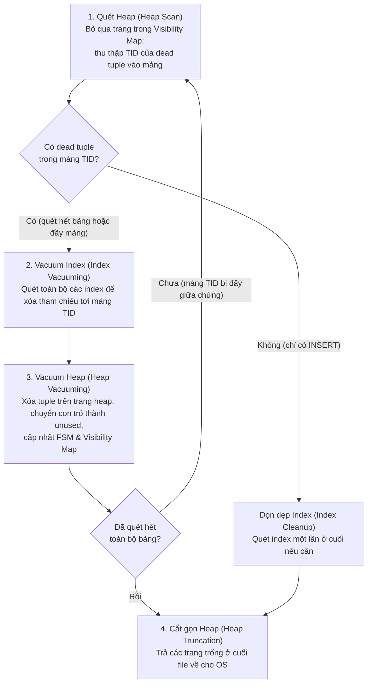

# CHƯƠNG 6: Vacuum và Autovacuum (CHAPTER 6: Vacuum and Autovacuum)

## 6.1 Vacuum (6.1 Vacuum)

Cơ chế dọn dẹp trang (page pruning) diễn ra rất nhanh, nhưng nó chỉ giải phóng được một phần không gian có thể thu hồi. Vì chỉ hoạt động trong phạm vi một trang heap đơn lẻ, nó không đụng chạm đến các index (hoặc ngược lại, nó dọn dẹp một trang index mà không ảnh hưởng đến bảng).

Quá trình vacuum định kỳ (routine vacuuming)[^1], vốn là quy trình vacuum chính, được thực hiện bằng lệnh `VACUUM`[^2]. Lệnh này xử lý toàn bộ bảng và loại bỏ cả các tuple heap đã lỗi thời lẫn tất cả các mục index tương ứng.

Quá trình vacuum được thực hiện song song với các tiến trình khác trong hệ thống cơ sở dữ liệu. Trong khi đang được vacuum, các bảng và index vẫn có thể được sử dụng như bình thường cho cả thao tác đọc và ghi (tuy nhiên, việc thực thi đồng thời các lệnh như `CREATE INDEX`, `ALTER TABLE` và một số lệnh khác sẽ không được phép).

Để tránh quét các trang dư thừa, PostgreSQL sử dụng **bản đồ khả kiến (visibility map)**. Những trang được đánh dấu trong bản đồ này sẽ được bỏ qua vì chắc chắn chúng chỉ chứa các tuple hiện hành; do đó, một trang chỉ bị vacuum nếu nó không xuất hiện trong bản đồ này. Nếu tất cả các tuple còn lại trong một trang sau khi vacuum đều nằm ngoài đường chân trời cơ sở dữ liệu (database horizon), bản đồ khả kiến sẽ được cập nhật để đưa trang này vào.

Bản đồ không gian trống (free space map - FSM) cũng được cập nhật để phản ánh phần không gian vừa được giải phóng.

Hãy tạo một bảng kèm theo một index trên đó:

```sql
=> CREATE TABLE vac(
  id integer,
  s char(100)
)
WITH (autovacuum_enabled = off);
=> CREATE INDEX vac_s ON vac(s);
```

Tham số lưu trữ `autovacuum_enabled` dùng để tắt autovacuum; ở đây chúng ta làm vậy chỉ nhằm mục đích thử nghiệm để kiểm soát chính xác thời điểm bắt đầu vacuum.

Hãy chèn một dòng và thực hiện vài lần cập nhật:

```sql
=> INSERT INTO vac(id,s) VALUES (1,'A');
=> UPDATE vac SET s = 'B';
=> UPDATE vac SET s = 'C';
```

Bây giờ bảng chứa ba tuple:

```sql
=> SELECT * FROM heap_page('vac',0);
 ctid  | state  | xmin  | xmax  | hhu | hot | t_ctid
-------+--------+-------+-------+-----+-----+--------
 (0,1) | normal | 826 c | 827 c |     |     | (0,2)
 (0,2) | normal | 827 c | 828   |     |     | (0,3)
 (0,3) | normal | 828   | 0 a   |     |     | (0,3)
(3 rows)
```

Mỗi tuple đều được tham chiếu từ index:

```sql
=> SELECT * FROM index_page('vac_s',1);
 itemoffset | htid  | dead
------------+-------+------
          1 | (0,1) | f
          2 | (0,2) | f
          3 | (0,3) | f
(3 rows)
```

Quá trình vacuum đã loại bỏ toàn bộ các dead tuple, chỉ để lại tuple hiện hành:

```sql
=> VACUUM vac;
=> SELECT * FROM heap_page('vac',0);
 ctid  | state  | xmin  | xmax | hhu | hot | t_ctid
-------+--------+-------+------+-----+-----+--------
 (0,1) | unused |       |      |     |     |
 (0,2) | unused |       |      |     |     |
 (0,3) | normal | 828 c | 0 a  |     |     | (0,3)
(3 rows)
```

Trong trường hợp dọn dẹp trang (page pruning), hai con trỏ đầu tiên sẽ được coi là `dead`, nhưng ở đây chúng có trạng thái `unused` vì không còn mục index nào tham chiếu tới chúng nữa:

```sql
=> SELECT * FROM index_page('vac_s',1);
 itemoffset | htid  | dead
------------+-------+------
          1 | (0,3) | f
(1 row)
```

Các con trỏ có trạng thái `unused` được coi là trống và có thể được tái sử dụng cho các phiên bản dòng mới.

Lúc này trang heap đã xuất hiện trong visibility map; chúng ta có thể kiểm tra bằng extension `pg_visibility`:

```sql
=> CREATE EXTENSION pg_visibility;
=> SELECT all_visible
FROM pg_visibility_map('vac',0);
 all_visible
-------------
 t
(1 row)
```

Phần header của trang cũng đã nhận được một thuộc tính cho biết tất cả các tuple của nó đều khả kiến (visible) trong mọi snapshot:

```sql
=> SELECT flags & 4 > 0 AS all_visible
FROM page_header(get_raw_page('vac',0));
 all_visible
-------------
 t
(1 row)
```

> 📝 **Giải thích thêm (không có trong sách):**
> Tại sao `VACUUM` có thể chuyển trạng thái con trỏ dòng (line pointer) từ `normal`/`dead` sang `unused` trong khi page pruning thông thường chỉ chuyển sang `dead`? Bởi vì page pruning chỉ làm việc cục bộ trên một trang heap và không đụng vào index, nên nó phải giữ lại line pointer ở trạng thái `dead` để các mục index cũ không trỏ vào khoảng không hoặc trỏ nhầm sang dòng mới. Ngược lại, `VACUUM` quét và xóa các mục tham chiếu trong index trước, rồi mới quay lại trang heap để giải phóng hoàn toàn line pointer sang `unused`.

---

## 6.2 Nhìn lại đường chân trời cơ sở dữ liệu (6.2 Database Horizon Revisited)

`VACUUM` phát hiện các dead tuple dựa trên đường chân trời cơ sở dữ liệu (database horizon). Khái niệm này mang tính nền tảng đến mức rất đáng để chúng ta xem xét lại một lần nữa.

Hãy bắt đầu lại thử nghiệm từ đầu:

```sql
=> TRUNCATE vac;
=> INSERT INTO vac(id,s) VALUES (1,'A');
=> UPDATE vac SET s = 'B';
```

Nhưng lần này, trước khi cập nhật dòng đó, chúng ta sẽ mở một giao dịch (transaction) khác để giữ đường chân trời cơ sở dữ liệu (đó có thể là hầu như bất kỳ giao dịch nào, ngoại trừ giao dịch ảo chạy ở mức cô lập Read Committed). Ví dụ, giao dịch này có thể sửa đổi một số dòng trong một bảng khác:

```sql
=> BEGIN;
=> UPDATE accounts SET amount = 0;
```

Sau đó thực hiện cập nhật trên bảng `vac`:

```sql
=> UPDATE vac SET s = 'C';
```

Bây giờ bảng của chúng ta chứa ba tuple, và index chứa ba tham chiếu. Hãy chạy vacuum cho bảng và xem điều gì thay đổi:

```sql
=> VACUUM vac;
=> SELECT * FROM heap_page('vac',0);
 ctid  | state  | xmin  | xmax  | hhu | hot | t_ctid
-------+--------+-------+-------+-----+-----+--------
 (0,1) | unused |       |       |     |     |
 (0,2) | normal | 833 c | 835 c |     |     | (0,3)
 (0,3) | normal | 835 c | 0 a   |     |     | (0,3)
(3 rows)
=> SELECT * FROM index_page('vac_s',1);
 itemoffset | htid  | dead
------------+-------+------
          1 | (0,2) | f
          2 | (0,3) | f
(2 rows)
```

Trong khi lần chạy trước chỉ để lại một tuple trên trang, lần này chúng ta còn lại hai tuple: `VACUUM` quyết định rằng phiên bản `(0,2)` chưa thể bị xóa. Nguyên nhân là do đường chân trời cơ sở dữ liệu, trong trường hợp này được xác định bởi giao dịch chưa kết thúc kia:

```sql
=> SELECT backend_xmin FROM pg_stat_activity
WHERE pid = pg_backend_pid();
 backend_xmin
--------------
          834
(1 row)
```

Chúng ta có thể sử dụng mệnh đề `VERBOSE` khi gọi `VACUUM` để quan sát những gì đang diễn ra:

```sql
=> VACUUM VERBOSE vac;
INFO:  vacuuming "public.vac"
INFO:  table "vac": found 0 removable, 2 nonremovable row versions in 1 out of 1 pages
DETAIL:  1 dead row versions cannot be removed yet, oldest xmin: 834
Skipped 0 pages due to buffer pins, 0 frozen pages.
CPU: user: 0.00 s, system: 0.00 s, elapsed: 0.00 s.
VACUUM
```

Kết quả đầu ra hiển thị các thông tin sau:
- `VACUUM` không phát hiện được tuple nào có thể xóa (`0 removable`).
- Hai tuple không được phép xóa (`2 nonremovable`).
- Một trong các tuple không thể xóa là tuple đã chết (`1 dead`), tuple còn lại đang được sử dụng.
- Đường chân trời hiện tại mà `VACUUM` phải tôn trọng (`oldest xmin`) chính là đường chân trời của giao dịch đang hoạt động.

Một khi giao dịch đang hoạt động hoàn tất, đường chân trời cơ sở dữ liệu dịch chuyển về phía trước, và quá trình vacuum có thể tiếp tục:

```sql
=> COMMIT;
=> VACUUM VERBOSE vac;
INFO:  vacuuming "public.vac"
INFO:  scanned index "vac_s" to remove 1 row versions
DETAIL:  CPU: user: 0.00 s, system: 0.00 s, elapsed: 0.00 s
INFO:  table "vac": removed 1 dead item identifiers in 1 pages
DETAIL:  CPU: user: 0.00 s, system: 0.00 s, elapsed: 0.00 s
INFO:  index "vac_s" now contains 1 row versions in 2 pages
DETAIL:  1 index row versions were removed.
0 index pages were newly deleted.
0 index pages are currently deleted, of which 0 are currently reusable.
CPU: user: 0.00 s, system: 0.00 s, elapsed: 0.00 s.
INFO:  table "vac": found 1 removable, 1 nonremovable row versions in 1 out of 1 pages
DETAIL:  0 dead row versions cannot be removed yet, oldest xmin: 836
Skipped 0 pages due to buffer pins, 0 frozen pages.
CPU: user: 0.00 s, system: 0.00 s, elapsed: 0.00 s.
VACUUM
```

`VACUUM` đã phát hiện và loại bỏ một dead tuple nằm ngoài đường chân trời cơ sở dữ liệu mới.

Giờ đây trang không còn chứa bất kỳ phiên bản dòng lỗi thời nào nữa; phiên bản duy nhất còn lại là phiên bản hiện hành:

```sql
=> SELECT * FROM heap_page('vac',0);
 ctid  | state  | xmin  | xmax | hhu | hot | t_ctid
-------+--------+-------+------+-----+-----+--------
 (0,1) | unused |       |      |     |     |
 (0,2) | unused |       |      |     |     |
 (0,3) | normal | 835 c | 0 a  |     |     | (0,3)
(3 rows)
```

Index cũng chỉ còn chứa một mục duy nhất:

```sql
=> SELECT * FROM index_page('vac_s',1);
 itemoffset | htid  | dead
------------+-------+------
          1 | (0,3) | f
(1 row)
```

> 💡 **Ví dụ bổ sung (không có trong sách):**
> Trong môi trường production, một lỗi rất phổ biến là ứng dụng mở một transaction `BEGIN;` rồi quên `COMMIT` hoặc `ROLLBACK` (trạng thái `idle in transaction`), hoặc một báo cáo chạy quá lâu. Khi đó `oldest xmin` bị giữ chân lại. Dù bạn có chạy `VACUUM` thủ công hay `autovacuum` chạy liên tục, các dòng `dead` mới sinh ra vẫn báo `cannot be removed yet, oldest xmin: ...`, khiến bảng phình to (bloat). Bạn có thể tìm các phiên đang giữ horizon bằng truy vấn:
> ```sql
> SELECT pid, usename, state, backend_xmin, now() - xact_start AS duration, query
> FROM pg_stat_activity
> WHERE backend_xmin IS NOT NULL
> ORDER BY age(backend_xmin) DESC;
> ```

---

## 6.3 Các giai đoạn của Vacuum (6.3 Vacuum Phases)

Cơ chế vacuum thoạt nhìn có vẻ khá đơn giản, nhưng ấn tượng đó dễ gây hiểu nhầm. Xét cho cùng, cả bảng và index đều phải được xử lý đồng thời mà không làm chặn (block) các tiến trình khác. Để vận hành được như vậy, quá trình vacuum mỗi bảng được chia thành nhiều giai đoạn (phase)[^3].

Mọi thứ bắt đầu bằng việc quét bảng để tìm các dead tuple; nếu tìm thấy, chúng sẽ được xóa khỏi các index trước, rồi sau đó mới xóa khỏi chính bảng đó. Nếu có quá nhiều dead tuple cần dọn trong một lượt, quy trình này sẽ được lặp lại. Cuối cùng, quá trình cắt gọn heap (heap truncation) có thể được thực hiện.



### Quét Heap (Heap Scan)

Trong giai đoạn đầu tiên, quá trình quét heap được thực hiện[^4]. Tiến trình quét có tính đến visibility map: tất cả các trang được đánh dấu trong bản đồ này đều bị bỏ qua vì chúng chắc chắn không chứa tuple lỗi thời nào. Nếu một tuple nằm ngoài đường chân trời và không còn cần thiết nữa, `TID` của nó sẽ được thêm vào một mảng `tid` đặc biệt. Những tuple như vậy chưa thể bị xóa ngay vì chúng vẫn có thể đang được tham chiếu từ các index.

Mảng `tid` nằm trong bộ nhớ cục bộ của tiến trình `VACUUM`; kích thước của vùng nhớ được cấp phát được xác định bởi tham số `maintenance_work_mem` (mặc định `64MB`). Toàn bộ vùng nhớ này được cấp phát một lần ngay từ đầu chứ không cấp phát dần theo nhu cầu. Tuy nhiên, lượng bộ nhớ cấp phát không bao giờ vượt quá mức cần thiết trong trường hợp xấu nhất, vì vậy nếu bảng nhỏ, vacuum có thể sử dụng ít bộ nhớ hơn giá trị chỉ định trong tham số này.

### Vacuum Index (Index Vacuuming)

Giai đoạn đầu tiên có thể dẫn đến một trong hai kết quả: hoặc là toàn bộ bảng đã được quét hết, hoặc là bộ nhớ cấp phát cho mảng `tid` đã bị lấp đầy trước khi quá trình quét hoàn tất. Trong cả hai trường hợp, giai đoạn vacuum index sẽ bắt đầu[^5]. Ở giai đoạn này, từng index được tạo trên bảng sẽ được quét toàn bộ để tìm tất cả các mục tham chiếu đến những tuple đã ghi nhận trong mảng `tid`. Những mục này sẽ bị xóa khỏi các trang index.

> Một index giúp bạn nhanh chóng tìm đến một heap tuple dựa trên khóa index, nhưng không có cách nào để tìm nhanh một mục index dựa trên `TID` của tuple tương ứng. Tính năng này hiện đang được phát triển cho B-tree[^6], nhưng công việc vẫn chưa hoàn tất.

Từ phiên bản PostgreSQL 13, nếu có nhiều index lớn hơn giá trị `min_parallel_index_scan_size` (mặc định `512kB`), chúng có thể được vacuum song song bởi các background worker. Trừ khi mức độ song song được chỉ định tường minh bằng mệnh đề `PARALLEL N`, `VACUUM` sẽ khởi chạy một worker cho mỗi index phù hợp (trong giới hạn chung về số lượng background worker[^7]). Một index đơn lẻ không thể được xử lý bởi nhiều worker cùng lúc.

Trong giai đoạn vacuum index, PostgreSQL cập nhật bản đồ không gian trống (FSM) và tính toán số liệu thống kê về vacuum. Tuy nhiên, giai đoạn này sẽ bị bỏ qua nếu các dòng chỉ được chèn thêm (không bị xóa hay cập nhật) vì khi đó bảng không chứa dead tuple nào. Lúc ấy, việc quét index chỉ bị ép buộc thực hiện một lần duy nhất ở cuối cùng, như một phần của giai đoạn dọn dẹp index (index cleanup) riêng biệt[^8].

Sau giai đoạn vacuum index, không còn tham chiếu nào tới các heap tuple lỗi thời nằm trong index nữa, nhưng bản thân các tuple đó vẫn còn hiện diện trong bảng. Điều này hoàn toàn bình thường: các thao tác quét index (index scan) không thể tìm thấy dead tuple nào, trong khi quét tuần tự bảng (sequential scan) sẽ dựa vào quy tắc khả kiến để lọc bỏ chúng.

### Vacuum Heap (Heap Vacuuming)

Tiếp theo, giai đoạn vacuum heap bắt đầu[^9]. Bảng được quét lại để xóa các tuple đã đăng ký trong mảng `tid` và giải phóng các con trỏ tương ứng. Giờ đây khi mọi tham chiếu index liên quan đã bị xóa, việc này có thể được thực hiện một cách an toàn.

Không gian mà `VACUUM` thu hồi được sẽ được ghi nhận vào bản đồ không gian trống (FSM), trong khi các trang hiện chỉ chứa các tuple hiện hành khả kiến trong mọi snapshot sẽ được đánh dấu vào bản đồ khả kiến (visibility map).

Nếu bảng chưa được đọc hết trong giai đoạn quét heap trước đó, mảng `tid` sẽ được xóa sạch, và quá trình quét heap được tiếp tục từ vị trí đã dừng lại lần trước.

### Cắt gọn Heap (Heap Truncation)

Các trang heap đã được vacuum sẽ chứa một lượng không gian trống nhất định; đôi khi, bạn có thể may mắn dọn sạch toàn bộ một trang. Nếu có nhiều trang trống nằm liên tiếp ở cuối tệp, quá trình vacuum có thể “cắt bỏ” phần đuôi này và trả lại không gian đã thu hồi cho hệ điều hành. Việc này diễn ra trong giai đoạn cắt gọn heap (heap truncation)[^10], cũng là giai đoạn cuối cùng của vacuum.

Quá trình cắt gọn heap đòi hỏi một khóa độc quyền (exclusive lock) ngắn trên bảng. Để tránh làm tắc nghẽn các tiến trình khác quá lâu, các nỗ lực xin cấp khóa sẽ không kéo dài quá 5 giây.

Vì bảng phải bị khóa, việc cắt gọn chỉ được thực hiện nếu phần đuôi trống chiếm ít nhất $\frac{1}{16}$ kích thước bảng hoặc đạt độ dài từ `1,000` trang trở lên. Các ngưỡng này được mã hóa cứng (hardcoded) và không thể cấu hình.

Từ phiên bản PostgreSQL 12, nếu bất chấp tất cả các biện pháp phòng ngừa này mà khóa bảng vẫn gây ra sự cố, bạn có thể tắt hoàn toàn tính năng cắt gọn bằng các tham số lưu trữ `vacuum_truncate` và `toast.vacuum_truncate`.

---

## 6.4 Phân tích thống kê (6.4 Analysis)

Khi nói về vacuum, chúng ta phải nhắc đến một tác vụ khác có liên quan mật thiết đến nó, dù giữa chúng không có mối liên hệ hình thức nào. Đó là quá trình phân tích (analysis)[^11], hay thu thập thông tin thống kê cho bộ lập kế hoạch truy vấn (query planner). Các số liệu thống kê thu thập được bao gồm số lượng dòng (`pg_class.reltuples`) và số lượng trang (`pg_class.relpages`) trong các relation, phân bố dữ liệu trong các cột, cùng một số thông tin khác.

Bạn có thể chạy phân tích thủ công bằng lệnh `ANALYZE`[^12], hoặc kết hợp nó với vacuum bằng cách gọi `VACUUM ANALYZE`. Tuy nhiên, hai tác vụ này vẫn được thực hiện tuần tự, nên không có sự khác biệt nào về mặt hiệu năng.

Về mặt lịch sử, `VACUUM ANALYZE` xuất hiện trước, ở phiên bản 6.2, trong khi lệnh `ANALYZE` riêng biệt mãi đến phiên bản 7.2 mới được triển khai. Ở các phiên bản trước đó nữa, số liệu thống kê được thu thập bởi một script Tcl.

Vacuum tự động và phân tích tự động được thiết lập theo cách tương tự nhau, vì vậy việc thảo luận chúng cùng nhau là rất hợp lý.

---

## 6.5 Vacuum và Phân tích tự động (6.5 Automatic Vacuum and Analysis)

Trừ khi đường chân trời cơ sở dữ liệu bị giữ chân quá lâu, quá trình vacuum định kỳ hoàn toàn có thể đảm đương được công việc của mình. Nhưng chúng ta cần gọi lệnh `VACUUM` thường xuyên đến mức nào?

Nếu một bảng thường xuyên bị cập nhật nhưng lại được vacuum quá thưa thớt, nó sẽ phình to hơn mức mong muốn. Bên cạnh đó, nó có thể tích tụ quá nhiều thay đổi, và lần chạy `VACUUM` tiếp theo sẽ phải thực hiện nhiều lượt quét qua các index.

Nếu bảng được vacuum quá thường xuyên, máy chủ sẽ bận rộn với việc bảo trì thay vì làm công việc hữu ích.

Hơn nữa, khối lượng công việc điển hình có thể thay đổi theo thời gian, nên việc đặt một lịch trình vacuum cố định cũng không giúp ích gì: bảng càng được cập nhật thường xuyên, nó càng phải được vacuum thường xuyên hơn.

Vấn đề này được giải quyết bởi **autovacuum**[^13], cơ chế tự động khởi chạy các tiến trình vacuum và analysis dựa trên cường độ cập nhật của bảng.

### Về cơ chế Autovacuum (About the Autovacuum Mechanism)

Khi autovacuum được bật (tham số cấu hình `autovacuum` đặt là `on`), tiến trình **autovacuum launcher** luôn chạy trong hệ thống. Tiến trình này xác định lịch trình autovacuum và duy trì danh sách các cơ sở dữ liệu “đang hoạt động” dựa trên số liệu thống kê sử dụng. Các số liệu này được thu thập nếu tham số `track_counts` được bật (mặc định `on`). Đừng tắt các tham số này, nếu không autovacuum sẽ không hoạt động.

Mỗi khoảng thời gian `autovacuum_naptime` (mặc định `1min`), autovacuum launcher sẽ khởi chạy một **autovacuum worker**[^14] cho mỗi cơ sở dữ liệu đang hoạt động trong danh sách (các worker này được tiến trình `postmaster` sinh ra như bình thường). Do đó, nếu có $N$ cơ sở dữ liệu đang hoạt động trong cụm (cluster), $N$ worker sẽ được sinh ra trong khoảng thời gian `autovacuum_naptime`. Nhưng tổng số autovacuum worker chạy song song không thể vượt quá ngưỡng xác định bởi tham số `autovacuum_max_workers` (mặc định `3`).

> Các autovacuum worker rất giống với các background worker thông thường, nhưng chúng xuất hiện sớm hơn nhiều so với cơ chế quản lý tác vụ tổng quát này. Người ta quyết định giữ nguyên cách triển khai của autovacuum, nên các autovacuum worker không chiếm các slot của `max_worker_processes`.

Sau khi khởi chạy, background worker kết nối tới cơ sở dữ liệu được chỉ định và xây dựng hai danh sách:
- Danh sách tất cả các bảng, materialized view và bảng `TOAST` cần được vacuum.
- Danh sách tất cả các bảng và materialized view cần được phân tích (các bảng `TOAST` không được phân tích vì chúng luôn được truy cập thông qua index).

Sau đó, các đối tượng được chọn sẽ lần lượt được vacuum hoặc phân tích (hoặc trải qua cả hai thao tác), và một khi công việc hoàn tất, worker sẽ kết thúc.

Quá trình vacuum tự động hoạt động tương tự như vacuum thủ công do lệnh `VACUUM` khởi phát, nhưng có một số điểm khác biệt tinh tế:
- Khi thực hiện vacuum thủ công, các `TID` của tuple được tích lũy trong một vùng nhớ có kích thước `maintenance_work_mem`. Việc dùng chung giới hạn đó cho autovacuum là không nên vì nó có thể dẫn đến tiêu thụ bộ nhớ quá mức: có thể có nhiều autovacuum worker chạy song song, và mỗi worker sẽ lấy ngay một lượng bộ nhớ `maintenance_work_mem`. Thay vào đó, PostgreSQL cung cấp một giới hạn bộ nhớ riêng cho các tiến trình autovacuum, được định nghĩa bởi tham số `autovacuum_work_mem`.
  Mặc định, tham số `autovacuum_work_mem` mang giá trị `-1`, nghĩa là dùng lại giới hạn thông thường của `maintenance_work_mem`, nên nếu giá trị `autovacuum_max_workers` cao, bạn có thể phải điều chỉnh `autovacuum_work_mem` cho phù hợp.
- Việc xử lý đồng thời nhiều index tạo trên cùng một bảng chỉ có thể được thực hiện bởi vacuum thủ công; việc dùng autovacuum cho mục đích này sẽ dẫn đến số lượng tiến trình song song quá lớn, nên điều đó không được phép.

Nếu một worker không hoàn thành được tất cả các tác vụ đã lên lịch trong khoảng thời gian `autovacuum_naptime`, autovacuum launcher sẽ sinh ra một worker khác để chạy song song trong cơ sở dữ liệu đó. Worker thứ hai này sẽ tự xây dựng danh sách các đối tượng cần vacuum và phân tích của riêng mình và bắt đầu xử lý chúng. Không có tính năng xử lý song song ở cấp độ một bảng; chỉ các bảng khác nhau mới có thể được xử lý đồng thời.

### Những bảng nào cần được Vacuum? (Which Tables Need to be Vacuumed?)

Bạn có thể tắt autovacuum ở cấp độ bảng — mặc dù rất khó tưởng tượng tại sao điều đó lại cần thiết. Có hai tham số lưu trữ được cung cấp cho mục đích này, một cho bảng thông thường và một cho bảng `TOAST`:
- `autovacuum_enabled`
- `toast.autovacuum_enabled`

Trong điều kiện bình thường, autovacuum được kích hoạt hoặc bởi sự tích tụ của các dead tuple hoặc bởi việc chèn các dòng mới.

**Sự tích tụ dead tuple.** Các dead tuple liên tục được đếm bởi bộ thu thập thống kê (statistics collector); số lượng hiện tại của chúng được hiển thị trong bảng danh mục hệ thống `pg_stat_all_tables`. Người ta coi rằng các dead tuple cần phải được vacuum nếu chúng vượt quá ngưỡng xác định bởi hai tham số sau:
- `autovacuum_vacuum_threshold` (mặc định `50`), quy định số lượng dead tuple (giá trị tuyệt đối).
- `autovacuum_vacuum_scale_factor` (mặc định `0.2`), quy định tỷ lệ phần trăm dead tuple trong một bảng.

Quá trình vacuum là cần thiết nếu điều kiện sau được thỏa mãn:

$$\text{pg\_stat\_all\_tables.n\_dead\_tup} > \text{autovacuum\_vacuum\_threshold} + \text{autovacuum\_vacuum\_scale\_factor} \times \text{pg\_class.reltuples}$$

Tham số quan trọng nhất ở đây tất nhiên là `autovacuum_vacuum_scale_factor`: giá trị của nó rất quan trọng đối với các bảng lớn (và chính các bảng lớn mới là nguyên nhân gây ra phần lớn sự cố). Giá trị mặc định `20%` dường như quá lớn và có thể phải giảm xuống đáng kể.

Đối với các bảng khác nhau, giá trị tham số tối ưu có thể khác nhau: chúng phụ thuộc phần lớn vào kích thước bảng và loại khối lượng công việc. Hợp lý nhất là đặt các giá trị khởi đầu tương đối phù hợp rồi ghi đè cho từng bảng cụ thể bằng các tham số lưu trữ:
- `autovacuum_vacuum_threshold` và `toast.autovacuum_vacuum_threshold`
- `autovacuum_vacuum_scale_factor` và `toast.autovacuum_vacuum_scale_factor`

> 💡 **Ví dụ bổ sung (không có trong sách):**
> Giả sử bạn có một bảng `orders` rất lớn chứa 100 triệu dòng. Với cấu hình mặc định (`threshold = 50`, `scale_factor = 0.2`), autovacuum chỉ kích hoạt khi có hơn `50 + 0.2 * 100,000,000 = 20,000,050` dead tuple! Con số 20 triệu dead tuple sẽ gây phình bảng nghiêm trọng và làm chậm truy vấn. Do đó, với các bảng lớn trong thực tế, người ta thường hạ `autovacuum_vacuum_scale_factor` xuống `0.01` (1%) hoặc thậm chí `0.001` (0.1%) cho riêng bảng đó:
> ```sql
> ALTER TABLE orders SET (autovacuum_vacuum_scale_factor = 0.01);
> ```

**Chèn dòng mới (Row insertions).** (Từ phiên bản PostgreSQL 13) Nếu các dòng chỉ được chèn thêm mà không bị xóa hay cập nhật, bảng sẽ không chứa dead tuple nào. Nhưng những bảng như vậy cũng cần được vacuum để đóng băng (freeze) trước các heap tuple và cập nhật bản đồ khả kiến (từ đó cho phép thực hiện quét chỉ dùng index — index-only scan).

Một bảng sẽ được vacuum nếu số lượng dòng được chèn kể từ lần vacuum trước vượt quá ngưỡng xác định bởi một cặp tham số tương tự:
- `autovacuum_vacuum_insert_threshold` (mặc định `1000`)
- `autovacuum_vacuum_insert_scale_factor` (mặc định `0.2`)

Công thức như sau:

$$\text{pg\_stat\_all\_tables.n\_ins\_since\_vacuum} > \text{autovacuum\_vacuum\_insert\_threshold} + \text{autovacuum\_vacuum\_insert\_scale\_factor} \times \text{pg\_class.reltuples}$$

Giống như ví dụ trước, bạn có thể ghi đè các giá trị này ở cấp độ bảng bằng các tham số lưu trữ:
- `autovacuum_vacuum_insert_threshold` và tham số `toast.` tương ứng của nó
- `autovacuum_vacuum_insert_scale_factor` và tham số `toast.` tương ứng của nó

### Những bảng nào cần được phân tích? (Which Tables Need to Be Analyzed?)

Phân tích tự động chỉ cần xử lý các dòng bị sửa đổi, nên phép tính đơn giản hơn một chút so với autovacuum.

Một bảng được coi là cần phải phân tích nếu số lượng dòng bị sửa đổi kể từ lần phân tích trước vượt quá ngưỡng xác định bởi hai tham số cấu hình sau:
- `autovacuum_analyze_threshold` (mặc định `50`)
- `autovacuum_analyze_scale_factor` (mặc định `0.1`)

Phân tích tự động được kích hoạt nếu điều kiện sau được đáp ứng:

$$\text{pg\_stat\_all\_tables.n\_mod\_since\_analyze} > \text{autovacuum\_analyze\_threshold} + \text{autovacuum\_analyze\_scale\_factor} \times \text{pg\_class.reltuples}$$

Để ghi đè thiết lập phân tích tự động cho từng bảng cụ thể, bạn có thể sử dụng các tham số lưu trữ cùng tên:
- `autovacuum_analyze_threshold`
- `autovacuum_analyze_scale_factor`

Vì các bảng `TOAST` không được phân tích, chúng không có các tham số tương ứng.

### Autovacuum trong thực tế (Autovacuum in Action)

Để chuẩn hóa mọi thứ đã nói trong phần này, hãy tạo hai view cho thấy những bảng nào hiện cần được vacuum và phân tích[^15]. Hàm được sử dụng trong các view này trả về giá trị hiện hành của tham số được truyền vào, có tính đến việc giá trị đó có thể được định nghĩa lại ở cấp độ bảng:

```sql
=> CREATE FUNCTION p(param text, c pg_class) RETURNS float
AS $$
  SELECT coalesce(
    -- use storage parameter if set
    (SELECT option_value
     FROM pg_options_to_table(c.reloptions)
     WHERE option_name = CASE
         -- for TOAST tables the parameter name is different
         WHEN c.relkind = 't' THEN 'toast.' ELSE ''
       END || param
    ),
    -- else take the configuration parameter value
    current_setting(param)
  )::float;
$$ LANGUAGE sql;
```

Đây là hình dạng của một view liên quan đến vacuum:

```sql
=> CREATE VIEW need_vacuum AS
WITH c AS (
  SELECT c.oid,
    greatest(c.reltuples, 0) reltuples,
    p('autovacuum_vacuum_threshold', c) threshold,
    p('autovacuum_vacuum_scale_factor', c) scale_factor,
    p('autovacuum_vacuum_insert_threshold', c) ins_threshold,
    p('autovacuum_vacuum_insert_scale_factor', c) ins_scale_factor
  FROM pg_class c
  WHERE c.relkind IN ('r','m','t')
)
SELECT st.schemaname || '.' || st.relname AS tablename,
  st.n_dead_tup AS dead_tup,
  c.threshold + c.scale_factor * c.reltuples AS max_dead_tup,
  st.n_ins_since_vacuum AS ins_tup,
  c.ins_threshold + c.ins_scale_factor * c.reltuples AS max_ins_tup,
  st.last_autovacuum
FROM pg_stat_all_tables st
  JOIN c ON c.oid = st.relid;
```

Cột `max_dead_tup` hiển thị số lượng dead tuple sẽ kích hoạt autovacuum, trong khi cột `max_ins_tup` hiển thị giá trị ngưỡng liên quan đến việc chèn dòng.

Dưới đây là một view tương tự cho việc phân tích:

```sql
=> CREATE VIEW need_analyze AS
WITH c AS (
  SELECT c.oid,
    greatest(c.reltuples, 0) reltuples,
    p('autovacuum_analyze_threshold', c) threshold,
    p('autovacuum_analyze_scale_factor', c) scale_factor
  FROM pg_class c
  WHERE c.relkind IN ('r','m')
)
SELECT st.schemaname || '.' || st.relname AS tablename,
  st.n_mod_since_analyze AS mod_tup,
  c.threshold + c.scale_factor * c.reltuples AS max_mod_tup,
  st.last_autoanalyze
FROM pg_stat_all_tables st
  JOIN c ON c.oid = st.relid;
```

Cột `max_mod_tup` hiển thị giá trị ngưỡng cho phân tích tự động.

Để đẩy nhanh thí nghiệm, chúng ta sẽ cho autovacuum khởi chạy mỗi giây một lần:

```sql
=> ALTER SYSTEM SET autovacuum_naptime = '1s';
=> SELECT pg_reload_conf();
```

Hãy làm rỗng bảng `vac` rồi chèn `1,000` dòng. Lưu ý rằng autovacuum đang bị tắt ở cấp độ bảng.

```sql
=> TRUNCATE TABLE vac;
=> INSERT INTO vac(id,s)
SELECT id, 'A' FROM generate_series(1,1000) id;
```

Đây là những gì view liên quan đến vacuum của chúng ta sẽ hiển thị:

```sql
=> SELECT * FROM need_vacuum WHERE tablename = 'public.vac' \gx
-[ RECORD 1 ]---+-----------
tablename       | public.vac
dead_tup        | 0
max_dead_tup    | 50
ins_tup         | 1000
max_ins_tup     | 1000
last_autovacuum |
```

Giá trị ngưỡng thực tế là `max_dead_tup = 50`, mặc dù công thức nêu trên gợi ý rằng nó phải là $50 + 0.2 \times 1000 = 250$. Lý do là vì số liệu thống kê trên bảng này chưa có sẵn do lệnh `INSERT` không cập nhật nó:

```sql
=> SELECT reltuples FROM pg_class WHERE relname = 'vac';
 reltuples
-----------
        -1
(1 row)
```

Từ phiên bản PostgreSQL 14, giá trị `pg_class.reltuples` được đặt thành `-1`; hằng số đặc biệt này được dùng thay cho số 0 để phân biệt giữa một bảng chưa có bất kỳ thống kê nào với một bảng thực sự trống đã được phân tích. Để phục vụ việc tính toán, giá trị âm này được coi là bằng 0, mang lại kết quả $50 + 0.2 \times 0 = 50$.

Giá trị `max_ins_tup = 1000` khác với giá trị dự kiến `1,200` cũng vì lý do tương tự.

Hãy xem qua view phân tích:

```sql
=> SELECT * FROM need_analyze WHERE tablename = 'public.vac' \gx
-[ RECORD 1 ]----+-----------
tablename        | public.vac
mod_tup          | 1006
max_mod_tup      | 50
last_autoanalyze |
```

Chúng ta đã cập nhật (trong trường hợp này là chèn) `1,000` dòng; kết quả là ngưỡng đã bị vượt quá: vì kích thước bảng chưa xác định, ngưỡng hiện tại được đặt là `50`. Điều đó có nghĩa là phân tích tự động sẽ được kích hoạt ngay lập tức khi chúng ta bật nó lên:

```sql
=> ALTER TABLE vac SET (autovacuum_enabled = on);
```

Một khi quá trình phân tích bảng hoàn tất, ngưỡng được đặt lại về giá trị hợp lý là `150` dòng:

```sql
=> SELECT reltuples FROM pg_class WHERE relname = 'vac';
 reltuples
-----------
      1000
(1 row)
=> SELECT * FROM need_analyze WHERE tablename = 'public.vac' \gx
-[ RECORD 1 ]----+------------------------------
tablename        | public.vac
mod_tup          | 0
max_mod_tup      | 150
last_autoanalyze | 2023-03-06 14:00:45.533464+03
```

Hãy quay lại với autovacuum:

```sql
=> SELECT * FROM need_vacuum WHERE tablename = 'public.vac' \gx
-[ RECORD 1 ]---+-----------
tablename       | public.vac
dead_tup        | 0
max_dead_tup    | 250
ins_tup         | 1000
max_ins_tup     | 1200
last_autovacuum |
```

Các giá trị `max_dead_tup` và `max_ins_tup` cũng đã được cập nhật dựa trên kích thước bảng thực tế mà quá trình phân tích vừa phát hiện ra.

Quá trình vacuum sẽ được bắt đầu nếu ít nhất một trong các điều kiện sau được đáp ứng:
- Tích tụ nhiều hơn `250` dead tuple.
- Chèn nhiều hơn `1,200` dòng vào bảng (từ PostgreSQL 13).

Hãy tắt autovacuum một lần nữa và cập nhật `251` dòng để giá trị ngưỡng bị vượt quá đúng 1 dòng:

```sql
=> ALTER TABLE vac SET (autovacuum_enabled = off);
=> UPDATE vac SET s = 'B' WHERE id <= 251;
=> SELECT * FROM need_vacuum WHERE tablename = 'public.vac' \gx
-[ RECORD 1 ]---+-----------
tablename       | public.vac
dead_tup        | 251
max_dead_tup    | 250
ins_tup         | 1000
max_ins_tup     | 1200
last_autovacuum |
```

Bây giờ điều kiện kích hoạt đã thỏa mãn. Hãy bật autovacuum; sau một lát, chúng ta sẽ thấy bảng đã được xử lý, và số liệu thống kê sử dụng của nó đã được đặt lại:

```sql
=> ALTER TABLE vac SET (autovacuum_enabled = on);
=> SELECT * FROM need_vacuum WHERE tablename = 'public.vac' \gx
-[ RECORD 1 ]---+------------------------------
tablename       | public.vac
dead_tup        | 0
max_dead_tup    | 250
ins_tup         | 0
max_ins_tup     | 1200
last_autovacuum | 2023-03-06 14:00:51.736815+03
```

---

## 6.6 Quản lý tải (6.6 Managing the Load)

Vì hoạt động ở cấp độ trang, quá trình vacuum không chặn các tiến trình khác; nhưng dù vậy, nó vẫn làm tăng tải hệ thống và có thể tác động đáng kể đến hiệu năng.

### Điều tiết Vacuum (Vacuum Throttling)

Để kiểm soát cường độ của vacuum, PostgreSQL thực hiện các quãng nghỉ định kỳ trong quá trình xử lý bảng. Sau khi hoàn thành khoảng `vacuum_cost_limit` (mặc định `200`) đơn vị công việc, tiến trình sẽ đi ngủ và giữ trạng thái nghỉ trong khoảng thời gian `vacuum_cost_delay` (mặc định `0`).

Giá trị mặc định bằng `0` của `vacuum_cost_delay` đồng nghĩa với việc `VACUUM` thủ công thực tế không bao giờ ngủ, nên giá trị chính xác của `vacuum_cost_limit` không tạo ra sự khác biệt nào. Người ta mặc định rằng nếu quản trị viên phải dùng đến vacuum thủ công, họ nhiều khả năng mong muốn nó hoàn tất càng sớm càng tốt.

Nếu thời gian ngủ được thiết lập, tiến trình sẽ tạm dừng mỗi khi nó tiêu tốn hết `vacuum_cost_limit` đơn vị công việc cho việc xử lý trang trong bộ đệm (buffer cache). Chi phí của mỗi thao tác đọc trang được ước tính ở mức `vacuum_cost_page_hit` (mặc định `1`) đơn vị nếu trang được tìm thấy trong buffer cache, hoặc `vacuum_cost_page_miss` (mặc định `2`) đơn vị nếu không tìm thấy[^16]. Nếu một trang sạch bị làm bẩn (dirtied) bởi vacuum, nó sẽ cộng thêm `vacuum_cost_page_dirty` (mặc định `20`) đơn vị nữa[^17].

Nếu giữ nguyên giá trị mặc định của tham số `vacuum_cost_limit`, `VACUUM` có thể xử lý tối đa `200` trang mỗi chu kỳ trong kịch bản tốt nhất (nếu tất cả các trang đều nằm trong cache và không có trang nào bị `VACUUM` làm bẩn) và chỉ `9` trang trong kịch bản xấu nhất (nếu tất cả các trang đều phải đọc từ đĩa và bị làm bẩn, vì $2 + 20 = 22$ đơn vị/trang, $200 / 22 \approx 9$).

### Điều tiết Autovacuum (Autovacuum Throttling)

Cơ chế điều tiết cho autovacuum[^18] khá tương đồng với cơ chế điều tiết của `VACUUM`. Tuy nhiên, autovacuum có thể chạy với cường độ khác vì nó có bộ tham số riêng:
- `autovacuum_vacuum_cost_limit` (mặc định `-1`)
- `autovacuum_vacuum_cost_delay` (mặc định `2ms`)

Nếu bất kỳ tham số nào trong số này được đặt là `-1`, nó sẽ quay về sử dụng tham số tương ứng của `VACUUM` thông thường. Điều đó có nghĩa là mặc định tham số `autovacuum_vacuum_cost_limit` dựa vào giá trị của `vacuum_cost_limit`.

> Trước phiên bản 12, giá trị mặc định của `autovacuum_vacuum_cost_delay` là `20ms`, và điều đó đã dẫn đến hiệu năng rất kém trên phần cứng hiện đại.

Số đơn vị công việc của autovacuum bị giới hạn ở mức `autovacuum_vacuum_cost_limit` mỗi chu kỳ, và vì hạn mức này được chia sẻ chung giữa tất cả các worker, tác động tổng thể lên hệ thống nhìn chung vẫn giữ nguyên, bất kể số lượng worker là bao nhiêu. Vì vậy, nếu bạn cần tăng tốc autovacuum, cả hai giá trị `autovacuum_max_workers` và `autovacuum_vacuum_cost_limit` đều phải được tăng tương ứng theo tỷ lệ.

Nếu cần thiết, bạn có thể ghi đè các thiết lập này cho từng bảng cụ thể bằng cách đặt các tham số lưu trữ sau:
- `autovacuum_vacuum_cost_delay` và `toast.autovacuum_vacuum_cost_delay`
- `autovacuum_vacuum_cost_limit` và `toast.autovacuum_vacuum_cost_limit`

---

## 6.7 Giám sát (6.7 Monitoring)

Nếu quá trình vacuum được giám sát, bạn có thể phát hiện ra những tình huống khi các dead tuple không thể được dọn dẹp trong một lượt, do tham chiếu tới chúng không nằm vừa trong vùng nhớ `maintenance_work_mem`. Trong trường hợp này, tất cả các index sẽ phải bị quét toàn bộ nhiều lần. Việc đó có thể mất một khoảng thời gian đáng kể đối với các bảng lớn, từ đó tạo ra tải nặng cho hệ thống. Mặc dù các truy vấn sẽ không bị chặn, các thao tác I/O dư thừa có thể làm suy giảm nghiêm trọng thông lượng của hệ thống.

Những vấn đề như vậy có thể được khắc phục bằng cách vacuum bảng thường xuyên hơn (để mỗi lần chạy dọn ít tuple hơn) hoặc bằng cách cấp phát thêm bộ nhớ.

### Giám sát Vacuum (Monitoring Vacuum)

Khi chạy với mệnh đề `VERBOSE`, lệnh `VACUUM` thực hiện dọn dẹp và hiển thị báo cáo trạng thái, trong khi view `pg_stat_progress_vacuum` (từ phiên bản 9.6) hiển thị trạng thái hiện tại của tiến trình đang chạy.

Cũng có một view tương tự cho quá trình phân tích (`pg_stat_progress_analyze`, từ phiên bản 13), mặc dù việc phân tích thường diễn ra rất nhanh và khó gây ra sự cố nào.

Hãy chèn thêm nhiều dòng vào bảng và cập nhật toàn bộ chúng để `VACUUM` phải chạy trong một khoảng thời gian đủ lâu để quan sát:

```sql
=> TRUNCATE vac;
=> INSERT INTO vac(id,s)
SELECT id, 'A' FROM generate_series(1,500000) id;
=> UPDATE vac SET s = 'B';
```

Nhằm mục đích minh họa, chúng ta sẽ giới hạn lượng bộ nhớ cấp phát cho mảng `tid` xuống còn `1 MB`:

```sql
=> ALTER SYSTEM SET maintenance_work_mem = '1MB';
=> SELECT pg_reload_conf();
```

Khởi chạy lệnh `VACUUM` và truy vấn view `pg_stat_progress_vacuum` nhiều lần trong khi nó đang chạy:

```sql
=> VACUUM VERBOSE vac;
```

Ở một phiên khác, truy vấn `pg_stat_progress_vacuum`:

```sql
=> SELECT * FROM pg_stat_progress_vacuum \gx
-[ RECORD 1 ]------+------------------
pid                | 14531
datid              | 16391
datname            | internals
relid              | 16479
phase              | vacuuming indexes
heap_blks_total    | 17242
heap_blks_scanned  | 3009
heap_blks_vacuumed | 0
index_vacuum_count | 0
max_dead_tuples    | 174761
num_dead_tuples    | 174522

=> SELECT * FROM pg_stat_progress_vacuum \gx
-[ RECORD 1 ]------+------------------
pid                | 14531
datid              | 16391
datname            | internals
relid              | 16479
phase              | vacuuming indexes
heap_blks_total    | 17242
heap_blks_scanned  | 17242
heap_blks_vacuumed | 6017
index_vacuum_count | 2
max_dead_tuples    | 174761
num_dead_tuples    | 150956
```

Cụ thể, view này hiển thị:
- `phase` — tên của giai đoạn vacuum hiện tại (tôi đã mô tả các giai đoạn chính, nhưng thực tế còn nhiều giai đoạn hơn nữa[^19]).
- `heap_blks_total` — tổng số trang trong bảng.
- `heap_blks_scanned` — số trang đã quét.
- `heap_blks_vacuumed` — số trang đã được vacuum.
- `index_vacuum_count` — số lượt quét index.

Tiến độ vacuum tổng thể được xác định bởi tỷ lệ `heap_blks_vacuumed` trên `heap_blks_total`, nhưng bạn phải lưu ý rằng con số này tăng nhảy cóc theo từng đợt do các lượt quét index. Thực tế, điều quan trọng hơn là phải chú ý đến số chu kỳ vacuum (`index_vacuum_count`): nếu giá trị này lớn hơn 1, điều đó có nghĩa là bộ nhớ được cấp phát không đủ để hoàn thành việc vacuum trong một lượt duy nhất.

Bạn có thể thấy bức tranh toàn cảnh trong kết quả đầu ra của lệnh `VACUUM VERBOSE`, lúc này đã hoàn tất:

```sql
INFO:  vacuuming "public.vac"
INFO:  scanned index "vac_s" to remove 174522 row versions
DETAIL:  CPU: user: 0.02 s, system: 0.00 s, elapsed: 0.05 s
INFO:  table "vac": removed 174522 dead item identifiers in 3009 pages
DETAIL:  CPU: user: 0.00 s, system: 0.01 s, elapsed: 0.07 s
INFO:  scanned index "vac_s" to remove 174522 row versions
DETAIL:  CPU: user: 0.02 s, system: 0.00 s, elapsed: 0.05 s
INFO:  table "vac": removed 174522 dead item identifiers in 3009 pages
DETAIL:  CPU: user: 0.00 s, system: 0.00 s, elapsed: 0.01 s
INFO:  scanned index "vac_s" to remove 150956 row versions
DETAIL:  CPU: user: 0.02 s, system: 0.00 s, elapsed: 0.04 s
INFO:  table "vac": removed 150956 dead item identifiers in 2603 pages
DETAIL:  CPU: user: 0.00 s, system: 0.00 s, elapsed: 0.00 s
INFO:  index "vac_s" now contains 500000 row versions in 932 pages
DETAIL:  500000 index row versions were removed.
433 index pages were newly deleted.
433 index pages are currently deleted, of which 0 are currently reusable.
CPU: user: 0.00 s, system: 0.00 s, elapsed: 0.00 s.
INFO:  table "vac": found 500000 removable, 500000 nonremovable row versions in 17242 out of 17242 pages
DETAIL:  0 dead row versions cannot be removed yet, oldest xmin: 851
Skipped 0 pages due to buffer pins, 0 frozen pages.
CPU: user: 0.20 s, system: 0.03 s, elapsed: 0.53 s.
VACUUM
```

Tính chung, đã có ba lượt quét index; mỗi lượt quét đã xóa tối đa `174,522` con trỏ tới dead tuple (chu kỳ 1: quét index + vacuum bảng; chu kỳ 2: quét index + vacuum bảng; chu kỳ 3: quét index + vacuum bảng). Giá trị này được xác định bởi số lượng con trỏ `tid` (mỗi con trỏ chiếm `6` byte) có thể chứa vừa trong một mảng kích thước `maintenance_work_mem`. Kích thước tối đa khả dĩ được hiển thị bởi `pg_stat_progress_vacuum.max_dead_tuples`, nhưng không gian thực tế được sử dụng luôn nhỏ hơn một chút. Điều này đảm bảo rằng khi trang tiếp theo được đọc, tất cả các con trỏ tới dead tuple của nó — bất kể có bao nhiêu con trỏ nằm trong trang này — sẽ nằm vừa trong phần bộ nhớ còn lại.

### Giám sát Autovacuum (Monitoring Autovacuum)

Cách tiếp cận chính để giám sát autovacuum là in thông tin trạng thái của nó (tương tự như đầu ra của lệnh `VACUUM VERBOSE`) vào nhật ký máy chủ (server log) để phân tích sau này. Nếu tham số `log_autovacuum_min_duration` (mặc định `-1`) được đặt thành `0`, tất cả các lần chạy autovacuum đều sẽ được ghi log:

```sql
=> ALTER SYSTEM SET log_autovacuum_min_duration = 0;
=> SELECT pg_reload_conf();
=> UPDATE vac SET s = 'C';
UPDATE 500000
```

```bash
postgres$ tail -n 13 /home/postgres/logfile
2023-03-06 14:01:13.727 MSK [17351] LOG:  automatic vacuum of table "internals.public.vac": index scans: 3
        pages: 0 removed, 17242 remain, 0 skipped due to pins, 0 skipped frozen
        tuples: 500000 removed, 500000 remain, 0 are dead but not yet removable, oldest xmin: 853
        index scan needed: 8622 pages from table (50.01% of total) had 500000 dead item identifiers removed
        index "vac_s": pages: 1428 in total, 496 newly deleted, 929 currently deleted, 433 reusable
        avg read rate: 12.404 MB/s, avg write rate: 14.810 MB/s
        buffer usage: 46038 hits, 5670 misses, 6770 dirtied
        WAL usage: 40390 records, 15062 full page images, 89188595 bytes
        system usage: CPU: user: 0.31 s, system: 0.33 s, elapsed: 3.57 s
2023-03-06 14:01:14.117 MSK [17351] LOG:  automatic analyze of table "internals.public.vac"
        avg read rate: 41.081 MB/s, avg write rate: 0.020 MB/s
        buffer usage: 15355 hits, 2035 misses, 1 dirtied
        system usage: CPU: user: 0.14 s, system: 0.00 s, elapsed: 0.38 s
```

Để theo dõi danh sách các bảng cần vacuum và phân tích, bạn có thể sử dụng hai view `need_vacuum` và `need_analyze` mà chúng ta đã xem xét. Nếu danh sách này dài ra, điều đó có nghĩa là autovacuum không kham nổi khối lượng tải và cần phải được tăng tốc bằng cách giảm khoảng nghỉ (`autovacuum_vacuum_cost_delay`) hoặc tăng lượng công việc thực hiện giữa các khoảng nghỉ (`autovacuum_vacuum_cost_limit`). Cũng không loại trừ khả năng mức độ song song cũng sẽ phải được tăng lên (`autovacuum_max_workers`).

---

## Bảng thuật ngữ chương (Chapter Glossary)

| Thuật ngữ (English) | Tiếng Việt | Giải thích ngắn gọn |
|---|---|---|
| Routine vacuuming | Vacuum định kỳ | Quy trình dọn dẹp bảng và index chính thức thông qua lệnh `VACUUM`, thu hồi không gian từ dead tuple. |
| Visibility map (VM) | Bản đồ khả kiến | Cấu trúc theo dõi các trang chỉ chứa các tuple khả kiến với mọi giao dịch, giúp `VACUUM` và index-only scan bỏ qua các trang sạch. |
| Free space map (FSM) | Bản đồ không gian trống | Cấu trúc lưu trữ thông tin dung lượng trống còn lại trên từng trang dữ liệu để tái sử dụng cho các `INSERT`/`UPDATE` mới. |
| Heap scan | Quét heap | Giai đoạn đầu của `VACUUM`, quét các trang bảng chưa được đánh dấu trong visibility map để thu thập `TID` của các dead tuple. |
| Index vacuuming | Vacuum index | Giai đoạn quét toàn bộ các index của bảng để xóa các mục đang trỏ tới những `TID` trong mảng dead tuple. |
| Heap vacuuming | Vacuum heap | Giai đoạn xóa thực sự các dead tuple trên trang heap và chuyển con trỏ dòng về trạng thái `unused`. |
| Heap truncation | Cắt gọn heap | Giai đoạn cuối của `VACUUM`, cắt bỏ các trang hoàn toàn trống ở cuối tệp bảng và trả dung lượng đĩa về cho hệ điều hành. |
| Analysis (`ANALYZE`) | Phân tích thống kê | Quá trình thu thập thông tin phân bố dữ liệu và kích thước bảng để query planner lập kế hoạch thực thi tối ưu. |
| Autovacuum launcher | Tiến trình điều phối autovacuum | Tiến trình nền kiểm tra thống kê các cơ sở dữ liệu theo chu kỳ `autovacuum_naptime` để khởi chạy worker. |
| Autovacuum worker | Tiến trình thực thi autovacuum | Tiến trình con được sinh ra để thực hiện `VACUUM` và `ANALYZE` tự động trên các bảng đủ ngưỡng kích hoạt. |
| Vacuum throttling | Điều tiết vacuum | Cơ chế tạm nghỉ định kỳ dựa trên chi phí đọc/ghi/làm bẩn trang nhằm hạn chế tác động I/O của `VACUUM` lên hệ thống. |

[^1]: `postgresql.org/docs/14/routine-vacuuming.html`
[^2]: `postgresql.org/docs/14/sql-vacuum.html`, `backend/commands/vacuum.c`
[^3]: `backend/access/heap/vacuumlazy.c`, hàm `heap_vacuum_rel`
[^4]: `backend/access/heap/vacuumlazy.c`, hàm `lazy_scan_heap`
[^5]: `backend/access/heap/vacuumlazy.c`, hàm `lazy_vacuum_all_indexes`
[^6]: `commitfest.postgresql.org/21/1802`
[^7]: `postgresql.org/docs/14/bgworker.html`
[^8]: `backend/access/heap/vacuumlazy.c`, hàm `lazy_cleanup_all_indexes`; `backend/access/nbtree/nbtree.c`, hàm `btvacuumcleanup`
[^9]: `backend/access/heap/vacuumlazy.c`, hàm `lazy_vacuum_heap`
[^10]: `backend/access/heap/vacuumlazy.c`, hàm `lazy_truncate_heap`
[^11]: `postgresql.org/docs/14/routine-vacuuming.html#VACUUM-FOR-STATISTICS`
[^12]: `backend/commands/analyze.c`
[^13]: `postgresql.org/docs/14/routine-vacuuming.html#AUTOVACUUM`
[^14]: `backend/postmaster/autovacuum.c`
[^15]: `backend/postmaster/autovacuum.c`, hàm `relation_needs_vacanalyze`
[^16]: `backend/storage/buffer/bufmgr.c`, hàm `ReadBuffer_common`
[^17]: `backend/storage/buffer/bufmgr.c`, hàm `MarkBufferDirty`
[^18]: `backend/postmaster/autovacuum.c`, hàm `autovac_balance_cost`
[^19]: `postgresql.org/docs/14/progress-reporting.html#VACUUM-PHASES`
