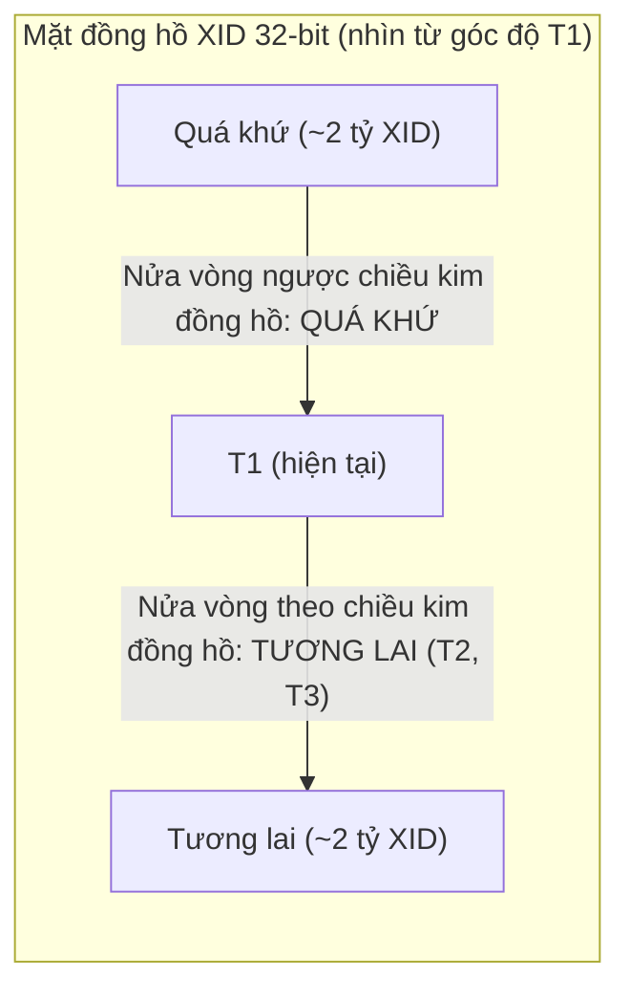
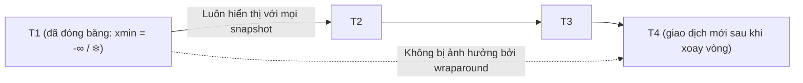
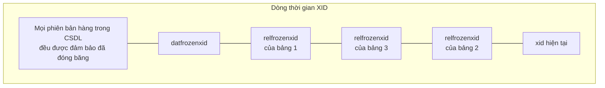

# CHƯƠNG 7: Đóng băng (Freezing)

## 7.1 Xoay vòng mã giao dịch (7.1 Transaction ID Wraparound)

Trong PostgreSQL, một mã giao dịch (transaction ID — XID) chiếm 32 bit. Bốn tỷ (4 tỷ) nghe có vẻ là một con số rất lớn, nhưng nó có thể bị dùng cạn rất nhanh nếu hệ thống được sử dụng tích cực. Ví dụ, với mức tải trung bình 1.000 giao dịch mỗi giây (không tính các giao dịch ảo — virtual transactions), số lượng mã này sẽ cạn kiệt sau khoảng sáu tuần vận hành liên tục.

Một khi tất cả các con số đã được sử dụng hết, bộ đếm phải được đặt lại để bắt đầu vòng tiếp theo (tình huống này được gọi là **“xoay vòng” — wraparound**). Tuy nhiên, một giao dịch có ID nhỏ hơn chỉ có thể được coi là cũ hơn một giao dịch có ID lớn hơn nếu các con số được cấp phát luôn tăng dần. Do đó, bộ đếm không thể đơn giản bắt đầu dùng lại các con số cũ sau khi đặt lại.

Việc cấp phát 64 bit cho các transaction ID lẽ ra đã loại bỏ hoàn toàn vấn đề này, vậy tại sao PostgreSQL không tận dụng điều đó? Vấn đề nằm ở chỗ mỗi header của tuple (bản ghi vật lý) phải lưu trữ ID cho hai giao dịch: `xmin` và `xmax` *(xem trang 73)*. Bản thân header đã khá lớn (ít nhất 24 byte nếu tính cả căn chỉnh dữ liệu — data alignment), và việc thêm bit sẽ tốn thêm 8 byte nữa.

PostgreSQL thực sự có triển khai các transaction ID 64-bit[^1] nhằm mở rộng XID thông thường bằng một epoch 32-bit, nhưng chúng chỉ được sử dụng nội bộ và không bao giờ được ghi vào các trang dữ liệu (data pages).

Để xử lý đúng tình huống xoay vòng, PostgreSQL phải so sánh **tuổi (age)** của các giao dịch (được định nghĩa là số lượng giao dịch kế tiếp đã xuất hiện kể từ khi giao dịch này bắt đầu) thay vì so sánh trực tiếp giá trị transaction ID. Vì vậy, thay vì dùng các thuật ngữ *nhỏ hơn (less than)* và *lớn hơn (greater than)*, chúng ta nên dùng các khái niệm *cũ hơn / đi trước (older / precedes)* và *trẻ hơn / theo sau (younger / follows)*.

Trong mã nguồn, phép so sánh này được triển khai đơn giản bằng phép toán số học 32-bit: đầu tiên tìm hiệu giữa hai transaction ID 32-bit, sau đó so sánh kết quả với 0.[^2]

> 📝 **Giải thích thêm (không có trong sách):**
> Trong ngôn ngữ C, phép trừ hai số nguyên không dấu 32-bit (`uint32`) khi ép kiểu về số nguyên có dấu 32-bit (`int32`) sẽ cho kết quả âm nếu khoảng cách theo chiều tăng nhỏ hơn $2^{31}$ (~2,14 tỷ). Cụ thể, trong `TransactionIdPrecedes(id1, id2)`, PostgreSQL tính `(int32)(id1 - id2) < 0`. Nhờ số học modulo $2^{32}$, ngay cả khi `id2` đã xoay vòng qua mốc $2^{32}-1$ về `5` còn `id1` là `4294967290`, thì `(int32)(4294967290 - 5) = -11 < 0`, nghĩa là `id1` vẫn được xác định chính xác là cũ hơn `id2` — miễn là khoảng cách giữa chúng không vượt quá $2^{31}$ giao dịch.

Để hình dung ý tưởng này rõ hơn, bạn có thể tưởng tượng dãy các transaction ID như một mặt đồng hồ. Đối với mỗi giao dịch, một nửa vòng tròn theo chiều kim đồng hồ sẽ nằm trong **tương lai (future)**, trong khi nửa còn lại nằm trong **quá khứ (past)**.



Tuy nhiên, hình dung này có một điểm bất cập khó chịu. Một giao dịch cũ (`T1`) nằm ở quá khứ xa xôi so với các giao dịch gần đây. Nhưng sớm muộn gì một giao dịch mới (`T3`) cũng sẽ nhìn thấy `T1` nằm ở nửa vòng tròn thuộc về *tương lai*. Nếu điều đó thực sự xảy ra, nó sẽ gây ra hậu quả thảm khốc: kể từ thời điểm đó, tất cả các giao dịch mới hơn sẽ không còn nhìn thấy các thay đổi do giao dịch `T1` tạo ra nữa.

[^1]: `include/access/transam.h`, kiểu `FullTransactionId`
[^2]: `backend/access/transam/transam.c`, hàm `TransactionIdPrecedes`

---

## 7.2 Đóng băng tuple và các quy tắc hiển thị (7.2 Tuple Freezing and Visibility Rules)

Để ngăn chặn hiện tượng “du hành thời gian” như vậy, quá trình dọn dẹp (`VACUUM`) thực hiện thêm một nhiệm vụ nữa (ngoài việc dọn dẹp trang):[^3] nó tìm kiếm các tuple nằm ngoài **đường chân trời cơ sở dữ liệu (database horizon)** *(xem trang 326)* (tức là chúng hiển thị trong mọi snapshot) và gắn thẻ chúng theo một cách đặc biệt, tức là **đóng băng (freeze)** chúng.

Đối với các tuple đã đóng băng, các quy tắc hiển thị (visibility rules) không cần phải xem xét `xmin` nữa vì các tuple này được biết chắc chắn là hiển thị trong mọi snapshot; do đó, transaction ID này có thể được tái sử dụng một cách an toàn.

Bạn có thể tưởng tượng rằng transaction ID `xmin` trong các tuple đã đóng băng được thay thế bằng một giá trị giả định là **“âm vô cực” (minus infinity)** (được minh họa như một bông tuyết); đây là dấu hiệu cho thấy tuple này được tạo bởi một giao dịch ở quá xa trong quá khứ đến mức ID thực tế của nó không còn quan trọng nữa. Tuy nhiên, trên thực tế `xmin` vẫn được giữ nguyên không đổi, còn thuộc tính đóng băng được xác định bởi sự kết hợp của hai bit gợi ý (hint bits): `committed` và `aborted`.



Nhiều tài liệu (bao gồm cả tài liệu chính thức của PostgreSQL) đề cập đến `FrozenTransactionId = 2`. Đó chính là giá trị “âm vô cực” mà tôi vừa nhắc đến — giá trị này từng được dùng để thay thế `xmin` trong các phiên bản trước 9.4, nhưng hiện nay các hint bit được sử dụng thay thế. Nhờ vậy, transaction ID gốc vẫn được giữ lại trong tuple, điều này rất thuận tiện cho cả việc gỡ lỗi (debugging) lẫn hỗ trợ kỹ thuật. Các hệ thống cũ vẫn có thể chứa `FrozenTransactionId` lỗi thời này, ngay cả khi chúng đã được nâng cấp lên các phiên bản cao hơn.

Transaction ID `xmax` không tham gia vào quá trình đóng băng theo bất kỳ cách nào. Nó chỉ tồn tại trong các tuple đã lỗi thời, và một khi các tuple đó không còn hiển thị trong bất kỳ snapshot nào nữa (nghĩa là `xmax` ID đã vượt qua đường chân trời cơ sở dữ liệu), chúng sẽ bị `VACUUM` dọn sạch.

Hãy tạo một bảng mới cho các thử nghiệm của chúng ta. Tham số `fillfactor` nên được đặt ở giá trị thấp nhất để mỗi trang chỉ chứa được hai tuple — bằng cách này sẽ dễ theo dõi tiến trình hơn. Chúng ta cũng sẽ tắt `autovacuum` để đảm bảo bảng chỉ được dọn dẹp khi có yêu cầu.

```sql
=> CREATE TABLE tfreeze(
  id integer,
  s char(300)
)
WITH (fillfactor = 10, autovacuum_enabled = off);
```

Chúng ta sẽ tạo thêm một phiên bản khác của hàm hiển thị các trang heap bằng cách sử dụng `pageinspect`. Làm việc trên một dải các trang, hàm này sẽ hiển thị giá trị của thuộc tính đóng băng (`f`) và tuổi của giao dịch `xmin` cho từng tuple (hàm sẽ phải gọi hàm hệ thống `age` — tất nhiên bản thân tuổi không được lưu trong các trang heap):

```sql
=> CREATE FUNCTION heap_page(
  relname text, pageno_from integer, pageno_to integer
)
RETURNS TABLE(
  ctid tid,
  state text,
  xmin text,
  xmin_age integer,
  xmax text
) AS $$
SELECT (pageno,lp)::text::tid AS ctid,
  CASE lp_flags
    WHEN 0 THEN 'unused'
    WHEN 1 THEN 'normal'
    WHEN 2 THEN 'redirect to '||lp_off
    WHEN 3 THEN 'dead'
  END AS state,
  t_xmin || CASE
    WHEN (t_infomask & 256+512) = 256+512 THEN ' f'
    WHEN (t_infomask & 256) > 0 THEN ' c'
    WHEN (t_infomask & 512) > 0 THEN ' a'
    ELSE ''
  END AS xmin,
  age(t_xmin) AS xmin_age,
  t_xmax || CASE
    WHEN (t_infomask & 1024) > 0 THEN ' c'
    WHEN (t_infomask & 2048) > 0 THEN ' a'
    ELSE ''
  END AS xmax
FROM generate_series(pageno_from, pageno_to) p(pageno),
  heap_page_items(get_raw_page(relname, pageno))
ORDER BY pageno, lp;
$$ LANGUAGE sql;
```

> 📝 **Giải thích thêm (không có trong sách):**
> Trong `t_infomask`:
> - `256` (`0x0100`) là `HEAP_XMIN_COMMITTED` (`c`).
> - `512` (`0x0200`) là `HEAP_XMIN_INVALID` / `aborted` (`a`).
> - Khi cả hai bit cùng được bật (`256 + 512 = 768`, tức `0x0300`), PostgreSQL hiểu đó là `HEAP_XMIN_FROZEN` (`f`). Một tuple không thể vừa `committed` vừa `aborted`, nên tổ hợp bit này được tận dụng để đánh dấu tuple đã đóng băng mà không tốn thêm bit nào trong header!

Bây giờ hãy chèn một số hàng vào bảng và chạy lệnh `VACUUM` để tạo ngay bản đồ hiển thị (visibility map).

```sql
=> CREATE EXTENSION IF NOT EXISTS pg_visibility;
=> INSERT INTO tfreeze(id, s)
  SELECT id, 'FOO'||id FROM generate_series(1,100) id;
INSERT 0 100
```

Chúng ta sẽ quan sát hai trang heap đầu tiên bằng extension `pg_visibility`. Khi quá trình vacuum hoàn tất, cả hai trang đều được gắn thẻ trong visibility map (`all_visible`), nhưng chưa được gắn thẻ trong bản đồ đóng băng — freeze map (`all_frozen`, có từ *phiên bản 9.6*), vì chúng vẫn chứa các tuple chưa được đóng băng:

```sql
=> VACUUM tfreeze;
=> SELECT *
FROM generate_series(0,1) g(blkno),
  pg_visibility_map('tfreeze',g.blkno)
ORDER BY g.blkno;
 blkno | all_visible | all_frozen
-------+-------------+------------
     0 | t           | f
     1 | t           | f
(2 rows)
```

Giá trị `xmin_age` của giao dịch đã tạo ra các hàng bằng `1` vì đó là giao dịch gần nhất được thực hiện trong hệ thống:

```sql
=> SELECT * FROM heap_page('tfreeze',0,1);
 ctid  | state  | xmin  | xmin_age | xmax
-------+--------+-------+----------+------
 (0,1) | normal | 856 c |        1 | 0 a
 (0,2) | normal | 856 c |        1 | 0 a
 (1,1) | normal | 856 c |        1 | 0 a
 (1,2) | normal | 856 c |        1 | 0 a
(4 rows)
```

[^3]: `postgresql.org/docs/14/routine-vacuuming.html#VACUUM-FOR-WRAPAROUND`

---

## 7.3 Quản lý quá trình đóng băng (7.3 Managing Freezing)

Có bốn tham số chính điều khiển quá trình đóng băng. Tất cả chúng đều biểu thị tuổi giao dịch (transaction age) và xác định khi nào các sự kiện sau xảy ra:

* Quá trình đóng băng bắt đầu (`vacuum_freeze_min_age`).
* Quá trình đóng băng tích cực được thực hiện (`vacuum_freeze_table_age`).
* Quá trình đóng băng bị cưỡng bức (`autovacuum_freeze_max_age`).
* Quá trình đóng băng được ưu tiên hàng đầu (*phiên bản 14*, `vacuum_failsafe_age`).

### Tuổi đóng băng tối thiểu (Minimal Freezing Age)

Tham số `vacuum_freeze_min_age` *(mặc định: 50 triệu)* xác định tuổi đóng băng tối thiểu của các giao dịch `xmin`. Giá trị này càng thấp thì chi phí phụ trội (overhead) càng cao: nếu một hàng đang “nóng” và liên tục bị thay đổi, việc đóng băng tất cả các phiên bản mới được tạo ra của nó sẽ là một nỗ lực lãng phí. Đặt tham số này ở một giá trị tương đối cao cho phép bạn chờ đợi thêm một thời gian.

Để quan sát quá trình đóng băng, hãy giảm giá trị tham số này xuống `1`:

```sql
=> ALTER SYSTEM SET vacuum_freeze_min_age = 1;
=> SELECT pg_reload_conf();
```

Bây giờ hãy cập nhật một hàng trong trang số `0`. Phiên bản hàng mới sẽ nằm vào cùng trang đó vì giá trị `fillfactor` khá nhỏ:

```sql
=> UPDATE tfreeze SET s = 'BAR' WHERE id = 1;
```

Tuổi của tất cả các giao dịch đã tăng thêm 1, và các trang heap lúc này trông như sau:

```sql
=> SELECT * FROM heap_page('tfreeze',0,1);
 ctid  | state  | xmin  | xmin_age | xmax
-------+--------+-------+----------+------
 (0,1) | normal | 856 c |        2 | 857
 (0,2) | normal | 856 c |        2 | 0 a
 (0,3) | normal | 857   |        1 | 0 a
 (1,1) | normal | 856 c |        2 | 0 a
 (1,2) | normal | 856 c |        2 | 0 a
(5 rows)
```

Tại thời điểm này, các tuple cũ hơn `vacuum_freeze_min_age = 1` thuộc diện cần được đóng băng. Nhưng `VACUUM` sẽ không xử lý bất kỳ trang nào đã được gắn thẻ trong visibility map *(xem trang 218)*:

```sql
=> SELECT * FROM generate_series(0,1) g(blkno),
  pg_visibility_map('tfreeze',g.blkno)
ORDER BY g.blkno;
 blkno | all_visible | all_frozen
-------+-------------+------------
     0 | f           | f
     1 | t           | f
(2 rows)
```

Lệnh `UPDATE` trước đó đã gỡ bỏ bit hiển thị (`all_visible`) của trang số `0`, vì vậy tuple có tuổi `xmin` phù hợp trong trang này sẽ được đóng băng. Tuy nhiên, trang số `1` sẽ bị bỏ qua hoàn toàn:

```sql
=> VACUUM tfreeze;
=> SELECT * FROM heap_page('tfreeze',0,1);
 ctid  |     state     | xmin  | xmin_age | xmax
-------+---------------+-------+----------+------
 (0,1) | redirect to 3 |       |          |
 (0,2) | normal        | 856 f |        2 | 0 a
 (0,3) | normal        | 857 c |        1 | 0 a
 (1,1) | normal        | 856 c |        2 | 0 a
 (1,2) | normal        | 856 c |        2 | 0 a
(5 rows)
```

Bây giờ trang số `0` xuất hiện trở lại trong visibility map, và nếu không có gì thay đổi trong trang này, `VACUUM` thông thường sẽ không quay lại trang này nữa:

```sql
=> SELECT * FROM generate_series(0,1) g(blkno),
  pg_visibility_map('tfreeze',g.blkno)
ORDER BY g.blkno;
 blkno | all_visible | all_frozen
-------+-------------+------------
     0 | t           | f
     1 | t           | f
(2 rows)
```

### Tuổi cho đóng băng tích cực (Age for Aggressive Freezing)

Như chúng ta vừa thấy, nếu một trang chỉ chứa các tuple hiện hành vốn đã hiển thị trong mọi snapshot, `VACUUM` thông thường sẽ không đóng băng chúng. Để khắc phục ràng buộc này, PostgreSQL cung cấp tham số `vacuum_freeze_table_age` *(mặc định: 150 triệu)*. Nó xác định tuổi giao dịch cho phép `VACUUM` bỏ qua visibility map, nhờ đó bất kỳ trang heap nào cũng có thể được đóng băng.

Đối với mỗi bảng, danh mục hệ thống (system catalog) lưu giữ một transaction ID mà từ đó trở về trước mọi giao dịch cũ hơn chắc chắn đều đã được đóng băng. Giá trị này được lưu dưới dạng `relfrozenxid`:

```sql
=> SELECT relfrozenxid, age(relfrozenxid)
FROM pg_class
WHERE relname = 'tfreeze';
 relfrozenxid | age
--------------+-----
          854 |   4
(1 row)
```

Chính tuổi của giao dịch này sẽ được so sánh với giá trị `vacuum_freeze_table_age` để quyết định xem đã đến lúc thực hiện đóng băng tích cực (aggressive freezing) hay chưa.

Nhờ có **freeze map** *(phiên bản 9.6)*, hệ thống không cần phải quét toàn bộ bảng (full table scan) trong quá trình vacuum: chỉ cần kiểm tra những trang chưa xuất hiện trong freeze map là đủ. Ngoài tối ưu hóa quan trọng này, freeze map còn mang lại khả năng chịu lỗi (fault tolerance): nếu quá trình vacuum bị gián đoạn, lần chạy tiếp theo sẽ không phải quay lại các trang đã được xử lý và đã được gắn thẻ trong bản đồ.

PostgreSQL thực hiện đóng băng tích cực tất cả các trang trong một bảng mỗi khi số lượng giao dịch trong hệ thống đạt đến ngưỡng `vacuum_freeze_table_age - vacuum_freeze_min_age` (nếu dùng các giá trị mặc định, điều này xảy ra sau mỗi 100 triệu giao dịch). Vì vậy, nếu giá trị `vacuum_freeze_min_age` quá lớn, nó có thể dẫn đến việc đóng băng quá mức và làm tăng chi phí phụ trội.

> 💡 **Ví dụ bổ sung (không có trong sách):**
> Giả sử `vacuum_freeze_table_age = 150.000.000` (mặc định).
> - Nếu `vacuum_freeze_min_age = 50.000.000` (mặc định): khi `age(relfrozenxid)` đạt 150 triệu, aggressive vacuum chạy và đóng băng mọi tuple có tuổi $\ge 50$ triệu. Do đó sau khi chạy xong, `relfrozenxid` mới sẽ lùi về cách hiện tại khoảng 50 triệu giao dịch (`age(relfrozenxid) ≈ 50.000.000`). Như vậy phải mất thêm **100 triệu** giao dịch nữa (`150M - 50M`) thì `age(relfrozenxid)` mới chạm lại mốc 150 triệu.
> - Nếu bạn chỉnh `vacuum_freeze_min_age = 140.000.000`: sau khi aggressive vacuum xong, `age(relfrozenxid) ≈ 140.000.000`, nghĩa là chỉ **10 triệu** giao dịch sau bảng lại phải chạy aggressive vacuum lần nữa — gây tốn I/O không cần thiết!

Để đóng băng toàn bộ bảng, hãy giảm giá trị `vacuum_freeze_table_age` xuống `4`; khi đó điều kiện để đóng băng tích cực sẽ được thỏa mãn:

```sql
=> ALTER SYSTEM SET vacuum_freeze_table_age = 4;
=> SELECT pg_reload_conf();
```

Chạy lệnh `VACUUM`:

```sql
=> VACUUM VERBOSE tfreeze;
INFO:  aggressively vacuuming "public.tfreeze"
INFO:  table "tfreeze": found 0 removable, 100 nonremovable row versions in 50 out of 50 pages
DETAIL:  0 dead row versions cannot be removed yet, oldest xmin: 858
Skipped 0 pages due to buffer pins, 0 frozen pages.
CPU: user: 0.00 s, system: 0.00 s, elapsed: 0.00 s.
VACUUM
```

Bây giờ khi toàn bộ bảng đã được phân tích, giá trị `relfrozenxid` có thể được đẩy tiến lên — các trang heap được đảm bảo không còn giao dịch `xmin` nào cũ hơn mà chưa được đóng băng:

```sql
=> SELECT relfrozenxid, age(relfrozenxid)
FROM pg_class
WHERE relname = 'tfreeze';
 relfrozenxid | age
--------------+-----
          857 |   1
(1 row)
```

Trang đầu tiên (trang 0) lúc này chứa tuple đã đóng băng và tuple mới chưa đóng băng (do tuổi mới bằng 1, chưa cũ hơn `vacuum_freeze_min_age = 1`), còn trang số `1` chỉ chứa toàn các tuple đã đóng băng:

```sql
=> SELECT * FROM heap_page('tfreeze',0,1);
 ctid  |     state     | xmin  | xmin_age | xmax
-------+---------------+-------+----------+------
 (0,1) | redirect to 3 |       |          |
 (0,2) | normal        | 856 f |        2 | 0 a
 (0,3) | normal        | 857 c |        1 | 0 a
 (1,1) | normal        | 856 f |        2 | 0 a
 (1,2) | normal        | 856 f |        2 | 0 a
(5 rows)
```

Bên cạnh đó, trang số `1` đã được gắn thẻ trong freeze map (`all_frozen = t`):

```sql
=> SELECT * FROM generate_series(0,1) g(blkno),
  pg_visibility_map('tfreeze',g.blkno)
ORDER BY g.blkno;
 blkno | all_visible | all_frozen
-------+-------------+------------
     0 | t           | f
     1 | t           | t
(2 rows)
```

### Tuổi cho Autovacuum cưỡng bức (Age for Forced Autovacuum)

Đôi khi việc cấu hình hai tham số vừa thảo luận ở trên là chưa đủ để đóng băng các tuple kịp thời. `Autovacuum` có thể bị tắt, trong khi `VACUUM` thông thường lại không được gọi chút nào (đây là một ý tưởng rất tồi, nhưng về mặt kỹ thuật là có thể xảy ra). Ngoài ra, một số cơ sở dữ liệu không hoạt động (như `template0`) có thể không được vacuum *(xem trang 221)*. PostgreSQL có thể xử lý những tình huống như vậy bằng cách cưỡng bức chạy `autovacuum` ở chế độ tích cực (aggressive mode).

`Autovacuum` bị cưỡng bức chạy[^4] (ngay cả khi nó đã bị tắt) khi có nguy cơ tuổi của một số transaction ID chưa được đóng băng trong cơ sở dữ liệu sẽ vượt quá giá trị `autovacuum_freeze_max_age` *(mặc định: 200 triệu)*. Quyết định này được đưa ra dựa trên tuổi của giao dịch `pg_class.relfrozenxid` cũ nhất trong tất cả các bảng, vì mọi giao dịch cũ hơn thế đều được đảm bảo đã đóng băng. ID của giao dịch này được lưu trong danh mục hệ thống:

```sql
=> SELECT datname, datfrozenxid, age(datfrozenxid) FROM pg_database;
  datname  | datfrozenxid | age
-----------+--------------+-----
 postgres  |          726 | 132
 template1 |          726 | 132
 template0 |          726 | 132
 internals |          726 | 132
(4 rows)
```



Giới hạn tối đa cho `autovacuum_freeze_max_age` được đặt ở mức 2 tỷ giao dịch (nhỏ hơn một chút so với một nửa vòng tròn), trong khi giá trị mặc định nhỏ hơn 10 lần (200 triệu). Điều này có lý do chính đáng: một giá trị quá lớn sẽ làm tăng nguy cơ xoay vòng transaction ID, vì PostgreSQL có thể không kịp đóng băng tất cả các tuple cần thiết. Trong trường hợp đó, máy chủ buộc phải dừng hoạt động ngay lập tức để ngăn ngừa các sự cố có thể xảy ra và quản trị viên sẽ phải khởi động lại máy chủ.

Giá trị `autovacuum_freeze_max_age` cũng ảnh hưởng đến kích thước của `CLOG` *(xem trang 81)*. Không cần phải lưu giữ trạng thái của các giao dịch đã đóng băng, và mọi giao dịch đứng trước giao dịch có `datfrozenxid` cũ nhất trong cluster chắc chắn đều đã được đóng băng. Những tệp `CLOG` không còn cần thiết nữa sẽ bị `autovacuum` xóa bỏ.[^5]

Việc thay đổi tham số `autovacuum_freeze_max_age` đòi hỏi phải khởi động lại máy chủ. Tuy nhiên, tất cả các thiết lập đóng băng đã thảo luận ở trên cũng có thể được điều chỉnh ở cấp độ từng bảng thông qua các tham số lưu trữ (storage parameters) tương ứng. Lưu ý rằng tên của tất cả các tham số này đều bắt đầu bằng “auto”:

* `autovacuum_freeze_min_age` và `toast.autovacuum_freeze_min_age`
* `autovacuum_freeze_table_age` và `toast.autovacuum_freeze_table_age`
* `autovacuum_freeze_max_age` và `toast.autovacuum_freeze_max_age`

### Tuổi cho đóng băng an toàn dự phòng (Age for Failsafe Freezing)

*(Phiên bản 14)*

Nếu `autovacuum` đang phải vật lộn để ngăn chặn tình trạng xoay vòng transaction ID và rõ ràng đây là một cuộc chạy đua với thời gian, một công tắc an toàn sẽ được kích hoạt: `autovacuum` sẽ bỏ qua giá trị của tham số `autovacuum_vacuum_cost_delay` (`vacuum_cost_delay`) và sẽ ngừng việc vacuum các chỉ mục (index) để tập trung đóng băng các tuple trong heap càng nhanh càng tốt.

Chế độ đóng băng an toàn dự phòng (failsafe freezing mode)[^6] được kích hoạt nếu có nguy cơ tuổi của một giao dịch chưa đóng băng trong cơ sở dữ liệu vượt quá giá trị `vacuum_failsafe_age` *(mặc định: 1,6 tỷ)*. Giá trị này được giả định là phải cao hơn `autovacuum_freeze_max_age`.

[^4]: `backend/access/transam/varsup.c`, hàm `SetTransactionIdLimit`
[^5]: `backend/commands/vacuum.c`, hàm `vac_truncate_clog`
[^6]: `backend/access/heap/vacuumlazy.c`, hàm `lazy_check_wraparound_failsafe`

---

## 7.4 Đóng băng thủ công (7.4 Manual Freezing)

Đôi khi việc quản lý đóng băng thủ công lại thuận tiện hơn là dựa vào `autovacuum`.

### Đóng băng bằng Vacuum (Freezing by Vacuum)

Bạn có thể chủ động đóng băng bằng cách gọi lệnh `VACUUM FREEZE`. Lệnh này sẽ đóng băng tất cả các tuple trong heap bất kể tuổi giao dịch của chúng là bao nhiêu, tương đương với việc đặt `vacuum_freeze_min_age = 0`.

Nếu mục đích *(phiên bản 12)* của lệnh gọi như vậy là để đóng băng các tuple heap càng sớm càng tốt, việc tắt hoàn toàn quá trình vacuum chỉ mục là điều hợp lý, giống như cách làm trong chế độ failsafe. Bạn có thể làm điều đó một cách tường minh bằng cách chạy lệnh `VACUUM (FREEZE, INDEX_CLEANUP false)`, hoặc thông qua tham số lưu trữ `vacuum_index_cleanup`. Rõ ràng là không nên làm điều này một cách thường xuyên vì khi đó `VACUUM` sẽ không hoàn thành tốt nhiệm vụ chính của nó là dọn dẹp trang.

### Đóng băng dữ liệu khi nạp lần đầu (Freezing Data at the Initial Loading)

Dữ liệu dự kiến không thay đổi có thể được đóng băng ngay lập tức trong khi đang được nạp vào cơ sở dữ liệu. Điều này được thực hiện bằng cách chạy lệnh `COPY` với tùy chọn `FREEZE`.

Các tuple chỉ có thể được đóng băng trong quá trình nạp lần đầu nếu bảng đích đã được tạo (`CREATE TABLE`) hoặc bị làm rỗng (`TRUNCATE`) trong **cùng một giao dịch đó**, vì cả hai thao tác này đều chiếm giữ khóa độc quyền (exclusive lock) *(xem trang 315)* trên bảng. Ràng buộc này là cần thiết bởi vì các tuple đã đóng băng được kỳ vọng sẽ hiển thị trong mọi snapshot, bất kể mức độ cô lập (isolation level); nếu không có khóa này, các giao dịch khác sẽ đột nhiên nhìn thấy các tuple vừa được đóng băng ngay khi chúng đang được tải lên. Nhưng khi khóa đã được giữ, các giao dịch khác sẽ không thể truy cập vào bảng này.

Tuy nhiên, về mặt kỹ thuật vẫn có thể phá vỡ tính cô lập (isolation). Hãy bắt đầu một giao dịch mới ở mức cô lập `Repeatable Read` trong một phiên (session) riêng biệt:

```sql
=> BEGIN ISOLATION LEVEL REPEATABLE READ;
=> SELECT 1; -- snapshot được tạo tại đây
```

Làm rỗng bảng `tfreeze` bằng `TRUNCATE` và chèn các hàng mới vào bảng này trong cùng một giao dịch. (Nếu giao dịch chỉ đọc kia trước đó đã truy cập vào bảng `tfreeze` rồi, thì lệnh `TRUNCATE` sẽ bị chặn.)

```sql
=> BEGIN;
=> TRUNCATE tfreeze;
=> COPY tfreeze FROM stdin WITH FREEZE;
1	FOO
2	BAR
3	BAZ
\.
=> COMMIT;
```

Bây giờ giao dịch đang đọc kia cũng nhìn thấy dữ liệu mới:

```sql
=> SELECT count(*) FROM tfreeze;
 count
-------
     3
(1 row)
=> COMMIT;
```

> 📝 **Giải thích thêm (không có trong sách):**
> Theo chuẩn SQL và hành vi của `REPEATABLE READ` trong PostgreSQL, giao dịch đọc chỉ nên nhìn thấy dữ liệu tại thời điểm snapshot của nó được tạo (lúc chạy `SELECT 1`, khi bảng `tfreeze` vẫn còn 100 hàng cũ). Tuy nhiên, vì `COPY ... WITH FREEZE` đánh dấu các hàng mới là đã đóng băng ngay lập tức và `TRUNCATE` thay thế tệp vật lý của bảng mà không giữ lại các phiên bản cũ, nên khi giao dịch `REPEATABLE READ` đọc `tfreeze` lần đầu tiên, nó thấy 3 hàng mới tinh vừa được nạp — vi phạm tính cô lập snapshot.

Điều này đúng là có phá vỡ tính cô lập, nhưng vì việc nạp dữ liệu hiếm khi xảy ra thường xuyên nên trong hầu hết các trường hợp nó sẽ không gây ra vấn đề gì.

Nếu bạn nạp dữ liệu có đóng băng *(phiên bản 14)*, visibility map được tạo ngay lập tức, và header của các trang nhận được thuộc tính hiển thị *(xem trang 215)*:

```sql
=> SELECT * FROM pg_visibility_map('tfreeze',0);
 all_visible | all_frozen
-------------+------------
 t           | t
(1 row)
=> SELECT flags & 4 > 0 AS all_visible
FROM page_header(get_raw_page('tfreeze',0));
 all_visible
-------------
 t
(1 row)
```

Do đó *(phiên bản 14)*, nếu dữ liệu đã được nạp với tùy chọn đóng băng, bảng sẽ không bị `VACUUM` xử lý lại nữa (miễn là dữ liệu không thay đổi). Đáng tiếc là tính năng này vẫn chưa được hỗ trợ cho các bảng `TOAST`: nếu một giá trị quá cỡ (oversized value) được nạp vào, `VACUUM` vẫn sẽ phải ghi lại toàn bộ bảng `TOAST` để thiết lập các thuộc tính hiển thị trong tất cả các header trang.

---

## Bảng thuật ngữ chương (Chapter Glossary)

| Thuật ngữ (English) | Tiếng Việt | Giải thích ngắn gọn |
|---|---|---|
| Transaction ID (XID) | Mã giao dịch | Định danh 32-bit duy nhất được cấp phát cho mỗi giao dịch ghi trong PostgreSQL. |
| Wraparound | Xoay vòng mã giao dịch | Hiện tượng bộ đếm XID 32-bit dùng hết 4 tỷ giá trị và quay lại từ đầu, gây nguy cơ giao dịch cũ bị hiểu nhầm là ở tương lai. |
| Epoch | Kỷ nguyên (Epoch) | Phần mở rộng 32-bit kết hợp với XID 32-bit để tạo thành `FullTransactionId` 64-bit dùng nội bộ trong PostgreSQL. |
| Tuple Freezing | Đóng băng tuple | Quá trình đánh dấu một tuple đã quá cũ (chắc chắn hiển thị trong mọi snapshot) bằng hint bits để không cần kiểm tra `xmin` nữa. |
| Hint bits | Bit gợi ý | Các bit trong `t_infomask` của tuple header lưu trạng thái `committed`/`aborted` của `xmin`/`xmax`; khi cả hai bit của `xmin` bật nghĩa là đã đóng băng (`frozen`). |
| Visibility Map (VM) | Bản đồ hiển thị | Cấu trúc phụ trợ theo dõi các trang chỉ chứa tuple hiển thị với mọi giao dịch (`all_visible`). |
| Freeze Map | Bản đồ đóng băng | Một bit thứ hai trong Visibility Map (`all_frozen`) đánh dấu các trang mà mọi tuple bên trong đều đã được đóng băng. |
| `relfrozenxid` | XID đóng băng của bảng | Giá trị XID lưu trong `pg_class` đảm bảo mọi giao dịch cũ hơn nó trong bảng đều đã được đóng băng. |
| `datfrozenxid` | XID đóng băng của cơ sở dữ liệu | Giá trị `relfrozenxid` cũ nhất trong tất cả các bảng của một CSDL, lưu trong `pg_database`. |
| Aggressive Freezing | Đóng băng tích cực | Chế độ `VACUUM` bỏ qua visibility map để quét và đóng băng các trang chưa được đánh dấu `all_frozen` khi tuổi `relfrozenxid` vượt `vacuum_freeze_table_age`. |
| Failsafe Freezing | Đóng băng an toàn dự phòng | Cơ chế khẩn cấp (từ PostgreSQL 14) bỏ qua giới hạn tốc độ (`cost_delay`) và bỏ qua dọn dẹp index để đóng băng heap nhanh nhất khi chạm ngưỡng `vacuum_failsafe_age`. |
| `CLOG` (Commit Log) | Nhật ký xác nhận giao dịch | Cấu trúc (`pg_xact`) lưu trạng thái commit/abort của các giao dịch; các tệp cũ hơn `datfrozenxid` nhỏ nhất toàn cluster sẽ bị xóa. |
