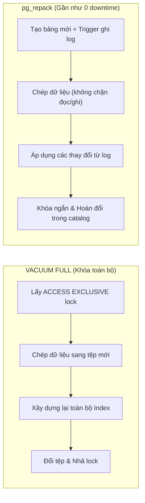

# CHƯƠNG 8: Xây dựng lại Bảng và Chỉ mục (8 Rebuilding Tables and Indexes)

## 8.1 Dọn dẹp toàn bộ (8.1 Full Vacuuming)

### Tại sao dọn dẹp định kỳ là chưa đủ? (Why is Routine Vacuuming not Enough?)

Dọn dẹp định kỳ (routine vacuuming) có thể giải phóng nhiều không gian hơn so với cắt tỉa trang (page pruning), nhưng đôi khi vẫn chưa đủ.

Nếu các tệp của bảng hoặc chỉ mục (index) đã phình to về kích thước, `VACUUM` có thể dọn sạch một phần không gian bên trong các trang (pages), nhưng hiếm khi giảm được số lượng trang. Không gian được thu hồi chỉ có thể được trả lại cho hệ điều hành nếu có nhiều trang trống xuất hiện ở phần cuối cùng của tệp, điều này không xảy ra quá thường xuyên.

Kích thước quá lớn có thể dẫn đến những hậu quả khó chịu:

- Quét toàn bộ bảng (full table scan) hoặc quét toàn bộ chỉ mục (full index scan) sẽ mất nhiều thời gian hơn.
- Có thể cần đến bộ nhớ đệm (buffer cache) lớn hơn (các trang được lưu vào cache theo cả khối, nên mật độ dữ liệu giảm xuống).
- Cây B-tree có thể tăng thêm một tầng, làm chậm quá trình truy cập chỉ mục.
- Các tệp chiếm thêm dung lượng trên đĩa và trong các bản sao lưu (backups).

Nếu tỷ lệ dữ liệu hữu ích trong một tệp giảm xuống dưới một mức hợp lý, quản trị viên có thể thực hiện dọn dẹp toàn bộ (full vacuuming) bằng cách chạy lệnh `VACUUM FULL`.[^1] Trong trường hợp này, bảng và tất cả các chỉ mục của nó được xây dựng lại từ đầu, và dữ liệu được nén chặt nhất có thể (có tính đến tham số `fillfactor`).

Khi thực hiện dọn dẹp toàn bộ, PostgreSQL trước tiên xây dựng lại hoàn toàn bảng và sau đó là từng chỉ mục của nó. Trong khi một đối tượng đang được xây dựng lại, cả tệp cũ và tệp mới đều phải được lưu trữ trên đĩa,[^2] vì vậy quá trình này có thể đòi hỏi rất nhiều dung lượng trống.

Bạn cũng cần lưu ý rằng thao tác này khóa hoàn toàn quyền truy cập vào bảng, cho cả đọc và ghi.

> 📝 **Giải thích thêm (không có trong sách):** Lệnh `VACUUM FULL` yêu cầu khóa `ACCESS EXCLUSIVE` trên bảng trong suốt thời gian thực thi. Điều này đồng nghĩa mọi truy vấn `SELECT`, `INSERT`, `UPDATE`, `DELETE` đều bị chặn và phải xếp hàng chờ cho đến khi `VACUUM FULL` hoàn tất. Vì vậy trên hệ thống production có lưu lượng cao, việc chạy `VACUUM FULL` có thể gây gián đoạn dịch vụ (downtime).

### Ước tính mật độ dữ liệu (Estimating Data Density)

Để minh họa, hãy chèn một số dòng vào bảng:

```sql
=> TRUNCATE vac;
=> INSERT INTO vac(id,s)
SELECT id, id::text FROM generate_series(1,500000) id;
```

Mật độ lưu trữ (storage density) có thể được ước tính bằng tiện ích mở rộng (extension) `pgstattuple`:

```sql
=> CREATE EXTENSION pgstattuple;
=> SELECT * FROM pgstattuple('vac') \gx
−[ RECORD 1 ]−−−−−−+−−−−−−−−−
table_len          | 70623232
tuple_count        | 500000
tuple_len          | 64500000
tuple_percent      | 91.33
dead_tuple_count   | 0
dead_tuple_len     | 0
dead_tuple_percent | 0
free_space         | 381844
free_percent       | 0.54
```

Hàm này đọc toàn bộ bảng và hiển thị thống kê về phân bố không gian trong các tệp của bảng. Trường `tuple_percent` cho thấy phần trăm không gian được sử dụng bởi dữ liệu hữu ích (các heap tuple). Giá trị này chắc chắn luôn nhỏ hơn 100% do có các siêu dữ liệu (metadata) khác nhau bên trong các trang, nhưng trong ví dụ này nó vẫn khá cao.

Đối với chỉ mục, thông tin hiển thị có đôi chút khác biệt, nhưng trường `avg_leaf_density` mang ý nghĩa tương tự: nó cho thấy phần trăm dữ liệu hữu ích (trong các trang lá của cây B-tree).

```sql
=> SELECT * FROM pgstatindex('vac_s') \gx
−[ RECORD 1 ]−−−−−−+−−−−−−−−−−
version            | 4
tree_level         | 3
index_size         | 114302976
root_block_no      | 2825
internal_pages     | 376
leaf_pages         | 13576
empty_pages        | 0
deleted_pages      | 0
avg_leaf_density   | 53.88
leaf_fragmentation | 10.59
```

Các hàm `pgstattuple` vừa dùng ở trên đọc toàn bộ bảng hoặc chỉ mục để lấy số liệu thống kê chính xác. Đối với các đối tượng lớn, việc này có thể quá tốn kém, nên extension này cũng cung cấp một hàm khác gọi là `pgstattuple_approx`, hàm này bỏ qua các trang được theo dõi trong bản đồ hiển thị (visibility map) để đưa ra các con số xấp xỉ.

Một phương pháp nhanh hơn nhưng kém chính xác hơn là ước tính sơ bộ tỷ lệ giữa khối lượng dữ liệu và kích thước tệp bằng cách sử dụng danh mục hệ thống (system catalog).[^3]

Dưới đây là kích thước hiện tại của bảng và chỉ mục của nó:

```sql
=> SELECT pg_size_pretty(pg_table_size('vac')) AS table_size,
pg_size_pretty(pg_indexes_size('vac')) AS index_size;
 table_size | index_size
−−−−−−−−−−−−+−−−−−−−−−−−−
 67 MB      | 109 MB
(1 row)
```

Bây giờ hãy xóa 90% tổng số dòng:

```sql
=> DELETE FROM vac WHERE id % 10 != 0;
DELETE 450000
```

Dọn dẹp định kỳ không làm thay đổi kích thước tệp vì không có trang trống nào ở cuối tệp:

```sql
=> VACUUM vac;
=> SELECT pg_size_pretty(pg_table_size('vac')) AS table_size,
pg_size_pretty(pg_indexes_size('vac')) AS index_size;
 table_size | index_size
−−−−−−−−−−−−+−−−−−−−−−−−−
 67 MB      | 109 MB
(1 row)
```

Tuy nhiên, mật độ dữ liệu đã giảm khoảng 10 lần:

```sql
=> SELECT vac.tuple_percent, vac_s.avg_leaf_density
FROM pgstattuple('vac') vac, pgstatindex('vac_s') vac_s;
 tuple_percent | avg_leaf_density
−−−−−−−−−−−−−−−+−−−−−−−−−−−−−−−−−−
          9.13 |             6.71
(1 row)
```

Bảng và chỉ mục hiện đang nằm trong các tệp sau:

```sql
=> SELECT pg_relation_filepath('vac') AS vac_filepath,
pg_relation_filepath('vac_s') AS vac_s_filepath \gx
−[ RECORD 1 ]−−+−−−−−−−−−−−−−−−−−
vac_filepath   | base/16391/16514
vac_s_filepath | base/16391/16515
```

Hãy kiểm tra những gì chúng ta sẽ nhận được sau khi chạy `VACUUM FULL`.

Trong khi lệnh đang chạy (từ PostgreSQL 12 trở lên), tiến trình của nó có thể được theo dõi trong view `pg_stat_progress_cluster` (tương tự như view `pg_stat_progress_vacuum` được cung cấp cho `VACUUM`):

```sql
=> VACUUM FULL vac;
=> SELECT * FROM pg_stat_progress_cluster \gx
−[ RECORD 1 ]−−−−−−−+−−−−−−−−−−−−−−−−−
pid                 | 19488
datid               | 16391
datname             | internals
relid               | 16479
command             | VACUUM FULL
phase               | rebuilding index
cluster_index_relid | 0
heap_tuples_scanned | 50000
heap_tuples_written | 50000
heap_blks_total     | 8621
heap_blks_scanned   | 8621
index_rebuild_count | 0
```

Đúng như dự đoán, các giai đoạn (phases) của `VACUUM FULL`[^4] khác với các giai đoạn của dọn dẹp định kỳ.

Dọn dẹp toàn bộ đã thay thế các tệp cũ bằng các tệp mới:

```sql
=> SELECT pg_relation_filepath('vac') AS vac_filepath,
pg_relation_filepath('vac_s') AS vac_s_filepath \gx
−[ RECORD 1 ]−−+−−−−−−−−−−−−−−−−−
vac_filepath   | base/16391/16526
vac_s_filepath | base/16391/16529
```

Cả kích thước chỉ mục và bảng giờ đây đều nhỏ hơn nhiều:

```sql
=> SELECT pg_size_pretty(pg_table_size('vac')) AS table_size,
pg_size_pretty(pg_indexes_size('vac')) AS index_size;
 table_size | index_size
−−−−−−−−−−−−+−−−−−−−−−−−−
 6904 kB    | 6504 kB
(1 row)
```

Kết quả là mật độ dữ liệu đã tăng lên. Đối với chỉ mục, mật độ thậm chí còn cao hơn ban đầu: việc tạo một cây B-tree từ đầu dựa trên dữ liệu sẵn có hiệu quả hơn so với việc chèn từng mục nhập theo từng dòng vào một chỉ mục đã tồn tại:

```sql
=> SELECT vac.tuple_percent,
vac_s.avg_leaf_density
FROM pgstattuple('vac') vac,
pgstatindex('vac_s') vac_s;
 tuple_percent | avg_leaf_density
−−−−−−−−−−−−−−−+−−−−−−−−−−−−−−−−−−
         91.23 |            91.08
(1 row)
```

> 💡 **Ví dụ bổ sung (không có trong sách):** Khi bạn muốn kiểm tra nhanh các bảng bị phình (bloat) trên một database lớn mà không muốn chạy `pgstattuple` (vì nó quét toàn bộ bảng), bạn có thể dùng `pgstattuple_approx('ten_bang')`:
> ```sql
> SELECT approx_tuple_percent, approx_free_percent, dead_tuple_percent
> FROM pgstattuple_approx('vac');
> ```
> Hàm này chỉ đọc các trang chưa được đánh dấu `all-visible` trong visibility map, giúp giảm đáng kể I/O.

### Đóng băng (Freezing)

Khi bảng đang được xây dựng lại, PostgreSQL sẽ đóng băng (freeze) các tuple của nó vì thao tác này hầu như không tốn thêm chi phí nào so với phần công việc còn lại:

```sql
=> SELECT * FROM heap_page('vac',0,0) LIMIT 5;
 ctid  | state  | xmin  | xmin_age | xmax
−−−−−−−+−−−−−−−−+−−−−−−−+−−−−−−−−−−+−−−−−−
 (0,1) | normal | 861 f |        5 | 0 a
 (0,2) | normal | 861 f |        5 | 0 a
 (0,3) | normal | 861 f |        5 | 0 a
 (0,4) | normal | 861 f |        5 | 0 a
 (0,5) | normal | 861 f |        5 | 0 a
(5 rows)
```

Nhưng các trang không được đăng ký vào bản đồ hiển thị (visibility map) cũng như bản đồ đóng băng (freeze map), và phần tiêu đề trang (page header) không nhận được thuộc tính hiển thị (như khi thực thi lệnh `COPY` với tùy chọn `FREEZE`):

```sql
=> SELECT * FROM pg_visibility_map('vac',0);
 all_visible | all_frozen
−−−−−−−−−−−−−+−−−−−−−−−−−−
 f           | f
(1 row)

=> SELECT flags & 4 > 0 all_visible
FROM page_header(get_raw_page('vac',0));
 all_visible
−−−−−−−−−−−−−
 f
(1 row)
```

Tình trạng này chỉ được cải thiện sau khi `VACUUM` được gọi (hoặc autovacuum được kích hoạt):

```sql
=> VACUUM vac;
=> SELECT * FROM pg_visibility_map('vac',0);
 all_visible | all_frozen
−−−−−−−−−−−−−+−−−−−−−−−−−−
 t           | t
(1 row)

=> SELECT flags & 4 > 0 AS all_visible
FROM page_header(get_raw_page('vac',0));
 all_visible
−−−−−−−−−−−−−
 t
(1 row)
```

Về bản chất, điều này có nghĩa là ngay cả khi tất cả các tuple trong một trang đều nằm ngoài đường chân trời cơ sở dữ liệu (database horizon), trang đó vẫn sẽ phải được ghi lại (rewritten) một lần nữa.

> 📝 **Giải thích thêm (không có trong sách):** Vì `VACUUM FULL` không cập nhật visibility map ngay lúc xây dựng lại tệp mới, nên sau khi chạy `VACUUM FULL` trên một bảng lớn, các truy vấn `Index-Only Scan` có thể vẫn phải đọc heap page cho đến khi `VACUUM` (hoặc `ANALYZE`/`VACUUM`) chạy lại để thiết lập các bit `all_visible` và `all_frozen` trong visibility map. Do đó, chạy `VACUUM ANALYZE ten_bang;` sau `VACUUM FULL` là một thói quen rất tốt.

---

## 8.2 Các phương pháp xây dựng lại khác (8.2 Other Rebuilding Methods)

### Các lựa chọn thay thế cho Full Vacuuming (Alternatives to Full Vacuuming)

Ngoài `VACUUM FULL`, còn có một số lệnh khác có thể xây dựng lại hoàn toàn bảng và chỉ mục. Tất cả chúng đều khóa độc quyền (exclusively lock) bảng, tất cả đều xóa các tệp dữ liệu cũ và tạo mới lại từ đầu.

Lệnh `CLUSTER` hoàn toàn tương tự như `VACUUM FULL`, nhưng nó còn sắp xếp lại thứ tự các tuple trong tệp dựa trên một trong các chỉ mục hiện có. Trong một số trường hợp, điều này có thể giúp bộ lập kế hoạch (planner) sử dụng quét chỉ mục (index scans) hiệu quả hơn. Nhưng bạn cần lưu ý rằng tính chất phân cụm (clusterization) không được duy trì tự động: tất cả các cập nhật bảng sau đó sẽ phá vỡ thứ tự vật lý của các tuple.

Về mặt lập trình, `VACUUM FULL` thực chất chỉ là một trường hợp đặc biệt của lệnh `CLUSTER` không yêu cầu sắp xếp lại tuple.[^5]

Lệnh `REINDEX` xây dựng lại một hoặc nhiều chỉ mục.[^6] Thực tế, `VACUUM FULL` và `CLUSTER` sử dụng lệnh này bên dưới khi xây dựng lại chỉ mục.

Lệnh `TRUNCATE`[^7] xóa toàn bộ các dòng trong bảng; nó tương đương về mặt logic với `DELETE` chạy không có mệnh đề `WHERE`. Nhưng trong khi `DELETE` chỉ đánh dấu các heap tuple là đã bị xóa (nên chúng vẫn phải được dọn dẹp bằng vacuum), `TRUNCATE` tạo ra một tệp trống mới, điều này thường nhanh hơn.

> 💡 **Ví dụ bổ sung (không có trong sách):** Nếu chỉ có chỉ mục bị phình to còn bảng vẫn gọn, bạn không cần chạy `VACUUM FULL` (vốn khóa cả bảng lẫn chỉ mục). Từ PostgreSQL 12 trở đi, bạn có thể dùng `REINDEX INDEX CONCURRENTLY ten_chi_muc;` hoặc `REINDEX TABLE CONCURRENTLY ten_bang;` để xây dựng lại chỉ mục mà không chặn đọc/ghi trên bảng.

### Giảm thời gian ngừng hoạt động khi xây dựng lại (Reducing Downtime During Rebuilding)

`VACUUM FULL` không được thiết kế để chạy thường xuyên, vì nó khóa độc quyền bảng (ngay cả đối với các truy vấn đọc) trong suốt thời gian hoạt động. Điều này thường không thể chấp nhận được đối với các hệ thống có tính sẵn sàng cao (highly available systems).

Có một số tiện ích mở rộng (chẳng hạn như `pg_repack`[^8]) có thể xây dựng lại bảng và chỉ mục với thời gian ngừng hoạt động (downtime) gần như bằng không. Khóa độc quyền vẫn cần thiết, nhưng chỉ ở lúc bắt đầu và lúc kết thúc quá trình này, và chỉ trong một thời gian rất ngắn. Điều này đạt được nhờ một cơ chế triển khai phức tạp hơn: tất cả các thay đổi được thực hiện trên bảng gốc trong khi nó đang được xây dựng lại sẽ được lưu lại bởi một trigger và sau đó được áp dụng lên bảng mới. Để hoàn tất thao tác, tiện ích sẽ hoán đổi bảng này với bảng kia trong danh mục hệ thống (system catalog).

Một giải pháp khác biệt được cung cấp bởi tiện ích `pgcompacttable`.[^9] Nó thực hiện nhiều lần cập nhật dòng giả (fake row updates — không làm thay đổi bất kỳ dữ liệu nào) để các phiên bản dòng hiện tại dần dần di chuyển về phía đầu tệp.

Giữa các loạt cập nhật này, quá trình dọn dẹp (vacuuming) sẽ loại bỏ các tuple lỗi thời và cắt ngắn (truncate) dần tệp từng chút một. Cách tiếp cận này tốn nhiều thời gian và tài nguyên hơn, nhưng không đòi hỏi dung lượng đĩa dư để xây dựng lại bảng và không gây ra các đợt tăng tải đột biến (load spikes). Các khóa độc quyền ngắn hạn vẫn được lấy trong khi bảng bị cắt ngắn, nhưng quá trình vacuum xử lý chúng khá mượt mà.



---

## 8.3 Các biện pháp phòng ngừa (8.3 Precautions)

### Các truy vấn chỉ đọc (Read-Only Queries)

Một trong những nguyên nhân gây phình tệp (file bloating) là việc thực thi các giao dịch chạy dài (long-running transactions) giữ chân đường chân trời cơ sở dữ liệu (database horizon) song song với các cập nhật dữ liệu cường độ cao.

Bản thân các giao dịch chạy dài (chỉ đọc) không gây ra vấn đề gì. Vì vậy, một cách tiếp cận phổ biến là tách tải giữa các hệ thống khác nhau: giữ các truy vấn OLTP nhanh trên máy chủ chính (primary server) và điều hướng tất cả các giao dịch OLAP sang bản sao (replica). Mặc dù điều này làm cho giải pháp đắt đỏ và phức tạp hơn, nhưng các biện pháp như vậy có thể trở nên không thể thiếu.

Trong một số trường hợp, các giao dịch kéo dài là kết quả của lỗi ứng dụng hoặc lỗi driver chứ không phải do nhu cầu thực tế. Nếu vấn đề không thể được giải quyết một cách bài bản từ phía ứng dụng, quản trị viên có thể sử dụng hai tham số sau:

- Tham số `old_snapshot_threshold` (từ PostgreSQL 9.6) xác định thời gian sống tối đa của một snapshot. Khi hết thời gian này, máy chủ có quyền xóa các tuple lỗi thời; nếu một giao dịch chạy dài vẫn cần chúng, nó sẽ nhận được lỗi ("snapshot too old").
- Tham số `idle_in_transaction_session_timeout` (từ PostgreSQL 9.6) giới hạn thời gian sống của một giao dịch đang ở trạng thái nhàn rỗi (idle). Giao dịch sẽ bị hủy (aborted) khi đạt đến ngưỡng này.

> 📝 **Giải thích thêm (không có trong sách):** Lưu ý rằng từ PostgreSQL 17, tham số `old_snapshot_threshold` đã bị loại bỏ khỏi PostgreSQL do cơ chế hoạt động phức tạp và ít được sử dụng trong thực tế. Tuy nhiên, trên các phiên bản PostgreSQL 9.6–16, nó vẫn tồn tại. Trong khi đó, `idle_in_transaction_session_timeout` vẫn là một tham số cực kỳ hữu ích và được khuyến nghị cấu hình trên mọi hệ thống production để tránh các kết nối treo (`idle in transaction`) làm nghẽn autovacuum.

### Cập nhật dữ liệu (Data Updates)

Một nguyên nhân khác gây phình tệp là việc sửa đổi đồng thời một số lượng lớn các tuple. Nếu tất cả các dòng trong bảng đều được cập nhật, số lượng tuple có thể tăng gấp đôi, và quá trình dọn dẹp (vacuuming) sẽ không có đủ thời gian để can thiệp. Việc cắt tỉa trang (page pruning) có thể giảm nhẹ vấn đề này, nhưng không thể giải quyết triệt để.

Hãy mở rộng bảng ví dụ với một cột khác để theo dõi các dòng đã được xử lý:

```sql
=> ALTER TABLE vac ADD processed boolean DEFAULT false;
=> SELECT pg_size_pretty(pg_table_size('vac'));
 pg_size_pretty
−−−−−−−−−−−−−−−−
 6936 kB
(1 row)
```

Khi tất cả các dòng được cập nhật cùng lúc, kích thước bảng tăng gần gấp đôi:

```sql
=> UPDATE vac SET processed = true;
UPDATE 50000
=> SELECT pg_size_pretty(pg_table_size('vac'));
 pg_size_pretty
−−−−−−−−−−−−−−−−
 14 MB
(1 row)
```

Để giải quyết tình huống này, bạn có thể giảm số lượng thay đổi được thực hiện bởi một giao dịch đơn lẻ, chia nhỏ chúng ra theo thời gian; khi đó quá trình vacuuming có thể xóa các tuple lỗi thời và giải phóng không gian cho các tuple mới ngay bên trong các trang đã tồn tại. Giả sử mỗi đợt cập nhật dòng có thể được commit riêng rẽ, chúng ta có thể sử dụng truy vấn mẫu sau đây để chọn một lô (batch) các dòng có kích thước xác định:

```sql
SELECT ID
FROM table
WHERE filtering the already processed rows
LIMIT batch size
FOR UPDATE SKIP LOCKED
```

Đoạn mã này chọn và khóa ngay lập tức một tập hợp các dòng không vượt quá kích thước đã chỉ định. Các dòng đã bị khóa bởi các giao dịch khác sẽ được bỏ qua (`SKIP LOCKED`): chúng sẽ rơi vào một lô khác trong lần chạy tiếp theo. Đây là một giải pháp khá linh hoạt và tiện lợi, cho phép bạn dễ dàng thay đổi kích thước lô và khởi động lại thao tác trong trường hợp xảy ra lỗi.

Hãy đặt lại thuộc tính `processed` và thực hiện dọn dẹp toàn bộ để khôi phục kích thước ban đầu của bảng:

```sql
=> UPDATE vac SET processed = false;
=> VACUUM FULL vac;
```

Sau khi lô đầu tiên được cập nhật, kích thước bảng tăng lên một chút:

```sql
=> WITH batch AS (
SELECT id FROM vac WHERE NOT processed LIMIT 1000
FOR UPDATE SKIP LOCKED
)
UPDATE vac SET processed = true
WHERE id IN (SELECT id FROM batch);
UPDATE 1000

=> SELECT pg_size_pretty(pg_table_size('vac'));
 pg_size_pretty
−−−−−−−−−−−−−−−−
 7064 kB
(1 row)
```

Nhưng từ đó trở đi, kích thước vẫn gần như giữ nguyên vì các tuple mới thay thế cho các tuple đã bị xóa:

```sql
=> VACUUM vac;
=> WITH batch AS (
SELECT id FROM vac WHERE NOT processed LIMIT 1000
FOR UPDATE SKIP LOCKED
)
UPDATE vac SET processed = true
WHERE id IN (SELECT id FROM batch);
UPDATE 1000

=> SELECT pg_size_pretty(pg_table_size('vac'));
 pg_size_pretty
−−−−−−−−−−−−−−−−
 7072 kB
(1 row)
```

> 💡 **Ví dụ bổ sung (không có trong sách):** Khi viết script cập nhật theo lô (batch update) trên production, bạn nên chèn thêm một khoảng nghỉ nhỏ (ví dụ `pg_sleep(0.1)` hoặc nghỉ ở tầng ứng dụng) giữa các lô và thỉnh thoảng chạy `VACUUM` thủ công (hoặc để autovacuum kịp chạy), đồng thời theo dõi độ trễ replication (replication lag) nếu có replica.

---

## Bảng thuật ngữ chương (Chapter Glossary)

| Thuật ngữ (English) | Tiếng Việt | Giải thích ngắn gọn |
| --- | --- | --- |
| Full vacuuming (`VACUUM FULL`) | Dọn dẹp toàn bộ | Lệnh xây dựng lại hoàn toàn bảng và các chỉ mục sang tệp mới để thu hồi dung lượng đĩa, khóa độc quyền bảng. |
| Storage density | Mật độ lưu trữ | Tỷ lệ phần trăm không gian chứa dữ liệu hữu ích so với tổng kích thước tệp của bảng hoặc chỉ mục. |
| `pgstattuple` / `pgstatindex` | Tiện ích `pgstattuple` / `pgstatindex` | Extension cung cấp các hàm thống kê chi tiết không gian sử dụng và mức độ phình của bảng và chỉ mục. |
| Visibility map | Bản đồ hiển thị | Cấu trúc theo dõi các trang chỉ chứa các tuple có thể nhìn thấy bởi mọi giao dịch đang hoạt động. |
| Freeze map | Bản đồ đóng băng | Phần mở rộng của visibility map đánh dấu các trang mà mọi tuple bên trong đều đã được đóng băng (frozen). |
| `CLUSTER` | Lệnh `CLUSTER` | Lệnh xây dựng lại bảng và sắp xếp vật lý các tuple theo thứ tự của một chỉ mục chỉ định. |
| `REINDEX` | Lệnh `REINDEX` | Lệnh xây dựng lại một hoặc nhiều chỉ mục từ đầu để loại bỏ phình hoặc sửa lỗi hỏng chỉ mục. |
| `TRUNCATE` | Lệnh `TRUNCATE` | Lệnh xóa nhanh toàn bộ dữ liệu trong bảng bằng cách tạo tệp trống mới thay vì đánh dấu từng tuple. |
| `pg_repack` | Tiện ích `pg_repack` | Công cụ xây dựng lại bảng và chỉ mục trực tuyến với thời gian khóa độc quyền cực ngắn (gần như 0 downtime). |
| File bloating | Hiện tượng phình tệp | Tình trạng tệp bảng hoặc chỉ mục chiếm nhiều dung lượng hơn mức cần thiết do chứa nhiều không gian trống hoặc dead tuple. |
| Batch update | Cập nhật theo lô | Kỹ thuật chia nhỏ thao tác cập nhật/xóa lớn thành nhiều giao dịch nhỏ để tránh phình bảng và giảm khóa. |

---

[^1]: `postgresql.org/docs/14/routine-vacuuming.html#VACUUM-FOR-SPACE-RECOVERY`
[^2]: `backend/commands/cluster.c`
[^3]: `wiki.postgresql.org/wiki/Show_database_bloat`
[^4]: `postgresql.org/docs/14/progress-reporting.html#CLUSTER-PHASES`
[^5]: `backend/commands/cluster.c`
[^6]: `backend/commands/indexcmds.c`
[^7]: `backend/commands/tablecmds.c`, hàm `ExecuteTruncate`
[^8]: `github.com/reorg/pg_repack`
[^9]: `github.com/dataegret/pgcompacttable`
