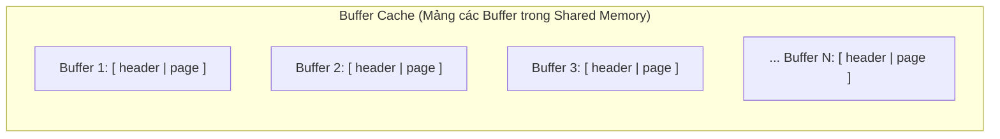
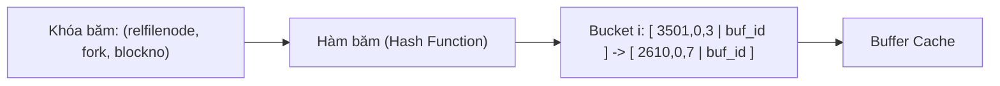
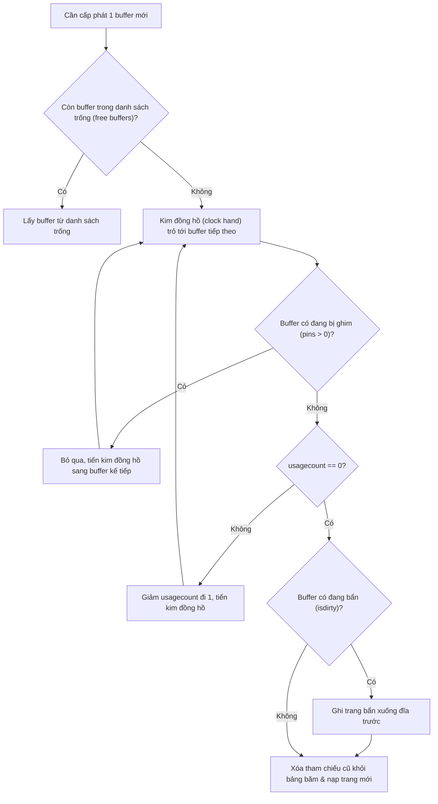
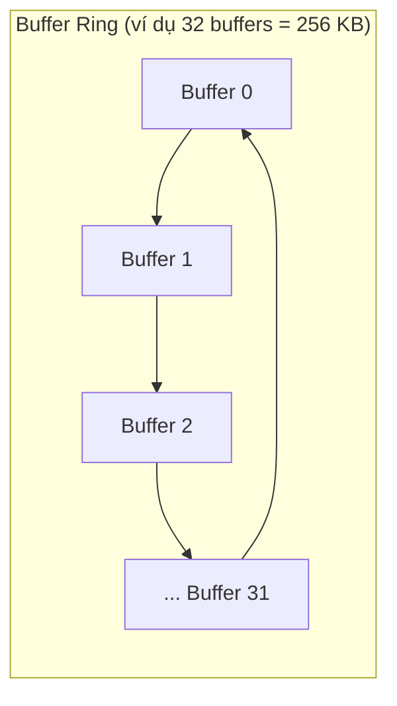

# PHẦN II: Bộ nhớ đệm Buffer và WAL (Part II: Buffer Cache and WAL)

# CHƯƠNG 9: Bộ nhớ đệm Buffer (Chapter 9: Buffer Cache)

## 9.1 Bộ nhớ đệm (9.1 Caching)

Trong các hệ thống máy tính hiện đại, cơ chế bộ nhớ đệm (caching) hiện diện ở khắp mọi nơi — cả ở cấp độ phần cứng lẫn phần mềm. Chỉ riêng bộ vi xử lý (processor) đã có thể sở hữu tới ba hoặc bốn tầng cache. Các bộ điều khiển RAID và bản thân ổ đĩa cũng bổ sung thêm cache riêng của chúng.

Caching được sử dụng để thu hẹp sự chênh lệch hiệu năng giữa các loại bộ nhớ nhanh và bộ nhớ chậm. Bộ nhớ nhanh thì đắt đỏ và có dung lượng nhỏ hơn, trong khi bộ nhớ chậm thì dung lượng lớn hơn và rẻ hơn. Do đó, bộ nhớ nhanh không thể chứa toàn bộ dữ liệu được lưu trữ trong bộ nhớ chậm. Tuy nhiên, trong hầu hết các trường hợp, chỉ một phần nhỏ dữ liệu được sử dụng tích cực tại mỗi thời điểm cụ thể, vì vậy việc cấp phát một lượng bộ nhớ nhanh làm cache để giữ dữ liệu "nóng" (hot data) có thể giảm đáng kể chi phí (overhead) phát sinh do truy cập bộ nhớ chậm.

Trong PostgreSQL, bộ nhớ đệm buffer (buffer cache)[^1] lưu giữ các trang quan hệ (relation pages), qua đó cân bằng thời gian truy cập giữa ổ đĩa (tính bằng mili-giây) và RAM (tính bằng nano-giây).

Hệ điều hành (OS) cũng có cache riêng phục vụ cùng một mục đích. Vì lý do này, các hệ quản trị cơ sở dữ liệu thường được thiết kế để tránh hiện tượng *lưu đệm kép* (double caching): dữ liệu lưu trên đĩa thường được truy vấn trực tiếp, bỏ qua OS cache. Nhưng PostgreSQL sử dụng một cách tiếp cận khác: nó đọc và ghi toàn bộ dữ liệu thông qua các thao tác tệp có bộ đệm (buffered file operations).

Có thể tránh lưu đệm kép nếu áp dụng I/O trực tiếp (direct I/O). Điều này sẽ giảm bớt chi phí phụ trợ, vì PostgreSQL sẽ sử dụng truy cập bộ nhớ trực tiếp (DMA — Direct Memory Access) thay vì sao chép các trang đã được đệm vào không gian địa chỉ của hệ điều hành; ngoài ra, bạn sẽ có quyền kiểm soát tức thì đối với việc ghi vật lý xuống đĩa. Tuy nhiên, direct I/O không hỗ trợ đọc trước dữ liệu (data prefetching) mà cơ chế đệm mang lại, nên bạn phải tự cài đặt riêng thông qua I/O bất đồng bộ (asynchronous I/O, xem tr. 45), điều này đòi hỏi sửa đổi mã nguồn rất lớn trong lõi PostgreSQL, cũng như xử lý các vấn đề không tương thích giữa các hệ điều hành khi hỗ trợ direct I/O và asynchronous I/O. Nhưng một khi giao tiếp bất đồng bộ được thiết lập, bạn có thể tận hưởng thêm lợi ích của việc truy cập đĩa không chờ đợi (no-wait disk access). Cộng đồng PostgreSQL đã bắt đầu nỗ lực lớn này,[^2] nhưng sẽ mất một thời gian dài trước khi kết quả thực tế xuất hiện.

> 📝 **Giải thích thêm (không có trong sách):**
> *Double caching* xảy ra khi cùng một trang dữ liệu (8 KB) vừa nằm trong `shared_buffers` của PostgreSQL, vừa nằm trong Page Cache của hệ điều hành (Linux). Dù tốn thêm RAM, việc dựa vào OS Page Cache giúp PostgreSQL tận dụng được cơ chế *read-ahead* (đọc trước tuần tự) và gộp ghi (write coalescing) rất trưởng thành của nhân hệ điều hành mà không cần tự viết driver I/O phức tạp cho từng nền tảng.

[^1]: `backend/storage/buffer/README`
[^2]: `www.postgresql.org/message-id/flat/20210223100344.llw5an2aklengrmn%40alap3.anarazel.de`

---

## 9.2 Thiết kế bộ nhớ đệm Buffer (9.2 Buffer Cache Design)

Bộ nhớ đệm buffer nằm trong bộ nhớ dùng chung (shared memory) của máy chủ, nơi mọi tiến trình đều có thể truy cập được. Nó chiếm phần lớn nhất trong bộ nhớ dùng chung và chắc chắn là một trong những cấu trúc dữ liệu quan trọng và phức tạp nhất trong PostgreSQL. Hiểu cách cache hoạt động không chỉ quan trọng cho riêng nó, mà còn vì nhiều cấu trúc khác (như subtransactions, trạng thái giao dịch CLOG, và các mục WAL) cũng sử dụng một cơ chế caching tương tự, dù đơn giản hơn.

Tên gọi của loại cache này bắt nguồn từ cấu trúc bên trong của nó, vì nó bao gồm một mảng các *buffer*. Mỗi buffer dành ra một vùng nhớ đủ để chứa một trang dữ liệu (data page) duy nhất cùng với phần tiêu đề (header) của nó.[^3]



Một `header` chứa thông tin về buffer và trang dữ liệu bên trong nó, chẳng hạn như:
- vị trí vật lý của trang (ID tệp, loại fork, và số hiệu khối — block number — trong fork đó)
- thuộc tính cho biết dữ liệu trong trang đã bị sửa đổi và sớm muộn phải được ghi lại xuống đĩa (một trang như vậy được gọi là *dirty* — trang bẩn)
- bộ đếm số lần sử dụng buffer (*buffer usage count*)
- bộ đếm ghim (*pin count*, hay bộ đếm tham chiếu — *reference count*)

Để truy cập vào một trang dữ liệu của quan hệ, một tiến trình gửi yêu cầu tới trình quản lý buffer (*buffer manager*)[^4] và nhận về ID của buffer chứa trang này. Sau đó tiến trình đọc dữ liệu đã cache và sửa đổi ngay trong cache nếu cần. Trong thời gian trang đang được sử dụng, buffer của nó sẽ được *ghim* (pinned). Việc ghim (pin) nghiêm cấm hành vi loại bỏ (eviction) trang đang được cache và có thể được áp dụng cùng với các loại khóa (lock) khác (xem tr. 251). Mỗi lần ghim cũng làm tăng bộ đếm sử dụng (usage count) lên.

Chừng nào trang còn nằm trong cache, việc sử dụng nó không phát sinh bất kỳ thao tác tệp (file operation) nào.

Chúng ta có thể khám phá bộ nhớ đệm buffer bằng phần mở rộng (extension) `pg_buffercache`:

```sql
=> CREATE EXTENSION pg_buffercache;
```

[^3]: `include/storage/buf_internals.h`
[^4]: `backend/storage/buffer/bufmgr.c`

---

## 9.3 Truy cập trúng cache (9.3 Cache Hits)

Hãy tạo một bảng và chèn một dòng vào đó:

```sql
=> CREATE TABLE cacheme(
     id integer
   ) WITH (autovacuum_enabled = off);
=> INSERT INTO cacheme VALUES (1);
```

Bây giờ bộ nhớ đệm buffer đã chứa một trang heap với dòng vừa được chèn. Bạn có thể tự kiểm tra bằng cách truy vấn tất cả các buffer liên quan đến một bảng cụ thể. Chúng ta sẽ cần câu truy vấn này nhiều lần nữa, nên hãy bọc nó vào một hàm:

```sql
=> CREATE FUNCTION buffercache(rel regclass)
   RETURNS TABLE(
     bufferid integer, relfork text, relblk bigint,
     isdirty boolean, usagecount smallint, pins integer
   ) AS $$
     SELECT bufferid,
            CASE relforknumber
              WHEN 0 THEN 'main'
              WHEN 1 THEN 'fsm'
              WHEN 2 THEN 'vm'
            END,
            relblocknumber,
            isdirty,
            usagecount,
            pinning_backends
     FROM pg_buffercache
     WHERE relfilenode = pg_relation_filenode(rel)
     ORDER BY relforknumber, relblocknumber;
   $$ LANGUAGE sql;

=> SELECT * FROM buffercache('cacheme');
 bufferid | relfork | relblk | isdirty | usagecount | pins
----------+---------+--------+---------+------------+------
      268 | main    |      0 | t       |          1 |    0
(1 row)
```

Trang này đang ở trạng thái *dirty*: nó đã bị sửa đổi, nhưng chưa được ghi xuống đĩa. Bộ đếm sử dụng (`usagecount`) của nó được đặt thành 1.

Khi trình quản lý buffer cần đọc một trang,[^5] trước tiên nó kiểm tra bộ nhớ đệm buffer. Toàn bộ ID của các buffer được lưu trữ trong một bảng băm (hash table),[^6] dùng để tăng tốc độ tìm kiếm chúng.

Nhiều ngôn ngữ lập trình hiện đại tích hợp bảng băm như một trong những kiểu dữ liệu cơ bản. Bảng băm thường được gọi là mảng kết hợp (associative arrays), và quả thực, dưới góc nhìn người dùng, chúng trông giống như một mảng; tuy nhiên, chỉ mục của chúng (khóa băm — hash key) có thể thuộc bất kỳ kiểu dữ liệu nào, ví dụ một chuỗi văn bản thay vì số nguyên.

Mặc dù dải giá trị khóa khả dĩ có thể rất lớn, bảng băm không bao giờ chứa quá nhiều giá trị khác nhau tại cùng một thời điểm. Ý tưởng của phép băm (hashing) là chuyển đổi một giá trị khóa thành một số nguyên bằng một hàm băm (hash function). Con số này (hoặc một số bit của nó) được dùng làm chỉ mục của một mảng thông thường. Các phần tử của mảng này được gọi là các *xô* của bảng băm (*hash table buckets*).

Một hàm băm tốt sẽ phân phối các khóa băm vào giữa các bucket một cách tương đối đồng đều, nhưng nó vẫn có thể gán cùng một con số cho các khóa khác nhau, qua đó đặt chúng vào cùng một bucket; hiện tượng này gọi là *xung đột* (*collision*). Vì lý do đó, các giá trị được lưu trong bucket cùng với khóa băm; để truy cập một giá trị đã băm theo khóa của nó, PostgreSQL phải kiểm tra tất cả các khóa nằm trong bucket đó.

Có nhiều cách cài đặt bảng băm khác nhau; trong số các lựa chọn khả dĩ, bộ nhớ đệm buffer sử dụng bảng băm có thể mở rộng (extendible hash table) giải quyết xung đột băm bằng phương pháp nối chuỗi (chaining).[^7]

Một khóa băm bao gồm ID của tệp quan hệ, loại fork, và ID của trang bên trong tệp của fork đó. Nhờ vậy, khi biết thông tin trang, PostgreSQL có thể nhanh chóng tìm ra buffer đang chứa trang này hoặc xác nhận chắc chắn rằng trang hiện chưa được cache.



Cách cài đặt bộ nhớ đệm buffer từ lâu đã bị chỉ trích vì phụ thuộc vào bảng băm: cấu trúc này không giúp ích gì khi cần tìm tất cả các buffer đang bị chiếm bởi các trang của một quan hệ cụ thể — thao tác bắt buộc để xóa các trang khỏi cache khi chạy lệnh `DROP` và `TRUNCATE` hoặc khi cắt bớt (truncate) bảng trong quá trình vacuum.[^8] Tuy nhiên, cho đến nay vẫn chưa có ai đề xuất được một giải pháp thay thế thỏa đáng.

Nếu bảng băm chứa ID buffer cần tìm, trình quản lý buffer sẽ ghim buffer này và trả ID của nó về cho tiến trình. Sau đó tiến trình này có thể bắt đầu sử dụng trang đã cache mà không phát sinh bất kỳ lưu lượng I/O nào.

Để ghim một buffer, PostgreSQL phải tăng bộ đếm pin trong phần header của nó; một buffer có thể được ghim bởi nhiều tiến trình cùng một lúc. Chừng nào bộ đếm pin của nó còn lớn hơn 0, buffer được coi là đang được sử dụng, và không cho phép bất kỳ thay đổi triệt để nào đối với nội dung của nó. Ví dụ, một tuple mới có thể xuất hiện (nó sẽ vô hình theo các quy tắc hiển thị), nhưng bản thân trang đó không thể bị thay thế.

Khi chạy kèm tùy chọn `analyze` và `buffers`, lệnh `EXPLAIN` sẽ thực thi kế hoạch truy vấn được hiển thị và cho biết số lượng buffer đã sử dụng:

```sql
=> EXPLAIN (analyze, buffers, costs off, timing off, summary off)
   SELECT * FROM cacheme;
                     QUERY PLAN
-----------------------------------------------------
 Seq Scan on cacheme (actual rows=1 loops=1)
   Buffers: shared hit=1
 Planning:
   Buffers: shared hit=12 read=7
(4 rows)
```

Ở đây `hit=1` có nghĩa là trang duy nhất cần đọc đã được tìm thấy trong cache.

Việc ghim buffer làm tăng bộ đếm sử dụng (`usagecount`) thêm một:

```sql
=> SELECT * FROM buffercache('cacheme');
 bufferid | relfork | relblk | isdirty | usagecount | pins
----------+---------+--------+---------+------------+------
      268 | main    |      0 | t       |          2 |    0
(1 row)
```

Để quan sát quá trình ghim hoạt động trong khi thực thi truy vấn, hãy mở một con trỏ (cursor) — nó sẽ giữ pin trên buffer vì phải cung cấp quyền truy cập nhanh tới dòng tiếp theo trong tập kết quả:

```sql
=> BEGIN;
=> DECLARE c CURSOR FOR SELECT * FROM cacheme;
=> FETCH c;
 id
----
  1
(1 row)

=> SELECT * FROM buffercache('cacheme');
 bufferid | relfork | relblk | isdirty | usagecount | pins
----------+---------+--------+---------+------------+------
      268 | main    |      0 | t       |          3 |    1
(1 row)
```

Nếu một tiến trình không thể sử dụng một buffer đang bị ghim, nó thường bỏ qua buffer đó và đơn giản là chọn một buffer khác. Chúng ta có thể thấy điều này trong quá trình vacuum bảng:

```sql
=> VACUUM VERBOSE cacheme;
INFO:  vacuuming "public.cacheme"
INFO:  table "cacheme": found 0 removable, 0 nonremovable row versions in 1 out of 1 pages
DETAIL:  0 dead row versions cannot be removed yet, oldest xmin: 877
Skipped 1 page due to buffer pins, 0 frozen pages.
CPU: user: 0.00 s, system: 0.00 s, elapsed: 0.00 s.
VACUUM
```

Trang đó đã bị bỏ qua vì các tuple của nó không thể bị xóa vật lý khỏi buffer đang bị ghim.

Nhưng nếu tiến trình bắt buộc phải có chính xác buffer đó, tiến trình sẽ xếp vào hàng đợi và chờ để có được quyền truy cập độc quyền (exclusive access) vào buffer này. Một ví dụ cho thao tác như vậy là vacuuming có kèm đóng băng dữ liệu (vacuuming with freezing, xem tr. 176).[^9]

Một khi con trỏ đóng lại hoặc chuyển sang trang khác, buffer sẽ được bỏ ghim (unpinned). Trong ví dụ này, điều đó xảy ra khi kết thúc giao dịch:

```sql
=> COMMIT;
=> SELECT * FROM buffercache('cacheme');
 bufferid | relfork | relblk | isdirty | usagecount | pins
----------+---------+--------+---------+------------+------
      268 | main    |      0 | t       |          3 |    0
      310 | vm      |      0 | f       |          2 |    0
(2 rows)
```

Các thao tác sửa đổi trang cũng được bảo vệ bởi chính cơ chế ghim này. Chẳng hạn, hãy chèn thêm một dòng nữa vào bảng (nó sẽ nằm vào cùng trang đó):

```sql
=> INSERT INTO cacheme VALUES (2);
=> SELECT * FROM buffercache('cacheme');
 bufferid | relfork | relblk | isdirty | usagecount | pins
----------+---------+--------+---------+------------+------
      268 | main    |      0 | t       |          4 |    0
      310 | vm      |      0 | f       |          2 |    0
(2 rows)
```

PostgreSQL không thực hiện ghi xuống đĩa ngay lập tức: một trang vẫn giữ trạng thái dirty trong bộ nhớ đệm buffer trong một khoảng thời gian, mang lại lợi ích hiệu năng cho cả thao tác đọc và ghi.

[^5]: `backend/storage/buffer/bufmgr.c`, hàm `ReadBuffer_common`
[^6]: `backend/storage/buffer/buf_table.c`
[^7]: `backend/utils/hash/dynahash.c`
[^8]: `backend/storage/buffer/bufmgr.c`, hàm `DropRelFileNodeBuffers`
[^9]: `backend/storage/buffer/bufmgr.c`, hàm `LockBufferForCleanup`

---

## 9.4 Truy cập trượt cache (9.4 Cache Misses)

Nếu bảng băm không có mục nào liên quan đến trang được truy vấn, điều đó có nghĩa là trang này chưa được cache. Trong trường hợp này, một buffer mới được chỉ định (và được ghim ngay lập tức), trang được đọc vào buffer này, và các tham chiếu trong bảng băm được cập nhật tương ứng.

Hãy khởi động lại instance để xóa sạch bộ nhớ đệm buffer của nó:

```bash
postgres$ pg_ctl restart -l /home/postgres/logfile
```

Một nỗ lực đọc trang sẽ dẫn đến tình huống trượt cache (cache miss), và trang sẽ được nạp vào một buffer mới:

```sql
=> EXPLAIN (analyze, buffers, costs off, timing off, summary off)
   SELECT * FROM cacheme;
                     QUERY PLAN
-----------------------------------------------------
 Seq Scan on cacheme (actual rows=2 loops=1)
   Buffers: shared read=1 dirtied=1
 Planning:
   Buffers: shared hit=15 read=7
(4 rows)
```

Thay vì `hit`, kế hoạch thực thi bây giờ hiển thị trạng thái `read`, biểu thị một lần trượt cache. Ngoài ra, trang này đã trở thành trang bẩn (`dirtied=1`), vì câu truy vấn đã sửa đổi một số *hint bits* (xem tr. 71).

Một truy vấn vào bộ nhớ đệm buffer cho thấy bộ đếm sử dụng cho trang mới được thêm vào được đặt là 1:

```sql
=> SELECT * FROM buffercache('cacheme');
 bufferid | relfork | relblk | isdirty | usagecount | pins
----------+---------+--------+---------+------------+------
       98 | main    |      0 | t       |          1 |    0
(1 row)
```

View `pg_statio_all_tables` chứa thống kê đầy đủ về việc sử dụng bộ nhớ đệm buffer theo các bảng:

```sql
=> SELECT heap_blks_read, heap_blks_hit
   FROM pg_statio_all_tables
   WHERE relname = 'cacheme';
 heap_blks_read | heap_blks_hit
----------------+---------------
              2 |             5
(1 row)
```

PostgreSQL cũng cung cấp các view tương tự cho chỉ mục (indexes) và chuỗi (sequences). Chúng cũng có thể hiển thị thống kê về các thao tác I/O, nhưng chỉ khi tham số `track_io_timing` được bật (mặc định là `off`).

### Tìm kiếm và loại bỏ buffer (Buffer Search and Eviction)

Việc chọn một buffer cho một trang không hề tầm thường.[^10] Có hai kịch bản khả dĩ:

1. Ngay sau khi máy chủ khởi động, tất cả các buffer đều trống và được liên kết thành một danh sách (free list). Khi vẫn còn các buffer trống, trang tiếp theo được đọc từ đĩa sẽ chiếm lấy buffer đầu tiên, và buffer đó sẽ bị gỡ khỏi danh sách.
   Một buffer chỉ có thể quay trở lại danh sách này[^11] nếu trang của nó biến mất mà không bị thay thế bởi trang khác. Điều này có thể xảy ra nếu bạn gọi lệnh `DROP` hoặc `TRUNCATE`, hoặc nếu bảng bị cắt bớt trong quá trình vacuuming.

2. Sớm muộn gì cũng không còn buffer trống nào nữa (vì kích thước cơ sở dữ liệu thường lớn hơn vùng nhớ được cấp phát cho cache). Khi đó trình quản lý buffer sẽ phải chọn một trong các buffer đang được sử dụng và loại bỏ (evict) trang đã cache khỏi buffer này. Việc này được thực hiện bằng thuật toán quét kim đồng hồ (*clock sweep algorithm*), được minh họa rất trực quan qua hình ảnh chiếc đồng hồ. Trỏ vào một trong các buffer, kim đồng hồ (*clock hand*) bắt đầu quay quanh bộ nhớ đệm buffer và giảm bộ đếm sử dụng (`usagecount`) của mỗi trang đang cache đi 1 khi nó đi qua. Buffer đầu tiên không bị ghim (`pins = 0`) và có bộ đếm bằng 0 mà kim đồng hồ bắt gặp sẽ được dọn sạch.



Như vậy, bộ đếm sử dụng được tăng lên mỗi khi buffer được truy cập (tức là được ghim), và bị giảm đi khi trình quản lý buffer tìm kiếm trang để loại bỏ. Kết quả là, các trang ít được sử dụng gần đây nhất sẽ bị loại bỏ trước, trong khi những trang được truy cập thường xuyên hơn sẽ ở lại trong cache lâu hơn.

Như bạn có thể đoán, nếu tất cả các buffer đều có bộ đếm sử dụng khác 0, kim đồng hồ phải quay hơn một vòng đầy đủ trước khi có bất kỳ buffer nào cuối cùng chạm giá trị 0. Để tránh phải chạy nhiều vòng, PostgreSQL giới hạn bộ đếm sử dụng tối đa là 5.

Một khi tìm thấy buffer để loại bỏ, tham chiếu đến trang vẫn đang nằm trong buffer này phải được xóa khỏi bảng băm.

Nhưng nếu buffer này bị bẩn (dirty, xem tr. 182), tức là nó chứa dữ liệu đã bị sửa đổi, trang cũ không thể đơn giản bị vứt bỏ — trình quản lý buffer phải ghi nó xuống đĩa trước.

Sau đó trình quản lý buffer đọc một trang mới vào buffer vừa tìm được — bất kể buffer đó vừa phải dọn sạch hay vốn còn trống. Nó sử dụng I/O có bộ đệm cho mục đích này, vì vậy trang sẽ chỉ thực sự được đọc từ đĩa nếu hệ điều hành không tìm thấy trang đó trong cache riêng của mình.

Những hệ quản trị cơ sở dữ liệu sử dụng direct I/O và không phụ thuộc vào OS cache sẽ phân biệt rõ giữa đọc logic (từ RAM, tức là từ bộ nhớ đệm buffer) và đọc vật lý (từ đĩa). Từ góc nhìn của PostgreSQL, một trang có thể được đọc từ bộ nhớ đệm buffer hoặc được yêu cầu từ hệ điều hành, nhưng trong trường hợp sau, không có cách nào biết được liệu trang đó được tìm thấy trong RAM hay phải đọc từ đĩa.

Bảng băm được cập nhật để trỏ tới trang mới, và buffer được ghim. Bộ đếm sử dụng của nó được tăng lên và lúc này mang giá trị 1, giúp buffer này có một khoảng thời gian để tăng giá trị lên thêm trong lúc kim đồng hồ đang quét qua bộ nhớ đệm buffer.

> 💡 **Ví dụ bổ sung (không có trong sách):**
> Giả sử bộ nhớ đệm chỉ có 3 buffer: A (`usagecount=2, pins=0`), B (`usagecount=1, pins=1`), C (`usagecount=1, pins=0`), và kim đồng hồ đang trỏ ở A:
> 1. Kim gặp A: không ghim, `usagecount=2` -> giảm còn `1`, kim tiến sang B.
> 2. Kim gặp B: đang bị ghim (`pins=1`) -> bỏ qua (không giảm `usagecount`), kim tiến sang C.
> 3. Kim gặp C: không ghim, `usagecount=1` -> giảm còn `0`, kim dừng hoặc tiếp tục? Trong PostgreSQL, nếu giảm xuống 0 thì tại thời điểm kiểm tra `usagecount` trước khi giảm nó là 1, nên kim tiến sang A (vòng 2).
> 4. Kim gặp A: `usagecount=1` -> giảm còn `0`, tiến sang B (bỏ qua vì `pins=1`), tiến sang C: thấy `usagecount=0` và `pins=0` -> **chọn C để loại bỏ!**

[^10]: `backend/storage/buffer/freelist.c`, hàm `StrategyGetBuffer`
[^11]: `backend/storage/buffer/freelist.c`, hàm `StrategyFreeBuffer`

---

## 9.5 Loại bỏ hàng loạt (9.5 Bulk Eviction)

Nếu các thao tác đọc hoặc ghi hàng loạt (bulk reads/writes) được thực hiện, có một rủi ro là dữ liệu chỉ dùng một lần có thể nhanh chóng đẩy bật các trang hữu ích ra khỏi bộ nhớ đệm buffer.

Để phòng ngừa, các thao tác hàng loạt sử dụng những *vòng đệm* (buffer rings) khá nhỏ, và việc loại bỏ chỉ được thực hiện trong ranh giới của chúng, không làm ảnh hưởng đến các buffer khác.

Bên cạnh thuật ngữ "buffer ring", mã nguồn đôi khi cũng dùng thuật ngữ "ring buffer". Tuy nhiên, từ đồng nghĩa này khá dễ gây nhầm lẫn vì bản thân một ring buffer được cấu thành từ nhiều buffer (thuộc về bộ nhớ đệm buffer). Thuật ngữ "buffer ring" chính xác hơn ở khía cạnh này.

Một buffer ring có kích thước nhất định bao gồm một mảng các buffer được sử dụng lần lượt từng cái một. Ban đầu, buffer ring trống rỗng, và từng buffer riêng lẻ gia nhập vào nó từng cái một sau khi được chọn từ bộ nhớ đệm buffer theo cách thông thường. Sau đó cơ chế loại bỏ mới bắt đầu hoạt động, nhưng chỉ giới hạn trong phạm vi của vòng đệm.[^12]

Các buffer được thêm vào một ring không bị tách khỏi bộ nhớ đệm buffer và vẫn có thể được sử dụng bởi các thao tác khác. Vì vậy, nếu buffer sắp được tái sử dụng hóa ra đang bị ghim, hoặc bộ đếm sử dụng (`usagecount`) của nó lớn hơn 1, nó sẽ đơn giản bị tách khỏi ring và được thay thế bằng một buffer khác.



PostgreSQL hỗ trợ ba chiến lược loại bỏ (eviction strategies):

- **Chiến lược đọc hàng loạt (Bulk reads strategy)** được sử dụng cho các phép quét tuần tự (sequential scans, xem tr. 342) trên các bảng lớn nếu kích thước của chúng vượt quá 1/4 kích thước bộ nhớ đệm buffer. Vòng đệm này chiếm 256 KB (32 trang chuẩn).
  Chiến lược này không cho phép ghi các trang bẩn xuống đĩa để giải phóng buffer; thay vào đó, buffer bị loại khỏi vòng và được thay thế bằng một buffer khác. Nhờ vậy, việc đọc không phải chờ thao tác ghi hoàn tất, nên thực hiện nhanh hơn.
  Nếu phát hiện bảng đó đang được quét bởi một tiến trình khác, tiến trình bắt đầu lượt quét mới sẽ tham gia vào buffer ring hiện có và lấy quyền truy cập vào dữ liệu hiện sẵn có mà không phát sinh thêm thao tác I/O.[^13] Khi tiến trình thứ nhất quét xong, tiến trình thứ hai sẽ quay lại đọc phần đầu bảng mà nó đã bỏ qua.

- **Chiến lược ghi hàng loạt (Bulk writes strategy)** được áp dụng bởi các lệnh `COPY FROM`, `CREATE TABLE AS SELECT`, và `CREATE MATERIALIZED VIEW`, cũng như các biến thể của `ALTER TABLE` gây ra việc viết lại bảng (table rewrites).
  Vòng đệm được cấp phát khá lớn, kích thước mặc định là 16 MB (2048 trang chuẩn), nhưng không bao giờ vượt quá 1/8 tổng kích thước của bộ nhớ đệm buffer.

- **Chiến lược dọn dẹp (Vacuuming strategy)** được sử dụng bởi tiến trình vacuuming khi nó thực hiện quét toàn bộ bảng mà không xét đến bản đồ hiển thị (visibility map). Vòng đệm được gán 256 KB RAM (32 trang chuẩn).

Các buffer ring không phải lúc nào cũng ngăn chặn được việc loại bỏ ngoài ý muốn. Nếu các lệnh `UPDATE` hoặc `DELETE` ảnh hưởng đến nhiều dòng, phép quét bảng được thực hiện có áp dụng chiến lược đọc hàng loạt, nhưng vì các trang liên tục bị sửa đổi, các buffer ring gần như trở nên vô dụng.

Một ví dụ khác đáng nhắc tới là việc lưu trữ dữ liệu kích thước quá khổ trong các bảng TOAST (xem tr. 29). Mặc dù khối lượng dữ liệu tiềm năng cần đọc là rất lớn, các giá trị toasted luôn được truy cập thông qua chỉ mục (index), nên chúng đi vòng qua (bypass) các buffer ring.

Hãy xem xét kỹ hơn chiến lược đọc hàng loạt. Để đơn giản, chúng ta sẽ tạo một bảng sao cho mỗi dòng được chèn chiếm trọn một trang. Theo mặc định, kích thước bộ nhớ đệm buffer là 16,384 trang, mỗi trang 8 KB. Vì vậy bảng phải chiếm hơn 4096 trang để phép quét sử dụng một buffer ring.

```sql
=> CREATE TABLE big(
     id integer PRIMARY KEY GENERATED ALWAYS AS IDENTITY,
     s char(1000)
   ) WITH (fillfactor = 10);
=> INSERT INTO big(s)
   SELECT 'FOO' FROM generate_series(1,4096+1);
```

Hãy phân tích (analyze) bảng này:

```sql
=> ANALYZE big;
=> SELECT relname, relfilenode, relpages
   FROM pg_class
   WHERE relname IN ('big', 'big_pkey');
 relname  | relfilenode | relpages
----------+-------------+----------
 big      |       16546 |     4097
 big_pkey |       16551 |       14
(2 rows)
```

Khởi động lại máy chủ để xóa cache, vì hiện tại nó đang chứa một số trang heap đã được đọc trong quá trình `ANALYZE`:

```bash
postgres$ pg_ctl restart -l /home/postgres/logfile
```

Sau khi máy chủ đã khởi động lại, hãy đọc toàn bộ bảng:

```sql
=> EXPLAIN (analyze, costs off, timing off, summary off)
   SELECT id FROM big;
                   QUERY PLAN
-------------------------------------------------
 Seq Scan on big (actual rows=4097 loops=1)
(1 row)
```

Các trang heap chỉ chiếm đúng 32 buffer, cấu thành nên buffer ring cho thao tác này:

```sql
=> SELECT count(*) FROM pg_buffercache
   WHERE relfilenode = pg_relation_filenode('big'::regclass);
 count
-------
    32
(1 row)
```

Nhưng trong trường hợp quét theo chỉ mục (index scan), buffer ring không được sử dụng:

```sql
=> EXPLAIN (analyze, costs off, timing off, summary off)
   SELECT * FROM big ORDER BY id;
                          QUERY PLAN
---------------------------------------------------------------
 Index Scan using big_pkey on big (actual rows=4097 loops=1)
(1 row)
```

Kết quả là bộ nhớ đệm buffer cuối cùng chứa toàn bộ bảng và toàn bộ chỉ mục:

```sql
=> SELECT relfilenode, count(*)
   FROM pg_buffercache
   WHERE relfilenode IN (
     pg_relation_filenode('big'),
     pg_relation_filenode('big_pkey')
   )
   GROUP BY relfilenode;
 relfilenode | count
-------------+-------
       16546 |  4097
       16551 |    14
(2 rows)
```

[^12]: `backend/storage/buffer/freelist.c`, hàm `GetBufferFromRing`
[^13]: `backend/access/common/syncscan.c`

---

## 9.6 Lựa chọn kích thước bộ nhớ đệm Buffer (9.6 Choosing the Buffer Cache Size)

Kích thước của bộ nhớ đệm buffer được định nghĩa bởi tham số `shared_buffers` (mặc định là `128MB`). Giá trị mặc định này vốn nổi tiếng là thấp, nên việc tăng nó lên ngay sau khi cài đặt PostgreSQL là điều hợp lý. Bạn sẽ phải khởi động lại (restart) máy chủ trong trường hợp này vì bộ nhớ dùng chung được cấp phát cho cache tại thời điểm máy chủ khởi động.

Nhưng làm thế nào để xác định một giá trị phù hợp?

Ngay cả một cơ sở dữ liệu rất lớn cũng chỉ có một tập hợp giới hạn các dữ liệu "nóng" được sử dụng đồng thời. Trong thế giới lý tưởng, chính tập dữ liệu này phải nằm gọn trong bộ nhớ đệm buffer (với một phần không gian dự phòng cho dữ liệu chỉ dùng một lần). Nếu kích thước cache nhỏ hơn, các trang đang được sử dụng tích cực sẽ liên tục đẩy bật lẫn nhau, dẫn đến các thao tác I/O quá mức. Nhưng việc tăng kích thước cache một cách thiếu cân nhắc cũng không phải ý hay: RAM là tài nguyên khan hiếm, và bên cạnh đó, cache lớn hơn cũng kéo theo chi phí bảo trì (maintenance costs) cao hơn.

Kích thước bộ nhớ đệm buffer tối ưu khác nhau tùy từng hệ thống: nó phụ thuộc vào các yếu tố như tổng dung lượng bộ nhớ khả dụng, đặc điểm dữ liệu (data profiles), và loại tải công việc (workload types). Đáng tiếc là không có giá trị hay công thức thần kỳ nào phù hợp cho tất cả mọi người như nhau.

Bạn cũng nên ghi nhớ rằng một lần trượt cache trong PostgreSQL không nhất thiết kích hoạt một thao tác I/O vật lý. Nếu bộ nhớ đệm buffer khá nhỏ, OS cache sẽ sử dụng phần bộ nhớ trống còn lại và có thể làm dịu bớt vấn đề ở một mức độ nào đó. Nhưng khác với cơ sở dữ liệu, hệ điều hành không biết gì về dữ liệu đang đọc, nên nó áp dụng một chiến lược loại bỏ khác.

Một khuyến nghị điển hình là bắt đầu với 1/4 dung lượng RAM và sau đó điều chỉnh thiết lập này theo nhu cầu.

Cách tiếp cận tốt nhất là thực nghiệm: bạn có thể tăng hoặc giảm kích thước cache và so sánh hiệu năng hệ thống. Dĩ nhiên, điều đó đòi hỏi phải có một hệ thống thử nghiệm hoàn toàn tương đồng với hệ thống production, và bạn phải có khả năng tái lập các workload điển hình.

Bạn cũng có thể chạy một số phân tích bằng phần mở rộng `pg_buffercache`. Ví dụ, khám phá sự phân bổ các buffer dựa trên mức độ sử dụng của chúng:

```sql
=> SELECT usagecount, count(*)
   FROM pg_buffercache
   GROUP BY usagecount
   ORDER BY usagecount;
 usagecount | count
------------+-------
          1 |  4128
          2 |    50
          3 |     4
          4 |     4
          5 |    73
            | 12125
(6 rows)
```

Các giá trị `usagecount` mang giá trị `NULL` tương ứng với các buffer trống. Chúng hoàn toàn dễ hiểu trong trường hợp này vì máy chủ vừa được khởi động lại và hầu như ở trạng thái nhàn rỗi. Đa số các buffer đã sử dụng chứa các trang của bảng danh mục hệ thống (system catalog tables) được backend đọc vào để điền bộ đệm danh mục hệ thống và thực thi các câu truy vấn.

Chúng ta có thể kiểm tra xem tỷ lệ phần trăm của mỗi quan hệ đang được cache là bao nhiêu, và dữ liệu đó có "nóng" hay không (một trang được coi là nóng ở đây nếu bộ đếm sử dụng của nó lớn hơn 1):

```sql
=> SELECT c.relname,
          count(*) blocks,
          round( 100.0 * 8192 * count(*) /
                 pg_table_size(c.oid) ) AS "% of rel",
          round( 100.0 * 8192 * count(*) FILTER (WHERE b.usagecount > 1) /
                 pg_table_size(c.oid) ) AS "% hot"
   FROM pg_buffercache b
   JOIN pg_class c ON pg_relation_filenode(c.oid) = b.relfilenode
   WHERE b.reldatabase IN (
           0, -- cluster-wide objects
           (SELECT oid FROM pg_database WHERE datname = current_database())
         )
     AND b.usagecount IS NOT NULL
   GROUP BY c.relname, c.oid
   ORDER BY 2 DESC
   LIMIT 10;
             relname             | blocks | % of rel | % hot
---------------------------------+--------+----------+-------
 big                             |   4097 |      100 |     1
 pg_attribute                    |     30 |       48 |    47
 big_pkey                        |     14 |      100 |     0
 pg_proc                         |     13 |       12 |     6
 pg_operator                     |     11 |       61 |    50
 pg_class                        |     10 |       59 |    59
 pg_proc_oid_index               |      9 |       82 |    45
 pg_attribute_relid_attnum_index |      8 |       73 |    64
 pg_proc_proname_args_nsp_index  |      6 |       18 |     6
 pg_amproc                       |      5 |       56 |    56
(10 rows)
```

Ví dụ này cho thấy bảng `big` và chỉ mục của nó được cache toàn bộ, nhưng các trang của chúng không đang được sử dụng tích cực.

Phân tích dữ liệu từ nhiều góc độ khác nhau giúp bạn thu được nhiều thông tin hữu ích. Tuy nhiên, hãy đảm bảo tuân thủ các quy tắc đơn giản sau khi chạy các truy vấn `pg_buffercache`:
- Lặp lại các truy vấn này vài lần vì các con số trả về sẽ biến động ở một mức độ nhất định.
- Không chạy các truy vấn như vậy liên tục không ngừng nghỉ vì phần mở rộng `pg_buffercache` khóa (lock) các buffer mà nó xem xét, dù chỉ trong khoảnh khắc ngắn.

---

## 9.7 Làm ấm cache (9.7 Cache Warming)

Sau khi khởi động lại máy chủ, cache cần một khoảng thời gian để "làm ấm" (warm up), tức là tích lũy các dữ liệu được sử dụng tích cực. Sẽ rất hữu ích nếu cache ngay lập tức một số bảng nhất định, và phần mở rộng `pg_prewarm` phục vụ chính xác mục đích này:

```sql
=> CREATE EXTENSION pg_prewarm;
```

Bên cạnh việc nạp bảng vào bộ nhớ đệm buffer (hoặc chỉ vào OS cache), kể từ phiên bản 11, phần mở rộng này có thể ghi trạng thái cache hiện tại xuống đĩa và sau đó khôi phục lại sau khi máy chủ khởi động lại. Để bật tính năng này, bạn phải thêm thư viện của extension vào `shared_preload_libraries` và khởi động lại máy chủ:

```sql
=> ALTER SYSTEM SET shared_preload_libraries = 'pg_prewarm';
```

```bash
postgres$ pg_ctl restart -l /home/postgres/logfile
```

Nếu thiết lập `pg_prewarm.autoprewarm` (mặc định `on`) không thay đổi, một tiến trình có tên `autoprewarm leader` sẽ tự động được khởi chạy sau khi máy chủ tải lại; tiến trình này sẽ ghi danh sách các trang đã cache xuống đĩa mỗi `pg_prewarm.autoprewarm_interval` giây (mặc định `300s`, sử dụng một trong các slot của `max_parallel_processes`).

```bash
postgres$ ps -o pid,command \
  --ppid `head -n 1 /usr/local/pgsql/data/postmaster.pid` | \
  grep prewarm
  23124 postgres: autoprewarm leader
```

Bây giờ máy chủ đã được khởi động lại, bảng `big` không còn nằm trong cache nữa:

```sql
=> SELECT count(*)
   FROM pg_buffercache
   WHERE relfilenode = pg_relation_filenode('big'::regclass);
 count
-------
     0
(1 row)
```

Nếu bạn có cơ sở vững chắc rằng toàn bộ bảng sắp được sử dụng tích cực và việc truy cập đĩa sẽ làm thời gian phản hồi cao đến mức không thể chấp nhận được, bạn có thể nạp trước bảng này vào bộ nhớ đệm buffer:

```sql
=> SELECT pg_prewarm('big');
 pg_prewarm
------------
       4097
(1 row)

=> SELECT count(*)
   FROM pg_buffercache
   WHERE relfilenode = pg_relation_filenode('big'::regclass);
 count
-------
  4097
(1 row)
```

Danh sách các trang được xuất (dump) vào tệp `PGDATA/autoprewarm.blocks`. Bạn có thể đợi cho đến khi `autoprewarm leader` chạy xong lần đầu tiên, nhưng chúng ta sẽ chủ động kích hoạt việc xuất dữ liệu thủ công:

```sql
=> SELECT autoprewarm_dump_now();
 autoprewarm_dump_now
----------------------
                 4224
(1 row)
```

Số lượng trang được ghi ra lớn hơn 4097 vì toàn bộ các buffer đang được sử dụng đều được tính đến. Tệp được ghi ở định dạng văn bản; nó chứa ID của cơ sở dữ liệu, tablespace, và tệp, cũng như số hiệu fork và số hiệu segment:

```bash
postgres$ head -n 10 /usr/local/pgsql/data/autoprewarm.blocks
<<4224>>
0,1664,1262,0,0
0,1664,1260,0,0
16391,1663,1259,0,0
16391,1663,1259,0,1
16391,1663,1259,0,2
16391,1663,1259,0,3
16391,1663,1249,0,0
16391,1663,1249,0,1
16391,1663,1249,0,2
```

Hãy khởi động lại máy chủ thêm lần nữa:

```bash
postgres$ pg_ctl restart -l /home/postgres/logfile
```

Bảng `big` xuất hiện trong cache ngay lập tức:

```sql
=> SELECT count(*)
   FROM pg_buffercache
   WHERE relfilenode = pg_relation_filenode('big'::regclass);
 count
-------
  4097
(1 row)
```

Chính tiến trình `autoprewarm leader` một lần nữa làm toàn bộ công việc chuẩn bị: nó đọc tệp, sắp xếp các trang theo cơ sở dữ liệu, sắp xếp lại thứ tự của chúng (để việc đọc đĩa diễn ra tuần tự nếu có thể), và sau đó chuyển chúng cho `autoprewarm worker` xử lý.

---

## 9.8 Bộ nhớ đệm cục bộ (9.8 Local Cache)

Các bảng tạm (temporary tables) không tuân theo quy trình làm việc mô tả ở trên. Vì dữ liệu tạm thời chỉ hiển thị với một tiến trình duy nhất, không có lý do gì để nạp nó vào bộ nhớ đệm buffer dùng chung. Do đó, dữ liệu tạm thời sử dụng bộ nhớ đệm cục bộ (local cache) của tiến trình sở hữu bảng đó.[^14]

Nhìn chung, bộ nhớ đệm buffer cục bộ hoạt động tương tự bộ nhớ đệm dùng chung:
- Việc tìm kiếm trang được thực hiện thông qua một bảng băm.
- Việc loại bỏ tuân theo thuật toán chuẩn (ngoại trừ việc không sử dụng các buffer ring).
- Các trang có thể được ghim để tránh bị loại bỏ.

Tuy nhiên, cách cài đặt bộ nhớ đệm cục bộ đơn giản hơn nhiều vì nó không phải xử lý các khóa trên cấu trúc bộ nhớ (xem tr. 251) (buffer chỉ có thể được truy cập bởi một tiến trình duy nhất) cũng như khả năng chịu lỗi (fault tolerance, xem tr. 175) (dữ liệu tạm thời chỉ tồn tại tối đa cho đến khi kết thúc phiên làm việc).

Vì thường chỉ có một số ít phiên làm việc sử dụng bảng tạm, bộ nhớ cho local cache chỉ được cấp phát khi có nhu cầu (on demand). Kích thước tối đa của local cache khả dụng cho một phiên làm việc bị giới hạn bởi tham số `temp_buffers` (mặc định `8MB`).

Mặc dù có tên gần giống nhau, tham số `temp_file_limit` không liên quan gì đến các bảng tạm; nó liên quan đến các tệp có thể được tạo ra trong quá trình thực thi câu truy vấn để lưu trữ tạm thời dữ liệu trung gian.

Trong kết quả đầu ra của lệnh `EXPLAIN`, mọi lượt gọi tới bộ nhớ đệm buffer cục bộ được gắn nhãn là `local` thay vì `shared`:

```sql
=> CREATE TEMPORARY TABLE tmp AS SELECT 1;
=> EXPLAIN (analyze, buffers, costs off, timing off, summary off)
   SELECT * FROM tmp;
                   QUERY PLAN
-------------------------------------------------
 Seq Scan on tmp (actual rows=1 loops=1)
   Buffers: local hit=1
 Planning:
   Buffers: shared hit=12 read=7
(4 rows)
```

[^14]: `backend/storage/buffer/localbuf.c`

---

## Bảng thuật ngữ chương (Chapter Glossary)

| Thuật ngữ (English) | Tiếng Việt | Giải thích ngắn gọn |
|---|---|---|
| Buffer cache | Bộ nhớ đệm buffer | Vùng nhớ dùng chung (`shared_buffers`) chứa các trang dữ liệu 8 KB của quan hệ cùng phần header quản lý. |
| Buffer manager | Trình quản lý buffer | Thành phần lõi quản lý việc cấp phát, tìm kiếm, ghim, loại bỏ và đọc/ghi trang dữ liệu giữa RAM và đĩa. |
| Dirty page | Trang bẩn | Trang dữ liệu trong cache đã bị sửa đổi nhưng chưa được ghi đồng bộ xuống đĩa. |
| Pin / Pinning | Ghim buffer | Cơ chế tăng bộ đếm tham chiếu để ngăn không cho một buffer bị loại bỏ khi đang có tiến trình sử dụng. |
| Usage count | Bộ đếm sử dụng | Bộ đếm (tối đa 5) tăng khi buffer được ghim và giảm khi thuật toán clock sweep quét qua. |
| Clock sweep algorithm | Thuật toán quét kim đồng hồ | Thuật toán thay thế trang của PostgreSQL nhằm tìm buffer ít được dùng gần đây nhất có `pins = 0` và `usagecount = 0`. |
| Buffer ring | Vòng đệm | Một tập hợp nhỏ các buffer tái sử dụng tuần hoàn cho thao tác đọc/ghi hàng loạt hoặc vacuum nhằm tránh làm ô nhiễm toàn bộ cache. |
| Double caching | Lưu đệm kép | Hiện tượng cùng một trang dữ liệu được lưu đồng thời trong `shared_buffers` của PostgreSQL và OS Page Cache. |
| Cache warming | Làm ấm cache | Quá trình nạp sẵn dữ liệu quan trọng vào cache (ví dụ qua `pg_prewarm`) để giảm độ trễ sau khi khởi động lại máy chủ. |
| Local cache | Bộ nhớ đệm cục bộ | Vùng đệm riêng của từng backend (giới hạn bởi `temp_buffers`) dành riêng cho các bảng tạm (`TEMPORARY TABLE`). |
