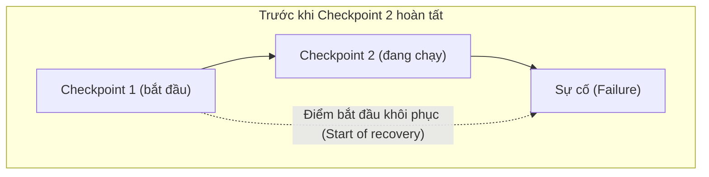
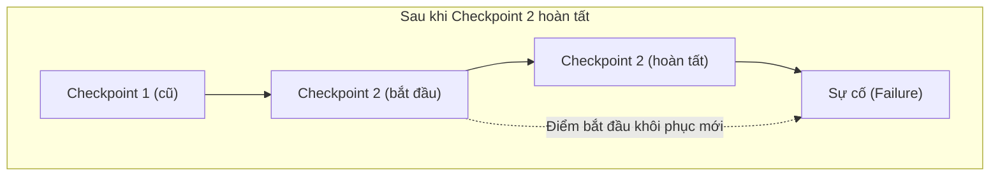

# Chương 10: Nhật ký ghi trước (Chapter 10: Write-Ahead Log)

## 10.1 Ghi nhật ký (Logging)

Trong trường hợp xảy ra sự cố — chẳng hạn như mất điện, lỗi hệ điều hành (OS), hoặc máy chủ cơ sở dữ liệu bị sập (crash) — toàn bộ dữ liệu trong RAM sẽ bị mất; chỉ những dữ liệu đã được ghi xuống đĩa mới còn tồn tại. Để khởi động lại máy chủ sau sự cố, bạn phải khôi phục tính nhất quán của dữ liệu (data consistency). Nếu bản thân ổ đĩa cũng bị hư hỏng, vấn đề tương tự phải được giải quyết bằng cách khôi phục từ bản sao lưu (backup recovery).

Về mặt lý thuyết, bạn có thể duy trì tính nhất quán của dữ liệu trên đĩa tại mọi thời điểm. Nhưng trên thực tế, điều đó có nghĩa là máy chủ phải liên tục ghi các trang (page) ngẫu nhiên xuống đĩa (mặc dù ghi tuần tự rẻ hơn nhiều), và thứ tự của các lần ghi đó phải đảm bảo rằng tính nhất quán không bị phá vỡ tại bất kỳ thời điểm cụ thể nào (điều này rất khó đạt được, đặc biệt khi bạn phải xử lý các cấu trúc chỉ mục phức tạp).

Cũng giống như phần lớn các hệ quản trị cơ sở dữ liệu khác, PostgreSQL sử dụng một cách tiếp cận khác. Trong khi máy chủ đang chạy, một phần dữ liệu hiện tại chỉ tồn tại trong RAM, việc ghi chúng xuống bộ nhớ lưu trữ vĩnh viễn được trì hoãn lại. Do đó, dữ liệu được lưu trên đĩa luôn ở trạng thái không nhất quán trong suốt quá trình máy chủ hoạt động, vì các trang không bao giờ được đẩy (flush) xuống đĩa cùng một lúc. Tuy nhiên, mỗi thay đổi xảy ra trong RAM (chẳng hạn như một cập nhật trang được thực hiện trong buffer cache) đều được ghi nhật ký (logged): PostgreSQL tạo ra một bản ghi nhật ký (log entry) chứa toàn bộ thông tin thiết yếu cần thiết để lặp lại thao tác này nếu cần.[^1]

Một bản ghi nhật ký liên quan đến việc sửa đổi trang **phải** được ghi xuống đĩa *trước* chính trang đã sửa đổi đó. Từ đó mà có tên gọi: nhật ký ghi trước — **write-ahead log**, hay **WAL**. Yêu cầu này đảm bảo rằng trong trường hợp xảy ra sự cố, PostgreSQL có thể đọc các bản ghi WAL từ đĩa và phát lại (replay) chúng để lặp lại các thao tác đã hoàn tất nhưng kết quả vẫn còn nằm trong RAM và chưa kịp ghi xuống đĩa trước khi sập.

Việc duy trì write-ahead log thường hiệu quả hơn nhiều so với việc ghi các trang ngẫu nhiên xuống đĩa. Các bản ghi WAL tạo thành một luồng dữ liệu liên tục (ghi tuần tự), điều mà ngay cả các ổ đĩa HDD truyền thống cũng có thể xử lý tốt. Bên cạnh đó, các bản ghi WAL thường có kích thước nhỏ hơn kích thước của một trang dữ liệu.

> 📝 **Giải thích thêm (không có trong sách):** Nguyên tắc "ghi log trước khi ghi trang dữ liệu" giúp giải quyết bài toán hiệu năng và an toàn dữ liệu cùng lúc. Ghi ngẫu nhiên các trang 8KB xuống đĩa rất chậm (đặc biệt với HDD vì phải di chuyển đầu đọc), trong khi ghi nối tiếp (append-only) vào tệp WAL lại cực nhanh. Nếu máy chủ sập giữa chừng, chỉ cần đọc lại chuỗi WAL tuần tự để tái tạo các thay đổi chưa kịp đẩy từ buffer cache xuống tệp dữ liệu.


[^1]: `postgresql.org/docs/14/wal-intro.html`

---

## 10.2 Cấu trúc WAL (WAL Structure)

Cần phải ghi nhật ký cho tất cả các thao tác có khả năng phá vỡ tính nhất quán của dữ liệu nếu xảy ra sự cố. Cụ thể, các hành động sau được ghi lại trong WAL:

- **Các sửa đổi trang được thực hiện trong buffer cache** — vì việc ghi xuống đĩa bị trì hoãn.
- **Các thao tác commit và rollback giao dịch** — vì sự thay đổi trạng thái xảy ra trong các bộ đệm `CLOG` và không được ghi xuống đĩa ngay lập tức.
- **Các thao tác trên tệp (file operations)** (như tạo và xóa tệp, thư mục khi bảng được thêm vào hoặc xóa đi) — vì các thao tác này phải đồng bộ với những thay đổi dữ liệu.

Các hành động sau **không** được ghi vào WAL:

- **Các thao tác trên bảng `unlogged`** (bảng không ghi nhật ký).
- **Các thao tác trên bảng tạm (temporary tables)** — vì vòng đời của chúng dù sao cũng bị giới hạn bởi phiên làm việc (session) đã tạo ra chúng.

Trước phiên bản PostgreSQL 10, các chỉ mục băm (hash indexes) cũng không được ghi vào WAL. Mục đích duy nhất của chúng trước đây chỉ là ánh xạ các hàm băm tới các kiểu dữ liệu khác nhau.

Ngoài việc khôi phục sau sự cố (crash recovery), WAL còn có thể được sử dụng cho việc khôi phục tại một thời điểm cụ thể từ bản sao lưu (point-in-time recovery - PITR) và sao chép dữ liệu (replication).

### Cấu trúc logic (Logical Structure)

Xét về cấu trúc logic, chúng ta có thể mô tả WAL[^2] như một luồng các bản ghi nhật ký có độ dài thay đổi (variable length). Mỗi bản ghi chứa dữ liệu về một thao tác cụ thể, đi trước bởi một phần đầu chuẩn (standard header).[^3] Trong số các thông tin khác, phần header cung cấp:

- ID giao dịch (transaction ID) liên quan đến bản ghi.
- Trình quản lý tài nguyên (resource manager) chịu trách nhiệm diễn giải bản ghi.[^4]
- Mã kiểm tra tổng (checksum) để phát hiện lỗi hỏng dữ liệu.
- Độ dài bản ghi.
- Tham chiếu đến bản ghi WAL trước đó (previous WAL entry).

WAL thường được đọc theo chiều tiến (forward direction), nhưng một số tiện ích như `pg_rewind` có thể quét nó theo chiều lùi (backwards).

Bản thân dữ liệu WAL có thể có nhiều định dạng và ý nghĩa khác nhau. Ví dụ, nó có thể là một mảnh trang (page fragment) cần thay thế một phần nào đó của trang tại vị trí offset được chỉ định. Trình quản lý tài nguyên (resource manager) tương ứng phải biết cách diễn giải và phát lại một bản ghi cụ thể. Có các trình quản lý riêng biệt cho bảng (Heap), các loại chỉ mục khác nhau, trạng thái giao dịch (Transaction), và các thực thể khác.

Các tệp WAL sử dụng các bộ đệm đặc biệt trong bộ nhớ dùng chung (shared memory) của máy chủ. Kích thước của bộ nhớ đệm được WAL sử dụng được xác định bởi tham số `wal_buffers` (mặc định `-1`). Theo mặc định, kích thước này được chọn tự động bằng $\frac{1}{32}$ tổng kích thước buffer cache.

Bộ nhớ đệm WAL hoạt động khá giống với buffer cache, nhưng nó thường vận hành ở chế độ bộ đệm vòng (ring buffer): các bản ghi mới được thêm vào phần đầu (head), trong khi các bản ghi cũ hơn được lưu xuống đĩa bắt đầu từ phần đuôi (tail). Nếu bộ đệm WAL quá nhỏ, việc đồng bộ hóa xuống đĩa sẽ phải thực hiện thường xuyên hơn mức cần thiết.

Dưới mức tải thấp, vị trí chèn (phần đầu của bộ đệm) gần như luôn trùng với vị trí của các bản ghi đã được lưu xuống đĩa (phần đuôi của bộ đệm):

```sql
=> SELECT pg_current_wal_lsn(), pg_current_wal_insert_lsn();
 pg_current_wal_lsn | pg_current_wal_insert_lsn 
--------------------+---------------------------
 0/3DF56000         | 0/3DF57968
(1 row)
```

Trước PostgreSQL 10, tất cả tên hàm đều chứa từ viết tắt `xlog` thay vì `wal`.

Để tham chiếu đến một bản ghi cụ thể, PostgreSQL sử dụng một kiểu dữ liệu đặc biệt: `pg_lsn` (**log sequence number**, viết tắt là **LSN**). Nó biểu diễn một độ dịch (offset) 64-bit tính bằng byte kể từ điểm bắt đầu của WAL tới một bản ghi. Một LSN được hiển thị dưới dạng hai số 32-bit ở hệ thập lục phân (hexadecimal), phân tách nhau bởi dấu gạch chéo.

Hãy tạo một bảng:

```sql
=> CREATE TABLE wal(id integer);
=> INSERT INTO wal VALUES (1);
```

Bắt đầu một giao dịch và ghi nhận LSN của vị trí chèn WAL hiện tại:

```sql
=> BEGIN;
=> SELECT pg_current_wal_insert_lsn();
 pg_current_wal_insert_lsn 
---------------------------
 0/3DF708D8
(1 row)
```

Bây giờ hãy chạy một lệnh bất kỳ, ví dụ cập nhật một dòng:

```sql
=> UPDATE wal SET id = id + 1;
```

Việc sửa đổi trang được thực hiện trong buffer cache ở RAM. Thay đổi này được ghi nhật ký vào một trang WAL, cũng ở trong RAM. Kết quả là LSN chèn (insert LSN) tiến lên:

```sql
=> SELECT pg_current_wal_insert_lsn();
 pg_current_wal_insert_lsn 
---------------------------
 0/3DF70920
(1 row)
```

Để đảm bảo rằng trang dữ liệu đã sửa đổi được đẩy xuống đĩa *sau* bản ghi WAL tương ứng một cách nghiêm ngặt, phần header của trang dữ liệu lưu giữ LSN của bản ghi WAL mới nhất liên quan đến trang này. Bạn có thể xem LSN này bằng tiện ích mở rộng `pageinspect`:

```sql
=> SELECT lsn FROM page_header(get_raw_page('wal',0));
    lsn     
------------
 0/3DF70920
(1 row)
```

Chỉ có duy nhất một WAL cho toàn bộ cụm cơ sở dữ liệu (database cluster), và các bản ghi mới liên tục được nối thêm vào nó. Vì lý do này, LSN lưu trong trang có thể nhỏ hơn giá trị mà hàm `pg_current_wal_insert_lsn` trả về trước đó một lúc. Nhưng nếu không có gì khác xảy ra trong hệ thống, hai con số này sẽ giống hệt nhau.

Bây giờ hãy commit giao dịch:

```sql
=> COMMIT;
```

Thao tác commit cũng được ghi vào WAL, và LSN chèn lại thay đổi một lần nữa:

```sql
=> SELECT pg_current_wal_insert_lsn();
 pg_current_wal_insert_lsn 
---------------------------
 0/3DF70948
(1 row)
```

Một thao tác commit sẽ cập nhật trạng thái giao dịch trong các trang `CLOG`, vốn được giữ trong bộ đệm riêng của chúng.[^5] Bộ đệm `CLOG` thường chiếm 128 trang trong bộ nhớ dùng chung.[^6] Để đảm bảo rằng một trang `CLOG` không bị đẩy xuống đĩa trước bản ghi WAL tương ứng, LSN của bản ghi WAL mới nhất cũng phải được theo dõi cho các trang `CLOG`. Nhưng thông tin này được lưu trong RAM, không nằm trong chính trang `CLOG`.

Đến một lúc nào đó, các bản ghi WAL sẽ được ghi xuống đĩa; khi ấy, việc đẩy các trang `CLOG` và trang dữ liệu ra khỏi bộ đệm (evict) mới có thể thực hiện được. Nếu chúng buộc phải bị đẩy ra sớm hơn, hệ thống sẽ phát hiện ra điều đó và ép các bản ghi WAL phải được ghi xuống đĩa trước.[^7]

Nếu bạn biết hai vị trí LSN, bạn có thể tính toán kích thước của các bản ghi WAL nằm giữa chúng (tính bằng byte) bằng cách đơn giản là lấy vị trí này trừ đi vị trí kia. Bạn chỉ cần ép kiểu chúng sang `pg_lsn`:

```sql
=> SELECT '0/3DF70948'::pg_lsn - '0/3DF708D8'::pg_lsn;
 ?column? 
----------
      112
(1 row)
```

Trong trường hợp cụ thể này, các bản ghi WAL liên quan đến thao tác `UPDATE` và `COMMIT` đã chiếm khoảng hơn một trăm byte.

Bạn có thể sử dụng chính cách tiếp cận này để ước lượng khối lượng bản ghi WAL được sinh ra bởi một khối lượng công việc (workload) cụ thể trên một đơn vị thời gian. Thông tin này sẽ rất cần thiết cho việc thiết lập checkpoint.

### Cấu trúc vật lý (Physical Structure)

Trên đĩa, WAL được lưu trữ trong thư mục `PGDATA/pg_wal` dưới dạng các tệp riêng lẻ, hay còn gọi là các phân đoạn (**segments**). Kích thước của chúng được hiển thị bởi tham số chỉ đọc `wal_segment_size` (mặc định `16MB`).

Đối với các hệ thống tải cao, việc tăng kích thước phân đoạn (từ PostgreSQL 11 trở đi) là hợp lý vì nó có thể giảm chi phí quản lý (overhead), nhưng thiết lập này chỉ có thể thay đổi trong quá trình khởi tạo cụm (`initdb --wal-segsize`).

Các bản ghi WAL được ghi vào tệp hiện tại cho đến khi hết chỗ; sau đó PostgreSQL sẽ bắt đầu một tệp mới.

Chúng ta có thể biết một bản ghi cụ thể nằm trong tệp nào, và ở vị trí offset bao nhiêu kể từ đầu tệp:

```sql
=> SELECT file_name, upper(to_hex(file_offset)) file_offset
FROM pg_walfile_name_offset('0/3DF708D8');
        file_name         | file_offset 
--------------------------+-------------
 00000001000000000000003D | F708D8
(1 row)
```

Tên của tệp gồm hai phần:

```text
00000001 000000000000003D
└──────┘ └──────────────┘
timeline  log sequence number (các bit cao của LSN)
```

Tám chữ số thập lục phân cao nhất xác định dòng thời gian (**timeline**) được dùng cho việc khôi phục từ bản sao lưu, trong khi phần còn lại biểu diễn các bit LSN cao nhất (các bit LSN thấp nhất được hiển thị trong trường `file_offset`).

Để xem các tệp WAL hiện tại (có từ PostgreSQL 10), bạn có thể gọi hàm sau:

```sql
=> SELECT *
FROM pg_ls_waldir()
WHERE name = '00000001000000000000003D';
           name           |   size   |      modification      
--------------------------+----------+------------------------
 00000001000000000000003D | 16777216 | 2023-03-06 14:01:48+03
(1 row)
```

Bây giờ hãy xem phần header của các bản ghi WAL vừa được tạo bằng tiện ích `pg_waldump`, công cụ có thể lọc các bản ghi WAL theo cả dải LSN (như trong ví dụ này) lẫn theo ID giao dịch cụ thể.

Tiện ích `pg_waldump` cần được chạy dưới quyền người dùng OS `postgres`, vì nó cần truy cập trực tiếp vào các tệp WAL trên đĩa.

```bash
postgres$ /usr/local/pgsql/bin/pg_waldump \
  -p /usr/local/pgsql/data/pg_wal -s 0/3DF708D8 -e 0/3DF70948
rmgr: Heap        len (rec/tot):     69/    69, tx:        886, lsn: 0/3DF708D8, prev 0/3DF708B0, desc: HOT_UPDATE off 1 xmax 886 flags 0x40 ; new off 2 xmax 0, blkref #0: rel 1663/16391/16562 blk 0
rmgr: Transaction len (rec/tot):     34/    34, tx:        886, lsn: 0/3DF70920, prev 0/3DF708D8, desc: COMMIT 2023-03-06 14:01:48.875861 MSK
```

Ở đây chúng ta thấy phần header của hai bản ghi.

Bản ghi đầu tiên là thao tác `HOT_UPDATE` được xử lý bởi trình quản lý tài nguyên `Heap`. Trường `blkref` hiển thị tên tệp và ID trang (page ID) của trang heap vừa được cập nhật:

```sql
=> SELECT pg_relation_filepath('wal');
 pg_relation_filepath 
----------------------
 base/16391/16562
(1 row)
```

Bản ghi thứ hai là thao tác `COMMIT` được giám sát bởi trình quản lý tài nguyên `Transaction`.

> 💡 **Ví dụ bổ sung (không có trong sách):** Khi muốn đo tốc độ sinh WAL của hệ thống trong 1 phút để lên kế hoạch dung lượng đĩa hoặc cấu hình `checkpoint_timeout`, bạn có thể chạy:
> ```sql
> SELECT pg_current_wal_insert_lsn(); -- ghi lại LSN_1
> -- chờ 60 giây dưới tải bình thường --
> SELECT pg_size_pretty(pg_current_wal_insert_lsn() - '0/3DF708D8'::pg_lsn);
> ```
> Hàm `pg_size_pretty` sẽ đổi trực tiếp số byte chênh lệch sang đơn vị KB/MB/GB dễ đọc.

[^2]: `postgresql.org/docs/14/wal-internals.html`, `backend/access/transam/README`
[^3]: `include/access/xlogrecord.h`
[^4]: `include/access/rmgrlist.h`
[^5]: `backend/access/transam/slru.c`
[^6]: `backend/access/transam/clog.c`, hàm `CLOGShmemBuffers`
[^7]: `backend/storage/buffer/bufmgr.c`, hàm `FlushBuffer`

---

## 10.3 Điểm kiểm tra (Checkpoint)

Để khôi phục tính nhất quán của dữ liệu sau một sự cố (tức là thực hiện recovery), PostgreSQL phải phát lại WAL theo chiều tiến và áp dụng các bản ghi đại diện cho những thay đổi bị mất vào các trang tương ứng. Để tìm ra phần nào đã bị mất, LSN của trang được lưu trên đĩa sẽ được so sánh với LSN của bản ghi WAL. Nhưng chúng ta nên bắt đầu quá trình khôi phục từ điểm nào? Nếu bắt đầu quá muộn, các trang đã được ghi xuống đĩa trước thời điểm này sẽ không nhận được đầy đủ các thay đổi, dẫn đến hỏng dữ liệu không thể cứu vãn. Bắt đầu từ tận lúc sơ khai là điều phi thực tế: không thể lưu trữ một khối lượng dữ liệu khổng lồ như vậy, và cũng không thể chấp nhận thời gian khôi phục kéo dài như thế. Chúng ta cần một điểm kiểm tra (**checkpoint**) dịch chuyển dần về phía trước, giúp việc bắt đầu khôi phục từ điểm này trở nên an toàn và cho phép xóa bỏ tất cả các bản ghi WAL trước đó.

Cách trực tiếp nhất để tạo một checkpoint là định kỳ tạm dừng mọi hoạt động của hệ thống và ép toàn bộ các trang bẩn (dirty pages) xuống đĩa. Tất nhiên cách tiếp cận này không thể chấp nhận được, vì hệ thống sẽ bị treo trong một khoảng thời gian không xác định nhưng khá đáng kể.

Vì lý do này, checkpoint được trải đều theo thời gian, về mặt thực chất tạo thành một khoảng thời gian (interval). Việc thực thi checkpoint được đảm nhiệm bởi một tiến trình nền đặc biệt gọi là **checkpointer**.[^8]

**Bắt đầu checkpoint (Checkpoint start).** Tiến trình `checkpointer` đẩy xuống đĩa mọi thứ có thể ghi tức thời: trạng thái giao dịch `CLOG`, siêu dữ liệu của các giao dịch con (subtransactions), và một vài cấu trúc khác.

**Thực thi checkpoint (Checkpoint execution).** Phần lớn thời gian thực thi checkpoint được dành cho việc đẩy các trang bẩn xuống đĩa.[^9]

Đầu tiên, một thẻ đánh dấu (tag) đặc biệt được gắn vào phần header của tất cả các bộ đệm đang ở trạng thái bẩn tại thời điểm bắt đầu checkpoint. Việc này diễn ra rất nhanh vì không liên quan đến bất kỳ thao tác I/O nào.

Sau đó, `checkpointer` duyệt qua tất cả các bộ đệm và ghi những bộ đệm có gắn thẻ xuống đĩa. Các trang của chúng không bị đẩy ra khỏi bộ đệm (evicted): chúng chỉ đơn thuần được ghi xuống đĩa, nên bộ đếm mức độ sử dụng (usage count) và bộ đếm ghim (pin count) có thể được bỏ qua.

Các trang được xử lý theo thứ tự ID của chúng để tránh ghi ngẫu nhiên nếu có thể. Để cân bằng tải tốt hơn, PostgreSQL luân phiên giữa các tablespace khác nhau (vì chúng có thể nằm trên các thiết bị vật lý khác nhau).

Các tiến trình backend thông thường cũng có thể ghi các bộ đệm có gắn thẻ xuống đĩa — nếu chúng chạm tới các bộ đệm đó trước. Trong mọi trường hợp, thẻ bộ đệm sẽ bị gỡ bỏ ở giai đoạn này, nhờ vậy với mục đích của checkpoint, mỗi bộ đệm sẽ chỉ bị ghi đúng một lần.

Tất nhiên, các trang vẫn có thể tiếp tục bị sửa đổi trong buffer cache trong khi checkpoint đang diễn ra. Nhưng vì các bộ đệm bẩn mới phát sinh không được gắn thẻ, `checkpointer` sẽ bỏ qua chúng.

**Hoàn tất checkpoint (Checkpoint completion).** Khi tất cả các bộ đệm bị bẩn tại thời điểm bắt đầu checkpoint đã được ghi xuống đĩa, checkpoint được coi là hoàn tất. Kể từ thời điểm này (chứ không phải sớm hơn!), **điểm bắt đầu của checkpoint** sẽ được dùng làm điểm bắt đầu mới cho quá trình khôi phục. Mọi bản ghi WAL được ghi trước điểm này không còn cần thiết nữa.





Cuối cùng, `checkpointer` tạo ra một bản ghi WAL tương ứng với việc hoàn tất checkpoint, trong đó chỉ rõ LSN bắt đầu của checkpoint đó. Vì bản thân checkpoint không ghi gì vào WAL khi nó bắt đầu, LSN này có thể thuộc về một bản ghi WAL thuộc bất kỳ loại nào.

Tệp `PGDATA/global/pg_control` cũng được cập nhật để trỏ tới checkpoint vừa hoàn tất mới nhất. (Cho đến khi quá trình này kết thúc, `pg_control` vẫn giữ thông tin về checkpoint trước đó.)

```text
  checkpoint start ──► CHECKPOINT ──► checkpoint finish
         ▲                                    │
         │                                    ▼
         │                 ┌────────────────────────────────────────┐
         │                 │ PGDATA/global/pg_control               │
         │                 │ Latest checkpoint location: 0/3E7EF818 ◄──┘
         └─────────────────┤ Latest checkpoint's REDO location:     │
                           │                             0/3E7EF7E0 │
                           └────────────────────────────────────────┘
```

Để làm rõ dứt điểm cái gì trỏ tới đâu, hãy xem một ví dụ đơn giản. Chúng ta sẽ làm cho một vài trang trong cache bị bẩn:

```sql
=> UPDATE big SET s = 'FOO';
=> SELECT count(*) FROM pg_buffercache WHERE isdirty;
 count 
-------
  4119
(1 row)
```

Ghi nhận vị trí WAL hiện tại:

```sql
=> SELECT pg_current_wal_insert_lsn();
 pg_current_wal_insert_lsn 
---------------------------
 0/3E7EF7E0
(1 row)
```

Bây giờ hãy thực hiện checkpoint thủ công. Toàn bộ các trang bẩn sẽ được đẩy xuống đĩa; vì không có gì khác đang diễn ra trong hệ thống, sẽ không có trang bẩn mới nào xuất hiện:

```sql
=> CHECKPOINT;
=> SELECT count(*) FROM pg_buffercache WHERE isdirty;
 count 
-------
     0
(1 row)
```

Hãy xem checkpoint được phản ánh như thế nào trong WAL:

```sql
=> SELECT pg_current_wal_insert_lsn();
 pg_current_wal_insert_lsn 
---------------------------
 0/3E7EF890
(1 row)
```

```bash
postgres$ /usr/local/pgsql/bin/pg_waldump \
  -p /usr/local/pgsql/data/pg_wal -s 0/3E7EF7E0 -e 0/3E7EF890
rmgr: Standby len (rec/tot):  50/  50, tx: 0, lsn: 0/3E7EF7E0, prev 0/3E7EF7B8, desc: RUNNING_XACTS nextXid 888 latestCompletedXid 887 oldestRunningXid 888
rmgr: XLOG    len (rec/tot): 114/ 114, tx: 0, lsn: 0/3E7EF818, prev 0/3E7EF7E0, desc: CHECKPOINT_ONLINE redo 0/3E7EF7E0; tli 1; prev tli 1; fpw true; xid 0:888; oid 24754; multi 1; offset 0; oldest xid 726 in DB 1; oldest multi 1 in DB 1; oldest/newest commit timestamp xid: 0/0; oldest running xid 888; online
```

Bản ghi WAL cuối cùng liên quan đến việc hoàn tất checkpoint (`CHECKPOINT_ONLINE`). LSN bắt đầu của checkpoint này được chỉ định sau từ `redo`; vị trí này tương ứng với bản ghi WAL được chèn mới nhất tại thời điểm checkpoint bắt đầu.

Thông tin tương tự cũng có thể được tìm thấy trong tệp `pg_control`:

```bash
postgres$ /usr/local/pgsql/bin/pg_controldata \
  -D /usr/local/pgsql/data | egrep 'Latest.*location'
Latest checkpoint location:           0/3E7EF818
Latest checkpoint's REDO location:    0/3E7EF7E0
```

> 📝 **Giải thích thêm (không có trong sách):** Điểm tinh tế nhưng rất quan trọng ở đây là sự khác biệt giữa **REDO location** (`0/3E7EF7E0`) và **checkpoint location** (`0/3E7EF818`). `REDO location` là thời điểm checkpoint *bắt đầu* (nơi `checkpointer` chụp danh sách các trang bẩn cần đẩy), còn `checkpoint location` là vị trí của bản ghi `CHECKPOINT_ONLINE` khi quá trình đẩy đĩa *kết thúc*. Khi khôi phục, PostgreSQL phải bắt đầu đọc WAL từ `REDO location` vì mọi sửa đổi phát sinh *trong lúc* checkpoint đang chạy (tức là sau `REDO location`) có thể chưa được đẩy xuống đĩa.

[^8]: `backend/postmaster/checkpointer.c`, `backend/access/transam/xlog.c`, hàm `CreateCheckPoint`
[^9]: `backend/storage/buffer/bufmgr.c`, hàm `BufferSync`

---

## 10.4 Khôi phục (Recovery)

Tiến trình đầu tiên được khởi chạy khi máy chủ khởi động là `postmaster`. Đến lượt mình, `postmaster` sinh ra tiến trình `startup`,[^10] tiến trình này đảm nhiệm việc khôi phục dữ liệu trong trường hợp xảy ra sự cố.

Để xác định xem có cần khôi phục hay không, tiến trình `startup` đọc tệp `pg_control` và kiểm tra trạng thái của cụm (cluster status). Tiện ích `pg_controldata` cho phép chúng ta xem nội dung của tệp này:

```bash
postgres$ /usr/local/pgsql/bin/pg_controldata \
  -D /usr/local/pgsql/data | grep state
Database cluster state:               in production
```

Một máy chủ được dừng đúng cách sẽ có trạng thái là `"shut down"`; trạng thái `"in production"` của một máy chủ đang không chạy báo hiệu rằng đã xảy ra sự cố. Trong trường hợp này, tiến trình `startup` sẽ tự động kích hoạt quá trình khôi phục từ LSN bắt đầu (REDO location) của checkpoint hoàn tất mới nhất được tìm thấy trong chính tệp `pg_control` đó.

Nếu thư mục `PGDATA` chứa tệp `backup_label` liên quan đến một bản sao lưu, vị trí LSN bắt đầu sẽ được lấy từ tệp đó.

Tiến trình `startup` đọc từng bản ghi WAL một, bắt đầu từ vị trí đã xác định, và áp dụng chúng lên các trang dữ liệu nếu LSN của trang nhỏ hơn LSN của bản ghi WAL. Nếu trang chứa một LSN lớn hơn, bản ghi WAL đó không nên được áp dụng; thực tế là nó *không được phép* áp dụng vì các bản ghi WAL được thiết kế để phát lại tuần tự một cách nghiêm ngặt.

Tuy nhiên, một số bản ghi WAL chứa toàn bộ hình ảnh của trang (**full page image**, hay **FPI**). Các bản ghi loại này có thể được áp dụng lên bất kỳ trạng thái nào của trang vì toàn bộ nội dung trang cũ dù sao cũng sẽ bị ghi đè hoàn toàn.

Những sửa đổi như vậy được gọi là **lũy đẳng** (idempotent — thực hiện nhiều lần cho kết quả như một lần). Một ví dụ khác của thao tác lũy đẳng là việc ghi nhận thay đổi trạng thái giao dịch: mỗi trạng thái giao dịch được định nghĩa trong `CLOG` bởi các bit nhất định được thiết lập bất kể giá trị trước đó của chúng là gì, do đó không cần thiết phải lưu giữ LSN của thay đổi mới nhất trong các trang `CLOG`.

Các bản ghi WAL được áp dụng vào các trang trong buffer cache, giống hệt như các cập nhật trang thông thường trong quá trình vận hành bình thường.

Các tệp dữ liệu được khôi phục từ WAL theo cách tương tự: ví dụ, nếu một bản ghi WAL cho thấy tệp đó phải tồn tại, nhưng vì lý do nào đó nó bị thiếu, tệp sẽ được tạo mới lại.

Sau khi quá trình khôi phục kết thúc, tất cả các quan hệ không ghi nhật ký (`unlogged` relations) sẽ bị ghi đè bởi các phân nhánh khởi tạo (initialization forks) tương ứng của chúng.

Cuối cùng, một checkpoint được thực hiện để đảm bảo trạng thái đã khôi phục được lưu an toàn trên đĩa. Công việc của tiến trình `startup` đến đây là hoàn tất.

Ở dạng cổ điển, quá trình khôi phục gồm hai pha. Trong pha cuộn tiến (roll-forward phase), các bản ghi WAL được phát lại, lặp lại các thao tác bị mất. Trong pha cuộn lùi (roll-back phase), máy chủ hủy bỏ (abort) các giao dịch chưa được commit tại thời điểm xảy ra sự cố.

Trong PostgreSQL, pha thứ hai **không cần thiết**. Sau khi khôi phục, `CLOG` sẽ không chứa bit commit hay bit abort cho một giao dịch chưa hoàn tất (về mặt kỹ thuật biểu thị một giao dịch đang hoạt động), nhưng vì chắc chắn rằng giao dịch đó không còn chạy nữa, nó sẽ tự động được coi là đã bị hủy bỏ (aborted).[^11]

Chúng ta có thể mô phỏng một sự cố bằng cách ép máy chủ dừng ở chế độ tức thời (`immediate`):

```bash
postgres$ pg_ctl stop -m immediate
```

Trạng thái mới của cụm lúc này là:

```bash
postgres$ /usr/local/pgsql/bin/pg_controldata \
  -D /usr/local/pgsql/data | grep 'state'
Database cluster state:               in production
```

Khi chúng ta khởi động lại máy chủ, tiến trình `startup` nhận thấy đã xảy ra sự cố và bước vào chế độ khôi phục:

```bash
postgres$ pg_ctl start -l /home/postgres/logfile
postgres$ tail -n 6 /home/postgres/logfile
LOG:  database system was interrupted; last known up at 2023-03-06 14:01:49 MSK
LOG:  database system was not properly shut down; automatic recovery in progress
LOG:  redo starts at 0/3E7EF7E0
LOG:  invalid record length at 0/3E7EF890: wanted 24, got 0
LOG:  redo done at 0/3E7EF818 system usage: CPU: user: 0.00 s, system: 0.00 s, elapsed: 0.00 s
LOG:  database system is ready to accept connections
```

Nếu máy chủ được dừng bình thường, `postmaster` ngắt kết nối toàn bộ client và sau đó thực hiện một checkpoint cuối cùng để đẩy tất cả các trang bẩn xuống đĩa.

Ghi nhận vị trí WAL hiện tại:

```sql
=> SELECT pg_current_wal_insert_lsn();
 pg_current_wal_insert_lsn 
---------------------------
 0/3E7EF908
(1 row)
```

Bây giờ hãy dừng máy chủ đúng cách:

```bash
postgres$ pg_ctl stop
```

Trạng thái mới của cụm là:

```bash
postgres$ /usr/local/pgsql/bin/pg_controldata \
  -D /usr/local/pgsql/data | grep state
Database cluster state:               shut down
```

Ở cuối WAL, chúng ta có thể thấy bản ghi `CHECKPOINT_SHUTDOWN`, đánh dấu checkpoint cuối cùng:

```bash
postgres$ /usr/local/pgsql/bin/pg_waldump \
  -p /usr/local/pgsql/data/pg_wal -s 0/3E7EF908
rmgr: XLOG    len (rec/tot): 114/ 114, tx: 0, lsn: 0/3E7EF908, prev 0/3E7EF890, desc: CHECKPOINT_SHUTDOWN redo 0/3E7EF908; tli 1; prev tli 1; fpw true; xid 0:888; oid 24754; multi 1; offset 0; oldest xid 726 in DB 1; oldest multi 1 in DB 1; oldest/newest commit timestamp xid: 0/0; oldest running xid 0; shutdown
pg_waldump: fatal: error in WAL record at 0/3E7EF908: invalid record length at 0/3E7EF980: wanted 24, got 0
```

Thông báo cuối cùng của `pg_waldump` cho thấy tiện ích này đã đọc WAL đến tận cuối tệp.

Hãy khởi động lại instance:

```bash
postgres$ pg_ctl start -l /home/postgres/logfile
```

[^10]: `backend/postmaster/startup.c`, `backend/access/transam/xlog.c`, hàm `StartupXLOG`
[^11]: `backend/access/heap/heapam_visibility.c`, hàm `HeapTupleSatisfiesMVCC`

---

## 10.5 Ghi nền (Background Writing)

Nếu một tiến trình backend cần đẩy một trang bẩn ra khỏi bộ đệm (evict) để lấy chỗ cho trang khác, chính backend đó phải ghi trang này xuống đĩa. Tình huống như vậy là điều không mong muốn vì nó dẫn đến việc backend phải chờ đợi I/O — tốt hơn nhiều là thực hiện việc ghi xuống đĩa một cách bất đồng bộ ở chế độ nền.

Công việc này một phần được xử lý bởi `checkpointer`, nhưng vẫn chưa đủ.

Do đó, PostgreSQL cung cấp thêm một tiến trình khác gọi là **bgwriter**,[^12] chuyên dùng cho việc ghi nền. Nó dựa trên cùng một thuật toán tìm kiếm bộ đệm như quá trình eviction, ngoại trừ hai điểm khác biệt chính:

- Tiến trình `bgwriter` sử dụng kim đồng hồ (clock hand) riêng của nó, không bao giờ tụt lại phía sau kim của quá trình eviction và thường vượt lên trước.
- Khi các bộ đệm được duyệt qua, bộ đếm mức độ sử dụng (`usage count`) **không bị giảm xuống**.

Một trang bẩn sẽ được đẩy xuống đĩa nếu bộ đệm đó không bị ghim (`not pinned`) và có `usage count` bằng 0. Như vậy, `bgwriter` chạy trước quá trình eviction và chủ động ghi xuống đĩa những trang có khả năng cao là sắp bị đẩy ra khỏi cache.

Điều này làm tăng cơ hội các bộ đệm được chọn để eviction đã ở trạng thái sạch (clean), giúp backend không phải tự tay ghi đĩa đồng bộ.

[^12]: `backend/postmaster/bgwriter.c`

---

## 10.6 Cấu hình WAL (WAL Setup)

### Cấu hình Checkpoint (Configuring Checkpoints)

Thời lượng của checkpoint (chính xác hơn là thời lượng của việc ghi các bộ đệm bẩn xuống đĩa) được xác định bởi tham số `checkpoint_completion_target` (mặc định `0.9` từ PostgreSQL 14). Giá trị của nó chỉ định tỷ lệ phần trăm thời gian giữa điểm bắt đầu của hai checkpoint liên tiếp được phân bổ cho việc ghi đĩa. Tránh đặt tham số này bằng `1`: kết quả là checkpoint tiếp theo có thể đến hạn trước khi checkpoint trước đó kịp hoàn tất. Sẽ không có thảm họa nào xảy ra vì không thể thực thi nhiều hơn một checkpoint tại cùng một thời điểm, nhưng hoạt động bình thường của hệ thống vẫn có thể bị gián đoạn.

Khi cấu hình các tham số khác, chúng ta có thể sử dụng cách tiếp cận sau. Đầu tiên, xác định một dung lượng tệp WAL phù hợp để lưu trữ giữa hai checkpoint liền kề. Dung lượng càng lớn, chi phí quản lý (overhead) càng nhỏ, nhưng giá trị này dù sao cũng bị giới hạn bởi dung lượng đĩa trống hiện có và thời gian khôi phục có thể chấp nhận được.

Để ước lượng thời gian cần thiết nhằm sinh ra dung lượng này dưới mức tải bình thường, bạn cần ghi lại LSN chèn ban đầu và thỉnh thoảng kiểm tra sự chênh lệch giữa vị trí đó và vị trí chèn hiện tại.

Con số thu được được coi là khoảng thời gian điển hình giữa các checkpoint, vì vậy chúng ta sẽ dùng nó làm giá trị cho tham số `checkpoint_timeout` (mặc định `5min`). Giá trị mặc định thường là quá nhỏ; nó thường được tăng lên, ví dụ thành `30` phút.

Tuy nhiên, hoàn toàn có khả năng (và thậm chí rất dễ xảy ra) là mức tải đôi khi sẽ tăng cao hơn, khiến kích thước các tệp WAL sinh ra trong khoảng thời gian này trở nên quá lớn. Trong trường hợp đó, checkpoint phải được thực hiện thường xuyên hơn. Để thiết lập cơ chế kích hoạt như vậy, chúng ta sẽ giới hạn kích thước các tệp WAL cần thiết cho việc khôi phục bằng tham số `max_wal_size` (mặc định `1GB`). Khi ngưỡng này bị vượt qua, máy chủ sẽ kích hoạt thêm một checkpoint bổ sung.[^13]

Các tệp WAL cần thiết cho việc khôi phục chứa toàn bộ các bản ghi cho cả checkpoint đã hoàn tất mới nhất lẫn checkpoint hiện tại đang chạy dở dang. Do đó, để ước lượng tổng dung lượng của chúng (từ PostgreSQL 11 trở đi), bạn nên nhân kích thước WAL tính toán được giữa hai checkpoint với `1 + checkpoint_completion_target`. (Trước phiên bản 11, PostgreSQL giữ các tệp WAL cho hai checkpoint đã hoàn tất, nên hệ số nhân là `2 + checkpoint_completion_target`.)

Theo cách tiếp cận này, hầu hết các checkpoint được thực thi đúng lịch trình, mỗi lần một khoảng `checkpoint_timeout`; nhưng nếu tải tăng lên, checkpoint sẽ được kích hoạt khi kích thước WAL vượt quá giá trị `max_wal_size`.

Tiến độ thực tế được kiểm tra định kỳ so với các con số dự kiến:[^14]

- **Tiến độ thực tế** được xác định bằng tỷ lệ phần trăm các trang trong cache đã được xử lý.
- **Tiến độ dự kiến (theo thời gian)** được xác định bằng tỷ lệ phần trăm thời gian đã trôi qua, dựa trên giả định rằng checkpoint phải hoàn tất trong khoảng thời gian `checkpoint_timeout × checkpoint_completion_target`.
- **Tiến độ dự kiến (theo kích thước)** được xác định bằng tỷ lệ phần trăm các tệp WAL đã được lấp đầy, với số lượng dự kiến được ước tính dựa trên giá trị `max_wal_size × checkpoint_completion_target`.

Nếu các trang bẩn được ghi xuống đĩa sớm hơn kế hoạch, `checkpointer` sẽ tạm nghỉ một lát; nếu có bất kỳ sự chậm trễ nào theo một trong hai tham số trên, nó sẽ tăng tốc bù lại càng sớm càng tốt.[^15] Vì cả thời gian lẫn kích thước dữ liệu đều được tính đến, PostgreSQL có thể quản lý cả các checkpoint theo lịch trình lẫn các checkpoint theo yêu cầu (on-demand) bằng cùng một phương pháp.

Khi checkpoint đã hoàn tất, các tệp WAL không còn cần thiết cho việc khôi phục nữa sẽ bị xóa;[^16] tuy nhiên, một số tệp (tổng cộng lên tới `min_wal_size`, mặc định `80MB`) được giữ lại để tái sử dụng và chỉ đơn giản là được đổi tên.

Việc đổi tên như vậy (có từ PostgreSQL 11) giúp giảm chi phí phát sinh từ việc liên tục tạo và xóa tệp, nhưng bạn có thể tắt tính năng này bằng tham số `wal_recycle` (mặc định `on`) nếu không cần thiết.

Biểu đồ sau minh họa cách kích thước các tệp WAL lưu trên đĩa thay đổi trong điều kiện bình thường:

```text
WAL size
  ▲
  │        /|         /|
  │       / |        / |
  │      /  |       /  |  <-- max_wal_size
  │     /   |      /   |
  │    /    |     /    |
  │   /     |    /     |
  │  /      |   /      |
  └─┴───────┴──┴───────┴──────────► time
    |<-checkpoint_timeout->|
    (kích thước WAL sinh ra giữa
     điểm bắt đầu của hai checkpoint)
```

Cần lưu ý rằng kích thước thực tế của các tệp WAL trên đĩa **có thể vượt quá** giá trị `max_wal_size`:

- Tham số `max_wal_size` chỉ định giá trị mục tiêu mong muốn chứ không phải một giới hạn cứng (hard limit). Nếu tải tăng đột biến, việc ghi đĩa có thể bị tụt lại so với lịch trình.
- Máy chủ không có quyền xóa các tệp WAL chưa được sao chép (replicated) hoặc chưa được xử lý bởi cơ chế lưu trữ liên tục (continuous archiving). Nếu tính năng này được bật, cần phải giám sát liên tục vì nó có thể dễ dàng gây tràn ổ đĩa.
- Bạn có thể dành riêng một lượng không gian nhất định (từ PostgreSQL 13 trở đi) để lưu giữ các tệp WAL bằng cách cấu hình tham số `wal_keep_size` (mặc định `0MB`).

### Cấu hình Background Writing (Configuring Background Writing)

Sau khi đã cấu hình `checkpointer`, bạn cũng nên thiết lập `bgwriter`. Phối hợp cùng nhau, hai tiến trình này phải đủ khả năng xử lý việc ghi các bộ đệm bẩn xuống đĩa trước khi các backend cần tái sử dụng chúng.

Trong quá trình hoạt động, `bgwriter` thực hiện các khoảng nghỉ định kỳ, ngủ trong khoảng thời gian `bgwriter_delay` (mặc định `200ms`).

Số lượng trang được ghi giữa hai lần nghỉ phụ thuộc vào số lượng bộ đệm trung bình mà các backend đã truy cập kể từ lần chạy trước (PostgreSQL sử dụng trung bình trượt — moving average — để làm phẳng các đột biến bất thường và đồng thời tránh phụ thuộc vào dữ liệu quá cũ). Con số tính toán được sau đó được nhân với `bgwriter_lru_multiplier` (mặc định `2`). Nhưng trong mọi trường hợp, số lượng trang được ghi trong một lần chạy không thể vượt quá giá trị `bgwriter_lru_maxpages` (mặc định `100`).

Nếu không phát hiện thấy bộ đệm bẩn nào (tức là không có gì diễn ra trong hệ thống), `bgwriter` sẽ đi ngủ cho đến khi một trong các backend truy cập vào một bộ đệm. Khi đó nó thức dậy và tiếp tục hoạt động bình thường.

### Giám sát (Monitoring)

Các thiết lập checkpoint có thể và nên được tinh chỉnh dựa trên dữ liệu giám sát.

Nếu các checkpoint kích hoạt theo kích thước phải thực hiện thường xuyên hơn giá trị của tham số `checkpoint_warning` (mặc định `30s`), PostgreSQL sẽ phát ra cảnh báo. Thiết lập này nên được điều chỉnh cho phù hợp với mức tải đỉnh dự kiến.

Tham số `log_checkpoints` (mặc định `off`) cho phép in các thông tin liên quan đến checkpoint vào tệp log của máy chủ. Hãy bật nó lên:

```sql
=> ALTER SYSTEM SET log_checkpoints = on;
=> SELECT pg_reload_conf();
```

Bây giờ chúng ta sẽ sửa đổi một số dữ liệu và thực thi một checkpoint:

```sql
=> UPDATE big SET s = 'BAR';
=> CHECKPOINT;
```

Log của máy chủ hiển thị số lượng bộ đệm đã ghi, một số thống kê về thay đổi của tệp WAL sau checkpoint, thời lượng của checkpoint, và khoảng cách (tính bằng byte) giữa điểm bắt đầu của hai checkpoint liền kề:

```bash
postgres$ tail -n 2 /home/postgres/logfile
LOG:  checkpoint starting: immediate force wait
LOG:  checkpoint complete: wrote 4100 buffers (25.0%); 0 WAL file(s) added, 1 removed, 0 recycled; write=0.076 s, sync=0.009 s, total=0.099 s; sync files=3, longest=0.007 s, average=0.003 s; distance=9213 kB, estimate=9213 kB
```

Dữ liệu hữu ích nhất có thể tác động đến các quyết định cấu hình của bạn là các số liệu thống kê về ghi nền và thực thi checkpoint được cung cấp trong view `pg_stat_bgwriter`. (Trước phiên bản 9.2, cả hai nhiệm vụ đều do `bgwriter` đảm nhiệm; sau đó tiến trình `checkpointer` riêng biệt được giới thiệu, nhưng tên view chung vẫn giữ nguyên.)

```sql
=> SELECT * FROM pg_stat_bgwriter \gx
-[ RECORD 1 ]---------+------------------------------
checkpoints_timed     | 0
checkpoints_req       | 14
checkpoint_write_time | 33111
checkpoint_sync_time  | 221
buffers_checkpoint    | 14253
buffers_clean         | 13066
maxwritten_clean      | 122
buffers_backend       | 84226
buffers_backend_fsync | 0
buffers_alloc         | 86700
stats_reset           | 2023-03-06 14:00:07.369124+03
```

Trong số các thông tin khác, view này hiển thị số lượng checkpoint đã hoàn tất:

- Trường `checkpoints_timed` hiển thị số checkpoint theo lịch trình (được kích hoạt khi đạt đến khoảng thời gian `checkpoint_timeout`).
- Trường `checkpoints_req` hiển thị số checkpoint theo yêu cầu (bao gồm cả những checkpoint được kích hoạt khi chạm ngưỡng kích thước `max_wal_size`).

Một giá trị `checkpoints_req` lớn (so với `checkpoints_timed`) chỉ ra rằng các checkpoint đang được thực hiện thường xuyên hơn dự kiến.

Các số liệu thống kê sau về số lượng trang đã ghi cũng rất quan trọng:

- `buffers_checkpoint`: số trang được ghi bởi `checkpointer`.
- `buffers_backend`: số trang được ghi bởi chính các tiến trình backend.
- `buffers_clean`: số trang được ghi bởi `bgwriter`.

Trong một hệ thống được cấu hình tốt, giá trị `buffers_backend` phải thấp hơn đáng kể so với tổng của `buffers_checkpoint` và `buffers_clean`.

Khi thiết lập ghi nền, hãy chú ý đến giá trị `maxwritten_clean`: nó cho biết số lần `bgwriter` phải dừng lại giữa chừng vì vượt quá ngưỡng được xác định bởi `bgwriter_lru_maxpages`.

Lệnh gọi sau sẽ xóa các số liệu thống kê đã thu thập:

```sql
=> SELECT pg_stat_reset_shared('bgwriter');
```

> 💡 **Ví dụ bổ sung (không có trong sách):** Nếu bạn kiểm tra `pg_stat_bgwriter` và thấy `checkpoints_req` chiếm đa số (ví dụ `checkpoints_timed = 5`, `checkpoints_req = 120`) kèm cảnh báo trong log, điều đó có nghĩa là `max_wal_size` đang quá nhỏ so với lượng dữ liệu ghi thực tế — bạn nên tăng `max_wal_size` (ví dụ từ `1GB` lên `4GB` hoặc `8GB` tùy dung lượng đĩa). Tương tự, nếu `buffers_backend` cao và `maxwritten_clean` tăng nhanh, hãy cân nhắc tăng `bgwriter_lru_maxpages` (ví dụ lên `500`–`1000`) hoặc giảm `bgwriter_delay` để `bgwriter` dọn trang bẩn kịp thời trước khi backend phải tự ghi.

[^13]: `backend/access/transam/xlog.c`, các hàm `LogCheckpointNeeded` & `CalculateCheckpointSegments`
[^14]: `backend/postmaster/checkpointer.c`, hàm `IsCheckpointOnSchedule`
[^15]: `backend/postmaster/checkpointer.c`, hàm `CheckpointWriteDelay`
[^16]: `backend/access/transam/xlog.c`, hàm `RemoveOldXlogFiles`

---

## Bảng thuật ngữ chương (Chapter Glossary)

| Thuật ngữ (English) | Tiếng Việt | Giải thích ngắn gọn |
| :--- | :--- | :--- |
| Write-Ahead Log (WAL) | Nhật ký ghi trước | Cơ chế ghi mọi thay đổi dữ liệu vào nhật ký tuần tự trên đĩa trước khi ghi trang dữ liệu thật xuống đĩa. |
| Log Sequence Number (LSN) | Số thứ tự nhật ký | Giá trị offset 64-bit tính bằng byte từ đầu WAL đến một bản ghi cụ thể, hiển thị dạng hai số hex 32-bit. |
| Resource Manager (`rmgr`) | Trình quản lý tài nguyên | Thành phần chịu trách nhiệm diễn giải và phát lại (replay) một loại bản ghi WAL cụ thể (như Heap, Transaction, XLOG). |
| WAL Buffers (`wal_buffers`) | Bộ đệm WAL | Vùng bộ đệm vòng trong shared memory dùng để lưu tạm các bản ghi WAL mới trước khi đẩy xuống đĩa. |
| WAL Segment | Phân đoạn WAL | Tệp vật lý lưu trữ WAL trong thư mục `PGDATA/pg_wal` (mặc định 16MB mỗi tệp). |
| Checkpoint | Điểm kiểm tra | Quá trình đẩy toàn bộ trang bẩn hiện có xuống đĩa để đánh dấu mốc an toàn cho việc bắt đầu khôi phục (REDO location). |
| `checkpointer` | Tiến trình điểm kiểm tra | Tiến trình nền chuyên trách thực hiện việc ghi các trang bẩn theo lịch trình hoặc theo yêu cầu của checkpoint. |
| Recovery | Khôi phục | Quá trình tự động phát lại các bản ghi WAL từ checkpoint gần nhất sau sự cố để đưa dữ liệu về trạng thái nhất quán. |
| Full Page Image (FPI) | Hình ảnh toàn trang | Bản ghi WAL chứa toàn bộ nội dung của một trang dữ liệu, giúp thao tác khôi phục mang tính lũy đẳng (idempotent). |
| Background Writer (`bgwriter`) | Tiến trình ghi nền | Tiến trình nền chủ động quét và ghi các trang bẩn sắp bị eviction xuống đĩa để giảm tải chờ I/O cho backend. |
| `pg_control` | Tệp điều khiển cụm | Tệp lưu trạng thái cụm (`in production` / `shut down`) và vị trí checkpoint mới nhất trong `PGDATA/global/pg_control`. |
| `pg_stat_bgwriter` | View thống kê ghi nền | View hệ thống cung cấp số liệu về checkpoint (`checkpoints_timed`, `checkpoints_req`) và số trang đã ghi. |
