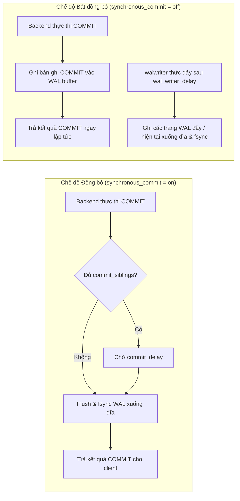
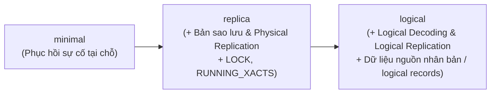

# CHƯƠNG 11: Các chế độ WAL (CHAPTER 11: WAL Modes)

## 11.1 Hiệu năng (11.1 Performance)

Khi máy chủ đang hoạt động bình thường, các tệp WAL (Write-Ahead Log — nhật ký ghi trước) được ghi xuống đĩa liên tục. Tuy nhiên, các thao tác ghi này mang tính tuần tự (sequential): hầu như không có truy cập ngẫu nhiên (random access), nên ngay cả các ổ đĩa cứng HDD (Hard Disk Drive) cũng có thể đảm đương tốt tác vụ này. Vì kiểu tải này rất khác so với việc truy cập tệp dữ liệu thông thường, bạn có thể cân nhắc thiết lập một thiết bị lưu trữ vật lý riêng biệt cho các tệp WAL và thay thế thư mục `PGDATA/pg_wal` bằng một liên kết tượng trưng (symbolic link) trỏ tới một thư mục trên hệ thống tệp đã được gắn kết (mounted file system).

Có một vài tình huống mà các tệp WAL vừa phải được ghi vừa phải được đọc. Tình huống thứ nhất là trường hợp hiển nhiên: phục hồi sau sự cố (crash recovery); tình huống thứ hai là nhân bản luồng (stream replication). Tiến trình `walsender`[^1] đọc các bản ghi WAL trực tiếp từ tệp.[^2] Vì vậy, nếu một bản sao (replica) không nhận được các bản ghi WAL trong lúc các trang (page) cần thiết vẫn còn nằm trong bộ đệm hệ điều hành (OS buffers) của máy chủ chính (primary server), thì dữ liệu sẽ phải được đọc từ đĩa. Nhưng ngay cả khi đó, việc truy cập vẫn là tuần tự chứ không phải ngẫu nhiên.

Các bản ghi WAL có thể được ghi theo một trong hai chế độ sau:

- **Chế độ đồng bộ (synchronous mode):** không cho phép thực hiện bất kỳ thao tác tiếp theo nào cho đến khi việc xác nhận giao dịch (transaction commit) lưu toàn bộ các bản ghi WAL liên quan xuống đĩa.
- **Chế độ bất đồng bộ (asynchronous mode):** cho phép xác nhận giao dịch tức thì, còn các bản ghi WAL sẽ được ghi xuống đĩa sau đó trong nền (background).

Chế độ hiện tại được xác định bởi tham số `synchronous_commit` (mặc định: `on`).

**Chế độ đồng bộ (Synchronous mode).** Để ghi nhận một cách chắc chắn sự kiện xác nhận giao dịch (commit), chỉ chuyển các bản ghi WAL cho hệ điều hành là chưa đủ; bạn phải đảm bảo rằng quá trình đồng bộ hóa đĩa (disk synchronization) đã hoàn tất thành công. Vì quá trình đồng bộ hóa đòi hỏi các thao tác I/O thực sự (vốn khá chậm), nên việc thực hiện nó càng ít lần càng tốt sẽ mang lại lợi ích lớn.

Để làm được điều này, tiến trình backend thực hiện kết thúc giao dịch và ghi các bản ghi WAL xuống đĩa có thể tạm dừng một khoảng thời gian nhỏ được quy định bởi tham số `commit_delay` (mặc định: `0s`). Tuy nhiên, việc tạm dừng này sẽ chỉ xảy ra nếu có ít nhất `commit_siblings` (mặc định: `5`) giao dịch đang hoạt động trong hệ thống:[^3] trong khoảng thời gian tạm dừng này, một số giao dịch khác có thể kết thúc và máy chủ sẽ đồng bộ hóa tất cả các bản ghi WAL cùng một lúc. Điều này rất giống với việc giữ cửa thang máy để ai đó kịp chạy vào.

Theo mặc định, không có khoảng tạm dừng nào. Việc điều chỉnh tham số `commit_delay` chỉ có ý nghĩa đối với các hệ thống thực hiện rất nhiều giao dịch OLTP ngắn.

Sau khoảng tạm dừng tiềm năng đó, tiến trình kết thúc giao dịch sẽ đẩy (flush) toàn bộ các bản ghi WAL đã tích lũy xuống đĩa và thực hiện đồng bộ hóa (điều quan trọng là phải lưu bản ghi commit và tất cả các bản ghi trước đó liên quan đến giao dịch này; phần còn lại được ghi thêm chỉ vì nó không làm tăng chi phí).

Kể từ thời điểm này, yêu cầu về tính bền vững (durability) trong ACID được đảm bảo — giao dịch được coi là đã được xác nhận một cách đáng tin cậy.[^4] Đó là lý do tại sao chế độ đồng bộ là chế độ mặc định.

Nhược điểm của commit đồng bộ là độ trễ (latency) cao hơn (lệnh `COMMIT` không trả quyền điều khiển cho đến khi kết thúc quá trình đồng bộ hóa) và thông lượng (throughput) của hệ thống thấp hơn, đặc biệt đối với các tải công việc OLTP.

**Chế độ bất đồng bộ (Asynchronous mode).** Bạn phải tắt tham số `synchronous_commit` để bật chế độ commit bất đồng bộ.[^5]

Ở chế độ bất đồng bộ, các bản ghi WAL được ghi xuống đĩa bởi tiến trình `walwriter`,[^6] tiến trình này luân phiên giữa trạng thái làm việc và trạng thái ngủ. Thời lượng của các khoảng nghỉ được xác định bởi giá trị `wal_writer_delay` (mặc định: `200ms`).

Khi thức dậy sau một khoảng nghỉ, tiến trình sẽ kiểm tra bộ nhớ đệm (cache) xem có trang WAL nào mới được lấp đầy hoàn toàn hay không. Nếu có các trang như vậy xuất hiện, tiến trình sẽ ghi chúng xuống đĩa, bỏ qua trang hiện tại (đang ghi dở). Ngược lại, nó sẽ ghi trang hiện tại đang đầy một nửa vì đằng nào nó cũng đã thức dậy rồi.[^7]

Mục đích của thuật toán này là tránh việc đẩy cùng một trang xuống đĩa nhiều lần, điều này mang lại cải thiện hiệu năng đáng kể cho các tải công việc có cường độ thay đổi dữ liệu cao.

Mặc dù bộ nhớ đệm WAL được sử dụng như một bộ đệm vòng (ring buffer), `walwriter` sẽ dừng lại khi chạm tới trang cuối cùng của bộ nhớ đệm; sau một khoảng nghỉ, chu kỳ ghi tiếp theo lại bắt đầu từ trang đầu tiên. Vì vậy, trong trường hợp xấu nhất, `walwriter` cần ba lượt chạy để xử lý tới một bản ghi WAL cụ thể: đầu tiên, nó sẽ ghi tất cả các trang đầy nằm ở cuối bộ nhớ đệm; sau đó quay lại phần đầu; và cuối cùng, nó sẽ xử lý trang chưa đầy có chứa bản ghi đó. Nhưng trong hầu hết các trường hợp, quá trình này chỉ mất một hoặc hai chu kỳ.

Quá trình đồng bộ hóa được thực hiện mỗi khi lượng dữ liệu bằng `wal_writer_flush_after` (mặc định: `1MB`) được ghi xong, và một lần nữa vào cuối chu kỳ ghi.



Commit bất đồng bộ nhanh hơn commit đồng bộ vì không phải chờ đợi các thao tác ghi vật lý xuống đĩa. Nhưng độ tin cậy bị ảnh hưởng: bạn có thể mất dữ liệu đã commit trong khoảng thời gian `3 × wal_writer_delay` trước khi xảy ra sự cố (tức là 0,6 giây theo mặc định).

> 📝 **Giải thích thêm (không có trong sách):**
> Tại sao lại là `3 × wal_writer_delay`? Như tác giả vừa giải thích, trong trường hợp xấu nhất, `walwriter` cần tới **3 chu kỳ** làm việc (mỗi chu kỳ cách nhau `wal_writer_delay` = 200ms) mới đẩy hết dữ liệu từ ring buffer xuống đĩa. Do đó, dữ liệu của một giao dịch đã báo `COMMIT` thành công có thể nằm trên RAM tối đa `3 × 200ms = 0,6 giây` trước khi được `fsync` an toàn xuống đĩa.

Trong thế giới thực, hai chế độ này bổ sung cho nhau. Ở chế độ đồng bộ, các bản ghi WAL liên quan đến một giao dịch chạy dài vẫn có thể được ghi bất đồng bộ để giải phóng các bộ đệm WAL. Và ngược lại, một bản ghi WAL liên quan đến một trang sắp bị đẩy ra khỏi bộ đệm (buffer cache) sẽ được ghi ngay lập tức xuống đĩa ngay cả ở chế độ bất đồng bộ — nếu không, hệ thống không thể tiếp tục hoạt động.

Trong hầu hết các trường hợp, người thiết kế hệ thống phải đưa ra lựa chọn khó khăn giữa hiệu năng và tính bền vững.

Tham số `synchronous_commit` cũng có thể được thiết lập riêng cho từng giao dịch. Nếu có thể phân loại tất cả các giao dịch ở tầng ứng dụng thành nhóm cực kỳ quan trọng (như xử lý dữ liệu tài chính) hoặc nhóm ít quan trọng hơn, bạn có thể tăng hiệu năng trong khi chỉ chấp nhận rủi ro mất các giao dịch không quan trọng.

> 💡 **Ví dụ bổ sung (không có trong sách):**
> Trong một ứng dụng thương mại điện tử, bạn có thể giữ `synchronous_commit = on` ở mức toàn cục để đảm bảo an toàn cho đơn hàng và thanh toán, nhưng tắt ở mức giao dịch cho các thao tác ghi log lượt xem trang hoặc cập nhật bộ đếm ít quan trọng:
> ```sql
> BEGIN;
> SET LOCAL synchronous_commit = off;
> INSERT INTO page_views (user_id, url, viewed_at) VALUES (101, '/home', now());
> COMMIT;
> ```

Để hình dung phần nào mức độ cải thiện hiệu năng tiềm năng của commit bất đồng bộ, hãy cùng so sánh độ trễ và thông lượng giữa hai chế độ bằng bài kiểm thử `pgbench`.[^8]

Đầu tiên, khởi tạo các bảng cần thiết:

```bash
postgres$ /usr/local/pgsql/bin/pgbench -i internals
```

Bắt đầu bài kiểm thử kéo dài 30 giây ở chế độ đồng bộ:

```bash
postgres$ /usr/local/pgsql/bin/pgbench -T 30 internals
pgbench (14.7)
starting vacuum...end.
transaction type: <builtin: TPC-B (sort of)>
scaling factor: 1
query mode: simple
number of clients: 1
number of threads: 1
duration: 30 s
number of transactions actually processed: 20123
latency average = 1.491 ms
initial connection time = 2.507 ms
tps = 670.809688 (without initial connection time)
```

Và bây giờ chạy cùng bài kiểm thử đó ở chế độ bất đồng bộ:

```sql
=> ALTER SYSTEM SET synchronous_commit = off;
=> SELECT pg_reload_conf();
```

```bash
postgres$ /usr/local/pgsql/bin/pgbench -T 30 internals
pgbench (14.7)
starting vacuum...end.
transaction type: <builtin: TPC-B (sort of)>
scaling factor: 1
query mode: simple
number of clients: 1
number of threads: 1
duration: 30 s
number of transactions actually processed: 61809
latency average = 0.485 ms
initial connection time = 1.915 ms
tps = 2060.399861 (without initial connection time)
```

Ở chế độ bất đồng bộ, bài kiểm thử đơn giản này cho thấy độ trễ thấp hơn đáng kể và thông lượng (TPS — số giao dịch mỗi giây) cao hơn rõ rệt. Tất nhiên, mỗi hệ thống cụ thể sẽ có các con số riêng tùy thuộc vào tải hiện tại, nhưng rõ ràng tác động lên các giao dịch OLTP ngắn có thể rất đáng kể.

Hãy khôi phục lại các thiết lập mặc định:

```sql
=> ALTER SYSTEM RESET synchronous_commit;
=> SELECT pg_reload_conf();
```

## 11.2 Khả năng chịu lỗi (11.2 Fault Tolerance)

Hiển nhiên là cơ chế ghi nhật ký trước (write-ahead logging) phải đảm bảo khả năng phục hồi sau sự cố trong mọi hoàn cảnh (trừ khi bản thân thiết bị lưu trữ bền vững bị hỏng). Có nhiều yếu tố có thể ảnh hưởng đến tính nhất quán của dữ liệu, nhưng tôi sẽ chỉ đề cập đến những yếu tố quan trọng nhất: bộ nhớ đệm (caching), hỏng dữ liệu (data corruption) và ghi không nguyên tử (non-atomic writes).[^9]

### Bộ nhớ đệm (Caching)

Trước khi tới được thiết bị lưu trữ bất khả biến (non-volatile storage, chẳng hạn như đĩa cứng), dữ liệu có thể đi qua nhiều lớp bộ nhớ đệm khác nhau.

Một lệnh ghi đĩa đơn thuần chỉ chỉ thị cho hệ điều hành đặt dữ liệu vào bộ nhớ đệm của nó (vốn cũng dễ bị ảnh hưởng bởi sự cố mất điện/sập hệ thống giống như bất kỳ phần nào khác của RAM). Việc ghi thực tế được thực hiện bất đồng bộ, theo các thiết lập của bộ lập lịch I/O (I/O scheduler) của hệ điều hành. Một khi bộ lập lịch quyết định đẩy dữ liệu đã tích lũy xuống, dữ liệu này sẽ được chuyển vào bộ nhớ đệm của thiết bị lưu trữ (như ổ HDD). Các thiết bị lưu trữ cũng có thể trì hoãn việc ghi, chẳng hạn để gom các trang liền kề lại với nhau. Bộ điều khiển RAID (RAID controller) lại bổ sung thêm một tầng bộ nhớ đệm nữa giữa đĩa và hệ điều hành.

Nếu không có các biện pháp đặc biệt, thời điểm dữ liệu thực sự được lưu an toàn trên đĩa là không thể biết trước. Thông thường điều này không quá quan trọng vì chúng ta đã có WAL, nhưng bản thân các bản ghi WAL phải được lưu một cách đáng tin cậy xuống đĩa ngay lập tức.[^10] Điều này cũng đúng với chế độ bất đồng bộ — nếu không, không thể đảm bảo rằng các bản ghi WAL tới được đĩa trước dữ liệu đã bị sửa đổi.

Tiến trình `checkpointer` cũng phải lưu dữ liệu theo cách đáng tin cậy, đảm bảo rằng các trang bẩn (dirty pages) thực sự đi từ bộ nhớ đệm của hệ điều hành xuống đĩa. Bên cạnh đó, nó phải đồng bộ hóa tất cả các thao tác tệp đã được thực hiện bởi các tiến trình khác (như ghi trang hoặc xóa tệp): khi checkpoint hoàn tất, kết quả của tất cả các hành động này phải đã được lưu trên đĩa.[^11]

Ngoài ra còn có một số tình huống khác đòi hỏi việc ghi an toàn trước lỗi (fail-safe writing), chẳng hạn như thực hiện các thao tác không ghi nhật ký (unlogged operations) ở mức WAL `minimal`.

Các hệ điều hành cung cấp nhiều phương tiện khác nhau để đảm bảo ghi dữ liệu ngay lập tức vào bộ nhớ bất khả biến. Tất cả chúng đều quy về hai cách tiếp cận chính sau: hoặc là một lệnh đồng bộ hóa riêng biệt được gọi sau khi ghi (như `fsync` hoặc `fdatasync`), hoặc là yêu cầu thực hiện đồng bộ hóa (hoặc thậm chí ghi trực tiếp bỏ qua bộ nhớ đệm của hệ điều hành) được chỉ định ngay khi tệp đang được mở hoặc ghi vào.

Tiện ích `pg_test_fsync` có thể giúp bạn xác định cách tốt nhất để đồng bộ hóa WAL tùy thuộc vào hệ điều hành và hệ thống tệp cụ thể; phương thức ưu tiên có thể được chỉ định trong tham số `wal_sync_method`. Đối với các thao tác khác, phương thức đồng bộ hóa phù hợp được chọn tự động và không thể cấu hình.[^12]

Một khía cạnh tinh tế ở đây là trong mỗi trường hợp cụ thể, phương thức phù hợp nhất phụ thuộc vào phần cứng. Ví dụ, nếu bạn sử dụng bộ điều khiển RAID có pin dự phòng (backup battery), bạn có thể tận dụng bộ nhớ đệm của nó, vì pin sẽ bảo vệ dữ liệu trong trường hợp mất điện.

Bạn cần ghi nhớ rằng commit bất đồng bộ và việc thiếu đồng bộ hóa là hai câu chuyện hoàn toàn khác nhau. Tắt đồng bộ hóa (bằng tham số `fsync`, mặc định: `on`) giúp tăng hiệu năng hệ thống, nhưng bất kỳ sự cố nào cũng sẽ dẫn đến mất dữ liệu nghiêm trọng không thể khắc phục. Chế độ bất đồng bộ vẫn đảm bảo phục hồi sau sự cố về một trạng thái nhất quán, chỉ là một số cập nhật dữ liệu mới nhất có thể bị thiếu.

### Hỏng dữ liệu (Data Corruption)

Thiết bị kỹ thuật không hoàn hảo, và dữ liệu có thể bị hư hại cả trong bộ nhớ lẫn trên đĩa, hoặc trong khi đang được truyền qua cáp giao tiếp. Những lỗi như vậy thường được xử lý ở tầng phần cứng, nhưng một số vẫn có thể lọt qua.

Để phát hiện sự cố kịp thời, PostgreSQL luôn bảo vệ các bản ghi WAL bằng mã kiểm tra (checksums).

Mã kiểm tra cũng có thể được tính cho các trang dữ liệu.[^13] Việc này được thực hiện trong quá trình khởi tạo cụm (cluster initialization) hoặc bằng cách chạy tiện ích `pg_checksums` (từ phiên bản 12)[^14] khi máy chủ đã dừng.[^15]

Trong các hệ thống sản xuất (production), mã kiểm tra phải luôn được bật, bất chấp một lượng chi phí phụ trội nhỏ cho việc tính toán và xác minh. Nó làm tăng cơ hội phát hiện kịp thời tình trạng hỏng dữ liệu, mặc dù vẫn còn một số trường hợp biên:

- Việc xác minh mã kiểm tra chỉ được thực hiện khi trang được truy cập, do đó tình trạng hỏng dữ liệu có thể không bị phát hiện trong một thời gian dài, cho đến lúc nó lọt vào tất cả các bản sao lưu và không còn nguồn dữ liệu đúng nào nữa.
- Một trang chứa toàn số 0 (zeroed page) được coi là hợp lệ, nên nếu hệ thống tệp vô tình ghi đè toàn số 0 lên một trang, lỗi này sẽ không bị phát hiện.
- Mã kiểm tra chỉ được tính cho nhánh chính (main fork) của các quan hệ (relations); các nhánh khác và các tệp khác (chẳng hạn như trạng thái giao dịch trong CLOG) vẫn không được bảo vệ.

Hãy kiểm tra tham số chỉ đọc `data_checksums` để chắc chắn rằng mã kiểm tra đã được bật:

```sql
=> SHOW data_checksums;
 data_checksums
----------------
 on
(1 row)
```

Bây giờ hãy dừng máy chủ và ghi đè toàn số 0 lên vài byte trong trang số 0 của nhánh chính của bảng:

```sql
=> SELECT pg_relation_filepath('wal');
 pg_relation_filepath
----------------------
 base/16391/16562
(1 row)
```

```bash
postgres$ pg_ctl stop
postgres$ dd if=/dev/zero of=/usr/local/pgsql/data/base/16391/16562 \
  oflag=dsync conv=notrunc bs=1 count=8
8+0 records in
8+0 records out
8 bytes copied, 0,00776573 s, 1,0 kB/s
```

Khởi động lại máy chủ:

```bash
postgres$ pg_ctl start -l /home/postgres/logfile
```

Thực tế, chúng ta có thể để máy chủ tiếp tục chạy — chỉ cần ghi trang đó xuống đĩa và đẩy nó ra khỏi bộ nhớ đệm (nếu không, máy chủ sẽ tiếp tục sử dụng phiên bản trong bộ nhớ đệm). Nhưng quy trình đó khó tái lập hơn.

Bây giờ hãy thử đọc bảng:

```sql
=> SELECT * FROM wal LIMIT 1;
WARNING:  page verification failed, calculated checksum 20397 but expected 28733
ERROR:  invalid page in block 0 of relation base/16391/16562
```

Nếu dữ liệu không thể khôi phục từ bản sao lưu, ít nhất ta nên cố gắng đọc trang bị hỏng (chấp nhận rủi ro nhận được kết quả sai lệch). Để làm điều này, bạn phải bật tham số `ignore_checksum_failure` (mặc định: `off`):

```sql
=> SET ignore_checksum_failure = on;
=> SELECT * FROM wal LIMIT 1;
WARNING:  page verification failed, calculated checksum 20397 but expected 28733
 id
----
  2
(1 row)
```

Mọi thứ diễn ra ổn thỏa trong trường hợp này vì chúng ta đã làm hỏng một phần không quá nghiêm trọng của phần đầu trang (LSN của bản ghi WAL mới nhất), chứ không phải bản thân dữ liệu.

### Ghi không nguyên tử (Non-Atomic Writes)

Một trang cơ sở dữ liệu thường chiếm 8 kB, nhưng ở tầng thấp, việc ghi được thực hiện theo từng khối (block), vốn thường nhỏ hơn (thông thường là 512 byte hoặc 4 kB). Do đó, nếu sự cố xảy ra, một trang có thể chỉ được ghi một phần (torn page). Không có ý nghĩa gì khi áp dụng các bản ghi WAL thông thường lên một trang như vậy trong quá trình phục hồi.

Để tránh việc ghi dở dang một phần trang, PostgreSQL lưu một ảnh toàn bộ trang — FPI (Full Page Image, xem trang 285) vào WAL khi trang này bị sửa đổi lần đầu tiên sau khi checkpoint bắt đầu. Hành vi này được điều khiển bởi tham số `full_page_writes` (mặc định: `on`), và việc tắt nó có thể dẫn đến hỏng dữ liệu nghiêm trọng.

Nếu tiến trình phục hồi bắt gặp một FPI trong WAL, nó sẽ ghi đè vô điều kiện ảnh đó xuống đĩa (mà không cần kiểm tra LSN của trang); giống như mọi bản ghi WAL khác, các FPI cũng được bảo vệ bằng mã kiểm tra, nên việc chúng bị hỏng không thể lọt qua mà không bị phát hiện. Sau đó, các bản ghi WAL thông thường sẽ được áp dụng lên trạng thái này — vốn đã được đảm bảo là đúng đắn.

> 📝 **Giải thích thêm (không có trong sách):**
> Quá trình ghi không nguyên tử (torn page) xảy ra như sau: giả sử một trang PostgreSQL 8 kB gồm hai khối đĩa 4 kB (khối A và khối B). Khi OS đang ghi trang xuống đĩa, khối A đã được ghi xong nhưng mất điện trước khi khối B kịp ghi. Kết quả là trang trên đĩa bị "xé đôi" (nửa mới, nửa cũ), không nhất quán. Nếu không có FPI, khi khôi phục, WAL record chỉ chứa phần thay đổi (delta) nên không thể áp dụng lên một trang đã bị biến dạng. Nhờ có FPI lưu toàn bộ trang gốc 8 kB ngay lần sửa đầu tiên sau checkpoint, PostgreSQL sẽ chép đè nguyên trang sạch đó trước rồi mới chạy tiếp các WAL record sau đó.

Không có loại bản ghi WAL riêng cho việc thiết lập các bit gợi ý (hint bits, xem trang 82): thao tác này được coi là không nghiêm trọng vì bất kỳ truy vấn nào truy cập vào trang cũng sẽ tự thiết lập lại các bit cần thiết. Tuy nhiên, bất kỳ thay đổi nào ở hint bit cũng sẽ làm thay đổi mã kiểm tra của trang. Vì vậy, nếu mã kiểm tra được bật (hoặc nếu tham số `wal_log_hints` — mặc định: `off` — đang bật), các sửa đổi hint bit sẽ được ghi nhật ký dưới dạng FPI.[^16]

Mặc dù cơ chế ghi nhật ký đã loại bỏ khoảng trống (empty space) khỏi FPI,[^17] kích thước của các tệp WAL được tạo ra vẫn tăng lên đáng kể. Tình hình có thể được cải thiện rất nhiều nếu bạn bật tính năng nén FPI thông qua tham số `wal_compression` (mặc định: `off`).

Hãy chạy một thử nghiệm đơn giản bằng tiện ích `pgbench`. Chúng ta sẽ thực hiện một checkpoint và ngay lập tức bắt đầu một bài kiểm thử với số lượng giao dịch cố định:

```sql
=> CHECKPOINT;
=> SELECT pg_current_wal_insert_lsn();
 pg_current_wal_insert_lsn
---------------------------
 0/42CE5DA8
(1 row)
```

```bash
postgres$ /usr/local/pgsql/bin/pgbench -t 20000 internals
```

```sql
=> SELECT pg_current_wal_insert_lsn();
 pg_current_wal_insert_lsn
---------------------------
 0/449113E0
(1 row)
```

Đây là kích thước của các bản ghi WAL được tạo ra:

```sql
=> SELECT pg_size_pretty('0/449755C0'::pg_lsn - '0/42CE5DA8'::pg_lsn);
 pg_size_pretty
----------------
 29 MB
(1 row)
```

Trong ví dụ này, các FPI chiếm hơn một nửa tổng kích thước WAL. Bạn có thể tự mình thấy điều đó trong số liệu thống kê thu thập được, hiển thị số lượng bản ghi WAL (`N`), kích thước các bản ghi thông thường (`Record size`), và kích thước FPI (`FPI size`) cho từng loại tài nguyên (`Type`):

```bash
postgres$ /usr/local/pgsql/bin/pg_waldump --stats \
  -p /usr/local/pgsql/data/pg_wal -s 0/42CE5DA8 -e 0/449755C0
Type             N      (%)  Record size      (%)    FPI size      (%)
----             -      ---  -----------      ---    --------      ---
XLOG          4294 (  3,31)       210406 (  2,50)    19820068 ( 93,78)
Transaction  20004 ( 15,41)       680536 (  8,10)           0 (  0,00)
Storage          1 (  0,00)           42 (  0,00)           0 (  0,00)
CLOG             1 (  0,00)           30 (  0,00)           0 (  0,00)
Standby          6 (  0,00)          416 (  0,00)           0 (  0,00)
Heap2        24774 ( 19,09)      1536253 ( 18,27)       24576 (  0,12)
Heap         80234 ( 61,81)      5946242 ( 70,73)      295664 (  1,40)
Btree          494 (  0,38)        32747 (  0,39)      993860 (  4,70)
            --------         -----------          -----------
Total       129808               8406672 [28,46%]    21134168 [71,54%]
```

Tỷ lệ này sẽ nhỏ hơn nếu các trang dữ liệu bị sửa đổi nhiều lần giữa các checkpoint. Đây lại là một lý do nữa để thực hiện checkpoint ít thường xuyên hơn.

Chúng ta sẽ lặp lại cùng thí nghiệm đó để xem việc nén có giúp ích được không.

```sql
=> ALTER SYSTEM SET wal_compression = on;
=> SELECT pg_reload_conf();
=> CHECKPOINT;
=> SELECT pg_current_wal_insert_lsn();
 pg_current_wal_insert_lsn
---------------------------
 0/44D4C228
(1 row)
```

```bash
postgres$ /usr/local/pgsql/bin/pgbench -t 20000 internals
```

```sql
=> SELECT pg_current_wal_insert_lsn();
 pg_current_wal_insert_lsn
---------------------------
 0/457653B0
(1 row)
```

Đây là kích thước WAL khi đã bật nén:

```sql
=> SELECT pg_size_pretty('0/457653B0'::pg_lsn - '0/44D4C228'::pg_lsn);
 pg_size_pretty
----------------
 10 MB
(1 row)
```

```bash
postgres$ /usr/local/pgsql/bin/pg_waldump --stats \
  -p /usr/local/pgsql/data/pg_wal -s 0/44D4C228 -e 0/457653B0
Type             N      (%)  Record size      (%)    FPI size      (%)
----             -      ---  -----------      ---    --------      ---
XLOG           344 (  0,29)        17530 (  0,22)      435492 ( 17,75)
Transaction  20001 ( 16,73)       680114 (  8,68)           0 (  0,00)
Storage          1 (  0,00)           42 (  0,00)           0 (  0,00)
Standby          5 (  0,00)          330 (  0,00)           0 (  0,00)
Heap2        18946 ( 15,84)      1207425 ( 15,42)      101601 (  4,14)
Heap         80141 ( 67,02)      5918020 ( 75,56)     1627008 ( 66,31)
Btree          143 (  0,12)         8443 (  0,11)      289654 ( 11,80)
            --------         -----------          -----------
Total       119581               7831904 [76,14%]     2453755 [23,86%]
```

Tóm lại, khi có một số lượng lớn các FPI do bật mã kiểm tra hoặc `full_page_writes` (tức là hầu như luôn luôn), việc sử dụng nén là hợp lý bất chấp một chút chi phí CPU bổ sung.

## 11.3 Các mức độ WAL (11.3 WAL Levels)

Mục tiêu chính của việc ghi nhật ký trước là cho phép phục hồi sau sự cố. Nhưng nếu bạn mở rộng phạm vi thông tin được ghi nhật ký, WAL cũng có thể được sử dụng cho các mục đích khác. PostgreSQL cung cấp các mức ghi nhật ký `minimal`, `replica`, và `logical`. Mỗi mức bao gồm toàn bộ những gì được ghi ở mức trước đó và bổ sung thêm một số thông tin nữa.

Mức độ đang sử dụng được xác định bởi tham số `wal_level` (mặc định: `replica`); việc thay đổi tham số này đòi hỏi phải khởi động lại máy chủ.



### Mức tối thiểu (Minimal)

Mức `minimal` chỉ đảm bảo khả năng phục hồi sau sự cố (crash recovery). Để tiết kiệm dung lượng, các thao tác trên những quan hệ (relations) được tạo mới hoặc cắt cụt (`TRUNCATE`) ngay trong giao dịch hiện tại sẽ không được ghi vào WAL nếu chúng phát sinh việc chèn một lượng lớn dữ liệu (như trong trường hợp các lệnh `CREATE TABLE AS SELECT` và `CREATE INDEX`).[^18] Thay vì được ghi vào WAL, toàn bộ dữ liệu cần thiết sẽ được đẩy ngay xuống đĩa, và các thay đổi trong danh mục hệ thống (system catalog) trở nên hiển thị ngay sau khi giao dịch được commit.

Nếu một thao tác như vậy bị gián đoạn bởi sự cố, dữ liệu đã kịp ghi xuống đĩa vẫn ở trạng thái vô hình (invisible) và không ảnh hưởng đến tính nhất quán. Nếu sự cố xảy ra sau khi thao tác đã hoàn tất, toàn bộ dữ liệu cần thiết để áp dụng các bản ghi WAL tiếp theo đã được lưu an toàn trên đĩa.

Lượng dữ liệu phải được ghi vào một quan hệ mới tạo để tối ưu hóa này có hiệu lực được xác định bởi tham số `wal_skip_threshold` (mặc định: `2MB`, từ phiên bản 13).

Hãy xem những gì được ghi nhật ký ở mức `minimal`.

Theo mặc định (từ phiên bản 10), mức `replica` cao hơn được sử dụng để hỗ trợ nhân bản dữ liệu. Nếu bạn chọn mức `minimal`, bạn cũng phải đặt số lượng tiến trình `walsender` được phép về 0 trong tham số `max_wal_senders` (mặc định: `10`):

```sql
=> ALTER SYSTEM SET wal_level = minimal;
=> ALTER SYSTEM SET max_wal_senders = 0;
```

Máy chủ phải được khởi động lại để các thay đổi này có hiệu lực:

```bash
postgres$ pg_ctl restart -l /home/postgres/logfile
```

Ghi nhận vị trí WAL hiện tại:

```sql
=> SELECT pg_current_wal_insert_lsn();
 pg_current_wal_insert_lsn
---------------------------
 0/45767698
(1 row)
```

Thực hiện `TRUNCATE` bảng và chèn các dòng mới trong cùng một giao dịch cho đến khi vượt quá ngưỡng `wal_skip_threshold`:

```sql
=> BEGIN;
=> TRUNCATE TABLE wal;
=> INSERT INTO wal SELECT id FROM generate_series(1,100000) id;
=> COMMIT;
=> SELECT pg_current_wal_insert_lsn();
 pg_current_wal_insert_lsn
---------------------------
 0/45767840
(1 row)
```

Thay vì tạo một bảng mới, tôi chạy lệnh `TRUNCATE` (xem trang 251) vì nó tạo ra ít bản ghi WAL hơn.

Hãy kiểm tra đoạn WAL được tạo ra bằng tiện ích `pg_waldump` đã quen thuộc.

```bash
postgres$ /usr/local/pgsql/bin/pg_waldump \
  -p /usr/local/pgsql/data/pg_wal -s 0/45767698 -e 0/45767840
rmgr: Storage     len (rec/tot):     42/    42, tx:          0, lsn: 0/45767698, prev 0/45767660, desc: CREATE base/16391/24784
rmgr: Heap        len (rec/tot):    123/   123, tx:     122844, lsn: 0/457676C8, prev 0/45767698, desc: UPDATE off 45 xmax 122844 flags 0x60 ; new off 48 xmax 0, blkref #0: rel 1663/16391/1259 blk 0
rmgr: Btree       len (rec/tot):     64/    64, tx:     122844, lsn: 0/45767748, prev 0/457676C8, desc: INSERT_LEAF off 176, blkref #0: rel 1663/16391/2662 blk 2
rmgr: Btree       len (rec/tot):     64/    64, tx:     122844, lsn: 0/45767788, prev 0/45767748, desc: INSERT_LEAF off 147, blkref #0: rel 1663/16391/2663 blk 2
rmgr: Btree       len (rec/tot):     64/    64, tx:     122844, lsn: 0/457677C8, prev 0/45767788, desc: INSERT_LEAF off 254, blkref #0: rel 1663/16391/3455 blk 4
rmgr: Transaction len (rec/tot):     54/    54, tx:     122844, lsn: 0/45767808, prev 0/457677C8, desc: COMMIT 2023-03-06 14:03:58.395214 MSK; rels: base/16391/24783
```

Bản ghi đầu tiên ghi nhận việc tạo một tệp mới cho quan hệ (vì lệnh `TRUNCATE` về bản chất là viết lại bảng).

Bốn bản ghi tiếp theo gắn liền với các thao tác trên danh mục hệ thống (system catalog). Chúng phản ánh các thay đổi trong bảng `pg_class` và ba chỉ mục (index) của nó.

Cuối cùng là bản ghi liên quan đến việc commit. Quá trình chèn dữ liệu hoàn toàn không được ghi vào WAL.

### Mức bản sao (Replica)

Trong quá trình phục hồi sau sự cố, các bản ghi WAL được phát lại (replay) để khôi phục dữ liệu trên đĩa về một trạng thái nhất quán. Quá trình khôi phục từ bản sao lưu (backup recovery) hoạt động theo cách tương tự, nhưng nó còn có thể khôi phục trạng thái cơ sở dữ liệu tới một thời điểm mục tiêu (recovery target point) được chỉ định bằng cách sử dụng kho lưu trữ WAL (WAL archive). Số lượng các bản ghi WAL được lưu trữ có thể rất lớn (ví dụ, kéo dài nhiều ngày), nên khoảng thời gian phục hồi sẽ bao gồm nhiều checkpoint. Do đó, mức WAL `minimal` là không đủ: không thể lặp lại một thao tác nếu nó không được ghi nhật ký. Đối với việc phục hồi từ bản sao lưu, các tệp WAL phải bao gồm toàn bộ các thao tác.

Điều tương tự cũng đúng với nhân bản (replication): các lệnh không được ghi nhật ký sẽ không thể được gửi tới bản sao (replica) và sẽ không được phát lại trên đó.

Mọi thứ còn phức tạp hơn nếu một bản sao được dùng để thực thi các truy vấn đọc. Trước hết, nó cần có thông tin về các khóa độc quyền (exclusive locks, xem trang 315) được cấp trên máy chủ chính vì chúng có thể xung đột với các truy vấn đang chạy trên bản sao. Thứ hai, nó phải có khả năng chụp ảnh nhanh dữ liệu (snapshots, xem trang 91), điều này đòi hỏi thông tin về các giao dịch đang hoạt động. Khi làm việc với một bản sao, cả các giao dịch cục bộ lẫn các giao dịch đang chạy trên máy chủ chính đều phải được tính đến.

Cách duy nhất để gửi dữ liệu này tới bản sao là định kỳ ghi nó vào các tệp WAL.[^19] Việc này được thực hiện bởi tiến trình `bgwriter`,[^20] cứ mỗi 15 giây một lần (khoảng thời gian này được mã hóa cứng — hard-coded).

Khả năng thực hiện khôi phục dữ liệu từ bản sao lưu và sử dụng nhân bản vật lý (physical replication) được đảm bảo ở mức `replica`.

Mức `replica` (từ phiên bản 10) được sử dụng theo mặc định, nên chúng ta chỉ cần đặt lại các tham số đã cấu hình ở trên và khởi động lại máy chủ:

```sql
=> ALTER SYSTEM RESET wal_level;
=> ALTER SYSTEM RESET max_wal_senders;
```

```bash
postgres$ pg_ctl restart -l /home/postgres/logfile
```

Hãy lặp lại quy trình tương tự như trước (nhưng lần này chúng ta sẽ chỉ chèn một dòng để có kết quả đầu ra gọn gàng hơn):

```sql
=> SELECT pg_current_wal_insert_lsn();
 pg_current_wal_insert_lsn
---------------------------
 0/45D88E48
(1 row)
```

```sql
=> BEGIN;
=> TRUNCATE TABLE wal;
=> INSERT INTO wal VALUES (42);
=> COMMIT;
=> SELECT pg_current_wal_insert_lsn();
 pg_current_wal_insert_lsn
---------------------------
 0/45D89108
(1 row)
```

Hãy kiểm tra các bản ghi WAL được tạo ra.

Ngoài những gì chúng ta đã thấy ở mức `minimal`, chúng ta còn nhận được các bản ghi sau:

- các bản ghi liên quan đến nhân bản của trình quản lý tài nguyên `Standby`: `running_xacts` (các giao dịch đang hoạt động) và `lock`
- bản ghi ghi nhận thao tác `INSERT+INIT`, thao tác này khởi tạo một trang mới và chèn một dòng mới vào trang đó

```bash
postgres$ /usr/local/pgsql/bin/pg_waldump \
  -p /usr/local/pgsql/data/pg_wal -s 0/45D88E48 -e 0/45D89108
rmgr: Standby     len (rec/tot):     42/    42, tx:     122846, lsn: 0/45D88E48, prev 0/45D88DD0, desc: LOCK xid 122846 db 16391 rel 16562
rmgr: Storage     len (rec/tot):     42/    42, tx:     122846, lsn: 0/45D88E78, prev 0/45D88E48, desc: CREATE base/16391/24786
rmgr: Heap        len (rec/tot):    123/   123, tx:     122846, lsn: 0/45D88EA8, prev 0/45D88E78, desc: UPDATE off 49 xmax 122846 flags 0x60 ; new off 50 xmax 0, blkref #0: rel 1663/16391/1259 blk 0
rmgr: Btree       len (rec/tot):     64/    64, tx:     122846, lsn: 0/45D88F28, prev 0/45D88EA8, desc: INSERT_LEAF off 178, blkref #0: rel 1663/16391/2662 blk 2
rmgr: Btree       len (rec/tot):     64/    64, tx:     122846, lsn: 0/45D88F68, prev 0/45D88F28, desc: INSERT_LEAF off 149, blkref #0: rel 1663/16391/2663 blk 2
rmgr: Btree       len (rec/tot):     64/    64, tx:     122846, lsn: 0/45D88FA8, prev 0/45D88F68, desc: INSERT_LEAF off 256, blkref #0: rel 1663/16391/3455 blk 4
rmgr: Heap        len (rec/tot):     59/    59, tx:     122846, lsn: 0/45D88FE8, prev 0/45D88FA8, desc: INSERT+INIT off 1 flags 0x00, blkref #0: rel 1663/16391/24786 blk 0
rmgr: Standby     len (rec/tot):     42/    42, tx:          0, lsn: 0/45D89028, prev 0/45D88FE8, desc: LOCK xid 122846 db 16391 rel 16562
rmgr: Standby     len (rec/tot):     54/    54, tx:          0, lsn: 0/45D89058, prev 0/45D89028, desc: RUNNING_XACTS nextXid 122847 latestCompletedXid 122845 oldestRunningXid 122846; 1 xacts: 122846
rmgr: Transaction len (rec/tot):    114/   114, tx:     122846, lsn: 0/45D89090, prev 0/45D89058, desc: COMMIT 2023-03-06 14:04:14.538399 MSK; rels: base/16391/24785; inval msgs: catcache 51 catcache 50 relcache 16562
```

### Mức logic (Logical)

Cuối cùng nhưng không kém phần quan trọng, mức `logical` cho phép thực hiện giải mã logic (logical decoding) và nhân bản logic (logical replication). Nó phải được kích hoạt trên máy chủ phát hành (publishing server).

Nếu xem xét các bản ghi WAL, chúng ta sẽ thấy mức này gần như giống với mức `replica`: nó bổ sung thêm các bản ghi liên quan đến nguồn nhân bản (replication sources) và một số bản ghi logic tùy ý có thể được tạo ra bởi các ứng dụng. Phần lớn, quá trình giải mã logic phụ thuộc vào thông tin về các giao dịch đang hoạt động (`running_xacts`) vì nó cần chụp snapshot để theo dõi các thay đổi trong danh mục hệ thống (system catalog).

---

## Bảng thuật ngữ chương (Chapter Glossary)

| Thuật ngữ (English) | Tiếng Việt | Giải thích ngắn gọn |
| --- | --- | --- |
| Synchronous commit | Xác nhận đồng bộ | Chế độ chờ `fsync` bản ghi WAL xuống đĩa xong mới trả kết quả `COMMIT` cho client. |
| Asynchronous commit | Xác nhận bất đồng bộ | Chế độ trả kết quả `COMMIT` ngay lập tức, để tiến trình nền `walwriter` ghi WAL xuống đĩa sau. |
| `walwriter` | Tiến trình ghi WAL | Tiến trình nền định kỳ ghi và đồng bộ các trang WAL từ bộ nhớ đệm xuống đĩa ở chế độ bất đồng bộ. |
| Ring buffer | Bộ đệm vòng | Cấu trúc bộ nhớ đệm tuần hoàn dùng để lưu tạm các bản ghi WAL trước khi ghi xuống đĩa. |
| Data corruption | Hỏng dữ liệu | Tình trạng dữ liệu trên RAM, đĩa hoặc đường truyền bị biến dạng ngoài ý muốn. |
| Checksum | Mã kiểm tra | Giá trị băm dùng để phát hiện lỗi sai lệch dữ liệu trên bản ghi WAL hoặc trang dữ liệu. |
| Non-atomic write / Torn page | Ghi không nguyên tử / Trang bị xé | Hiện tượng một trang 8 kB chỉ kịp ghi xuống đĩa một phần (ví dụ 4 kB) trước khi xảy ra sự cố. |
| Full Page Image (FPI) | Ảnh toàn bộ trang | Bản sao đầy đủ của trang dữ liệu được ghi vào WAL ở lần sửa đổi đầu tiên sau checkpoint để chống lỗi torn page. |
| Hint bits | Bit gợi ý | Các bit trạng thái giao dịch gắn trên tuple giúp truy vấn sau kiểm tra tính khả kiến nhanh hơn. |
| WAL level (`minimal`, `replica`, `logical`) | Mức độ ghi WAL | Thiết lập quy định lượng thông tin được ghi vào WAL phục vụ phục hồi sự cố, nhân bản vật lý hoặc nhân bản logic. |
| Logical decoding | Giải mã logic | Quá trình chuyển đổi các bản ghi WAL vật lý thành luồng thay đổi dữ liệu ở mức bảng/dòng để phục vụ nhân bản logic hoặc CDC. |

[^1]: `backend/replication/walsender.c`
[^2]: `backend/access/transam/xlogreader.c`
[^3]: `backend/access/transam/xlog.c`, hàm `XLogFlush`
[^4]: `backend/access/transam/xlog.c`, hàm `RecordTransactionCommit`
[^5]: `postgresql.org/docs/14/wal-async-commit.html`
[^6]: `backend/postmaster/walwriter.c`
[^7]: `backend/access/transam/xlog.c`, hàm `XLogBackgroundFlush`
[^8]: `postgresql.org/docs/14/pgbench.html`
[^9]: `postgresql.org/docs/14/wal-reliability.html`
[^10]: `backend/access/transam/xlog.c`, hàm `issue_xlog_fsync`
[^11]: `backend/storage/sync/sync.c`
[^12]: `backend/storage/file/fd.c`, hàm `pg_fsync`
[^13]: `backend/storage/page/README`
[^14]: `postgresql.org/docs/14/app-pgchecksums.html`
[^15]: `commitfest.postgresql.org/27/2260`
[^16]: `backend/storage/buffer/bufmgr.c`, hàm `MarkBufferDirtyHint`
[^17]: `backend/access/transam/xloginsert.c`, hàm `XLogRecordAssemble`
[^18]: `include/utils/rel.h`, macro `RelationNeedsWAL`
[^19]: `backend/storage/ipc/standby`, hàm `LogStandbySnapshot`
[^20]: `backend/postmaster/bgwriter.c`
