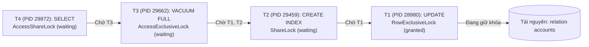

# PHẦN III: Khóa (Part III: Locks)

# CHƯƠNG 12: Khóa ở cấp độ quan hệ (CHAPTER 12: Relation-Level Locks)

## 12.1 Giới thiệu về khóa (About Locks)

Khóa (lock) kiểm soát quyền truy cập đồng thời vào các tài nguyên dùng chung (shared resources).

Truy cập đồng thời đồng nghĩa với việc có nhiều tiến trình cùng cố gắng truy cập vào một tài nguyên tại cùng một thời điểm. Không quan trọng các tiến trình này được thực thi song song (nếu phần cứng cho phép) hay tuần tự theo cơ chế chia sẻ thời gian (time-sharing mode). Nếu không có truy cập đồng thời, ta không cần phải xin khóa (ví dụ: bộ nhớ đệm dùng chung — shared buffer cache — đòi hỏi phải có khóa, trong khi bộ nhớ đệm cục bộ — local cache — có thể hoạt động mà không cần khóa).

Trước khi truy cập một tài nguyên, tiến trình phải xin (acquire) khóa trên tài nguyên đó; khi thao tác hoàn tất, khóa này phải được giải phóng (release) để tài nguyên trở nên khả dụng cho các tiến trình khác. Nếu khóa được quản lý bởi hệ quản trị cơ sở dữ liệu, trình tự thao tác đã thiết lập sẽ được duy trì tự động; nếu khóa được kiểm soát bởi ứng dụng, bản thân ứng dụng phải tự tuân thủ giao thức này.

Ở mức thấp, một khóa đơn giản là một vùng bộ nhớ dùng chung (shared memory) xác định trạng thái khóa (đã được giữ hay chưa); nó cũng có thể cung cấp một số thông tin bổ sung, chẳng hạn như số hiệu tiến trình hoặc thời điểm xin khóa.

Như bạn có thể đoán, bản thân một phân đoạn bộ nhớ dùng chung cũng là một tài nguyên. Quyền truy cập đồng thời vào các tài nguyên như vậy được điều phối bởi các cơ chế đồng bộ hóa nguyên thủy (synchronization primitives, chẳng hạn như semaphore hoặc mutex) do hệ điều hành cung cấp. Chúng đảm bảo việc thực thi tuần tự nghiêm ngặt đối với đoạn mã truy cập vào tài nguyên dùng chung. Ở mức thấp nhất, các cơ chế nguyên thủy này dựa trên các lệnh nguyên tử của CPU (atomic CPU instructions, chẳng hạn như `test-and-set` hoặc `compare-and-swap`).

Nhìn chung, ta có thể sử dụng khóa để bảo vệ bất kỳ tài nguyên nào miễn là tài nguyên đó có thể được định danh một cách rõ ràng (unambiguously identified) và được gán một địa chỉ khóa cụ thể.

Ví dụ, ta có thể khóa một đối tượng cơ sở dữ liệu, chẳng hạn như một bảng (được định danh bởi `oid` trong danh mục hệ thống — system catalog), một trang dữ liệu (được định danh bởi tên tệp và vị trí bên trong tệp đó), một phiên bản hàng / tuple (được định danh bởi một trang và độ lệch — offset — bên trong trang đó). Ta cũng có thể khóa một cấu trúc bộ nhớ, chẳng hạn như bảng băm (hash table) hoặc bộ đệm (được định danh bởi một ID được gán). Thậm chí ta có thể khóa một tài nguyên trừu tượng không có biểu diễn vật lý.

Nhưng không phải lúc nào cũng có thể xin được khóa ngay lập tức: một tài nguyên có thể đã bị tiến trình khác khóa rồi. Khi đó, tiến trình sẽ hoặc gia nhập hàng đợi (nếu loại khóa cụ thể này cho phép) hoặc thử lại sau một khoảng thời gian. Dù bằng cách nào, nó cũng phải chờ khóa được giải phóng.

Tôi muốn nhấn mạnh hai yếu tố có thể ảnh hưởng lớn đến hiệu quả của việc khóa:

- **Độ mịn (Granularity), hay "kích thước hạt" của khóa.** Độ mịn rất quan trọng nếu các tài nguyên tạo thành một hệ thống phân cấp.

  Ví dụ, một bảng gồm nhiều trang, và các trang lại gồm nhiều tuple. Tất cả các đối tượng này đều có thể được bảo vệ bằng khóa. Khóa cấp bảng (table-level locks) có độ mịn thô (coarse-grained); chúng ngăn cấm truy cập đồng thời ngay cả khi các tiến trình chỉ cần truy cập vào các trang hoặc các hàng khác nhau.

  Khóa cấp hàng (row-level locks) có độ mịn tinh (fine-grained), nên chúng không có nhược điểm này; tuy nhiên, số lượng khóa sẽ tăng lên. Để tránh sử dụng quá nhiều bộ nhớ cho siêu dữ liệu liên quan đến khóa, PostgreSQL có thể áp dụng nhiều phương pháp khác nhau, một trong số đó là leo thang khóa (lock escalation): nếu số lượng khóa mịn vượt quá một ngưỡng nhất định, chúng sẽ được thay thế bằng một khóa duy nhất có độ mịn thô hơn.

- **Tập hợp các chế độ (modes) mà khóa có thể được xin.**

  Thông thường, chỉ có hai chế độ được áp dụng. Chế độ độc quyền (exclusive mode) không tương thích với tất cả các chế độ khác, kể cả chính nó. Chế độ dùng chung (shared mode) cho phép một tài nguyên được khóa bởi nhiều tiến trình cùng một lúc. Chế độ dùng chung có thể được dùng để đọc, trong khi chế độ độc quyền được áp dụng để ghi.

  Nhìn chung, có thể có các chế độ khác nữa. Tên của các chế độ không quan trọng, điều quan trọng là ma trận tương thích (compatibility matrix) của chúng.

  Độ mịn cao hơn và việc hỗ trợ nhiều chế độ tương thích sẽ mang lại nhiều cơ hội thực thi đồng thời hơn.

Tất cả các khóa có thể được phân loại theo thời gian tồn tại (duration) của chúng:

- **Khóa dài hạn (Long-term locks)** được giữ trong một khoảng thời gian có thể kéo dài (trong hầu hết các trường hợp là cho đến khi kết thúc giao dịch); chúng thường bảo vệ các tài nguyên như quan hệ (relations) và hàng (rows). Các khóa này thường được PostgreSQL quản lý tự động, nhưng người dùng vẫn có một phần quyền kiểm soát đối với quá trình này.

  Khóa dài hạn cung cấp nhiều chế độ cho phép các thao tác đồng thời đa dạng trên dữ liệu. Chúng thường có hạ tầng đồ sộ (bao gồm các tính năng như hàng đợi chờ, phát hiện deadlock và công cụ theo dõi/đo lường) vì chi phí duy trì hạ tầng này dù sao cũng rẻ hơn nhiều so với các thao tác trên dữ liệu được bảo vệ.

- **Khóa ngắn hạn (Short-term locks)** chỉ được giữ trong vài phần nhỏ của giây và hiếm khi kéo dài hơn vài lệnh CPU; chúng thường bảo vệ các cấu trúc dữ liệu trong bộ nhớ dùng chung. PostgreSQL quản lý các khóa này một cách hoàn toàn tự động.

  Khóa ngắn hạn thường chỉ cung cấp rất ít chế độ và hạ tầng cơ bản, thậm chí có thể không có bất kỳ công cụ đo lường nào.

PostgreSQL hỗ trợ nhiều loại khóa khác nhau.[^1] Khóa hạng nặng (heavyweight locks — được xin trên các quan hệ và đối tượng khác) và khóa cấp hàng (xem Chương 13) được coi là khóa dài hạn. Khóa ngắn hạn bao gồm nhiều loại khóa trên các cấu trúc bộ nhớ (xem Chương 15). Ngoài ra, còn có một nhóm riêng biệt là khóa vị từ (predicate locks — xem Chương 14), mặc dù tên gọi như vậy nhưng thực chất chúng không phải là khóa.

[^1]: `backend/storage/lmgr/README`

> 📝 **Giải thích thêm (không có trong sách):** Mặc dù tác giả có nhắc đến khái niệm *lock escalation* (leo thang khóa) như một kỹ thuật phổ biến trong các hệ quản trị CSDL nói chung để giảm bộ nhớ cho siêu dữ liệu khóa, cần lưu ý rằng trong PostgreSQL, khóa cấp hàng (row-level locks) được lưu trực tiếp trên header của từng tuple trên trang dữ liệu (sử dụng trường `xmax` và các bit gợi ý `infomask`), chứ không lưu mỗi hàng một bản ghi trong bảng băm `pg_locks` ở bộ nhớ dùng chung. Do đó, PostgreSQL không cần cơ chế leo thang khóa cấp hàng lên khóa cấp bảng như SQL Server hay DB2.

---

## 12.2 Khóa hạng nặng (Heavyweight Locks)

Khóa hạng nặng là các khóa dài hạn. Được xin ở cấp độ đối tượng, chúng chủ yếu được sử dụng cho các quan hệ (relations), nhưng cũng có thể được áp dụng cho một số loại đối tượng khác. Khóa hạng nặng thường bảo vệ đối tượng khỏi các cập nhật đồng thời hoặc ngăn cấm việc sử dụng chúng trong quá trình tái cấu trúc, nhưng chúng cũng có thể đáp ứng các nhu cầu khác nữa. Định nghĩa mơ hồ như vậy là có chủ đích: các khóa loại này được sử dụng cho đủ mọi mục đích. Điểm chung duy nhất của chúng là cấu trúc nội bộ.

Trừ khi có chỉ định khác một cách rõ ràng, thuật ngữ *khóa* (lock) thường hàm ý là khóa hạng nặng.

Khóa hạng nặng nằm trong bộ nhớ dùng chung của máy chủ[^2] và có thể được hiển thị trong view `pg_locks`. Tổng số lượng của chúng bị giới hạn bởi giá trị `max_locks_per_transaction` (mặc định `64`) nhân với `max_connections` (mặc định `100`).

[^2]: `backend/storage/lmgr/lock.c`

Tất cả các giao dịch đều sử dụng chung một vùng chứa khóa (pool of locks), vì vậy một giao dịch có thể xin nhiều hơn `max_locks_per_transaction` khóa. Điều thực sự quan trọng là tổng số khóa trong toàn hệ thống không vượt quá giới hạn đã định. Vì vùng chứa này được khởi tạo khi máy chủ khởi động, việc thay đổi bất kỳ tham số nào trong hai tham số này đều đòi hỏi phải khởi động lại máy chủ.

Nếu một tài nguyên đã bị khóa ở chế độ không tương thích, tiến trình đang cố gắng xin một khóa khác sẽ gia nhập hàng đợi. Các tiến trình đang chờ không lãng phí thời gian CPU: chúng đi vào trạng thái ngủ (fall asleep) cho đến khi khóa được giải phóng và hệ điều hành đánh thức chúng dậy.

Hai giao dịch có thể rơi vào tình trạng bế tắc (deadlock) nếu giao dịch thứ nhất không thể tiếp tục hoạt động cho đến khi lấy được tài nguyên đang bị giao dịch thứ hai khóa, và ngược lại, giao dịch thứ hai lại cần tài nguyên đang bị giao dịch thứ nhất khóa. Trường hợp này khá đơn giản; một deadlock cũng có thể liên quan đến nhiều hơn hai giao dịch. Vì deadlock gây ra việc chờ đợi vô hạn, PostgreSQL tự động phát hiện chúng và hủy bỏ (abort) một trong các giao dịch bị ảnh hưởng để đảm bảo hoạt động bình thường có thể tiếp tục.

Các loại khóa hạng nặng khác nhau phục vụ các mục đích khác nhau, bảo vệ các tài nguyên khác nhau và hỗ trợ các chế độ khác nhau, vì vậy chúng ta sẽ xem xét chúng một cách riêng biệt.

Danh sách sau đây cung cấp tên của các loại khóa như cách chúng xuất hiện trong cột `locktype` của view `pg_locks`:

- `transactionid` và `virtualxid` — khóa trên ID của một giao dịch (Mục 12.3)
- `relation` — khóa ở cấp độ quan hệ (Mục 12.4)
- `tuple` — khóa được xin trên một tuple (Chương 13)
- `object` — khóa trên một đối tượng không phải là quan hệ (Chương 14)
- `extend` — khóa mở rộng quan hệ (relation extension lock, Chương 14)
- `page` — khóa cấp trang được sử dụng bởi một số loại chỉ mục (Chương 14)
- `advisory` — khóa tư vấn (advisory lock, Chương 14)

Hầu hết mọi khóa hạng nặng đều được tự động xin khi cần và tự động giải phóng khi giao dịch tương ứng kết thúc. Tuy nhiên cũng có một số ngoại lệ: ví dụ, khóa cấp độ quan hệ có thể được thiết lập một cách tường minh, trong khi khóa tư vấn (`advisory`) luôn do người dùng tự quản lý.

---

## 12.3 Khóa trên ID giao dịch (Locks on Transaction IDs)

Mỗi giao dịch luôn giữ một khóa độc quyền (exclusive lock) trên chính ID của nó (cả ID ảo — `virtualxid`, và ID thực — `transactionid`, nếu có).

PostgreSQL cung cấp hai chế độ khóa cho mục đích này: độc quyền (exclusive) và dùng chung (shared). Ma trận tương thích của chúng rất đơn giản: chế độ dùng chung tương thích với chính nó, trong khi chế độ độc quyền không thể kết hợp với bất kỳ chế độ nào.

| Chế độ (Mode) | Shared | Exclusive |
| :--- | :---: | :---: |
| **Shared** | | × |
| **Exclusive** | × | × |

Để theo dõi thời điểm hoàn tất của một giao dịch cụ thể, một tiến trình có thể yêu cầu một khóa trên ID của giao dịch đó, ở bất kỳ chế độ nào. Vì bản thân giao dịch kia đang giữ khóa độc quyền trên chính ID của nó, nên không thể xin được một khóa khác. Tiến trình yêu cầu khóa này sẽ gia nhập hàng đợi và đi vào trạng thái ngủ. Một khi giao dịch kia kết thúc, khóa được giải phóng, và tiến trình đang xếp hàng sẽ thức dậy. Rõ ràng là nó sẽ không lấy được khóa vì tài nguyên tương ứng đã biến mất, nhưng thực chất khóa đó cũng không phải thứ mà nó thực sự cần (nó chỉ cần biết giao dịch kia đã kết thúc).

Hãy bắt đầu một giao dịch trong một phiên riêng biệt và lấy ID tiến trình (PID) của backend:

```sql
=> BEGIN;
=> SELECT pg_backend_pid();
```
```text
 pg_backend_pid
----------------
          28980
(1 row)
```

Giao dịch vừa bắt đầu đang giữ một khóa độc quyền trên ID ảo (`virtualxid`) của chính nó:

```sql
=> SELECT locktype, virtualxid, mode, granted
FROM pg_locks WHERE pid = 28980;
```
```text
  locktype  | virtualxid |     mode      | granted
------------+------------+---------------+---------
 virtualxid | 5/2        | ExclusiveLock | t
(1 row)
```

Ở đây `locktype` là loại khóa, `virtualxid` là ID giao dịch ảo (định danh tài nguyên bị khóa), và `mode` là chế độ khóa (trong trường hợp này là độc quyền). Cờ `granted` cho biết khóa được yêu cầu đã được cấp hay chưa.

Một khi giao dịch nhận được một ID thực (`xid`), khóa tương ứng sẽ được thêm vào danh sách này:

```sql
=> SELECT pg_current_xact_id();
```
```text
 pg_current_xact_id
--------------------
             122849
(1 row)
```

```sql
=> SELECT locktype, virtualxid, transactionid AS xid, mode, granted
FROM pg_locks WHERE pid = 28980;
```
```text
   locktype    | virtualxid |  xid   |     mode      | granted
---------------+------------+--------+---------------+---------
 virtualxid    | 5/2        |        | ExclusiveLock | t
 transactionid |            | 122849 | ExclusiveLock | t
(2 rows)
```

Lúc này giao dịch này đang giữ các khóa độc quyền trên cả hai ID của nó.

> 💡 **Ví dụ bổ sung (không có trong sách):** Cơ chế chờ trên `transactionid` này được PostgreSQL dùng rất thường xuyên khi hai giao dịch cùng cập nhật một hàng. Giả sử Giao dịch A (`xid = 122849`) chạy `UPDATE accounts SET amount = 0 WHERE id = 1;` và chưa `COMMIT`. Nếu Giao dịch B cũng chạy `UPDATE accounts SET amount = 500 WHERE id = 1;`, Giao dịch B thấy hàng đó đang bị `xid = 122849` sửa đổi (thông qua trường `xmax` trên tuple), nên Giao dịch B sẽ xin một `ShareLock` trên `transactionid = 122849`. Vì Giao dịch A đang giữ `ExclusiveLock` trên `122849`, Giao dịch B phải ngủ chờ cho đến khi Giao dịch A `COMMIT` hoặc `ROLLBACK`.

---

## 12.4 Khóa ở cấp độ quan hệ (Relation-Level Locks)

PostgreSQL cung cấp tới tám chế độ để khóa một quan hệ (một bảng, một chỉ mục, hoặc bất kỳ đối tượng nào khác).[^1] Sự đa dạng như vậy cho phép bạn tối đa hóa số lượng các lệnh đồng thời có thể chạy trên một quan hệ.

[^1]: `postgresql.org/docs/14/explicit-locking.html#LOCKING-TABLES`

Bảng dưới đây hiển thị ma trận tương thích được mở rộng kèm theo các ví dụ về câu lệnh yêu cầu chế độ khóa tương ứng. Không cần thiết phải học thuộc lòng tất cả các chế độ này hay cố tìm logic đằng sau tên gọi của chúng, nhưng chắc chắn sẽ rất hữu ích nếu bạn xem qua dữ liệu này, rút ra một số kết luận chung và tra cứu bảng này khi cần.

| Chế độ khóa (Mode) | AS | RS | RE | SUE | S | SRE | E | AE | Ví dụ câu lệnh (Command Examples) |
| :--- | :---: | :---: | :---: | :---: | :---: | :---: | :---: | :---: | :--- |
| **Access Share (AS)** | | | | | | | | × | `SELECT` |
| **Row Share (RS)** | | | | | | | × | × | `SELECT FOR UPDATE/SHARE` |
| **Row Exclusive (RE)** | | | | | × | × | × | × | `INSERT`, `UPDATE`, `DELETE` |
| **Share Update Exclusive (SUE)** | | | | × | × | × | × | × | `VACUUM`, `CREATE INDEX CONCURRENTLY` |
| **Share (S)** | | | × | × | | × | × | × | `CREATE INDEX` |
| **Share Row Exclusive (SRE)** | | | × | × | × | × | × | × | `CREATE TRIGGER` |
| **Exclusive (E)** | | × | × | × | × | × | × | × | `REFRESH MAT.VIEW CONCURRENTLY` |
| **Access Exclusive (AE)** | × | × | × | × | × | × | × | × | `DROP`, `TRUNCATE`, `VACUUM FULL`, `LOCK TABLE`, `REFRESH MAT.VIEW` |

Chế độ **Access Share** là chế độ yếu nhất; nó có thể được dùng chung với bất kỳ chế độ nào khác ngoại trừ **Access Exclusive**, vốn không tương thích với mọi chế độ. Do đó, một câu lệnh `SELECT` có thể chạy song song với hầu hết mọi thao tác, nhưng nó không cho phép bạn xóa (`DROP`) một bảng đang được truy vấn.

Bốn chế độ đầu tiên cho phép sửa đổi dữ liệu heap đồng thời, trong khi bốn chế độ còn lại thì không. Ví dụ, câu lệnh `CREATE INDEX` sử dụng chế độ **Share**, vốn tương thích với chính nó (nên bạn có thể tạo đồng thời nhiều chỉ mục trên một bảng) và với các chế độ được dùng bởi các thao tác chỉ đọc. Kết quả là các câu lệnh `SELECT` có thể chạy song song với việc tạo chỉ mục, trong khi các lệnh `INSERT`, `UPDATE` và `DELETE` sẽ bị chặn.

Ngược lại, các giao dịch chưa hoàn tất đang sửa đổi dữ liệu heap sẽ chặn lệnh `CREATE INDEX`. Thay vào đó, bạn có thể gọi `CREATE INDEX CONCURRENTLY`, lệnh này sử dụng chế độ **Share Update Exclusive** yếu hơn: việc tạo chỉ mục sẽ mất nhiều thời gian hơn (và thao tác này thậm chí có thể thất bại), nhưng bù lại, các cập nhật dữ liệu đồng thời được cho phép.

Câu lệnh `ALTER TABLE` có nhiều biến thể sử dụng các chế độ khóa khác nhau (`Share Update Exclusive`, `Share Row Exclusive`, `Access Exclusive`). Tất cả chúng đều được mô tả trong tài liệu chính thức.[^1]

[^1]: `postgresql.org/docs/14/sql-altertable.html`

Các ví dụ trong phần này của cuốn sách tiếp tục dựa trên bảng `accounts`:

```sql
=> TRUNCATE accounts;
=> INSERT INTO accounts(id, client, amount)
VALUES
  (1, 'alice',   100.00),
  (2, 'bob',     200.00),
  (3, 'charlie', 300.00);
```

Chúng ta sẽ phải truy cập bảng `pg_locks` nhiều lần, vì vậy hãy tạo một view hiển thị tất cả các ID trong một cột duy nhất, giúp kết quả đầu ra gọn gàng hơn:

```sql
=> CREATE VIEW locks AS
SELECT pid,
  locktype,
  CASE locktype
    WHEN 'relation'      THEN relation::regclass::text
    WHEN 'transactionid' THEN transactionid::text
    WHEN 'virtualxid'    THEN virtualxid
  END AS lockid,
  mode,
  granted
FROM pg_locks
ORDER BY 1, 2, 3;
```

Giao dịch vẫn đang chạy ở phiên thứ nhất cập nhật một hàng. Thao tác này khóa bảng `accounts` và tất cả các chỉ mục của nó, dẫn đến hai khóa mới thuộc loại `relation` được xin ở chế độ `Row Exclusive`:

```sql
=> UPDATE accounts SET amount = amount + 100.00 WHERE id = 1;
```

```sql
=> SELECT locktype, lockid, mode, granted
FROM locks WHERE pid = 28980;
```
```text
   locktype    |    lockid     |       mode       | granted
---------------+---------------+------------------+---------
 relation      | accounts      | RowExclusiveLock | t
 relation      | accounts_pkey | RowExclusiveLock | t
 transactionid | 122849        | ExclusiveLock    | t
 virtualxid    | 5/2           | ExclusiveLock    | t
(4 rows)
```

---

## 12.5 Hàng đợi chờ (Wait Queue)

Các khóa hạng nặng hình thành một hàng đợi chờ công bằng (fair wait queue).[^1] Một tiến trình sẽ gia nhập hàng đợi nếu nó cố gắng xin một khóa không tương thích với khóa hiện tại hoặc không tương thích với các khóa đang được yêu cầu bởi các tiến trình khác đã nằm sẵn trong hàng đợi.

[^1]: `backend/storage/lmgr/lock.c`, hàm `LockAcquire`

Trong khi phiên thứ nhất vẫn đang thực hiện lệnh cập nhật, hãy thử tạo một chỉ mục trên bảng này ở một phiên khác:

```sql
=> SELECT pg_backend_pid();
```
```text
 pg_backend_pid
----------------
          29459
(1 row)
```

```sql
=> CREATE INDEX ON accounts(client);
```

Câu lệnh bị treo, chờ tài nguyên được giải phóng. Giao dịch này cố gắng khóa bảng ở chế độ `Share` nhưng không thể thực hiện được:

```sql
=> SELECT locktype, lockid, mode, granted
FROM locks WHERE pid = 29459;
```
```text
  locktype  |  lockid  |     mode      | granted
------------+----------+---------------+---------
 relation   | accounts | ShareLock     | f
 virtualxid | 6/3      | ExclusiveLock | t
(2 rows)
```

Bây giờ hãy để phiên thứ ba bắt đầu lệnh `VACUUM FULL`. Nó cũng sẽ gia nhập hàng đợi vì nó yêu cầu chế độ `Access Exclusive`, vốn xung đột với tất cả các chế độ khác:

```sql
=> SELECT pg_backend_pid();
```
```text
 pg_backend_pid
----------------
          29662
(1 row)
```

```sql
=> VACUUM FULL accounts;
```

```sql
=> SELECT locktype, lockid, mode, granted
FROM locks WHERE pid = 29662;
```
```text
   locktype    |  lockid  |        mode         | granted
---------------+----------+---------------------+---------
 relation      | accounts | AccessExclusiveLock | f
 transactionid | 122853   | ExclusiveLock       | t
 virtualxid    | 7/4      | ExclusiveLock       | t
(3 rows)
```

Tất cả các tiến trình đến sau bây giờ đều sẽ phải gia nhập hàng đợi, bất kể chế độ khóa của chúng là gì. Ngay cả các truy vấn `SELECT` đơn giản cũng sẽ ngoan ngoãn xếp hàng sau `VACUUM FULL`, mặc dù chúng tương thích với khóa `Row Exclusive` đang được giữ bởi phiên thứ nhất thực hiện lệnh cập nhật.

```sql
=> SELECT pg_backend_pid();
```
```text
 pg_backend_pid
----------------
          29872
(1 row)
```

```sql
=> SELECT * FROM accounts;
```

```sql
=> SELECT locktype, lockid, mode, granted
FROM locks WHERE pid = 29872;
```
```text
  locktype  |  lockid  |      mode       | granted
------------+----------+-----------------+---------
 relation   | accounts | AccessShareLock | f
 virtualxid | 8/3      | ExclusiveLock   | t
(2 rows)
```



Hàm `pg_blocking_pids` (từ phiên bản 9.6) cung cấp một cái nhìn tổng quan ở mức cao về tất cả các tiến trình đang chờ. Nó hiển thị PID của tất cả các tiến trình xếp trước tiến trình được chỉ định mà hiện đang giữ hoặc muốn xin một khóa không tương thích:

```sql
=> SELECT pid,
  pg_blocking_pids(pid),
  wait_event_type,
  state,
  left(query,50) AS query
FROM pg_stat_activity
WHERE pid IN (28980,29459,29662,29872) \gx
```
```text
-[ RECORD 1 ]----+---------------------------------------------------
pid              | 28980
pg_blocking_pids | {}
wait_event_type  | Client
state            | idle in transaction
query            | UPDATE accounts SET amount = amount + 100.00 WHERE
-[ RECORD 2 ]----+---------------------------------------------------
pid              | 29459
pg_blocking_pids | {28980}
wait_event_type  | Lock
state            | active
query            | CREATE INDEX ON accounts(client);
-[ RECORD 3 ]----+---------------------------------------------------
pid              | 29662
pg_blocking_pids | {28980,29459}
wait_event_type  | Lock
state            | active
query            | VACUUM FULL accounts;
-[ RECORD 4 ]----+---------------------------------------------------
pid              | 29872
pg_blocking_pids | {29662}
wait_event_type  | Lock
state            | active
query            | SELECT * FROM accounts;
```

Để xem thêm chi tiết, bạn có thể tham khảo thông tin được cung cấp trong bảng `pg_locks`.[^1]

[^1]: `wiki.postgresql.org/wiki/Lock_dependency_information`

Một khi giao dịch hoàn tất (dù là commit hay abort), tất cả các khóa của nó sẽ được giải phóng.[^2] Tiến trình đầu tiên trong hàng đợi sẽ nhận được khóa được yêu cầu và thức dậy.

[^2]: `backend/storage/lmgr/lock.c`, các hàm `LockReleaseAll` và `LockRelease`

Ở đây, việc kết thúc giao dịch ở phiên thứ nhất dẫn đến việc thực thi tuần tự tất cả các tiến trình đang xếp hàng:

```sql
=> ROLLBACK;
```
```text
ROLLBACK
```

(Phiên thứ hai hoàn thành):
```text
CREATE INDEX
```

(Phiên thứ ba hoàn thành):
```text
VACUUM
```

(Phiên thứ tư nhận được kết quả):
```text
 id | client  | amount
----+---------+--------
  1 | alice   | 100.00
  2 | bob     | 200.00
  3 | charlie | 300.00
(3 rows)
```

> 💡 **Ví dụ bổ sung (không có trong sách):** Trong môi trường production có lưu lượng cao, tình huống hàng đợi chờ ở trên rất nguy hiểm khi chạy DDL (như `ALTER TABLE` hoặc `VACUUM FULL` cần `AccessExclusiveLock`). Nếu một giao dịch `SELECT` hoặc `UPDATE` chạy lâu chưa kết thúc, lệnh `ALTER TABLE` sẽ phải chờ nó. Trong lúc `ALTER TABLE` đang chờ ở hàng đợi, **mọi câu lệnh `SELECT` đến sau đều bị chặn đứng** phía sau `ALTER TABLE`, có thể làm sập toàn bộ ứng dụng do cạn kiệt connection pool. Để tránh điều này, bạn nên đặt `lock_timeout` trước khi chạy DDL:
> ```sql
> SET lock_timeout = '2s';
> ALTER TABLE accounts ADD COLUMN note text;
> ```
> Nếu không xin được khóa trong 2 giây, lệnh DDL sẽ tự hủy thay vì làm nghẽn toàn bộ hệ thống.

---

## Bảng thuật ngữ chương (Chapter Glossary)

| Thuật ngữ (English) | Tiếng Việt | Giải thích ngắn gọn |
| :--- | :--- | :--- |
| Concurrent access | Truy cập đồng thời | Nhiều tiến trình cùng cố gắng truy cập một tài nguyên tại cùng một thời điểm. |
| Synchronization primitive | Cơ chế đồng bộ hóa nguyên thủy | Công cụ cấp thấp của hệ điều hành (semaphore, mutex) dùng để bảo vệ bộ nhớ dùng chung. |
| Granularity | Độ mịn | Kích thước đơn vị tài nguyên được khóa (ví dụ: khóa cấp bảng là thô, khóa cấp hàng là tinh). |
| Lock escalation | Leo thang khóa | Kỹ thuật thay thế nhiều khóa mịn bằng một khóa thô hơn khi vượt ngưỡng (PostgreSQL không áp dụng cho row lock). |
| Compatibility matrix | Ma trận tương thích | Bảng quy định hai chế độ khóa nào có thể cùng tồn tại song song trên một tài nguyên. |
| Long-term lock | Khóa dài hạn | Khóa được giữ trong thời gian dài (thường đến hết giao dịch), bảo vệ quan hệ và hàng. |
| Short-term lock | Khóa ngắn hạn | Khóa chỉ giữ trong vài phần nhỏ của giây, bảo vệ cấu trúc dữ liệu trong bộ nhớ dùng chung. |
| Heavyweight lock | Khóa hạng nặng | Khóa dài hạn nằm trong bộ nhớ dùng chung, hiển thị trong `pg_locks`, có hàng đợi và phát hiện deadlock. |
| Deadlock | Bế tắc | Tình trạng hai hay nhiều giao dịch chờ khóa của nhau tạo thành vòng lặp vô hạn. |
| Virtual transaction ID (`virtualxid`) | ID giao dịch ảo | Định danh tạm thời cấp cho mọi giao dịch ngay khi bắt đầu, chưa tiêu tốn XID thực. |
| Relation-level lock | Khóa cấp độ quan hệ | Khóa áp dụng lên bảng, chỉ mục, view,... với 8 chế độ khác nhau trong PostgreSQL. |
| Fair wait queue | Hàng đợi chờ công bằng | Hàng đợi cấp khóa theo thứ tự đến trước phục vụ trước, ngăn tiến trình đến sau chen ngang nếu có xung đột. |
