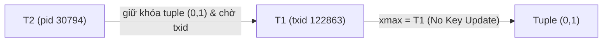
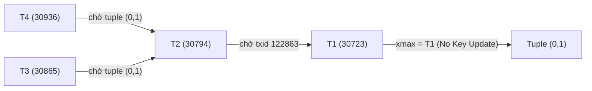
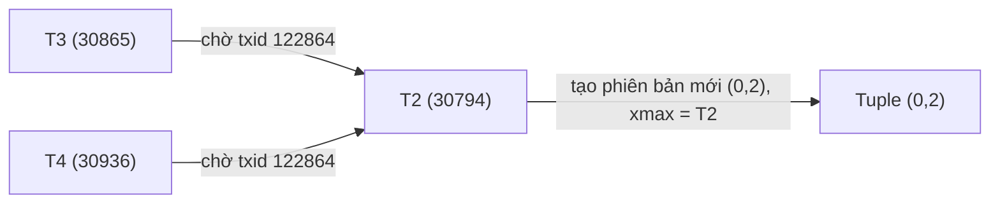
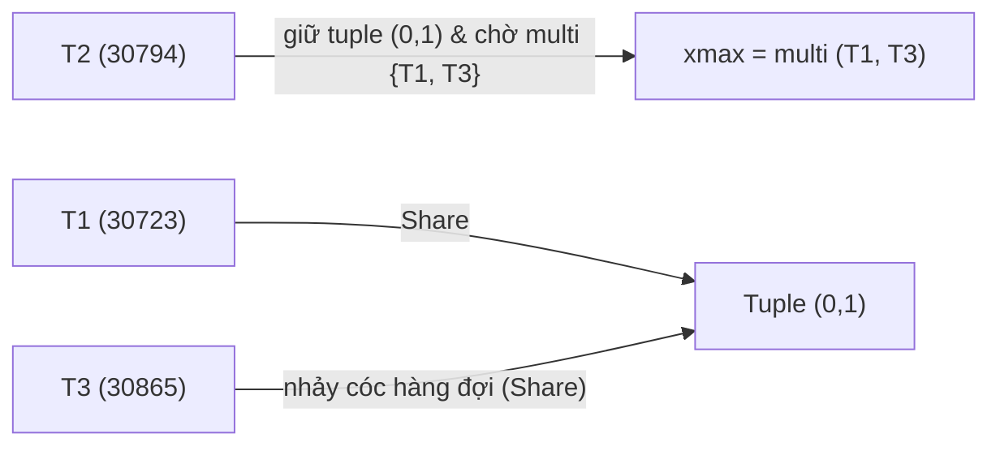
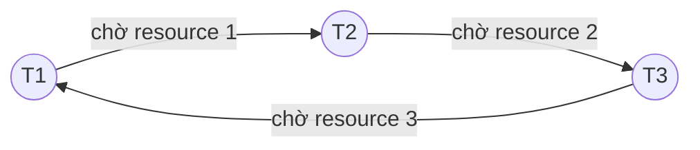

# CHƯƠNG 13: Khóa mức hàng (CHAPTER 13: Row-Level Locks)

## 13.1 Thiết kế khóa (Lock Design)

Nhờ cơ chế cô lập theo ảnh chụp nhanh (snapshot isolation), các bộ dữ liệu trong heap (heap tuples) không cần phải bị khóa khi đọc. Tuy nhiên, không được phép để hai giao dịch ghi cùng sửa đổi một hàng tại cùng một thời điểm.

Trong trường hợp này, các hàng phải được khóa lại, nhưng khóa hạng nặng (heavyweight locks) không phải là lựa chọn tốt cho mục đích này: mỗi khóa hạng nặng chiếm không gian trong bộ nhớ dùng chung (shared memory) của máy chủ (hàng trăm byte, chưa kể toàn bộ hạ tầng hỗ trợ đi kèm), và các cơ chế nội bộ của PostgreSQL không được thiết kế để xử lý một số lượng khổng lồ các khóa hạng nặng đồng thời.

Một số hệ quản trị cơ sở dữ liệu giải quyết vấn đề này bằng cơ chế leo thang khóa (lock escalation): nếu số lượng khóa mức hàng quá nhiều, chúng sẽ được thay thế bằng một khóa duy nhất ở mức độ chi tiết thô hơn (ví dụ: khóa mức trang hoặc khóa mức bảng). Cách này đơn giản hóa việc triển khai, nhưng đồng thời có thể hạn chế nghiêm trọng thông lượng của hệ thống.

Trong PostgreSQL, thông tin về việc một hàng cụ thể có đang bị khóa hay không chỉ được lưu giữ trong phần tiêu đề (header) của phiên bản bộ dữ liệu heap (heap tuple) hiện tại của nó. Khóa mức hàng về bản chất là các thuộc tính nằm trong các trang heap (heap pages) chứ không phải là các khóa thực thụ, và chúng hoàn toàn không được phản ánh trong RAM dưới bất kỳ hình thức nào.

Một hàng thường bị khóa khi nó đang được cập nhật hoặc xóa (tr. 73). Trong cả hai trường hợp, phiên bản hiện tại của hàng được đánh dấu là đã bị xóa. Thuộc tính được dùng cho mục đích này là ID của giao dịch hiện tại được chỉ định trong trường `xmax`, và chính ID này (kết hợp với các bit gợi ý bổ sung — hint bits) cho biết hàng đó đang bị khóa. Nếu một giao dịch muốn sửa đổi một hàng nhưng thấy một ID giao dịch đang hoạt động trong trường `xmax` của phiên bản hiện tại, nó phải chờ giao dịch này hoàn tất. Khi giao dịch đó kết thúc, mọi khóa sẽ được giải phóng và giao dịch đang chờ có thể tiếp tục.

Cơ chế này cho phép khóa bao nhiêu hàng tùy ý mà không tốn thêm chi phí bộ nhớ.

Nhược điểm của giải pháp này là các tiến trình khác không thể xếp thành một hàng đợi (queue), vì RAM không chứa thông tin gì về các khóa như vậy. Do đó, khóa hạng nặng vẫn cần thiết: một tiến trình đang chờ một hàng được giải phóng sẽ yêu cầu một khóa lên ID của giao dịch hiện đang bận xử lý hàng đó. Khi giao dịch này hoàn tất, hàng sẽ khả dụng trở lại. Nhờ vậy, số lượng khóa hạng nặng tỷ lệ thuận với số lượng tiến trình đồng thời chứ không phải số lượng hàng đang được sửa đổi.

> 📝 **Giải thích thêm (không có trong sách):**
> Thiết kế "lưu trạng thái khóa ngay trên tuple header (`xmax`)" của PostgreSQL giải thích tại sao bạn có thể chạy `UPDATE` trên 10 triệu hàng trong một giao dịch duy nhất mà không bao giờ gặp lỗi hết bộ nhớ khóa (out of lock memory) hay bị leo thang khóa lên toàn bảng (table-level lock escalation) như trong SQL Server hay DB2. Toàn bộ 10 triệu hàng đó chỉ ghi `xmax = txid` ngay trên các trang dữ liệu (disk/shared buffers), còn bảng khóa hạng nặng trong RAM chỉ giữ một khóa bảng `RowExclusiveLock` duy nhất cho giao dịch đó.

---

## 13.2 Các chế độ khóa mức hàng (Row-Level Locking Modes)

Khóa mức hàng hỗ trợ bốn chế độ.[^1] Hai trong số đó triển khai khóa độc quyền (exclusive locks) chỉ có thể được giữ bởi một giao dịch tại một thời điểm, trong khi hai chế độ còn lại cung cấp khóa chia sẻ (shared locks) có thể được giữ đồng thời bởi nhiều giao dịch.

Dưới đây là ma trận tương thích (compatibility matrix) của các chế độ này (`×` biểu thị xung đột / không tương thích):

| Chế độ (Mode) | Key Share | Share | No Key Update | Update |
| :--- | :---: | :---: | :---: | :---: |
| **Key Share** | | | | × |
| **Share** | | | × | × |
| **No Key Update** | | × | × | × |
| **Update** | × | × | × | × |

[^1]: `postgresql.org/docs/14/explicit-locking.html#LOCKING-ROWS`

### Các chế độ độc quyền (Exclusive Modes)

Chế độ **Update** cho phép sửa đổi bất kỳ trường nào của bộ dữ liệu và thậm chí xóa toàn bộ bộ dữ liệu, trong khi chế độ **No Key Update** chỉ cho phép những thay đổi không liên quan đến bất kỳ trường nào thuộc về chỉ mục duy nhất (unique indexes) — nói cách khác, các khóa ngoại (foreign keys) không bị ảnh hưởng.

Lệnh `UPDATE` tự động chọn chế độ khóa yếu nhất có thể; các khóa thường không thay đổi, vì vậy các hàng thường được khóa ở chế độ **No Key Update**.

Hãy tạo một hàm sử dụng extension `pageinspect` để hiển thị một số siêu dữ liệu (metadata) của bộ dữ liệu mà chúng ta quan tâm, cụ thể là trường `xmax` và một vài bit gợi ý (hint bits):

```sql
=> CREATE FUNCTION row_locks(relname text, pageno integer)
RETURNS TABLE(
  ctid tid,
  xmax text,
  lock_only text,
  is_multi text,
  keys_upd text,
  keyshr text,
  shr text
)
AS $$
  SELECT (pageno,lp)::text::tid,
    t_xmax,
    CASE WHEN t_infomask   & 128   = 128   THEN 't' END,
    CASE WHEN t_infomask   & 4096  = 4096  THEN 't' END,
    CASE WHEN t_infomask2  & 8192  = 8192  THEN 't' END,
    CASE WHEN t_infomask   & 16    = 16    THEN 't' END,
    CASE WHEN t_infomask   & 16+64 = 16+64 THEN 't' END
  FROM heap_page_items(get_raw_page(relname,pageno))
  ORDER BY lp;
$$ LANGUAGE sql;
```

Bây giờ hãy bắt đầu một giao dịch trên bảng `accounts` để cập nhật số dư của tài khoản thứ nhất (khóa chính giữ nguyên) và ID của tài khoản thứ hai (khóa chính bị cập nhật):

```sql
=> BEGIN;
=> UPDATE accounts SET amount = amount + 100.00 WHERE id = 1;
=> UPDATE accounts SET id = 20 WHERE id = 2;
```

Trang dữ liệu lúc này chứa siêu dữ liệu sau:

```sql
=> SELECT * FROM row_locks('accounts',0) LIMIT 2;
 ctid  |  xmax  | lock_only | is_multi | keys_upd | keyshr | shr
-------+--------+-----------+----------+----------+--------+-----
 (0,1) | 122858 |           |          |          |        |
 (0,2) | 122858 |           |          | t        |        |
(2 rows)
```

Chế độ khóa được xác định bởi bit gợi ý `keys_updated`.

```sql
=> ROLLBACK;
```

Lệnh `SELECT FOR` sử dụng cùng trường `xmax` làm thuộc tính khóa, nhưng trong trường hợp này bit gợi ý `xmax_lock_only` cũng phải được bật. Bit này cho biết bộ dữ liệu chỉ bị khóa chứ không bị xóa, nghĩa là nó vẫn đang còn hiệu lực (current):

```sql
=> BEGIN;
=> SELECT * FROM accounts WHERE id = 1 FOR NO KEY UPDATE;
=> SELECT * FROM accounts WHERE id = 2 FOR UPDATE;
=> SELECT * FROM row_locks('accounts',0) LIMIT 2;
 ctid  |  xmax  | lock_only | is_multi | keys_upd | keyshr | shr
-------+--------+-----------+----------+----------+--------+-----
 (0,1) | 122859 | t         |          |          |        |
 (0,2) | 122859 | t         |          | t        |        |
(2 rows)
=> ROLLBACK;
```

### Các chế độ chia sẻ (Shared Modes)

Chế độ **Share** có thể được áp dụng khi cần đọc một hàng, nhưng phải ngăn không cho giao dịch khác sửa đổi nó. Chế độ **Key Share** cho phép cập nhật bất kỳ trường nào của bộ dữ liệu ngoại trừ các thuộc tính khóa.

Trong tất cả các chế độ chia sẻ, nhân (core) của PostgreSQL chỉ sử dụng **Key Share**, được áp dụng khi kiểm tra khóa ngoại (foreign keys). Vì nó tương thích với chế độ độc quyền **No Key Update**, việc kiểm tra khóa ngoại không làm cản trở các thao tác cập nhật đồng thời trên các thuộc tính không phải khóa. Còn đối với các ứng dụng, chúng có thể sử dụng bất kỳ chế độ chia sẻ nào mà chúng muốn.

Tôi xin nhấn mạnh một lần nữa rằng các lệnh `SELECT` thông thường không bao giờ sử dụng khóa mức hàng.

```sql
=> BEGIN;
=> SELECT * FROM accounts WHERE id = 1 FOR KEY SHARE;
=> SELECT * FROM accounts WHERE id = 2 FOR SHARE;
```

Đây là những gì chúng ta thấy trong các bộ dữ liệu heap:

```sql
=> SELECT * FROM row_locks('accounts',0) LIMIT 2;
 ctid  |  xmax  | lock_only | is_multi | keys_upd | keyshr | shr
-------+--------+-----------+----------+----------+--------+-----
 (0,1) | 122860 | t         |          |          | t      |
 (0,2) | 122860 | t         |          |          | t      | t
(2 rows)
```

Bit `xmax_keyshr_lock` được bật cho cả hai thao tác, nhưng bạn có thể nhận ra chế độ **Share** thông qua các bit gợi ý khác.[^2]

[^2]: `include/access/htup_details.h`

> 💡 **Ví dụ bổ sung (không có trong sách):**
> Giả sử bạn có bảng `orders(id, customer_id, status)` với `customer_id` tham chiếu khóa ngoại tới `customers(id)`.
> - Giao dịch T1 chèn một đơn hàng mới cho khách hàng `id = 5`: PostgreSQL tự động đặt khóa `FOR KEY SHARE` lên hàng `id = 5` của bảng `customers` để đảm bảo khách hàng này không bị xóa hoặc đổi `id` trước khi T1 commit.
> - Đồng thời, giao dịch T2 chạy `UPDATE customers SET email = 'new@mail.com' WHERE id = 5;`: vì cột `email` không phải khóa, PostgreSQL chỉ dùng khóa `NO KEY UPDATE`.
> - Nhờ `Key Share` tương thích với `No Key Update`, T2 chạy mượt mà không cần chờ T1! Đây là cải tiến lớn từ PostgreSQL 9.3 giúp giảm đáng kể tình trạng nghẽn khóa ngoại.

---

## 13.3 Đa giao dịch (Multitransactions)

Như chúng ta đã thấy, thuộc tính khóa được biểu diễn bởi trường `xmax`, vốn được gán bằng ID của giao dịch đã giành được khóa. Vậy thuộc tính này được thiết lập như thế nào đối với một khóa chia sẻ đang được giữ bởi nhiều giao dịch cùng một lúc?

Khi xử lý các khóa chia sẻ, PostgreSQL áp dụng thứ gọi là **đa giao dịch** (multitransactions hay multixacts).[^3] Một đa giao dịch là một nhóm các giao dịch được gán một ID riêng biệt. Thông tin chi tiết về các thành viên trong nhóm và chế độ khóa của từng thành viên được lưu trữ trong các tệp thuộc thư mục `PGDATA/pg_multixact`. Để truy cập nhanh hơn, các trang đang được sử dụng sẽ được lưu đệm (cached) trong bộ nhớ dùng chung của máy chủ;[^4] mọi thay đổi đều được ghi nhật ký (WAL) để đảm bảo khả năng chịu lỗi.

[^3]: `backend/access/transam/multixact.c`
[^4]: `backend/access/transam/slru.c`

Multixact ID có cùng độ dài 32-bit như các ID giao dịch thông thường, nhưng chúng được cấp phát độc lập. Điều đó có nghĩa là giao dịch thông thường và đa giao dịch có khả năng có cùng số ID. Để phân biệt giữa hai loại này, PostgreSQL sử dụng một bit gợi ý bổ sung: `xmax_is_multi`.

Hãy thêm một khóa độc quyền nữa được giành bởi một giao dịch khác (chế độ Key Share và No Key Update tương thích với nhau):

```sql
=> BEGIN;
=> UPDATE accounts SET amount = amount + 100.00 WHERE id = 1;
=> SELECT * FROM row_locks('accounts',0) LIMIT 2;
 ctid  |  xmax  | lock_only | is_multi | keys_upd | keyshr | shr
-------+--------+-----------+----------+----------+--------+-----
 (0,1) | 1      |           | t        |          |        |
 (0,2) | 122860 | t         |          |          | t      | t
(2 rows)
```

Bit `xmax_is_multi` cho thấy hàng đầu tiên đang sử dụng một multitransaction ID thay vì một ID giao dịch thông thường.

Không cần đi sâu hơn vào chi tiết triển khai, hãy hiển thị thông tin về tất cả các khóa mức hàng hiện có bằng extension `pgrowlocks`:

```sql
=> CREATE EXTENSION pgrowlocks;
=> SELECT * FROM pgrowlocks('accounts') \gx
-[ RECORD 1 ]-----------------------------
locked_row | (0,1)
locker     | 1
multi      | t
xids       | {122860,122861}
modes      | {"Key Share","No Key Update"}
pids       | {30423,30723}
-[ RECORD 2 ]-----------------------------
locked_row | (0,2)
locker     | 122860
multi      | f
xids       | {122860}
modes      | {"For Share"}
pids       | {30423}
```

Kết quả trông rất giống việc truy vấn view `pg_locks`, nhưng hàm `pgrowlocks` phải truy cập vào các trang heap, vì RAM không chứa bất kỳ thông tin nào về khóa mức hàng.

```sql
=> COMMIT;
=> ROLLBACK;
```

Vì multixact ID có độ dài 32-bit, chúng cũng có thể bị tràn vòng (wraparound, tr. 234) do giới hạn bộ đếm, giống như ID giao dịch thông thường. Do đó, PostgreSQL phải xử lý các multixact ID theo cách tương tự như đóng băng (freezing): các multixact ID cũ được thay thế bằng các ID mới (hoặc bằng một ID giao dịch thông thường nếu tại thời điểm đó chỉ còn một giao dịch đang giữ khóa).[^5]

[^5]: `backend/access/heap/heapam.c`, hàm `FreezeMultiXactId`

Tuy nhiên, trong khi các ID giao dịch thông thường chỉ được đóng băng ở trường `xmin` (vì một `xmax` khác rỗng cho biết bộ dữ liệu đã lỗi thời và sẽ sớm bị xóa), thì đối với đa giao dịch, chính trường `xmax` lại là nơi phải được đóng băng: phiên bản hàng hiện tại có thể liên tục bị khóa bởi các giao dịch mới ở chế độ chia sẻ.

Việc đóng băng đa giao dịch có thể được quản lý thông qua các tham số cấu hình, khá giống với các tham số dành cho việc đóng băng thông thường: `vacuum_multixact_freeze_min_age`, `vacuum_multixact_freeze_table_age`, `autovacuum_multixact_freeze_max_age`, và tham số mới được bổ sung ở phiên bản 14 là `vacuum_multixact_failsafe_age`.

---

## 13.4 Hàng đợi chờ (Wait Queue)

### Các chế độ độc quyền (Exclusive Modes)

Vì khóa mức hàng chỉ là một thuộc tính, nên hàng đợi (queue) được tổ chức theo một cách không hề tầm thường.

Khi một giao dịch chuẩn bị sửa đổi một hàng, nó phải thực hiện theo các bước sau:[^6]

1. Nếu trường `xmax` và các bit gợi ý cho thấy hàng đang bị khóa ở một chế độ không tương thích, hãy giành lấy một khóa hạng nặng độc quyền trên bộ dữ liệu (tuple) đang được sửa đổi.
2. Nếu cần, hãy chờ cho đến khi tất cả các khóa không tương thích được giải phóng bằng cách yêu cầu một khóa trên ID của giao dịch trong `xmax` (hoặc nhiều giao dịch nếu `xmax` chứa một multixact ID).
3. Ghi ID của chính mình vào `xmax` trong phần tiêu đề của bộ dữ liệu và thiết lập các bit gợi ý cần thiết.
4. Giải phóng khóa tuple (tuple lock) nếu nó đã được giành ở bước 1.

[^6]: `backend/access/heap/README.tuplock`

Khóa tuple là một loại khóa hạng nặng khác, có kiểu là `tuple` (đừng nhầm lẫn với khóa mức hàng thông thường).

Thoạt nhìn có vẻ như bước 1 và bước 4 là dư thừa và chỉ cần chờ cho đến khi tất cả các giao dịch đang giữ khóa kết thúc là đủ. Tuy nhiên, nếu có nhiều giao dịch cùng lúc cố gắng cập nhật cùng một hàng, tất cả chúng sẽ cùng chờ trên giao dịch hiện đang xử lý hàng đó. Khi giao dịch này hoàn tất, chúng sẽ rơi vào tình trạng tranh chấp (race condition) để giành quyền khóa hàng, và một số giao dịch "kém may mắn" có thể phải chờ đợi vô thời hạn. Tình huống như vậy được gọi là **đói tài nguyên** (resource starvation).

Khóa tuple xác định giao dịch đầu tiên trong hàng đợi và đảm bảo rằng nó sẽ là giao dịch tiếp theo nhận được khóa.

Nhưng bạn có thể tự mình kiểm chứng điều này. Vì PostgreSQL giành nhiều khóa khác nhau trong quá trình hoạt động, và mỗi khóa được phản ánh bằng một hàng riêng biệt trong bảng `pg_locks`, tôi sẽ tạo thêm một view trên `pg_locks`. View này sẽ hiển thị thông tin ở dạng ngắn gọn hơn, chỉ giữ lại những khóa mà chúng ta đang quan tâm (những khóa liên quan đến bảng `accounts` và bản thân giao dịch, ngoại trừ bất kỳ khóa nào trên các ID giao dịch ảo — virtual IDs):

```sql
=> CREATE VIEW locks_accounts AS
SELECT pid,
  locktype,
  CASE locktype
    WHEN 'relation' THEN relation::regclass::text
    WHEN 'transactionid' THEN transactionid::text
    WHEN 'tuple' THEN relation::regclass||'('||page||','||tuple||')'
  END AS lockid,
  mode,
  granted
FROM pg_locks
WHERE locktype in ('relation','transactionid','tuple')
  AND (locktype != 'relation' OR relation = 'accounts'::regclass)
ORDER BY 1, 2, 3;
```

Hãy bắt đầu giao dịch thứ nhất và cập nhật một hàng:

```sql
=> BEGIN;
=> SELECT txid_current(), pg_backend_pid();
 txid_current | pg_backend_pid
--------------+----------------
       122863 |          30723
(1 row)

=> UPDATE accounts SET amount = amount + 100.00 WHERE id = 1;
```

Giao dịch này đã hoàn thành cả bốn bước của quy trình và hiện đang giữ một khóa trên bảng:

```sql
=> SELECT * FROM locks_accounts WHERE pid = 30723;
  pid  |   locktype    |  lockid  |       mode       | granted
-------+---------------+----------+------------------+---------
 30723 | relation      | accounts | RowExclusiveLock | t
 30723 | transactionid | 122863   | ExclusiveLock    | t
(2 rows)
```

Bắt đầu giao dịch thứ hai và thử cập nhật cùng một hàng. Giao dịch sẽ bị treo, chờ khóa:

```sql
=> BEGIN;
=> SELECT txid_current(), pg_backend_pid();
 txid_current | pg_backend_pid
--------------+----------------
       122864 |          30794
(1 row)

=> UPDATE accounts SET amount = amount + 100.00 WHERE id = 1;
```

Sơ đồ trạng thái lúc này (T1 giữ khóa No Key Update trên tuple `(0,1)`; T2 giữ khóa `tuple (0,1)` và chờ `txid` của T1):



Giao dịch thứ hai mới chỉ đi đến bước thứ hai. Vì lý do này, ngoài việc khóa bảng và khóa ID của chính mình, nó còn thêm hai khóa nữa cũng được phản ánh trong view `pg_locks`: khóa tuple giành được ở bước một và khóa lên ID của giao dịch thứ nhất (người đang giữ hàng) được yêu cầu ở bước hai:

```sql
=> SELECT * FROM locks_accounts WHERE pid = 30794;
  pid  |   locktype    |    lockid     |       mode       | granted
-------+---------------+---------------+------------------+---------
 30794 | relation      | accounts      | RowExclusiveLock | t
 30794 | transactionid | 122863        | ShareLock        | f
 30794 | transactionid | 122864        | ExclusiveLock    | t
 30794 | tuple         | accounts(0,1) | ExclusiveLock    | t
(4 rows)
```

Giao dịch thứ ba sẽ bị kẹt ngay ở bước thứ nhất. Nó sẽ cố gắng giành khóa trên tuple và dừng lại tại điểm này:

```sql
=> BEGIN;
=> SELECT txid_current(), pg_backend_pid();
 txid_current | pg_backend_pid
--------------+----------------
       122865 |          30865
(1 row)

=> UPDATE accounts SET amount = amount + 100.00 WHERE id = 1;
=> SELECT * FROM locks_accounts WHERE pid = 30865;
  pid  |   locktype    |    lockid     |       mode       | granted
-------+---------------+---------------+------------------+---------
 30865 | relation      | accounts      | RowExclusiveLock | t
 30865 | transactionid | 122865        | ExclusiveLock    | t
 30865 | tuple         | accounts(0,1) | ExclusiveLock    | f
(3 rows)
```

Giao dịch thứ tư và tất cả các giao dịch tiếp theo cố gắng cập nhật hàng này sẽ không khác gì giao dịch thứ ba ở khía cạnh này: tất cả chúng đều sẽ chờ trên cùng một khóa tuple đó.

```sql
=> BEGIN;
=> SELECT txid_current(), pg_backend_pid();
 txid_current | pg_backend_pid
--------------+----------------
       122866 |          30936
(1 row)

=> UPDATE accounts SET amount = amount + 100.00 WHERE id = 1;
=> SELECT * FROM locks_accounts WHERE pid = 30865;
  pid  |   locktype    |    lockid     |       mode       | granted
-------+---------------+---------------+------------------+---------
 30865 | relation      | accounts      | RowExclusiveLock | t
 30865 | transactionid | 122865        | ExclusiveLock    | t
 30865 | tuple         | accounts(0,1) | ExclusiveLock    | f
(3 rows)
```

Hàng đợi hai tầng (two-level queue) lúc này trông như sau:



Để có bức tranh toàn cảnh về các tiến trình đang chờ hiện tại, bạn có thể mở rộng view `pg_stat_activity` với thông tin về các tiến trình gây chặn:

```sql
=> SELECT pid,
  wait_event_type,
  wait_event,
  pg_blocking_pids(pid)
FROM pg_stat_activity
WHERE pid IN (30723,30794,30865,30936);
  pid  | wait_event_type |  wait_event   | pg_blocking_pids
-------+-----------------+---------------+------------------
 30723 | Client          | ClientRead    | {}
 30794 | Lock            | transactionid | {30723}
 30865 | Lock            | tuple         | {30794}
 30936 | Lock            | tuple         | {30794,30865}
(4 rows)
```

Nếu giao dịch thứ nhất bị hủy bỏ (aborted), mọi thứ sẽ hoạt động đúng như mong đợi: tất cả các giao dịch tiếp theo sẽ tiến thêm một bước mà không bị nhảy cóc hàng đợi.

Tuy nhiên, khả năng cao hơn là giao dịch thứ nhất sẽ được xác nhận (committed). Ở mức cô lập `Repeatable Read` hoặc `Serializable`, điều này sẽ dẫn đến lỗi tuần tự hóa (serialization failure), vì vậy giao dịch thứ hai sẽ phải bị hủy bỏ[^7] (và tất cả các giao dịch tiếp theo trong hàng đợi cũng sẽ bị hủy bỏ theo). Nhưng ở mức cô lập `Read Committed`, hàng bị sửa đổi sẽ được đọc lại và thao tác cập nhật sẽ được thử lại.

[^7]: `backend/executor/nodeModifyTable.c`, hàm `ExecUpdate`

Vì vậy, giao dịch thứ nhất được commit:

```sql
=> COMMIT;
```

Giao dịch thứ hai thức dậy và hoàn thành trót lọt bước thứ ba và bước thứ tư của quy trình:

```sql
UPDATE 1
=> SELECT * FROM locks_accounts WHERE pid = 30794;
  pid  |   locktype    |  lockid  |       mode       | granted
-------+---------------+----------+------------------+---------
 30794 | relation      | accounts | RowExclusiveLock | t
 30794 | transactionid | 122864   | ExclusiveLock    | t
(2 rows)
```

Ngay khi giao dịch thứ hai giải phóng khóa tuple, giao dịch thứ ba cũng thức dậy, nhưng nó thấy rằng trường `xmax` của bộ dữ liệu mới đã chứa một ID giao dịch khác rồi. Tại thời điểm này, quy trình bốn bước nêu trên kết thúc. Ở mức cô lập `Read Committed`, một nỗ lực nữa để khóa hàng được thực hiện,[^8] nhưng nó không đi theo các bước đã vạch ra. Giao dịch thứ ba lúc này chờ trực tiếp giao dịch thứ hai hoàn tất mà không cố gắng giành khóa tuple nữa:

[^8]: `backend/access/heap/heapam_handler.c`, hàm `heapam_tuple_lock`

```sql
=> SELECT * FROM locks_accounts WHERE pid = 30865;
  pid  |   locktype    |  lockid  |       mode       | granted
-------+---------------+----------+------------------+---------
 30865 | relation      | accounts | RowExclusiveLock | t
 30865 | transactionid | 122864   | ShareLock        | f
 30865 | transactionid | 122865   | ExclusiveLock    | t
(3 rows)
```

Giao dịch thứ tư cũng làm điều tương tự:

```sql
=> SELECT * FROM locks_accounts WHERE pid = 30936;
  pid  |   locktype    |  lockid  |       mode       | granted
-------+---------------+----------+------------------+---------
 30936 | relation      | accounts | RowExclusiveLock | t
 30936 | transactionid | 122864   | ShareLock        | f
 30936 | transactionid | 122866   | ExclusiveLock    | t
(3 rows)
```

Lúc này cả giao dịch thứ ba và thứ tư đều đang chờ giao dịch thứ hai hoàn tất, đối mặt với nguy cơ rơi vào tình trạng tranh chấp (race condition). Hàng đợi coi như đã tan rã:



Nếu có các giao dịch khác tham gia vào hàng đợi trong khi nó vẫn còn tồn tại, tất cả chúng cũng sẽ bị cuốn vào cuộc đua tranh chấp này.

Kết luận: việc cập nhật cùng một hàng của bảng trong nhiều tiến trình đồng thời là một ý tưởng tồi. Dưới tải trọng cao, điểm nóng (hotspot) này có thể nhanh chóng biến thành nút thắt cổ chai gây ra các vấn đề về hiệu năng.

Hãy commit tất cả các giao dịch đã mở.

```sql
=> COMMIT;
UPDATE 1
=> COMMIT;
UPDATE 1
=> COMMIT;
```

### Các chế độ chia sẻ (Shared Modes)

PostgreSQL chỉ tự động giành khóa chia sẻ cho việc kiểm tra tính toàn vẹn tham chiếu (referential integrity checks). Sử dụng chúng trong một ứng dụng tải cao có thể dẫn đến tình trạng đói tài nguyên, và mô hình khóa hai tầng cũng không thể ngăn chặn kết cục như vậy.

Hãy nhắc lại các bước mà một giao dịch phải thực hiện để khóa một hàng:

1. Nếu trường `xmax` và các bit gợi ý cho thấy hàng đang bị khóa ở chế độ độc quyền (hoặc không tương thích), hãy giành một khóa tuple hạng nặng độc quyền.
2. Nếu cần, hãy chờ tất cả các khóa không tương thích được giải phóng bằng cách yêu cầu khóa lên ID của giao dịch trong `xmax` (hoặc nhiều giao dịch nếu `xmax` chứa multixact ID).
3. Ghi ID của chính mình vào `xmax` trong phần tiêu đề của bộ dữ liệu và thiết lập các bit gợi ý cần thiết.
4. Giải phóng khóa tuple nếu nó đã được giành ở bước 1.

Hai bước đầu tiên ngụ ý rằng nếu các chế độ khóa là tương thích, giao dịch sẽ nhảy cóc qua hàng đợi (jump the queue).

Hãy lặp lại thí nghiệm của chúng ta từ đầu.

```sql
=> TRUNCATE accounts;
=> INSERT INTO accounts(id, client, amount)
VALUES
  (1,'alice',100.00),
  (2,'bob',200.00),
  (3,'charlie',300.00);
```

Bắt đầu giao dịch thứ nhất:

```sql
=> BEGIN;
=> SELECT txid_current(), pg_backend_pid();
 txid_current | pg_backend_pid
--------------+----------------
       122869 |          30723
(1 row)
```

Hàng hiện đang được khóa ở chế độ chia sẻ:

```sql
=> SELECT * FROM accounts WHERE id = 1 FOR SHARE;
```

Giao dịch thứ hai cố gắng cập nhật cùng một hàng, nhưng không được phép: chế độ `Share` và `No Key Update` không tương thích với nhau:

```sql
=> BEGIN;
=> SELECT txid_current(), pg_backend_pid();
 txid_current | pg_backend_pid
--------------+----------------
       122870 |          30794
(1 row)

=> UPDATE accounts SET amount = amount + 100.00 WHERE id = 1;
```

Trong khi chờ giao dịch thứ nhất hoàn tất, giao dịch thứ hai đang giữ khóa tuple, giống hệt như trong ví dụ trước:

```sql
=> SELECT * FROM locks_accounts WHERE pid = 30794;
  pid  |   locktype    |    lockid     |       mode       | granted
-------+---------------+---------------+------------------+---------
 30794 | relation      | accounts      | RowExclusiveLock | t
 30794 | transactionid | 122869        | ShareLock        | f
 30794 | transactionid | 122870        | ExclusiveLock    | t
 30794 | tuple         | accounts(0,1) | ExclusiveLock    | t
(4 rows)
```

Bây giờ hãy để giao dịch thứ ba khóa hàng ở chế độ chia sẻ. Khóa như vậy tương thích với khóa đã được giành trước đó, nên giao dịch này nhảy cóc qua hàng đợi:

```sql
=> BEGIN;
=> SELECT txid_current(), pg_backend_pid();
 txid_current | pg_backend_pid
--------------+----------------
       122871 |          30865
(1 row)

=> SELECT * FROM accounts WHERE id = 1 FOR SHARE;
```

Chúng ta đã có hai giao dịch cùng khóa một hàng (thông qua multixact):

```sql
=> SELECT * FROM pgrowlocks('accounts') \gx
-[ RECORD 1 ]---------------
locked_row | (0,1)
locker     | 2
multi      | t
xids       | {122869,122871}
modes      | {Share,Share}
pids       | {30723,30865}
```



Nếu giao dịch thứ nhất hoàn tất tại thời điểm này, giao dịch thứ hai sẽ thức dậy và thấy rằng hàng vẫn đang bị khóa, nên nó sẽ quay trở lại hàng đợi — nhưng lần này nó thấy mình đang đứng sau giao dịch thứ ba:

```sql
=> COMMIT;
=> SELECT * FROM locks_accounts WHERE pid = 30794;
  pid  |   locktype    |    lockid     |       mode       | granted
-------+---------------+---------------+------------------+---------
 30794 | relation      | accounts      | RowExclusiveLock | t
 30794 | transactionid | 122870        | ExclusiveLock    | t
 30794 | transactionid | 122871        | ShareLock        | f
 30794 | tuple         | accounts(0,1) | ExclusiveLock    | t
(4 rows)
```

Và chỉ khi giao dịch thứ ba hoàn tất thì giao dịch thứ hai mới có thể thực hiện cập nhật (trừ khi lại có thêm các khóa chia sẻ khác chen ngang trong khoảng thời gian này).

```sql
=> COMMIT;
UPDATE 1
=> COMMIT;
```

Kiểm tra khóa ngoại ít có khả năng gây ra sự cố, vì các thuộc tính khóa thường không thay đổi và `Key Share` có thể dùng chung với `No Key Update`. Nhưng trong hầu hết các trường hợp, bạn nên tránh sử dụng khóa mức hàng ở chế độ chia sẻ trong các ứng dụng.

---

## 13.5 Khóa không chờ (No-Wait Locks)

Các câu lệnh SQL thường chờ tài nguyên được yêu cầu được giải phóng. Nhưng đôi khi việc hủy bỏ thao tác ngay lập tức nếu không thể giành được khóa là hợp lý hơn. Vì mục đích này, các câu lệnh như `SELECT`, `LOCK` và `ALTER` cung cấp mệnh đề `NOWAIT`.

Hãy khóa một hàng:

```sql
=> BEGIN;
=> UPDATE accounts SET amount = amount + 100.00 WHERE id = 1;
```

Câu lệnh có mệnh đề `NOWAIT` sẽ kết thúc ngay lập tức với một lỗi nếu tài nguyên được yêu cầu đang bị khóa:

```sql
=> SELECT * FROM accounts
FOR UPDATE NOWAIT;
ERROR:  could not obtain lock on row in relation "accounts"
```

Lỗi như vậy có thể được bắt và xử lý bởi mã nguồn của ứng dụng.

Các câu lệnh `UPDATE` và `DELETE` không có mệnh đề `NOWAIT`. Thay vào đó, bạn có thể thử khóa hàng bằng lệnh `SELECT FOR UPDATE NOWAIT` rồi mới cập nhật hoặc xóa nó nếu nỗ lực khóa thành công.

Trong một số trường hợp hiếm hoi, việc bỏ qua các hàng đã bị khóa và bắt đầu xử lý ngay những hàng đang khả dụng sẽ rất tiện lợi. Đây chính xác là những gì `SELECT FOR` làm khi chạy kèm mệnh đề `SKIP LOCKED`:

```sql
=> SELECT * FROM accounts
ORDER BY id
FOR UPDATE SKIP LOCKED
LIMIT 1;
 id | client | amount
----+--------+--------
  2 | bob    | 200.00
(1 row)
```

Trong ví dụ này, hàng đầu tiên (vốn đã bị khóa) đã bị bỏ qua, và truy vấn đã khóa rồi trả về hàng thứ hai.

Cách tiếp cận này cho phép chúng ta xử lý các hàng theo lô (tr. 253) hoặc thiết lập cơ chế xử lý song song cho các hàng đợi sự kiện (event queues). Tuy nhiên, hãy tránh phát minh thêm các trường hợp sử dụng khác cho câu lệnh này — hầu hết các tác vụ đều có thể được giải quyết bằng các phương pháp đơn giản hơn nhiều.

Cuối cùng nhưng không kém phần quan trọng, bạn có thể tránh việc chờ đợi quá lâu bằng cách thiết lập thời gian chờ tối đa (timeout):

```sql
=> SET lock_timeout = '1s';
=> ALTER TABLE accounts DROP COLUMN amount;
ERROR:  canceling statement due to lock timeout
```

Câu lệnh kết thúc với một lỗi vì nó đã không thể giành được khóa trong vòng một giây. Thời gian chờ không chỉ có thể được thiết lập ở cấp độ phiên làm việc (session), mà còn ở các cấp độ thấp hơn, ví dụ như cho một giao dịch cụ thể.

Phương pháp này ngăn chặn việc chờ đợi quá lâu trong quá trình xử lý bảng khi câu lệnh yêu cầu khóa độc quyền được thực thi dưới tải trọng cao. Nếu lỗi xảy ra, câu lệnh này có thể được thử lại sau một lúc.

Trong khi `statement_timeout` giới hạn tổng thời gian thực thi của toán tử, tham số `lock_timeout` xác định thời gian tối đa có thể dành cho việc chờ đợi một khóa.

```sql
=> ROLLBACK;
```

> 💡 **Ví dụ bổ sung (không có trong sách):**
> Một ứng dụng hàng đợi công việc (job queue) phổ biến dùng `SKIP LOCKED` cho nhiều worker chạy song song mà không giẫm chân lên nhau:
> ```sql
> BEGIN;
> SELECT id, payload
> FROM jobs
> WHERE status = 'pending'
> ORDER BY created_at
> FOR UPDATE SKIP LOCKED
> LIMIT 1;
> -- Xử lý công việc, sau đó cập nhật status = 'done' và COMMIT.
> ```
> Mỗi worker sẽ tự động bỏ qua các job đang được worker khác khóa và lấy ngay job kế tiếp chưa ai chạm tới.

---

## 13.6 Bế tắc (Deadlocks)

Đôi khi một giao dịch có thể yêu cầu một tài nguyên hiện đang được sử dụng bởi một giao dịch khác, mà giao dịch khác này đến lượt nó lại đang chờ một tài nguyên bị khóa bởi giao dịch thứ ba, và cứ thế tiếp diễn. Những giao dịch như vậy được xếp vào hàng đợi sử dụng các khóa hạng nặng.

Nhưng thỉnh thoảng, một giao dịch đang nằm sẵn trong hàng đợi lại cần thêm một tài nguyên khác, vì vậy nó phải tham gia vào cùng hàng đợi đó một lần nữa và chờ tài nguyên này được giải phóng. Khi đó, một **bế tắc** (deadlock)[^9] xảy ra: hàng đợi lúc này có một sự phụ thuộc vòng tròn (circular dependency) không thể tự giải quyết được.

[^9]: `postgresql.org/docs/14/explicit-locking.html#LOCKING-DEADLOCKS`

Để dễ hình dung hơn, hãy vẽ một đồ thị chờ (wait-for graph). Các nút của nó biểu diễn các tiến trình đang hoạt động, trong khi các cạnh được thể hiện bằng mũi tên chỉ từ các tiến trình đang chờ khóa tới các tiến trình đang giữ các khóa đó. Nếu đồ thị có một chu trình (cycle), tức là một nút có thể đi theo các mũi tên để quay về chính nó, điều đó có nghĩa là bế tắc đã xảy ra.

> *Lưu ý:* Các hình minh họa ở đây hiển thị các giao dịch thay vì các tiến trình. Sự thay thế này thường chấp nhận được vì một giao dịch được thực thi bởi một tiến trình, và các khóa chỉ có thể được giành bên trong một giao dịch. Nhưng nói chung, nói về các tiến trình sẽ chính xác hơn, vì một số khóa có thể không được giải phóng ngay lập tức khi giao dịch kết thúc.

Nếu bế tắc xảy ra và không có giao dịch tham gia nào thiết lập timeout, các giao dịch sẽ chờ đợi lẫn nhau mãi mãi. Đó là lý do tại sao trình quản lý khóa (lock manager)[^10] thực hiện việc phát hiện bế tắc tự động.

[^10]: `backend/storage/lmgr/README`



Tuy nhiên, việc kiểm tra này đòi hỏi một lượng công sức nhất định, vốn không nên bị lãng phí mỗi khi có một yêu cầu khóa (suy cho cùng, bế tắc không xảy ra quá thường xuyên). Vì vậy, nếu tiến trình thử giành khóa không thành công và đi vào trạng thái ngủ sau khi gia nhập hàng đợi, PostgreSQL sẽ tự động đặt một bộ đếm thời gian được định nghĩa bởi tham số `deadlock_timeout` (mặc định `1s`).[^11] Nếu tài nguyên trở nên khả dụng sớm hơn — thật tuyệt, chi phí kiểm tra thêm sẽ được tránh khỏi. Nhưng nếu việc chờ đợi kéo dài quá khoảng thời gian `deadlock_timeout`, tiến trình đang chờ sẽ thức dậy và khởi chạy quá trình kiểm tra.[^12]

[^11]: `backend/storage/lmgr/proc.c`, hàm `ProcSleep`
[^12]: `backend/storage/lmgr/proc.c`, hàm `CheckDeadLock`

Quá trình kiểm tra này thực chất bao gồm việc xây dựng một đồ thị chờ và tìm kiếm các chu trình trong đó.[^13] Để "đóng băng" trạng thái hiện tại của đồ thị, PostgreSQL tạm dừng mọi hoạt động xử lý các khóa hạng nặng trong suốt thời gian kiểm tra.

[^13]: `backend/storage/lmgr/deadlock.c`

Nếu không phát hiện thấy bế tắc nào, tiến trình lại đi ngủ tiếp; sớm muộn gì cũng sẽ đến lượt nó.

Nếu phát hiện thấy bế tắc, một trong các giao dịch sẽ bị buộc phải chấm dứt, qua đó giải phóng các khóa của nó và cho phép các giao dịch khác tiếp tục thực thi. Trong hầu hết các trường hợp, chính giao dịch khởi tạo quá trình kiểm tra sẽ bị ngắt, nhưng nếu chu trình có chứa một tiến trình `autovacuum` hiện không làm nhiệm vụ đóng băng các bộ dữ liệu để chống tràn vòng (wraparound), máy chủ sẽ chấm dứt `autovacuum` vì nó có mức độ ưu tiên thấp hơn.

Bế tắc thường là dấu hiệu cho thấy thiết kế ứng dụng chưa tốt. Để phát hiện những tình huống như vậy, bạn có hai thứ cần theo dõi: các thông báo tương ứng trong nhật ký máy chủ (server log) và giá trị `deadlocks` đang tăng lên trong bảng `pg_stat_database`.

### Bế tắc do cập nhật hàng (Deadlocks by Row Updates)

Mặc dù bế tắc rốt cuộc được gây ra bởi các khóa hạng nặng, nhưng phần lớn nguyên nhân dẫn đến chúng lại là do các khóa mức hàng được giành theo thứ tự khác nhau.

Giả sử một giao dịch chuẩn bị chuyển $100 giữa hai tài khoản. Nó bắt đầu bằng việc rút số tiền này từ tài khoản thứ nhất:

```sql
=> BEGIN;
=> UPDATE accounts SET amount = amount - 100.00 WHERE id = 1;
UPDATE 1
```

Cùng lúc đó, một giao dịch khác chuẩn bị chuyển $10 từ tài khoản thứ hai sang tài khoản thứ nhất. Nó bắt đầu bằng việc rút số tiền này từ tài khoản thứ hai:

```sql
=> BEGIN;
=> UPDATE accounts SET amount = amount - 10.00 WHERE id = 2;
UPDATE 1
```

Bây giờ giao dịch thứ nhất cố gắng tăng số tiền trong tài khoản thứ hai nhưng thấy rằng hàng tương ứng đã bị khóa:

```sql
=> UPDATE accounts SET amount = amount + 100.00 WHERE id = 2;
```

Sau đó giao dịch thứ hai thử cập nhật tài khoản thứ nhất nhưng cũng bị khóa lại:

```sql
=> UPDATE accounts SET amount = amount + 10.00 WHERE id = 1;
```

Sự chờ đợi vòng tròn này sẽ không bao giờ tự giải quyết được. Không thể giành được tài nguyên trong vòng một giây, giao dịch thứ nhất khởi tạo một cuộc kiểm tra bế tắc và bị máy chủ hủy bỏ:

```sql
ERROR:  deadlock detected
DETAIL:  Process 30423 waits for ShareLock on transaction 122877; blocked by process 30723.
Process 30723 waits for ShareLock on transaction 122876; blocked by process 30423.
HINT:  See server log for query details.
CONTEXT:  while updating tuple (0,2) in relation "accounts"
```

Lúc này giao dịch thứ hai có thể tiếp tục. Nó thức dậy và thực hiện cập nhật:

```sql
UPDATE 1
```

Hãy kết thúc các giao dịch.

```sql
=> ROLLBACK;
=> ROLLBACK;
```

Cách đúng đắn để thực hiện các thao tác như vậy là khóa các tài nguyên theo cùng một thứ tự. Ví dụ, trong trường hợp cụ thể này, các tài khoản lẽ ra có thể được khóa theo thứ tự tăng dần dựa trên mã số (`id`) của chúng.

### Bế tắc giữa hai câu lệnh UPDATE (Deadlocks Between Two UPDATE Statements)

Trong một số trường hợp, bế tắc tưởng chừng như không thể xảy ra, thế nhưng chúng vẫn xuất hiện.

Chúng ta thường giả định rằng các câu lệnh SQL là nguyên tử (atomic), nhưng liệu chúng có thực sự như vậy không? Hãy xem xét kỹ hơn lệnh `UPDATE`: câu lệnh này khóa các hàng trong lúc chúng đang được cập nhật chứ không khóa tất cả cùng một lúc, và điều đó cũng không diễn ra đồng thời. Vì vậy, nếu một lệnh `UPDATE` sửa đổi nhiều hàng theo một thứ tự trong khi lệnh `UPDATE` kia lại làm điều tương tự theo một thứ tự khác, bế tắc có thể xảy ra.

Hãy tái hiện kịch bản này. Đầu tiên, chúng ta sẽ xây dựng một chỉ mục trên cột `amount` theo thứ tự giảm dần:

```sql
=> CREATE INDEX ON accounts(amount DESC);
```

Để có thể quan sát quá trình diễn ra, chúng ta có thể viết một hàm làm chậm mọi thứ lại:

```sql
=> CREATE FUNCTION inc_slow(n numeric)
RETURNS numeric
AS $$
  SELECT pg_sleep(1);
  SELECT n + 100.00;
$$ LANGUAGE sql;
```

Lệnh `UPDATE` thứ nhất sẽ cập nhật tất cả các bộ dữ liệu. Kế hoạch thực thi (execution plan) dựa trên việc quét tuần tự (sequential scan) toàn bộ bảng:

```sql
=> EXPLAIN (costs off)
UPDATE accounts SET amount = inc_slow(amount);
       QUERY PLAN
-------------------------
 Update on accounts
   ->  Seq Scan on accounts
(2 rows)
```

Để đảm bảo trang heap lưu trữ các hàng theo thứ tự tăng dần dựa trên cột `amount`, chúng ta phải làm rỗng bảng và chèn lại các hàng mới:

```sql
=> TRUNCATE accounts;
=> INSERT INTO accounts(id, client, amount)
VALUES
  (1,'alice',100.00),
  (2,'bob',200.00),
  (3,'charlie',300.00);
=> ANALYZE accounts;
=> SELECT ctid, * FROM accounts;
 ctid  | id | client  | amount
-------+----+---------+--------
 (0,1) |  1 | alice   | 100.00
 (0,2) |  2 | bob     | 200.00
 (0,3) |  3 | charlie | 300.00
(3 rows)
```

Quét tuần tự sẽ cập nhật các hàng theo đúng thứ tự này (tuy nhiên điều này không phải lúc nào cũng đúng đối với các bảng lớn, tr. 267).

Hãy bắt đầu quá trình cập nhật:

```sql
=> UPDATE accounts SET amount = inc_slow(amount);
```

Trong khi đó, chúng ta sẽ cấm quét tuần tự trong một phiên làm việc khác:

```sql
=> SET enable_seqscan = off;
```

Kết quả là trình lập kế hoạch (planner) chọn quét theo chỉ mục (index scan) cho lệnh `UPDATE` tiếp theo:

```sql
=> EXPLAIN (costs off)
UPDATE accounts SET amount = inc_slow(amount)
WHERE amount > 100.00;
                      QUERY PLAN
-------------------------------------------------------
 Update on accounts
   ->  Index Scan using accounts_amount_idx on accounts
         Index Cond: (amount > 100.00)
(3 rows)
```

Hàng thứ hai và thứ ba thỏa mãn điều kiện; vì chỉ mục được sắp xếp giảm dần, các hàng sẽ được cập nhật theo thứ tự ngược lại.

Hãy bắt đầu lệnh cập nhật tiếp theo:

```sql
=> UPDATE accounts SET amount = inc_slow(amount)
WHERE amount > 100.00;
```

Extension `pgrowlocks` cho thấy toán tử thứ nhất đã cập nhật xong hàng đầu tiên `(0,1)`, trong khi toán tử thứ hai đã kịp cập nhật hàng cuối cùng `(0,3)`:

```sql
=> SELECT locked_row, locker, modes FROM pgrowlocks('accounts');
 locked_row | locker |       modes
------------+--------+-------------------
 (0,1)      | 122883 | {"No Key Update"}
 (0,3)      | 122884 | {"No Key Update"}
(2 rows)
```

Một giây nữa trôi qua. Toán tử thứ nhất đã cập nhật hàng thứ hai, và toán tử kia cũng muốn làm điều đó, nhưng không được phép.

```sql
=> SELECT locked_row, locker, modes FROM pgrowlocks('accounts');
 locked_row | locker |       modes
------------+--------+-------------------
 (0,1)      | 122883 | {"No Key Update"}
 (0,2)      | 122883 | {"No Key Update"}
 (0,3)      | 122884 | {"No Key Update"}
(3 rows)
```

Bây giờ toán tử thứ nhất muốn cập nhật hàng cuối cùng của bảng, nhưng nó đã bị khóa bởi toán tử thứ hai. Bế tắc đã xảy ra.

Một trong hai giao dịch bị hủy bỏ:

```sql
ERROR:  deadlock detected
DETAIL:  Process 30794 waits for ShareLock on transaction 122883; blocked by process 30723.
Process 30723 waits for ShareLock on transaction 122884; blocked by process 30794.
HINT:  See server log for query details.
CONTEXT:  while updating tuple (0,2) in relation "accounts"
```

Và giao dịch còn lại hoàn tất quá trình thực thi của mình:

```sql
UPDATE 3
```

Mặc dù những tình huống như vậy tưởng chừng như không thể xảy ra, chúng thực sự vẫn xuất hiện trong các hệ thống tải cao khi thực hiện cập nhật hàng loạt (batch row updates).

---

## Bảng thuật ngữ chương (Chapter Glossary)

| Thuật ngữ (English) | Tiếng Việt | Giải thích ngắn gọn |
| :--- | :--- | :--- |
| **Row-level lock** | Khóa mức hàng | Khóa chỉ tác động lên từng bộ dữ liệu riêng lẻ, được lưu trong phần tiêu đề (`xmax` và hint bits) của tuple thay vì trong RAM. |
| **Lock escalation** | Leo thang khóa | Cơ chế gộp nhiều khóa mức hàng thành một khóa mức trang hoặc mức bảng khi số lượng khóa quá lớn (PostgreSQL không dùng cơ chế này). |
| **Hint bits** | Các bit gợi ý | Các bit cờ trong `t_infomask` / `t_infomask2` của tuple header giúp xác định nhanh trạng thái khóa hoặc trạng thái giao dịch. |
| **Multitransaction (Multixact)** | Đa giao dịch | Một nhóm các giao dịch cùng giữ khóa chia sẻ trên một hàng, được gán một multixact ID 32-bit riêng và lưu chi tiết trong `PGDATA/pg_multixact`. |
| **Tuple lock** | Khóa bộ dữ liệu (khóa tuple) | Một loại khóa hạng nặng kiểu `tuple` dùng để xếp hàng chờ khi nhiều giao dịch cùng tranh chấp cập nhật một hàng. |
| **Resource starvation** | Đói tài nguyên | Tình trạng một giao dịch phải chờ đợi vô thời hạn do liên tục bị các giao dịch khác tranh mất tài nguyên hoặc nhảy cóc qua hàng đợi. |
| **Deadlock** | Bế tắc | Tình trạng hai hay nhiều giao dịch chờ đợi lẫn nhau theo một chu trình khép kín không thể tự giải quyết. |
| **Wait-for graph** | Đồ thị chờ | Đồ thị có hướng biểu diễn mối quan hệ tiến trình chờ khóa — tiến trình giữ khóa dùng để phát hiện chu trình bế tắc. |
| **`NOWAIT` / `SKIP LOCKED`** | Không chờ / Bỏ qua hàng đang khóa | Các mệnh đề của `SELECT FOR` cho phép báo lỗi ngay lập tức hoặc bỏ qua các hàng đang bị khóa thay vì chờ đợi. |
| **`lock_timeout` / `deadlock_timeout`** | Thời gian chờ khóa / Thời gian kiểm tra bế tắc | Các tham số cấu hình giới hạn thời gian chờ khóa tối đa của câu lệnh và thời gian chờ trước khi kích hoạt kiểm tra bế tắc. |
