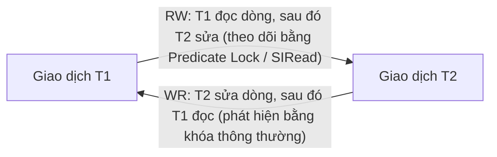
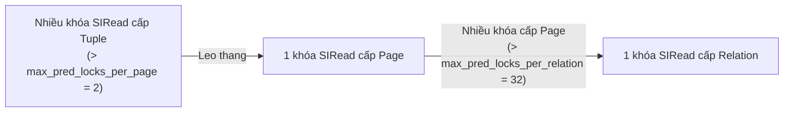

# CHƯƠNG 14: Các loại khóa khác (CHAPTER 14: Miscellaneous Locks)

## 14.1 Khóa phi đối tượng (Non-Object Locks)

Để khóa một tài nguyên không được coi là một quan hệ (relation), PostgreSQL sử dụng các khóa hạng nặng (heavyweight lock) thuộc loại `object`.[^1] Bạn có thể khóa hầu như bất kỳ thứ gì được lưu trữ trong danh mục hệ thống (system catalog): tablespace, subscription, schema, role, policy, kiểu dữ liệu liệt kê (enumerated data type), v.v.

Hãy bắt đầu một giao dịch (transaction) tạo một bảng mới:

```sql
=> BEGIN;
=> CREATE TABLE example(n integer);
```

Bây giờ hãy xem các khóa không phải quan hệ (non-relation locks) trong bảng `pg_locks`:

```sql
=> SELECT database,
  (
    SELECT datname FROM pg_database WHERE oid = database
  ) AS dbname,
  classid,
  (
    SELECT relname FROM pg_class WHERE oid = classid
  ) AS classname,
  objid,
  mode,
  granted
FROM pg_locks
WHERE locktype = 'object'
  AND pid = pg_backend_pid() \gx
```

```text
−[ RECORD 1 ]−−−−−−−−−−−−−−
database  | 16391
dbname    | internals
classid   | 2615
classname | pg_namespace
objid     | 2200
mode      | AccessShareLock
granted   | t
```

Tài nguyên bị khóa ở đây được xác định bởi ba giá trị:

- `database` — `oid` của cơ sở dữ liệu chứa đối tượng đang bị khóa (hoặc bằng 0 nếu đối tượng này dùng chung cho toàn bộ cụm cơ sở dữ liệu — cluster).
- `classid` — `oid` được liệt kê trong `pg_class` tương ứng với tên của bảng danh mục hệ thống định nghĩa loại tài nguyên đó.
- `objid` — `oid` được liệt kê trong bảng danh mục hệ thống được tham chiếu bởi `classid`.

Giá trị `database` trỏ đến cơ sở dữ liệu `internals`; đó là cơ sở dữ liệu mà phiên (session) hiện tại đang kết nối tới. Cột `classid` trỏ đến bảng `pg_namespace`, nơi liệt kê các schema.

Bây giờ chúng ta có thể giải mã `objid`:

```sql
=> SELECT nspname FROM pg_namespace WHERE oid = 2200;
```

```text
 nspname
−−−−−−−−−
 public
(1 row)
```

Như vậy, PostgreSQL đã khóa schema `public` để đảm bảo rằng không ai có thể xóa nó trong khi giao dịch vẫn đang chạy.

Tương tự, việc xóa một đối tượng đòi hỏi các khóa độc quyền (exclusive lock) trên cả chính đối tượng đó lẫn tất cả các tài nguyên phụ thuộc vào nó.[^2]

```sql
=> ROLLBACK;
```

> 💡 **Ví dụ bổ sung (không có trong sách):**
> Khi bạn thực hiện `DROP ROLE alice;` hoặc `ALTER TABLE t SET TABLESPACE fast_ssd;`, PostgreSQL cũng sẽ tự động lấy khóa loại `object` trên `pg_authid` hoặc `pg_tablespace` để ngăn chặn các giao dịch khác sử dụng hoặc xóa đồng thời các đối tượng cấp hệ thống đó.

[^1]: `backend/storage/lmgr/lmgr.c`, các hàm `LockDatabaseObject` & `LockSharedObject`
[^2]: `backend/catalog/dependency.c`, hàm `performDeletion`

## 14.2 Khóa mở rộng quan hệ (Relation Extension Locks)

Khi số lượng bộ dữ liệu (tuple) trong một quan hệ tăng lên, PostgreSQL sẽ chèn các tuple mới vào vùng trống trên các trang (page) đã có sẵn bất cứ khi nào có thể. Nhưng rõ ràng là đến một lúc nào đó, nó sẽ phải thêm các trang mới, tức là mở rộng quan hệ (extend the relation). Về mặt bố cục vật lý, các trang mới được thêm vào cuối tệp tương ứng (điều này, đến lượt nó, có thể dẫn đến việc tạo ra một tệp mới).

Để đảm bảo các trang mới chỉ được thêm bởi một tiến trình tại một thời điểm, thao tác này được bảo vệ bởi một khóa hạng nặng đặc biệt thuộc loại `extend`.[^3] Loại khóa này cũng được quá trình dọn dẹp chỉ mục (index vacuuming) sử dụng để cấm việc thêm các trang mới trong khi đang quét chỉ mục.

Các khóa mở rộng quan hệ hoạt động hơi khác so với những gì chúng ta đã thấy cho đến nay:

- Chúng được giải phóng ngay khi phần mở rộng được tạo xong, mà không cần đợi giao dịch kết thúc.
- Chúng không thể gây ra bế tắc (deadlock), do đó chúng không được đưa vào đồ thị chờ (wait-for graph).

Tuy nhiên, việc kiểm tra deadlock vẫn sẽ được thực hiện nếu quy trình mở rộng một quan hệ kéo dài hơn `deadlock_timeout`. Đây không phải là tình huống điển hình, nhưng nó có thể xảy ra nếu một số lượng lớn các tiến trình thực hiện nhiều thao tác chèn (insertion) đồng thời. Trong trường hợp này, việc kiểm tra có thể bị gọi nhiều lần, gần như làm tê liệt hoạt động bình thường của hệ thống.

Để giảm thiểu rủi ro này, từ phiên bản 9.6, các tệp heap (heap files) được mở rộng thêm nhiều trang cùng một lúc (tỷ lệ thuận với số lượng tiến trình đang chờ khóa, nhưng không quá 623 trang cho mỗi lần thao tác).[^4] Một ngoại lệ cho quy tắc này là các tệp chỉ mục B-tree, vốn chỉ được mở rộng từng trang một.[^5]

> 📝 **Giải thích thêm (không có trong sách):**
> Trong thực tế vận hành PostgreSQL tải cao (nhiều worker `INSERT` song song vào cùng một bảng lớn hoặc bảng có cột `TOAST`), hiện tượng tranh chấp khóa `RelationExtensionLock` (thường hiển thị trong `pg_stat_activity` với `wait_event_type = 'Lock'` và `wait_event = 'extend'`) là một nút thắt cổ chai phổ biến. Từ PostgreSQL 16 trở đi, cơ chế mở rộng quan hệ hàng loạt (bulk relation extension) tiếp tục được cải tiến để giảm mạnh sự tranh chấp này.

[^3]: `backend/storage/lmgr/lmgr.c`, hàm `LockRelationForExtension`
[^4]: `backend/access/heap/hio.c`, hàm `RelationAddExtraBlocks`
[^5]: `backend/access/nbtree/nbtpage.c`, hàm `_bt_getbuf`

## 14.3 Khóa trang (Page Locks)

Một khóa hạng nặng ở cấp độ trang thuộc loại `page`[^6] chỉ được áp dụng bởi các chỉ mục GIN, và chỉ trong trường hợp sau đây.

Các chỉ mục GIN có thể tăng tốc độ tìm kiếm các phần tử bên trong các giá trị phức hợp, chẳng hạn như các từ trong tài liệu văn bản. Có thể mô tả sơ lược chúng giống như các cây B-tree lưu trữ từng từ riêng lẻ thay vì toàn bộ tài liệu. Khi một tài liệu mới được thêm vào, chỉ mục phải được cập nhật kỹ lưỡng để bao gồm từng từ xuất hiện trong tài liệu đó.

Để cải thiện hiệu năng, các chỉ mục GIN cho phép chèn trì hoãn (deferred insertion), được điều khiển bởi tham số lưu trữ `fastupdate` (mặc định là `on`). Các từ mới trước tiên được thêm nhanh chóng vào một danh sách chờ chưa sắp xếp (unordered pending list), và sau một khoảng thời gian, tất cả các mục tích lũy sẽ được chuyển vào cấu trúc chỉ mục chính. Vì các tài liệu khác nhau có khả năng chứa các từ trùng lặp, cách tiếp cận này tỏ ra khá tiết kiệm chi phí.

Để tránh việc nhiều tiến trình cùng chuyển các từ đồng thời, trang siêu dữ liệu (metapage) của chỉ mục bị khóa ở chế độ độc quyền (exclusive mode) cho đến khi tất cả các từ được chuyển từ danh sách chờ vào chỉ mục chính. Khóa này không cản trở việc sử dụng chỉ mục thông thường.

Giống như khóa mở rộng quan hệ, khóa trang được giải phóng ngay lập tức khi tác vụ hoàn thành, mà không đợi đến cuối giao dịch, nên chúng không bao giờ gây ra deadlock.

[^6]: `backend/storage/lmgr/lmgr.c`, hàm `LockPage`

## 14.4 Khóa tư vấn (Advisory Locks)

Không giống như các khóa hạng nặng khác (chẳng hạn như khóa quan hệ), khóa tư vấn (advisory lock)[^7] không bao giờ được tự động lấy: chúng do nhà phát triển ứng dụng kiểm soát. Những khóa này rất tiện lợi khi ứng dụng cần logic khóa chuyên biệt cho một mục đích cụ thể nào đó.

Giả sử chúng ta cần khóa một tài nguyên không tương ứng với bất kỳ đối tượng cơ sở dữ liệu nào (thứ mà ta có thể khóa bằng các lệnh `SELECT FOR` hoặc `LOCK TABLE`). Trong trường hợp này, tài nguyên cần được gán một ID dạng số. Nếu tài nguyên có một tên duy nhất, cách dễ nhất để làm điều đó là tạo mã băm (hash code) cho tên này:

```sql
=> SELECT hashtext('resource1');
```

```text
 hashtext
−−−−−−−−−−−
 991601810
(1 row)
```

PostgreSQL cung cấp cả một nhóm các hàm để quản lý khóa tư vấn.[^8] Tên của chúng bắt đầu bằng tiền tố `pg_advisory` và có thể chứa các từ sau đây gợi ý mục đích của hàm:

- `lock` — lấy một khóa
- `try` — lấy một khóa nếu có thể thực hiện mà không cần chờ
- `unlock` — giải phóng khóa
- `share` — sử dụng chế độ khóa chia sẻ (mặc định là chế độ độc quyền — exclusive mode)
- `xact` — lấy và giữ khóa cho đến khi kết thúc giao dịch (mặc định, khóa được giữ cho đến khi kết thúc phiên làm việc)

Hãy thử lấy một khóa độc quyền cho đến khi kết thúc phiên:

```sql
=> BEGIN;
=> SELECT pg_advisory_lock(hashtext('resource1'));
=> SELECT locktype, objid, mode, granted
FROM pg_locks WHERE locktype = 'advisory' AND pid = pg_backend_pid();
```

```text
 locktype |   objid   |     mode      | granted
−−−−−−−−−−+−−−−−−−−−−−+−−−−−−−−−−−−−−−+−−−−−−−−−
 advisory | 991601810 | ExclusiveLock | t
(1 row)
```

Để khóa tư vấn thực sự phát huy tác dụng, các tiến trình khác cũng phải tuân thủ thứ tự đã thiết lập khi truy cập tài nguyên; điều này phải được đảm bảo bởi ứng dụng.

Khóa đã lấy sẽ vẫn được giữ ngay cả sau khi giao dịch kết thúc:

```sql
=> COMMIT;
=> SELECT locktype, objid, mode, granted
FROM pg_locks WHERE locktype = 'advisory' AND pid = pg_backend_pid();
```

```text
 locktype |   objid   |     mode      | granted
−−−−−−−−−−+−−−−−−−−−−−+−−−−−−−−−−−−−−−+−−−−−−−−−
 advisory | 991601810 | ExclusiveLock | t
(1 row)
```

Khi thao tác trên tài nguyên hoàn tất, khóa phải được giải phóng một cách tường minh:

```sql
=> SELECT pg_advisory_unlock(hashtext('resource1'));
```

> 💡 **Ví dụ bổ sung (không có trong sách):**
> Trong các hệ thống microservice hoặc các tác vụ định kỳ (cron job) chạy trên nhiều node cùng kết nối vào một PostgreSQL, người ta thường dùng `pg_try_advisory_lock(12345)` để bầu chọn leader (leader election) hoặc đảm bảo chỉ có một worker duy nhất chạy job dọn dẹp tại một thời điểm. Nếu dùng connection pooler (như PgBouncer ở chế độ transaction pooling), hãy ưu tiên dùng `pg_advisory_xact_lock` vì khóa cấp phiên (`pg_advisory_lock`) có thể bị giữ lại trên kết nối vật lý sau khi trả về pool.

[^7]: `postgresql.org/docs/14/explicit-locking.html#ADVISORY-LOCKS`
[^8]: `postgresql.org/docs/14/functions-admin.html#FUNCTIONS-ADVISORY-LOCKS`

## 14.5 Khóa vị từ (Predicate Locks)

Thuật ngữ khóa vị từ (predicate lock) đã xuất hiện ngay từ những nỗ lực đầu tiên nhằm triển khai tính cô lập hoàn toàn (full isolation) dựa trên khóa.[^9] Vấn đề gặp phải vào thời điểm đó là việc khóa tất cả các dòng được đọc và cập nhật vẫn không thể đảm bảo tính cô lập hoàn toàn. Thật vậy, nếu các dòng mới thỏa mãn điều kiện lọc được chèn vào bảng, chúng sẽ trở thành các dòng ma (phantom) (tr. 53).

Vì lý do này, người ta đã đề xuất khóa các điều kiện (vị từ — predicate) thay vì khóa các dòng. Nếu bạn chạy một truy vấn với vị từ `a > 10`, việc khóa vị từ này sẽ không cho phép thêm các dòng mới vào bảng nếu chúng thỏa mãn điều kiện này, nhờ đó tránh được hiện tượng phantom. Rắc rối là nếu một truy vấn với vị từ khác xuất hiện, chẳng hạn như `a < 20`, bạn phải tìm xem các vị từ này có giao nhau (overlap) hay không. Về mặt lý thuyết, bài toán này là không thể giải được bằng thuật toán (algorithmically unsolvable); trong thực tế, nó chỉ có thể giải được cho một lớp vị từ rất đơn giản (như trong ví dụ này).

Trong PostgreSQL, mức cô lập `Serializable` được triển khai theo một cách khác: nó sử dụng giao thức Serializable Snapshot Isolation (SSI).[^10] Thuật ngữ khóa vị từ vẫn được giữ lại, nhưng ý nghĩa của nó đã thay đổi hoàn toàn. Thực tế, những "khóa" này không khóa bất cứ thứ gì: chúng được sử dụng để theo dõi các phụ thuộc dữ liệu (data dependencies) giữa các giao dịch khác nhau.

Người ta đã chứng minh rằng cô lập ảnh chụp nhanh (snapshot isolation) ở mức `Repeatable Read` không cho phép bất kỳ dị thường (anomaly) nào ngoại trừ dị thường lệch ghi (write skew) và dị thường giao dịch chỉ đọc (read-only transaction anomaly) (tr. 66). Hai dị thường này dẫn đến những mẫu hình nhất định trong đồ thị phụ thuộc dữ liệu mà ta có thể phát hiện với chi phí tương đối thấp.

Vấn đề là chúng ta phải phân biệt giữa hai loại phụ thuộc:

- Giao dịch thứ nhất đọc một dòng, sau đó dòng này được cập nhật bởi giao dịch thứ hai (phụ thuộc **RW** — Read-Write).
- Giao dịch thứ nhất sửa đổi một dòng, sau đó dòng này được đọc bởi giao dịch thứ hai (phụ thuộc **WR** — Write-Read).

Các phụ thuộc **WR** có thể được phát hiện bằng các khóa thông thường, nhưng các phụ thuộc **RW** phải được theo dõi thông qua khóa vị từ. Việc theo dõi này được bật tự động ở mức cô lập `Serializable`, và đó chính là lý do tại sao điều quan trọng là phải sử dụng mức này cho tất cả các giao dịch (hoặc ít nhất là tất cả các giao dịch có liên kết với nhau). Nếu bất kỳ giao dịch nào chạy ở một mức khác, nó sẽ không đặt (hoặc kiểm tra) khóa vị từ, vì vậy mức `Serializable` sẽ bị hạ cấp xuống `Repeatable Read`.



Tôi muốn nhấn mạnh một lần nữa rằng bất chấp tên gọi của chúng, khóa vị từ không khóa bất cứ thứ gì. Thay vào đó, một giao dịch sẽ được kiểm tra các phụ thuộc "nguy hiểm" khi nó sắp được xác nhận (commit), và nếu PostgreSQL nghi ngờ có dị thường, giao dịch này sẽ bị hủy bỏ (abort).

Hãy tạo một bảng với một chỉ mục trải dài trên nhiều trang (có thể đạt được điều này bằng cách sử dụng giá trị `fillfactor` thấp):

```sql
=> CREATE TABLE pred(n numeric, s text);
=> INSERT INTO pred(n) SELECT n FROM generate_series(1,10000) n;
=> CREATE INDEX ON pred(n) WITH (fillfactor = 10);
=> ANALYZE pred;
```

Nếu truy vấn thực hiện quét tuần tự (sequential scan), một khóa vị từ sẽ được đặt trên toàn bộ bảng (ngay cả khi một số dòng không thỏa mãn điều kiện lọc được cung cấp).

```sql
=> SELECT pg_backend_pid();
```

```text
 pg_backend_pid
−−−−−−−−−−−−−−−−
          34753
(1 row)
```

```sql
=> BEGIN ISOLATION LEVEL SERIALIZABLE;
=> EXPLAIN (analyze, costs off, timing off, summary off)
SELECT * FROM pred WHERE n > 100;
```

```text
                  QUERY PLAN
−−−−−−−−−−−−−−−−−−−−−−−−−−−−−−−−−−−−−−−−−−−−−
 Seq Scan on pred (actual rows=9900 loops=1)
   Filter: (n > '100'::numeric)
   Rows Removed by Filter: 100
(3 rows)
```

Mặc dù khóa vị từ có hạ tầng riêng, khung nhìn `pg_locks` hiển thị chúng cùng với các khóa hạng nặng. Tất cả các khóa vị từ luôn được lấy ở chế độ `SIRead`, viết tắt của *Serializable Isolation Read*:

```sql
=> SELECT relation::regclass, locktype, page, tuple
FROM pg_locks WHERE mode = 'SIReadLock' AND pid = 34753
ORDER BY 1, 2, 3, 4;
```

```text
 relation | locktype | page | tuple
−−−−−−−−−−+−−−−−−−−−−+−−−−−−+−−−−−−−
 pred     | relation |      |
(1 row)
```

```sql
=> ROLLBACK;
```

Lưu ý rằng khóa vị từ có thể được giữ lâu hơn thời gian tồn tại của giao dịch, vì chúng được dùng để theo dõi phụ thuộc giữa các giao dịch. Nhưng dù sao đi nữa, chúng được quản lý hoàn toàn tự động.

Nếu truy vấn thực hiện quét chỉ mục (index scan), tình hình sẽ được cải thiện. Đối với chỉ mục B-tree, chỉ cần đặt khóa vị từ trên các bộ dữ liệu heap (heap tuple) đã đọc và trên các trang lá (leaf page) của chỉ mục đã quét. Nó sẽ "khóa" toàn bộ khoảng giá trị đã được đọc, chứ không chỉ các giá trị chính xác.

```sql
=> BEGIN ISOLATION LEVEL SERIALIZABLE;
=> EXPLAIN (analyze, costs off, timing off, summary off)
SELECT * FROM pred WHERE n BETWEEN 1000 AND 1001;
```

```text
                            QUERY PLAN
−−−−−−−−−−−−−−−−−−−−−−−−−−−−−−−−−−−−−−−−−−−−−−−−−−−−−−−−−−−−−−−−−−−
 Index Scan using pred_n_idx on pred (actual rows=2 loops=1)
   Index Cond: ((n >= '1000'::numeric) AND (n <= '1001'::numeric))
(2 rows)
```

```sql
=> SELECT relation::regclass, locktype, page, tuple
FROM pg_locks WHERE mode = 'SIReadLock' AND pid = 34753
ORDER BY 1, 2, 3, 4;
```

```text
  relation  | locktype | page | tuple
−−−−−−−−−−−−+−−−−−−−−−−+−−−−−−+−−−−−−−
 pred       | tuple    |    4 |    96
 pred       | tuple    |    4 |    97
 pred_n_idx | page     |   28 |
(3 rows)
```

Số lượng trang lá tương ứng với các tuple đã quét có thể thay đổi: ví dụ, một trang chỉ mục có thể bị tách (split) khi các dòng mới được chèn vào bảng. Tuy nhiên, PostgreSQL tính đến điều này và khóa luôn cả các trang mới xuất hiện:

```sql
=> INSERT INTO pred
SELECT 1000+(n/1000.0) FROM generate_series(1,999) n;
=> SELECT relation::regclass, locktype, page, tuple
FROM pg_locks WHERE mode = 'SIReadLock' AND pid = 34753
ORDER BY 1, 2, 3, 4;
```

```text
  relation  | locktype | page | tuple
−−−−−−−−−−−−+−−−−−−−−−−+−−−−−−+−−−−−−−
 pred       | tuple    |    4 |    96
 pred       | tuple    |    4 |    97
 pred_n_idx | page     |   28 |
 pred_n_idx | page     |  266 |
 pred_n_idx | page     |  267 |
 pred_n_idx | page     |  268 |
 pred_n_idx | page     |  269 |
(7 rows)
```

Mỗi tuple được đọc đều bị khóa riêng lẻ, và có thể có khá nhiều tuple như vậy. Khóa vị từ sử dụng vùng nhớ (pool) riêng được cấp phát khi khởi động máy chủ. Tổng số lượng khóa vị từ bị giới hạn bởi giá trị của tham số `max_pred_locks_per_transaction` (mặc định `64`) nhân với `max_connections` (mặc định `100`) (mặc dù tên tham số như vậy, khóa vị từ không được đếm riêng cho từng giao dịch).

Ở đây chúng ta gặp phải vấn đề tương tự như với khóa cấp dòng (row-level lock), nhưng nó được giải quyết theo một cách khác: áp dụng cơ chế leo thang khóa (lock escalation).[^11]

Từ phiên bản 10, ngay khi số lượng khóa tuple liên quan đến một trang vượt quá giá trị của tham số `max_pred_locks_per_page` (mặc định `2`), chúng sẽ được thay thế bằng một khóa cấp trang (page-level lock) duy nhất.

```sql
=> EXPLAIN (analyze, costs off, timing off, summary off)
SELECT * FROM pred WHERE n BETWEEN 1000 AND 1002;
```

```text
                            QUERY PLAN
−−−−−−−−−−−−−−−−−−−−−−−−−−−−−−−−−−−−−−−−−−−−−−−−−−−−−−−−−−−−−−−−−−−
 Index Scan using pred_n_idx on pred (actual rows=3 loops=1)
   Index Cond: ((n >= '1000'::numeric) AND (n <= '1002'::numeric))
(2 rows)
```

Thay vì ba khóa loại `tuple`, bây giờ chúng ta chỉ có một khóa loại `page`:

```sql
=> SELECT relation::regclass, locktype, page, tuple
FROM pg_locks WHERE mode = 'SIReadLock' AND pid = 34753
ORDER BY 1, 2, 3, 4;
```

```text
  relation  | locktype | page | tuple
−−−−−−−−−−−−+−−−−−−−−−−+−−−−−−+−−−−−−−
 pred       | page     |    4 |
 pred_n_idx | page     |   28 |
 pred_n_idx | page     |  266 |
 pred_n_idx | page     |  267 |
 pred_n_idx | page     |  268 |
 pred_n_idx | page     |  269 |
(6 rows)
```

```sql
=> ROLLBACK;
```

Việc leo thang các khóa cấp trang cũng tuân theo nguyên tắc tương tự (từ phiên bản 10). Nếu số lượng các khóa như vậy cho một quan hệ cụ thể vượt quá giá trị `max_pred_locks_per_relation` (mặc định `-2`), chúng sẽ được thay thế bằng một khóa cấp quan hệ (relation-level lock) duy nhất. (Nếu tham số này được đặt thành một giá trị âm, ngưỡng sẽ được tính bằng `max_pred_locks_per_transaction` (mặc định `64`) chia cho giá trị tuyệt đối của `max_pred_locks_per_relation`; do đó, ngưỡng mặc định là `32`).



Việc leo thang khóa chắc chắn sẽ dẫn đến nhiều lỗi tuần tự hóa dương tính giả (false-positive serialization errors), gây ảnh hưởng tiêu cực đến thông lượng (throughput) của hệ thống. Vì vậy, bạn phải tìm ra sự cân bằng phù hợp giữa hiệu năng và việc tiêu tốn bộ nhớ RAM sẵn có cho các khóa.

Khóa vị từ hỗ trợ các loại chỉ mục sau:

- B-tree
- hash index, GiST và GIN (từ phiên bản 11)

Nếu quá trình quét chỉ mục được thực hiện, nhưng chỉ mục đó không hỗ trợ khóa vị từ, toàn bộ chỉ mục sẽ bị khóa. Điều dễ hiểu là số lượng giao dịch bị hủy bỏ một cách vô cớ cũng sẽ tăng lên trong trường hợp này.

Để vận hành hiệu quả hơn ở mức `Serializable`, bạn nên khai báo tường minh các giao dịch chỉ đọc bằng mệnh đề `READ ONLY`. Nếu trình quản lý khóa thấy rằng một giao dịch chỉ đọc sẽ không xung đột với các giao dịch khác,[^12] nó có thể giải phóng các khóa vị từ đã đặt và không cần lấy thêm khóa mới. Và nếu giao dịch như vậy cũng được khai báo là `DEFERRABLE`, dị thường giao dịch chỉ đọc (tr. 69) cũng sẽ được tránh khỏi.

[^9]: K. P. Eswaran, J. N. Gray, R. A. Lorie, I. L. Traiger. *The notions of consistency and predicate locks in a database system*
[^10]: `backend/storage/lmgr/README-SSI`, `backend/storage/lmgr/predicate.c`
[^11]: `backend/storage/lmgr/predicate.c`, hàm `PredicateLockAcquire`
[^12]: `backend/storage/lmgr/predicate.c`, macro `SxactIsROSafe`

## Bảng thuật ngữ chương (Chapter Glossary)

| Thuật ngữ (English) | Tiếng Việt | Giải thích ngắn gọn |
|---|---|---|
| Non-object lock | Khóa phi đối tượng | Khóa hạng nặng loại `object` dùng để khóa các tài nguyên không phải quan hệ (như schema, role, tablespace). |
| Relation extension lock | Khóa mở rộng quan hệ | Khóa loại `extend` đảm bảo chỉ một tiến trình mở rộng tệp vật lý của quan hệ tại một thời điểm. |
| Page lock | Khóa trang | Khóa loại `page` dùng riêng cho chỉ mục GIN khi chuyển dữ liệu từ danh sách chờ (`pending list`) vào chỉ mục chính. |
| Advisory lock | Khóa tư vấn | Khóa do ứng dụng tự quản lý thông qua các hàm `pg_advisory_*`, không được PostgreSQL tự động lấy. |
| Predicate lock | Khóa vị từ | Khóa ở chế độ `SIReadLock` dùng trong mức cô lập `Serializable` (SSI) để theo dõi phụ thuộc RW giữa các giao dịch, không thực sự chặn truy cập. |
| Lock escalation | Leo thang khóa | Cơ chế gộp nhiều khóa vị từ chi tiết (cấp tuple hoặc page) thành một khóa ở cấp lớn hơn (cấp page hoặc relation) để tiết kiệm bộ nhớ. |
| Serializable Snapshot Isolation (SSI) | Cô lập ảnh chụp nhanh tuần tự hóa | Giao thức triển khai mức cô lập `Serializable` bằng cách theo dõi đồ thị phụ thuộc dữ liệu thay vì khóa toàn bộ dữ liệu đọc. |
| RW / WR dependency | Phụ thuộc RW / WR | Phụ thuộc đọc-ghi (Read-Write, theo dõi bằng predicate lock) và ghi-đọc (Write-Read, phát hiện bằng khóa thông thường). |
