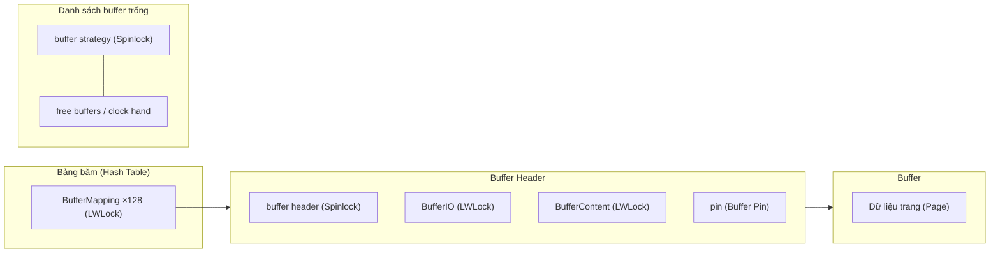
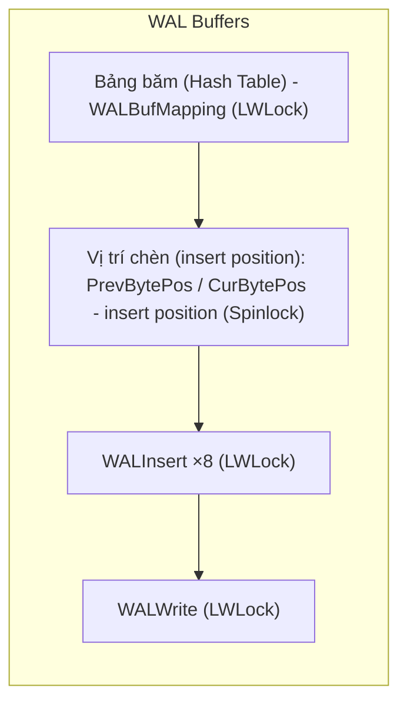

# CHƯƠNG 15: Khóa trên các cấu trúc bộ nhớ (CHAPTER 15: Locks on Memory Structures)

## 15.1 Spinlock (Spinlocks)

Để bảo vệ các cấu trúc dữ liệu trong bộ nhớ dùng chung (shared memory), PostgreSQL sử dụng một số loại khóa nhẹ hơn và ít tốn kém hơn so với các khóa nặng (heavyweight locks) thông thường.

Loại khóa đơn giản nhất là **spinlock**. Chúng thường được giữ trong một khoảng thời gian rất ngắn (không quá vài chu kỳ CPU) để bảo vệ các ô nhớ cụ thể khỏi việc bị cập nhật đồng thời.

Spinlock được xây dựng dựa trên các lệnh CPU nguyên tử (atomic CPU instructions), chẳng hạn như *compare-and-swap* (`backend/storage/lmgr/s_lock.c`). Chúng chỉ hỗ trợ chế độ khóa độc quyền (exclusive locking mode). Nếu tài nguyên cần thiết đã bị khóa, tiến trình sẽ chờ bận (busy-wait), lặp đi lặp lại lệnh kiểm tra (nó "xoay" — *spins* — trong vòng lặp, từ đó có tên gọi spinlock). Nếu không thể giành được khóa trong khoảng thời gian quy định, tiến trình sẽ tạm dừng một lát rồi bắt đầu một vòng lặp khác.

Chiến lược này hợp lý khi xác suất xảy ra xung đột được đánh giá là rất thấp, vì vậy sau một lần thử không thành công, khóa có khả năng cao sẽ được giành lại chỉ trong vòng vài lệnh sau đó.

Spinlock không có cơ chế phát hiện deadlock (bế tắc) cũng như không có công cụ theo dõi (instrumentation). Từ góc độ thực tiễn, chúng ta chỉ cần biết về sự tồn tại của chúng; toàn bộ trách nhiệm đảm bảo việc triển khai đúng đắn thuộc về các nhà phát triển PostgreSQL.

> 📝 **Giải thích thêm (không có trong sách):**
> Tại sao spinlock lại dùng *busy-wait* (tốn CPU để lặp liên tục) thay vì cho tiến trình ngủ (sleep) và nhường CPU? Bởi vì việc chuyển ngữ cảnh (context switch) của hệ điều hành tốn hàng nghìn chu kỳ CPU. Nếu khóa chỉ bị giữ trong vài chục chu kỳ CPU, việc cho tiến trình ngủ rồi đánh thức lại sẽ chậm hơn rất nhiều so với việc lặp tại chỗ chờ một chút.

## 15.2 Khóa nhẹ (Lightweight Locks)

Tiếp theo là các **khóa nhẹ** (*lightweight locks*, viết tắt là **lwlock**, định nghĩa trong `backend/storage/lmgr/lwlock.c`). Được giữ trong khoảng thời gian cần thiết để xử lý một cấu trúc dữ liệu (ví dụ: một bảng băm hoặc một danh sách các con trỏ), khóa nhẹ thường tồn tại trong thời gian ngắn; tuy nhiên, chúng có thể kéo dài hơn khi được dùng để bảo vệ các thao tác I/O.

Khóa nhẹ hỗ trợ hai chế độ: **độc quyền** (exclusive — dùng để sửa đổi dữ liệu) và **chia sẻ** (shared — dùng cho các thao tác chỉ đọc). Không có hàng đợi (queue) theo đúng nghĩa: nếu nhiều tiến trình đang chờ trên cùng một khóa, một trong số chúng sẽ giành được quyền truy cập tài nguyên một cách ít nhiều ngẫu nhiên. Trong các hệ thống tải cao với nhiều tiến trình đồng thời, điều này có thể dẫn đến một số hệ quả không mong muốn.

Kiểm tra deadlock cũng không được cung cấp cho loại khóa này; chúng ta phải tin tưởng các nhà phát triển PostgreSQL rằng các khóa nhẹ đã được triển khai chính xác. Tuy nhiên, các khóa này có hỗ trợ công cụ theo dõi (instrumentation), do đó, không giống như spinlock, chúng có thể được quan sát và giám sát.

## 15.3 Các ví dụ (Examples)

Để hình dung cách thức và vị trí sử dụng spinlock cũng như khóa nhẹ, hãy cùng xem xét hai cấu trúc trong bộ nhớ dùng chung: **bộ nhớ đệm buffer cache** và **bộ nhớ đệm WAL** (WAL buffers). Tôi sẽ chỉ nêu tên một số khóa tiêu biểu; bức tranh toàn cảnh quá phức tạp và có lẽ chỉ phù hợp với các nhà phát triển lõi (core developers) của PostgreSQL.

### Bộ nhớ đệm Buffer Cache (Buffer Cache)

Để truy cập vào bảng băm (hash table, xem trang 147) dùng để định vị một buffer cụ thể trong cache, tiến trình phải giành được khóa nhẹ **`BufferMapping`** ở chế độ chia sẻ (shared) nếu chỉ đọc, hoặc ở chế độ độc quyền (exclusive) nếu dự kiến có sự sửa đổi.



Bảng băm này được truy cập cực kỳ thường xuyên, vì vậy khóa này thường trở thành điểm nghẽn cổ chai (bottleneck). Để tối đa hóa độ chi tiết (granularity), nó được cấu trúc thành một nhóm (*tranche*) gồm 128 khóa nhẹ riêng lẻ, mỗi khóa bảo vệ một phân vùng (partition) riêng biệt của bảng băm (`backend/storage/buffer/bufmgr.c`, `include/storage/buf_internals.h`, hàm `BufMappingPartitionLock`).

> Khóa bảng băm đã được chuyển đổi thành một nhóm 16 khóa từ tận năm 2006, trong PostgreSQL 8.2; mười năm sau, khi phiên bản 9.5 được phát hành, kích thước của nhóm này được tăng lên 128, nhưng con số này vẫn có thể chưa đủ đối với các hệ thống đa nhân (multi-core) hiện đại.

Để truy cập vào phần tiêu đề của buffer (buffer header), tiến trình giành một **buffer header spinlock** (`backend/storage/buffer/bufmgr.c`, hàm `LockBufHdr` — tên gọi này mang tính quy ước, vì spinlock không có tên hiển thị cho người dùng). Một số thao tác, chẳng hạn như tăng bộ đếm mức độ sử dụng (usage counter), không cần khóa tường minh mà có thể thực hiện bằng các lệnh CPU nguyên tử.

Để đọc một trang dữ liệu trong buffer, tiến trình giành khóa **`BufferContent`** nằm trong phần tiêu đề của buffer đó (`include/storage/buf_internals.h`). Khóa này thường chỉ được giữ trong lúc đọc các con trỏ bộ dữ liệu (tuple pointers); sau đó, sự bảo vệ do cơ chế **ghim buffer** (buffer pinning, xem trang 148) mang lại là đã đủ. Nếu nội dung của buffer cần được sửa đổi, khóa `BufferContent` phải được giành ở chế độ độc quyền.

Khi một buffer được đọc từ đĩa (hoặc ghi xuống đĩa), PostgreSQL cũng giành một khóa **`BufferIO`** trong buffer header; về bản chất, đây là một thuộc tính được sử dụng như một khóa hơn là một khóa thực thụ (`backend/storage/buffer/bufmgr.c`, hàm `StartBufferIO`). Nó báo hiệu cho các tiến trình khác đang yêu cầu truy cập vào trang này biết rằng chúng phải chờ cho đến khi thao tác I/O hoàn tất.

Con trỏ trỏ tới các buffer trống (free buffers) và kim đồng hồ (clock hand) của cơ chế thu hồi trang (eviction mechanism) được bảo vệ bởi một **buffer strategy spinlock** dùng chung duy nhất (`backend/storage/buffer/freelist.c`).

> 💡 **Ví dụ bổ sung (không có trong sách):**
> Hình dung hai tiến trình cùng thực hiện `SELECT` và `UPDATE` trên cùng một trang dữ liệu đã nằm trong Shared Buffers:
> 1. Cả hai tìm vị trí trang qua bảng băm bằng `BufferMapping` (chia sẻ).
> 2. Tiến trình `SELECT` giành `BufferContent` ở chế độ **shared**, đọc con trỏ dòng (item pointer), ghim buffer (`pin`), rồi nhả `BufferContent` để đọc dữ liệu dòng.
> 3. Tiến trình `UPDATE` phải chờ `BufferContent` ở chế độ **exclusive** (hoặc chờ hết pin nếu cần dọn dẹp trang) để ghi thay đổi vào buffer.

### Bộ nhớ đệm WAL (WAL Buffers)

Bộ nhớ đệm WAL (WAL cache) cũng sử dụng một bảng băm để ánh xạ các trang tới các buffer. Không giống như bảng băm của buffer cache, nó được bảo vệ bởi chỉ một khóa nhẹ **`WALBufMapping`** duy nhất vì WAL cache nhỏ hơn (thường chiếm 1/32 kích thước của buffer cache) và việc truy cập buffer có tính tuần tự, trật tự hơn (`backend/access/transam/xlog.c`, hàm `AdvanceXLInsertBuffer`).



Việc ghi các trang WAL xuống đĩa được bảo vệ bởi khóa nhẹ **`WALWrite`**, đảm bảo rằng thao tác này tại một thời điểm chỉ được thực hiện bởi một tiến trình duy nhất.

Để tạo một bản ghi WAL (WAL entry), tiến trình trước tiên phải đặt chỗ (reserve) một khoảng trống bên trong trang WAL rồi mới điền dữ liệu vào đó. Việc đặt chỗ được sắp xếp thứ tự nghiêm ngặt; tiến trình phải giành một **insert position spinlock** để bảo vệ con trỏ vị trí chèn (`backend/access/transam/xlog.c`, hàm `ReserveXLogInsertLocation`). Nhưng một khi khoảng trống đã được đặt chỗ, dữ liệu có thể được điền vào bởi nhiều tiến trình đồng thời. Để làm điều này, mỗi tiến trình phải giành bất kỳ khóa nào trong số tám khóa nhẹ cấu thành nên nhóm **`WALInsert`** (`backend/access/transam/xlog.c`, hàm `WALInsertLockAcquire`).

## 15.4 Giám sát các trạng thái chờ (Monitoring Waits)

Không còn nghi ngờ gì nữa, các khóa là thành phần không thể thiếu để PostgreSQL vận hành chính xác, nhưng chúng có thể dẫn đến những khoảng thời gian chờ đợi không mong muốn. Việc theo dõi các trạng thái chờ này rất hữu ích để hiểu rõ nguồn gốc của chúng.

Cách đơn giản nhất để có cái nhìn tổng quan về các khóa dài hạn (long-term locks) là bật tham số `log_lock_waits` (mặc định là `off`); nó kích hoạt việc ghi nhật ký (log) chi tiết tất cả các khóa khiến một giao dịch phải chờ lâu hơn `deadlock_timeout` (mặc định `1s`). Dữ liệu này được hiển thị khi quá trình kiểm tra deadlock hoàn tất, do đó tham số có tên như vậy (xem trang 225).

Tuy nhiên, khung nhìn `pg_stat_activity` (có từ phiên bản 9.6) cung cấp thông tin đầy đủ và hữu ích hơn nhiều. Bất cứ khi nào một tiến trình — dù là tiến trình hệ thống (system process) hay backend — không thể tiếp tục tác vụ của mình vì đang phải chờ một thứ gì đó, trạng thái chờ này sẽ được phản ánh trong các trường `wait_event_type` và `wait_event`, cho biết tương ứng **loại** và **tên** của sự kiện chờ.

Tất cả các trạng thái chờ có thể được phân loại như sau (`postgresql.org/docs/14/monitoring-stats.html#WAIT-EVENT-TABLE`):

Trạng thái chờ trên các loại khóa khác nhau tạo thành một nhóm khá lớn:
- `Lock` — khóa nặng (heavyweight locks)
- `LWLock` — khóa nhẹ (lightweight locks)
- `BufferPin` — các buffer đang bị ghim (pinned buffers)

Nhưng các tiến trình cũng có thể đang chờ các sự kiện khác:
- `IO` — vào/ra (input/output), khi cần đọc hoặc ghi dữ liệu
- `Client` — dữ liệu được gửi từ client (`psql` dành phần lớn thời gian ở trạng thái này)
- `IPC` — dữ liệu được gửi từ một tiến trình khác (giao tiếp liên tiến trình)
- `Extension` — một sự kiện cụ thể được đăng ký bởi một tiện ích mở rộng (extension)

Đôi khi một tiến trình đơn giản là không thực hiện bất kỳ công việc hữu ích nào. Những trạng thái chờ như vậy thường là "bình thường", nghĩa là chúng không chỉ ra bất kỳ sự cố nào. Nhóm này bao gồm các trạng thái chờ sau:
- `Activity` — các tiến trình nền (background processes) đang ở trong vòng lặp chính của chúng
- `Timeout` — bộ đếm thời gian (timer)

Các khóa thuộc mỗi loại chờ được phân loại chi tiết hơn theo tên sự kiện chờ. Ví dụ, các trạng thái chờ trên khóa nhẹ sẽ mang tên của khóa đó hoặc tên của nhóm (*tranche*) tương ứng (`postgresql.org/docs/14/monitoring-stats.html#WAIT-EVENT-LWLOCK-TABLE`).

Bạn cần lưu ý rằng khung nhìn `pg_stat_activity` chỉ hiển thị những trạng thái chờ đã được xử lý phù hợp trong mã nguồn (`include/utils/wait_event.h`). Nếu tên của trạng thái chờ không xuất hiện trong khung nhìn này, tiến trình đang không ở trong trạng thái chờ thuộc bất kỳ loại đã biết nào. Khoảng thời gian như vậy nên được coi là *chưa được thống kê* (*unaccounted for*); điều đó không nhất thiết có nghĩa là tiến trình không chờ gì cả — mà đơn giản là chúng ta không biết điều gì đang xảy ra tại thời điểm đó.

```sql
=> SELECT backend_type, wait_event_type AS event_type, wait_event
FROM pg_stat_activity;
```
```text
         backend_type         | event_type |     wait_event      
------------------------------+------------+---------------------
 logical replication launcher | Activity   | LogicalLauncherMain
 autovacuum launcher          | Activity   | AutoVacuumMain
 client backend               |            | 
 background writer            | Activity   | BgWriterMain
 checkpointer                 | Activity   | CheckpointerMain
 walwriter                    | Activity   | WalWriterMain
(6 rows)
```

Ở đây tất cả các tiến trình nền đều đang nhàn rỗi tại thời điểm khung nhìn được lấy mẫu, trong khi `client backend` đang bận thực thi câu truy vấn và không phải chờ đợi bất cứ thứ gì.

## 15.5 Lấy mẫu (Sampling)

Đáng tiếc là khung nhìn `pg_stat_activity` chỉ hiển thị thông tin *tại thời điểm hiện tại* về các trạng thái chờ; số liệu thống kê không được tích lũy. Cách duy nhất để thu thập dữ liệu chờ theo thời gian là lấy mẫu (sample) khung nhìn này theo các khoảng thời gian đều đặn.

Chúng ta phải tính đến bản chất ngẫu nhiên (stochastic nature) của việc lấy mẫu. Thời gian chờ càng ngắn so với chu kỳ lấy mẫu thì cơ hội phát hiện ra trạng thái chờ đó càng thấp. Do đó, chu kỳ lấy mẫu càng dài thì càng cần nhiều mẫu hơn để phản ánh đúng thực trạng (nhưng khi bạn tăng tần suất lấy mẫu lên, chi phí phụ trội — overhead — cũng tăng theo). Vì lý do tương tự, việc lấy mẫu hầu như vô dụng khi phân tích các phiên làm việc ngắn hạn (short-lived sessions).

PostgreSQL không cung cấp sẵn công cụ tích hợp để lấy mẫu; tuy nhiên, chúng ta vẫn có thể thử nghiệm bằng cách sử dụng extension **`pg_wait_sampling`** (`github.com/postgrespro/pg_wait_sampling`).

Để làm được điều đó, chúng ta phải khai báo thư viện của nó trong tham số `shared_preload_libraries` và khởi động lại máy chủ:

```sql
=> ALTER SYSTEM SET shared_preload_libraries = 'pg_wait_sampling';
```
```bash
postgres$ pg_ctl restart -l /home/postgres/logfile
```

Bây giờ hãy cài đặt extension này vào cơ sở dữ liệu:

```sql
=> CREATE EXTENSION pg_wait_sampling;
```

Extension này có thể hiển thị lịch sử các trạng thái chờ được lưu trong bộ đệm vòng (ring buffer) của nó. Tuy nhiên, điều thú vị hơn nhiều là lấy được **hồ sơ chờ đợi** (*waiting profile*) — tức là số liệu thống kê tích lũy cho toàn bộ thời lượng của phiên làm việc.

Ví dụ, hãy xem xét các trạng thái chờ trong quá trình chạy benchmark. Chúng ta phải khởi chạy tiện ích `pgbench` và xác định PID của tiến trình đó trong khi nó đang chạy:

```bash
postgres$ /usr/local/pgsql/bin/pgbench -T 60 internals
```
```sql
=> SELECT pid FROM pg_stat_activity
WHERE application_name = 'pgbench';
```
```text
  pid  
-------
 36367
(1 row)
```

Sau khi bài kiểm tra hoàn tất, hồ sơ chờ đợi sẽ trông như sau:

```sql
=> SELECT pid, event_type, event, count
FROM pg_wait_sampling_profile WHERE pid = 36367
ORDER BY count DESC LIMIT 4;
```
```text
  pid  | event_type |    event     | count 
-------+------------+--------------+-------
 36367 | IO         | WALSync      |  3478
 36367 | IO         | WALWrite     |    52
 36367 | Client     | ClientRead   |    30
 36367 | IO         | DataFileRead |     2
(4 rows)
```

Theo mặc định (được thiết lập bởi tham số `pg_wait_sampling.profile_period = 10ms`), các mẫu được thu thập 100 lần mỗi giây. Vì vậy, để ước tính thời gian chờ theo giây, bạn phải chia giá trị `count` cho 100.

Trong trường hợp cụ thể này, phần lớn các trạng thái chờ liên quan đến việc đẩy (flush) các bản ghi WAL xuống đĩa. Đây là một minh họa rất hay cho khoảng thời gian chờ chưa được thống kê: sự kiện `WALSync` chưa được gắn công cụ theo dõi (instrumented) cho đến PostgreSQL 11; đối với các phiên bản thấp hơn, hồ sơ chờ đợi sẽ không chứa dòng đầu tiên này, mặc dù bản thân sự chờ đợi đó vẫn thực sự diễn ra.

Và đây là hình dáng của hồ sơ chờ đợi nếu chúng ta làm chậm hệ thống tệp (file system) một cách nhân tạo sao cho mỗi thao tác I/O mất 0.1 giây (tôi sử dụng `slowfs`, `github.com/nirs/slowfs`, cho mục đích này):

```bash
postgres$ /usr/local/pgsql/bin/pgbench -T 60 internals
```
```sql
=> SELECT pid FROM pg_stat_activity
WHERE application_name = 'pgbench';
```
```text
  pid  
-------
 36747
(1 row)
```
```sql
=> SELECT pid, event_type, event, count
FROM pg_wait_sampling_profile WHERE pid = 36747
ORDER BY count DESC LIMIT 4;
```
```text
  pid  | event_type |     event      | count 
-------+------------+----------------+-------
 36747 | IO         | WALWrite       |  3603
 36747 | LWLock     | WALWrite       |  2095
 36747 | IO         | WALSync        |    22
 36747 | IO         | DataFileExtend |    19
(4 rows)
```

Lúc này các thao tác I/O là chậm nhất — chủ yếu là những thao tác liên quan đến việc ghi các tệp WAL xuống đĩa ở chế độ đồng bộ (synchronous mode). Vì việc ghi WAL được bảo vệ bởi khóa nhẹ `WALWrite`, nên dòng tương ứng (`LWLock | WALWrite`) cũng xuất hiện trong hồ sơ.

Rõ ràng, chính khóa đó cũng được giành trong ví dụ trước, nhưng vì thời gian chờ ngắn hơn chu kỳ lấy mẫu nên nó chỉ được lấy mẫu rất ít lần hoặc thậm chí không lọt vào hồ sơ chút nào. Điều này một lần nữa minh họa rằng để phân tích các trạng thái chờ ngắn, bạn phải lấy mẫu chúng trong một khoảng thời gian đủ dài.

> 💡 **Ví dụ bổ sung (không có trong sách):**
> Trong thực tế vận hành PostgreSQL, nếu bạn thấy `LWLock: BufferMapping` tăng đột biến trong `pg_stat_activity` hoặc `pg_wait_sampling_profile`, điều đó thường báo hiệu có quá nhiều tiến trình đang đồng thời tìm kiếm các trang khác nhau trong `shared_buffers` (ví dụ: truy vấn OLTP tần suất cao trên các bảng lớn). Ngược lại, nếu thấy `LWLock: WALInsert` hoặc `LWLock: WALWrite` cao, điểm nghẽn thường nằm ở tốc độ ghi giao dịch đồng thời hoặc băng thông đĩa chứa thư mục `pg_wal`.

## Bảng thuật ngữ chương (Chapter Glossary)

| Thuật ngữ (English) | Tiếng Việt | Giải thích ngắn gọn |
| :--- | :--- | :--- |
| **Spinlock** | Khóa xoay | Khóa cực nhẹ dùng lệnh CPU nguyên tử, tiến trình lặp liên tục (busy-wait) để chờ khóa trong vài chu kỳ CPU. |
| **Lightweight Lock (LWLock)** | Khóa nhẹ | Khóa bảo vệ cấu trúc dữ liệu trong bộ nhớ dùng chung (bảng băm, danh sách) hoặc thao tác I/O; hỗ trợ chế độ shared và exclusive. |
| **Tranche** | Nhóm khóa | Tập hợp nhiều khóa nhẹ cùng loại (ví dụ 128 khóa `BufferMapping`) giúp chia nhỏ phạm vi khóa và giảm tranh chấp. |
| **Busy-wait** | Chờ bận | Trạng thái tiến trình liên tục kiểm tra điều kiện trong vòng lặp thay vì đi ngủ (sleep). |
| **Instrumentation** | Công cụ theo dõi / đo đạc | Mã nguồn được chèn thêm để ghi nhận, thống kê sự kiện (như `wait_event` cho LWLock). |
| **Buffer Pinning** | Ghim buffer | Cơ chế đánh dấu buffer đang được sử dụng để ngăn tiến trình khác đẩy trang đó ra khỏi bộ nhớ đệm. |
| **Wait Event** | Sự kiện chờ | Trạng thái cho biết tiến trình đang bị chặn bởi tài nguyên nào (Lock, LWLock, IO, Client, v.v.). |
| **Sampling** | Lấy mẫu | Kỹ thuật thu thập trạng thái hệ thống định kỳ theo khoảng thời gian đều đặn để dựng hồ sơ hiệu năng. |
| **Waiting Profile** | Hồ sơ chờ đợi | Bảng thống kê tích lũy số lần xuất hiện của từng loại sự kiện chờ trong một khoảng thời gian hoặc phiên làm việc. |
